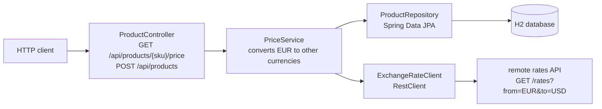
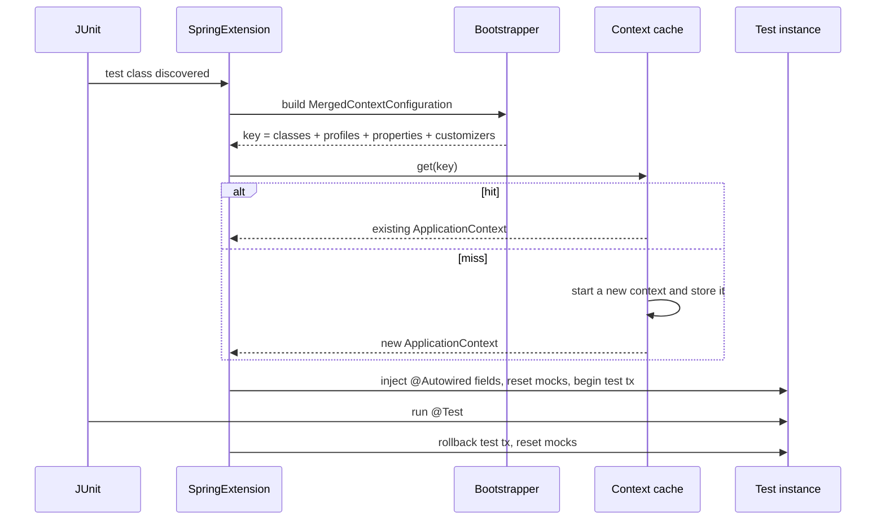
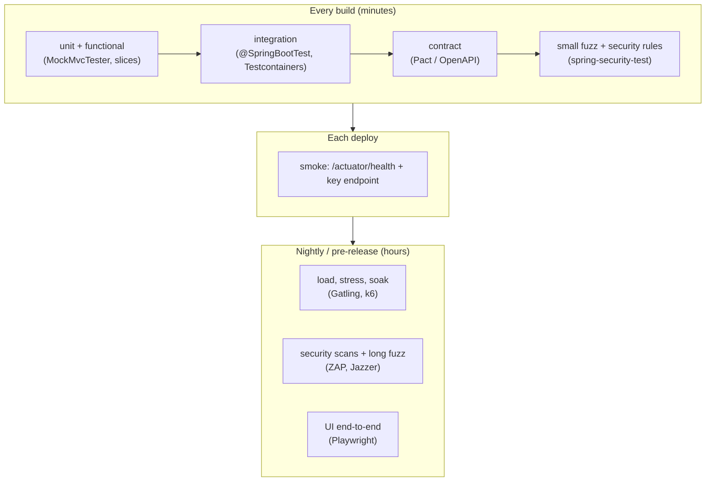

# Chapter 12 — Testing Spring Applications

A Spring application is plain Java objects plus a **container** (the *application context*: it creates your **beans** — the objects Spring manages — and wires them together), which adds **proxies** (wrappers adding behaviour such as transactions) and talks to HTTP, databases and other services. Tests should match that shape: most logic is tested **without Spring at all**; things that exist only inside the container — URL mappings, JSON conversion, validation, Spring Data SQL, **transactions** (changes that succeed or fail together), security filters — get **just enough of the container**; a few tests start **everything** and send real HTTP. This chapter covers each with Spring Boot 4's test support, keeping the **suite** (all tests of a project) fast, and proves every behaviour with real output.

All code is in [`code/`](code/): Spring Boot **4.1.1** (Framework 7.0, JUnit 6.0 — the Java test runner, Mockito 5 — fake objects, AssertJ 3 — readable `assertThat(...)` checks), Java 25:

| Project | Shows | Run here? |
|---|---|---|
| [`testing-demo`](code/testing-demo/) | a small product-pricing API tested at every level: unit, slices, full context, real port, plus a seeded fuzz test | yes |
| [`context-caching`](code/context-caching/) | seven test classes that hit or miss the context cache, with timings | yes |
| [`testcontainers-demo`](code/testcontainers-demo/) | PostgreSQL in a container via `@ServiceConnection` | **needs Docker — not run** (compiled only) |

Output blocks are real `mvn -q -B -ntp verify` output, Spring log lines trimmed to `...`. **Timings are machine-dependent** (14-core Apple M4 Pro laptop); compare them only with each other.

> **Prerequisites.** JUnit 5/6, Mockito and AssertJ basics: Java handbook [Chapter 18](../../../java/chapters/18-testing-build-and-tooling/README.md); this chapter covers what Spring adds. Code under test uses Spring MVC ([Chapter 5](../05-spring-mvc-and-rest/README.md)), `RestClient` ([Chapter 6](../06-rest-clients-and-http-interfaces/README.md)) and Spring Data JPA ([Chapter 8](../08-spring-data-jpa-and-hibernate/README.md)). Security testing (`@WithMockUser`, `jwt()`): [Chapter 10](../10-spring-security-1-fundamentals/README.md), [Chapter 11](../11-spring-security-2-tokens-and-oauth2/README.md). Reactive testing (`StepVerifier`, `WebTestClient`): [Chapter 13](../13-reactive-and-webflux/README.md).

---

## 12.1 The application under test

`testing-demo` is a tiny catalogue service with the layers a real service has:



- `ProductController` maps HTTP to Java, validates the body (`@Valid`) and turns `ProductNotFoundException` into a `404` [Problem Detail](../05-spring-mvc-and-rest/README.md) (standard JSON error shape).
- `PriceService` holds the rule: prices are stored in EUR; for another currency fetch the rate and round to 2 decimals (`HALF_EVEN`, "banker's rounding": a 5 rounds to the even neighbour). For EUR it must **not** call the remote API.
- `ProductRepository` is a Spring Data JPA interface with a **derived query** (`findBySku`: SQL generated from the method name) and a **JPQL** query (`cheaperThan`: JPA's SQL-like language over entity classes).
- `ExchangeRateClient` calls the remote API with `RestClient`; base URL from `rates.base-url`.

The service, for reference:

```java
@Service
public class PriceService {
    private final ProductRepository products;
    private final ExchangeRateClient rates;
    private final String home;

    public PriceService(ProductRepository products, ExchangeRateClient rates,
                        @Value("${catalog.home-currency}") String home) { ... }

    public PriceView priceOf(String sku, String currency) {
        Product p = products.findBySku(sku).orElseThrow(() -> new ProductNotFoundException(sku));
        BigDecimal amount = currency.equals(home)
                ? p.getPrice()                                   // no remote call needed
                : convert(p.getPrice(), rates.rate(home, currency));
        return new PriceView(p.getSku(), p.getName(), amount, currency);
    }
    ...
}
```


---

## 12.2 The test pyramid in a Spring app

### What it is

The **test pyramid**: many small, fast tests at the bottom, fewer slower, broader tests near the top. In Spring the layers map to how much of the container a test starts:

| Layer | What starts | Spring annotation | Proves | Speed (this project) |
|---|---|---|---|---|
| **Unit** | nothing — `new` your class, mock its collaborators | none (`@ExtendWith(MockitoExtension.class)`) | business logic, edge cases | ~1 ms or less per test |
| **Slice** | one layer of the container (web, JPA, JSON, HTTP client) | `@WebMvcTest`, `@DataJpaTest`, `@JsonTest`, `@RestClientTest`, ... | mappings, validation, JSON shape, SQL, client parsing | context 0.03–0.14 s once warm (1.6 s for the first, cold JVM still loading classes) |
| **Integration** | the whole application context (mock servlet, no port) | `@SpringBootTest` + `@AutoConfigureMockMvc` | the wiring: all real beans together | context ~0.7 s |
| **Full stack / end-to-end** | whole context + real server on a random port + real HTTP | `@SpringBootTest(webEnvironment = RANDOM_PORT)` | the app as a client sees it | context ~0.3–0.7 s, plus real network calls |

Timings are Boot's `Started <TestClass> in N seconds` lines for each new context in this run:

```text
... Started ProductRepositoryDataJpaTest in 1.574 seconds (process running for 2.205)   <- first context: cold JVM
... Started MockMvcFullContextTest in 0.726 seconds
... Started PriceViewJsonTest in 0.053 seconds
... Started ExchangeRateClientTest in 0.137 seconds
... Started ProductControllerWebMvcTest in 0.099 seconds
... Started PropertyPrecedenceTest in 0.034 seconds
... Started FullStackTest in 0.285 seconds
... Started RestTestClientMockMvcTest in 0.052 seconds
unit test: PriceView[sku=MUG-001, name=Mug, amount=10.85, currency=USD] in 0 ms
```

On a toy app the gap looks small; on a real service (400 beans, Flyway migrations, Kafka, a security chain) a full context takes seconds, and 300 test classes each building one take many minutes. The pyramid plus context caching ([§12.11](#1211-test-context-caching)) keeps a Spring build fast.

### Why it matters

- **Fast feedback**: millisecond unit tests run on every change.
- **Precise failures**: a failing unit/slice test points at one class; a failing end-to-end test only says "something is broken".
- **Confidence where it counts**: only an integration test catches a missing bean, a wrong property name, or two beans of the same type.

### How to decide which layer

1. Pure logic (calculations, rules, mapping)? → **unit test**, no Spring.
2. Depends on something only Spring does (URL mapping, `@Valid`, JSON, a JPQL query, a `@Transactional` boundary)? → that layer's **slice** (e.g. `POST /api/products` returning `400` for a bad SKU → `@WebMvcTest`; `cheaperThan` sorting → `@DataJpaTest` on a real embedded database, one running inside the test JVM such as H2).
3. Proves beans work *together*? → **`@SpringBootTest`**, usually on the mock servlet environment.
4. Depends on a real server (filters in front of the servlet, compression, the port, SSL/TLS)? → **`RANDOM_PORT`**.

### Trade-offs

| | Unit | Slice | `@SpringBootTest` | `RANDOM_PORT` |
|---|---|---|---|---|
| Speed | fastest | fast | slower | slowest |
| Realism | lowest (mocks everywhere) | real for one layer | real wiring | real HTTP |
| Failure points at | one class | one layer | "somewhere in the app" | "somewhere in the system" |
| Typical share of a suite | most | many | some | few |

### Common mistakes

- **Only `@SpringBootTest`**: every test starts the whole app, and each config difference forces a new context — the most common cause of 20-minute builds.
- **Mocking everything in integration tests**: then they prove nothing the unit test didn't.
- **Testing the framework**: no need to prove `JpaRepository.save` saves. Test *your* queries, mappings and rules.

### TL;DR

Most tests should be plain unit tests. Use a slice when the behaviour lives in Spring. Use a few `@SpringBootTest`s to prove the wiring. Use even fewer `RANDOM_PORT` tests.

---

## 12.3 Test dependencies in Boot 4

### What changed

Boot 4 split the monolithic **auto-configuration** (beans Boot sets up based on the classpath) into **modules**, one per technology ([Chapter 3](../03-configuration-and-auto-configuration/README.md)), and test support likewise: each technology has **`spring-boot-starter-<technology>-test`**, pulling in the main starter, `spring-boot-starter-test`, and that technology's test module (slice annotation, test clients).

`testing-demo/pom.xml`:

```xml
<!-- Boot 4: one test starter per technology -->
<!-- @WebMvcTest, MockMvcTester, RestTestClient, JUnit 6, AssertJ, Mockito -->
<dependency>
  <groupId>org.springframework.boot</groupId>
  <artifactId>spring-boot-starter-webmvc-test</artifactId>
  <scope>test</scope>
</dependency>
<!-- @DataJpaTest, TestEntityManager -->
<dependency>
  <groupId>org.springframework.boot</groupId>
  <artifactId>spring-boot-starter-data-jpa-test</artifactId>
  <scope>test</scope>
</dependency>
<!-- @RestClientTest, MockRestServiceServer -->
<dependency>
  <groupId>org.springframework.boot</groupId>
  <artifactId>spring-boot-starter-restclient-test</artifactId>
  <scope>test</scope>
</dependency>
```

| Test starter | Adds (besides `spring-boot-starter-test`) |
|---|---|
| `spring-boot-starter-webmvc-test` | `@WebMvcTest`, `@AutoConfigureMockMvc`, `MockMvcTester`, `RestTestClient` / `TestRestTemplate` support |
| `spring-boot-starter-webflux-test` | `@WebFluxTest`, `WebTestClient` support, `reactor-test` |
| `spring-boot-starter-data-jpa-test` | `@DataJpaTest`, `TestEntityManager`, `@AutoConfigureTestDatabase` |
| `spring-boot-starter-jdbc-test` | `@JdbcTest` |
| `spring-boot-starter-data-r2dbc-test` | `@DataR2dbcTest`, `reactor-test` |
| `spring-boot-starter-restclient-test` | `@RestClientTest`, `MockRestServiceServer` wiring |
| `spring-boot-starter-jackson-test` | Jackson 3 + `spring-boot-starter-test` (`@JsonTest` itself lives in `spring-boot-test-autoconfigure`); pulled in by the webmvc/webflux/restclient test starters |
| `spring-boot-starter-security-test` | `spring-security-test` (`@WithMockUser`, `jwt()`, ...) |
| `spring-boot-starter-kafka-test` | `spring-kafka-test` (`@EmbeddedKafka`) |

**`spring-boot-starter-test`** itself contains, in Boot 4.1.1: **JUnit Jupiter 6.0** (needs Java 17+), **AssertJ**, **Mockito** (+ `mockito-junit-jupiter`), **Hamcrest** (older matcher library), **JSONassert** (compares JSON documents), **JsonPath** (extracts values with paths like `$.amount`), **Awaitility** (waits for asynchronous results), XMLUnit, `spring-test` and `spring-boot-test`.

The slice annotations **moved packages** with their modules — old imports break on upgrade:

| Annotation | Boot 3.x package | Boot 4 package |
|---|---|---|
| `@WebMvcTest`, `@AutoConfigureMockMvc` | `org.springframework.boot.test.autoconfigure.web.servlet` | `org.springframework.boot.webmvc.test.autoconfigure` |
| `@DataJpaTest` | `...boot.test.autoconfigure.orm.jpa` | `org.springframework.boot.data.jpa.test.autoconfigure` |
| `TestEntityManager` | `...boot.test.autoconfigure.orm.jpa` | `org.springframework.boot.jpa.test.autoconfigure` |
| `@RestClientTest` | `...boot.test.autoconfigure.web.client` | `org.springframework.boot.restclient.test.autoconfigure` |
| `@WebFluxTest` | `...boot.test.autoconfigure.web.reactive` | `org.springframework.boot.webflux.test.autoconfigure` |
| `@JsonTest` | `org.springframework.boot.test.autoconfigure.json` | unchanged |
| `@SpringBootTest`, `@TestConfiguration` | `org.springframework.boot.test.context` | unchanged |

### Common mistakes

- Adding only `spring-boot-starter-test` and wondering why `@WebMvcTest` doesn't resolve — in Boot 4 it lives in the **webmvc** test module.
- Keeping Boot 3 imports after an upgrade — fix them per the table; the annotations work the same.

---

## 12.4 Unit tests: no Spring at all

### What it is

A **unit test** creates the class with `new`, hands it **test doubles** (stand-ins for real collaborators, see [Java ch18](../../../java/chapters/18-testing-build-and-tooling/README.md)), calls a method and checks the result — no context, no scanning, no database. **Constructor injection** ([Chapter 2](../02-ioc-and-dependency-injection/README.md)) makes this possible: the test passes the dependencies itself.

```java
/** Layer 1 of the pyramid: a plain unit test. No Spring, no context, milliseconds. */
@ExtendWith(MockitoExtension.class)
class PriceServiceTest {

    @Mock ProductRepository products;
    @Mock ExchangeRateClient rates;
    PriceService service;

    @BeforeEach
    void setUp() {                       // constructor injection = no framework needed
        service = new PriceService(products, rates, "EUR");
    }

    @Test
    void convertsWithTheRemoteRate() {
        long t0 = System.nanoTime();
        when(products.findBySku("MUG-001"))
                .thenReturn(Optional.of(new Product("MUG-001", "Mug", new BigDecimal("10.00"))));
        when(rates.rate("EUR", "USD")).thenReturn(new BigDecimal("1.0850"));

        PriceView v = service.priceOf("MUG-001", "USD");

        System.out.println("unit test: " + v + " in " + (System.nanoTime() - t0) / 1_000_000 + " ms");
        assertThat(v.amount()).isEqualByComparingTo("10.85");   // 10.00 * 1.085 = 10.85
    }

    @Test
    void homeCurrencySkipsTheRemoteCall() {
        when(products.findBySku("MUG-001"))
                .thenReturn(Optional.of(new Product("MUG-001", "Mug", new BigDecimal("10.00"))));
        assertThat(service.priceOf("MUG-001", "EUR").amount()).isEqualByComparingTo("10.00");
        verify(rates, never()).rate(anyString(), anyString());
    }

    @Test
    void unknownSkuThrows() { ... assertThatThrownBy(...).hasMessage("No product with SKU NOPE"); }
}
```

Output:

```text
unit test: PriceView[sku=MUG-001, name=Mug, amount=10.85, currency=USD] in 0 ms
```

- `@ExtendWith(MockitoExtension.class)` — Mockito's own JUnit extension creates the `@Mock` fields (not Spring).
- `isEqualByComparingTo("10.85")` — compares `BigDecimal`s by value; `isEqualTo` fails on `10.85` vs `10.850` because `BigDecimal.equals` also compares the scale (digits after the point).
- `verify(rates, never())` — proves "no remote call for the home currency", cheaply.

### When not to use it

When the behaviour is **produced by Spring** — a `@Transactional` rollback, a `@PreAuthorize` check, JSON field names, a derived query. A unit test bypasses the proxy or framework and proves nothing; use a slice.

### Common mistakes

- **Field injection** (`@Autowired private Repo repo;`) needs reflection or a context just to set the field. Prefer constructors.
- **Starting Spring "because it's easier"** — `@SpringBootTest` for a calculation costs seconds and hides design problems.

### TL;DR

Constructor injection + Mockito + AssertJ = Spring-free unit tests in milliseconds. Most tests should look like this.

---

## 12.5 How the Spring TestContext Framework works

### What it is

The **Spring TestContext Framework** (in `spring-test`) is the engine behind every Spring test annotation; `@SpringBootTest` and the slices sit on top. Its four parts explain most "why is my test slow / why is this bean missing" questions:

| Part | What it is |
|---|---|
| `SpringExtension` | the JUnit Jupiter extension connecting JUnit's lifecycle to Spring. Every Boot test annotation is meta-annotated with `@ExtendWith(SpringExtension.class)`, so you never add it. |
| `TestContext` | per test class: holds the test class, current instance and method, and gives access to the `ApplicationContext`. |
| `TestExecutionListener`s | plug-ins called before/after each class and method: dependency injection into test fields, `@Transactional` test transactions, `@DirtiesContext`, `@MockitoBean` resets, `@Sql` scripts... |
| **Context cache** | a static, JVM-wide map from a *context configuration key* to a started `ApplicationContext`. |

### How it works

1. JUnit discovers the test class. `SpringExtension` asks a **bootstrapper** (Boot's `SpringBootTestContextBootstrapper`, or a slice's own) to build a **`MergedContextConfiguration`**: configuration classes, active **profiles** (named configuration sets such as `test` or `prod`), test properties, context customizers (`@MockitoBean` definitions, `@DynamicPropertySource` methods), etc.
2. For `@SpringBootTest` without classes, the bootstrapper searches **up the package tree** for `@SpringBootConfiguration` (your `@SpringBootApplication`) — so tests must live in the main class's package or below.
3. The merged configuration is the **cache key** (two classes share a context iff their keys are equal): found → reuse (**hit**); else create, start and store one (**miss**).
4. Listeners inject `@Autowired` fields (`DependencyInjectionTestExecutionListener` — the test instance is not a bean), start a transaction if the test is `@Transactional`, etc.
5. Afterwards they roll back the test transaction, reset `@MockitoBean` mocks, and close the context if marked dirty.
6. The context stays cached for later classes with the same key until the JVM exits (or eviction).




---

## 12.6 `@SpringBootTest`: the whole application

### What it is

`@SpringBootTest` starts your **entire application context** as `SpringApplication.run` would: **component scanning** (turning `@Component`, `@Service`, ... classes into beans), all auto-configuration, `application.properties`. The tool for proving beans work together.

### The four web environments

| `webEnvironment` | What you get | Use for |
|---|---|---|
| `MOCK` (default) | a web context with a **mock servlet environment** — no server, no port. Add `@AutoConfigureMockMvc` to get `MockMvcTester`. | most integration tests of a web app |
| `RANDOM_PORT` | a **real embedded server** (Tomcat/Netty) on a free port; inject it with `@LocalServerPort` | end-to-end HTTP tests |
| `DEFINED_PORT` | a real server on `server.port` (default 8080) | rare: breaks parallel builds when the port is taken |
| `NONE` | no web environment | batch jobs, messaging consumers, clients |

> **Boot 4 change:** `@SpringBootTest` no longer auto-configures test clients by itself. Add `@AutoConfigureMockMvc` for MockMvc, `@AutoConfigureRestTestClient` for `RestTestClient`, `@AutoConfigureTestRestTemplate` for `TestRestTemplate`, `@AutoConfigureWebTestClient` for `WebTestClient` (per the Boot 4.0 migration guide).

### Example: real beans, one fake

```java
/** Whole context, mock servlet environment (no port): every real bean except the remote client. */
@SpringBootTest(properties = "catalog.home-currency=EUR")
@AutoConfigureMockMvc
class MockMvcFullContextTest {

    @TestConfiguration            // extra beans for this test only; not picked up by component scanning
    static class SeedData {
        @Bean ApplicationRunner seed(ProductRepository repo) {
            return args -> repo.save(new Product("LMP-001", "Lamp", new BigDecimal("40.00")));
        }
    }

    @Autowired MockMvcTester mvc;
    @Autowired ApplicationContext ctx;
    @MockitoBean ExchangeRateClient rates;    // the only fake: no network in this test

    @Test
    void realServiceAndDatabaseMockedRemote() throws Exception {
        given(rates.rate("EUR", "GBP")).willReturn(new BigDecimal("0.85"));

        MvcTestResult r = mvc.get().uri("/api/products/LMP-001/price?currency=GBP").exchange();

        System.out.println("@SpringBootTest beans: " + ctx.getBeanDefinitionCount());
        System.out.println("GET GBP -> " + r.getResponse().getContentAsString());
        assertThat(r).hasStatusOk().bodyJson().extractingPath("$.amount").isEqualTo(34.0);
    }
}
```

Output:

```text
@SpringBootTest beans: 253
GET GBP -> {"sku":"LMP-001","name":"Lamp","amount":34.00,"currency":"GBP"}
```

- `properties = "..."` — test-only properties with high precedence ([§12.15](#1215-profiles-and-properties-in-tests)).
- **`@TestConfiguration`** — a test-only `@Configuration`. As a static nested class it is **added to** the app's configuration (a nested plain `@Configuration` would *replace* the auto-detected `@SpringBootApplication` — rarely wanted). Top-level `@TestConfiguration` classes are skipped by component scanning; pull them in with `@Import`.
- Controller, service, repository, JPA and H2 are real; only the internet-calling class is replaced.

### When not to use it

- To test one controller's validation or one query — a slice is 5–10× faster and fails more precisely.
- With a different `properties=` / mock set per class — each variation is a new context ([§12.11](#1211-test-context-caching)).

### Common mistakes

- **Expecting a `@Transactional` test to roll back what the server did in a `RANDOM_PORT` test.** The request runs on a server thread in its own transaction. Clean up explicitly (`FullStackTest` calls `repo.deleteAll()` in `@BeforeEach`).
- **`@SpringBootTest` in a package outside the main class's** → "Unable to find a @SpringBootConfiguration".

---

## 12.7 Test slices

### What it is

A **test slice** starts only the part of the context one layer needs. The slice annotation (e.g. `@WebMvcTest`):

1. **Disables full auto-configuration**, importing only that slice's auto-configurations (`@WebMvcTest`: MVC, Jackson — the JSON library — validation, security filters, ...).
2. Adds a **type-exclude filter** to component scanning so only matching beans of *your* code register (`@WebMvcTest`: `@Controller`, `@ControllerAdvice`, `@JacksonComponent`, `Converter`, `Filter`, `WebMvcConfigurer`, `HandlerInterceptor`, ...). `@Service`, `@Repository` and `@Component` classes are **not** registered.
3. Adds test helpers (`MockMvcTester`, `TestEntityManager`, `MockRestServiceServer`, ...).

Like a rehearsal of one scene: only that scene's actors are on stage; everyone else is a stand-in (`@MockitoBean`).

### The slices you will meet

| Annotation | Starts | Your beans registered | Extras | Transactional? |
|---|---|---|---|---|
| `@WebMvcTest` | Spring MVC, Jackson, validation, Security | controllers, advice, filters, converters, `WebMvcConfigurer` | `MockMvcTester`, `MockMvc` | no |
| `@WebFluxTest` | WebFlux, codecs, validation | controllers, `WebFluxConfigurer`, ... | `WebTestClient` ([ch13](../13-reactive-and-webflux/README.md)) | no |
| `@DataJpaTest` | JPA, Hibernate, Spring Data JPA, embedded DB, Flyway/Liquibase | entities, repositories | `TestEntityManager`, SQL logging on | **yes, rolled back** |
| `@JdbcTest` | `DataSource`, `JdbcTemplate`, `JdbcClient`, embedded DB | none | — | yes, rolled back |
| `@DataR2dbcTest` | R2DBC (non-blocking database access), Spring Data R2DBC | repositories | — | **no** ([ch13](../13-reactive-and-webflux/README.md)) |
| `@JsonTest` | Jackson (or Gson / JSON-B) | `@JacksonComponent`, Jackson modules | `JacksonTester`, `BasicJsonTester` | no |
| `@RestClientTest` | `RestClient.Builder`, `RestTemplateBuilder`, Jackson | the classes you name | `MockRestServiceServer` | no |
| `@DataMongoTest`, `@DataRedisTest`, `@DataJdbcTest`, ... | that store | repositories | — | depends |

### `@WebMvcTest`

```java
/** Web slice: only the MVC layer is real; the service is a Mockito mock. */
@WebMvcTest(ProductController.class)
class ProductControllerWebMvcTest {

    @Autowired MockMvcTester mvc;
    @Autowired ApplicationContext ctx;
    @MockitoBean PriceService service;       // replaces (or adds) the bean in the test context

    @Test
    void sliceContainsOnlyWebBeans() {
        System.out.println("@WebMvcTest beans: " + ctx.getBeanDefinitionCount()
                + ", ProductController present: " + (ctx.getBeanNamesForType(ProductController.class).length == 1)
                + ", ProductRepository present: " + (ctx.getBeanNamesForType(ProductRepository.class).length == 1));
        assertThat(ctx.getBeanNamesForType(ProductRepository.class)).isEmpty();
    }
    ...
}
```

Output:

```text
@WebMvcTest beans: 127, ProductController present: true, ProductRepository present: false
```

127 beans instead of 253: no JPA, database or `RestClient`. `@WebMvcTest(ProductController.class)` narrows it to **one** controller; without the argument every controller registers and all their dependencies must be mocked. Web tests themselves: [§12.8](#128-mockmvctester-assertj-style-mockmvc).

### `@DataJpaTest`

```java
/** JPA slice: entities, repositories, an embedded DB; every test runs in a rolled-back transaction. */
@DataJpaTest
@TestMethodOrder(MethodOrderer.OrderAnnotation.class)
class ProductRepositoryDataJpaTest {

    @Autowired ProductRepository repo;
    @Autowired TestEntityManager em;
    @Autowired DataSource dataSource;

    @Test @Order(1)
    void derivedAndJpqlQueries() throws Exception {
        System.out.println("DB = " + dataSource.getConnection().getMetaData().getURL()
                + ", test transaction active = " + TestTransaction.isActive());
        em.persist(new Product("MUG-001", "Mug", new BigDecimal("10.00")));
        em.persist(new Product("PEN-001", "Pen", new BigDecimal("2.50")));
        em.persist(new Product("LMP-001", "Lamp", new BigDecimal("40.00")));
        em.flush();   // send the INSERTs now
        em.clear();   // forget cached entities so the queries really hit the database

        assertThat(repo.findBySku("PEN-001")).map(Product::getName).contains("Pen");
        assertThat(repo.cheaperThan(new BigDecimal("15"))).extracting(Product::getSku)
                .containsExactly("PEN-001", "MUG-001");
        System.out.println("test 1 saw " + repo.count() + " rows");
    }

    @Test @Order(2)
    void previousTestWasRolledBack() {
        System.out.println("test 2 starts with " + repo.count() + " rows");
        assertThat(repo.count()).isZero();
    }
}
```

Output (`@DataJpaTest` turns on `spring.jpa.show-sql`, so Hibernate prints its SQL):

```text
DB = jdbc:h2:mem:fa1ebe8d-78e8-4d82-a212-1a1b655ce2ab, test transaction active = true
Hibernate: select next value for product_seq
Hibernate: select next value for product_seq
Hibernate: insert into product (name,price,sku,id) values (?,?,?,?)
Hibernate: insert into product (name,price,sku,id) values (?,?,?,?)
Hibernate: insert into product (name,price,sku,id) values (?,?,?,?)
Hibernate: select p1_0.id,p1_0.name,p1_0.price,p1_0.sku from product p1_0 where p1_0.sku=?
Hibernate: select p1_0.id,p1_0.name,p1_0.price,p1_0.sku from product p1_0 where p1_0.price<=? order by p1_0.price
Hibernate: select count(*) from product p1_0
test 1 saw 3 rows
Hibernate: select count(*) from product p1_0
test 2 starts with 0 rows
```

- **Embedded database**: `@DataJpaTest` includes `@AutoConfigureTestDatabase`, whose default `Replace.NON_TEST` (since Boot 3.4) swaps your `DataSource` for a fresh embedded one (random `jdbc:h2:mem:` name) — unless it is already a *test* database such as a Testcontainers `@ServiceConnection` ([§12.14](#1214-testcontainers-and-serviceconnection)). `replace = NONE` always keeps the configured one.
- **Rolled-back transaction**: each test method's transaction rolls back, so test 2 sees 0 rows — independence without cleanup code.
- **`TestEntityManager`**: a helper around JPA's `EntityManager` (`persist`, `persistAndFlush`, `find`, `clear`) to set up data without the repository under test.
- **`flush()` + `clear()`**: otherwise the INSERTs sit in the **persistence context** (the **first-level cache** of loaded/changed entities, [ch08](../08-spring-data-jpa-and-hibernate/README.md)) and `findBySku` might be answered from it. Clearing forces real SQL.

> The rolled-back test transaction can **hide bugs**: **lazy loading** (fetching related rows on first access) always works inside it, and nothing is ever **committed**, so commit-deferred constraint checks, `@TransactionalEventListener(AFTER_COMMIT)` and code needing its own transaction never run. [Chapter 7](../07-data-access-jdbc-and-transactions/README.md) and [Chapter 8](../08-spring-data-jpa-and-hibernate/README.md) use non-transactional `@SpringBootTest`s for this reason. Opt out per class with `@Transactional(propagation = Propagation.NOT_SUPPORTED)`.

### `@JsonTest`

Checks the **wire format** (how an object looks once **serialized** to JSON): field names, number and date formats, and that nothing internal leaks.

```java
@JsonTest
class PriceViewJsonTest {

    @Autowired JacksonTester<PriceView> json;

    @Test
    void serialize() throws Exception {
        JsonContent<PriceView> out = json.write(new PriceView("MUG-001", "Mug", new BigDecimal("10.85"), "USD"));
        System.out.println("serialized: " + out.getJson());
        assertThat(out).extractingJsonPathStringValue("$.currency").isEqualTo("USD");
        assertThat(out).extractingJsonPathNumberValue("$.amount").isEqualTo(10.85);
        assertThat(out).doesNotHaveJsonPath("$.id");
    }

    @Test
    void deserialize() throws Exception {
        PriceView v = json.parseObject("""
                {"sku":"PEN-001","name":"Pen","amount":2.5,"currency":"EUR"}""");
        System.out.println("parsed: " + v);
        assertThat(v.amount()).isEqualByComparingTo("2.50");
    }
}
```

Output:

```text
serialized: {"sku":"MUG-001","name":"Mug","amount":10.85,"currency":"USD"}
parsed: PriceView[sku=PEN-001, name=Pen, amount=2.5, currency=EUR]
```

The slice builds the same Jackson 3 `JsonMapper` your app uses, including `spring.jackson.*` properties and `@JacksonComponent` classes — a plain `new JsonMapper()` would miss them.

### `@RestClientTest`

Tests an HTTP **client** class without a network: the auto-configured `RestClient.Builder` is connected to a **`MockRestServiceServer`**, which checks what the client sent and plays back a canned answer.

```java
@RestClientTest(ExchangeRateClient.class)
@TestPropertySource(properties = "rates.base-url=https://rates.test")
class ExchangeRateClientTest {

    @Autowired ExchangeRateClient client;
    @Autowired MockRestServiceServer server;

    @Test
    void parsesTheRate() {
        server.expect(requestTo("https://rates.test/rates?from=EUR&to=USD"))
              .andExpect(method(HttpMethod.GET))
              .andRespond(withSuccess("""
                      {"from":"EUR","to":"USD","rate":1.0850}""", MediaType.APPLICATION_JSON));

        var rate = client.rate("EUR", "USD");
        System.out.println("rate EUR->USD = " + rate);
        assertThat(rate).isEqualByComparingTo("1.085");
        server.verify();                  // every expected request really happened
    }

    @Test
    void serverErrorBecomesAnException() {
        server.expect(requestTo("https://rates.test/rates?from=EUR&to=JPY"))
              .andRespond(withServerError());

        assertThatThrownBy(() -> client.rate("EUR", "JPY"))
                .isInstanceOf(HttpServerErrorException.InternalServerError.class);
        System.out.println("500 from rates API -> HttpServerErrorException.InternalServerError");
    }
}
```

Output:

```text
rate EUR->USD = 1.0850
500 from rates API -> HttpServerErrorException.InternalServerError
```

`MockRestServiceServer` works only for clients built from the auto-configured builder. Other options (a real local server, WireMock — a configurable fake HTTP server): [Chapter 6](../06-rest-clients-and-http-interfaces/README.md).

### Common mistakes

- **"No qualifying bean of type PriceService" in a `@WebMvcTest`** — services aren't in the slice. Add `@MockitoBean PriceService`, or `@Import` the real class if cheap.
- **Extra `@ComponentScan` or `@EnableJpaRepositories` on the main class** bypasses the slices' type-exclude filters, so `@WebMvcTest` suddenly loads repositories. Put such configuration in a separate `@Configuration` class.
- **Heavy `@Configuration` classes in the main package** are scanned by every slice (e.g. a Kafka client). Guard with a profile or condition, or move them out of the scanned package.
- **Assuming `@DataJpaTest` = production database behaviour** — H2 accepts SQL PostgreSQL rejects and vice versa. Test database-specific SQL on the real engine ([§12.14](#1214-testcontainers-and-serviceconnection)).

### When not to use it

Not a slice per class: a controller that only forwards to a service needs one web-slice test per endpoint (happy path + error mapping).

### In the interview

**Q: What is a test slice and why use one?**
30-second answer: "A slice like `@WebMvcTest` or `@DataJpaTest` starts only one layer of the application context: its auto-configurations plus the matching beans from my code. It's much faster than `@SpringBootTest` and tests exactly what Spring adds to that layer: mappings, validation and JSON for the web, real SQL for JPA. Everything outside the slice I mock with `@MockitoBean`."

- *Does `@WebMvcTest` load `@Service` beans?* → No; only web components. Mock or `@Import` services.
- *Are `@DataJpaTest` tests transactional?* → Yes, each rolls back; the `DataSource` is replaced by an embedded one unless already a test database or `replace = NONE`.
- *How would you test a `RestClient`-based client?* → `@RestClientTest` + `MockRestServiceServer` (`server.verify()` checks every expected request happened), or a real local stub server for timeouts and connection-level behaviour.

### TL;DR

Slices = partial contexts: `@WebMvcTest` (web), `@DataJpaTest` (JPA, rolled back, embedded DB), `@JsonTest` (Jackson), `@RestClientTest` (clients + `MockRestServiceServer`). Mock what's outside the slice.

---

## 12.8 `MockMvcTester`: AssertJ-style MockMvc

### What it is

**MockMvc** sends requests straight into the `DispatcherServlet` (Spring MVC's front controller) without a server or network, through filters, mapping, argument resolution, validation, the controller, exception handlers and message converters — exactly as in production.

**`MockMvcTester`** (Framework 6.2, auto-configured since Boot 3.4) wraps MockMvc in **AssertJ** assertions: build a request, `exchange()`, `assertThat(...)`. It replaces the older `perform(...).andExpect(...)` style.

| | Classic `MockMvc` | `MockMvcTester` |
|---|---|---|
| Request | `mvc.perform(get("/x"))` | `mvc.get().uri("/x").exchange()` |
| Assertions | `andExpect(status().isOk())`, `jsonPath(...).value(...)` (Hamcrest) | `assertThat(result).hasStatusOk()`, `.bodyJson().extractingPath("$.x")` (AssertJ) |
| Checked exceptions | `perform` throws `Exception` | none |
| Unhandled exceptions | thrown out of `perform` | captured in the result: `assertThat(result).hasFailed()` |
| Both available? | yes — Boot auto-configures both with `@WebMvcTest` / `@AutoConfigureMockMvc` | |

### Example

```java
@Test
void returnsPriceAsJson() throws Exception {
    given(service.priceOf("MUG-001", "USD"))
            .willReturn(new PriceView("MUG-001", "Mug", new BigDecimal("10.85"), "USD"));

    MvcTestResult r = mvc.get().uri("/api/products/{sku}/price?currency=USD", "MUG-001").exchange();

    System.out.println("GET price -> " + r.getResponse().getStatus() + " " + r.getResponse().getContentAsString());
    assertThat(r).hasStatusOk()
            .hasContentType(MediaType.APPLICATION_JSON)
            .bodyJson().extractingPath("$.amount").isEqualTo(10.85);
}

@Test
void unknownSkuIsProblemDetail404() throws Exception {
    given(service.priceOf("NOPE-000", "EUR")).willThrow(new ProductNotFoundException("NOPE-000"));

    MvcTestResult r = mvc.get().uri("/api/products/NOPE-000/price").exchange();

    assertThat(r).hasStatus(404)
            .hasContentType(MediaType.APPLICATION_PROBLEM_JSON)
            .bodyJson().extractingPath("$.detail").isEqualTo("No product with SKU NOPE-000");
}

@Test
void invalidBodyIs400AndServiceIsNeverCalled() {
    MvcTestResult r = mvc.post().uri("/api/products")
            .contentType(MediaType.APPLICATION_JSON)
            .content("""
                    {"sku":"mug1","name":"","price":0}""")
            .exchange();

    assertThat(r).hasStatus(400);
    verifyNoInteractions(service);
}

@Test
void validBodyIs201WithLocation() {
    given(service.create(any())).willReturn(new Product("MUG-002", "Big mug", new BigDecimal("12.50")));
    MvcTestResult r = mvc.post().uri("/api/products")
            .contentType(MediaType.APPLICATION_JSON)
            .content("""
                    {"sku":"MUG-002","name":"Big mug","price":12.50}""")
            .exchange();
    assertThat(r).hasStatus(201).hasHeader("Location", "/api/products/MUG-002/price");
}
```

Output:

```text
GET unknown -> 404 {"detail":"No product with SKU NOPE-000","instance":"/api/products/NOPE-000/price","status":404,"title":"Not Found"}
GET price -> 200 {"sku":"MUG-001","name":"Mug","amount":10.85,"currency":"USD"}
POST valid -> 201 Location=/api/products/MUG-002/price
... WARN ... DefaultHandlerExceptionResolver : Resolved [org.springframework.web.bind.MethodArgumentNotValidException: Validation failed for argument [0] ... with 3 errors: ...]
POST invalid -> 400
```

The tests prove: the URL template, the `currency` default and JSON field names (`amount`, not `price`); `ProductNotFoundException` → **`application/problem+json`** with status, title, detail, instance (RFC 9457, [ch05](../05-spring-mvc-and-rest/README.md)); invalid input rejected **before** the controller (`verifyNoInteractions(service)`; the WARN line logs three violations: bad pattern, blank name, price below 0.01); `201 Created` with a `Location` header.

### Common mistakes

- **Asserting `getContentAsString()` with `equals`** — key order and spacing make it brittle. Use `bodyJson()` paths or `bodyJson().isLenientlyEqualTo("{...}")`.
- **Expecting servlet-container behaviour** — no real Tomcat: multipart size limits, HTTP/2, compression and container error pages aren't exercised. Use `RANDOM_PORT`.
- **Forgetting security** — with Spring Security on the classpath, `@WebMvcTest` applies Boot's default security, not your `SecurityFilterChain`, unless you `@Import` your config ([ch10](../10-spring-security-1-fundamentals/README.md)).
- Unhandled exceptions: assert with `assertThat(result).hasFailed().failure().isInstanceOf(...)`.

---

## 12.9 `RestTestClient` (Framework 7.0)

### What it is

**`RestTestClient`** (new in **Spring Framework 7.0**) has the fluent `WebTestClient`-style API (`get().uri(...).exchange().expectStatus()...`) for **servlet** (Spring MVC) apps, without WebFlux. One API, several back ends — the same test code can run against MockMvc or a real server:

| Binding | Request goes to | Typical use |
|---|---|---|
| `RestTestClient.bindTo(mockMvc)` | an existing `MockMvc` (no server) | slice / mock-environment tests |
| `bindToController(controller)` | a standalone MockMvc for one controller | pure controller tests without Spring Boot |
| `bindToRouterFunction(...)` | functional MVC routes | `RouterFunction` tests |
| `bindToApplicationContext(ctx)` | MockMvc built from a `WebApplicationContext` | custom setups |
| `bindToServer()` | a **real HTTP server** | `RANDOM_PORT` end-to-end tests |

**Boot 4 status (verified):** Boot 4.0 auto-configures it when the test class has **`@AutoConfigureRestTestClient`** (module `spring-boot-resttestclient`, in `spring-boot-starter-webmvc-test`): bound to `MockMvc` in a mock environment, pointed at the running server (base URL set) in `RANDOM_PORT`/`DEFINED_PORT` tests. Without the annotation there is no bean:

```text
No qualifying bean of type 'org.springframework.test.web.servlet.client.RestTestClient' available
```

### Example against MockMvc

```java
/** RestTestClient (Framework 7.0) bound to MockMvc: a fluent HTTP-client API, no real server. */
@WebMvcTest(ProductController.class)
@AutoConfigureRestTestClient
class RestTestClientMockMvcTest {

    @Autowired RestTestClient client;
    @MockitoBean PriceService service;

    @Test
    void fluentExpectations() {
        given(service.priceOf("MUG-001", "EUR"))
                .willReturn(new PriceView("MUG-001", "Mug", new BigDecimal("10.00"), "EUR"));

        PriceView body = client.get().uri("/api/products/MUG-001/price")
                .exchange()
                .expectStatus().isOk()
                .expectHeader().contentType("application/json")
                .expectBody(PriceView.class)              // JSON -> record, with the app's JsonMapper
                .returnResult().getResponseBody();

        System.out.println("RestTestClient (MockMvc) body = " + body);
        assertThat(body.amount()).isEqualByComparingTo("10.00");
    }

    @Test
    void assertjStyle() {
        given(service.priceOf("NOPE-000", "EUR")).willThrow(new ProductNotFoundException("NOPE-000"));
        RestTestClient.ResponseSpec spec = client.get().uri("/api/products/NOPE-000/price").exchange();

        assertThat(RestTestClientResponse.from(spec))       // AssertJ adapter (Framework 7.0)
                .hasStatus(404)
                .bodyJson().extractingPath("$.title").isEqualTo("Not Found");
        System.out.println("RestTestClient (AssertJ) 404 title = Not Found");
    }
}
```

Output:

```text
RestTestClient (AssertJ) 404 title = Not Found
RestTestClient (MockMvc) body = PriceView[sku=MUG-001, name=Mug, amount=10.00, currency=EUR]
```

The real-server version is in [§12.13](#1213-full-stack-tests-on-a-real-port).

### Which test client?

| Client | Stack | Server needed | Status in Boot 4 |
|---|---|---|---|
| `MockMvcTester` | MVC | no | recommended for MVC slice/mock tests |
| `RestTestClient` | MVC (any HTTP server with `bindToServer`) | optional | **new**, recommended for fluent HTTP-style tests |
| `WebTestClient` | WebFlux (can also bind to MockMvc) | optional | recommended for WebFlux ([ch13](../13-reactive-and-webflux/README.md)) |
| `TestRestTemplate` | any | yes | still available (`@AutoConfigureTestRestTemplate`, moved to `org.springframework.boot.resttestclient`); `RestTemplate` itself is heading for deprecation ([ch06](../06-rest-clients-and-http-interfaces/README.md)) |

`RestTestClient` adds over `MockMvcTester` a client-style API that targets MockMvc *or* a real server with the same code, plus body decoding to types (`expectBody(PriceView.class)`).

---

## 12.10 `@MockitoBean` and `@MockitoSpyBean`

### What it is

- **`@MockitoBean`** (Framework 6.2, `org.springframework.test.context.bean.override.mockito`) puts a **Mockito mock into the application context**, replacing the bean of that type (or name) or adding one; every dependent bean (e.g. the controller) receives the mock.
- **`@MockitoSpyBean`** wraps the **real existing bean** in a Mockito **spy**: real methods run, but you can `verify` calls or **stub** single methods.

Mockito's own `@Mock` is held only by your test; `@MockitoBean` is **injected by the container** into other beans.

> **Boot 4:** Boot's `@MockBean` and `@SpyBean` (deprecated in 3.4) are **removed** — use `@MockitoBean` / `@MockitoSpyBean`. Difference: the new annotations work on test-class fields (including superclasses and `@Nested` classes), **not inside `@Configuration` classes**. Share mocks via a common base class, or class-level `@MockitoBean(types = {A.class, B.class})`.

### How it works

1. While building the `MergedContextConfiguration`, Spring adds bean-override fields to the **cache key** (each distinct mock set = a different context, [§12.11](#1211-test-context-caching)).
2. At startup the bean definition is replaced by one returning the mock (a spy wraps the real bean after creation), which is injected into the test field.
3. **After each test method the mock is reset** (default `MockReset.AFTER`), so stubbing doesn't leak.

### Example: a spy on the real client

In `FullStackTest` the real `ExchangeRateClient` makes real HTTP calls; the spy counts them (the `@MockitoBean PriceService` mocks above are the more common case):

```java
@MockitoSpyBean ExchangeRateClient rates; // the REAL bean, wrapped so we can verify calls
...
verify(rates, times(1)).rate("EUR", "USD");   // EUR request did not call the API
```

### Related: `@TestBean`

`@TestBean` (Framework 6.2) overrides a bean with the instance returned by a **static factory method** in the test class — when a hand-written fake is clearer than a mock:

```java
@TestBean ExchangeRateClient rates;                       // looks for static method rates()
static ExchangeRateClient rates() { return new FixedRateClient(new BigDecimal("1.10")); }
```

### Common mistakes

- **Changing the context per class**: class A mocks `PriceService`, B `ExchangeRateClient`, C both → three contexts. Standardise the mock set in a base class.
- **Mocking what you test**: a `@SpringBootTest` with repository, client *and* service mocked is a slow unit test.
- **`@MockitoSpyBean` on a non-existent bean** → context fails; a spy needs a real bean.
- **Final classes/methods**: Mockito 5's default inline mock maker can mock them; on current JDKs it self-attaches as a runtime **agent** (prints *"Mockito is currently self-attaching..."*). Mockito recommends a `-javaagent` in the Surefire (Maven test runner) config before the JDK disallows dynamic agent loading by default.

### In the interview

**Q: `@Mock` vs `@MockitoBean`?** → `@Mock` is plain Mockito, held only by the test. `@MockitoBean` registers the mock *in the context*, so Spring injects it into other beans, and it joins the cache key.

- *What replaced `@MockBean` in Boot 4?* → `@MockitoBean` from Spring Framework (6.2+).
- *When a spy bean?* → To keep real behaviour but verify interactions or stub one method.

### TL;DR

`@MockitoBean` = mock inside the context; `@MockitoSpyBean` = spy around the real bean. Both reset after each test and change the cache key.

---

## 12.11 Test context caching

### What it is

Starting a context is the most expensive part of a Spring test, so started contexts live in a **static cache** for the whole test JVM; the next class with an *identical* configuration gets it in about 0 ms (like keeping an oven hot between orders with the same setting).

### What is in the cache key

A new context is created when **any** of these differ:

- configuration classes / locations (`@SpringBootTest(classes=...)`, `@ContextConfiguration`, `@Import` on the test, nested `@TestConfiguration`)
- active profiles (`@ActiveProfiles`)
- test properties (`@TestPropertySource`, `@SpringBootTest(properties=...)`) and property source files
- **context customizers**: `@MockitoBean`/`@MockitoSpyBean`/`@TestBean` definitions, `@DynamicPropertySource` methods, `@AutoConfigureMockMvc` and other `@AutoConfigure...` settings, `webEnvironment`
- the slice type (`@WebMvcTest(A.class)` and `@WebMvcTest(B.class)` are different)
- context initializers, the context loader, the parent context (`@ContextHierarchy`)

`@DirtiesContext` doesn't change the key. It **closes and evicts** the context after the class or method, so the next user must build it again.

### The measured demo

`context-caching` has one base class and seven test classes run in name order (`junit.jupiter.testclass.order.default=...ClassOrderer$ClassName` in `junit-platform.properties`). A bean sleeping **400 ms** in its constructor stands in for real startup work (warming a cache, loading a model):

```java
@Component
public static class SlowStartup {
    public static final AtomicInteger CREATED = new AtomicInteger();
    public SlowStartup() throws InterruptedException {
        Thread.sleep(400);
        CREATED.incrementAndGet();          // = number of contexts built so far
    }
}
```

```java
/** One shared configuration: every subclass that adds nothing reuses the same cached context. */
@SpringBootTest
@AutoConfigureMockMvc
abstract class BaseIntegrationTest { }

class C1_GreetingApiTest   extends BaseIntegrationTest { ... }  // first user -> MISS
class C2_SameConfigTest    extends BaseIntegrationTest { ... }  // identical config -> HIT
class C3_WithMockTest      extends BaseIntegrationTest {        // a @MockitoBean changes the key -> MISS
    @MockitoBean CachingApplication.GreetingService service; ... }
@TestPropertySource(properties = "feature.discounts=true")    // different properties -> MISS
class C4_OtherPropertyTest extends BaseIntegrationTest { ... }
@DirtiesContext                                               // HIT, then closed and evicted
class C5_DirtiesContextTest extends BaseIntegrationTest { ... }
class C6_AfterDirtiesTest  extends BaseIntegrationTest { ... }  // base config again, evicted -> MISS
class C7_BackToBaseTest    extends BaseIntegrationTest { ... }  // HIT on the rebuilt context
```

A `TestExecutionListener` (registered in `src/test/resources/META-INF/spring.factories`) measures per class the time from `beforeTestClass` until the context is available, and reads the cache statistics:

```java
public class CacheReportListener implements TestExecutionListener, Ordered {

    /** The JVM-wide context cache is reachable through this protected accessor. */
    static final class Stats extends DefaultCacheAwareContextLoaderDelegate {
        static ContextCache cache() { return new Stats().getContextCache(); }
    }

    @Override public int getOrder() { return Ordered.LOWEST_PRECEDENCE; }
    @Override public void beforeTestClass(TestContext tc) { start = System.nanoTime(); }

    @Override
    public void prepareTestInstance(TestContext tc) {
        ...
        tc.getApplicationContext();                         // loads it, or takes it from the cache
        long ms = (System.nanoTime() - start) / 1_000_000;
        ContextCache c = Stats.cache();
        System.out.printf("%-26s context in %4d ms | cache size=%d hits=%d misses=%d | contexts built=%d%n", ...);
    }
}
```

Output:

```text
C1_GreetingApiTest         context in  892 ms | cache size=1 hits=3 misses=1 | contexts built=1
C2_SameConfigTest          context in    0 ms | cache size=1 hits=18 misses=1 | contexts built=1
C3_WithMockTest            context in  575 ms | cache size=2 hits=32 misses=2 | contexts built=2
C4_OtherPropertyTest       context in  503 ms | cache size=3 hits=45 misses=3 | contexts built=3
C5_DirtiesContextTest      context in    0 ms | cache size=3 hits=60 misses=3 | contexts built=3
C6_AfterDirtiesTest        context in  467 ms | cache size=3 hits=73 misses=4 | contexts built=4
C7_BackToBaseTest          context in    0 ms | cache size=3 hits=88 misses=4 | contexts built=4
```

- **misses** = contexts built (4), matching `SlowStartup`'s counter.
- **hits** count every cache *lookup* (several listeners look up the context per test, ~15 per class) — watch the change, not the value.
- Each miss costs ~0.4 s simulated + ~0.1 s real Boot work (the first also JVM/class loading: 892 ms); each hit **0 ms**.
- A mock (C3) and one property (C4) each forced a new context; `@DirtiesContext` (C5) discarded a good one, so C6 rebuilt it.
- Seven classes, four builds; one shared configuration without `@DirtiesContext` would be **one**.

Spring's own statistics: set logger **`org.springframework.test.context.cache`** to `DEBUG` → `Spring test ApplicationContext cache statistics: [DefaultContextCache@... size = 1, maxSize = 32, ... hitCount = ..., missCount = ...]`.

### Limits and Framework 7 behaviour

| Setting | Default | How to change |
|---|---|---|
| Maximum cached contexts | **32**, least-recently-used evicted (and closed) | JVM system property or `spring.properties`: `spring.test.context.cache.maxSize=16` |
| **Context pausing** (new in Framework 7.0) | `ON_CONTEXT_SWITCH`: when the next test needs a *different* context, the inactive one is **paused** — its `Lifecycle`/`SmartLifecycle` beans (schedulers, message listener containers) stopped, restarted on reuse | `spring.test.context.cache.pause=always` or `never` |

Pausing fixes an old problem: a cached context's `@Scheduled` job or Kafka/JMS (Java Message Service) listener kept consuming messages while *another* class ran, stealing its messages or skewing results.

### Tips for a fast suite

1. Put common annotations (`@SpringBootTest`, `@AutoConfigureMockMvc`, `@ActiveProfiles("test")`, shared `@MockitoBean`s, container config) on **one abstract base class**.
2. Prefer **slices** for layer tests — small, so extra contexts are cheap.
3. Avoid `@DirtiesContext`; reset state instead (clean tables, `reset()` fakes).
4. Watch for **one-off** `properties=` values and mocks — each is a new context kept in memory until eviction.
5. Surefire runs all classes in one JVM by default (`forkCount=1`, `reuseForks=true`), which makes the cache useful; forking a JVM per class throws it away.

### Common mistakes

- **Too many contexts in memory**: up to 32, each with thread pools, connection pools and embedded servers, can exhaust memory, connections or ports (`Too many connections` or out-of-memory late in the build).
- **Static state across contexts**: contexts in one JVM share static fields, and the same H2 database if the URL is fixed.

### In the interview

**Q: Why is our Spring test suite slow and how do you fix it?**
"Almost always too many application contexts. The TestContext Framework caches contexts by their configuration. Every different set of `@MockitoBean`s, properties, profiles or `@Import`s, and every `@DirtiesContext`, builds a new one. I'd enable DEBUG logging for `org.springframework.test.context.cache` to count misses, move shared configuration to a base class, replace one-off `@SpringBootTest`s with slices or unit tests, and remove `@DirtiesContext` where cleanup is enough."

- *What's the default cache size?* → 32, LRU eviction; `spring.test.context.cache.maxSize`.
- *What is context pausing?* → Framework 7.0: inactive cached contexts get their lifecycle beans stopped when the tests switch to another context, and restarted on reuse.

### TL;DR

Same configuration → same cached context. Mocks, properties, profiles, imports and `@DirtiesContext` (closes and evicts it; it does not change the key) cost a new one. Aim for a handful of configurations per suite.

---

## 12.12 `@DynamicPropertySource`: properties known only at runtime

### The problem it solves

Some configuration exists only **after** the test starts — a stub server's random port, a container's mapped port, a temp directory — so it can't go in `application-test.properties`.

### What it is

A **static** method annotated `@DynamicPropertySource` (Framework 5.2.5; static because it runs before any test instance exists) receives a `DynamicPropertyRegistry`. Each property is a **`Supplier`** evaluated lazily when first read, so it can return a value known only once something has started. These properties have the **highest precedence**, above `application.properties`, `@TestPropertySource` and `@SpringBootTest(properties)`.

Framework 6.2 added **`DynamicPropertyRegistrar`**: a *bean* that registers properties — for values coming from another bean (e.g. a stub server bean) rather than a static field.

### Example: a fake exchange-rate API on a random port

```java
@SpringBootTest(webEnvironment = SpringBootTest.WebEnvironment.RANDOM_PORT)
@AutoConfigureRestTestClient
@ActiveProfiles("test")
class FullStackTest {

    // A tiny fake "rates" API started before the Spring context (JDK built-in HTTP server).
    static final HttpServer RATES = startRatesServer();

    // startRatesServer(): HttpServer.create(new InetSocketAddress("127.0.0.1", 0), 0) -- port 0 = any free port --
    // with a /rates context answering {"from":"EUR","to":"USD","rate":1.10} (full code in FullStackTest.java)

    @DynamicPropertySource
    static void ratesUrl(DynamicPropertyRegistry registry) {
        // evaluated lazily, after the fake server has picked its port
        registry.add("rates.base-url", () -> "http://127.0.0.1:" + RATES.getAddress().getPort());
    }

    @AfterAll
    static void stop() { RATES.stop(0); }
    ...
}
```

The `ExchangeRateClient` is created with `rates.base-url` pointing at the fake server, so the test exercises the real `RestClient`, JSON parsing and **sockets**, using the JDK's built-in `com.sun.net.httpserver.HttpServer` (no extra dependency).

### Common mistakes

- **Non-static method** → ignored or rejected.
- **Passing a value, not a supplier** (`registry.add("x", port)` computed too early) — pass a lambda (`() -> port`).
- **Each class with its own `@DynamicPropertySource`** → different cache keys. Put shared containers/stubs and their properties in a base class.

---

## 12.13 Full-stack tests on a real port

`FullStackTest` (continued) runs the **whole app on a real Tomcat port** with real H2 and a real HTTP call to the fake rates API, via `RestTestClient` bound to the server:

```java
    @LocalServerPort int port;
    @Autowired RestTestClient client;        // bound to the running server in RANDOM_PORT tests
    @Autowired ProductRepository repo;
    @MockitoSpyBean ExchangeRateClient rates; // the REAL bean, wrapped so we can verify calls

    @BeforeEach
    void data() {
        repo.deleteAll();
        repo.save(new Product("MUG-001", "Mug", new BigDecimal("10.00")));
    }

    @Test
    void endToEnd() {
        System.out.println("app on port " + port + ", rates API on port " + RATES.getAddress().getPort());

        PriceView usd = client.get().uri("/api/products/MUG-001/price?currency=USD")
                .exchange().expectStatus().isOk()
                .expectBody(PriceView.class).returnResult().getResponseBody();
        PriceView eur = client.get().uri("/api/products/MUG-001/price")
                .exchange().expectStatus().isOk()
                .expectBody(PriceView.class).returnResult().getResponseBody();

        System.out.println("USD -> " + usd + "\nEUR -> " + eur);
        assertThat(usd.amount()).isEqualByComparingTo("11.00");
        verify(rates, times(1)).rate("EUR", "USD");   // EUR request did not call the API
    }

    @Test
    void createThenRead() {
        client.post().uri("/api/products")
                .contentType(MediaType.APPLICATION_JSON)
                .body("""
                        {"sku":"PEN-001","name":"Pen","price":2.50}""")
                .exchange()
                .expectStatus().isCreated()
                .expectHeader().location("/api/products/PEN-001/price");

        assertThat(repo.findBySku("PEN-001")).isPresent();   // committed for real, no test rollback
        System.out.println("rows after POST = " + repo.count());
    }
```

Output:

```text
app on port 51807, rates API on port 51806
USD -> PriceView[sku=MUG-001, name=Mug, amount=11.00, currency=USD]
EUR -> PriceView[sku=MUG-001, name=Mug, amount=10.00, currency=EUR]
rows after POST = 2
```

- `11.00` = 10.00 × 1.10 from the fake server: controller → service → repository → H2, and service → `RestClient` → HTTP → JSON all worked.
- The spy confirms the rule end-to-end: exactly **one** remote call, for USD only.
- `rows after POST = 2` (MUG-001 + PEN-001): data is **committed**, hence `repo.deleteAll()` before each test.
- Random ports let parallel builds on one CI (continuous integration) machine run without clashes.

---

## 12.14 Testcontainers and `@ServiceConnection`

> **(needs Docker — not run.)** [`testcontainers-demo`](code/testcontainers-demo/) has a `.tools_run_skip` marker; its code was **compiled** (`mvn test-compile`) against Boot 4.1.1 and Testcontainers 2.0.5 but not executed.

### What it is

**Testcontainers** is a Java library that starts real services (PostgreSQL, Kafka, Redis, ...) in throw-away **Docker containers** (isolated lightweight boxes started from an **image**) from a test and removes them afterwards. **`@ServiceConnection`** (Boot 3.1) makes Boot read connection details (host, mapped port, user, password) straight from the container — no copying into properties.

### Why it matters

H2 in PostgreSQL mode is still H2. `ILIKE`, `jsonb`, `ON CONFLICT`, partial indexes, `SKIP LOCKED`, exact numeric and collation (text sorting/comparison) behaviour, and PostgreSQL Flyway migrations can only be proven on PostgreSQL. A container gives every developer and CI run the same real version, no shared test server.

### How it works

1. `@Testcontainers` (JUnit extension) starts `@Container` fields: **static** once per class, instance fields once per test.
2. The container maps a random free host port to PostgreSQL's 5432.
3. `@ServiceConnection` registers a `JdbcConnectionDetails` bean from the running container; Boot's `DataSource` auto-configuration uses it *instead of* `spring.datasource.*`.
4. After the tests the container stops; Testcontainers' "Ryuk" helper container removes leftovers if the JVM crashes.

### Code (not run)

`pom.xml` — note the **Testcontainers 2.x artifact names** (`testcontainers-<module>`; 1.x used plain `postgresql`, `junit-jupiter`):

```xml
<dependency>
  <groupId>org.springframework.boot</groupId>
  <artifactId>spring-boot-testcontainers</artifactId>
  <scope>test</scope>
</dependency>
<dependency>
  <groupId>org.testcontainers</groupId>
  <artifactId>testcontainers-junit-jupiter</artifactId>
  <scope>test</scope>
</dependency>
<dependency>
  <groupId>org.testcontainers</groupId>
  <artifactId>testcontainers-postgresql</artifactId>
  <scope>test</scope>
</dependency>
```

A repository method that uses PostgreSQL-only SQL:

```java
public interface CustomerRepository extends JpaRepository<Customer, Long> {
    // PostgreSQL-only SQL (ILIKE): H2 would not prove this works in production
    @Query(value = "select * from customer where email ilike concat('%', :part, '%')", nativeQuery = true)
    List<Customer> search(String part);
}
```

The test:

```java
/** (needs Docker - not run in this book) A real PostgreSQL in a throw-away container. */
@DataJpaTest     // default Replace.NON_TEST: a @ServiceConnection database is a "test" one, so it is kept
@Testcontainers
class CustomerRepositoryPostgresTest {

    @Container                 // started before the tests, stopped after (static = once per class)
    @ServiceConnection         // Boot reads host/port/user/password from the container
    static PostgreSQLContainer postgres = new PostgreSQLContainer("postgres:17-alpine");

    @Autowired CustomerRepository repo;

    @Test
    void ilikeWorksOnRealPostgres() {
        repo.save(new Customer("Ada@Example.com"));
        assertThat(repo.search("example")).extracting(Customer::getEmail).containsExactly("Ada@Example.com");
    }
}
```

In Testcontainers 2 the class is `org.testcontainers.postgresql.PostgreSQLContainer`, no longer generic; the 1.x `org.testcontainers.containers.PostgreSQLContainer<?>` still ships, deprecated.

### Containers as beans, reused by tests and by local development

```java
@TestConfiguration(proxyBeanMethods = false)
public class ContainersConfig {
    @Bean
    @ServiceConnection
    PostgreSQLContainer postgres() {
        return new PostgreSQLContainer("postgres:17-alpine");
    }
}
```

- Tests: `@SpringBootTest @Import(ContainersConfig.class)` — the container is a bean, started with the context and **shared through the context cache**.
- Local development: a `main` in `src/test/java` starts the real app plus containers:

```java
public class TestTcApplication {
    public static void main(String[] args) {
        SpringApplication.from(TcApplication::main).with(ContainersConfig.class).run(args);
    }
}
```

Run it from the IDE or `mvn spring-boot:test-run` (Boot 3.1+): new developers get a database without installing one.

### `@ServiceConnection` vs `@DynamicPropertySource`

| | `@ServiceConnection` | `@DynamicPropertySource` |
|---|---|---|
| Code | one annotation | `registry.add("spring.datasource.url", postgres::getJdbcUrl)` + user + password |
| Supported services | those Boot knows: JDBC and R2DBC databases, MongoDB, Redis, Kafka, RabbitMQ, Elasticsearch, Cassandra, Neo4j, ... (Boot reference, "Testcontainers") | anything |
| Use when | the container is a supported type | custom containers (WireMock, your own image), custom properties |

### Trade-offs

- **Pro:** production-like behaviour, same version everywhere, no shared test database.
- **Con:** Docker on every machine and CI agent; first run pulls images; each start adds seconds. Mitigate with static/shared containers, the context cache, CI image caching.

### Common mistakes

- **One container per test class** without sharing → dozens of PostgreSQL starts. Share via a base class or `@Import(ContainersConfig.class)`.
- **`image:latest`** → a new major version breaks the build one morning. Pin the production version.
- **`@ServiceConnection` plus `spring.datasource.url` in `application-test.properties`** → connection details win; the property silently does nothing. Remove it.

### In the interview

**Q: How do you test against a real database in Spring Boot?**
"Testcontainers with `@ServiceConnection`: a static `PostgreSQLContainer` field or a `@TestConfiguration` bean, and Boot takes the JDBC details from the container. I keep it in one shared configuration so the context cache reuses it, and pin the image to the production version. For services Boot doesn't support, `@DynamicPropertySource`."

---

## 12.15 Profiles and properties in tests

### The tools

| Mechanism | Scope | Example |
|---|---|---|
| `src/test/resources/application-test.properties` + `@ActiveProfiles("test")` | classes that activate the profile | `FullStackTest` in this chapter |
| `@SpringBootTest(properties = "k=v")` | one test class | `MockMvcFullContextTest` |
| `@TestPropertySource(properties = "k=v")` or `(locations = "classpath:x.properties")` | one test class (inherited by subclasses) | `ExchangeRateClientTest`, `C4_OtherPropertyTest` |
| `@DynamicPropertySource` | one test class, runtime values | `FullStackTest` |

### Who wins? Measured

`PropertyPrecedenceTest` sets the same keys in several places, using the tiny `@JsonTest` slice (slice annotations also have `properties`):

```java
@JsonTest(properties = {"demo.a=from-properties-attribute", "demo.b=from-properties-attribute", "demo.d=from-properties-attribute"})
@TestPropertySource(properties = {"demo.a=from-@TestPropertySource", "demo.c=from-@TestPropertySource", "demo.d=from-@TestPropertySource"})
@ActiveProfiles("test")
class PropertyPrecedenceTest {

    @DynamicPropertySource
    static void dynamic(DynamicPropertyRegistry r) {
        r.add("demo.a", () -> "from-@DynamicPropertySource");
        r.add("demo.b", () -> "from-@DynamicPropertySource");
        r.add("demo.c", () -> "from-@DynamicPropertySource");
    }

    @Value("${demo.a}") String a;
    ...
    @Value("${catalog.home-currency}") String fromProfileFile;   // from application-test.properties
}
```

Output:

```text
all three set demo.a   -> from-@DynamicPropertySource
attribute vs dynamic   -> from-@DynamicPropertySource
@TestPropertySource vs dynamic -> from-@DynamicPropertySource
attribute vs @TestPropertySource -> from-@TestPropertySource
application-test.properties    -> catalog.home-currency=EUR
```

Highest first: **`@DynamicPropertySource` → `@TestPropertySource` → the `properties` attribute of `@SpringBootTest`/slices → command-line arguments → system properties → environment variables → `application-{profile}.properties` → `application.properties`**. This matches the Spring Framework reference ("dynamic properties have higher precedence than `@TestPropertySource`"); the Boot reference's list shows `@TestPropertySource` above `@DynamicPropertySource`, but Boot 4.1.1 doesn't behave that way. Full non-test list: [Chapter 3](../03-configuration-and-auto-configuration/README.md).

### Common mistakes

- **A `src/test/resources/application.properties`** *shadows* the main file completely (test classpath first), so all main properties vanish in tests. Use `application-test.properties` + `@ActiveProfiles("test")`, which is layered *on top*.
- **A different profile per class** → a new context each time.
- **Production secrets in test profiles** — use fakes, containers or local stubs.

---

## 12.16 Common mistakes — checklist

| Symptom | Likely cause | Fix |
|---|---|---|
| "Unable to find a @SpringBootConfiguration" | test package is not under the main class's package | move the test, or `@SpringBootTest(classes = App.class)` |
| `No qualifying bean of type ...Service` in `@WebMvcTest` | services aren't in the slice | `@MockitoBean` or `@Import` |
| `No qualifying bean of type ...MockMvc/RestTestClient/TestRestTemplate` in `@SpringBootTest` | Boot 4 needs explicit opt-in | `@AutoConfigureMockMvc` / `@AutoConfigureRestTestClient` / `@AutoConfigureTestRestTemplate` |
| `@MockBean` doesn't compile after upgrading to Boot 4 | removed | `@MockitoBean` / `@MockitoSpyBean` |
| Slice loads repositories/services | custom `@ComponentScan` on the main class | move scanning config to a separate `@Configuration` |
| Test passes, production fails with `LazyInitializationException` | test-managed transaction kept the session open | non-transactional integration test ([ch08](../08-spring-data-jpa-and-hibernate/README.md)) |
| Data from one test visible in the next | real-port / non-transactional test didn't clean up | `@BeforeEach` cleanup, `@Sql` scripts |
| Suite gets slower every sprint | many unique context configurations, `@DirtiesContext` | base class, slices, cache DEBUG log |
| Random failures only on CI | fixed ports, shared databases, time or order dependence | `RANDOM_PORT`, containers or embedded DBs, fixed `Clock` bean, no static state |

---

## 12.17 In the interview

**Q: How do you test a Spring Boot REST API?**
"Three levels. Unit tests for the service logic with Mockito, no Spring. A `@WebMvcTest` per controller with `MockMvcTester` and `@MockitoBean` services to check mappings, validation, status codes and Problem Details. A few `@SpringBootTest`s: mock environment with `@AutoConfigureMockMvc` for wiring, and one or two `RANDOM_PORT` tests with `RestTestClient` for the real HTTP path. Repositories get `@DataJpaTest`, against PostgreSQL via Testcontainers when the SQL is database-specific."

- *`@SpringBootTest` vs `@WebMvcTest`?* → Whole context vs web slice only; the slice is faster and needs mocks for non-web beans.
- *What is `MockMvcTester`?* → Framework 6.2's AssertJ-based MockMvc API: `mvc.get().uri(..).exchange()`, `assertThat(result).hasStatusOk().bodyJson()...`.
- *What's new for testing in Spring Boot 4 / Framework 7?* → Per-technology test starters and moved packages; `@MockBean` removed in favour of `@MockitoBean`; explicit `@AutoConfigure...` for test clients; `RestTestClient`; context pausing; JUnit 6.

**Q: How does Spring cache test contexts and what breaks the cache?** → [§12.11](#1211-test-context-caching): key = merged configuration; mocks, properties, profiles, imports, dynamic properties and `@DirtiesContext` cause new contexts; max 32 (LRU).

**Q: How do you test code that calls another service?** → Unit: mock the client. Client class: `@RestClientTest` + `MockRestServiceServer`, or a local stub server via `@DynamicPropertySource`. End-to-end: stub server or WireMock container; consumer-driven contract tests (Pact; Spring Cloud Contract has been archived) keep stubs honest ([§16.10](../16-spring-cloud-and-microservices/README.md#1610-contract-testing)).

**Q: Why might a `@Transactional` test give false confidence?** → It rolls back everything, so commit-time behaviour (deferred constraints, `AFTER_COMMIT` listeners, lazy loading outside the session) never runs; in `RANDOM_PORT` tests it doesn't even cover the server's transaction.

---

## 12.18 Types of API testing — and the Spring tool for each

### What it is
§12.2 sorted tests by **how much of the container they start**; QA (quality assurance) engineers and interviewers also sort them by **the question they answer** — "does it start?", "does it follow the spec?", "does it survive 5,000 users?", "can an attacker break it?". 400 green `@WebMvcTest`s can still ship an API that falls over at 300 requests/s, breaks the mobile app over a renamed field, or leaks another user's order when an ID in the URL changes. The type names are a checklist of *untested risks*.

### How it works — the matrix

| Type | Question it answers | When it runs | Spring / Java tool | In this book |
|---|---|---|---|---|
| **Smoke** | Does the app start and answer at all? | every build; right after every deploy | one `@SpringBootTest` that loads the context; after deploy, a script hitting `/actuator/health` and one key endpoint | §12.6, [ch15 health](../15-observability-and-production/README.md) |
| **Functional** | Does each endpoint behave as the spec says (status, body, errors, validation)? | every build | `@WebMvcTest` + `MockMvcTester`, `@MockitoBean` for services | §12.7, §12.8 |
| **Integration** | Do the real parts work together: DB, SQL, transactions, HTTP clients, messaging? | every build | `@SpringBootTest`, `@DataJpaTest`, `@RestClientTest`, Testcontainers + `@ServiceConnection` | §12.6, §12.7, §12.14 |
| **Contract** | Do provider and consumers still agree on the API's shape? | provider and consumer builds | consumer-driven contracts (Pact), OpenAPI (machine-readable HTTP API description) schema validation | [§16.10](../16-spring-cloud-and-microservices/README.md#1610-contract-testing) |
| **Regression** | Did this change break something that used to work? | every build | not a separate tool: the whole automated suite, plus one new test for every bug fixed | whole chapter |
| **Load** | Does it meet its latency/throughput goal (SLO, service level objective) at expected peak? | before releases, nightly | Gatling (Java/Scala DSL), k6, JMeter against a production-like environment; watch Micrometer metrics | [ch15](../15-observability-and-production/README.md) |
| **Stress / spike / soak** | Where does it break and how; does it recover from a sudden burst; does it leak over 8 hours? | before big launches | same tools, different load shape | — |
| **Security** | Are unauthenticated users rejected, authorisation rules enforced, inputs sanitised? | every build (+ periodic scans) | `spring-security-test` (`@WithMockUser`, `jwt()`), OWASP ZAP scans, dependency scanning (OWASP Dependency-Check, Dependabot) | [10.12](../10-spring-security-1-fundamentals/README.md#1012-testing-security-with-spring-security-test), [11.6](../11-spring-security-2-tokens-and-oauth2/README.md#116-testing-token-security) |
| **Fuzz** | Does random, malformed or hostile input ever crash it (5xx, hang, leak)? | every build (small), nightly (large) | a seeded random loop over `MockMvcTester` (below), property-based testing (jqwik: checks a rule holds for many generated inputs), coverage-guided fuzzing (Jazzer: mutates inputs to reach new code paths), OpenAPI-driven fuzzers (Schemathesis) | below |
| **UI / end-to-end** | Does a real user journey work through the browser? | before release | Playwright or Selenium against a `RANDOM_PORT` app or staging | §12.13 |



**Load** testing checks behaviour *at* the expected peak (e.g. 2,000 requests/s with **p99** — the latency 99% of requests beat — under 200 ms; [System Design Fundamentals](../../../system-design-patterns/modules/00-system-design-fundamentals/README.md)); **stress** pushes *beyond* it to find the breaking point and check the failure is graceful (429 "Too Many Requests" and **back-pressure** — pushing back on callers — not an out-of-memory crash); **soak** holds normal load for hours to reveal leaks and slow degradation. A load test on a laptop measures the laptop — use a production-sized environment.

### Seeing it: a fuzz test — [`ProductApiFuzzTest`](code/testing-demo/src/test/java/ch12/catalog/ProductApiFuzzTest.java)
The test sends 500 requests to the web slice: `POST /api/products` bodies built from valid and hostile values (empty strings, `null`, wrong types, `1e400`, SQL-injection and `<script>` strings, a 5,000-character SKU, truncated JSON, 200 levels of nesting) and `GET`s with random path segments, asserting one property: **never 5xx**. The `Random` **seed** is fixed so any failure replays exactly (and becomes a regression test). Same configuration as `ProductControllerWebMvcTest`, so no extra context start.

```java
Random rnd = new Random(12);                                   // simplified excerpt: POST branch only
for (int i = 0; i < 500; i++) {
    String body = rnd.nextInt(6) == 0 ? pick(rnd, JUNK)
            : "{\"sku\":%s,\"name\":%s,\"price\":%s}".formatted(pick(rnd, SKUS), pick(rnd, NAMES), pick(rnd, PRICES));
    int status = mvc.post().uri("/api/products").contentType(MediaType.APPLICATION_JSON).content(body)
            .exchange().getResponse().getStatus();
    assertThat(status).as("request %d", i).isLessThan(500);   // 4xx is fine; 5xx is a bug
}
```

```text
fuzz: 500 requests, status histogram {201=5, 400=395, 404=100}
```

Bean Validation (`@Valid` + constraints like `@NotBlank`), Jackson parse errors and the Problem Details handler turned every bad input into 400 or 404. A 500 would mean a missing validation rule or `@ExceptionHandler`, plus a functional test for that input (a new **regression** test).

### When not to use it
- No separate "smoke suite" duplicating functional tests — a context-load test plus a post-deploy health check suffice.
- No load/stress tests on every commit — they need a stable production-like environment and minutes to hours.
- No UI tests for rules a functional test can prove — keep to a handful of critical journeys.

### Common mistakes
- **Only happy-path functional tests** → add 400, 401, 403, 404, 409, and "user A reads user B's order" (broken object-level authorisation, OWASP API Security Top 10 #1).
- **Load testing without a goal** → state the target (requests/s, p95/p99 latency, error rate) first.
- **Unseeded random tests** → unreproducible failures; log or fix the seed.
- **Mocking the other service everywhere, never checking the real contract** → green builds, broken integration; add contract tests.

### In the interview
**30-second answer:** "I map test types to risks. Functional tests with `@WebMvcTest` and `MockMvcTester` check each endpoint's contract, including error cases. Integration tests with `@SpringBootTest` and Testcontainers check the real database and wiring. Contract tests with Pact keep services compatible. Security tests use `spring-security-test` for 401/403 rules plus a ZAP scan. A smoke check runs after every deploy. Load, stress and soak tests with Gatling or k6 run before releases against a production-like environment, and I fuzz inputs to make sure nothing returns a 5xx."

- *Regression test?* → Any automated test guarding behaviour that once worked; one new test per fixed bug.
- *What does a fuzz test assert without known expected output?* → Invariants: no 5xx, no hang, no stack trace in the body, response matches the schema.
- *Load vs stress?* → Load checks the SLO at expected peak; stress goes past it to find the breaking point and failure mode. *Renamed JSON field before the mobile app breaks?* → A contract test.

### TL;DR
Smoke = does it start; functional = each endpoint per spec (`@WebMvcTest`); integration = real parts together (`@SpringBootTest`, Testcontainers); contract = services agree (Pact); regression = the suite guarding old behaviour; load/stress/soak = at, beyond, over time (Gatling, k6); security and fuzz = hostile users and inputs (`spring-security-test`, ZAP, seeded random inputs); UI = a few browser journeys (Playwright).

Sources: Spring Framework reference (MockMvc, TestContext), Spring Boot reference (testing, Actuator health), OWASP API Security Top 10 (2023), OWASP ZAP docs, Gatling and k6 documentation, Pact documentation, jqwik and Jazzer user guides.

---

## 12.19 Chapter TL;DR

- **Pyramid**: many Spring-free unit tests (ms) → slices for layer behaviour (~0.1 s context) → a few `@SpringBootTest`s (~0.7 s context) → very few real-port tests.
- **Boot 4**: test starters per technology (`spring-boot-starter-webmvc-test`, `-data-jpa-test`, `-restclient-test`, ...); slice annotations moved packages; JUnit 6, AssertJ, Mockito inside `spring-boot-starter-test`.
- **TestContext Framework**: `SpringExtension` + listeners + a JVM-wide **context cache** keyed by the merged configuration.
- **`@SpringBootTest`**: `MOCK` (default), `RANDOM_PORT`, `DEFINED_PORT`, `NONE`; add `@AutoConfigureMockMvc` / `@AutoConfigureRestTestClient` explicitly in Boot 4; `@TestConfiguration` adds test beans.
- **Slices**: `@WebMvcTest` (127 vs 253 beans here), `@DataJpaTest` (embedded DB, rolled back, SQL shown), `@JsonTest`, `@RestClientTest` + `MockRestServiceServer`.
- **`MockMvcTester`**: AssertJ assertions on MockMvc results; **`RestTestClient`** (Framework 7.0): one fluent client for MockMvc or a real server.
- **`@MockitoBean` / `@MockitoSpyBean`** replace the removed `@MockBean` / `@SpyBean`; reset after each test; part of the cache key.
- **Caching demo**: 7 classes, 4 context builds; hits cost 0 ms, misses ~0.5 s. Mocks, properties and `@DirtiesContext` cause misses. Max 32 contexts; Framework 7 **pauses** inactive ones.
- **`@DynamicPropertySource`**: lazy suppliers for runtime values (random ports), highest precedence.
- **Testcontainers + `@ServiceConnection`**: real PostgreSQL with zero URL config (needs Docker — not run here); TC 2 artifacts `testcontainers-postgresql`; containers as beans also power `mvn spring-boot:test-run`.
- **Test types by goal** (§12.18): smoke, functional, integration, contract, regression, load/stress/soak, security, fuzz, UI — map each risk to a type; fuzz with a fixed seed and assert "never 5xx".
- Next: [Chapter 13 — Reactive programming and WebFlux](../13-reactive-and-webflux/README.md).
