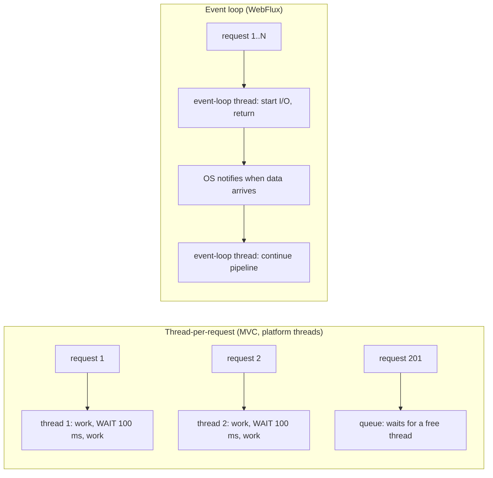
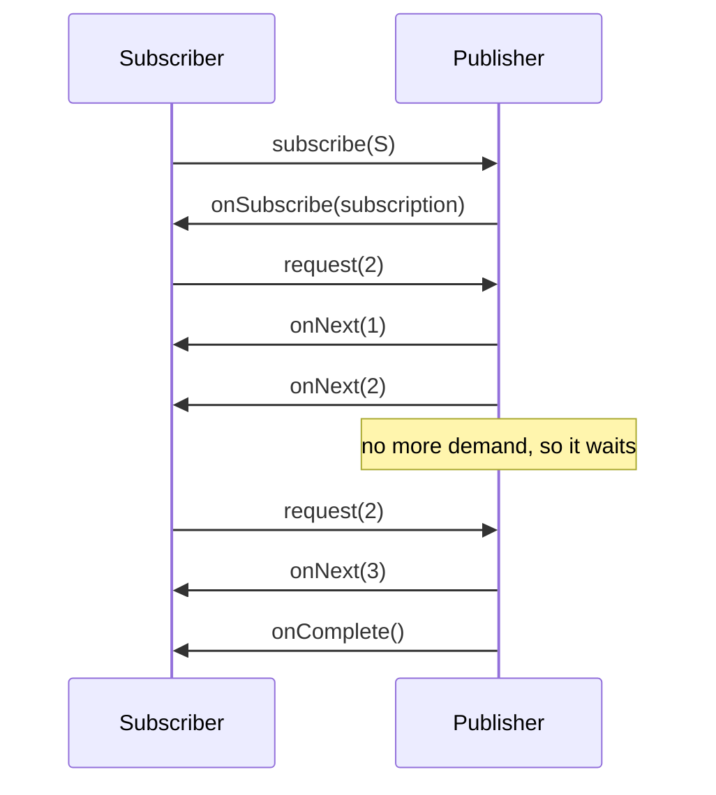

# Chapter 13 — Reactive Programming and Spring WebFlux

Most Spring applications spend their time **waiting**: for the database, for another HTTP service, for a message broker. In the classic model (Spring MVC on Tomcat) each request holds one thread from start to finish, including all that waiting. **Reactive programming** takes the opposite approach: no thread ever waits. Work is described as a pipeline of steps, and a small number of threads run each step when its data arrives. **Spring WebFlux** is Spring's web framework built on that model, using **Project Reactor**.

Since Java 21 there is a second way to get the same scalability: **virtual threads**, which make waiting cheap instead of avoiding it. This chapter teaches the reactive model properly, then **measures** blocking MVC on virtual threads against WebFlux, so you can choose between them with numbers rather than opinions.

**What you'll learn**

1. Why blocking I/O limits a thread-per-request server, and how an event loop avoids it.
2. The **Reactive Streams** contract: `Publisher`, `Subscriber`, `Subscription`, demand (`request(n)`).
3. **Project Reactor**: `Mono` and `Flux`, laziness, cold vs hot, the core operators.
4. Testing reactive code with **`StepVerifier`** and **virtual time**.
5. Error handling: fallbacks, retry with backoff, timeouts.
6. **Backpressure** in practice: demand, `limitRate`, drop/latest/buffer strategies.
7. **Schedulers**: `publishOn` vs `subscribeOn`, and how to wrap blocking calls.
8. **WebFlux**: annotated controllers, functional routes, Server-Sent Events, tested with **`WebTestClient`**.
9. **`WebClient`** against a real local server: timeouts, retries, concurrent calls.
10. **R2DBC**: reactive SQL with Spring Data R2DBC on H2, and reactive transactions.
11. **Virtual threads vs WebFlux**: a measured comparison for an I/O-bound endpoint, and when to choose which.

All code is in [`code/`](code/). Spring Boot **4.1.1** (Framework 7.0, Reactor 3.8 from the Reactor 2025.0 release train, Reactor Netty, R2DBC H2 1.1), Java 25:

| Project | Shows |
|---|---|
| [`reactor-basics`](code/reactor-basics/) | Reactor only (no Spring context): creation, operators, errors, virtual time, backpressure, schedulers, sinks, context — all as `StepVerifier` tests |
| [`webflux-app`](code/webflux-app/) | a book API: annotated controller, functional routes, SSE, `WebClient`, R2DBC repository + `DatabaseClient` + reactive transaction |
| [`load-mvc`](code/load-mvc/), [`load-webflux`](code/load-webflux/) | the same I/O-bound endpoint under load: MVC on platform threads, MVC on virtual threads, WebFlux |

Output blocks are real `mvn -q -B -ntp verify` output, with Spring log lines trimmed to `...`. **All timings are machine-dependent** (14-core Apple M4 Pro, load generator in the same JVM as the server).

> **Prerequisites and links.** If you know JavaScript, the mental model is the same as Node's: see the JavaScript handbook, [Chapter 12 — Asynchronous JavaScript](../../../javascript/chapters/12-asynchronous-javascript/README.md), especially "The event loop" and "Promises". A `Mono` is roughly a lazy, cancellable Promise, and a `Flux` a lazy async stream. Virtual threads and `CompletableFuture` are in the Java handbook, [Chapter 15](../../../java/chapters/15-concurrency-2-modern/README.md). Spring MVC is [Chapter 5](../05-spring-mvc-and-rest/README.md), the blocking `RestClient` is [Chapter 6](../06-rest-clients-and-http-interfaces/README.md), and general Spring testing is [Chapter 12](../12-testing-spring-apps/README.md).

---

## 13.1 Why reactive? The cost of waiting

### The problem it solves

In Spring MVC, a request is served by **one thread from start to finish** (*thread-per-request*). Suppose the handler calls a database that answers in 100 ms. For those 100 ms the thread does nothing but wait, yet it is not available to anybody else. Tomcat's worker pool has **200 threads** by default. So at most 200 requests can be *in progress* at once, and with 100 ms of waiting each, the server tops out around **200 / 0.1 s = 2,000 requests per second**, however idle the CPU is. More platform threads cost memory (each has a stack, typically reserving up to 1 MB) and scheduling overhead, so "just add threads" stops working at a few thousand.

### What reactive does instead

Reactive (non-blocking) I/O never parks a thread on a socket:

1. The handler starts the database or HTTP call and registers **what to do when the answer arrives**.
2. The thread immediately returns to the **event loop** and picks up other work.
3. When the operating system reports that the answer has arrived (via epoll/kqueue), an event-loop thread runs the next step of the pipeline.

A handful of event-loop threads (by default one per CPU core in Reactor Netty) can then keep thousands of requests in progress. **Analogy:** a waiter who takes an order, hands it to the kitchen, and serves other tables until the bell rings, instead of standing at the kitchen door until the dish is ready.

This is exactly how Node.js works. Everything in the [JavaScript event-loop chapter](../../../javascript/chapters/12-asynchronous-javascript/README.md) (never block the loop, callbacks run when I/O completes, one slow synchronous function freezes everyone) applies to WebFlux's event loop too.



### The price

- Code becomes a **pipeline of operators** instead of plain statements. Stack traces, debugging and `ThreadLocal`-based libraries (MDC logging, security context, transactions) need reactive-aware replacements.
- **Everything** on the request path must be non-blocking: web server, HTTP client, database driver. One blocking call on an event loop stalls every request that loop serves ([§13.15](#1315-virtual-threads-vs-webflux-a-measured-comparison) measures this).
- Since Java 21, **virtual threads** remove the thread-count limit for ordinary blocking code, which removes the main *performance* reason to go reactive for many apps.

### Self-check

1. Why does a 200-thread Tomcat cap out near 2,000 req/s for a 100 ms I/O call? → Each in-flight request holds a thread while it waits; 200 threads × 10 requests/s each.
2. What does an event-loop thread do while a database call is in progress? → Other work. The continuation runs when the OS signals that data has arrived.

---

## 13.2 Reactive Streams: the contract

### What it is

**Reactive Streams** (version 1.0, 2015) is a small specification for **asynchronous stream processing with non-blocking backpressure**. It is four interfaces, copied into the JDK in Java 9 as `java.util.concurrent.Flow`:

| Interface | Role | Methods |
|---|---|---|
| `Publisher<T>` | produces items | `subscribe(Subscriber)` |
| `Subscriber<T>` | consumes items | `onSubscribe(Subscription)`, `onNext(T)`, `onError(Throwable)`, `onComplete()` |
| `Subscription` | the link between the two | `request(long n)`, `cancel()` |
| `Processor<T,R>` | both a subscriber and a publisher | — |

**Backpressure** means the **consumer controls the flow rate**: the publisher may send at most as many items as the subscriber has requested. A slow consumer is never flooded.

### How it works

1. `publisher.subscribe(subscriber)` — nothing flows yet.
2. The publisher calls `subscriber.onSubscribe(subscription)`.
3. The subscriber calls `subscription.request(n)`, meaning "I can take n more".
4. The publisher sends up to n `onNext` signals, then waits for more demand.
5. The stream ends with exactly one `onComplete` **or** `onError`, or the subscriber calls `cancel()`.



You rarely implement these interfaces yourself. Libraries do: **Project Reactor** (Spring's choice), RxJava, Mutiny, Akka Streams, and drivers such as R2DBC. Because they share the contract they interoperate.

### Self-check

1. What does `request(n)` mean? → The subscriber can accept n more items; the publisher must not send more than the outstanding demand.
2. How many terminal signals can a stream send? → At most one: `onComplete` or `onError` (none if cancelled or infinite).

---

## 13.3 Project Reactor: `Mono` and `Flux`

### What it is

**Project Reactor** implements Reactive Streams with two publisher types and hundreds of operators:

| Type | Emits | Like | Examples |
|---|---|---|---|
| `Mono<T>` | 0 or 1 item, then complete (or an error) | a lazy `CompletableFuture<Optional<T>>` / a lazy Promise | find by id, save, an HTTP response |
| `Flux<T>` | 0..N items (possibly infinite), then complete (or an error) | a lazy async `Stream<T>` / async iterator | query results, SSE events, Kafka records |

An **operator** (`map`, `filter`, `flatMap`, ...) returns a *new* publisher that wraps the previous one. Chaining operators **assembles a pipeline**. Nothing runs until something **subscribes**.

### Creating publishers — `CreationAndLazinessTest`

```java
StepVerifier.create(Mono.just("one")).expectNext("one").verifyComplete();
StepVerifier.create(Mono.empty()).verifyComplete();                      // 0 items, then complete
StepVerifier.create(Flux.range(1, 3)).expectNext(1, 2, 3).verifyComplete();
StepVerifier.create(Flux.fromIterable(List.of("a", "b"))).expectNext("a", "b").verifyComplete();
StepVerifier.create(Flux.error(new IllegalStateException("boom")))
        .expectErrorMessage("boom").verify();
```

Other factories you'll meet: `Mono.fromCallable(() -> ...)` (wrap a computation), `Mono.fromFuture(cf)`, `Flux.interval(Duration)` (a tick every period, on the parallel scheduler), `Flux.create(sink -> ...)` (bridge callback APIs), `Mono.delay(Duration)`.

### Nothing happens until you subscribe

```java
@Test
void nothingHappensUntilYouSubscribe() {
    AtomicInteger calls = new AtomicInteger();
    Flux<Integer> pipeline = Flux.range(1, 3)
            .map(i -> { calls.incrementAndGet(); return i * 10; });

    System.out.println("after assembling the pipeline, map ran " + calls.get() + " times");

    List<Integer> out = pipeline.collectList().block();   // block() subscribes (fine in a test)
    System.out.println("after subscribing: " + out + ", map ran " + calls.get() + " times");

    pipeline.blockLast();                                 // cold: a 2nd subscriber re-runs everything
    System.out.println("after a second subscriber, map ran " + calls.get() + " times");
}

@Test
void justIsEagerDeferIsLazy() {
    AtomicInteger dbHits = new AtomicInteger();
    Mono<Integer> eager = Mono.just(dbHits.incrementAndGet());                 // runs NOW, once
    Mono<Integer> lazy  = Mono.defer(() -> Mono.just(dbHits.incrementAndGet())); // runs per subscribe
    System.out.println("hits after building both monos: " + dbHits.get());
    eager.block(); eager.block(); lazy.block(); lazy.block();
    System.out.println("hits after 2x eager + 2x lazy subscribe: " + dbHits.get());
}
```

Output:

```text
just/empty/range/fromIterable/error verified
after assembling the pipeline, map ran 0 times
after subscribing: [10, 20, 30], map ran 3 times
after a second subscriber, map ran 6 times
hits after building both monos: 1
hits after 2x eager + 2x lazy subscribe: 3
```

Lessons:

- **Assembly vs subscription.** Building the chain does nothing. Subscribing runs it. In WebFlux **the framework subscribes** to the `Mono`/`Flux` your controller returns. If you build a pipeline and neither return it nor subscribe to it, it never runs (a classic bug: a `repo.save(x)` whose result is ignored saves nothing).
- **Cold publishers** replay the whole pipeline for every subscriber: two subscribers = two database queries.
- **`Mono.just(expr)` evaluates `expr` immediately**, at assembly time, even if nobody ever subscribes. Use `Mono.defer(() -> ...)` or `Mono.fromCallable(...)` for work that should happen per subscription (and only when subscribed).

### `block()`

`block()` subscribes and **waits** for the result. It is fine in tests, in `main` methods and at the boundary of a non-reactive app. Inside a reactive pipeline or on an event-loop thread it is a bug: Reactor throws `IllegalStateException("block()/blockFirst()/blockLast() are blocking, which is not supported in thread reactor-http-nio-...")`.

### Self-check

1. A controller method calls `repo.save(book);` and returns `Mono.just(book)`. What's wrong? → The `save` Mono is never subscribed, so nothing is saved. Return `repo.save(book)` instead.
2. `Mono.just(expensive())` vs `Mono.fromCallable(this::expensive)`? → The first runs `expensive()` immediately, once; the second runs it on each subscription.

---

## 13.4 Operators

### The ones you need daily

| Goal | Operator | Note |
|---|---|---|
| transform each item (sync) | `map` | must not block or return a publisher |
| keep some items | `filter`, `take(n)`, `skip(n)`, `distinct` | |
| async call per item | **`flatMap`** | runs inner publishers **concurrently**, output **interleaved** |
| async call per item, in order, one at a time | **`concatMap`** | sequential; slower |
| async per item, concurrent, output in source order | **`flatMapSequential`** | buffers early results |
| combine by position | `zip`, `zipWith` | waits for one from each |
| one after another | `concat`, `concatWith` | |
| as they come | `merge`, `mergeWith` | |
| fold to one value | `reduce`, `count`, `collectList`, `collectMap` | returns `Mono` |
| fallback if empty | `switchIfEmpty`, `defaultIfEmpty` | common for 404s |
| group | `buffer(n)`, `window(n)`, `groupBy` | |
| side effects (logging, metrics) | `doOnNext`, `doOnError`, `doOnSubscribe`, `doFinally` | don't put business logic here |
| ignore values, wait for completion | `then()`, `then(mono)` | "do A, then B" |

### `flatMap` vs `concatMap` vs `flatMapSequential` — `OperatorsTest`

Three users; fetching the orders of user N takes (4 − N) seconds per order, so user 3 answers first:

```java
/** Simulated remote call: user N answers after (4 - N) seconds, so later users answer first. */
static Flux<String> ordersOf(int user) {
    return Flux.just("u" + user + "-a", "u" + user + "-b")
            .delayElements(Duration.ofSeconds(4 - user));
}

@Test
void flatMapInterleavesConcatMapKeepsOrder() {
    // withVirtualTime: the delays run on a fake clock, so this 12-"second" test takes milliseconds
    StepVerifier.withVirtualTime(() -> Flux.range(1, 3).flatMap(OperatorsTest::ordersOf).collectList())
            .thenAwait(Duration.ofHours(1))
            .consumeNextWith(l -> System.out.println("flatMap           : " + l))
            .verifyComplete();
    // ... same with concatMap and flatMapSequential
}

@Test
void howLongDoTheyTake() {
    // concatMap: user 1 (3 s + 3 s), then user 2 (2 s + 2 s), then user 3 (1 s + 1 s) = 12 s
    var concat = StepVerifier.withVirtualTime(() -> Flux.range(1, 3).concatMap(OperatorsTest::ordersOf))
            .expectSubscription()
            .thenAwait(Duration.ofSeconds(11)).expectNextCount(5)
            .expectNoEvent(Duration.ofMillis(999))
            .thenAwait(Duration.ofMillis(1)).expectNext("u3-b").verifyComplete();
    // flatMap: all three run at the same time, the slowest (user 1) needs 6 s
    var flat = StepVerifier.withVirtualTime(() -> Flux.range(1, 3).flatMap(OperatorsTest::ordersOf))
            .expectSubscription()
            .thenAwait(Duration.ofSeconds(5)).expectNextCount(5)
            .thenAwait(Duration.ofSeconds(1)).expectNext("u1-b").verifyComplete();
    System.out.println("concatMap needs 12 virtual s, flatMap 6 virtual s; real time: "
            + concat.toMillis() + " ms and " + flat.toMillis() + " ms");
}
```

Output:

```text
flatMap           : [u3-a, u2-a, u3-b, u1-a, u2-b, u1-b]
concatMap         : [u1-a, u1-b, u2-a, u2-b, u3-a, u3-b]
flatMapSequential : [u1-a, u1-b, u2-a, u2-b, u3-a, u3-b]
concatMap needs 12 virtual s, flatMap 6 virtual s; real time: 0 ms and 0 ms
```

- **`flatMap`** subscribes to all inner publishers at once (up to a `concurrency` limit, default 256) and emits results **as they arrive**: fastest, order lost.
- **`concatMap`** waits for each inner publisher to finish before starting the next: order kept, total time = sum (12 s).
- **`flatMapSequential`** runs concurrently like `flatMap` (6 s) but re-orders the output to match the source.
- Limit fan-out against a fragile service with `flatMap(fn, 8)`: at most 8 calls in flight.

### Combining

```java
Flux<String> names = Flux.just("Ada", "Linus", "Grace");
Flux<Integer> years = Flux.just(1815, 1969, 1906);
StepVerifier.create(Flux.zip(names, years, (n, y) -> n + "@" + y))
        .expectNext("Ada@1815", "Linus@1969", "Grace@1906").verifyComplete();

StepVerifier.create(Flux.concat(Flux.just(1, 2), Flux.just(3))).expectNext(1, 2, 3).verifyComplete();

Mono<String> fromCache = Mono.empty();
StepVerifier.create(fromCache.switchIfEmpty(Mono.just("from DB")))      // fallback when empty
        .expectNext("from DB").verifyComplete();

StepVerifier.create(Flux.range(1, 7).buffer(3))
        .expectNext(List.of(1, 2, 3), List.of(4, 5, 6), List.of(7)).verifyComplete();
```

`Mono.zip(a, b, c)` is the reactive "call three services in parallel and combine", the equivalent of `Promise.all` in [JavaScript](../../../javascript/chapters/12-asynchronous-javascript/README.md) or `CompletableFuture.allOf` in [Java](../../../java/chapters/15-concurrency-2-modern/README.md).

### Common mistakes

- **`map` with an async call**: `flux.map(id -> repo.findById(id))` produces a `Flux<Mono<Book>>` whose inner Monos are never subscribed. Use `flatMap`.
- **`flatMap` when order matters**, such as applying events in sequence. Use `concatMap`.
- **Unbounded `flatMap` against a rate-limited API.** Pass a concurrency limit.
- **Business logic in `doOnNext`.** It's for side effects. An exception thrown there becomes an error signal, and it's easy to forget the call isn't part of the data flow.

### Self-check

1. You need to call a service for each of 1,000 ids, at most 10 at a time, order irrelevant. → `Flux.fromIterable(ids).flatMap(this::call, 10)`.
2. Why did `flatMap` finish in 6 s and `concatMap` in 12 s? → `flatMap` ran the three inner calls concurrently (time of the slowest); `concatMap` ran them one after another (sum).

---

## 13.5 Testing with `StepVerifier` and virtual time

### What it is

**`StepVerifier`** (in `reactor-test`) subscribes to a publisher and checks, step by step, the signals it emits: `expectNext(...)`, `expectNextCount(n)`, `assertNext(v -> ...)`, `expectError(Type)`, `expectComplete()`, `thenRequest(n)`, `thenCancel()`. A script ends with `verify()` (or `verifyComplete()` / `verifyError()`), which **runs** the subscription and **blocks** until the script is done. It returns the time it took.

**Virtual time** replaces Reactor's time-based schedulers with a `VirtualTimeScheduler` whose clock only moves when the test says so (`thenAwait(Duration)`), or jumps when it's idle. A test of a one-hour interval or a retry with exponential backoff runs in milliseconds and is **deterministic**.

### How to use virtual time

1. Build the publisher **inside the supplier**: `StepVerifier.withVirtualTime(() -> Flux.interval(...))`. The virtual scheduler must be installed *before* the operators capture a scheduler. A publisher created outside the lambda keeps using real time.
2. Use `expectSubscription()` first, then `expectNoEvent(d)` to assert that nothing happened for a period (it also advances the clock).
3. Use `thenAwait(d)` to move the clock forward, then `expectNext(...)`.

### The trap: a test that waits forever

If the script expects a signal that only comes after virtual time passes, but never calls `thenAwait`, `verify()` waits **forever**. This chapter's first attempt at `howLongDoTheyTake` did exactly that and hung the build until an external alarm killed it. Two defences:

```properties
# src/test/resources/junit-platform.properties
# safety net: a reactive test that waits for a signal that never comes fails instead of hanging
junit.jupiter.execution.timeout.default=30 s
```

and `verify(Duration.ofSeconds(5))` on real-time scripts (used throughout `webflux-app`).

### Self-check

1. Why must the publisher be created inside `withVirtualTime(() -> ...)`? → So its time-based operators pick up the virtual scheduler.
2. What does `StepVerifier.create(flux, 0)` do? → Subscribes with initial demand 0, so you control demand with `thenRequest(n)` ([§13.7](#137-backpressure-in-practice)).

---

## 13.6 Error handling

### How errors flow

An exception inside an operator becomes an **`onError` signal**. It travels down the pipeline, skipping `map`/`filter`, until an error operator handles it or it reaches the subscriber. **An error terminates the sequence**: items after it are never processed. This is like a rejected Promise, not like a `try/catch` inside a loop.

```java
@Test
void anErrorEndsTheStream() {
    StepVerifier.create(Flux.just(1, 2, 0, 4).map(i -> 12 / i))
            .expectNext(12, 6)
            .expectError(ArithmeticException.class)   // 4 is never processed
            .verify();
}

@Test
void fallbacks() {
    Flux<Integer> risky = Flux.just(1, 2, 0, 4).map(i -> 12 / i);
    StepVerifier.create(risky.onErrorReturn(-1)).expectNext(12, 6, -1).verifyComplete();
    StepVerifier.create(risky.onErrorResume(e -> Flux.just(100, 200))).expectNext(12, 6, 100, 200).verifyComplete();
    StepVerifier.create(risky.onErrorMap(e -> new IllegalArgumentException("bad input", e)))
            .expectNext(12, 6).expectErrorMessage("bad input").verify();
}
```

| Operator | Effect | Imperative equivalent |
|---|---|---|
| `onErrorReturn(v)` | emit a fallback value, then complete | `catch → return v` |
| `onErrorResume(e -> publisher)` | switch to another publisher (cache, default, another service) | `catch → return other()` |
| `onErrorMap(e -> new X(e))` | translate the exception | `catch → throw new X(e)` |
| `doOnError(e -> log)` | side effect, error continues | `catch → log; throw` |
| `retry(n)` | **re-subscribe** to the source up to n times | loop around the call |
| `retryWhen(Retry.backoff(...))` | retry with delays, filters, limits | retry library |
| `timeout(d[, fallback])` | error (or fallback) if no signal within d | `future.get(timeout)` |
| `onErrorContinue` | drop the failing item and continue (only with supporting operators) | avoid — surprising semantics |

### Retry with exponential backoff, verified on virtual time

```java
@Test
void retryWithExponentialBackoffOnVirtualTime() {
    List<Long> attemptTimes = new ArrayList<>();
    StepVerifier.withVirtualTime(() -> {
                VirtualTimeScheduler clock = VirtualTimeScheduler.get();
                return Mono.defer(() -> {
                            attemptTimes.add(clock.now(TimeUnit.MILLISECONDS));
                            return Mono.<String>error(new IllegalStateException("down"));
                        })
                        .retryWhen(Retry.backoff(3, Duration.ofSeconds(1)).jitter(0)); // 1 s, 2 s, 4 s
            })
            .thenAwait(Duration.ofMinutes(1))
            .expectErrorMatches(e -> e.getMessage().startsWith("Retries exhausted: 3/3"))
            .verify();
    System.out.println("attempts at virtual ms: " + attemptTimes);
}

@Test
void timeoutWithFallback() {
    StepVerifier.withVirtualTime(() -> Mono.delay(Duration.ofSeconds(5)).map(x -> "slow answer")
                    .timeout(Duration.ofSeconds(2), Mono.just("fallback")))
            .expectSubscription()
            .thenAwait(Duration.ofSeconds(2))
            .expectNext("fallback")
            .verifyComplete();
    ...
}
```

Output:

```text
attempts at virtual ms: [0, 1000, 3000, 7000]
retry(5): succeeded after 3 attempts
timeout(2s) on a 5 s call -> fallback / TimeoutException
onErrorReturn / onErrorResume / onErrorMap verified
```

The first attempt runs at 0. The retries wait 1 s, 2 s and 4 s, so they run at 1,000, 3,000 and 7,000 ms. After 3 retries the error becomes `Retries exhausted: 3/3`. Real systems keep the default **jitter** (random ±50 % here) so that many clients don't retry in lockstep; `jitter(0)` is only for the deterministic test. Retry and circuit-breaker design in general: [microservices notes — retry](../../../microservices-patterns/chapters/08-retry/README.md).

**Retry re-subscribes.** That only repeats the work if the source is lazy. `Mono.defer(...)`, `fromCallable` and `WebClient` calls are lazy. A `Mono.just(valueComputedEarlier)` would just replay the same value.

### Common mistakes

- **Retrying non-idempotent calls** (a `POST` that charges a card) without an idempotency key.
- **Retrying on 4xx.** Filter to transient errors: `Retry.backoff(...).filter(e -> e instanceof ServiceUnavailable)`.
- **`try/catch` around a reactive chain.** It only catches assembly-time errors, not errors that happen later when the pipeline runs.

---

## 13.7 Backpressure in practice

### What it is

**Backpressure** = the consumer tells the producer how much it can handle, through `request(n)`. In Reactor most operators pass demand upstream automatically. A subscriber like `block()` or WebFlux's HTTP writer requests in batches.

### Demand you can see — `BackpressureTest`

```java
@Test
void subscriberControlsTheRate() {
    List<Long> requests = new CopyOnWriteArrayList<>();
    List<Integer> received = new ArrayList<>();

    Flux.range(1, 10)
        .doOnRequest(requests::add)                  // what the subscriber asked for
        .subscribe(new BaseSubscriber<Integer>() {
            @Override protected void hookOnSubscribe(Subscription s) { request(2); }  // start with 2
            @Override protected void hookOnNext(Integer v) {
                received.add(v);
                if (received.size() % 2 == 0) request(2);                            // then 2 at a time
            }
        });
    System.out.println("requests = " + requests + "\nreceived = " + received);
}

@Test
void limitRateReplenishesInBatches() {
    List<Long> upstreamRequests = new CopyOnWriteArrayList<>();
    Flux.range(1, 100)
        .doOnRequest(upstreamRequests::add)
        .limitRate(10)                                // never ask upstream for more than 10
        .blockLast();                                 // downstream asks for "unbounded"
    System.out.println("limitRate(10) upstream requests = " + upstreamRequests);
}

@Test
void stepVerifierCanRequestManually() {
    StepVerifier.create(Flux.range(1, 5), 0)          // initial demand 0
            .expectSubscription()
            .expectNoEvent(Duration.ofMillis(50))     // nothing arrives without demand
            .thenRequest(2).expectNext(1, 2)
            .thenRequest(3).expectNext(3, 4, 5)
            .verifyComplete();
}
```

Output:

```text
limitRate(10) upstream requests = [10, 8, 8, 8, 8, 8, 8, 8, 8, 8, 8, 8, 8]
demand 0 -> nothing; request(2) -> 1,2; request(3) -> 3,4,5
requests = [2, 2, 2, 2, 2, 2]
received = [1, 2, 3, 4, 5, 6, 7, 8, 9, 10]
```

- The source sent exactly as many items as requested, 2 at a time.
- `limitRate(10)` turns a downstream "give me everything" (`Long.MAX_VALUE`) into bounded requests. It first asks for 10, then **re-requests 8 when 75 % have been consumed** (the default "low tide"), so the next batch is already on its way before the buffer runs dry. Use it to protect a source that fetches in pages (a database cursor, a paged API).
- With demand 0, a well-behaved publisher sends nothing.

### When the source can't slow down: overflow strategies

Some sources **ignore demand**: UI events, sensor readings, a price ticker, a hot message stream. For them you choose what happens to the excess. The test's `ticker()` pushes 1..20 at once through `Flux.create(..., OverflowStrategy.IGNORE)`, while the consumer asks for only 5:

```java
static Flux<Integer> ticker() {
    return Flux.create(sink -> {
        for (int i = 1; i <= 20; i++) sink.next(i);
        sink.complete();
    }, FluxSink.OverflowStrategy.IGNORE);   // IGNORE = no built-in protection, the operator below decides
}

StepVerifier.create(ticker().onBackpressureDrop(dropped::add), 5).expectNext(1, 2, 3, 4, 5).verifyComplete();

SlowConsumer latest = new SlowConsumer();              // requests 5 on subscribe
ticker().onBackpressureLatest().subscribe(latest);     // 20 items pushed during this call
latest.request(5);                                     // ask for more afterwards

SlowConsumer buffered = new SlowConsumer();
ticker().onBackpressureBuffer(10).subscribe(buffered); // 6..15 fit in the buffer, 16 overflows
buffered.request(50);
```

Output:

```text
DROP   : kept 1..5, dropped 15 items (6..20)
LATEST : [1, 2, 3, 4, 5, 20] complete
BUFFER(10): [1, 2, 3, 4, 5, 6, 7, 8, 9, 10, 11, 12, 13, 14, 15] error: The receiver is overrun by more signals than expected (bounded queue...)
```

| Strategy | What happens to excess | Use for |
|---|---|---|
| `onBackpressureDrop` | discarded (optional callback to count/log them) | metrics samples, mouse moves |
| `onBackpressureLatest` | keep only the newest waiting item | "current price", UI state |
| `onBackpressureBuffer(n)` | queue up to n, then **error** (or a chosen overflow action) | short bursts that must not be lost |
| `onBackpressureBuffer()` (unbounded) | queue everything | risky: memory grows until `OutOfMemoryError` |
| `onBackpressureError` | fail immediately | when overflow is a bug |

`Flux.create` accepts the same choices directly (`OverflowStrategy.DROP/LATEST/BUFFER/ERROR`).

### Backpressure across the network

Inside one JVM, demand is exact. Across HTTP it becomes **TCP flow control**. When a WebFlux server writes a `Flux` to a slow client, the socket's send buffer fills, Netty stops requesting, and the demand stops at the source (for example the R2DBC cursor). Between services, HTTP/1.1 has no message-level backpressure. Protocols like RSocket or gRPC flow control, or a message broker in between, provide it.

### Self-check

1. What does `limitRate(10)` change? → Upstream never receives a request larger than 10; replenishes in batches of 8 (75 %).
2. A price feed pushes faster than your UI can render. Which strategy? → `onBackpressureLatest`: only the newest price matters.
3. Why is an unbounded buffer dangerous? → A consumer that stays slower than the producer makes the buffer grow until memory runs out.

---

## 13.8 Schedulers and threads

### What it is

Reactor is **concurrency-agnostic**: by default, each signal runs on whatever thread emitted it (the subscribing thread, a Netty event loop, a timer thread). **Schedulers** move work onto specific thread pools:

| Scheduler | Threads | For |
|---|---|---|
| `Schedulers.parallel()` | one per CPU core | CPU-bound work, timers (`interval`, `delayElements`) |
| `Schedulers.boundedElastic()` | grows on demand up to 10 × cores (default), idle threads reclaimed | **wrapping blocking calls** (JDBC, legacy SDKs, file I/O) |
| `Schedulers.single()` | one reusable thread | low-latency one-off tasks |
| `Schedulers.immediate()` | the current thread | tests, defaults |
| Reactor Netty event loops (`reactor-http-nio-N`) | one per core (min 4) | network I/O — **never block these** |

- **`publishOn(s)`** switches the thread for everything **after** it in the chain.
- **`subscribeOn(s)`** chooses the thread on which the **subscription happens**, which moves the **source** (and everything up to the first `publishOn`). Its position in the chain doesn't matter.

```java
@Test
void publishOnSwitchesDownstreamSubscribeOnMovesTheSource() {
    List<String> log = new CopyOnWriteArrayList<>();
    Flux.just(1)
        .doOnNext(i -> log.add("source    on " + thread()))
        .publishOn(Schedulers.parallel())                // everything BELOW runs on parallel
        .doOnNext(i -> log.add("after pub on " + thread()))
        .subscribeOn(Schedulers.boundedElastic())        // the subscription (and source) runs here
        .blockLast();
    log.forEach(System.out::println);
}

@Test
void wrapABlockingCall() {
    // A blocking API (JDBC, legacy SDK) must not run on the few event-loop/parallel threads.
    Mono<String> legacy = Mono.fromCallable(() -> {
                Thread.sleep(50);                        // pretend: blocking I/O
                return "legacy result on " + thread();
            })
            .subscribeOn(Schedulers.boundedElastic());   // dedicated, growable pool for blocking work
    System.out.println(legacy.block());
}
```

Output (thread numbers replaced by `N`):

```text
legacy result on boundedElastic-N
source    on boundedElastic-N
after pub on parallel-N
```

The **`Mono.fromCallable(blocking).subscribeOn(Schedulers.boundedElastic())`** pattern is how you call unavoidable blocking code from a reactive app. It keeps the event loops free, at the cost of a thread per concurrent call, exactly the cost reactive was meant to avoid. If most calls are blocking, a reactive stack buys you nothing.

`BlockHound`, a Java agent from the Reactor team, detects blocking calls on non-blocking threads during tests.

---

## 13.9 Hot vs cold, sinks and context

### Cold vs hot

- **Cold** (the default): each subscriber gets its own run from the start. Examples: a database query, a `WebClient` call, `Flux.range`.
- **Hot**: data is produced whether or not anyone listens, and late subscribers **miss** what was emitted earlier. Examples: stock ticks, mouse events, a chat room.

**Sinks** (`Sinks.many()`, `Sinks.one()`) are the safe way to push values into a `Flux` from imperative code, for example to broadcast events to all SSE clients:

```java
Sinks.Many<String> prices = Sinks.many().multicast().directBestEffort();
prices.asFlux().subscribe(early::add);
prices.tryEmitNext("p1");
prices.asFlux().subscribe(late::add);   // joins after p1 was emitted
prices.tryEmitNext("p2");
prices.tryEmitComplete();
```

Output:

```text
early subscriber: [p1, p2], late subscriber: [p2]
```

Other sinks: `Sinks.many().replay().limit(n)` (late subscribers get the last n), `unicast()` (one subscriber, buffers). Turn a cold publisher hot with `share()`, `publish().autoConnect()`, or `cache()` (replay to later subscribers).

### Context: the reactive replacement for `ThreadLocal`

A pipeline may hop between threads, so `ThreadLocal` values (request id in the logging MDC, the security context, the current transaction) get lost. Reactor's **`Context`** is an immutable key/value map attached to the **subscription**. You write it at the bottom with `contextWrite` and read it anywhere above with `deferContextual`:

```java
Mono<String> greeting = Mono.deferContextual(ctx -> Mono.just("request " + ctx.get("requestId")));
StepVerifier.create(greeting.contextWrite(c -> c.put("requestId", "r-42")))
        .expectNext("request r-42").verifyComplete();
```

Output:

```text
context value read inside the pipeline: r-42
```

Spring uses it for you: reactive Spring Security stores the `SecurityContext` there, and reactive transactions keep the connection there. For logging MDC and tracing, Boot can bridge `ThreadLocal`s and the Reactor `Context` through Micrometer's context-propagation library (`spring.reactor.context-propagation=auto`).

---

## 13.10 Spring WebFlux: annotated controllers

### What it is

**Spring WebFlux** (Framework 5.0+) is the reactive counterpart of Spring MVC. It runs on **Reactor Netty** by default (Tomcat and Jetty also work, through the Servlet non-blocking I/O API). The request flow mirrors MVC: `HttpHandler` → `WebFilter`s → **`DispatcherHandler`** → `HandlerMapping` → `HandlerAdapter` → your handler → `HttpMessageWriter` (Jackson 3 codecs). Every step is non-blocking.

| | Spring MVC | Spring WebFlux |
|---|---|---|
| I/O model | blocking (one thread per request) or virtual threads | non-blocking event loop |
| Server | Tomcat / Jetty (Servlet) | Reactor Netty (default), Tomcat, Jetty |
| Return types | `T`, `ResponseEntity<T>` (also accepts `Mono`/`Flux`) | `Mono<T>`, `Flux<T>`, `T` |
| Data access | JDBC, JPA | R2DBC, reactive MongoDB/Redis/Cassandra |
| HTTP client | `RestClient` | `WebClient` |
| Test client | `MockMvcTester`, `RestTestClient` ([ch12](../12-testing-spring-apps/README.md)) | `WebTestClient` |
| Starter (Boot 4) | `spring-boot-starter-webmvc` | `spring-boot-starter-webflux` |

If **both** starters are on the classpath, Boot starts **MVC**. Force WebFlux with `spring.main.web-application-type=reactive`.

`webflux-app/pom.xml` (main parts):

```xml
<!-- Spring WebFlux + Reactor Netty server + Jackson 3 -->
<dependency><groupId>org.springframework.boot</groupId><artifactId>spring-boot-starter-webflux</artifactId></dependency>
<!-- Boot 4: the auto-configured WebClient.Builder lives in its own module/starter -->
<dependency><groupId>org.springframework.boot</groupId><artifactId>spring-boot-starter-webclient</artifactId></dependency>
<!-- Spring Data R2DBC + the reactive H2 driver -->
<dependency><groupId>org.springframework.boot</groupId><artifactId>spring-boot-starter-data-r2dbc</artifactId></dependency>
<dependency><groupId>io.r2dbc</groupId><artifactId>r2dbc-h2</artifactId><scope>runtime</scope></dependency>
<!-- tests: @WebFluxTest, WebTestClient, reactor-test / @DataR2dbcTest -->
<dependency><groupId>org.springframework.boot</groupId><artifactId>spring-boot-starter-webflux-test</artifactId><scope>test</scope></dependency>
<dependency><groupId>org.springframework.boot</groupId><artifactId>spring-boot-starter-data-r2dbc-test</artifactId><scope>test</scope></dependency>
```

> **Boot 4 gotcha (found while building this chapter):** `spring-boot-starter-webflux` no longer brings the `WebClient.Builder` auto-configuration. Without `spring-boot-starter-webclient` the app fails with *"No qualifying bean of type 'org.springframework.web.reactive.function.client.WebClient$Builder' available"*.

### The controller

Same annotations as MVC ([Chapter 5](../05-spring-mvc-and-rest/README.md)); only the return types change:

```java
@RestController
@RequestMapping("/api/books")
public class BookController {
    private final BookRepository repo;                 // reactive repository (§13.14)

    public BookController(BookRepository repo) { this.repo = repo; }

    @GetMapping
    public Flux<Book> all(@RequestParam(required = false) String q) {
        return q == null ? repo.findAll() : repo.search(q);
    }

    @GetMapping("/{id}")
    public Mono<Book> one(@PathVariable long id) {
        return repo.findById(id)
                .switchIfEmpty(Mono.error(new ResponseStatusException(HttpStatus.NOT_FOUND, "no book " + id)));
    }

    @PostMapping
    public Mono<ResponseEntity<Book>> create(@RequestBody Mono<Book> body) {
        return body.map(b -> b.withId(null))                     // never trust a client-sent id
                .flatMap(repo::save)
                .map(saved -> ResponseEntity.created(URI.create("/api/books/" + saved.id())).body(saved));
    }
    ...
}
```

- `Flux<Book>` is written as a JSON array (or streamed as NDJSON / SSE when the client asks for `application/x-ndjson` / `text/event-stream`).
- An empty `Mono` would produce `200` with an empty body, so `switchIfEmpty(Mono.error(...))` turns "not found" into a 404.
- `@RequestBody Mono<Book>` makes even body parsing non-blocking. A plain `@RequestBody Book` also works.
- **You return the pipeline, the framework subscribes.** Nothing in this class calls `subscribe()` or `block()`.

### Testing it — `@WebFluxTest` + `WebTestClient`

```java
/** WebFlux slice: controller + codecs + error handling; the repository is a mock returning Mono/Flux. */
@WebFluxTest(BookController.class)
class BookControllerWebFluxTest {

    @Autowired WebTestClient client;
    @MockitoBean BookRepository repo;

    static final Book DDD = new Book(1L, "Domain-Driven Design", "Eric Evans", "9780321125217");

    @Test
    void listReturnsJsonArray() {
        given(repo.findAll()).willReturn(Flux.just(DDD));
        client.get().uri("/api/books").exchange()
              .expectStatus().isOk()
              .expectHeader().contentType(MediaType.APPLICATION_JSON)
              .expectBodyList(Book.class).hasSize(1).contains(DDD);
    }

    @Test
    void missingBookIs404() {
        given(repo.findById(99L)).willReturn(Mono.empty());
        client.get().uri("/api/books/99").exchange()
              .expectStatus().isNotFound()
              .expectBody()
              .consumeWith(r -> System.out.println("GET /api/books/99 -> 404 " + new String(r.getResponseBody())))
              .jsonPath("$.status").isEqualTo(404);
    }

    @Test
    void createReturns201() {
        given(repo.save(new Book(null, "Refactoring", "Martin Fowler", "9780134757599")))
                .willReturn(Mono.just(new Book(7L, "Refactoring", "Martin Fowler", "9780134757599")));
        client.post().uri("/api/books").contentType(MediaType.APPLICATION_JSON)
              .bodyValue("""
                      {"id":123,"title":"Refactoring","author":"Martin Fowler","isbn":"9780134757599"}""")
              .exchange()
              .expectStatus().isCreated()
              .expectHeader().location("/api/books/7")
              .expectBody().jsonPath("$.id").isEqualTo(7);
    }
}
```

Output:

```text
POST /api/books (client id 123 ignored) -> 201 Location: /api/books/7
GET /api/books/99 -> 404 {"timestamp":"2026-09-29T00:24:18.499Z","path":"/api/books/99","status":404,"error":"Not Found","requestId":"25c24062"}
GET /api/books -> 200 [Domain-Driven Design]
```

- `@WebFluxTest` is the WebFlux slice ([ch12 §12.7](../12-testing-spring-apps/README.md#127-test-slices)). Unlike `@SpringBootTest`, it provides a `WebTestClient` without an extra annotation.
- The mock returns `Mono`/`Flux`: mocks of reactive repositories must never return `null` (that causes a `NullPointerException` inside the framework).
- The 404 body is Boot's default reactive error format. For RFC 9457 Problem Details set `spring.webflux.problemdetails.enabled=true` or add a `@RestControllerAdvice` returning `ProblemDetail`, exactly as in MVC.

---

## 13.11 Functional endpoints

### What it is

WebFlux (and MVC, via `RouterFunctions` in `spring-webmvc`) offers a second programming model: routes are **code**, a `RouterFunction<ServerResponse>` bean, and handlers are plain functions `ServerRequest → Mono<ServerResponse>`. No annotations, no reflection, so routing is explicit and easy to unit-test.

```java
@Configuration(proxyBeanMethods = false)
public class BookRoutes {

    @Bean
    RouterFunction<ServerResponse> bookRouter(BookHandler h) {
        return route()
                .path("/fn/books", b -> b
                        .GET("/{isbn}", h::byIsbn)
                        .GET("", h::byAuthor))                       // /fn/books?author=...
                .filter((req, next) -> {                            // a filter for this router only
                    req.exchange().getResponse().getHeaders().add("X-Router", "functional");
                    return next.handle(req);
                })
                .build();
    }

    @Component
    static class BookHandler {
        private final BookRepository repo;
        BookHandler(BookRepository repo) { this.repo = repo; }

        Mono<ServerResponse> byIsbn(ServerRequest req) {
            return repo.findByIsbn(req.pathVariable("isbn"))
                    .flatMap(b -> ServerResponse.ok().contentType(MediaType.APPLICATION_JSON).bodyValue(b))
                    .switchIfEmpty(ServerResponse.notFound().build());
        }

        Mono<ServerResponse> byAuthor(ServerRequest req) {
            return req.queryParam("author")
                    .map(a -> ServerResponse.ok().body(repo.findByAuthor(a), Book.class))
                    .orElseGet(() -> ServerResponse.badRequest().bodyValue("author is required"));
        }
    }
}
```

A detail found while testing: the first version of the filter changed the headers of the returned `ServerResponse` (`res.headers().add(...)`). That failed with `UnsupportedOperationException` and a 500, because a built `ServerResponse` is immutable. Add headers through the exchange (as above) or build a new response.

### Testing without Spring

Routes are plain objects, so `WebTestClient` can bind straight to them. No context, no server:

```java
class FunctionalRoutesTest {
    BookRepository repo = mock(BookRepository.class);
    WebTestClient client = WebTestClient
            .bindToRouterFunction(new BookRoutes().bookRouter(new BookRoutes.BookHandler(repo)))
            .build();

    @Test
    void byIsbnFoundAndNotFound() {
        given(repo.findByIsbn("111")).willReturn(Mono.just(new Book(1L, "T", "A", "111")));
        given(repo.findByIsbn("222")).willReturn(Mono.empty());

        client.get().uri("/fn/books/111").exchange()
              .expectStatus().isOk()
              .expectHeader().valueEquals("X-Router", "functional")
              .expectBody().jsonPath("$.title").isEqualTo("T");
        client.get().uri("/fn/books/222").exchange().expectStatus().isNotFound();
    }
    ...
}
```

Output:

```text
GET /fn/books/111 -> 200 (X-Router: functional), /fn/books/222 -> 404
GET /fn/books?author=Evans -> 200 [1 book], /fn/books -> 400 author is required
```

### Annotated vs functional

| | Annotated controllers | Functional endpoints |
|---|---|---|
| Routing | annotations, discovered by scanning | explicit code, composable |
| Argument binding / validation | automatic (`@PathVariable`, `@Valid`) | manual (`req.pathVariable`, `req.bodyToMono`, call a `Validator`) |
| Familiar to most Spring devs | yes | less |
| Good for | most CRUD APIs | small services, dynamic routes, tight control, GraalVM-friendly code |

Both can live in one app (as here).

---

## 13.12 Full-stack WebFlux tests and Server-Sent Events

### Server-Sent Events

**Server-Sent Events (SSE)** is a simple standard for a server to **push** a stream of text events over one long-lived HTTP response (`Content-Type: text/event-stream`). Browsers consume it with `EventSource` and reconnect automatically. It's one-way (server → client). For two-way messaging use WebSockets.

In WebFlux an SSE endpoint is just a `Flux` with the right media type:

```java
/** Server-Sent Events: one "tick" per interval, pushed over a single open HTTP response. */
@GetMapping(path = "/ticks", produces = MediaType.TEXT_EVENT_STREAM_VALUE)
public Flux<String> ticks(@RequestParam(defaultValue = "1000") long everyMs) {
    return Flux.interval(Duration.ofMillis(everyMs)).map(i -> "tick " + i);
}
```

Each element is written as `data:tick 0` plus a blank line. For event names, ids or retry hints, return `Flux<ServerSentEvent<T>>`. When the client disconnects, the subscription is **cancelled** and `Flux.interval` stops: no leaked timers. (Spring MVC offers the same with `SseEmitter`, or by returning a `Flux` from an MVC controller, but each open stream then holds a servlet async request.)

### The full-stack test

```java
/** Real Netty server on a random port, real R2DBC/H2 database seeded by data.sql. */
@SpringBootTest(webEnvironment = SpringBootTest.WebEnvironment.RANDOM_PORT)
@AutoConfigureWebTestClient
class FullStackWebFluxTest {

    @Autowired WebTestClient client;

    @Test
    void searchHitsTheDatabase() {
        client.get().uri("/api/books?q=reactive").exchange()
              .expectStatus().isOk()
              .expectBody()
              .consumeWith(r -> System.out.println("GET /api/books?q=reactive -> " + new String(r.getResponseBody())))
              .jsonPath("$.length()").isEqualTo(2);
    }

    @Test
    void serverSentEvents() {
        Flux<String> events = client.get().uri("/api/books/ticks?everyMs=100")
                .accept(MediaType.TEXT_EVENT_STREAM)
                .exchange()
                .expectStatus().isOk()
                .expectHeader().contentTypeCompatibleWith(MediaType.TEXT_EVENT_STREAM)
                .returnResult(String.class)
                .getResponseBody();                       // a live Flux of the streamed events

        StepVerifier.create(events)
                .expectNext("tick 0", "tick 1", "tick 2")
                .thenCancel()                             // closes the connection; the server stops its interval
                .verify(Duration.ofSeconds(5));
    }
}
```

Output:

```text
GET /api/books?q=reactive -> [{"id":2,"title":"Hands-On Reactive Programming in Spring 5","author":"Oleh Dokuka","isbn":"9781787284951"},{"id":1,"title":"Reactive Spring","author":"Josh Long","isbn":"9781732910409"}]
SSE received: tick 0, tick 1, tick 2 (then cancelled)
```

- In Boot 4, `WebTestClient` in a `@SpringBootTest` needs **`@AutoConfigureWebTestClient`** (from `spring-boot-starter-webflux-test`). It is then bound to the random-port server.
- `returnResult(String.class).getResponseBody()` gives the **live stream**. Combining `WebTestClient` with `StepVerifier` is the standard way to test infinite or streaming endpoints: take a few items, then cancel.

---

## 13.13 `WebClient`: calling other services without blocking

### What it is

**`WebClient`** is the non-blocking, reactive HTTP client (Framework 5.0+). Boot auto-configures a `WebClient.Builder` with its codecs and observability (from `spring-boot-starter-webclient` in Boot 4). Its API mirrors `RestClient` ([Chapter 6](../06-rest-clients-and-http-interfaces/README.md)) but returns `Mono`/`Flux`.

```java
@Component
public class InventoryClient {
    public record Stock(String isbn, int copies) { }

    private final WebClient http;

    public InventoryClient(WebClient.Builder builder, @Value("${inventory.base-url}") String baseUrl) {
        this.http = builder.baseUrl(baseUrl).build();
    }

    public Mono<Stock> stock(String isbn) {
        return http.get().uri("/stock/{isbn}", isbn)
                .retrieve()
                .onStatus(HttpStatusCode::is5xxServerError,
                        r -> Mono.error(new InventoryUnavailable("inventory said " + r.statusCode().value())))
                .bodyToMono(Stock.class)
                .timeout(Duration.ofMillis(500))                                  // per attempt
                .retryWhen(Retry.backoff(2, Duration.ofMillis(100))
                        .filter(e -> e instanceof InventoryUnavailable));          // only retry 5xx
    }

    /** Several calls at once: total time is roughly the slowest call, not the sum. */
    public Mono<Integer> totalCopies(List<String> isbns) {
        return Flux.fromIterable(isbns)
                .flatMap(this::stock)
                .map(Stock::copies)
                .reduce(0, Integer::sum);
    }
}
```

- `retrieve()` + `bodyToMono` is the simple path. 4xx/5xx responses become `WebClientResponseException` unless you map them with `onStatus`.
- The `timeout` sits **before** `retryWhen`, so it limits **each attempt**. Put it after `retryWhen` to limit the whole operation.
- Only `InventoryUnavailable` (5xx) is retried. A 404 is not.

### Tested against a real local server

Instead of a mock, the test starts a real **Reactor Netty HTTP server** on a random port, scripted to be fast, slow, flaky or down. `@DynamicPropertySource` points the client at it:

```java
@SpringBootTest(webEnvironment = SpringBootTest.WebEnvironment.NONE)
class InventoryClientTest {

    static final AtomicInteger flakyCalls = new AtomicInteger();
    static final AtomicInteger downCalls = new AtomicInteger();

    static final DisposableServer INVENTORY = HttpServer.create()
            .host("127.0.0.1").port(0)
            .route(r -> r.get("/stock/{isbn}", (req, res) -> {
                String isbn = req.param("isbn");
                String json = "{\"isbn\":\"" + isbn + "\",\"copies\":3}";
                return switch (isbn) {
                    case "slow" -> res.header("Content-Type", "application/json")
                            .sendString(Mono.just(json).delayElement(Duration.ofSeconds(2)));
                    case "flaky" -> flakyCalls.incrementAndGet() <= 2
                            ? res.status(503).send()
                            : res.header("Content-Type", "application/json").sendString(Mono.just(json));
                    case "down" -> { downCalls.incrementAndGet(); yield res.status(500).send(); }
                    default -> res.header("Content-Type", "application/json")      // 300 ms "network + work"
                            .sendString(Mono.just(json).delayElement(Duration.ofMillis(300)));
                };
            }))
            .bindNow();

    @DynamicPropertySource
    static void props(DynamicPropertyRegistry r) {
        r.add("inventory.base-url", () -> "http://127.0.0.1:" + INVENTORY.port());
    }

    @Autowired InventoryClient client;

    @Test
    void callsRunConcurrently() {
        long t0 = System.nanoTime();
        Integer total = client.totalCopies(List.of("a", "b", "c", "d", "e")).block();
        long ms = (System.nanoTime() - t0) / 1_000_000;
        System.out.println("5 calls of 300 ms each -> total copies " + total + " in " + ms + " ms (machine-dependent)");
    }

    @Test
    void timeoutFires() {
        StepVerifier.create(client.stock("slow")).expectError(TimeoutException.class).verify(Duration.ofSeconds(5));
    }

    @Test
    void retriesTransient5xx() {
        StepVerifier.create(client.stock("flaky")).expectNextCount(1).verifyComplete();
        StepVerifier.create(client.stock("down"))
                .expectErrorMatches(e -> e.getMessage().startsWith("Retries exhausted: 2/2"))
                .verify(Duration.ofSeconds(5));
        assertThat(downCalls).hasValue(3);   // 1 try + 2 retries
    }
}
```

Output:

```text
5 calls of 300 ms each -> total copies 15 in 322 ms (machine-dependent)
slow (2 s) -> TimeoutException after the 500 ms timeout
flaky: 503, 503, 200 -> success after 3 calls; down: gave up after 3 calls
```

Five 300 ms calls finished in **322 ms**, not 1,500 ms, because `flatMap` ran them concurrently and no thread waited on any of them. (With `RestClient` you'd get the same wall time by running the calls on virtual threads. [§13.15](#1315-virtual-threads-vs-webflux-a-measured-comparison) compares the two approaches.)

### Common mistakes

- **`.block()` on a `WebClient` call inside a WebFlux handler** → `IllegalStateException` (blocking on a non-blocking thread). Return the `Mono`.
- **A new `WebClient.create()` per call** → no shared connection pool, no Boot customisation. Build once from the injected builder.
- **Ignoring the body of an error response** → the connection may not be released. Let `retrieve()` handle it, or consume/release the body in `exchangeToMono`.
- **No timeout.** A hung remote service keeps the request open forever. Add `timeout(...)` and/or set connect/response timeouts on the underlying `HttpClient`.

---

## 13.14 R2DBC: reactive SQL

### What it is

JDBC is **blocking by design**: `executeQuery()` holds the calling thread until rows arrive. **R2DBC** (Reactive Relational Database Connectivity, spec 1.0 in 2022) is a non-blocking SPI for SQL databases. Drivers exist for PostgreSQL, MySQL/MariaDB, SQL Server, Oracle and H2. **Spring Data R2DBC** adds repositories and `R2dbcEntityTemplate` on top. Spring's `DatabaseClient` offers fluent SQL.

It is **not an ORM**: no lazy loading, no relationships or cascades, no dirty checking, no first-level cache. An entity maps to one table. Joins are written by hand. That is deliberate: lazy loading would mean hidden blocking I/O. Compare [Chapter 8](../08-spring-data-jpa-and-hibernate/README.md).

### Configuration

```properties
spring.r2dbc.url=r2dbc:h2:mem:///books;DB_CLOSE_DELAY=-1
# run schema.sql / data.sql through R2DBC at startup
spring.sql.init.mode=always
```

For PostgreSQL: `spring.r2dbc.url=r2dbc:postgresql://host:5432/db` with the `org.postgresql:r2dbc-postgresql` driver. Boot adds a connection pool (`r2dbc-pool`) automatically. Schema migrations: Flyway and Liquibase need JDBC, so apps usually keep a JDBC driver *only* for migrations.

### Entity and repository

```java
/**
 * A row of table BOOK. id == null means "not saved yet" (INSERT), otherwise UPDATE.
 * No explicit name: Spring Data R2DBC quotes identifiers, so @Table("book") would look for a
 * lower-case "book" table, while H2 stored the unquoted name as BOOK.
 */
@Table
public record Book(@Id Long id, String title, String author, String isbn) {
    public Book withId(Long newId) { return new Book(newId, title, author, isbn); }
}

public interface BookRepository extends ReactiveCrudRepository<Book, Long> {

    Flux<Book> findByAuthor(String author);            // derived query, like Spring Data JPA

    Mono<Book> findByIsbn(String isbn);

    @Query("SELECT * FROM book WHERE LOWER(title) LIKE LOWER(CONCAT('%', :word, '%')) ORDER BY title")
    Flux<Book> search(String word);
}
```

The Javadoc comment records a real failure from this chapter. With `@Table("book")` every generated statement failed with *`Table "book" not found (candidates are: "BOOK")`*. Spring Data R2DBC **quotes** identifiers, which makes them case-sensitive. The unquoted `CREATE TABLE book` in `schema.sql` produced `BOOK` in H2 (PostgreSQL would fold it to lower case instead). Either omit the name, as here, so Spring derives it in the dialect's default case, or match the case exactly.

### Tests — `@DataR2dbcTest`, `DatabaseClient`, a reactive transaction

```java
/** R2DBC slice: repositories + DatabaseClient on H2. Reactive tests are NOT rolled back automatically. */
@DataR2dbcTest
class BookRepositoryR2dbcTest {

    @Autowired BookRepository repo;
    @Autowired DatabaseClient db;
    @Autowired ReactiveTransactionManager txManager;

    @Test
    void derivedAndCustomQueries() {
        StepVerifier.create(repo.findByAuthor("Brian Goetz").map(Book::title))
                .expectNext("Java Concurrency in Practice").verifyComplete();
        StepVerifier.create(repo.search("SPRING").map(Book::title).collectList())
                .assertNext(l -> System.out.println("search('SPRING') -> " + l))
                .verifyComplete();
    }

    @Test
    void saveAssignsId() {
        StepVerifier.create(repo.save(new Book(null, "Release It!", "Michael Nygard", "9781680502398"))
                        .flatMap(saved -> repo.findById(saved.id())))
                .assertNext(b -> System.out.println("saved and re-read: " + b))
                .verifyComplete();
        repo.deleteAll(repo.findByIsbn("9781680502398")).block();   // clean up ourselves
    }

    @Test
    void databaseClientAndReactiveTransaction() {
        TransactionalOperator tx = TransactionalOperator.create(txManager);

        Mono<Long> insertThenFail = db.sql("INSERT INTO book(title, author, isbn) VALUES ('Tmp', 'X', 'tmp-1')")
                .fetch().rowsUpdated()
                .then(Mono.<Long>error(new IllegalStateException("fail after insert")))
                .as(tx::transactional);                       // the whole pipeline is one transaction

        StepVerifier.create(insertThenFail).expectErrorMessage("fail after insert").verify();

        StepVerifier.create(db.sql("SELECT COUNT(*) AS n FROM book WHERE isbn = 'tmp-1'")
                        .map(row -> row.get("n", Long.class)).one())
                .assertNext(n -> System.out.println("rows with isbn tmp-1 after rollback: " + n))
                .verifyComplete();
    }
}
```

Output:

```text
saved and re-read: Book[id=7, title=Release It!, author=Michael Nygard, isbn=9781680502398]
rows with isbn tmp-1 after rollback: 0
search('SPRING') -> [Hands-On Reactive Programming in Spring 5, Reactive Spring]
```

What it shows:

- **Derived queries and `@Query`** work as in Spring Data JPA, but return `Flux`/`Mono`. `save` on a record with `id == null` INSERTs and returns the row with its generated id. (The id is 7 because the in-memory database is shared with the other test contexts in the same JVM, and `data.sql` ran several times.)
- **Reactive transactions**: `TransactionalOperator` (or `@Transactional` on a method returning `Mono`/`Flux`, backed by `R2dbcTransactionManager`) binds the connection to the **subscription's Context**, not to a thread ([Chapter 7](../07-data-access-jdbc-and-transactions/README.md) covers the thread-bound version). The error after the INSERT rolled it back: 0 rows.
- **`@DataR2dbcTest` is not transactional.** Unlike `@DataJpaTest`, it is not meta-annotated with `@Transactional` (checked in Boot 4.1.1), because the TestContext's test-managed transactions are thread-bound. Clean up in the test, as `saveAssignsId` does.

### When not to use R2DBC

When you need JPA features (relationships, lazy loading, caching), when your team knows JPA well, or when you're on virtual threads anyway. The ecosystem is smaller and some drivers lag behind their JDBC versions.

---

## 13.15 Virtual threads vs WebFlux: a measured comparison

### The question

Java 21 made **virtual threads** final ([Java ch15](../../../java/chapters/15-concurrency-2-modern/README.md)): threads managed by the JVM that cost a few hundred bytes to a few KB each instead of a platform thread's MB-sized stack. When a virtual thread blocks on I/O, the JVM **unmounts** it from its carrier (platform) thread, and the carrier runs another virtual thread. Blocking code gets event-loop-like scalability *without changing the code*. Spring Boot (3.2+) switches Tomcat's request handling, `@Async`, `@Scheduled` and more to virtual threads with **one property**:

```properties
spring.threads.virtual.enabled=true
```

So: for an I/O-bound endpoint, how do **MVC on platform threads**, **MVC on virtual threads** and **WebFlux** compare?

### The setup

Two tiny projects with the same endpoint: wait 100 ms (simulated I/O), then answer.

```java
// load-mvc: blocking. The thread WAITS 100 ms, like a JDBC query or a blocking HTTP call.
@GetMapping("/io")
String io(@RequestParam(defaultValue = "100") long ms) throws InterruptedException {
    Thread.sleep(ms);
    return "ok on " + (Thread.currentThread().isVirtual() ? "virtual" : "platform") + " thread";
}

// load-webflux: non-blocking. A timer completes the response after 100 ms; no thread waits.
@GetMapping("/io")
Mono<String> io(@RequestParam(defaultValue = "100") long ms) {
    return Mono.delay(Duration.ofMillis(ms)).map(x -> "ok (non-blocking)");
}

// load-webflux: ANTI-PATTERN. Blocking inside a reactive handler parks an event-loop thread.
@GetMapping("/io-blocking")
Mono<String> ioBlocking(@RequestParam(defaultValue = "100") long ms) throws InterruptedException {
    Thread.sleep(ms);
    return Mono.just("ok (blocked " + ... + ")");
}
```

- `load-mvc` runs twice: `spring.threads.virtual.enabled=false` (Tomcat's default 200 platform worker threads) and `=true`. Each is a separate `@SpringBootTest(webEnvironment = RANDOM_PORT)` class, marked `@DirtiesContext` so its server is shut down before the next one is measured.
- The load generator (`LoadGenerator.java`, in both projects) is a **closed loop**: `concurrency` clients, each a virtual thread using the JDK `HttpClient` (HTTP/1.1), send requests back-to-back until the total is reached. It reports wall time, throughput, median (p50) and 99th-percentile (p99) latency, and the JVM's **peak platform thread count** (`ThreadMXBean`, which doesn't count virtual threads).
- Each scenario first runs a warm-up (JIT compilation, connection setup) that is not reported.
- **Caveats:** client and server share one JVM and one laptop; `Thread.sleep`/`Mono.delay` stand in for real I/O; there's no database pool or downstream service to saturate. The numbers show the *shape* of the difference, not what your production system will do.

### Results (machine-dependent)

Real output from the three runs (14-core Apple M4 Pro, JDK 26 running Java 25 bytecode):

```text
MVC, spring.threads.virtual.enabled=false -> "ok on platform thread"
| mode                         | conc. |   reqs | wall ms |  req/s | p50 ms | p99 ms | peak platform threads | errors |
| MVC Platform threads         |   100 |   2000 |    2157 |    927 |    105 |    119 |                   231 |      0 |
| MVC Platform threads         |  1000 |  10000 |    5238 |   1909 |    517 |    535 |                   231 |      0 |
MVC, spring.threads.virtual.enabled=true -> "ok on virtual thread"
| mode                         | conc. |   reqs | wall ms |  req/s | p50 ms | p99 ms | peak platform threads | errors |
| MVC Virtual threads          |   100 |   2000 |    2131 |    938 |    106 |    111 |                    33 |      0 |
| MVC Virtual threads          |  1000 |  10000 |    1259 |   7942 |    108 |    346 |                    33 |      0 |
CPU cores = 14 (Reactor Netty event-loop threads default to this number)
| mode                         | conc. |   reqs | wall ms |  req/s | p50 ms | p99 ms | peak platform threads | errors |
| WebFlux non-blocking         |   100 |   2000 |    2185 |    915 |    107 |    122 |                    56 |      0 |
| WebFlux non-blocking         |  1000 |  10000 |    1241 |   8058 |    110 |    263 |                    56 |      0 |
| WebFlux + Thread.sleep (bad) |   100 |    500 |    5107 |     97 |    724 |   2479 |                    56 |      0 |
```

### Reading the numbers

1. **At 100 concurrent clients, all three are the same** (~930 req/s, p50 ≈ 105 ms). The ceiling is the clients themselves: 100 clients × 10 requests/s. Below the thread limit, platform threads are perfectly fine.
2. **At 1,000 concurrent clients, platform threads hit the wall.** 200 workers × 10 req/s = 2,000 req/s is the theoretical maximum, and 1,909 was measured. The extra requests **queue**: the median latency jumps from ~105 ms to **517 ms** (≈ 5 queue rounds of 100 ms).
3. **Virtual threads remove the wall without touching the code.** 7,942 req/s at a 108 ms median, about 4× the platform-thread throughput, using **33** platform threads in the whole JVM instead of 231. Each request got its own virtual thread, and while it slept its carrier thread served others.
4. **WebFlux matches virtual threads** (8,058 req/s, p50 110 ms). The difference is noise on this setup. Both are now limited by CPU and the load generator, not by threads. (The p99 values of 263–346 ms at 1,000 clients come from CPU contention between the client and server in one JVM, plus GC pauses. Treat tail latencies here with care.)
5. **Blocking on an event loop is a disaster.** The same `Thread.sleep(100)` inside a WebFlux handler dropped throughput to **97 req/s** with a p99 of **2.5 s**. Each of the 14 event-loop threads can serve only one sleeping request at a time: at best 14 × 10 = 140 req/s. Connections aren't spread perfectly evenly over the loops, so the real figure is lower. And every *other* request on a blocked loop waits too, even requests that wouldn't block.

### Which one should you choose?

| Situation | Choose | Why |
|---|---|---|
| Typical CRUD/REST service on JDBC/JPA, blocking clients | **MVC + virtual threads** | same scalability for I/O-bound work, plain imperative code, all blocking libraries work, easy debugging |
| Streaming: SSE, WebSockets, long-lived connections, NDJSON, backpressure end-to-end | **WebFlux** | a stream is a `Flux`; backpressure and cancellation are built in |
| Gateways/proxies that mostly forward bytes (Spring Cloud Gateway's reactive variant) | **WebFlux** | minimal per-connection cost, non-blocking all the way |
| Heavy fan-out/composition: call 10 services, combine, time out, retry, race | either; **Reactor** operators are very expressive, structured concurrency is the (preview) imperative alternative | |
| CPU-bound work (image processing, crypto) | neither helps | you need more cores; keep it off event loops |
| Team unfamiliar with reactive, blocking dependencies you can't replace | **MVC + virtual threads** | a reactive stack with blocking calls inside is the worst of both |

### Virtual-thread caveats

- **Pinning**: before Java 24, a virtual thread blocking inside a `synchronized` block **pinned** its carrier thread and couldn't unmount. [JEP 491](https://openjdk.org/jeps/491) (Java 24) removed this for `synchronized`. Native calls and some class-initialisation paths still pin. See [Java ch15 §15.5](../../../java/chapters/15-concurrency-2-modern/README.md).
- **Resources are still finite.** 10,000 virtual threads still share a JDBC pool of, say, 10 connections; the pool becomes the queue ([Chapter 7](../07-data-access-jdbc-and-transactions/README.md)). Rate-limit calls to downstream services with semaphores or bulkheads.
- **`ThreadLocal` caches** (big per-thread buffers) multiply with millions of threads. Prefer scoped values or pass data explicitly.

### In the interview

**Q: WebFlux or virtual threads?**
"For I/O-bound request/response services I'd default to Spring MVC with `spring.threads.virtual.enabled=true`. In my measurements it gives the same throughput as WebFlux for a 100 ms I/O endpoint: about 8,000 req/s at 1,000 concurrent clients vs about 1,900 on 200 platform threads. And the code stays simple and debuggable. I'd pick WebFlux for streaming (SSE, WebSockets), gateways, or where end-to-end backpressure and rich async composition matter, and only if the whole call path is non-blocking. A single blocking call on an event loop cut WebFlux to ~100 req/s in the same test."

- *Do virtual threads make code faster?* → No; they make *waiting* cheap, so more requests can wait at once. CPU-bound work gets no faster.
- *What is pinning?* → A virtual thread that can't unmount from its carrier while blocked (before Java 24 inside `synchronized`; still for native frames), so it holds a platform thread.

---

## 13.16 Common mistakes — checklist

| Mistake | Symptom | Fix |
|---|---|---|
| Blocking call (JDBC, `RestClient`, `Thread.sleep`, `block()`) on an event loop | throughput collapses, timeouts under load; `block()` throws `IllegalStateException` | non-blocking alternative, or `fromCallable(..).subscribeOn(boundedElastic())`; BlockHound in tests |
| Pipeline built but not returned/subscribed | nothing happens (no save, no call) | return the `Mono`/`Flux`; chain with `then`/`flatMap` |
| `map` with an async function | `Flux<Mono<T>>`, inner calls never run | `flatMap` / `concatMap` |
| `Mono.just(expensiveCall())` | runs eagerly, even when not subscribed; retry doesn't repeat it | `Mono.fromCallable` / `Mono.defer` |
| Relying on `ThreadLocal` (MDC, security, tx) | values missing after a thread hop | Reactor `Context`, context-propagation |
| Unbounded `flatMap` / `onBackpressureBuffer()` | overwhelmed downstream, memory growth | concurrency argument, bounded buffers, `limitRate` |
| `@Table("book")` with Spring Data R2DBC on H2 | `Table "book" not found (candidates are: "BOOK")` | omit the name or match the case |
| Missing `spring-boot-starter-webclient` in Boot 4 | no `WebClient.Builder` bean | add the starter |
| Virtual-time test without `thenAwait` | test hangs | advance the clock; JUnit default timeout |
| Mixing MVC and WebFlux starters | Boot silently starts MVC | pick one, or set `spring.main.web-application-type` |

---

## 13.17 In the interview

**Q: What is reactive programming and what problem does it solve?**
"It's programming with asynchronous streams of data and a subscriber-controlled flow rate (backpressure). In a server it means no thread waits for I/O: a handful of event-loop threads handle thousands of concurrent requests because work resumes only when data arrives. Spring's implementation is Project Reactor, with `Mono` for 0..1 and `Flux` for 0..N items. Pipelines are lazy and cold until someone subscribes; in WebFlux the framework subscribes."

- *`Mono` vs `Flux`?* → 0..1 vs 0..N items, both ending with complete or error.
- *`flatMap` vs `concatMap`?* → Concurrent and interleaved vs sequential and ordered.
- *`publishOn` vs `subscribeOn`?* → `publishOn` moves the operators after it to another scheduler; `subscribeOn` moves the subscription (the source) regardless of its position.
- *How do you call a blocking library from WebFlux?* → `Mono.fromCallable(...).subscribeOn(Schedulers.boundedElastic())`, and question whether WebFlux is the right choice.
- *What is backpressure? Give an example.* → The subscriber's `request(n)` limits what the publisher may send; `limitRate`, `onBackpressureDrop/Latest/Buffer` handle sources that can't slow down.
- *How do you test reactive code?* → `StepVerifier` (with virtual time for delays and retries), `WebTestClient` for endpoints, `@WebFluxTest` / `@DataR2dbcTest` slices.
- *Can you use JPA with WebFlux?* → Not without blocking (wrap every call on `boundedElastic`). Use R2DBC, or use MVC with virtual threads instead.
- *How do transactions work in reactive code?* → `ReactiveTransactionManager` (`R2dbcTransactionManager`); `@Transactional` on methods returning `Mono`/`Flux` or `TransactionalOperator`; the transaction lives in the Reactor `Context`, not a `ThreadLocal`.

---

## 13.18 Chapter TL;DR

- **Why**: thread-per-request wastes threads on waiting; a 200-thread Tomcat caps near 2,000 req/s for 100 ms I/O (measured 1,909). Event loops never wait. Same idea as Node's [event loop](../../../javascript/chapters/12-asynchronous-javascript/README.md).
- **Reactive Streams**: `Publisher`/`Subscriber`/`Subscription`/`Processor`; demand via `request(n)`; one terminal signal. JDK copy: `java.util.concurrent.Flow`.
- **Reactor**: `Mono` (0..1), `Flux` (0..N); lazy and cold until subscribed; `just` is eager, `defer`/`fromCallable` are lazy; don't `block()` in reactive code.
- **Operators**: `map`, `filter`, `flatMap` (concurrent, 6 s) vs `concatMap` (ordered, 12 s) vs `flatMapSequential`; `zip`, `concat`, `merge`, `switchIfEmpty`, `buffer`, `reduce`.
- **Errors** end the stream; `onErrorReturn/Resume/Map`, `retryWhen(Retry.backoff(3, 1s))` → attempts at 0/1/3/7 s, `timeout`.
- **Testing**: `StepVerifier`, virtual time (`withVirtualTime(() -> ...)` + `thenAwait`), JUnit default timeout against hangs.
- **Backpressure**: `request(n)`, `limitRate(10)` → requests 10 then 8s; overflow: DROP / LATEST / BUFFER(n) → error.
- **Schedulers**: `publishOn` (downstream) vs `subscribeOn` (source); `boundedElastic` for unavoidable blocking calls; never block event loops.
- **WebFlux**: annotated controllers returning `Mono`/`Flux`, functional `RouterFunction`s, SSE with `text/event-stream`; tests with `@WebFluxTest` + `WebTestClient` and `@SpringBootTest(RANDOM_PORT)` + `@AutoConfigureWebTestClient`. Boot 4: add `spring-boot-starter-webclient` for `WebClient`.
- **WebClient**: `retrieve`, `onStatus`, per-attempt `timeout`, filtered `retryWhen`; 5 × 300 ms calls in 322 ms with `flatMap`.
- **R2DBC**: non-blocking SQL, not an ORM; `ReactiveCrudRepository`, `DatabaseClient`, `TransactionalOperator`; `@DataR2dbcTest` doesn't roll back; mind identifier quoting.
- **Measured**: at 1,000 concurrent clients, MVC platform threads 1,909 req/s (p50 517 ms), MVC **virtual threads 7,942 req/s**, **WebFlux 8,058 req/s**, WebFlux with a blocking call **97 req/s**. Default to MVC + virtual threads for I/O-bound CRUD; choose WebFlux for streaming, gateways and end-to-end non-blocking pipelines.
- Next: [Chapter 14 — Messaging, async and scheduling](../14-messaging-async-and-scheduling/README.md).
