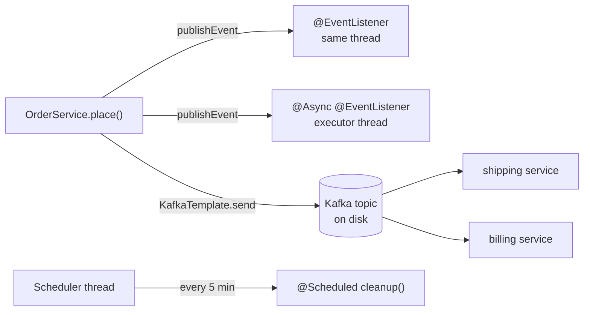
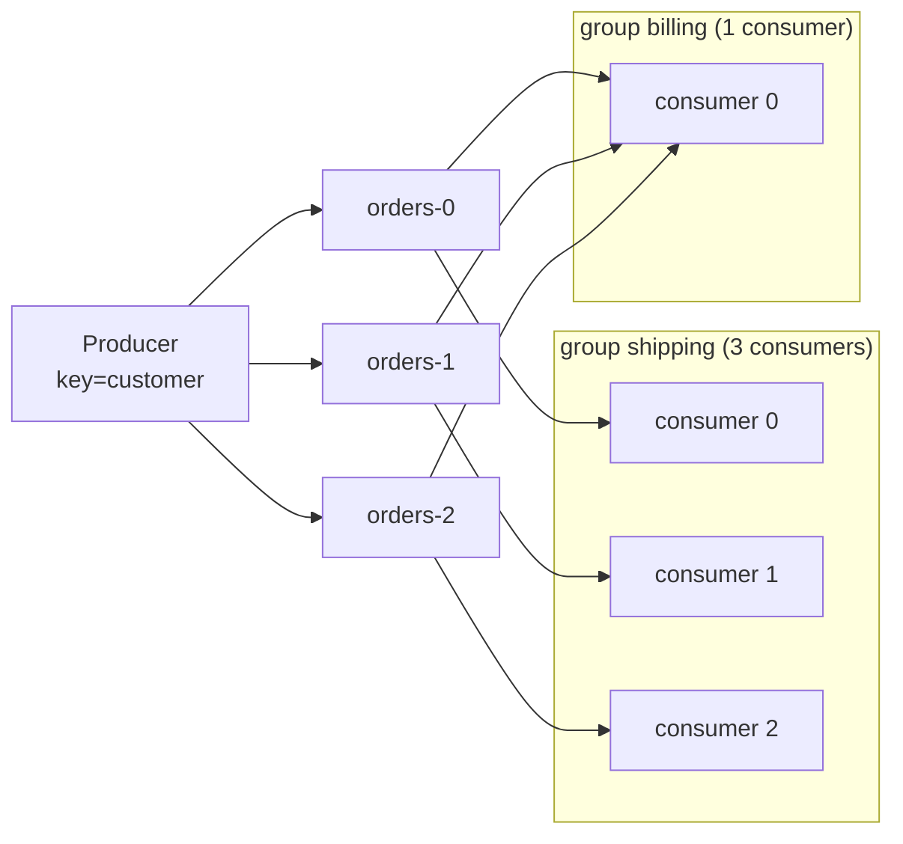
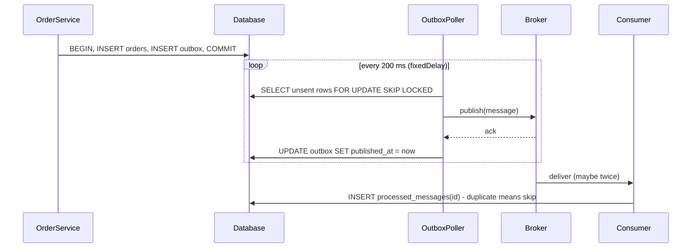

# Chapter 14 — Messaging, Async and Scheduling

So far every piece of work in this book happened **inside the request**: the controller calls a service, the service calls the database, and the HTTP response waits for all of it. Real systems also need work that happens **later**, **elsewhere** or **on a timer**:

- "After sign-up, send a welcome e-mail, but don't make the user wait for the SMTP server."
- "Every night at 02:00, expire unpaid orders."
- "When an order is placed, tell the shipping, billing and analytics services. They run in other processes and may be down right now."

Spring gives you one tool for each layer: **application events** (in-process notifications), **`@Async`** (run a method on another thread), **`@Scheduled`** (run a method on a timer), and **messaging** with Kafka or RabbitMQ (between processes, durable). The chapter ends with the **transactional outbox**, the pattern that joins a database transaction and a message broker without losing messages.

**What you'll learn**

- Synchronous vs `@Async` event listeners, and every `@TransactionalEventListener` phase, proved with tests
- `@Async`: how it works, return types, Boot's auto-configured executor, named executors, `TaskDecorator`, virtual threads, and what happens to exceptions
- `@Scheduled`: `fixedRate` vs `fixedDelay` vs `cron`, the one-thread default, overlap, and running jobs in a cluster
- Messaging basics: queues vs logs, delivery guarantees, ordering, idempotence
- Kafka with Spring for Apache Kafka: producer, `@KafkaListener`, keys and partitions, consumer groups, JSON, `DefaultErrorHandler` with a dead-letter topic, blocking and non-blocking retries, idempotent and transactional producers, and testing with `@EmbeddedKafka`
- RabbitMQ concepts and configuration (not run: it needs a broker)
- The transactional outbox with a poller, an outage, a duplicate and an idempotent consumer

**The code** (Spring Boot 4.1.1, Spring Framework 7.0, Spring for Apache Kafka 4.1.1, Kafka clients 4.2.1, Java 25):

| Project | Needs | What it proves |
|---|---|---|
| [`code/events-async`](code/events-async) | H2 in memory | sync vs async listeners, transaction phases, `@Async` executors and thread names, MDC propagation, virtual threads, async exceptions |
| [`code/scheduling`](code/scheduling) | nothing | `fixedRate` vs `fixedDelay` vs `cron` timing, turning jobs off in tests, overlap on platform vs virtual threads |
| [`code/kafka-orders`](code/kafka-orders) | nothing: an embedded Kafka broker runs inside the test JVM | keys → partitions, consumer groups, JSON on the wire, retries + DLT, `@RetryableTopic`, idempotence, transactions |
| [`code/outbox`](code/outbox) | H2 in memory | atomic order + outbox row, polling publisher, broker outage, duplicate delivery, idempotent consumer |
| [`code/rabbit-orders`](code/rabbit-orders) | a RabbitMQ broker (Docker) | exchange/queue/binding/DLX configuration; **compiles, not run** |

Every output below was printed by a test and checked by an assertion. Run everything with `bash tools_run_spring.sh spring '14-*'` from the repository root. No Docker is needed: Kafka runs as `@EmbeddedKafka`, a real broker started inside the test JVM.

---

## 14.1 The map: four ways to do work "somewhere else"

### What it is

| Tool | Where the work runs | Survives a crash? | Typical use |
|---|---|---|---|
| **Application event** (`publishEvent` + `@EventListener`) | same JVM, same thread by default | no, it lives in memory | decoupling modules inside one app |
| **`@Async` method** | same JVM, another thread | no | "don't make the caller wait": e-mails, reports, fan-out calls |
| **`@Scheduled` method** | same JVM, a scheduler thread | the schedule restarts with the app, a run in progress is lost | housekeeping, polling, periodic reports |
| **Message broker** (Kafka, RabbitMQ) | another process, maybe another service | yes: the broker stores the message on disk | integration between services, buffering load, event streaming |



### How to choose

1. **Only this app cares, and losing the work in a crash is acceptable?** Use an application event. Add `@Async` if the listener is slow.
2. **Must happen at a time or interval?** Use `@Scheduled`. If the app runs on several instances, add a lock (14.7).
3. **Another service must react, or the work must not be lost?** Use a broker. If the message must match a database change exactly, use the **transactional outbox** (14.17).

The patterns behind this map (message queue, publish-subscribe, event-driven architecture) are explained without code in [System-design patterns, Module 2 — Moving data](../../../system-design-patterns/modules/02-moving-data/README.md) and in the [event-driven architecture notes](../../../microservices-patterns/11-event-driven.md). This chapter is about the Spring side.

---

## 14.2 Application events: synchronous vs `@Async` listeners

### What it is

Chapter 2 introduced the container's built-in **publish/subscribe**: any bean publishes an object with `ApplicationEventPublisher.publishEvent(...)`, and every `@EventListener` method whose parameter type matches receives it ([2.12](../02-ioc-and-dependency-injection/README.md#212-application-events)). The key fact from that section: **listeners run synchronously, on the publisher's thread, before `publishEvent` returns.**

Put `@Async` on a listener and it changes character. The publisher hands the event to an executor and continues at once. Think of the difference between handing a letter to a colleague and waiting while they read it, versus dropping it in their in-tray.

### How it works

1. `@EnableAsync` on a configuration class installs a post-processor. It wraps every bean that has `@Async` methods in a **proxy** ([ch04](../04-aop-and-proxies/README.md)).
2. `publishEvent` finds the matching listeners and calls them in order.
3. For a plain listener, the call runs the method right away.
4. For an `@Async` listener, the call goes through the proxy. The proxy submits the method to an executor and returns immediately.

```java
@SpringBootApplication
@EnableAsync   // turns on the proxy that makes @Async methods run on an executor
public class AsyncApplication { ... }

public record UserSignedUp(String email) {}

@Service
public class SignupService {
    // constructor injection of ApplicationEventPublisher events, Trace trace ...
    public void signUp(String email) {
        trace.add("publisher: publishing on " + Trace.thread());
        events.publishEvent(new UserSignedUp(email));
        trace.add("publisher: publishEvent returned on " + Trace.thread());
    }
}

@Component
public class SignupListeners {
    @EventListener                       // synchronous: runs inside publishEvent, same thread
    void createProfile(UserSignedUp e) {
        trace.add("  sync listener: profile for " + e.email() + " on " + Trace.thread());
    }

    @Async                               // asynchronous: handed to the executor, publisher does not wait
    @EventListener
    void sendWelcomeMail(UserSignedUp e) throws InterruptedException {
        Thread.sleep(200);               // pretend the SMTP call is slow
        trace.add("  async listener: welcome mail to " + e.email() + " on " + Trace.thread());
    }
}
```

`Trace` is a small thread-safe list (a `CopyOnWriteArrayList`) that the tests print. The test calls `signUp`, prints the trace at once, then waits with **Awaitility**, a test library that polls a condition until it is true or a timeout expires:

```java
signups.signUp("ana@example.com");
trace.lines().forEach(System.out::println);
assertThat(trace.lines()).hasSize(3);                     // the async listener has not finished yet
await().atMost(Duration.ofSeconds(2)).until(() -> trace.lines().size() == 4);
```

Output:
```
--- right after signUp() returned ---
publisher: publishing on main
  sync listener: profile for ana@example.com on main
publisher: publishEvent returned on main
--- 200 ms later ---
  async listener: welcome mail to ana@example.com on task-1
```

The synchronous listener ran on `main` (the test thread) between the two publisher lines. The async listener ran 200 ms later on `task-1`, a thread of Boot's auto-configured executor (14.4).

### Trade-offs

| | Sync listener | `@Async` listener |
|---|---|---|
| Publisher waits? | yes | no |
| Exception reaches the publisher? | yes, and it can roll back the publisher's transaction | no: it goes to the `AsyncUncaughtExceptionHandler` (14.6) |
| Runs in the publisher's transaction? | yes | no: a new thread has no transaction |
| Return value published as a new event? | yes | no |
| `@Order` between listeners | respected | only the hand-off order is ordered; the executions race |

### Common mistakes

- **Forgetting `@EnableAsync`.** Boot auto-configures an executor but does **not** enable `@Async`. Without the annotation, `@Async` is silently ignored and the listener runs synchronously.
- **Expecting ThreadLocal state on the async thread**: the current transaction, the Spring Security context, the logging MDC. None of it moves across threads unless you copy it (14.4 shows a `TaskDecorator`).
- **Treating async events as reliable.** They live in memory. If the JVM stops before the listener runs, the work is gone.

### TL;DR

`@EventListener` = same thread, publisher waits. `@Async @EventListener` = executor thread, publisher continues, exceptions and transactions do not cross over. Remember `@EnableAsync`.

---

## 14.3 `@TransactionalEventListener`: events tied to a commit

### What it adds to 7.15

[7.15](../07-data-access-jdbc-and-transactions/README.md#715-transactionaleventlistener) explains the four phases (`BEFORE_COMMIT`, `AFTER_COMMIT` (the default), `AFTER_ROLLBACK`, `AFTER_COMPLETION`) and how Spring registers the listener with the transaction as a **synchronization** (a callback the transaction manager calls around commit and rollback). Here we add two things: what each phase can *see* in the database, and the combination most production code uses, **`@Async` + `AFTER_COMMIT`**.

```java
@Transactional
public void place(String item, boolean paymentFails) {
    jdbc.sql("INSERT INTO orders(item) VALUES (?)").param(item).update();
    events.publishEvent(new OrderPlaced(item));
    trace.add("service: event published inside the transaction");
    if (paymentFails) throw new IllegalStateException("payment declined");
}

@Component
public class OrderListeners {
    @TransactionalEventListener(phase = TransactionPhase.BEFORE_COMMIT)
    void beforeCommit(OrderPlaced e) { /* counts the order row: visible, same transaction */ }

    @TransactionalEventListener   // phase = AFTER_COMMIT is the default
    void afterCommit(OrderPlaced e) { ... }

    @TransactionalEventListener(phase = TransactionPhase.AFTER_ROLLBACK)
    void afterRollback(OrderPlaced e) { /* counts the order row again: gone */ }

    @TransactionalEventListener(phase = TransactionPhase.AFTER_COMPLETION)
    void afterCompletion(OrderPlaced e) { ... }

    /** The common production combo: only after commit, off the request thread, in its own transaction. */
    @Async
    @TransactionalEventListener
    @Transactional(propagation = Propagation.REQUIRES_NEW)
    void emailAfterCommit(OrderPlaced e) {
        jdbc.sql("INSERT INTO email_log(message) VALUES (?)").param("confirmation for " + e.item()).update();
        trace.add("async AFTER_COMMIT email for " + e.item() + " on " + Trace.thread());
    }
}
```

Output (`EventsTest`):
```
--- commit ---
service: event published inside the transaction
BEFORE_COMMIT    book (row visible in tx: 1)
AFTER_COMMIT     book on main
AFTER_COMPLETION book
async AFTER_COMMIT email for book on task-2
--- rollback ---
service: event published inside the transaction
AFTER_ROLLBACK   lamp (rows now: 0)
AFTER_COMPLETION lamp
```

What the test proved:

- On **commit**, `BEFORE_COMMIT` still saw the uncommitted row (it runs inside the transaction). Then `AFTER_COMMIT` and `AFTER_COMPLETION` ran on `main`, and the async e-mail ran on `task-2` and wrote to `email_log` in its own transaction.
- On **rollback**, no after-commit listener ran and **no e-mail was written**. The test waited 300 ms and asserted `email_log` had zero rows for `lamp`. `AFTER_ROLLBACK` saw that the order row was gone.

### Why `REQUIRES_NEW` on the async listener

Since Framework 6.1, a `@TransactionalEventListener` that is also `@Transactional` must use `REQUIRES_NEW` or `NOT_SUPPORTED`, or the context fails to start (details in 7.15). With `@Async` the method runs on another thread anyway, so `REQUIRES_NEW` just states the intent: the e-mail log gets its own transaction.

### When not to use it

When the side effect **must** happen. `AFTER_COMMIT` + `@Async` is still an in-memory hand-off. If the JVM dies between the commit and the e-mail, the e-mail is lost and nothing will retry it. For "must not be lost", write an outbox row in the same transaction (14.17).

### In the interview

**30-second answer:** see 7.15. Add: "With `@Async` the side effect also leaves the request thread and gets its own transaction (`REQUIRES_NEW`). It is still an in-memory hand-off, so critical messages go through an outbox."

- *What if no transaction is active?* → Transactional listeners are skipped, unless `fallbackExecution = true`.
- *Can a `BEFORE_COMMIT` listener veto the commit?* → Yes. An exception there propagates and the transaction rolls back.

### Self-check

1. Which listeners ran for the rolled-back `lamp` order? → `AFTER_ROLLBACK` and `AFTER_COMPLETION` only.
2. Why could `BEFORE_COMMIT` count the new row? → It runs inside the same, still open, transaction.
3. Why is `AFTER_COMMIT` + `@Async` not "guaranteed delivery"? → The event exists only in memory. A crash after the commit loses it.

---

## 14.4 `@Async` and executors

### What it is

`@Async` on a public (or at least non-private, non-final) method of a Spring bean means "run this on another thread and return to the caller at once". An **executor** is the object that owns the worker threads and a queue of waiting tasks, the same `Executor` idea as in [Java ch14 §14.11](../../../java/chapters/14-concurrency-1/README.md). Spring decides **which** executor to use, wraps the call, and adapts the return value.

### How it works

1. The caller calls `reports.build("daily")`. `reports` is really the proxy.
2. The proxy's `AsyncExecutionInterceptor` picks an executor:
   - the one named in `@Async("name")`, if given;
   - else the one returned by an `AsyncConfigurer`;
   - else a unique `TaskExecutor` bean, or the bean named `taskExecutor`. With Boot this is the auto-configured `applicationTaskExecutor`.
3. It submits the real method call as a task and returns right away:
   - `void` → returns nothing. An exception goes to the `AsyncUncaughtExceptionHandler`.
   - `CompletableFuture<T>` (or `Future<T>`) → returns a future that completes when the task finishes.
4. Inside the method you return `CompletableFuture.completedFuture(value)`. Spring unwraps it and completes the caller's future.

### Boot's auto-configured executor

If you define **no** `Executor` bean, Boot creates one called `applicationTaskExecutor`:

| Setting | Default | Property |
|---|---|---|
| type | `ThreadPoolTaskExecutor`; `SimpleAsyncTaskExecutor` if virtual threads are on | `spring.threads.virtual.enabled` |
| core threads | 8 | `spring.task.execution.pool.core-size` |
| queue capacity | unbounded | `spring.task.execution.pool.queue-capacity` |
| max threads | unlimited, but only used when the queue is full, so with an unbounded queue there are never more than core threads | `spring.task.execution.pool.max-size` |
| thread names | `task-1`, `task-2`, ... | `spring.task.execution.thread-name-prefix` |
| wait for tasks on shutdown | no | `spring.task.execution.shutdown.await-termination(-period)` |

(This chapter's example sets `core-size=4`.)

> **Watch out:** if you declare *any* `Executor` bean (for example a pool for reports), Boot's `applicationTaskExecutor` backs off. Unless you do something about it, `@Async`, Spring MVC async requests and other integrations then fall back to other defaults. Two fixes: declare the extra pool with `@Bean(defaultCandidate = false)`, which the Boot docs show for exactly this case, or set `spring.task.execution.mode=force` (since Boot 3.5) so the auto-configured executor is created anyway.

### A dedicated pool, a TaskDecorator, and the self-call trap

```java
@Configuration(proxyBeanMethods = false)
public class AsyncConfig {

    /** A second, dedicated pool for slow report jobs. defaultCandidate = false keeps it out of
     *  by-type injection, so Boot still auto-configures the normal applicationTaskExecutor. */
    @Bean(defaultCandidate = false)
    @Qualifier("reportExecutor")
    ThreadPoolTaskExecutor reportExecutor() {
        ThreadPoolTaskExecutor executor = new ThreadPoolTaskExecutor();
        executor.setThreadNamePrefix("report-");
        executor.setCorePoolSize(2);
        executor.setMaxPoolSize(2);
        executor.setQueueCapacity(10);          // bounded: an 11th waiting job is rejected
        return executor;
    }

    /** Boot applies a TaskDecorator bean to the executor it auto-configures: copy the MDC across threads. */
    @Bean
    TaskDecorator mdcCopyingDecorator() {
        return runnable -> {
            Map<String, String> callerMdc = MDC.getCopyOfContextMap();   // runs on the caller thread
            return () -> {                                               // runs on the worker thread
                if (callerMdc != null) MDC.setContextMap(callerMdc);
                try { runnable.run(); } finally { MDC.clear(); }
            };
        };
    }
}

@Service
public class ReportService {
    @Async   // default executor: Boot's applicationTaskExecutor
    public CompletableFuture<String> build(String name) {
        return CompletableFuture.completedFuture(name + " built on " + Trace.thread()
                + " requestId=" + MDC.get("requestId"));
    }

    @Async("reportExecutor")   // pick a specific executor bean by name / qualifier
    public CompletableFuture<String> buildBig(String name) { /* same body */ }

    /** Self-invocation: the call below does not go through the proxy, so it is NOT asynchronous. */
    public String buildViaThis(String name) {
        return this.build(name).join();
    }
}
```

The **MDC** (Mapped Diagnostic Context) is SLF4J's per-thread map of values, such as a request id, that every log line can include. It is a `ThreadLocal`, so a new thread starts with an empty one. A **`TaskDecorator`** wraps each submitted task. It reads the caller's values while still on the caller thread and restores them on the worker thread.

The test puts `requestId=r-42` into the MDC and calls the three methods:

Output (`AsyncMethodsTest`):
```
auto-configured executor: ThreadPoolTaskExecutor
daily built on task-1 requestId=r-42
yearly built on report-1 requestId=null
self-call built on main requestId=r-42
```

- `daily` ran on Boot's pool (`task-1`), and the decorator carried `r-42` across.
- `yearly` ran on the dedicated pool (`report-1`). It has no decorator because we built it by hand, so the MDC was empty. If you want it, call `executor.setTaskDecorator(...)` yourself.
- `self-call` ran on `main`. `this.build(...)` skips the proxy, so `@Async` did nothing. This is the same self-invocation rule as for `@Transactional` ([4.5](../04-aop-and-proxies/README.md#45-proxy-limitations--proved)).

Boot 4.1 also has `spring.task.execution.propagate-context=true`. It registers Spring's `ContextPropagatingTaskDecorator`, which copies the thread-locals that are registered with Micrometer's context-propagation library (tracing, for example) instead of a hand-written decorator.

### Sizing a pool

| Workload | Pool shape |
|---|---|
| CPU-bound (image resizing, PDF rendering) | about as many threads as cores. More threads only add context switching |
| I/O-bound (HTTP calls, SMTP, database) | many threads, or virtual threads (14.5) |
| Must not pile up in memory | a **bounded** queue plus a rejection policy. The default `AbortPolicy` throws `TaskRejectedException` to the caller; `CallerRunsPolicy` runs the task on the caller's thread, which slows the producer down |
| Isolate slow jobs from fast ones | separate pools (a **bulkhead**, see [microservices notes](../../../microservices-patterns/07-bulkhead.md)) |

### Common mistakes

- **Self-invocation, `private` or `final` methods**: no proxy, so no async. Move the method to another bean.
- **An unbounded queue in front of a slow dependency.** Tasks accumulate until the heap is full. Set `queue-capacity`.
- **Declaring your own `Executor` bean and wondering why MVC async or `@Async` changed pools.** Boot's executor backed off. Use `defaultCandidate = false` or `mode=force`.
- **Calling `.join()` right after the async call.** The caller waits anyway, and you only added a thread hop. Start several futures first, then join them all.
- **Losing work on shutdown.** Tasks still queued when the context closes are dropped unless `shutdown.await-termination=true`.

### Real-world examples

- An online shop sends the confirmation e-mail and pushes the order to an analytics service through `@Async`, so checkout responds in 80 ms instead of 600 ms.
- A dashboard backend fires three `@Async` calls to three internal services, then combines them with `CompletableFuture.allOf(...)`. The page waits for the slowest one instead of the sum of all three ([Java 15.2 — CompletableFuture](../../../java/chapters/15-concurrency-2-modern/README.md#152-completablefuture)).

### TL;DR

`@EnableAsync` + `@Async` = proxy + executor. Boot auto-configures `applicationTaskExecutor` (8 threads, unbounded queue, `task-` names). Choose a pool with `@Async("name")`. Declare extra pools with `defaultCandidate = false`. Copy ThreadLocals such as the MDC with a `TaskDecorator`. Never self-invoke.

---

## 14.5 `@Async` on virtual threads

### What it is

A **virtual thread** (final in Java 21) is a thread managed by the JVM rather than the operating system. It costs a few hundred bytes instead of about a megabyte of stack, so you can have hundreds of thousands. When it blocks on I/O, the JVM parks it and reuses the underlying carrier thread. Java's side of the story is in [Java 15.4 — Virtual threads](../../../java/chapters/15-concurrency-2-modern/README.md#154-virtual-threads).

With `spring.threads.virtual.enabled=true` (Boot 3.2+, needs Java 21+), Boot switches its executors to virtual threads. The same property also moves Tomcat request threads, `@Scheduled` and the Kafka and RabbitMQ listener containers to virtual threads.

```java
@SpringBootTest(properties = "spring.threads.virtual.enabled=true")
class VirtualThreadsTest {
    @Autowired ReportService reports;
    @Autowired AsyncTaskExecutor applicationTaskExecutor;

    @Test
    void asyncMethodsRunOnVirtualThreads() {
        System.out.println("auto-configured executor: " + applicationTaskExecutor.getClass().getSimpleName());
        List<CompletableFuture<String>> futures = IntStream.rangeClosed(1, 3)
                .mapToObj(i -> reports.build("report-" + i)).toList();
        futures.forEach(f -> System.out.println(f.join()));
        assertThat(futures).allSatisfy(f -> assertThat(f.join()).contains("on virtual task-"));
    }
}
```

Output:
```
auto-configured executor: SimpleAsyncTaskExecutor
report-1 built on virtual task-1 requestId=null
report-2 built on virtual task-2 requestId=null
report-3 built on virtual task-3 requestId=null
```

`Trace.thread()` prints `virtual` when `Thread.isVirtual()` is true. The executor is now a `SimpleAsyncTaskExecutor`: **no pool and no queue**, one new virtual thread per task. Pool settings such as `core-size` are ignored.

### Trade-offs

| | Platform-thread pool | Virtual threads |
|---|---|---|
| Concurrency limit | the pool size, a natural throttle | none by default: 10,000 submitted tasks means 10,000 concurrent tasks |
| Cost per blocked task | a whole OS thread | tiny |
| Best for | CPU-bound work, or when you want a hard cap | I/O-bound work: HTTP calls, JDBC, SMTP |
| Limit concurrency with | pool size + queue | `spring.task.execution.simple.concurrency-limit`, or Framework 7's `@ConcurrencyLimit` ([4.7](../04-aop-and-proxies/README.md#47-framework-7-core-resilience-retryable-and-concurrencylimit)) |

### Common mistakes

- **Flooding a downstream system.** Without a pool there is no throttle. If each task opens a database connection, the connection pool (10 by default in HikariCP) becomes the real limit and tasks wait there instead. Set a concurrency limit on purpose.
- **Expecting CPU-bound work to get faster.** Virtual threads help with waiting, not with computing.
- **Pinning.** Before JDK 24, a virtual thread blocked inside `synchronized` pinned its carrier thread. JEP 491 (JDK 24) removed that for `synchronized`. Native calls can still pin.
- **An app whose only work is scheduled jobs exits at startup.** Virtual threads are daemon threads, so the JVM may see "no non-daemon threads" and stop. Set `spring.main.keep-alive=true`.

### TL;DR

`spring.threads.virtual.enabled=true` → `@Async` runs on a new virtual thread per call (`SimpleAsyncTaskExecutor`), with no pool and no queue. Great for I/O. Add a concurrency limit yourself.

---

## 14.6 Exceptions in async methods

### The problem it solves

In a normal call an exception travels up the caller's stack. With `@Async` the caller has already returned, so **where does the exception go?** The answer depends on the return type.

| Return type | Where the exception goes | How to see it |
|---|---|---|
| `CompletableFuture<T>` / `Future<T>` | stored in the future, which completes exceptionally | `get()` throws `ExecutionException`, `join()` throws `CompletionException`, or use `exceptionally` / `handle` / `whenComplete` |
| `void` | nowhere near the caller | the `AsyncUncaughtExceptionHandler`. The default one only **logs** the error |

```java
@Async
public CompletableFuture<String> buildBroken(String name) {
    throw new IllegalStateException("no data for " + name);   // becomes an exceptionally completed future
}

@Async
public void fireAndForget(String name) {
    throw new IllegalStateException("cannot export " + name);  // void: goes to AsyncUncaughtExceptionHandler
}

/** Only overrides the exception handler, so @Async keeps using Boot's executor.
 *  Keep AsyncConfigurer in its own class with no @Bean methods: Boot 4 wraps AsyncConfigurer beans. */
@Configuration(proxyBeanMethods = false)
public class AsyncErrorConfig implements AsyncConfigurer {
    @Override
    public AsyncUncaughtExceptionHandler getAsyncUncaughtExceptionHandler() {
        return (ex, method, params) ->
                trace.add("uncaught handler: " + method.getName() + " threw " + ex.getMessage() + " on " + Trace.thread());
    }
}
```

The test:

```java
CompletableFuture<String> future = reports.buildBroken("march");
assertThatThrownBy(future::get).isInstanceOf(ExecutionException.class)
        .hasCauseInstanceOf(IllegalStateException.class);
String viaHandle = future.handle((ok, ex) -> "recovered from: " + ex.getMessage()).join();

reports.fireAndForget("april");                   // returns at once, no exception for the caller
await().atMost(Duration.ofSeconds(2)).until(() -> !trace.lines().isEmpty());
```

Output:
```
CompletableFuture: recovered from: java.lang.IllegalStateException: no data for march
void method:       uncaught handler: fireAndForget threw cannot export april on task-4
```

Notice that the message inside `handle` starts with `java.lang.IllegalStateException:`. The exception passed to `handle` was a `CompletionException` wrapping the original, and its message includes the cause. Use `ex.getCause()` when you need the original.

> **Found while building this chapter:** with `getAsyncUncaughtExceptionHandler()` **and** `@Bean` methods in one `AsyncConfigurer` class, Boot 4 failed at startup (`Illegal factory instance for factory method 'mdcCopyingDecorator'`), because it wraps user `AsyncConfigurer` beans. Hence two classes.

### Common mistakes

- **`void` + no handler = silent failure in production.** The default handler logs at ERROR level and moves on. Nobody retries. Return a `CompletableFuture`, or install a handler that records a metric and alerts.
- **Catching the exception inside the async method and returning `null`.** The caller can no longer tell success from failure.
- **Expecting `@Transactional` rollback in the caller** because an async method failed. It runs in another thread and another transaction (or none).

### Self-check

1. `@Async void` throws. Does the caller see it? → No. It goes to the `AsyncUncaughtExceptionHandler`.
2. `@Async CompletableFuture` throws. What does `get()` throw? → `ExecutionException` with the original as its cause.
3. Why is the handler in its own class? → Boot 4 wraps `AsyncConfigurer` beans, which breaks `@Bean` methods declared in the same class.

---

## 14.7 Scheduling with `@Scheduled`

### What it is

`@Scheduled` makes the container call a method on a timer: every N milliseconds, N milliseconds after the previous run finished, or at calendar times given by a **cron expression**. Like `@Async`, it needs a switch: `@EnableScheduling`. Boot then auto-configures a `ThreadPoolTaskScheduler` with **one thread** named `scheduling-1`.

### How it works

1. `@EnableScheduling` registers a post-processor that finds `@Scheduled` methods (no parameters, return value ignored).
2. For each one it registers a trigger with the `TaskScheduler`.
3. The scheduler thread wakes up at the trigger time and runs the method.

| Attribute | Meaning | Example |
|---|---|---|
| `fixedRate = 300` | start every 300 ms, measured **start to start** | heartbeat, metrics push |
| `fixedDelay = 300` | wait 300 ms **after the previous run ends** | polling a table or an API: never overlaps, never floods |
| `initialDelay = 50` | wait before the first run | let the app warm up |
| `cron = "0 0 2 * * *"` | calendar-based, 6 fields | nightly jobs |
| `zone = "Europe/Berlin"` | time zone for `cron` (default: the server's zone) | daylight-saving-safe jobs |
| `timeUnit = TimeUnit.SECONDS` | unit for rate/delay (default ms) | `fixedDelay = 30, timeUnit = SECONDS` |
| `fixedDelayString = "${outbox.poller.delay-ms}"` | value from configuration | tunable per environment |

Spring's cron has **six** fields, one more than Unix cron, because it starts with **seconds**:

| Field | Values | `0 30 2 * * MON-FRI` means |
|---|---|---|
| second | 0–59 | at second 0 |
| minute | 0–59 | minute 30 |
| hour | 0–23 | 02:xx |
| day of month | 1–31, `L` = last day | any |
| month | 1–12 or JAN–DEC | any |
| day of week | 0–7 (0 and 7 = Sunday) or MON–SUN | Monday to Friday |

Macros exist too: `@hourly`, `@daily` (also `@midnight`), `@weekly`, `@monthly`, `@yearly` (also `@annually`). The special value `"-"` disables a cron trigger, which is handy with a property: `cron = "${jobs.cleanup.cron:-}"`.

### Proving fixedRate vs fixedDelay vs cron

Both jobs pretend to work for 200 ms and have a 300 ms period. The test records every start time and prints the gaps:

```java
@Scheduled(fixedRate = 300)           // measured from START to START
void fixedRateJob() { rateRuns.add(now()); work(200); }

@Scheduled(fixedDelay = 300, initialDelay = 50)   // measured from END to next START
void fixedDelayJob() { delayRuns.add(now()); work(200); }

@Scheduled(cron = "*/1 * * * * *", zone = "UTC")  // every second, on the second
void cronJob() { cronRuns.add(LocalTime.now().withNano(0) + " on " + Thread.currentThread().getName()); }
```

```properties
# default is ONE scheduler thread shared by every @Scheduled method; give each job its own
spring.task.scheduling.pool.size=3
```

```java
await().atMost(Duration.ofSeconds(5))
       .until(() -> jobs.rateRuns.size() >= 6 && jobs.delayRuns.size() >= 4 && jobs.cronRuns.size() >= 2);
assertThat(median(rateGaps)).isBetween(270L, 360L);    // about 300 = the period
assertThat(median(delayGaps)).isBetween(470L, 600L);   // about 500 = 200 work + 300 delay
```

Output (`ScheduledJobsTest`; the millisecond gaps and clock times vary slightly from run to run):
```
fixedRate  = 300 ms, job takes 200 ms -> gaps between starts [300, 300, 300, 300] on scheduling-1
fixedDelay = 300 ms, job takes 200 ms -> gaps between starts [500, 510, 510] on scheduling-2
cron */1 * * * * *                    -> [19:48:15 on scheduling-1, 19:48:16 on scheduling-3]
```

`fixedRate` started every 300 ms whatever the job took. `fixedDelay` started every 500 ms, which is 200 ms of work plus the 300 ms pause. The cron job fired exactly on whole seconds, on whichever of the three scheduler threads was free. (The zone only affects how the cron expression is evaluated. The printed time is the local clock.)

### The one-thread default, and overlap

With the default `pool.size=1`, **all** `@Scheduled` methods share one thread. A 10-minute report job delays every other job, including the one-second heartbeat. That is why the example raises the pool size.

What if a fixed-rate job is **slower than its period**? The answer depends on the scheduler. `SlowJob` does 250 ms of work every 100 ms and records how many runs were active at the same time:

```java
@Scheduled(fixedRate = 100)
void tick() throws InterruptedException {
    int now = running.incrementAndGet();
    maxRunningAtOnce.accumulateAndGet(now, Math::max);
    ...
    try { Thread.sleep(250); } finally { running.decrementAndGet(); }
}
```

Output (`OverlapTest`, 1.2 seconds each; run counts vary by one or two between runs):
```
ThreadPoolTaskScheduler: runs=5 maxRunningAtOnce=1 (scheduling-2)
SimpleAsyncTaskScheduler: runs=13 maxRunningAtOnce=3 (virtual thread scheduling-22)
```

- **Platform threads** (`ThreadPoolTaskScheduler`): runs of the same method never overlap. Late runs are started as soon as the previous one ends, so only 5 runs happened.
- **Virtual threads** (`SimpleAsyncTaskScheduler`, Framework 6.1+): every run gets its own new thread, and the scheduler does not wait for the previous run to finish. Three runs overlapped. The Framework docs note that this scheduler only tracks the hand-off, and that `fixedDelay` tasks are forced onto a single scheduler thread to keep their meaning.

If a job must never overlap itself, use `fixedDelay`, or guard it (an `AtomicBoolean`, or a lock).

### Turning jobs off in tests

Background jobs make tests flaky: they touch data at random moments. Put `@EnableScheduling` on its own configuration class behind a property (`@ConditionalOnBooleanProperty` is new in Boot 3.5):

```java
@Configuration(proxyBeanMethods = false)
@EnableScheduling
@ConditionalOnBooleanProperty(name = "app.jobs.enabled", matchIfMissing = true)
public class SchedulingConfig {}
```

```
app.jobs.enabled=false -> runs after 700 ms: 0
```

Then test the job's **method** directly, as the outbox test in 14.17 does with `poller.publishBatch()`, and keep one small test with scheduling on and Awaitility.

### Running in a cluster

`@Scheduled` knows nothing about other instances. With three pods, the 02:00 job runs **three times**. Options:

| Option | How |
|---|---|
| **ShedLock** (a library) | `@SchedulerLock(name = "cleanup")` takes a lock row in a shared database table. Only one instance runs the job |
| Leader election | Spring Integration `LockRegistryLeaderInitiator`, Kubernetes leader election |
| Move the job out | a Kubernetes `CronJob`, or Quartz in clustered JDBC mode for persistent, missed-fire-aware schedules |
| Make the job idempotent and safe to run concurrently | `UPDATE ... WHERE status = 'PENDING'` claims rows, or `SELECT ... FOR UPDATE SKIP LOCKED` (14.17) |

### Common mistakes

- **Forgetting `@EnableScheduling`.** Nothing runs, and nothing complains.
- **A long job on the single default thread**, which blocks every other job.
- **Five-field Unix cron** such as `"0 2 * * *"`. Spring needs six fields and rejects the expression at startup.
- **`fixedRate` for polling a slow resource** on virtual threads. Runs pile up. Use `fixedDelay`.
- **Relying on server time zones.** Set `zone`, because 02:30 happens twice or not at all on daylight-saving days.
- **Ignoring clusters.** N instances means N runs.

### In the interview

**30-second answer:** "`@Scheduled` needs `@EnableScheduling`. `fixedRate` is start-to-start, `fixedDelay` is end-to-start, and cron has six fields starting with seconds. Boot's default scheduler has one thread, so I raise `spring.task.scheduling.pool.size` or jobs block each other. On platform threads a slow fixed-rate job doesn't overlap itself, but on virtual threads it can. In a cluster every instance runs the job, so I use ShedLock or make the job idempotent."

- *How do you test a scheduled job?* → Call the method directly with scheduling switched off. Add one integration test with scheduling on, using Awaitility with a timeout, never `Thread.sleep` plus an exact count.
- *fixedRate or fixedDelay for polling an outbox?* → `fixedDelay`: the next poll starts only after the previous one finished.

### TL;DR

`@EnableScheduling` + `@Scheduled(fixedRate | fixedDelay | cron)`. Six-field cron with seconds. One scheduler thread by default. Overlap depends on the scheduler. One run per instance, so lock or be idempotent in a cluster.

---

## 14.8 Messaging concepts you need first

### What it is

A **message broker** is a server that accepts messages from **producers**, stores them, and hands them to **consumers**. Producer and consumer never talk directly, so either can be slow, down, or deployed at a different time. Think of a post office. You drop the parcel off and leave. The recipient collects it when they are home.

Two broker designs dominate:

| | **Queue broker** (RabbitMQ, ActiveMQ, Amazon SQS) | **Log broker** (Apache Kafka, Redpanda, Amazon Kinesis) |
|---|---|---|
| Storage | a queue per consumer group of interest. A message is **deleted** once acknowledged | an append-only **log**. Messages stay for a retention period (e.g. 7 days) whether read or not |
| Reading | the broker pushes messages and tracks which are acknowledged | each consumer group tracks its own **offset** (position) and pulls |
| Replay old messages | no, they are gone after the ack | yes: reset the offset |
| Routing | rich: exchanges, routing keys, patterns, headers | by topic and partition only |
| Ordering | per queue, weakened by multiple consumers and redelivery | strict **per partition** |
| Typical use | task distribution, request/reply, complex routing | event streaming, event sourcing, feeding many independent consumers, high throughput |

### Delivery guarantees

| Guarantee | Meaning | How you get it |
|---|---|---|
| **At-most-once** | a message may be lost, never duplicated | ack or commit **before** processing |
| **At-least-once** | never lost, may be **duplicated** | ack or commit **after** processing. Spring's default for both Kafka and RabbitMQ |
| **Exactly-once** | processed once | only inside a closed system, such as Kafka transactions for read-process-write within Kafka. Across a database and a broker you build it yourself: at-least-once plus an **idempotent consumer** |

An **idempotent** operation gives the same result when repeated: "set status to PAID" is idempotent, "add 10 € to the balance" is not. Because at-least-once delivery is the normal case, **every consumer should tolerate duplicates**. 14.17 shows the usual technique: remember processed message ids.

The theory, including why exactly-once is hard, is in [DDIA ch11 — Stream processing](../../../ddia/chapters/11-stream-processing/README.md).

---

## 14.9 Kafka in five minutes

### What it is

**Apache Kafka** is a distributed, replicated **commit log**. Its vocabulary:

| Term | Meaning |
|---|---|
| **Broker** | one Kafka server. A **cluster** has several. Since Kafka 4.0 the cluster manages itself with **KRaft** (Kafka Raft); ZooKeeper is gone |
| **Topic** | a named stream of records, e.g. `orders` |
| **Partition** | a topic is split into N partitions. Each is an ordered, append-only log stored on a broker, which is the unit of parallelism |
| **Offset** | a record's position inside its partition: 0, 1, 2, ... |
| **Record** | key (optional) + value + headers + timestamp |
| **Key** | decides the partition: the default partitioner hashes the key (murmur2) modulo the partition count. **Same key → same partition → ordered**. No key → records are spread across partitions |
| **Replication factor** | copies of each partition on different brokers. One is the **leader**, the others are followers |
| **Consumer group** | consumers sharing a `group.id`. Each partition is read by **exactly one** member of the group, and each group gets **every** record |
| **Committed offset** | per group and partition: "we've processed up to here". After a restart the group continues from it |
| **Rebalance** | reassigning partitions when members join or leave |



Two rules follow from the picture:

1. **Scale consumers up to the partition count.** A fourth consumer in `shipping` would sit idle. Choose partitions for the parallelism you will need.
2. **Ordering is per partition.** Records with the same key are processed in order. There is no order across partitions.

Spring for Apache Kafka ("spring-kafka") wraps the Kafka Java client with `KafkaTemplate` (sending), `@KafkaListener` (receiving), error handlers, retry topics, transactions and test support. Boot 4.1.1 manages **spring-kafka 4.1.1** and **kafka-clients 4.2.1** (checked in the Boot 4.1.1 dependency BOM and the spring-kafka 4.1 reference docs).

---

## 14.10 Setting up Spring Kafka (with JSON)

### Dependencies

```xml
<!-- spring-kafka 4.1.x + kafka-clients 4.2.x + Jackson 3, versions managed by Boot 4.1.1 -->
<dependency>
  <groupId>org.springframework.boot</groupId>
  <artifactId>spring-boot-starter-kafka</artifactId>
</dependency>
<!-- the Kafka starter does not bring Jackson; JacksonJsonSerializer needs it (Jackson 3, tools.jackson.*) -->
<dependency>
  <groupId>org.springframework.boot</groupId>
  <artifactId>spring-boot-starter-jackson</artifactId>
</dependency>
<!-- tests: spring-boot-starter-test + spring-kafka-test (EmbeddedKafka) -->
<dependency>
  <groupId>org.springframework.boot</groupId>
  <artifactId>spring-boot-starter-kafka-test</artifactId>
  <scope>test</scope>
</dependency>
```

Boot 4's starters are modular ([ch01](../01-spring-ecosystem-and-first-app/README.md)), so Kafka has its own `spring-boot-starter-kafka` and `spring-boot-starter-kafka-test`. In Boot 3 you added `org.springframework.kafka:spring-kafka` directly. Our first run failed with `ClassNotFoundException: tools.jackson.core.type.TypeReference` because the Kafka starter does not include Jackson. Add `spring-boot-starter-jackson` (or a web starter, which brings it).

### Configuration

```properties
# in tests @EmbeddedKafka sets spring.embedded.kafka.brokers; otherwise a local broker
spring.kafka.bootstrap-servers=${spring.embedded.kafka.brokers:localhost:9092}

# ---- producer: String keys, JSON values (Jackson 3) ----
spring.kafka.producer.key-serializer=org.apache.kafka.common.serialization.StringSerializer
spring.kafka.producer.value-serializer=org.springframework.kafka.support.serializer.JacksonJsonSerializer
spring.kafka.producer.acks=all

# ---- consumer: JSON values, wrapped so that a bad record cannot crash the consumer ----
spring.kafka.consumer.auto-offset-reset=earliest
spring.kafka.consumer.key-deserializer=org.apache.kafka.common.serialization.StringDeserializer
spring.kafka.consumer.value-deserializer=org.springframework.kafka.support.serializer.ErrorHandlingDeserializer
spring.kafka.consumer.properties[spring.deserializer.value.delegate.class]=org.springframework.kafka.support.serializer.JacksonJsonDeserializer
spring.kafka.consumer.properties[spring.json.trusted.packages]=ch14.kafka
```

What each part does:

| Setting | Why |
|---|---|
| `JacksonJsonSerializer` / `JacksonJsonDeserializer` | JSON via **Jackson 3**. The older `JsonSerializer`/`JsonDeserializer` (Jackson 2) are **deprecated for removal since spring-kafka 4.0**; the jar marks them `@Deprecated(since="4.0", forRemoval=true)` |
| `ErrorHandlingDeserializer` | wraps the real deserializer. If a record's bytes are not valid JSON (a **poison pill**), the failure is handed to the error handler instead of failing inside `poll()` again and again forever |
| `spring.json.trusted.packages` | the deserializer creates the class named in the record's `__TypeId__` header only if it is in a trusted package. Never use `*` for data from untrusted producers |
| `auto-offset-reset=earliest` | a **new** group with no committed offset starts at the beginning. The Kafka default `latest` would skip everything sent before the consumer joined |
| `acks=all` | the leader waits for all in-sync replicas before confirming. Already the client default since Kafka 3.0; written out here for clarity |

The event is a plain record:

```java
/** The message payload. Serialized to JSON by JacksonJsonSerializer. */
public record OrderEvent(String orderId, String customer, long cents) {}
```

Topics are declared as beans. Boot's `KafkaAdmin` creates them at startup if they don't exist:

```java
@Bean NewTopic orders()      { return TopicBuilder.name("orders").partitions(3).replicas(1).build(); }
@Bean NewTopic payments()    { return TopicBuilder.name("payments").partitions(1).replicas(1).build(); }
@Bean NewTopic paymentsDlt() { return TopicBuilder.name("payments-dlt").partitions(1).replicas(1).build(); }
```

### What goes over the wire

A test reads one record back with a plain `StringDeserializer` to show the raw bytes:

Output (`ProducerGuaranteesTest.jsonOnTheWire`):
```
value bytes as text: {"orderId":"o-json","customer":"zoe","cents":4200}
__TypeId__ header  : ch14.kafka.OrderEvent
```

The **type header** tells the consumer which class to build. It couples producer and consumer to the same Java class name. Across services, either give the consumer a fixed target type (`spring.json.value.default.type` plus `spring.json.use.type.headers=false`), map type ids to local classes (`spring.json.type.mapping`), or use a schema format such as Avro or Protobuf with a schema registry.

---

## 14.11 Producing: `KafkaTemplate`, keys and partitions

### How it works

1. `kafkaTemplate.send(topic, key, value)` serializes the key and value, picks a partition (hash of the key), and puts the record into an in-memory batch.
2. A background I/O thread sends batches to the partition leaders. Batching is where Kafka's throughput comes from (`linger.ms`, `batch.size`).
3. `send` returns a `CompletableFuture<SendResult<K, V>>`. It completes when the broker acknowledges, and its `RecordMetadata` holds the topic, partition and offset. It completes exceptionally if the send failed after the client's own retries.

```java
@Service
public class OrderProducer {
    private final KafkaTemplate<String, Object> kafka;
    // constructor ...

    /** Key = customer: all events of one customer go to the same partition, so they stay in order. */
    public CompletableFuture<SendResult<String, Object>> publish(OrderEvent event) {
        return kafka.send("orders", event.customer(), event);
    }
}
```

The test sends six orders for three customers and prints where each one landed:

```java
RecordMetadata meta = producer.publish(e).join().getRecordMetadata();
System.out.printf("%s key=%-5s -> %s-%d@%d%n", e.orderId(), e.customer(), meta.topic(), meta.partition(), meta.offset());
```

Output (`ProducerConsumerTest`):
```
--- producer: send(topic, key, value).get() -> RecordMetadata ---
o-1 key=alice -> orders-0@0
o-2 key=dave  -> orders-1@0
o-3 key=carol -> orders-2@0
o-4 key=alice -> orders-0@1
o-5 key=dave  -> orders-1@1
o-6 key=carol -> orders-2@1
```

`alice` always lands on partition 0, `dave` on 1, `carol` on 2. The hash is deterministic. In an early version of the test, the customers `alice`, `bob` and `carol` produced partitions 0, 0 and 2: two keys shared partition 0 and partition 1 got nothing. **Hashing does not promise an even spread**, and a "hot" key (one huge customer) overloads one partition.

### Common mistakes

- **Fire-and-forget without looking at the future.** A failed send is only logged. Attach `whenComplete`, or `join()` where the caller must know.
- **No key when order matters.** Events for one order can then land on different partitions and be processed out of order.
- **Changing the partition count later.** `hash(key) % N` changes, so a key moves to another partition and ordering across the change is lost.
- **Huge messages.** The default maximum is about 1 MB. Store big payloads elsewhere and send a reference.

---

## 14.12 Consuming: `@KafkaListener`, concurrency and consumer groups

### How it works

1. Boot's auto-configured `ConcurrentKafkaListenerContainerFactory` creates a **listener container** for each `@KafkaListener`.
2. `concurrency = "3"` creates three consumers (three threads) in the same group. Kafka assigns each one a share of the partitions.
3. Each thread loops: `poll()` a batch of records, call your method once per record, then **commit the offsets**. The default ack mode is `BATCH`: commit after the whole polled batch was processed.
4. If your method throws, the container's **error handler** decides what happens (14.13).

```java
/** Group "shipping", 3 consumer threads: the 3 partitions are shared out between them. */
@KafkaListener(id = "shipping", topics = "orders", groupId = "shipping", concurrency = "3")
void ship(ConsumerRecord<String, OrderEvent> record) {
    received.add("shipping", record.value().orderId() + " key=" + record.key()
            + " p" + record.partition() + " on " + Thread.currentThread().getName());
}

/** Group "billing", 1 thread: a different group gets its OWN copy of every message. */
@KafkaListener(id = "billing", topics = "orders", groupId = "billing")
void bill(@Payload OrderEvent event,
          @Header(KafkaHeaders.RECEIVED_PARTITION) int partition,
          @Header(KafkaHeaders.OFFSET) long offset) {
    received.add("billing", event.orderId() + " p" + partition + "@" + offset
            + " on " + Thread.currentThread().getName());
}
```

A listener method can take the whole `ConsumerRecord`, or just the converted payload plus `@Header` values, or `Acknowledgment` for manual commits, or a `List<...>` for batch listeners.

Before sending, the test waits until the group has **settled** (each of the three consumers owns one partition). Without the wait, the first consumer to join briefly owned all three partitions and processed everything, as happened in this test's first run.

```java
var shipping = (ConcurrentMessageListenerContainer<?, ?>) registry.getListenerContainer("shipping");
await().atMost(Duration.ofSeconds(30)).until(() -> shipping.getContainers().stream()
        .allMatch(c -> c.getAssignedPartitions() != null && c.getAssignedPartitions().size() == 1));
```

Output:
```
assignment: shipping-0 -> [orders-0]
assignment: shipping-1 -> [orders-1]
assignment: shipping-2 -> [orders-2]
...
--- group 'shipping' (concurrency 3) ---
o-1 key=alice p0 on shipping-0-C-1
o-2 key=dave p1 on shipping-1-C-1
o-3 key=carol p2 on shipping-2-C-1
o-4 key=alice p0 on shipping-0-C-1
...
--- group 'billing' (concurrency 1) ---
o-1 p0@0 on billing-0-C-1
o-2 p1@0 on billing-0-C-1
... (o-3 to o-6, all on billing-0-C-1)
```

- In `shipping`, each partition had its own thread (`shipping-N-C-1` = listener id, consumer index, "C" for consumer thread). All of `alice`'s orders went to one thread, in order.
- `billing` is a **different group**, so it got **all six** records again, on its single thread. That is publish-subscribe: every group gets every record. Within one group it behaves like a queue: each record goes to one member.

### Commit modes

| `spring.kafka.listener.ack-mode` | Commits |
|---|---|
| `BATCH` (default) | after all records from one `poll()` were processed |
| `RECORD` | after each record. Safer and slower |
| `TIME` / `COUNT` / `COUNT_TIME` | after a time or a number of records |
| `MANUAL` / `MANUAL_IMMEDIATE` | when your code calls `acknowledgment.acknowledge()` |

spring-kafka turns Kafka's own auto-commit off (`enable.auto.commit=false`), so offsets are committed by the container **after** processing, which gives at-least-once. After a crash, the uncommitted records of the last batch are delivered again. The consumer must be idempotent.

### Common mistakes

- **More consumers than partitions.** The extra ones sit idle.
- **Slow processing.** If one `poll()` batch takes longer than `max.poll.interval.ms` (5 minutes by default), Kafka assumes the consumer died, rebalances, and another member reprocesses the batch. Reduce `max.poll.records` or speed up the work.
- **Blocking the listener thread on remote calls without timeouts.** One hanging HTTP call stops a whole partition.
- **Same `groupId` for two different purposes.** They split the records instead of each getting all of them.

---

## 14.13 Testing with `@EmbeddedKafka`

### What it is

`spring-kafka-test` can start a **real Kafka broker inside the test JVM**, in KRaft mode on a random port. No Docker, no installation. The annotation publishes the broker address as the property `spring.embedded.kafka.brokers`, which our `application.properties` already reads.

```java
@SpringBootTest
@EmbeddedKafka(partitions = 1, brokerProperties = {
        "transaction.state.log.replication.factor=1", "transaction.state.log.min.isr=1"})
abstract class KafkaTestBase {}

class ProducerConsumerTest extends KafkaTestBase { ... }
class ErrorHandlingTest extends KafkaTestBase { ... }
class ProducerGuaranteesTest extends KafkaTestBase { ... }
```

- All three test classes inherit the **same** annotations, so Spring's test-context cache reuses one context and one broker (see [ch12](../12-testing-spring-apps/README.md) on context caching).
- `partitions = 1` applies to topics listed in `@EmbeddedKafka(topics = ...)` and to auto-created topics. Our `NewTopic` beans set their own counts.
- A single broker cannot store the transaction log with the default replication factor of 3. The two broker properties make Kafka transactions (14.16) work.
- Asynchronous consumption is asserted with **Awaitility** (`await().atMost(...).until(...)`), never with `Thread.sleep` and hope.

| Test style | Speed | Realism | Needs |
|---|---|---|---|
| Unit test of the listener method (call it directly) | ms | logic only | nothing |
| `@EmbeddedKafka` | seconds | real protocol, real client, one broker | spring-kafka-test |
| Testcontainers Kafka + `@ServiceConnection` | slower | the real broker image you run in production | Docker ([ch12](../12-testing-spring-apps/README.md)) |

Timing (varies by machine): the whole `kafka-orders` suite (6 tests, one broker) takes about 12 seconds of test time (surefire reported 5.2 s + 4.9 s + 2.2 s), mostly broker start-up and back-off waits.

---

## 14.14 Error handling: `DefaultErrorHandler` and the dead-letter topic

### The problem it solves

A listener throws. What now? If the container simply re-reads the same record, a record that can **never** succeed (bad data, a poison pill) blocks its partition forever. If it skips the record, data is lost. The standard answer:

1. **Retry** a few times with a back-off, for errors that may go away (timeouts, a service restarting).
2. **Don't retry** errors that cannot go away (validation failures, deserialization errors).
3. After the last attempt, **publish the record to a dead-letter topic (DLT)** with headers saying what went wrong, **commit** its offset, and move on. Someone inspects the DLT later, fixes the cause, and replays the records.

### How it works in spring-kafka

- `DefaultErrorHandler` is the container's error handler. On failure it **seeks** the partition back to the failed record, so the next `poll()` returns it again. That is a **blocking** retry: the partition waits.
- Its `BackOff` decides how often and how long. The default is `FixedBackOff(0, 9)`: 9 retries, no delay, 10 attempts in total.
- When retries are exhausted, it calls a `ConsumerRecordRecoverer`. `DeadLetterPublishingRecoverer` sends the record to the DLT.
- Some exceptions are **fatal by default** and skip retries: `DeserializationException`, `MessageConversionException`, `ConversionException`, `MethodArgumentResolutionException`, `NoSuchMethodException`, `ClassCastException`. Add your own with `addNotRetryableExceptions(...)`.
- Boot applies a `CommonErrorHandler` bean to its auto-configured container factory. Declaring the bean is enough.

> **Version note:** since **spring-kafka 3.3** (so in every 4.x) the default DLT name is `<topic>-dlt`. Up to 3.2 it was `<topic>.DLT`, and most articles online still show that. Our first run proved it: the log said `Destination resolver returned non-existent partition payments-dlt-0`, because we had created `payments.DLT`.

```java
@Bean
DefaultErrorHandler errorHandler(KafkaTemplate<String, Object> jsonTemplate, ProducerFactory<String, Object> pf) {
    // A record that could not be deserialized has only raw bytes: publish those bytes unchanged.
    KafkaTemplate<String, Object> bytesTemplate =
            new KafkaTemplate<>(pf, Map.of(ProducerConfig.VALUE_SERIALIZER_CLASS_CONFIG, ByteArraySerializer.class));
    Map<Class<?>, KafkaOperations<?, ?>> templates = new LinkedHashMap<>();
    templates.put(byte[].class, bytesTemplate);
    templates.put(Object.class, jsonTemplate);

    var recoverer = new DeadLetterPublishingRecoverer(templates);   // default target: same topic + "-dlt", same partition
    var handler = new DefaultErrorHandler(recoverer, new FixedBackOff(100, 2));
    handler.addNotRetryableExceptions(IllegalArgumentException.class);   // bad data will never get better
    return handler;
}
```

Why two templates? A normal failed record is an `OrderEvent` and is re-published as JSON. A **poison pill** was never deserialized, so the recoverer only has its raw `byte[]`. The map picks the template by value type, and the `LinkedHashMap` keeps `byte[]` ahead of the `Object` catch-all.

The listener simulates three kinds of payment:

```java
@KafkaListener(id = "payments", topics = "payments", groupId = "payments")
void charge(OrderEvent e) {
    int attempt = attempts.computeIfAbsent(e.orderId(), k -> new AtomicInteger()).incrementAndGet();
    received.add("payments", e.orderId() + " attempt " + attempt);
    if (e.cents() < 0) throw new IllegalArgumentException("negative amount " + e.cents());
    if (e.orderId().equals("p-down") || (e.orderId().equals("p-flaky") && attempt < 3))
        throw new TransientPaymentException("provider timeout");
    received.add("payments", e.orderId() + " CHARGED");
}

/** Reads the dead-letter topic as plain text (overrides the JSON deserializer for this listener only). */
@KafkaListener(id = "payments-dlt", topics = "payments-dlt", groupId = "dlt-inspector",
        properties = "value.deserializer=org.apache.kafka.common.serialization.StringDeserializer")
void inspectDeadLetter(String value,
                       @Header(KafkaHeaders.DLT_EXCEPTION_CAUSE_FQCN) String causeClass,
                       @Header(KafkaHeaders.DLT_ORIGINAL_TOPIC) String originalTopic) { ... }
```

The test sends `p-ok`, `p-flaky` (fails twice, then works), `p-down` (always fails), `p-bad` (negative amount) and a raw string `this is not JSON`:

Output (`ErrorHandlingTest.blockingRetriesThenDeadLetterTopic`):
```
--- payments listener ---
p-ok attempt 1
p-ok CHARGED
p-flaky attempt 1
...
p-flaky attempt 3
p-flaky CHARGED
p-down attempt 1
...
p-down attempt 3
p-bad attempt 1
--- payments-dlt ---
{"orderId":"p-down","customer":"carol","cents":300} <- payments, cause TransientPaymentException
{"orderId":"p-bad","customer":"dave","cents":-5} <- payments, cause IllegalArgumentException
this is not JSON <- payments, cause DeserializationException
```

| Record | What happened |
|---|---|
| `p-flaky` | 1 attempt + 2 retries, succeeded on the third. No DLT |
| `p-down` | 3 attempts, then DLT with the cause class in a header |
| `p-bad` | `IllegalArgumentException` is not retryable: 1 attempt, then DLT |
| `this is not JSON` | the listener was **never called**. `ErrorHandlingDeserializer` turned the failure into a fatal `DeserializationException`, and the original bytes went to the DLT unchanged |

The listener exception is wrapped in `ListenerExecutionFailedException`, but the classifier looks through the **cause chain**, which is why `IllegalArgumentException` was recognized.

DLT records carry headers such as `kafka_dlt-original-topic`, `-original-partition`, `-original-offset`, `-exception-fqcn`, `-exception-cause-fqcn`, `-exception-message` and `-exception-stacktrace`. The constants are in `KafkaHeaders.DLT_*`.

### Trade-offs of blocking retries

| Pro | Con |
|---|---|
| Order within the partition is kept | the partition **stops** while one record is retried. A long back-off stalls everything behind it |
| Simple, no extra topics | the total back-off must stay well under `max.poll.interval.ms`, or the consumer is kicked out of the group |

### Common mistakes

- **Relying on the default back-off** (10 instant attempts). It hammers a struggling dependency. Set a real back-off, e.g. `ExponentialBackOff`.
- **No `ErrorHandlingDeserializer`.** A poison pill fails inside `poll()` before your code runs, so the container cannot hand it to the error handler.
- **A DLT with fewer partitions than the source topic.** The recoverer targets the **same partition number**. Create the DLT with at least as many partitions, or give it a custom destination resolver.
- **Nobody watches the DLT.** Add an alert on its size, and a documented replay procedure.

---

## 14.15 Non-blocking retries with `@RetryableTopic`

### What it is

Instead of seeking back and blocking the partition, a failed record is **re-published to a retry topic** and its offset is committed. The main topic keeps flowing. A separate consumer reads the retry topic after the back-off delay. After the last attempt the record goes to the DLT and a `@DltHandler` method runs.

```java
@RetryableTopic(attempts = "3", backOff = @BackOff(delay = 200))
@KafkaListener(id = "invoices", topics = "invoices", groupId = "invoices")
void createInvoice(OrderEvent e, @Header(KafkaHeaders.RECEIVED_TOPIC) String topic) {
    received.add("invoices", e.orderId() + " from " + topic);
    if (e.orderId().startsWith("inv-bad")) throw new IllegalStateException("tax service unavailable");
}

@DltHandler
void giveUp(OrderEvent e, @Header(KafkaHeaders.RECEIVED_TOPIC) String topic) {
    received.add("invoices", e.orderId() + " DLT handler, from " + topic);
}
```

Output (`ErrorHandlingTest.nonBlockingRetryTopics`, `inv-bad` sent first, then `inv-ok`):
```
--- @RetryableTopic ---
inv-bad from invoices
inv-ok from invoices
inv-bad from invoices-retry
inv-bad from invoices-retry
inv-bad DLT handler, from invoices-dlt
```

`inv-ok` was processed **before** the retries of `inv-bad`. The failing record no longer blocked the partition. The framework created `invoices-retry` and `invoices-dlt` itself. With a fixed delay, **one** retry topic is reused for all attempts (the annotation default since spring-kafka 3.2; the programmatic `RetryTopicConfigurationBuilder` got the same default in 4.1). In spring-kafka 4.0 the back-off attribute changed from Spring Retry's `backoff = @Backoff` to `backOff = @BackOff` (`org.springframework.kafka.annotation.BackOff`).

### Blocking vs non-blocking

| | `DefaultErrorHandler` (blocking) | `@RetryableTopic` (non-blocking) |
|---|---|---|
| Partition during retries | stopped | keeps flowing |
| Ordering | kept | **lost** for the retried record: later records overtake it |
| Extra topics | only the DLT | retry topic(s) + DLT |
| Long delays (minutes) | dangerous (`max.poll.interval.ms`) | fine |
| Choose when | order matters (account balance updates) | independent records, slow-recovering dependencies |

### When not to use it

When the order of events for one key matters. If `OrderCancelled` overtakes a retried `OrderPlaced`, the consumer sees a cancel for an order it doesn't know.

---

## 14.16 Producer guarantees: idempotence and transactions

### Idempotent producer

**The problem:** a producer sends a batch, the broker writes it, and the acknowledgement is lost. The producer retries and the broker writes the batch **twice**. The **idempotent producer** solves this. The broker gives the producer an id, the producer numbers every batch per partition, and the broker drops sequence numbers it has already written. Since Kafka 3.0 it is **on by default**, together with `acks=all`.

```java
var effective = new ProducerConfig(bootProducerFactory.getConfigurationProperties());
System.out.println("enable.idempotence = " + effective.getBoolean(ProducerConfig.ENABLE_IDEMPOTENCE_CONFIG));
System.out.println("acks               = " + effective.getString(ProducerConfig.ACKS_CONFIG));
System.out.println("max.in.flight      = " + effective.getInt(ProducerConfig.MAX_IN_FLIGHT_REQUESTS_PER_CONNECTION));
```

Output:
```
enable.idempotence = true
acks               = -1
max.in.flight      = 5
```

`acks=-1` is `all`. Idempotence requires `max.in.flight ≤ 5` and keeps ordering per partition even when retries happen. It removes duplicates caused by **producer retries**. It does not stop your application from calling `send` twice for the same business event.

### Transactional producer

A **Kafka transaction** makes several sends (to several topics or partitions, plus consumer offsets) **atomic**. Consumers with `isolation.level=read_committed` see all of them or none.

```java
var pf = new DefaultKafkaProducerFactory<String, String>(props);
pf.setTransactionIdPrefix("ledger-tx-");        // turns on transactions (and requires idempotence)
var tx = new KafkaTemplate<>(pf);

tx.executeInTransaction(t -> {                   // committed: both records become visible together
    t.send("ledger", "acc-1", "debit 50");
    t.send("ledger", "acc-2", "credit 50");
    return null;
});
tx.executeInTransaction(t -> {                   // aborted: the record stays invisible
    t.send("ledger", "acc-1", "debit 999");
    t.flush();                                   // the record really reaches the broker...
    throw new IllegalStateException("crash before commit");   // ...but the transaction is aborted
});
```

Output (`ProducerGuaranteesTest.transactionalProducerAndReadCommitted`):
```
isolation.level=read_committed   -> [debit 50, credit 50]
isolation.level=read_uncommitted -> [debit 50, credit 50, debit 999]
```

The aborted record **is in the log**, as `read_uncommitted` shows. The broker writes an abort marker, and `read_committed` consumers skip the record. Without the `flush()` the record never left the client, and both lists were equal in our first run, which proves nothing.

In a Boot app you set `spring.kafka.producer.transaction-id-prefix=tx-`. Boot then makes the auto-configured `KafkaTemplate` transactional and creates a `KafkaTransactionManager`. After that, every `send` must run inside a transaction: `executeInTransaction`, `@Transactional("kafkaTransactionManager")`, or a listener container that starts one. Consumers must set `spring.kafka.consumer.isolation-level=read_committed`, because the Kafka default is `read_uncommitted`.

### What Kafka transactions do not give you

**Exactly-once** holds for the loop "consume from Kafka → process → produce to Kafka, and commit the input offsets in the same transaction". It does **not** cover a database write plus a Kafka send. There is no two-phase commit between them. The old `ChainedKafkaTransactionManager` (deprecated since spring-kafka 2.7) only committed one after the other, which is best effort, not atomic. For database + broker, use the transactional outbox.

---

## 14.17 The transactional outbox

### The problem it solves: the dual write

```java
@Transactional
public void placeOrder(...) {
    orderRepository.save(order);                 // 1. database
    kafkaTemplate.send("orders", event);         // 2. broker
}                                                // 3. commit
```

Every ordering of these steps fails somewhere:

| Failure | Result |
|---|---|
| send succeeds, then the commit fails | consumers hear about an order that **does not exist** |
| commit succeeds, then the app crashes before the send | the order exists and **nobody is told** |
| send after the commit, broker down | same: lost event, unless you build retries and persistence... which is an outbox |

This is the **dual-write problem**. The database and the broker cannot share one transaction.

### How it works

1. In the **same local database transaction** as the business change, insert a row into an `outbox` table describing the event.
2. Commit. Now the order and the event exist together, or neither does.
3. A separate **message relay** reads unsent outbox rows in order, publishes them to the broker, and marks them sent. It is either a **poller** (shown here) or **change data capture**: Debezium reads the database's write-ahead log and publishes the outbox rows.
4. Consumers get **at-least-once** delivery, so they must be **idempotent**. Each message carries a unique id they can de-duplicate on.



The pattern is taught without Spring in the [Saga notes — Part 13D, implementing the saga log](../../../microservices-patterns/10-saga.md#d-implementing-the-saga-log-properly), the [event-driven architecture notes](../../../microservices-patterns/11-event-driven.md), and [System-design patterns, Module 10 — the outbox pattern](../../../system-design-patterns/modules/10-batch-and-streaming/README.md). Here it runs.

### The schema

```sql
-- the outbox: messages waiting to be sent, written in the SAME transaction as the order
CREATE TABLE IF NOT EXISTS outbox (
    id            IDENTITY PRIMARY KEY,                -- also gives the publishing order
    message_id    UUID         NOT NULL UNIQUE,        -- consumers de-duplicate on this
    aggregate_id  VARCHAR(50)  NOT NULL,               -- becomes the Kafka key
    event_type    VARCHAR(50)  NOT NULL,
    payload       VARCHAR(2000) NOT NULL,              -- JSON
    created_at    TIMESTAMP    DEFAULT CURRENT_TIMESTAMP NOT NULL,
    published_at  TIMESTAMP,                           -- NULL = not sent yet
    attempts      INT          DEFAULT 0 NOT NULL
);
CREATE INDEX IF NOT EXISTS outbox_unpublished ON outbox (published_at, id);
-- consumer side: ids of messages already handled (idempotent consumer)
CREATE TABLE IF NOT EXISTS processed_messages (message_id UUID PRIMARY KEY);
```

### Writing the order and the event together

```java
/** ONE local transaction: the order row and the outbox row commit together or not at all. */
@Transactional
public long placeOrder(String item, long cents, boolean failBeforeCommit) {
    var keys = new GeneratedKeyHolder();
    jdbc.sql("INSERT INTO orders(item, cents) VALUES (?, ?)").params(item, cents).update(keys, "id");
    long orderId = keys.getKey().longValue();

    String payload = json.writeValueAsString(new OrderPlaced(orderId, item, cents));   // Jackson 3 JsonMapper
    jdbc.sql("""
            INSERT INTO outbox(message_id, aggregate_id, event_type, payload)
            VALUES (?, ?, 'OrderPlaced', ?)""")
        .params(UUID.randomUUID(), "order-" + orderId, payload)
        .update();

    if (failBeforeCommit) throw new IllegalStateException("crash before commit");
    return orderId;       // no broker call here: nothing can be half-done
}
```

### The poller (message relay)

```java
@Scheduled(fixedDelayString = "${outbox.poller.delay-ms}")
public void poll() { publishBatch(); }

@Transactional
public int publishBatch() {
    // FOR UPDATE SKIP LOCKED: several app instances can poll at once without sending the same row twice
    List<OutboxRow> rows = jdbc.sql("""
            SELECT id, message_id, aggregate_id, event_type, payload
            FROM outbox
            WHERE published_at IS NULL
            ORDER BY id
            FETCH FIRST 10 ROWS ONLY
            FOR UPDATE SKIP LOCKED""")
        .query(OutboxRow.class).list();

    int sent = 0;
    for (OutboxRow row : rows) {
        try {
            publisher.publish(new Message(row.messageId(), row.aggregateId(), row.eventType(), row.payload()));
        } catch (Exception e) {
            jdbc.sql("UPDATE outbox SET attempts = attempts + 1 WHERE id = ?").param(row.id()).update();
            log.warn("outbox row {} not published ({}), will retry", row.id(), e.getMessage());
            break;                                  // keep order: do not send later rows before this one
        }
        jdbc.sql("UPDATE outbox SET published_at = CURRENT_TIMESTAMP, attempts = attempts + 1 WHERE id = ?")
            .param(row.id()).update();
        sent++;
    }
    return sent;
}
```

Design choices:

- **`fixedDelay`**, not `fixedRate`: a slow round never overlaps the next (14.7).
- **`FOR UPDATE SKIP LOCKED`** (PostgreSQL 9.5+, MySQL 8.0+, and H2 2.x, which runs this demo): with several app instances, each poller locks different rows. The SQL book explains row locks in [SQL ch13](../../../sql/chapters/13-transactions-and-concurrency/README.md).
- **Stop at the first failure** so the messages stay in order.
- `MessagePublisher` is an interface. The demo uses `InMemoryBroker`, which can simulate an outage (`DOWN`) or a lost acknowledgement (`ACK_LOST`: the message is stored, then a timeout is thrown). With Kafka the implementation is one line, and the `.get()` with a timeout is what makes "published" mean "acknowledged":

```java
kafkaTemplate.send("orders", m.key(), m.payload()).get(10, TimeUnit.SECONDS);
```

### Proving it

The tests switch the scheduler off (`outbox.poller.enabled=false`) and call `publishBatch()` themselves, so every step is deterministic. One extra test leaves the scheduler on.

Output (`OutboxTest`, `OutboxSchedulerTest`):
```
after rollback: orders=0 outbox=0
after commit:   orders=1 outbox=1 unpublished=1
outbox payload: {"orderId":5,"item":"book","cents":1999}
poller sent 1 -> broker has 1, unpublished=0

WARN  c.o.OutboxPoller - outbox row 2 not published (broker unreachable), will retry
broker DOWN -> sent 0, unpublished=2, attempts of first row=1
broker UP   -> sent 2, unpublished=0
broker order: [order-2, order-3]

WARN  c.o.OutboxPoller - outbox row 1 not published (no ack from broker), will retry
broker holds 2 copies of message eab1f5f0...
consumer handled: [true, false] -> stock_reservations=1

published by the scheduled poller within ~200 ms: OrderPlaced {"orderId":1,"item":"desk","cents":25000}
```

(The id numbers depend on test order, because identity columns keep counting after `DELETE`.)

| Scenario | What the test proved |
|---|---|
| Crash before commit | **no** order and **no** outbox row: nothing to publish, nothing wrong published |
| Commit | one order, one unpublished outbox row, published on the next poll |
| Broker down | nothing lost: rows stay unpublished with `attempts=1`, and go out in order once the broker is back |
| Ack lost | the broker got the message but the poller didn't know, so it sent it **again**. The consumer's `processed_messages` insert failed with `DuplicateKeyException` on the second copy, so the stock was reserved **once** |

The idempotent consumer:

```java
@Transactional
public boolean handle(Message m) {
    try {
        jdbc.sql("INSERT INTO processed_messages(message_id) VALUES (?)").param(m.messageId()).update();
    } catch (DuplicateKeyException alreadySeen) {
        return false;                               // duplicate: skip silently
    }
    jdbc.sql("INSERT INTO stock_reservations(order_id) VALUES (?)").param(m.key()).update();
    return true;
}
```

The id insert and the business change are in **one** transaction. If the business change fails, the id is rolled back too, and a redelivery is processed normally.

### Trade-offs

| Poller (this demo) | CDC (Debezium outbox event router) |
|---|---|
| plain SQL + `@Scheduled`, easy to understand | no polling load, lower latency |
| adds query load; latency = poll interval | extra infrastructure: Kafka Connect, Debezium, access to the DB log |
| works on any database | needs DB support (Postgres logical decoding, MySQL binlog) |

Housekeeping: delete or archive published rows (e.g. a nightly job that removes rows with `published_at` older than 7 days), or the table grows forever.

**Spring Modulith** offers a ready-made variant for modular monoliths. Its *event publication registry* stores application events in a database table before commit and re-delivers the ones whose listeners did not complete, and its *event externalization* forwards selected events to Kafka or AMQP.

### When not to use it

- The message is not tied to a database change (e.g. a metrics tick). Send it directly.
- Losing an occasional event is acceptable (cache warm-up hints). `@TransactionalEventListener(AFTER_COMMIT)` + send is simpler.

### Common mistakes

- **Calling the broker inside the business transaction** "just to be sure". That is the dual write again, and it also holds a database connection during a network call.
- **Non-idempotent consumers.** The outbox guarantees at-least-once, not exactly-once.
- **Publishing rows out of order** by continuing after a failure, or by running several pollers without `SKIP LOCKED` and without a key-based order.
- **Letting the outbox grow forever.**

### In the interview

**30-second answer:** "You can't atomically write to a database and publish to Kafka. That's the dual-write problem. The outbox pattern writes the event into an outbox table in the same local transaction as the business change. A relay (a poller with `SELECT ... FOR UPDATE SKIP LOCKED`, or Debezium CDC) publishes the rows and marks them sent. Delivery is at-least-once, because the relay can crash between publishing and marking, so consumers de-duplicate by message id in the same transaction as their own change."

- *Why not a Kafka transaction?* → It only covers Kafka. The database commit is outside it.
- *How do you keep ordering?* → Publish in id order, stop at the first failure, and use the aggregate id as the Kafka key so each aggregate's events share a partition.
- *Poller or CDC?* → Start with a poller. Switch to CDC when polling load or latency matters, or when Kafka Connect is already there.

### Self-check

1. In the "ack lost" test, why did the broker hold two copies? → The message was stored, but the poller saw a timeout and didn't mark the row, so the next poll sent it again.
2. What makes the consumer safe against that? → Inserting the message id into `processed_messages` in the same transaction as the business change. A duplicate id fails and the message is skipped.
3. Why does the poller `break` on the first failure? → So later messages are not published before an earlier one, which would break ordering.

---

## 14.18 RabbitMQ with Spring AMQP (configuration, not run)

### What it is

**RabbitMQ** is a queue broker that speaks AMQP 0-9-1. Producers never write to a queue directly. They publish to an **exchange**, which routes the message to zero or more **queues** according to **bindings**. Consumers read from queues and **acknowledge** each message.

| Exchange type | Routes by | Example |
|---|---|---|
| **direct** | exact routing key | `payment.failed` → `payments.alerts` queue |
| **topic** | pattern: `*` = one word, `#` = zero or more words | `order.placed.*` matches `order.placed.eu` |
| **fanout** | nothing: copies to every bound queue | broadcast "cache invalidated" |
| **headers** | message header values | rarely used |

Other terms: **prefetch** is how many unacknowledged messages one consumer may hold. A **dead-letter exchange (DLX)** is where rejected or expired messages go. **Quorum queues** (RabbitMQ 3.8+) are replicated queues for durability. **Competing consumers**: several consumers on one queue share its messages.

The project [`code/rabbit-orders`](code/rabbit-orders) **compiles** (`mvn compile` passed) but is **not run**, because it needs a broker (for example `docker run -p 5672:5672 rabbitmq:4-management`). Its folder contains `.tools_run_skip`.

```xml
<dependency>
  <groupId>org.springframework.boot</groupId>
  <artifactId>spring-boot-starter-amqp</artifactId>   <!-- spring-amqp / spring-rabbit 4.1.x -->
</dependency>
```

```java
/** Boot's RabbitAdmin declares these exchanges, queues and bindings on the broker at startup. */
@Configuration(proxyBeanMethods = false)
public class RabbitConfig {
    @Bean TopicExchange ordersExchange() { return new TopicExchange("orders"); }
    @Bean DirectExchange deadLetterExchange() { return new DirectExchange("orders.dlx"); }

    @Bean Queue shippingQueue() {
        return QueueBuilder.durable("orders.shipping")
                .quorum()                                           // replicated queue type (RabbitMQ 3.8+)
                .deadLetterExchange("orders.dlx")                   // rejected messages go here...
                .deadLetterRoutingKey("orders.shipping.dlq")        // ...with this routing key
                .build();
    }
    @Bean Queue shippingDlq() { return QueueBuilder.durable("orders.shipping.dlq").build(); }

    /** Topic exchange: routing key "order.placed.eu" matches pattern "order.placed.*". */
    @Bean Binding shippingBinding() {
        return BindingBuilder.bind(shippingQueue()).to(ordersExchange()).with("order.placed.*");
    }
    @Bean Binding dlqBinding() {
        return BindingBuilder.bind(shippingDlq()).to(deadLetterExchange()).with("orders.shipping.dlq");
    }

    /** Boot sets a MessageConverter bean on RabbitTemplate and on the listener container factory. */
    @Bean MessageConverter jsonConverter() { return new JacksonJsonMessageConverter(); }
}

// producer: exchange, routing key, body (converted to JSON)
rabbit.convertAndSend("orders", "order.placed." + region, event);

// consumer: competing consumers on one queue
@RabbitListener(queues = "orders.shipping")
void ship(OrderEvent e) {
    if (e.cents() < 0) throw new IllegalArgumentException("bad amount");   // 1 attempt + 2 retries, then dead-lettered
    ...
}
```

```properties
spring.rabbitmq.host=localhost
spring.rabbitmq.listener.simple.prefetch=10
spring.rabbitmq.listener.simple.concurrency=2
# retry in the listener (blocking), then reject -> the queue's dead-letter exchange
spring.rabbitmq.listener.simple.retry.enabled=true
# retries AFTER the first attempt (Boot 4 replaced max-attempts with max-retries)
spring.rabbitmq.listener.simple.retry.max-retries=2
spring.rabbitmq.listener.simple.retry.initial-interval=500ms
spring.rabbitmq.listener.simple.default-requeue-rejected=false
# producer side: broker confirms + returns for unroutable messages
spring.rabbitmq.publisher-confirm-type=correlated
spring.rabbitmq.publisher-returns=true
spring.rabbitmq.template.mandatory=true
```

(Property names checked against Boot 4.1.1's `spring-boot-amqp` configuration metadata. Boot 4 replaced `retry.max-attempts`, which counted the first attempt, with `retry.max-retries`, which does not.)

How acknowledgement works with Spring AMQP's default `AUTO` mode: the container acks the message when your method returns normally. If it throws, the message is rejected, and it is **requeued** unless `default-requeue-rejected=false` or the exception is `AmqpRejectAndDontRequeueException`. Requeueing a message that always fails creates an endless loop, which is why the DLX setup matters. **Publisher confirms** make the broker acknowledge each publish, the RabbitMQ counterpart of Kafka's `acks`. **Returns** with `mandatory=true` report messages that no queue was bound to receive.

Testing without Docker: Spring AMQP has no embedded broker. Use `@RabbitListenerTest` / `RabbitListenerTestHarness` from `spring-rabbit-test` to spy on listeners, test the listener methods as plain methods, or run the real broker with Testcontainers and `@ServiceConnection` ([ch12](../12-testing-spring-apps/README.md)).

### Kafka or RabbitMQ?

| Question | Leans Kafka | Leans RabbitMQ |
|---|---|---|
| Several independent consumers read the same stream, maybe later | yes: each group has its own offset, and records are retained | each consumer needs its own queue, and messages are gone after the ack |
| Replay history, rebuild a read model | yes | no |
| Complex routing by key patterns or headers | limited | yes: exchanges |
| Per-message priorities, TTL, delayed delivery | no | yes (TTL, priorities; delays via a plugin) |
| Throughput | very high (batching, sequential disk I/O) | high, lower per node |
| Ordering | per partition, scales with partitions | per queue, weakened by competing consumers |
| Operational model | a cluster plus partitions to plan | simpler for small setups |

Spring also supports **JMS** (`JmsTemplate`, `@JmsListener`; ActiveMQ Artemis, IBM MQ), **Apache Pulsar** (Spring for Apache Pulsar) and a binder abstraction, **Spring Cloud Stream** ([ch16](../16-spring-cloud-and-microservices/README.md)).

---

## 14.19 Common mistakes (whole chapter)

| Mistake | Symptom | Fix |
|---|---|---|
| No `@EnableAsync` / `@EnableScheduling` | `@Async` runs synchronously, `@Scheduled` never runs | add the annotation, on its own config class if you want to switch it with a property |
| Self-invocation of `@Async` | work runs on the caller's thread | call through another bean (4.5) |
| `@Async void` without a handler | failures only logged | return `CompletableFuture`, or add an `AsyncUncaughtExceptionHandler` |
| Declaring an `Executor` bean | Boot's `applicationTaskExecutor` disappears | `@Bean(defaultCandidate = false)` or `spring.task.execution.mode=force` |
| One default scheduler thread | jobs delay each other | `spring.task.scheduling.pool.size` |
| `@Scheduled` on N instances | job runs N times | ShedLock / leader election / idempotent job |
| Sending to Kafka inside a DB transaction | ghost events or lost events | transactional outbox |
| No key on ordered events | events processed out of order | key = aggregate id |
| Default `FixedBackOff(0, 9)` | retry storm against a failing service | real back-off + DLT |
| No `ErrorHandlingDeserializer` | poison pill blocks the partition | wrap the value deserializer |
| Looking for `orders.DLT` on spring-kafka 3.3+ | DLT "empty" | the default name is now `orders-dlt` |
| Non-idempotent consumers | double charges after a rebalance or redelivery | de-duplicate by message id |
| `Thread.sleep` in async tests | flaky tests | Awaitility with a timeout |

---

## 14.20 In the interview

The per-section interview blocks cover transactional listeners (14.3), `fixedRate` vs `fixedDelay` and clustered jobs (14.7), blocking vs retry-topic retries and poison pills (14.14–14.15) and the outbox (14.17). The rest in one round:

1. **How does `@Async` work?** → `@EnableAsync` adds a proxy. Calls through the proxy are submitted to an executor, and the proxy returns `null`/a future at once. Self-invocation bypasses it.
2. **Which executor does `@Async` use in Boot?** → The one named in `@Async("…")`, else an `AsyncConfigurer`'s, else the `taskExecutor`/`applicationTaskExecutor` that Boot auto-configures: a `ThreadPoolTaskExecutor` with 8 core threads and an unbounded queue, or a virtual-thread `SimpleAsyncTaskExecutor` if `spring.threads.virtual.enabled=true`.
3. **What happens to an exception in an `@Async` method?** → For a future return type it is stored in the future. For `void` it goes to the `AsyncUncaughtExceptionHandler`, which only logs by default.
4. **How do you pass the MDC or security context to async threads?** → A `TaskDecorator` (Boot applies a `TaskDecorator` bean to its executor), `spring.task.execution.propagate-context=true`, or `DelegatingSecurityContextAsyncTaskExecutor` for security.
5. **Kafka partition vs consumer group?** → Partitions split a topic for parallelism and ordering. A group splits the partitions among its members. Different groups each get every record.
6. **How do you keep events for one order in sequence?** → Use the order id as the key, so they share one partition, and use blocking retries, not retry topics.
7. **What does `DefaultErrorHandler` do?** → It seeks back and retries per its `BackOff` (default 10 attempts, no delay). Then it calls the recoverer, e.g. `DeadLetterPublishingRecoverer` → `<topic>-dlt` (since spring-kafka 3.3). Fatal exceptions such as `DeserializationException` skip retries.
8. **Is Kafka exactly-once?** → The idempotent producer removes duplicates caused by producer retries. Transactions plus `read_committed` give exactly-once for Kafka-to-Kafka processing. Anything involving a database needs an outbox and idempotent consumers.
9. **How do you test Kafka code without Docker?** → `@EmbeddedKafka` from spring-kafka-test (an in-JVM KRaft broker), `spring.kafka.bootstrap-servers=${spring.embedded.kafka.brokers}`, and Awaitility for assertions.
10. **Kafka vs RabbitMQ in one sentence?** → Kafka is a replayable, partitioned log for streams and many independent readers. RabbitMQ is a routing queue broker for task distribution with per-message features.

---

## Chapter TL;DR

- **Events:** `@EventListener` is synchronous. `@Async @EventListener` is not, and it gets no transaction and no exception propagation. `@TransactionalEventListener` runs at `BEFORE_COMMIT`/`AFTER_COMMIT`/`AFTER_ROLLBACK`/`AFTER_COMPLETION`. `@Async` + `AFTER_COMMIT` + `REQUIRES_NEW` is the usual combination, and it is still not durable.
- **`@Async`:** needs `@EnableAsync`. Proxy + executor. Boot's `applicationTaskExecutor` (8 threads, `task-` names, unbounded queue). Pick pools with `@Async("name")` and `defaultCandidate = false`. Copy the MDC with a `TaskDecorator`. `void` errors go to `AsyncUncaughtExceptionHandler`, future errors go into the future.
- **Virtual threads:** `spring.threads.virtual.enabled=true` → one virtual thread per task, no pool, no queue. Limit concurrency yourself.
- **`@Scheduled`:** needs `@EnableScheduling`. `fixedRate` (start-to-start) vs `fixedDelay` (end-to-start) vs six-field `cron`. One scheduler thread by default. Overlap depends on the scheduler. One run per instance in a cluster.
- **Kafka:** Boot 4.1.1 → spring-kafka 4.1.1, kafka-clients 4.2.1, `spring-boot-starter-kafka` (+ `spring-boot-starter-jackson` for JSON). Key → partition → order. Group = one reader per partition, every group gets everything. `JacksonJsonSerializer` (Jackson 3) + `ErrorHandlingDeserializer`. `DefaultErrorHandler` + `DeadLetterPublishingRecoverer` → `<topic>-dlt`. `@RetryableTopic` for non-blocking retries. Idempotence is on by default. Transactions + `read_committed` for atomic multi-sends. Test with `@EmbeddedKafka`.
- **RabbitMQ:** exchanges → bindings → queues, acks, prefetch, DLX, publisher confirms. `spring-boot-starter-amqp`, `@RabbitListener`, `JacksonJsonMessageConverter`.
- **Outbox:** write the event row in the same transaction, relay it with a `fixedDelay` poller (`FOR UPDATE SKIP LOCKED`) or CDC, and expect duplicates: consumers de-duplicate by message id.
- Next: [Chapter 15 — Observability and production](../15-observability-and-production/README.md).
