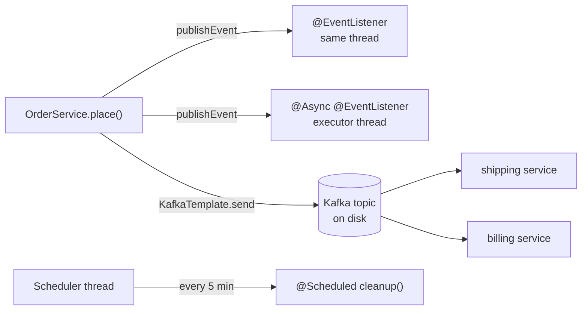
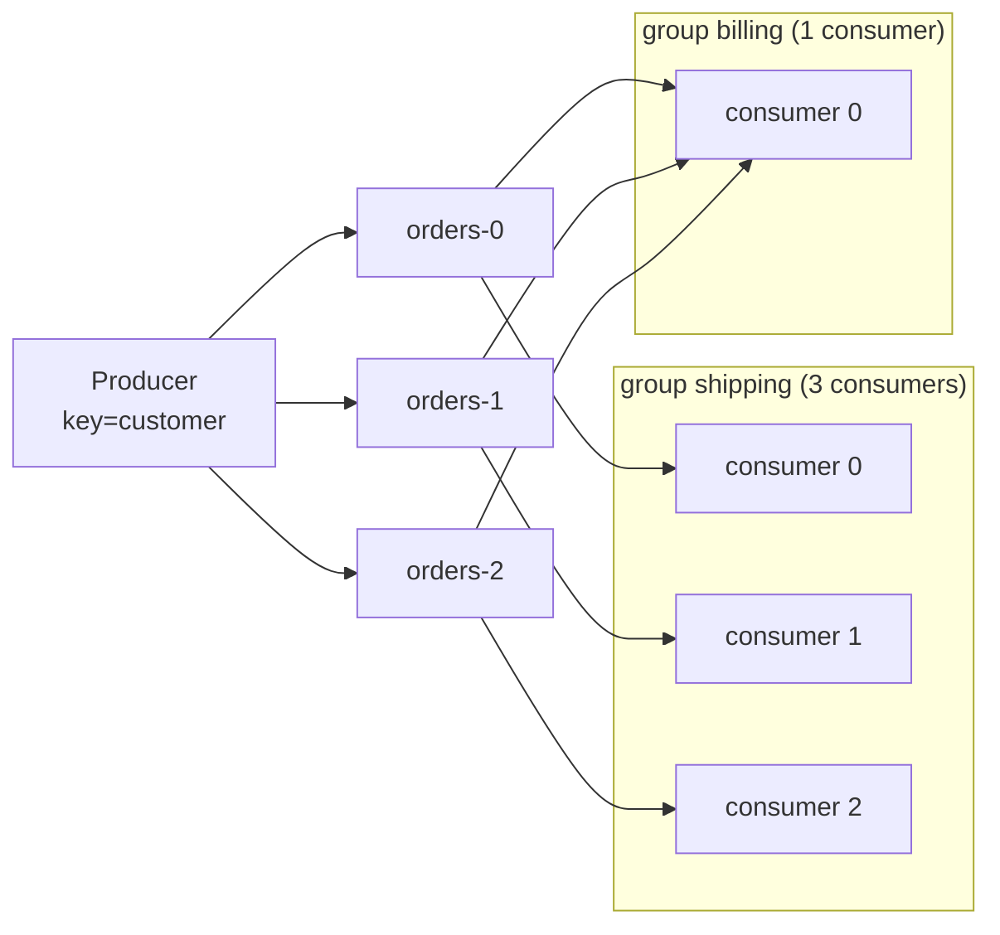
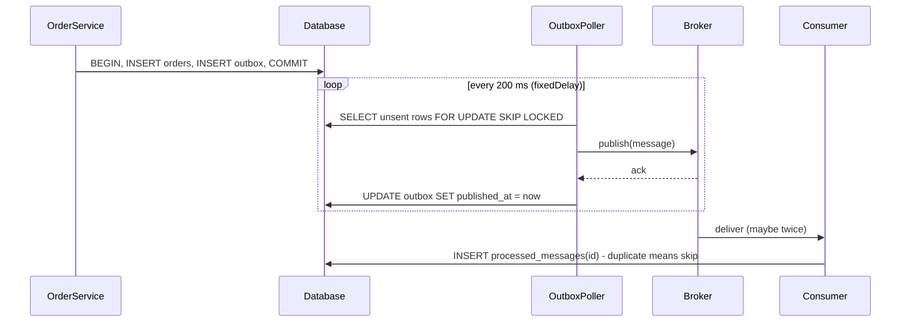

# Chapter 14 — Messaging, Async and Scheduling

So far all work happened **inside the request**. Real systems also need work that happens **later**, **elsewhere** or **on a timer**:

- "After sign-up, send a welcome e-mail without making the user wait for the SMTP (e-mail sending) server."
- "Every night at 02:00, expire unpaid orders."
- "When an order is placed, tell shipping, billing and analytics — other **processes** (running programs with their own memory, e.g. one JVM) that may be down right now."

Spring has one tool per layer: **application events** (in-process notifications), **`@Async`** (run a method on another **thread**), **`@Scheduled`** (run on a timer), and **messaging** with Kafka or RabbitMQ (**message brokers**: servers storing messages between processes, **durably** — on disk, surviving a crash; see [System Design Fundamentals](../../../system-design-patterns/modules/00-system-design-fundamentals/README.md)). The chapter ends with the **transactional outbox**, which joins a database **transaction** (changes that commit together or not at all) and a broker without losing messages.

**The code** (Spring Boot 4.1.1, Spring Framework 7.0, Spring for Apache Kafka 4.1.1, Kafka clients 4.2.1, Java 25):

| Project | Needs | What it proves |
|---|---|---|
| [`code/events-async`](code/events-async) | H2 in memory (a Java database living inside the JVM) | sync vs async listeners, transaction phases, `@Async` executors and thread names, MDC propagation, virtual threads, async exceptions |
| [`code/scheduling`](code/scheduling) | nothing | `fixedRate` vs `fixedDelay` vs `cron` timing, turning jobs off in tests, overlap on platform vs virtual threads |
| [`code/kafka-orders`](code/kafka-orders) | nothing: an embedded Kafka broker runs inside the test JVM | keys → partitions, consumer groups, JSON on the wire, retries + DLT, `@RetryableTopic`, idempotence, transactions |
| [`code/outbox`](code/outbox) | H2 in memory | atomic order + outbox row, polling publisher, broker outage, duplicate delivery, idempotent consumer |
| [`code/rabbit-orders`](code/rabbit-orders) | a RabbitMQ broker (Docker) | exchange/queue/binding/DLX configuration; **compiles, not run** |

Every output below was printed by a test and checked by an assertion. Run all with `bash tools_run_spring.sh spring '14-*'` from the repository root. No Docker needed: Kafka runs as `@EmbeddedKafka`, a real broker inside the test JVM.

---

## 14.1 The map: four ways to do work "somewhere else"

### What it is

| Tool | Where the work runs | Survives a crash? | Typical use |
|---|---|---|---|
| **Application event** (`publishEvent` + `@EventListener`) | same JVM, same thread by default | no, it lives in memory | decoupling modules inside one app |
| **`@Async` method** | same JVM, another thread | no | "don't make the caller wait": e-mails, reports, fan-out calls |
| **`@Scheduled` method** | same JVM, a scheduler thread | the schedule restarts with the app, a run in progress is lost | housekeeping, polling for new work, periodic reports |
| **Message broker** (Kafka, RabbitMQ) | another process, maybe another service | yes: the broker stores the message on disk | integration between services, buffering load, event streaming |



### How to choose

1. **Only this app cares, and losing the work in a crash is acceptable?** Application event; add `@Async` if the listener is slow.
2. **Must happen at a time or interval?** `@Scheduled`; on several instances add a lock (14.7).
3. **Another service must react, or the work must not be lost?** A broker; if the message must match a database change exactly, the **transactional outbox** (14.17).

The patterns (message queue, publish-subscribe, event-driven architecture) are explained without code in [System-design patterns, Module 2 — Moving data](../../../system-design-patterns/modules/02-moving-data/README.md) and the [event-driven architecture notes](../../../microservices-patterns/chapters/11-event-driven/README.md); this chapter is the Spring side.

---

## 14.2 Application events: synchronous vs `@Async` listeners

### What it is

Chapter 2 introduced the container's **publish/subscribe**: a bean publishes an object with `ApplicationEventPublisher.publishEvent(...)`, and every `@EventListener` whose parameter type matches receives it ([2.12](../02-ioc-and-dependency-injection/README.md#212-application-events)) — **synchronously, on the publisher's thread, before `publishEvent` returns.**

`@Async` on a listener changes that: the publisher hands the event to an **executor** (owner of worker threads and a task queue, §14.4) and continues at once — dropping a letter in a colleague's in-tray instead of waiting while they read it.

### How it works

1. `@EnableAsync` installs a post-processor that wraps every bean with `@Async` methods in a **proxy** ([ch04](../04-aop-and-proxies/README.md)).
2. `publishEvent` finds the matching listeners and calls them in order: a plain listener runs right away; an `@Async` listener's call goes through the proxy, which submits it to an executor and returns immediately.

```java
@SpringBootApplication
@EnableAsync   // turns on the proxy that makes @Async methods run on an executor
public class AsyncApplication { ... }

public record UserSignedUp(String email) {}

@Service
public class SignupService {
    // constructor injection of ApplicationEventPublisher events, Trace trace ...
    public void signUp(String email) {
        trace.add("publisher: publishing on " + Trace.thread());
        events.publishEvent(new UserSignedUp(email));
        trace.add("publisher: publishEvent returned on " + Trace.thread());
    }
}

@Component
public class SignupListeners {
    @EventListener                       // synchronous: runs inside publishEvent, same thread
    void createProfile(UserSignedUp e) {
        trace.add("  sync listener: profile for " + e.email() + " on " + Trace.thread());
    }

    @Async                               // asynchronous: handed to the executor, publisher does not wait
    @EventListener
    void sendWelcomeMail(UserSignedUp e) throws InterruptedException {
        Thread.sleep(200);               // pretend the SMTP call is slow
        trace.add("  async listener: welcome mail to " + e.email() + " on " + Trace.thread());
    }
}
```

`Trace` is a thread-safe list (`CopyOnWriteArrayList`) the tests print. The test calls `signUp`, prints the trace, then waits with **Awaitility** (polls a condition until true or timeout):

```java
signups.signUp("ana@example.com");
trace.lines().forEach(System.out::println);
assertThat(trace.lines()).hasSize(3);                     // the async listener has not finished yet
await().atMost(Duration.ofSeconds(2)).until(() -> trace.lines().size() == 4);
```

Output:
```
--- right after signUp() returned ---
publisher: publishing on main
  sync listener: profile for ana@example.com on main
publisher: publishEvent returned on main
--- 200 ms later ---
  async listener: welcome mail to ana@example.com on task-1
```

The sync listener ran on `main` (the test thread) between the publisher lines; the async one ran 200 ms later on `task-1`, Boot's auto-configured executor (14.4).

### Trade-offs

| | Sync listener | `@Async` listener |
|---|---|---|
| Publisher waits? | yes | no |
| Exception reaches the publisher? | yes, and it can roll back the publisher's transaction | no: it goes to the `AsyncUncaughtExceptionHandler` (14.6) |
| Runs in the publisher's transaction? | yes | no: a new thread has no transaction |
| Return value published as a new event? | yes | no |
| `@Order` between listeners | respected | only the hand-off is ordered; executions race |

### Common mistakes

- **Forgetting `@EnableAsync`.** Boot auto-configures an executor but does **not** enable `@Async`; without it `@Async` is silently ignored and the listener runs synchronously.
- **Expecting `ThreadLocal` state on the async thread** — the current transaction, Security context, logging MDC (§14.4). Nothing crosses threads unless copied (a `TaskDecorator`, 14.4).
- **Treating async events as reliable** — they live in memory; if the JVM stops first, the work is gone.

### TL;DR

`@EventListener` = same thread, publisher waits. `@Async @EventListener` = executor thread, publisher continues; exceptions and transactions don't cross over. Remember `@EnableAsync`.

---

## 14.3 `@TransactionalEventListener`: events tied to a commit

### What it adds to 7.15

[7.15](../07-data-access-jdbc-and-transactions/README.md#715-transactionaleventlistener) explains the four phases (`BEFORE_COMMIT`, `AFTER_COMMIT` (default), `AFTER_ROLLBACK`, `AFTER_COMPLETION`) and how the listener registers with the transaction as a **synchronization** (a callback around commit/rollback). Here: what each phase *sees* in the database, and the common production combination **`@Async` + `AFTER_COMMIT`**.

```java
@Transactional
public void place(String item, boolean paymentFails) {
    jdbc.sql("INSERT INTO orders(item) VALUES (?)").param(item).update();
    events.publishEvent(new OrderPlaced(item));
    trace.add("service: event published inside the transaction");
    if (paymentFails) throw new IllegalStateException("payment declined");
}

@Component
public class OrderListeners {
    @TransactionalEventListener(phase = TransactionPhase.BEFORE_COMMIT)
    void beforeCommit(OrderPlaced e) { /* counts the order row: visible, same transaction */ }

    @TransactionalEventListener   // phase = AFTER_COMMIT is the default
    void afterCommit(OrderPlaced e) { ... }

    @TransactionalEventListener(phase = TransactionPhase.AFTER_ROLLBACK)
    void afterRollback(OrderPlaced e) { /* counts the order row again: gone */ }

    @TransactionalEventListener(phase = TransactionPhase.AFTER_COMPLETION)
    void afterCompletion(OrderPlaced e) { ... }

    /** The common production combo: only after commit, off the request thread, in its own transaction. */
    @Async
    @TransactionalEventListener
    @Transactional(propagation = Propagation.REQUIRES_NEW)
    void emailAfterCommit(OrderPlaced e) {
        jdbc.sql("INSERT INTO email_log(message) VALUES (?)").param("confirmation for " + e.item()).update();
        trace.add("async AFTER_COMMIT email for " + e.item() + " on " + Trace.thread());
    }
}
```

Output (`EventsTest`):
```
--- commit ---
service: event published inside the transaction
BEFORE_COMMIT    book (row visible in tx: 1)
AFTER_COMMIT     book on main
AFTER_COMPLETION book
async AFTER_COMMIT email for book on task-2
--- rollback ---
service: event published inside the transaction
AFTER_ROLLBACK   lamp (rows now: 0)
AFTER_COMPLETION lamp
```

- On **commit**, `BEFORE_COMMIT` still saw the uncommitted row (it runs inside the same, still open transaction); `AFTER_COMMIT` and `AFTER_COMPLETION` ran on `main`; the async e-mail ran on `task-2` and wrote `email_log` in its own transaction.
- On **rollback**, only `AFTER_ROLLBACK` (row gone) and `AFTER_COMPLETION` ran, and **no e-mail was written** (the test waited 300 ms and asserted zero `email_log` rows for `lamp`).

### Why `REQUIRES_NEW` on the async listener

Since Framework 6.1 a `@TransactionalEventListener` that is also `@Transactional` must use `REQUIRES_NEW` (a fresh, separate transaction) or `NOT_SUPPORTED` (none), or the context fails to start (7.15). With `@Async` it runs on another thread anyway; `REQUIRES_NEW` states the intent.

### When not to use it

When the side effect **must** happen: `AFTER_COMMIT` + `@Async` is an in-memory hand-off, so a JVM death between commit and e-mail loses it with no retry. For "must not be lost", write an outbox row in the same transaction (14.17).

### In the interview

**30-second answer:** see 7.15, plus: "With `@Async` the side effect also leaves the request thread and gets its own transaction (`REQUIRES_NEW`). It is still an in-memory hand-off, so critical messages go through an outbox."

- *No transaction active?* → Transactional listeners are skipped, unless `fallbackExecution = true`.
- *Can `BEFORE_COMMIT` veto the commit?* → Yes: an exception there propagates and the transaction rolls back.

---

## 14.4 `@Async` and executors

### What it is

`@Async` on a public (at least non-private, non-final) bean method means "run on another thread, return to the caller at once". An **executor** owns worker threads and a queue of waiting tasks (the `Executor` of [Java ch14 §14.11](../../../java/chapters/14-concurrency-1/README.md)). Spring picks **which** executor, wraps the call, and adapts the return value.

### How it works

1. The caller calls `reports.build("daily")`. `reports` is really the proxy.
2. The proxy's `AsyncExecutionInterceptor` picks an executor:
   - the one named in `@Async("name")`, if given;
   - else the one returned by an `AsyncConfigurer`;
   - else a unique `TaskExecutor` bean, or the bean named `taskExecutor`. With Boot this is the auto-configured `applicationTaskExecutor`.
3. It submits the real method call as a task and returns right away:
   - `void` → returns nothing; an exception goes to the `AsyncUncaughtExceptionHandler`.
   - `CompletableFuture<T>` (or `Future<T>`) → returns a **future** (placeholder for a later result) completing when the task finishes; inside the method return `CompletableFuture.completedFuture(value)` and Spring completes the caller's future.

### Boot's auto-configured executor

If you define **no** `Executor` bean, Boot creates one called `applicationTaskExecutor`:

| Setting | Default | Property |
|---|---|---|
| type | `ThreadPoolTaskExecutor`; `SimpleAsyncTaskExecutor` if virtual threads are on | `spring.threads.virtual.enabled` |
| core threads | 8 | `spring.task.execution.pool.core-size` |
| queue capacity | unbounded | `spring.task.execution.pool.queue-capacity` |
| max threads | unlimited, but used only when the queue is full — with an unbounded queue never more than core threads | `spring.task.execution.pool.max-size` |
| thread names | `task-1`, `task-2`, ... | `spring.task.execution.thread-name-prefix` |
| wait for tasks on shutdown | no | `spring.task.execution.shutdown.await-termination(-period)` |

(This chapter's example sets `core-size=4`.)

> **Watch out:** declaring *any* `Executor` bean (e.g. a reports pool) makes Boot's `applicationTaskExecutor` back off, and `@Async`, MVC async requests and other integrations fall back to other defaults. Fixes: declare the extra pool with `@Bean(defaultCandidate = false)` (the Boot docs' recipe), or `spring.task.execution.mode=force` (Boot 3.5+) to create the auto-configured executor anyway.

### A dedicated pool, a TaskDecorator, and the self-call trap

```java
@Configuration(proxyBeanMethods = false)
public class AsyncConfig {

    /** A second, dedicated pool for slow report jobs. defaultCandidate = false keeps it out of
     *  by-type injection, so Boot still auto-configures the normal applicationTaskExecutor. */
    @Bean(defaultCandidate = false)
    @Qualifier("reportExecutor")
    ThreadPoolTaskExecutor reportExecutor() {
        ThreadPoolTaskExecutor executor = new ThreadPoolTaskExecutor();
        executor.setThreadNamePrefix("report-");
        executor.setCorePoolSize(2);
        executor.setMaxPoolSize(2);
        executor.setQueueCapacity(10);          // bounded: an 11th waiting job is rejected
        return executor;
    }

    /** Boot applies a TaskDecorator bean to the executor it auto-configures: copy the MDC across threads. */
    @Bean
    TaskDecorator mdcCopyingDecorator() {
        return runnable -> {
            Map<String, String> callerMdc = MDC.getCopyOfContextMap();   // runs on the caller thread
            return () -> {                                               // runs on the worker thread
                if (callerMdc != null) MDC.setContextMap(callerMdc);
                try { runnable.run(); } finally { MDC.clear(); }
            };
        };
    }
}

@Service
public class ReportService {
    @Async   // default executor: Boot's applicationTaskExecutor
    public CompletableFuture<String> build(String name) {
        return CompletableFuture.completedFuture(name + " built on " + Trace.thread()
                + " requestId=" + MDC.get("requestId"));
    }

    @Async("reportExecutor")   // pick a specific executor bean by name / qualifier
    public CompletableFuture<String> buildBig(String name) { /* same body */ }

    /** Self-invocation: the call below does not go through the proxy, so it is NOT asynchronous. */
    public String buildViaThis(String name) {
        return this.build(name).join();
    }
}
```

The **MDC** (Mapped Diagnostic Context) is SLF4J's (the standard Java logging facade) per-thread map of values such as a request id that log lines include. Being a `ThreadLocal`, a new thread starts empty. A **`TaskDecorator`** wraps each submitted task: it reads the caller's values on the caller thread and restores them on the worker.

The test puts `requestId=r-42` into the MDC and calls the three methods:

Output (`AsyncMethodsTest`):
```
auto-configured executor: ThreadPoolTaskExecutor
daily built on task-1 requestId=r-42
yearly built on report-1 requestId=null
self-call built on main requestId=r-42
```

- `daily` ran on Boot's pool (`task-1`); the decorator carried `r-42` across.
- `yearly` ran on the dedicated pool (`report-1`) without a decorator (hand-built pool), so the MDC was empty — call `executor.setTaskDecorator(...)` yourself if needed.
- `self-call` ran on `main`: `this.build(...)` skips the proxy, so `@Async` did nothing — the self-invocation rule of `@Transactional` ([4.5](../04-aop-and-proxies/README.md#45-proxy-limitations--proved)).

Boot 4.1 also offers `spring.task.execution.propagate-context=true`, registering Spring's `ContextPropagatingTaskDecorator`, which copies thread-locals registered with Micrometer's context-propagation library (e.g. tracing) instead of a hand-written decorator.

### Sizing a pool

| Workload | Pool shape |
|---|---|
| CPU-bound (image resizing, PDF rendering) | about as many threads as cores; more only add context switching |
| I/O-bound (HTTP calls, SMTP, database) | many threads, or virtual threads (14.5) |
| Must not pile up in memory | a **bounded** queue plus a rejection policy. The default `AbortPolicy` throws `TaskRejectedException` to the caller; `CallerRunsPolicy` runs the task on the caller's thread, which slows the producer down |
| Isolate slow jobs from fast ones | separate pools (a **bulkhead**, see [microservices notes](../../../microservices-patterns/chapters/07-bulkhead/README.md)) |

### Common mistakes

- **Self-invocation, `private` or `final` methods** → no proxy, no async. Move the method to another bean.
- **Unbounded queue before a slow dependency** → tasks pile up until the heap is full. Set `queue-capacity`.
- **Own `Executor` bean, then MVC async or `@Async` changed pools** → Boot's executor backed off. `defaultCandidate = false` or `mode=force`.
- **`.join()` right after the async call** → the caller waits anyway, plus a thread hop. Start several futures, then join all.
- **Losing work on shutdown** → queued tasks are dropped unless `shutdown.await-termination=true`.

### Real-world examples

- A shop sends the confirmation e-mail and pushes the order to analytics via `@Async`, so checkout responds in 80 ms instead of 600 ms.
- A dashboard fires three `@Async` calls and combines them with `CompletableFuture.allOf(...)` — the page waits for the slowest, not the sum ([Java 15.2 — CompletableFuture](../../../java/chapters/15-concurrency-2-modern/README.md#152-completablefuture)).

### TL;DR

`@EnableAsync` + `@Async` = proxy + executor. Boot's `applicationTaskExecutor`: 8 threads, unbounded queue, `task-` names. Pick a pool with `@Async("name")`; declare extra pools with `defaultCandidate = false`; copy ThreadLocals (MDC) with a `TaskDecorator`; never self-invoke.

---

## 14.5 `@Async` on virtual threads

### What it is

A **virtual thread** (final in Java 21) is JVM-managed: a few hundred bytes instead of ~1 MB of stack, so hundreds of thousands are fine. Blocking on I/O parks it and frees its carrier (OS) thread ([Java 15.4 — Virtual threads](../../../java/chapters/15-concurrency-2-modern/README.md#154-virtual-threads)).

`spring.threads.virtual.enabled=true` (Boot 3.2+, Java 21+) switches Boot's executors to virtual threads, and also Tomcat request threads, `@Scheduled` and the Kafka and RabbitMQ listener containers.

```java
@SpringBootTest(properties = "spring.threads.virtual.enabled=true")
class VirtualThreadsTest {
    @Autowired ReportService reports;
    @Autowired AsyncTaskExecutor applicationTaskExecutor;

    @Test
    void asyncMethodsRunOnVirtualThreads() {
        System.out.println("auto-configured executor: " + applicationTaskExecutor.getClass().getSimpleName());
        List<CompletableFuture<String>> futures = IntStream.rangeClosed(1, 3)
                .mapToObj(i -> reports.build("report-" + i)).toList();
        futures.forEach(f -> System.out.println(f.join()));
        assertThat(futures).allSatisfy(f -> assertThat(f.join()).contains("on virtual task-"));
    }
}
```

Output:
```
auto-configured executor: SimpleAsyncTaskExecutor
report-1 built on virtual task-1 requestId=null
report-2 built on virtual task-2 requestId=null
report-3 built on virtual task-3 requestId=null
```

`Trace.thread()` prints `virtual` when `Thread.isVirtual()`. The executor is now a `SimpleAsyncTaskExecutor`: **no pool, no queue**, a new virtual thread per task; pool settings like `core-size` are ignored.

### Trade-offs

| | Platform-thread pool | Virtual threads |
|---|---|---|
| Concurrency limit | the pool size, a natural throttle | none by default: 10,000 submitted tasks means 10,000 concurrent tasks |
| Cost per blocked task | a whole OS thread | tiny |
| Best for | CPU-bound work, or when you want a hard cap | I/O-bound work: HTTP calls, JDBC, SMTP |
| Limit concurrency with | pool size + queue | `spring.task.execution.simple.concurrency-limit`, or Framework 7's `@ConcurrencyLimit` ([4.7](../04-aop-and-proxies/README.md#47-framework-7-core-resilience-retryable-and-concurrencylimit)) |

### Common mistakes

- **Flooding a downstream system.** No pool = no throttle. If each task takes a DB connection, the connection pool (10 by default in HikariCP, Boot's pool) becomes the real limit. Set a concurrency limit deliberately.
- **Expecting CPU-bound work to speed up** — virtual threads help waiting, not computing.
- **Pinning.** Before JDK 24 a virtual thread blocked inside `synchronized` pinned its carrier; JEP 491 (JDK 24) fixed that. Native calls can still pin.
- **An app whose only work is scheduled jobs exits at startup** — virtual threads are daemon threads (don't keep the JVM alive). Set `spring.main.keep-alive=true`.

### TL;DR

`spring.threads.virtual.enabled=true` → `@Async` runs on a new virtual thread per call (`SimpleAsyncTaskExecutor`), no pool, no queue. Great for I/O; add a concurrency limit yourself.

---

## 14.6 Exceptions in async methods

### The problem it solves

Normally an exception travels up the caller's stack; with `@Async` the caller has already returned. Where it goes depends on the return type:

| Return type | Where the exception goes | How to see it |
|---|---|---|
| `CompletableFuture<T>` / `Future<T>` | stored in the future, which completes exceptionally | `get()` throws `ExecutionException`, `join()` throws `CompletionException`, or use `exceptionally` / `handle` / `whenComplete` |
| `void` | nowhere near the caller | the `AsyncUncaughtExceptionHandler`. The default one only **logs** the error |

```java
@Async
public CompletableFuture<String> buildBroken(String name) {
    throw new IllegalStateException("no data for " + name);   // becomes an exceptionally completed future
}

@Async
public void fireAndForget(String name) {
    throw new IllegalStateException("cannot export " + name);  // void: goes to AsyncUncaughtExceptionHandler
}

/** Only overrides the exception handler, so @Async keeps using Boot's executor.
 *  Keep AsyncConfigurer in its own class with no @Bean methods: Boot 4 wraps AsyncConfigurer beans. */
@Configuration(proxyBeanMethods = false)
public class AsyncErrorConfig implements AsyncConfigurer {
    @Override
    public AsyncUncaughtExceptionHandler getAsyncUncaughtExceptionHandler() {
        return (ex, method, params) ->
                trace.add("uncaught handler: " + method.getName() + " threw " + ex.getMessage() + " on " + Trace.thread());
    }
}
```

The test:

```java
CompletableFuture<String> future = reports.buildBroken("march");
assertThatThrownBy(future::get).isInstanceOf(ExecutionException.class)
        .hasCauseInstanceOf(IllegalStateException.class);
String viaHandle = future.handle((ok, ex) -> "recovered from: " + ex.getMessage()).join();

reports.fireAndForget("april");                   // returns at once, no exception for the caller
await().atMost(Duration.ofSeconds(2)).until(() -> !trace.lines().isEmpty());
```

Output:
```
CompletableFuture: recovered from: java.lang.IllegalStateException: no data for march
void method:       uncaught handler: fireAndForget threw cannot export april on task-4
```

The message inside `handle` starts with `java.lang.IllegalStateException:` because `handle` received a `CompletionException` wrapping the original (its message includes the cause). Use `ex.getCause()` for the original.

> **Found while building this chapter:** with `getAsyncUncaughtExceptionHandler()` **and** `@Bean` methods in one `AsyncConfigurer` class, Boot 4 failed at startup (`Illegal factory instance for factory method 'mdcCopyingDecorator'`) because it wraps user `AsyncConfigurer` beans. Hence two classes.

### Common mistakes

- **`void` + no handler = silent failure in production.** The default handler logs at ERROR and moves on; nobody retries. Return a `CompletableFuture`, or install a handler that records a metric and alerts.
- **Catching inside the async method and returning `null`** — the caller can't tell success from failure.
- **Expecting `@Transactional` rollback in the caller** — the async method runs in another thread and transaction (or none).

---

## 14.7 Scheduling with `@Scheduled`

### What it is

`@Scheduled` makes the container call a method on a timer: every N ms, N ms after the previous run ended, or at calendar times given by a **cron expression** (a compact repeating-time format from Unix `cron`). It needs `@EnableScheduling`; Boot then auto-configures a `ThreadPoolTaskScheduler` with **one thread**, `scheduling-1`.

### How it works

`@EnableScheduling` registers a post-processor that finds `@Scheduled` methods (no parameters, return value ignored) and registers a trigger for each with the `TaskScheduler`, whose thread runs the method at trigger time.

| Attribute | Meaning | Example |
|---|---|---|
| `fixedRate = 300` | start every 300 ms, measured **start to start** | heartbeat, metrics push |
| `fixedDelay = 300` | wait 300 ms **after the previous run ends** | polling a table or an API: never overlaps, never floods |
| `initialDelay = 50` | wait before the first run | let the app warm up |
| `cron = "0 0 2 * * *"` | calendar-based, 6 fields | nightly jobs |
| `zone = "Europe/Berlin"` | time zone for `cron` (default: the server's) | daylight-saving-safe jobs |
| `timeUnit = TimeUnit.SECONDS` | unit for rate/delay (default ms) | `fixedDelay = 30, timeUnit = SECONDS` |
| `fixedDelayString = "${outbox.poller.delay-ms}"` | value from configuration | tunable per environment |

Spring's cron has **six** fields, one more than Unix cron, because it starts with **seconds**:

| Field | Values | `0 30 2 * * MON-FRI` means |
|---|---|---|
| second | 0–59 | at second 0 |
| minute | 0–59 | minute 30 |
| hour | 0–23 | 02:xx |
| day of month | 1–31, `L` = last day | any |
| month | 1–12 or JAN–DEC | any |
| day of week | 0–7 (0 and 7 = Sunday) or MON–SUN | Monday to Friday |

Macros: `@hourly`, `@daily` (also `@midnight`), `@weekly`, `@monthly`, `@yearly` (also `@annually`). The value `"-"` disables a cron trigger — handy with a property: `cron = "${jobs.cleanup.cron:-}"`.

### Proving fixedRate vs fixedDelay vs cron

Both jobs pretend to work 200 ms with a 300 ms period; the test records start times and prints the gaps:

```java
@Scheduled(fixedRate = 300)           // measured from START to START
void fixedRateJob() { rateRuns.add(now()); work(200); }

@Scheduled(fixedDelay = 300, initialDelay = 50)   // measured from END to next START
void fixedDelayJob() { delayRuns.add(now()); work(200); }

@Scheduled(cron = "*/1 * * * * *", zone = "UTC")  // every second, on the second
void cronJob() { cronRuns.add(LocalTime.now().withNano(0) + " on " + Thread.currentThread().getName()); }
```

```properties
# default is ONE scheduler thread shared by every @Scheduled method; give each job its own
spring.task.scheduling.pool.size=3
```

```java
await().atMost(Duration.ofSeconds(5))
       .until(() -> jobs.rateRuns.size() >= 6 && jobs.delayRuns.size() >= 4 && jobs.cronRuns.size() >= 2);
assertThat(median(rateGaps)).isBetween(270L, 360L);    // about 300 = the period
assertThat(median(delayGaps)).isBetween(470L, 600L);   // about 500 = 200 work + 300 delay
```

Output (`ScheduledJobsTest`; the millisecond gaps and clock times vary slightly from run to run):
```
fixedRate  = 300 ms, job takes 200 ms -> gaps between starts [300, 300, 300, 300] on scheduling-1
fixedDelay = 300 ms, job takes 200 ms -> gaps between starts [500, 510, 510] on scheduling-2
cron */1 * * * * *                    -> [19:48:15 on scheduling-1, 19:48:16 on scheduling-3]
```

`fixedRate` started every 300 ms regardless of job length; `fixedDelay` every 500 ms (200 ms work + 300 ms pause); cron fired on whole seconds, on whichever of the three scheduler threads was free. (`zone` affects only cron evaluation; the printed time is the local clock.)

### The one-thread default, and overlap

With the default `pool.size=1`, **all** `@Scheduled` methods share one thread: a 10-minute report delays every other job, even the one-second heartbeat — hence the raised pool size.

What if a fixed-rate job is **slower than its period**? It depends on the scheduler. `SlowJob` does 250 ms of work every 100 ms and records concurrent runs:

```java
@Scheduled(fixedRate = 100)
void tick() throws InterruptedException {
    int now = running.incrementAndGet();
    maxRunningAtOnce.accumulateAndGet(now, Math::max);
    ...
    try { Thread.sleep(250); } finally { running.decrementAndGet(); }
}
```

Output (`OverlapTest`, 1.2 seconds each; run counts vary by one or two between runs):
```
ThreadPoolTaskScheduler: runs=5 maxRunningAtOnce=1 (scheduling-2)
SimpleAsyncTaskScheduler: runs=13 maxRunningAtOnce=3 (virtual thread scheduling-22)
```

- **Platform threads** (`ThreadPoolTaskScheduler`): runs of one method never overlap; late runs start as soon as the previous ends — only 5 runs.
- **Virtual threads** (`SimpleAsyncTaskScheduler`, Framework 6.1+): each run gets a new thread and the scheduler doesn't wait — three overlapped. Per the Framework docs this scheduler tracks only the hand-off, and `fixedDelay` tasks are forced onto a single scheduler thread to keep their meaning.

A job that must never overlap itself: `fixedDelay`, or a guard (`AtomicBoolean`, a lock).

### Turning jobs off in tests

Background jobs make tests **flaky** (pass/fail with no code change) by touching data at random moments. Put `@EnableScheduling` on its own configuration class behind a property (`@ConditionalOnBooleanProperty`, new in Boot 3.5):

```java
@Configuration(proxyBeanMethods = false)
@EnableScheduling
@ConditionalOnBooleanProperty(name = "app.jobs.enabled", matchIfMissing = true)
public class SchedulingConfig {}
```

```
app.jobs.enabled=false -> runs after 700 ms: 0
```

Then test the job's **method** directly (as 14.17 does with `poller.publishBatch()`), plus one small test with scheduling on and Awaitility.

### Running in a cluster

`@Scheduled` knows nothing about other instances: with three Kubernetes **pods** (running app instances), the 02:00 job runs **three times**. Options:

| Option | How |
|---|---|
| **ShedLock** (a library) | `@SchedulerLock(name = "cleanup")` takes a lock row in a shared database table. Only one instance runs the job |
| Leader election (instances agree one "leader" does the job) | Spring Integration `LockRegistryLeaderInitiator`, Kubernetes leader election |
| Move the job out | a Kubernetes `CronJob`, or Quartz (Java job scheduler) in clustered JDBC mode for persistent, missed-fire-aware schedules |
| Make the job idempotent and safe to run concurrently | `UPDATE ... WHERE status = 'PENDING'` claims rows, or `SELECT ... FOR UPDATE SKIP LOCKED` (14.17) |

### Common mistakes

- **Forgetting `@EnableScheduling`** — nothing runs, nothing complains.
- **A long job on the single default thread** blocks every other job.
- **Five-field Unix cron** (`"0 2 * * *"`) — Spring needs six fields and rejects it at startup.
- **`fixedRate` polling a slow resource** on virtual threads — runs pile up. Use `fixedDelay`.
- **Relying on server time zones** — set `zone`: 02:30 happens twice or not at all on daylight-saving days.
- **Ignoring clusters** — N instances, N runs.

### In the interview

**30-second answer:** "`@Scheduled` needs `@EnableScheduling`. `fixedRate` is start-to-start, `fixedDelay` is end-to-start, and cron has six fields starting with seconds. Boot's default scheduler has one thread, so I raise `spring.task.scheduling.pool.size` or jobs block each other. On platform threads a slow fixed-rate job doesn't overlap itself, but on virtual threads it can. In a cluster every instance runs the job, so I use ShedLock or make the job idempotent."

- *How do you test a scheduled job?* → Call the method directly with scheduling off; one integration test with scheduling on, using Awaitility with a timeout — never `Thread.sleep` plus an exact count.
- *fixedRate or fixedDelay for polling an outbox?* → `fixedDelay`: the next poll starts only after the previous finished.

### TL;DR

`@EnableScheduling` + `@Scheduled(fixedRate | fixedDelay | cron)`. Six-field cron with seconds. One scheduler thread by default. Overlap depends on the scheduler. One run per instance — lock or be idempotent in a cluster.

---

## 14.8 Messaging concepts you need first

### What it is

A **message broker** accepts messages from **producers**, stores them, and hands them to **consumers**, which never talk directly — so either can be slow, down, or deployed separately (like a post office). Two designs dominate:

| | **Queue broker** (RabbitMQ, ActiveMQ, Amazon SQS) | **Log broker** (Apache Kafka, Redpanda, Amazon Kinesis) |
|---|---|---|
| Storage | a queue per interested consumer group; a message is **deleted** once acknowledged ("acked": the consumer confirms handling) | an append-only **log**; messages stay for a retention period (e.g. 7 days) whether read or not |
| Reading | the broker pushes messages and tracks which are acknowledged | each consumer group tracks its own **offset** (position) and pulls |
| Replay old messages | no, they are gone after the ack | yes: reset the offset |
| Routing | rich: exchanges, routing keys, patterns, headers (explained in §14.18) | by topic and partition only (§14.9) |
| Ordering | per queue, weakened by multiple consumers and redelivery | strict **per partition** |
| Typical use | task distribution, request/reply, complex routing | event streaming, event sourcing (state rebuilt from stored change events), many independent consumers, high throughput |

### Delivery guarantees

| Guarantee | Meaning | How you get it |
|---|---|---|
| **At-most-once** | a message may be lost, never duplicated | ack or commit **before** processing |
| **At-least-once** | never lost, may be **duplicated** | ack or commit **after** processing. Spring's default for both Kafka and RabbitMQ |
| **Exactly-once** | processed once | only inside a closed system, such as Kafka transactions for read-process-write within Kafka. Across a database and a broker you build it yourself: at-least-once plus an **idempotent consumer** |

An **idempotent** operation gives the same result when repeated ("set status to PAID" is; "add 10 € to the balance" is not). Since at-least-once is normal, **every consumer should tolerate duplicates** — 14.17 remembers processed message ids. Theory, including why exactly-once is hard: [DDIA ch11 — Stream processing](../../../ddia/chapters/11-stream-processing/README.md).

---

## 14.9 Kafka in five minutes

### What it is

**Apache Kafka** is a distributed, replicated **commit log** (an append-only list of records read in order). Vocabulary:

| Term | Meaning |
|---|---|
| **Broker** | one Kafka server; a **cluster** has several. Since Kafka 4.0 the cluster manages itself with **KRaft** (Kafka Raft — Raft is a consensus algorithm); ZooKeeper (the former separate coordination service) is gone |
| **Topic** | a named stream of records, e.g. `orders` |
| **Partition** | a topic is split into N partitions, each an ordered append-only log on a broker — the unit of parallelism |
| **Offset** | a record's position inside its partition: 0, 1, 2, ... |
| **Record** | key (optional) + value + headers + timestamp |
| **Key** | decides the partition: the default partitioner hashes the key (murmur2) modulo the partition count. **Same key → same partition → ordered**; no key → spread across partitions |
| **Replication factor** | copies of each partition on different brokers. One is the **leader**, the others are followers |
| **Consumer group** | consumers sharing a `group.id`. Each partition is read by **exactly one** member of the group, and each group gets **every** record |
| **Committed offset** | per group and partition: "we've processed up to here". After a restart the group continues from it |
| **Rebalance** | reassigning partitions when members join or leave |



Two rules follow:

1. **Scale consumers up to the partition count** — a fourth `shipping` consumer would idle. Choose partitions for the parallelism you will need.
2. **Ordering is per partition** — same-key records in order, no order across partitions.

Spring for Apache Kafka ("spring-kafka") wraps the Kafka Java client with `KafkaTemplate` (sending), `@KafkaListener` (receiving), error handlers, retry topics, transactions and test support. Boot 4.1.1 manages **spring-kafka 4.1.1** and **kafka-clients 4.2.1** (checked in the Boot 4.1.1 BOM — the "bill of materials" pinning compatible versions — and the spring-kafka 4.1 reference).

---

## 14.10 Setting up Spring Kafka (with JSON)

### Dependencies

```xml
<!-- spring-kafka 4.1.x + kafka-clients 4.2.x + Jackson 3, versions managed by Boot 4.1.1 -->
<dependency>
  <groupId>org.springframework.boot</groupId>
  <artifactId>spring-boot-starter-kafka</artifactId>
</dependency>
<!-- the Kafka starter does not bring Jackson; JacksonJsonSerializer needs it (Jackson 3, tools.jackson.*) -->
<dependency>
  <groupId>org.springframework.boot</groupId>
  <artifactId>spring-boot-starter-jackson</artifactId>
</dependency>
<!-- tests: spring-boot-starter-test + spring-kafka-test (EmbeddedKafka) -->
<dependency>
  <groupId>org.springframework.boot</groupId>
  <artifactId>spring-boot-starter-kafka-test</artifactId>
  <scope>test</scope>
</dependency>
```

Boot 4's starters are modular ([ch01](../01-spring-ecosystem-and-first-app/README.md)): Kafka has `spring-boot-starter-kafka` and `spring-boot-starter-kafka-test` (Boot 3 used `org.springframework.kafka:spring-kafka` directly). Our first run failed with `ClassNotFoundException: tools.jackson.core.type.TypeReference` — the Kafka starter has no Jackson; add `spring-boot-starter-jackson` (or a web starter).

### Configuration

```properties
# in tests @EmbeddedKafka sets spring.embedded.kafka.brokers; otherwise a local broker
spring.kafka.bootstrap-servers=${spring.embedded.kafka.brokers:localhost:9092}

# ---- producer: String keys, JSON values (Jackson 3) ----
spring.kafka.producer.key-serializer=org.apache.kafka.common.serialization.StringSerializer
spring.kafka.producer.value-serializer=org.springframework.kafka.support.serializer.JacksonJsonSerializer
spring.kafka.producer.acks=all

# ---- consumer: JSON values, wrapped so that a bad record cannot crash the consumer ----
spring.kafka.consumer.auto-offset-reset=earliest
spring.kafka.consumer.key-deserializer=org.apache.kafka.common.serialization.StringDeserializer
spring.kafka.consumer.value-deserializer=org.springframework.kafka.support.serializer.ErrorHandlingDeserializer
spring.kafka.consumer.properties[spring.deserializer.value.delegate.class]=org.springframework.kafka.support.serializer.JacksonJsonDeserializer
spring.kafka.consumer.properties[spring.json.trusted.packages]=ch14.kafka
```


| Setting | Why |
|---|---|
| `JacksonJsonSerializer` / `JacksonJsonDeserializer` | JSON via **Jackson 3**. The older `JsonSerializer`/`JsonDeserializer` (Jackson 2) are `@Deprecated(since="4.0", forRemoval=true)` in spring-kafka 4 |
| `ErrorHandlingDeserializer` | wraps the real deserializer; a record whose bytes aren't valid JSON (a **poison pill**) goes to the error handler instead of failing inside `poll()` forever |
| `spring.json.trusted.packages` | the class named in the `__TypeId__` header is created only from trusted packages. Never `*` for untrusted producers |
| `auto-offset-reset=earliest` | a **new** group without committed offset starts at the beginning; Kafka's default `latest` skips everything sent before it joined |
| `acks=all` | the leader waits for all in-sync replicas before confirming (client default since Kafka 3.0; explicit for clarity) |

The event is a plain record:

```java
/** The message payload. Serialized to JSON by JacksonJsonSerializer. */
public record OrderEvent(String orderId, String customer, long cents) {}
```

Topics are declared as beans; Boot's `KafkaAdmin` creates missing ones at startup:

```java
@Bean NewTopic orders()      { return TopicBuilder.name("orders").partitions(3).replicas(1).build(); }
@Bean NewTopic payments()    { return TopicBuilder.name("payments").partitions(1).replicas(1).build(); }
@Bean NewTopic paymentsDlt() { return TopicBuilder.name("payments-dlt").partitions(1).replicas(1).build(); }
```

### What goes over the wire

A test reads one record back with a plain `StringDeserializer` to show the raw bytes (`ProducerGuaranteesTest.jsonOnTheWire`):

```
value bytes as text: {"orderId":"o-json","customer":"zoe","cents":4200}
__TypeId__ header  : ch14.kafka.OrderEvent
```

The **type header** tells the consumer which class to build, coupling producer and consumer to one Java class name. Across services: give the consumer a fixed target type (`spring.json.value.default.type` + `spring.json.use.type.headers=false`), map type ids to local classes (`spring.json.type.mapping`), or use Avro/Protobuf (compact binary formats with explicit schemas) with a schema registry (stores schemas, checks compatibility of new versions).

---

## 14.11 Producing: `KafkaTemplate`, keys and partitions

### How it works

1. `kafkaTemplate.send(topic, key, value)` serializes key and value, picks a partition (key hash), and adds the record to an in-memory batch.
2. A background I/O thread sends batches to partition leaders — batching (`linger.ms`, `batch.size`) is where Kafka's throughput comes from.
3. `send` returns a `CompletableFuture<SendResult<K, V>>` completing on broker acknowledgement (its `RecordMetadata` holds topic, partition, offset), or exceptionally if the send failed after the client's own retries.

```java
@Service
public class OrderProducer {
    private final KafkaTemplate<String, Object> kafka;
    // constructor ...

    /** Key = customer: all events of one customer go to the same partition, so they stay in order. */
    public CompletableFuture<SendResult<String, Object>> publish(OrderEvent event) {
        return kafka.send("orders", event.customer(), event);
    }
}
```

The test sends six orders for three customers and prints where each one landed:

```java
RecordMetadata meta = producer.publish(e).join().getRecordMetadata();
System.out.printf("%s key=%-5s -> %s-%d@%d%n", e.orderId(), e.customer(), meta.topic(), meta.partition(), meta.offset());
```

Output (`ProducerConsumerTest`):
```
--- producer: send(topic, key, value).get() -> RecordMetadata ---
o-1 key=alice -> orders-0@0
o-2 key=dave  -> orders-1@0
o-3 key=carol -> orders-2@0
o-4 key=alice -> orders-0@1
o-5 key=dave  -> orders-1@1
o-6 key=carol -> orders-2@1
```

`alice` always lands on partition 0, `dave` on 1, `carol` on 2 — the hash is deterministic. An early version used `alice`, `bob`, `carol` → partitions 0, 0, 2: two keys shared partition 0 and partition 1 got nothing. **Hashing doesn't promise an even spread**, and a "hot" key (one huge customer) overloads one partition.

### Common mistakes

- **Fire-and-forget without checking the future** — a failed send is only logged. Attach `whenComplete`, or `join()` where the caller must know.
- **No key when order matters** — events of one order land on different partitions, out of order.
- **Changing the partition count later** — `hash(key) % N` changes, keys move, ordering across the change is lost.
- **Huge messages** — the default maximum is about 1 MB; store big payloads elsewhere and send a reference.

---

## 14.12 Consuming: `@KafkaListener`, concurrency and consumer groups

### How it works

1. Boot's auto-configured `ConcurrentKafkaListenerContainerFactory` creates a **listener container** per `@KafkaListener`.
2. `concurrency = "3"` creates three consumers (threads) in the same group, each assigned a share of partitions.
3. Each thread loops: `poll()` a batch, call your method per record, then **commit the offsets** (default ack mode `BATCH`: after the whole polled batch).
4. If your method throws, the container's **error handler** decides (14.14).

```java
/** Group "shipping", 3 consumer threads: the 3 partitions are shared out between them. */
@KafkaListener(id = "shipping", topics = "orders", groupId = "shipping", concurrency = "3")
void ship(ConsumerRecord<String, OrderEvent> record) {
    received.add("shipping", record.value().orderId() + " key=" + record.key()
            + " p" + record.partition() + " on " + Thread.currentThread().getName());
}

/** Group "billing", 1 thread: a different group gets its OWN copy of every message. */
@KafkaListener(id = "billing", topics = "orders", groupId = "billing")
void bill(@Payload OrderEvent event,
          @Header(KafkaHeaders.RECEIVED_PARTITION) int partition,
          @Header(KafkaHeaders.OFFSET) long offset) {
    received.add("billing", event.orderId() + " p" + partition + "@" + offset
            + " on " + Thread.currentThread().getName());
}
```

A listener method can take the whole `ConsumerRecord`, the converted payload plus `@Header` values, an `Acknowledgment` for manual commits, or a `List<...>` for batch listeners.

The test first waits until the group has **settled** (each consumer owns one partition) — in the first run the first consumer to join briefly owned all three and processed everything.

```java
var shipping = (ConcurrentMessageListenerContainer<?, ?>) registry.getListenerContainer("shipping");
await().atMost(Duration.ofSeconds(30)).until(() -> shipping.getContainers().stream()
        .allMatch(c -> c.getAssignedPartitions() != null && c.getAssignedPartitions().size() == 1));
```

Output:
```
assignment: shipping-0 -> [orders-0]
assignment: shipping-1 -> [orders-1]
assignment: shipping-2 -> [orders-2]
...
--- group 'shipping' (concurrency 3) ---
o-1 key=alice p0 on shipping-0-C-1
o-2 key=dave p1 on shipping-1-C-1
o-3 key=carol p2 on shipping-2-C-1
o-4 key=alice p0 on shipping-0-C-1
...
--- group 'billing' (concurrency 1) ---
o-1 p0@0 on billing-0-C-1
o-2 p1@0 on billing-0-C-1
... (o-3 to o-6, all on billing-0-C-1)
```

- In `shipping` each partition had its own thread (`shipping-N-C-1` = listener id, consumer index, "C" for consumer thread); all of `alice`'s orders went to one thread, in order.
- `billing`, a **different group**, got **all six** records again on its single thread: publish-subscribe across groups, queue semantics within one group.

### Commit modes

| `spring.kafka.listener.ack-mode` | Commits |
|---|---|
| `BATCH` (default) | after all records from one `poll()` were processed |
| `RECORD` | after each record. Safer and slower |
| `TIME` / `COUNT` / `COUNT_TIME` | after a time or a number of records |
| `MANUAL` / `MANUAL_IMMEDIATE` | when your code calls `acknowledgment.acknowledge()` |

spring-kafka turns Kafka's auto-commit off (`enable.auto.commit=false`); the container commits **after** processing → at-least-once. After a crash the last batch's uncommitted records are redelivered, so the consumer must be idempotent.

### Common mistakes

- **More consumers than partitions** — the extras idle.
- **Slow processing** — a `poll()` batch longer than `max.poll.interval.ms` (5 minutes default) makes Kafka assume the consumer died, rebalance, and have another member reprocess it. Reduce `max.poll.records` or speed up.
- **Blocking the listener on remote calls without timeouts** — one hanging HTTP call stops a whole partition.
- **One `groupId` for two purposes** — they split the records instead of each getting all.

---

## 14.13 Testing with `@EmbeddedKafka`

### What it is

`spring-kafka-test` starts a **real Kafka broker inside the test JVM** (KRaft mode, random port) — no Docker, no installation — and publishes its address as `spring.embedded.kafka.brokers`, which `application.properties` already reads.

```java
@SpringBootTest
@EmbeddedKafka(partitions = 1, brokerProperties = {
        "transaction.state.log.replication.factor=1", "transaction.state.log.min.isr=1"})
abstract class KafkaTestBase {}

class ProducerConsumerTest extends KafkaTestBase { ... }
class ErrorHandlingTest extends KafkaTestBase { ... }
class ProducerGuaranteesTest extends KafkaTestBase { ... }
```

- All three classes inherit the **same** annotations, so the test-context cache reuses one context and broker ([ch12](../12-testing-spring-apps/README.md)).
- `partitions = 1` applies to topics in `@EmbeddedKafka(topics = ...)` and auto-created ones; our `NewTopic` beans set their own counts.
- A single broker can't store the transaction log at the default replication factor of 3; the two broker properties make Kafka transactions (14.16) work.
- Asynchronous consumption is asserted with **Awaitility**, never `Thread.sleep` and hope.

| Test style | Speed | Realism | Needs |
|---|---|---|---|
| Unit test of the listener method (call it directly) | ms | logic only | nothing |
| `@EmbeddedKafka` | seconds | real protocol, real client, one broker | spring-kafka-test |
| Testcontainers Kafka + `@ServiceConnection` | slower | the real broker image you run in production | Docker ([ch12](../12-testing-spring-apps/README.md)) |

Timing (machine-dependent): the whole `kafka-orders` suite (6 tests, one broker) takes about 12 s of test time (surefire: 5.2 s + 4.9 s + 2.2 s), mostly broker start-up and back-off waits.

---

## 14.14 Error handling: `DefaultErrorHandler` and the dead-letter topic

### The problem it solves

A listener throws. Re-reading the same record forever lets one that can **never** succeed (bad data, a poison pill) block its partition; skipping it loses data. The standard answer:

1. **Retry** a few times with back-off for errors that may pass (timeouts, a restarting service).
2. **Don't retry** errors that can't (validation, deserialization).
3. After the last attempt, **publish to a dead-letter topic (DLT)** with headers describing the failure, **commit** the offset, move on. Someone inspects the DLT, fixes the cause, and replays.

### How it works in spring-kafka

- `DefaultErrorHandler` is the container's error handler. On failure it **seeks** the partition back to the failed record so the next `poll()` returns it — a **blocking** retry: the partition waits.
- Its `BackOff` sets how often and how long. Default `FixedBackOff(0, 9)`: 9 retries, no delay, 10 attempts.
- On exhaustion it calls a `ConsumerRecordRecoverer`; `DeadLetterPublishingRecoverer` sends the record to the DLT.
- **Fatal by default** (no retries): `DeserializationException`, `MessageConversionException`, `ConversionException`, `MethodArgumentResolutionException`, `NoSuchMethodException`, `ClassCastException`. Add more with `addNotRetryableExceptions(...)`.
- Boot applies a `CommonErrorHandler` bean to its auto-configured container factory — declaring it suffices.

> **Version note:** since **spring-kafka 3.3** (so all 4.x) the default DLT name is `<topic>-dlt`; up to 3.2 it was `<topic>.DLT`, as most articles still show. Our first run proved it: `Destination resolver returned non-existent partition payments-dlt-0`, because we had created `payments.DLT`.

```java
@Bean
DefaultErrorHandler errorHandler(KafkaTemplate<String, Object> jsonTemplate, ProducerFactory<String, Object> pf) {
    // A record that could not be deserialized has only raw bytes: publish those bytes unchanged.
    KafkaTemplate<String, Object> bytesTemplate =
            new KafkaTemplate<>(pf, Map.of(ProducerConfig.VALUE_SERIALIZER_CLASS_CONFIG, ByteArraySerializer.class));
    Map<Class<?>, KafkaOperations<?, ?>> templates = new LinkedHashMap<>();
    templates.put(byte[].class, bytesTemplate);
    templates.put(Object.class, jsonTemplate);

    var recoverer = new DeadLetterPublishingRecoverer(templates);   // default target: same topic + "-dlt", same partition
    var handler = new DefaultErrorHandler(recoverer, new FixedBackOff(100, 2));
    handler.addNotRetryableExceptions(IllegalArgumentException.class);   // bad data will never get better
    return handler;
}
```

Why two templates? A normal failed `OrderEvent` is re-published as JSON; a **poison pill** was never deserialized, so the recoverer has only raw `byte[]`. The map picks the template by value type; the `LinkedHashMap` keeps `byte[]` ahead of the `Object` catch-all.

The listener simulates three kinds of payment:

```java
@KafkaListener(id = "payments", topics = "payments", groupId = "payments")
void charge(OrderEvent e) {
    int attempt = attempts.computeIfAbsent(e.orderId(), k -> new AtomicInteger()).incrementAndGet();
    received.add("payments", e.orderId() + " attempt " + attempt);
    if (e.cents() < 0) throw new IllegalArgumentException("negative amount " + e.cents());
    if (e.orderId().equals("p-down") || (e.orderId().equals("p-flaky") && attempt < 3))
        throw new TransientPaymentException("provider timeout");
    received.add("payments", e.orderId() + " CHARGED");
}

/** Reads the dead-letter topic as plain text (overrides the JSON deserializer for this listener only). */
@KafkaListener(id = "payments-dlt", topics = "payments-dlt", groupId = "dlt-inspector",
        properties = "value.deserializer=org.apache.kafka.common.serialization.StringDeserializer")
void inspectDeadLetter(String value,
                       @Header(KafkaHeaders.DLT_EXCEPTION_CAUSE_FQCN) String causeClass,
                       @Header(KafkaHeaders.DLT_ORIGINAL_TOPIC) String originalTopic) { ... }
```

The test sends `p-ok`, `p-flaky` (fails twice, then works), `p-down` (always fails), `p-bad` (negative amount) and a raw string `this is not JSON`:

Output (`ErrorHandlingTest.blockingRetriesThenDeadLetterTopic`):
```
--- payments listener ---
p-ok attempt 1
p-ok CHARGED
p-flaky attempt 1
...
p-flaky attempt 3
p-flaky CHARGED
p-down attempt 1
...
p-down attempt 3
p-bad attempt 1
--- payments-dlt ---
{"orderId":"p-down","customer":"carol","cents":300} <- payments, cause TransientPaymentException
{"orderId":"p-bad","customer":"dave","cents":-5} <- payments, cause IllegalArgumentException
this is not JSON <- payments, cause DeserializationException
```

| Record | What happened |
|---|---|
| `p-flaky` | 1 attempt + 2 retries, succeeded on the third. No DLT |
| `p-down` | 3 attempts, then DLT with the cause class in a header |
| `p-bad` | `IllegalArgumentException` is not retryable: 1 attempt, then DLT |
| `this is not JSON` | the listener was **never called**: `ErrorHandlingDeserializer` made it a fatal `DeserializationException`; the original bytes went to the DLT unchanged |

The listener exception is wrapped in `ListenerExecutionFailedException`, but the classifier walks the **cause chain**, so `IllegalArgumentException` was recognized. DLT records carry headers `kafka_dlt-original-topic`, `-original-partition`, `-original-offset`, `-exception-fqcn`, `-exception-cause-fqcn`, `-exception-message`, `-exception-stacktrace` (constants `KafkaHeaders.DLT_*`).

### Trade-offs of blocking retries

| Pro | Con |
|---|---|
| Order within the partition is kept | the partition **stops** while one record is retried. A long back-off stalls everything behind it |
| Simple, no extra topics | the total back-off must stay well under `max.poll.interval.ms`, or the consumer is kicked out of the group |

### Common mistakes

- **The default back-off** (10 instant attempts) hammers a struggling dependency. Set a real one, e.g. `ExponentialBackOff`.
- **No `ErrorHandlingDeserializer`** — a poison pill fails inside `poll()` before your code, so the error handler never gets it.
- **A DLT with fewer partitions than the source** — the recoverer targets the **same partition number**. Create enough, or use a custom destination resolver.
- **Nobody watches the DLT** — alert on its size; document replay.

---

## 14.15 Non-blocking retries with `@RetryableTopic`

### What it is

Instead of seeking back and blocking the partition, a failed record is **re-published to a retry topic** and its offset committed; the main topic keeps flowing. A separate consumer reads the retry topic after the back-off; after the last attempt the record goes to the DLT and a `@DltHandler` method runs.

```java
@RetryableTopic(attempts = "3", backOff = @BackOff(delay = 200))
@KafkaListener(id = "invoices", topics = "invoices", groupId = "invoices")
void createInvoice(OrderEvent e, @Header(KafkaHeaders.RECEIVED_TOPIC) String topic) {
    received.add("invoices", e.orderId() + " from " + topic);
    if (e.orderId().startsWith("inv-bad")) throw new IllegalStateException("tax service unavailable");
}

@DltHandler
void giveUp(OrderEvent e, @Header(KafkaHeaders.RECEIVED_TOPIC) String topic) {
    received.add("invoices", e.orderId() + " DLT handler, from " + topic);
}
```

Output (`ErrorHandlingTest.nonBlockingRetryTopics`, `inv-bad` sent first, then `inv-ok`):
```
--- @RetryableTopic ---
inv-bad from invoices
inv-ok from invoices
inv-bad from invoices-retry
inv-bad from invoices-retry
inv-bad DLT handler, from invoices-dlt
```

`inv-ok` was processed **before** `inv-bad`'s retries — the failing record no longer blocked the partition. The framework created `invoices-retry` and `invoices-dlt` itself. With a fixed delay **one** retry topic is reused for all attempts (annotation default since spring-kafka 3.2; `RetryTopicConfigurationBuilder` got the same default in 4.1). In spring-kafka 4.0 the attribute changed from Spring Retry's `backoff = @Backoff` to `backOff = @BackOff` (`org.springframework.kafka.annotation.BackOff`).

### Blocking vs non-blocking

| | `DefaultErrorHandler` (blocking) | `@RetryableTopic` (non-blocking) |
|---|---|---|
| Partition during retries | stopped | keeps flowing |
| Ordering | kept | **lost** for the retried record: later records overtake it |
| Extra topics | only the DLT | retry topic(s) + DLT |
| Long delays (minutes) | dangerous (`max.poll.interval.ms`) | fine |
| Choose when | order matters (account balance updates) | independent records, slow-recovering dependencies |

### When not to use it

When per-key event order matters: if `OrderCancelled` overtakes a retried `OrderPlaced`, the consumer sees a cancel for an unknown order.

---

## 14.16 Producer guarantees: idempotence and transactions

### Idempotent producer

**The problem:** the broker writes a batch but the acknowledgement is lost; the producer retries and the batch is written **twice**. The **idempotent producer** fixes it: the broker assigns a producer id, the producer numbers each batch per partition, and the broker drops sequence numbers already written. **On by default** since Kafka 3.0, with `acks=all`.

```java
var effective = new ProducerConfig(bootProducerFactory.getConfigurationProperties());
System.out.println("enable.idempotence = " + effective.getBoolean(ProducerConfig.ENABLE_IDEMPOTENCE_CONFIG));
System.out.println("acks               = " + effective.getString(ProducerConfig.ACKS_CONFIG));
System.out.println("max.in.flight      = " + effective.getInt(ProducerConfig.MAX_IN_FLIGHT_REQUESTS_PER_CONNECTION));
```

Output:
```
enable.idempotence = true
acks               = -1
max.in.flight      = 5
```

`acks=-1` means `all`. Idempotence requires `max.in.flight ≤ 5` and keeps per-partition order across retries. It removes duplicates from **producer retries** only — not your app calling `send` twice for one business event.

### Transactional producer

A **Kafka transaction** makes several sends (several topics/partitions, plus consumer offsets) **atomic**; `isolation.level=read_committed` consumers see all or none.

```java
var pf = new DefaultKafkaProducerFactory<String, String>(props);
pf.setTransactionIdPrefix("ledger-tx-");        // turns on transactions (and requires idempotence)
var tx = new KafkaTemplate<>(pf);

tx.executeInTransaction(t -> {                   // committed: both records become visible together
    t.send("ledger", "acc-1", "debit 50");
    t.send("ledger", "acc-2", "credit 50");
    return null;
});
tx.executeInTransaction(t -> {                   // aborted: the record stays invisible
    t.send("ledger", "acc-1", "debit 999");
    t.flush();                                   // the record really reaches the broker...
    throw new IllegalStateException("crash before commit");   // ...but the transaction is aborted
});
```

Output (`ProducerGuaranteesTest.transactionalProducerAndReadCommitted`):
```
isolation.level=read_committed   -> [debit 50, credit 50]
isolation.level=read_uncommitted -> [debit 50, credit 50, debit 999]
```

The aborted record **is in the log** (`read_uncommitted` shows it); the broker writes an abort marker and `read_committed` consumers skip it. Without the `flush()` the record never left the client and both lists were equal in our first run — proving nothing.

In Boot, `spring.kafka.producer.transaction-id-prefix=tx-` makes the auto-configured `KafkaTemplate` transactional and creates a `KafkaTransactionManager`; then every `send` must run in a transaction (`executeInTransaction`, `@Transactional("kafkaTransactionManager")`, or a listener container starting one). Consumers must set `spring.kafka.consumer.isolation-level=read_committed` (Kafka default: `read_uncommitted`).

### What Kafka transactions do not give you

**Exactly-once** holds for "consume from Kafka → process → produce to Kafka, committing input offsets in the same transaction". It does **not** cover a database write plus a Kafka send: there's no two-phase commit (a coordinator asking every system "can you commit?", then telling all to commit) between them. The old `ChainedKafkaTransactionManager` (deprecated since spring-kafka 2.7) just committed one after the other — best effort, not atomic. For database + broker, use the outbox.

---

## 14.17 The transactional outbox

### The problem it solves: the dual write

```java
@Transactional
public void placeOrder(...) {
    orderRepository.save(order);                 // 1. database
    kafkaTemplate.send("orders", event);         // 2. broker
}                                                // 3. commit
```

Every ordering of these steps fails somewhere:

| Failure | Result |
|---|---|
| send succeeds, then the commit fails | consumers hear about an order that **does not exist** |
| commit succeeds, then the app crashes before the send | the order exists and **nobody is told** |
| send after the commit, broker down | same: lost event, unless you build retries and persistence... which is an outbox |

This is the **dual-write problem**: database and broker cannot share one transaction.

### How it works

1. In the **same local database transaction** as the business change, insert an `outbox` row describing the event.
2. Commit: order and event exist together, or neither does.
3. A separate **message relay** reads unsent rows in order, publishes them, and marks them sent — a **poller** (shown here) or **change data capture** (CDC: streaming committed changes out of the database; Debezium reads the write-ahead log, where the database records each change before applying it).
4. Consumers get **at-least-once** delivery, so they must be **idempotent**, de-duplicating on each message's unique id.



The pattern without Spring: [Saga notes — Part 13D, implementing the saga log](../../../microservices-patterns/chapters/10-saga/README.md#d-implementing-the-saga-log-properly), [event-driven architecture notes](../../../microservices-patterns/chapters/11-event-driven/README.md), [System-design patterns, Module 10 — the outbox pattern](../../../system-design-patterns/modules/10-batch-and-streaming/README.md). Here it runs.

### The schema

```sql
-- the outbox: messages waiting to be sent, written in the SAME transaction as the order
CREATE TABLE IF NOT EXISTS outbox (
    id            IDENTITY PRIMARY KEY,                -- also gives the publishing order
    message_id    UUID         NOT NULL UNIQUE,        -- consumers de-duplicate on this
    aggregate_id  VARCHAR(50)  NOT NULL,               -- becomes the Kafka key
    event_type    VARCHAR(50)  NOT NULL,
    payload       VARCHAR(2000) NOT NULL,              -- JSON
    created_at    TIMESTAMP    DEFAULT CURRENT_TIMESTAMP NOT NULL,
    published_at  TIMESTAMP,                           -- NULL = not sent yet
    attempts      INT          DEFAULT 0 NOT NULL
);
CREATE INDEX IF NOT EXISTS outbox_unpublished ON outbox (published_at, id);
-- consumer side: ids of messages already handled (idempotent consumer)
CREATE TABLE IF NOT EXISTS processed_messages (message_id UUID PRIMARY KEY);
```

### Writing the order and the event together

```java
/** ONE local transaction: the order row and the outbox row commit together or not at all. */
@Transactional
public long placeOrder(String item, long cents, boolean failBeforeCommit) {
    var keys = new GeneratedKeyHolder();
    jdbc.sql("INSERT INTO orders(item, cents) VALUES (?, ?)").params(item, cents).update(keys, "id");
    long orderId = keys.getKey().longValue();

    String payload = json.writeValueAsString(new OrderPlaced(orderId, item, cents));   // Jackson 3 JsonMapper
    jdbc.sql("""
            INSERT INTO outbox(message_id, aggregate_id, event_type, payload)
            VALUES (?, ?, 'OrderPlaced', ?)""")
        .params(UUID.randomUUID(), "order-" + orderId, payload)
        .update();

    if (failBeforeCommit) throw new IllegalStateException("crash before commit");
    return orderId;       // no broker call here: nothing can be half-done
}
```

### The poller (message relay)

```java
@Scheduled(fixedDelayString = "${outbox.poller.delay-ms}")
public void poll() { publishBatch(); }

@Transactional
public int publishBatch() {
    // FOR UPDATE SKIP LOCKED: several app instances can poll at once without sending the same row twice
    List<OutboxRow> rows = jdbc.sql("""
            SELECT id, message_id, aggregate_id, event_type, payload
            FROM outbox
            WHERE published_at IS NULL
            ORDER BY id
            FETCH FIRST 10 ROWS ONLY
            FOR UPDATE SKIP LOCKED""")
        .query(OutboxRow.class).list();

    int sent = 0;
    for (OutboxRow row : rows) {
        try {
            publisher.publish(new Message(row.messageId(), row.aggregateId(), row.eventType(), row.payload()));
        } catch (Exception e) {
            jdbc.sql("UPDATE outbox SET attempts = attempts + 1 WHERE id = ?").param(row.id()).update();
            log.warn("outbox row {} not published ({}), will retry", row.id(), e.getMessage());
            break;                                  // keep order: do not send later rows before this one
        }
        jdbc.sql("UPDATE outbox SET published_at = CURRENT_TIMESTAMP, attempts = attempts + 1 WHERE id = ?")
            .param(row.id()).update();
        sent++;
    }
    return sent;
}
```

Design choices:

- **`fixedDelay`**, not `fixedRate`: a slow round never overlaps the next (14.7).
- **`FOR UPDATE SKIP LOCKED`** (PostgreSQL 9.5+, MySQL 8.0+, H2 2.x as in this demo): several instances' pollers lock different rows ([SQL ch13](../../../sql/chapters/13-transactions-and-concurrency/README.md) explains row locks).
- **Stop at the first failure** (`break`) so later messages never overtake an earlier one.
- `MessagePublisher` is an interface; the demo's `InMemoryBroker` can simulate an outage (`DOWN`) or a lost acknowledgement (`ACK_LOST`: stored, then a timeout thrown). With Kafka it is one line — the `.get()` with timeout makes "published" mean "acknowledged":

```java
kafkaTemplate.send("orders", m.key(), m.payload()).get(10, TimeUnit.SECONDS);
```

### Proving it

The tests switch the scheduler off (`outbox.poller.enabled=false`) and call `publishBatch()` themselves for determinism; one extra test leaves it on.

Output (`OutboxTest`, `OutboxSchedulerTest`):
```
after rollback: orders=0 outbox=0
after commit:   orders=1 outbox=1 unpublished=1
outbox payload: {"orderId":5,"item":"book","cents":1999}
poller sent 1 -> broker has 1, unpublished=0

WARN  c.o.OutboxPoller - outbox row 2 not published (broker unreachable), will retry
broker DOWN -> sent 0, unpublished=2, attempts of first row=1
broker UP   -> sent 2, unpublished=0
broker order: [order-2, order-3]

WARN  c.o.OutboxPoller - outbox row 1 not published (no ack from broker), will retry
broker holds 2 copies of message eab1f5f0...
consumer handled: [true, false] -> stock_reservations=1

published by the scheduled poller within ~200 ms: OrderPlaced {"orderId":1,"item":"desk","cents":25000}
```

(Id numbers depend on test order: identity (auto-increment) columns keep counting after `DELETE`.)

| Scenario | What the test proved |
|---|---|
| Crash before commit | **no** order and **no** outbox row: nothing to publish, nothing wrong published |
| Commit | one order, one unpublished outbox row, published on the next poll |
| Broker down | nothing lost: rows stay unpublished with `attempts=1`, and go out in order once the broker is back |
| Ack lost | the broker got the message but the poller didn't know, so it sent it **again**. The consumer's `processed_messages` insert failed with `DuplicateKeyException` on the second copy, so the stock was reserved **once** |

The idempotent consumer:

```java
@Transactional
public boolean handle(Message m) {
    try {
        jdbc.sql("INSERT INTO processed_messages(message_id) VALUES (?)").param(m.messageId()).update();
    } catch (DuplicateKeyException alreadySeen) {
        return false;                               // duplicate: skip silently
    }
    jdbc.sql("INSERT INTO stock_reservations(order_id) VALUES (?)").param(m.key()).update();
    return true;
}
```

Id insert and business change share **one** transaction: if the change fails, the id rolls back too and a redelivery is processed normally.

### Trade-offs

| Poller (this demo) | CDC (Debezium outbox event router) |
|---|---|
| plain SQL + `@Scheduled`, easy to understand | no polling load, lower latency |
| adds query load; latency = poll interval | extra infrastructure: Kafka Connect (Kafka's framework for moving data in and out), Debezium, access to the DB log |
| works on any database | needs DB support (Postgres logical decoding, MySQL binlog) |

Housekeeping: delete or archive published rows (e.g. nightly, `published_at` older than 7 days), or the table grows forever.

**Spring Modulith** offers a ready-made variant for modular monoliths (one deployable split into well-separated modules): its *event publication registry* stores application events in a table before commit and re-delivers those whose listeners didn't complete; *event externalization* forwards selected events to Kafka or AMQP (Advanced Message Queuing Protocol, RabbitMQ's protocol).

### When not to use it

- The message isn't tied to a database change (e.g. a metrics tick) — send directly.
- Losing an occasional event is acceptable (cache warm-up hints) — `@TransactionalEventListener(AFTER_COMMIT)` + send is simpler.

### Common mistakes

- **Calling the broker inside the business transaction** "to be sure" — the dual write again, plus a DB connection held during a network call.
- **Non-idempotent consumers** — the outbox guarantees at-least-once, not exactly-once.
- **Publishing out of order** by continuing after a failure, or several pollers without `SKIP LOCKED` and key-based order.
- **Letting the outbox grow forever.**

### In the interview

**30-second answer:** "You can't atomically write to a database and publish to Kafka — the dual-write problem. The outbox pattern writes the event into an outbox table in the same local transaction as the business change. A relay (a poller with `SELECT ... FOR UPDATE SKIP LOCKED`, or Debezium CDC) publishes the rows and marks them sent. Delivery is at-least-once, because the relay can crash between publishing and marking, so consumers de-duplicate by message id in the same transaction as their own change."

- *Why not a Kafka transaction?* → It only covers Kafka; the database commit is outside it.
- *Ordering?* → Publish in id order, stop at the first failure, use the aggregate id as Kafka key so each aggregate's events share a partition (an **aggregate** is a business object changing as one unit, e.g. an order with its lines).
- *Poller or CDC?* → Start with a poller; switch to CDC when polling load or latency matters, or Kafka Connect is already there.
- *Why two copies in the "ack lost" test?* → Stored, but the poller saw a timeout and didn't mark the row, so it resent; the consumer's `processed_messages` insert rejected the duplicate.

---

## 14.18 RabbitMQ with Spring AMQP (configuration, not run)

### What it is

**RabbitMQ** is a queue broker speaking AMQP 0-9-1. Producers publish to an **exchange**, never a queue; the exchange routes to zero or more **queues** via **bindings**; consumers read queues and **acknowledge** each message.

| Exchange type | Routes by | Example |
|---|---|---|
| **direct** | exact routing key | `payment.failed` → `payments.alerts` queue |
| **topic** | pattern: `*` = one word, `#` = zero or more words | `order.placed.*` matches `order.placed.eu` |
| **fanout** | nothing: copies to every bound queue | broadcast "cache invalidated" |
| **headers** | message header values | rarely used |

Other terms: **prefetch** — how many unacknowledged messages one consumer may hold; **dead-letter exchange (DLX)** — where rejected or expired messages go; **quorum queues** (RabbitMQ 3.8+) — replicated, durable queues; **competing consumers** — several consumers sharing one queue's messages.

[`code/rabbit-orders`](code/rabbit-orders) **compiles** (`mvn compile` passed) but is **not run**: it needs a broker (e.g. `docker run -p 5672:5672 rabbitmq:4-management`), so its folder has `.tools_run_skip`.

```xml
<dependency>
  <groupId>org.springframework.boot</groupId>
  <artifactId>spring-boot-starter-amqp</artifactId>   <!-- spring-amqp / spring-rabbit 4.1.x -->
</dependency>
```

```java
/** Boot's RabbitAdmin declares these exchanges, queues and bindings on the broker at startup. */
@Configuration(proxyBeanMethods = false)
public class RabbitConfig {
    @Bean TopicExchange ordersExchange() { return new TopicExchange("orders"); }
    @Bean DirectExchange deadLetterExchange() { return new DirectExchange("orders.dlx"); }

    @Bean Queue shippingQueue() {
        return QueueBuilder.durable("orders.shipping")
                .quorum()                                           // replicated queue type (RabbitMQ 3.8+)
                .deadLetterExchange("orders.dlx")                   // rejected messages go here...
                .deadLetterRoutingKey("orders.shipping.dlq")        // ...with this routing key
                .build();
    }
    @Bean Queue shippingDlq() { return QueueBuilder.durable("orders.shipping.dlq").build(); }

    /** Topic exchange: routing key "order.placed.eu" matches pattern "order.placed.*". */
    @Bean Binding shippingBinding() {
        return BindingBuilder.bind(shippingQueue()).to(ordersExchange()).with("order.placed.*");
    }
    @Bean Binding dlqBinding() {
        return BindingBuilder.bind(shippingDlq()).to(deadLetterExchange()).with("orders.shipping.dlq");
    }

    /** Boot sets a MessageConverter bean on RabbitTemplate and on the listener container factory. */
    @Bean MessageConverter jsonConverter() { return new JacksonJsonMessageConverter(); }
}

// producer: exchange, routing key, body (converted to JSON)
rabbit.convertAndSend("orders", "order.placed." + region, event);

// consumer: competing consumers on one queue
@RabbitListener(queues = "orders.shipping")
void ship(OrderEvent e) {
    if (e.cents() < 0) throw new IllegalArgumentException("bad amount");   // 1 attempt + 2 retries, then dead-lettered
    ...
}
```

```properties
spring.rabbitmq.host=localhost
spring.rabbitmq.listener.simple.prefetch=10
spring.rabbitmq.listener.simple.concurrency=2
# retry in the listener (blocking), then reject -> the queue's dead-letter exchange
spring.rabbitmq.listener.simple.retry.enabled=true
# retries AFTER the first attempt (Boot 4 replaced max-attempts with max-retries)
spring.rabbitmq.listener.simple.retry.max-retries=2
spring.rabbitmq.listener.simple.retry.initial-interval=500ms
spring.rabbitmq.listener.simple.default-requeue-rejected=false
# producer side: broker confirms + returns for unroutable messages
spring.rabbitmq.publisher-confirm-type=correlated
spring.rabbitmq.publisher-returns=true
spring.rabbitmq.template.mandatory=true
```

(Property names checked against Boot 4.1.1's `spring-boot-amqp` metadata. Boot 4 replaced `retry.max-attempts`, which counted the first attempt, with `retry.max-retries`, which doesn't.)

With Spring AMQP's default `AUTO` ack mode the container acks when your method returns normally; if it throws, the message is rejected and **requeued** unless `default-requeue-rejected=false` or the exception is `AmqpRejectAndDontRequeueException`. Requeueing an always-failing message loops forever — hence the DLX. **Publisher confirms** make the broker acknowledge each publish (RabbitMQ's counterpart of Kafka's `acks`); **returns** with `mandatory=true` report messages no queue was bound to receive.

Testing without Docker: Spring AMQP has no embedded broker. Use `@RabbitListenerTest` / `RabbitListenerTestHarness` (`spring-rabbit-test`) to spy on listeners, test listener methods as plain methods, or run the real broker via Testcontainers + `@ServiceConnection` ([ch12](../12-testing-spring-apps/README.md)).

### Kafka or RabbitMQ?

| Question | Leans Kafka | Leans RabbitMQ |
|---|---|---|
| Several independent consumers read the same stream, maybe later | yes: each group has its own offset, and records are retained | each consumer needs its own queue, and messages are gone after the ack |
| Replay history, rebuild a read model (a copy of data shaped for queries) | yes | no |
| Complex routing by key patterns or headers | limited | yes: exchanges |
| Per-message priorities, TTL (time to live: an expiry time), delayed delivery | no | yes (TTL, priorities; delays via a plugin) |
| Throughput | very high (batching, sequential disk I/O) | high, lower per node |
| Ordering | per partition, scales with partitions | per queue, weakened by competing consumers |
| Operational model | a cluster plus partitions to plan | simpler for small setups |

Spring also supports **JMS** (`JmsTemplate`, `@JmsListener`; ActiveMQ Artemis, IBM MQ), **Apache Pulsar** (Spring for Apache Pulsar), and **Spring Cloud Stream**, one API with plug-in "binders" per broker ([ch16](../16-spring-cloud-and-microservices/README.md)).

---

## 14.19 Common mistakes (whole chapter)

| Mistake | Symptom | Fix |
|---|---|---|
| No `@EnableAsync` / `@EnableScheduling` | `@Async` runs synchronously, `@Scheduled` never runs | add the annotation, on its own config class if you want to switch it with a property |
| Self-invocation of `@Async` | work runs on the caller's thread | call through another bean (4.5) |
| `@Async void` without a handler | failures only logged | return `CompletableFuture`, or add an `AsyncUncaughtExceptionHandler` |
| Declaring an `Executor` bean | Boot's `applicationTaskExecutor` disappears | `@Bean(defaultCandidate = false)` or `spring.task.execution.mode=force` |
| One default scheduler thread | jobs delay each other | `spring.task.scheduling.pool.size` |
| `@Scheduled` on N instances | job runs N times | ShedLock / leader election / idempotent job |
| Sending to Kafka inside a DB transaction | ghost events or lost events | transactional outbox |
| No key on ordered events | events processed out of order | key = aggregate id |
| Default `FixedBackOff(0, 9)` | retry storm against a failing service | real back-off + DLT |
| No `ErrorHandlingDeserializer` | poison pill blocks the partition | wrap the value deserializer |
| Looking for `orders.DLT` on spring-kafka 3.3+ | DLT "empty" | the default name is now `orders-dlt` |
| Non-idempotent consumers | double charges after a rebalance or redelivery | de-duplicate by message id |
| `Thread.sleep` in async tests | flaky tests | Awaitility with a timeout |

---

## 14.20 In the interview

Per-section blocks cover transactional listeners (14.3), `fixedRate` vs `fixedDelay` and clustered jobs (14.7), blocking vs retry-topic retries and poison pills (14.14–14.15) and the outbox (14.17). The rest:

1. **How does `@Async` work?** → `@EnableAsync` adds a proxy. Calls through the proxy are submitted to an executor, and the proxy returns `null`/a future at once. Self-invocation bypasses it.
2. **Which executor does `@Async` use in Boot?** → The one named in `@Async("…")`, else an `AsyncConfigurer`'s, else the `taskExecutor`/`applicationTaskExecutor` that Boot auto-configures: a `ThreadPoolTaskExecutor` with 8 core threads and an unbounded queue, or a virtual-thread `SimpleAsyncTaskExecutor` if `spring.threads.virtual.enabled=true`.
3. **What happens to an exception in an `@Async` method?** → For a future return type it is stored in the future. For `void` it goes to the `AsyncUncaughtExceptionHandler`, which only logs by default.
4. **How do you pass the MDC or security context to async threads?** → A `TaskDecorator` (Boot applies a `TaskDecorator` bean to its executor), `spring.task.execution.propagate-context=true`, or `DelegatingSecurityContextAsyncTaskExecutor` for security.
5. **Kafka partition vs consumer group?** → Partitions split a topic for parallelism and ordering. A group splits the partitions among its members. Different groups each get every record.
6. **How do you keep events for one order in sequence?** → Use the order id as the key, so they share one partition, and use blocking retries, not retry topics.
7. **What does `DefaultErrorHandler` do?** → It seeks back and retries per its `BackOff` (default 10 attempts, no delay). Then it calls the recoverer, e.g. `DeadLetterPublishingRecoverer` → `<topic>-dlt` (since spring-kafka 3.3). Fatal exceptions such as `DeserializationException` skip retries.
8. **Is Kafka exactly-once?** → The idempotent producer removes duplicates caused by producer retries. Transactions plus `read_committed` give exactly-once for Kafka-to-Kafka processing. Anything involving a database needs an outbox and idempotent consumers.
9. **How do you test Kafka code without Docker?** → `@EmbeddedKafka` from spring-kafka-test (an in-JVM KRaft broker), `spring.kafka.bootstrap-servers=${spring.embedded.kafka.brokers}`, and Awaitility for assertions.
10. **Kafka vs RabbitMQ in one sentence?** → Kafka is a replayable, partitioned log for streams and many independent readers. RabbitMQ is a routing queue broker for task distribution with per-message features.

---

## Chapter TL;DR

- **Events:** `@EventListener` is synchronous; `@Async @EventListener` isn't, and gets no transaction or exception propagation. `@TransactionalEventListener` phases `BEFORE_COMMIT`/`AFTER_COMMIT`/`AFTER_ROLLBACK`/`AFTER_COMPLETION`; `@Async` + `AFTER_COMMIT` + `REQUIRES_NEW` is the usual combination — still not durable.
- **`@Async`:** needs `@EnableAsync`; proxy + executor; Boot's `applicationTaskExecutor` (8 threads, `task-` names, unbounded queue); pools via `@Async("name")` and `defaultCandidate = false`; MDC via `TaskDecorator`; `void` errors → `AsyncUncaughtExceptionHandler`, future errors → the future.
- **Virtual threads:** `spring.threads.virtual.enabled=true` → one virtual thread per task, no pool or queue; limit concurrency yourself.
- **`@Scheduled`:** needs `@EnableScheduling`; `fixedRate` (start-to-start) vs `fixedDelay` (end-to-start) vs six-field `cron`; one scheduler thread by default; overlap depends on the scheduler; one run per instance in a cluster.
- **Kafka:** Boot 4.1.1 → spring-kafka 4.1.1, kafka-clients 4.2.1, `spring-boot-starter-kafka` (+ `spring-boot-starter-jackson`). Key → partition → order; a group has one reader per partition, every group gets everything. `JacksonJsonSerializer` (Jackson 3) + `ErrorHandlingDeserializer`. `DefaultErrorHandler` + `DeadLetterPublishingRecoverer` → `<topic>-dlt`; `@RetryableTopic` for non-blocking retries. Idempotence on by default; transactions + `read_committed` for atomic multi-sends. Test with `@EmbeddedKafka`.
- **RabbitMQ:** exchanges → bindings → queues, acks, prefetch, DLX, publisher confirms; `spring-boot-starter-amqp`, `@RabbitListener`, `JacksonJsonMessageConverter`.
- **Outbox:** event row in the same transaction, relayed by a `fixedDelay` poller (`FOR UPDATE SKIP LOCKED`) or CDC; consumers de-duplicate by message id.
- Next: [Chapter 15 — Observability and production](../15-observability-and-production/README.md).
