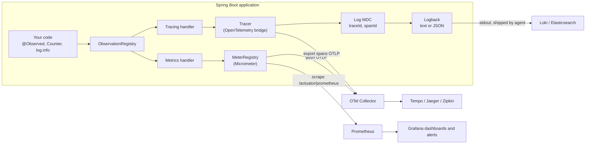
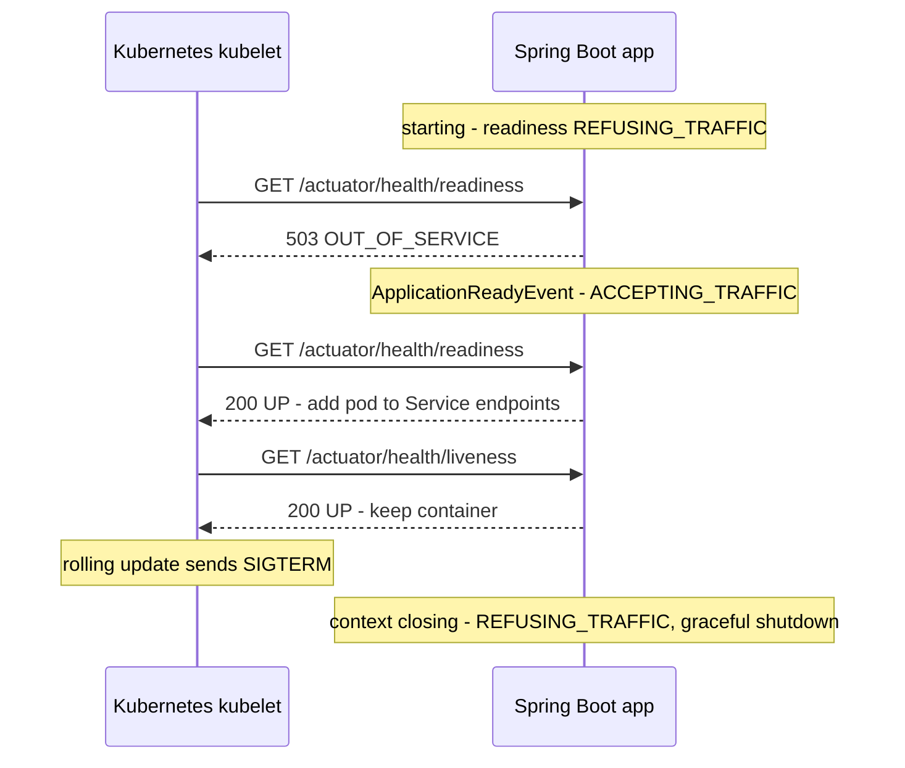
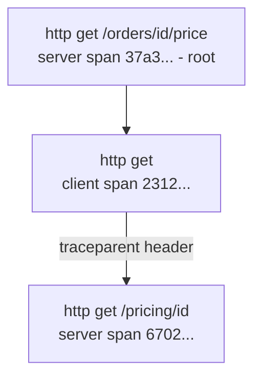

# Chapter 15 — Observability and Production

Everything so far has been about making the application *work*. This chapter is about keeping it working once real users depend on it: knowing whether it is healthy, how fast it is, which request failed and why, shutting it down without dropping requests, and starting it quickly in containers. Spring Boot's answer is a set of "production-ready features": **Actuator** (management endpoints), **Micrometer** (metrics and the Observation API), **Micrometer Tracing + OpenTelemetry** (distributed tracing), **structured logging**, graceful shutdown, virtual threads, and faster startup with AOT caches and native images.

**What you'll learn**

1. The three pillars of observability — logs, metrics, traces — and how Spring connects them.
2. Actuator: endpoints, exposure, access control and securing them.
3. Health: indicators, groups, Kubernetes liveness/readiness probes (on by default in Boot 4), writing a custom `HealthIndicator`.
4. `/actuator/info`: build, git, Java and environment information.
5. Micrometer metrics: `Counter`, `Timer`, `Gauge`, tags, cardinality, the Prometheus scrape format.
6. The Observation API and `@Observed`: one instrumentation, both a metric and a span.
7. Distributed tracing with the OpenTelemetry bridge: trace/span ids in logs, propagation across HTTP calls, exporters, sampling.
8. Structured JSON logging (ECS, Logstash, GELF).
9. Graceful shutdown and what happens in Kubernetes.
10. Virtual threads with one property.
11. Faster startup: extracted jars, CDS, the JDK AOT cache (measured), Spring AOT and GraalVM native images; container images with buildpacks or a Dockerfile.
12. A production configuration checklist.

The code lives in two Spring Boot 4.1.1 / Framework 7.0 projects on Java 25:

- [`code/observability-demo/`](code/observability-demo/) — Actuator, health, metrics, Prometheus, tracing, structured logs (8 tests).
- [`code/production-runtime/`](code/production-runtime/) — graceful shutdown and virtual threads (4 tests), plus [`code/aot-cache-demo.sh`](code/aot-cache-demo.sh) for the startup comparison.

Outputs are real `mvn -q verify` output; Spring's log noise is trimmed as `...`.

> **Prerequisites.** Configuration properties and profiles: [Chapter 3](../03-configuration-and-auto-configuration/README.md). Security filter chains: [Chapter 10](../10-spring-security-1-fundamentals/README.md). `RestClient`: [Chapter 6](../06-rest-clients-and-http-interfaces/README.md). `@ConcurrencyLimit`: [4.7](../04-aop-and-proxies/README.md#47-framework-7-core-resilience-retryable-and-concurrencylimit). The system-design view of health checks and tracing is in [Operating in Production](../../../system-design-patterns/modules/09-operating-in-production/README.md).

---

## 15.1 Observability in one page

### What it is

**Observability** is how well you can understand what a running system is doing from the outside, using the data it emits — without attaching a debugger or adding new code. The data comes in three kinds, often called the **three pillars**:

| Pillar | What it is | Answers | Spring tool |
|---|---|---|---|
| **Logs** | timestamped text or JSON events | "what exactly happened in this request?" | SLF4J + Logback, structured logging |
| **Metrics** | numbers aggregated over time (counts, durations, gauges) | "how many, how fast, how full — right now and as a trend?" | Micrometer `MeterRegistry` |
| **Traces** | the path of one request through many services, as a tree of timed **spans** | "where did this slow request spend its time?" | Micrometer Tracing + OpenTelemetry |

Analogy: a hospital patient. The **metrics** are the monitor showing heart rate and blood pressure over time; the **logs** are the nurse's notes; the **trace** is the record of which departments the patient visited, in what order, and how long each took. You need all three: the monitor tells you *something* is wrong, the visit record tells you *where*, the notes tell you *what*.

**Monitoring** is the older, narrower idea: watching known metrics and alerting on thresholds. Observability adds the ability to ask new questions (e.g. "which customer's requests are slow?") from rich, correlated data.

### How Spring wires it together



- **Micrometer** is a vendor-neutral facade for metrics ("SLF4J for metrics"): you write to a `MeterRegistry`, and a registry implementation (Prometheus, OTLP, Datadog, ...) formats and ships the numbers.
- **Micrometer Observation** is one API that produces *both* a metric and a span for a piece of work.
- **Micrometer Tracing** is a facade over a tracer. Boot 4 supports two: **OpenTelemetry** (`spring-boot-starter-opentelemetry`) and **Brave** with Zipkin (`spring-boot-starter-zipkin`).
- The tracer puts the current `traceId` and `spanId` into the logging **MDC** (Mapped Diagnostic Context, a per-thread map that log patterns can print), so every log line is linked to its trace.

### Real-world examples

- Grafana's "LGTM" stack (Loki for logs, Grafana, Tempo for traces, Mimir/Prometheus for metrics) is a common open-source destination for exactly these three outputs.
- The OpenTelemetry Collector is widely deployed as a sidecar or agent that receives OTLP (the OpenTelemetry protocol) and forwards to any backend, so apps don't hard-code the vendor.

### Self-check

1. Name the three pillars and a question each answers. → Logs (what happened), metrics (how many/how fast over time), traces (where time went across services).
2. What is Micrometer? → A vendor-neutral metrics facade; you record to `MeterRegistry`, a registry implementation exports to the chosen backend.
3. How are logs linked to traces? → The tracer puts `traceId`/`spanId` in the MDC and the log pattern or JSON encoder prints them.

---

## 15.2 Spring Boot Actuator

### What it is

**Actuator** adds **management endpoints** to your application: small built-in HTTP (or JMX) APIs for operators — health, metrics, info, loggers, environment, thread dumps and more. Add `spring-boot-starter-actuator` and they appear under `/actuator`.

Analogy: the dashboard and service port of a car. Drivers (users) never see it; mechanics (operators, Kubernetes, Prometheus) plug into it.

### The endpoints

| ID | Shows / does | Notes |
|---|---|---|
| `health` | UP/DOWN status, components, probes | the only endpoint exposed over HTTP by default |
| `info` | build, git, Java, custom `info.*` properties | contributors switched on by properties |
| `metrics` | list of meters; `/metrics/{name}` for one | JSON, for humans |
| `prometheus` | all meters in Prometheus text format | needs `micrometer-registry-prometheus` |
| `loggers` | view and **change** log levels at runtime | `POST /actuator/loggers/com.acme` `{"configuredLevel":"DEBUG"}` |
| `env`, `configprops` | resolved properties, `@ConfigurationProperties` beans | values masked by default (`show-values=never`) |
| `beans`, `conditions`, `mappings` | beans, auto-configuration report, request mappings | great for debugging ([Chapter 3](../03-configuration-and-auto-configuration/README.md)) |
| `threaddump`, `heapdump` | JVM thread dump, heap dump file | heap dumps can contain secrets — protect them |
| `httpexchanges` | recent requests/responses | needs an `HttpExchangeRepository` bean |
| `scheduledtasks`, `caches`, `flyway`, `liquibase`, `quartz`, `sessions` | feature-specific | appear when the feature is present |
| `startup` | startup steps and their duration | needs `BufferingApplicationStartup` |
| `shutdown` | shuts the app down | access `none` by default |

### Exposure vs access

Two separate switches decide whether an endpoint can be called:

1. **Access** (since Boot 3.4, replacing the older `enabled` flags): is the endpoint allowed at all, and may it change things? Values `none`, `read-only`, `unrestricted`.
2. **Exposure**: is it reachable over **HTTP** or **JMX**? By default only `health` is exposed on both.

```properties
# expose more endpoints over HTTP ("*" = all; quote it in YAML)
management.endpoints.web.exposure.include=health,info,metrics,prometheus,env,loggers
management.endpoints.web.exposure.exclude=heapdump

# access control
management.endpoint.loggers.access=read-only        # can read levels, cannot change them
management.endpoints.access.default=none            # opt-in style: everything off ...
management.endpoint.health.access=read-only         # ... except what you list
management.endpoints.access.max-permitted=read-only # hard ceiling for the whole app

# a separate port (and optionally address) for all management endpoints
management.server.port=8081
management.endpoints.web.base-path=/manage          # default /actuator
```

A separate **management port** is common in Kubernetes: the public ingress only routes to 8080, while probes and Prometheus reach 8081 inside the cluster.

### Securing actuator endpoints

If Spring Security is on the classpath, you decide who can call what with `EndpointRequest` matchers. In Boot 4 the class moved to `org.springframework.boot.security.autoconfigure.actuate.web.servlet.EndpointRequest` (it was `org.springframework.boot.actuate.autoconfigure.security.servlet` in Boot 3).

```java
@Bean
SecurityFilterChain security(HttpSecurity http) throws Exception {
    http.authorizeHttpRequests(auth -> auth
            // probes, info and the Prometheus scrape stay open (normally reachable only inside the cluster)
            .requestMatchers(EndpointRequest.to("health", "info", "prometheus")).permitAll()
            // every other actuator endpoint needs the OPS role
            .requestMatchers(EndpointRequest.toAnyEndpoint()).hasRole("OPS")
            .anyRequest().permitAll())
        .httpBasic(Customizer.withDefaults())
        .csrf(csrf -> csrf.disable());   // demo API only; see chapter 10 for CSRF
    return http.build();
}
```

`EndpointRequest` matches by endpoint **ID**, so it keeps working if you change the base path or the management port. The test ([`ActuatorEndpointsTests`](code/observability-demo/src/test/java/ch15/obs/ActuatorEndpointsTests.java)) proves both sides:

```output
anonymous /actuator/env -> 401, ops /actuator/loggers/ch15.obs -> {"effectiveLevel":"INFO"}
```

### Common mistakes

- `management.endpoints.web.exposure.include=*` on a public port without security: `env`, `heapdump` and `threaddump` can leak secrets and internals. Expose the minimum; protect the rest.
- Thinking exposure is enough — an endpoint with access `none` stays unavailable even when exposed.
- Forgetting that `health` details (`show-details`) can reveal hostnames, disk paths and versions (you will see a disk path in the output below).

### Self-check

1. Which endpoints are exposed over HTTP by default? → Only `health`.
2. Difference between exposure and access? → Access decides if the endpoint exists and whether it may write; exposure decides whether HTTP/JMX can reach it.
3. Why a separate management port? → Keep operational endpoints off the public ingress while probes and scrapers reach them internally.

---

## 15.3 Health, health groups and Kubernetes probes

### What it is

The `health` endpoint aggregates **health indicators** — small checks such as "can I reach the database?" or "is there disk space?" — into one status. Status values are `UP`, `DOWN`, `OUT_OF_SERVICE` and `UNKNOWN`; the overall status is the "worst" one (default order: `DOWN`, `OUT_OF_SERVICE`, `UP`, `UNKNOWN`). `DOWN` and `OUT_OF_SERVICE` are returned with HTTP **503**, others with 200.

Auto-configured indicators appear when their technology is present: `ping`, `diskSpace`, `db` (a `DataSource`), `redis`, `mongo`, `rabbit`, `mail`, `ssl` (certificate validity), `livenessState`, `readinessState`, and more.

### Why it matters

Load balancers and orchestrators make decisions from these answers: take an instance out of rotation, restart a container, stop a rolling deployment. A wrong health design can **cause** outages: if every instance reports DOWN because one optional dependency is slow, the platform removes all of them.

### Liveness vs readiness

Kubernetes asks two different questions:

| Probe | Question | On failure Kubernetes... | Should include |
|---|---|---|---|
| **Liveness** | "Is this process broken beyond repair?" | **restarts** the container | only internal state (deadlock, corrupted state) — never external systems |
| **Readiness** | "Can this instance serve traffic right now?" | **stops routing** traffic to it (no restart) | warming up, shutting down, and — carefully — dependencies it cannot work without |
| Startup (K8s only) | "Has it finished starting?" | holds off the other probes | usually point it at the liveness endpoint with a larger threshold |

Spring Boot tracks two **availability states** for you: `LivenessState` (`CORRECT` / `BROKEN`) and `ReadinessState` (`ACCEPTING_TRAFFIC` / `REFUSING_TRAFFIC`). Boot marks the app ready only after startup (including `CommandLineRunner`s) has finished, and switches readiness to `REFUSING_TRAFFIC` when the application context starts closing. **In Boot 4 the probe groups are enabled by default** — `/actuator/health/liveness` and `/actuator/health/readiness` exist without any configuration (in Boot 2.3–3.x they were enabled automatically only on Kubernetes, or with `management.endpoint.health.probes.enabled=true`).



### A custom `HealthIndicator`

In Boot 4 the health API moved to its own module: `org.springframework.boot.health.contributor.HealthIndicator` and `Health` (Boot 3: `org.springframework.boot.actuate.health`).

```java
// Bean name "inventoryHealthIndicator" -> health component name "inventory"
@Component
public class InventoryHealthIndicator implements HealthIndicator {

    private final InventoryStatus status;   // pretend connection state, flipped by the tests

    public InventoryHealthIndicator(InventoryStatus status) {
        this.status = status;
    }

    @Override
    public Health health() {
        if (status.reachable()) {
            return Health.up().withDetail("latencyMs", 12).build();
        }
        return Health.down().withDetail("error", "inventory service not reachable").build();
    }
}
```

Keep `health()` **fast and cheap** — it runs on every probe (typically every 5–10 s per instance). For slow checks, cache the last result or compute it in the background. For reactive apps implement `ReactiveHealthIndicator`.

### Health groups

A **group** is a named subset of indicators with its own settings, served at `/actuator/health/{group}`. Liveness and readiness are just two built-in groups.

```properties
management.endpoint.health.show-details=when-authorized     # never | when-authorized | always
management.endpoint.health.roles=OPS
# a custom group, e.g. for a deployment smoke check
management.endpoint.health.group.deploy.include=ping,inventory
management.endpoint.health.group.deploy.show-details=always
# readiness also fails when inventory is down (a deliberate choice - see Trade-offs)
management.endpoint.health.group.readiness.include=readinessState,inventory
```

Other group options: `exclude`, `status.order`, `status.http-mapping.*`, `additional-path` (serve the group on the main port, e.g. `server:/healthz`). `management.endpoint.health.probes.add-additional-paths=true` also serves `/livez` and `/readyz` on the main server port.

### Proof

The tests call the endpoints anonymously and as the `ops` user, then make "inventory" unreachable:

```output
anonymous /actuator/health -> {"groups":["deploy","liveness","readiness"],"status":"UP"}
ops       /actuator/health -> {"components":{"diskSpace":{"details":{"total":494384795648,"free":63519252480,"threshold":10485760,"path":".../observability-demo/.","exists":true},"status":"UP"},"inventory":{"details":{"latencyMs":12},"status":"UP"},"livenessState":{"status":"UP"},"ping":{"status":"UP"},"readinessState":{"status":"UP"},"ssl":{"details":{"expiringChains":[],"invalidChains":[],"validChains":[]},"status":"UP"}},"groups":["deploy","liveness","readiness"],"status":"UP"}
inventory reachable:
  liveness  -> {"status":"UP"}
  readiness -> {"status":"UP"}
inventory DOWN:
  liveness  -> {"status":"UP"}
  readiness -> {"status":"DOWN"} (HTTP 503)
  deploy    -> {"components":{"inventory":{"details":{"error":"inventory service not reachable"},"status":"DOWN"},"ping":{"status":"UP"}},"status":"DOWN"} (HTTP 503)
```

Things to notice:

- Anonymous callers get only the status and the group names — details need the `OPS` role (`when-authorized`).
- The `liveness` group exists though we never configured it: probes are on by default in Boot 4.
- Liveness stays UP while a dependency is down — restarting our container would not fix the inventory service.

The application can also change its own state, for example to drain traffic before maintenance:

```java
AvailabilityChangeEvent.publish(context, ReadinessState.REFUSING_TRAFFIC);
```

```output
after REFUSING_TRAFFIC: readiness -> {"status":"OUT_OF_SERVICE"} (HTTP 503)
```

Kubernetes configuration (not run here):

```yaml
livenessProbe:
  httpGet: { path: /actuator/health/liveness, port: 8081 }
  periodSeconds: 10
  failureThreshold: 3
readinessProbe:
  httpGet: { path: /actuator/health/readiness, port: 8081 }
  periodSeconds: 5
  failureThreshold: 3
startupProbe:
  httpGet: { path: /actuator/health/liveness, port: 8081 }
  periodSeconds: 5
  failureThreshold: 30        # up to 150 s to start before liveness takes over
```

### Trade-offs

Putting a dependency in **readiness** protects users from an instance that cannot serve — but if *all* instances share that dependency, all become unready at once and the service disappears entirely, even for requests that don't need it. Include a dependency in readiness only if the instance is truly useless without it; otherwise stay ready and **degrade** (fallbacks, cached data, circuit breakers — [Chapter 16](../16-spring-cloud-and-microservices/README.md)).

### Common mistakes

- Database check in **liveness** → a DB blip restarts every pod, making recovery slower (a "restart storm").
- Slow indicators (calling a remote API synchronously on every probe) → probe timeouts → false failures.
- Same thresholds for liveness and readiness → a slow start gets the container killed; use a startup probe.
- `show-details=always` on a public port → leaks infrastructure details.

### In the interview

**Q: What's the difference between liveness and readiness, and how does Spring Boot support them?**
30-second answer: Liveness asks "should the container be restarted?", readiness asks "should it receive traffic?". Boot tracks `LivenessState` and `ReadinessState`, exposes them as health groups at `/actuator/health/liveness` and `/readiness` (on by default in Boot 4), marks readiness only after startup completes and refuses traffic during shutdown. External dependencies never belong in liveness.

- *Follow-up: how do you add a custom check?* → A `HealthIndicator` bean returning `Health.up()/down().withDetail(...)`, then include it in a group if needed.
- *Follow-up: how do you take one instance out of rotation without killing it?* → Publish `AvailabilityChangeEvent` with `ReadinessState.REFUSING_TRAFFIC`.

### Self-check

1. Which HTTP status does a DOWN health group return? → 503.
2. Where does a custom indicator's name come from? → The bean name minus the `HealthIndicator` suffix.
3. Why not include the database in liveness? → A restart doesn't fix the database, and restarting all pods at once worsens the outage.

### TL;DR
`HealthIndicator` beans → `/actuator/health`; groups (`management.endpoint.health.group.<name>.include`) → `/actuator/health/<name>`; liveness/readiness groups are on by default in Boot 4; keep liveness internal-only, be careful with dependencies in readiness.

---

## 15.4 The info endpoint

`/actuator/info` shows descriptive facts about the running build — invaluable when you ask "which version is actually deployed?". It is assembled from **info contributors**:

| Contributor | Content | Enabled by |
|---|---|---|
| `build` | group, artifact, version, build time | present when `META-INF/build-info.properties` exists (Maven plugin goal `build-info`) |
| `git` | branch, commit id and time | present when `git.properties` exists (`git-commit-id-maven-plugin`) |
| `env` | every `info.*` property | `management.info.env.enabled=true` |
| `java` | JVM and runtime vendor/version | `management.info.java.enabled=true` |
| `os`, `process` | OS name/version, PID, CPUs, memory | `management.info.os.enabled`, `management.info.process.enabled` |
| custom | anything | an `InfoContributor` bean |

```xml
<plugin>
  <groupId>org.springframework.boot</groupId>
  <artifactId>spring-boot-maven-plugin</artifactId>
  <executions>
    <execution><goals><goal>build-info</goal></goals></execution>
  </executions>
</plugin>
```

```properties
management.info.env.enabled=true
management.info.java.enabled=true
info.app.description=Orders demo for chapter 15
```

```output
/actuator/info -> {"app":{"description":"Orders demo for chapter 15"},"build":{"artifact":"ch15-observability-demo","name":"ch15-observability-demo","time":"2026-09-28T23:50:25.503Z","version":"1.0.0","group":"handbook.spring"},"java":{"jvm":{"name":"OpenJDK 64-Bit Server VM","vendor":"Homebrew","version":"25.0.2"},"runtime":{"name":"OpenJDK Runtime Environment","version":"25.0.2"},"vendor":{"name":"Homebrew","vers...
```

Never put secrets in `info.*` — the endpoint is usually public.

---

## 15.5 Metrics with Micrometer

### What it is

A **metric** is a number measured repeatedly over time. Micrometer records metrics in **meters** registered in a `MeterRegistry`. Each meter has a **name** and **tags** (key/value dimensions, e.g. `status=200`) — every unique combination of name + tag values is its own **time series**.

| Meter | Measures | Example | Prometheus output |
|---|---|---|---|
| `Counter` | a count that only increases | orders placed, errors | `name_total` |
| `Timer` | count + total time + max of short events | request latency | `name_seconds_count`, `_sum`, `_max` (+ buckets if histogram on) |
| `Gauge` | a current value sampled when read | queue size, pool usage | `name` |
| `DistributionSummary` | distribution of non-time values | payload size | `name_count`, `_sum`, `_max` |
| `LongTaskTimer` | tasks *currently* running and for how long | a batch job in progress | `name_active_count`, `_duration_sum` |

Analogy: a car. The odometer is a **counter**, the fuel needle a **gauge**, the lap-time stopwatch a **timer**.

### What Boot gives you for free

With Actuator on the classpath, Boot registers JVM memory/GC/threads/classes, CPU, uptime, Tomcat sessions, HikariCP pool, logback events, `http.server.requests` (every MVC/WebFlux request, tagged `method`, `uri` template, `status`, `outcome`, `exception`), `http.client.requests` (for `RestClient`/`WebClient` built from Boot's builders), cache, Kafka and more.

### Custom meters

From [`OrderService.java`](code/observability-demo/src/main/java/ch15/obs/OrderService.java):

```java
public OrderService(MeterRegistry registry) {
    this.registry = registry;
    // A Timer records how many calls and how long they took
    this.placeTimer = Timer.builder("orders.place")
            .description("time to place an order")
            .register(registry);
    // A Gauge samples a current value on demand (here: the map size)
    registry.gauge("orders.stored", orders, Map::size);
}

@Observed(name = "order.lookup", contextualName = "order-lookup")   // see 15.6
public Optional<String> find(long id) {
    log.info("looking up order {}", id);
    Optional<String> item = Optional.ofNullable(orders.get(id));
    // A Counter only goes up; the tag splits it into one time series per result
    Counter.builder("orders.lookups")
            .tag("result", item.isPresent() ? "found" : "missing")
            .register(registry)             // returns the existing counter if already registered
            .increment();
    return item;
}

public long place(String item) {
    return placeTimer.record(() -> { /* ... store it ... */ });
}
```

Common tags for every meter come from properties:

```properties
management.metrics.tags.region=eu-west-1
# optional: publish histogram buckets so Prometheus can compute p95/p99 across instances
management.metrics.distribution.percentiles-histogram.http.server.requests=true
```

### Reading metrics: `/actuator/metrics` and `/actuator/prometheus`

The test makes two successful lookups, one miss and one order, then reads both endpoints:

```output
/actuator/metrics/orders.lookups -> {"availableTags":[{"tag":"result","values":["missing","found"]},{"tag":"region","values":["eu-west-1"]}],"measurements":[{"statistic":"COUNT","value":3.0}],"name":"orders.lookups"}
/actuator/prometheus (selected lines):
  http_server_requests_seconds_count{error="none",exception="none",method="GET",outcome="CLIENT_ERROR",region="eu-west-1",status="404",uri="/orders/{id}"} 1
  http_server_requests_seconds_count{error="none",exception="none",method="GET",outcome="SUCCESS",region="eu-west-1",status="200",uri="/orders/{id}"} 2
  order_lookup_seconds_count{class="ch15.obs.OrderService",error="none",method="find",region="eu-west-1"} 3
  orders_lookups_total{region="eu-west-1",result="found"} 2.0
  orders_lookups_total{region="eu-west-1",result="missing"} 1.0
  orders_place_seconds_count{region="eu-west-1"} 1
  orders_stored{region="eu-west-1"} 3.0
```

What to notice:

- `/actuator/metrics/{name}` aggregates across tags (COUNT 3.0); drill down with `?tag=result:found`.
- **Naming conventions** are translated per backend: Micrometer names use dots (`orders.lookups`); Prometheus gets `orders_lookups_total` (counter suffix), timers become `_seconds_*`.
- The `uri` tag is the **template** `/orders/{id}`, not `/orders/1` — otherwise every id would create a new time series.
- Every meter carries the common `region` tag.
- `@Observed` produced the timer `order_lookup_seconds` without any `MeterRegistry` code.

**Push vs pull.** Prometheus **pulls** (scrapes) `/actuator/prometheus` every 15–60 s. Other backends are **pushed** to, e.g. OTLP with `management.otlp.metrics.export.url=http://collector:4318/v1/metrics`. In `@SpringBootTest`, Boot switches metric exporters off (only an in-memory registry stays) unless the class has `@AutoConfigureMetrics` — that's why the Prometheus test uses it.

### Cardinality — the one rule that matters

**Cardinality** = the number of distinct tag-value combinations. Each one is a separate time series stored by the monitoring system. Tags must have a **small, bounded** set of values (HTTP method, status, region, result). Never tag with user ids, order ids, emails, full URLs or timestamps — a million users means a million series, which can crash Prometheus or explode a SaaS bill. Put such values in **traces or logs** instead.

### Common mistakes

- High-cardinality tags (see above).
- Creating a new `Timer.builder(...).register(...)` in a hot loop is fine (it returns the cached meter), but building meters with *dynamic names* is not — use tags.
- Averages for latency. Use percentiles (p95, p99) from histograms; averages hide the slow tail that users feel.
- Gauges on objects that get garbage-collected: `registry.gauge(name, obj, fn)` holds a **weak** reference; if nothing else holds `obj`, the gauge reports `NaN`.

### Self-check

1. Counter vs gauge? → Counter only increases (rate over time); gauge is a current value that goes up and down.
2. Why does `http.server.requests` tag `uri="/orders/{id}"`? → To keep cardinality bounded — the template, not the concrete path.
3. How does Prometheus get the data? → It scrapes `/actuator/prometheus` (pull).

---

## 15.6 The Observation API and `@Observed`

### What it is

An **Observation** (Micrometer 1.10+, Boot 3+) wraps a unit of work — "look up an order" — once, and **handlers** decide what to produce from it: a `Timer` (metrics handler), a span (tracing handler), a log line, or anything else. Spring's own instrumentation (MVC, WebFlux, `RestClient`, `WebClient`, JDBC via extensions, Spring Security, Kafka, `@Scheduled`...) is written this way, which is why one dependency change gives you both metrics and traces.

```java
Observation.createNotStarted("order.lookup", observationRegistry)
        .lowCardinalityKeyValue("channel", "web")     // -> metric tag AND span attribute
        .highCardinalityKeyValue("orderId", "42")     // -> span attribute only
        .observe(() -> service.find(42));
```

- **Low-cardinality key values** become metric tags *and* span attributes.
- **High-cardinality key values** go only to spans (safe for ids).

`@Observed(name = "order.lookup", contextualName = "order-lookup")` on a bean method does the same through an aspect. It needs the AspectJ starter (`spring-boot-starter-aspectj` in Boot 4) and, since Boot 3.2, the property:

```properties
management.observations.annotations.enabled=true   # also activates @Timed, @Counted, @NewSpan
```

The metric is named after `name` (`order.lookup` → `order_lookup_seconds_*` above, tagged `class` and `method`); the span is named after `contextualName`:

```output
spans for GET /orders/2 -> [http get /orders/{id}, order-lookup]
```

### Tuning which observations happen

```properties
# switch off whole families by name prefix
management.observations.enable.spring.security=false
# common key values added to every observation
management.observations.key-values.region=eu-west-1
```

Spring Security creates several observations per request (filter chain before/after, authentication, authorization). In the demo's first run they made up most of the exported spans; disabling the `spring.security` prefix keeps the traces readable. For finer control register an `ObservationPredicate` bean.

**Context propagation.** Observations live in thread-local state. For `@Async` methods on Boot's executor set `spring.task.execution.propagate-context=true` (or register a `ContextPropagatingTaskDecorator` on your own executor); for Reactor use `spring.reactor.context-propagation=auto`.

### Self-check

1. Low vs high cardinality key values? → Low go to metrics and spans; high only to spans.
2. What must you add for `@Observed` to work? → AspectJ starter + `management.observations.annotations.enabled=true`.

---

## 15.7 Distributed tracing

### What it is

A **trace** follows one request across every service it touches. It is a tree of **spans**; each span is one timed operation (an incoming HTTP request, an outgoing call, a DB query) with a **span id**, the **trace id** shared by the whole tree, a **parent span id**, start/end time and attributes.

Analogy: a parcel tracking number. Every depot that handles the parcel scans the same number (trace id) and adds its own entry (span) with arrival and departure times.

### How it works

1. A request arrives without trace headers → the server observation starts a **root span** with a new 128-bit trace id.
2. The trace context is stored in the current thread and copied into the log MDC (`traceId`, `spanId`).
3. An outgoing call through an instrumented client (Boot's `RestClient.Builder`, `WebClient.Builder`, `RestTemplateBuilder`, Kafka templates...) creates a **client span** and injects the context into headers — by default the **W3C Trace Context** header `traceparent: 00-<traceId>-<spanId>-01`.
4. The downstream service reads the header and continues the same trace with a child span.
5. Finished spans go to a **span processor** → **exporter** (OTLP to a collector, Zipkin, ...). Boot batches them (`BatchSpanProcessor`).
6. The backend (Tempo, Jaeger, Zipkin) stitches spans by trace id into a timeline.

**Sampling** decides which traces are recorded: `management.tracing.sampling.probability` (default **0.1** = 10%). The decision is made at the root and travels in the header, so a trace is either complete or absent.

### Setup in Boot 4

```xml
<!-- Micrometer Tracing + OpenTelemetry bridge + OTLP exporters -->
<dependency>
  <groupId>org.springframework.boot</groupId>
  <artifactId>spring-boot-starter-opentelemetry</artifactId>
</dependency>
<!-- tests: spring-boot-starter-opentelemetry-test (provides @AutoConfigureTracing) -->
```

```properties
management.tracing.sampling.probability=1.0     # 100% in dev/test; lower in high-traffic prod
# send spans to an OpenTelemetry Collector (not used in the demo - no collector running)
# management.opentelemetry.tracing.export.otlp.endpoint=http://otel-collector:4318/v1/traces
```

The Brave/Zipkin alternative is `spring-boot-starter-zipkin` with `management.tracing.export.zipkin.endpoint`. Boot 3 users: the dependency used to be `micrometer-tracing-bridge-otel` + `opentelemetry-exporter-otlp`; the one starter replaces both.

### A "logging exporter" instead of a collector

To see spans without running Jaeger, the demo registers its own `SpanExporter` bean; Boot adds every `SpanExporter` bean to its batch processor:

```java
@Component
public class PrintingSpanExporter implements SpanExporter {
    private final List<SpanData> finished = new CopyOnWriteArrayList<>();

    @Override
    public CompletableResultCode export(Collection<SpanData> spans) {
        finished.addAll(spans);                       // a real exporter would send them over OTLP
        return CompletableResultCode.ofSuccess();
    }
    // ... flush(), shutdown(), finished(), clear()
}
```

The controller calls a second endpoint over HTTP with Boot's `RestClient.Builder`, standing in for a downstream service:

```java
@GetMapping("/orders/{id}/price")
public String price(@PathVariable long id) {
    log.info("asking pricing service for order {}", id);
    String base = "http://localhost:" + env.getProperty("local.server.port");
    return restClientBuilder.build().get()
            .uri(base + "/pricing/{id}", id)
            .retrieve().body(String.class);
}

@GetMapping("/pricing/{id}")
public String pricing(@PathVariable long id) {
    log.info("pricing order {}", id);
    return "price for " + id + " = 49.99";
}
```

[`TracingTests`](code/observability-demo/src/test/java/ch15/obs/TracingTests.java) (with `@AutoConfigureTracing`, because tests disable span export by default) calls `/orders/1/price`, flushes the batch processor and prints the log lines and spans:

```output
response: price for 1 = 49.99
log lines (trace id - span id in brackets):
  [orders] [o-auto-1-exec-8] [89fb1d6934d0cf54e0910695a8df7859-37a3311dfdcc61c3] ch15.obs.OrderController                 : asking pricing service for order 1
  [orders] [o-auto-1-exec-9] [89fb1d6934d0cf54e0910695a8df7859-6702c6550d5a9bfd] ch15.obs.OrderController                 : pricing order 1
finished spans:
  http get /orders/{id}/price  trace=89fb1d6934d0cf54e0910695a8df7859 span=37a3311dfdcc61c3 parent=0000000000000000
  http get                     trace=89fb1d6934d0cf54e0910695a8df7859 span=2312285359b3b845 parent=37a3311dfdcc61c3
  http get /pricing/{id}       trace=89fb1d6934d0cf54e0910695a8df7859 span=6702c6550d5a9bfd parent=2312285359b3b845
```

Read it as a tree:



- Two different Tomcat threads (`exec-8`, `exec-9`) logged with the **same trace id** — that is propagation through the `traceparent` header.
- Each log line's span id matches the span that was active (`37a3...` for the outer request, `6702...` for the downstream one).
- Boot's default console pattern prints `[application-name] [thread] [traceId-spanId]`; change it with `logging.pattern.correlation`.
- Across *real* services the picture is identical; only the exporter sends the spans to a shared backend.

**Baggage** is extra key/value context that travels with the trace (e.g. a tenant id): `management.tracing.baggage.remote-fields=tenant` sends it in headers, `management.tracing.baggage.correlation.fields=tenant` also puts it in the MDC.

### Trade-offs

| Choice | Pro | Con |
|---|---|---|
| Sampling 100% | every request traceable | CPU, network and storage cost at scale |
| Head sampling (e.g. 10%, Boot default) | cheap, simple | the rare failing request is often not sampled |
| Tail sampling in the OTel Collector | keep all errors/slow traces, drop the rest | collector must buffer whole traces |
| OTel **Java agent** instead of Micrometer | zero code, instruments many libraries | a second instrumentation layer; version coupling with the JVM agent |

### Common mistakes

- Building `RestClient.builder()` / `new RestTemplate()` yourself → no instrumentation, the trace breaks at that hop. Inject Boot's builder.
- Losing context on your own thread pools or `CompletableFuture` → wrap executors with context propagation.
- Using trace ids as metric tags → cardinality explosion.
- Sampling 1.0 in a busy production system without a plan for storage.

### In the interview

**Q: How does distributed tracing work in Spring Boot?**
30-second answer: Micrometer Observation instruments incoming and outgoing calls; Micrometer Tracing with the OpenTelemetry (or Brave) bridge turns observations into spans. A trace id is created at the edge, propagated in the W3C `traceparent` header by instrumented clients, and put in the log MDC. Spans are batched and exported via OTLP to a collector and viewed in Tempo/Jaeger/Zipkin. Sampling defaults to 10%.

- *Follow-up: why is my trace broken between two services?* → The client isn't instrumented (created with `new`), a proxy strips headers, the propagation format differs (W3C vs B3), or async code lost the context.
- *Follow-up: logs vs traces?* → Traces show timing and causality across services; logs give detail within one; the shared trace id links them.

### Self-check

1. What header carries the context by default? → W3C `traceparent`.
2. Default sampling probability? → 0.1.
3. What is a parent span id of `0000000000000000`? → A root span (no parent).

### TL;DR
`spring-boot-starter-opentelemetry` + `management.tracing.sampling.probability`; inject Boot's client builders; trace/span ids appear in logs automatically; export via `management.opentelemetry.tracing.export.otlp.endpoint`.

---

## 15.8 Structured logging

### What it is

**Structured logging** writes each event as a machine-readable record (JSON) instead of a formatted line. Log platforms (Elasticsearch/Kibana, Loki, Graylog, Datadog, Cloud Logging) can then filter on fields — `log.level:ERROR AND service.name:orders AND traceId:...` — instead of parsing text with regexes. Built into Boot since **3.4**.

```properties
logging.structured.format.console=ecs        # ecs | logstash | gelf
logging.structured.format.file=logstash      # file output can use a different format
logging.structured.ecs.service.version=1.0.0
logging.structured.ecs.service.environment=test
```

| Format | Standard | Typical destination |
|---|---|---|
| `ecs` | Elastic Common Schema | Elasticsearch / Elastic Agent, also fine for Loki |
| `logstash` | Logstash JSON | Logstash, Fluentd/Fluent Bit |
| `gelf` | Graylog Extended Log Format | Graylog |

[`StructuredLoggingTests`](code/observability-demo/src/test/java/ch15/obs/StructuredLoggingTests.java) starts the app with `ecs` and captures the log line of one request:

```output
ECS log line:
{"@timestamp":"2026-09-28T23:50:30.319867Z","log":{"level":"INFO","logger":"ch15.obs.OrderService"},"process":{"pid":17381,"thread":{"name":"http-nio-auto-2-exec-1"}},"service":{"name":"orders","version":"1.0.0","environment":"test","node":{}},"message":"looking up order 1","traceId":"636cb6141b8e904e29a6f7824c3eb713","spanId":"8ceaaf80e43135b1","ecs":{"version":"8.11"}}
```

`service.name` comes from `spring.application.name`; all MDC entries — here `traceId` and `spanId` from the tracer — become fields automatically, as do key/values from SLF4J's fluent API (`log.atInfo().addKeyValue("orderId", id).log("placed")`).

Customise the JSON without code:

```properties
logging.structured.json.exclude=process.pid
logging.structured.json.rename.process.thread.name=thread
logging.structured.json.add.team=checkout
logging.structured.json.stacktrace.root=first          # root cause first
logging.structured.json.stacktrace.max-throwable-depth=20
```

For full control implement `StructuredLogFormatter<ILoggingEvent>` and name the class in `logging.structured.format.console`.

**When not to use it:** local development in a terminal — JSON is hard for humans to read. A common setup is plain text by default and JSON in the `prod` profile (`application-prod.properties`), or JSON to a file and text to the console.

**Common mistakes:** logging secrets or personal data (JSON makes them *easier* to search — mask them); multi-line stack traces in text logs that the shipper splits into many events (JSON keeps them in one field); logging at DEBUG in production for hot paths (cost and noise). The demo also shows a practical catch: the logging system is global to the JVM, so the structured-logging test runs last ([`junit-platform.properties`](code/observability-demo/src/test/resources/junit-platform.properties) orders the classes).

---

## 15.9 Graceful shutdown

### What it is

When an instance is stopped (a deployment, scale-down, node drain), requests that are **in flight** should finish instead of failing. **Graceful shutdown** stops accepting new connections, waits for active requests up to a timeout, then stops. It is the **default since Boot 3.4** for Tomcat, Jetty and Reactor Netty (`server.shutdown=graceful`); `server.shutdown=immediate` turns it off.

```properties
spring.lifecycle.timeout-per-shutdown-phase=10s   # default 30s
```

### How it works

1. The JVM receives `SIGTERM` — the operating system's polite "please stop" signal, sent by Kubernetes and `docker stop` (Ctrl+C sends the similar `SIGINT`); unlike `SIGKILL` it lets the JVM run its shutdown hooks → Spring's shutdown hook closes the application context.
2. Readiness switches to `REFUSING_TRAFFIC`.
3. The web server's lifecycle bean stops first: it stops accepting new connections at the network level and waits for active requests.
4. When they finish (or the timeout expires), the rest of the context closes: `@PreDestroy`, connection pools, executors.

### Proof

[`GracefulShutdownTests`](code/production-runtime/src/test/java/ch15/runtime/GracefulShutdownTests.java) starts the app, begins a request to `/slow?ms=1000`, closes the context while it runs (as `SIGTERM` would), and tries a new request 200 ms later — once with each mode:

```java
ConfigurableApplicationContext ctx = SpringApplication.run(RuntimeApplication.class,
        "--server.port=0", "--server.shutdown=" + shutdownMode, "--spring.main.banner-mode=off");
// ... start a 1-second request, wait until it is inside the controller ...
Thread closer = Thread.ofPlatform().start(ctx::close);        // like SIGTERM from Kubernetes
Thread.sleep(200);
// ... try a new request, then wait for both ...
```

```output
server.shutdown=immediate in-flight -> FAILED: IOException | new request during shutdown -> rejected (ConnectException) | close took < 0.7 s (did not wait)
server.shutdown=graceful  in-flight -> HTTP 200 'done after 1000 ms' | new request during shutdown -> rejected (ConnectException) | close took ~1 s (waited)
  log: Commencing graceful shutdown. Waiting for active requests to complete
  log: Graceful shutdown complete
```

### In Kubernetes

There is a race: Kubernetes sends `SIGTERM` and removes the pod from the Service endpoints **at the same time**, and load balancers may still send new requests for a few seconds. Since the server refuses new connections immediately, add a short delay before shutdown starts:

```yaml
spec:
  terminationGracePeriodSeconds: 45          # must exceed preStop + Spring timeout
  containers:
    - name: orders
      lifecycle:
        preStop:
          sleep: { seconds: 10 }             # K8s 1.30+; older: exec ["sh","-c","sleep 10"]
```

### Common mistakes

- `timeout-per-shutdown-phase` longer than Kubernetes' `terminationGracePeriodSeconds` (default 30 s) → the pod is `SIGKILL`ed mid-drain.
- Expecting graceful shutdown to finish **message consumers** or `@Async` jobs — configure those separately (listener container stop, `spring.task.execution.shutdown.await-termination=true`).
- Running from an IDE that kills the process instead of sending SIGTERM (then shutdown looks immediate).

### Self-check

1. Is graceful shutdown on by default? → Yes, since Boot 3.4.
2. What happens to new requests during the grace period? → They are refused at the network layer (connection refused), not answered with 503.
3. Why a `preStop` sleep? → To let endpoint removal propagate before the server stops accepting connections.

---

## 15.10 Virtual threads

**Virtual threads** (final in Java 21, [Java book 15.4](../../../java/chapters/15-concurrency-2-modern/README.md#154-virtual-threads)) are cheap threads managed by the JVM; a blocked virtual thread releases its carrier OS thread. For blocking servlet apps this raises the number of concurrent requests you can hold without a huge thread pool. In Boot (3.2+) one property switches them on:

```properties
spring.threads.virtual.enabled=true
```

It makes Tomcat/Jetty run each request on a virtual thread and switches Boot's auto-configured `@Async` executor, `@Scheduled` scheduler and several messaging listener containers to virtual threads (the `@Async` side is shown in [14.5](../14-messaging-async-and-scheduling/README.md#145-async-on-virtual-threads)). [`VirtualThreadsTests`](code/production-runtime/src/test/java/ch15/runtime/VirtualThreadsTests.java) calls an endpoint that reports `Thread.currentThread()`:

```output
spring.threads.virtual.enabled=true  -> virtual thread: VirtualThread[#100,tomcat-handler-0]/runnable@ForkJoinPool-1-worker-1
default                              -> platform thread: Thread[#108,http-nio-auto-4-exec-1,5,main]
```

**Caveats.**

- Your **bottleneck moves**: 10,000 concurrent requests now reach the database pool (10 connections by default) or a downstream API. Limit concurrency explicitly — `@ConcurrencyLimit` ([4.7](../04-aop-and-proxies/README.md#47-framework-7-core-resilience-retryable-and-concurrencylimit)), pool sizes, bulkheads.
- Pinning: before JDK 24, blocking inside `synchronized` pinned the carrier thread; JDK 24 (JEP 491) removed that for `synchronized`. Native calls can still pin.
- Virtual threads are daemon threads: an app whose only work is `@Scheduled` tasks may exit; set `spring.main.keep-alive=true`.
- CPU-bound work gains nothing. Virtual threads vs reactive: see [Chapter 13](../13-reactive-and-webflux/README.md).

---

## 15.11 Faster startup: extracted jars, CDS, AOT cache, native images

### The problem it solves

A typical Boot app takes 1–5 s to start on the JVM (class loading, reflection, bean creation, JIT warm-up). That matters for autoscaling, serverless (scale-to-zero) and fast rollbacks. Options, from least to most invasive:

| Technique | What it does | Startup gain | Cost |
|---|---|---|---|
| **Extracted jar** | run from unpacked `lib/` instead of nested jars | small | a build step |
| **CDS** (Class Data Sharing; application classes since JDK 10, dynamic archives since JDK 13) | archive of parsed classes from a training run | ~20–40% | training run, same JDK/classpath |
| **JDK AOT cache** (JEP 483 in JDK 24, simpler flags JEP 514 and method profiles JEP 515 in JDK 25) | caches classes *loaded and linked* (plus profiles) from a training run | often ~2× | training run; cache tied to the JDK build and exact jars |
| **Spring AOT** on the JVM | generates bean-definition code at build time (`spring-boot:process-aot`), run with `-Dspring.aot.enabled=true` | modest | profiles/conditions fixed at build time |
| **GraalVM native image** | compiles the whole app ahead of time to a native executable | ~50–100× (tens of ms) | long builds, closed-world limits, reflection hints, lower peak throughput without PGO (profile-guided optimisation) |

### Measured: AOT cache on JDK 25

[`aot-cache-demo.sh`](code/aot-cache-demo.sh) builds `production-runtime`, extracts it and times start-until-context-refreshed (`-Dspring.context.exit=onRefresh` exits right after the context refresh, a Framework 6.1+ feature made for training runs):

```bash
java -Djarmode=tools -jar target/app.jar extract --destination target/app   # app jar + lib/
cd target/app
# training run: record and write the cache in one step (JDK 25)
java -XX:AOTCacheOutput=app.aot -Dspring.context.exit=onRefresh -jar app.jar
# production run
java -XX:AOTCache=app.aot -jar app.jar
```

Run it as `bash aot-cache-demo.sh <JDK-25-home>` (the script otherwise uses `$JAVA_HOME`). Rows 2 and 3 are the median of 5 runs. Output on this machine (Apple silicon laptop, Homebrew OpenJDK 25.0.2; **timings are machine-dependent** — measure your own):

```output
java: openjdk version "25.0.2" 2026-01-20
1. fat jar (java -jar)                : 1152 ms (mean of 3)
2. extracted jar                      : 934 ms
   AOT cache file                     :  56M
3. extracted jar + -XX:AOTCache       : 467 ms
```

The AOT cache cut JVM-to-context-ready time by more than half for this small web app, at the price of a 56 MB file and a training step in the build. For CDS on JDK 13–24 the equivalent flags are `-XX:ArchiveClassesAtExit=app.jsa` (training) and `-XX:SharedArchiveFile=app.jsa`. The cache is only valid for the same JDK build and the same jars; if they differ, the JVM ignores it (with a warning) and starts normally.

### GraalVM native image (not run — `native-image` is not installed here)

```bash
# needs GraalVM / Liberica NIK 25; spring-boot-starter-parent provides the "native" profile
mvn -Pnative native:compile          # -> target/<artifactId>, a native executable
mvn -Pnative spring-boot:build-image # same, inside a container image (needs Docker)
```

Plus the `org.graalvm.buildtools:native-maven-plugin` in the POM. The build runs Spring AOT, then GraalVM analyses everything reachable from `main` (**closed world**): classes not seen at build time cannot be loaded later; reflection, resources, proxies and serialization need **hints** (Spring generates most; add your own with `RuntimeHintsRegistrar` or `@RegisterReflectionForBinding`). Profiles and `@ConditionalOnProperty` are evaluated at build time. Test the native build in CI (`mvn -PnativeTest test`) because some libraries fail only there.

**Choose native** for CLIs, functions, scale-to-zero services and memory-tight deployments. **Stay on the JVM** (with the AOT cache) for long-running, throughput-heavy services, where the JIT's peak performance and easy debugging win.

### Container images (not run — Docker is not running here)

Cloud Native **Buildpacks** turn the jar into an **OCI image** (the standard container-image format that Docker and Kubernetes run) with no Dockerfile:

```bash
mvn spring-boot:build-image -Dspring-boot.build-image.imageName=acme/orders:1.0
# JVM options for the buildpack, e.g. enable the AOT cache or CDS training at build time:
#   <env><BP_JVM_AOTCACHE_ENABLED>true</BP_JVM_AOTCACHE_ENABLED></env>   (or BP_JVM_CDS_ENABLED)
```

Or a layered Dockerfile — dependencies change rarely, so they go in their own layer and are cached between builds:

```dockerfile
FROM eclipse-temurin:25-jre AS build
WORKDIR /build
COPY target/orders.jar app.jar
RUN java -Djarmode=tools -jar app.jar extract --layers --destination out

FROM eclipse-temurin:25-jre
WORKDIR /app
COPY --from=build /build/out/dependencies/ ./
COPY --from=build /build/out/spring-boot-loader/ ./
COPY --from=build /build/out/snapshot-dependencies/ ./
COPY --from=build /build/out/application/ ./
RUN java -XX:AOTCacheOutput=app.aot -Dspring.context.exit=onRefresh -jar app.jar
USER 1000
ENTRYPOINT ["java", "-XX:AOTCache=app.aot", "-XX:MaxRAMPercentage=75", "-jar", "app.jar"]
```

`-XX:MaxRAMPercentage` sizes the heap from the container's memory limit; running as a non-root user is a basic hardening step.

### Self-check

1. What does `-Dspring.context.exit=onRefresh` do? → Starts the app until the context is refreshed, then exits — used for AOT cache / CDS training runs.
2. AOT cache vs native image? → AOT cache keeps the JVM and JIT, speeds startup by reusing loaded/linked classes; native image compiles to a standalone executable with much faster startup but closed-world constraints.
3. Why extract the jar first? → The AOT cache/CDS need a plain classpath of jars; nested jars in the fat jar are not cache-friendly.

---

## 15.12 Production configuration checklist

| Area | Setting / practice |
|---|---|
| Actuator exposure | expose only what you use (`health,info,prometheus`); protect the rest with `EndpointRequest`; consider `management.server.port` |
| Health | probes (on by default in Boot 4) wired to Kubernetes; custom indicators fast; no dependencies in liveness |
| Metrics | Prometheus or OTLP registry; common tags (`application`, `region`); histograms for latency SLOs; bounded tag values |
| Tracing | `spring-boot-starter-opentelemetry`; sampling rate chosen consciously; OTLP endpoint to a collector |
| Logging | structured JSON in prod profile; levels INFO/WARN; no secrets or personal data; change levels at runtime via `/actuator/loggers` |
| Shutdown | graceful (default) + `timeout-per-shutdown-phase` < K8s grace period; `preStop` delay |
| Threads | `spring.threads.virtual.enabled=true` for blocking I/O apps, with explicit concurrency limits |
| Startup | extracted jar + AOT cache (JDK 25) or native image where startup matters |
| Config & secrets | externalised config per environment ([Chapter 3](../03-configuration-and-auto-configuration/README.md)); secrets from a vault or K8s secrets, never in the jar |
| Resources | container memory limit + `MaxRAMPercentage`; connection pool sized to the database |
| Errors | `spring.web.error.include-stacktrace=never` (default; Boot 4 name — the old `server.error.*` keys are no longer bound since 4.0.0) and Problem Details ([Chapter 5](../05-spring-mvc-and-rest/README.md)) |

---

## 15.13 Common mistakes (whole chapter)

| Symptom | Cause | Fix |
|---|---|---|
| `/actuator/prometheus` returns 404 | registry dependency missing or endpoint not exposed | add `micrometer-registry-prometheus`, include `prometheus` in exposure |
| Prometheus endpoint missing only in tests | Boot disables metric export in tests | `@AutoConfigureMetrics` |
| No trace ids in logs | no tracer on the classpath, or a custom log pattern without `%X{traceId}` | add `spring-boot-starter-opentelemetry`; keep Boot's correlation pattern |
| Trace breaks between services | client created with `new`/`builder()` | inject Boot's `RestClient.Builder` / `WebClient.Builder` |
| `@Observed` does nothing | property or AspectJ starter missing, or self-invocation | `management.observations.annotations.enabled=true`, `spring-boot-starter-aspectj`, call through the proxy |
| Prometheus memory explodes | high-cardinality tags | remove ids from tags |
| Pods restart during DB outage | DB in liveness | keep liveness internal |
| 502s during deployments | no `preStop` delay, grace timeout too short | `preStop` sleep, align timeouts |
| Secrets visible in `/actuator/env` | `show-values=always` | leave the default `never`, secure the endpoint |

---

## 15.14 In the interview

**Q: What is Spring Boot Actuator and how do you secure it?**
Management endpoints (health, info, metrics, prometheus, loggers, env, ...). Only `health` is exposed by default; expose more with `management.endpoints.web.exposure.include`, restrict with `management.endpoint.<id>.access`, and secure with a `SecurityFilterChain` using `EndpointRequest.to(...)`/`toAnyEndpoint()`, often on a separate management port.

- *Follow-up: how would you change a log level in production without redeploying?* → `POST /actuator/loggers/<logger>` with `{"configuredLevel":"DEBUG"}` (protected endpoint).

**Q: Counter, Gauge, Timer — when to use which?** → Counter for events that accumulate (rate via PromQL `rate()`), Gauge for current values (queue depth), Timer for durations (count/sum/max/histogram → latency percentiles). Keep tags low-cardinality.

**Q: What does the Observation API add over plain Micrometer metrics?** → Instrument once, get metrics *and* traces (and custom handlers); Spring's own instrumentation uses it; `@Observed` for methods.

**Q: How does a trace id get from service A to B?** → The instrumented HTTP client injects `traceparent`; B's server observation extracts it and creates a child span; both log the same trace id via MDC.

**Q: How do you do zero-downtime deployments with Spring Boot on Kubernetes?** → Readiness probe (Boot marks ready after startup), graceful shutdown (default), `preStop` delay, grace period longer than the drain timeout, rolling update with `maxUnavailable: 0`. See [blue-green and canary](../../../system-design-patterns/modules/09-operating-in-production/README.md).

**Q: How would you speed up startup?** → Lazy init where safe, fewer auto-configurations, extracted jar + CDS/AOT cache (JDK 25: `-XX:AOTCacheOutput` training, `-XX:AOTCache`), Spring AOT, or GraalVM native image — trading build complexity and closed-world limits for startup.

**Q: Virtual threads in Spring Boot?** → `spring.threads.virtual.enabled=true` (Java 21+, Boot 3.2+); great for blocking I/O; move concurrency limits to explicit places (pools, `@ConcurrencyLimit`).

---

## Chapter TL;DR

- Observability = **logs + metrics + traces**, linked by the trace id. Spring: Logback, **Micrometer**, **Micrometer Tracing + OpenTelemetry**, all fed by the **Observation API**.
- **Actuator**: only `health` exposed by default; control with `exposure.include` and `access`; secure with `EndpointRequest` (Boot 4 package `org.springframework.boot.security.autoconfigure.actuate.web.servlet`).
- **Health**: `HealthIndicator` (Boot 4 package `org.springframework.boot.health.contributor`), groups, **liveness/readiness on by default in Boot 4**; DOWN → 503; no external deps in liveness.
- **Metrics**: Counter/Timer/Gauge with **low-cardinality** tags; `/actuator/prometheus` for scraping; `@AutoConfigureMetrics` in tests.
- **Observation / `@Observed`**: one instrumentation → timer + span; needs `management.observations.annotations.enabled=true` + AspectJ.
- **Tracing**: `spring-boot-starter-opentelemetry`; W3C `traceparent` propagation via Boot's client builders; `[traceId-spanId]` in logs; sampling default 0.1; export over OTLP.
- **Structured logging** (Boot 3.4+): `logging.structured.format.console=ecs|logstash|gelf`; MDC fields included.
- **Graceful shutdown** is the default (Boot 3.4+); tune `spring.lifecycle.timeout-per-shutdown-phase`; add a `preStop` delay on Kubernetes.
- **Virtual threads**: `spring.threads.virtual.enabled=true`.
- **Startup**: extract the jar, train an **AOT cache** (JDK 25; 934 → 467 ms here), or build a **GraalVM native image**; package with buildpacks or a layered Dockerfile.
- Next: [Chapter 16 — Spring Cloud and Microservices](../16-spring-cloud-and-microservices/README.md).
