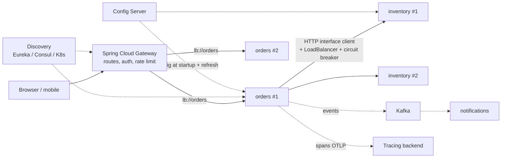
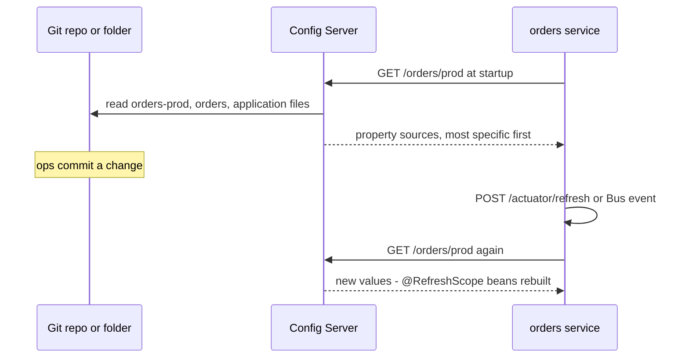
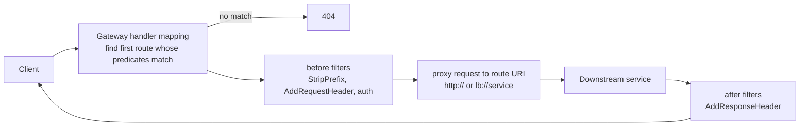
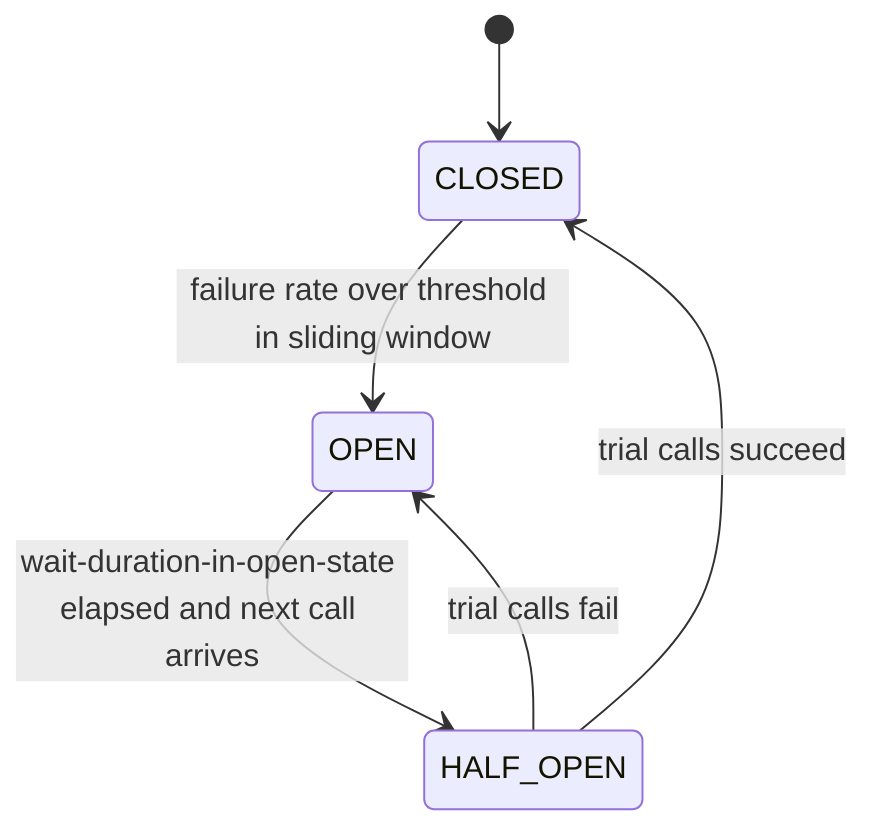

# Chapter 16 — Spring Cloud and Microservices

A **microservice architecture** splits one application into small, independently deployed services talking over the network. It buys independent releases and scaling, and costs every problem of **distributed systems** (parts on different machines over an unreliable network; [System Design Fundamentals](../../../system-design-patterns/modules/00-system-design-fundamentals/README.md)): where is the other service, what if it is slow, what is the single entry point, where does configuration live, how do you follow one request through ten services. **Spring Cloud** is a family of projects giving Boot applications ready-made answers.

This chapter covers the *Spring implementation*. The patterns — gateways (one front door for all clients), circuit breakers (a switch that stops calls to a failing service), sagas (multi-service workflows of local steps plus undo steps), CQRS (separate write and read models) — are taught in the [Microservices Patterns notes](../../../microservices-patterns/README.md) and [System Design Patterns](../../../system-design-patterns/README.md); each section links there.

The code: four Spring Boot 4.1.1 projects on Java 25 in [`code/`](code/) — `config-demo`, `service-clients`, `gateway-demo`, `resilience-demo` (7 tests, all run). Downstream services (the ones a service calls) are tiny local HTTP servers on random ports, so nothing external is needed. Outputs are real `mvn -q verify` output (log noise trimmed as `...`).

> **Prerequisites.** HTTP clients and interfaces: [Chapter 6](../06-rest-clients-and-http-interfaces/README.md). Proxies and Framework 7 `@Retryable`: [Chapter 4](../04-aop-and-proxies/README.md). `spring.config.import`: [Chapter 3](../03-configuration-and-auto-configuration/README.md). Tracing and health probes: [Chapter 15](../15-observability-and-production/README.md). Messaging: [Chapter 14](../14-messaging-async-and-scheduling/README.md).

---

## 16.1 The map: microservice problems and Spring answers

### Why it matters

Know which problem a dependency solves — and whether your platform already solves it. Many Kubernetes teams add Eureka and a Config Server out of habit, doubling the moving parts.

| Problem | Pattern notes | Spring answer | On Kubernetes, often instead |
|---|---|---|---|
| One entry point for clients, cross-cutting edge concerns (auth, rate limits) | [API Gateway](../../../microservices-patterns/chapters/03-api-gateway/README.md), [BFF](../../../microservices-patterns/chapters/04-bff/README.md) | **Spring Cloud Gateway** | Ingress / Gateway API controller, service mesh (sidecar proxies handling routing, retries and encryption between services) |
| Find instances whose addresses change | [Service Discovery](../../../microservices-patterns/chapters/05-service-discovery/README.md) | Eureka, Consul, Zookeeper, Spring Cloud Kubernetes | Kubernetes Services + DNS |
| Spread calls over instances | [Load balancing](../../../system-design-patterns/modules/06-scaling/README.md) | **Spring Cloud LoadBalancer** (client side) | kube-proxy (forwards a Service's traffic to its pods) / mesh (server side) |
| Configuration per environment, changed without rebuild | [Config externalization](../../../microservices-patterns/chapters/13-config-externalization/README.md) | **Spring Cloud Config**, Vault, Consul KV | ConfigMaps / Secrets (Kubernetes config and secret objects; `spring.config.import=configtree:`) |
| Failing or slow dependencies | [Circuit Breaker](../../../microservices-patterns/chapters/06-circuit-breaker/README.md), [Retry](../../../microservices-patterns/chapters/08-retry/README.md), [Bulkhead](../../../microservices-patterns/chapters/07-bulkhead/README.md) | **Resilience4j** (+ Spring Cloud CircuitBreaker), Framework 7 `@Retryable`/`@ConcurrencyLimit` | mesh retries / outlier detection (ejecting repeatedly failing instances; coarser) |
| Following a request across services | [Distributed Tracing](../../../system-design-patterns/modules/09-operating-in-production/README.md) | Micrometer Tracing + OpenTelemetry ([15.7](../15-observability-and-production/README.md#157-distributed-tracing)) | same, plus mesh telemetry |
| Declarative HTTP calls | — | HTTP interface clients (Framework), OpenFeign (maintenance) | — |
| Async communication, events | [Event-Driven](../../../microservices-patterns/chapters/11-event-driven/README.md), [Saga](../../../microservices-patterns/chapters/10-saga/README.md), [CQRS](../../../microservices-patterns/chapters/12-cqrs/README.md) | Spring Kafka / AMQP ([Chapter 14](../14-messaging-async-and-scheduling/README.md)), Spring Cloud Stream | — |
| Cross-cutting helpers next to each service | [Sidecar](../../../microservices-patterns/chapters/09-sidecar/README.md) | — | sidecar containers, service mesh |



### When not to use microservices

Distributed systems are harder to build, test, debug and operate. A small team, an unclear domain or no need for independent scaling are strong reasons to start with a **well-modularised monolith** (one deployable with clean internal module boundaries; Spring Modulith helps enforce them) and extract services later via [Strangler Fig](../../../microservices-patterns/chapters/02-strangler-fig/README.md). See [DDIA](../../../ddia/) for the consistency problems you inherit.

---

## 16.2 Release trains and versions

### What it is

Spring Cloud is ~15 projects (Commons, Config, Gateway, OpenFeign, Netflix, Consul, Kubernetes, Circuit Breaker, Stream, Function, Bus, Vault, Task, Zookeeper...), each versioned separately. A **release train** is a BOM (bill of materials) pinning versions that work together and with one Boot generation, named `YYYY.MINOR.PATCH` (since 2020) plus a codename.

| Train | Codename | Spring Boot | Component versions |
|---|---|---|---|
| **2025.1.x** | **Oakwood** | **4.0.x, 4.1.x** (4.1 from 2025.1.2) | 5.0.x |
| 2025.0.x | Northfields | 3.5.x | 4.3.x — open-source support ended June 2026 |
| 2024.0.x | Moorgate | 3.4.x | 4.2.x |

(Source: spring.io/projects/spring-cloud compatibility table; 2025.1.3 (August 2026) is the latest service release at the time of writing — based on Boot 4.0.x, compatible with 4.1.x. A `2026.0.0-M1` milestone exists on Maven Central.)

```xml
<properties>
  <spring-cloud.version>2025.1.3</spring-cloud.version>
</properties>
<dependencyManagement>
  <dependencies>
    <dependency>
      <groupId>org.springframework.cloud</groupId>
      <artifactId>spring-cloud-dependencies</artifactId>
      <version>${spring-cloud.version}</version>
      <type>pom</type>
      <scope>import</scope>
    </dependency>
  </dependencies>
</dependencyManagement>
<!-- then Spring Cloud starters without <version> -->
```

Recent changes that trip people up:

- **Gateway artifacts were renamed** (2025.0): `spring-cloud-starter-gateway-server-webflux` (reactive) and `spring-cloud-starter-gateway-server-webmvc` (servlet); properties moved to `spring.cloud.gateway.server.webflux.*` / `...server.webmvc.*`.
- **Spring Cloud Sleuth is gone** (last in 2021.0 for Boot 2.x); tracing is Micrometer Tracing in Boot itself.
- **Netflix Hystrix, Ribbon, Zuul** were removed years ago; use Resilience4j, Spring Cloud LoadBalancer and Spring Cloud Gateway.
- **OpenFeign** is feature-complete (maintenance mode) — the Spring team recommends HTTP interface clients.
- **Spring Cloud Contract**: the 2025.1.0–2025.1.2 BOMs manage it (5.0.x), but the 2025.1.3 BOM no longer lists it, and its GitHub repository has been moved to the `spring-attic` organisation and archived (read-only; last commit July 2026). Existing users can pin `spring-cloud-contract-dependencies` 5.0.3 explicitly; for new projects consider consumer-driven contracts with Pact (16.10).
- Resilience4j is **not** managed by Spring Boot; the Spring Cloud CircuitBreaker BOM pins Resilience4j 2.3.0, while Resilience4j's own Boot 4 module is `resilience4j-spring-boot4` 2.4.0 (used standalone in 16.8).

### Common mistakes

- Mixing trains and Boot generations (e.g. 2025.0 with Boot 4) → `NoSuchMethodError`/`ClassNotFoundException`. Spring Cloud checks compatibility at startup and fails fast with a clear message (`spring.cloud.compatibility-verifier.enabled`).
- Hard-coding component versions instead of importing the BOM.

---

## 16.3 Centralized configuration: Spring Cloud Config

### What it is

A **Config Server** is a small Boot app serving configuration files over HTTP from a backend — usually a **Git repository**, also a local folder (`native` profile), Vault (HashiCorp's secret store), JDBC, S3 and others. Every service is a **config client** importing its properties at startup, layered by *application name*, *profile* and *label* (Git branch/tag) — like one shared company handbook each department reads (general chapter plus its own) and can re-read when updated.

### Why it matters

30 services × 4 environments = 120 configuration sets. A Config Server gives one place to review, version (Git history = audit log) and change them, and to refresh running services without a rebuild. See [Config externalization notes](../../../microservices-patterns/chapters/13-config-externalization/README.md).

### How it works

1. The server exposes `GET /{application}/{profile}[/{label}]` (plus file-style URLs like `/{application}-{profile}.properties`).
2. For `orders` + profile `prod` it returns an ordered list of property sources — most specific first: `orders-prod.properties` → `orders.properties` → `application-prod.properties` → `application.properties`.
3. The client adds `spring.config.import=configserver:http://config:8888` (Boot's config-data API; `bootstrap.yml` is legacy); `optional:configserver:...` if it may start without it.
4. Remote properties join the `Environment` and **override the service's own `application.properties`**. Whether local system properties or environment variables may override remote values is controlled repository-side (`spring.cloud.config.allow-override`, `override-none`, `override-system-properties`).
5. On refresh the client refetches, rebinds `@ConfigurationProperties` beans and re-creates `@RefreshScope` beans.



### The demo

[`ConfigServerAndClientTests`](code/config-demo/src/test/java/ch16/config/ConfigServerAndClientTests.java) writes three files into a temp folder (the "Git repo"), starts a `native` Config Server on a random port, then an `orders` client with profile `prod`:

```java
// server
@SpringBootApplication
@EnableConfigServer
public class ConfigServerApplication { ... }
//   --spring.profiles.active=native
//   --spring.cloud.config.server.native.search-locations=file:<repo>/

// client bean
@Component
@RefreshScope   // re-created with fresh values after a refresh
public class OrderSettings {
    public OrderSettings(@Value("${orders.discount-percent}") int discountPercent,
                         @Value("${orders.greeting}") String greeting,
                         @Value("${shared.timeout}") String timeout) { ... }
}
//   --spring.application.name=orders --spring.profiles.active=prod
//   --spring.config.import=configserver:http://localhost:<port>
```

| File in the repo | Content |
|---|---|
| `application.properties` (all services) | `shared.timeout=5s`, `orders.greeting=hello from application.properties` |
| `orders.properties` | `orders.greeting=hello from orders.properties`, `orders.discount-percent=10` |
| `orders-prod.properties` | `orders.discount-percent=15` |

Then it edits `orders-prod.properties` to 20 and calls `ContextRefresher.refresh()` (what `POST /actuator/refresh` does):

```output
GET /orders/prod -> property sources, highest priority first:
   orders-prod.properties
   orders.properties
   application.properties
client sees:    discount=15%, greeting='hello from orders.properties', timeout=5s
refresh changed [orders.discount-percent]
after refresh:  discount=20%, greeting='hello from orders.properties', timeout=5s
```

- `discount=15%` from the profile file, `greeting` from the service file (overriding the shared one), `timeout` from the shared file; `refresh()` returns exactly the changed keys.

Demo-only detail: server and client share one classpath, so the client passes `spring.cloud.config.enabled=true` — the server jar switches the client off by default (`ConfigServerBootstrapApplicationListener`) so a Config Server doesn't fetch from itself. Real deployments are separate apps.

### Refreshing many instances, secrets and alternatives

- **Spring Cloud Bus** (`spring-cloud-starter-bus-kafka` / `-amqp`) broadcasts one refresh to all instances (`POST /actuator/busrefresh`); `spring-cloud-config-monitor` can trigger it from a Git webhook (HTTP call from the Git host on push).
- `{cipher}AQB...` values are decrypted by the server (`encrypt.key` or a keystore); better keep secrets in **Vault** (`spring-cloud-starter-vault-config`) or Kubernetes Secrets.
- On Kubernetes, ConfigMaps/Secrets mounted as files and imported with `spring.config.import=configtree:/etc/config/` need no extra server ([3.8](../03-configuration-and-auto-configuration/README.md#38-importing-configuration-springconfigimport)); Spring Cloud Kubernetes can also read ConfigMaps via the API and reload.

### Trade-offs and when not to use it

| Pro | Con |
|---|---|
| One reviewed, versioned source; environment diffs visible | Another critical service: if down, new instances can't start (use `optional:`, `fail-fast` + retry, ≥2 replicas) |
| Runtime refresh without redeploy | Runtime refresh is also runtime *risk* — a bad value hits all instances at once |
| Works on any platform | On Kubernetes, ConfigMaps may be enough |

### Common mistakes

- Expecting every bean to see refreshed values — only `@ConfigurationProperties` (rebound) and `@RefreshScope` (re-created) beans do; a `@Value` field in a normal singleton keeps the old value.
- Plain-text secrets in the Git repo.
- Forgetting `spring.application.name` — the client then asks for `application`, not `orders`.

---

## 16.4 Service discovery: Eureka, Consul, Kubernetes

### What it is

Instances come and go and their IP addresses change. **Service discovery** keeps a **registry** of live instances per service name; clients ask "where is `inventory`?" instead of hard-coding addresses ([Service Discovery notes](../../../microservices-patterns/chapters/05-service-discovery/README.md): client- vs server-side).

Spring Cloud Commons defines `DiscoveryClient` (`getInstances("inventory")` → `ServiceInstance`s with host, port, secure flag, metadata); each backend implements it:

| Backend | Starter | How instances register | Health | Notes (not run here) |
|---|---|---|---|---|
| **Netflix Eureka** | `spring-cloud-starter-netflix-eureka-server` / `-client` | client registers itself and sends heartbeats (every 30 s by default) | heartbeat lease expiry | AP design (CAP: stays **A**vailable during a network **P**artition rather than **C**onsistent): may serve stale entries (self-preservation mode) |
| **HashiCorp Consul** | `spring-cloud-starter-consul-discovery` | client registers via the local Consul agent | Consul calls the app's health URL | also KV store for config (`spring-cloud-starter-consul-config`) |
| **Kubernetes** | `spring-cloud-starter-kubernetes-client-all` (or `-fabric8`) | Kubernetes itself (Endpoints of a Service) | readiness probes | needs RBAC (role-based access control) permission to read endpoints |
| **Simple** (in Commons) | none | static list in properties | none | tests, local dev, fixed topologies — used in 16.5 |
| Zookeeper | `spring-cloud-starter-zookeeper-discovery` | ephemeral nodes (vanish when the owner disconnects) | session | CP design (consistent; may refuse requests during a partition) |

Eureka in a nutshell (not run):

```java
@SpringBootApplication
@EnableEurekaServer               // the registry: a dashboard at http://localhost:8761
public class RegistryApplication { ... }
```

```yaml
# each service (client) - with spring-cloud-starter-netflix-eureka-client on the classpath
spring.application.name: inventory                   # the service id
eureka:
  client:
    service-url:
      defaultZone: http://registry:8761/eureka/
  instance:
    prefer-ip-address: true
```

### On Kubernetes, do you need it?

Usually **no**: a `Service` named `inventory` gives a stable DNS name (`http://inventory:8080`), kube-proxy spreads connections over ready pods, and readiness probes cover health (server-side discovery and load balancing). Add Spring Cloud Kubernetes only for client-side features: instance metadata, per-request balancing over pods, discovery across namespaces.

---

## 16.5 Client-side load balancing with Spring Cloud LoadBalancer

### What it is

**Client-side load balancing**: the *caller* picks an instance from the list discovery provides — no load-balancer box in between ([System Design Fundamentals](../../../system-design-patterns/modules/00-system-design-fundamentals/README.md)). Spring Cloud LoadBalancer (Netflix Ribbon's replacement) resolves a service id in a URL (`http://inventory/...` or `lb://inventory`) to a concrete instance per request.

### How it works

1. A client marked for load balancing (`@LoadBalanced RestClient.Builder`, a Feign client with only a `name`, an HTTP service group without a `base-url`, the gateway's `lb://` URIs) makes a request to `http://inventory/stock/1`.
2. An interceptor asks the `ReactorLoadBalancer` for service `inventory`.
3. A `ServiceInstanceListSupplier` gets instances from the `DiscoveryClient` (cached), optionally filtered (health-check, zone, hints).
4. The algorithm picks one — **round robin** by default (instances in turn: A, B, A, B; randomised start), or `RandomLoadBalancer`, weighted, "same instance preference", subset.
5. The URL is rewritten to `http://host:port/stock/1` and sent.

### The demo: static instances, two clients

[`service-clients`](code/service-clients/) uses the **simple** discovery client (instances listed in properties). The test starts two tiny HTTP servers, "A" and "B", and points the properties at them:

```properties
spring.application.name=orders
# "Simple" discovery: a fixed list of instances per service id (instead of Eureka/Consul/Kubernetes).
spring.cloud.discovery.client.simple.instances.inventory[0].uri=http://localhost:9001
spring.cloud.discovery.client.simple.instances.inventory[1].uri=http://localhost:9002
# No spring.http.serviceclient.inventory.base-url: Spring Cloud LoadBalancer then uses
# the group name "inventory" as the service id and picks an instance per request.
```

Output (both clients shown in 16.6):

```output
HTTP interface 4 calls served by [A, B, A, B]
OpenFeign      4 calls served by [A, B, A, B]  5th call -> Stock[sku=SKU-9, quantity=7, servedBy=A]
```

Round robin alternates; the start is random, so another run may print `[B, A, B, A]` (the test asserts alternation, not order). The startup log warns:

```output
WARN ... LoadBalancerCaffeineWarnLogger : Spring Cloud LoadBalancer is currently working with the default cache. While this cache implementation is useful for development and tests, it's recommended to use Caffeine cache in pr...
```

In production add `com.github.ben-manes.caffeine:caffeine` (a fast in-memory cache) so the instance-list cache is bounded and refreshed properly (`spring.cloud.loadbalancer.cache.ttl` — time to live, default 35 s).

Useful settings:

```properties
# instance-list supplier chain: default | health-check | zone-preference | weighted | same-instance-preference | request-based-sticky-session | subset
spring.cloud.loadbalancer.configurations=health-check
# per-service overrides live under spring.cloud.loadbalancer.clients.<serviceId>.*
```

For a plain `RestClient`, mark the builder:

```java
@Bean @LoadBalanced
RestClient.Builder loadBalancedBuilder() { return RestClient.builder(); }
// restClientBuilder.baseUrl("http://inventory").build()
```

### Trade-offs

| Client-side (Spring Cloud LoadBalancer) | Server-side (K8s Service, NGINX, cloud LB, mesh) |
|---|---|
| per-request choice, custom algorithms, zone/metadata aware | nothing in the app; works for every language |
| each client needs the library and a discovery source | extra network hop (except kube-proxy/mesh sidecars), fewer app-level decisions |

---

## 16.6 Declarative clients: OpenFeign vs HTTP interface clients

### What it is

Both turn a Java interface into a generated proxy making the HTTP calls ([6.6](../06-rest-clients-and-http-interfaces/README.md#66-http-service-interfaces-httpexchange) covers HTTP interfaces in depth).

```java
// Spring Cloud OpenFeign: name = service id -> resolved by the LoadBalancer (no url given)
@FeignClient(name = "inventory")
public interface InventoryFeignClient {
    @GetMapping("/stock/{sku}")                       // Spring MVC annotations
    Stock stock(@PathVariable("sku") String sku);
}

// Spring Framework HTTP service interface (no extra library)
public interface InventoryHttpClient {
    @GetExchange("/stock/{sku}")
    Stock stock(@PathVariable String sku);
}

@SpringBootApplication
@EnableFeignClients                                                        // scan for @FeignClient
@ImportHttpServices(group = "inventory", types = InventoryHttpClient.class) // group name = service id
public class ClientsApplication { ... }
```

Since Spring Cloud 2025.1 (Commons 5.0), LoadBalancer plugs into Boot 4's **HTTP service client groups**: a group without `spring.http.serviceclient.<group>.base-url` gets a load-balanced `http://<groupName>`, and an `lb://` base URL also works — so `inventory` needed no URL. [`LoadBalancedClientsTests`](code/service-clients/src/test/java/ch16/clients/LoadBalancedClientsTests.java) calls each client four times (output in 16.5).

### Comparison

| | OpenFeign | HTTP interface client |
|---|---|---|
| Where it lives | Spring Cloud OpenFeign (separate project) | Spring Framework 6+ core; Boot 4 groups via `@ImportHttpServices` |
| Status | **feature-complete / maintenance** — only fixes | actively developed; the Spring team's recommendation |
| Annotations | Spring MVC's `@GetMapping`, ... on the interface | `@GetExchange`, `@PostExchange`, ... |
| Underlying client | Feign's own client (or Apache HC5 / OkHttp) | `RestClient` or `WebClient` (reactive return types possible) |
| Config | `spring.cloud.openfeign.client.config.<name>.*` (timeouts, loggers, interceptors) | `spring.http.serviceclient.<group>.*`, `RestClientHttpServiceGroupConfigurer` |
| Load balancing | automatic when only `name` is set | automatic for groups without base URL (Spring Cloud 2025.1+) |
| Circuit breaker | `spring.cloud.openfeign.circuitbreaker.enabled=true` + fallbacks | Spring Cloud 2025.1+: per-group breaker with an `@HttpServiceFallback` class (switch `spring.cloud.circuitbreaker.http-services.enabled`, on by default; not run here), or wrap the call in a service method with Resilience4j |
| Tracing | instrumented | instrumented (via the observed `RestClient`) |

**Recommendation:** new code → HTTP interface clients; existing Feign code keeps working — migrate when convenient (annotations map almost one-to-one).

---

## 16.7 API gateway: Spring Cloud Gateway

### What it is

An **API gateway** is the single front door for external clients: it **routes** each request to the right service and applies **edge concerns** once — authentication/token relay, rate limiting, CORS, header rewriting, retries/circuit breaking, request size limits. Patterns: [API Gateway notes](../../../microservices-patterns/chapters/03-api-gateway/README.md), [BFF](../../../microservices-patterns/chapters/04-bff/README.md), [API & Edge module](../../../system-design-patterns/modules/08-api-and-edge/README.md).

Two flavours, same concepts:

| | Server **Web MVC** | Server **WebFlux** |
|---|---|---|
| Starter | `spring-cloud-starter-gateway-server-webmvc` | `spring-cloud-starter-gateway-server-webflux` |
| Runtime | Servlet (Tomcat/Jetty), blocking; pairs well with virtual threads | Netty, reactive |
| Routes in code | `RouterFunction` DSL (`GatewayRouterFunctions.route`) | `RouteLocatorBuilder` DSL |
| Properties | `spring.cloud.gateway.server.webmvc.routes` | `spring.cloud.gateway.server.webflux.routes` |
| Choose when | team knows MVC, uses blocking libraries | very high connection counts, streaming, already reactive |

### How it works

A **route** = id + destination URI + **predicates** (when does it match? `Path`, `Method`, `Header`, `Host`, `Query`, `Cookie`, `After`, `Weight`, `Version`...) + **filters** (what to change? `StripPrefix`, `AddRequestHeader`, `RewritePath`, `CircuitBreaker`, `Retry`, `RequestRateLimiter`, `TokenRelay`, ...).



### The demo

[`gateway-demo`](code/gateway-demo/) defines one route in YAML and one in Java.

```yaml
spring:
  cloud:
    gateway:
      server:
        webmvc:
          routes:
            # Route 1, in YAML: /api/orders/** -> orders service
            - id: orders
              uri: ${services.orders.url}              # with discovery: lb://orders
              predicates:
                - Path=/api/orders/**
                - Method=GET,POST
              filters:
                - StripPrefix=1                          # /api/orders/7 -> /orders/7
                - AddRequestHeader=X-Gateway, ch16-gateway
                - AddResponseHeader=X-Served-Via, gateway
```

```java
/** Route 2, in the Java DSL: /api/inventory/** -> inventory service, protected by a circuit breaker. */
@Bean
RouterFunction<ServerResponse> inventoryRoute(@Value("${services.inventory.url}") String inventoryUrl) {
    return route("inventory")
            .GET("/api/inventory/**", http())
            .before(uri(inventoryUrl))
            .filter(circuitBreaker("inventoryCB", URI.create("forward:/fallback/inventory")))
            .build();
}

@GetMapping("/fallback/inventory")
String inventoryFallback() {
    return "{\"items\":[],\"note\":\"inventory temporarily unavailable\"}";
}
```

(Static imports: `GatewayRouterFunctions.route`, `HandlerFunctions.http`, `BeforeFilterFunctions.uri`, `CircuitBreakerFilterFunctions.circuitBreaker`. Pass the target via `before(uri(...))`: the `http(String)` / `http(URI)` overloads, deprecated in Gateway 4.x, are gone in Gateway 5.0 — only `http()` remains.) The `CircuitBreaker` filter uses Spring Cloud CircuitBreaker, hence `spring-cloud-starter-circuitbreaker-resilience4j`.

[`GatewayRoutingTests`](code/gateway-demo/src/test/java/ch16/gateway/GatewayRoutingTests.java) runs an echoing "orders service" and points the inventory route at a port where nothing listens:

```output
GET /api/orders/7 -> orders-service saw GET /orders/7?expand=items X-Gateway=ch16-gateway | response X-Served-Via=gateway
DELETE /api/orders/7 and GET /api/unknown -> 404 (no route matches)
GET /api/inventory/items (service down) -> {"items":[],"note":"inventory temporarily unavailable"}
```

- `StripPrefix=1` removed `/api`; the query string was kept; request and response headers were added.
- `DELETE` fails the `Method` predicate and nothing matches `/api/unknown` → 404.
- The inventory connection failure went through the circuit breaker to the fallback — a degraded but valid answer.

### Other common gateway jobs (not run)

- **Token relay** (`TokenRelay` filter + `spring-boot-starter-oauth2-client`): the gateway logs the user in and forwards the access token — [11.10](../11-spring-security-2-tokens-and-oauth2/README.md#1110-calling-other-services-client-credentials-and-token-relay), BFF in [11.12](../11-spring-security-2-tokens-and-oauth2/README.md#1112-where-should-a-browser-keep-tokens-the-bff-pattern).
- **Rate limiting**: the WebFlux flavour's `RequestRateLimiter` (Redis); the MVC flavour's Bucket4j-based filter. See [Rate Limiting](../../../system-design-patterns/modules/08-api-and-edge/README.md).
- **Weighted routes** (`Weight=group, 90`) for canary releases (a small traffic share to a new version first).

### Common mistakes

- Business logic or many-service aggregation in the gateway → a "distributed monolith" bottleneck. Keep it thin; use a BFF for client-specific aggregation.
- Spring Cloud Gateway *and* an Ingress/cloud gateway doing the same things — one layer per concern.
- Retrying non-idempotent `POST`s at the gateway (an order-creating `POST` can't safely run twice).

---

## 16.8 Resilience: circuit breaker, retry, rate limiter

### What it is

Remote calls fail and, worse, become **slow**; unprotected callers pile up waiting threads until they fail too — a **cascading failure**. Tools ([Reliability module](../../../system-design-patterns/modules/05-reliability/README.md)):

| Tool | Idea | Notes |
|---|---|---|
| **Timeout** | never wait forever | the first line of defence; set on every client ([Chapter 6](../06-rest-clients-and-http-interfaces/README.md)) |
| **Retry** | try again after a transient failure, with back-off (growing waits) + jitter (random extra wait so clients don't retry in lockstep) | only idempotent operations — [Retry notes](../../../microservices-patterns/chapters/08-retry/README.md) |
| **Circuit breaker** | after many failures, stop calling for a while and fail fast / fall back | [Circuit Breaker notes](../../../microservices-patterns/chapters/06-circuit-breaker/README.md) |
| **Bulkhead** | cap concurrent calls to one dependency | [Bulkhead notes](../../../microservices-patterns/chapters/07-bulkhead/README.md) |
| **Rate limiter** | cap calls per time period | protects a dependency or enforces a quota |
| **Fallback** | a degraded answer (cache, default, empty list) | [Graceful degradation](../../../system-design-patterns/modules/05-reliability/README.md) |

**Resilience4j** is the standard Java library for all of these (Hystrix's successor): directly (`resilience4j-spring-boot4`: annotations + properties + Micrometer metrics + health) or via **Spring Cloud CircuitBreaker**, an abstraction (`CircuitBreakerFactory.create("id").run(supplier, fallback)`) with a Resilience4j implementation, used e.g. by the gateway filter above.

### Circuit breaker states



- **CLOSED** — calls pass; outcomes are recorded in a **sliding window** (last N calls, or last N seconds).
- **OPEN** — calls are rejected immediately with `CallNotPermittedException` (→ fallback) without touching the dependency, giving it time to recover.
- **HALF_OPEN** — a limited number of trial calls decide whether to close again.

### The demo

[`resilience-demo`](code/resilience-demo/) wraps a fake remote `RemoteInventory` (the tests switch it up or down):

```java
@CircuitBreaker(name = "inventory", fallbackMethod = "cachedStock")
public String stockWithBreaker(String sku) {
    return "live stock " + remote.stock(sku);
}

// fallback: same parameters + the exception as the last parameter
private String cachedStock(String sku, Throwable t) {
    return "cached stock 5 (" + t.getClass().getSimpleName() + ")";
}

@Retry(name = "inventory-retry")
public String stockWithRetry(String sku) { return "live stock " + remote.stock(sku); }

@RateLimiter(name = "search")
public String search(String text) { return "results for " + text; }
```

```yaml
resilience4j:
  circuitbreaker:
    instances:
      inventory:
        sliding-window-type: COUNT_BASED
        sliding-window-size: 4                 # judge the last 4 calls
        minimum-number-of-calls: 4             # ... but only once 4 calls were recorded
        failure-rate-threshold: 50             # open when >= 50 % of them failed
        wait-duration-in-open-state: 300ms     # stay OPEN this long, then allow trial calls
        permitted-number-of-calls-in-half-open-state: 2
        record-exceptions: ch16.resilience.RemoteCallException
  retry:
    instances:
      inventory-retry:
        max-attempts: 3                        # total attempts, including the first call
        wait-duration: 20ms
        enable-exponential-backoff: true
        exponential-backoff-multiplier: 2      # 20 ms, then 40 ms
        retry-exceptions: ch16.resilience.RemoteCallException
  ratelimiter:
    instances:
      search:
        limit-for-period: 3                    # 3 permits ...
        limit-refresh-period: 10s              # ... per 10-second cycle
        timeout-duration: 0                    # don't wait for a permit: reject immediately
```

[`CircuitBreakerTests`](code/resilience-demo/src/test/java/ch16/resilience/CircuitBreakerTests.java) subscribes to the breaker's state-transition events and walks it through all states:

```output
1) dependency goes down, 4 calls:
   call 1: cached stock 5 (RemoteCallException)  state=CLOSED
   call 2: cached stock 5 (RemoteCallException)  state=CLOSED
   call 3: cached stock 5 (RemoteCallException)  state=CLOSED
   call 4: cached stock 5 (RemoteCallException)  state=OPEN
2) while OPEN the remote is not even called:
   call 5: cached stock 5 (CallNotPermittedException)  remote calls +0
3) wait 300 ms, dependency is back; 2 trial calls in HALF_OPEN:
   call 6: live stock 7  state=HALF_OPEN
   call 7: live stock 7  state=CLOSED
transitions: [CLOSED -> OPEN, OPEN -> HALF_OPEN, HALF_OPEN -> CLOSED]
```

- Calls 1–3 fail but the breaker stays CLOSED: the window needs `minimum-number-of-calls` (4) first.
- After call 4 the failure rate is 100% ≥ 50% → OPEN.
- Call 5 is rejected without calling the remote (`remote calls +0`) — what stops the cascade.
- After 300 ms the next call moves it to HALF_OPEN — by default (`automatic-transition-from-open-to-half-open-enabled: false`) no timer does this; the first call after the wait does. Two successful trials close it.
- Resilience4j defaults otherwise: `COUNT_BASED` window of 100 calls, `minimum-number-of-calls` 100, `failure-rate-threshold` 50, `wait-duration-in-open-state` 60 s, 10 permitted HALF_OPEN calls — sensible in production, too slow for a demo. Retry defaults to 3 attempts 500 ms apart.

[`RetryAndRateLimiterTests`](code/resilience-demo/src/test/java/ch16/resilience/RetryAndRateLimiterTests.java):

```output
Framework 7 @Retryable, remote fails twice -> live stock 7 after 3 attempts
RateLimiter (3 per 10 s): call1=OK call2=OK call3=OK call4=REJECTED call5=REJECTED
Resilience4j @Retry, remote fails twice:
   retry #1 after inventory unavailable, waiting 20 ms
   retry #2 after inventory unavailable, waiting 40 ms
   -> live stock 7 after 3 attempts
   retry #1 after inventory unavailable, waiting 20 ms
   retry #2 after inventory unavailable, waiting 40 ms
   remote down: gave up after 3 attempts, caller gets RemoteCallException
```

- Resilience4j's `max-attempts: 3` counts the **first call**; Framework 7's `maxRetries = 2` counts only **retries** — both mean 3 attempts (`maxRetries = 3` would be 4).
- Exponential back-off doubled the wait (20 → 40 ms); add jitter in production (`randomized-wait-factor` / `enable-randomized-wait`).
- The rate limiter rejects with `RequestNotPermitted` once the period's 3 permits are used.

The Framework 7 version ([Chapter 4.7](../04-aop-and-proxies/README.md#47-framework-7-core-resilience-retryable-and-concurrencylimit) covers it fully):

```java
@Retryable(includes = RemoteCallException.class, maxRetries = 2, delay = 20, multiplier = 2)
@ConcurrencyLimit(limit = 10, policy = ConcurrencyLimit.ThrottlePolicy.REJECT)   // a simple bulkhead
public String stock(String sku) { return "live stock " + remote.stock(sku); }
// needs @EnableResilientMethods on a configuration class
```

### Resilience4j vs Framework 7 core

| Need | Framework 7 core | Resilience4j |
|---|---|---|
| Retry with back-off, jitter | `@Retryable`, `RetryTemplate` | `@Retry`, `Retry` |
| Bulkhead (concurrency cap) | `@ConcurrencyLimit` (BLOCK or REJECT) | `@Bulkhead` (semaphore or thread pool) |
| Circuit breaker | — | `@CircuitBreaker` |
| Rate limiter | — | `@RateLimiter` |
| Time limiter | — (use client timeouts) | `@TimeLimiter` (async/reactive) |
| Fallback methods | — (catch at the caller) | `fallbackMethod` |
| Config in properties, per instance | attributes (placeholders allowed) | yes, rich |
| Metrics, health, events | `MethodRetryEvent` | Micrometer meters, health indicators, event publishers |
| Extra dependency | none | yes |

Rule of thumb: plain retries and concurrency caps → Framework 7; anything involving circuit breaking, rate limiting or fallbacks → Resilience4j.

**Order when stacking annotations** (Resilience4j defaults): `Retry( CircuitBreaker( RateLimiter( TimeLimiter( Bulkhead( call ) ) ) ) )` — retry outermost, so each attempt is counted by the breaker, and an OPEN breaker's rejection can be retried unless you exclude `CallNotPermittedException`. Reorder with `resilience4j.*.<type>-aspect-order`.

### Common mistakes

- Retrying everything, including 4xx and non-idempotent calls.
- Retries at gateway **and** client **and** service → retry storms (3 × 3 × 3 = 27 calls).
- A breaker without timeouts: slow calls never "fail", so it never opens (or configure `slow-call-duration-threshold` / `slow-call-rate-threshold`).
- One breaker for all endpoints of a service — one bad endpoint opens the circuit for healthy ones.
- Self-invocation — all these annotations are proxy-based ([Chapter 4](../04-aop-and-proxies/README.md)).
- Fallbacks hiding outages forever — alert on breaker state (`resilience4j_circuitbreaker_state` metric).

### TL;DR
Timeouts first; retry only transient, idempotent failures with back-off + jitter; a circuit breaker to fail fast and give the dependency room; bulkhead/rate limiter to cap load; fallbacks for degraded answers. Framework 7 covers retry + concurrency limits; Resilience4j covers everything.

---

## 16.9 Distributed tracing across services

Little beyond [Chapter 15.7](../15-observability-and-production/README.md#157-distributed-tracing): every service adds `spring-boot-starter-opentelemetry` and exports to the same collector; the gateway, clients from Boot's `RestClient.Builder` (including HTTP interface groups) and OpenFeign propagate `traceparent`. For messaging enable observation explicitly (`spring.kafka.template.observation-enabled=true`, `spring.kafka.listener.observation-enabled=true`, likewise RabbitMQ) so context travels in message headers. Microservice-specific points:

- Use the **same propagation format** everywhere (W3C by default; set `management.tracing.propagation.type=b3` only for legacy Zipkin/B3 services, or produce both).
- Set `spring.application.name` in every service — it becomes the service name in traces and logs.
- Let the **edge decide sampling** (the gateway) — downstream services follow the sampled flag.
- Tag spans with business ids as **high-cardinality** values (order id), never as metric tags.

---

## 16.10 Contract testing

### What it is

Consumer A and provider B are tested separately — do they still agree on the API? End-to-end tests of all services are slow and flaky. **Contract testing** checks each side against a shared **contract** (request → expected response):

1. Consumer-driven: the consumer writes what it needs.
2. The provider's build **verifies** it responds that way.
3. The consumer's tests run against a **stub** (fake server with canned answers) generated from the contract.

| Tool | How | Status |
|---|---|---|
| **Pact** (pact-jvm) | consumer tests produce a pact file; a Pact Broker (stores contracts and results) shares it; provider verifies; `can-i-deploy` gate | active, polyglot |
| **Spring Cloud Contract** | contracts in YAML/Groovy/Java in the provider repo; the plugin generates provider tests and a stubs jar; consumers use `@AutoConfigureStubRunner` | JVM/Spring-centric; not in the 2025.1.3 BOM, repository archived in `spring-attic` (see 16.2) |
| OpenAPI-based checks | validate both sides against the OpenAPI document | good for provider-driven public APIs |

Spring Cloud Contract, for recognition (not run):

```yaml
# provider: src/test/resources/contracts/stock/shouldReturnStock.yml
request:
  method: GET
  url: /stock/SKU-1
response:
  status: 200
  headers: { Content-Type: application/json }
  body: { sku: "SKU-1", quantity: 7 }
```

```java
// consumer test: runs against a WireMock stub built from the provider's contracts
@SpringBootTest
@AutoConfigureStubRunner(ids = "com.acme:inventory:+:stubs:8090", stubsMode = StubRunnerProperties.StubsMode.LOCAL)
class InventoryClientContractTest { /* call http://localhost:8090/stock/SKU-1 */ }
```

**When not to use it:** a single team owning both sides that deploys them together, or public APIs where you can't know consumers (use versioning + OpenAPI instead).

---

## 16.11 Messaging between services

Synchronous HTTP chains couple availability: any service down fails the request. Events decouple them in time ([Event-Driven notes](../../../microservices-patterns/chapters/11-event-driven/README.md)). Spring options:

- **Spring for Apache Kafka / Spring AMQP** — templates and `@KafkaListener`/`@RabbitListener` ([Chapter 14](../14-messaging-async-and-scheduling/README.md), incl. the [transactional outbox](../14-messaging-async-and-scheduling/README.md#1417-the-transactional-outbox)).
- **Spring Cloud Stream** — a binder abstraction: `java.util.function` beans (`Supplier`, `Function`, `Consumer`) bound to Kafka/RabbitMQ destinations by configuration (`spring.cloud.function.definition=enrichOrder`, `spring.cloud.stream.bindings.enrichOrder-in-0.destination=orders`). Good for many similar pipelines; hides broker-specific features you may need.
- Cross-service consistency without distributed transactions: [Saga](../../../microservices-patterns/chapters/10-saga/README.md) (choreography — services react to each other's events — or orchestration — a coordinator directs each step), idempotent consumers, and [CQRS](../../../microservices-patterns/chapters/12-cqrs/README.md) read models.

---

## 16.12 Common mistakes (whole chapter)

| Symptom | Cause | Fix |
|---|---|---|
| App fails at startup with a compatibility error | Spring Cloud train doesn't match Boot | 2025.1.x for Boot 4.0/4.1 |
| `No spring.config.import property has been defined` | config client on classpath without import | add `spring.config.import=configserver:...` (or `optional:`) |
| Config change not visible after refresh | plain `@Value` in a singleton | `@RefreshScope` or `@ConfigurationProperties` |
| `UnknownHostException: inventory` | client not load-balanced | `@LoadBalanced` builder, Feign `name`, or HTTP group without base URL |
| LoadBalancer "default cache" warning | Caffeine missing | add Caffeine |
| Gateway returns 404 | predicates don't match (method, path, prefix) | check the route definition; DEBUG logging for `org.springframework.cloud.gateway` |
| Breaker never opens | no timeouts, slow calls not recorded, window too large | timeouts + slow-call thresholds + sensible window |
| Retry storm during an outage | retries at several layers | retry in one layer, with jitter; breaker around retries |
| Everything down when one service is down | synchronous chains, no fallbacks | timeouts, breakers, fallbacks, async events |

---

## 16.13 In the interview

**Q: Which Spring Cloud version do you use with Spring Boot 4.1?**
The 2025.1.x "Oakwood" train (Boot 4.0 and 4.1, the latter from 2025.1.2), imported as the `spring-cloud-dependencies` BOM; its components are 5.0.x.

**Q: How do microservices find each other in Spring?**
Through the `DiscoveryClient` abstraction backed by Eureka, Consul, Zookeeper or Kubernetes; Spring Cloud LoadBalancer resolves service ids (`http://inventory`, `lb://inventory`) to instances per request, round robin by default. On Kubernetes plain Services + DNS usually suffice.
- *Client-side vs server-side load balancing?* → The client picks the instance (smarter, per-request, needs a library) vs a proxy picks it (language-agnostic, extra hop).

**Q: Explain the circuit breaker states and how you configure them in Resilience4j.**
CLOSED records outcomes in a sliding window; when the failure (or slow-call) rate exceeds the threshold after `minimum-number-of-calls`, it goes OPEN and rejects calls fast; after `wait-duration-in-open-state` it goes HALF_OPEN and lets `permitted-number-of-calls-in-half-open-state` trial calls decide between CLOSED and OPEN. Configure per instance under `resilience4j.circuitbreaker.instances.<name>`; use `@CircuitBreaker(name, fallbackMethod)`.
- *Different from retry?* → Retry repeats one call hoping for success; the breaker stops calling an obviously unhealthy dependency. Combine them, the breaker protecting against retry storms.
- *Does Framework 7 have a circuit breaker?* → No — only `@Retryable` and `@ConcurrencyLimit`.

**Q: What does an API gateway do, and which Spring Cloud Gateway flavour would you pick?**
Single entry point: routing by predicates, filters for auth/token relay, rate limiting, header rewriting, resilience. Web MVC flavour for servlet teams and virtual threads; WebFlux flavour for reactive stacks and very high concurrency. Keep business logic out.

**Q: How do you manage configuration across 30 services?**
Externalised config: Spring Cloud Config (Git-backed, layered by app/profile/label, refresh via actuator or Bus) or platform-native ConfigMaps/Secrets with `configtree:`; secrets in Vault; config changes reviewed like code.

**Q: OpenFeign or HTTP interfaces?** → HTTP interfaces for new code (core Spring, actively developed, Boot 4 groups, load-balanced by Spring Cloud); OpenFeign is in maintenance mode.

**Q: How do you test that services stay compatible?** → Consumer-driven contract tests (Pact, or Spring Cloud Contract in existing projects) plus a small number of end-to-end smoke tests.

---

## Chapter TL;DR

- Spring Cloud = ready-made answers to distributed-system problems; check what your platform (Kubernetes) already gives you before adding them. Patterns: [microservices-patterns notes](../../../microservices-patterns/README.md).
- **Boot 4.1 → Spring Cloud 2025.1.x (Oakwood)**, BOM `spring-cloud-dependencies` (2025.1.3 used here); components 5.0.x; OpenFeign in maintenance; Spring Cloud Contract no longer in the 2025.1.3 BOM.
- **Config Server**: `@EnableConfigServer`, Git or `native` backend; clients use `spring.config.import=configserver:`; precedence `app-profile` > `app` > `application`; refresh re-creates `@RefreshScope` beans (proved: 15% → 20%).
- **Discovery**: `DiscoveryClient` over Eureka/Consul/Kubernetes/simple; **LoadBalancer** resolves service ids per request, round robin by default (proved: B, A, B, A); add Caffeine.
- **Declarative clients**: prefer HTTP interfaces (`@ImportHttpServices`, load-balanced when the group has no base URL); OpenFeign still works.
- **Gateway**: routes = predicates + filters; server-webmvc or server-webflux; `StripPrefix`, headers, `CircuitBreaker` with fallback (proved).
- **Resilience4j**: breaker CLOSED → OPEN → HALF_OPEN → CLOSED (proved), retry with back-off, rate limiter (proved); Framework 7 `@Retryable`/`@ConcurrencyLimit` for simple cases.
- Tracing across services = Chapter 15 setup in every service; contracts with Pact/Spring Cloud Contract; events with Kafka/Stream.
- Next: [Chapter 17 — Spring AI and what's new](../17-spring-ai-and-whats-new/README.md).
