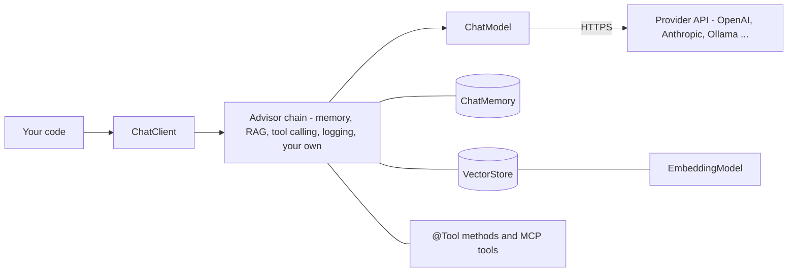
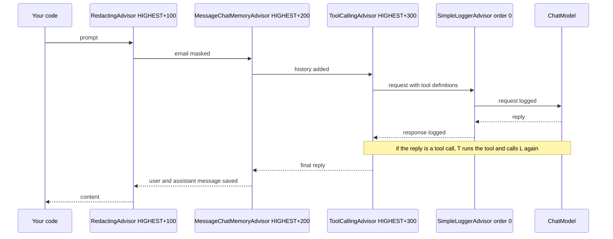
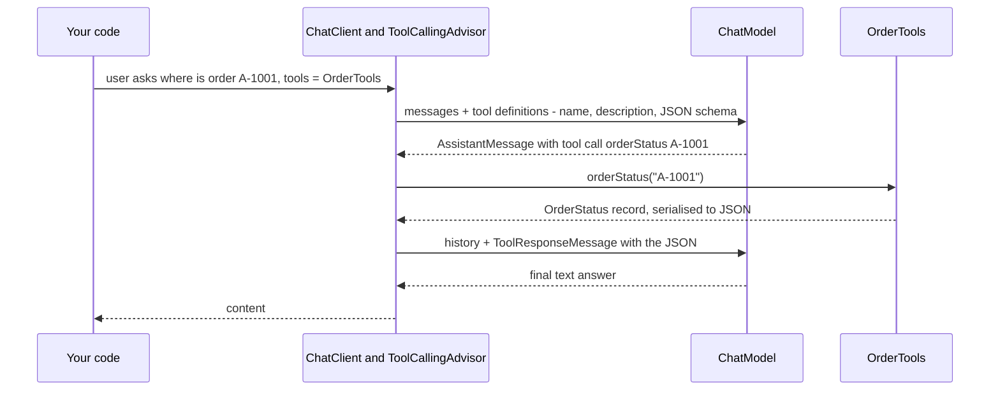
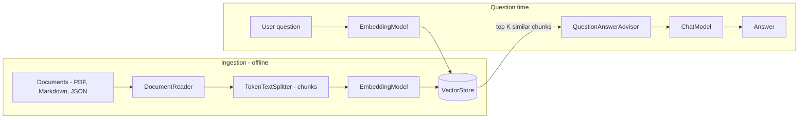
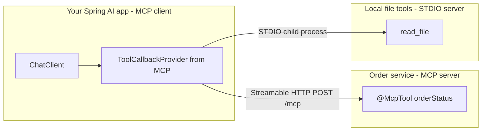
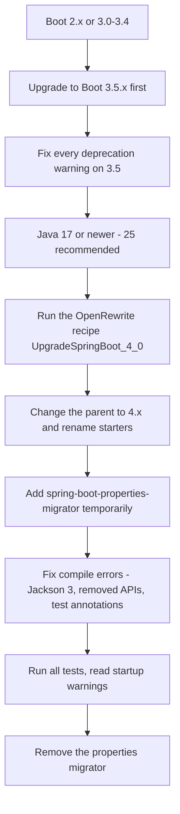

# Chapter 17 — Spring AI and What's New in Boot 4 / Framework 7

This chapter has two halves.

The first half is **Spring AI**: the Spring project for calling large language models (LLMs) from a Spring application. It gives you one API for many AI providers (the companies or tools that host the models: OpenAI, Anthropic, Google, Amazon Bedrock, Ollama, ...). It also covers the things a real AI feature needs besides "send text, get text": prompt templates (the **prompt** is the text you send to the model), conversation memory, turning answers into Java objects, letting the model call your code (tools), searching your own documents (RAG, retrieval-augmented generation, §17.9), and the Model Context Protocol (MCP: a standard way to offer tools to AI apps, §17.10).

The second half is a **migration map**: what changed from Spring Boot 3.x to 4.x, from Spring Framework 6 to 7, and from Spring Security 6 to 7. Each change points to the chapter of this book that teaches it.

This chapter does **not** re-teach how LLMs work. For tokens (the word pieces a model reads and writes, and is billed by), context windows (the maximum amount of text one call can hold), sampling (how the model picks each next token), prompting, embeddings (lists of numbers that capture a text's meaning, §17.9), RAG design and agents (programs where a model repeatedly decides which tool to call next), read the AI book: [LLMs](../../../ai/chapters/04-large-language-models/README.md), [prompt engineering](../../../ai/chapters/05-prompt-engineering/README.md), [building LLM apps](../../../ai/chapters/06-building-llm-apps-in-python/README.md), [embeddings, vector databases and RAG](../../../ai/chapters/07-embeddings-vector-databases-and-rag/README.md), [evaluation](../../../ai/chapters/08-prompting-vs-finetuning-vs-rag-and-llm-evaluation/README.md) and [agents](../../../ai/chapters/09-ai-agents/README.md). Here we focus on the **Spring way** of doing those things.

**What you'll learn**

1. What Spring AI is, which version fits Boot 4.1, and its building blocks (§17.1).
2. How to set up a project for a real provider (OpenAI, Anthropic) and how to run everything **offline** with a fake model (§17.2–17.3).
3. `ChatClient`, messages and prompt templates (§17.3–17.4).
4. Advisors: logging, a custom redaction advisor, and chat memory (§17.5–17.6).
5. Structured output into Java records (§17.7).
6. Tool calling: the model asks, Spring runs your method (§17.8).
7. RAG with `SimpleVectorStore`, an embedding model and `QuestionAnswerAdvisor` (§17.9).
8. MCP servers and clients (§17.10), and production concerns (§17.11).
9. The Boot 3 → 4 migration table (§17.13), Framework 6 → 7 (§17.14), Security 6 → 7 (§17.15) and Boot 4.1 additions (§17.16).

**The code.** [`code/spring-ai-offline/`](code/spring-ai-offline/) is a Spring Boot 4.1.1 project (Framework 7.0, Java 25) using **Spring AI 2.0.1**. It needs **no API key** (the secret string a provider gives you to authenticate and bill your calls) **and no network**: the `ChatModel` bean is a small fake that returns canned (pre-written) answers ([`FakeChatModel`](code/spring-ai-offline/src/main/java/ch17/ai/FakeChatModel.java)), and the `EmbeddingModel` bean is a word-hashing fake ([`FakeEmbeddingModel`](code/spring-ai-offline/src/main/java/ch17/ai/FakeEmbeddingModel.java)). Everything *above* the model — `ChatClient`, advisors, memory, tool calling, structured output, the vector store — is the real Spring AI code. All output shown is real `mvn -q -B -ntp verify` output (14 tests, all passing). Snippets that need a real provider are marked **(needs an API key — not run)**.

---

## 17.1 What Spring AI is

### What it is

**Spring AI** is a Spring project that connects Spring applications to AI models. It does for AI providers what Spring Data does for databases: it gives you **portable interfaces** (`ChatModel`, `EmbeddingModel`, `VectorStore`, ...), **Boot starters** that auto-configure a provider from properties, and a **fluent client** (`ChatClient`) for everyday use.

Analogy: `RestClient` ([Chapter 6](../06-rest-clients-and-http-interfaces/README.md)) hides the HTTP library under one API. `ChatClient` hides the AI provider under one API. Switching from OpenAI to Anthropic is mostly a change of starter and properties, not of code.

### Why it matters

Calling an LLM's HTTP API directly is easy for a demo. A production feature also needs:

- prompt templates kept outside the code;
- conversation memory (the model itself remembers nothing between calls);
- answers converted into typed Java objects;
- tool calling (the model asks your application to run a function);
- retrieval of your own documents (RAG);
- logging, metrics, tracing, retries, and tests that do not call a paid API.

Spring AI provides each of these as a Spring building block, so they plug into things you already know: beans, properties, Micrometer observations ([Chapter 15](../15-observability-and-production/README.md)) and Boot tests ([Chapter 12](../12-testing-spring-apps/README.md)).

### Versions (verified September 2026)

| Spring AI | Released | Works with | Notes |
|---|---|---|---|
| 1.0 | May 2025 | Boot 3.4 / 3.5 | first GA (general availability: the first production-ready release) |
| 1.1 | Nov 2025 | Boot 3.4 / 3.5 | MCP annotations, more providers |
| **2.0** | **Jun 2026** | **Boot 4.0 / 4.1, Framework 7** | Jackson 3, JSpecify null-safety (annotations that mark what may be `null`), tool loop moved into advisors, immutable (unchangeable once built) options, MCP Java SDK 2.0. **Current: 2.0.1** (used here) |

Spring AI 2.0 **requires** Boot 4. A Boot 3.5 application stays on Spring AI 1.1.x until it migrates. Note that 2.0.0's starters were built against Boot 4.1 dependency versions (spring-ai issue #6465), so Boot 4.1.x is the smoothest choice.

Spring AI is a separate project with its own version number. Boot does not manage its version, so you import the **Spring AI BOM** (bill of materials — a POM that pins the versions of a family of artifacts):

```xml
<dependencyManagement>
  <dependencies>
    <dependency>
      <groupId>org.springframework.ai</groupId>
      <artifactId>spring-ai-bom</artifactId>
      <version>2.0.1</version>
      <type>pom</type>
      <scope>import</scope>
    </dependency>
  </dependencies>
</dependencyManagement>
```

### The building blocks

| Building block | What it does | Real implementations |
|---|---|---|
| `ChatModel` | low-level: sends a `Prompt` (list of messages + options), returns a `ChatResponse` | `OpenAiChatModel`, `AnthropicChatModel`, `OllamaChatModel`, ... (our `FakeChatModel`) |
| `ChatClient` | the fluent, everyday API on top of a `ChatModel`, with advisors | one implementation, built from a `ChatClient.Builder` |
| **Advisor** | an interceptor around every `ChatClient` call (like a servlet filter) | logging, memory, RAG, tool calling, safeguard, validation |
| `ChatMemory` | stores past messages per conversation | `MessageWindowChatMemory` over in-memory / JDBC / other repositories |
| Structured output | converts the text answer into a Java type | `BeanOutputConverter`, `.entity(...)` |
| `ToolCallback` / `@Tool` | a Java method the model may ask to run | method tools, function tools, MCP tools |
| `EmbeddingModel` | turns text into a vector (a fixed-length list) of numbers | OpenAI, Ollama, ONNX transformers, ... (our `FakeEmbeddingModel`) |
| `VectorStore` | stores document vectors and finds similar ones | `SimpleVectorStore` (in memory), PgVector (a PostgreSQL extension for vectors), Redis, Elasticsearch, Qdrant, ... |
| MCP | standard protocol to expose / consume tools across processes | MCP server and client starters |



### Self-check

1. Which Spring AI version goes with Boot 4.1? → 2.0.x (2.0.1 at the time of writing).
2. Why do you import a BOM? → Spring AI is versioned separately from Boot; the BOM keeps all `spring-ai-*` artifacts on the same version.
3. What is the difference between `ChatModel` and `ChatClient`? → `ChatModel` is the provider-level interface (one prompt in, one response out). `ChatClient` is the fluent API on top, with advisors, templates, tools and output conversion.

---

## 17.2 Setting up a project

### With a real provider (needs an API key — not run)

1. Add the BOM (above) and **one model starter**:

```xml
<!-- OpenAI -->
<dependency>
  <groupId>org.springframework.ai</groupId>
  <artifactId>spring-ai-starter-model-openai</artifactId>
</dependency>
<!-- or Anthropic (Claude) -->
<dependency>
  <groupId>org.springframework.ai</groupId>
  <artifactId>spring-ai-starter-model-anthropic</artifactId>
</dependency>
```

2. Configure it. Keep the key in an environment variable or a secret store, **never** in Git ([Chapter 3](../03-configuration-and-auto-configuration/README.md) explains `${...}` placeholders):

```properties
# OpenAI (needs an API key — not run)
spring.ai.openai.api-key=${OPENAI_API_KEY}
spring.ai.openai.chat.model=gpt-5-mini
spring.ai.openai.chat.temperature=0.2
spring.ai.openai.embedding.model=text-embedding-3-small
```

```properties
# Anthropic (needs an API key — not run)
spring.ai.anthropic.api-key=${ANTHROPIC_API_KEY}
spring.ai.anthropic.chat.model=claude-sonnet-5-5
# a larger model for harder tasks: claude-opus-5-5
spring.ai.anthropic.chat.max-tokens=4096
```

3. Inject `ChatClient.Builder` and use it. (In the properties above, `temperature` controls randomness — lower is more predictable — and `max-tokens` caps the length of the answer.) The code in the rest of this chapter works unchanged with either provider.

Facts worth knowing about Spring AI 2.0 configuration (from the 2.0 upgrade notes):

| Change in 2.0 | Before (1.x) | Now (2.0) |
|---|---|---|
| option properties are **flat** | `spring.ai.openai.chat.options.model=...` | `spring.ai.openai.chat.model=...` |
| Anthropic module | Spring's own `AnthropicApi` client | the official `anthropic-java` SDK (software development kit: the vendor's own client library); default `max-tokens` raised from 500 to 4096 |
| OpenAI modules | three variants (`openai`, `openai-sdk`, `azure-openai`) | one `spring-ai-openai` (Azure/Microsoft Foundry through its properties) |
| options objects | mutable, `copy()` | immutable, `mutate()`; `ChatClient.options(...)` takes a **builder** |
| several model starters on the classpath | — | pick one with `spring.ai.model.chat=openai` / `anthropic` / ... |

Default models change over time (Spring AI 2.0's OpenAI default is `gpt-5-mini`, Anthropic's is `claude-haiku-4-5`). Always set the model explicitly so an upgrade does not silently change cost and behaviour.

### Offline, as in this chapter

Our [`pom.xml`](code/spring-ai-offline/pom.xml) has the BOM plus these artifacts and **no model starter**:

| Artifact | Why |
|---|---|
| `spring-boot-starter` | a plain (non-web) Boot app |
| `spring-ai-autoconfigure-model-chat-client` | auto-configures a `ChatClient.Builder` bean from whatever `ChatModel` bean exists |
| `spring-ai-autoconfigure-model-tool` | the tool-calling manager and its properties (an *optional* dependency of the previous one, so you add it yourself — without it Boot logs `TypeNotPresentException ... ToolCallingAutoConfiguration`) |
| `spring-ai-autoconfigure-model-chat-memory` | a `ChatMemory` bean (window of the last 20 messages, stored in memory) |
| `spring-ai-vector-store`, `spring-ai-vector-store-advisor` | `SimpleVectorStore` and `QuestionAnswerAdvisor` |

A model starter would pull these in for you. Then we declare our own `ChatModel` and `EmbeddingModel` beans ([`AiConfig`](code/spring-ai-offline/src/main/java/ch17/ai/AiConfig.java)):

```java
@Configuration
public class AiConfig {

    /** With a real starter on the classpath, Boot would create OpenAiChatModel / AnthropicChatModel here. */
    @Bean
    FakeChatModel chatModel() { return new FakeChatModel(); }

    @Bean
    EmbeddingModel embeddingModel() { return new FakeEmbeddingModel(); }
    // ... vectorStore and supportClient beans, shown later
}
```

### Why a fake model?

A **fake** (a test double with simple working logic, see [Chapter 12](../12-testing-spring-apps/README.md)) lets you test everything around the model without cost, network, rate limits or random answers. Real LLM output is **non-deterministic**: the same prompt can give different words each time. Tests that assert exact LLM text are flaky. The usual strategy:

| What you test | How |
|---|---|
| your prompts, advisors, tools, parsing, error handling | fake or stub `ChatModel` — fast, deterministic (same result every run), runs in CI (continuous integration: the server that builds and tests every change) |
| "is the answer good?" | a small **evaluation** set run against the real model, scored by rules or by another model (Spring AI has `RelevancyEvaluator` and `FactCheckingEvaluator`); see [AI 8.5](../../../ai/chapters/08-prompting-vs-finetuning-vs-rag-and-llm-evaluation/README.md#85-offline-evaluation-the-evaluation-pyramid) |
| the provider integration | a few tagged integration tests with a real key, run on demand |

---

## 17.3 `ChatModel` and `ChatClient`

### `ChatModel`: the provider contract

`ChatModel` has one essential method: `ChatResponse call(Prompt prompt)`. A `Prompt` is a list of **messages** plus **options** (model, temperature, tools, ...). A `ChatResponse` holds one or more `Generation`s, each with an `AssistantMessage`.

| Message type | Class | Who writes it |
|---|---|---|
| system | `SystemMessage` | you: the rules and persona (the role the model should play: "You are a support assistant...") |
| user | `UserMessage` | the end user's question (often via a template) |
| assistant | `AssistantMessage` | the model's reply; may contain **tool calls** instead of text |
| tool | `ToolResponseMessage` | your application: the result of a tool the model asked for |

Our fake implements exactly this interface ([`FakeChatModel`](code/spring-ai-offline/src/main/java/ch17/ai/FakeChatModel.java)). It records each prompt so tests can show what reached "the model", then applies a few rules:

```java
public class FakeChatModel implements ChatModel {

    private final List<Prompt> received = new CopyOnWriteArrayList<>();

    @Override
    public ChatResponse call(Prompt prompt) {
        received.add(prompt);                                   // remember what the model was sent
        return new ChatResponse(List.of(new Generation(reply(prompt))));
    }

    /** Tool-calling-capable default options, like a real provider's options class. */
    @Override
    public ChatOptions getOptions() {
        return ToolCallingChatOptions.builder().build();
    }

    private AssistantMessage reply(Prompt prompt) {
        Message last = prompt.getInstructions().getLast();
        if (last instanceof ToolResponseMessage toolResult) { /* Rule 1: explain the tool result */ }
        String user = prompt.getUserMessage().getText();
        // Rule 2: tools offered + an order id in the question -> return an AssistantMessage with a ToolCall
        // Rule 3: "JSON Schema" in the prompt -> return JSON in a ```json fence
        // Rule 4: RAG context present -> answer from its first line
        // Rule 5: "what is my name" -> look for "my name is X" in earlier messages
        return new AssistantMessage("(fake model) You asked: " + user);
    }
    // ...
}
```

`getOptions()` matters: `ChatClient` copies tool definitions into the prompt's options only when the model's options type supports tools (`ToolCallingChatOptions`). Every real provider's options class does.

### `ChatClient`: the everyday API

Boot auto-configures a **prototype-style** (a new instance per injection, instead of one shared instance) `ChatClient.Builder` bean: each injection point gets its own builder, already wired to the `ChatModel` bean and to observability. You customise it and `build()` a `ChatClient`, which is thread-safe (safe to share between threads) and meant to be reused (make it a bean).

```java
@SpringBootTest
class ChatClientTests {

    @Autowired ChatClient.Builder builder;    // auto-configured by Spring AI from the ChatModel bean
    @Autowired FakeChatModel model;

    @Test
    void simplestCall() {
        ChatClient chat = builder.build();
        String answer = chat.prompt()          // start a request
                .user("What is Spring AI?")    // the user message
                .call()                        // blocking call (use .stream() for a Flux)
                .content();                    // just the text of the reply
        System.out.println("answer: " + answer);
        assertThat(answer).isEqualTo("(fake model) You asked: What is Spring AI?");
    }
}
```

Output:

```
answer: (fake model) You asked: What is Spring AI?
```

What `call()` can return:

| Method | Returns | Use when |
|---|---|---|
| `.content()` | `String` | you only need the text |
| `.entity(Type.class)` | your Java type | structured output (§17.7) |
| `.chatResponse()` | `ChatResponse` | you need metadata: token usage, finish reason (why the model stopped, e.g. done or hit the length limit), model id |
| `.chatClientResponse()` | response + advisor context | you need what advisors stored, e.g. the retrieved documents |
| `.stream().content()` | `Flux<String>` | show tokens as they arrive (chat UIs, SSE — [Chapter 13](../13-reactive-and-webflux/README.md)) |

### Common mistakes

- Creating a new `ChatClient` for every request instead of one bean per use case.
- Injecting `ChatModel` and calling it directly everywhere, losing advisors, memory and observability. Use `ChatClient` unless you are writing infrastructure.
- Assuming the model remembers the previous call. It does not (§17.6).

---

## 17.4 Prompts and prompt templates

### What it is

A **prompt template** is text with placeholders, filled at run time — the same idea as a SQL query with bind parameters (`?` placeholders whose values are supplied separately). Spring AI's `PromptTemplate` uses `{name}` placeholders by default (rendered by the StringTemplate engine; the delimiters can be changed with `StTemplateRenderer` if your text contains braces, e.g. JSON examples).

### How it works

1. Write the template, inline or in a file such as [`prompts/explain.st`](code/spring-ai-offline/src/main/resources/prompts/explain.st): `Explain {topic} to a {audience} in at most {words} words.`
2. Supply values with `render(Map)`/`create(Map)`, or with `.param(...)` on `ChatClient`.
3. A **missing** value is an error, not an empty string — so a typo fails fast.

```java
PromptTemplate template = new PromptTemplate(
        "Explain {topic} to a {audience} in at most {words} words.");
String text = template.render(Map.of("topic", "dependency injection", "audience", "beginner", "words", 50));

PromptTemplate fromFile = new PromptTemplate(new ClassPathResource("prompts/explain.st"));
Prompt prompt = fromFile.create(Map.of("topic", "virtual threads", "audience", "Java developer", "words", 80));

new PromptTemplate("Hello {name}, your plan is {plan}.").render(Map.of("name", "Ana"));   // throws
```

Output ([`PromptTemplateTests`](code/spring-ai-offline/src/test/java/ch17/ai/PromptTemplateTests.java)):

```
rendered: Explain dependency injection to a beginner in at most 50 words.
prompt messages: 1, user text: Explain virtual threads to a Java developer in at most 80 words.
missing variable -> IllegalStateException: Not all variables were replaced in the template. Missing variable names are: [plan].
```

With `ChatClient`, templates and a system message look like this:

```java
@Value("classpath:prompts/explain.st") Resource explainTemplate;

ChatClient chat = builder.defaultSystem("You are a concise Java tutor.").build();
chat.prompt()
    .user(u -> u.text(explainTemplate)
                .param("topic", "records")
                .param("audience", "beginner")
                .param("words", 40))
    .call()
    .content();
```

Output — the messages the model actually received:

```
messages the model received:
  SYSTEM: You are a concise Java tutor.
  USER: Explain records to a beginner in at most 40 words.
```

`defaultSystem(...)`, `defaultUser(...)`, `defaultAdvisors(...)`, `defaultTools(...)` and `defaultOptions(...)` on the builder apply to every request of that client. The per-request `.system(...)`, `.user(...)`, `.advisors(...)`, `.tools(...)` and `.options(...)` add to or override them.

### Common mistakes

- Concatenating user input into the **system** message. User text belongs in the user message. Mixing them makes **prompt injection** (text crafted to override your instructions to the model) easier (see [AI 9.4](../../../ai/chapters/09-ai-agents/README.md#94-guardrails-permissions-and-human-in-the-loop)).
- Templates buried in Java strings. Put long prompts in `src/main/resources/prompts/*.st` files so they can be reviewed and versioned like code.
- Putting JSON examples with `{...}` in a template without changing the delimiters — the renderer treats the braces as placeholders.

### Self-check

1. What happens if a template variable is missing? → `IllegalStateException` listing the missing names.
2. Where should long prompts live? → In classpath resource files, loaded as `Resource`.

---

## 17.5 Advisors

### What it is

An **advisor** intercepts every `ChatClient` call on the way **to** the model and on the way **back**. It can change the prompt (add memory, add retrieved documents, redact — hide — data), change the response, or short-circuit the call (answer itself without calling the model). Advisors are to `ChatClient` what servlet filters are to Spring MVC ([5.11](../05-spring-mvc-and-rest/README.md)) and what `@Around` advice is to AOP ([Chapter 4](../04-aop-and-proxies/README.md)).

### How it works

1. `ChatClient` builds a `ChatClientRequest` (the `Prompt` + a shared **context** map).
2. Advisors are sorted by `getOrder()` — **lower runs first** on the way in and **last** on the way out.
3. Each advisor calls `chain.nextCall(request)` to pass control on. The last link calls the `ChatModel`.
4. The response travels back through the advisors in reverse order.

`HIGHEST` in the diagram is `Ordered.HIGHEST_PRECEDENCE` (the smallest `int`). The default orders are real Spring AI 2.0 values: memory advisors use `HIGHEST_PRECEDENCE + 200`, the auto-registered `ToolCallingAdvisor` `HIGHEST_PRECEDENCE + 300`, and `SimpleLoggerAdvisor` `0`. So the logger sits *inside* the tool loop and logs every round trip to the model, while memory sits outside it and saves only the final exchange.



### Built-in advisors (Spring AI 2.0)

| Advisor | Purpose | Section |
|---|---|---|
| `SimpleLoggerAdvisor` | logs request and response at DEBUG | below |
| `MessageChatMemoryAdvisor` | adds past messages of the conversation to the prompt, saves the new exchange | §17.6 |
| `VectorStoreChatMemoryAdvisor` | long-term memory: retrieves *relevant* past messages from a vector store | §17.6 |
| `QuestionAnswerAdvisor` | simple RAG: similarity search (finding the stored texts closest in meaning) + context pasted into the user message | §17.9 |
| `RetrievalAugmentationAdvisor` | modular RAG: query rewriting, expansion, retrieval, joining, augmentation | §17.9 |
| `ToolCallingAdvisor` | runs the tool-call loop; **auto-registered** by `ChatClient` (new in 2.0; replaced the loop inside each `ChatModel`) | §17.8 |
| `SafeGuardAdvisor` | blocks requests containing configured sensitive words | — |
| `StructuredOutputValidationAdvisor` | validates JSON output against the schema and asks the model to retry if it does not match (new in 2.0) | §17.7 |

### A custom advisor: redacting e-mail addresses

Many companies must not send personal data to an external AI provider. An advisor is the right place to enforce that once, for every call ([`RedactingAdvisor`](code/spring-ai-offline/src/main/java/ch17/ai/RedactingAdvisor.java)):

```java
public class RedactingAdvisor implements CallAdvisor {

    private static final String EMAIL = "[\\w.+-]+@[\\w-]+\\.[\\w.]+";

    @Override
    public ChatClientResponse adviseCall(ChatClientRequest request, CallAdvisorChain chain) {
        Prompt redacted = request.prompt().augmentUserMessage(
                user -> user.mutate().text(user.getText().replaceAll(EMAIL, "[email]")).build());
        return chain.nextCall(request.mutate().prompt(redacted).build());   // pass it on down the chain
    }

    @Override
    public String getName() { return "RedactingAdvisor"; }

    /** Run BEFORE the memory advisor (HIGHEST_PRECEDENCE + 200) so the stored history is redacted too. */
    @Override
    public int getOrder() { return Ordered.HIGHEST_PRECEDENCE + 100; }
}
```

- `CallAdvisor` handles blocking calls; implement `StreamAdvisor` too if you use `.stream()`. For simple before/after logic, `BaseAdvisor` gives you `before(...)` and `after(...)` hooks.
- Requests and prompts are **immutable**: you create a modified copy (`mutate()`) and pass it on.

The support client wires three advisors as defaults:

```java
@Bean
ChatClient supportClient(ChatClient.Builder builder, ChatMemory chatMemory) {
    return builder
            .defaultSystem("You are a polite support assistant for Acme Shop. Answer briefly.")
            .defaultAdvisors(
                    MessageChatMemoryAdvisor.builder(chatMemory).build(),
                    new RedactingAdvisor(),
                    SimpleLoggerAdvisor.builder()         // logs at DEBUG; here: one short line each way
                            .requestToString(req -> req.prompt().getUserMessage().getText())
                            .responseToString(res -> res.getResult().getOutput().getText())
                            .build())
            .build();
}
```

`SimpleLoggerAdvisor` logs at **DEBUG**, so enable `logging.level.org.springframework.ai.chat.client.advisor=DEBUG` ([`application.properties`](code/spring-ai-offline/src/main/resources/application.properties)). By default it logs the whole request and response objects; the two functions above shorten them. The test sends `alice@example.com` and a question about shipping:

```
model saw:      Please send the invoice to [email]
memory stored:  Please send the invoice to [email]
LOG SimpleLoggerAdvisor    : request: Do you ship to Canada?
LOG SimpleLoggerAdvisor    : response: (fake model) You asked: Do you ship to Canada?
```

Because the redactor runs *before* the memory advisor, neither the model nor the stored history ever sees the address. With the order reversed, memory would store the raw address and send it again in every later prompt.

### Common mistakes

- Wrong order. Memory must run before RAG and logging if you want them to see the history. Redaction must run before anything that stores or sends text.
- Forgetting to call `chain.nextCall(...)` — the model is never called.
- Logging full prompts in production. Prompts may contain personal data and are large. Spring AI's observations also keep prompt/completion content **out** of logs and traces by default (`spring.ai.chat.client.observations.log-prompt=false`).

### In the interview

**Q: What is an advisor in Spring AI?** → An interceptor around every `ChatClient` call, ordered by `getOrder()`, that can modify the request (add memory, retrieved documents, redaction) or the response. Memory, RAG, logging and — since 2.0 — the tool-calling loop are all advisors.
- *Follow-up: how is it like something else in Spring?* → Like a servlet filter chain or AOP `@Around` advice: each link calls the next.
- *Follow-up: where do you enforce a "no personal data to the provider" rule?* → In an early advisor, so it applies to every call and to stored memory.

---

## 17.6 Chat memory

### What it is

LLM APIs are **stateless** (the server keeps nothing between calls): each request must carry the whole conversation. "Memory" means your application stores past messages and **re-sends** the relevant ones. Spring AI splits this into:

| Piece | Role | Default |
|---|---|---|
| `ChatMemoryRepository` | stores messages per conversation id | `InMemoryChatMemoryRepository`; JDBC (`spring-ai-starter-model-chat-memory-repository-jdbc`), Cassandra, Neo4j, Redis, ... |
| `ChatMemory` | decides **which** messages to keep | `MessageWindowChatMemory`: the last **20** messages (system messages are kept) |
| memory advisor | loads history into the prompt, saves the new exchange | `MessageChatMemoryAdvisor` (history as messages) or `VectorStoreChatMemoryAdvisor` (relevant old messages from a vector store) |

Why a window? The context window of a model is limited and every token costs money ([AI 6.9](../../../ai/chapters/06-building-llm-apps-in-python/README.md#69-conversation-memory-management)). Long conversations need trimming or summarising.

### How it works

1. Every call passes a **conversation id** (a user id, a chat session id).
2. The advisor loads that conversation's messages and puts them before the new user message.
3. After the reply, it saves the user message and the assistant reply.

In Spring AI **2.0 the conversation id is required at call time** (the old default id and the builder's `.conversationId(...)` were removed):

```java
private String ask(String conversationId, String text) {
    return support.prompt()
            .user(text)
            .advisors(a -> a.param(ChatMemory.CONVERSATION_ID, conversationId))
            .call()
            .content();
}

ask("alice-42", "Hi, my name is Alice.");
ask("alice-42", "What is my name?");
ask("bob-7",    "What is my name?");
```

Output ([`AdvisorTests`](code/spring-ai-offline/src/test/java/ch17/ai/AdvisorTests.java)):

```
alice> (fake model) You asked: Hi, my name is Alice.
alice> Your name is Alice.
bob>   I don't know your name.
second call for alice-42 sent these messages to the model:
  SYSTEM: You are a polite support assistant for Acme Shop. Answer briefly.
  USER: Hi, my name is Alice.
  ASSISTANT: (fake model) You asked: Hi, my name is Alice.
  USER: What is my name?
```

The fake model has no memory of its own. It "knows" Alice's name only because the advisor re-sent the first exchange. Bob's conversation is separate. The test also asserts that the memory holds 4 messages for `alice-42` and 2 for `bob-7`.

### Common mistakes

- Using one fixed conversation id for everybody — users see each other's history. Derive the id from the authenticated user and session ([Chapter 10](../10-spring-security-1-fundamentals/README.md)).
- In-memory repository in a cluster: each instance has different memory and it is lost on restart. Use the JDBC (or another shared) repository.
- Unbounded history: cost and latency grow with every turn. Keep a window; summarise older turns if needed.

### Self-check

1. Does the model remember earlier calls? → No; the memory advisor re-sends stored messages.
2. What changed for conversation ids in 2.0? → They must be passed per call with `ChatMemory.CONVERSATION_ID`.
3. Which memory for three app instances behind a load balancer? → A shared repository such as JDBC.

---

## 17.7 Structured output

### What it is

**Structured output** means getting the answer as data — a record, a list, a map — instead of free text. Spring AI does it with a **converter** that (1) appends format instructions with a **JSON Schema** (a standard JSON document that describes which fields and types a JSON value must have) of your type to the prompt, and (2) parses the reply into your type with Jackson 3. See [AI 6.4](../../../ai/chapters/06-building-llm-apps-in-python/README.md#64-structured-output-json-mode-and-schemas) for why schemas help.

```java
public record MovieRecommendation(String title, int year, List<String> genres, double score) {}

MovieRecommendation movie = builder.build().prompt()
        .user("Recommend one science-fiction movie about survival.")
        .call()
        .entity(MovieRecommendation.class);          // schema added, reply parsed
```

Output ([`StructuredOutputTests`](code/spring-ai-offline/src/test/java/ch17/ai/StructuredOutputTests.java)):

```
user message sent to the model (first 3 lines):
  | Recommend one science-fiction movie about survival.
  | Your response should be in JSON format.
  | Do not include any explanations, only provide a RFC8259 compliant JSON response following this format without deviation.
  | ... (31 lines in total, including a JSON Schema)
parsed record: MovieRecommendation[title=The Martian, year=2015, genres=[sci-fi, survival], score=8.0]
```

Notice two things. The converter added about 30 lines to the prompt (tokens you pay for). And the fake replied with JSON **inside a Markdown code fence** (Markdown is the lightweight text-formatting syntax; a fence is the ```` ``` ```` wrapper around code) (```` ```json ````), which models often do; the converter strips the fence before parsing.

The converter can also be used on its own:

```java
var converter = new BeanOutputConverter<>(MovieRecommendation.class);
MovieRecommendation m = converter.convert("""
        {"title":"Arrival","year":2016,"genres":["sci-fi","drama"],"score":7.9}""");
```

```
converted: MovieRecommendation[title=Arrival, year=2016, genres=[sci-fi, drama], score=7.9]
schema mentions the fields: true, true
```

### Options

| Option | How | Notes |
|---|---|---|
| a class / record | `.entity(MovieRecommendation.class)` | most common |
| generic types | `.entity(new ParameterizedTypeReference<List<MovieRecommendation>>() {})` | lists, maps |
| map / list converters | `MapOutputConverter`, `ListOutputConverter` | loose structures |
| **native** structured output | `.advisors(AdvisorParams.ENABLE_NATIVE_STRUCTURED_OUTPUT)` | the provider itself constrains the output to the schema (only for providers and models that support it, such as OpenAI; check your provider's Spring AI page) — more reliable than instructions |
| validation + retry | `StructuredOutputValidationAdvisor` (2.0) | checks the JSON against the schema; asks the model again on mismatch |

### Common mistakes

- Trusting the parsed object blindly. The model can still return wrong *values* with the right *shape*. Validate business rules (Bean Validation, [5.6](../05-spring-mvc-and-rest/README.md)).
- Huge nested types. The schema grows and costs tokens; keep output types small.
- Forgetting that parsing can fail. Catch the exception, retry once, or use the validation advisor.

---

## 17.8 Tool calling

### What it is

**Tool calling** (function calling) lets the model ask your application to run a function — look up an order, check stock, call an API — and then answer with the result. The model **never runs code itself**: it only returns a request "call `orderStatus` with `{"orderId":"A-1001"}`". Your application decides whether to run it. See [AI 6.5](../../../ai/chapters/06-building-llm-apps-in-python/README.md#65-tool-use-function-calling-the-end-to-end-loop) and [AI 9.3](../../../ai/chapters/09-ai-agents/README.md#93-tool-function-calling) for the concept.

### How it works



1. You mark methods with `@Tool` and pass the object with `.tools(...)` (or `.defaultTools(...)` on the builder).
2. Spring AI generates a **tool definition** from the method: name, description, and a JSON Schema of the parameters.
3. The model replies with a **tool call** instead of text.
4. The `ToolCallingAdvisor` (auto-registered since 2.0) runs the method, converts the result to JSON, adds a `ToolResponseMessage`, and calls the model **again**.
5. The loop repeats until the model answers with text.

```java
public class OrderTools {

    public record OrderStatus(String orderId, String status, String eta) {}

    @Tool(name = "orderStatus", description = "Look up the delivery status of an order by its id, e.g. A-1001")
    public OrderStatus orderStatus(@ToolParam(description = "the order id") String orderId) {
        return new OrderStatus(orderId, "SHIPPED", "2026-10-02");   // a real app would call the order service
    }
}

String answer = builder.build().prompt()
        .user("Where is my order A-1001?")
        .tools(new OrderTools())               // expose the @Tool methods for this request
        .call()
        .content();
```

Output ([`ToolCallingTests`](code/spring-ai-offline/src/test/java/ch17/ai/ToolCallingTests.java)) — the test inspects the two prompts the model received:

```
model calls: 2
1) tools offered to the model: [orderStatus]
2) model asked for: orderStatus {"orderId":"A-1001"}
3) Spring ran the method, sent back: {"orderId":"A-1001","status":"SHIPPED","eta":"2026-10-02"}
4) final answer: Here is what I found via orderStatus: {"orderId":"A-1001","status":"SHIPPED","eta":"2026-10-02"}
no tools -> (fake model) You asked: Where is my order A-1001?
```

One user question cost **two model calls**. Every tool round trip adds latency and tokens.

### Details worth knowing (Spring AI 2.0)

| Topic | Fact |
|---|---|
| description | the model decides *when* to call a tool from its **description** — write it like documentation for a new colleague |
| `returnDirect = true` | return the tool result straight to the caller without a second model call |
| `ToolContext` | pass hidden data (tenant id, user id) to tools with `.toolContext(Map)`; it is **not** sent to the model |
| limits | at most **40 calls per tool** and **150 in total** per request by default (`spring.ai.tools.limits.*`), to stop runaway (never-ending) loops |
| resolution | only tools attached to the request or client can run; resolving arbitrary beans by name is **off** by default in 2.0 |
| errors | by default a tool exception is sent back to the model as an error message (`spring.ai.tools.throw-exception-on-error=false`) so it can recover |
| programmatic tools | `FunctionToolCallback` / `MethodToolCallback` build tools without annotations |

### Security: tools are an attack surface

Tools are an **attack surface** (a place where an attacker can try to get in). The model's tool arguments are **untrusted input**. A prompt-injection text in a retrieved document or user message can make the model call tools with harmful arguments. Rules:

- Check authorization **inside** the tool, for the real user (take the user from `ToolContext` or the security context, never from model-supplied arguments).
- Give tools the least power possible: read-only where you can, and a human confirmation step for anything irreversible ([AI 9.4](../../../ai/chapters/09-ai-agents/README.md#94-guardrails-permissions-and-human-in-the-loop)).
- Validate arguments like any request body.

### In the interview

**Q: Explain tool calling in Spring AI.** → You annotate methods with `@Tool`; Spring AI sends their JSON-schema definitions with the prompt. When the model returns a tool call, the `ToolCallingAdvisor` executes the method, sends the result back as a tool message, and calls the model again until it produces a final answer. The model only *requests* calls; the application executes them.
- *Follow-up: how do you stop an infinite loop?* → Tool-call limits (40 per tool, 150 total by default in 2.0) plus timeouts.
- *Follow-up: how do you pass the current user to a tool safely?* → `ToolContext` or the security context — never trust a user id argument chosen by the model.

---

## 17.9 RAG: retrieval-augmented generation

### What it is

**RAG** answers questions from **your** documents: find the most relevant chunks, paste them into the prompt, and tell the model to answer only from them. It reduces made-up answers and lets you use private or fresh data without retraining (teaching the model new data, which is slow and expensive). The design questions (chunking — splitting documents into pieces, hybrid search — combining keyword and meaning search, reranking — re-sorting results with a stronger model, access control, evaluation) are covered in [AI Chapter 7](../../../ai/chapters/07-embeddings-vector-databases-and-rag/README.md); here is the Spring AI wiring.



| Piece | Spring AI type | Examples |
|---|---|---|
| read | `DocumentReader` | `TextReader`, `JsonReader`, `MarkdownDocumentReader`, `PagePdfDocumentReader`, `TikaDocumentReader` |
| split | `TokenTextSplitter` | chunks of about 800 tokens by default |
| embed | `EmbeddingModel` | OpenAI `text-embedding-3-small`, Ollama, ONNX transformers (local) |
| store and search | `VectorStore` | `SimpleVectorStore` (in memory), PgVector, Redis, Elasticsearch, Qdrant, Milvus, ... |
| augment | advisor | `QuestionAnswerAdvisor` (simple), `RetrievalAugmentationAdvisor` (modular) |

### The embedding model and the vector store

An **embedding** is a list of numbers (a vector) representing a text, so that texts with similar meaning have vectors pointing in similar directions ([AI 7.2](../../../ai/chapters/07-embeddings-vector-databases-and-rag/README.md#72-embeddings-meaning-as-geometry)). Similarity is usually the **cosine** of the angle between vectors: 1 = same direction, 0 = unrelated.

Our [`FakeEmbeddingModel`](code/spring-ai-offline/src/main/java/ch17/ai/FakeEmbeddingModel.java) is deliberately simple: it hashes each word (turns it into a number with a fixed function; stop words — very common words such as "the" — are skipped, and words are cut to 5 letters) into one of 256 slots and normalises the vector (scales it to length 1). Texts sharing words become similar. A real model captures *meaning* ("refund" is close to "money back"), which word hashing cannot.

```java
@Bean
VectorStore vectorStore(EmbeddingModel embeddingModel) {
    SimpleVectorStore store = SimpleVectorStore.builder(embeddingModel).build();
    store.add(List.of(
            new Document("Refunds are issued to the original payment method within 5 business days.",
                    Map.of("source", "refund-policy.md")),
            new Document("Standard shipping takes 3 to 7 days. Express shipping arrives the next day.",
                    Map.of("source", "shipping.md")),
            new Document("You can change your password under Settings, then Security.",
                    Map.of("source", "account.md"))));
    return store;
}
```

`add(...)` embeds each document and stores the vector with its text and **metadata** (source, tenant, date — used for filtering and citations).

```java
List<Document> hits = vectorStore.similaritySearch(
        SearchRequest.builder().query("How long do refunds take?").topK(2).build());

List<Document> filtered = vectorStore.similaritySearch(SearchRequest.builder()
        .query("How long do refunds take?").topK(2).similarityThreshold(0.1).build());
```

Output ([`RagTests`](code/spring-ai-offline/src/test/java/ch17/ai/RagTests.java)):

```
score 0.192  refund-policy.md   Refunds are issued to the original payment method within 5 business days.
score 0.000  shipping.md        Standard shipping takes 3 to 7 days. Express shipping arrives the next day.
with similarityThreshold(0.1): 1 document(s)
```

`topK(2)` always returns two documents, even an irrelevant one (score 0.000). A **similarity threshold** drops weak matches. Without it, RAG pastes noise into the prompt. Tune K and the threshold on real questions.

### `QuestionAnswerAdvisor`

```java
ChatClient chat = builder
        .defaultAdvisors(QuestionAnswerAdvisor.builder(vectorStore)
                .searchRequest(SearchRequest.builder().topK(1).similarityThreshold(0.2).build())
                .build())
        .build();

String answer = chat.prompt().user("How fast is express shipping?").call().content();
```

Output — the user message after the advisor rewrote it:

```
augmented user message:
  | How fast is express shipping?
  | 
  | Context information is below, surrounded by ---------------------
  | 
  | ---------------------
  | Standard shipping takes 3 to 7 days. Express shipping arrives the next day.
  | ---------------------
  | 
  | ...
answer: According to our docs: Standard shipping takes 3 to 7 days. Express shipping arrives the next day.
```

The rest of the default template (cut above) tells the model to answer from the context and to say so when the answer is not there. You can replace the template with `.promptTemplate(...)`, and restrict the search per request with a **filter expression** on metadata, e.g. `a.param(QuestionAnswerAdvisor.FILTER_EXPRESSION, "tenant == 'acme'")` — this is how you enforce document-level permissions ([AI 7.9](../../../ai/chapters/07-embeddings-vector-databases-and-rag/README.md#79-access-control-freshness-and-deletion)). The retrieved documents are also stored in the response context under `QuestionAnswerAdvisor.RETRIEVED_DOCUMENTS`, which you can use to show citations.

For more control, `RetrievalAugmentationAdvisor` (module `spring-ai-rag`) builds a pipeline from parts: `RewriteQueryTransformer`/`CompressionQueryTransformer` (improve the query), `MultiQueryExpander`, `VectorStoreDocumentRetriever`, a `DocumentJoiner`, post-processors (e.g. reranking) and `ContextualQueryAugmenter`.

### A production vector store (needs a database — not run)

`SimpleVectorStore` keeps everything in memory (it can `save`/`load` a JSON file) — fine for tests and demos, not for real data. With PostgreSQL + the `pgvector` extension:

```xml
<dependency>
  <groupId>org.springframework.ai</groupId>
  <artifactId>spring-ai-starter-vector-store-pgvector</artifactId>
</dependency>
```

```properties
# (needs PostgreSQL with pgvector — not run)
spring.datasource.url=jdbc:postgresql://localhost:5432/docs
spring.ai.vectorstore.pgvector.initialize-schema=true
spring.ai.vectorstore.pgvector.index-type=hnsw
spring.ai.vectorstore.pgvector.distance-type=cosine-distance
spring.ai.vectorstore.pgvector.dimensions=1536
```

`dimensions` must match the embedding model (1536 for `text-embedding-3-small`). Changing the embedding model means **re-embedding every document**. `hnsw` (Hierarchical Navigable Small World) is an approximate nearest-neighbour index ([AI 7.3](../../../ai/chapters/07-embeddings-vector-databases-and-rag/README.md#73-making-nearest-neighbour-search-fast-ann-indexes)); `initialize-schema=true` is convenient in development, but in production create the table with Flyway ([8.16](../08-spring-data-jpa-and-hibernate/README.md#816-schema-migrations-with-flyway)).

### Common mistakes

- No similarity threshold — irrelevant chunks confuse the model.
- Chunks too large (costly, diluted) or too small (no context). Start around a few hundred tokens with some overlap.
- Ignoring permissions: every user can retrieve every document. Store tenant/role in metadata and filter.
- Mixing embeddings from two different models in one store — the vectors are not comparable.

### Self-check

1. What does `QuestionAnswerAdvisor` add to the prompt? → The top matching documents, wrapped in a template that says to answer from them.
2. Why a similarity threshold? → `topK` always returns K documents; the threshold drops weak matches.
3. What must match between the embedding model and a PgVector table? → The number of dimensions (and the model itself).

---

## 17.10 MCP: the Model Context Protocol

### What it is

**MCP** is an open protocol (started by Anthropic in November 2024, now widely adopted) that standardises how an AI application discovers and calls **tools**, reads **resources** and uses **prompts** exposed by another process. Think "USB for AI tools": write a tool server once, and any MCP-capable host (Claude Desktop, IDE — code editor — assistants, your own Spring AI app) can use it. Concepts and security are in [AI 6.10](../../../ai/chapters/06-building-llm-apps-in-python/README.md#610-the-model-context-protocol-mcp) and [AI 9.8](../../../ai/chapters/09-ai-agents/README.md#98-mcp-and-agent-protocols).

| Role | What it does | Spring AI starter |
|---|---|---|
| **MCP server** | exposes tools/resources/prompts | `spring-ai-starter-mcp-server` (STDIO), `spring-ai-starter-mcp-server-webmvc`, `spring-ai-starter-mcp-server-webflux` |
| **MCP client** | connects to servers, turns their tools into `ToolCallback`s | `spring-ai-starter-mcp-client`, `spring-ai-starter-mcp-client-webflux` |

Transports: **STDIO** (standard input/output: the host starts the server as a child process and they talk through its input and output streams — local tools) and **Streamable HTTP** (a remote server; the default for Spring AI 2.0's web servers, endpoint `POST /mcp`). The older SSE transport is deprecated since 2.0.



### An MCP server (snippet — not run)

```java
// spring-ai-starter-mcp-server-webmvc on the classpath
import org.springframework.ai.mcp.annotation.McpTool;
import org.springframework.ai.mcp.annotation.McpToolParam;
import org.springframework.stereotype.Component;

@Component
public class OrderMcpTools {

    @McpTool(name = "orderStatus", description = "Delivery status of an order by id")
    public OrderStatus orderStatus(@McpToolParam(description = "order id", required = true) String orderId) {
        return orderService.status(orderId);
    }
}
```

```properties
spring.ai.mcp.server.name=order-tools
# already the default in 2.0 (endpoint /mcp); shown for clarity
spring.ai.mcp.server.protocol=STREAMABLE
```

In Spring AI 2.0 the MCP annotations live in `org.springframework.ai.mcp.annotation` (they came from the `org.springaicommunity.mcp` community project in 1.1). Beans with `@McpTool`, `@McpResource`, `@McpPrompt` methods are discovered automatically.

### An MCP client (snippet — needs a running server, not run)

```properties
spring.ai.mcp.client.streamable-http.connections.orders.url=http://localhost:8081
# a local STDIO server, started by the client:
spring.ai.mcp.client.stdio.connections.files.command=npx
spring.ai.mcp.client.stdio.connections.files.args=-y,@modelcontextprotocol/server-filesystem,/data/docs
```

```java
@Bean
ChatClient agent(ChatClient.Builder builder, ToolCallbackProvider mcpTools) {
    return builder.defaultToolCallbacks(mcpTools).build();   // MCP tools behave like @Tool methods
}
```

The client auto-configuration exposes the remote tools as a `ToolCallbackProvider` bean (`spring.ai.mcp.client.toolcallback.enabled=true` by default), so the tool-calling loop from §17.8 works unchanged.

### Trade-offs

| | In-process `@Tool` | MCP tool |
|---|---|---|
| latency | method call | network or process hop |
| reuse | this app only | any MCP host, any language |
| deployment | ships with the app | separate service, separate lifecycle |
| security | your normal code review | you now trust a remote server's tool descriptions and results — authenticate it (OAuth 2 for HTTP servers), allow-list (explicitly permit only named) tools, treat results as untrusted input |

Use `@Tool` for logic that belongs to your application. Use MCP to share tools across teams or AI hosts, or to consume existing MCP servers.

---

## 17.11 Production concerns

| Concern | What Spring AI gives you | Also see |
|---|---|---|
| **observability** | Micrometer observations: `spring.ai.chat.client`, `spring.ai.advisor`, `gen_ai.client.operation` (model call, with `gen_ai.client.token.usage` metrics), `spring.ai.tool`, `db.vector.client.operation`. Prompt/completion content is **not** recorded unless you enable `log-prompt` / `log-completion` | [Chapter 15](../15-observability-and-production/README.md) |
| **cost** | token usage in `chatResponse().getMetadata().getUsage()` | [AI 6.6](../../../ai/chapters/06-building-llm-apps-in-python/README.md#66-tokens-counting-and-cost-estimation) |
| **retries and timeouts** | provider SDK retries (e.g. `spring.ai.openai.chat.max-retries`, default 3) and `spring.ai.retry.*` for providers using Spring's retry; set HTTP timeouts | [AI 6.7](../../../ai/chapters/06-building-llm-apps-in-python/README.md#67-retries-rate-limits-and-timeouts), [4.7](../04-aop-and-proxies/README.md#47-framework-7-core-resilience-retryable-and-concurrencylimit) |
| **streaming** | `.stream().content()` returns `Flux<String>`; send it to browsers with SSE | [Chapter 13](../13-reactive-and-webflux/README.md) |
| **blocking calls** | model calls take seconds; on Spring MVC turn on virtual threads (`spring.threads.virtual.enabled=true`) so waiting threads are cheap | [Java 15.4](../../../java/chapters/15-concurrency-2-modern/README.md#154-virtual-threads) |
| **safety** | redaction advisor, `SafeGuardAdvisor`, output validation, tool permissions | [AI Chapter 12](../../../ai/chapters/12-safety-ethics-governance/README.md) |
| **testing** | fake `ChatModel` for logic, evaluators for quality | §17.2 |

### Common mistakes (Spring AI, whole part)

- Calling the model inside a database transaction ([Chapter 7](../07-data-access-jdbc-and-transactions/README.md)): the transaction and its connection stay open for seconds.
- No timeout or limit on tool loops and output tokens.
- Letting the model's text reach SQL, shell commands or HTML without validation or escaping (neutralising special characters so text cannot act as code).
- Hard-coding a model id that the provider later retires — keep it in configuration.
- Tests that call the real API on every build.

### In the interview

**Q: How would you add an AI assistant to an existing Spring Boot service?** → Add the Spring AI BOM and a model starter, configure the key and model in properties, build a `ChatClient` bean with a system prompt and advisors (memory with a per-user conversation id, RAG over our documents with metadata filters, logging/redaction), expose business functions as `@Tool` methods that check authorization themselves, and return typed results with `.entity(...)`. Test logic with a fake `ChatModel`, measure quality with an evaluation set, watch token usage and latency through Micrometer.
- *Follow-up: why Spring AI rather than the provider's SDK?* → Portability across providers, and the Spring integration: auto-configuration, observability, advisors, vector stores, testing. For one provider-specific feature you can still reach the native options.
- *Follow-up: how do you keep answers grounded (based only on real sources, not invented)?* → RAG with a similarity threshold, a template that says "answer only from the context", citations from retrieved-document metadata, and evaluation of faithfulness.

### Spring AI TL;DR

- Spring AI **2.0.x** for Boot 4 (1.1.x for Boot 3.5). Import `spring-ai-bom`, add one model starter, set `spring.ai.<provider>.api-key` and `...chat.model`.
- `ChatClient` = fluent API over `ChatModel`; `.content()`, `.entity(...)`, `.stream()`.
- **Advisors** wrap every call (ordered, lower first): logging, memory, RAG, tool calling, your own (redaction).
- **Memory** re-sends history; pass `ChatMemory.CONVERSATION_ID` per call; window of 20 by default.
- **Structured output**: schema instructions + Jackson parsing; native mode and validation advisor for reliability.
- **Tools**: `@Tool` methods; the model requests, `ToolCallingAdvisor` executes and loops (limits 40/150). Authorize inside tools.
- **RAG**: reader → splitter → `EmbeddingModel` → `VectorStore`; `QuestionAnswerAdvisor` with threshold and metadata filters.
- **MCP**: share tools across processes; `@McpTool` servers, client tools arrive as a `ToolCallbackProvider`.
- Test with a **fake model**; evaluate quality separately.

---

## 17.12 What's new: how to read the rest of this chapter

The Spring generation that arrived in **November 2025** (Framework 7.0 on 13 Nov, Boot 4.0 on 20 Nov, Security 7.0) is the biggest change since Boot 3 moved everything from `javax.*` to `jakarta.*` (Java's enterprise APIs — servlets, JPA, validation — were handed to the Eclipse Foundation as **Jakarta EE** and had to change package names). This book targets **Boot 4.1.1**, whose dependency BOM gives you Framework 7.0.9, Security 7.1.1, Hibernate ORM 7.4, Spring Data 2026.0, Jackson 3.1.5, Tomcat 11.0.24 and JUnit 6.0.3 ([1.4](../01-spring-ecosystem-and-first-app/README.md#14-history-and-versions)).

The tables below are a **map**, not a second textbook: one line per change, with a pointer to the chapter that explains and demonstrates it. They were checked against the Boot 4.0 migration guide, the Boot 4.0 and 4.1 release notes, the Framework 7.0 release notes and the Spring Security 7 reference.

### A safe upgrade path (Boot 3.x → 4.x)



1. **Go to 3.5 first.** The migration guide assumes 3.5; code deprecated (marked as "will be removed, stop using") in 3.x is removed in 4.0.
2. **Automate the boring part** with OpenRewrite (a tool that applies automated, rule-based source-code changes called *recipes*; not run here):
   ```bash
   mvn -U org.openrewrite.maven:rewrite-maven-plugin:run \
     -Drewrite.recipeArtifactCoordinates=org.openrewrite.recipe:rewrite-spring:RELEASE \
     -Drewrite.activeRecipes=org.openrewrite.java.spring.boot4.UpgradeSpringBoot_4_0
   ```
   It updates versions, renames starters and properties, and applies the Framework 7 / Security 7 sub-recipes. Review its diff (the list of line-by-line changes) like any other change.
3. **`spring-boot-properties-migrator`** (runtime dependency, temporarily) reports renamed/removed properties at startup and maps the old names for you while you fix them.
4. If you are stuck, the **"classic" starters** (`spring-boot-starter-classic`, `spring-boot-starter-test-classic`) bring back the old all-in-one auto-configuration jar layout to get you compiling, then move to the modular starters.

---

## 17.13 Spring Boot 3.x → 4.x migration table

### Baselines

| Item | Boot 3.x | Boot 4.x | Where in this book |
|---|---|---|---|
| Java | 17+ | 17+ (25 recommended; this book uses 25) | [1.4](../01-spring-ecosystem-and-first-app/README.md#14-history-and-versions) |
| Spring Framework | 6.x | 7.0 | §17.14 |
| Jakarta EE | 10 (Servlet 6.0 — the Java web request/response API) | **11** (Servlet 6.1, JPA 3.2, Bean Validation 3.1) | [1.4](../01-spring-ecosystem-and-first-app/README.md#14-history-and-versions) |
| Embedded servers | Tomcat 10.1, Jetty 12, Undertow | Tomcat 11, Jetty 12.1; **Undertow removed** (no Servlet 6.1 support) | [Chapter 1](../01-spring-ecosystem-and-first-app/README.md) |
| Hibernate ORM | 6.x | 7.x (7.4 in Boot 4.1) | [Chapter 8](../08-spring-data-jpa-and-hibernate/README.md) |
| JUnit | 5 | **6** (JUnit 4 support in the TestContext framework deprecated) | [Chapter 12](../12-testing-spring-apps/README.md) |
| Kotlin / GraalVM | 1.7+ / 22.3+ | Kotlin 2.2+ / GraalVM 25+ | [Chapter 15](../15-observability-and-production/README.md) |
| Gradle | 7.x / 8.x | 8.14+ or 9 | [1.6](../01-spring-ecosystem-and-first-app/README.md#16-project-layout-and-the-build-file) |

### Modularization and starters

| Change | What to do | Where |
|---|---|---|
| `spring-boot-autoconfigure` split into **one module per technology** (`spring-boot-webmvc`, `spring-boot-jdbc`, `spring-boot-jackson`, ...) with its own starter and **test starter** | use the technology starters; imports of auto-configuration classes (for `exclude`) changed packages | [3.14](../03-configuration-and-auto-configuration/README.md#314-boot-4-modularization) |
| `spring-boot-starter-web` → **`spring-boot-starter-webmvc`** | rename (the old name remains as a deprecated alias) | [1.7](../01-spring-ecosystem-and-first-app/README.md#17-starters) |
| `spring-boot-starter-aop` → **`spring-boot-starter-aspectj`** | rename | [4.2](../04-aop-and-proxies/README.md#42-writing-aspects-with-aspect) |
| `spring-boot-starter-oauth2-client` / `-resource-server` / `-authorization-server` → `spring-boot-starter-security-oauth2-...` | rename | [Chapter 11](../11-spring-security-2-tokens-and-oauth2/README.md) |
| `spring-boot-starter-web-services` → `spring-boot-starter-webservices` | rename | — |
| test support per module: `spring-boot-starter-webmvc-test`, `-data-jpa-test`, `-restclient-test`, ... | add the test starter for each technology you test | [Chapter 12](../12-testing-spring-apps/README.md) |
| Flyway / Liquibase auto-configured only with **`spring-boot-starter-flyway`** / `-liquibase` (the library alone is no longer enough) | add the starter | [8.16](../08-spring-data-jpa-and-hibernate/README.md#816-schema-migrations-with-flyway) |
| `RestClient`/`RestTemplate` builders come from **`spring-boot-starter-restclient`** | add it for client code | [Chapter 6](../06-rest-clients-and-http-interfaces/README.md) |
| `@EntityScan` moved to `org.springframework.boot.persistence.autoconfigure` | fix the import | [Chapter 8](../08-spring-data-jpa-and-hibernate/README.md) |
| `hibernate-jpamodelgen` → `hibernate-processor` | rename the annotation processor (a compiler plug-in that generates code from annotations) | [Chapter 8](../08-spring-data-jpa-and-hibernate/README.md) |
| Spring Batch runs **without a database** by default | use `spring-boot-starter-batch-jdbc` for JDBC job metadata | — |

### Jackson 3

| Change | What to do | Where |
|---|---|---|
| Jackson 3 is the default; packages and group ids moved from `com.fasterxml.jackson` to **`tools.jackson`** (annotations such as `@JsonProperty` keep `com.fasterxml.jackson.annotation`) | fix imports; `ObjectMapper` usage mostly becomes `JsonMapper` | [5.5](../05-spring-mvc-and-rest/README.md#55-json-with-jackson-3) |
| `Jackson2ObjectMapperBuilderCustomizer` → `JsonMapperBuilderCustomizer`; `@JsonComponent` → `@JacksonComponent`; `@JsonMixin` → `@JacksonMixin` | rename | [5.5](../05-spring-mvc-and-rest/README.md#55-json-with-jackson-3) |
| JSON-specific parser/generator features moved from `spring.jackson.parser.*` / `generator.*` to **`spring.jackson.json.read.*` / `spring.jackson.json.write.*`** (`spring.jackson.read.*` / `write.*` remain for format-neutral stream features); `spring.jackson.use-jackson2-defaults=true` restores Jackson 2 behaviour | update properties | [5.5](../05-spring-mvc-and-rest/README.md#55-json-with-jackson-3) |
| Jackson 2 still possible through the **deprecated** `spring-boot-jackson2` module (`spring.jackson2.*`); Framework plans to disable its auto-detection in 7.1 and remove it in 7.2 | migrate now | [5.5](../05-spring-mvc-and-rest/README.md#55-json-with-jackson-3) |
| `HttpMessageConverters` bean type deprecated | use `ServerHttpMessageConvertersCustomizer` / `ClientHttpMessageConvertersCustomizer` | [Chapter 5](../05-spring-mvc-and-rest/README.md) |

### Null-safety, testing, and other code changes

| Change | What to do | Where |
|---|---|---|
| Boot and Framework annotated with **JSpecify** (`@NullMarked`, `@Nullable`); Spring's own `org.springframework.lang.Nullable` deprecated | use `org.jspecify.annotations` in your code; Kotlin and null checkers may flag new warnings | [2.13](../02-ioc-and-dependency-injection/README.md#213-null-safety-with-jspecify-framework-7) |
| `@MockBean` / `@SpyBean` **removed** | `@MockitoBean` / `@MockitoSpyBean` | [Chapter 12](../12-testing-spring-apps/README.md) |
| `@SpringBootTest` no longer sets up MockMvc, `WebTestClient` or `TestRestTemplate` on its own | add `@AutoConfigureMockMvc`, `@AutoConfigureRestTestClient`, `@AutoConfigureTestRestTemplate` | [Chapter 12](../12-testing-spring-apps/README.md) |
| `TestRestTemplate` moved to `org.springframework.boot.resttestclient` (module `spring-boot-resttestclient`) | fix imports, or switch to the new **`RestTestClient`** | [1.12](../01-spring-ecosystem-and-first-app/README.md#112-testing-the-first-app) |
| `EnvironmentPostProcessor` moved to `org.springframework.boot`; `BootstrapRegistry` to `org.springframework.boot.bootstrap` | update imports and `spring.factories` | [Chapter 3](../03-configuration-and-auto-configuration/README.md) |
| Spring Retry no longer version-managed | declare its version, or move to Framework 7 `@Retryable` | [4.7](../04-aop-and-proxies/README.md#47-framework-7-core-resilience-retryable-and-concurrencylimit) |
| Spring Authorization Server moved into Spring Security 7 (`spring-authorization-server.version` property gone) | use `spring-security.version` | [11.14](../11-spring-security-2-tokens-and-oauth2/README.md#1114-spring-authorization-server) |

### Property renames and changed defaults (the most common)

| Before (3.x) | After (4.x) |
|---|---|
| `spring.jackson.parser.*`, `spring.jackson.generator.*` | `spring.jackson.json.read.*`, `spring.jackson.json.write.*` |
| `spring.data.mongodb.host` / `.port` / `.uri` / `.database` / ... | `spring.mongodb.host` / `.port` / `.uri` / `.database` / ... |
| `management.health.mongo.enabled` | `management.health.mongodb.enabled` |
| `server.error.*` (`include-stacktrace`, `include-message`, `path`, `whitelabel.enabled`, ...) | `spring.web.error.*` — the old keys are no longer bound since 4.0.0 |
| `spring.session.redis.*` | `spring.session.data.redis.*` (Spring Session MongoDB left Boot, see below) |
| `spring.dao.exceptiontranslation.enabled` | `spring.persistence.exceptiontranslation.enabled` |
| `spring.kafka.retry.topic.backoff.random` | `spring.kafka.retry.topic.backoff.jitter` |
| DevTools LiveReload on by default | `spring.devtools.livereload.enabled` defaults to **false** (and LiveReload is deprecated in 4.1) |
| Kubernetes liveness/readiness probes only on Kubernetes | health **probes enabled by default** (`management.endpoint.health.probes.enabled`) — [Chapter 15](../15-observability-and-production/README.md) |
| `server.forward-headers-strategy` applied to war deployments (apps packaged as `.war` files and installed into a separate servlet server) | no longer applies to wars — register a `ForwardedHeaderFilter` yourself |

### Removed features

| Removed in Boot 4.0 | Replacement |
|---|---|
| Undertow | Tomcat or Jetty |
| executable "fully executable" jar launch scripts | run with `java -jar`, systemd, containers |
| Maven `CLASSIC` loader implementation | the default loader |
| optional dependencies packed into the uber jar (the single "fat" jar containing the app and all its libraries) | `<includeOptional>true</includeOptional>` if you really need them |
| Spock integration (Groovy 5 incompatibility) | **back in Boot 4.1** with Spock 2.4 |
| Spring Session Hazelcast / MongoDB (moved to those vendors) | the vendors' own modules |
| Pulsar reactive support | Spring Pulsar imperative API |

### New in Boot 4.0

| Feature | Where |
|---|---|
| **API versioning** auto-configuration (`spring.mvc.apiversion.*`, `spring.webflux.apiversion.*`) | [5.9](../05-spring-mvc-and-rest/README.md#59-api-versioning-framework-7) |
| **HTTP service clients** auto-configured: `@ImportHttpServices` + `spring.http.serviceclient.<group>.*` | [6.6](../06-rest-clients-and-http-interfaces/README.md#66-http-service-interfaces-httpexchange) |
| `spring.http.clients.*` for the auto-configured HTTP client library and timeouts | [6.4](../06-rest-clients-and-http-interfaces/README.md#64-timeouts-and-the-underlying-http-library) |
| **`RestTestClient`** in tests | [1.12](../01-spring-ecosystem-and-first-app/README.md#112-testing-the-first-app), [Chapter 12](../12-testing-spring-apps/README.md) |
| **`spring-boot-starter-opentelemetry`** (OTLP metrics and traces) | [Chapter 15](../15-observability-and-production/README.md) |
| `JmsClient` auto-configuration | [Chapter 14](../14-messaging-async-and-scheduling/README.md) |
| several `TaskDecorator` beans combined automatically | [Chapter 14](../14-messaging-async-and-scheduling/README.md) |
| `logging.console.enabled=false` to turn console logging off | [Chapter 15](../15-observability-and-production/README.md) |
| Kotlin serialization starter | — |

### Self-check

1. You upgrade and your app no longer runs Flyway migrations. Why? → Boot 4 auto-configures Flyway only with `spring-boot-starter-flyway`.
2. `@MockBean` no longer compiles. Replacement? → `@MockitoBean` (and `@MockitoSpyBean` for `@SpyBean`).
3. Why does `import com.fasterxml.jackson.databind.ObjectMapper` fail? → Boot 4 uses Jackson 3 in `tools.jackson.*`; only the annotations kept the old package.
4. Your `@SpringBootTest` can no longer inject `MockMvc`. Fix? → Add `@AutoConfigureMockMvc`.

---

## 17.14 Spring Framework 6 → 7

| Area | What changed in 7.0 | Where |
|---|---|---|
| baselines | Java 17 (25 recommended), Jakarta EE 11, Servlet 6.1, JPA 3.2, Bean Validation 3.1, Kotlin 2.2, GraalVM 25, Netty 4.2, JUnit 6 | [1.4](../01-spring-ecosystem-and-first-app/README.md#14-history-and-versions) |
| **null-safety** | whole codebase annotated with **JSpecify**, including generics, arrays and varargs; JSR 305-style Spring annotations deprecated | [2.13](../02-ioc-and-dependency-injection/README.md#213-null-safety-with-jspecify-framework-7) |
| **programmatic beans** | new `BeanRegistrar` contract for registering beans with code (loops, conditions) | [2.14](../02-ioc-and-dependency-injection/README.md#214-programmatic-registration-with-beanregistrar-framework-7) |
| **resilience** | `RetryTemplate` / `RetryPolicy` in `spring-core` (`org.springframework.core.retry`), `@Retryable` and `@ConcurrencyLimit` in `spring-context`, enabled with **`@EnableResilientMethods`**; `@Retryable` also adapts to reactive return types | [4.7](../04-aop-and-proxies/README.md#47-framework-7-core-resilience-retryable-and-concurrencylimit) |
| proxies | CGLIB (the library that creates proxies by generating subclasses) default applied consistently to all proxy processors (including `@Async`); **`@Proxyable`** overrides per bean | [4.4](../04-aop-and-proxies/README.md#44-how-spring-aop-works-proxies) |
| **API versioning** | first-class in Spring MVC and WebFlux: resolve the version from header, query parameter, path segment or media type; deprecation hints; client-side support in `RestClient`, `WebClient`, HTTP interfaces; testing support | [5.9](../05-spring-mvc-and-rest/README.md#59-api-versioning-framework-7), [6.7](../06-rest-clients-and-http-interfaces/README.md#67-client-side-api-versioning-and-retries) |
| **HTTP interface clients** | group-based configuration with `@ImportHttpServices` and `HttpServiceGroupConfigurer`; `InputStream`/`OutputStream` support | [6.6](../06-rest-clients-and-http-interfaces/README.md#66-http-service-interfaces-httpexchange) |
| `RestTemplate` | deprecated in the reference docs in 7.0, `@Deprecated` planned for 7.1, removal in 8.0 | [6.1](../06-rest-clients-and-http-interfaces/README.md#61-choosing-a-client) |
| **Jackson 3** | default JSON library across MVC, WebFlux, messaging; Jackson 2 support deprecated | [5.5](../05-spring-mvc-and-rest/README.md#55-json-with-jackson-3) |
| message converters | new `HttpMessageConverters` builder API (`configureMessageConverters(ServerBuilder)`) | [Chapter 5](../05-spring-mvc-and-rest/README.md) |
| path matching | `PathMatcher`/`AntPathMatcher` for MVC mappings deprecated in favour of `PathPattern`, which now supports `/**` at the start of a pattern; suffix-pattern and trailing-slash matching options removed | [5.3](../05-spring-mvc-and-rest/README.md#53-controllers-and-request-mappings) |
| `HttpHeaders` | no longer a `MultiValueMap`; some map methods removed | [Chapter 5](../05-spring-mvc-and-rest/README.md) |
| data access | JPA 3.2: inject `EntityManagerFactory`/`EntityManager` with `@Autowired`; Hibernate 7 support moved to `orm.jpa.hibernate`; `JdbcClient` gains fetch size, max rows, query timeout | [Chapter 7](../07-data-access-jdbc-and-transactions/README.md), [Chapter 8](../08-spring-data-jpa-and-hibernate/README.md) |
| messaging | new **`JmsClient`** (like `JdbcClient`/`RestClient` for JMS) | [Chapter 14](../14-messaging-async-and-scheduling/README.md) |
| testing | **`RestTestClient`** (non-reactive `WebTestClient`), test application contexts **paused** when not in use, `@MockitoBean` on non-singleton beans, better `@Nested` injection | [Chapter 12](../12-testing-spring-apps/README.md) |
| SpEL (Spring Expression Language, the `#{...}` expressions) | `Optional` support with `?.` and Elvis (`?:`, "use this default if null"); since 7.0.8 a default limit of 10,000 operations per evaluation | — |
| Java 24+ | bytecode metadata read with the JDK **Class-File API** (JEP 484) — transparent | [Java Ch. 17](../../../java/chapters/17-modern-java-17-to-25/README.md) |
| **removed** | `javax.annotation`/`javax.inject` support (use `jakarta.*`), `spring-jcl` (Apache Commons Logging 1.3 instead), `ListenableFuture` (use `CompletableFuture`), OkHttp3 support, `Theme` support, `webjars-locator-core` (use `webjars-locator-lite`), Undertow-specific classes | [2.15](../02-ioc-and-dependency-injection/README.md) |
| **deprecated** | JUnit 4 support (`SpringRunner`, ...), `<mvc:*>` XML namespace, document/feed views (PDF, XLS, RSS), BeanShell | — |

### In the interview

**Q: What's new in Spring Framework 7 / Boot 4?** → Jakarta EE 11 and Java 17 baseline (25 recommended); JSpecify null-safety; built-in API versioning; HTTP service client groups with Boot auto-configuration; core resilience (`@Retryable`, `@ConcurrencyLimit`, `RetryTemplate`); `BeanRegistrar`; Jackson 3; `RestTestClient`; and in Boot, modular auto-configuration with a starter and test starter per technology.
- *Follow-up: what breaks first when you upgrade?* → Jackson imports (`tools.jackson`), renamed starters (web → webmvc, aop → aspectj), Flyway needing its starter, removed `@MockBean`, `javax.*` annotations, and `.and()`-style security configuration.
- *Follow-up: do you still need Spring Retry?* → Usually not: Framework 7's `@Retryable` covers retries with backoff and jitter. For circuit breakers use Resilience4j ([Chapter 16](../16-spring-cloud-and-microservices/README.md)).

---

## 17.15 Spring Security 6 → 7

| Change | Details | Where |
|---|---|---|
| **lambda DSL only** | `.and()` chaining removed; one lambda per feature | [10.3](../10-spring-security-1-fundamentals/README.md#103-configuring-a-chain-the-lambda-dsl-in-spring-security-7) |
| `authorizeRequests()` removed | use `authorizeHttpRequests()` (built on `AuthorizationManager`) | [10.3](../10-spring-security-1-fundamentals/README.md#103-configuring-a-chain-the-lambda-dsl-in-spring-security-7) |
| `AntPathRequestMatcher`, `MvcRequestMatcher` removed | **`PathPatternRequestMatcher`** (same syntax as Spring MVC) | [10.3](../10-spring-security-1-fundamentals/README.md#103-configuring-a-chain-the-lambda-dsl-in-spring-security-7) |
| `AccessDecisionManager` / voters | moved out of the main jar to the legacy `spring-security-access` module; use `AuthorizationManager` | [10.6](../10-spring-security-1-fundamentals/README.md#106-authorizing-requests-roles-authorities-401-vs-403) |
| **multi-factor authentication** | every login mechanism adds a factor authority (`FACTOR_PASSWORD`, `FACTOR_OTT`, `FACTOR_WEBAUTHN`); `@EnableMultiFactorAuthentication` or `AuthorizationManagerFactories.multiFactor()` require several factors | [10.4](../10-spring-security-1-fundamentals/README.md#104-authentication-users-providers-form-login-and-basic) |
| CSRF for single-page apps | `csrf(c -> c.spa())` | [10.8](../10-spring-security-1-fundamentals/README.md#108-csrf-protection) |
| password encoders | Password4j-based encoders (Argon2, bcrypt, scrypt, PBKDF2, balloon hashing) | [10.5](../10-spring-security-1-fundamentals/README.md#105-password-storage-hashing-with-delegatingpasswordencoder) |
| **Spring Authorization Server** | now shipped inside Spring Security 7 | [11.14](../11-spring-security-2-tokens-and-oauth2/README.md#1114-spring-authorization-server) |
| OAuth2 password grant | client support removed | [11.2](../11-spring-security-2-tokens-and-oauth2/README.md#112-oauth-20-and-openid-connect-in-one-picture) |
| PKCE | used by default for confidential clients too | [11.9](../11-spring-security-2-tokens-and-oauth2/README.md#119-oauth2-login-sign-in-with-) |
| JWT | `NimbusJwtEncoder.withKeyPair(...)` / `withSecretKey(...)` builders; `JwtTypeValidator` checks the `typ` header | [11.3](../11-spring-security-2-tokens-and-oauth2/README.md#113-a-jwt-resource-server-in-spring), [11.4](../11-spring-security-2-tokens-and-oauth2/README.md#114-minting-tokens-with-nimbusjwtencoder) |
| HTTP interfaces + OAuth2 | `@ClientRegistrationId` on a whole HTTP interface | [11.10](../11-spring-security-2-tokens-and-oauth2/README.md#1110-calling-other-services-client-credentials-and-token-relay) |
| **7.1** (in Boot 4.1) | `RestClientOpaqueTokenIntrospector`; `charset` parameter in `WWW-Authenticate: Basic` | [11.7](../11-spring-security-2-tokens-and-oauth2/README.md#117-opaque-tokens-and-introspection), [10.1](../10-spring-security-1-fundamentals/README.md#101-vocabulary-and-what-the-starter-does-by-default) |

---

## 17.16 What Boot 4.1 adds (June 2026)

| Change in 4.1 | Notes | Where |
|---|---|---|
| everything **deprecated in 4.0 removed** | upgrade 4.0 → 4.1 with zero deprecation warnings first | — |
| `layertools` jar mode removed | use the `tools` jar mode for layered images | [Chapter 15](../15-observability-and-production/README.md) |
| **gRPC** (Google's binary remote-procedure-call protocol) support (server and client, Netty or Servlet over HTTP/2) | new | — |
| Spock support back (Spock 2.4, Groovy 5) | | [Chapter 12](../12-testing-spring-apps/README.md) |
| `spring.datasource.connection-fetch=lazy` | wraps the pool in `LazyConnectionDataSourceProxy`: no connection taken until the first statement | [7.2](../07-data-access-jdbc-and-transactions/README.md#72-datasource-and-hikaricp) |
| `@ConfigurationProperties` records bind `Optional` parameters as `Optional.empty()` instead of `null` | | [3.6](../03-configuration-and-auto-configuration/README.md#36-configurationproperties--type-safe-configuration) |
| `spring.security.oauth2.resourceserver.jwt.authorities-claim-expressions` | map authorities from JWT claims with properties | [11.5](../11-spring-security-2-tokens-and-oauth2/README.md#115-mapping-claims-to-authorities) |
| observability: context propagation into `@Async` methods, `management.opentelemetry.*` properties, Kafka/RabbitMQ observation conventions | | [Chapter 15](../15-observability-and-production/README.md) |
| HTTP clients: cookie handling (`spring.http.clients.cookie-handling`), `InetAddressFilter` against SSRF (server-side request forgery: tricking a server into calling internal addresses) | | [Chapter 6](../06-rest-clients-and-http-interfaces/README.md) |
| `@RedisListener` auto-configuration | | [Chapter 9](../09-spring-data-beyond-jpa-and-caching/README.md) |
| dependency upgrades: Hibernate 7.4, Spring Data 2026.0, Micrometer 1.17 | | [Chapter 8](../08-spring-data-jpa-and-hibernate/README.md) |
| deprecated: DevTools LiveReload, Derby support | | — |

### Common migration mistakes

- Jumping from Boot 2.7 straight to 4.x. Go 2.7 → 3.5 (the `javax` → `jakarta` step) → 4.x.
- Ignoring startup warnings after the upgrade. Removed auto-configuration usually shows up as "bean not found", not as a compile error.
- Keeping `spring-boot-properties-migrator` in production.
- Upgrading Boot but not the separately versioned projects: **Spring Cloud** needs its 2025.1 "Oakwood" train for Boot 4 (2025.1.2 or later for Boot 4.1) ([Chapter 16](../16-spring-cloud-and-microservices/README.md)), **Spring AI** needs 2.0, **springdoc-openapi** needs its Boot 4 line ([5.12](../05-spring-mvc-and-rest/README.md#512-documenting-the-api-openapi-with-springdoc)).

---

## 17.17 In the interview — quick round

| Question | 30-second answer |
|---|---|
| What is Spring AI? | A Spring project giving portable APIs (`ChatModel`, `ChatClient`, `EmbeddingModel`, `VectorStore`) and Boot starters for AI providers, plus advisors for memory, RAG and tool calling. (§17.1) |
| `ChatModel` vs `ChatClient`? | Provider-level interface vs fluent API with templates, advisors, tools, structured output. (§17.3) |
| How does chat memory work? | The model is stateless; an advisor stores messages per conversation id and re-sends a window of them. (§17.6) |
| How do you get a Java object from an LLM? | `.entity(MyRecord.class)`: JSON Schema instructions + Jackson parsing; native structured output where supported. (§17.7) |
| Who executes a tool? | The application. The model only requests the call; `ToolCallingAdvisor` runs it and loops. (§17.8) |
| How do you test Spring AI code without paying? | A fake `ChatModel` bean with canned answers; real-model evaluations separately. (§17.2) |
| Main Boot 4 changes? | Modular starters, Jackson 3, JSpecify, Jakarta EE 11, API versioning, HTTP service clients, `@MockitoBean`, Undertow removed. (§17.13) |
| Main Framework 7 changes? | JSpecify, API versioning, `@ImportHttpServices`, `@Retryable`/`@ConcurrencyLimit`, `BeanRegistrar`, `RestTestClient`, Jackson 3. (§17.14) |
| Main Security 7 changes? | Lambda DSL only, `PathPatternRequestMatcher`, MFA factors, Authorization Server included, password grant removed. (§17.15) |

---

## Chapter TL;DR

- **Spring AI 2.0.x** is the version for Boot 4.x: BOM + one model starter + `spring.ai.<provider>.api-key` / `.chat.model` (e.g. `gpt-5-mini`, `claude-sonnet-5-5`, `claude-opus-5-5`). Set the model explicitly.
- `ChatClient` over `ChatModel`; prompts are messages (system, user, assistant, tool); `PromptTemplate` fills `{placeholders}` and fails on missing values.
- **Advisors** are the extension point: logging, memory (pass `ChatMemory.CONVERSATION_ID`), RAG (`QuestionAnswerAdvisor` + threshold + filters), tool calling (auto-registered in 2.0), your own (redaction). Order matters.
- **Structured output** with `.entity(...)`; **tools** with `@Tool` (authorize inside, limits 40/150); **MCP** to share tools across processes (`@McpTool`, Streamable HTTP).
- Everything above the model runs offline against a **fake `ChatModel`** — 14 tests in this chapter prove it.
- **Boot 3 → 4**: go via 3.5, run OpenRewrite, rename starters (webmvc, aspectj, security-oauth2-*), add test and Flyway starters, move to Jackson 3 (`tools.jackson`), `@MockitoBean`, JSpecify, Jakarta EE 11; Undertow gone.
- **Framework 7**: API versioning, HTTP service groups, core resilience, `BeanRegistrar`, `RestTestClient`, JSpecify; `RestTemplate` on its way out.
- **Security 7**: lambda DSL only, `authorizeHttpRequests`, `PathPatternRequestMatcher`, MFA, Authorization Server inside.

Next: [Chapter 18 — Spring interview questions](../18-spring-interview-questions/README.md) turns the whole book into questions and answers for revision.
