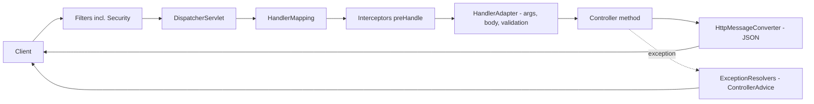
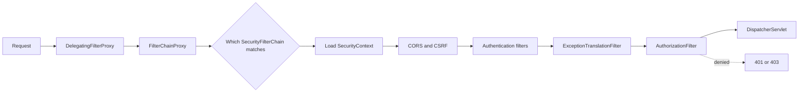
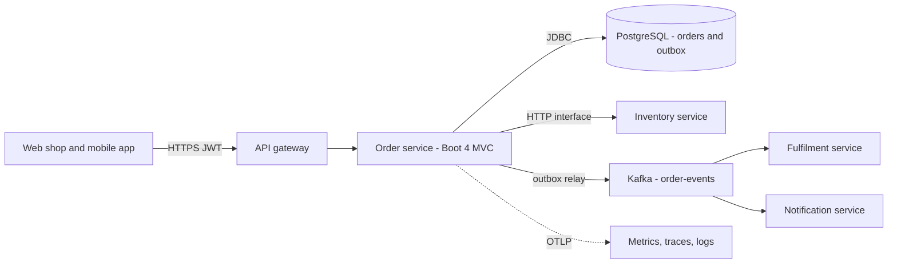

# Chapter 18 — Spring Interview Questions

This chapter is the review round for the whole book. It collects **168 interview questions** about Spring Framework 7.0, Spring Boot 4.1 and Spring Security 7, each with a short, correct answer and a link to the section that teaches it. After the questions come a template for the most common open question ("explain a Spring project you worked on"), and ten **debugging scenarios** in the form interviewers like: *symptom → cause → fix → how to prove it*. Five of the trickiest answers are proved by a small runnable Maven project (§18.15) — **Maven** is Java's standard build tool: it reads a `pom.xml` file, downloads the libraries (dependencies) the project needs, compiles the code and runs the tests.

**What you'll learn**

- Short answers for the core container, configuration, AOP, MVC/REST, clients, data/JPA/transactions, caching, security, testing, reactive, messaging, production, Spring Cloud, Spring AI and the Boot 4 / Framework 7 changes.
- Which details interviewers use to tell "has used Spring" from "understands Spring": proxies, scopes, rollback rules, persistence context, filter chain, context caching.
- How to structure a project walkthrough so that it survives follow-up questions.
- A repeatable way to debug the ten failures every Spring developer meets.

Versions used in answers: Spring Boot 4.1.1 → Spring Framework 7.0, Spring Security 7.1, Spring Data 2026.0, Hibernate 7.4 (the library that maps Java objects to database tables), Jackson 3.1 (the JSON library), JUnit 6 (the test framework), Java 25 (17 minimum). When an answer depends on a version, the version is named.

---

## 18.1 How to use this chapter

### How to answer a Spring question
Interviewers rarely want a definition only. A strong answer has three layers, and you can stop after any of them:

1. **One sentence of what it is** — "`@Transactional` starts and ends a database transaction around a method." (A **transaction** is a group of database changes that either all succeed — *commit* — or are all undone — *rollback*.)
2. **How it works underneath** — "A proxy's interceptor asks the transaction manager to begin, calls the method, then commits or rolls back." (A **proxy** is a stand-in object Spring generates around your bean; callers talk to it, and it runs extra code — the *interceptor* — before and after passing the call on.)
3. **The consequence that bites people** — "So self-invocation skips it, and a checked exception commits by default." (**Self-invocation** is a method calling another method of the same object through `this`, which bypasses the proxy; a **checked exception** is one Java forces you to declare or catch — any `Exception` that is not a `RuntimeException`.)

The third layer is what makes you sound experienced. Most answers below are written in that shape.

### How to study with it
- Cover the answer, say yours out loud, then compare. If you miss the third layer, follow the link.
- The **→ §N.M** link after each answer goes to the teaching section. Links to a chapter without a section number point to the chapter as a whole.
- Questions marked **(Boot 4)** or **(Framework 7)** are about new features; interviewers use them to check that your knowledge is current.

### Self-check
1. What are the three layers of a good answer? → What it is, how it works, the consequence that bites.
2. Why is layer 3 the most valuable? → It shows you have debugged the feature, not just read about it.

---

## 18.2 Core container and dependency injection

**Q1. What are Inversion of Control and Dependency Injection?**
IoC means the framework, not your code, controls object creation and the flow of calls into your code. DI is the form of IoC Spring uses: an object declares what it needs (constructor parameters) and the container supplies it. The result is loose coupling — you can swap a real `PaymentGateway` for a fake in tests without changing the class that uses it. → [§2.1](../02-ioc-and-dependency-injection/README.md#21-inversion-of-control-and-dependency-injection)

**Q2. What is a bean?**
An object whose creation, wiring and lifecycle are managed by the Spring container (the `ApplicationContext` — the object that creates, connects and holds all beans). It is described by a `BeanDefinition` (class or factory method, scope, dependencies, init/destroy callbacks), which the container turns into an instance. → [§2.3](../02-ioc-and-dependency-injection/README.md#23-defining-beans)

**Q3. `BeanFactory` vs `ApplicationContext`?**
`BeanFactory` is the minimal container: it creates beans lazily on request. `ApplicationContext` extends it and adds eager creation of singletons at startup (so wiring errors fail fast), automatic registration of post-processors, events, the `Environment` with profiles and properties, message sources (i18n — internationalization, i.e. messages translated per language) and resource loading. Applications always use an `ApplicationContext`. → [§2.2](../02-ioc-and-dependency-injection/README.md#22-the-container-beanfactory-vs-applicationcontext)

**Q4. `@Component` vs `@Bean`?**
`@Component` (and `@Service`, `@Repository`, `@Controller`) goes on *your* class and is found by component scanning (Spring searching your packages at startup for annotated classes). `@Bean` goes on a factory method in a `@Configuration` class; use it for third-party classes you cannot annotate or when creation needs logic. `@Repository` also enables exception translation to `DataAccessException`. → [§2.3](../02-ioc-and-dependency-injection/README.md#23-defining-beans)

**Q5. What is the difference between "full" and "lite" `@Configuration`?**
With `@Configuration` (default `proxyBeanMethods = true`) Spring subclasses the class with CGLIB (a library that generates subclasses at runtime) so that calling one `@Bean` method from another returns the existing singleton instead of a new object. With `proxyBeanMethods = false` (or `@Bean` methods in a plain `@Component`) — "lite mode" — such a call is a normal Java call and creates a second object. Boot's own auto-configurations use lite mode and pass dependencies as method parameters, which is faster and works the same in native images (apps compiled ahead of time by GraalVM into a standalone executable that needs no JVM). → [§2.3](../02-ioc-and-dependency-injection/README.md#23-defining-beans)

**Q6. Constructor, setter or field injection — which and why?**
Constructor injection: dependencies can be `final`, the object is complete after construction, the required dependencies are visible in the signature, tests can call `new` without Spring, and cycles fail loudly. A class with one constructor needs no `@Autowired`. Setter injection suits truly optional dependencies. Field injection hides dependencies and needs reflection (Java code reading or changing classes and private fields at runtime) to test — avoid it outside test classes. → [§2.4](../02-ioc-and-dependency-injection/README.md#24-injection-types)

**Q7. Two beans implement the same interface. How does Spring choose?**
By type first. With several candidates: `@Qualifier` on the injection point wins; otherwise a `@Primary` bean; otherwise the one non-`@Fallback` bean (Framework 6.2); otherwise a bean whose name equals the parameter name; otherwise startup fails with `NoUniqueBeanDefinitionException`. To get all of them, inject `List<PaymentGateway>` (ordered by `@Order`) or `Map<String, PaymentGateway>` (keyed by bean name). Proved in §18.15. → [§2.5](../02-ioc-and-dependency-injection/README.md#25-how-spring-picks-a-bean)

**Q8. `@Primary` vs `@Qualifier`?**
`@Primary` is a default chosen by the *provider* of the beans; `@Qualifier` is an explicit choice made by the *consumer* at one injection point. When both apply, the qualifier wins. Use `@Primary` for "the usual one", `@Qualifier` (or a custom qualifier annotation) where a specific one is required. → [§2.5](../02-ioc-and-dependency-injection/README.md#25-how-spring-picks-a-bean)

**Q9. How do you inject an optional dependency?**
`ObjectProvider<T>` (`getIfAvailable()`, `ifAvailable(...)`, also lazy), `Optional<T>`, a `@Nullable` parameter (JSpecify — a standard set of null-safety annotations — in Framework 7), or `@Autowired(required = false)` on a setter. → [§2.5](../02-ioc-and-dependency-injection/README.md#25-how-spring-picks-a-bean)

**Q10. What bean scopes exist, and what is the default?**
`singleton` (default — one instance per container), `prototype` (a new instance every time the bean is requested), and in web apps `request`, `session`, `application` and `websocket`. Singleton does not mean thread-safe (safe to use from many threads at the same time): one instance is shared by all request threads, so keep singletons stateless (no fields that change per request) or use thread-safe state. → [§2.6](../02-ioc-and-dependency-injection/README.md#26-bean-scopes)

**Q11. You inject a prototype bean into a singleton. What happens?**
The prototype is created **once**, when the singleton is created, and the singleton keeps that one instance forever — "prototype" only means new-per-*request-to-the-container*. To get a fresh one each time, inject `ObjectProvider<T>` and call `getObject()`, use a `@Lookup` method, or use a scoped proxy. Proved in §18.15. → [§2.6](../02-ioc-and-dependency-injection/README.md#26-bean-scopes)

**Q12. How can a singleton use a request-scoped bean?**
Through a **scoped proxy**: `@RequestScope` (which is `@Scope(value = "request", proxyMode = TARGET_CLASS)`) injects a proxy that, on every call, looks up the instance bound to the current request. Using it outside a request thread throws `ScopeNotActiveException`. → [§2.6](../02-ioc-and-dependency-injection/README.md#26-bean-scopes)

**Q13. Describe the bean lifecycle.**
Instantiate → inject dependencies → `*Aware` callbacks → `BeanPostProcessor.postProcessBeforeInitialization` → `@PostConstruct` → `InitializingBean.afterPropertiesSet` → custom init method → `postProcessAfterInitialization` (where AOP proxies are created) → bean in use → on shutdown `@PreDestroy` → `DisposableBean.destroy` → custom destroy method. Spring does **not** call destroy callbacks for prototypes. For start/stop behaviour tied to the context (consumers, schedulers), implement `SmartLifecycle`. → [§2.7](../02-ioc-and-dependency-injection/README.md#27-the-bean-lifecycle)

**Q14. `BeanPostProcessor` vs `BeanFactoryPostProcessor`?**
A `BeanFactoryPostProcessor` runs **before any bean is created** and changes bean *definitions* (for example `PropertySourcesPlaceholderConfigurer` resolves `${...}`). A `BeanPostProcessor` runs for **each bean instance** and can modify or wrap it (for example `AutowiredAnnotationBeanPostProcessor` does injection; the auto-proxy creator wraps beans for `@Transactional`). Declare BFPP `@Bean` methods `static` so they don't force their configuration class to be created early. → [§2.8](../02-ioc-and-dependency-injection/README.md#28-post-processors-the-containers-extension-points)

**Q15. How does Spring handle circular dependencies?**
Constructor-injection cycles can never be resolved: startup fails with `BeanCurrentlyInCreationException`. Field/setter cycles *can* be resolved through early references, but Spring Boot disallows them by default since 2.6 (`spring.main.allow-circular-references=false`). The real fix is design — extract the shared logic into a third bean, or decouple with an event. `@Lazy` on one constructor parameter works as a stop-gap by injecting a lazy proxy. Proved in §18.15. → [§2.9](../02-ioc-and-dependency-injection/README.md#29-circular-dependencies)

**Q16. What does lazy initialization do, and what does it cost?**
`@Lazy` (or `spring.main.lazy-initialization=true`) creates a bean on first use instead of at startup. Startup gets faster, but configuration errors appear at the first request instead of at deploy time, and the first request is slower. Good for development and some CLI (command-line) tools; risky for services. → [§2.10](../02-ioc-and-dependency-injection/README.md#210-lazy-initialization)

**Q17. `@Profile` vs `@Conditional`?**
`@Profile("prod")` is a ready-made condition that registers a bean only when that profile is active. `@Conditional(MyCondition.class)` takes any `Condition` implementation (a class present, a property set, an OS...). Boot's `@ConditionalOnClass`, `@ConditionalOnProperty`, `@ConditionalOnMissingBean` are built on it. → [§2.11](../02-ioc-and-dependency-injection/README.md#211-conditional-and-profiles)

**Q18. How do application events work? Are they asynchronous?**
Publish any object with `ApplicationEventPublisher.publishEvent(...)`; methods annotated `@EventListener` receive it. By default delivery is **synchronous** (the publisher waits until every listener has finished), on the publisher's thread and inside its transaction — an exception in a listener reaches the publisher. Add `@Async` for asynchronous delivery, or `@TransactionalEventListener` to run after commit. → [§2.12](../02-ioc-and-dependency-injection/README.md#212-application-events)

**Q19. (Framework 7) What is JSpecify null-safety in Spring?**
Framework 7 annotates its APIs with JSpecify (`@NullMarked` packages, `@Nullable` for the exceptions), replacing the deprecated `org.springframework.lang` annotations. Tools like NullAway, IntelliJ and Kotlin read them, so null bugs are reported at compile time (when the code is built, before it ever runs). You can do the same in your code. → [§2.13](../02-ioc-and-dependency-injection/README.md#213-null-safety-with-jspecify-framework-7)

**Q20. (Framework 7) What is a `BeanRegistrar`?**
A programmatic way to register beans with a loop or condition in code (for example one bean per configured tenant — one customer organisation in a shared system), imported with `@Import`. It is friendlier to AOT (ahead-of-time: work done at build time instead of at startup)/native images than a `BeanDefinitionRegistryPostProcessor`. → [§2.14](../02-ioc-and-dependency-injection/README.md#214-programmatic-registration-with-beanregistrar-framework-7)

### Self-check
1. Default scope, and is it thread-safe? → Singleton; no — shared across threads.
2. What exception do you get with two candidates and no tie-breaker? → `NoUniqueBeanDefinitionException`.
3. Which lifecycle step creates AOP proxies? → `BeanPostProcessor.postProcessAfterInitialization`.

---

## 18.3 Configuration and auto-configuration

**Q21. What does `@SpringBootApplication` do?**
It combines `@SpringBootConfiguration` (a `@Configuration`), `@EnableAutoConfiguration` and `@ComponentScan` of the main class's package and sub-packages. That is why the main class belongs in the root package: beans in sibling packages are not scanned. → [§1.8](../01-spring-ecosystem-and-first-app/README.md#18-the-main-class-and-springbootapplication)

**Q22. What happens when you run `java -jar app.jar`?**
The manifest (`META-INF/MANIFEST.MF`, a file inside the jar — the zip of compiled classes — that names the class to start) starts Boot's `JarLauncher`, which builds a class loader (the JVM component that finds and loads `.class` files) over `BOOT-INF/classes` and `BOOT-INF/lib` and calls your main class. `SpringApplication.run` prepares the `Environment`, creates the right `ApplicationContext` (servlet — classic blocking web, reactive — non-blocking web, see §18.10, or none), loads bean definitions and matching auto-configurations, refreshes the context (creating singletons and starting the embedded server — a web server such as Tomcat running inside your own process), then calls `ApplicationRunner`/`CommandLineRunner` beans. → [§1.9](../01-spring-ecosystem-and-first-app/README.md#19-running-the-application)

**Q23. What is a starter?**
A dependency (a library your build declares and downloads) with (almost) no code that pulls in a tested set of libraries for one capability plus the Boot module holding its auto-configuration. In Boot 4 they are modular and some were renamed: `spring-boot-starter-webmvc` (was `-web`), `spring-boot-starter-aspectj` (was `-aop`), and each technology has a matching test starter such as `spring-boot-starter-webmvc-test`. → [§1.7](../01-spring-ecosystem-and-first-app/README.md#17-starters)

**Q24. How does auto-configuration work?**
Each Boot module lists its auto-configuration classes in `META-INF/spring/org.springframework.boot.autoconfigure.AutoConfiguration.imports`. `@EnableAutoConfiguration` loads that list, filters it early by class presence, sorts it (`before`/`after`), and processes it **after** your own configuration. Each class is guarded by conditions — `@ConditionalOnClass`, `@ConditionalOnProperty`, `@ConditionalOnMissingBean`… — so a `DataSource` is only created if a driver is present and you haven't defined your own. → [§3.10](../03-configuration-and-auto-configuration/README.md#310-how-auto-configuration-works)

**Q25. How do you override an auto-configured bean?**
Define your own bean of that type; `@ConditionalOnMissingBean` makes Boot back off. Often you don't need to replace it at all — set properties or declare a customizer bean (`JsonMapperBuilderCustomizer`, `RestClientCustomizer`, …). To switch one auto-configuration off: `@SpringBootApplication(exclude = …)` or `spring.autoconfigure.exclude`. → [§3.12](../03-configuration-and-auto-configuration/README.md#312-overriding-and-excluding-auto-configuration)

**Q26. How do you find out why a bean was (or was not) auto-configured?**
Start with `--debug` (or `debug=true`) to print the **condition evaluation report** — positive and negative matches with the reason — or call `/actuator/conditions`. `/actuator/beans` lists what exists. → [§3.11](../03-configuration-and-auto-configuration/README.md#311-seeing-what-boot-decided)

**Q27. Name the main property sources in priority order.**
Highest first: test properties (in tests), command-line arguments, `SPRING_APPLICATION_JSON`, Java system properties (`-Dkey=value` flags on the `java` command), OS environment variables (named values set outside the app by the shell, OS or container), `random.*`, profile-specific files (outside the jar before inside), `application.properties/yaml` (outside before inside), `@PropertySource`, defaults. The rule of thumb: the more "outside" and "later", the stronger. → [§3.3](../03-configuration-and-auto-configuration/README.md#33-precedence-which-value-wins)

**Q28. How does an environment variable map to a property?**
Relaxed binding: replace `.` with `_`, remove `-`, upper-case. `SHOP_CHECKOUTTIMEOUT` sets `shop.checkout-timeout`; list indexes use `_0_`. → [§3.4](../03-configuration-and-auto-configuration/README.md#34-environment-variables-and-relaxed-binding)

**Q29. `@Value` vs `@ConfigurationProperties`?**
`@Value("${x}")` injects one value (and supports SpEL — Spring Expression Language, small expressions inside annotation strings). `@ConfigurationProperties(prefix = "shop")` binds a whole group into a typed object (a record — Java's compact, immutable data class — is ideal), supports relaxed binding, nested objects, `Duration`/`DataSize` conversion, validation with `@Validated`, and IDE metadata (so your editor can auto-complete property names). Use `@ConfigurationProperties` for anything more than one or two values. → [§3.6](../03-configuration-and-auto-configuration/README.md#36-configurationproperties--type-safe-configuration)

**Q30. How do you make the app refuse to start with bad configuration?**
Annotate the `@ConfigurationProperties` class with `@Validated` and add Jakarta constraints (Bean Validation annotations such as `@NotBlank`, `@Min`, `@Valid` for nested groups). Binding failures stop startup and the report names each property and where it came from. → [§3.6](../03-configuration-and-auto-configuration/README.md#36-configurationproperties--type-safe-configuration)

**Q31. What are profiles and profile groups?**
A profile is a named set of beans and config (`application-prod.yaml`, `@Profile("prod")`) activated with `spring.profiles.active`. A group activates several at once: `spring.profiles.group.prod=postgres,kafka,json-logs`. Keep profiles for *environments or capabilities*, and keep secrets out of files. → [§3.7](../03-configuration-and-auto-configuration/README.md#37-profiles-profile-specific-files-and-profile-groups)

**Q32. How do you load Kubernetes secrets or extra config files?**
(**Kubernetes** is a platform that runs and restarts containers across many machines; a *secret* is a value such as a password that it stores and mounts into the container.) `spring.config.import=optional:configtree:/etc/secrets/` reads mounted files as properties (file name = key). `spring.config.import` also imports other files, or Config Server/Vault with the matching library. `optional:` prevents failure when absent. → [§3.8](../03-configuration-and-auto-configuration/README.md#38-importing-configuration-springconfigimport)

**Q33. How do you write your own starter?**
Two artifacts (separately published Maven modules, i.e. jars): `acme-spring-boot` with `@AutoConfiguration` classes (conditions, `@ConfigurationProperties`, `@ConditionalOnMissingBean` on every bean) listed in the `.imports` file, and `acme-spring-boot-starter`, a pom (a Maven project file with no code of its own) that depends on it and the library. Test it with `ApplicationContextRunner`. → [§3.13](../03-configuration-and-auto-configuration/README.md#313-writing-your-own-auto-configuration-and-starter)

**Q34. (Boot 4) What does "Boot 4 modularization" mean?**
Boot 3 kept all auto-configuration in one big `spring-boot-autoconfigure` jar. Boot 4 splits it into per-technology modules (`spring-boot-webmvc`, `spring-boot-jdbc`, `spring-boot-kafka`…) with matching starters and test starters, so the classpath (the list of jars and folders the JVM loads classes from) contains only what you use. `spring-boot-starter-classic` / `-test-classic` bring the old "everything" layout as a migration aid. → [§3.14](../03-configuration-and-auto-configuration/README.md#314-boot-4-modularization)

**Q35. What does DevTools do, and is it in production?**
Automatic restart on class changes (two class loaders), development property defaults (for example template caching off). It is excluded from the packaged jar automatically and disabled when run with `java -jar`. LiveReload is off by default in Boot 4. → [§1.10](../01-spring-ecosystem-and-first-app/README.md#110-devtools)

---

## 18.4 AOP and proxies

**Q36. What is AOP? Define aspect, advice, pointcut and join point.**
Aspect-Oriented Programming moves *cross-cutting* concerns (logging, timing, transactions, security) out of business code. A **join point** is a point in execution (in Spring AOP: a method execution on a bean); a **pointcut** is an expression selecting join points; **advice** is the code that runs there (`@Before`, `@AfterReturning`, `@AfterThrowing`, `@After`, `@Around`); an **aspect** is a class bundling pointcuts and advice. → [§4.1](../04-aop-and-proxies/README.md#41-cross-cutting-concerns-and-the-aop-vocabulary)

**Q37. How does Spring AOP work at runtime?**
With proxies. A `BeanPostProcessor` checks each bean against all pointcuts; if any match, it returns a **proxy** instead of the bean. Callers hold the proxy; the proxy runs the advice chain and then calls the real object. Nothing is changed in your bytecode (the compiled instructions in `.class` files that the JVM runs). → [§4.4](../04-aop-and-proxies/README.md#44-how-spring-aop-works-proxies)

**Q38. JDK dynamic proxy vs CGLIB?**
A JDK (Java Development Kit) dynamic proxy implements the bean's interfaces (so you can only inject by interface). A CGLIB proxy is a generated subclass (so you can inject by class) but cannot proxy `final` classes or advise `final`/`private` methods. Spring Boot uses CGLIB for everything by default (`spring.aop.proxy-target-class=true`); plain Spring uses JDK proxies when the bean has interfaces. Framework 7 adds `@Proxyable` to choose per bean. → [§4.4](../04-aop-and-proxies/README.md#44-how-spring-aop-works-proxies)

**Q39. What is the self-invocation problem?**
A call `this.saveBatch()` inside the bean goes to the real object, not the proxy, so `@Transactional`, `@Cacheable`, `@Async`, `@Retryable` and custom aspects on the called method are silently skipped. Fixes: move the method to another bean (best), inject the bean into itself lazily (`@Lazy` self-reference / `ObjectProvider`), use `TransactionTemplate`, or switch to AspectJ weaving. Proved in §18.15. → [§4.5](../04-aop-and-proxies/README.md#45-proxy-limitations--proved)

**Q40. Which Spring features are built on proxies?**
`@Transactional`, `@Cacheable`/`@CacheEvict`, `@Async`, `@Retryable`/`@ConcurrencyLimit` (Framework 7), `@PreAuthorize` and other method security, `@Validated` method validation, `@Observed`, scoped proxies, `@Lazy` injection points, full `@Configuration` classes (CGLIB), Spring Data repositories and HTTP interface clients (JDK proxies). All share the same limitations. → [§4.6](../04-aop-and-proxies/README.md#46-spring-features-built-on-proxies)

**Q41. `@Around` vs the other advice types?**
Only `@Around` receives a `ProceedingJoinPoint` and decides whether and how the method runs (`proceed()`), can change arguments and the return value, and can catch exceptions. Use the narrowest advice that works — `@Before` cannot forget to call `proceed()`. → [§4.2](../04-aop-and-proxies/README.md#42-writing-aspects-with-aspect)

**Q42. How do you control the order of two aspects?**
`@Order` (or `Ordered`) on the aspect class: the lower value is the *outer* layer — it runs first on the way in and last on the way out. Example: put a retry aspect outside the transaction aspect so each attempt gets a fresh transaction. → [§4.2](../04-aop-and-proxies/README.md#42-writing-aspects-with-aspect)

**Q43. Spring AOP vs AspectJ?**
Spring AOP: runtime proxies, method execution on Spring beans only, no build changes. AspectJ: weaves bytecode (inserts the aspect's code directly into your compiled classes) at compile or load time, can advise any join point (constructors, field access, private methods, self-calls), but needs the AspectJ compiler or a weaving agent. Most apps need only Spring AOP. → [§4.8](../04-aop-and-proxies/README.md#48-spring-aop-vs-aspectj)

**Q44. (Framework 7) What are `@Retryable` and `@ConcurrencyLimit`?**
Built-in resilience annotations in `spring-context`: `@Retryable` retries a method on exceptions with `maxRetries`, `delay`, `multiplier`, `jitter`, `maxDelay` (jitter = a random amount added to each wait so many clients don't retry in lockstep) and include/exclude filters (it also works for reactive return types); `@ConcurrencyLimit` caps concurrent calls (a bulkhead). They are proxy-based and need `@EnableResilientMethods` — there is no auto-configuration. Programmatic API: `RetryTemplate`/`RetryPolicy` in `spring-core`. There is no circuit breaker (a guard that stops calling a failing dependency for a while and fails fast instead); use Resilience4j, a resilience library, for that. → [§4.7](../04-aop-and-proxies/README.md#47-framework-7-core-resilience-retryable-and-concurrencylimit)

---

## 18.5 Spring MVC, REST and HTTP clients

**Q45. Walk through a request in Spring MVC.**
Servlet filters (including Spring Security; a *servlet* is the Java standard API for handling HTTP requests, and *filters* run before and after it on every request) → `DispatcherServlet` (Spring MVC's single front servlet) → `HandlerMapping` finds the controller method (path, HTTP method, consumes/produces, API version) → interceptors' `preHandle` → `HandlerAdapter` resolves arguments (path variables, query params, body via an `HttpMessageConverter`, validation) → method runs → the return value is written by a converter chosen from the `Accept` header → exceptions go to `HandlerExceptionResolver`s (`@ExceptionHandler`, `@ControllerAdvice`) → `afterCompletion` → back through the filters. → [§5.2](../05-spring-mvc-and-rest/README.md#52-how-a-request-flows-the-dispatcherservlet)



**Q46. `@Controller` vs `@RestController`?**
`@RestController` = `@Controller` + `@ResponseBody`: return values are written to the response body (JSON) instead of being treated as view names. → [§5.3](../05-spring-mvc-and-rest/README.md#53-controllers-and-request-mappings)

**Q47. `@PathVariable` vs `@RequestParam` vs `@RequestBody`?**
Path variable: part of the URL identifying a resource (`/orders/{id}`). Request param: query string (the `?key=value&...` part of the URL), usually filters/paging (`?status=NEW&page=2`), optional with `required = false` or a default. Request body: the deserialized payload (the request data turned from JSON text into a Java object, e.g. a record) of POST/PUT/PATCH. → [§5.4](../05-spring-mvc-and-rest/README.md#54-reading-input-and-writing-output)

**Q48. Why return `ResponseEntity`?**
To control the status code and headers as well as the body — for example `201 Created` with a `Location` header, `204 No Content`, or `304` with an `ETag` (a version fingerprint of the response that lets clients skip re-downloading unchanged data). For plain 200 responses, returning the object is enough. → [§5.4](../05-spring-mvc-and-rest/README.md#54-reading-input-and-writing-output)

**Q49. How do you validate a request?**
Put Jakarta Bean Validation constraints on the DTO (Data Transfer Object — a simple class or record shaped for the API, not for the database) (`@NotBlank`, `@Positive`, `@Email`, `@Valid` for nested objects) and `@Valid` on the `@RequestBody`. A failure raises `MethodArgumentNotValidException` → 400. Since Framework 6.1, constraints directly on method parameters (`@RequestParam @Min(1) int page`) are validated built-in and raise `HandlerMethodValidationException`. Use `@Validated(Group.class)` for validation groups. → [§5.6](../05-spring-mvc-and-rest/README.md#56-validation)

**Q50. How do you handle errors consistently?**
One `@RestControllerAdvice` (extending `ResponseEntityExceptionHandler` to cover Spring's own exceptions) with `@ExceptionHandler` methods that map domain exceptions to statuses and return **`ProblemDetail`** — the RFC 9457 (an RFC is a published Internet standard) `application/problem+json` format with `type`, `title`, `status`, `detail`, `instance` and your extra fields. Never leak stack traces (the list of method calls printed with an exception — it reveals internals to attackers). → [§5.7](../05-spring-mvc-and-rest/README.md#57-error-handling-and-problem-details-rfc-9457)

**Q51. (Boot 4) What changed with JSON?**
Boot 4 uses **Jackson 3**: packages `tools.jackson.*` (the annotations stay in `com.fasterxml.jackson.annotation`), an immutable `JsonMapper` built with a builder, unchecked exceptions (subclasses of `RuntimeException`, which callers need not catch), and different defaults (for example dates written as ISO-8601 strings such as `2026-10-07T09:30:00Z`). Customize with `JsonMapperBuilderCustomizer`; `@JsonComponent` became `@JacksonComponent`. Jackson 2 support remains only in deprecated form. → [§5.5](../05-spring-mvc-and-rest/README.md#55-json-with-jackson-3)

**Q52. How does content negotiation work?**
The client's `Accept` header (and `consumes`/`produces` on the mapping) decides which `HttpMessageConverter` writes the response. No converter for the requested type → 406; unsupported request `Content-Type` → 415. → [§5.8](../05-spring-mvc-and-rest/README.md#58-content-negotiation)

**Q53. (Framework 7) How do you version a REST API?**
Framework 7 has first-class API versioning: configure how the version is read (header, query param, path segment or media-type parameter — in Boot via `spring.mvc.apiversion.*`, e.g. `spring.mvc.apiversion.use.header=X-API-Version`), a default and the supported versions, then map with `@GetMapping(path = "/orders", version = "1.1+")` ("1.1 and later"). A deprecation handler can add `Deprecation`, `Sunset` and `Link` headers. → [§5.9](../05-spring-mvc-and-rest/README.md#59-api-versioning-framework-7)

**Q54. What is CORS and where do you configure it?**
Cross-Origin Resource Sharing is a browser rule: JavaScript from origin A (an *origin* is scheme + host + port, e.g. `https://shop.example.com:443`) may read a response from origin B only if B's response allows it (`Access-Control-Allow-Origin`); non-simple requests are preceded by an `OPTIONS` preflight. Configure it with `@CrossOrigin`/`WebMvcConfigurer.addCorsMappings` in plain MVC, or — when Spring Security is present — a `CorsConfigurationSource` bean plus `http.cors(...)`, so the preflight is answered before authentication. CORS does not protect your API from non-browser clients. → [§5.10](../05-spring-mvc-and-rest/README.md#510-cors-and-file-upload), [§10.9](../10-spring-security-1-fundamentals/README.md#109-cors)

**Q55. Filter vs interceptor vs aspect?**
A servlet **filter** sees every request (even ones that never reach Spring MVC), can wrap request/response, and knows nothing about controllers — good for security, logging, compression. A `HandlerInterceptor` runs inside the `DispatcherServlet`, knows the chosen `HandlerMethod`, and only for mapped requests — good for per-handler checks. An **aspect** works on any bean method, not HTTP. → [§5.11](../05-spring-mvc-and-rest/README.md#511-filters-vs-interceptors-vs-aop)

**Q56. PUT vs PATCH vs POST — which are idempotent?**
GET, PUT and DELETE are idempotent (repeating them leaves the same state — see [System Design Fundamentals](../../../system-design-patterns/modules/00-system-design-fundamentals/README.md)); POST is not; PATCH is not guaranteed to be. Use POST to create (`201` + `Location`), PUT to replace, PATCH for partial update. For retry-safe POSTs, accept an `Idempotency-Key` header. → [§5.1](../05-spring-mvc-and-rest/README.md#51-rest-in-one-page)

**Q57. How do you paginate and document an API?**
Accept `page`/`size`/`sort` (Spring Data's `Pageable` resolves them) and return a page DTO with the content and paging metadata rather than exposing internal classes; for very large or changing data prefer keyset (cursor) pagination ("give me the rows after the last id I saw" instead of skipping N rows). Document with OpenAPI (a standard, machine-readable description of a REST API) generated by springdoc (`/v3/api-docs`, Swagger UI — a web page that renders that description and lets you try the calls). → [§5.13](../05-spring-mvc-and-rest/README.md#513-putting-it-together-design-checklist-and-mistakes), [§5.12](../05-spring-mvc-and-rest/README.md#512-documenting-the-api-openapi-with-springdoc)

**Q58. Which HTTP client should a new Boot 4 service use?**
`RestClient` (Framework 6.1+) for synchronous calls — fluent (calls chained one after another, `a().b().c()`), uses Boot's converters, timeouts and observability when you inject `RestClient.Builder` — or a declarative `@HttpExchange` interface on top of it. `WebClient` is for reactive apps. `RestTemplate` is legacy: its deprecation (official marking as "don't use, will be removed") is planned for Framework 7.1 with removal in 8.0. → [§6.1](../06-rest-clients-and-http-interfaces/README.md#61-choosing-a-client)

**Q59. What are HTTP service interfaces, and what does Boot 4 add?**
You declare a Java interface with `@GetExchange`/`@PostExchange` methods; `HttpServiceProxyFactory` creates a JDK-proxy implementation that makes the calls. Boot 4 adds `@ImportHttpServices(group = "catalog", types = CatalogApi.class)` and per-group properties `spring.http.serviceclient.<group>.*` (base URL, timeouts), so you don't write factory code. → [§6.6](../06-rest-clients-and-http-interfaces/README.md#66-http-service-interfaces-httpexchange)

**Q60. How do you handle errors, timeouts and retries on a client?**
`retrieve()` throws `HttpClientErrorException` (4xx) / `HttpServerErrorException` (5xx), and `ResourceAccessException` for I/O (input/output — network or disk) errors and timeouts; translate them to domain exceptions at the client edge with `onStatus`. Always set connect and read timeouts (`spring.http.clients.*`). Retry only idempotent calls and transient failures (short-lived ones that may succeed a moment later), with exponential back-off (waiting longer after each failure, e.g. 1 s, 2 s, 4 s) and jitter. → [§6.3](../06-rest-clients-and-http-interfaces/README.md#63-error-handling), [§6.4](../06-rest-clients-and-http-interfaces/README.md#64-timeouts-and-the-underlying-http-library)

**Q61. How do you test a REST client?**
`@RestClientTest` + `MockRestServiceServer` to check the request your client sends and how it maps responses, plus at least one test against a real stub server (a fake HTTP server returning canned responses, e.g. WireMock) to catch HTTP-level problems. → [§6.8](../06-rest-clients-and-http-interfaces/README.md#68-testing-clients)

---

## 18.6 Data access, JPA and transactions

**Q62. What does Spring add on top of plain JDBC?**
(JDBC — Java Database Connectivity — is Java's standard low-level API for talking to SQL databases.) A pooled `DataSource` (a *connection pool* keeps a few open database connections and lends them out, because opening a new one per query is slow; HikariCP is Boot's pool), `JdbcClient`/`JdbcTemplate` that handle connections, statements, result-set mapping and cleanup, translation of vendor (database-specific) `SQLException`s into the unchecked `DataAccessException` hierarchy (`DuplicateKeyException`, `DataIntegrityViolationException`…), and declarative transactions. → [§7.1](../07-data-access-jdbc-and-transactions/README.md#71-the-data-access-stack), [§7.5](../07-data-access-jdbc-and-transactions/README.md#75-exception-translation-dataaccessexception)

**Q63. `JdbcClient` vs `JdbcTemplate`?**
Same engine underneath. `JdbcClient` (Framework 6.1) is a fluent API — `sql(...).param(...).query(Order.class).list()` — with named or positional parameters and automatic mapping to records. `JdbcTemplate` remains for batch updates and existing code. → [§7.3](../07-data-access-jdbc-and-transactions/README.md#73-jdbcclient-and-jdbctemplate)

**Q64. How big should the connection pool be?**
Small. HikariCP defaults to 10. A database can only run as many queries in parallel as it has CPU cores and disk bandwidth; more connections mean queueing inside the database instead of in the pool. Size from measurements, remember that *pool × instances* must stay under the database's `max_connections`, and watch `hikaricp.connections.pending`. → [§7.2](../07-data-access-jdbc-and-transactions/README.md#72-datasource-and-hikaricp)

**Q65. How does `@Transactional` work internally?**
The bean is proxied; the proxy's `TransactionInterceptor` asks the `PlatformTransactionManager` (`DataSourceTransactionManager`, `JpaTransactionManager`) to start a transaction, which takes a connection, sets auto-commit (every SQL statement committing on its own) off and binds it to the current **thread**. Repositories/`JdbcClient` on that thread reuse the bound connection. When the method returns, the interceptor commits; when it throws, it applies the rollback rules. → [§7.7](../07-data-access-jdbc-and-transactions/README.md#77-how-a-spring-transaction-works)

**Q66. What are the default propagation and isolation?**
Propagation (what happens when a transactional method is called while a transaction is already running) `REQUIRED` (join the current transaction or start one); isolation (how much concurrent transactions see of each other's changes) `DEFAULT`, meaning the database's own default — READ COMMITTED on PostgreSQL, REPEATABLE READ on MySQL InnoDB. → [§7.8](../07-data-access-jdbc-and-transactions/README.md#78-transactional-attributes)

**Q67. A `@Transactional` method throws a checked exception. Commit or rollback?**
**Commit.** By default Spring rolls back only on `RuntimeException` and `Error` (the EJB — Enterprise JavaBeans, the older Java EE component model — convention: checked exceptions are "expected business outcomes"). Change it per method with `rollbackFor = PaymentDeclinedException.class`, or globally since Framework 6.2 with `@EnableTransactionManagement(rollbackOn = RollbackOn.ALL_EXCEPTIONS)` (which the reference docs recommend). An exception caught inside the method never causes a rollback — the proxy never sees it. Proved in §18.15. → [§7.10](../07-data-access-jdbc-and-transactions/README.md#710-rollback-rules)

**Q68. Explain the propagation types.**

| Propagation | Existing transaction? | None? |
|---|---|---|
| `REQUIRED` (default) | join it | start one |
| `REQUIRES_NEW` | suspend it, start a new one (new connection) | start one |
| `NESTED` | savepoint inside it | start one |
| `SUPPORTS` | join it | run without |
| `NOT_SUPPORTED` | suspend it, run without | run without |
| `MANDATORY` | join it | throw |
| `NEVER` | throw | run without |

Typical uses: `REQUIRES_NEW` for an audit record that must survive a rollback; `NESTED` for "try this part, roll back only this part" (JDBC savepoints — markers inside a transaction you can roll back to; avoid it with JPA — the database rolls back to the savepoint but Hibernate's persistence context does not). → [§7.9](../07-data-access-jdbc-and-transactions/README.md#79-propagation)

**Q69. What is `UnexpectedRollbackException`?**
An inner `REQUIRED` method (same physical transaction) threw, so the interceptor marked the shared transaction *rollback-only*. The outer method caught the exception and returned normally, so Spring tried to commit — and throws `UnexpectedRollbackException` instead of silently committing. Fix: let the exception propagate, or give the inner work its own transaction (`REQUIRES_NEW`/`NESTED`) if partial success is really wanted. → [§7.9](../07-data-access-jdbc-and-transactions/README.md#79-propagation)

**Q70. What does `readOnly = true` do?**
It is a hint passed down the stack: JDBC connections are set read-only (PostgreSQL then rejects writes), Hibernate skips dirty checking and flushing (less memory and CPU; *dirty checking* compares loaded objects with their original state to find changes, *flushing* sends pending changes to the database), and a routing `DataSource` can send the call to a replica (a read-only copy of the database). It is not a security feature. → [§7.12](../07-data-access-jdbc-and-transactions/README.md#712-readonly-and-timeout)

**Q71. Why might `@Transactional` be silently ignored?**
Self-invocation; the method is `private` (with CGLIB, `protected` and package-private methods work since Framework 6.0) or `final`; the object is not a Spring bean (`new`); the exception is caught inside the method; a checked exception without a rollback rule; a different transaction manager than the one your data access uses; or work done on another thread (`@Async`, `CompletableFuture`), which does not see the thread-bound transaction. → [§7.13](../07-data-access-jdbc-and-transactions/README.md#713-transaction-pitfalls)

**Q72. On which layer does `@Transactional` belong?**
On the service method that represents one business operation (one unit of work), not on controllers (keeps HTTP/serialization out of the transaction) and usually not only on each repository call (then two calls are two transactions). Keep remote HTTP calls out of transactions — they hold a connection while waiting. → [§7.13](../07-data-access-jdbc-and-transactions/README.md#713-transaction-pitfalls)

**Q73. When do you use `TransactionTemplate`?**
When the transaction boundary is smaller than a method, must be decided at runtime, or you want to avoid proxy pitfalls (self-calls, retries around a transaction): `txTemplate.execute(status -> { ... })`. → [§7.14](../07-data-access-jdbc-and-transactions/README.md#714-programmatic-transactions-transactiontemplate)

**Q74. How do you run code only after the transaction commits?**
`@TransactionalEventListener` (default phase `AFTER_COMMIT`) on a listener for an event published inside the transaction — e.g. send the confirmation e-mail only if the order was really saved. It is not guaranteed delivery: if the process dies after commit, the event is lost; use a transactional outbox when delivery must be guaranteed. → [§7.15](../07-data-access-jdbc-and-transactions/README.md#715-transactionaleventlistener)

**Q75. How do you handle a serialization failure or deadlock?**
(A *serialization failure* is the database aborting a transaction because it conflicts with a concurrent one; a *deadlock* is two transactions each waiting for a lock the other holds.) They surface as `ConcurrencyFailureException` subtypes (for example `CannotAcquireLockException`, `PessimisticLockingFailureException`). Retry the **whole** transaction from outside it (a retry around the transactional method, not inside), a few times with back-off. → [§7.11](../07-data-access-jdbc-and-transactions/README.md#711-isolation-levels), [SQL book 13](../../../sql/chapters/13-transactions-and-concurrency/README.md)

**Q76. JPA vs Hibernate vs Spring Data JPA?**
JPA (Jakarta Persistence 3.2) is the specification (a written standard that several libraries can implement) — annotations and the `EntityManager` API. Hibernate (7.x in Boot 4) is the implementation. Spring Data JPA adds repositories (objects that load and save one type of entity) on top: interfaces whose implementation is generated, with derived queries, paging and auditing. → [§8.1](../08-spring-data-jpa-and-hibernate/README.md#81-jpa-hibernate-and-spring-data--who-does-what)

**Q77. What is the persistence context? What is dirty checking?**
The persistence context is the `EntityManager`'s first-level cache and unit of work (the set of changes that will be written together): it holds exactly one managed instance per row and a snapshot of its loaded state. At flush (before commit, or before a query that needs it) Hibernate compares each managed entity with its snapshot and issues `UPDATE`s for the changed ones — so you don't call `save()` after changing a loaded entity inside a transaction. → [§8.4](../08-spring-data-jpa-and-hibernate/README.md#84-the-persistence-context-and-dirty-checking)

**Q78. What are the entity states?**
Transient (new, not known to the context), managed (in the context; changes are tracked), detached (was managed, context closed — changes not tracked), removed (scheduled for delete at flush). → [§8.4](../08-spring-data-jpa-and-hibernate/README.md#84-the-persistence-context-and-dirty-checking)

**Q79. How does `save()` decide between insert and update?**
`SimpleJpaRepository.save()` calls `persist` if the entity is **new** — by default a `null` id (or a `null` wrapper-type `@Version`) — otherwise `merge`, which may `SELECT` first. Assigned ids therefore cause a merge; implement `Persistable.isNew()` or use a version field to avoid it. → [§8.8](../08-spring-data-jpa-and-hibernate/README.md#88-repositories)

**Q80. What is the owning side of a relationship?**
The side that holds the foreign key (a column pointing to the primary key of another table) — the `@ManyToOne` side in a 1:N (one-to-many) relationship. JPA writes the FK only from the owning side; the inverse `@OneToMany(mappedBy = "order")` is ignored for writes, so update both sides in a helper method (`addItem`). → [§8.5](../08-spring-data-jpa-and-hibernate/README.md#85-relationships)

**Q81. `CascadeType.REMOVE` vs `orphanRemoval = true`?**
Cascade REMOVE deletes children when the *parent* is deleted. `orphanRemoval` also deletes a child when it is *removed from the parent's collection*. Use both only for true composition (order → order lines), never on `@ManyToMany`. → [§8.5](../08-spring-data-jpa-and-hibernate/README.md#85-relationships)

**Q82. What are the default fetch types, and what causes `LazyInitializationException`?**
To-one (`@ManyToOne`, `@OneToOne`): EAGER; to-many: LAZY — set everything LAZY and fetch per use case. The exception happens when you touch an uninitialized lazy proxy after its persistence context has closed (e.g. in a controller or during JSON serialization). Fix by fetching what you need in the query (`JOIN FETCH`, `@EntityGraph`) inside the transaction and returning DTOs — not by switching to EAGER or relying on Open Session in View. → [§8.6](../08-spring-data-jpa-and-hibernate/README.md#86-fetch-types-and-lazyinitializationexception)

**Q83. What is the N+1 problem and how do you fix it?**
One query loads N parents, then touching each parent's lazy association runs one more query per parent: 1 + N round trips. Fixes: `JOIN FETCH` in JPQL (JPA's SQL-like query language written against entities instead of tables), `@EntityGraph(attributePaths = "books")` on the repository method, batch fetching (`hibernate.default_batch_fetch_size` / `@BatchSize` → 1 + N/size), or a DTO projection that selects only needed columns. Detect it by counting statements in tests (Hibernate statistics or a datasource proxy). → [§8.7](../08-spring-data-jpa-and-hibernate/README.md#87-the-n1-problem)

**Q84. Derived query vs `@Query` vs native query?**
Derived (`findByStatusAndCreatedAtAfter`) for short conditions; `@Query` JPQL when the name gets long or you need joins/fetches; `nativeQuery = true` for database-specific SQL (window functions — calculations across related rows such as running totals; JSONB — PostgreSQL's binary JSON column type). Updates need `@Modifying` (plus `clearAutomatically = true` if managed entities may be stale). → [§8.9](../08-spring-data-jpa-and-hibernate/README.md#89-derived-queries), [§8.10](../08-spring-data-jpa-and-hibernate/README.md#810-query-jpql-native-sql-and-modifying)

**Q85. `Page` vs `Slice`?**
`Page` runs an extra `COUNT` query and knows the total; `Slice` fetches `size + 1` rows to know only whether a next slice exists — cheaper for infinite scrolling. Never combine `JOIN FETCH` of a collection with paging without checking the SQL (Hibernate may page in memory). → [§8.11](../08-spring-data-jpa-and-hibernate/README.md#811-pagination-and-sorting)

**Q86. What are projections?**
Reading only some columns into a smaller type: an interface projection (Spring creates a proxy), a record/class DTO projection (constructor expression), or dynamic projections (`<T> List<T> findBy(..., Class<T> type)`). They avoid loading and tracking full entities for read-only screens. → [§8.12](../08-spring-data-jpa-and-hibernate/README.md#812-projections)

**Q87. How does optimistic locking work?**
Add a `@Version` column. Every update runs `... WHERE id = ? AND version = ?` and increments it; if 0 rows match, someone else changed the row and Spring throws `ObjectOptimisticLockingFailureException`. Return 409 (Conflict) or retry the read-modify-write. Pessimistic locking (`@Lock(PESSIMISTIC_WRITE)` → `SELECT ... FOR UPDATE`) blocks instead; use it for short, highly contended updates. → [§8.14](../08-spring-data-jpa-and-hibernate/README.md#814-locking-optimistic-and-pessimistic)

**Q88. What is Open Session in View and should you disable it?**
`spring.jpa.open-in-view` (default `true`, with a startup warning) keeps the persistence context open until the web response is written, so lazy loading works in controllers and serialization. It hides N+1 queries, holds a connection longer, and moves database access outside your service layer. Disable it for APIs and fetch what you need in the service. → [§8.15](../08-spring-data-jpa-and-hibernate/README.md#815-open-session-in-view)

**Q89. How is the schema managed in production?**
With migrations (numbered SQL scripts that change the schema step by step; Flyway or Liquibase run them) versioned in the repository and applied at startup or in the pipeline (the automated build-and-deploy process); `spring.jpa.hibernate.ddl-auto=validate` (or `none`). In Boot 4 add `spring-boot-starter-flyway` — `flyway-core` alone is not auto-configured. → [§8.16](../08-spring-data-jpa-and-hibernate/README.md#816-schema-migrations-with-flyway)

**Q90. How should an entity implement `equals`/`hashCode`?**
Not with Lombok (a library that generates getters, `equals` and similar boilerplate at compile time) `@Data` over all fields (lazy fields, changing values, recursion through relationships). Either use a natural business key that never changes, or compare by id when it is non-null with a constant `hashCode` (e.g. the class's hash) so the value doesn't change when the id is assigned on persist. → [§8.3](../08-spring-data-jpa-and-hibernate/README.md#83-entities-and-ids)

**Q91. Spring Data JDBC vs Spring Data JPA?**
Spring Data JDBC maps aggregates (DDD — Domain-Driven Design — style: a cluster of objects always loaded and saved as one unit) with plain SQL: no persistence context, no lazy loading, no dirty checking — `save()` writes the whole aggregate. Simpler and more predictable; less automatic. JPA offers caching, lazy loading and rich mapping at the cost of more hidden behaviour. → [§9.2](../09-spring-data-beyond-jpa-and-caching/README.md#92-spring-data-jdbc-and-aggregates)

---

## 18.7 Caching

**Q92. How does Spring's cache abstraction work?**
`@EnableCaching` activates a proxy-based interceptor. (A **cache** keeps recent results in fast storage so repeated requests skip the slow work — see [System Design Fundamentals](../../../system-design-patterns/modules/00-system-design-fundamentals/README.md).) `@Cacheable("products")` checks the cache by key before running the method and stores the result after; `@CachePut` always runs and updates; `@CacheEvict` removes entries (`allEntries = true` to clear). The storage is pluggable through a `CacheManager` (Caffeine — an in-process Java cache library; Redis — an in-memory key-value store running as a separate server; …); Boot auto-configures one from the classpath, falling back to a simple `ConcurrentHashMap`-based cache. → [§9.8](../09-spring-data-beyond-jpa-and-caching/README.md#98-the-caching-abstraction)

**Q93. How is the cache key built?**
By default from all method arguments (`SimpleKeyGenerator`: no args → `SimpleKey.EMPTY`, one arg → the arg, several → a `SimpleKey` of all). Customize with SpEL (`key = "#id"`, `key = "#req.customerId"`) or a `KeyGenerator` bean. Arguments must have proper `equals`/`hashCode`. → [§9.8](../09-spring-data-beyond-jpa-and-caching/README.md#98-the-caching-abstraction)

**Q94. `condition` vs `unless`?**
`condition` is evaluated *before* the call on the arguments (don't even look in the cache if false); `unless` is evaluated *after* on `#result` (don't store it if true — e.g. `unless = "#result == null"`). → [§9.8](../09-spring-data-beyond-jpa-and-caching/README.md#98-the-caching-abstraction)

**Q95. Why doesn't my `@Cacheable` work?**
Missing `@EnableCaching`, self-invocation, a method that isn't public on a proxied bean, keys that don't match (different argument objects without `equals`), or the method is called in a way that bypasses the proxy. → [§4.6](../04-aop-and-proxies/README.md#46-spring-features-built-on-proxies), [§9.8](../09-spring-data-beyond-jpa-and-caching/README.md#98-the-caching-abstraction)

**Q96. Local cache (Caffeine) vs distributed cache (Redis)?**
Local: nanosecond reads, no network, but each instance has its own copy — stale data across instances and memory per instance. Distributed: one shared copy and survives restarts, but a network hop, serialization, and another system to operate. Common choice: Caffeine for small, rarely changing reference data with a short TTL (time to live — how long an entry stays before it expires); Redis for shared session-like or expensive data. → [§9.8](../09-spring-data-beyond-jpa-and-caching/README.md#98-the-caching-abstraction)

**Q97. What cache problems should you plan for?**
Staleness (set TTLs, evict on write), stampede (many requests recomputing the same value at once) when a hot key expires (`@Cacheable(sync = true)` lets one caller compute per key — but only per instance, and it cannot be combined with `unless`), unbounded growth (set a maximum size), caching mutable objects that callers then modify, caching per-user data under a shared key, and forgetting to measure the hit rate — the share of lookups answered from the cache (Micrometer — Spring's metrics library — `cache.gets` metrics; for Caffeine only with `recordStats()`). → [§9.8](../09-spring-data-beyond-jpa-and-caching/README.md#98-the-caching-abstraction)

---

## 18.8 Security

**Q98. What happens when you add `spring-boot-starter-security` and nothing else?**
Every endpoint requires authentication (proving who the caller is); form login and HTTP Basic (username and password sent in a header on every request) are enabled; one in-memory user `user` gets a random password printed in the log ("Using generated security password"); CSRF protection (see Q106), security headers and session fixation protection (a new session id after login, so an attacker can't plant one beforehand) are on. As soon as you declare your own `SecurityFilterChain` bean, Boot's default chain backs off. → [§10.1](../10-spring-security-1-fundamentals/README.md#101-vocabulary-and-what-the-starter-does-by-default)

**Q99. Explain the filter chain architecture.**
The servlet container (the web server, e.g. Tomcat, that runs servlets) calls `DelegatingFilterProxy`, which delegates to the `FilterChainProxy` bean. It chooses the **first** `SecurityFilterChain` whose `securityMatcher` matches the request and runs its filters in a fixed order: security context loading, headers, CORS, CSRF, the authentication filters (form, Basic, bearer token), anonymous authentication, `ExceptionTranslationFilter`, and finally `AuthorizationFilter`. Several chains (e.g. `/api/**` stateless — no server-side session — with JWT, a signed JSON token the client sends on every call, see Q107; the rest with form login) are ordered with `@Order`. → [§10.2](../10-spring-security-1-fundamentals/README.md#102-architecture-the-filter-chain)



**Q100. (Security 7) How do you configure a chain today?**
Declare a `SecurityFilterChain` `@Bean` using the lambda DSL (domain-specific language — here, configuration written as chained method calls taking lambdas, i.e. short inline functions `a -> ...`) only: `http.authorizeHttpRequests(a -> a.requestMatchers("/admin/**").hasRole("ADMIN").anyRequest().authenticated()).httpBasic(withDefaults())`. Security 7 removed `and()` chaining, `authorizeRequests` and the Ant/MVC request matchers (paths use `PathPatternRequestMatcher`); `WebSecurityConfigurerAdapter` has been gone since 6.0. Rules are checked top-down — put specific ones first and end with `anyRequest()`. → [§10.3](../10-spring-security-1-fundamentals/README.md#103-configuring-a-chain-the-lambda-dsl-in-spring-security-7)

**Q101. How does authentication work internally?**
An authentication filter builds an unauthenticated `Authentication` (e.g. username + password) and passes it to the `AuthenticationManager` (a `ProviderManager`), which asks each `AuthenticationProvider`. `DaoAuthenticationProvider` loads the user via your `UserDetailsService` and checks the password with the `PasswordEncoder`. On success, the authenticated `Authentication` (principal — the user's identity — plus authorities — the permissions granted) is stored in the `SecurityContextHolder` (thread-local: a variable holding a separate value for each thread) and, for session-based apps, in the HTTP session. → [§10.4](../10-spring-security-1-fundamentals/README.md#104-authentication-users-providers-form-login-and-basic)

**Q102. How should passwords be stored?**
Hashed (turned by a one-way function into a fingerprint that can't be reversed) with a slow, salted (a random value mixed in per user, so equal passwords give different hashes), adaptive (its cost can be raised as hardware gets faster) function via `PasswordEncoderFactories.createDelegatingPasswordEncoder()`: bcrypt by default, Argon2id/scrypt/PBKDF2 also available; the `{bcrypt}` prefix records the algorithm so you can upgrade later (re-hash on login via `UserDetailsPasswordService`). Never encrypt passwords reversibly, never use MD5/SHA-256 alone. → [§10.5](../10-spring-security-1-fundamentals/README.md#105-password-storage-hashing-with-delegatingpasswordencoder)

**Q103. Role vs authority? `hasRole` vs `hasAuthority`?**
An authority is any granted permission string (`orders:write`, `SCOPE_orders.read`). A role is an authority with the `ROLE_` prefix. `hasRole("ADMIN")` checks the authority `ROLE_ADMIN`; `hasAuthority("ROLE_ADMIN")` is the same check spelled out. Mixing them up (`hasRole("ROLE_ADMIN")` or granting `ADMIN` without prefix) is a classic 403. → [§10.6](../10-spring-security-1-fundamentals/README.md#106-authorizing-requests-roles-authorities-401-vs-403)

**Q104. 401 vs 403?**
401 Unauthorized really means *unauthenticated*: no or invalid credentials — "who are you?" (sent with `WWW-Authenticate`, or a redirect to the login page for browsers). 403 Forbidden means the caller is known but lacks the permission — "I know you; no." `ExceptionTranslationFilter` decides: denied + anonymous → the `AuthenticationEntryPoint` (401/redirect); denied + authenticated → the `AccessDeniedHandler` (403). A missing CSRF token also gives 403. → [§10.6](../10-spring-security-1-fundamentals/README.md#106-authorizing-requests-roles-authorities-401-vs-403)

**Q105. What is method security?**
Authorization on service methods with `@PreAuthorize("hasRole('ADMIN')")`, `@PostAuthorize("returnObject.owner == authentication.name")`, `@PreFilter`/`@PostFilter`, enabled with `@EnableMethodSecurity`. It is proxy-based (self-invocation again) and lets you express ownership rules that URL patterns can't. → [§10.7](../10-spring-security-1-fundamentals/README.md#107-method-security)

**Q106. What is CSRF and when can you disable protection?**
Cross-Site Request Forgery: a malicious site makes the victim's browser send a state-changing request, and the browser adds the victim's cookies automatically. Spring requires a secret token on unsafe methods (POST, PUT, PATCH, DELETE). Disable it only for chains that never authenticate with browser-automatic credentials — e.g. a stateless API using `Authorization: Bearer` headers. SPAs using cookies should keep it (`csrf.spa()` in Security 7). → [§10.8](../10-spring-security-1-fundamentals/README.md#108-csrf-protection)

**Q107. Sessions or tokens?**
Sessions: the server stores the login and the browser holds a `JSESSIONID` cookie (a small value the browser stores and sends back automatically on every request to that site) — simple, instant logout, needs CSRF protection and shared session storage when scaled (Spring Session with Redis/JDBC). Tokens (JWT): the client sends a signed token on every call; services validate it locally without shared state — good for APIs and service-to-service, but revocation is harder, so lifetimes are short. → [§10.10](../10-spring-security-1-fundamentals/README.md#1010-sessions-the-security-context-and-logout), [§11.1](../11-spring-security-2-tokens-and-oauth2/README.md#111-from-sessions-to-tokens-bearer-tokens-and-jwt)

**Q108. How does a Spring resource server validate a JWT?**
(A *resource server* is an API that accepts access tokens.) `BearerTokenAuthenticationFilter` extracts the token; the `JwtDecoder` (Nimbus) fetches the issuer's public keys (JWK Set — the JSON list of keys the token issuer publishes, found via `spring.security.oauth2.resourceserver.jwt.issuer-uri`), selects the key by `kid`, verifies the signature, then validators check the claims (fields inside the token) `exp`/`nbf` (expiry / not-before time, with 60 s clock skew allowed), `iss` (issuer) and — if you configure it — `aud` (audience: who the token is for). `JwtAuthenticationConverter` maps the `scope` claim to `SCOPE_*` authorities. Invalid token → 401; missing scope → 403. → [§11.3](../11-spring-security-2-tokens-and-oauth2/README.md#113-a-jwt-resource-server-in-spring), [§11.5](../11-spring-security-2-tokens-and-oauth2/README.md#115-mapping-claims-to-authorities)

**Q109. OAuth 2.0 vs OpenID Connect?**
OAuth 2.0 is *delegated authorization*: a client gets an access token to call an API on the user's behalf. OIDC is an identity layer on top: it adds the ID token (a JWT about the user) and the UserInfo endpoint, so it answers "who logged in". "Sign in with Google" is OIDC using the authorization code flow with PKCE (Proof Key for Code Exchange — a one-time secret that stops a stolen authorization code from being used). → [§11.2](../11-spring-security-2-tokens-and-oauth2/README.md#112-oauth-20-and-openid-connect-in-one-picture)

**Q110. JWT vs opaque tokens?**
A JWT is self-contained and validated locally (fast, no call per request) but cannot be revoked before expiry and exposes its claims. An opaque token is a random reference checked by calling the authorization server's introspection endpoint — instant revocation, at the cost of a network call (cache it briefly). → [§11.7](../11-spring-security-2-tokens-and-oauth2/README.md#117-opaque-tokens-and-introspection)

**Q111. How does one service call another securely?**
With the client credentials grant: `OAuth2AuthorizedClientManager` obtains and caches a token for the service itself, and an `OAuth2ClientHttpRequestInterceptor` adds it to `RestClient` calls. When the *user's* identity matters downstream, relay or exchange the user's token. Inside a service mesh (an infrastructure layer of proxies that handles traffic between services), mTLS (mutual TLS — both sides prove their identity with certificates) may also be used. → [§11.10](../11-spring-security-2-tokens-and-oauth2/README.md#1110-calling-other-services-client-credentials-and-token-relay)

**Q112. Where should a browser SPA keep tokens?**
(An SPA — single-page application — is a browser app built with a framework such as React that calls APIs from JavaScript.) Preferably nowhere: the **BFF (backend-for-frontend)** pattern keeps tokens server-side and gives the SPA an `HttpOnly`, `Secure`, `SameSite` session cookie (plus CSRF protection). Tokens in `localStorage` (browser storage readable by any script on the page) can be stolen by any XSS (cross-site scripting: attacker-injected JavaScript running in your page). → [§11.12](../11-spring-security-2-tokens-and-oauth2/README.md#1112-where-should-a-browser-keep-tokens-the-bff-pattern)

**Q113. Is the security context available in `@Async` methods or new threads?**
Not by default — `SecurityContextHolder` uses a `ThreadLocal`. Wrap the executor (the thread pool that runs submitted tasks) in `DelegatingSecurityContextAsyncTaskExecutor` (or use `DelegatingSecurityContextRunnable`) to copy the context. In WebFlux, the context lives in the Reactor `Context` (`ReactiveSecurityContextHolder`) instead. → [§10.10](../10-spring-security-1-fundamentals/README.md#1010-sessions-the-security-context-and-logout)

**Q114. (Security 7) What is new?**
Lambda DSL only, `authorizeRequests` and Ant/MVC matchers removed, built-in multi-factor authentication (login that needs two proofs, e.g. password plus a one-time code) (`FACTOR_*` authorities), `csrf.spa()`, Password4j-based encoders, PKCE sent by default by OAuth2 clients, the password grant removed, and Spring Authorization Server moved into the Spring Security project. → [§10.14](../10-spring-security-1-fundamentals/README.md#1014-in-the-interview), [§11.14](../11-spring-security-2-tokens-and-oauth2/README.md#1114-spring-authorization-server)

---

## 18.9 Testing

**Q115. How do you structure tests in a Spring Boot app?**
A pyramid: many plain unit tests (tests of one class in isolation; no Spring — `new` the class with fakes/mocks, i.e. stand-in objects that return programmed answers and record calls), a layer of **slice tests** (`@WebMvcTest`, `@DataJpaTest`, `@JsonTest`, `@RestClientTest`) that start only the beans for one layer, and a few `@SpringBootTest` integration tests (tests of several real parts working together) of whole flows, ideally against real infrastructure via Testcontainers (a library that starts real databases and brokers in Docker containers for the test run). → [§12.2](../12-testing-spring-apps/README.md#122-the-test-pyramid-in-a-spring-app)

**Q116. `@SpringBootTest` vs `@WebMvcTest`?**
`@SpringBootTest` loads the whole application context (all your beans and auto-configuration); with `webEnvironment = RANDOM_PORT` it starts a real server. `@WebMvcTest(OrderController.class)` loads only the MVC layer — controllers, `@ControllerAdvice`, converters, filters, security — and you mock the services with `@MockitoBean`. It is much faster and pinpoints web-layer bugs. → [§1.12](../01-spring-ecosystem-and-first-app/README.md#112-testing-the-first-app), [§12.6](../12-testing-spring-apps/README.md#126-springboottest-the-whole-application), [§12.7](../12-testing-spring-apps/README.md#127-test-slices)

**Q117. (Boot 4) `@MockBean` doesn't compile any more. Why?**
Boot's `@MockBean`/`@SpyBean` were deprecated in 3.4 and **removed in Boot 4.0**. Use Spring Framework's `@MockitoBean` / `@MockitoSpyBean` (since 6.2), which replace or wrap a bean in the test context. → [§12.10](../12-testing-spring-apps/README.md#1210-mockitobean-and-mockitospybean)

**Q118. `MockMvcTester`, `RestTestClient`, `WebTestClient` — which when?**
`MockMvcTester` (Framework 6.2) drives the `DispatcherServlet` in memory with AssertJ (a fluent assertion library: `assertThat(x).isEqualTo(y)`) assertions — no server; use it in `@WebMvcTest` (with `@SpringBootTest` you must add `@AutoConfigureMockMvc` — in Boot 4 `@SpringBootTest` alone no longer provides MockMvc). `RestTestClient` (Framework 7) is a fluent client for Spring MVC apps that can target MockMvc or a running server with the same test code; Boot 4 injects it only with `@AutoConfigureRestTestClient` (even in `@WebMvcTest`). `WebTestClient` does the same for WebFlux (automatic in `@WebFluxTest`, `@AutoConfigureWebTestClient` in `@SpringBootTest`). `TestRestTemplate` still exists but needs `@AutoConfigureTestRestTemplate` in Boot 4. → [§12.8](../12-testing-spring-apps/README.md#128-mockmvctester-assertj-style-mockmvc), [§12.9](../12-testing-spring-apps/README.md#129-resttestclient-framework-70)

**Q119. What is test context caching, and what breaks it?**
The TestContext framework caches each application context by its configuration "key" (configuration classes, active profiles, properties, context customizers such as `@MockitoBean` definitions) and reuses it across test classes in the same JVM (Java Virtual Machine — the running Java process). Every different combination — a new `@MockitoBean`, a different `@TestPropertySource`, `@ActiveProfiles` — creates a new context, and `@DirtiesContext` throws one away. Many variants make the suite slow; standardize on a few base configurations. The cache holds at most 32 contexts (LRU — least recently used: the context unused for longest is evicted first). In Framework 7, when the tests switch to a different context the inactive one is **paused** by default (its `Lifecycle`/`SmartLifecycle` beans — schedulers, listener containers — stopped) and restarted when reused. → [§12.11](../12-testing-spring-apps/README.md#1211-test-context-caching)

**Q120. Does `@Transactional` on a test roll back?**
Yes: the test-managed transaction is rolled back after each test method by default (`@Commit` to keep it); `@DataJpaTest` is transactional out of the box. But with `@SpringBootTest(webEnvironment = RANDOM_PORT)` the request is handled on a server thread, in a different transaction, so data written by the request is **not** rolled back. → [§8.17](../08-spring-data-jpa-and-hibernate/README.md#817-testing-jpa-code), [§12.6](../12-testing-spring-apps/README.md#126-springboottest-the-whole-application)

**Q121. What does `@DataJpaTest` configure?**
JPA entities, repositories, a `DataSource` (replaced by an embedded database — by default `Replace.NON_TEST`, so a Testcontainers `@ServiceConnection` database is kept; `replace = NONE` always keeps yours), `TestEntityManager`, transactions rolled back per test — and no web layer or services. → [§8.17](../08-spring-data-jpa-and-hibernate/README.md#817-testing-jpa-code), [§12.7](../12-testing-spring-apps/README.md#127-test-slices)

**Q122. How do you test against a real database or broker?**
Testcontainers starts a Docker container (a lightweight, isolated process packaged with everything it needs, e.g. a PostgreSQL server) per test class or suite; `@ServiceConnection` (Boot 3.1) on the container field registers the connection details automatically, and `@DynamicPropertySource` covers anything else. Prefer this to H2 (a small in-memory Java database) when you rely on database-specific SQL or behaviour. → [§12.14](../12-testing-spring-apps/README.md#1214-testcontainers-and-serviceconnection)

**Q123. How do you test secured endpoints?**
With `spring-security-test`: `@WithMockUser(roles = "ADMIN")` for a fake user; request post-processors `user(...)`, `httpBasic(...)`, `jwt().authorities(...)` for token-based APIs; `csrf()` for unsafe methods on session-based chains. Always test both the allowed path and the 401/403 paths. → [§10.12](../10-spring-security-1-fundamentals/README.md#1012-testing-security-with-spring-security-test), [§11.6](../11-spring-security-2-tokens-and-oauth2/README.md#116-testing-token-security)

**Q124. How do you test a custom auto-configuration or conditional beans quickly?**
`ApplicationContextRunner` (or `WebApplicationContextRunner`) builds a tiny context in milliseconds with chosen configurations and properties, and AssertJ checks like `assertThat(ctx).hasSingleBean(X.class)` or `hasFailed()`. The proofs in §18.15 use it. → [§3.13](../03-configuration-and-auto-configuration/README.md#313-writing-your-own-auto-configuration-and-starter)

**Q125. (Framework 7) What changed for testing?**
JUnit 6 (Jupiter 6 — the JUnit programming model — with a Java 17 baseline, i.e. minimum) via the Boot test starters; JUnit 4 support (`SpringRunner`) deprecated; `RestTestClient`; context pausing; `@MockitoBean` on non-singleton beans; `SpringExtension` uses a test-method-scoped extension context by default, which makes `@Nested` classes behave consistently. Boot 4 adds a test starter per technology (`spring-boot-starter-webmvc-test`, `-data-jpa-test`, …), moves the slice annotations to per-module packages, removes `@MockBean`, and requires explicit `@AutoConfigure…` annotations for test clients in `@SpringBootTest`. → [§12.3](../12-testing-spring-apps/README.md#123-test-dependencies-in-boot-4), [§12.17](../12-testing-spring-apps/README.md#1217-in-the-interview), [§17.14](../17-spring-ai-and-whats-new/README.md#1714-spring-framework-6--7)

---

## 18.10 Reactive and WebFlux

**Q126. What is reactive programming, and what is Reactive Streams?**
A style where you describe a pipeline of asynchronous (arriving later, without the caller waiting) data and the framework pushes items through it without blocking threads. Reactive Streams is the small standard behind it — `Publisher`, `Subscriber`, `Subscription`, `Processor` (also in the JDK as `java.util.concurrent.Flow`) — whose key idea is **backpressure**: the subscriber asks for `request(n)` items, so a fast producer cannot overwhelm a slow consumer. → [§13.2](../13-reactive-and-webflux/README.md#132-reactive-streams-the-contract)

**Q127. `Mono` vs `Flux`?**
Project Reactor's (the reactive library under WebFlux) publishers: `Mono<T>` emits 0 or 1 item then completes (or errors); `Flux<T>` emits 0..N items. Both are lazy — **nothing happens until someone subscribes** (in WebFlux the framework subscribes for you). → [§13.3](../13-reactive-and-webflux/README.md#133-project-reactor-mono-and-flux)

**Q128. `map` vs `flatMap` (vs `concatMap`)?**
`map` applies a synchronous function to each item. `flatMap` applies a function that returns another publisher (an async call) and merges the results — concurrently, so order is not preserved. `concatMap` does the same one at a time, preserving order; `flatMapSequential` runs concurrently but re-orders the output. → [§13.4](../13-reactive-and-webflux/README.md#134-operators)

**Q129. What happens if you block inside a WebFlux handler?**
WebFlux on Netty (a non-blocking network server library) runs on a few event-loop threads (about one per core) — threads that each juggle many connections and must never wait. A blocking call (JDBC, `Thread.sleep`, `block()`) stalls one of them, and every request on it waits — throughput collapses (in §13.15 a 100 ms `Thread.sleep` cut WebFlux from ~8,000 to ~100 req/s). Reactor refuses `block()` on its non-blocking threads with an `IllegalStateException`. If you must call blocking code, move it to `Schedulers.boundedElastic()` with `subscribeOn`; better, use non-blocking drivers (R2DBC — Reactive Relational Database Connectivity, `WebClient`). → [§13.8](../13-reactive-and-webflux/README.md#138-schedulers-and-threads), [§13.15](../13-reactive-and-webflux/README.md#1315-virtual-threads-vs-webflux-a-measured-comparison)

**Q130. `publishOn` vs `subscribeOn`?**
`subscribeOn` chooses the scheduler on which the subscription — and therefore the source — runs, wherever it appears in the chain. `publishOn` switches the thread for the operators *after* it. → [§13.8](../13-reactive-and-webflux/README.md#138-schedulers-and-threads)

**Q131. WebFlux or Spring MVC with virtual threads?**
Since Java 21 and Boot 3.2 (`spring.threads.virtual.enabled=true`), MVC can handle each request on a cheap virtual thread (a lightweight thread managed by the JVM that frees its underlying OS thread while it waits on I/O), so simple blocking code scales to many concurrent I/O-bound requests (requests that spend most time waiting for the network or disk, not computing). Choose WebFlux when you need streaming (SSE — Server-Sent Events, a one-way stream from server to browser; WebSockets — a two-way connection kept open; with backpressure), a fully non-blocking stack end to end, or heavy fan-out composition; choose MVC + virtual threads for typical CRUD (Create, Read, Update, Delete) services with JDBC/JPA — simpler code, stack traces and debugging (measured in §13.15: at 1,000 concurrent clients on a 100 ms I/O endpoint, MVC on virtual threads and WebFlux both reached ~8,000 req/s vs ~1,900 on 200 platform threads — ordinary threads, each backed by an OS thread). Either way the database pool is still the real limit. → [§13.15](../13-reactive-and-webflux/README.md#1315-virtual-threads-vs-webflux-a-measured-comparison), [Java 15.4](../../../java/chapters/15-concurrency-2-modern/README.md#154-virtual-threads)

**Q132. How do you test reactive code, and how do transactions and security work there?**
`StepVerifier` subscribes and asserts the emitted items, errors and completion (with virtual time — a fake clock the test can fast-forward — for delays); `WebTestClient` tests endpoints. Since there is no one thread per request, reactive transactions (`ReactiveTransactionManager`, R2DBC) and the security context (`ReactiveSecurityContextHolder`) are carried in the Reactor `Context`, not in `ThreadLocal`s. JPA/JDBC are blocking — use R2DBC for a reactive database. Note that `@DataR2dbcTest` does **not** roll back like `@DataJpaTest`. → [§13.5](../13-reactive-and-webflux/README.md#135-testing-with-stepverifier-and-virtual-time), [§13.14](../13-reactive-and-webflux/README.md#1314-r2dbc-reactive-sql)

---

## 18.11 Messaging, async and scheduling

**Q133. How does `@Async` work, and what are its pitfalls?**
With `@EnableAsync`, calls to `@Async` methods go through a proxy that submits them to an executor and returns immediately (`void` or `CompletableFuture<T>` — a handle to a result that will arrive later). Boot auto-configures the `applicationTaskExecutor` (a `ThreadPoolTaskExecutor`, tuned by `spring.task.execution.*`, or virtual threads when enabled). Pitfalls: self-invocation, exceptions from `void` methods only reach an `AsyncUncaughtExceptionHandler`, the default pool's queue is unbounded, and the caller's transaction and security context are not propagated. → [§14.4](../14-messaging-async-and-scheduling/README.md#144-async-and-executors), [§14.6](../14-messaging-async-and-scheduling/README.md#146-exceptions-in-async-methods)

**Q134. `fixedRate` vs `fixedDelay` vs `cron` in `@Scheduled`?**
`fixedRate` starts runs at a fixed interval from start to start; `fixedDelay` waits a fixed time after the previous run *finished*; `cron` uses a calendar expression (the classic Unix scheduling syntax, e.g. `0 0 3 * * *` = 03:00 every day) (Spring's 6 fields including seconds, plus `zone`). Needs `@EnableScheduling`. Boot's scheduler has **one thread** by default (`spring.task.scheduling.pool.size`), so a slow job delays the others. → [§14.7](../14-messaging-async-and-scheduling/README.md#147-scheduling-with-scheduled)

**Q135. A `@Scheduled` job runs on every instance. How do you run it once?**
Scheduling is per JVM. Use a distributed lock (a lock shared by all instances, held in a database or Redis — ShedLock with a database table, or a Redis lock), leader election (the instances agree on one "leader" that does the work), or move the job to a single scheduler (Kubernetes CronJob, Quartz in clustered mode). Make the job idempotent anyway. → [§14.7](../14-messaging-async-and-scheduling/README.md#147-scheduling-with-scheduled)

**Q136. How do you produce and consume Kafka messages with Spring?**
(**Kafka** is a distributed event-streaming platform: producers append messages to named *topics*, each split into ordered *partitions*, and consumers read them.) Boot 4 has `spring-boot-starter-kafka`. Produce with `KafkaTemplate.send(topic, key, value)`, which returns a `CompletableFuture<SendResult>`; consume with `@KafkaListener(topics = "orders", groupId = "billing")`. The key decides the partition, and Kafka guarantees order only **within a partition** — so key by the entity (order id) whose events must stay ordered. Consumers in one group (a consumer group — instances of the same service that split the work) share the partitions. → [§14.11](../14-messaging-async-and-scheduling/README.md#1411-producing-kafkatemplate-keys-and-partitions), [§14.12](../14-messaging-async-and-scheduling/README.md#1412-consuming-kafkalistener-concurrency-and-consumer-groups)

**Q137. What delivery guarantee does a Spring Kafka listener give, and how do you handle duplicates?**
At-least-once (every message is processed, but possibly more than once) by default: spring-kafka turns off Kafka's auto-commit and commits offsets (the position number of the last processed record in a partition) after the listener succeeds (ack mode `BATCH`: after the whole polled batch), so a crash before the commit redelivers the record. Make consumers **idempotent** (store processed message ids, use upserts or natural keys). The producer side has idempotence enabled by default in modern Kafka clients, which prevents duplicates caused by producer retries — not duplicates caused by consumer redelivery. → [§14.8](../14-messaging-async-and-scheduling/README.md#148-messaging-concepts-you-need-first), [§14.16](../14-messaging-async-and-scheduling/README.md#1416-producer-guarantees-idempotence-and-transactions)

**Q138. How do you handle a message that keeps failing?**
Configure the listener container's `DefaultErrorHandler` with a back-off (limited retries) and a `DeadLetterPublishingRecoverer` that sends the record to a dead-letter topic (a side topic where messages that keep failing are parked for later inspection) after the last attempt (default name `<topic>-dlt` since spring-kafka 3.3; older articles show `<topic>.DLT`), on the same partition number; mark non-retryable exceptions (validation, deserialization — turning the received bytes back into an object — use `ErrorHandlingDeserializer`) so they go straight to the DLT. For long waits without blocking the partition, use non-blocking retry topics (`@RetryableTopic`). → [§14.14](../14-messaging-async-and-scheduling/README.md#1414-error-handling-defaulterrorhandler-and-the-dead-letter-topic), [§14.15](../14-messaging-async-and-scheduling/README.md#1415-non-blocking-retries-with-retryabletopic)

**Q139. How do you update the database and publish an event reliably?**
You can't make a database commit and a Kafka send atomic (all-or-nothing) with a normal transaction (the dual-write problem). Use the **transactional outbox**: write the event to an `outbox` table in the same database transaction as the business change, and let a relay (a poller or CDC — Change Data Capture, reading the database's own change log — such as Debezium) publish it; consumers deduplicate. → [§14.17](../14-messaging-async-and-scheduling/README.md#1417-the-transactional-outbox), [event-driven notes](../../../microservices-patterns/chapters/11-event-driven/README.md)

**Q140. Kafka vs RabbitMQ?**
Kafka is a partitioned, replicated (copied to several servers) **log**: messages are kept for a retention period, consumers track offsets and can replay, very high throughput, ordering per partition — good for event streaming. RabbitMQ is a **broker with queues** (a message broker is a server that receives messages and hands them to consumers): flexible routing (exchanges — routers that receive messages — and bindings — rules that connect them to queues), per-message acknowledgement, messages removed when consumed — good for task queues and complex routing. With Spring AMQP (Advanced Message Queuing Protocol, RabbitMQ's protocol), blocking listener retries are `spring.rabbitmq.listener.simple.retry.*` (Boot 4 replaced `max-attempts`, which counted the first attempt, with `max-retries`, which does not), and rejected messages go to the queue's dead-letter exchange when `default-requeue-rejected=false`. → [§14.18](../14-messaging-async-and-scheduling/README.md#1418-rabbitmq-with-spring-amqp-configuration-not-run)

---

## 18.12 Production and observability

**Q141. What is Spring Boot Actuator, and how do you expose it safely?**
Production endpoints under `/actuator`: `health`, `info`, `metrics`, `prometheus` (metrics in the format of Prometheus, a monitoring system that scrapes and stores them), `loggers` (change log levels at runtime), `env`, `configprops`, `beans`, `conditions`, `threaddump`, `heapdump`… Over HTTP only `health` is exposed by default; add more with `management.endpoints.web.exposure.include`. Protect everything except health with Spring Security, or move it to a separate `management.server.port` not reachable from outside. `env`/`configprops` values are masked by default; `heapdump` (a file with every object in JVM memory) can contain secrets. → [§15.2](../15-observability-and-production/README.md#152-spring-boot-actuator)

**Q142. Liveness vs readiness probes?**
Liveness answers "is the process broken beyond repair?" — if it fails, Kubernetes restarts the pod (the smallest unit Kubernetes runs: one or more containers). Readiness answers "can it take traffic now?" — if it fails, the pod is removed from load balancing (spreading requests over instances — see [System Design Fundamentals](../../../system-design-patterns/modules/00-system-design-fundamentals/README.md)) but not restarted (during startup, shutdown or a lost dependency). Boot exposes `/actuator/health/liveness` and `/readiness`; in Boot 4 these probes are enabled by default. Never put the database check into liveness: a database outage would restart every pod and make things worse. → [§15.3](../15-observability-and-production/README.md#153-health-health-groups-and-kubernetes-probes)

**Q143. What is Micrometer? Name the meter types.**
A vendor-neutral metrics facade (one API in front of many back ends — "SLF4J for metrics", SLF4J being the standard Java logging facade): code records to a `MeterRegistry`, and registries export to Prometheus, OTLP (OpenTelemetry Protocol), Datadog, etc. Types: `Counter` (only increases), `Gauge` (current value), `Timer` (count + total + max + optional percentiles/histograms of durations — e.g. p99, the time 99% of calls beat), `DistributionSummary` (same for sizes), `LongTaskTimer`. Keep **tag cardinality** (the number of distinct tag values — each one creates a separate time series) low — never tag with user id or raw URL. → [§15.5](../15-observability-and-production/README.md#155-metrics-with-micrometer)

**Q144. What is the Observation API?**
Micrometer's "instrument once" API: you wrap an operation in an `Observation` (or annotate with `@Observed`), and registered handlers turn it into a timer metric, a trace span (one timed step of a request, see Q145) and log correlation at the same time. Spring MVC, `RestClient`, JDBC, Kafka and others are instrumented this way already. → [§15.6](../15-observability-and-production/README.md#156-the-observation-api-and-observed)

**Q145. How does distributed tracing work in Boot?**
Micrometer Tracing (the successor of Spring Cloud Sleuth since Boot 3) with an OpenTelemetry (the vendor-neutral standard for traces, metrics and logs) or Brave bridge creates spans for incoming and outgoing calls and propagates the context (the trace id) in W3C `traceparent` headers (and in Kafka headers). Spans are exported (OTLP → Tempo/Jaeger/Zipkin, tools that store and display traces); `traceId`/`spanId` appear in log lines for correlation. The default sampling probability (share of requests that are traced) is 10% (`management.tracing.sampling.probability`). Boot 4 adds `spring-boot-starter-opentelemetry` for OTLP export of metrics and traces (Brave/Zipkin: `spring-boot-starter-zipkin`). → [§15.7](../15-observability-and-production/README.md#157-distributed-tracing)

**Q146. What is structured logging in Boot?**
Since Boot 3.4, `logging.structured.format.console=ecs` (or `logstash`, `gelf`) writes each log event as one JSON object — machine-parseable, with MDC (Mapped Diagnostic Context — per-thread key-values added to every log line) fields and trace ids — instead of formatting text you later have to parse with regexes (regular expressions, text-matching patterns). → [§15.8](../15-observability-and-production/README.md#158-structured-logging)

**Q147. What does graceful shutdown do?**
On `SIGTERM` (the signal the OS or Kubernetes sends to ask a process to stop politely), the web server stops accepting new requests, in-flight requests (already being processed) may finish within `spring.lifecycle.timeout-per-shutdown-phase` (30 s default), then the context closes and `@PreDestroy`/`SmartLifecycle.stop` run. It is the default since Boot 3.4. In Kubernetes, readiness turns to "refusing traffic" first; add a short `preStop` sleep (a Kubernetes hook that runs before the stop signal) so the load balancer stops routing before the app stops. → [§15.9](../15-observability-and-production/README.md#159-graceful-shutdown)

**Q148. What does `spring.threads.virtual.enabled=true` change?**
(Boot 3.2+, Java 21+.) Tomcat handles requests on virtual threads, `@Async` and the task scheduler use virtual-thread executors, and some clients and listener containers use them too. Blocking I/O no longer ties up a scarce platform thread. It does not make CPU-bound work (work limited by computation, not waiting) faster, and the connection pool still limits database concurrency — protect downstream systems with limits such as `@ConcurrencyLimit`. Java 24 (JEP 491 — a JDK Enhancement Proposal) removed most pinning (a virtual thread stuck to its OS thread, losing the benefit) caused by `synchronized`. → [§15.10](../15-observability-and-production/README.md#1510-virtual-threads), [§14.5](../14-messaging-async-and-scheduling/README.md#145-async-on-virtual-threads), [§4.7](../04-aop-and-proxies/README.md#47-framework-7-core-resilience-retryable-and-concurrencylimit)

**Q149. What are AOT processing and GraalVM native images? Trade-offs?**
Spring AOT runs at build time: it evaluates the configuration and generates source code for the bean definitions plus reflection/proxy "hints". GraalVM then compiles the app into a native executable under a closed-world assumption (every class the program can ever use must be known at build time). Result: startup in tens of milliseconds and less memory — good for scale-to-zero (running no instances while there is no traffic) and CLIs. Costs: long builds, conditions and profiles fixed at build time, reflection-heavy libraries need hints, and peak throughput may be lower than a warmed-up JIT (Just-In-Time compiler — turns frequently run code into machine code while the app runs). → [§15.11](../15-observability-and-production/README.md#1511-faster-startup-extracted-jars-cds-aot-cache-native-images)

**Q150. How can a normal JVM app start faster without native images?**
Class Data Sharing (CDS — a file of pre-parsed classes the JVM maps at startup) and the JDK's **AOT cache** (JEP 483, Java 24; simplified by JEP 514 in Java 25): do a training run that loads and links classes (Boot supports `-Dspring.context.exit=onRefresh` for this), store the result, then start with it — often a large reduction in startup time, with the full JIT still available. Also: lazy init where acceptable, fewer auto-configurations, and not scanning huge packages. → [§15.11](../15-observability-and-production/README.md#1511-faster-startup-extracted-jars-cds-aot-cache-native-images)

**Q151. How do you package a Boot app as a container image?**
`mvn spring-boot:build-image` builds an OCI image (the standard container image format) with Cloud Native Buildpacks (tools that turn source or a jar into an image automatically — no Dockerfile, the hand-written image recipe); or a Dockerfile that extracts the jar into layers (`java -Djarmode=tools -jar app.jar extract --layers`) so dependencies are cached separately from your code. Run as non-root (not the all-powerful admin user), and size the heap (the JVM memory area for objects) relative to the container limit (`-XX:MaxRAMPercentage`). → [§15.11](../15-observability-and-production/README.md#1511-faster-startup-extracted-jars-cds-aot-cache-native-images)

**Q152. What is your production configuration checklist?**
Secrets from the environment/vault (a secret store such as HashiCorp Vault), not files in the jar; `ddl-auto=validate` + migrations; `spring.jpa.open-in-view=false`; timeouts on every client; right-sized pools; actuator exposure limited and secured; structured logs; tracing and metrics exported; graceful shutdown with probes; JVM memory flags for containers; `server.forward-headers-strategy` set when behind a proxy (here a reverse proxy or load balancer in front of the app that adds `X-Forwarded-*` headers). → [§15.12](../15-observability-and-production/README.md#1512-production-configuration-checklist)

---

## 18.13 Microservices and Spring Cloud

**Q153. Which Spring Cloud version works with Boot 4?**
The **2025.1.x "Oakwood"** release train (a set of project versions released and tested together; GA — general availability, the first production-ready release — in November 2025) is built on Framework 7 / Boot 4; its projects moved to 5.0.x. Boot 4.1 is supported from 2025.1.2 (2025.1.3 was the latest service release when this book was written). Always import the `spring-cloud-dependencies` BOM (Bill of Materials — a Maven file that pins compatible versions of many libraries) matching your Boot version. → [§16.2](../16-spring-cloud-and-microservices/README.md#162-release-trains-and-versions)

**Q154. What does Spring Cloud Config do, and how are changes picked up?**
A Config Server serves configuration from Git (the version-control system; or Vault, a database…) to all services; clients load it with `spring.config.import=configserver:`. Beans in `@RefreshScope` (and `@ConfigurationProperties` beans) are rebuilt on `POST /actuator/refresh`, or for all instances via Spring Cloud Bus. On Kubernetes, ConfigMaps/Secrets (Kubernetes objects holding configuration and secret values) mounted as files (`configtree:`) often replace it. → [§16.3](../16-spring-cloud-and-microservices/README.md#163-centralized-configuration-spring-cloud-config), [config notes](../../../microservices-patterns/chapters/13-config-externalization/README.md)

**Q155. Eureka or Kubernetes for service discovery?**
Eureka is a registry (a directory of which instances of each service are running and where) that services register with and query, used with client-side load balancing (the caller itself picks one instance from the list) (Spring Cloud LoadBalancer + a `@LoadBalanced` `RestClient.Builder`). On Kubernetes, the platform already provides discovery (Service DNS names — DNS is the system that turns names into network addresses) and load balancing, so Eureka is usually unnecessary. → [§16.4](../16-spring-cloud-and-microservices/README.md#164-service-discovery-eureka-consul-kubernetes), [discovery notes](../../../microservices-patterns/chapters/05-service-discovery/README.md)

**Q156. What does an API gateway do, and how does Spring Cloud Gateway work?**
A single entry point that routes requests to services and handles cross-cutting edge concerns: authentication/token relay, rate limiting (capping how many requests a client may make per time window), CORS, retries, request/response rewriting. Spring Cloud Gateway defines **routes** (id, URI), **predicates** (conditions a request must match: path, host, header…) and **filters**; it exists in a reactive variant (`spring-cloud-starter-gateway-server-webflux`, Netty) and a servlet variant (`spring-cloud-starter-gateway-server-webmvc`, pairs well with virtual threads). In Gateway 5.0 (Spring Cloud 2025.1) the MVC `http(String)`/`http(URI)` handler overloads are gone — use `http()` with `before(uri(...))`. → [§16.7](../16-spring-cloud-and-microservices/README.md#167-api-gateway-spring-cloud-gateway), [gateway notes](../../../microservices-patterns/chapters/03-api-gateway/README.md)

**Q157. How do you make service-to-service calls resilient?**
Timeouts first; retries with back-off and jitter for idempotent calls (Framework 7 `@Retryable` or Resilience4j); a **circuit breaker** (Resilience4j via Spring Cloud CircuitBreaker) that fails fast when a dependency is unhealthy; a **bulkhead** (`@ConcurrencyLimit` or Resilience4j) so one slow dependency cannot use all threads; fallbacks (a default answer returned when the call fails) where acceptable. Order matters: in Resilience4j's default aspect order, retry wraps the circuit breaker. → [§16.8](../16-spring-cloud-and-microservices/README.md#168-resilience-circuit-breaker-retry-rate-limiter), [circuit breaker notes](../../../microservices-patterns/chapters/06-circuit-breaker/README.md)

**Q158. How do you keep data consistent across services?**
Not with distributed (2PC/XA — two-phase commit, a protocol that coordinates one commit across several databases) transactions in practice. Each service owns its database; use a **saga** — a sequence of local transactions with compensating actions (steps that undo earlier ones), orchestrated (one coordinator tells each service what to do) or choreographed (each service reacts to the others' events) through events — plus the transactional outbox and idempotent consumers. Accept eventual consistency (all services agree after a short delay, not instantly) and design the UI for it. → [saga notes](../../../microservices-patterns/chapters/10-saga/README.md)

**Q159. How do you test contracts between services?**
Consumer-driven contract tests: the consumer's expectations are written as contracts, the provider's build verifies them, and the consumer tests against generated stubs (fake versions of the provider built from the contracts). This catches breaking API changes before deployment without full end-to-end environments (a copy of the whole system with every service running). Today the usual tool is **Pact** (polyglot, with a broker and a `can-i-deploy` gate). **Spring Cloud Contract** is no longer in the 2025.1.3 BOM and its repository is archived, so don't start new work on it. → [§16.10](../16-spring-cloud-and-microservices/README.md#1610-contract-testing)

**Q160. Feign or HTTP interfaces?**
Spring Cloud OpenFeign (an older declarative HTTP client library) is feature-complete (maintenance only). New code should use Spring's own `@HttpExchange` interfaces, which Boot 4 auto-configures, with Spring Cloud LoadBalancer when you need client-side discovery. → [§6.6](../06-rest-clients-and-http-interfaces/README.md#66-http-service-interfaces-httpexchange), [§16.6](../16-spring-cloud-and-microservices/README.md#166-declarative-clients-openfeign-vs-http-interface-clients)

---

## 18.14 Spring AI and the Boot 4 / Framework 7 changes

**Q161. What is Spring AI? Which version goes with Boot 4?**
A Spring project that gives portable APIs over AI models and vector stores (databases that store embeddings and find the most similar ones): `ChatClient`/`ChatModel`, `EmbeddingModel`, `VectorStore`, tool calling, chat memory (earlier messages of a conversation kept and re-sent) and MCP support, with Boot starters per provider (OpenAI, Anthropic, Ollama — a tool for running models locally, …). **Spring AI 2.0** (GA June 2026; 2.0.1 current) requires Boot 4 (4.1.x is the smoothest match); the 1.x line (1.1.x) is for Boot 3.4/3.5. → [§17.1](../17-spring-ai-and-whats-new/README.md#171-what-spring-ai-is), [AI book](../../../ai/chapters/06-building-llm-apps-in-python/README.md)

**Q162. How do you call a model and get typed output?**
Inject `ChatClient.Builder`, build a client with defaults (system prompt — fixed instructions sent to the model before the user's message; advisors — interceptors that add to or change each request), then `chatClient.prompt().user("...").call().content()` for text or `.entity(Invoice.class)` for **structured output** — Spring AI adds format instructions and converts the JSON reply into your record. Validate the result like any untrusted input. → [§17.3](../17-spring-ai-and-whats-new/README.md#173-chatmodel-and-chatclient), [§17.7](../17-spring-ai-and-whats-new/README.md#177-structured-output)

**Q163. How does RAG work in Spring AI?**
(RAG — Retrieval-Augmented Generation — means looking up relevant text first and giving it to the model with the question.) Ingest: split documents into chunks, embed them (turn each chunk into an *embedding*, a list of numbers where similar meanings are close together) with an `EmbeddingModel`, store them in a `VectorStore` (PGVector, Redis, …). Query: a RAG advisor (for example `QuestionAnswerAdvisor`) runs a similarity search for the user's question and adds the best chunks to the prompt (the text sent to the model), so the model answers from your data. Quality depends on chunking, metadata filters and evaluation. → [§17.9](../17-spring-ai-and-whats-new/README.md#179-rag-retrieval-augmented-generation), [AI book 7](../../../ai/chapters/07-embeddings-vector-databases-and-rag/README.md)

**Q164. What are tools and MCP in Spring AI?**
Tools are your methods annotated with `@Tool` that the model may ask to call (look up an order, check stock); Spring AI executes the call and returns the result to the model. MCP (Model Context Protocol) is a standard for exposing tools and resources across processes; Spring AI has MCP client and server starters (Streamable HTTP is the default transport for its web servers in 2.0; the older SSE transport is deprecated). Treat tool calls as untrusted input: authorize them and never expose destructive operations without checks. → [§17.8](../17-spring-ai-and-whats-new/README.md#178-tool-calling), [§17.10](../17-spring-ai-and-whats-new/README.md#1710-mcp-the-model-context-protocol)

**Q165. How do you test code that uses an LLM?**
(An LLM — large language model — is the text-generating AI model behind a chat API.) Unit-test your logic with a stub `ChatModel` that returns fixed responses (fast, deterministic — same result every run, no API key — the secret that authorizes calls to the provider); keep a smaller set of evaluation tests against the real model that check properties of the answer (relevance, grounding, format) rather than exact strings (Spring AI ships `RelevancyEvaluator` and `FactCheckingEvaluator`). → [§17.2](../17-spring-ai-and-whats-new/README.md#172-setting-up-a-project)

**Q166. What changed from Boot 3 to Boot 4?**
Framework 7 / Jakarta EE 11 (the enterprise Java standards, formerly Java EE: Servlet 6.1, Tomcat 11, Jetty 12.1 — Tomcat, Jetty and Undertow are embedded web servers; **Undertow removed**); modular auto-configuration with renamed starters and per-technology test starters; Jackson 3; JUnit 6; JSpecify null-safety; auto-configuration for API versioning and HTTP service clients; `RestTestClient`; OpenTelemetry starter; liveness/readiness probes on by default; `@MockBean`/`@SpyBean` and embedded launch scripts removed (Spock — a Groovy-based test framework — support was dropped in 4.0 and is back in 4.1); `@SpringBootTest` no longer sets up MockMvc, `RestTestClient`, `WebTestClient` or `TestRestTemplate` without the matching `@AutoConfigure…` annotation; `WebClient.Builder` needs `spring-boot-starter-webclient`. Java 17 is still the minimum. → [§3.14](../03-configuration-and-auto-configuration/README.md#314-boot-4-modularization), [§17.13](../17-spring-ai-and-whats-new/README.md#1713-spring-boot-3x--4x-migration-table)

**Q167. What changed from Framework 6 to 7?**
JSpecify annotations (the `org.springframework.lang` ones deprecated); API versioning; HTTP service groups; `BeanRegistrar`; core resilience (`@Retryable`, `@ConcurrencyLimit`, `RetryTemplate`); `@Proxyable`; `RestTestClient` and test context pausing; Jackson 3 support (Jackson 2 deprecated); JUnit 4 support deprecated; `javax.annotation`/`javax.inject` support removed; `spring-jcl` replaced by Apache Commons Logging 1.3; `RestTemplate` deprecation planned for 7.1. → [§17.14](../17-spring-ai-and-whats-new/README.md#1714-spring-framework-6--7)

**Q168. How would you migrate a Boot 3 app to Boot 4?**
First upgrade to the latest Boot 3.5.x and remove every deprecation warning; make sure you are on Java 17+ and Jakarta (no `javax`). Then switch the parent to 4.x, rename starters (or use the `-classic` starters temporarily), fix Jackson 3 imports and customizers, replace `@MockBean`, add the per-technology test starters and `@AutoConfigureMockMvc` where needed, update Spring Cloud to 2025.1.x (2025.1.2+ for Boot 4.1) and Spring AI to 2.0.x, rename changed properties (e.g. RabbitMQ `retry.max-attempts` → `retry.max-retries`), run the test suite and compare the condition report and `/actuator` output. OpenRewrite recipes (scripted, automated source-code refactorings) automate much of the mechanical work. → [§17.13](../17-spring-ai-and-whats-new/README.md#1713-spring-boot-3x--4x-migration-table)

---

## 18.15 Proofs: five tricky answers, run

### What it is
Five answers that candidates often get wrong, each proved by a test in `code/interview-proofs/` (Boot 4.1.1 parent, Java 25, `spring-boot-starter-jdbc` + H2 + `spring-boot-starter-test`). Every test builds a tiny context with Boot's `ApplicationContextRunner`, so each scenario — including the ones that *fail* to start — is isolated. Run it with `mvn -q -B -ntp verify` (or `bash tools_run_spring.sh spring '18-*'` from the repository root).

| Test class | Proves the answer to |
|---|---|
| `ScopeProofTests` | Q11 — prototype injected into a singleton |
| `BeanResolutionTests` | Q7/Q8 — `@Qualifier` vs `@Primary` vs parameter name |
| `CircularDependencyTests` | Q15 — constructor cycles, `@Lazy`, Boot's field-cycle default |
| `RollbackTests` | Q67 — checked exception commits |
| `SelfInvocationTests` | Q39/Q71 — self-invocation skips `@Transactional` |

### Proof 1 — a prototype inside a singleton is created once

```java
@Bean @Scope("prototype") ShoppingCart cart() { return new ShoppingCart(); }
@Bean CheckoutService checkout(ShoppingCart cart, ObjectProvider<ShoppingCart> carts) {
    return new CheckoutService(cart, carts);   // cart is resolved ONCE, here
}
// test
CheckoutService a = ctx.getBean(CheckoutService.class), b = ctx.getBean(CheckoutService.class);
System.out.println("same injected cart both times?        " + (a.injectedOnce == b.injectedOnce));
System.out.println("ObjectProvider.getObject() twice same? " + (a.carts.getObject() == a.carts.getObject()));
```

Output:

```text
same CheckoutService both times?      true
same injected cart both times?        true
ObjectProvider.getObject() twice same? false
```

The singleton got one cart at construction and keeps it; asking the container through `ObjectProvider` returns a new cart each time.

### Proof 2 — `@Qualifier` beats `@Primary`; the parameter name is the last tie-breaker

```java
@Bean @Primary PaymentGateway stripe() { return new Gateway("stripe"); }
@Bean PaymentGateway paypal() { return new Gateway("paypal"); }
@Bean Checkout checkout(PaymentGateway gateway) { ... }                       // -> stripe
@Bean Refunds refunds(@Qualifier("paypal") PaymentGateway gateway) { ... }    // -> paypal
// second config: no @Primary, parameter named "paypal"                       // -> paypal
// third config:  no @Primary, parameter named "gateway"                      // -> fails
```

Output:

```text
no qualifier       -> stripe  (the @Primary bean)
@Qualifier(paypal) -> paypal  (qualifier wins over @Primary)
no @Primary, parameter named 'paypal' -> paypal
context failed: NoUniqueBeanDefinitionException
  No qualifying bean of type 'ch18.proofs.BeanResolutionTests$PaymentGateway' available: expected single matching bean but found 2: stripe,paypal
```

Parameter-name matching works because the Boot parent compiles with `-parameters` (a compiler flag that keeps parameter names in the bytecode); do not rely on it for important choices — a rename silently changes which bean is used.

### Proof 3 — circular dependencies

```java
static class OrderService   { OrderService(InvoiceService invoices) { } }
static class InvoiceService { InvoiceService(OrderService orders) { } }        // constructor cycle
static class LazyOrderService { LazyOrderService(@Lazy LazyInvoiceService invoices) { } }
static class FieldA { @Autowired FieldB b; }  static class FieldB { @Autowired FieldA a; }
// ApplicationContextRunner follows Boot's default: circular references not allowed
new ApplicationContextRunner().withAllowCircularReferences(true) ...           // = spring.main.allow-circular-references=true
```

Output:

```text
constructor cycle      -> BeanCurrentlyInCreationException
field cycle, Boot default          -> BeanCurrentlyInCreationException
field cycle, circular refs allowed -> started: true
cycle with @Lazy       -> started: true
```

The log line for the constructor case shows the path Spring followed — read it when debugging: `Error creating bean with name '...OrderService': ... '...InvoiceService': ... '...OrderService': Requested bean is currently in creation: Is there an unresolvable circular reference ...`

### Proof 4 — a checked exception commits

```java
@Transactional
public void checkedDefault(int id) throws PaymentDeclinedException {       // checked
    insert(id); throw new PaymentDeclinedException("card declined");
}
@Transactional(rollbackFor = PaymentDeclinedException.class)
public void checkedWithRollbackFor(int id) throws PaymentDeclinedException { ...same... }
@Transactional
public void unchecked(int id) { insert(id); throw new IllegalStateException("bug"); }
```

Output:

```text
checked exception, default rules  -> row 1 kept?  true
checked exception, rollbackFor    -> row 2 kept?  false
RuntimeException, default rules   -> row 3 kept?  false
```

All three methods threw, yet row 1 was committed: that is the default rollback rule, not a bug in Spring.

### Proof 5 — self-invocation skips the transaction

```java
public void importAll() { saveBatch(); }                 // this.saveBatch(): no proxy
@Transactional
public void saveBatch() {
    System.out.println("  inside saveBatch, transaction active? "
            + TransactionSynchronizationManager.isActualTransactionActive());
    jdbc.sql("INSERT INTO orders VALUES (10, 'a')").update();
    throw new IllegalStateException("second insert failed");
}
```

Output:

```text
bean class: SelfInvocationTests$ImportService$$SpringCGLIB$$0
call through the proxy (svc.saveBatch()):
  inside saveBatch, transaction active? true
  rows after failure: 0  (rolled back)
self-invocation (svc.importAll() -> this.saveBatch()):
  inside saveBatch, transaction active? false
  rows after failure: 1  (NOT rolled back - no transaction)
```

The bean class name shows the CGLIB proxy. `TransactionSynchronizationManager.isActualTransactionActive()` is the quickest way to *prove* whether a transaction exists at a given line — use it in any debugging session.

### Self-check
1. Why does the test use `ApplicationContextRunner` instead of `@SpringBootTest`? → Each scenario needs its own small context, and some must fail to start; the runner captures the failure instead of failing the test class.
2. What one-liner proves a transaction is active? → `TransactionSynchronizationManager.isActualTransactionActive()`.

---

## 18.16 "Explain your Spring project" — a walkthrough template

### Why it matters
"Tell me about a project you built with Spring" is asked in almost every interview. The interviewer is checking whether you understand *why* the pieces are there, and they will dig into whatever you mention. A structured five-minute answer lets you steer that digging toward topics you know.

### The template (about 5 minutes)

1. **Purpose in one sentence** — who uses it and what business problem it solves. "An order service that takes orders from the web shop and mobile app, reserves stock and hands paid orders to fulfilment."
2. **Scale and constraints** — requests per second, data size, latency target (latency = how long one request takes), team size. Numbers make it real; round honestly.
3. **Architecture picture** — draw it (below). Name each box and the protocol on each arrow.
4. **Stack and why** — Boot version, MVC or WebFlux (and why), database and access style, messaging, security. For each, one reason.
5. **Follow one request end to end** — through the filter chain, controller, validation, service transaction, repository, event, response.
6. **Data and consistency** — transactions, locking, how events leave the service reliably, how duplicates are handled.
7. **Security** — how users and other services authenticate, where authorization lives.
8. **Quality** — test strategy (unit, slices, Testcontainers, contract tests), CI (Continuous Integration — every change built and tested automatically).
9. **Running it** — deployment, observability (metrics, traces, logs, alerts), how you handle failures of dependencies.
10. **One hard problem** (Situation → Task → Action → Result — the STAR story format) and **what you would improve**.



### A filled-in example (say it in your own words)

> "The order service is a Spring Boot 4 MVC application on Java 25 with virtual threads enabled. We chose MVC over WebFlux because the work is CRUD plus a few downstream calls, and virtual threads gave us the concurrency we needed with simple blocking code.
>
> A `POST /orders` passes the Spring Security chain — it's a stateless resource server validating JWTs from our identity provider (the service that logs users in and issues tokens), with `orders:write` scope required. The controller validates the request DTO with Bean Validation and calls `OrderService.place()`, which is the one `@Transactional` boundary. Inside it we check stock through an `@HttpExchange` client to the inventory service — with 2-second timeouts and a `@Retryable` on the idempotent reservation call, which carries an idempotency key — then save the order with Spring Data JPA and write an `OrderPlaced` row to an outbox table in the same transaction. A relay publishes outbox rows to Kafka; fulfilment and notification consume them idempotently using the event id.
>
> We use optimistic locking with `@Version` on orders because concurrent edits are rare, and turned off Open Session in View; read endpoints use DTO projections and `@EntityGraph` to avoid N+1 queries, which we check with statement-count assertions in `@DataJpaTest`s.
>
> Tests: plain unit tests for pricing rules, `@WebMvcTest` with `MockMvcTester` and `jwt()` for the API including 401/403 cases, `@DataJpaTest` against PostgreSQL in Testcontainers, and a contract test with inventory. In production we export Micrometer metrics and OpenTelemetry traces; alerts are on p99 latency, error rate and consumer lag (how far consumers are behind the newest messages).
>
> The hardest issue was duplicate orders when clients retried after timeouts; we added an `Idempotency-Key` header stored with a unique constraint (a database rule that rejects a second row with the same value), returning the original response on a repeat. Next I'd split the read side into a separate projection, because reporting queries compete with order writes."

### Follow-ups to prepare for (and where to revise)

| They ask | Be ready to explain | Revise |
|---|---|---|
| "Why not WebFlux?" | virtual threads vs reactive trade-off | Q131 |
| "What if Kafka is down?" | outbox keeps events; relay retries; consumer lag alerts | Q139 |
| "How do you avoid double charging?" | idempotency keys, unique constraints, idempotent consumers | Q56, Q137 |
| "Show me the transaction boundary" | service method, propagation, what's outside it | Q65–Q72 |
| "How do you know it's slow?" | metrics, traces, SQL logging, statement counts | Q143–Q145, Q83 |
| "What would break at 10× traffic?" | DB connections, hot partitions, cache, N+1 | Q64, Q136 |
| "How is it secured?" | JWT validation, scopes, method security, service auth | Q108, Q111 |

### Common mistakes
- Listing technologies without reasons ("we used Kafka, Redis, Kubernetes…").
- Saying "we" for everything — say what **you** designed, built or fixed.
- Mentioning something you can't explain two levels deeper; the interviewer *will* ask about it.
- Inventing numbers — approximate honestly ("a few hundred requests per second at peak").

### TL;DR
Purpose → scale → picture → stack with reasons → one request end to end → data, security, tests, operations → one hard problem and one improvement.

---

## 18.17 Debugging scenarios

Interviewers increasingly ask "this is happening in production — what do you do?" A good answer follows the same four steps every time: **symptom** (what exactly you see), **cause** (the mechanism, not a guess), **fix** (the smallest correct change) and **proof** (how you show the cause and the fix with evidence — a log line, a test, a metric). Always read the *root cause* (the original exception, shown as the last "Caused by") at the bottom of a Spring stack trace; the top lines are just the chain of beans that were being created.

### Scenario 1 — "No qualifying bean" / `NoUniqueBeanDefinitionException`

- **Symptom.** Startup fails with the Boot failure analyzer's report (Boot's human-readable explanation printed for common startup errors): *"Parameter 0 of constructor in OrderService required a bean of type 'PaymentGateway' that could not be found"* (`NoSuchBeanDefinitionException`), or *"...required a single bean, but 2 were found"* (`NoUniqueBeanDefinitionException`).
- **Cause (not found).** The class is outside the scanned packages (main class not in the root package); it lacks a stereotype annotation (`@Component`, `@Service`, `@Repository`, `@Controller`); its `@Profile`/`@Conditional` didn't match; the auto-configuration that should create it backed off or its starter is missing (common after the Boot 4 starter renames); or you inject the concrete class while a JDK proxy only implements the interface.
- **Cause (not unique).** Two beans of the type — often your own bean plus one from a library or auto-configuration — and no `@Primary`, `@Qualifier` or matching parameter name.
- **Fix.** Move the main class up / add `@ComponentScan` or `@Import`; add the missing starter; activate the profile; for ambiguity choose with `@Qualifier` at the injection point or mark the usual one `@Primary`; inject `List<T>` if you want all.
- **Prove it.** `--debug` → condition evaluation report shows why an auto-configuration did *not* match; `/actuator/beans` (or `ctx.getBeanNamesForType(PaymentGateway.class)` in a test) lists the candidates; an `ApplicationContextRunner` test reproduces the failure in milliseconds (see `BeanResolutionTests`, §18.15). → Q7, [§2.5](../02-ioc-and-dependency-injection/README.md#25-how-spring-picks-a-bean), [§3.11](../03-configuration-and-auto-configuration/README.md#311-seeing-what-boot-decided)

### Scenario 2 — circular dependency at startup

- **Symptom.** *"The dependencies of some of the beans in the application context form a cycle"* with an ASCII diagram of the loop, or `BeanCurrentlyInCreationException: Requested bean is currently in creation`.
- **Cause.** A → B → A through constructors (never resolvable), or through fields/setters, which Boot rejects by default since 2.6. It usually means responsibilities are split wrongly — e.g. `OrderService` calls `InvoiceService` and `InvoiceService` calls back into `OrderService`.
- **Fix.** Extract the shared logic into a third bean both can depend on; or turn the back-call into an application event; or depend on a narrower interface. `@Lazy` on one constructor parameter is an acceptable short-term patch. Setting `spring.main.allow-circular-references=true` hides the design problem — avoid it.
- **Prove it.** The failure report lists the cycle; after the fix, a context test (or `CircularDependencyTests`) starts cleanly. → Q15, [§2.9](../02-ioc-and-dependency-injection/README.md#29-circular-dependencies)

### Scenario 3 — `@Transactional` does not roll back

- **Symptom.** A method threw, but its first insert is still in the database.
- **Cause (in order of likelihood).** (1) The exception is **checked** and there is no rollback rule. (2) The exception was **caught** inside the method (or in a lower method) and never reached the proxy. (3) **Self-invocation** or a `private`/`final` method — there was no transaction at all. (4) The write went through a different `DataSource`/transaction manager than the one `@Transactional` uses. (5) The work ran on another thread (`@Async`, `parallelStream`, `CompletableFuture`). (6) MySQL MyISAM tables (an old MySQL storage engine), which don't support transactions.
- **Fix.** `rollbackFor`, or the global `rollbackOn = ALL_EXCEPTIONS`; rethrow (or call `TransactionAspectSupport.currentTransactionStatus().setRollbackOnly()` if you must swallow); move the method to another bean; name the right transaction manager (`@Transactional("ordersTx")`); keep the unit of work on one thread.
- **Prove it.** Print `TransactionSynchronizationManager.isActualTransactionActive()` inside the method; turn on `logging.level.org.springframework.transaction.interceptor=TRACE` (logs "Getting transaction for [...]" / "Completing transaction for [...]") and `logging.level.org.springframework.jdbc.support.JdbcTransactionManager=DEBUG` (or `...orm.jpa.JpaTransactionManager=DEBUG`), which logs "Initiating transaction rollback" or "Initiating transaction commit". Then write a test that asserts the row count after the failure (`RollbackTests`, `SelfInvocationTests`). → Q67, Q71, [§7.10](../07-data-access-jdbc-and-transactions/README.md#710-rollback-rules), [§7.13](../07-data-access-jdbc-and-transactions/README.md#713-transaction-pitfalls)

### Scenario 4 — `LazyInitializationException`

- **Symptom.** *"failed to lazily initialize a collection of role: Order.items: could not initialize proxy - no Session"*, typically in a controller, a mapper or during JSON serialization.
- **Cause.** A lazy association was touched after the transaction — and with it the persistence context — had ended. It often appears after someone turns off Open Session in View, which had been hiding it.
- **Fix.** Load what the use case needs inside the service transaction: `JOIN FETCH` or `@EntityGraph` for that query, or a DTO projection; map entities to DTOs inside the transaction and return DTOs from controllers. Do **not** switch the association to EAGER (causes over-fetching and N+1 elsewhere) and don't re-enable OSIV or `hibernate.enable_lazy_load_no_trans`.
- **Prove it.** Reproduce it with a `@DataJpaTest` that loads the entity in one transaction and touches the collection outside it; after the fix the same test passes and the SQL log shows the association loaded by the one query. → Q82, [§8.6](../08-spring-data-jpa-and-hibernate/README.md#86-fetch-types-and-lazyinitializationexception), [§8.15](../08-spring-data-jpa-and-hibernate/README.md#815-open-session-in-view)

### Scenario 5 — N+1 queries make a list endpoint slow

- **Symptom.** `GET /authors` takes 2 s in production but 20 ms locally; the database shows hundreds of identical small `SELECT`s per request.
- **Cause.** One query for the list, then one query per row when the code (or Jackson) touches a lazy association — 1 + N round trips. Local data had 3 rows, so nobody noticed.
- **Fix.** For this use case, fetch with `JOIN FETCH` / `@EntityGraph` or query a DTO projection; as a global safety net set `spring.jpa.properties.hibernate.default_batch_fetch_size=16` (1 + N/16 queries). Beware fetching a collection together with pagination.
- **Prove it.** Count statements: enable Hibernate statistics (`hibernate.generate_statistics=true`) or a datasource proxy and assert the count in a `@DataJpaTest` (e.g. "exactly 1 statement for 50 authors"); in production, traces show one span per SQL statement under the request span. → Q83, [§8.7](../08-spring-data-jpa-and-hibernate/README.md#87-the-n1-problem)

### Scenario 6 — "I'm logged in but get 401", or 403 where 401 was expected

- **Symptom.** A client gets 401 or 403 and nobody knows which rule denied it.
- **Cause.** Remember: **401 = not authenticated** (no or invalid credentials — expired JWT, wrong issuer/audience, missing `Authorization` header, a chain that doesn't have the authentication mechanism you think), **403 = authenticated but not allowed**. Classic 403 causes: `hasRole("ADMIN")` while the user has authority `ADMIN` without the `ROLE_` prefix (or JWT scopes that became `SCOPE_x` authorities); a missing **CSRF token** on POST/PUT/DELETE in a session-based chain; a broader rule (`anyRequest()`, `/api/**`) placed before the specific one; the request matched a different `SecurityFilterChain` than expected. An exception forwarded to `/error` that your rules don't permit can also turn a real 500 into a 401/403 — permit `/error`.
- **Fix.** Correct the authority mapping (`JwtAuthenticationConverter`, role prefix), send the CSRF token or disable CSRF only on the stateless token chain, reorder rules from specific to general, check each chain's `securityMatcher` and `@Order`.
- **Prove it.** `logging.level.org.springframework.security=TRACE` prints every filter the request passes and the authorization decision; print the current `Authentication` and its authorities in a debug endpoint or test; write `spring-security-test` tests for the allowed path and both denial paths (`jwt().authorities(...)`, `with(csrf())`). → Q103, Q104, [§10.6](../10-spring-security-1-fundamentals/README.md#106-authorizing-requests-roles-authorities-401-vs-403), [§10.12](../10-spring-security-1-fundamentals/README.md#1012-testing-security-with-spring-security-test)

### Scenario 7 — CORS "blocked by CORS policy" in the browser

- **Symptom.** The browser console (the developer-tools panel that shows JavaScript errors) says *"has been blocked by CORS policy: Response to preflight request doesn't pass access control check"*; the same call works in Postman or curl (a GUI and a command-line tool for sending HTTP requests by hand).
- **Cause.** Curl ignores CORS; only browsers enforce it. Typical server-side causes: Spring Security runs before CORS handling and answers the credential-less `OPTIONS` preflight with 401 (CORS configured only in MVC, without `http.cors(...)`); the origin doesn't match exactly (scheme, host and port — `http://localhost:3000` ≠ `http://localhost:5173`); a requested header such as `Authorization` or a method such as `PATCH` isn't allowed; `allowCredentials(true)` combined with origin `*` (forbidden); both the gateway and the service add `Access-Control-Allow-Origin`, producing two values.
- **Fix.** One `CorsConfigurationSource` bean with the exact origins, methods and headers, plus `http.cors(withDefaults())` in the chain; CORS in only one layer (gateway *or* service); `allowedOriginPatterns` if you need patterns with credentials.
- **Prove it.** Replay the preflight: `curl -i -X OPTIONS https://api.example.com/api/notes -H "Origin: https://app.example.com" -H "Access-Control-Request-Method: POST" -H "Access-Control-Request-Headers: authorization,content-type"` — expect 200 and the `Access-Control-Allow-*` headers; the browser's Network tab shows the preflight's status. Lock it in with a `MockMvcTester` preflight test for an allowed and a refused origin. → Q54, [§10.9](../10-spring-security-1-fundamentals/README.md#109-cors), [§5.10](../05-spring-mvc-and-rest/README.md#510-cors-and-file-upload)

### Scenario 8 — `@Async` / `@Cacheable` / `@Transactional` "does nothing"

- **Symptom.** An `@Async` method runs on the request thread (the caller waits), a `@Cacheable` method runs every time, or a transaction is missing — with no error.
- **Cause.** The call never passed through the proxy: self-invocation (`this.method()`), a `private`/`final` method, an object created with `new`, or the `@Enable...` annotation is missing (`@EnableAsync`, `@EnableCaching`; `@EnableResilientMethods` for `@Retryable`).
- **Fix.** Move the annotated method to a separate bean and inject it; make it public and non-final; add the enabling annotation; or use a programmatic API (`TransactionTemplate`, an executor, `CacheManager`).
- **Prove it.** Print `AopUtils.isAopProxy(bean)` and `bean.getClass()` (look for `$$SpringCGLIB$$`); print `Thread.currentThread()` inside the `@Async` method; count calls of the cached method in a test; `isActualTransactionActive()` for transactions (Proof 5). → Q39, Q40, [§4.5](../04-aop-and-proxies/README.md#45-proxy-limitations--proved)

### Scenario 9 — the context fails to start because of auto-configuration

- **Symptom.** `APPLICATION FAILED TO START` with a failure-analyzer message such as *"Failed to configure a DataSource: 'url' attribute is not specified and no embedded datasource could be configured"* — right after adding `spring-boot-starter-data-jpa`; or a bean definition override error; or a `ClassNotFoundException`/`NoSuchMethodError` (the JVM could not find a class / a method that the compiled code expects — a sign of mismatched library versions) from inside an auto-configuration.
- **Cause.** Auto-configuration reacts to the **classpath**: adding a starter activates its configuration, which now needs settings (a JDBC URL) or a driver. Other causes: two libraries define beans with the same name (overriding is disabled by default); mixed versions because a dependency has a hard-coded `<version>` that fights Boot's BOM, or a Boot 3 library on Boot 4 (old auto-configuration packages, Jackson 2 vs 3, `javax` vs `jakarta`).
- **Fix.** Provide the missing configuration (URL, driver, or an embedded database for tests); if the feature isn't wanted, remove the starter or exclude that auto-configuration; remove explicit versions and let the BOM manage them; upgrade libraries to Boot 4-compatible versions (Spring Cloud 2025.1, Spring AI 2.0, springdoc for Boot 4).
- **Prove it.** Read the *Description* and *Action* sections of the failure report; run with `--debug` for the condition report; `mvn dependency:tree -Dincludes=<group>` shows which artifact pulled in the conflicting version; `ApplicationContextRunner` with `AutoConfigurations.of(...)` reproduces a single auto-configuration in a test. → Q24–Q26, [§3.11](../03-configuration-and-auto-configuration/README.md#311-seeing-what-boot-decided), [§3.12](../03-configuration-and-auto-configuration/README.md#312-overriding-and-excluding-auto-configuration)

### Scenario 10 — slow startup

- **Symptom.** "Started OrderApplication in 48 seconds"; pods fail their startup probe (the Kubernetes check that gives a slow-starting app time before liveness checks begin); the test suite takes minutes.
- **Cause.** Usually a few expensive beans, not Spring itself: work in `@PostConstruct` or constructors (warming caches, calling remote services, loading files), remote calls that hang until a timeout because a dependency isn't reachable, large Flyway migrations or Hibernate schema validation, very broad component scanning; in tests, many different context configurations defeating the context cache.
- **Fix.** Move slow warm-up out of bean creation (an `ApplicationReadyEvent` listener or a background task, with readiness reporting "not ready" until done); set connect timeouts; run migrations as a separate job for very large schemas; narrow scanning; standardize test configurations. Then consider lazy initialization (with care), and the JDK AOT cache/CDS or a native image for the remaining JVM start cost.
- **Prove it.** Record startup steps: `SpringApplication app = ...; app.setApplicationStartup(new BufferingApplicationStartup(2048));` and call `/actuator/startup`, then sort steps by duration — the slow bean is named; or use `FlightRecorderApplicationStartup` with JFR (Java Flight Recorder, the JVM's built-in low-overhead profiler). Compare the "Started ... in X seconds" line before and after. For tests, enable `logging.level.org.springframework.test.context.cache=DEBUG` to see context-cache hits and misses. → Q16, Q119, Q150, [§2.10](../02-ioc-and-dependency-injection/README.md#210-lazy-initialization), [§15.11](../15-observability-and-production/README.md#1511-faster-startup-extracted-jars-cds-aot-cache-native-images), [§12.11](../12-testing-spring-apps/README.md#1211-test-context-caching)

### Self-check
1. Postman works, the browser doesn't. First suspicion? → CORS — most often the preflight hitting security (401) or an origin mismatch.
2. Which log category tells you why a request got 403? → `org.springframework.security` at TRACE.
3. What is the quickest proof that N+1 is fixed? → A test asserting the SQL statement count.
4. A new starter made startup fail. Where do you look first? → The failure analyzer's Description/Action, then the condition report (`--debug`).

---

## Chapter TL;DR

- **Container:** beans are singletons by default and shared across threads; type → `@Qualifier` → `@Primary` → `@Fallback` → parameter name decides injection; a prototype inside a singleton is created once (use `ObjectProvider`); constructor cycles never work.
- **Boot:** auto-configuration = `.imports` list + conditions + `@ConditionalOnMissingBean`; `--debug` explains every decision; outside/later property sources win; Boot 4 is modular with renamed starters.
- **Proxies:** `@Transactional`, `@Cacheable`, `@Async`, `@Retryable`, `@PreAuthorize` all work only through the proxy — self-invocation and `private` methods skip them.
- **Transactions:** REQUIRED + database-default isolation; checked exceptions commit unless told otherwise; caught exceptions never roll back; keep one business operation per transaction and no remote calls inside it.
- **JPA:** persistence context + dirty checking; everything LAZY, fetch per use case; fix N+1 with fetch joins, entity graphs or batch size; OSIV off; `@Version` for concurrent edits; migrations own the schema.
- **Security 7:** filter chain → authentication → `SecurityContextHolder` → authorization; 401 = who are you, 403 = not allowed; lambda DSL only; CSRF matters whenever the browser sends credentials automatically; JWT resource servers validate locally.
- **Testing:** unit → slices → a few `@SpringBootTest`s; `@MockitoBean` (not `@MockBean`) in Boot 4; keep context configurations few so caching works.
- **Production:** Actuator with probes, Micrometer metrics and traces, structured logs, graceful shutdown, virtual threads for blocking I/O; outbox + idempotent consumers for messaging.
- **Debugging:** symptom → mechanism → smallest fix → proof with a log, a test or a metric.

Next: [Chapter 19 — Cheat sheet and glossary](../19-cheatsheet-and-glossary/README.md) collects the annotations, properties, starters and terms on a few pages.
