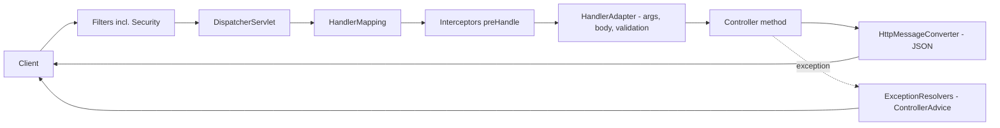
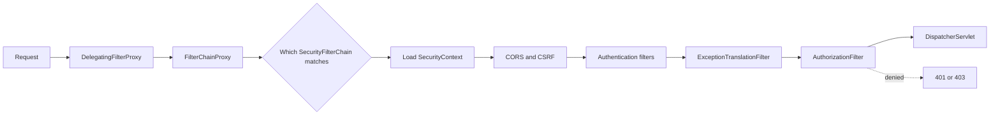
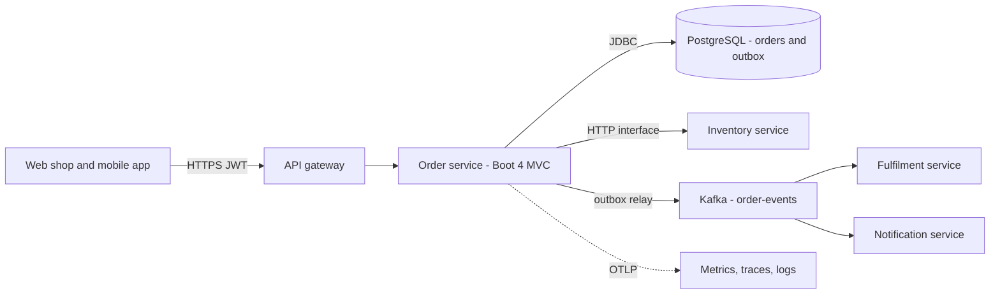

# Chapter 18 — Spring Interview Questions

This chapter is the *teaching* round of interview questions: **168 questions** about Spring Framework 7.0, Spring Boot 4.1 and Spring Security 7. The 30–60-second answers live in the [Chapter 20 question bank](../20-interview-question-bank/README.md); each question here points to its Chapter 20 answer (**Short answer: Ch 20 Qn**), adds only the deeper details that answer leaves out, and links to the teaching section. Questions without a Chapter 20 counterpart keep their full answer here. After the questions come runnable **proofs** of five tricky answers (§18.15, a small Maven project — Maven being Java's standard build tool), a template for "explain a Spring project you worked on" (§18.16), and ten **debugging scenarios** in the form *symptom → cause → fix → how to prove it* (§18.17).

Versions: Spring Boot 4.1.1 → Spring Framework 7.0, Spring Security 7.1, Spring Data 2026.0, Hibernate 7.4, Jackson 3.1, JUnit 6, Java 25 (17 minimum). Version-dependent answers name the version.

---

## 18.1 How to use this chapter

### How to answer a Spring question
Interviewers rarely want a definition only. A strong answer has three layers, and you can stop after any of them:

1. **One sentence of what it is** — "`@Transactional` starts and ends a database transaction around a method." (A **transaction** is a group of database changes that either all succeed — *commit* — or are all undone — *rollback*.)
2. **How it works underneath** — "A proxy's interceptor asks the transaction manager to begin, calls the method, then commits or rolls back." (A **proxy** is a stand-in object Spring generates around your bean; callers talk to it, and it runs extra code — the *interceptor* — before and after passing the call on.)
3. **The consequence that bites people** — "So self-invocation skips it, and a checked exception commits by default." (**Self-invocation** is a method calling another method of the same object through `this`, which bypasses the proxy; a **checked exception** is one Java forces you to declare or catch — any `Exception` that is not a `RuntimeException`.)

The third layer shows you have debugged the feature, not just read about it — it is what makes you sound experienced.

### How to study with it
- Read the question, say your answer out loud, check it against Chapter 20, then read the extra detail here. If you missed the third layer, follow the **→ §N.M** link to the teaching section (a link without a section number points to the whole chapter).
- Questions marked **(Boot 4)** or **(Framework 7)** check that your knowledge is current.

---

## 18.2 Core container and dependency injection

**Q1. What are Inversion of Control and Dependency Injection?**
Short answer: Ch 20 [Q13](../20-interview-question-bank/README.md#ioc-container-dependency-injection-beans-and-scopes). → [§2.1](../02-ioc-and-dependency-injection/README.md#21-inversion-of-control-and-dependency-injection)

**Q2. What is a bean?**
Short answer: Ch 20 [Q16](../20-interview-question-bank/README.md#ioc-container-dependency-injection-beans-and-scopes). A bean is described by a `BeanDefinition` (class or factory method, scope, dependencies, init/destroy callbacks) that the container turns into an instance. → [§2.3](../02-ioc-and-dependency-injection/README.md#23-defining-beans)

**Q3. `BeanFactory` vs `ApplicationContext`?**
Short answer: Ch 20 [Q15](../20-interview-question-bank/README.md#ioc-container-dependency-injection-beans-and-scopes). → [§2.2](../02-ioc-and-dependency-injection/README.md#22-the-container-beanfactory-vs-applicationcontext)

**Q4. `@Component` vs `@Bean`?**
Short answer: Ch 20 [Q19](../20-interview-question-bank/README.md#ioc-container-dependency-injection-beans-and-scopes). `@Repository` also enables exception translation to `DataAccessException`. → [§2.3](../02-ioc-and-dependency-injection/README.md#23-defining-beans)

**Q5. What is the difference between "full" and "lite" `@Configuration`?**
Short answer: Ch 20 [Q20](../20-interview-question-bank/README.md#ioc-container-dependency-injection-beans-and-scopes). Boot's own auto-configurations use lite mode with dependencies as method parameters — faster and identical in native images. → [§2.3](../02-ioc-and-dependency-injection/README.md#23-defining-beans)

**Q6. Constructor, setter or field injection — which and why?**
Short answer: Ch 20 [Q17](../20-interview-question-bank/README.md#ioc-container-dependency-injection-beans-and-scopes). → [§2.4](../02-ioc-and-dependency-injection/README.md#24-injection-types)

**Q7. Two beans implement the same interface. How does Spring choose?**
Short answer: Ch 20 [Q22](../20-interview-question-bank/README.md#ioc-container-dependency-injection-beans-and-scopes). To get all candidates inject `List<T>` (ordered by `@Order`) or `Map<String, T>` (keyed by bean name). Proved in §18.15. → [§2.5](../02-ioc-and-dependency-injection/README.md#25-how-spring-picks-a-bean)

**Q8. `@Primary` vs `@Qualifier`?**
Short answer: Ch 20 [Q22](../20-interview-question-bank/README.md#ioc-container-dependency-injection-beans-and-scopes). Use `@Primary` for "the usual one", `@Qualifier` (or a custom qualifier annotation) where a specific one is required. → [§2.5](../02-ioc-and-dependency-injection/README.md#25-how-spring-picks-a-bean)

**Q9. How do you inject an optional dependency?**
Short answer: Ch 20 [Q25](../20-interview-question-bank/README.md#ioc-container-dependency-injection-beans-and-scopes). → [§2.5](../02-ioc-and-dependency-injection/README.md#25-how-spring-picks-a-bean)

**Q10. What bean scopes exist, and what is the default?**
Short answer: Ch 20 [Q26](../20-interview-question-bank/README.md#ioc-container-dependency-injection-beans-and-scopes). Singleton is not thread-safe: one instance serves all request threads, so keep singletons stateless or their state thread-safe. → [§2.6](../02-ioc-and-dependency-injection/README.md#26-bean-scopes)

**Q11. You inject a prototype bean into a singleton. What happens?**
Short answer: Ch 20 [Q29](../20-interview-question-bank/README.md#ioc-container-dependency-injection-beans-and-scopes). "Prototype" means new per request *to the container*, not per use. Proved in §18.15. → [§2.6](../02-ioc-and-dependency-injection/README.md#26-bean-scopes)

**Q12. How can a singleton use a request-scoped bean?**
Short answer: Ch 20 [Q30](../20-interview-question-bank/README.md#ioc-container-dependency-injection-beans-and-scopes). `@RequestScope` = `@Scope(value = "request", proxyMode = TARGET_CLASS)`; outside a request thread the call fails (`ScopeNotActiveException`). → [§2.6](../02-ioc-and-dependency-injection/README.md#26-bean-scopes)

**Q13. Describe the bean lifecycle.**
Short answer: Ch 20 [Q31](../20-interview-question-bank/README.md#ioc-container-dependency-injection-beans-and-scopes). Destroy callbacks are not called for prototypes. For start/stop behaviour tied to the context (consumers, schedulers) implement `SmartLifecycle`. → [§2.7](../02-ioc-and-dependency-injection/README.md#27-the-bean-lifecycle)

**Q14. `BeanPostProcessor` vs `BeanFactoryPostProcessor`?**
Short answer: Ch 20 [Q33](../20-interview-question-bank/README.md#ioc-container-dependency-injection-beans-and-scopes). Examples: `PropertySourcesPlaceholderConfigurer` resolves `${...}` (BFPP); `AutowiredAnnotationBeanPostProcessor` does injection and the auto-proxy creator wraps beans for `@Transactional` (BPP). → [§2.8](../02-ioc-and-dependency-injection/README.md#28-post-processors-the-containers-extension-points)

**Q15. How does Spring handle circular dependencies?**
Short answer: Ch 20 [Q34](../20-interview-question-bank/README.md#ioc-container-dependency-injection-beans-and-scopes). Proved in §18.15. → [§2.9](../02-ioc-and-dependency-injection/README.md#29-circular-dependencies)

**Q16. What does lazy initialization do, and what does it cost?**
Short answer: Ch 20 [Q35](../20-interview-question-bank/README.md#ioc-container-dependency-injection-beans-and-scopes). Good for development and some CLI tools; risky for services. → [§2.10](../02-ioc-and-dependency-injection/README.md#210-lazy-initialization)

**Q17. `@Profile` vs `@Conditional`?**
Short answer: Ch 20 [Q54](../20-interview-question-bank/README.md#configuration-properties-profiles-auto-configuration-and-starters). Boot's `@ConditionalOnClass`, `@ConditionalOnProperty`, `@ConditionalOnMissingBean` are built on `@Conditional`. → [§2.11](../02-ioc-and-dependency-injection/README.md#211-conditional-and-profiles)

**Q18. How do application events work? Are they asynchronous?**
Short answer: Ch 20 [Q37](../20-interview-question-bank/README.md#ioc-container-dependency-injection-beans-and-scopes). → [§2.12](../02-ioc-and-dependency-injection/README.md#212-application-events)

**Q19. (Framework 7) What is JSpecify null-safety in Spring?**
Short answer: Ch 20 [Q39](../20-interview-question-bank/README.md#ioc-container-dependency-injection-beans-and-scopes). JSpecify replaces the deprecated `org.springframework.lang` annotations; Kotlin reads them too. → [§2.13](../02-ioc-and-dependency-injection/README.md#213-null-safety-with-jspecify-framework-7)

**Q20. (Framework 7) What is a `BeanRegistrar`?**
Short answer: Ch 20 [Q39](../20-interview-question-bank/README.md#ioc-container-dependency-injection-beans-and-scopes). Example: one bean per configured tenant; friendlier to AOT/native images than a `BeanDefinitionRegistryPostProcessor`. → [§2.14](../02-ioc-and-dependency-injection/README.md#214-programmatic-registration-with-beanregistrar-framework-7)


---

## 18.3 Configuration and auto-configuration

**Q21. What does `@SpringBootApplication` do?**
Short answer: Ch 20 [Q40](../20-interview-question-bank/README.md#configuration-properties-profiles-auto-configuration-and-starters). Hence the main class belongs in the root package: beans in sibling packages are not scanned. → [§1.8](../01-spring-ecosystem-and-first-app/README.md#18-the-main-class-and-springbootapplication)

**Q22. What happens when you run `java -jar app.jar`?**
Short answer: Ch 20 [Q5](../20-interview-question-bank/README.md#spring-and-spring-boot-fundamentals). Detail: the jar's manifest (`META-INF/MANIFEST.MF`) starts Boot's `JarLauncher`, which builds a class loader over `BOOT-INF/classes` and `BOOT-INF/lib`. → [§1.9](../01-spring-ecosystem-and-first-app/README.md#19-running-the-application)

**Q23. What is a starter?**
Short answer: Ch 20 [Q46](../20-interview-question-bank/README.md#configuration-properties-profiles-auto-configuration-and-starters). → [§1.7](../01-spring-ecosystem-and-first-app/README.md#17-starters)

**Q24. How does auto-configuration work?**
Short answer: Ch 20 [Q41](../20-interview-question-bank/README.md#configuration-properties-profiles-auto-configuration-and-starters). `@EnableAutoConfiguration` filters the `.imports` list early by class presence and sorts it (`before`/`after`); a `DataSource` appears only if a driver is present and you defined none. → [§3.10](../03-configuration-and-auto-configuration/README.md#310-how-auto-configuration-works)

**Q25. How do you override an auto-configured bean?**
Short answer: Ch 20 [Q44](../20-interview-question-bank/README.md#configuration-properties-profiles-auto-configuration-and-starters). Often you needn't replace the bean: set properties or declare a customizer bean (`JsonMapperBuilderCustomizer`, `RestClientCustomizer`, …). → [§3.12](../03-configuration-and-auto-configuration/README.md#312-overriding-and-excluding-auto-configuration)

**Q26. How do you find out why a bean was (or was not) auto-configured?**
Short answer: Ch 20 [Q43](../20-interview-question-bank/README.md#configuration-properties-profiles-auto-configuration-and-starters). → [§3.11](../03-configuration-and-auto-configuration/README.md#311-seeing-what-boot-decided)

**Q27. Name the main property sources in priority order.**
Short answer: Ch 20 [Q49](../20-interview-question-bank/README.md#configuration-properties-profiles-auto-configuration-and-starters). Full order also includes test properties (in tests, highest), `SPRING_APPLICATION_JSON`, `random.*`. Rule of thumb: the more "outside" and "later", the stronger. → [§3.3](../03-configuration-and-auto-configuration/README.md#33-precedence-which-value-wins)

**Q28. How does an environment variable map to a property?**
Short answer: Ch 20 [Q50](../20-interview-question-bank/README.md#configuration-properties-profiles-auto-configuration-and-starters). Example: `SHOP_CHECKOUTTIMEOUT` sets `shop.checkout-timeout`. → [§3.4](../03-configuration-and-auto-configuration/README.md#34-environment-variables-and-relaxed-binding)

**Q29. `@Value` vs `@ConfigurationProperties`?**
Short answer: Ch 20 [Q51](../20-interview-question-bank/README.md#configuration-properties-profiles-auto-configuration-and-starters). → [§3.6](../03-configuration-and-auto-configuration/README.md#36-configurationproperties--type-safe-configuration)

**Q30. How do you make the app refuse to start with bad configuration?**
Short answer: Ch 20 [Q52](../20-interview-question-bank/README.md#configuration-properties-profiles-auto-configuration-and-starters). Use `@Valid` for nested groups; the failure report names each property and where it came from. → [§3.6](../03-configuration-and-auto-configuration/README.md#36-configurationproperties--type-safe-configuration)

**Q31. What are profiles and profile groups?**
Short answer: Ch 20 [Q53](../20-interview-question-bank/README.md#configuration-properties-profiles-auto-configuration-and-starters). Keep profiles for *environments or capabilities*, e.g. `spring.profiles.group.prod=postgres,kafka,json-logs`. → [§3.7](../03-configuration-and-auto-configuration/README.md#37-profiles-profile-specific-files-and-profile-groups)

**Q32. How do you load Kubernetes secrets or extra config files?**
Short answer: Ch 20 [Q55](../20-interview-question-bank/README.md#configuration-properties-profiles-auto-configuration-and-starters). `spring.config.import=optional:configtree:/etc/secrets/` reads each mounted file as a property (file name = key); `spring.config.import` also imports other files, Config Server or Vault; `optional:` avoids failure when absent. → [§3.8](../03-configuration-and-auto-configuration/README.md#38-importing-configuration-springconfigimport)

**Q33. How do you write your own starter?**
Short answer: Ch 20 [Q47](../20-interview-question-bank/README.md#configuration-properties-profiles-auto-configuration-and-starters). Two artifacts: `acme-spring-boot` (auto-configuration with `@ConditionalOnMissingBean` on every bean) and `acme-spring-boot-starter`, a code-free pom depending on it and the library. → [§3.13](../03-configuration-and-auto-configuration/README.md#313-writing-your-own-auto-configuration-and-starter)

**Q34. (Boot 4) What does "Boot 4 modularization" mean?**
Boot 3 kept all auto-configuration in one big `spring-boot-autoconfigure` jar. Boot 4 splits it into per-technology modules (`spring-boot-webmvc`, `spring-boot-jdbc`, `spring-boot-kafka`…) with matching starters and test starters, so the classpath (the list of jars and folders the JVM loads classes from) contains only what you use. `spring-boot-starter-classic` / `-test-classic` bring the old "everything" layout as a migration aid. → [§3.14](../03-configuration-and-auto-configuration/README.md#314-boot-4-modularization)

**Q35. What does DevTools do, and is it in production?**
Short answer: Ch 20 [Q11](../20-interview-question-bank/README.md#spring-and-spring-boot-fundamentals). → [§1.10](../01-spring-ecosystem-and-first-app/README.md#110-devtools)

---

## 18.4 AOP and proxies

**Q36. What is AOP? Define aspect, advice, pointcut and join point.**
Short answer: Ch 20 [Q59](../20-interview-question-bank/README.md#aop-and-proxies). → [§4.1](../04-aop-and-proxies/README.md#41-cross-cutting-concerns-and-the-aop-vocabulary)

**Q37. How does Spring AOP work at runtime?**
Short answer: Ch 20 [Q60](../20-interview-question-bank/README.md#aop-and-proxies). Nothing changes in your bytecode — the proxy runs the advice chain, then calls the real object. → [§4.4](../04-aop-and-proxies/README.md#44-how-spring-aop-works-proxies)

**Q38. JDK dynamic proxy vs CGLIB?**
Short answer: Ch 20 [Q61](../20-interview-question-bank/README.md#aop-and-proxies). Framework 7 adds `@Proxyable` to choose per bean. → [§4.4](../04-aop-and-proxies/README.md#44-how-spring-aop-works-proxies)

**Q39. What is the self-invocation problem?**
Short answer: Ch 20 [Q62](../20-interview-question-bank/README.md#aop-and-proxies). Proved in §18.15. → [§4.5](../04-aop-and-proxies/README.md#45-proxy-limitations--proved)

**Q40. Which Spring features are built on proxies?**
Short answer: Ch 20 [Q63](../20-interview-question-bank/README.md#aop-and-proxies). Also HTTP interface clients (JDK proxies). All share the same limitations. → [§4.6](../04-aop-and-proxies/README.md#46-spring-features-built-on-proxies)

**Q41. `@Around` vs the other advice types?**
Short answer: Ch 20 [Q65](../20-interview-question-bank/README.md#aop-and-proxies). → [§4.2](../04-aop-and-proxies/README.md#42-writing-aspects-with-aspect)

**Q42. How do you control the order of two aspects?**
Short answer: Ch 20 [Q65](../20-interview-question-bank/README.md#aop-and-proxies). The lowest `@Order` value is the *outer* layer — first in, last out. Example: put a retry aspect outside the transaction aspect so each attempt gets a fresh transaction. → [§4.2](../04-aop-and-proxies/README.md#42-writing-aspects-with-aspect)

**Q43. Spring AOP vs AspectJ?**
Short answer: Ch 20 [Q66](../20-interview-question-bank/README.md#aop-and-proxies). → [§4.8](../04-aop-and-proxies/README.md#48-spring-aop-vs-aspectj)

**Q44. (Framework 7) What are `@Retryable` and `@ConcurrencyLimit`?**
Short answer: Ch 20 [Q67](../20-interview-question-bank/README.md#aop-and-proxies). Also `include`/`exclude` exception filters; no auto-configuration (needs `@EnableResilientMethods`); programmatic API `RetryTemplate`/`RetryPolicy` in `spring-core`; no circuit breaker — use Resilience4j. They live in `spring-context`. → [§4.7](../04-aop-and-proxies/README.md#47-framework-7-core-resilience-retryable-and-concurrencylimit)

---

## 18.5 Spring MVC, REST and HTTP clients

**Q45. Walk through a request in Spring MVC.**
Short answer: Ch 20 [Q68](../20-interview-question-bank/README.md#spring-mvc-rest-and-http-clients). MVC flow (also: `HandlerMapping` matches consumes/produces and API version; the response converter is chosen from the `Accept` header): → [§5.2](../05-spring-mvc-and-rest/README.md#52-how-a-request-flows-the-dispatcherservlet)



**Q46. `@Controller` vs `@RestController`?**
Short answer: Ch 20 [Q69](../20-interview-question-bank/README.md#spring-mvc-rest-and-http-clients). → [§5.3](../05-spring-mvc-and-rest/README.md#53-controllers-and-request-mappings)

**Q47. `@PathVariable` vs `@RequestParam` vs `@RequestBody`?**
Short answer: Ch 20 [Q71](../20-interview-question-bank/README.md#spring-mvc-rest-and-http-clients). → [§5.4](../05-spring-mvc-and-rest/README.md#54-reading-input-and-writing-output)

**Q48. Why return `ResponseEntity`?**
Short answer: Ch 20 [Q72](../20-interview-question-bank/README.md#spring-mvc-rest-and-http-clients). Also `304` with an `ETag` (a response-version fingerprint letting clients skip unchanged data). For plain 200 just return the object. → [§5.4](../05-spring-mvc-and-rest/README.md#54-reading-input-and-writing-output)

**Q49. How do you validate a request?**
Short answer: Ch 20 [Q90](../20-interview-question-bank/README.md#validation-and-exception-handling). Use `@Validated(Group.class)` for validation groups. → [§5.6](../05-spring-mvc-and-rest/README.md#56-validation)

**Q50. How do you handle errors consistently?**
Short answer: Ch 20 [Q94](../20-interview-question-bank/README.md#validation-and-exception-handling). Never leak stack traces to clients. → [§5.7](../05-spring-mvc-and-rest/README.md#57-error-handling-and-problem-details-rfc-9457)

**Q51. (Boot 4) What changed with JSON?**
Short answer: Ch 20 [Q76](../20-interview-question-bank/README.md#spring-mvc-rest-and-http-clients). Jackson 3 also means an immutable `JsonMapper` built with a builder and unchecked exceptions; `@JsonComponent` became `@JacksonComponent`. → [§5.5](../05-spring-mvc-and-rest/README.md#55-json-with-jackson-3)

**Q52. How does content negotiation work?**
Short answer: Ch 20 [Q77](../20-interview-question-bank/README.md#spring-mvc-rest-and-http-clients). → [§5.8](../05-spring-mvc-and-rest/README.md#58-content-negotiation)

**Q53. (Framework 7) How do you version a REST API?**
Short answer: Ch 20 [Q78](../20-interview-question-bank/README.md#spring-mvc-rest-and-http-clients). Ranges like `version = "1.1+"` ("1.1 and later"); a deprecation handler can add `Deprecation`, `Sunset` and `Link` headers. → [§5.9](../05-spring-mvc-and-rest/README.md#59-api-versioning-framework-7)

**Q54. What is CORS and where do you configure it?**
Short answer: Ch 20 [Q80](../20-interview-question-bank/README.md#spring-mvc-rest-and-http-clients). An *origin* is scheme + host + port. CORS doesn't protect the API from non-browser clients. → [§5.10](../05-spring-mvc-and-rest/README.md#510-cors-and-file-upload), [§10.9](../10-spring-security-1-fundamentals/README.md#109-cors)

**Q55. Filter vs interceptor vs aspect?**
Short answer: Ch 20 [Q81](../20-interview-question-bank/README.md#spring-mvc-rest-and-http-clients). A filter sees even requests that never reach Spring MVC and can wrap the request/response. → [§5.11](../05-spring-mvc-and-rest/README.md#511-filters-vs-interceptors-vs-aop)

**Q56. PUT vs PATCH vs POST — which are idempotent?**
Short answer: Ch 20 [Q73](../20-interview-question-bank/README.md#spring-mvc-rest-and-http-clients). For retry-safe POSTs accept an `Idempotency-Key` header. → [§5.1](../05-spring-mvc-and-rest/README.md#51-rest-in-one-page)

**Q57. How do you paginate and document an API?**
Short answer: Ch 20 [Q79](../20-interview-question-bank/README.md#spring-mvc-rest-and-http-clients). Document with OpenAPI (a machine-readable REST API description) generated by springdoc (`/v3/api-docs`, Swagger UI). → [§5.13](../05-spring-mvc-and-rest/README.md#513-putting-it-together-design-checklist-and-mistakes), [§5.12](../05-spring-mvc-and-rest/README.md#512-documenting-the-api-openapi-with-springdoc)

**Q58. Which HTTP client should a new Boot 4 service use?**
Short answer: Ch 20 [Q86](../20-interview-question-bank/README.md#spring-mvc-rest-and-http-clients). Inject `RestClient.Builder` to get Boot's converters, timeouts and observability. → [§6.1](../06-rest-clients-and-http-interfaces/README.md#61-choosing-a-client)

**Q59. What are HTTP service interfaces, and what does Boot 4 add?**
Short answer: Ch 20 [Q87](../20-interview-question-bank/README.md#spring-mvc-rest-and-http-clients). `HttpServiceProxyFactory` creates the JDK-proxy implementation; Boot 4's `@ImportHttpServices(group = "catalog", types = CatalogApi.class)` removes the factory code. → [§6.6](../06-rest-clients-and-http-interfaces/README.md#66-http-service-interfaces-httpexchange)

**Q60. How do you handle errors, timeouts and retries on a client?**
Short answer: Ch 20 [Q88](../20-interview-question-bank/README.md#spring-mvc-rest-and-http-clients). `retrieve()` throws `HttpClientErrorException` (4xx) / `HttpServerErrorException` (5xx), and `ResourceAccessException` for I/O errors and timeouts; translate them to domain exceptions at the client edge. → [§6.3](../06-rest-clients-and-http-interfaces/README.md#63-error-handling), [§6.4](../06-rest-clients-and-http-interfaces/README.md#64-timeouts-and-the-underlying-http-library)

**Q61. How do you test a REST client?**
Short answer: Ch 20 [Q181](../20-interview-question-bank/README.md#testing). → [§6.8](../06-rest-clients-and-http-interfaces/README.md#68-testing-clients)

---

## 18.6 Data access, JPA and transactions

**Q62. What does Spring add on top of plain JDBC?**
(JDBC — Java Database Connectivity — is Java's standard low-level API for talking to SQL databases.) A pooled `DataSource` (a *connection pool* keeps a few open database connections and lends them out, because opening a new one per query is slow; HikariCP is Boot's pool), `JdbcClient`/`JdbcTemplate` that handle connections, statements, result-set mapping and cleanup, translation of vendor (database-specific) `SQLException`s into the unchecked `DataAccessException` hierarchy (`DuplicateKeyException`, `DataIntegrityViolationException`…), and declarative transactions. → [§7.1](../07-data-access-jdbc-and-transactions/README.md#71-the-data-access-stack), [§7.5](../07-data-access-jdbc-and-transactions/README.md#75-exception-translation-dataaccessexception)

**Q63. `JdbcClient` vs `JdbcTemplate`?**
Short answer: Ch 20 [Q125](../20-interview-question-bank/README.md#spring-data-jpa-and-hibernate). `JdbcTemplate` remains for batch updates and existing code. → [§7.3](../07-data-access-jdbc-and-transactions/README.md#73-jdbcclient-and-jdbctemplate)

**Q64. How big should the connection pool be?**
Short answer: Ch 20 [Q124](../20-interview-question-bank/README.md#spring-data-jpa-and-hibernate). Pool × instances must stay under the database's `max_connections`; watch `hikaricp.connections.pending`. → [§7.2](../07-data-access-jdbc-and-transactions/README.md#72-datasource-and-hikaricp)

**Q65. How does `@Transactional` work internally?**
Short answer: Ch 20 [Q127](../20-interview-question-bank/README.md#transactions). The manager turns auto-commit off on the bound connection; repositories/`JdbcClient` on that thread reuse it. → [§7.7](../07-data-access-jdbc-and-transactions/README.md#77-how-a-spring-transaction-works)

**Q66. What are the default propagation and isolation?**
Short answer: Ch 20 [Q130](../20-interview-question-bank/README.md#transactions). Defaults: propagation `REQUIRED`; isolation `DEFAULT` = the database's (READ COMMITTED on PostgreSQL, REPEATABLE READ on MySQL InnoDB). → [§7.8](../07-data-access-jdbc-and-transactions/README.md#78-transactional-attributes)

**Q67. A `@Transactional` method throws a checked exception. Commit or rollback?**
Short answer: Ch 20 [Q131](../20-interview-question-bank/README.md#transactions). Rationale: the EJB convention treats checked exceptions as expected business outcomes. Since Framework 6.2, globally `@EnableTransactionManagement(rollbackOn = RollbackOn.ALL_EXCEPTIONS)` (recommended by the reference docs). Proved in §18.15. → [§7.10](../07-data-access-jdbc-and-transactions/README.md#710-rollback-rules)

**Q68. Explain the propagation types.**
Short answer: Ch 20 [Q128](../20-interview-question-bank/README.md#transactions). → [§7.9](../07-data-access-jdbc-and-transactions/README.md#79-propagation)

| Propagation | Existing transaction? | None? |
|---|---|---|
| `REQUIRED` (default) | join it | start one |
| `REQUIRES_NEW` | suspend it, start a new one (new connection) | start one |
| `NESTED` | savepoint inside it | start one |
| `SUPPORTS` | join it | run without |
| `NOT_SUPPORTED` | suspend it, run without | run without |
| `MANDATORY` | join it | throw |
| `NEVER` | throw | run without |

Typical uses: `REQUIRES_NEW` for an audit record that must survive a rollback; `NESTED` for "roll back only this part" — avoid with JPA (the database rolls back to the savepoint, Hibernate's persistence context doesn't).

**Q69. What is `UnexpectedRollbackException`?**
Short answer: Ch 20 [Q133](../20-interview-question-bank/README.md#transactions). → [§7.9](../07-data-access-jdbc-and-transactions/README.md#79-propagation)

**Q70. What does `readOnly = true` do?**
Short answer: Ch 20 [Q134](../20-interview-question-bank/README.md#transactions). PostgreSQL then rejects writes on the read-only connection. It is not a security feature. → [§7.12](../07-data-access-jdbc-and-transactions/README.md#712-readonly-and-timeout)

**Q71. Why might `@Transactional` be silently ignored?**
Short answer: Ch 20 [Q132](../20-interview-question-bank/README.md#transactions). → [§7.13](../07-data-access-jdbc-and-transactions/README.md#713-transaction-pitfalls)

**Q72. On which layer does `@Transactional` belong?**
Short answer: Ch 20 [Q135](../20-interview-question-bank/README.md#transactions). Keep remote HTTP calls out of transactions — they hold a connection while waiting. → [§7.13](../07-data-access-jdbc-and-transactions/README.md#713-transaction-pitfalls)

**Q73. When do you use `TransactionTemplate`?**
Short answer: Ch 20 [Q138](../20-interview-question-bank/README.md#transactions). Also to avoid proxy pitfalls such as retries around a transaction. → [§7.14](../07-data-access-jdbc-and-transactions/README.md#714-programmatic-transactions-transactiontemplate)

**Q74. How do you run code only after the transaction commits?**
Short answer: Ch 20 [Q136](../20-interview-question-bank/README.md#transactions). `@TransactionalEventListener` (default `AFTER_COMMIT`), e.g. send the confirmation e-mail only if the order was really saved. Not guaranteed delivery — if the process dies after commit the event is lost; use a transactional outbox when delivery must be guaranteed. → [§7.15](../07-data-access-jdbc-and-transactions/README.md#715-transactionaleventlistener)

**Q75. How do you handle a serialization failure or deadlock?**
Short answer: Ch 20 [Q140](../20-interview-question-bank/README.md#transactions). They surface as `ConcurrencyFailureException` subtypes (`CannotAcquireLockException`, `PessimisticLockingFailureException`). See also [SQL book 13](../../../sql/chapters/13-transactions-and-concurrency/README.md). → [§7.11](../07-data-access-jdbc-and-transactions/README.md#711-isolation-levels), [SQL book 13](../../../sql/chapters/13-transactions-and-concurrency/README.md)

**Q76. JPA vs Hibernate vs Spring Data JPA?**
Short answer: Ch 20 [Q98](../20-interview-question-bank/README.md#spring-data-jpa-and-hibernate). JPA version: Jakarta Persistence 3.2. → [§8.1](../08-spring-data-jpa-and-hibernate/README.md#81-jpa-hibernate-and-spring-data--who-does-what)

**Q77. What is the persistence context? What is dirty checking?**
Short answer: Ch 20 [Q105](../20-interview-question-bank/README.md#spring-data-jpa-and-hibernate). Flush happens before commit, or before a query that needs it. → [§8.4](../08-spring-data-jpa-and-hibernate/README.md#84-the-persistence-context-and-dirty-checking)

**Q78. What are the entity states?**
Short answer: Ch 20 [Q106](../20-interview-question-bank/README.md#spring-data-jpa-and-hibernate). → [§8.4](../08-spring-data-jpa-and-hibernate/README.md#84-the-persistence-context-and-dirty-checking)

**Q79. How does `save()` decide between insert and update?**
Short answer: Ch 20 [Q108](../20-interview-question-bank/README.md#spring-data-jpa-and-hibernate). Implemented in `SimpleJpaRepository.save()`. → [§8.8](../08-spring-data-jpa-and-hibernate/README.md#88-repositories)

**Q80. What is the owning side of a relationship?**
Short answer: Ch 20 [Q111](../20-interview-question-bank/README.md#spring-data-jpa-and-hibernate). → [§8.5](../08-spring-data-jpa-and-hibernate/README.md#85-relationships)

**Q81. `CascadeType.REMOVE` vs `orphanRemoval = true`?**
Short answer: Ch 20 [Q112](../20-interview-question-bank/README.md#spring-data-jpa-and-hibernate). Use both only for true composition (order → order lines), never on `@ManyToMany`. → [§8.5](../08-spring-data-jpa-and-hibernate/README.md#85-relationships)

**Q82. What are the default fetch types, and what causes `LazyInitializationException`?**
Short answer: Ch 20 [Q103](../20-interview-question-bank/README.md#spring-data-jpa-and-hibernate), [Q104](../20-interview-question-bank/README.md#spring-data-jpa-and-hibernate). → [§8.6](../08-spring-data-jpa-and-hibernate/README.md#86-fetch-types-and-lazyinitializationexception)

**Q83. What is the N+1 problem and how do you fix it?**
Short answer: Ch 20 [Q102](../20-interview-question-bank/README.md#spring-data-jpa-and-hibernate). Batch fetching cuts it to 1 + N/size round trips. Detect it by counting statements in tests (Hibernate statistics or a datasource proxy). `@BatchSize` sets batch fetching per association. → [§8.7](../08-spring-data-jpa-and-hibernate/README.md#87-the-n1-problem)

**Q84. Derived query vs `@Query` vs native query?**
Short answer: Ch 20 [Q101](../20-interview-question-bank/README.md#spring-data-jpa-and-hibernate). Updates need `@Modifying` (plus `clearAutomatically = true` if managed entities may be stale). → [§8.9](../08-spring-data-jpa-and-hibernate/README.md#89-derived-queries), [§8.10](../08-spring-data-jpa-and-hibernate/README.md#810-query-jpql-native-sql-and-modifying)

**Q85. `Page` vs `Slice`?**
Short answer: Ch 20 [Q114](../20-interview-question-bank/README.md#spring-data-jpa-and-hibernate). Never combine `JOIN FETCH` of a collection with paging without checking the SQL (Hibernate may page in memory). → [§8.11](../08-spring-data-jpa-and-hibernate/README.md#811-pagination-and-sorting)

**Q86. What are projections?**
Short answer: Ch 20 [Q113](../20-interview-question-bank/README.md#spring-data-jpa-and-hibernate). → [§8.12](../08-spring-data-jpa-and-hibernate/README.md#812-projections)

**Q87. How does optimistic locking work?**
Short answer: Ch 20 [Q116](../20-interview-question-bank/README.md#spring-data-jpa-and-hibernate). → [§8.14](../08-spring-data-jpa-and-hibernate/README.md#814-locking-optimistic-and-pessimistic)

**Q88. What is Open Session in View and should you disable it?**
Short answer: Ch 20 [Q117](../20-interview-question-bank/README.md#spring-data-jpa-and-hibernate). Default `true`, with a startup warning. → [§8.15](../08-spring-data-jpa-and-hibernate/README.md#815-open-session-in-view)

**Q89. How is the schema managed in production?**
Short answer: Ch 20 [Q118](../20-interview-question-bank/README.md#spring-data-jpa-and-hibernate). In Boot 4 add `spring-boot-starter-flyway` — `flyway-core` alone is not auto-configured. → [§8.16](../08-spring-data-jpa-and-hibernate/README.md#816-schema-migrations-with-flyway)

**Q90. How should an entity implement `equals`/`hashCode`?**
Short answer: Ch 20 [Q119](../20-interview-question-bank/README.md#spring-data-jpa-and-hibernate). → [§8.3](../08-spring-data-jpa-and-hibernate/README.md#83-entities-and-ids)

**Q91. Spring Data JDBC vs Spring Data JPA?**
Short answer: Ch 20 [Q125](../20-interview-question-bank/README.md#spring-data-jpa-and-hibernate). Spring Data JDBC maps DDD aggregates (clusters always loaded and saved as one unit): no persistence context, lazy loading or dirty checking — `save()` writes the whole aggregate. Simpler and predictable vs JPA's caching, lazy loading and rich mapping with more hidden behaviour. → [§9.2](../09-spring-data-beyond-jpa-and-caching/README.md#92-spring-data-jdbc-and-aggregates)

---

## 18.7 Caching

**Q92. How does Spring's cache abstraction work?**
Short answer: Ch 20 [Q142](../20-interview-question-bank/README.md#caching). → [§9.8](../09-spring-data-beyond-jpa-and-caching/README.md#98-the-caching-abstraction)

**Q93. How is the cache key built?**
Short answer: Ch 20 [Q143](../20-interview-question-bank/README.md#caching). Default generator: `SimpleKeyGenerator`. → [§9.8](../09-spring-data-beyond-jpa-and-caching/README.md#98-the-caching-abstraction)

**Q94. `condition` vs `unless`?**
Short answer: Ch 20 [Q143](../20-interview-question-bank/README.md#caching). → [§9.8](../09-spring-data-beyond-jpa-and-caching/README.md#98-the-caching-abstraction)

**Q95. Why doesn't my `@Cacheable` work?**
Short answer: Ch 20 [Q144](../20-interview-question-bank/README.md#caching). → [§4.6](../04-aop-and-proxies/README.md#46-spring-features-built-on-proxies), [§9.8](../09-spring-data-beyond-jpa-and-caching/README.md#98-the-caching-abstraction)

**Q96. Local cache (Caffeine) vs distributed cache (Redis)?**
Short answer: Ch 20 [Q145](../20-interview-question-bank/README.md#caching). Common choice: Caffeine for small, rarely changing reference data with a short TTL (time to live); Redis for shared session-like or expensive data. → [§9.8](../09-spring-data-beyond-jpa-and-caching/README.md#98-the-caching-abstraction)

**Q97. What cache problems should you plan for?**
Short answer: Ch 20 [Q146](../20-interview-question-bank/README.md#caching). `sync = true` works only per instance and can't be combined with `unless`. Also: caching mutable objects callers then modify, per-user data under a shared key, and not measuring the hit rate (Micrometer `cache.gets`; Caffeine only with `recordStats()`). → [§9.8](../09-spring-data-beyond-jpa-and-caching/README.md#98-the-caching-abstraction)

---

## 18.8 Security

**Q98. What happens when you add `spring-boot-starter-security` and nothing else?**
Short answer: Ch 20 [Q148](../20-interview-question-bank/README.md#spring-security-filter-chain-authentication-jwt-and-oauth2). → [§10.1](../10-spring-security-1-fundamentals/README.md#101-vocabulary-and-what-the-starter-does-by-default)

**Q99. Explain the filter chain architecture.**
Short answer: Ch 20 [Q149](../20-interview-question-bank/README.md#spring-security-filter-chain-authentication-jwt-and-oauth2). Chain order also includes security-context loading, headers and anonymous authentication. Several chains (e.g. stateless `/api/**` with JWT, the rest with form login) are ordered with `@Order`. → [§10.2](../10-spring-security-1-fundamentals/README.md#102-architecture-the-filter-chain)



**Q100. (Security 7) How do you configure a chain today?**
Short answer: Ch 20 [Q150](../20-interview-question-bank/README.md#spring-security-filter-chain-authentication-jwt-and-oauth2). Security 7 also removed the Ant/MVC request matchers (paths use `PathPatternRequestMatcher`). → [§10.3](../10-spring-security-1-fundamentals/README.md#103-configuring-a-chain-the-lambda-dsl-in-spring-security-7)

**Q101. How does authentication work internally?**
Short answer: Ch 20 [Q152](../20-interview-question-bank/README.md#spring-security-filter-chain-authentication-jwt-and-oauth2). → [§10.4](../10-spring-security-1-fundamentals/README.md#104-authentication-users-providers-form-login-and-basic)

**Q102. How should passwords be stored?**
Short answer: Ch 20 [Q154](../20-interview-question-bank/README.md#spring-security-filter-chain-authentication-jwt-and-oauth2). Never encrypt passwords reversibly. Implement `UserDetailsPasswordService` to re-hash on login. → [§10.5](../10-spring-security-1-fundamentals/README.md#105-password-storage-hashing-with-delegatingpasswordencoder)

**Q103. Role vs authority? `hasRole` vs `hasAuthority`?**
Short answer: Ch 20 [Q155](../20-interview-question-bank/README.md#spring-security-filter-chain-authentication-jwt-and-oauth2). `hasAuthority("ROLE_ADMIN")` = `hasRole("ADMIN")` spelled out. Mixing them up (`hasRole("ROLE_ADMIN")`, or granting `ADMIN` without prefix) is a classic 403. → [§10.6](../10-spring-security-1-fundamentals/README.md#106-authorizing-requests-roles-authorities-401-vs-403)

**Q104. 401 vs 403?**
Short answer: Ch 20 [Q156](../20-interview-question-bank/README.md#spring-security-filter-chain-authentication-jwt-and-oauth2). `ExceptionTranslationFilter` decides: denied + anonymous → `AuthenticationEntryPoint` (401 with `WWW-Authenticate`, or a login redirect for browsers); denied + authenticated → `AccessDeniedHandler` (403). → [§10.6](../10-spring-security-1-fundamentals/README.md#106-authorizing-requests-roles-authorities-401-vs-403)

**Q105. What is method security?**
Short answer: Ch 20 [Q157](../20-interview-question-bank/README.md#spring-security-filter-chain-authentication-jwt-and-oauth2). Also `@PreFilter`/`@PostFilter`; lets you express ownership rules (`returnObject.owner == authentication.name`) that URL patterns can't. → [§10.7](../10-spring-security-1-fundamentals/README.md#107-method-security)

**Q106. What is CSRF and when can you disable protection?**
Short answer: Ch 20 [Q158](../20-interview-question-bank/README.md#spring-security-filter-chain-authentication-jwt-and-oauth2). → [§10.8](../10-spring-security-1-fundamentals/README.md#108-csrf-protection)

**Q107. Sessions or tokens?**
Short answer: Ch 20 [Q162](../20-interview-question-bank/README.md#spring-security-filter-chain-authentication-jwt-and-oauth2). Scaled sessions need shared storage (Spring Session with Redis/JDBC). The session id lives in the `JSESSIONID` cookie. → [§10.10](../10-spring-security-1-fundamentals/README.md#1010-sessions-the-security-context-and-logout), [§11.1](../11-spring-security-2-tokens-and-oauth2/README.md#111-from-sessions-to-tokens-bearer-tokens-and-jwt)

**Q108. How does a Spring resource server validate a JWT?**
Short answer: Ch 20 [Q160](../20-interview-question-bank/README.md#spring-security-filter-chain-authentication-jwt-and-oauth2). Detail: the `JwtDecoder` (Nimbus) fetches the issuer's JWK Set, picks the key by `kid`, verifies the signature; validators check `exp`/`nbf` (60 s clock skew), `iss` and, if configured, `aud`; `scope` → `SCOPE_*` authorities. Invalid token → 401; missing scope → 403. → [§11.3](../11-spring-security-2-tokens-and-oauth2/README.md#113-a-jwt-resource-server-in-spring), [§11.5](../11-spring-security-2-tokens-and-oauth2/README.md#115-mapping-claims-to-authorities)

**Q109. OAuth 2.0 vs OpenID Connect?**
Short answer: Ch 20 [Q164](../20-interview-question-bank/README.md#spring-security-filter-chain-authentication-jwt-and-oauth2). → [§11.2](../11-spring-security-2-tokens-and-oauth2/README.md#112-oauth-20-and-openid-connect-in-one-picture)

**Q110. JWT vs opaque tokens?**
Short answer: Ch 20 [Q159](../20-interview-question-bank/README.md#spring-security-filter-chain-authentication-jwt-and-oauth2), [Q166](../20-interview-question-bank/README.md#spring-security-filter-chain-authentication-jwt-and-oauth2). → [§11.7](../11-spring-security-2-tokens-and-oauth2/README.md#117-opaque-tokens-and-introspection)

**Q111. How does one service call another securely?**
Short answer: Ch 20 [Q167](../20-interview-question-bank/README.md#spring-security-filter-chain-authentication-jwt-and-oauth2). Mechanics: `OAuth2AuthorizedClientManager` obtains and caches the service's token. → [§11.10](../11-spring-security-2-tokens-and-oauth2/README.md#1110-calling-other-services-client-credentials-and-token-relay)

**Q112. Where should a browser SPA keep tokens?**
Short answer: Ch 20 [Q168](../20-interview-question-bank/README.md#spring-security-filter-chain-authentication-jwt-and-oauth2). Tokens in `localStorage` (readable by any script on the page) are stolen by any XSS. → [§11.12](../11-spring-security-2-tokens-and-oauth2/README.md#1112-where-should-a-browser-keep-tokens-the-bff-pattern)

**Q113. Is the security context available in `@Async` methods or new threads?**
Short answer: Ch 20 [Q153](../20-interview-question-bank/README.md#spring-security-filter-chain-authentication-jwt-and-oauth2). Wrap the executor in `DelegatingSecurityContextAsyncTaskExecutor` (or use `DelegatingSecurityContextRunnable`). In WebFlux the context lives in the Reactor `Context` (`ReactiveSecurityContextHolder`). → [§10.10](../10-spring-security-1-fundamentals/README.md#1010-sessions-the-security-context-and-logout)

**Q114. (Security 7) What is new?**
Short answer: Ch 20 [Q172](../20-interview-question-bank/README.md#spring-security-filter-chain-authentication-jwt-and-oauth2). Also built-in MFA via `FACTOR_*` authorities and Password4j-based encoders. → [§10.14](../10-spring-security-1-fundamentals/README.md#1014-in-the-interview), [§11.14](../11-spring-security-2-tokens-and-oauth2/README.md#1114-spring-authorization-server)

---

## 18.9 Testing

**Q115. How do you structure tests in a Spring Boot app?**
Short answer: Ch 20 [Q173](../20-interview-question-bank/README.md#testing). Other slices: `@JsonTest`, `@RestClientTest`. → [§12.2](../12-testing-spring-apps/README.md#122-the-test-pyramid-in-a-spring-app)

**Q116. `@SpringBootTest` vs `@WebMvcTest`?**
Short answer: Ch 20 [Q174](../20-interview-question-bank/README.md#testing). → [§1.12](../01-spring-ecosystem-and-first-app/README.md#112-testing-the-first-app), [§12.6](../12-testing-spring-apps/README.md#126-springboottest-the-whole-application), [§12.7](../12-testing-spring-apps/README.md#127-test-slices)

**Q117. (Boot 4) `@MockBean` doesn't compile any more. Why?**
Short answer: Ch 20 [Q175](../20-interview-question-bank/README.md#testing). → [§12.10](../12-testing-spring-apps/README.md#1210-mockitobean-and-mockitospybean)

**Q118. `MockMvcTester`, `RestTestClient`, `WebTestClient` — which when?**
Short answer: Ch 20 [Q176](../20-interview-question-bank/README.md#testing). Boot 4 specifics: `MockMvcTester` in `@SpringBootTest` needs `@AutoConfigureMockMvc`; `RestTestClient` (MockMvc or a running server, same test code) needs `@AutoConfigureRestTestClient` even in `@WebMvcTest`; `WebTestClient` is automatic in `@WebFluxTest`, `@AutoConfigureWebTestClient` in `@SpringBootTest`; `TestRestTemplate` needs `@AutoConfigureTestRestTemplate`. → [§12.8](../12-testing-spring-apps/README.md#128-mockmvctester-assertj-style-mockmvc), [§12.9](../12-testing-spring-apps/README.md#129-resttestclient-framework-70)

**Q119. What is test context caching, and what breaks it?**
Short answer: Ch 20 [Q177](../20-interview-question-bank/README.md#testing). Cache key = configuration classes, profiles, properties, context customizers. At most 32 contexts (LRU eviction). Framework 7 **pauses** an inactive context by default (its `Lifecycle`/`SmartLifecycle` beans — schedulers, listener containers — stopped) and restarts it on reuse. → [§12.11](../12-testing-spring-apps/README.md#1211-test-context-caching)

**Q120. Does `@Transactional` on a test roll back?**
Short answer: Ch 20 [Q178](../20-interview-question-bank/README.md#testing). `@DataJpaTest` is transactional out of the box. → [§8.17](../08-spring-data-jpa-and-hibernate/README.md#817-testing-jpa-code), [§12.6](../12-testing-spring-apps/README.md#126-springboottest-the-whole-application)

**Q121. What does `@DataJpaTest` configure?**
Short answer: Ch 20 [Q174](../20-interview-question-bank/README.md#testing). Embedded DB by default `Replace.NON_TEST` (a Testcontainers `@ServiceConnection` database is kept; `replace = NONE` always keeps yours); `TestEntityManager`; no web layer or services. → [§8.17](../08-spring-data-jpa-and-hibernate/README.md#817-testing-jpa-code), [§12.7](../12-testing-spring-apps/README.md#127-test-slices)

**Q122. How do you test against a real database or broker?**
Short answer: Ch 20 [Q179](../20-interview-question-bank/README.md#testing). `@ServiceConnection` dates from Boot 3.1. → [§12.14](../12-testing-spring-apps/README.md#1214-testcontainers-and-serviceconnection)

**Q123. How do you test secured endpoints?**
Short answer: Ch 20 [Q180](../20-interview-question-bank/README.md#testing). → [§10.12](../10-spring-security-1-fundamentals/README.md#1012-testing-security-with-spring-security-test), [§11.6](../11-spring-security-2-tokens-and-oauth2/README.md#116-testing-token-security)

**Q124. How do you test a custom auto-configuration or conditional beans quickly?**
Short answer: Ch 20 [Q183](../20-interview-question-bank/README.md#testing). The proofs in §18.15 use it. `WebApplicationContextRunner` for web conditions; assertions like `hasSingleBean(X.class)` or `hasFailed()`. → [§3.13](../03-configuration-and-auto-configuration/README.md#313-writing-your-own-auto-configuration-and-starter)

**Q125. (Framework 7) What changed for testing?**
JUnit 6 (Jupiter 6 — the JUnit programming model — with a Java 17 baseline, i.e. minimum) via the Boot test starters; JUnit 4 support (`SpringRunner`) deprecated; `RestTestClient`; context pausing; `@MockitoBean` on non-singleton beans; `SpringExtension` uses a test-method-scoped extension context by default, which makes `@Nested` classes behave consistently. Boot 4 adds a test starter per technology (`spring-boot-starter-webmvc-test`, `-data-jpa-test`, …), moves the slice annotations to per-module packages, removes `@MockBean`, and requires explicit `@AutoConfigure…` annotations for test clients in `@SpringBootTest`. → [§12.3](../12-testing-spring-apps/README.md#123-test-dependencies-in-boot-4), [§12.17](../12-testing-spring-apps/README.md#1217-in-the-interview), [§17.14](../17-spring-ai-and-whats-new/README.md#1714-spring-framework-6--7)

---

## 18.10 Reactive and WebFlux

**Q126. What is reactive programming, and what is Reactive Streams?**
Short answer: Ch 20 [Q185](../20-interview-question-bank/README.md#webflux-async-scheduling-and-messaging). → [§13.2](../13-reactive-and-webflux/README.md#132-reactive-streams-the-contract)

**Q127. `Mono` vs `Flux`?**
Short answer: Ch 20 [Q186](../20-interview-question-bank/README.md#webflux-async-scheduling-and-messaging). → [§13.3](../13-reactive-and-webflux/README.md#133-project-reactor-mono-and-flux)

**Q128. `map` vs `flatMap` (vs `concatMap`)?**
Short answer: Ch 20 [Q187](../20-interview-question-bank/README.md#webflux-async-scheduling-and-messaging). `flatMapSequential` runs concurrently but re-orders the output to the source order. → [§13.4](../13-reactive-and-webflux/README.md#134-operators)

**Q129. What happens if you block inside a WebFlux handler?**
Short answer: Ch 20 [Q188](../20-interview-question-bank/README.md#webflux-async-scheduling-and-messaging). Reactor refuses `block()` on its non-blocking threads (`IllegalStateException`). Measured in §13.15: a 100 ms `Thread.sleep` cut WebFlux from ~8,000 to ~100 req/s. → [§13.8](../13-reactive-and-webflux/README.md#138-schedulers-and-threads), [§13.15](../13-reactive-and-webflux/README.md#1315-virtual-threads-vs-webflux-a-measured-comparison)

**Q130. `publishOn` vs `subscribeOn`?**
Short answer: Ch 20 [Q189](../20-interview-question-bank/README.md#webflux-async-scheduling-and-messaging). → [§13.8](../13-reactive-and-webflux/README.md#138-schedulers-and-threads)

**Q131. WebFlux or Spring MVC with virtual threads?**
Short answer: Ch 20 [Q184](../20-interview-question-bank/README.md#webflux-async-scheduling-and-messaging). Measured in §13.15 (1,000 concurrent clients, 100 ms I/O endpoint): MVC on virtual threads and WebFlux both ~8,000 req/s vs ~1,900 on 200 platform threads. Choose WebFlux for streaming (SSE, WebSockets with backpressure), a fully non-blocking stack or heavy fan-out; MVC + virtual threads for typical CRUD with JDBC/JPA. Either way the database pool is the real limit. See also [Java 15.4](../../../java/chapters/15-concurrency-2-modern/README.md#154-virtual-threads). → [§13.15](../13-reactive-and-webflux/README.md#1315-virtual-threads-vs-webflux-a-measured-comparison), [Java 15.4](../../../java/chapters/15-concurrency-2-modern/README.md#154-virtual-threads)

**Q132. How do you test reactive code, and how do transactions and security work there?**
Short answer: Ch 20 [Q186](../20-interview-question-bank/README.md#webflux-async-scheduling-and-messaging). Reactive transactions (`ReactiveTransactionManager`, R2DBC) and the security context (`ReactiveSecurityContextHolder`) live in the Reactor `Context`, not `ThreadLocal`s. JPA/JDBC are blocking — use R2DBC. `@DataR2dbcTest` does **not** roll back like `@DataJpaTest`. → [§13.5](../13-reactive-and-webflux/README.md#135-testing-with-stepverifier-and-virtual-time), [§13.14](../13-reactive-and-webflux/README.md#1314-r2dbc-reactive-sql)

---

## 18.11 Messaging, async and scheduling

**Q133. How does `@Async` work, and what are its pitfalls?**
Short answer: Ch 20 [Q192](../20-interview-question-bank/README.md#webflux-async-scheduling-and-messaging). Boot's `applicationTaskExecutor` is a `ThreadPoolTaskExecutor` tuned by `spring.task.execution.*` (virtual threads when enabled). → [§14.4](../14-messaging-async-and-scheduling/README.md#144-async-and-executors), [§14.6](../14-messaging-async-and-scheduling/README.md#146-exceptions-in-async-methods)

**Q134. `fixedRate` vs `fixedDelay` vs `cron` in `@Scheduled`?**
Short answer: Ch 20 [Q194](../20-interview-question-bank/README.md#webflux-async-scheduling-and-messaging). → [§14.7](../14-messaging-async-and-scheduling/README.md#147-scheduling-with-scheduled)

**Q135. A `@Scheduled` job runs on every instance. How do you run it once?**
Short answer: Ch 20 [Q195](../20-interview-question-bank/README.md#webflux-async-scheduling-and-messaging). Leader election and Quartz in clustered mode are further options. → [§14.7](../14-messaging-async-and-scheduling/README.md#147-scheduling-with-scheduled)

**Q136. How do you produce and consume Kafka messages with Spring?**
Short answer: Ch 20 [Q196](../20-interview-question-bank/README.md#webflux-async-scheduling-and-messaging). Kafka orders only **within a partition**; consumers in one group share the partitions. `send` returns a `CompletableFuture<SendResult>`. → [§14.11](../14-messaging-async-and-scheduling/README.md#1411-producing-kafkatemplate-keys-and-partitions), [§14.12](../14-messaging-async-and-scheduling/README.md#1412-consuming-kafkalistener-concurrency-and-consumer-groups)

**Q137. What delivery guarantee does a Spring Kafka listener give, and how do you handle duplicates?**
Short answer: Ch 20 [Q197](../20-interview-question-bank/README.md#webflux-async-scheduling-and-messaging). spring-kafka turns off Kafka's auto-commit and commits offsets after the listener succeeds (ack mode `BATCH`: after the polled batch). Producer idempotence (default in modern clients) prevents duplicates from producer retries — not from consumer redelivery. → [§14.8](../14-messaging-async-and-scheduling/README.md#148-messaging-concepts-you-need-first), [§14.16](../14-messaging-async-and-scheduling/README.md#1416-producer-guarantees-idempotence-and-transactions)

**Q138. How do you handle a message that keeps failing?**
Short answer: Ch 20 [Q198](../20-interview-question-bank/README.md#webflux-async-scheduling-and-messaging). DLT default name is `<topic>-dlt` since spring-kafka 3.3 (older articles show `<topic>.DLT`), same partition number; use `ErrorHandlingDeserializer` for deserialization failures. → [§14.14](../14-messaging-async-and-scheduling/README.md#1414-error-handling-defaulterrorhandler-and-the-dead-letter-topic), [§14.15](../14-messaging-async-and-scheduling/README.md#1415-non-blocking-retries-with-retryabletopic)

**Q139. How do you update the database and publish an event reliably?**
Short answer: Ch 20 [Q199](../20-interview-question-bank/README.md#webflux-async-scheduling-and-messaging). → [§14.17](../14-messaging-async-and-scheduling/README.md#1417-the-transactional-outbox), [event-driven notes](../../../microservices-patterns/chapters/11-event-driven/README.md)

**Q140. Kafka vs RabbitMQ?**
Short answer: Ch 20 [Q200](../20-interview-question-bank/README.md#webflux-async-scheduling-and-messaging). Spring AMQP specifics: blocking listener retries are `spring.rabbitmq.listener.simple.retry.*` (Boot 4 replaced `max-attempts`, which counted the first attempt, with `max-retries`); rejected messages go to the queue's dead-letter exchange when `default-requeue-rejected=false`. → [§14.18](../14-messaging-async-and-scheduling/README.md#1418-rabbitmq-with-spring-amqp-configuration-not-run)

---

## 18.12 Production and observability

**Q141. What is Spring Boot Actuator, and how do you expose it safely?**
Short answer: Ch 20 [Q202](../20-interview-question-bank/README.md#actuator-observability-production-and-performance). `env`/`configprops` values are masked by default. → [§15.2](../15-observability-and-production/README.md#152-spring-boot-actuator)

**Q142. Liveness vs readiness probes?**
Short answer: Ch 20 [Q204](../20-interview-question-bank/README.md#actuator-observability-production-and-performance). → [§15.3](../15-observability-and-production/README.md#153-health-health-groups-and-kubernetes-probes)

**Q143. What is Micrometer? Name the meter types.**
Short answer: Ch 20 [Q205](../20-interview-question-bank/README.md#actuator-observability-production-and-performance). Keep **tag cardinality** low — never tag with user id or raw URL. `Timer` can add percentiles/histograms (e.g. p99). Code records to a `MeterRegistry`; registries export to the backends. → [§15.5](../15-observability-and-production/README.md#155-metrics-with-micrometer)

**Q144. What is the Observation API?**
Short answer: Ch 20 [Q207](../20-interview-question-bank/README.md#actuator-observability-production-and-performance). → [§15.6](../15-observability-and-production/README.md#156-the-observation-api-and-observed)

**Q145. How does distributed tracing work in Boot?**
Short answer: Ch 20 [Q206](../20-interview-question-bank/README.md#actuator-observability-production-and-performance). Default sampling probability 10% (`management.tracing.sampling.probability`); context also travels in Kafka headers; Boot 4 adds `spring-boot-starter-opentelemetry` for OTLP export (Brave/Zipkin: `spring-boot-starter-zipkin`). → [§15.7](../15-observability-and-production/README.md#157-distributed-tracing)

**Q146. What is structured logging in Boot?**
Since Boot 3.4, `logging.structured.format.console=ecs` (or `logstash`, `gelf`) writes each log event as one JSON object — machine-parseable, with MDC (Mapped Diagnostic Context — per-thread key-values added to every log line) fields and trace ids — instead of formatting text you later have to parse with regexes (regular expressions, text-matching patterns). → [§15.8](../15-observability-and-production/README.md#158-structured-logging)

**Q147. What does graceful shutdown do?**
Short answer: Ch 20 [Q208](../20-interview-question-bank/README.md#actuator-observability-production-and-performance). Then `@PreDestroy`/`SmartLifecycle.stop` run. → [§15.9](../15-observability-and-production/README.md#159-graceful-shutdown)

**Q148. What does `spring.threads.virtual.enabled=true` change?**
Short answer: Ch 20 [Q191](../20-interview-question-bank/README.md#webflux-async-scheduling-and-messaging). → [§15.10](../15-observability-and-production/README.md#1510-virtual-threads), [§14.5](../14-messaging-async-and-scheduling/README.md#145-async-on-virtual-threads), [§4.7](../04-aop-and-proxies/README.md#47-framework-7-core-resilience-retryable-and-concurrencylimit)

**Q149. What are AOT processing and GraalVM native images? Trade-offs?**
Short answer: Ch 20 [Q209](../20-interview-question-bank/README.md#actuator-observability-production-and-performance), [Q210](../20-interview-question-bank/README.md#actuator-observability-production-and-performance). → [§15.11](../15-observability-and-production/README.md#1511-faster-startup-extracted-jars-cds-aot-cache-native-images)

**Q150. How can a normal JVM app start faster without native images?**
Short answer: Ch 20 [Q209](../20-interview-question-bank/README.md#actuator-observability-production-and-performance). Training run via `-Dspring.context.exit=onRefresh`; JEP 514 simplified it in Java 25; the full JIT stays available. Also: lazy init where acceptable, fewer auto-configurations, no scanning of huge packages. → [§15.11](../15-observability-and-production/README.md#1511-faster-startup-extracted-jars-cds-aot-cache-native-images)

**Q151. How do you package a Boot app as a container image?**
Short answer: Ch 20 [Q211](../20-interview-question-bank/README.md#actuator-observability-production-and-performance). Size the heap relative to the container limit (`-XX:MaxRAMPercentage`). → [§15.11](../15-observability-and-production/README.md#1511-faster-startup-extracted-jars-cds-aot-cache-native-images)

**Q152. What is your production configuration checklist?**
Short answer: Ch 20 [Q214](../20-interview-question-bank/README.md#actuator-observability-production-and-performance). Also `server.forward-headers-strategy` when behind a reverse proxy adding `X-Forwarded-*` headers. → [§15.12](../15-observability-and-production/README.md#1512-production-configuration-checklist)

---

## 18.13 Microservices and Spring Cloud

**Q153. Which Spring Cloud version works with Boot 4?**
Short answer: Ch 20 [Q216](../20-interview-question-bank/README.md#microservices-and-spring-cloud). GA November 2025; projects at 5.0.x; 2025.1.3 was the latest service release when written. Import the matching `spring-cloud-dependencies` BOM. → [§16.2](../16-spring-cloud-and-microservices/README.md#162-release-trains-and-versions)

**Q154. What does Spring Cloud Config do, and how are changes picked up?**
Short answer: Ch 20 [Q222](../20-interview-question-bank/README.md#microservices-and-spring-cloud). → [§16.3](../16-spring-cloud-and-microservices/README.md#163-centralized-configuration-spring-cloud-config), [config notes](../../../microservices-patterns/chapters/13-config-externalization/README.md)

**Q155. Eureka or Kubernetes for service discovery?**
Short answer: Ch 20 [Q217](../20-interview-question-bank/README.md#microservices-and-spring-cloud). → [§16.4](../16-spring-cloud-and-microservices/README.md#164-service-discovery-eureka-consul-kubernetes), [discovery notes](../../../microservices-patterns/chapters/05-service-discovery/README.md)

**Q156. What does an API gateway do, and how does Spring Cloud Gateway work?**
Short answer: Ch 20 [Q218](../20-interview-question-bank/README.md#microservices-and-spring-cloud). Gateway 5.0 (Spring Cloud 2025.1) removed the MVC `http(String)`/`http(URI)` overloads — use `http()` with `before(uri(...))`. Starters: `spring-cloud-starter-gateway-server-webflux` (Netty) and `spring-cloud-starter-gateway-server-webmvc` (pairs well with virtual threads). → [§16.7](../16-spring-cloud-and-microservices/README.md#167-api-gateway-spring-cloud-gateway), [gateway notes](../../../microservices-patterns/chapters/03-api-gateway/README.md)

**Q157. How do you make service-to-service calls resilient?**
Short answer: Ch 20 [Q219](../20-interview-question-bank/README.md#microservices-and-spring-cloud). Timeouts first; a **bulkhead** (`@ConcurrencyLimit` or Resilience4j) so one slow dependency can't take all threads. In Resilience4j's default aspect order, retry wraps the circuit breaker. → [§16.8](../16-spring-cloud-and-microservices/README.md#168-resilience-circuit-breaker-retry-rate-limiter), [circuit breaker notes](../../../microservices-patterns/chapters/06-circuit-breaker/README.md)

**Q158. How do you keep data consistent across services?**
Short answer: Ch 20 [Q141](../20-interview-question-bank/README.md#transactions), [Q223](../20-interview-question-bank/README.md#microservices-and-spring-cloud). Accept eventual consistency and design the UI for it. →

**Q159. How do you test contracts between services?**
Short answer: Ch 20 [Q227](../20-interview-question-bank/README.md#microservices-and-spring-cloud). Prefer **Pact** (polyglot, broker, `can-i-deploy` gate): **Spring Cloud Contract** is no longer in the 2025.1.3 BOM and its repository is archived. → [§16.10](../16-spring-cloud-and-microservices/README.md#1610-contract-testing)

**Q160. Feign or HTTP interfaces?**
Short answer: Ch 20 [Q87](../20-interview-question-bank/README.md#spring-mvc-rest-and-http-clients). Pair HTTP interfaces with Spring Cloud LoadBalancer for client-side discovery. → [§6.6](../06-rest-clients-and-http-interfaces/README.md#66-http-service-interfaces-httpexchange), [§16.6](../16-spring-cloud-and-microservices/README.md#166-declarative-clients-openfeign-vs-http-interface-clients)

---

## 18.14 Spring AI and the Boot 4 / Framework 7 changes

**Q161. What is Spring AI? Which version goes with Boot 4?**
A Spring project that gives portable APIs over AI models and vector stores (databases that store embeddings and find the most similar ones): `ChatClient`/`ChatModel`, `EmbeddingModel`, `VectorStore`, tool calling, chat memory (earlier messages of a conversation kept and re-sent) and MCP support, with Boot starters per provider (OpenAI, Anthropic, Ollama — a tool for running models locally, …). **Spring AI 2.0** (GA June 2026; 2.0.1 current) requires Boot 4 (4.1.x is the smoothest match); the 1.x line (1.1.x) is for Boot 3.4/3.5. → [§17.1](../17-spring-ai-and-whats-new/README.md#171-what-spring-ai-is), [AI book](../../../ai/chapters/06-building-llm-apps-in-python/README.md)

**Q162. How do you call a model and get typed output?**
Inject `ChatClient.Builder`, build a client with defaults (system prompt — fixed instructions sent to the model before the user's message; advisors — interceptors that add to or change each request), then `chatClient.prompt().user("...").call().content()` for text or `.entity(Invoice.class)` for **structured output** — Spring AI adds format instructions and converts the JSON reply into your record. Validate the result like any untrusted input. → [§17.3](../17-spring-ai-and-whats-new/README.md#173-chatmodel-and-chatclient), [§17.7](../17-spring-ai-and-whats-new/README.md#177-structured-output)

**Q163. How does RAG work in Spring AI?**
(RAG — Retrieval-Augmented Generation — means looking up relevant text first and giving it to the model with the question.) Ingest: split documents into chunks, embed them (turn each chunk into an *embedding*, a list of numbers where similar meanings are close together) with an `EmbeddingModel`, store them in a `VectorStore` (PGVector, Redis, …). Query: a RAG advisor (for example `QuestionAnswerAdvisor`) runs a similarity search for the user's question and adds the best chunks to the prompt (the text sent to the model), so the model answers from your data. Quality depends on chunking, metadata filters and evaluation. → [§17.9](../17-spring-ai-and-whats-new/README.md#179-rag-retrieval-augmented-generation), [AI book 7](../../../ai/chapters/07-embeddings-vector-databases-and-rag/README.md)

**Q164. What are tools and MCP in Spring AI?**
Tools are your methods annotated with `@Tool` that the model may ask to call (look up an order, check stock); Spring AI executes the call and returns the result to the model. MCP (Model Context Protocol) is a standard for exposing tools and resources across processes; Spring AI has MCP client and server starters (Streamable HTTP is the default transport for its web servers in 2.0; the older SSE transport is deprecated). Treat tool calls as untrusted input: authorize them and never expose destructive operations without checks. → [§17.8](../17-spring-ai-and-whats-new/README.md#178-tool-calling), [§17.10](../17-spring-ai-and-whats-new/README.md#1710-mcp-the-model-context-protocol)

**Q165. How do you test code that uses an LLM?**
(An LLM — large language model — is the text-generating AI model behind a chat API.) Unit-test your logic with a stub `ChatModel` that returns fixed responses (fast, deterministic — same result every run, no API key — the secret that authorizes calls to the provider); keep a smaller set of evaluation tests against the real model that check properties of the answer (relevance, grounding, format) rather than exact strings (Spring AI ships `RelevancyEvaluator` and `FactCheckingEvaluator`). → [§17.2](../17-spring-ai-and-whats-new/README.md#172-setting-up-a-project)

**Q166. What changed from Boot 3 to Boot 4?**
Short answer: Ch 20 [Q12](../20-interview-question-bank/README.md#spring-and-spring-boot-fundamentals). Also: embedded launch scripts removed; Spock dropped in 4.0, back in 4.1; `@SpringBootTest` needs the matching `@AutoConfigure…` for MockMvc, `RestTestClient`, `WebTestClient`, `TestRestTemplate`; `WebClient.Builder` needs `spring-boot-starter-webclient`; probes on by default. → [§3.14](../03-configuration-and-auto-configuration/README.md#314-boot-4-modularization), [§17.13](../17-spring-ai-and-whats-new/README.md#1713-spring-boot-3x--4x-migration-table)

**Q167. What changed from Framework 6 to 7?**
JSpecify annotations (the `org.springframework.lang` ones deprecated); API versioning; HTTP service groups; `BeanRegistrar`; core resilience (`@Retryable`, `@ConcurrencyLimit`, `RetryTemplate`); `@Proxyable`; `RestTestClient` and test context pausing; Jackson 3 support (Jackson 2 deprecated); JUnit 4 support deprecated; `javax.annotation`/`javax.inject` support removed; `spring-jcl` replaced by Apache Commons Logging 1.3; `RestTemplate` deprecation planned for 7.1. → [§17.14](../17-spring-ai-and-whats-new/README.md#1714-spring-framework-6--7)

**Q168. How would you migrate a Boot 3 app to Boot 4?**
Short answer: Ch 20 [Q247](../20-interview-question-bank/README.md#scenario-troubleshooting-and-coding-questions). Also update Spring AI to 2.0.x, rename changed properties (e.g. RabbitMQ `retry.max-attempts` → `retry.max-retries`), and compare the condition report and `/actuator` output. → [§17.13](../17-spring-ai-and-whats-new/README.md#1713-spring-boot-3x--4x-migration-table)

---

## 18.15 Proofs: five tricky answers, run

### What it is
Five answers candidates often get wrong, each proved by a test in `code/interview-proofs/` (Boot 4.1.1 parent, Java 25, `spring-boot-starter-jdbc` + H2 + `spring-boot-starter-test`). Each test builds a tiny context with Boot's `ApplicationContextRunner` instead of `@SpringBootTest`, so every scenario — including those that *fail* to start — is isolated and the runner captures the failure instead of failing the test class. Run with `mvn -q -B -ntp verify` (or `bash tools_run_spring.sh spring '18-*'` from the repository root).

| Test class | Proves the answer to |
|---|---|
| `ScopeProofTests` | Q11 — prototype injected into a singleton |
| `BeanResolutionTests` | Q7/Q8 — `@Qualifier` vs `@Primary` vs parameter name |
| `CircularDependencyTests` | Q15 — constructor cycles, `@Lazy`, Boot's field-cycle default |
| `RollbackTests` | Q67 — checked exception commits |
| `SelfInvocationTests` | Q39/Q71 — self-invocation skips `@Transactional` |

### Proof 1 — a prototype inside a singleton is created once

```java
@Bean @Scope("prototype") ShoppingCart cart() { return new ShoppingCart(); }
@Bean CheckoutService checkout(ShoppingCart cart, ObjectProvider<ShoppingCart> carts) {
    return new CheckoutService(cart, carts);   // cart is resolved ONCE, here
}
// test
CheckoutService a = ctx.getBean(CheckoutService.class), b = ctx.getBean(CheckoutService.class);
System.out.println("same injected cart both times?        " + (a.injectedOnce == b.injectedOnce));
System.out.println("ObjectProvider.getObject() twice same? " + (a.carts.getObject() == a.carts.getObject()));
```

Output:

```text
same CheckoutService both times?      true
same injected cart both times?        true
ObjectProvider.getObject() twice same? false
```

The singleton got one cart at construction and keeps it; asking the container through `ObjectProvider` returns a new cart each time.

### Proof 2 — `@Qualifier` beats `@Primary`; the parameter name is the last tie-breaker

```java
@Bean @Primary PaymentGateway stripe() { return new Gateway("stripe"); }
@Bean PaymentGateway paypal() { return new Gateway("paypal"); }
@Bean Checkout checkout(PaymentGateway gateway) { ... }                       // -> stripe
@Bean Refunds refunds(@Qualifier("paypal") PaymentGateway gateway) { ... }    // -> paypal
// second config: no @Primary, parameter named "paypal"                       // -> paypal
// third config:  no @Primary, parameter named "gateway"                      // -> fails
```

Output:

```text
no qualifier       -> stripe  (the @Primary bean)
@Qualifier(paypal) -> paypal  (qualifier wins over @Primary)
no @Primary, parameter named 'paypal' -> paypal
context failed: NoUniqueBeanDefinitionException
  No qualifying bean of type 'ch18.proofs.BeanResolutionTests$PaymentGateway' available: expected single matching bean but found 2: stripe,paypal
```

Parameter-name matching works because the Boot parent compiles with `-parameters` (keeps parameter names in the bytecode); don't rely on it for important choices — a rename silently changes the bean.

### Proof 3 — circular dependencies

```java
static class OrderService   { OrderService(InvoiceService invoices) { } }
static class InvoiceService { InvoiceService(OrderService orders) { } }        // constructor cycle
static class LazyOrderService { LazyOrderService(@Lazy LazyInvoiceService invoices) { } }
static class FieldA { @Autowired FieldB b; }  static class FieldB { @Autowired FieldA a; }
// ApplicationContextRunner follows Boot's default: circular references not allowed
new ApplicationContextRunner().withAllowCircularReferences(true) ...           // = spring.main.allow-circular-references=true
```

Output:

```text
constructor cycle      -> BeanCurrentlyInCreationException
field cycle, Boot default          -> BeanCurrentlyInCreationException
field cycle, circular refs allowed -> started: true
cycle with @Lazy       -> started: true
```

The constructor-case log shows the path Spring followed — read it when debugging: `Error creating bean with name '...OrderService': ... '...InvoiceService': ... '...OrderService': Requested bean is currently in creation: Is there an unresolvable circular reference ...`

### Proof 4 — a checked exception commits

```java
@Transactional
public void checkedDefault(int id) throws PaymentDeclinedException {       // checked
    insert(id); throw new PaymentDeclinedException("card declined");
}
@Transactional(rollbackFor = PaymentDeclinedException.class)
public void checkedWithRollbackFor(int id) throws PaymentDeclinedException { ...same... }
@Transactional
public void unchecked(int id) { insert(id); throw new IllegalStateException("bug"); }
```

Output:

```text
checked exception, default rules  -> row 1 kept?  true
checked exception, rollbackFor    -> row 2 kept?  false
RuntimeException, default rules   -> row 3 kept?  false
```

All three threw, yet row 1 was committed — the default rollback rule, not a Spring bug.

### Proof 5 — self-invocation skips the transaction

```java
public void importAll() { saveBatch(); }                 // this.saveBatch(): no proxy
@Transactional
public void saveBatch() {
    System.out.println("  inside saveBatch, transaction active? "
            + TransactionSynchronizationManager.isActualTransactionActive());
    jdbc.sql("INSERT INTO orders VALUES (10, 'a')").update();
    throw new IllegalStateException("second insert failed");
}
```

Output:

```text
bean class: SelfInvocationTests$ImportService$$SpringCGLIB$$0
call through the proxy (svc.saveBatch()):
  inside saveBatch, transaction active? true
  rows after failure: 0  (rolled back)
self-invocation (svc.importAll() -> this.saveBatch()):
  inside saveBatch, transaction active? false
  rows after failure: 1  (NOT rolled back - no transaction)
```

The bean class name shows the CGLIB proxy. `TransactionSynchronizationManager.isActualTransactionActive()` is the quickest one-liner to *prove* whether a transaction exists at a given line.


---

## 18.16 "Explain your Spring project" — a walkthrough template

### Why it matters
"Tell me about a project you built with Spring" comes up in almost every interview. The interviewer checks whether you understand *why* the pieces are there and digs into whatever you mention; a structured five-minute answer steers that digging toward topics you know.

### The template (about 5 minutes)

1. **Purpose in one sentence** — who uses it and what business problem it solves. "An order service that takes orders from the web shop and mobile app, reserves stock and hands paid orders to fulfilment."
2. **Scale and constraints** — requests per second, data size, latency target (latency = how long one request takes), team size. Numbers make it real; round honestly.
3. **Architecture picture** — draw it (below). Name each box and the protocol on each arrow.
4. **Stack and why** — Boot version, MVC or WebFlux (and why), database and access style, messaging, security. For each, one reason.
5. **Follow one request end to end** — through the filter chain, controller, validation, service transaction, repository, event, response.
6. **Data and consistency** — transactions, locking, how events leave the service reliably, how duplicates are handled.
7. **Security** — how users and other services authenticate, where authorization lives.
8. **Quality** — test strategy (unit, slices, Testcontainers, contract tests), CI (Continuous Integration — every change built and tested automatically).
9. **Running it** — deployment, observability (metrics, traces, logs, alerts), how you handle failures of dependencies.
10. **One hard problem** (Situation → Task → Action → Result — the STAR story format) and **what you would improve**.



### A filled-in example (say it in your own words)

> "The order service is a Spring Boot 4 MVC application on Java 25 with virtual threads enabled. We chose MVC over WebFlux because the work is CRUD plus a few downstream calls, and virtual threads gave us the concurrency we needed with simple blocking code.
>
> A `POST /orders` passes the Spring Security chain — it's a stateless resource server validating JWTs from our identity provider (the service that logs users in and issues tokens), with `orders:write` scope required. The controller validates the request DTO with Bean Validation and calls `OrderService.place()`, which is the one `@Transactional` boundary. Inside it we check stock through an `@HttpExchange` client to the inventory service — with 2-second timeouts and a `@Retryable` on the idempotent reservation call, which carries an idempotency key — then save the order with Spring Data JPA and write an `OrderPlaced` row to an outbox table in the same transaction. A relay publishes outbox rows to Kafka; fulfilment and notification consume them idempotently using the event id.
>
> We use optimistic locking with `@Version` on orders because concurrent edits are rare, and turned off Open Session in View; read endpoints use DTO projections and `@EntityGraph` to avoid N+1 queries, which we check with statement-count assertions in `@DataJpaTest`s.
>
> Tests: plain unit tests for pricing rules, `@WebMvcTest` with `MockMvcTester` and `jwt()` for the API including 401/403 cases, `@DataJpaTest` against PostgreSQL in Testcontainers, and a contract test with inventory. In production we export Micrometer metrics and OpenTelemetry traces; alerts are on p99 latency, error rate and consumer lag (how far consumers are behind the newest messages).
>
> The hardest issue was duplicate orders when clients retried after timeouts; we added an `Idempotency-Key` header stored with a unique constraint (a database rule that rejects a second row with the same value), returning the original response on a repeat. Next I'd split the read side into a separate projection, because reporting queries compete with order writes."

### Follow-ups to prepare for (and where to revise)

| They ask | Be ready to explain | Revise |
|---|---|---|
| "Why not WebFlux?" | virtual threads vs reactive trade-off | Q131 |
| "What if Kafka is down?" | outbox keeps events; relay retries; consumer lag alerts | Q139 |
| "How do you avoid double charging?" | idempotency keys, unique constraints, idempotent consumers | Q56, Q137 |
| "Show me the transaction boundary" | service method, propagation, what's outside it | Q65–Q72 |
| "How do you know it's slow?" | metrics, traces, SQL logging, statement counts | Q143–Q145, Q83 |
| "What would break at 10× traffic?" | DB connections, hot partitions, cache, N+1 | Q64, Q136 |
| "How is it secured?" | JWT validation, scopes, method security, service auth | Q108, Q111 |

### Common mistakes
- Listing technologies without reasons ("we used Kafka, Redis, Kubernetes…").
- Saying "we" for everything — say what **you** designed, built or fixed.
- Mentioning something you can't explain two levels deeper; the interviewer *will* ask about it.
- Inventing numbers — approximate honestly ("a few hundred requests per second at peak").

### TL;DR
Purpose → scale → picture → stack with reasons → one request end to end → data, security, tests, operations → one hard problem and one improvement.

---

## 18.17 Debugging scenarios

"This is happening in production — what do you do?" Answer in four steps: **symptom** (exactly what you see), **cause** (the mechanism, not a guess), **fix** (the smallest correct change), **proof** (evidence for cause and fix — a log line, a test, a metric). Always read the *root cause* — the last "Caused by" at the bottom of a Spring stack trace; the top lines are just the chain of beans being created.

### Scenario 1 — "No qualifying bean" / `NoUniqueBeanDefinitionException`

- **Symptom.** Startup fails with the Boot failure analyzer's report (Boot's human-readable explanation printed for common startup errors): *"Parameter 0 of constructor in OrderService required a bean of type 'PaymentGateway' that could not be found"* (`NoSuchBeanDefinitionException`), or *"...required a single bean, but 2 were found"* (`NoUniqueBeanDefinitionException`).
- **Cause (not found).** The class is outside the scanned packages (main class not in the root package); it lacks a stereotype annotation (`@Component`, `@Service`, `@Repository`, `@Controller`); its `@Profile`/`@Conditional` didn't match; the auto-configuration that should create it backed off or its starter is missing (common after the Boot 4 starter renames); or you inject the concrete class while a JDK proxy only implements the interface.
- **Cause (not unique).** Two beans of the type — often your own bean plus one from a library or auto-configuration — and no `@Primary`, `@Qualifier` or matching parameter name.
- **Fix.** Move the main class up / add `@ComponentScan` or `@Import`; add the missing starter; activate the profile; for ambiguity choose with `@Qualifier` at the injection point or mark the usual one `@Primary`; inject `List<T>` if you want all.
- **Prove it.** `--debug` → condition evaluation report shows why an auto-configuration did *not* match; `/actuator/beans` (or `ctx.getBeanNamesForType(PaymentGateway.class)` in a test) lists the candidates; an `ApplicationContextRunner` test reproduces the failure in milliseconds (see `BeanResolutionTests`, §18.15). → Q7, [§2.5](../02-ioc-and-dependency-injection/README.md#25-how-spring-picks-a-bean), [§3.11](../03-configuration-and-auto-configuration/README.md#311-seeing-what-boot-decided)

### Scenario 2 — circular dependency at startup

- **Symptom.** *"The dependencies of some of the beans in the application context form a cycle"* with an ASCII diagram of the loop, or `BeanCurrentlyInCreationException: Requested bean is currently in creation`.
- **Cause.** A → B → A through constructors (never resolvable), or through fields/setters, which Boot rejects by default since 2.6. It usually means responsibilities are split wrongly — e.g. `OrderService` calls `InvoiceService` and `InvoiceService` calls back into `OrderService`.
- **Fix.** Extract the shared logic into a third bean both can depend on; or turn the back-call into an application event; or depend on a narrower interface. `@Lazy` on one constructor parameter is an acceptable short-term patch. Setting `spring.main.allow-circular-references=true` hides the design problem — avoid it.
- **Prove it.** The failure report lists the cycle; after the fix, a context test (or `CircularDependencyTests`) starts cleanly. → Q15, [§2.9](../02-ioc-and-dependency-injection/README.md#29-circular-dependencies)

### Scenario 3 — `@Transactional` does not roll back

- **Symptom.** A method threw, but its first insert is still in the database.
- **Cause (in order of likelihood).** (1) The exception is **checked** and there is no rollback rule. (2) The exception was **caught** inside the method (or in a lower method) and never reached the proxy. (3) **Self-invocation** or a `private`/`final` method — there was no transaction at all. (4) The write went through a different `DataSource`/transaction manager than the one `@Transactional` uses. (5) The work ran on another thread (`@Async`, `parallelStream`, `CompletableFuture`). (6) MySQL MyISAM tables (an old MySQL storage engine), which don't support transactions.
- **Fix.** `rollbackFor`, or the global `rollbackOn = ALL_EXCEPTIONS`; rethrow (or call `TransactionAspectSupport.currentTransactionStatus().setRollbackOnly()` if you must swallow); move the method to another bean; name the right transaction manager (`@Transactional("ordersTx")`); keep the unit of work on one thread.
- **Prove it.** Print `TransactionSynchronizationManager.isActualTransactionActive()` inside the method; turn on `logging.level.org.springframework.transaction.interceptor=TRACE` (logs "Getting transaction for [...]" / "Completing transaction for [...]") and `logging.level.org.springframework.jdbc.support.JdbcTransactionManager=DEBUG` (or `...orm.jpa.JpaTransactionManager=DEBUG`), which logs "Initiating transaction rollback" or "Initiating transaction commit". Then write a test that asserts the row count after the failure (`RollbackTests`, `SelfInvocationTests`). → Q67, Q71, [§7.10](../07-data-access-jdbc-and-transactions/README.md#710-rollback-rules), [§7.13](../07-data-access-jdbc-and-transactions/README.md#713-transaction-pitfalls)

### Scenario 4 — `LazyInitializationException`

- **Symptom.** *"failed to lazily initialize a collection of role: Order.items: could not initialize proxy - no Session"*, typically in a controller, a mapper or during JSON serialization.
- **Cause.** A lazy association was touched after the transaction — and with it the persistence context — had ended. It often appears after someone turns off Open Session in View, which had been hiding it.
- **Fix.** Load what the use case needs inside the service transaction: `JOIN FETCH` or `@EntityGraph` for that query, or a DTO projection; map entities to DTOs inside the transaction and return DTOs from controllers. Do **not** switch the association to EAGER (causes over-fetching and N+1 elsewhere) and don't re-enable OSIV or `hibernate.enable_lazy_load_no_trans`.
- **Prove it.** Reproduce it with a `@DataJpaTest` that loads the entity in one transaction and touches the collection outside it; after the fix the same test passes and the SQL log shows the association loaded by the one query. → Q82, [§8.6](../08-spring-data-jpa-and-hibernate/README.md#86-fetch-types-and-lazyinitializationexception), [§8.15](../08-spring-data-jpa-and-hibernate/README.md#815-open-session-in-view)

### Scenario 5 — N+1 queries make a list endpoint slow

- **Symptom.** `GET /authors` takes 2 s in production but 20 ms locally; the database shows hundreds of identical small `SELECT`s per request.
- **Cause.** One query for the list, then one query per row when the code (or Jackson) touches a lazy association — 1 + N round trips. Local data had 3 rows, so nobody noticed.
- **Fix.** For this use case, fetch with `JOIN FETCH` / `@EntityGraph` or query a DTO projection; as a global safety net set `spring.jpa.properties.hibernate.default_batch_fetch_size=16` (1 + N/16 queries). Beware fetching a collection together with pagination.
- **Prove it.** Count statements: enable Hibernate statistics (`hibernate.generate_statistics=true`) or a datasource proxy and assert the count in a `@DataJpaTest` (e.g. "exactly 1 statement for 50 authors"); in production, traces show one span per SQL statement under the request span. → Q83, [§8.7](../08-spring-data-jpa-and-hibernate/README.md#87-the-n1-problem)

### Scenario 6 — "I'm logged in but get 401", or 403 where 401 was expected

- **Symptom.** A client gets 401 or 403 and nobody knows which rule denied it.
- **Cause.** Remember: **401 = not authenticated** (no or invalid credentials — expired JWT, wrong issuer/audience, missing `Authorization` header, a chain that doesn't have the authentication mechanism you think), **403 = authenticated but not allowed**. Classic 403 causes: `hasRole("ADMIN")` while the user has authority `ADMIN` without the `ROLE_` prefix (or JWT scopes that became `SCOPE_x` authorities); a missing **CSRF token** on POST/PUT/DELETE in a session-based chain; a broader rule (`anyRequest()`, `/api/**`) placed before the specific one; the request matched a different `SecurityFilterChain` than expected. An exception forwarded to `/error` that your rules don't permit can also turn a real 500 into a 401/403 — permit `/error`.
- **Fix.** Correct the authority mapping (`JwtAuthenticationConverter`, role prefix), send the CSRF token or disable CSRF only on the stateless token chain, reorder rules from specific to general, check each chain's `securityMatcher` and `@Order`.
- **Prove it.** `logging.level.org.springframework.security=TRACE` prints every filter the request passes and the authorization decision; print the current `Authentication` and its authorities in a debug endpoint or test; write `spring-security-test` tests for the allowed path and both denial paths (`jwt().authorities(...)`, `with(csrf())`). → Q103, Q104, [§10.6](../10-spring-security-1-fundamentals/README.md#106-authorizing-requests-roles-authorities-401-vs-403), [§10.12](../10-spring-security-1-fundamentals/README.md#1012-testing-security-with-spring-security-test)

### Scenario 7 — CORS "blocked by CORS policy" in the browser

- **Symptom.** The browser console (the developer-tools panel that shows JavaScript errors) says *"has been blocked by CORS policy: Response to preflight request doesn't pass access control check"*; the same call works in Postman or curl (a GUI and a command-line tool for sending HTTP requests by hand).
- **Cause.** Curl ignores CORS; only browsers enforce it. Typical server-side causes: Spring Security runs before CORS handling and answers the credential-less `OPTIONS` preflight with 401 (CORS configured only in MVC, without `http.cors(...)`); the origin doesn't match exactly (scheme, host and port — `http://localhost:3000` ≠ `http://localhost:5173`); a requested header such as `Authorization` or a method such as `PATCH` isn't allowed; `allowCredentials(true)` combined with origin `*` (forbidden); both the gateway and the service add `Access-Control-Allow-Origin`, producing two values.
- **Fix.** One `CorsConfigurationSource` bean with the exact origins, methods and headers, plus `http.cors(withDefaults())` in the chain; CORS in only one layer (gateway *or* service); `allowedOriginPatterns` if you need patterns with credentials.
- **Prove it.** Replay the preflight: `curl -i -X OPTIONS https://api.example.com/api/notes -H "Origin: https://app.example.com" -H "Access-Control-Request-Method: POST" -H "Access-Control-Request-Headers: authorization,content-type"` — expect 200 and the `Access-Control-Allow-*` headers; the browser's Network tab shows the preflight's status. Lock it in with a `MockMvcTester` preflight test for an allowed and a refused origin. → Q54, [§10.9](../10-spring-security-1-fundamentals/README.md#109-cors), [§5.10](../05-spring-mvc-and-rest/README.md#510-cors-and-file-upload)

### Scenario 8 — `@Async` / `@Cacheable` / `@Transactional` "does nothing"

- **Symptom.** An `@Async` method runs on the request thread (the caller waits), a `@Cacheable` method runs every time, or a transaction is missing — with no error.
- **Cause.** The call never passed through the proxy: self-invocation (`this.method()`), a `private`/`final` method, an object created with `new`, or the `@Enable...` annotation is missing (`@EnableAsync`, `@EnableCaching`; `@EnableResilientMethods` for `@Retryable`).
- **Fix.** Move the annotated method to a separate bean and inject it; make it public and non-final; add the enabling annotation; or use a programmatic API (`TransactionTemplate`, an executor, `CacheManager`).
- **Prove it.** Print `AopUtils.isAopProxy(bean)` and `bean.getClass()` (look for `$$SpringCGLIB$$`); print `Thread.currentThread()` inside the `@Async` method; count calls of the cached method in a test; `isActualTransactionActive()` for transactions (Proof 5). → Q39, Q40, [§4.5](../04-aop-and-proxies/README.md#45-proxy-limitations--proved)

### Scenario 9 — the context fails to start because of auto-configuration

- **Symptom.** `APPLICATION FAILED TO START` with a failure-analyzer message such as *"Failed to configure a DataSource: 'url' attribute is not specified and no embedded datasource could be configured"* — right after adding `spring-boot-starter-data-jpa`; or a bean definition override error; or a `ClassNotFoundException`/`NoSuchMethodError` (the JVM could not find a class / a method that the compiled code expects — a sign of mismatched library versions) from inside an auto-configuration.
- **Cause.** Auto-configuration reacts to the **classpath**: adding a starter activates its configuration, which now needs settings (a JDBC URL) or a driver. Other causes: two libraries define beans with the same name (overriding is disabled by default); mixed versions because a dependency has a hard-coded `<version>` that fights Boot's BOM, or a Boot 3 library on Boot 4 (old auto-configuration packages, Jackson 2 vs 3, `javax` vs `jakarta`).
- **Fix.** Provide the missing configuration (URL, driver, or an embedded database for tests); if the feature isn't wanted, remove the starter or exclude that auto-configuration; remove explicit versions and let the BOM manage them; upgrade libraries to Boot 4-compatible versions (Spring Cloud 2025.1, Spring AI 2.0, springdoc for Boot 4).
- **Prove it.** Read the *Description* and *Action* sections of the failure report; run with `--debug` for the condition report; `mvn dependency:tree -Dincludes=<group>` shows which artifact pulled in the conflicting version; `ApplicationContextRunner` with `AutoConfigurations.of(...)` reproduces a single auto-configuration in a test. → Q24–Q26, [§3.11](../03-configuration-and-auto-configuration/README.md#311-seeing-what-boot-decided), [§3.12](../03-configuration-and-auto-configuration/README.md#312-overriding-and-excluding-auto-configuration)

### Scenario 10 — slow startup

- **Symptom.** "Started OrderApplication in 48 seconds"; pods fail their startup probe (the Kubernetes check that gives a slow-starting app time before liveness checks begin); the test suite takes minutes.
- **Cause.** Usually a few expensive beans, not Spring itself: work in `@PostConstruct` or constructors (warming caches, calling remote services, loading files), remote calls that hang until a timeout because a dependency isn't reachable, large Flyway migrations or Hibernate schema validation, very broad component scanning; in tests, many different context configurations defeating the context cache.
- **Fix.** Move slow warm-up out of bean creation (an `ApplicationReadyEvent` listener or a background task, with readiness reporting "not ready" until done); set connect timeouts; run migrations as a separate job for very large schemas; narrow scanning; standardize test configurations. Then consider lazy initialization (with care), and the JDK AOT cache/CDS or a native image for the remaining JVM start cost.
- **Prove it.** Record startup steps: `SpringApplication app = ...; app.setApplicationStartup(new BufferingApplicationStartup(2048));` and call `/actuator/startup`, then sort steps by duration — the slow bean is named; or use `FlightRecorderApplicationStartup` with JFR (Java Flight Recorder, the JVM's built-in low-overhead profiler). Compare the "Started ... in X seconds" line before and after. For tests, enable `logging.level.org.springframework.test.context.cache=DEBUG` to see context-cache hits and misses. → Q16, Q119, Q150, [§2.10](../02-ioc-and-dependency-injection/README.md#210-lazy-initialization), [§15.11](../15-observability-and-production/README.md#1511-faster-startup-extracted-jars-cds-aot-cache-native-images), [§12.11](../12-testing-spring-apps/README.md#1211-test-context-caching)

### Self-check
1. Postman works, the browser doesn't. First suspicion? → CORS — most often the preflight hitting security (401) or an origin mismatch.
2. Which log category tells you why a request got 403? → `org.springframework.security` at TRACE.
3. What is the quickest proof that N+1 is fixed? → A test asserting the SQL statement count.
4. A new starter made startup fail. Where do you look first? → The failure analyzer's Description/Action, then the condition report (`--debug`).

---

## Chapter TL;DR

- **Container:** beans are singletons by default and shared across threads; type → `@Qualifier` → `@Primary` → `@Fallback` → parameter name decides injection; a prototype inside a singleton is created once (use `ObjectProvider`); constructor cycles never work.
- **Boot:** auto-configuration = `.imports` list + conditions + `@ConditionalOnMissingBean`; `--debug` explains every decision; outside/later property sources win; Boot 4 is modular with renamed starters.
- **Proxies:** `@Transactional`, `@Cacheable`, `@Async`, `@Retryable`, `@PreAuthorize` all work only through the proxy — self-invocation and `private` methods skip them.
- **Transactions:** REQUIRED + database-default isolation; checked exceptions commit unless told otherwise; caught exceptions never roll back; keep one business operation per transaction and no remote calls inside it.
- **JPA:** persistence context + dirty checking; everything LAZY, fetch per use case; fix N+1 with fetch joins, entity graphs or batch size; OSIV off; `@Version` for concurrent edits; migrations own the schema.
- **Security 7:** filter chain → authentication → `SecurityContextHolder` → authorization; 401 = who are you, 403 = not allowed; lambda DSL only; CSRF matters whenever the browser sends credentials automatically; JWT resource servers validate locally.
- **Testing:** unit → slices → a few `@SpringBootTest`s; `@MockitoBean` (not `@MockBean`) in Boot 4; keep context configurations few so caching works.
- **Production:** Actuator with probes, Micrometer metrics and traces, structured logs, graceful shutdown, virtual threads for blocking I/O; outbox + idempotent consumers for messaging.
- **Debugging:** symptom → mechanism → smallest fix → proof with a log, a test or a metric.

Next: [Chapter 19 — Cheat sheet and glossary](../19-cheatsheet-and-glossary/README.md) collects the annotations, properties, starters and terms on a few pages.
