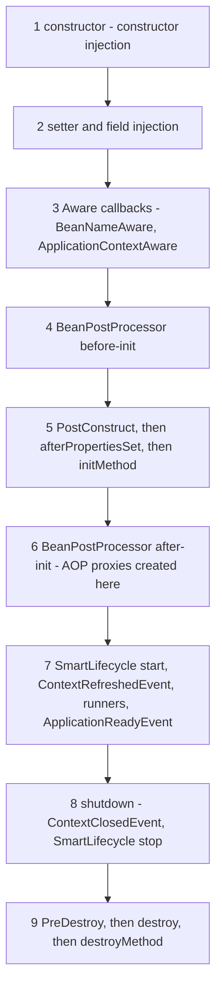
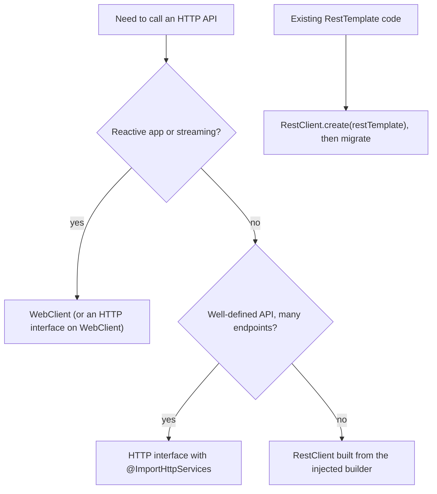

# Chapter 19 — Cheat Sheet and Glossary

This chapter is the book on one table: you come here to **look things up** — "which starter brings `@WebMvcTest` in Boot 4?", "what does `REQUIRES_NEW` do when the caller rolls back?", "which property turns on virtual threads?", "`hasRole("ADMIN")` or `hasRole("ROLE_ADMIN")`?". Nothing here is new material: every row links (**§**) to the teaching section, defaults and behaviours marked ✔ are proved by tests in [`code/cheatsheet-checks/`](code/cheatsheet-checks/) (§19.15), and every term is defined once — annotations in the sheets (§19.3, §19.9), everything else in the A–Z glossary ([§19.16](#1916-glossary-az)).

Versions: Spring Boot **4.1.1** → Spring Framework **7.0.9**, Spring Security **7.1.1**, Java **25** (17 minimum). "(Boot 4)", "(F7)" and "(S7)" mark things that are new or changed in Boot 4, Framework 7 or Security 7.

---

## 19.1 How to use this chapter

### How the sheets are organised

| You want to... | Go to |
|---|---|
| find the name, jar or purpose of an annotation | [§19.3](#193-annotations-cheat-sheet) |
| add a dependency | [§19.4](#194-starters-in-boot-41) |
| set or look up a property and its default | [§19.5](#195-key-properties-cheat-sheet) |
| pick a propagation / isolation / rollback rule | [§19.6](#196-transactions-transactional-at-a-glance) |
| remember the bean lifecycle order | [§19.7](#197-bean-scopes-and-the-lifecycle) |
| copy a security configuration | [§19.8](#198-spring-security-7-dsl-snippets) |
| choose a test annotation | [§19.9](#199-testing-annotations-and-slices) |
| find a Reactor operator | [§19.10](#1910-reactor-operators-quick-table) |
| know what an Actuator endpoint shows | [§19.11](#1911-actuator-endpoints) |
| choose between two technologies | [§19.12](#1912-which-tool-for-which-job) |
| upgrade a Boot 3 app | [§19.13](#1913-boot-3--4-quick-migration-checklist) |
| revise for an interview | [§19.14](#1914-interview-index) |
| look up a word | [§19.16](#1916-glossary-az) |

### Conventions

- **Module / starter**: the jar that contains the class, and the Boot starter that brings it. "core" means `spring-context`/`spring-beans`, which every starter includes.
- **§N.M** links go to the teaching section of Chapters 1–18. Follow them for the explanation, the trade-offs and the proof.
- Defaults quoted in these sheets come from the Boot 4.1.1 configuration metadata (the `spring-configuration-metadata.json` files inside the Boot jars) or from the chapter that measured them. The ones marked **✔ proved** are asserted by a test in §19.15.
- Properties are written in `.properties` form. The same keys work in YAML and as environment variables (named values set outside the app by the shell, OS or container) ([§3.4](../03-configuration-and-auto-configuration/README.md#34-environment-variables-and-relaxed-binding)).

---

## 19.2 Versions at a glance

What `spring-boot-starter-parent` **4.1.1** puts on your classpath (from the `spring-boot-dependencies-4.1.1` BOM). You choose one number, the Boot version, and Boot chooses the rest ([§1.4](../01-spring-ecosystem-and-first-app/README.md#14-history-and-versions)).

| Component | Version | Notes |
|---|---|---|
| Java | 17 minimum, 25 recommended | this book: Java 25 |
| Spring Framework | 7.0.9 | Jakarta EE 11 (Servlet 6.1, JPA 3.2, Bean Validation 3.1) |
| Spring Security | 7.1.1 | Authorization Server now inside Spring Security ([§11.14](../11-spring-security-2-tokens-and-oauth2/README.md#1114-spring-authorization-server)) |
| Spring Data | 2026.0.1 release train | JPA, JDBC, MongoDB, Redis, R2DBC, REST |
| Hibernate ORM / Validator | 7.4.5 / 9.1.3 | |
| Jackson | 3.1.5 (`tools.jackson.*`) | annotations still `com.fasterxml.jackson.annotation` ([§5.5](../05-spring-mvc-and-rest/README.md#55-json-with-jackson-3)) |
| Tomcat / Jetty | 11.0.24 / 12.1.12 | Undertow removed |
| HikariCP / H2 / PostgreSQL JDBC | 7.0.2 / 2.4.240 / 42.7.13 | |
| Reactor | 2025.0.7 train (Reactor Core 3.8) | |
| Micrometer / Micrometer Tracing / OpenTelemetry | 1.17.1 / 1.7.1 / 1.62.0 | |
| Spring for Apache Kafka / kafka-clients | 4.1.1 / 4.2.1 | |
| Spring AMQP | 4.1.1 | |
| Flyway / Liquibase | 12.4.0 / 5.0.3 | Liquibase 5 Community is FSL-licensed ([§9.4](../09-spring-data-beyond-jpa-and-caching/README.md#94-schema-migrations-flyway-beyond-the-basics-and-flyway-vs-liquibase)) |
| JUnit / Mockito / AssertJ / Awaitility | 6.0.3 / 5.23.0 / 3.27.7 / 4.3.0 | |
| Testcontainers | 2.0.5 | new artifact names `testcontainers-<module>` ([§12.14](../12-testing-spring-apps/README.md#1214-testcontainers-and-serviceconnection)) |
| Caffeine / Lettuce | 3.2.4 / 7.5.2 | |
| **Not managed by Boot** | | import their own BOM |
| Spring Cloud | 2025.1.x "Oakwood" (2025.1.2+ for Boot 4.1) | [§16.2](../16-spring-cloud-and-microservices/README.md#162-release-trains-and-versions) |
| Spring AI | 2.0.x (2.0.1) | [§17.1](../17-spring-ai-and-whats-new/README.md#171-what-spring-ai-is) |
| springdoc-openapi | 3.x (3.1.1) | [§5.12](../05-spring-mvc-and-rest/README.md#512-documenting-the-api-openapi-with-springdoc) |
| Resilience4j | `resilience4j-spring-boot4` 2.4.0 | [§16.8](../16-spring-cloud-and-microservices/README.md#168-resilience-circuit-breaker-retry-rate-limiter) |

---

## 19.3 Annotations cheat sheet

The annotations of this book, grouped by area. "Needs" names the switch without which the annotation silently does nothing — the most common reason an annotation "doesn't work".

### Core container and beans

| Annotation | Module / starter | Purpose | § |
|---|---|---|---|
| `@Component` | core | generic bean found by component scanning | [§2.3](../02-ioc-and-dependency-injection/README.md#23-defining-beans) |
| `@Service` | core | `@Component` for business logic (no extra behaviour) | [§2.3](../02-ioc-and-dependency-injection/README.md#23-defining-beans) |
| `@Repository` | core | `@Component` for data access + exception translation to `DataAccessException` | [§2.3](../02-ioc-and-dependency-injection/README.md#23-defining-beans), [§7.5](../07-data-access-jdbc-and-transactions/README.md#75-exception-translation-dataaccessexception) |
| `@Controller` / `@RestController` | spring-web / `-webmvc`, `-webflux` | web handler; `@RestController` = `@Controller` + `@ResponseBody` | [§5.3](../05-spring-mvc-and-rest/README.md#53-controllers-and-request-mappings) |
| `@Configuration` | core | class of `@Bean` methods; full mode = CGLIB subclass (`proxyBeanMethods = true`) | [§2.3](../02-ioc-and-dependency-injection/README.md#23-defining-beans) |
| `@Bean` | core | factory method registering its return value as a bean; name = method name | [§2.3](../02-ioc-and-dependency-injection/README.md#23-defining-beans) |
| `@ComponentScan` | core | scan a package tree for components (inside `@SpringBootApplication`) | [§1.8](../01-spring-ecosystem-and-first-app/README.md#18-the-main-class-and-springbootapplication) |
| `@Import` | core | pull in another configuration class, selector, registrar or `BeanRegistrar` | [§2.3](../02-ioc-and-dependency-injection/README.md#23-defining-beans) |
| `@Autowired` | core | inject here; optional on a single constructor | [§2.4](../02-ioc-and-dependency-injection/README.md#24-injection-types) |
| `@Qualifier` | core | pick a bean by name/qualifier at the injection point (beats `@Primary`) ✔ | [§2.5](../02-ioc-and-dependency-injection/README.md#25-how-spring-picks-a-bean) |
| `@Primary` | core | default bean when several match ✔ | [§2.5](../02-ioc-and-dependency-injection/README.md#25-how-spring-picks-a-bean) |
| `@Fallback` | core (Framework 6.2) | use this bean only if no other candidate qualifies | [§2.5](../02-ioc-and-dependency-injection/README.md#25-how-spring-picks-a-bean) |
| `@Order` | core | order in `List<T>` injection, aspects, filters, listeners (lower first) ✔ | [§2.5](../02-ioc-and-dependency-injection/README.md#25-how-spring-picks-a-bean) |
| `@Value` | core | inject one value: `${key:default}`, SpEL `#{...}` ✔ | [§3.5](../03-configuration-and-auto-configuration/README.md#35-value) |
| `@Scope` | core | `singleton` (default), `prototype`, web scopes; `proxyMode` for scoped proxies | [§2.6](../02-ioc-and-dependency-injection/README.md#26-bean-scopes) |
| `@RequestScope` / `@SessionScope` / `@ApplicationScope` | spring-web | web scopes with a CGLIB scoped proxy | [§2.6](../02-ioc-and-dependency-injection/README.md#26-bean-scopes) |
| `@Lookup` | spring-beans | method injection: returns a fresh prototype on each call | [§2.6](../02-ioc-and-dependency-injection/README.md#26-bean-scopes) |
| `@Lazy` | core | create on first use; on an injection point, inject a lazy proxy (breaks cycles) | [§2.10](../02-ioc-and-dependency-injection/README.md#210-lazy-initialization), [§2.9](../02-ioc-and-dependency-injection/README.md#29-circular-dependencies) |
| `@PostConstruct` / `@PreDestroy` | `jakarta.annotation` | init / destroy callbacks (not for prototypes' destroy) ✔ | [§2.7](../02-ioc-and-dependency-injection/README.md#27-the-bean-lifecycle) |
| `@Profile` | core | register only when a profile expression matches (`"!dev"`, `"prod & eu"`) | [§2.11](../02-ioc-and-dependency-injection/README.md#211-conditional-and-profiles) |
| `@Conditional` | core | register only if a `Condition` matches | [§2.11](../02-ioc-and-dependency-injection/README.md#211-conditional-and-profiles) |
| `@EventListener` | core | receive application events (synchronous by default) | [§2.12](../02-ioc-and-dependency-injection/README.md#212-application-events) |
| `@Proxyable` | core (F7) | choose JDK or CGLIB proxy for one bean | [§4.4](../04-aop-and-proxies/README.md#44-how-spring-aop-works-proxies) |
| `@NullMarked` / `@Nullable` | `org.jspecify.annotations` (F7) | null-safety contract; `@Nullable` injection point = optional | [§2.13](../02-ioc-and-dependency-injection/README.md#213-null-safety-with-jspecify-framework-7) |
| `@Inject` | `jakarta.inject` (optional jar) | standard alternative to `@Autowired`; `javax.inject` removed in F7 | [§2.4](../02-ioc-and-dependency-injection/README.md#24-injection-types) |

### Spring Boot and configuration

| Annotation | Module / starter | Purpose | § |
|---|---|---|---|
| `@SpringBootApplication` | spring-boot-autoconfigure / `spring-boot-starter` | `@SpringBootConfiguration` + `@EnableAutoConfiguration` + `@ComponentScan` | [§1.8](../01-spring-ecosystem-and-first-app/README.md#18-the-main-class-and-springbootapplication) |
| `@EnableAutoConfiguration` | spring-boot-autoconfigure | load `AutoConfiguration.imports` candidates and apply them after your beans | [§3.10](../03-configuration-and-auto-configuration/README.md#310-how-auto-configuration-works) |
| `@AutoConfiguration` | spring-boot-autoconfigure | marks an auto-configuration class (`before`/`after` ordering) | [§3.13](../03-configuration-and-auto-configuration/README.md#313-writing-your-own-auto-configuration-and-starter) |
| `@ConfigurationProperties("prefix")` | spring-boot | bind a group of properties to a typed object (record ideal) | [§3.6](../03-configuration-and-auto-configuration/README.md#36-configurationproperties--type-safe-configuration) |
| `@ConfigurationPropertiesScan` / `@EnableConfigurationProperties` | spring-boot | register `@ConfigurationProperties` classes | [§3.6](../03-configuration-and-auto-configuration/README.md#36-configurationproperties--type-safe-configuration) |
| `@DefaultValue` | spring-boot | default for a constructor-bound property ✔ | [§3.6](../03-configuration-and-auto-configuration/README.md#36-configurationproperties--type-safe-configuration) |
| `@ConstructorBinding` | spring-boot | pick the binding constructor when there are several | [§3.6](../03-configuration-and-auto-configuration/README.md#36-configurationproperties--type-safe-configuration) |
| `@DurationUnit` / `@DataSizeUnit` | spring-boot | unit for plain numbers (default ms / bytes) ✔ | [§3.6](../03-configuration-and-auto-configuration/README.md#36-configurationproperties--type-safe-configuration) |
| `@Validated` (on properties) | core + `spring-boot-starter-validation` | validate bound properties at startup | [§3.6](../03-configuration-and-auto-configuration/README.md#36-configurationproperties--type-safe-configuration) |
| `@ConditionalOnClass` / `OnMissingClass` | spring-boot-autoconfigure | class present / absent on the classpath | [§3.10](../03-configuration-and-auto-configuration/README.md#310-how-auto-configuration-works) |
| `@ConditionalOnBean` / `OnMissingBean` | spring-boot-autoconfigure | bean present / absent (reliable in auto-configurations only) | [§3.10](../03-configuration-and-auto-configuration/README.md#310-how-auto-configuration-works) |
| `@ConditionalOnProperty` / `OnBooleanProperty` | spring-boot-autoconfigure | property value / boolean switch (`OnBooleanProperty` since Boot 3.5) | [§3.10](../03-configuration-and-auto-configuration/README.md#310-how-auto-configuration-works) |
| `@ConditionalOnWebApplication` / `OnThreading` / `OnCloudPlatform` / ... | spring-boot-autoconfigure | web type, virtual vs platform threads, platform | [§3.10](../03-configuration-and-auto-configuration/README.md#310-how-auto-configuration-works) |
| `@PropertySource` | core | add a `.properties` file (low precedence, no YAML) | [§3.9](../03-configuration-and-auto-configuration/README.md#39-placeholders-random-values-and-other-sources) |
| `@EntityScan` | spring-boot-persistence (Boot 4 package) | where to find JPA entities outside the main package | [§17.13](../17-spring-ai-and-whats-new/README.md#1713-spring-boot-3x--4x-migration-table) |

### AOP and resilience

| Annotation | Module / starter | Purpose | § |
|---|---|---|---|
| `@Aspect` (+ `@Component`) | aspectjweaver / `spring-boot-starter-aspectj` (Boot 4) | a class of pointcuts and advice; must also be a bean | [§4.2](../04-aop-and-proxies/README.md#42-writing-aspects-with-aspect) |
| `@Pointcut` | aspectjweaver | named, reusable pointcut expression | [§4.3](../04-aop-and-proxies/README.md#43-pointcut-expressions) |
| `@Before` / `@AfterReturning` / `@AfterThrowing` / `@After` / `@Around` | aspectjweaver | the five advice types; only `@Around` controls `proceed()` | [§4.2](../04-aop-and-proxies/README.md#42-writing-aspects-with-aspect) |
| `@EnableAspectJAutoProxy` | core | switch on `@Aspect` support (Boot does it: `spring.aop.auto=true`) | [§4.2](../04-aop-and-proxies/README.md#42-writing-aspects-with-aspect) |
| `@Retryable` | core `org.springframework.resilience` (F7) | retry on exception; `maxRetries` 3, `delay` 1000 ms, `multiplier` 1.0 ✔ — **needs `@EnableResilientMethods`** | [§4.7](../04-aop-and-proxies/README.md#47-framework-7-core-resilience-retryable-and-concurrencylimit) |
| `@ConcurrencyLimit` | core (F7) | bulkhead: max concurrent calls, policy `BLOCK` or `REJECT` — needs `@EnableResilientMethods` | [§4.7](../04-aop-and-proxies/README.md#47-framework-7-core-resilience-retryable-and-concurrencylimit) |
| `@EnableResilientMethods` | core (F7) | turns on `@Retryable` and `@ConcurrencyLimit` (no auto-configuration) | [§4.7](../04-aop-and-proxies/README.md#47-framework-7-core-resilience-retryable-and-concurrencylimit) |
| `@CircuitBreaker` / `@Retry` / `@RateLimiter` / `@Bulkhead` / `@TimeLimiter` | `resilience4j-spring-boot4` | Resilience4j patterns with `fallbackMethod` | [§16.8](../16-spring-cloud-and-microservices/README.md#168-resilience-circuit-breaker-retry-rate-limiter) |

### Web: Spring MVC, WebFlux, REST

| Annotation | Module / starter | Purpose | § |
|---|---|---|---|
| `@RequestMapping` | spring-web | class-level prefix / shared mapping attributes | [§5.3](../05-spring-mvc-and-rest/README.md#53-controllers-and-request-mappings) |
| `@GetMapping` / `@PostMapping` / `@PutMapping` / `@PatchMapping` / `@DeleteMapping` | spring-web | map an HTTP method + path; `version = "1.1+"` (F7) | [§5.3](../05-spring-mvc-and-rest/README.md#53-controllers-and-request-mappings), [§5.9](../05-spring-mvc-and-rest/README.md#59-api-versioning-framework-7) |
| `@PathVariable` | spring-web | URL segment `{id}` | [§5.4](../05-spring-mvc-and-rest/README.md#54-reading-input-and-writing-output) |
| `@RequestParam` | spring-web | query parameter / form field (`required = true` by default) | [§5.4](../05-spring-mvc-and-rest/README.md#54-reading-input-and-writing-output) |
| `@RequestHeader` / `@CookieValue` | spring-web | header / cookie value | [§5.4](../05-spring-mvc-and-rest/README.md#54-reading-input-and-writing-output) |
| `@RequestBody` | spring-web | body converted by an `HttpMessageConverter` (Jackson 3) | [§5.4](../05-spring-mvc-and-rest/README.md#54-reading-input-and-writing-output) |
| `@RequestPart` | spring-web | part of a `multipart/form-data` request (`MultipartFile`) | [§5.10](../05-spring-mvc-and-rest/README.md#510-cors-and-file-upload) |
| `@ModelAttribute` | spring-web | bind query params/form fields to an object | [§5.4](../05-spring-mvc-and-rest/README.md#54-reading-input-and-writing-output) |
| `@ResponseStatus` | spring-web | fixed status for a handler or an exception class | [§5.4](../05-spring-mvc-and-rest/README.md#54-reading-input-and-writing-output), [§5.7](../05-spring-mvc-and-rest/README.md#57-error-handling-and-problem-details-rfc-9457) |
| `@ResponseBody` | spring-web | write the return value as the body | [§5.3](../05-spring-mvc-and-rest/README.md#53-controllers-and-request-mappings) |
| `@ExceptionHandler` | spring-web | handle an exception type (in a controller or an advice) | [§5.7](../05-spring-mvc-and-rest/README.md#57-error-handling-and-problem-details-rfc-9457) |
| `@ControllerAdvice` / `@RestControllerAdvice` | spring-web | global exception handling (return `ProblemDetail`) | [§5.7](../05-spring-mvc-and-rest/README.md#57-error-handling-and-problem-details-rfc-9457) |
| `@Valid` | `jakarta.validation` + `-validation` starter | cascade validation into a body / nested object | [§5.6](../05-spring-mvc-and-rest/README.md#56-validation) |
| `@Validated` | core | validation **groups**; on a class: method validation via proxy | [§5.6](../05-spring-mvc-and-rest/README.md#56-validation) |
| `@CrossOrigin` | spring-web | per-controller CORS rules | [§5.10](../05-spring-mvc-and-rest/README.md#510-cors-and-file-upload) |
| `@JsonProperty` / `@JsonIgnore` | `com.fasterxml.jackson.annotation` | JSON names / hidden fields (package unchanged in Jackson 3) | [§5.5](../05-spring-mvc-and-rest/README.md#55-json-with-jackson-3) |
| `@JacksonComponent` / `@JacksonMixin` | spring-boot-jackson (Boot 4) | register (de)serializers / mix-ins (were `@JsonComponent` / `@JsonMixin`) | [§5.5](../05-spring-mvc-and-rest/README.md#55-json-with-jackson-3) |
| `@EnableWebMvc` | spring-webmvc | full manual MVC control — **switches Boot's MVC auto-configuration off** | [§3.12](../03-configuration-and-auto-configuration/README.md#312-overriding-and-excluding-auto-configuration) |

### HTTP clients

| Annotation | Module / starter | Purpose | § |
|---|---|---|---|
| `@HttpExchange` | spring-web | HTTP service interface: shared URL prefix, headers, version | [§6.6](../06-rest-clients-and-http-interfaces/README.md#66-http-service-interfaces-httpexchange) |
| `@GetExchange` / `@PostExchange` / `@PutExchange` / `@PatchExchange` / `@DeleteExchange` | spring-web | one HTTP call per interface method | [§6.6](../06-rest-clients-and-http-interfaces/README.md#66-http-service-interfaces-httpexchange) |
| `@ImportHttpServices(group, types)` | spring-web (F7) + `spring-boot-starter-restclient` | register HTTP interface proxies per group, configured by `spring.http.serviceclient.<group>.*` | [§6.6](../06-rest-clients-and-http-interfaces/README.md#66-http-service-interfaces-httpexchange) |
| `@ClientRegistrationId` | spring-security-oauth2-client | which OAuth2 registration's token to add (type-level since S7) | [§11.10](../11-spring-security-2-tokens-and-oauth2/README.md#1110-calling-other-services-client-credentials-and-token-relay) |
| `@LoadBalanced` | spring-cloud-commons | resolve `http://service-id` through Spring Cloud LoadBalancer | [§16.5](../16-spring-cloud-and-microservices/README.md#165-client-side-load-balancing-with-spring-cloud-loadbalancer) |
| `@FeignClient` / `@EnableFeignClients` | spring-cloud-openfeign (maintenance mode) | declarative client, Feign style | [§16.6](../16-spring-cloud-and-microservices/README.md#166-declarative-clients-openfeign-vs-http-interface-clients) |

### Data access, transactions, JPA and Spring Data

| Annotation | Module / starter | Purpose | § |
|---|---|---|---|
| `@Transactional` | spring-tx | declarative transaction (see §19.6) ✔ | [§7.8](../07-data-access-jdbc-and-transactions/README.md#78-transactional-attributes) |
| `@EnableTransactionManagement` | spring-tx | switch on `@Transactional` (Boot does it); `rollbackOn = ALL_EXCEPTIONS` (F6.2) | [§7.10](../07-data-access-jdbc-and-transactions/README.md#710-rollback-rules) |
| `@TransactionalEventListener` | spring-tx | run a listener at `AFTER_COMMIT` (default), `BEFORE_COMMIT`, `AFTER_ROLLBACK`, `AFTER_COMPLETION` | [§7.15](../07-data-access-jdbc-and-transactions/README.md#715-transactionaleventlistener) |
| `@Entity` / `@Table` / `@Column` | `jakarta.persistence` / `-data-jpa` | map a class / table / column | [§8.3](../08-spring-data-jpa-and-hibernate/README.md#83-entities-and-ids) |
| `@Id` / `@GeneratedValue` | `jakarta.persistence` | primary key and strategy (`IDENTITY`, `SEQUENCE`, `UUID`, `AUTO`) | [§8.3](../08-spring-data-jpa-and-hibernate/README.md#83-entities-and-ids) |
| `@ManyToOne` / `@OneToMany` / `@OneToOne` / `@ManyToMany` | `jakarta.persistence` | relationships; to-one EAGER, to-many LAZY by default | [§8.5](../08-spring-data-jpa-and-hibernate/README.md#85-relationships) |
| `@JoinColumn` / `mappedBy` | `jakarta.persistence` | owning side (FK) / inverse side | [§8.5](../08-spring-data-jpa-and-hibernate/README.md#85-relationships) |
| `@Enumerated(EnumType.STRING)` / `@Embedded` / `@Embeddable` / `@Transient` | `jakarta.persistence` | enum as text / value object / not stored | [§8.3](../08-spring-data-jpa-and-hibernate/README.md#83-entities-and-ids) |
| `@Version` | `jakarta.persistence` (JPA) or `org.springframework.data.annotation` (Data JDBC, Mongo) | optimistic locking column | [§8.14](../08-spring-data-jpa-and-hibernate/README.md#814-locking-optimistic-and-pessimistic), [§9.2](../09-spring-data-beyond-jpa-and-caching/README.md#92-spring-data-jdbc-and-aggregates) |
| `@Query` | spring-data-jpa / -jdbc / ... | JPQL (JPA), SQL (JDBC), `nativeQuery = true` | [§8.10](../08-spring-data-jpa-and-hibernate/README.md#810-query-jpql-native-sql-and-modifying) |
| `@Modifying` | spring-data-jpa / -jdbc | UPDATE/DELETE query; `clearAutomatically` | [§8.10](../08-spring-data-jpa-and-hibernate/README.md#810-query-jpql-native-sql-and-modifying) |
| `@Param` | spring-data-commons | name a query parameter (optional with `-parameters`) | [§8.10](../08-spring-data-jpa-and-hibernate/README.md#810-query-jpql-native-sql-and-modifying) |
| `@EntityGraph(attributePaths = ...)` | spring-data-jpa | fetch associations in the same query (left join) | [§8.7](../08-spring-data-jpa-and-hibernate/README.md#87-the-n1-problem) |
| `@Lock(LockModeType.PESSIMISTIC_WRITE)` | spring-data-jpa | `SELECT ... FOR UPDATE` | [§8.14](../08-spring-data-jpa-and-hibernate/README.md#814-locking-optimistic-and-pessimistic) |
| `@BatchSize` | Hibernate | batch-load lazy collections (N+1 fix) | [§8.7](../08-spring-data-jpa-and-hibernate/README.md#87-the-n1-problem) |
| `@DynamicUpdate` | Hibernate | UPDATE only changed columns | [§8.4](../08-spring-data-jpa-and-hibernate/README.md#84-the-persistence-context-and-dirty-checking) |
| `@EnableJpaAuditing` / `@EnableJdbcAuditing` | spring-data-jpa / -jdbc | switch on auditing | [§8.13](../08-spring-data-jpa-and-hibernate/README.md#813-auditing), [§9.2](../09-spring-data-beyond-jpa-and-caching/README.md#92-spring-data-jdbc-and-aggregates) |
| `@CreatedDate` / `@LastModifiedDate` / `@CreatedBy` / `@LastModifiedBy` | spring-data-commons | audit columns | [§8.13](../08-spring-data-jpa-and-hibernate/README.md#813-auditing) |
| `@MappedCollection(idColumn, keyColumn)` | spring-data-relational | child collection of a Data JDBC aggregate | [§9.2](../09-spring-data-beyond-jpa-and-caching/README.md#92-spring-data-jdbc-and-aggregates) |
| `@RepositoryRestResource` | spring-data-rest | export (or hide) a repository as HAL endpoints | [§9.3](../09-spring-data-beyond-jpa-and-caching/README.md#93-spring-data-rest) |
| `@Document` / `@Indexed` | spring-data-mongodb | MongoDB document / index | [§9.5](../09-spring-data-beyond-jpa-and-caching/README.md#95-spring-data-mongodb-not-run--needs-docker) |
| `@RedisHash(timeToLive = ...)` | spring-data-redis | Redis repository entity with TTL | [§9.6](../09-spring-data-beyond-jpa-and-caching/README.md#96-spring-data-redis-not-run--needs-docker) |

### Caching

| Annotation | Module / starter | Purpose | § |
|---|---|---|---|
| `@EnableCaching` | core / `spring-boot-starter-cache` | switch on the cache proxy — without it nothing is cached | [§9.8](../09-spring-data-beyond-jpa-and-caching/README.md#98-the-caching-abstraction) |
| `@Cacheable` | core | return the cached value; run the method only on a miss (`sync`, `condition`, `unless`) | [§9.8](../09-spring-data-beyond-jpa-and-caching/README.md#98-the-caching-abstraction) |
| `@CachePut` | core | always run, then store the result | [§9.8](../09-spring-data-beyond-jpa-and-caching/README.md#98-the-caching-abstraction) |
| `@CacheEvict` | core | remove a key (`allEntries = true` to clear) | [§9.8](../09-spring-data-beyond-jpa-and-caching/README.md#98-the-caching-abstraction) |
| `@Caching` / `@CacheConfig` | core | several cache ops on one method / class defaults | [§9.8](../09-spring-data-beyond-jpa-and-caching/README.md#98-the-caching-abstraction) |

### Security

| Annotation | Module / starter | Purpose | § |
|---|---|---|---|
| `@EnableWebSecurity` | spring-security-config | web security (Boot applies it for you) | [§10.3](../10-spring-security-1-fundamentals/README.md#103-configuring-a-chain-the-lambda-dsl-in-spring-security-7) |
| `@EnableMethodSecurity` | spring-security-config | switch on method security annotations | [§10.7](../10-spring-security-1-fundamentals/README.md#107-method-security) |
| `@PreAuthorize` / `@PostAuthorize` | spring-security-core | SpEL rule before / after the call (`returnObject`) | [§10.7](../10-spring-security-1-fundamentals/README.md#107-method-security) |
| `@PreFilter` / `@PostFilter` | spring-security-core | filter a collection argument / result | [§10.7](../10-spring-security-1-fundamentals/README.md#107-method-security) |
| `@Secured` / `@RolesAllowed` | spring-security-core / `jakarta.annotation.security` | legacy role checks (`securedEnabled`, `jsr250Enabled`) | [§10.7](../10-spring-security-1-fundamentals/README.md#107-method-security) |
| `@AuthenticationPrincipal` | spring-security-core | inject the principal (`UserDetails`, `Jwt`, `OidcUser`) | [§10.4](../10-spring-security-1-fundamentals/README.md#104-authentication-users-providers-form-login-and-basic) |
| `@EnableMultiFactorAuthentication` | spring-security-config (S7) | require several `FACTOR_*` authorities | [§10.4](../10-spring-security-1-fundamentals/README.md#104-authentication-users-providers-form-login-and-basic) |

### Messaging, async and scheduling

| Annotation | Module / starter | Purpose | § |
|---|---|---|---|
| `@EnableAsync` | core | switch on `@Async` (Boot configures the executor but does **not** enable it) | [§14.4](../14-messaging-async-and-scheduling/README.md#144-async-and-executors) |
| `@Async("executor")` | core | run on an executor; return `void` or `CompletableFuture` | [§14.4](../14-messaging-async-and-scheduling/README.md#144-async-and-executors) |
| `@EnableScheduling` | core | switch on `@Scheduled` | [§14.7](../14-messaging-async-and-scheduling/README.md#147-scheduling-with-scheduled) |
| `@Scheduled(fixedRate / fixedDelay / cron)` | core | timer jobs; cron has **six** fields ✔ | [§14.7](../14-messaging-async-and-scheduling/README.md#147-scheduling-with-scheduled) |
| `@KafkaListener(topics, groupId, concurrency)` | spring-kafka / `spring-boot-starter-kafka` | Kafka consumer method | [§14.12](../14-messaging-async-and-scheduling/README.md#1412-consuming-kafkalistener-concurrency-and-consumer-groups) |
| `@RetryableTopic` / `@DltHandler` | spring-kafka | non-blocking retries via retry topics; dead-letter handler | [§14.15](../14-messaging-async-and-scheduling/README.md#1415-non-blocking-retries-with-retryabletopic) |
| `@RabbitListener` | spring-rabbit / `spring-boot-starter-amqp` | RabbitMQ consumer method | [§14.18](../14-messaging-async-and-scheduling/README.md#1418-rabbitmq-with-spring-amqp-configuration-not-run) |
| `@JmsListener` | spring-jms | JMS consumer method | [§14.18](../14-messaging-async-and-scheduling/README.md#1418-rabbitmq-with-spring-amqp-configuration-not-run) |
| `@SchedulerLock` | ShedLock (third party) | run a `@Scheduled` job on one instance only | [§14.7](../14-messaging-async-and-scheduling/README.md#147-scheduling-with-scheduled) |

### Observability, cloud and AI

| Annotation | Module / starter | Purpose | § |
|---|---|---|---|
| `@Observed` | micrometer-observation (+ AspectJ starter) | timer + span around a method; needs `management.observations.annotations.enabled=true` | [§15.6](../15-observability-and-production/README.md#156-the-observation-api-and-observed) |
| `@Timed` / `@Counted` / `@NewSpan` | Micrometer | metric / span annotations (same switch as `@Observed`) | [§15.6](../15-observability-and-production/README.md#156-the-observation-api-and-observed) |
| `@EnableConfigServer` | spring-cloud-config-server | make the app a Config Server | [§16.3](../16-spring-cloud-and-microservices/README.md#163-centralized-configuration-spring-cloud-config) |
| `@RefreshScope` | spring-cloud-context | re-create the bean after a config refresh | [§16.3](../16-spring-cloud-and-microservices/README.md#163-centralized-configuration-spring-cloud-config) |
| `@EnableEurekaServer` | spring-cloud-netflix-eureka-server | run a Eureka registry | [§16.4](../16-spring-cloud-and-microservices/README.md#164-service-discovery-eureka-consul-kubernetes) |
| `@Tool` / `@ToolParam` | spring-ai-model (Spring AI 2.0) | expose a method to the model for tool calling | [§17.8](../17-spring-ai-and-whats-new/README.md#178-tool-calling) |
| `@McpTool` / `@McpToolParam` | Spring AI 2.0 MCP (`org.springframework.ai.mcp.annotation`) | expose a tool from an MCP server | [§17.10](../17-spring-ai-and-whats-new/README.md#1710-mcp-the-model-context-protocol) |

Testing annotations have their own sheet: [§19.9](#199-testing-annotations-and-slices).

---

## 19.4 Starters in Boot 4.1

A **starter** is a code-free dependency that brings one capability's libraries plus the Boot module holding its auto-configuration ([§1.7](../01-spring-ecosystem-and-first-app/README.md#17-starters)). Boot 4 made them **modular**: one starter per technology, and a matching **`-test`** starter that brings the test slice for it and already includes `spring-boot-starter-test` ([§3.14](../03-configuration-and-auto-configuration/README.md#314-boot-4-modularization), [§12.3](../12-testing-spring-apps/README.md#123-test-dependencies-in-boot-4)). All names below are managed by the 4.1.1 BOM — never add a `<version>`.

### The starters you will use most

| Capability | Starter | Test starter (slice, test clients) | § |
|---|---|---|---|
| Core only (no web) | `spring-boot-starter` | `spring-boot-starter-test` | [§1.7](../01-spring-ecosystem-and-first-app/README.md#17-starters) |
| Servlet web / REST (Spring MVC + Tomcat + Jackson 3) | `spring-boot-starter-webmvc` | `spring-boot-starter-webmvc-test` (`@WebMvcTest`, MockMvc, `RestTestClient`) | [§5.2](../05-spring-mvc-and-rest/README.md#52-how-a-request-flows-the-dispatcherservlet) |
| Reactive web (WebFlux + Reactor Netty) | `spring-boot-starter-webflux` | `spring-boot-starter-webflux-test` (`@WebFluxTest`, `WebTestClient`) | [§13.10](../13-reactive-and-webflux/README.md#1310-spring-webflux-annotated-controllers) |
| Blocking HTTP client (`RestClient.Builder`, HTTP service groups) | `spring-boot-starter-restclient` | `spring-boot-starter-restclient-test` (`@RestClientTest`) | [§6.1](../06-rest-clients-and-http-interfaces/README.md#61-choosing-a-client) |
| Reactive HTTP client (`WebClient.Builder`) | `spring-boot-starter-webclient` | `spring-boot-starter-webclient-test` | [§13.13](../13-reactive-and-webflux/README.md#1313-webclient-calling-other-services-without-blocking) |
| JSON (Jackson 3) | `spring-boot-starter-jackson` | `spring-boot-starter-jackson-test` (`@JsonTest`) | [§5.5](../05-spring-mvc-and-rest/README.md#55-json-with-jackson-3) |
| Bean Validation (Hibernate Validator) | `spring-boot-starter-validation` | `spring-boot-starter-validation-test` | [§5.6](../05-spring-mvc-and-rest/README.md#56-validation) |
| AOP with `@Aspect` | `spring-boot-starter-aspectj` | `spring-boot-starter-aspectj-test` | [§4.2](../04-aop-and-proxies/README.md#42-writing-aspects-with-aspect) |
| JDBC (`DataSource`, HikariCP, `JdbcClient`) | `spring-boot-starter-jdbc` | `spring-boot-starter-jdbc-test` (`@JdbcTest`) | [§7.2](../07-data-access-jdbc-and-transactions/README.md#72-datasource-and-hikaricp) |
| JPA (Hibernate + Spring Data JPA) | `spring-boot-starter-data-jpa` | `spring-boot-starter-data-jpa-test` (`@DataJpaTest`) | [§8.2](../08-spring-data-jpa-and-hibernate/README.md#82-setting-up) |
| Spring Data JDBC | `spring-boot-starter-data-jdbc` | `spring-boot-starter-data-jdbc-test` (`@DataJdbcTest`) | [§9.2](../09-spring-data-beyond-jpa-and-caching/README.md#92-spring-data-jdbc-and-aggregates) |
| R2DBC | `spring-boot-starter-data-r2dbc` | `spring-boot-starter-data-r2dbc-test` (`@DataR2dbcTest`) | [§13.14](../13-reactive-and-webflux/README.md#1314-r2dbc-reactive-sql) |
| MongoDB / Redis | `spring-boot-starter-data-mongodb` / `-data-redis` | `...-data-mongodb-test` / `...-data-redis-test` | [§9.5](../09-spring-data-beyond-jpa-and-caching/README.md#95-spring-data-mongodb-not-run--needs-docker), [§9.6](../09-spring-data-beyond-jpa-and-caching/README.md#96-spring-data-redis-not-run--needs-docker) |
| Spring Data REST | `spring-boot-starter-data-rest` | `spring-boot-starter-data-rest-test` | [§9.3](../09-spring-data-beyond-jpa-and-caching/README.md#93-spring-data-rest) |
| Schema migrations | `spring-boot-starter-flyway` / `-liquibase` | `...-flyway-test` / `...-liquibase-test` | [§8.16](../08-spring-data-jpa-and-hibernate/README.md#816-schema-migrations-with-flyway), [§9.4](../09-spring-data-beyond-jpa-and-caching/README.md#94-schema-migrations-flyway-beyond-the-basics-and-flyway-vs-liquibase) |
| Cache abstraction | `spring-boot-starter-cache` (+ `caffeine`) | `spring-boot-starter-cache-test` | [§9.8](../09-spring-data-beyond-jpa-and-caching/README.md#98-the-caching-abstraction) |
| Security | `spring-boot-starter-security` | `spring-boot-starter-security-test` | [§10.1](../10-spring-security-1-fundamentals/README.md#101-vocabulary-and-what-the-starter-does-by-default) |
| OAuth2 resource server / client / authorization server | `spring-boot-starter-security-oauth2-resource-server` / `-client` / `-authorization-server` | `...-test` for each | [§11.3](../11-spring-security-2-tokens-and-oauth2/README.md#113-a-jwt-resource-server-in-spring), [§11.9](../11-spring-security-2-tokens-and-oauth2/README.md#119-oauth2-login-sign-in-with-), [§11.14](../11-spring-security-2-tokens-and-oauth2/README.md#1114-spring-authorization-server) |
| Kafka | `spring-boot-starter-kafka` (+ `-jackson` for JSON) | `spring-boot-starter-kafka-test` (`@EmbeddedKafka`) | [§14.10](../14-messaging-async-and-scheduling/README.md#1410-setting-up-spring-kafka-with-json) |
| RabbitMQ | `spring-boot-starter-amqp` | `spring-boot-starter-amqp-test` | [§14.18](../14-messaging-async-and-scheduling/README.md#1418-rabbitmq-with-spring-amqp-configuration-not-run) |
| Actuator | `spring-boot-starter-actuator` | `spring-boot-starter-actuator-test` | [§15.2](../15-observability-and-production/README.md#152-spring-boot-actuator) |
| Tracing + OTLP export | `spring-boot-starter-opentelemetry` (or `-zipkin` for Brave) | `spring-boot-starter-opentelemetry-test` (`@AutoConfigureTracing`) | [§15.7](../15-observability-and-production/README.md#157-distributed-tracing) |
| Metrics only | `spring-boot-starter-micrometer-metrics` (+ a registry, e.g. `micrometer-registry-prometheus`) | `...-micrometer-metrics-test` (`@AutoConfigureMetrics`) | [§15.5](../15-observability-and-production/README.md#155-metrics-with-micrometer) |
| HATEOAS | `spring-boot-starter-hateoas` | `...-hateoas-test` | [§5.12](../05-spring-mvc-and-rest/README.md#512-documenting-the-api-openapi-with-springdoc) |
| Testcontainers support | `spring-boot-testcontainers` (module, test scope) | — | [§12.14](../12-testing-spring-apps/README.md#1214-testcontainers-and-serviceconnection) |
| Also available | `-websocket`, `-graphql`, `-grpc-server`/`-grpc-client` (Boot 4.1), `-batch`, `-batch-jdbc`, `-integration`, `-quartz`, `-mail`, `-jms`, `-artemis`, `-pulsar`, `-thymeleaf`, `-session-data-redis`, `-session-jdbc`, `-jooq`, `-jetty` | most have a `-test` companion | [§1.3](../01-spring-ecosystem-and-first-app/README.md#13-the-spring-ecosystem) |

### Renamed, deprecated and removed starters

| Boot 3 name | Boot 4.1 status | Use instead | § |
|---|---|---|---|
| `spring-boot-starter-web` | **deprecated** alias (still in the BOM) | `spring-boot-starter-webmvc` | [§1.7](../01-spring-ecosystem-and-first-app/README.md#17-starters) |
| `spring-boot-starter-web-services` | **deprecated** alias | `spring-boot-starter-webservices` | [§17.13](../17-spring-ai-and-whats-new/README.md#1713-spring-boot-3x--4x-migration-table) |
| `spring-boot-starter-oauth2-resource-server` / `-oauth2-client` / `-oauth2-authorization-server` | **deprecated** aliases | `spring-boot-starter-security-oauth2-...` | [§11.3](../11-spring-security-2-tokens-and-oauth2/README.md#113-a-jwt-resource-server-in-spring) |
| `spring-boot-starter-aop` | **removed** | `spring-boot-starter-aspectj` | [§4.2](../04-aop-and-proxies/README.md#42-writing-aspects-with-aspect) |
| `spring-boot-starter-undertow` | **removed** (Undertow lacks Servlet 6.1) | Tomcat (default) or `spring-boot-starter-jetty` | [§17.13](../17-spring-ai-and-whats-new/README.md#1713-spring-boot-3x--4x-migration-table) |
| `spring-boot-starter-json` | still available | `spring-boot-starter-jackson` is the Boot 4 name | [§1.7](../01-spring-ecosystem-and-first-app/README.md#17-starters) |
| `flyway-core` / `liquibase-core` alone | no longer auto-configured | `spring-boot-starter-flyway` / `-liquibase` | [§8.16](../08-spring-data-jpa-and-hibernate/README.md#816-schema-migrations-with-flyway) |
| `spring-kafka` alone | still works as a library, but use the starter | `spring-boot-starter-kafka` | [§14.10](../14-messaging-async-and-scheduling/README.md#1410-setting-up-spring-kafka-with-json) |
| part of `-web` / `-webflux` in Boot 3 | split out | `spring-boot-starter-restclient`, `spring-boot-starter-webclient` | [§6.1](../06-rest-clients-and-http-interfaces/README.md#61-choosing-a-client), [§13.10](../13-reactive-and-webflux/README.md#1310-spring-webflux-annotated-controllers) |
| `spring-boot-starter-batch` (with JDBC metadata) | batch now runs without a database by default | `spring-boot-starter-batch-jdbc` | [§17.13](../17-spring-ai-and-whats-new/README.md#1713-spring-boot-3x--4x-migration-table) |
| (migration aid) | new | `spring-boot-starter-classic`, `spring-boot-starter-test-classic`: the old "everything" layout while you migrate | [§3.14](../03-configuration-and-auto-configuration/README.md#314-boot-4-modularization) |

Third-party starters are named `<name>-spring-boot-starter` (`mybatis-spring-boot-starter`); the `spring-boot-*` prefix is reserved ([§3.13](../03-configuration-and-auto-configuration/README.md#313-writing-your-own-auto-configuration-and-starter)).

---

## 19.5 Key properties cheat sheet

Defaults are the Boot 4.1.1 metadata values; "—" means *no default: the feature is off, or the value comes from somewhere else*. Precedence (which source wins) and relaxed binding (several spellings of one property name, e.g. `SHOP_NAME` for `shop.name`, are accepted) are at the end of this section.

### Core, profiles and startup

| Property | Default | What it does | § |
|---|---|---|---|
| `spring.application.name` | — | name in logs, traces, Config Server, metrics | [§1.9](../01-spring-ecosystem-and-first-app/README.md#19-running-the-application) |
| `spring.profiles.active` / `.default` / `.include` | — / `default` / — | activate profiles (not allowed inside profile-specific files) | [§3.7](../03-configuration-and-auto-configuration/README.md#37-profiles-profile-specific-files-and-profile-groups) |
| `spring.profiles.group.<name>` | — | one name activates several profiles | [§3.7](../03-configuration-and-auto-configuration/README.md#37-profiles-profile-specific-files-and-profile-groups) |
| `spring.config.import` | — | extra files, `optional:`, `configtree:`, `configserver:` | [§3.8](../03-configuration-and-auto-configuration/README.md#38-importing-configuration-springconfigimport) |
| `spring.config.activate.on-profile` | — | make a document of a multi-document file conditional | [§3.2](../03-configuration-and-auto-configuration/README.md#32-applicationproperties-vs-applicationyaml) |
| `spring.autoconfigure.exclude` | — | switch one auto-configuration off | [§3.12](../03-configuration-and-auto-configuration/README.md#312-overriding-and-excluding-auto-configuration) |
| `debug` | `false` | print the condition evaluation report | [§3.11](../03-configuration-and-auto-configuration/README.md#311-seeing-what-boot-decided) |
| `spring.main.lazy-initialization` | `false` | make every bean lazy | [§2.10](../02-ioc-and-dependency-injection/README.md#210-lazy-initialization) |
| `spring.main.allow-circular-references` | `false` | Boot rejects field/setter cycles (since 2.6) | [§2.9](../02-ioc-and-dependency-injection/README.md#29-circular-dependencies) |
| `spring.main.allow-bean-definition-overriding` | `false` | two beans with one name → `BeanDefinitionOverrideException` | [§2.3](../02-ioc-and-dependency-injection/README.md#23-defining-beans) |
| `spring.main.web-application-type` | detected | `servlet`, `reactive`, `none` (MVC wins if both starters present) | [§13.10](../13-reactive-and-webflux/README.md#1310-spring-webflux-annotated-controllers) |
| `spring.main.keep-alive` | `false` | keep the JVM alive when only virtual (daemon) threads run | [§14.5](../14-messaging-async-and-scheduling/README.md#145-async-on-virtual-threads) |
| `spring.aop.proxy-target-class` | `true` | Boot uses CGLIB proxies for everything | [§4.4](../04-aop-and-proxies/README.md#44-how-spring-aop-works-proxies) |
| `spring.aop.auto` | `true` | `@EnableAspectJAutoProxy` applied by Boot | [§4.2](../04-aop-and-proxies/README.md#42-writing-aspects-with-aspect) |
| `spring.lifecycle.timeout-per-shutdown-phase` | `30s` ✔ | how long graceful shutdown waits | [§15.9](../15-observability-and-production/README.md#159-graceful-shutdown) |
| `spring.devtools.restart.enabled` | `true` | DevTools restart (off for `java -jar` and tests) | [§1.10](../01-spring-ecosystem-and-first-app/README.md#110-devtools) |
| `spring.devtools.livereload.enabled` | `false` | LiveReload — off in Boot 4.0, deprecated in 4.1 | [§1.10](../01-spring-ecosystem-and-first-app/README.md#110-devtools) |

### Web server, MVC and JSON

| Property | Default | What it does | § |
|---|---|---|---|
| `server.port` | `8080` | HTTP port; `0` = random free port | [§1.9](../01-spring-ecosystem-and-first-app/README.md#19-running-the-application) |
| `server.shutdown` | `graceful` | `immediate` turns graceful shutdown off (default since Boot 3.4) | [§15.9](../15-observability-and-production/README.md#159-graceful-shutdown) |
| `server.servlet.context-path` | — | URL prefix of the whole app | [§5.2](../05-spring-mvc-and-rest/README.md#52-how-a-request-flows-the-dispatcherservlet) |
| `server.forward-headers-strategy` | — | `framework` honours `X-Forwarded-*` behind a proxy | [§5.4](../05-spring-mvc-and-rest/README.md#54-reading-input-and-writing-output) |
| `server.servlet.session.timeout` | `30m` | HTTP session timeout | [§10.10](../10-spring-security-1-fundamentals/README.md#1010-sessions-the-security-context-and-logout) |
| `server.servlet.session.cookie.secure` / `.http-only` / `.same-site` | — | harden the session cookie | [§10.10](../10-spring-security-1-fundamentals/README.md#1010-sessions-the-security-context-and-logout) |
| `spring.web.error.include-stacktrace` | `never` | stack traces in Boot's error body (Boot 4 name; `server.error.*` no longer bound) | [§15.12](../15-observability-and-production/README.md#1512-production-configuration-checklist) |
| `spring.mvc.problemdetails.enabled` | `false` | RFC 9457 bodies for MVC exceptions without your own advice | [§5.7](../05-spring-mvc-and-rest/README.md#57-error-handling-and-problem-details-rfc-9457) |
| `spring.webflux.problemdetails.enabled` | `false` | the same for WebFlux | [§13.10](../13-reactive-and-webflux/README.md#1310-spring-webflux-annotated-controllers) |
| `spring.mvc.contentnegotiation.favor-parameter` | `false` | allow `?format=csv` | [§5.8](../05-spring-mvc-and-rest/README.md#58-content-negotiation) |
| `spring.servlet.multipart.max-file-size` / `max-request-size` | `1MB` / `10MB` | upload limits (413 when exceeded) | [§5.10](../05-spring-mvc-and-rest/README.md#510-cors-and-file-upload) |
| `spring.jackson.default-property-inclusion` | — | e.g. `non_null` | [§5.5](../05-spring-mvc-and-rest/README.md#55-json-with-jackson-3) |
| `spring.jackson.serialization.*` / `deserialization.*` | — | Jackson feature switches (`indent-output`...) | [§5.5](../05-spring-mvc-and-rest/README.md#55-json-with-jackson-3) |
| `spring.jackson.json.read.*` / `spring.jackson.json.write.*` | — | JSON parser/generator features (Boot 4; were `spring.jackson.parser/generator.*`) | [§5.5](../05-spring-mvc-and-rest/README.md#55-json-with-jackson-3) |
| `spring.jackson.use-jackson2-defaults` | `false` | restore Jackson 2 defaults while migrating | [§17.13](../17-spring-ai-and-whats-new/README.md#1713-spring-boot-3x--4x-migration-table) |
| `spring.threads.virtual.enabled` | `false` | virtual threads for Tomcat, `@Async`, `@Scheduled`, listeners (Java 21+) ✔ | [§15.10](../15-observability-and-production/README.md#1510-virtual-threads) |

Jackson 3 defaults under Boot 4 (✔ proved): `LocalDate` written as `"2026-09-28"`, unknown JSON properties ignored, `JacksonException` is unchecked ([§5.5](../05-spring-mvc-and-rest/README.md#55-json-with-jackson-3)).

### API versioning (F7 / Boot 4)

| Property | Meaning | § |
|---|---|---|
| `spring.mvc.apiversion.use.header` | read the version from this header (e.g. `X-API-Version`) | [§5.9](../05-spring-mvc-and-rest/README.md#59-api-versioning-framework-7) |
| `spring.mvc.apiversion.use.query-parameter` / `.use.path-segment` / `.use.media-type-parameter` | other places to read it | [§5.9](../05-spring-mvc-and-rest/README.md#59-api-versioning-framework-7) |
| `spring.mvc.apiversion.default` | version assumed when the request has none | [§5.9](../05-spring-mvc-and-rest/README.md#59-api-versioning-framework-7) |
| `spring.mvc.apiversion.required` | reject requests without a version (400) | [§5.9](../05-spring-mvc-and-rest/README.md#59-api-versioning-framework-7) |
| `spring.mvc.apiversion.supported` / `.detect-supported` | extra supported versions / detect them from mappings | [§5.9](../05-spring-mvc-and-rest/README.md#59-api-versioning-framework-7) |
| `spring.webflux.apiversion.*` | the same for WebFlux | [§17.13](../17-spring-ai-and-whats-new/README.md#1713-spring-boot-3x--4x-migration-table) |
| `spring.http.serviceclient.<group>.apiversion.insert.header` | client side: send the version in this header | [§6.7](../06-rest-clients-and-http-interfaces/README.md#67-client-side-api-versioning-and-retries) |

### HTTP clients

| Property | Default | What it does | § |
|---|---|---|---|
| `spring.http.clients.connect-timeout` / `read-timeout` | — (library default) | global timeouts for auto-configured clients (Boot 4 name; `spring.http.client.*` deprecated) | [§6.4](../06-rest-clients-and-http-interfaces/README.md#64-timeouts-and-the-underlying-http-library) |
| `spring.http.clients.imperative.factory` | detected | `http-components`, `jetty`, `reactor`, `jdk`, `simple` | [§6.4](../06-rest-clients-and-http-interfaces/README.md#64-timeouts-and-the-underlying-http-library) |
| `spring.http.clients.reactive.connector` | detected | the same for `WebClient` | [§6.4](../06-rest-clients-and-http-interfaces/README.md#64-timeouts-and-the-underlying-http-library) |
| `spring.http.clients.redirects` | — | `follow`, `dont-follow`, `follow-when-possible` | [§6.4](../06-rest-clients-and-http-interfaces/README.md#64-timeouts-and-the-underlying-http-library) |
| `spring.http.serviceclient.<group>.base-url` | — | base URL of an `@ImportHttpServices` group (none + Spring Cloud = load-balanced) | [§6.6](../06-rest-clients-and-http-interfaces/README.md#66-http-service-interfaces-httpexchange), [§16.6](../16-spring-cloud-and-microservices/README.md#166-declarative-clients-openfeign-vs-http-interface-clients) |
| `spring.http.serviceclient.<group>.read-timeout` / `.default-header.<name>` | — | per-group timeout / header | [§6.6](../06-rest-clients-and-http-interfaces/README.md#66-http-service-interfaces-httpexchange) |

### DataSource, JDBC, transactions

| Property | Default | What it does | § |
|---|---|---|---|
| `spring.datasource.url` / `.username` / `.password` | — | connection; no URL + embedded DB on the classpath → in-memory DB ✔ | [§7.2](../07-data-access-jdbc-and-transactions/README.md#72-datasource-and-hikaricp) |
| `spring.datasource.generate-unique-name` | `true` | random in-memory DB name per context ✔ | [§7.2](../07-data-access-jdbc-and-transactions/README.md#72-datasource-and-hikaricp) |
| `spring.datasource.hikari.maximum-pool-size` | `10` (HikariCP) ✔ | most connections | [§7.2](../07-data-access-jdbc-and-transactions/README.md#72-datasource-and-hikaricp) |
| `spring.datasource.hikari.minimum-idle` | = max | leave unset: fixed-size pool | [§7.2](../07-data-access-jdbc-and-transactions/README.md#72-datasource-and-hikaricp) |
| `spring.datasource.hikari.connection-timeout` | `30000` ms ✔ | wait for a free connection, then fail | [§7.2](../07-data-access-jdbc-and-transactions/README.md#72-datasource-and-hikaricp) |
| `spring.datasource.hikari.max-lifetime` / `idle-timeout` / `keepalive-time` | 30 min / 10 min / 2 min | connection recycling | [§7.2](../07-data-access-jdbc-and-transactions/README.md#72-datasource-and-hikaricp) |
| `spring.datasource.hikari.leak-detection-threshold` | `0` (off) | log connections held too long | [§7.2](../07-data-access-jdbc-and-transactions/README.md#72-datasource-and-hikaricp) |
| `spring.datasource.connection-fetch` | `eager` | `lazy` = no physical connection until the first statement (Boot 4.1) | [§7.2](../07-data-access-jdbc-and-transactions/README.md#72-datasource-and-hikaricp) |
| `spring.sql.init.mode` | `embedded` | run `schema.sql`/`data.sql`: `embedded`, `always`, `never` | [§7.4](../07-data-access-jdbc-and-transactions/README.md#74-schema-and-data-initialization) |
| `spring.transaction.default-timeout` | — | default transaction timeout | [§7.12](../07-data-access-jdbc-and-transactions/README.md#712-readonly-and-timeout) |
| `spring.persistence.exceptiontranslation.enabled` | `true` | `@Repository` exception translation (was `spring.dao.*`) | [§7.5](../07-data-access-jdbc-and-transactions/README.md#75-exception-translation-dataaccessexception) |

### JPA, Hibernate, migrations

| Property | Default | What it does | § |
|---|---|---|---|
| `spring.jpa.hibernate.ddl-auto` | `create-drop` for an embedded DB without a migration tool, else `none` | `validate` in production | [§8.2](../08-spring-data-jpa-and-hibernate/README.md#82-setting-up) |
| `spring.jpa.open-in-view` | `true` (+ startup warning) | set `false` for APIs | [§8.15](../08-spring-data-jpa-and-hibernate/README.md#815-open-session-in-view) |
| `spring.jpa.show-sql` | `false` | print SQL (`logging.level.org.hibernate.SQL=DEBUG` is better) | [§8.2](../08-spring-data-jpa-and-hibernate/README.md#82-setting-up) |
| `spring.jpa.defer-datasource-initialization` | `false` | run `data.sql` after Hibernate created the tables | [§7.4](../07-data-access-jdbc-and-transactions/README.md#74-schema-and-data-initialization) |
| `spring.jpa.properties.hibernate.default_batch_fetch_size` | — | N+1 safety net (e.g. `16`) | [§8.7](../08-spring-data-jpa-and-hibernate/README.md#87-the-n1-problem) |
| `spring.jpa.properties.hibernate.jdbc.batch_size` / `order_inserts` | — | batched inserts (needs SEQUENCE ids) | [§8.18](../08-spring-data-jpa-and-hibernate/README.md#818-performance-checklist) |
| `spring.jpa.properties.*` | — | passed to Hibernate unchanged | [§8.2](../08-spring-data-jpa-and-hibernate/README.md#82-setting-up) |
| `spring.flyway.enabled` / `.locations` | `true` / `classpath:db/migration` | Flyway (needs `spring-boot-starter-flyway`) | [§9.4](../09-spring-data-beyond-jpa-and-caching/README.md#94-schema-migrations-flyway-beyond-the-basics-and-flyway-vs-liquibase) |
| `spring.flyway.baseline-on-migrate` / `.clean-disabled` | `false` / `true` | adopt an existing DB / keep `clean` disabled | [§9.4](../09-spring-data-beyond-jpa-and-caching/README.md#94-schema-migrations-flyway-beyond-the-basics-and-flyway-vs-liquibase) |
| `spring.liquibase.change-log` | `classpath:/db/changelog/db.changelog-master.yaml` | Liquibase master changelog | [§9.4](../09-spring-data-beyond-jpa-and-caching/README.md#94-schema-migrations-flyway-beyond-the-basics-and-flyway-vs-liquibase) |
| `spring.data.rest.base-path` / `.detection-strategy` | — / `default` | Data REST prefix / `annotated` = only `@RepositoryRestResource` | [§9.3](../09-spring-data-beyond-jpa-and-caching/README.md#93-spring-data-rest) |
| `spring.mongodb.uri` | `mongodb://localhost/test` | MongoDB connection (Boot 4; `spring.data.mongodb.uri` is no longer bound) | [§9.5](../09-spring-data-beyond-jpa-and-caching/README.md#95-spring-data-mongodb-not-run--needs-docker) |
| `spring.data.redis.host` / `.port` | `localhost` / `6379` | Redis connection | [§9.6](../09-spring-data-beyond-jpa-and-caching/README.md#96-spring-data-redis-not-run--needs-docker) |
| `spring.r2dbc.url` | — | reactive SQL connection | [§13.14](../13-reactive-and-webflux/README.md#1314-r2dbc-reactive-sql) |

### Cache

| Property | Default | What it does | § |
|---|---|---|---|
| `spring.cache.type` | detected (Redis before Caffeine before Simple) | force a provider, or `none` in tests | [§9.8](../09-spring-data-beyond-jpa-and-caching/README.md#98-the-caching-abstraction) |
| `spring.cache.cache-names` | — | fixed set of caches (typos fail) | [§9.8](../09-spring-data-beyond-jpa-and-caching/README.md#98-the-caching-abstraction) |
| `spring.cache.caffeine.spec` | — | e.g. `maximumSize=500,expireAfterWrite=10m` | [§9.8](../09-spring-data-beyond-jpa-and-caching/README.md#98-the-caching-abstraction) |
| `spring.cache.redis.time-to-live` | — (no expiry) | TTL for Redis caches | [§9.8](../09-spring-data-beyond-jpa-and-caching/README.md#98-the-caching-abstraction) |
| `spring.cache.redis.cache-null-values` / `.key-prefix` | `true` / — | cache `null`s / key prefix (version it) | [§9.8](../09-spring-data-beyond-jpa-and-caching/README.md#98-the-caching-abstraction) |

### Security

| Property | Default | What it does | § |
|---|---|---|---|
| `spring.security.user.name` / `.password` / `.roles` | `user` / random UUID (logged) / — | the dev-only generated user | [§10.1](../10-spring-security-1-fundamentals/README.md#101-vocabulary-and-what-the-starter-does-by-default) |
| `spring.security.oauth2.resourceserver.jwt.issuer-uri` | — | discover JWKS, check `iss` | [§11.3](../11-spring-security-2-tokens-and-oauth2/README.md#113-a-jwt-resource-server-in-spring) |
| `spring.security.oauth2.resourceserver.jwt.jwk-set-uri` / `.public-key-location` | — | keys without discovery | [§11.3](../11-spring-security-2-tokens-and-oauth2/README.md#113-a-jwt-resource-server-in-spring) |
| `spring.security.oauth2.resourceserver.jwt.audiences` | — | check `aud` (do it!) | [§11.3](../11-spring-security-2-tokens-and-oauth2/README.md#113-a-jwt-resource-server-in-spring) |
| `spring.security.oauth2.resourceserver.jwt.authorities-claim-name` / `.authority-prefix` / `.principal-claim-name` | — (`scope`/`scp` → `SCOPE_`) | map roles from a claim without code | [§11.5](../11-spring-security-2-tokens-and-oauth2/README.md#115-mapping-claims-to-authorities) |
| `spring.security.oauth2.resourceserver.opaquetoken.introspection-uri` / `.client-id` / `.client-secret` | — | opaque tokens | [§11.7](../11-spring-security-2-tokens-and-oauth2/README.md#117-opaque-tokens-and-introspection) |
| `spring.security.oauth2.client.registration.<id>.*` / `.provider.<id>.issuer-uri` | — | OAuth2 login / client credentials | [§11.9](../11-spring-security-2-tokens-and-oauth2/README.md#119-oauth2-login-sign-in-with-), [§11.10](../11-spring-security-2-tokens-and-oauth2/README.md#1110-calling-other-services-client-credentials-and-token-relay) |

### Actuator, health, metrics, tracing, logging

| Property | Default | What it does | § |
|---|---|---|---|
| `management.endpoints.web.exposure.include` / `.exclude` | `health` | which endpoints are reachable over HTTP (`*` = all) | [§15.2](../15-observability-and-production/README.md#152-spring-boot-actuator) |
| `management.endpoints.web.base-path` | `/actuator` | URL prefix | [§15.2](../15-observability-and-production/README.md#152-spring-boot-actuator) |
| `management.endpoints.access.default` / `management.endpoint.<id>.access` | per endpoint (`shutdown` = `none`) | `none`, `read-only`, `unrestricted` (since 3.4) | [§15.2](../15-observability-and-production/README.md#152-spring-boot-actuator) |
| `management.server.port` | — (same port) | separate management port | [§15.2](../15-observability-and-production/README.md#152-spring-boot-actuator) |
| `management.endpoint.health.show-details` | `never` | `when-authorized`, `always` | [§15.3](../15-observability-and-production/README.md#153-health-health-groups-and-kubernetes-probes) |
| `management.endpoint.health.probes.enabled` | `true` (Boot 4) | `/actuator/health/liveness` and `/readiness` | [§15.3](../15-observability-and-production/README.md#153-health-health-groups-and-kubernetes-probes) |
| `management.endpoint.health.group.<name>.include` | — | custom health group | [§15.3](../15-observability-and-production/README.md#153-health-health-groups-and-kubernetes-probes) |
| `management.endpoint.env.show-values` | `never` | mask values in `env`/`configprops` | [§15.13](../15-observability-and-production/README.md#1513-common-mistakes-whole-chapter) |
| `management.info.env.enabled` / `.java.enabled` | `false` / `false` | info contributors | [§15.4](../15-observability-and-production/README.md#154-the-info-endpoint) |
| `management.metrics.tags.<key>` | — | common tag on every meter | [§15.5](../15-observability-and-production/README.md#155-metrics-with-micrometer) |
| `management.metrics.distribution.percentiles-histogram.<meter>` | — | histogram buckets for p95/p99 | [§15.5](../15-observability-and-production/README.md#155-metrics-with-micrometer) |
| `management.observations.annotations.enabled` | `false` | activate `@Observed`, `@Timed`, `@Counted`, `@NewSpan` | [§15.6](../15-observability-and-production/README.md#156-the-observation-api-and-observed) |
| `management.observations.enable.<prefix>` | — | switch observation families off | [§15.6](../15-observability-and-production/README.md#156-the-observation-api-and-observed) |
| `management.tracing.sampling.probability` | `0.1` | share of traces recorded | [§15.7](../15-observability-and-production/README.md#157-distributed-tracing) |
| `management.tracing.export.enabled` | `true` | export spans (was `management.tracing.enabled`) | [§17.13](../17-spring-ai-and-whats-new/README.md#1713-spring-boot-3x--4x-migration-table) |
| `management.opentelemetry.tracing.export.otlp.endpoint` | — | OTLP collector URL (was `management.otlp.tracing.endpoint`) | [§15.7](../15-observability-and-production/README.md#157-distributed-tracing) |
| `management.tracing.propagation.type` | W3C | `b3` for legacy Zipkin services | [§16.9](../16-spring-cloud-and-microservices/README.md#169-distributed-tracing-across-services) |
| `management.tracing.baggage.remote-fields` / `.correlation.fields` | — | baggage in headers / in the MDC | [§15.7](../15-observability-and-production/README.md#157-distributed-tracing) |
| `logging.level.<logger>` | `INFO` root | per-logger level (`POST /actuator/loggers/...` at runtime) | [§15.2](../15-observability-and-production/README.md#152-spring-boot-actuator) |
| `logging.structured.format.console` / `.file` | — | `ecs`, `logstash`, `gelf` JSON logs (Boot 3.4+) | [§15.8](../15-observability-and-production/README.md#158-structured-logging) |
| `logging.pattern.correlation` | Boot's `[traceId-spanId]` | how trace ids appear in text logs | [§15.7](../15-observability-and-production/README.md#157-distributed-tracing) |

### Threads, async, scheduling, Kafka, RabbitMQ

| Property | Default | What it does | § |
|---|---|---|---|
| `spring.task.execution.pool.core-size` | `8` ✔ | `applicationTaskExecutor` threads (`@Async`) | [§14.4](../14-messaging-async-and-scheduling/README.md#144-async-and-executors) |
| `spring.task.execution.pool.queue-capacity` / `.max-size` | unbounded ✔ / unlimited | bound the queue! | [§14.4](../14-messaging-async-and-scheduling/README.md#144-async-and-executors) |
| `spring.task.execution.thread-name-prefix` | `task-` ✔ | thread names | [§14.4](../14-messaging-async-and-scheduling/README.md#144-async-and-executors) |
| `spring.task.execution.mode` | `auto` | `force` keeps Boot's executor next to your own `Executor` beans | [§14.4](../14-messaging-async-and-scheduling/README.md#144-async-and-executors) |
| `spring.task.execution.propagate-context` | `false` | copy tracing/MDC context into `@Async` threads | [§14.4](../14-messaging-async-and-scheduling/README.md#144-async-and-executors) |
| `spring.task.execution.simple.concurrency-limit` | — | cap for the virtual-thread executor | [§14.5](../14-messaging-async-and-scheduling/README.md#145-async-on-virtual-threads) |
| `spring.task.execution.shutdown.await-termination` | `false` | finish queued tasks on shutdown | [§14.4](../14-messaging-async-and-scheduling/README.md#144-async-and-executors) |
| `spring.task.scheduling.pool.size` | `1` ✔ | scheduler threads for all `@Scheduled` methods | [§14.7](../14-messaging-async-and-scheduling/README.md#147-scheduling-with-scheduled) |
| `spring.reactor.context-propagation` | `limited` | `auto` bridges ThreadLocals and the Reactor `Context` | [§13.9](../13-reactive-and-webflux/README.md#139-hot-vs-cold-sinks-and-context) |
| `spring.kafka.bootstrap-servers` | `localhost:9092` | brokers (tests: `${spring.embedded.kafka.brokers}`) | [§14.10](../14-messaging-async-and-scheduling/README.md#1410-setting-up-spring-kafka-with-json) |
| `spring.kafka.consumer.group-id` / `.auto-offset-reset` | — / Kafka's `latest` | consumer group / where a new group starts | [§14.10](../14-messaging-async-and-scheduling/README.md#1410-setting-up-spring-kafka-with-json) |
| `spring.kafka.consumer.isolation-level` | `read-uncommitted` | `read-committed` to hide aborted transactions | [§14.16](../14-messaging-async-and-scheduling/README.md#1416-producer-guarantees-idempotence-and-transactions) |
| `spring.kafka.listener.ack-mode` / `.concurrency` | `BATCH` (container default) / 1 | offset commits / consumer threads | [§14.12](../14-messaging-async-and-scheduling/README.md#1412-consuming-kafkalistener-concurrency-and-consumer-groups) |
| `spring.kafka.producer.acks` / `.transaction-id-prefix` | Kafka's `all` / — | durability / transactional template | [§14.16](../14-messaging-async-and-scheduling/README.md#1416-producer-guarantees-idempotence-and-transactions) |
| `spring.kafka.template.observation-enabled` / `listener.observation-enabled` | `false` / `false` | tracing through Kafka headers | [§16.9](../16-spring-cloud-and-microservices/README.md#169-distributed-tracing-across-services) |
| `spring.rabbitmq.host` / `.listener.simple.prefetch` | `localhost` / — | broker / unacknowledged messages per consumer | [§14.18](../14-messaging-async-and-scheduling/README.md#1418-rabbitmq-with-spring-amqp-configuration-not-run) |
| `spring.rabbitmq.listener.simple.retry.max-retries` | `3` | retries **after** the first attempt (Boot 4; replaces `max-attempts`) | [§14.18](../14-messaging-async-and-scheduling/README.md#1418-rabbitmq-with-spring-amqp-configuration-not-run) |

### Precedence and relaxed binding (✔ proved)

Highest wins ([§3.3](../03-configuration-and-auto-configuration/README.md#33-precedence-which-value-wins), [§12.15](../12-testing-spring-apps/README.md#1215-profiles-and-properties-in-tests)):

1. In tests: `@DynamicPropertySource` > `@TestPropertySource` > `@SpringBootTest(properties = ...)`.
2. Command-line arguments `--shop.name=...`
3. `SPRING_APPLICATION_JSON`
4. Java system properties `-Dshop.name=...`
5. OS environment variables `SHOP_NAME=...`
6. `random.*`
7. Profile-specific files `application-{profile}.*` (outside the jar > inside)
8. `application.properties` / `.yaml` (outside the jar > inside; an imported file > its importer)
9. `@PropertySource` files
10. `SpringApplication.setDefaultProperties(...)`

| Rule | Example | § |
|---|---|---|
| env var name = upper case, `.` → `_`, drop `-` | `SHOP_CHECKOUTTIMEOUT=2m` → `shop.checkout-timeout` ✔ | [§3.4](../03-configuration-and-auto-configuration/README.md#34-environment-variables-and-relaxed-binding) |
| list index | `SHOP_CURRENCIES_0=USD` → `shop.currencies[0]` ✔ | [§3.4](../03-configuration-and-auto-configuration/README.md#34-environment-variables-and-relaxed-binding) |
| legacy form (`-` → `_`) is also accepted by the binder | `SHOP_CHECKOUT_TIMEOUT=3m` also binds ✔ — prefer the documented form | [§3.4](../03-configuration-and-auto-configuration/README.md#34-environment-variables-and-relaxed-binding) |
| `Duration` | `45s`, `5m`, `PT1H`; plain `500` = milliseconds ✔ | [§3.6](../03-configuration-and-auto-configuration/README.md#36-configurationproperties--type-safe-configuration) |
| `DataSize` | `10MB` = 10 485 760 bytes; plain `1024` = bytes ✔ | [§3.6](../03-configuration-and-auto-configuration/README.md#36-configurationproperties--type-safe-configuration) |
| `@Value` | `${key}` fails if missing; `${key:default}`; `#{${key:3} + 1}` = SpEL ✔ | [§3.5](../03-configuration-and-auto-configuration/README.md#35-value) |

---

## 19.6 Transactions: `@Transactional` at a glance

A Spring transaction = a **proxy** + a `PlatformTransactionManager` + a connection **bound to the current thread** (stored per thread, so every data-access call on that thread reuses the same connection) ([§7.7](../07-data-access-jdbc-and-transactions/README.md#77-how-a-spring-transaction-works)). Everything below applies only to calls that go **through the proxy** ([§7.13](../07-data-access-jdbc-and-transactions/README.md#713-transaction-pitfalls)).

### Attributes and their defaults (✔ proved)

| Attribute | Default | Meaning | § |
|---|---|---|---|
| `propagation` | `REQUIRED` | what to do when a transaction already exists (table below) | [§7.9](../07-data-access-jdbc-and-transactions/README.md#79-propagation) |
| `isolation` | `DEFAULT` = the database's default | only applied when this method **starts** the transaction | [§7.11](../07-data-access-jdbc-and-transactions/README.md#711-isolation-levels) |
| `readOnly` | `false` | JDBC: read-only connection (PostgreSQL rejects writes); JPA: no dirty checking/flush; can route to a replica | [§7.12](../07-data-access-jdbc-and-transactions/README.md#712-readonly-and-timeout) |
| `timeout` | `-1` (none) | seconds; enforced on the next SQL statement | [§7.12](../07-data-access-jdbc-and-transactions/README.md#712-readonly-and-timeout) |
| `rollbackFor` / `noRollbackFor` | — | add / remove exception types from the rollback rule | [§7.10](../07-data-access-jdbc-and-transactions/README.md#710-rollback-rules) |
| `transactionManager` (`value`) | the primary manager | pick one of several managers | [§7.8](../07-data-access-jdbc-and-transactions/README.md#78-transactional-attributes) |
| `label` | — | free-form labels for custom managers | [§7.8](../07-data-access-jdbc-and-transactions/README.md#78-transactional-attributes) |

Where: on the **service method** that is one use case. Not on controllers (too wide), not only on repositories (too narrow). A class-level `@Transactional(readOnly = true)` + method-level `@Transactional` on writes is the Spring Data pattern ([§7.8](../07-data-access-jdbc-and-transactions/README.md#78-transactional-attributes)).

### Propagation (✔ all seven proved)

| Propagation | A transaction exists | None exists | Typical use |
|---|---|---|---|
| `REQUIRED` (default) | **join** it (same connection) | start one | almost everything |
| `REQUIRES_NEW` | **suspend** it, start an independent one on a **second connection**; commits even if the caller later rolls back | start one | audit log that must survive a rollback |
| `NESTED` | **savepoint** inside it; an inner failure rolls back to the savepoint only | start one | "try this part" (JDBC; avoid with JPA) |
| `MANDATORY` | join it | **throw** `IllegalTransactionStateException` | must be called inside a transaction |
| `SUPPORTS` | join it | run **without** a transaction | read helpers that don't care |
| `NOT_SUPPORTED` | **suspend** it, run without | run without | slow non-transactional work inside a flow |
| `NEVER` | **throw** `IllegalTransactionStateException` | run without | guard: never inside a transaction |

The trap ✔: an inner `REQUIRED` method throws, the outer method **catches** the exception and returns normally → the shared transaction was marked **rollback-only** → Spring rolls back at commit and throws `UnexpectedRollbackException` ([§7.9](../07-data-access-jdbc-and-transactions/README.md#79-propagation)).

### Rollback rules (✔ proved)

| Thrown out of the method | Default | `rollbackFor = X` | `noRollbackFor = X` | `rollbackOn = ALL_EXCEPTIONS` (F6.2) |
|---|---|---|---|---|
| `RuntimeException` / `Error` | **rollback** | rollback | commit if it is an X | rollback |
| checked `Exception` | **commit** (!) | rollback if it is an X | commit | rollback |
| caught **inside** the method | commit — the proxy never sees it | commit | commit | commit |

Global switch: `@EnableTransactionManagement(proxyTargetClass = true, rollbackOn = RollbackOn.ALL_EXCEPTIONS)` ([§7.10](../07-data-access-jdbc-and-transactions/README.md#710-rollback-rules)). To mark a transaction without throwing: `TransactionAspectSupport.currentTransactionStatus().setRollbackOnly()` or `status.setRollbackOnly()` in a `TransactionTemplate`.

### Isolation levels

| `Isolation` | Prevents | Notes |
|---|---|---|
| `DEFAULT` | whatever the database default prevents | PostgreSQL, Oracle, SQL Server: READ COMMITTED; MySQL InnoDB: REPEATABLE READ |
| `READ_UNCOMMITTED` | nothing guaranteed (dirty reads possible) | PostgreSQL treats it as READ COMMITTED |
| `READ_COMMITTED` | dirty reads | non-repeatable reads and lost updates still possible (proved in [§7.11](../07-data-access-jdbc-and-transactions/README.md#711-isolation-levels)) |
| `REPEATABLE_READ` | + non-repeatable reads | PostgreSQL: one snapshot; concurrent update → serialization failure (`40001`) → retry the whole transaction |
| `SERIALIZABLE` | + phantoms, write skew | expect serialization failures; always retry |

The anomalies themselves (wrong results that concurrent transactions can produce, such as dirty reads, non-repeatable reads and lost updates): [SQL 13.4](../../../sql/chapters/13-transactions-and-concurrency/README.md#134-isolation--anomalies-and-isolation-levels).

### Transaction managers and helpers

| You use | Manager Boot creates | § |
|---|---|---|
| JDBC (`spring-boot-starter-jdbc`) | `JdbcTransactionManager` (a `DataSourceTransactionManager`) | [§7.7](../07-data-access-jdbc-and-transactions/README.md#77-how-a-spring-transaction-works) |
| JPA (`spring-boot-starter-data-jpa`) | `JpaTransactionManager` (JDBC on the same `DataSource` joins it) | [§7.7](../07-data-access-jdbc-and-transactions/README.md#77-how-a-spring-transaction-works) |
| R2DBC | `R2dbcTransactionManager` (context-bound, not thread-bound) | [§13.14](../13-reactive-and-webflux/README.md#1314-r2dbc-reactive-sql) |
| Kafka with `spring.kafka.producer.transaction-id-prefix` | `KafkaTransactionManager` | [§14.16](../14-messaging-async-and-scheduling/README.md#1416-producer-guarantees-idempotence-and-transactions) |
| Programmatic | `TransactionTemplate.execute(status -> ...)` — no proxy, no self-invocation problem | [§7.14](../07-data-access-jdbc-and-transactions/README.md#714-programmatic-transactions-transactiontemplate) |
| After-commit side effects | `@TransactionalEventListener` (`AFTER_COMMIT` default; skipped without a transaction unless `fallbackExecution = true`; a transactional listener must use `REQUIRES_NEW`) | [§7.15](../07-data-access-jdbc-and-transactions/README.md#715-transactionaleventlistener) |

### "Why is my `@Transactional` not working?"

| Symptom | Cause | § |
|---|---|---|
| partial writes after an exception | self-invocation (`this.save()`), `private` method, bean made with `new` | [§7.13](../07-data-access-jdbc-and-transactions/README.md#713-transaction-pitfalls), [§4.5](../04-aop-and-proxies/README.md#45-proxy-limitations--proved) |
| `NullPointerException` inside a `final` `@Transactional` method | the method ran on the CGLIB proxy instance, whose fields are `null` | [§4.5](../04-aop-and-proxies/README.md#45-proxy-limitations--proved) |
| data committed although the method threw | checked exception without `rollbackFor`, or exception caught inside | [§7.10](../07-data-access-jdbc-and-transactions/README.md#710-rollback-rules) |
| `UnexpectedRollbackException` | inner `REQUIRED` failure was caught | [§7.9](../07-data-access-jdbc-and-transactions/README.md#79-propagation) |
| `isolation`/`timeout` ignored | the method joined an existing transaction | [§7.11](../07-data-access-jdbc-and-transactions/README.md#711-isolation-levels) |
| works in tests, fails in production | the test was `@Transactional` and supplied the transaction | [§12.7](../12-testing-spring-apps/README.md#127-test-slices) |
| `@Async` code doesn't see uncommitted data | transactions are bound to one thread | [§7.13](../07-data-access-jdbc-and-transactions/README.md#713-transaction-pitfalls) |
| pool exhausted under load | `REQUIRES_NEW` holds two connections; remote calls inside transactions | [§7.9](../07-data-access-jdbc-and-transactions/README.md#79-propagation), [§7.13](../07-data-access-jdbc-and-transactions/README.md#713-transaction-pitfalls) |

---

## 19.7 Bean scopes and the lifecycle

### Scopes (✔ singleton and prototype proved)

| Scope | Instances | Destroy callbacks? | Declare with | § |
|---|---|---|---|---|
| `singleton` (default) | one per container, shared by all threads — keep it **stateless** | yes | nothing | [§2.6](../02-ioc-and-dependency-injection/README.md#26-bean-scopes) |
| `prototype` | a new one per `getBean`/injection | **no** — Spring forgets it | `@Scope("prototype")` | [§2.6](../02-ioc-and-dependency-injection/README.md#26-bean-scopes) |
| `request` | one per HTTP request | yes | `@RequestScope` (scoped proxy) | [§2.6](../02-ioc-and-dependency-injection/README.md#26-bean-scopes) |
| `session` | one per HTTP session | yes | `@SessionScope` | [§2.6](../02-ioc-and-dependency-injection/README.md#26-bean-scopes) |
| `application` | one per `ServletContext` | yes | `@ApplicationScope` | [§2.6](../02-ioc-and-dependency-injection/README.md#26-bean-scopes) |
| `websocket` | one per WebSocket session | yes | `@Scope("websocket")` | [§2.6](../02-ioc-and-dependency-injection/README.md#26-bean-scopes) |
| refresh (Spring Cloud) | re-created after a config refresh | yes | `@RefreshScope` | [§16.3](../16-spring-cloud-and-microservices/README.md#163-centralized-configuration-spring-cloud-config) |

A prototype injected into a singleton is created **once** and stays ✔. For a fresh one each time: `ObjectProvider<T>.getObject()`, a `@Lookup` method, or a scoped proxy ([§2.6](../02-ioc-and-dependency-injection/README.md#26-bean-scopes)).

### How Spring picks one bean among several (✔ proved)

1. `@Qualifier("name")` on the injection point
2. `@Primary` bean
3. the only non-`@Fallback` bean (F6.2)
4. a bean whose name equals the parameter name (needs `-parameters` — a compiler flag that keeps parameter names in the bytecode — which the Boot parent sets)
5. otherwise `NoUniqueBeanDefinitionException`

`List<T>` gets all beans ordered by `@Order` (lowest first); `Map<String, T>` is keyed by bean name. Optional dependencies: `Optional<T>`, `ObjectProvider<T>`, `@Nullable`, `@Autowired(required = false)` ([§2.5](../02-ioc-and-dependency-injection/README.md#25-how-spring-picks-a-bean)).

### Lifecycle order (✔ proved)



Proved order: init `[constructor, @PostConstruct, afterPropertiesSet, initMethod]`, destroy `[@PreDestroy, destroy(), destroyMethod]`, and no `@PreDestroy` for the prototype.

| Hook | Use for | § |
|---|---|---|
| `@PostConstruct` / `@PreDestroy` | default choice: validate, warm up, release | [§2.7](../02-ioc-and-dependency-injection/README.md#27-the-bean-lifecycle) |
| `InitializingBean` / `DisposableBean` | framework code (couples you to Spring) | [§2.7](../02-ioc-and-dependency-injection/README.md#27-the-bean-lifecycle) |
| `@Bean(initMethod, destroyMethod)` | third-party classes; a public `close()`/`shutdown()` is inferred | [§2.7](../02-ioc-and-dependency-injection/README.md#27-the-bean-lifecycle) |
| `SmartLifecycle` (`getPhase()`) | things that *run*: pollers, listeners (start low phase first, stop it last) | [§2.7](../02-ioc-and-dependency-injection/README.md#27-the-bean-lifecycle) |
| `CommandLineRunner` / `ApplicationRunner` | one-off startup work with the arguments | [§1.8](../01-spring-ecosystem-and-first-app/README.md#18-the-main-class-and-springbootapplication) |
| `@EventListener(ApplicationReadyEvent.class)` | "after the app is fully started" | [§2.7](../02-ioc-and-dependency-injection/README.md#27-the-bean-lifecycle) |
| `BeanFactoryPostProcessor` (declare `static`) | change bean **definitions** before any bean exists | [§2.8](../02-ioc-and-dependency-injection/README.md#28-post-processors-the-containers-extension-points) |
| `BeanPostProcessor` (declare `static`) | change or wrap every bean **instance** | [§2.8](../02-ioc-and-dependency-injection/README.md#28-post-processors-the-containers-extension-points) |

Pitfall: a `@Transactional` call from `@PostConstruct` has no transaction — the proxy is created in step 6, after step 5, and the call is on `this` anyway ([§2.7](../02-ioc-and-dependency-injection/README.md#27-the-bean-lifecycle)).

---

## 19.8 Spring Security 7 DSL snippets

Security 7 accepts only the **lambda DSL** (domain-specific language: configuration as method calls taking lambdas `x -> ...`): one lambda per feature, no `.and()`, `authorizeHttpRequests` (not `authorizeRequests`), path matchers built on `PathPattern` ([§10.3](../10-spring-security-1-fundamentals/README.md#103-configuring-a-chain-the-lambda-dsl-in-spring-security-7)). The four snippets below are compiled by every build of [`SecuritySnippets.java`](code/cheatsheet-checks/src/main/java/ch19/checks/security/SecuritySnippets.java), so each DSL call exists in Security 7.1.1. Rules are checked **top to bottom, first match wins** ([§10.6](../10-spring-security-1-fundamentals/README.md#106-authorizing-requests-roles-authorities-401-vs-403)).

### Form login + HTTP Basic (browser app)

```java
@Bean
SecurityFilterChain web(HttpSecurity http) throws Exception {
    http.authorizeHttpRequests(auth -> auth                      // first matching rule wins
            .requestMatchers("/", "/public/**", "/login").permitAll()
            .requestMatchers("/admin/**").hasRole("ADMIN")        // checks authority ROLE_ADMIN
            .requestMatchers(HttpMethod.GET, "/reports/**").hasAuthority("report:read")
            .anyRequest().authenticated())                        // or denyAll() to fail closed
        .formLogin(form -> form.loginPage("/login").permitAll()) // omit loginPage for the generated page
        .httpBasic(Customizer.withDefaults())
        .logout(Customizer.withDefaults());                        // POST /logout (+ CSRF token)
    return http.build();
}

@Bean
PasswordEncoder passwordEncoder() {                                // {bcrypt} by default
    return PasswordEncoderFactories.createDelegatingPasswordEncoder();
}

@Bean
static RoleHierarchy roleHierarchy() {                             // admins also pass hasRole("USER")
    return RoleHierarchyImpl.fromHierarchy("ROLE_ADMIN > ROLE_USER");
}
```

Plus a `UserDetailsService` bean (in-memory in the snippet; JPA/JDBC-backed in real apps). Defining it (or any `SecurityFilterChain`) makes Boot's generated user and default chain back off ([§10.1](../10-spring-security-1-fundamentals/README.md#101-vocabulary-and-what-the-starter-does-by-default)).

### JWT resource server (stateless API, first of two chains)

```java
@Bean
@Order(1)                                                          // specific chain first
SecurityFilterChain api(HttpSecurity http) throws Exception {
    http.securityMatcher("/api/**")                              // which requests this chain owns
        .authorizeHttpRequests(auth -> auth
            .requestMatchers(HttpMethod.GET, "/api/**").hasAuthority("SCOPE_orders.read")
            .requestMatchers(HttpMethod.POST, "/api/**").hasAuthority("SCOPE_orders.write")
            .anyRequest().authenticated())
        .oauth2ResourceServer(rs -> rs.jwt(Customizer.withDefaults()))   // issuer-uri from properties
        .sessionManagement(s -> s.sessionCreationPolicy(SessionCreationPolicy.STATELESS))
        .csrf(csrf -> csrf.disable());                           // no cookies on this chain
    return http.build();
}
```

```properties
spring.security.oauth2.resourceserver.jwt.issuer-uri=https://idp.example.com/realms/shop
spring.security.oauth2.resourceserver.jwt.audiences=orders-api
# optional: roles from a claim, without writing a converter
spring.security.oauth2.resourceserver.jwt.authorities-claim-name=roles
spring.security.oauth2.resourceserver.jwt.authority-prefix=ROLE_
```

Note the last two lines replace the default `scope` → `SCOPE_` mapping; to keep both, write a converter that combines two `JwtGrantedAuthoritiesConverter`s ([§11.5](../11-spring-security-2-tokens-and-oauth2/README.md#115-mapping-claims-to-authorities)). The browser chain (no `securityMatcher`) gets `@Order(2)` — catch-all chains go last ([§10.3](../10-spring-security-1-fundamentals/README.md#103-configuring-a-chain-the-lambda-dsl-in-spring-security-7)).

### Method security

```java
@Configuration
@EnableMethodSecurity                                                  // @PreAuthorize & co. (proxy-based)
class MethodSecurityConfig { }

public class OrderService {
    @PreAuthorize("hasRole('ADMIN') or #owner == authentication.name")
    public List<Order> ordersOf(String owner) { ... }

    @PostAuthorize("returnObject.owner() == authentication.name")
    public Order find(long id) { ... }

    @PreAuthorize("hasAuthority('order:refund')")
    public String refund(long id) { ... }
}
```

Proxy rules apply: self-invocation and `private` methods are **not** protected ([§10.7](../10-spring-security-1-fundamentals/README.md#107-method-security)).

### CORS and CSRF for a cookie-based single-page app

```java
@Bean
SecurityFilterChain spa(HttpSecurity http) throws Exception {
    http.authorizeHttpRequests(auth -> auth.anyRequest().authenticated())
        .cors(Customizer.withDefaults())         // uses the CorsConfigurationSource bean below
        .csrf(csrf -> csrf.spa())                 // Security 7: XSRF-TOKEN cookie + X-XSRF-TOKEN header
        .formLogin(Customizer.withDefaults());
    return http.build();
}

@Bean
CorsConfigurationSource corsConfigurationSource() {
    CorsConfiguration api = new CorsConfiguration();
    api.setAllowedOrigins(List.of("https://app.example.com"));   // exact origins, never "*" with credentials
    api.setAllowedMethods(List.of("GET", "POST", "PUT", "DELETE"));
    api.setAllowedHeaders(List.of("Content-Type", "X-XSRF-TOKEN"));
    api.setAllowCredentials(true);
    api.setMaxAge(3600L);
    UrlBasedCorsConfigurationSource source = new UrlBasedCorsConfigurationSource();
    source.registerCorsConfiguration("/api/**", api);
    return source;
}
```

### The rules in one table

| Fact | Detail | § |
|---|---|---|
| `hasRole("ADMIN")` | checks the authority `ROLE_ADMIN` ✔; `hasRole("ROLE_ADMIN")` throws `IllegalArgumentException` ✔ | [§10.6](../10-spring-security-1-fundamentals/README.md#106-authorizing-requests-roles-authorities-401-vs-403) |
| `hasAuthority("x")` | checks the literal string (`report:read`, `SCOPE_orders.read`) | [§10.6](../10-spring-security-1-fundamentals/README.md#106-authorizing-requests-roles-authorities-401-vs-403) |
| JWT scopes | `scope`/`scp` claim → `SCOPE_x` authorities | [§11.5](../11-spring-security-2-tokens-and-oauth2/README.md#115-mapping-claims-to-authorities) |
| 401 vs 403 | anonymous + denied → 401 (or login redirect); authenticated + denied → 403 | [§10.6](../10-spring-security-1-fundamentals/README.md#106-authorizing-requests-roles-authorities-401-vs-403) |
| JWT failures | bad/expired token → 401 `invalid_token`; missing scope → 403 `insufficient_scope`; 60 s clock skew | [§11.3](../11-spring-security-2-tokens-and-oauth2/README.md#113-a-jwt-resource-server-in-spring) |
| CSRF | on for unsafe methods; disable only on chains without cookies/cached Basic | [§10.8](../10-spring-security-1-fundamentals/README.md#108-csrf-protection) |
| CORS | `http.cors(...)` so preflights are answered before authentication | [§10.9](../10-spring-security-1-fundamentals/README.md#109-cors) |
| sessions | `IF_REQUIRED` (default), `ALWAYS`, `NEVER`, `STATELESS`; session id changes at login | [§10.10](../10-spring-security-1-fundamentals/README.md#1010-sessions-the-security-context-and-logout) |
| passwords | `DelegatingPasswordEncoder`: `{bcrypt}` by default ✔, reads `{noop}`, `{argon2...}`; `upgradeEncoding` → re-hash on login ✔ | [§10.5](../10-spring-security-1-fundamentals/README.md#105-password-storage-hashing-with-delegatingpasswordencoder) |
| MFA (S7) | every login adds a `FACTOR_*` authority (`FACTOR_PASSWORD`, `FACTOR_OTT`, `FACTOR_WEBAUTHN`) | [§10.4](../10-spring-security-1-fundamentals/README.md#104-authentication-users-providers-form-login-and-basic) |
| removed in S7 | `.and()`, `authorizeRequests`, `AntPathRequestMatcher`/`MvcRequestMatcher`, OAuth2 password grant client support | [§17.15](../17-spring-ai-and-whats-new/README.md#1715-spring-security-6--7) |
| security context | `SecurityContextHolder` is a `ThreadLocal`: use `DelegatingSecurityContext*` executors for `@Async` | [§10.2](../10-spring-security-1-fundamentals/README.md#102-architecture-the-filter-chain) |

---

## 19.9 Testing annotations and slices

### Whole-application tests

| Annotation / type | Module / test starter | Purpose | § |
|---|---|---|---|
| `@SpringBootTest` | spring-boot-test (`spring-boot-starter-test`) | full context; `webEnvironment = MOCK` (default), `RANDOM_PORT`, `DEFINED_PORT`, `NONE` | [§12.6](../12-testing-spring-apps/README.md#126-springboottest-the-whole-application) |
| `@AutoConfigureMockMvc` | `-webmvc-test` | `MockMvc` + `MockMvcTester` in a `@SpringBootTest` (no longer automatic in Boot 4) | [§12.6](../12-testing-spring-apps/README.md#126-springboottest-the-whole-application) |
| `@AutoConfigureRestTestClient` | spring-boot-resttestclient (in `-webmvc-test`) | inject `RestTestClient` (F7), bound to MockMvc or the running server | [§12.9](../12-testing-spring-apps/README.md#129-resttestclient-framework-70) |
| `@AutoConfigureWebTestClient` | `-webflux-test` | `WebTestClient` in a `@SpringBootTest` | [§13.12](../13-reactive-and-webflux/README.md#1312-full-stack-webflux-tests-and-server-sent-events) |
| `@AutoConfigureTestRestTemplate` | spring-boot-resttestclient | legacy `TestRestTemplate` | [§12.9](../12-testing-spring-apps/README.md#129-resttestclient-framework-70) |
| `@LocalServerPort` | spring-boot-test | the random port | [§1.12](../01-spring-ecosystem-and-first-app/README.md#112-testing-the-first-app) |
| `@TestConfiguration` | spring-boot-test | extra beans; nested static = added, top-level = `@Import` it | [§12.6](../12-testing-spring-apps/README.md#126-springboottest-the-whole-application) |
| `@ActiveProfiles` | spring-test | activate profiles (part of the cache key) | [§12.15](../12-testing-spring-apps/README.md#1215-profiles-and-properties-in-tests) |
| `@TestPropertySource` / `properties = ...` | spring-test / spring-boot-test | test-only properties | [§12.15](../12-testing-spring-apps/README.md#1215-profiles-and-properties-in-tests) |
| `@DynamicPropertySource` | spring-test | runtime values via `Supplier`s; highest precedence | [§12.12](../12-testing-spring-apps/README.md#1212-dynamicpropertysource-properties-known-only-at-runtime) |
| `@DirtiesContext` | spring-test | close and evict the cached context (avoid) | [§12.11](../12-testing-spring-apps/README.md#1211-test-context-caching) |
| `@Sql` | spring-test | run SQL scripts before/after a test | [§12.16](../12-testing-spring-apps/README.md#1216-common-mistakes--checklist) |
| `@Transactional` (on a test) | spring-test | rolled back after each test — can hide transaction bugs | [§12.7](../12-testing-spring-apps/README.md#127-test-slices), [§12.17](../12-testing-spring-apps/README.md#1217-in-the-interview) |

### Slices

| Slice | Test starter | Loads | Rolled back? | Extras | § |
|---|---|---|---|---|---|
| `@WebMvcTest(Controller.class)` | `spring-boot-starter-webmvc-test` | MVC, Jackson, validation, security filters, your controllers/advice/filters | no | `MockMvcTester`, `MockMvc` | [§12.7](../12-testing-spring-apps/README.md#127-test-slices) |
| `@WebFluxTest` | `spring-boot-starter-webflux-test` | WebFlux, codecs, controllers | no | `WebTestClient` | [§13.10](../13-reactive-and-webflux/README.md#1310-spring-webflux-annotated-controllers) |
| `@DataJpaTest` | `spring-boot-starter-data-jpa-test` | JPA, repositories, embedded DB, Flyway/Liquibase | **yes** | `TestEntityManager`, SQL shown | [§12.7](../12-testing-spring-apps/README.md#127-test-slices) |
| `@JdbcTest` | `spring-boot-starter-jdbc-test` | `DataSource`, `JdbcClient`, `JdbcTemplate` | **yes** | — | [§7.6](../07-data-access-jdbc-and-transactions/README.md#76-testing-jdbc-code-with-jdbctest) |
| `@DataJdbcTest` | `spring-boot-starter-data-jdbc-test` | Spring Data JDBC + Flyway | **yes** | — | [§9.2](../09-spring-data-beyond-jpa-and-caching/README.md#92-spring-data-jdbc-and-aggregates) |
| `@DataR2dbcTest` | `spring-boot-starter-data-r2dbc-test` | R2DBC repositories | **no** | — | [§13.14](../13-reactive-and-webflux/README.md#1314-r2dbc-reactive-sql) |
| `@JsonTest` | `spring-boot-starter-jackson-test` | Jackson `JsonMapper` with your customisations | no | `JacksonTester` | [§12.7](../12-testing-spring-apps/README.md#127-test-slices) |
| `@RestClientTest(Client.class)` | `spring-boot-starter-restclient-test` | `RestClient.Builder`, Jackson, the named client | no | `MockRestServiceServer` | [§6.8](../06-rest-clients-and-http-interfaces/README.md#68-testing-clients) |
| `@DataMongoTest` / `@DataRedisTest` | `...-data-mongodb-test` / `...-data-redis-test` | the store's repositories | no | — | [§9.7](../09-spring-data-beyond-jpa-and-caching/README.md#97-testing-mongodb-and-redis-with-testcontainers-not-run) |
| `@AutoConfigureTestDatabase(replace = ...)` | `spring-boot-starter-jdbc-test` | `NON_TEST` (default since 3.4) replaces your DB unless it is already a test DB; `NONE` keeps it | — | — | [§12.7](../12-testing-spring-apps/README.md#127-test-slices) |

### Mocks, containers, security helpers

| Annotation / helper | Module | Purpose | § |
|---|---|---|---|
| `@MockitoBean` | spring-test (F6.2) | Mockito mock **in the context** (replaced removed `@MockBean`); reset after each test | [§12.10](../12-testing-spring-apps/README.md#1210-mockitobean-and-mockitospybean) |
| `@MockitoSpyBean` | spring-test | spy around the real bean (replaced `@SpyBean`) | [§12.10](../12-testing-spring-apps/README.md#1210-mockitobean-and-mockitospybean) |
| `@TestBean` | spring-test | override a bean with a static factory method's result | [§12.10](../12-testing-spring-apps/README.md#1210-mockitobean-and-mockitospybean) |
| `@Mock` + `@ExtendWith(MockitoExtension.class)` | Mockito | plain unit test, no Spring | [§12.4](../12-testing-spring-apps/README.md#124-unit-tests-no-spring-at-all) |
| `@Testcontainers` / `@Container` | Testcontainers 2 | start Docker containers for the test | [§12.14](../12-testing-spring-apps/README.md#1214-testcontainers-and-serviceconnection) |
| `@ServiceConnection` | spring-boot-testcontainers | take connection details from the container (no URL properties) | [§12.14](../12-testing-spring-apps/README.md#1214-testcontainers-and-serviceconnection) |
| `@EmbeddedKafka` | spring-kafka-test (`-kafka-test`) | in-JVM KRaft broker; sets `spring.embedded.kafka.brokers` | [§14.13](../14-messaging-async-and-scheduling/README.md#1413-testing-with-embeddedkafka) |
| `@AutoConfigureMetrics` / `@AutoConfigureTracing` | `-micrometer-metrics-test` / `-opentelemetry-test` | keep metric export / span export on in tests | [§15.5](../15-observability-and-production/README.md#155-metrics-with-micrometer), [§15.7](../15-observability-and-production/README.md#157-distributed-tracing) |
| `@WithMockUser` / `@WithUserDetails` / `@WithAnonymousUser` | spring-security-test | identity for a test method | [§10.12](../10-spring-security-1-fundamentals/README.md#1012-testing-security-with-spring-security-test) |
| `user()`, `httpBasic()`, `csrf()`, `formLogin()`, `logout()` | spring-security-test | request post-processors / builders | [§10.12](../10-spring-security-1-fundamentals/README.md#1012-testing-security-with-spring-security-test) |
| `jwt()`, `opaqueToken()`, `oauth2Login()`, `oidcLogin()` | spring-security-test | token identities — pass your converter to `jwt()` | [§11.6](../11-spring-security-2-tokens-and-oauth2/README.md#116-testing-token-security) |
| `ApplicationContextRunner` | spring-boot-test | tiny context per test, for auto-configuration and conditions | [§3.13](../03-configuration-and-auto-configuration/README.md#313-writing-your-own-auto-configuration-and-starter) |
| `StepVerifier` (+ `withVirtualTime`) | reactor-test | verify `Mono`/`Flux` signals | [§13.5](../13-reactive-and-webflux/README.md#135-testing-with-stepverifier-and-virtual-time) |
| Awaitility `await().atMost(...)` | awaitility (in `spring-boot-starter-test`) | wait for asynchronous results, never `Thread.sleep` | [§14.2](../14-messaging-async-and-scheduling/README.md#142-application-events-synchronous-vs-async-listeners) |

### Test clients and the context cache

| Client | Stack | Needs a server? | § |
|---|---|---|---|
| `MockMvcTester` (F6.2, AssertJ style) | MVC | no | [§12.8](../12-testing-spring-apps/README.md#128-mockmvctester-assertj-style-mockmvc) |
| `RestTestClient` (F7) | MVC (or any server with `bindToServer`) | optional | [§12.9](../12-testing-spring-apps/README.md#129-resttestclient-framework-70) |
| `WebTestClient` | WebFlux (also MockMvc) | optional | [§13.12](../13-reactive-and-webflux/README.md#1312-full-stack-webflux-tests-and-server-sent-events) |
| `TestRestTemplate` | any | yes | [§12.9](../12-testing-spring-apps/README.md#129-resttestclient-framework-70) |

Context cache: key = the merged configuration (classes, profiles, properties, `@MockitoBean`s, `@DynamicPropertySource`, `@AutoConfigure...`, `webEnvironment`); **max 32** contexts, LRU eviction (`spring.test.context.cache.maxSize`); Framework 7 **pauses** inactive contexts (`spring.test.context.cache.pause`). Keep one shared base class ([§12.11](../12-testing-spring-apps/README.md#1211-test-context-caching)).

---

## 19.10 Reactor operators quick table

`Mono` = 0..1 item, `Flux` = 0..N items; both end with complete **or** error, and **nothing runs until someone subscribes** (in WebFlux, the framework does) ([§13.3](../13-reactive-and-webflux/README.md#133-project-reactor-mono-and-flux)).

| Goal | Operator(s) | Remember | § |
|---|---|---|---|
| create from values | `Mono.just(v)`, `Flux.just(...)`, `Flux.fromIterable(list)`, `Flux.range(1, n)` | `just(expr)` evaluates `expr` **immediately** | [§13.3](../13-reactive-and-webflux/README.md#133-project-reactor-mono-and-flux) |
| create lazily | `Mono.fromCallable(...)`, `Mono.defer(() -> ...)`, `Mono.fromFuture(...)` | runs per subscription — retries repeat it | [§13.3](../13-reactive-and-webflux/README.md#133-project-reactor-mono-and-flux) |
| empty / error | `Mono.empty()`, `Mono.error(e)` | | [§13.3](../13-reactive-and-webflux/README.md#133-project-reactor-mono-and-flux) |
| timers | `Flux.interval(d)`, `Mono.delay(d)`, `delayElements(d)` | run on `Schedulers.parallel()` | [§13.3](../13-reactive-and-webflux/README.md#133-project-reactor-mono-and-flux) |
| bridge callbacks | `Flux.create(sink -> ...)`, `Sinks.many()`, `Sinks.one()` | choose an overflow strategy | [§13.9](../13-reactive-and-webflux/README.md#139-hot-vs-cold-sinks-and-context) |
| transform (sync) | `map` | must not block or return a publisher | [§13.4](../13-reactive-and-webflux/README.md#134-operators) |
| async call per item | `flatMap(fn[, concurrency])` | concurrent, **interleaved** output; default concurrency 256 | [§13.4](../13-reactive-and-webflux/README.md#134-operators) |
| async, one at a time, in order | `concatMap` | sequential (sum of times) | [§13.4](../13-reactive-and-webflux/README.md#134-operators) |
| async, concurrent, source order | `flatMapSequential` | buffers early results | [§13.4](../13-reactive-and-webflux/README.md#134-operators) |
| filter | `filter`, `take(n)`, `skip(n)`, `distinct` | | [§13.4](../13-reactive-and-webflux/README.md#134-operators) |
| combine by position | `Mono.zip(a, b, c)`, `zipWith` | "call 3 services in parallel" (like `Promise.all`) | [§13.4](../13-reactive-and-webflux/README.md#134-operators) |
| combine in sequence / as they come | `concat`, `concatWith` / `merge`, `mergeWith` | | [§13.4](../13-reactive-and-webflux/README.md#134-operators) |
| fallback when empty | `switchIfEmpty(...)`, `defaultIfEmpty(v)` | the usual 404 path | [§13.4](../13-reactive-and-webflux/README.md#134-operators) |
| aggregate | `collectList`, `collectMap`, `reduce`, `count` | return a `Mono` | [§13.4](../13-reactive-and-webflux/README.md#134-operators) |
| group | `buffer(n)`, `window(n)`, `groupBy` | | [§13.4](../13-reactive-and-webflux/README.md#134-operators) |
| then | `then()`, `then(mono)` | "do A, then B", ignoring A's values | [§13.4](../13-reactive-and-webflux/README.md#134-operators) |
| side effects | `doOnNext`, `doOnError`, `doOnSubscribe`, `doFinally`, `log()` | not for business logic | [§13.4](../13-reactive-and-webflux/README.md#134-operators) |
| errors: fallback | `onErrorReturn(v)`, `onErrorResume(e -> pub)`, `onErrorMap(e -> ex)` | an error **ends** the sequence | [§13.6](../13-reactive-and-webflux/README.md#136-error-handling) |
| errors: retry | `retry(n)`, `retryWhen(Retry.backoff(3, Duration.ofSeconds(1)))` | re-subscribes; attempts at 0/1/3/7 s with `jitter(0)` | [§13.6](../13-reactive-and-webflux/README.md#136-error-handling) |
| timeout | `timeout(d[, fallback])` | before `retryWhen` = per attempt | [§13.6](../13-reactive-and-webflux/README.md#136-error-handling), [§13.13](../13-reactive-and-webflux/README.md#1313-webclient-calling-other-services-without-blocking) |
| backpressure | `limitRate(n)` (re-requests at 75 %), `onBackpressureDrop/Latest/Buffer(n)/Error` | unbounded buffers risk `OutOfMemoryError` | [§13.7](../13-reactive-and-webflux/README.md#137-backpressure-in-practice) |
| threads | `publishOn(s)` (everything **after** it), `subscribeOn(s)` (the **source**; position irrelevant) | | [§13.8](../13-reactive-and-webflux/README.md#138-schedulers-and-threads) |
| schedulers | `Schedulers.parallel()`, `boundedElastic()` (wrap blocking calls), `single()`, `immediate()` | never block Netty event loops | [§13.8](../13-reactive-and-webflux/README.md#138-schedulers-and-threads) |
| hot / shared | `share()`, `publish().autoConnect()`, `cache()`, `Sinks.many().multicast()` | late subscribers miss earlier items | [§13.9](../13-reactive-and-webflux/README.md#139-hot-vs-cold-sinks-and-context) |
| context | `contextWrite(c -> c.put(k, v))`, `Mono.deferContextual(ctx -> ...)` | the reactive `ThreadLocal` | [§13.9](../13-reactive-and-webflux/README.md#139-hot-vs-cold-sinks-and-context) |
| leave the reactive world | `block()`, `blockFirst()`, `blockLast()` | tests and `main` only — throws on event-loop threads | [§13.3](../13-reactive-and-webflux/README.md#133-project-reactor-mono-and-flux) |
| test | `StepVerifier.create(pub).expectNext(...).verifyComplete()`, `withVirtualTime(() -> ...)` + `thenAwait(d)` | build the publisher **inside** the supplier | [§13.5](../13-reactive-and-webflux/README.md#135-testing-with-stepverifier-and-virtual-time) |

---

## 19.11 Actuator endpoints

Add `spring-boot-starter-actuator`. Two switches decide availability: **access** (`none` / `read-only` / `unrestricted`) and **exposure** (HTTP / JMX). By default only `health` is exposed over HTTP ([§15.2](../15-observability-and-production/README.md#152-spring-boot-actuator)).

| Endpoint (`/actuator/<id>`) | Shows / does | Notes | § |
|---|---|---|---|
| `health` | status `UP`/`DOWN`/`OUT_OF_SERVICE`/`UNKNOWN`; groups `liveness`, `readiness` (on by default in Boot 4) | `DOWN`/`OUT_OF_SERVICE` → HTTP 503; details `never` by default | [§15.3](../15-observability-and-production/README.md#153-health-health-groups-and-kubernetes-probes) |
| `info` | build, git, java, os, process, `info.*` | contributors switched on by properties | [§15.4](../15-observability-and-production/README.md#154-the-info-endpoint) |
| `metrics`, `metrics/{name}` | meters as JSON, drill down with `?tag=k:v` | for humans | [§15.5](../15-observability-and-production/README.md#155-metrics-with-micrometer) |
| `prometheus` | all meters in Prometheus text format | needs `micrometer-registry-prometheus` | [§15.5](../15-observability-and-production/README.md#155-metrics-with-micrometer) |
| `loggers` | view and change log levels at runtime | `POST` with `{"configuredLevel":"DEBUG"}` | [§15.2](../15-observability-and-production/README.md#152-spring-boot-actuator) |
| `env`, `configprops` | property sources, bound `@ConfigurationProperties` | values masked (`show-values=never`) | [§3.11](../03-configuration-and-auto-configuration/README.md#311-seeing-what-boot-decided), [§15.2](../15-observability-and-production/README.md#152-spring-boot-actuator) |
| `conditions` | the auto-configuration report | "why was bean X (not) created?" | [§3.11](../03-configuration-and-auto-configuration/README.md#311-seeing-what-boot-decided) |
| `beans`, `mappings` | all beans / all request mappings | debugging | [§15.2](../15-observability-and-production/README.md#152-spring-boot-actuator) |
| `threaddump`, `heapdump` | JVM threads / heap dump file | heap dumps can contain secrets | [§15.2](../15-observability-and-production/README.md#152-spring-boot-actuator) |
| `scheduledtasks`, `caches`, `flyway`, `liquibase`, `sessions`, `quartz` | feature-specific views (`caches` can also clear) | appear when the feature is present | [§15.2](../15-observability-and-production/README.md#152-spring-boot-actuator) |
| `httpexchanges` | recent requests/responses | needs an `HttpExchangeRepository` bean | [§15.2](../15-observability-and-production/README.md#152-spring-boot-actuator) |
| `startup` | startup steps and durations | needs `BufferingApplicationStartup` | [§15.2](../15-observability-and-production/README.md#152-spring-boot-actuator) |
| `sbom`, `auditevents`, `integrationgraph`, `logfile` | software bill of materials, audit events, Spring Integration graph, the log file | when configured | [§15.2](../15-observability-and-production/README.md#152-spring-boot-actuator) |
| `shutdown` | stops the app | access `none` by default | [§15.2](../15-observability-and-production/README.md#152-spring-boot-actuator) |
| `refresh`, `busrefresh` (Spring Cloud) | re-bind config / broadcast a refresh | Spring Cloud Context / Bus | [§16.3](../16-spring-cloud-and-microservices/README.md#163-centralized-configuration-spring-cloud-config) |

Secure them with `EndpointRequest.to("health", "info")` / `EndpointRequest.toAnyEndpoint()` (Boot 4 package `org.springframework.boot.security.autoconfigure.actuate.web.servlet`), ideally on a separate `management.server.port` ([§15.2](../15-observability-and-production/README.md#152-spring-boot-actuator)).

---

## 19.12 Which tool for which job

### HTTP client: `RestClient` vs `WebClient` vs HTTP interface



| | `RestClient` | `WebClient` | HTTP interface (`@HttpExchange`) | `RestTemplate` |
|---|---|---|---|---|
| Style | fluent, blocking | fluent, non-blocking (`Mono`/`Flux`) | declarative Java interface → proxy | template methods |
| Since / status | F6.1, recommended for blocking code | F5.0, recommended for reactive | F6.0; Boot 4 groups via `@ImportHttpServices` | deprecation announced (F7.1 `@Deprecated`, removal in 8.0) |
| Starter (Boot 4) | `spring-boot-starter-restclient` | `spring-boot-starter-webclient` | `-restclient` (or `-webclient` with `clientType = WEB_CLIENT`) | `-restclient` |
| Pick when | hand-written calls, custom per-call logic | WebFlux apps, streaming, heavy async composition | typed clients to other services, least boilerplate | never for new code |
| Watch out | inject `RestClient.Builder` (Boot converters, timeouts, tracing); `exchange()` skips status handlers | don't `block()` on event loops | wrap for `Optional`/domain exceptions | — |
| § | [§6.2](../06-rest-clients-and-http-interfaces/README.md#62-restclient-basics) | [§13.13](../13-reactive-and-webflux/README.md#1313-webclient-calling-other-services-without-blocking) | [§6.6](../06-rest-clients-and-http-interfaces/README.md#66-http-service-interfaces-httpexchange) | [§6.9](../06-rest-clients-and-http-interfaces/README.md#69-resttemplate-and-webclient-in-brief) |

### Web stack: Spring MVC + virtual threads vs WebFlux

| | MVC + `spring.threads.virtual.enabled=true` | WebFlux |
|---|---|---|
| Code style | plain imperative, blocking libraries OK | `Mono`/`Flux` pipelines, non-blocking everything |
| Measured (1,000 clients, 100 ms I/O) | **7,942 req/s**, p50 108 ms, 33 platform threads | **8,058 req/s**, p50 110 ms |
| Same test, MVC on 200 platform threads | 1,909 req/s, p50 517 ms | WebFlux + one `Thread.sleep`: **97 req/s** |
| Data access | JDBC, JPA | R2DBC, reactive Mongo/Redis |
| Streaming, backpressure end to end (SSE, WebSockets) | possible (`SseEmitter`), each stream holds a request | natural (`Flux`) |
| Debugging, `ThreadLocal` libraries | easy | needs Reactor `Context`, context propagation |
| **Choose for** | typical CRUD/REST services (the default) | streaming, gateways, all-non-blocking pipelines |
| § | [§13.15](../13-reactive-and-webflux/README.md#1315-virtual-threads-vs-webflux-a-measured-comparison), [§15.10](../15-observability-and-production/README.md#1510-virtual-threads) | [§13.15](../13-reactive-and-webflux/README.md#1315-virtual-threads-vs-webflux-a-measured-comparison) |

### Data access: JPA vs `JdbcClient` vs Spring Data JDBC

| | Spring Data JPA (Hibernate) | `JdbcClient` / `JdbcTemplate` | Spring Data JDBC |
|---|---|---|---|
| Model | rich object graph, relationships both ways | your own SQL, rows → records | DDD aggregates: root + owned children |
| Magic | persistence context, lazy loading, dirty checking, first-level cache | none | none: `save` writes, loading reads the whole aggregate |
| SQL you can predict | not always (N+1, flush timing) | yes | yes (children are deleted + re-inserted on save) |
| Schema | `ddl-auto` possible (use Flyway) | you write it | you write it (Flyway) |
| Typical pitfalls | N+1, `LazyInitializationException`, OSIV | SQL injection by concatenation, `.single()` on 0 rows | assigned ids without `@Version` → silent `UPDATE` of 0 rows |
| **Choose for** | domain models with relationships, team knows JPA | reports, bulk work, full SQL control | clear aggregates, predictable SQL |
| § | [§8.1](../08-spring-data-jpa-and-hibernate/README.md#81-jpa-hibernate-and-spring-data--who-does-what) | [§7.3](../07-data-access-jdbc-and-transactions/README.md#73-jdbcclient-and-jdbctemplate) | [§9.2](../09-spring-data-beyond-jpa-and-caching/README.md#92-spring-data-jdbc-and-aggregates) |

Also: R2DBC for non-blocking SQL ([§13.14](../13-reactive-and-webflux/README.md#1314-r2dbc-reactive-sql)), MongoDB for flexible documents ([§9.5](../09-spring-data-beyond-jpa-and-caching/README.md#95-spring-data-mongodb-not-run--needs-docker)), Redis for counters/sessions/shared cache ([§9.6](../09-spring-data-beyond-jpa-and-caching/README.md#96-spring-data-redis-not-run--needs-docker)); the overview table is [§9.9](../09-spring-data-beyond-jpa-and-caching/README.md#99-choosing-a-data-technology).

### Cache: Caffeine vs Redis

| | Caffeine (local) | Redis (shared) |
|---|---|---|
| Read cost | nanoseconds, no serialization | network hop + (de)serialization |
| Consistency across instances | each instance has its own copy (stale until TTL) | one copy for all |
| Survives restarts | no | yes (with Redis persistence) |
| Stores | object **references** — cache immutable values | serialized copies (choose a JSON serializer) |
| Stampede protection | `@Cacheable(sync = true)` per key per JVM | same annotation, still per JVM; distributed lock for cluster-wide |
| TTL / size | `expireAfterWrite`, `maximumSize` (`spring.cache.caffeine.spec`) | `spring.cache.redis.time-to-live` / `RedisCacheConfiguration` |
| **Choose for** | small, hot, rarely changing reference data | data shared between instances, sessions, expensive results |
| § | [§9.8](../09-spring-data-beyond-jpa-and-caching/README.md#98-the-caching-abstraction) | [§9.8](../09-spring-data-beyond-jpa-and-caching/README.md#98-the-caching-abstraction) |

### Messaging: Kafka vs RabbitMQ

Full comparison: [§14.18](../14-messaging-async-and-scheduling/README.md#1418-rabbitmq-with-spring-amqp-configuration-not-run). In one breath: **Kafka** = partitioned, replicated **log** (consumer groups track offsets, replay, order per partition — key by aggregate id, very high throughput; `KafkaTemplate`, `@KafkaListener`, `DefaultErrorHandler` → `<topic>-dlt`, `@RetryableTopic`; tests with `@EmbeddedKafka`) → event streaming, event sourcing. **RabbitMQ** = **queue** broker (exchanges → bindings → queues, rich routing — direct, topic, fanout, headers; acked messages deleted; per-message TTL, priority, delay via plugin; `RabbitTemplate`, `@RabbitListener`, DLX, publisher confirms; no embedded broker — Testcontainers) → task distribution, complex routing, request/reply.

### Resilience: Resilience4j vs Framework 7 `@Retryable`

Full table: [§16.8](../16-spring-cloud-and-microservices/README.md#168-resilience-circuit-breaker-retry-rate-limiter). **Framework 7 core** (`@EnableResilientMethods`): `@Retryable` (`maxRetries` = retries **after** the first call ✔), `RetryTemplate`, `@ConcurrencyLimit` (`BLOCK`/`REJECT`) — no circuit breaker, rate/time limiter or fallback methods — for simple retries and concurrency caps without a dependency. **Resilience4j** (`resilience4j-spring-boot4`): `@Retry` (`max-attempts` counts the first call), `@Bulkhead`, `@CircuitBreaker` (CLOSED → OPEN → HALF_OPEN), `@RateLimiter`, `@TimeLimiter`, `fallbackMethod`, Micrometer metrics and health — for circuit breaking, rate limits, fallbacks. **Spring Retry** (`@EnableRetry`, `@Recover`; no longer managed by Boot 4) — legacy code only.

Rules for any retry: only transient failures (short-lived ones that may succeed a moment later) and idempotent operations, exponential back-off with jitter, a total time budget, retry in **one** layer ([§6.7](../06-rest-clients-and-http-interfaces/README.md#67-client-side-api-versioning-and-retries)).

### More decisions in one line each

| Question | Answer | § |
|---|---|---|
| `@Value` or `@ConfigurationProperties`? | one value / SpEL → `@Value`; a group of settings → a `@ConfigurationProperties` record | [§3.6](../03-configuration-and-auto-configuration/README.md#36-configurationproperties--type-safe-configuration) |
| `@Component` or `@Bean`? | your class → stereotype; third-party class or creation logic → `@Bean` | [§2.3](../02-ioc-and-dependency-injection/README.md#23-defining-beans) |
| Unit test, slice or `@SpringBootTest`? | logic → unit; Spring-produced behaviour of one layer → slice; wiring → a few `@SpringBootTest`s | [§12.2](../12-testing-spring-apps/README.md#122-the-test-pyramid-in-a-spring-app) |
| `Page` or `Slice` (or `Window`)? | page numbers → `Page` (extra COUNT); "load more" → `Slice`; big tables → keyset `Window` | [§8.11](../08-spring-data-jpa-and-hibernate/README.md#811-pagination-and-sorting) |
| `@EventListener`, `@TransactionalEventListener` or outbox? | in-process now → `@EventListener`; only after commit → `@TransactionalEventListener`; must not be lost → outbox | [§2.12](../02-ioc-and-dependency-injection/README.md#212-application-events), [§7.15](../07-data-access-jdbc-and-transactions/README.md#715-transactionaleventlistener), [§14.17](../14-messaging-async-and-scheduling/README.md#1417-the-transactional-outbox) |
| JWT or opaque token? | local fast validation → JWT; instant revocation / hidden claims → opaque + introspection | [§11.7](../11-spring-security-2-tokens-and-oauth2/README.md#117-opaque-tokens-and-introspection) |
| Session cookie or tokens? | browser app / BFF → session (+ CSRF); service-to-service, mobile → bearer tokens | [§10.10](../10-spring-security-1-fundamentals/README.md#1010-sessions-the-security-context-and-logout), [§11.12](../11-spring-security-2-tokens-and-oauth2/README.md#1112-where-should-a-browser-keep-tokens-the-bff-pattern) |
| Blocking or non-blocking retries (Kafka)? | order matters → `DefaultErrorHandler` (blocking); independent records → `@RetryableTopic` | [§14.15](../14-messaging-async-and-scheduling/README.md#1415-non-blocking-retries-with-retryabletopic) |
| Flyway or Liquibase? | SQL-first, one database → Flyway; rollbacks, preconditions, many databases → Liquibase | [§9.4](../09-spring-data-beyond-jpa-and-caching/README.md#94-schema-migrations-flyway-beyond-the-basics-and-flyway-vs-liquibase) |
| Eureka or Kubernetes Services? | on Kubernetes, Services + DNS usually suffice | [§16.4](../16-spring-cloud-and-microservices/README.md#164-service-discovery-eureka-consul-kubernetes) |
| OpenFeign or HTTP interfaces? | new code → HTTP interfaces (OpenFeign is in maintenance mode) | [§16.6](../16-spring-cloud-and-microservices/README.md#166-declarative-clients-openfeign-vs-http-interface-clients) |
| JVM + AOT cache or native image? | long-running, throughput-heavy → JVM (AOT cache halves startup); CLIs, scale-to-zero → native | [§15.11](../15-observability-and-production/README.md#1511-faster-startup-extracted-jars-cds-aot-cache-native-images) |

---

## 19.13 Boot 3 → 4 quick migration checklist

Work top to bottom; each step names the symptom you see if you skip it. Details: [§17.12](../17-spring-ai-and-whats-new/README.md#1712-whats-new-how-to-read-the-rest-of-this-chapter), [§17.13](../17-spring-ai-and-whats-new/README.md#1713-spring-boot-3x--4x-migration-table), [§17.14](../17-spring-ai-and-whats-new/README.md#1714-spring-framework-6--7), [§17.15](../17-spring-ai-and-whats-new/README.md#1715-spring-security-6--7).

**Before you start**

- [ ] Upgrade to **Boot 3.5.x** first and remove every deprecation warning (4.0 deletes what 3.x deprecated). From 2.7, go 2.7 → 3.5 (`javax` → `jakarta`) first.
- [ ] Java 17+ (25 recommended); Kotlin 2.2+, GraalVM 25+, Gradle 8.14+ if you use them.
- [ ] Run OpenRewrite's `org.openrewrite.java.spring.boot4.UpgradeSpringBoot_4_0` recipe and review the diff.
- [ ] Add `spring-boot-properties-migrator` (runtime, temporarily) to report renamed properties; remove it afterwards.
- [ ] Stuck? `spring-boot-starter-classic` / `spring-boot-starter-test-classic` restore the old all-in-one layout while you fix imports.

**Dependencies**

- [ ] `spring-boot-starter-web` → `spring-boot-starter-webmvc`; `-aop` → `-aspectj`; `-oauth2-*` → `-security-oauth2-*`; `-web-services` → `-webservices`.
- [ ] Add `spring-boot-starter-restclient` (client code) and `spring-boot-starter-webclient` (`WebClient.Builder`, else "No qualifying bean of type WebClient$Builder").
- [ ] Add a **test starter** per technology (`-webmvc-test`, `-data-jpa-test`, ...) — else `@WebMvcTest` does not resolve.
- [ ] Add `spring-boot-starter-flyway` / `-liquibase` — else migrations silently stop running.
- [ ] Undertow → Tomcat or Jetty. Spring Retry → declare its version or move to `@Retryable` (F7).
- [ ] Separately versioned projects: Spring Cloud **2025.1.x** (2025.1.2+ for Boot 4.1), Spring AI **2.0**, springdoc **3.x**, Testcontainers **2.x** artifact names.

**Code**

- [ ] Jackson 3: `com.fasterxml.jackson.databind` → `tools.jackson.databind` (annotations unchanged); `ObjectMapper` bean → `JsonMapper`; `Jackson2ObjectMapperBuilderCustomizer` → `JsonMapperBuilderCustomizer`; `@JsonComponent` → `@JacksonComponent`.
- [ ] Auto-configuration class imports moved to per-module packages (check `exclude = ...`, `@ImportAutoConfiguration`, `@AutoConfiguration(after = ...)`).
- [ ] `@EntityScan` → `org.springframework.boot.persistence.autoconfigure`; `hibernate-jpamodelgen` → `hibernate-processor`.
- [ ] Null-safety: `org.springframework.lang.Nullable` → `org.jspecify.annotations.Nullable`; `javax.annotation`/`javax.inject` are gone (use `jakarta.*`).
- [ ] Security 7: rewrite `.and()` chains as one lambda per feature, `authorizeRequests` → `authorizeHttpRequests`, Ant/MVC matchers → `PathPatternRequestMatcher` (plain `requestMatchers("/x/**")`).
- [ ] `RestTemplate` → `RestClient` (start with `RestClient.create(restTemplate)`).

**Tests**

- [ ] `@MockBean` / `@SpyBean` → `@MockitoBean` / `@MockitoSpyBean` (removed in Boot 4; not allowed inside `@Configuration` classes).
- [ ] `@SpringBootTest` + `@AutoConfigureMockMvc` / `@AutoConfigureRestTestClient` / `@AutoConfigureWebTestClient` / `@AutoConfigureTestRestTemplate` — no longer automatic.
- [ ] Slice annotation imports moved (e.g. `org.springframework.boot.webmvc.test.autoconfigure.WebMvcTest`); JUnit 4 runners → JUnit 6 (Jupiter).

**Properties** — the common renames are tabled in [§17.13](../17-spring-ai-and-whats-new/README.md#1713-spring-boot-3x--4x-migration-table) (`spring.jackson.*`, `spring.mongodb.*`, `server.error.*` → `spring.web.error.*`, `spring.persistence.exceptiontranslation.*`, `management.health.mongodb.*`, `spring.session.data.redis.*`, Kafka backoff `jitter`). Also:

| Boot 3 | Boot 4 |
|---|---|
| `spring.http.client.*` | `spring.http.clients.*` |
| `management.tracing.enabled` | `management.tracing.export.enabled` |
| `management.otlp.tracing.endpoint` | `management.opentelemetry.tracing.export.otlp.endpoint` |
| `spring.rabbitmq.listener.simple.retry.max-attempts` (counted the first call) | `...retry.max-retries` (does not) |

**Behaviour changes to re-test**

- [ ] Health probes (`/actuator/health/liveness`, `/readiness`) are **on by default** — check what your platform calls.
- [ ] DevTools LiveReload is off (and deprecated in 4.1).
- [ ] `server.forward-headers-strategy` no longer applies to WAR deployments.
- [ ] Jackson 3 defaults: ISO dates, unknown properties ignored, properties sorted alphabetically after creator properties.

---

## 19.14 Interview index

Chapter 18 indexes 168 questions (pointing to the short answers in the [Chapter 20 question bank](../20-interview-question-bank/README.md) and adding deeper details), five runnable proofs, a project walkthrough and ten debugging scenarios. This index maps each topic to its Chapter 18 section and teaching chapter.

| Topic | Chapter 18 section | Questions | Teaching chapter |
|---|---|---|---|
| IoC, beans, scopes, lifecycle, events | [§18.2](../18-spring-interview-questions/README.md#182-core-container-and-dependency-injection) | Q1–Q20 | [Chapter 2](../02-ioc-and-dependency-injection/README.md) |
| Boot, starters, configuration, auto-configuration | [§18.3](../18-spring-interview-questions/README.md#183-configuration-and-auto-configuration) | Q21–Q35 | [Chapter 1](../01-spring-ecosystem-and-first-app/README.md), [Chapter 3](../03-configuration-and-auto-configuration/README.md) |
| AOP, proxies, Framework 7 resilience | [§18.4](../18-spring-interview-questions/README.md#184-aop-and-proxies) | Q36–Q44 | [Chapter 4](../04-aop-and-proxies/README.md) |
| MVC, REST, validation, errors, versioning, clients | [§18.5](../18-spring-interview-questions/README.md#185-spring-mvc-rest-and-http-clients) | Q45–Q61 | [Chapter 5](../05-spring-mvc-and-rest/README.md), [Chapter 6](../06-rest-clients-and-http-interfaces/README.md) |
| JDBC, transactions, JPA, Spring Data | [§18.6](../18-spring-interview-questions/README.md#186-data-access-jpa-and-transactions) | Q62–Q91 | [Chapter 7](../07-data-access-jdbc-and-transactions/README.md), [Chapter 8](../08-spring-data-jpa-and-hibernate/README.md), [Chapter 9](../09-spring-data-beyond-jpa-and-caching/README.md) |
| Caching | [§18.7](../18-spring-interview-questions/README.md#187-caching) | Q92–Q97 | [Chapter 9](../09-spring-data-beyond-jpa-and-caching/README.md) |
| Security, JWT, OAuth2 | [§18.8](../18-spring-interview-questions/README.md#188-security) | Q98–Q114 | [Chapter 10](../10-spring-security-1-fundamentals/README.md), [Chapter 11](../11-spring-security-2-tokens-and-oauth2/README.md) |
| Testing | [§18.9](../18-spring-interview-questions/README.md#189-testing) | Q115–Q125 | [Chapter 12](../12-testing-spring-apps/README.md) |
| Reactive and WebFlux | [§18.10](../18-spring-interview-questions/README.md#1810-reactive-and-webflux) | Q126–Q132 | [Chapter 13](../13-reactive-and-webflux/README.md) |
| Messaging, async, scheduling | [§18.11](../18-spring-interview-questions/README.md#1811-messaging-async-and-scheduling) | Q133–Q140 | [Chapter 14](../14-messaging-async-and-scheduling/README.md) |
| Production and observability | [§18.12](../18-spring-interview-questions/README.md#1812-production-and-observability) | Q141–Q152 | [Chapter 15](../15-observability-and-production/README.md) |
| Microservices and Spring Cloud | [§18.13](../18-spring-interview-questions/README.md#1813-microservices-and-spring-cloud) | Q153–Q160 | [Chapter 16](../16-spring-cloud-and-microservices/README.md) |
| Spring AI and Boot 4 / Framework 7 changes | [§18.14](../18-spring-interview-questions/README.md#1814-spring-ai-and-the-boot-4--framework-7-changes) | Q161–Q168 | [Chapter 17](../17-spring-ai-and-whats-new/README.md) |
| Proofs of five tricky answers | [§18.15](../18-spring-interview-questions/README.md#1815-proofs-five-tricky-answers-run) | prototype-in-singleton, `@Qualifier` vs `@Primary`, cycles, checked exceptions, self-invocation | this chapter's §19.15 adds more |
| "Explain your Spring project" template | [§18.16](../18-spring-interview-questions/README.md#1816-explain-your-spring-project--a-walkthrough-template) | — | — |
| Ten debugging scenarios | [§18.17](../18-spring-interview-questions/README.md#1817-debugging-scenarios) | bean not found, cycles, no rollback, lazy loading, N+1, 401/403, CORS, "annotation does nothing", auto-configuration failures, slow startup | — |

### The questions that come up most

The most frequently asked questions are marked **★** in the [Chapter 20 question bank](../20-interview-question-bank/README.md); drill those first, then the scenario section.

---

## 19.15 Proofs: the facts on these sheets, run

### What it is

[`code/cheatsheet-checks/`](code/cheatsheet-checks/) is a small Maven project (Boot 4.1.1, Java 25, no web server, no Docker) whose tests assert the facts marked **✔** in this chapter. If a future Boot version changes a default, a test fails, and the sheet must be updated. Run it from the repository root with `bash tools_run_spring.sh spring '19-*'`.

| Test class | Proves | Sheet |
|---|---|---|
| `ScopeAndLifecycleTests` | singleton shared, prototype fresh, prototype-in-singleton stuck, init/destroy order, no destroy callback for prototypes | §19.7 |
| `BeanSelectionTests` | `@Qualifier` beats `@Primary`, `@Primary` beats the parameter name, `List` by `@Order`, `Map` by bean name | §19.3, §19.7 |
| `TransactionTests` | `@Transactional` defaults, all seven propagation types, rollback rules, `UnexpectedRollbackException` | §19.6 |
| `PropertyBindingTests` | env-var mapping (canonical and legacy), list index, `Duration`/`DataSize` units, record + `@DefaultValue` | §19.5 |
| `PropertyPrecedenceTests` | defaults < `application.properties` < env var < `-D` < `--arg`; `@Value` defaults and SpEL | §19.5 |
| `BootDefaultsTests` | HikariCP pool 10 / timeout 30 s, unique embedded DB name, `@Async` executor 8 threads `task-` (virtual threads → `SimpleAsyncTaskExecutor`), scheduler 1 thread, shutdown 30 s | §19.5 |
| `CoreUtilitiesTests` | default cache keys, six-field cron, `@Retryable` defaults and 1 + `maxRetries` attempts | §19.3, §19.12 |
| `JsonAndSecurityDefaultsTests` | Jackson 3 defaults, `hasRole` prefix rules, `DelegatingPasswordEncoder` | §19.5, §19.8 |

The transaction checks use plain Spring on an in-memory H2 database, the same technique as [§18.15](../18-spring-interview-questions/README.md#1815-proofs-five-tricky-answers-run):

```java
@Transactional
void catchInnerRequired() {
    inner.insert("outer");
    try { inner.requiredThenFail(); } catch (IllegalStateException swallowed) { }
}   // commit attempt -> UnexpectedRollbackException, nothing is saved
```

The environment-variable checks bind through the same `Binder` that `@ConfigurationProperties` uses, over a fake `SystemEnvironmentPropertySource`:

```java
Binder canonical = envBinder(Map.of("SHOP_CHECKOUTTIMEOUT", "2m", "SHOP_PAYMENT_RETRIES", "4", "SHOP_CURRENCIES_0", "USD"));
Duration timeout = canonical.bind("shop.checkout-timeout", Duration.class).get();   // PT2M
```

### Output

`mvn -q -B -ntp verify` (20 tests, all passing; JUnit does not fix the order of test classes, so blocks may appear in another order):

```text
spring.task.scheduling.pool.size default = 1, spring.lifecycle.timeout-per-shutdown-phase default = PT30S
applicationTaskExecutor = ThreadPoolTaskExecutor, core = 8, prefix = task-, queue = unbounded
with spring.threads.virtual.enabled=true -> SimpleAsyncTaskExecutor
DataSource = HikariDataSource, maximumPoolSize = 10, connectionTimeout = 30000 ms
no spring.datasource.url + H2 on the classpath -> jdbc:h2:mem:<random name>  (generate-unique-name=true)
'0 30 2 * * MON-FRI' after 2026-09-28T10:00 -> 2026-09-29T02:30
five-field Unix cron '0 2 * * *' -> IllegalArgumentException
SimpleKeyGenerator: () -> SimpleKey [], ("BOOK-1") -> BOOK-1, ("BOOK-1","EUR") -> SimpleKey [BOOK-1, EUR]
@Retryable defaults: maxRetries=3, delay=1000 ms, multiplier=1.0
maxRetries = 2 -> [attempt 1, attempt 2, attempt 3], then the last exception is rethrown
SHOP_CHECKOUTTIMEOUT=2m   -> shop.checkout-timeout = PT2M
SHOP_PAYMENT_RETRIES=4    -> shop.payment.retries  = 4
SHOP_CURRENCIES_0=USD     -> shop.currencies[0]    = USD
SHOP_CHECKOUT_TIMEOUT=3m  -> shop.checkout-timeout = PT3M (legacy '-' -> '_' form, also accepted)
Duration '45s' -> PT45S, '500' -> 500 ms, 'PT1H' -> PT1H
DataSize '10MB' -> 10485760 bytes, '1024' -> 1024 bytes
record bound with @DefaultValue: ShopProperties[name=Corner Shop, checkoutTimeout=PT30S, maxUpload=5242880B]
init order    : [constructor, @PostConstruct, afterPropertiesSet, initMethod]
destroy order : [@PreDestroy, destroy(), destroyMethod]  (no Proto @PreDestroy)
singleton: getBean twice -> same instance?        true
prototype: getBean twice -> new instance?         true
prototype injected into a singleton -> same one?  true
@Value ${shop.missing:fallback} -> fallback, #{${shop.retries:3} + 1} with retries=2 -> 3, key set only in defaultProperties -> eu (default)
defaultProperties + application.properties -> from application.properties
+ env SHOP_NAME                            -> from env var
+ -Dshop.name                              -> from -D system property
+ --shop.name                              -> from --command-line
by type (@Primary)        -> sms
@Qualifier("email")        -> email
parameter named 'push'    -> sms  (@Primary wins over the name)
List<Notifier> by @Order  -> [email, sms, push]
Map keys (bean names)     -> [email, push, sms]
encode -> {bcrypt}$2a$10$...  matches {noop}s3cret? true  upgradeEncoding({noop}) = true
hasRole("ADMIN"): authority ROLE_ADMIN -> true, authority ADMIN -> false
hasRole("ROLE_ADMIN") -> IllegalArgumentException
JsonMapper (tools.jackson.databind.json) writes {"item":"book","on":"2026-09-28"}
unknown property ignored -> Delivery[item=pen, on=2026-10-01]
broken JSON -> JacksonException (unchecked)
committed despite an exception: [checked, default rules, caught inside the method]
inner REQUIRED failed, outer caught it -> UnexpectedRollbackException, rows = []
@Transactional defaults: propagation=REQUIRED isolation=DEFAULT readOnly=false timeout=-1
REQUIRED      : inner runs in the outer transaction? true (Outer.requiredJoins)
REQUIRES_NEW  : outer rolled back, rows left = [audit (REQUIRES_NEW)]
NESTED        : inner failed + caught, rows left = [outer] (savepoint)
MANDATORY     : no transaction -> IllegalTransactionStateException
NEVER         : inside a transaction -> IllegalTransactionStateException
SUPPORTS      : active alone? false, active inside a transaction? true
NOT_SUPPORTED : active inside a transaction? false (outer suspended)
```

### What the output teaches

- A **legacy** environment-variable spelling (`SHOP_CHECKOUT_TIMEOUT`, dash turned into an underscore) also binds to `shop.checkout-timeout`. The documented form without the dash separator (`SHOP_CHECKOUTTIMEOUT`) is the one to use and to search for; know that both work when you hunt for "who set this value?".
- `@Primary` beats a matching parameter name — the name is only the **last** tie-breaker.
- HikariCP reports its pool size only after the pool has started; the test takes one connection first.
- The `@Retryable` bean is a CGLIB proxy, so the test reads its attempt list through a method: a field read on a proxy returns the proxy's own, never-initialised field ([§4.5](../04-aop-and-proxies/README.md#45-proxy-limitations--proved)).

---

## 19.16 Glossary A–Z

Short definitions of the terms used in this book; follow the link for the full explanation. Annotations are defined in the sheets above (§19.3, §19.9), not repeated here.

### A

| Term | Meaning | See |
|---|---|---|
| Access (Actuator) | per-endpoint permission: `none`, `read-only`, `unrestricted` (Boot 3.4+); separate from exposure | [§15.2](../15-observability-and-production/README.md#152-spring-boot-actuator) |
| Access token | short-lived token a client sends to an API to prove it may call it | [§11.1](../11-spring-security-2-tokens-and-oauth2/README.md#111-from-sessions-to-tokens-bearer-tokens-and-jwt) |
| `acks` (Kafka) | how many replicas must confirm a write; `all` (`-1`) is the default since Kafka 3.0 | [§14.16](../14-messaging-async-and-scheduling/README.md#1416-producer-guarantees-idempotence-and-transactions) |
| Actuator | Boot's management endpoints: health, metrics, info, loggers, env... | [§15.2](../15-observability-and-production/README.md#152-spring-boot-actuator) |
| Advice (AOP) | the code an aspect runs at a join point: before, after returning, after throwing, after, around | [§4.1](../04-aop-and-proxies/README.md#41-cross-cutting-concerns-and-the-aop-vocabulary) |
| Advisor (AOP) | Spring's internal pair of one advice and one pointcut | [§4.1](../04-aop-and-proxies/README.md#41-cross-cutting-concerns-and-the-aop-vocabulary) |
| Advisor (Spring AI) | interceptor around every `ChatClient` call (memory, RAG, tool calling, logging), ordered by `getOrder()` | [§17.5](../17-spring-ai-and-whats-new/README.md#175-advisors) |
| AES-GCM | standard symmetric encryption (one shared key) with built-in tamper detection; used for encrypting secrets and data | [§10.5](../10-spring-security-1-fundamentals/README.md#105-password-storage-hashing-with-delegatingpasswordencoder) |
| Aggregate | DDD cluster of objects loaded and saved as one unit through its root; the unit of Spring Data JDBC | [§9.2](../09-spring-data-beyond-jpa-and-caching/README.md#92-spring-data-jdbc-and-aggregates) |
| `AggregateReference` | Spring Data JDBC reference to another aggregate by id only | [§9.2](../09-spring-data-beyond-jpa-and-caching/README.md#92-spring-data-jdbc-and-aggregates) |
| Annotation (Java) | metadata written as `@Name` on a class, method or field; Spring reads it to add behaviour | [§1.1](../01-spring-ecosystem-and-first-app/README.md#11-what-spring-is) |
| Anthropic / OpenAI / Ollama | AI model providers Spring AI has starters for; Ollama runs open models on your own machine | [§17.2](../17-spring-ai-and-whats-new/README.md#172-setting-up-a-project) |
| AOP | Aspect-Oriented Programming: write a cross-cutting concern once, apply it where a pointcut matches | [§4.1](../04-aop-and-proxies/README.md#41-cross-cutting-concerns-and-the-aop-vocabulary) |
| AOT cache (JDK) | JDK 24+ file of classes loaded and linked in a training run; `-XX:AOTCacheOutput` / `-XX:AOTCache` | [§15.11](../15-observability-and-production/README.md#1511-faster-startup-extracted-jars-cds-aot-cache-native-images) |
| AOT processing (Spring) | build-time generation of bean-definition code, used by native images and optionally on the JVM | [§15.11](../15-observability-and-production/README.md#1511-faster-startup-extracted-jars-cds-aot-cache-native-images) |
| API | Application Programming Interface: the operations one piece of software offers to another (Java methods or HTTP endpoints) | [§1.1](../01-spring-ecosystem-and-first-app/README.md#11-what-spring-is) |
| API gateway | single front door that routes requests and applies edge concerns (Spring Cloud Gateway) | [§16.7](../16-spring-cloud-and-microservices/README.md#167-api-gateway-spring-cloud-gateway) |
| API versioning | Framework 7 feature: read a version from the request and match `version = "1.1+"` mappings | [§5.9](../05-spring-mvc-and-rest/README.md#59-api-versioning-framework-7) |
| `ApiVersionInserter` | client-side strategy that puts the API version into requests | [§6.7](../06-rest-clients-and-http-interfaces/README.md#67-client-side-api-versioning-and-retries) |
| `ApplicationContext` | Spring's full container: eager singletons, post-processors, events, `Environment`, i18n | [§2.2](../02-ioc-and-dependency-injection/README.md#22-the-container-beanfactory-vs-applicationcontext) |
| `ApplicationContextRunner` | test helper that builds a tiny context per test, ideal for auto-configuration | [§3.13](../03-configuration-and-auto-configuration/README.md#313-writing-your-own-auto-configuration-and-starter) |
| `ApplicationEventPublisher` | bean used to publish application events | [§2.12](../02-ioc-and-dependency-injection/README.md#212-application-events) |
| `ApplicationReadyEvent` | Boot event after startup and runners have finished | [§2.7](../02-ioc-and-dependency-injection/README.md#27-the-bean-lifecycle) |
| `ApplicationRunner` / `CommandLineRunner` | beans run once at startup with the program arguments | [§1.8](../01-spring-ecosystem-and-first-app/README.md#18-the-main-class-and-springbootapplication) |
| Argon2 / bcrypt / PBKDF2 / scrypt | slow, salted password-hashing algorithms; bcrypt is Spring Security's default | [§10.5](../10-spring-security-1-fundamentals/README.md#105-password-storage-hashing-with-delegatingpasswordencoder) |
| Aspect | class bundling pointcuts and advice for one concern (`@Aspect` + `@Component`) | [§4.2](../04-aop-and-proxies/README.md#42-writing-aspects-with-aspect) |
| AspectJ | full AOP language with compile/load-time weaving; Spring borrows its annotations and pointcut syntax | [§4.8](../04-aop-and-proxies/README.md#48-spring-aop-vs-aspectj) |
| AssertJ | fluent assertion library: `assertThat(x).isEqualTo(y)`; included in the Boot test starter | [§12.8](../12-testing-spring-apps/README.md#128-mockmvctester-assertj-style-mockmvc) |
| Asynchronous | the caller continues without waiting; the result arrives later (callback, future, message) | [§14.1](../14-messaging-async-and-scheduling/README.md#141-the-map-four-ways-to-do-work-somewhere-else) |
| At-least-once | delivery guarantee: never lost, possibly duplicated — consumers must be idempotent | [§14.8](../14-messaging-async-and-scheduling/README.md#148-messaging-concepts-you-need-first) |
| Audience (`aud`) | JWT claim naming who the token is meant for; an API should reject tokens for another audience | [§11.1](../11-spring-security-2-tokens-and-oauth2/README.md#111-from-sessions-to-tokens-bearer-tokens-and-jwt) |
| Auditing (Spring Data) | automatically filling created/modified date and user columns | [§8.13](../08-spring-data-jpa-and-hibernate/README.md#813-auditing) |
| `Authentication` | object holding the principal, credentials and authorities of the current caller | [§10.1](../10-spring-security-1-fundamentals/README.md#101-vocabulary-and-what-the-starter-does-by-default) |
| Authentication | proving who the caller is | [§10.1](../10-spring-security-1-fundamentals/README.md#101-vocabulary-and-what-the-starter-does-by-default) |
| `AuthenticationEntryPoint` | starts authentication for an anonymous, denied request: 401 challenge or login redirect | [§10.2](../10-spring-security-1-fundamentals/README.md#102-architecture-the-filter-chain) |
| `AuthenticationManager` | entry point of authentication; usually a `ProviderManager` asking `AuthenticationProvider`s | [§10.4](../10-spring-security-1-fundamentals/README.md#104-authentication-users-providers-form-login-and-basic) |
| Authority (`GrantedAuthority`) | one permission string held by the caller (`report:read`, `ROLE_ADMIN`, `SCOPE_x`) | [§10.1](../10-spring-security-1-fundamentals/README.md#101-vocabulary-and-what-the-starter-does-by-default) |
| Authorization | deciding whether a known caller may perform an action | [§10.1](../10-spring-security-1-fundamentals/README.md#101-vocabulary-and-what-the-starter-does-by-default) |
| Authorization code flow | OAuth2 flow for apps with a user: code in the browser, token exchange on the back channel (with PKCE) | [§11.9](../11-spring-security-2-tokens-and-oauth2/README.md#119-oauth2-login-sign-in-with-) |
| Authorization server | issues tokens (Keycloak, Okta, Entra ID, Spring Authorization Server) | [§11.2](../11-spring-security-2-tokens-and-oauth2/README.md#112-oauth-20-and-openid-connect-in-one-picture) |
| `AuthorizationFilter` | last filter of a security chain; applies `authorizeHttpRequests` rules | [§10.2](../10-spring-security-1-fundamentals/README.md#102-architecture-the-filter-chain) |
| Auto-configuration | conditional `@Configuration` classes that Boot applies after yours to fill gaps | [§3.10](../03-configuration-and-auto-configuration/README.md#310-how-auto-configuration-works) |
| `AutoConfiguration.imports` | file `META-INF/spring/...AutoConfiguration.imports` listing a jar's auto-configurations | [§3.10](../03-configuration-and-auto-configuration/README.md#310-how-auto-configuration-works) |
| Availability state | Boot's `LivenessState` and `ReadinessState`, exposed as health groups | [§15.3](../15-observability-and-production/README.md#153-health-health-groups-and-kubernetes-probes) |
| Awaitility | test library that polls a condition until true or timeout | [§14.2](../14-messaging-async-and-scheduling/README.md#142-application-events-synchronous-vs-async-listeners) |
| `Aware` callbacks | interfaces (`BeanNameAware`, `ApplicationContextAware`) through which a bean receives container objects | [§2.7](../02-ioc-and-dependency-injection/README.md#27-the-bean-lifecycle) |

### B

| Term | Meaning | See |
|---|---|---|
| B3 headers | Zipkin's older trace-propagation headers, an alternative to W3C `traceparent` | [§15.7](../15-observability-and-production/README.md#157-distributed-tracing) |
| Backpressure | the consumer limits the producer via `request(n)` | [§13.7](../13-reactive-and-webflux/README.md#137-backpressure-in-practice) |
| Baggage | extra key/value context that travels with a trace | [§15.7](../15-observability-and-production/README.md#157-distributed-tracing) |
| Bean | object created, wired and managed by the Spring container | [§2.1](../02-ioc-and-dependency-injection/README.md#21-inversion-of-control-and-dependency-injection) |
| Bean definition | the recipe for a bean: class or factory method, scope, dependencies, callbacks | [§2.2](../02-ioc-and-dependency-injection/README.md#22-the-container-beanfactory-vs-applicationcontext) |
| Bean Validation | Jakarta standard for constraint annotations (`@NotBlank`, `@Email`); Hibernate Validator implements it | [§5.6](../05-spring-mvc-and-rest/README.md#56-validation) |
| `BeanFactory` | minimal container: bean definitions + lazy creation | [§2.2](../02-ioc-and-dependency-injection/README.md#22-the-container-beanfactory-vs-applicationcontext) |
| `BeanFactoryPostProcessor` | changes bean **definitions** before any bean is created (e.g. `${}` resolution) | [§2.8](../02-ioc-and-dependency-injection/README.md#28-post-processors-the-containers-extension-points) |
| `BeanPostProcessor` | sees every bean **instance** before/after init and may wrap it in a proxy | [§2.8](../02-ioc-and-dependency-injection/README.md#28-post-processors-the-containers-extension-points) |
| `BeanRegistrar` | Framework 7 contract for registering beans programmatically (loops, conditions) | [§2.14](../02-ioc-and-dependency-injection/README.md#214-programmatic-registration-with-beanregistrar-framework-7) |
| Bearer token | token that grants access to whoever holds it, sent as `Authorization: Bearer ...` | [§11.1](../11-spring-security-2-tokens-and-oauth2/README.md#111-from-sessions-to-tokens-bearer-tokens-and-jwt) |
| BFF (Backend for Frontend) | server-side OAuth2 client that keeps tokens away from the browser and gives it a session cookie | [§11.12](../11-spring-security-2-tokens-and-oauth2/README.md#1112-where-should-a-browser-keep-tokens-the-bff-pattern) |
| BlockHound | Java agent that detects blocking calls on non-blocking threads in tests | [§13.8](../13-reactive-and-webflux/README.md#138-schedulers-and-threads) |
| Blocking call | a call that holds its thread while it waits (JDBC, `Thread.sleep`, a blocking HTTP client) | [§13.1](../13-reactive-and-webflux/README.md#131-why-reactive-the-cost-of-waiting) |
| BOM | "bill of materials" POM pinning versions of many artifacts (`spring-boot-dependencies`) | [§1.6](../01-spring-ecosystem-and-first-app/README.md#16-project-layout-and-the-build-file) |
| `boundedElastic` | Reactor scheduler for wrapping unavoidable blocking calls | [§13.8](../13-reactive-and-webflux/README.md#138-schedulers-and-threads) |
| BPP / BFPP | short for `BeanPostProcessor` / `BeanFactoryPostProcessor` | [§2.8](../02-ioc-and-dependency-injection/README.md#28-post-processors-the-containers-extension-points) |
| Brave / Zipkin / Jaeger / Tempo | tracing libraries and back ends: Brave records spans, Zipkin, Jaeger and Tempo store and display traces | [§15.7](../15-observability-and-production/README.md#157-distributed-tracing) |
| Broker (message broker) | server that receives messages from producers and delivers them to consumers (Kafka, RabbitMQ) | [§14.8](../14-messaging-async-and-scheduling/README.md#148-messaging-concepts-you-need-first) |
| Brute-force protection | slowing or locking out repeated failed logins so passwords can't simply be guessed | [§11.15](../11-spring-security-2-tokens-and-oauth2/README.md#1115-rate-limiting-and-brute-force-protection) |
| Bucket4j | Java rate-limiting library based on the token-bucket algorithm | [§11.15](../11-spring-security-2-tokens-and-oauth2/README.md#1115-rate-limiting-and-brute-force-protection) |
| Build tool | program that downloads dependencies, compiles, tests and packages the code (Maven, Gradle) | [§1.6](../01-spring-ecosystem-and-first-app/README.md#16-project-layout-and-the-build-file) |
| Bulkhead | cap on concurrent calls to one dependency (`@ConcurrencyLimit`, Resilience4j `@Bulkhead`) | [§4.7](../04-aop-and-proxies/README.md#47-framework-7-core-resilience-retryable-and-concurrencylimit), [§16.8](../16-spring-cloud-and-microservices/README.md#168-resilience-circuit-breaker-retry-rate-limiter) |
| Buildpacks | Cloud Native Buildpacks: build an OCI image from a jar without a Dockerfile (`spring-boot:build-image`) | [§15.11](../15-observability-and-production/README.md#1511-faster-startup-extracted-jars-cds-aot-cache-native-images) |
| Bytecode | the compiled instructions in `.class` files that the JVM executes | [§4.4](../04-aop-and-proxies/README.md#44-how-spring-aop-works-proxies) |

### C

| Term | Meaning | See |
|---|---|---|
| Cache-aside | look in the cache; on a miss load, store and return — what `@Cacheable` does | [§9.8](../09-spring-data-beyond-jpa-and-caching/README.md#98-the-caching-abstraction) |
| Cache stampede | many concurrent misses for one hot key all compute it; `sync = true` mitigates per JVM | [§9.8](../09-spring-data-beyond-jpa-and-caching/README.md#98-the-caching-abstraction) |
| `CacheManager` | provider-neutral cache interface behind the cache annotations | [§9.8](../09-spring-data-beyond-jpa-and-caching/README.md#98-the-caching-abstraction) |
| Caffeine | high-performance local Java cache (W-TinyLFU eviction) | [§9.8](../09-spring-data-beyond-jpa-and-caching/README.md#98-the-caching-abstraction) |
| Cardinality | number of distinct tag-value combinations of a metric; keep it small | [§15.5](../15-observability-and-production/README.md#155-metrics-with-micrometer) |
| Cascade | passing a JPA operation (persist, merge, remove...) from parent to children | [§8.5](../08-spring-data-jpa-and-hibernate/README.md#85-relationships) |
| Cascading failure | one slow or failed service makes its callers fail too, spreading through the system | [§16.8](../16-spring-cloud-and-microservices/README.md#168-resilience-circuit-breaker-retry-rate-limiter) |
| CDC (Change Data Capture) | streaming every insert/update/delete from the database's change log (e.g. Debezium); one way to relay an outbox | [§14.17](../14-messaging-async-and-scheduling/README.md#1417-the-transactional-outbox) |
| CDS | Class Data Sharing: JVM archive of parsed classes for faster startup | [§15.11](../15-observability-and-production/README.md#1511-faster-startup-extracted-jars-cds-aot-cache-native-images) |
| CGLIB proxy | runtime subclass used as a proxy; Boot's default; cannot handle `final` | [§4.4](../04-aop-and-proxies/README.md#44-how-spring-aop-works-proxies) |
| `ChatClient` | Spring AI fluent API over a `ChatModel`, with advisors, templates, tools | [§17.3](../17-spring-ai-and-whats-new/README.md#173-chatmodel-and-chatclient) |
| `ChatMemory` | Spring AI store of past messages per conversation id (window of 20 by default) | [§17.6](../17-spring-ai-and-whats-new/README.md#176-chat-memory) |
| `ChatModel` | Spring AI provider-level interface: `Prompt` in, `ChatResponse` out | [§17.3](../17-spring-ai-and-whats-new/README.md#173-chatmodel-and-chatclient) |
| Checked exception | exception the compiler forces you to declare or catch (not a `RuntimeException`); commits a transaction by default | [§7.10](../07-data-access-jdbc-and-transactions/README.md#710-rollback-rules) |
| Chunking (RAG) | splitting documents into small pieces before embedding them, so retrieval returns focused passages | [§17.9](../17-spring-ai-and-whats-new/README.md#179-rag-retrieval-augmented-generation) |
| Circuit breaker | stops calling a failing dependency (CLOSED → OPEN → HALF_OPEN) | [§16.8](../16-spring-cloud-and-microservices/README.md#168-resilience-circuit-breaker-retry-rate-limiter) |
| Circular dependency | dependency cycle between beans; constructor cycles always fail, Boot rejects field cycles | [§2.9](../02-ioc-and-dependency-injection/README.md#29-circular-dependencies) |
| Claim | statement in a JWT payload (`sub`, `iss`, `aud`, `exp`, `scope`) | [§11.1](../11-spring-security-2-tokens-and-oauth2/README.md#111-from-sessions-to-tokens-bearer-tokens-and-jwt) |
| Class loader | JVM component that finds and loads `.class` files; DevTools uses two of them for fast restart | [§1.10](../01-spring-ecosystem-and-first-app/README.md#110-devtools) |
| Classpath | the list of jars and folders the JVM loads classes from; auto-configuration reacts to what is on it | [§1.2](../01-spring-ecosystem-and-first-app/README.md#12-what-spring-boot-adds) |
| CLI | command-line interface: a program you run from a terminal | [§1.9](../01-spring-ecosystem-and-first-app/README.md#19-running-the-application) |
| Client credentials | OAuth2 grant for service-to-service calls without a user | [§11.10](../11-spring-security-2-tokens-and-oauth2/README.md#1110-calling-other-services-client-credentials-and-token-relay) |
| Cold publisher | replays the whole pipeline for every subscriber | [§13.9](../13-reactive-and-webflux/README.md#139-hot-vs-cold-sinks-and-context) |
| Commit / rollback | finish a transaction by making its changes permanent / by undoing all of them | [§7.7](../07-data-access-jdbc-and-transactions/README.md#77-how-a-spring-transaction-works) |
| Component scanning | finding `@Component` classes in a package tree | [§2.3](../02-ioc-and-dependency-injection/README.md#23-defining-beans) |
| Condition evaluation report | Boot's list of which auto-configurations matched and why (`--debug`, `/actuator/conditions`) | [§3.11](../03-configuration-and-auto-configuration/README.md#311-seeing-what-boot-decided) |
| Config data | Boot's files and imports: `application.*`, profile files, `spring.config.import` | [§3.3](../03-configuration-and-auto-configuration/README.md#33-precedence-which-value-wins) |
| Config Server | Spring Cloud service serving configuration from Git or other backends | [§16.3](../16-spring-cloud-and-microservices/README.md#163-centralized-configuration-spring-cloud-config) |
| `configtree:` | import where each file in a directory is a property (Kubernetes secrets) | [§3.8](../03-configuration-and-auto-configuration/README.md#38-importing-configuration-springconfigimport) |
| Connection pool | set of open database connections reused across requests because opening one is slow (HikariCP) | [§7.2](../07-data-access-jdbc-and-transactions/README.md#72-datasource-and-hikaricp) |
| Constructor injection | dependencies passed as constructor parameters; the recommended injection style | [§2.4](../02-ioc-and-dependency-injection/README.md#24-injection-types) |
| Consul | HashiCorp service registry and key/value store, an alternative to Eureka | [§16.4](../16-spring-cloud-and-microservices/README.md#164-service-discovery-eureka-consul-kubernetes) |
| Consumer group | Kafka consumers sharing a `group.id`; each partition goes to one member, each group gets every record | [§14.9](../14-messaging-async-and-scheduling/README.md#149-kafka-in-five-minutes) |
| Consumer lag | how many messages a consumer group is behind the newest ones in a partition | [§14.12](../14-messaging-async-and-scheduling/README.md#1412-consuming-kafkalistener-concurrency-and-consumer-groups) |
| Container (Docker) | isolated process packaged with everything it needs to run; started from a container image | [§12.14](../12-testing-spring-apps/README.md#1214-testcontainers-and-serviceconnection) |
| Container image | packaged file system plus start command from which containers are run (OCI format) | [§15.11](../15-observability-and-production/README.md#1511-faster-startup-extracted-jars-cds-aot-cache-native-images) |
| Content negotiation | choosing the representation from `Accept` / `produces` (406 if impossible) | [§5.8](../05-spring-mvc-and-rest/README.md#58-content-negotiation) |
| Context caching (tests) | the TestContext Framework reuses started contexts with the same configuration | [§12.11](../12-testing-spring-apps/README.md#1211-test-context-caching) |
| Context pausing | Framework 7: inactive cached test contexts have their lifecycle beans stopped | [§12.11](../12-testing-spring-apps/README.md#1211-test-context-caching) |
| Context propagation | copying `ThreadLocal` values (trace, MDC) across threads or into the Reactor `Context` | [§15.6](../15-observability-and-production/README.md#156-the-observation-api-and-observed), [§13.9](../13-reactive-and-webflux/README.md#139-hot-vs-cold-sinks-and-context) |
| Contract testing | consumer and provider tested against a shared contract (Pact, Spring Cloud Contract) | [§16.10](../16-spring-cloud-and-microservices/README.md#1610-contract-testing) |
| Cookie | small value a site stores in the browser, sent back automatically on every request to that site | [§10.10](../10-spring-security-1-fundamentals/README.md#1010-sessions-the-security-context-and-logout) |
| CORS | browser rules letting a page from one origin read responses from another (preflight `OPTIONS`) | [§10.9](../10-spring-security-1-fundamentals/README.md#109-cors) |
| Counter / Timer / DistributionSummary | Micrometer meters: a count that only rises / durations / sizes | [§15.5](../15-observability-and-production/README.md#155-metrics-with-micrometer) |
| CPU-bound vs I/O-bound | work limited by computation vs work that mostly waits for network or disk | [§13.8](../13-reactive-and-webflux/README.md#138-schedulers-and-threads) |
| CQRS | Command Query Responsibility Segregation: separate models for writes and for reads | [§16.1](../16-spring-cloud-and-microservices/README.md#161-the-map-microservice-problems-and-spring-answers) |
| Cron expression | Spring's six-field schedule, starting with seconds (`0 0 2 * * *`) | [§14.7](../14-messaging-async-and-scheduling/README.md#147-scheduling-with-scheduled) |
| Cross-cutting concern | requirement spread over many classes (logging, transactions, security) | [§4.1](../04-aop-and-proxies/README.md#41-cross-cutting-concerns-and-the-aop-vocabulary) |
| CRUD | Create, Read, Update, Delete: the four basic data operations | [§8.8](../08-spring-data-jpa-and-hibernate/README.md#88-repositories) |
| CSRF | attack that makes a logged-in browser send a forged state-changing request; blocked by tokens | [§10.8](../10-spring-security-1-fundamentals/README.md#108-csrf-protection) |
| curl / Postman | command-line and graphical tools for sending HTTP requests by hand; they ignore CORS | [§1.5](../01-spring-ecosystem-and-first-app/README.md#15-creating-a-project-with-startspringio) |
| Customizer | bean that adjusts an auto-configured object instead of replacing it | [§3.12](../03-configuration-and-auto-configuration/README.md#312-overriding-and-excluding-auto-configuration) |

### D

| Term | Meaning | See |
|---|---|---|
| DAO | Data Access Object: a class that hides the SQL for one kind of data | [§7.1](../07-data-access-jdbc-and-transactions/README.md#71-the-data-access-stack) |
| `DataAccessException` | Spring's unchecked, database-neutral exception hierarchy | [§7.5](../07-data-access-jdbc-and-transactions/README.md#75-exception-translation-dataaccessexception) |
| `DataSize` | Boot type for sizes (`10MB`); plain numbers are bytes | [§3.6](../03-configuration-and-auto-configuration/README.md#36-configurationproperties--type-safe-configuration) |
| `DataSource` | factory of JDBC connections; in Boot a HikariCP pool | [§7.2](../07-data-access-jdbc-and-transactions/README.md#72-datasource-and-hikaricp) |
| DDD | Domain-Driven Design: modelling software around business concepts (entities, aggregates, bounded contexts) | [§9.2](../09-spring-data-beyond-jpa-and-caching/README.md#92-spring-data-jdbc-and-aggregates) |
| DDL / `ddl-auto` | Data Definition Language (`CREATE TABLE`, `ALTER`); `ddl-auto` lets Hibernate create or validate the schema | [§8.16](../08-spring-data-jpa-and-hibernate/README.md#816-schema-migrations-with-flyway) |
| Dead-letter exchange (DLX) | RabbitMQ exchange that receives rejected or expired messages from a queue | [§14.18](../14-messaging-async-and-scheduling/README.md#1418-rabbitmq-with-spring-amqp-configuration-not-run) |
| Dead-letter topic (DLT) | where records go after the last failed attempt; default name `<topic>-dlt` (spring-kafka 3.3+) | [§14.14](../14-messaging-async-and-scheduling/README.md#1414-error-handling-defaulterrorhandler-and-the-dead-letter-topic) |
| `DeadLetterPublishingRecoverer` | spring-kafka recoverer that publishes failed records to the DLT | [§14.14](../14-messaging-async-and-scheduling/README.md#1414-error-handling-defaulterrorhandler-and-the-dead-letter-topic) |
| Deadlock | two transactions each wait for a lock the other holds; the database aborts one of them | [§7.11](../07-data-access-jdbc-and-transactions/README.md#711-isolation-levels) |
| `DefaultErrorHandler` | spring-kafka container error handler: blocking retries, then a recoverer | [§14.14](../14-messaging-async-and-scheduling/README.md#1414-error-handling-defaulterrorhandler-and-the-dead-letter-topic) |
| `DelegatingFilterProxy` | servlet filter that hands requests to the `springSecurityFilterChain` bean | [§10.2](../10-spring-security-1-fundamentals/README.md#102-architecture-the-filter-chain) |
| `DelegatingPasswordEncoder` | encoder storing `{id}hash`; verifies old formats, upgrades on login | [§10.5](../10-spring-security-1-fundamentals/README.md#105-password-storage-hashing-with-delegatingpasswordencoder) |
| Dependency | a library your project uses, declared in the build file; or an object a bean needs | [§1.6](../01-spring-ecosystem-and-first-app/README.md#16-project-layout-and-the-build-file) |
| Dependency Injection (DI) | an object receives its dependencies instead of creating them | [§2.1](../02-ioc-and-dependency-injection/README.md#21-inversion-of-control-and-dependency-injection) |
| Deprecated | still works but is marked for removal in a later version; move off it | [§1.4](../01-spring-ecosystem-and-first-app/README.md#14-history-and-versions) |
| Derived query | Spring Data method whose name is the query (`findByTitleContaining`) | [§8.9](../08-spring-data-jpa-and-hibernate/README.md#89-derived-queries) |
| Deserialization / serialization | turning bytes or JSON into objects / objects into bytes or JSON | [§5.5](../05-spring-mvc-and-rest/README.md#55-json-with-jackson-3) |
| Detached entity | JPA entity no longer in a persistence context; changes are not tracked | [§8.4](../08-spring-data-jpa-and-hibernate/README.md#84-the-persistence-context-and-dirty-checking) |
| DevTools | development module: fast restart, dev defaults; off for `java -jar` | [§1.10](../01-spring-ecosystem-and-first-app/README.md#110-devtools) |
| Dirty checking | Hibernate compares managed entities with their snapshots at flush and writes `UPDATE`s | [§8.4](../08-spring-data-jpa-and-hibernate/README.md#84-the-persistence-context-and-dirty-checking) |
| `DiscoveryClient` | Spring Cloud abstraction returning the instances of a service id | [§16.4](../16-spring-cloud-and-microservices/README.md#164-service-discovery-eureka-consul-kubernetes) |
| `DispatcherServlet` | Spring MVC's front controller | [§5.2](../05-spring-mvc-and-rest/README.md#52-how-a-request-flows-the-dispatcherservlet) |
| `DispatcherHandler` | WebFlux's front controller | [§13.10](../13-reactive-and-webflux/README.md#1310-spring-webflux-annotated-controllers) |
| DNS | Domain Name System: turns host names into network addresses; Kubernetes uses it for service discovery | [§16.4](../16-spring-cloud-and-microservices/README.md#164-service-discovery-eureka-consul-kubernetes) |
| Docker | tool that builds and runs containers; Testcontainers needs it | [§12.14](../12-testing-spring-apps/README.md#1214-testcontainers-and-serviceconnection) |
| DTO | Data Transfer Object: a simple class or record shaped for an API instead of the database | [§5.4](../05-spring-mvc-and-rest/README.md#54-reading-input-and-writing-output) |
| Dual-write problem | a database write and a broker publish cannot be atomic; solved by the outbox | [§14.17](../14-messaging-async-and-scheduling/README.md#1417-the-transactional-outbox) |
| `Duration` binding | `45s`, `5m`, `PT1H`; plain numbers are milliseconds | [§3.6](../03-configuration-and-auto-configuration/README.md#36-configurationproperties--type-safe-configuration) |

### E

| Term | Meaning | See |
|---|---|---|
| EAGER / LAZY | load an association with its owner / on first access; make everything LAZY | [§8.6](../08-spring-data-jpa-and-hibernate/README.md#86-fetch-types-and-lazyinitializationexception) |
| EJB | Enterprise JavaBeans: the older Java EE component model Spring was created as an alternative to | [§1.4](../01-spring-ecosystem-and-first-app/README.md#14-history-and-versions) |
| Embedded database | database that runs inside the application's JVM (H2, HSQLDB); handy for tests and demos | [§7.2](../07-data-access-jdbc-and-transactions/README.md#72-datasource-and-hikaricp) |
| Embedded server | Tomcat/Jetty/Netty running inside the application jar | [§1.2](../01-spring-ecosystem-and-first-app/README.md#12-what-spring-boot-adds) |
| Embedding | vector of numbers representing text so similar texts are close | [§17.9](../17-spring-ai-and-whats-new/README.md#179-rag-retrieval-augmented-generation) |
| Entity | JPA class whose instances are table rows (`@Entity`, `@Id`, no-arg constructor, not `final`) | [§8.3](../08-spring-data-jpa-and-hibernate/README.md#83-entities-and-ids) |
| Entity graph | declares associations to fetch with a query (`@EntityGraph`, left join) | [§8.7](../08-spring-data-jpa-and-hibernate/README.md#87-the-n1-problem) |
| `EntityManager` | JPA API over the persistence context (Hibernate `Session`) | [§8.4](../08-spring-data-jpa-and-hibernate/README.md#84-the-persistence-context-and-dirty-checking) |
| `Environment` | Spring's view of all property sources and active profiles | [§3.1](../03-configuration-and-auto-configuration/README.md#31-externalized-configuration-and-the-environment) |
| ETag | response header holding a version fingerprint so clients can ask "has it changed?" (304 Not Modified) | [§8.14](../08-spring-data-jpa-and-hibernate/README.md#814-locking-optimistic-and-pessimistic) |
| Eureka | Netflix service registry supported by Spring Cloud (AP design) | [§16.4](../16-spring-cloud-and-microservices/README.md#164-service-discovery-eureka-consul-kubernetes) |
| Event loop | few threads that run pipeline steps when I/O completes, never waiting | [§13.1](../13-reactive-and-webflux/README.md#131-why-reactive-the-cost-of-waiting) |
| Event-driven | services communicate by publishing and reacting to events instead of calling each other directly | [§14.8](../14-messaging-async-and-scheduling/README.md#148-messaging-concepts-you-need-first) |
| Eventual consistency | copies or services agree after a short delay instead of instantly | [§14.17](../14-messaging-async-and-scheduling/README.md#1417-the-transactional-outbox) |
| Exactly-once | each message's effect happens once; in practice at-least-once delivery plus idempotent processing | [§14.16](../14-messaging-async-and-scheduling/README.md#1416-producer-guarantees-idempotence-and-transactions) |
| Exception translation | turning `SQLException`s into `DataAccessException`s | [§7.5](../07-data-access-jdbc-and-transactions/README.md#75-exception-translation-dataaccessexception) |
| `ExceptionTranslationFilter` | turns security exceptions into 401/redirect (anonymous) or 403 (authenticated) | [§10.2](../10-spring-security-1-fundamentals/README.md#102-architecture-the-filter-chain) |
| Exchange / binding (RabbitMQ) | an exchange receives messages and routes them to queues according to bindings | [§14.18](../14-messaging-async-and-scheduling/README.md#1418-rabbitmq-with-spring-amqp-configuration-not-run) |
| Executor / `TaskExecutor` | owner of worker threads and a task queue; runs `@Async` work | [§14.4](../14-messaging-async-and-scheduling/README.md#144-async-and-executors) |
| Exponential back-off | waiting longer after each failed attempt (1 s, 2 s, 4 s...) before retrying | [§4.7](../04-aop-and-proxies/README.md#47-framework-7-core-resilience-retryable-and-concurrencylimit) |
| Exposure (Actuator) | whether an endpoint is reachable over HTTP or JMX (`health` only, by default) | [§15.2](../15-observability-and-production/README.md#152-spring-boot-actuator) |
| Externalized configuration | settings outside the build artifact (files, env vars, args) | [§3.1](../03-configuration-and-auto-configuration/README.md#31-externalized-configuration-and-the-environment) |

### F

| Term | Meaning | See |
|---|---|---|
| `FACTOR_*` authority | Security 7 authority recording a completed login factor (`FACTOR_PASSWORD`) | [§10.4](../10-spring-security-1-fundamentals/README.md#104-authentication-users-providers-form-login-and-basic) |
| Fallback (resilience) | default answer returned when a protected call fails or a circuit is open | [§16.8](../16-spring-cloud-and-microservices/README.md#168-resilience-circuit-breaker-retry-rate-limiter) |
| Fat (executable) jar | Boot jar with `BOOT-INF/lib` dependencies, started by `JarLauncher` | [§1.9](../01-spring-ecosystem-and-first-app/README.md#19-running-the-application) |
| Filter (servlet) | code around every request before the `DispatcherServlet`; can wrap request/response | [§5.11](../05-spring-mvc-and-rest/README.md#511-filters-vs-interceptors-vs-aop) |
| `FilterChainProxy` | the `springSecurityFilterChain` bean that picks the first matching `SecurityFilterChain` | [§10.2](../10-spring-security-1-fundamentals/README.md#102-architecture-the-filter-chain) |
| `fixedDelay` / `fixedRate` | `@Scheduled` timing: end-to-start / start-to-start | [§14.7](../14-messaging-async-and-scheduling/README.md#147-scheduling-with-scheduled) |
| `flatMap` / `concatMap` | async per item: concurrent and interleaved / sequential and ordered | [§13.4](../13-reactive-and-webflux/README.md#134-operators) |
| Flush | Hibernate sends queued SQL: before commit, before affected queries, on `flush()` | [§8.4](../08-spring-data-jpa-and-hibernate/README.md#84-the-persistence-context-and-dirty-checking) |
| `Flux` | Reactor publisher of 0..N items | [§13.3](../13-reactive-and-webflux/README.md#133-project-reactor-mono-and-flux) |
| Flyway | SQL-file schema migration tool (`V1__x.sql`, checksums) | [§8.16](../08-spring-data-jpa-and-hibernate/README.md#816-schema-migrations-with-flyway) |
| Foreign key | column that points to the primary key of a row in another table | [§8.5](../08-spring-data-jpa-and-hibernate/README.md#85-relationships) |
| Form login | username/password via an HTML form; session cookie afterwards | [§10.4](../10-spring-security-1-fundamentals/README.md#104-authentication-users-providers-form-login-and-basic) |
| Full vs lite configuration | `@Configuration` CGLIB subclass (inter-bean calls return singletons) vs plain calls | [§2.3](../02-ioc-and-dependency-injection/README.md#23-defining-beans) |
| Functional endpoints | routes as `RouterFunction` beans and handler functions instead of annotations | [§13.11](../13-reactive-and-webflux/README.md#1311-functional-endpoints) |

### G – H

| Term | Meaning | See |
|---|---|---|
| GA / milestone / SNAPSHOT | release stages: general availability (production-ready) / preview builds / unreleased development builds | [§1.4](../01-spring-ecosystem-and-first-app/README.md#14-history-and-versions) |
| Garbage collection (GC) | the JVM automatically freeing memory of objects no longer used; pauses can add latency | [§13.15](../13-reactive-and-webflux/README.md#1315-virtual-threads-vs-webflux-a-measured-comparison) |
| Gateway (Spring Cloud) | API gateway: routes = predicates + filters; Web MVC or WebFlux flavour | [§16.7](../16-spring-cloud-and-microservices/README.md#167-api-gateway-spring-cloud-gateway) |
| Gauge | Micrometer meter sampling a current value | [§15.5](../15-observability-and-production/README.md#155-metrics-with-micrometer) |
| GPU | graphics processor; runs AI models much faster than a CPU | [§10.5](../10-spring-security-1-fundamentals/README.md#105-password-storage-hashing-with-delegatingpasswordencoder) |
| Graceful shutdown | stop accepting requests, finish in-flight ones, then close (default since Boot 3.4) | [§15.9](../15-observability-and-production/README.md#159-graceful-shutdown) |
| GraalVM native image | whole app compiled ahead of time to a native executable (closed world) | [§15.11](../15-observability-and-production/README.md#1511-faster-startup-extracted-jars-cds-aot-cache-native-images) |
| Gradle | build tool alternative to Maven, with Groovy or Kotlin build scripts | [§1.5](../01-spring-ecosystem-and-first-app/README.md#15-creating-a-project-with-startspringio) |
| Grant type (OAuth2) | way a client obtains a token: authorization code, client credentials, refresh token, token exchange | [§11.2](../11-spring-security-2-tokens-and-oauth2/README.md#112-oauth-20-and-openid-connect-in-one-picture) |
| H2 | small Java SQL database that can run in memory; used for demos and quick tests | [§7.2](../07-data-access-jdbc-and-transactions/README.md#72-datasource-and-hikaricp) |
| HAL / HATEOAS | REST style where responses include links to related actions; HAL is a JSON format for those links | [§5.12](../05-spring-mvc-and-rest/README.md#512-documenting-the-api-openapi-with-springdoc) |
| `HandlerInterceptor` | MVC hook around handler methods (`preHandle`, `postHandle`, `afterCompletion`) | [§5.11](../05-spring-mvc-and-rest/README.md#511-filters-vs-interceptors-vs-aop) |
| `HandlerMapping` | finds the handler method for a request | [§5.2](../05-spring-mvc-and-rest/README.md#52-how-a-request-flows-the-dispatcherservlet) |
| Hash (password) | one-way fingerprint of a value; passwords are stored as slow, salted hashes, never encrypted | [§10.5](../10-spring-security-1-fundamentals/README.md#105-password-storage-hashing-with-delegatingpasswordencoder) |
| Health group | named subset of health indicators at `/actuator/health/<group>` | [§15.3](../15-observability-and-production/README.md#153-health-health-groups-and-kubernetes-probes) |
| `HealthIndicator` | bean contributing one check to `/actuator/health` | [§15.3](../15-observability-and-production/README.md#153-health-health-groups-and-kubernetes-probes) |
| Heap | JVM memory area where objects live; sized with `-Xmx` or `-XX:MaxRAMPercentage` | [§15.11](../15-observability-and-production/README.md#1511-faster-startup-extracted-jars-cds-aot-cache-native-images) |
| Hibernate | the JPA implementation (ORM) Boot uses; maps entities to tables and generates SQL | [§8.1](../08-spring-data-jpa-and-hibernate/README.md#81-jpa-hibernate-and-spring-data--who-does-what) |
| HikariCP | Boot's default JDBC connection pool (default 10 connections) | [§7.2](../07-data-access-jdbc-and-transactions/README.md#72-datasource-and-hikaricp) |
| HMAC / RSA / EC (JWT signing) | signing families: HMAC (HS256) shares one secret; RSA (RS256) and EC (ES256) sign privately and verify with a public key | [§11.1](../11-spring-security-2-tokens-and-oauth2/README.md#111-from-sessions-to-tokens-bearer-tokens-and-jwt) |
| Hot publisher | produces whether or not anyone listens; late subscribers miss items | [§13.9](../13-reactive-and-webflux/README.md#139-hot-vs-cold-sinks-and-context) |
| HOTP / TOTP | one-time password algorithms based on a counter / on the current time | [§11.18](../11-spring-security-2-tokens-and-oauth2/README.md#1118-security-fundamentals-beyond-spring) |
| HSQLDB / Derby | other embedded Java databases Boot can auto-configure, like H2 | [§7.2](../07-data-access-jdbc-and-transactions/README.md#72-datasource-and-hikaricp) |
| HTTP | HyperText Transfer Protocol: request/response protocol of the web (method, path, headers, body, status) | [§5.1](../05-spring-mvc-and-rest/README.md#51-rest-in-one-page) |
| HTTP Basic | credentials in an `Authorization: Basic` header on every request | [§10.4](../10-spring-security-1-fundamentals/README.md#104-authentication-users-providers-form-login-and-basic) |
| HTTP methods | GET reads, POST creates, PUT replaces, PATCH partly updates, DELETE removes | [§5.1](../05-spring-mvc-and-rest/README.md#51-rest-in-one-page) |
| HTTP service interface | Java interface with `@GetExchange`... implemented by a generated proxy | [§6.6](../06-rest-clients-and-http-interfaces/README.md#66-http-service-interfaces-httpexchange) |
| HTTP status 401 vs 403 | 401 = not authenticated (who are you?), 403 = authenticated but not allowed | [§10.6](../10-spring-security-1-fundamentals/README.md#106-authorizing-requests-roles-authorities-401-vs-403) |
| `HttpMessageConverter` | converts bodies to and from Java objects (Jackson for JSON) | [§5.2](../05-spring-mvc-and-rest/README.md#52-how-a-request-flows-the-dispatcherservlet) |
| `HttpOnly` / `Secure` / `SameSite` | cookie flags: hidden from JavaScript / sent only over HTTPS / not sent on cross-site requests | [§11.12](../11-spring-security-2-tokens-and-oauth2/README.md#1112-where-should-a-browser-keep-tokens-the-bff-pattern) |
| HTTPS / TLS | HTTP encrypted with TLS (Transport Layer Security), which also proves the server's identity | [§11.18](../11-spring-security-2-tokens-and-oauth2/README.md#1118-security-fundamentals-beyond-spring) |

### I – J

| Term | Meaning | See |
|---|---|---|
| ID token | OIDC JWT that tells the client who logged in; not for calling APIs | [§11.2](../11-spring-security-2-tokens-and-oauth2/README.md#112-oauth-20-and-openid-connect-in-one-picture) |
| IDE | Integrated Development Environment such as IntelliJ IDEA, Eclipse or VS Code | [§1.5](../01-spring-ecosystem-and-first-app/README.md#15-creating-a-project-with-startspringio) |
| Idempotency key | unique id a client sends with a request so a retried request is processed only once | [§5.1](../05-spring-mvc-and-rest/README.md#51-rest-in-one-page) |
| Idempotent | repeating the operation gives the same result (GET, PUT, DELETE; not POST) | [§5.1](../05-spring-mvc-and-rest/README.md#51-rest-in-one-page) |
| Idempotent consumer | de-duplicates messages by id so at-least-once delivery is safe | [§14.17](../14-messaging-async-and-scheduling/README.md#1417-the-transactional-outbox) |
| Idempotent producer | Kafka producer whose retries cannot duplicate records (on by default) | [§14.16](../14-messaging-async-and-scheduling/README.md#1416-producer-guarantees-idempotence-and-transactions) |
| Identity provider (IdP) | system that owns user accounts and issues tokens | [§11.2](../11-spring-security-2-tokens-and-oauth2/README.md#112-oauth-20-and-openid-connect-in-one-picture) |
| `IDENTITY` / `SEQUENCE` | JPA id strategies: auto-increment (no insert batching) / database sequence | [§8.3](../08-spring-data-jpa-and-hibernate/README.md#83-entities-and-ids) |
| Integration test | test of several real parts working together (often a whole context plus a real database) | [§12.2](../12-testing-spring-apps/README.md#122-the-test-pyramid-in-a-spring-app) |
| Interceptor | code that runs around a call (method, handler or HTTP request) and can change or stop it | [§5.11](../05-spring-mvc-and-rest/README.md#511-filters-vs-interceptors-vs-aop) |
| Introspection | asking the authorization server whether an opaque token is active (RFC 7662) | [§11.7](../11-spring-security-2-tokens-and-oauth2/README.md#117-opaque-tokens-and-introspection) |
| Inversion of Control (IoC) | the framework, not your code, creates objects and calls you | [§2.1](../02-ioc-and-dependency-injection/README.md#21-inversion-of-control-and-dependency-injection) |
| Isolation level | how much a transaction sees of concurrent ones (READ COMMITTED...) | [§7.11](../07-data-access-jdbc-and-transactions/README.md#711-isolation-levels) |
| Issuer (`iss`) | JWT claim naming the authorization server that created the token | [§11.1](../11-spring-security-2-tokens-and-oauth2/README.md#111-from-sessions-to-tokens-bearer-tokens-and-jwt) |
| J2EE / Java EE | old names of the enterprise Java standards, now Jakarta EE | [§1.4](../01-spring-ecosystem-and-first-app/README.md#14-history-and-versions) |
| Jackson 3 | Boot 4's JSON library, packages `tools.jackson.*` | [§5.5](../05-spring-mvc-and-rest/README.md#55-json-with-jackson-3) |
| Jakarta EE | successor of Java EE; `jakarta.*` packages (EE 11 in Boot 4) | [§1.4](../01-spring-ecosystem-and-first-app/README.md#14-history-and-versions) |
| Jar / WAR | Java archive of compiled classes / web archive deployed into an external servlet container | [§1.9](../01-spring-ecosystem-and-first-app/README.md#19-running-the-application) |
| `JarLauncher` | `Main-Class` of a Boot fat jar that loads nested jars and calls your `Start-Class` | [§1.9](../01-spring-ecosystem-and-first-app/README.md#19-running-the-application) |
| Java record | compact immutable data class (`record Order(long id, String status)`); ideal for DTOs and properties | [§1.11](../01-spring-ecosystem-and-first-app/README.md#111-your-first-rest-endpoint) |
| JDBC | Java Database Connectivity: Java's standard low-level API for SQL databases | [§7.1](../07-data-access-jdbc-and-transactions/README.md#71-the-data-access-stack) |
| `JdbcClient` | Framework 6.1 fluent API for SQL with automatic record mapping | [§7.3](../07-data-access-jdbc-and-transactions/README.md#73-jdbcclient-and-jdbctemplate) |
| `JdbcTemplate` | classic SQL template; still used for batch updates | [§7.3](../07-data-access-jdbc-and-transactions/README.md#73-jdbcclient-and-jdbctemplate) |
| JDK | Java Development Kit: compiler, tools and the Java runtime | [§1.4](../01-spring-ecosystem-and-first-app/README.md#14-history-and-versions) |
| JDK dynamic proxy | `java.lang.reflect.Proxy` implementing the bean's interfaces only | [§4.4](../04-aop-and-proxies/README.md#44-how-spring-aop-works-proxies) |
| JEP | JDK Enhancement Proposal: the numbered design document for a new Java feature | [§13.15](../13-reactive-and-webflux/README.md#1315-virtual-threads-vs-webflux-a-measured-comparison) |
| JIT compiler | Just-In-Time compiler: turns frequently run bytecode into machine code while the app runs | [§15.11](../15-observability-and-production/README.md#1511-faster-startup-extracted-jars-cds-aot-cache-native-images) |
| Jitter | random variation added to retry delays so clients don't retry in lockstep | [§4.7](../04-aop-and-proxies/README.md#47-framework-7-core-resilience-retryable-and-concurrencylimit) |
| JMS | Jakarta Messaging: the standard Java API for message brokers such as ActiveMQ Artemis | [§14.18](../14-messaging-async-and-scheduling/README.md#1418-rabbitmq-with-spring-amqp-configuration-not-run) |
| JMX | Java Management Extensions: built-in JVM channel for monitoring and management tools | [§15.2](../15-observability-and-production/README.md#152-spring-boot-actuator) |
| Join point | a point where advice can run; in Spring AOP always a bean method execution | [§4.1](../04-aop-and-proxies/README.md#41-cross-cutting-concerns-and-the-aop-vocabulary) |
| `JOIN FETCH` | JPQL that loads an association in the same query (N+1 fix) | [§8.7](../08-spring-data-jpa-and-hibernate/README.md#87-the-n1-problem) |
| JPA | Jakarta Persistence specification; Hibernate implements it | [§8.1](../08-spring-data-jpa-and-hibernate/README.md#81-jpa-hibernate-and-spring-data--who-does-what) |
| JPQL | query language over entities and fields, not tables | [§8.10](../08-spring-data-jpa-and-hibernate/README.md#810-query-jpql-native-sql-and-modifying) |
| JSON | JavaScript Object Notation: the text format of most REST APIs (`{"id": 1}`) | [§5.5](../05-spring-mvc-and-rest/README.md#55-json-with-jackson-3) |
| `JsonMapper` | Jackson 3's immutable JSON mapper, built with `JsonMapper.builder()` | [§5.5](../05-spring-mvc-and-rest/README.md#55-json-with-jackson-3) |
| JSpecify | standard null-safety annotations (`@NullMarked`, `@Nullable`) used by Framework 7 | [§2.13](../02-ioc-and-dependency-injection/README.md#213-null-safety-with-jspecify-framework-7) |
| JUnit | the standard Java test framework (JUnit 6 / Jupiter in Boot 4) | [§12.3](../12-testing-spring-apps/README.md#123-test-dependencies-in-boot-4) |
| JVM | Java Virtual Machine: the runtime that loads and executes bytecode | [§1.2](../01-spring-ecosystem-and-first-app/README.md#12-what-spring-boot-adds) |
| JWK Set (JWKS) | JSON document of an issuer's public keys, selected by `kid` | [§11.1](../11-spring-security-2-tokens-and-oauth2/README.md#111-from-sessions-to-tokens-bearer-tokens-and-jwt) |
| JWS / JWE | a signed JWT (contents readable, tamper-proof) / an encrypted JWT (contents hidden) | [§11.1](../11-spring-security-2-tokens-and-oauth2/README.md#111-from-sessions-to-tokens-bearer-tokens-and-jwt) |
| JWT | signed token `header.payload.signature`; claims readable by anyone | [§11.1](../11-spring-security-2-tokens-and-oauth2/README.md#111-from-sessions-to-tokens-bearer-tokens-and-jwt) |
| `JwtAuthenticationConverter` | turns JWT claims into authorities (`scope` → `SCOPE_x`) | [§11.5](../11-spring-security-2-tokens-and-oauth2/README.md#115-mapping-claims-to-authorities) |
| `JwtDecoder` | parses and validates a JWT (signature, `exp`, `iss`, custom validators) | [§11.3](../11-spring-security-2-tokens-and-oauth2/README.md#113-a-jwt-resource-server-in-spring) |

### K – L

| Term | Meaning | See |
|---|---|---|
| Kafka | distributed, replicated commit log for event streaming | [§14.9](../14-messaging-async-and-scheduling/README.md#149-kafka-in-five-minutes) |
| `KafkaTemplate` | spring-kafka producer API; `send` returns a `CompletableFuture` | [§14.11](../14-messaging-async-and-scheduling/README.md#1411-producing-kafkatemplate-keys-and-partitions) |
| Key (Kafka) | decides the partition; same key → same partition → ordered | [§14.9](../14-messaging-async-and-scheduling/README.md#149-kafka-in-five-minutes) |
| Keycloak | open-source identity provider and authorization server | [§11.2](../11-spring-security-2-tokens-and-oauth2/README.md#112-oauth-20-and-openid-connect-in-one-picture) |
| KMS | Key Management Service: cloud service that stores encryption keys and performs crypto without revealing them | [§11.13](../11-spring-security-2-tokens-and-oauth2/README.md#1113-storing-keys-and-secrets) |
| KRaft | Kafka's built-in consensus replacing ZooKeeper (Kafka 4.0+) | [§14.9](../14-messaging-async-and-scheduling/README.md#149-kafka-in-five-minutes) |
| Kubernetes (K8s) | platform that runs, restarts, scales and connects containers across machines | [§15.3](../15-observability-and-production/README.md#153-health-health-groups-and-kubernetes-probes) |
| Lambda (Java) | short inline function, `x -> x * 2`; the Security DSL is configured with lambdas | [§10.3](../10-spring-security-1-fundamentals/README.md#103-configuring-a-chain-the-lambda-dsl-in-spring-security-7) |
| Latency | how long one request takes from start to finish (often reported as p50/p99) | [§15.5](../15-observability-and-production/README.md#155-metrics-with-micrometer) |
| Layered jar | Boot jar split into layers (dependencies, application code) so container images rebuild only what changed | [§15.11](../15-observability-and-production/README.md#1511-faster-startup-extracted-jars-cds-aot-cache-native-images) |
| Lazy initialization | create beans on first use (`@Lazy`, `spring.main.lazy-initialization`) | [§2.10](../02-ioc-and-dependency-injection/README.md#210-lazy-initialization) |
| `LazyInitializationException` | touching a lazy association after its persistence context closed | [§8.6](../08-spring-data-jpa-and-hibernate/README.md#86-fetch-types-and-lazyinitializationexception) |
| LDAP | directory protocol used by companies to store users and groups; Spring Security can authenticate against it | [§9.1](../09-spring-data-beyond-jpa-and-caching/README.md#91-the-spring-data-family) |
| Lifecycle callbacks | init/destroy hooks: `@PostConstruct`, `afterPropertiesSet`, `@PreDestroy`... | [§2.7](../02-ioc-and-dependency-injection/README.md#27-the-bean-lifecycle) |
| Liquibase | changelog-based migration tool with rollbacks and preconditions | [§9.4](../09-spring-data-beyond-jpa-and-caching/README.md#94-schema-migrations-flyway-beyond-the-basics-and-flyway-vs-liquibase) |
| Liveness / readiness / startup probes | Kubernetes health checks: restart me? / send me traffic? / am I still starting? | [§15.3](../15-observability-and-production/README.md#153-health-health-groups-and-kubernetes-probes) |
| Liveness probe | "restart me?" — must depend only on internal state | [§15.3](../15-observability-and-production/README.md#153-health-health-groups-and-kubernetes-probes) |
| LLM | large language model: the text-generating AI behind chat APIs | [§17.1](../17-spring-ai-and-whats-new/README.md#171-what-spring-ai-is) |
| Load balancer | component that spreads requests over several instances of a service | [§16.5](../16-spring-cloud-and-microservices/README.md#165-client-side-load-balancing-with-spring-cloud-loadbalancer) |
| Load balancing (client-side) | the caller picks an instance per request (Spring Cloud LoadBalancer, round robin) | [§16.5](../16-spring-cloud-and-microservices/README.md#165-client-side-load-balancing-with-spring-cloud-loadbalancer) |
| Load testing (Gatling, k6, JMeter) | tools that fire many concurrent requests to measure throughput and latency under load | [§12.18](../12-testing-spring-apps/README.md#1218-types-of-api-testing--and-the-spring-tool-for-each) |
| Logback / SLF4J | SLF4J is the logging API your code calls; Logback is Boot's default implementation behind it | [§15.8](../15-observability-and-production/README.md#158-structured-logging) |
| Lombok | library that generates getters, constructors, `equals` and similar code at compile time | [§8.3](../08-spring-data-jpa-and-hibernate/README.md#83-entities-and-ids) |
| Lost update | two read-modify-write cycles overwrite each other; prevent with SQL math, locks or `@Version` | [§7.11](../07-data-access-jdbc-and-transactions/README.md#711-isolation-levels) |
| LRU | least recently used: an eviction policy that removes the entry unused for longest | [§9.8](../09-spring-data-beyond-jpa-and-caching/README.md#98-the-caching-abstraction) |

### M

| Term | Meaning | See |
|---|---|---|
| Managed entity | entity tracked by the persistence context; changes are flushed automatically | [§8.4](../08-spring-data-jpa-and-hibernate/README.md#84-the-persistence-context-and-dirty-checking) |
| `mappedBy` | marks the inverse side of a JPA relationship; only the owning side is written | [§8.5](../08-spring-data-jpa-and-hibernate/README.md#85-relationships) |
| Maven | Java build tool: `pom.xml` declares dependencies and plugins; `mvn verify` builds and tests | [§1.6](../01-spring-ecosystem-and-first-app/README.md#16-project-layout-and-the-build-file) |
| MCP | Model Context Protocol: standard way to expose and call AI tools across processes | [§17.10](../17-spring-ai-and-whats-new/README.md#1710-mcp-the-model-context-protocol) |
| MD5 / SHA-256 | fast hash functions; fine for checksums, unsafe alone for passwords because they are fast to guess | [§10.5](../10-spring-security-1-fundamentals/README.md#105-password-storage-hashing-with-delegatingpasswordencoder) |
| MDC | Mapped Diagnostic Context: per-thread log fields (request id, trace id) | [§14.4](../14-messaging-async-and-scheduling/README.md#144-async-and-executors), [§15.1](../15-observability-and-production/README.md#151-observability-in-one-page) |
| `merge` vs `persist` | copy a detached entity's state onto a managed copy / make a new entity managed | [§8.4](../08-spring-data-jpa-and-hibernate/README.md#84-the-persistence-context-and-dirty-checking) |
| `MeterRegistry` | Micrometer registry where meters are recorded and exported | [§15.5](../15-observability-and-production/README.md#155-metrics-with-micrometer) |
| Method security | authorization on bean methods (`@PreAuthorize`...), proxy-based | [§10.7](../10-spring-security-1-fundamentals/README.md#107-method-security) |
| Method validation | constraints on method parameters; built into MVC since Framework 6.1 | [§5.6](../05-spring-mvc-and-rest/README.md#56-validation) |
| Metrics / logs / traces | the three kinds of observability data: numbers over time / event records / request paths | [§15.1](../15-observability-and-production/README.md#151-observability-in-one-page) |
| Micrometer | vendor-neutral metrics facade ("SLF4J for metrics") | [§15.1](../15-observability-and-production/README.md#151-observability-in-one-page) |
| Micrometer Tracing | tracing facade over OpenTelemetry or Brave | [§15.7](../15-observability-and-production/README.md#157-distributed-tracing) |
| MFA | multi-factor authentication; Security 7 tracks factors as `FACTOR_*` authorities | [§10.4](../10-spring-security-1-fundamentals/README.md#104-authentication-users-providers-form-login-and-basic) |
| Microservice | small, independently deployed service owning one business capability and its data | [§16.1](../16-spring-cloud-and-microservices/README.md#161-the-map-microservice-problems-and-spring-answers) |
| Mock / stub / spy | test doubles: a mock records and checks calls, a stub returns canned answers, a spy wraps a real object | [§12.4](../12-testing-spring-apps/README.md#124-unit-tests-no-spring-at-all) |
| Mockito | the Java mocking library behind `@MockitoBean` | [§12.10](../12-testing-spring-apps/README.md#1210-mockitobean-and-mockitospybean) |
| `MockMvc` / `MockMvcTester` | in-process MVC test client; `MockMvcTester` adds AssertJ assertions (F6.2) | [§12.8](../12-testing-spring-apps/README.md#128-mockmvctester-assertj-style-mockmvc) |
| `MockRestServiceServer` | fake server bound to a `RestClient.Builder` in `@RestClientTest` | [§6.8](../06-rest-clients-and-http-interfaces/README.md#68-testing-clients) |
| Modular starters | Boot 4: one starter, one auto-configuration module and one test starter per technology | [§3.14](../03-configuration-and-auto-configuration/README.md#314-boot-4-modularization) |
| MongoDB | document database storing JSON-like documents (BSON) | [§9.5](../09-spring-data-beyond-jpa-and-caching/README.md#95-spring-data-mongodb-not-run--needs-docker) |
| `Mono` | Reactor publisher of 0..1 item | [§13.3](../13-reactive-and-webflux/README.md#133-project-reactor-mono-and-flux) |
| Monolith / modular monolith | one deployable application; modular when its internal modules have strict boundaries (Spring Modulith) | [§16.1](../16-spring-cloud-and-microservices/README.md#161-the-map-microservice-problems-and-spring-answers) |
| mTLS | mutual TLS: both client and server present certificates, so each proves its identity | [§11.10](../11-spring-security-2-tokens-and-oauth2/README.md#1110-calling-other-services-client-credentials-and-token-relay) |
| Multi-tenancy (JWT) | several issuers in one API; `JwtIssuerAuthenticationManagerResolver` with an allow-list | [§11.8](../11-spring-security-2-tokens-and-oauth2/README.md#118-multi-tenancy-several-issuers-in-one-api) |
| MVCC | Multi-Version Concurrency Control: the database keeps row versions so readers don't block writers | [§7.11](../07-data-access-jdbc-and-transactions/README.md#711-isolation-levels) |

### N – O

| Term | Meaning | See |
|---|---|---|
| N+1 problem | 1 query for parents + 1 per parent for a lazy association | [§8.7](../08-spring-data-jpa-and-hibernate/README.md#87-the-n1-problem) |
| Native query | plain database-specific SQL in a Spring Data `@Query` instead of JPQL | [§8.10](../08-spring-data-jpa-and-hibernate/README.md#810-query-jpql-native-sql-and-modifying) |
| NDJSON | newline-delimited JSON: one JSON object per line, used for streaming responses | [§13.10](../13-reactive-and-webflux/README.md#1310-spring-webflux-annotated-controllers) |
| `NESTED` | propagation using a savepoint inside the current transaction | [§7.9](../07-data-access-jdbc-and-transactions/README.md#79-propagation) |
| Netty | non-blocking network library; Reactor Netty is WebFlux's default server | [§13.10](../13-reactive-and-webflux/README.md#1310-spring-webflux-annotated-controllers) |
| `NimbusJwtEncoder` | Spring Security's JWT signer; Security 7 adds `withKeyPair`/`withSecretKey` builders | [§11.4](../11-spring-security-2-tokens-and-oauth2/README.md#114-minting-tokens-with-nimbusjwtencoder) |
| Non-blocking | a call that returns immediately and frees its thread; the result is delivered later | [§13.1](../13-reactive-and-webflux/README.md#131-why-reactive-the-cost-of-waiting) |
| Nonce | OIDC random value bound into the ID token against replay | [§11.9](../11-spring-security-2-tokens-and-oauth2/README.md#119-oauth2-login-sign-in-with-) |
| OAuth 2.0 | framework for delegated authorization with access tokens | [§11.2](../11-spring-security-2-tokens-and-oauth2/README.md#112-oauth-20-and-openid-connect-in-one-picture) |
| `ObjectProvider` | lazy/optional lookup of a bean (`getIfAvailable`, `getObject` for prototypes) | [§2.5](../02-ioc-and-dependency-injection/README.md#25-how-spring-picks-a-bean) |
| Observation API | Micrometer API: instrument once, get a metric and a span | [§15.6](../15-observability-and-production/README.md#156-the-observation-api-and-observed) |
| Offset (Kafka) | a record's position in its partition; committed per consumer group | [§14.9](../14-messaging-async-and-scheduling/README.md#149-kafka-in-five-minutes) |
| OIDC | OpenID Connect: identity layer on OAuth2 adding the ID token | [§11.2](../11-spring-security-2-tokens-and-oauth2/README.md#112-oauth-20-and-openid-connect-in-one-picture) |
| ONNX | portable file format for machine-learning models, e.g. local embedding models | [§17.1](../17-spring-ai-and-whats-new/README.md#171-what-spring-ai-is) |
| Opaque token | random token string checked by introspection; instantly revocable | [§11.7](../11-spring-security-2-tokens-and-oauth2/README.md#117-opaque-tokens-and-introspection) |
| Open Session in View | persistence context kept open for the whole web request (`spring.jpa.open-in-view`) | [§8.15](../08-spring-data-jpa-and-hibernate/README.md#815-open-session-in-view) |
| OpenAPI | machine-readable API description; generated by springdoc | [§5.12](../05-spring-mvc-and-rest/README.md#512-documenting-the-api-openapi-with-springdoc) |
| OpenFeign | Spring Cloud declarative client, in maintenance mode | [§16.6](../16-spring-cloud-and-microservices/README.md#166-declarative-clients-openfeign-vs-http-interface-clients) |
| OpenRewrite | automated refactoring recipes used for Boot upgrades | [§17.12](../17-spring-ai-and-whats-new/README.md#1712-whats-new-how-to-read-the-rest-of-this-chapter) |
| OpenTelemetry | open standard and SDK for traces/metrics; OTLP is its protocol | [§15.7](../15-observability-and-production/README.md#157-distributed-tracing) |
| Optimistic locking | `@Version` column checked in `UPDATE ... WHERE version = ?` | [§8.14](../08-spring-data-jpa-and-hibernate/README.md#814-locking-optimistic-and-pessimistic) |
| ORM | Object-Relational Mapping: mapping classes to tables so you work with objects instead of SQL rows | [§8.1](../08-spring-data-jpa-and-hibernate/README.md#81-jpa-hibernate-and-spring-data--who-does-what) |
| `orphanRemoval` | delete a child removed from its parent's collection | [§8.5](../08-spring-data-jpa-and-hibernate/README.md#85-relationships) |
| OSIV | short for Open Session in View | [§8.15](../08-spring-data-jpa-and-hibernate/README.md#815-open-session-in-view) |
| OTLP | OpenTelemetry Protocol: the standard wire format for exporting traces, metrics and logs | [§15.7](../15-observability-and-production/README.md#157-distributed-tracing) |
| Outbox (transactional) | write the event into an outbox table in the same transaction; a relay publishes it | [§14.17](../14-messaging-async-and-scheduling/README.md#1417-the-transactional-outbox) |
| OWASP | Open Worldwide Application Security Project: publishes the Top 10 web security risks | [§10.5](../10-spring-security-1-fundamentals/README.md#105-password-storage-hashing-with-delegatingpasswordencoder) |
| Owning side | the relationship side holding the foreign key; the only one JPA writes | [§8.5](../08-spring-data-jpa-and-hibernate/README.md#85-relationships) |

### P

| Term | Meaning | See |
|---|---|---|
| p99 / percentile | the value that 99% of measurements are below; p99 latency shows the slow tail | [§15.5](../15-observability-and-production/README.md#155-metrics-with-micrometer) |
| Pact | polyglot consumer-driven contract-testing tool with a broker and `can-i-deploy` check | [§16.10](../16-spring-cloud-and-microservices/README.md#1610-contract-testing) |
| `Page` / `Slice` / `Window` | paged result with total (extra COUNT) / "has next" only / keyset scrolling | [§8.11](../08-spring-data-jpa-and-hibernate/README.md#811-pagination-and-sorting) |
| Partition | ordered, append-only log inside a Kafka topic; unit of parallelism | [§14.9](../14-messaging-async-and-scheduling/README.md#149-kafka-in-five-minutes) |
| Passkey / WebAuthn | password-less login with a key pair stored on the user's device; WebAuthn is the browser standard | [§10.4](../10-spring-security-1-fundamentals/README.md#104-authentication-users-providers-form-login-and-basic) |
| Password4j | hashing library behind the new password encoders of Spring Security 7 | [§10.5](../10-spring-security-1-fundamentals/README.md#105-password-storage-hashing-with-delegatingpasswordencoder) |
| `PathPattern` | Spring's URL pattern matcher (`{id}`, `**`, `{*path}`); no trailing-slash match | [§5.3](../05-spring-mvc-and-rest/README.md#53-controllers-and-request-mappings) |
| `PathPatternRequestMatcher` | Security 7 request matcher using `PathPattern` syntax | [§10.3](../10-spring-security-1-fundamentals/README.md#103-configuring-a-chain-the-lambda-dsl-in-spring-security-7) |
| Persistence context | the `EntityManager`'s first-level cache and unit of work | [§8.4](../08-spring-data-jpa-and-hibernate/README.md#84-the-persistence-context-and-dirty-checking) |
| Pessimistic locking | `SELECT ... FOR UPDATE` via `@Lock(PESSIMISTIC_WRITE)` | [§8.14](../08-spring-data-jpa-and-hibernate/README.md#814-locking-optimistic-and-pessimistic) |
| PKCE | proof key that binds an authorization code to the client that started the flow | [§11.9](../11-spring-security-2-tokens-and-oauth2/README.md#119-oauth2-login-sign-in-with-) |
| Platform thread | ordinary Java thread backed one-to-one by an operating-system thread | [§13.1](../13-reactive-and-webflux/README.md#131-why-reactive-the-cost-of-waiting) |
| `PlatformTransactionManager` | Spring interface that begins, commits and rolls back transactions | [§7.7](../07-data-access-jdbc-and-transactions/README.md#77-how-a-spring-transaction-works) |
| Pod | smallest unit Kubernetes runs: one or more containers sharing a network address | [§15.3](../15-observability-and-production/README.md#153-health-health-groups-and-kubernetes-probes) |
| Pointcut | predicate selecting join points (`execution(...)`, `within(...)`, `@annotation(...)`) | [§4.3](../04-aop-and-proxies/README.md#43-pointcut-expressions) |
| Poison pill | record that can never be deserialized; `ErrorHandlingDeserializer` sends it to the DLT | [§14.10](../14-messaging-async-and-scheduling/README.md#1410-setting-up-spring-kafka-with-json) |
| POM | Project Object Model: Maven's `pom.xml` build file | [§1.6](../01-spring-ecosystem-and-first-app/README.md#16-project-layout-and-the-build-file) |
| PostgreSQL | open-source relational database used for most examples in this book | [§8.2](../08-spring-data-jpa-and-hibernate/README.md#82-setting-up) |
| Precedence | which property source wins (command line > ... > defaults) | [§3.3](../03-configuration-and-auto-configuration/README.md#33-precedence-which-value-wins) |
| Preflight | the browser's `OPTIONS` request asking CORS permission | [§10.9](../10-spring-security-1-fundamentals/README.md#109-cors) |
| Primary key | column (or columns) that uniquely identifies each row of a table | [§8.3](../08-spring-data-jpa-and-hibernate/README.md#83-entities-and-ids) |
| Principal | the "who" of a request: user, service or device | [§10.1](../10-spring-security-1-fundamentals/README.md#101-vocabulary-and-what-the-starter-does-by-default) |
| `ProblemDetail` | RFC 9457 error body: `type`, `title`, `status`, `detail`, `instance` | [§5.7](../05-spring-mvc-and-rest/README.md#57-error-handling-and-problem-details-rfc-9457) |
| Profile | named environment selecting beans (`@Profile`) and files (`application-dev.yaml`) | [§3.7](../03-configuration-and-auto-configuration/README.md#37-profiles-profile-specific-files-and-profile-groups) |
| Profile group | one profile name that activates several | [§3.7](../03-configuration-and-auto-configuration/README.md#37-profiles-profile-specific-files-and-profile-groups) |
| Projection | query result with only the needed fields (interface or record) | [§8.12](../08-spring-data-jpa-and-hibernate/README.md#812-projections) |
| Prometheus | monitoring system that scrapes metrics from `/actuator/prometheus` and stores them as time series | [§15.5](../15-observability-and-production/README.md#155-metrics-with-micrometer) |
| Prompt template | text with `{placeholders}` filled at run time (Spring AI `PromptTemplate`) | [§17.4](../17-spring-ai-and-whats-new/README.md#174-prompts-and-prompt-templates) |
| Propagation | what a transactional method does when a transaction already exists | [§7.9](../07-data-access-jdbc-and-transactions/README.md#79-propagation) |
| Property source | one named set of key/values inside the `Environment` | [§3.1](../03-configuration-and-auto-configuration/README.md#31-externalized-configuration-and-the-environment) |
| Prototype scope | new bean instance per lookup; no destroy callbacks | [§2.6](../02-ioc-and-dependency-injection/README.md#26-bean-scopes) |
| Proxy | stand-in object that runs extra behaviour and then calls the real bean | [§4.4](../04-aop-and-proxies/README.md#44-how-spring-aop-works-proxies) |
| Publish/subscribe | messaging style where every subscriber gets its own copy of each message | [§14.8](../14-messaging-async-and-scheduling/README.md#148-messaging-concepts-you-need-first) |
| `publishOn` / `subscribeOn` | move downstream operators / the subscription to a scheduler | [§13.8](../13-reactive-and-webflux/README.md#138-schedulers-and-threads) |

### Q – R

| Term | Meaning | See |
|---|---|---|
| `QuestionAnswerAdvisor` | Spring AI advisor doing simple RAG over a `VectorStore` | [§17.9](../17-spring-ai-and-whats-new/README.md#179-rag-retrieval-augmented-generation) |
| R2DBC | reactive (non-blocking) SQL API; not an ORM | [§13.14](../13-reactive-and-webflux/README.md#1314-r2dbc-reactive-sql) |
| RabbitMQ | queue broker: exchanges route messages to queues via bindings | [§14.18](../14-messaging-async-and-scheduling/README.md#1418-rabbitmq-with-spring-amqp-configuration-not-run) |
| RAG | retrieval-augmented generation: add retrieved documents to the prompt | [§17.9](../17-spring-ai-and-whats-new/README.md#179-rag-retrieval-augmented-generation) |
| Rate limiter | cap on calls per time period (Resilience4j, gateway filter) | [§16.8](../16-spring-cloud-and-microservices/README.md#168-resilience-circuit-breaker-retry-rate-limiter) |
| Reactive programming | describing asynchronous data pipelines that are pushed through without blocking threads | [§13.1](../13-reactive-and-webflux/README.md#131-why-reactive-the-cost-of-waiting) |
| Reactive Streams | spec: `Publisher`, `Subscriber`, `Subscription`, `Processor` with demand | [§13.2](../13-reactive-and-webflux/README.md#132-reactive-streams-the-contract) |
| Readiness probe | "send me traffic?" — may include essential dependencies | [§15.3](../15-observability-and-production/README.md#153-health-health-groups-and-kubernetes-probes) |
| Redis | in-memory key/value store used as a shared cache, session store or lock | [§9.6](../09-spring-data-beyond-jpa-and-caching/README.md#96-spring-data-redis-not-run--needs-docker) |
| Reflection | Java code inspecting or calling classes, methods and fields at runtime | [§2.4](../02-ioc-and-dependency-injection/README.md#24-injection-types) |
| Refresh (context) | `refresh()` creates all non-lazy singletons and starts the context | [§2.2](../02-ioc-and-dependency-injection/README.md#22-the-container-beanfactory-vs-applicationcontext) |
| Refresh token | long-lived token used only to get a new access token without logging in again | [§11.1](../11-spring-security-2-tokens-and-oauth2/README.md#111-from-sessions-to-tokens-bearer-tokens-and-jwt) |
| Relaxed binding | several spellings map to one property (`checkout-timeout`, `checkoutTimeout`, `SHOP_CHECKOUTTIMEOUT`) | [§3.4](../03-configuration-and-auto-configuration/README.md#34-environment-variables-and-relaxed-binding) |
| Release train | set of versions released together (Spring Data 2026.0, Spring Cloud 2025.1) | [§16.2](../16-spring-cloud-and-microservices/README.md#162-release-trains-and-versions) |
| Replica / replication | a copy of data kept on another server; replication keeps the copies in sync | [§7.12](../07-data-access-jdbc-and-transactions/README.md#712-readonly-and-timeout) |
| Repository | Spring Data interface implemented at startup (`JpaRepository`, `CrudRepository`) | [§8.8](../08-spring-data-jpa-and-hibernate/README.md#88-repositories) |
| `REQUIRES_NEW` | propagation that suspends the caller's transaction and runs its own | [§7.9](../07-data-access-jdbc-and-transactions/README.md#79-propagation) |
| Resilience4j | library for circuit breaker, retry, rate limiter, bulkhead, time limiter | [§16.8](../16-spring-cloud-and-microservices/README.md#168-resilience-circuit-breaker-retry-rate-limiter) |
| Resource server | API that accepts access tokens (`oauth2ResourceServer`) | [§11.3](../11-spring-security-2-tokens-and-oauth2/README.md#113-a-jwt-resource-server-in-spring) |
| `ResponseEntity` | full control of status, headers and body in MVC | [§5.4](../05-spring-mvc-and-rest/README.md#54-reading-input-and-writing-output) |
| `ResponseEntityExceptionHandler` | advice base class mapping Spring MVC exceptions to `ProblemDetail` | [§5.7](../05-spring-mvc-and-rest/README.md#57-error-handling-and-problem-details-rfc-9457) |
| REST | style of HTTP API built around resources (URLs) and standard methods and status codes | [§5.1](../05-spring-mvc-and-rest/README.md#51-rest-in-one-page) |
| `RestClient` | Framework 6.1 fluent blocking HTTP client | [§6.2](../06-rest-clients-and-http-interfaces/README.md#62-restclient-basics) |
| `RestTemplate` | legacy blocking HTTP client; deprecation announced | [§6.9](../06-rest-clients-and-http-interfaces/README.md#69-resttemplate-and-webclient-in-brief) |
| `RestTestClient` | Framework 7 fluent test client for MockMvc or a real server | [§12.9](../12-testing-spring-apps/README.md#129-resttestclient-framework-70) |
| Retry | calling an operation again after a transient failure, usually with back-off and jitter | [§4.7](../04-aop-and-proxies/README.md#47-framework-7-core-resilience-retryable-and-concurrencylimit) |
| `RetryTemplate` | programmatic retry (Framework 7 `org.springframework.core.retry`) | [§4.7](../04-aop-and-proxies/README.md#47-framework-7-core-resilience-retryable-and-concurrencylimit) |
| Role | authority whose name starts with `ROLE_` | [§10.6](../10-spring-security-1-fundamentals/README.md#106-authorizing-requests-roles-authorities-401-vs-403) |
| Role hierarchy | `ROLE_ADMIN > ROLE_USER`: higher roles include lower ones | [§10.6](../10-spring-security-1-fundamentals/README.md#106-authorizing-requests-roles-authorities-401-vs-403) |
| Rollback-only | flag on a shared transaction that forces a rollback at commit | [§7.9](../07-data-access-jdbc-and-transactions/README.md#79-propagation) |
| Rollback rules | unchecked → rollback, checked → commit by default | [§7.10](../07-data-access-jdbc-and-transactions/README.md#710-rollback-rules) |

### S

| Term | Meaning | See |
|---|---|---|
| Saga | sequence of local transactions across services, with compensating steps that undo earlier ones on failure | [§14.17](../14-messaging-async-and-scheduling/README.md#1417-the-transactional-outbox) |
| Salt | random value mixed into each password before hashing so equal passwords give different hashes | [§10.5](../10-spring-security-1-fundamentals/README.md#105-password-storage-hashing-with-delegatingpasswordencoder) |
| SAML | older XML-based single sign-on standard used by enterprises; Spring Security supports it | [§11.18](../11-spring-security-2-tokens-and-oauth2/README.md#1118-security-fundamentals-beyond-spring) |
| Sampling (tracing) | share of traces recorded; Boot default `0.1` | [§15.7](../15-observability-and-production/README.md#157-distributed-tracing) |
| Savepoint | point inside a transaction that can be rolled back to (`NESTED`) | [§7.9](../07-data-access-jdbc-and-transactions/README.md#79-propagation) |
| Scheduler (Reactor) | thread pool abstraction: `parallel`, `boundedElastic`, `single` | [§13.8](../13-reactive-and-webflux/README.md#138-schedulers-and-threads) |
| Scope | how many bean instances exist and how long they live | [§2.6](../02-ioc-and-dependency-injection/README.md#26-bean-scopes) |
| Scope (OAuth2) | permission requested for an access token (`orders.read`); mapped to `SCOPE_x` authorities | [§11.1](../11-spring-security-2-tokens-and-oauth2/README.md#111-from-sessions-to-tokens-bearer-tokens-and-jwt) |
| Scoped proxy | stand-in that finds the request/session instance on every call | [§2.6](../02-ioc-and-dependency-injection/README.md#26-bean-scopes) |
| Security headers (HSTS, CSP...) | response headers that make browsers safer: force HTTPS, restrict scripts, block framing | [§10.11](../10-spring-security-1-fundamentals/README.md#1011-security-headers) |
| `securityMatcher` | which requests a whole `SecurityFilterChain` handles | [§10.3](../10-spring-security-1-fundamentals/README.md#103-configuring-a-chain-the-lambda-dsl-in-spring-security-7) |
| `SecurityContextHolder` | `ThreadLocal` holder of the current `Authentication` | [§10.2](../10-spring-security-1-fundamentals/README.md#102-architecture-the-filter-chain) |
| `SecurityFilterChain` | ordered list of security filters for matching requests | [§10.3](../10-spring-security-1-fundamentals/README.md#103-configuring-a-chain-the-lambda-dsl-in-spring-security-7) |
| Self-invocation | `this.method()` inside a bean bypasses its proxy and all proxy features | [§4.5](../04-aop-and-proxies/README.md#45-proxy-limitations--proved) |
| Service discovery | how a service finds the current addresses of another (Eureka, Consul, Kubernetes DNS) | [§16.4](../16-spring-cloud-and-microservices/README.md#164-service-discovery-eureka-consul-kubernetes) |
| Service mesh | infrastructure layer of sidecar proxies handling traffic, mTLS and retries between services | [§16.1](../16-spring-cloud-and-microservices/README.md#161-the-map-microservice-problems-and-spring-answers) |
| Servlet / servlet container | Java standard API for HTTP request handling / the server that runs servlets (Tomcat, Jetty) | [§5.2](../05-spring-mvc-and-rest/README.md#52-how-a-request-flows-the-dispatcherservlet) |
| Session (HTTP) | server-side state for one browser, found through the `JSESSIONID` cookie | [§10.10](../10-spring-security-1-fundamentals/README.md#1010-sessions-the-security-context-and-logout) |
| Session fixation | attack reusing a pre-login session id; Spring changes the id at login | [§10.10](../10-spring-security-1-fundamentals/README.md#1010-sessions-the-security-context-and-logout) |
| `SessionCreationPolicy` | `IF_REQUIRED`, `ALWAYS`, `NEVER`, `STATELESS` | [§10.10](../10-spring-security-1-fundamentals/README.md#1010-sessions-the-security-context-and-logout) |
| ShedLock | library that lets a `@Scheduled` job run on one instance only | [§14.7](../14-messaging-async-and-scheduling/README.md#147-scheduling-with-scheduled) |
| SIGTERM / SIGKILL | operating-system signals: "please stop" (allows graceful shutdown) / "stop now" (cannot be handled) | [§15.9](../15-observability-and-production/README.md#159-graceful-shutdown) |
| Singleton scope | one bean instance per container, shared by all threads (default) | [§2.6](../02-ioc-and-dependency-injection/README.md#26-bean-scopes) |
| Sinks | Reactor API to push values into a `Flux`/`Mono` from imperative code | [§13.9](../13-reactive-and-webflux/README.md#139-hot-vs-cold-sinks-and-context) |
| Slice (test) | partial context for one layer (`@WebMvcTest`, `@DataJpaTest`...) | [§12.7](../12-testing-spring-apps/README.md#127-test-slices) |
| `SmartLifecycle` | beans started/stopped with the context, ordered by phase | [§2.7](../02-ioc-and-dependency-injection/README.md#27-the-bean-lifecycle) |
| SMTP | Simple Mail Transfer Protocol: how applications send e-mail | [§14.4](../14-messaging-async-and-scheduling/README.md#144-async-and-executors) |
| SPA | single-page application: a browser app (React, Angular...) that calls APIs from JavaScript | [§10.8](../10-spring-security-1-fundamentals/README.md#108-csrf-protection) |
| Span | one timed operation in a trace, with trace id, span id and parent | [§15.7](../15-observability-and-production/README.md#157-distributed-tracing) |
| SpEL | Spring Expression Language: `#{...}` in `@Value`, security and cache expressions | [§3.5](../03-configuration-and-auto-configuration/README.md#35-value) |
| Spock | Groovy-based test framework; supported again in Boot 4.1 | [§17.13](../17-spring-ai-and-whats-new/README.md#1713-spring-boot-3x--4x-migration-table) |
| Spring AI | Spring project for LLM chat, embeddings, RAG, tools and MCP | [§17.1](../17-spring-ai-and-whats-new/README.md#171-what-spring-ai-is) |
| Spring Authorization Server | Spring's own OAuth2/OIDC authorization server, now part of Spring Security | [§11.14](../11-spring-security-2-tokens-and-oauth2/README.md#1114-spring-authorization-server) |
| Spring Batch | framework for large, restartable batch jobs (read-process-write in chunks) | [§1.3](../01-spring-ecosystem-and-first-app/README.md#13-the-spring-ecosystem) |
| Spring Boot | Spring + starters + managed versions + auto-configuration + embedded server + Actuator | [§1.2](../01-spring-ecosystem-and-first-app/README.md#12-what-spring-boot-adds) |
| Spring Cloud | projects for distributed systems: config, discovery, gateway, load balancing | [§16.1](../16-spring-cloud-and-microservices/README.md#161-the-map-microservice-problems-and-spring-answers) |
| Spring Cloud Stream | binder-based messaging abstraction over Kafka, RabbitMQ and others | [§14.18](../14-messaging-async-and-scheduling/README.md#1418-rabbitmq-with-spring-amqp-configuration-not-run) |
| Spring Data | family of repository modules sharing one programming model | [§9.1](../09-spring-data-beyond-jpa-and-caching/README.md#91-the-spring-data-family) |
| Spring Data JDBC | aggregate-oriented mapping over plain JDBC, no persistence context | [§9.2](../09-spring-data-beyond-jpa-and-caching/README.md#92-spring-data-jdbc-and-aggregates) |
| Spring Data REST | exports repositories as HAL REST endpoints | [§9.3](../09-spring-data-beyond-jpa-and-caching/README.md#93-spring-data-rest) |
| Spring Framework | the core project: container, AOP, MVC, WebFlux, transactions; Boot builds on it | [§1.1](../01-spring-ecosystem-and-first-app/README.md#11-what-spring-is) |
| Spring Initializr | start.spring.io project generator | [§1.5](../01-spring-ecosystem-and-first-app/README.md#15-creating-a-project-with-startspringio) |
| Spring Modulith | project for structuring and verifying a modular monolith | [§1.3](../01-spring-ecosystem-and-first-app/README.md#13-the-spring-ecosystem) |
| Spring Security | Spring's authentication and authorization framework, built from servlet filters | [§10.1](../10-spring-security-1-fundamentals/README.md#101-vocabulary-and-what-the-starter-does-by-default) |
| Spring Session | stores HTTP sessions in Redis or JDBC so all instances share them | [§10.10](../10-spring-security-1-fundamentals/README.md#1010-sessions-the-security-context-and-logout) |
| SQL | Structured Query Language for relational databases | [§7.1](../07-data-access-jdbc-and-transactions/README.md#71-the-data-access-stack) |
| SSE | Server-Sent Events: one-way server push over `text/event-stream` | [§13.12](../13-reactive-and-webflux/README.md#1312-full-stack-webflux-tests-and-server-sent-events) |
| SSL | the old name of TLS; still used in property names (`server.ssl.*`) | [§3.14](../03-configuration-and-auto-configuration/README.md#314-boot-4-modularization) |
| SSO | single sign-on: log in once and reach several applications | [§11.2](../11-spring-security-2-tokens-and-oauth2/README.md#112-oauth-20-and-openid-connect-in-one-picture) |
| Stack trace | list of method calls printed with an exception; read the last "Caused by" first | [§5.7](../05-spring-mvc-and-rest/README.md#57-error-handling-and-problem-details-rfc-9457) |
| Starter | code-free dependency bringing one capability's libraries and auto-configuration | [§1.7](../01-spring-ecosystem-and-first-app/README.md#17-starters) |
| Stateless | keeps no per-client data between requests (no HTTP session); every request carries what it needs | [§11.1](../11-spring-security-2-tokens-and-oauth2/README.md#111-from-sessions-to-tokens-bearer-tokens-and-jwt) |
| `StepVerifier` | reactor-test tool that asserts the signals of a publisher | [§13.5](../13-reactive-and-webflux/README.md#135-testing-with-stepverifier-and-virtual-time) |
| Stereotype annotation | `@Component` and its specialisations `@Service`, `@Repository`, `@Controller` | [§2.3](../02-ioc-and-dependency-injection/README.md#23-defining-beans) |
| Structured logging | JSON log lines (`ecs`, `logstash`, `gelf`), Boot 3.4+ | [§15.8](../15-observability-and-production/README.md#158-structured-logging) |
| Structured output | converting an LLM answer into a Java type (`.entity(...)`) | [§17.7](../17-spring-ai-and-whats-new/README.md#177-structured-output) |
| Swagger UI | web page that renders an OpenAPI description and lets you try the endpoints | [§5.12](../05-spring-mvc-and-rest/README.md#512-documenting-the-api-openapi-with-springdoc) |
| Synchronous | the caller waits until the operation finishes and has its result | [§14.2](../14-messaging-async-and-scheduling/README.md#142-application-events-synchronous-vs-async-listeners) |

### T

| Term | Meaning | See |
|---|---|---|
| `TaskDecorator` | wraps submitted tasks to copy `ThreadLocal`s (MDC) to worker threads | [§14.4](../14-messaging-async-and-scheduling/README.md#144-async-and-executors) |
| TCP | Transmission Control Protocol: reliable, ordered byte stream under HTTP, JDBC and Kafka connections | [§6.4](../06-rest-clients-and-http-interfaces/README.md#64-timeouts-and-the-underlying-http-library) |
| Test pyramid | many fast unit tests, fewer slice tests, few full-context tests | [§12.2](../12-testing-spring-apps/README.md#122-the-test-pyramid-in-a-spring-app) |
| TestContext Framework | spring-test engine: `SpringExtension`, listeners, context cache | [§12.5](../12-testing-spring-apps/README.md#125-how-the-spring-testcontext-framework-works) |
| Testcontainers | library starting real services in Docker for tests | [§12.14](../12-testing-spring-apps/README.md#1214-testcontainers-and-serviceconnection) |
| Thread / thread pool | a thread runs code concurrently; a pool keeps a fixed set of threads that take tasks from a queue | [§14.4](../14-messaging-async-and-scheduling/README.md#144-async-and-executors) |
| Thread-per-request | classic servlet model: one thread per request from start to end | [§13.1](../13-reactive-and-webflux/README.md#131-why-reactive-the-cost-of-waiting) |
| `ThreadLocal` | variable with a separate value per thread; holds the security context and the transaction | [§7.7](../07-data-access-jdbc-and-transactions/README.md#77-how-a-spring-transaction-works) |
| Throughput | how much work is done per unit of time (requests or messages per second) | [§13.15](../13-reactive-and-webflux/README.md#1315-virtual-threads-vs-webflux-a-measured-comparison) |
| Time limiter | Resilience4j pattern that cancels a call taking longer than a set time | [§16.8](../16-spring-cloud-and-microservices/README.md#168-resilience-circuit-breaker-retry-rate-limiter) |
| Timeout (connect / read) | time to establish a connection / to wait for response data | [§6.4](../06-rest-clients-and-http-interfaces/README.md#64-timeouts-and-the-underlying-http-library) |
| TL;DR | "too long; didn't read": the short summary at the end of a section | [§1.1](../01-spring-ecosystem-and-first-app/README.md#11-what-spring-is) |
| Token exchange | OAuth2 grant (RFC 8693) that swaps one token for another, e.g. for a downstream service | [§11.10](../11-spring-security-2-tokens-and-oauth2/README.md#1110-calling-other-services-client-credentials-and-token-relay) |
| Token relay | forwarding the user's access token to downstream services | [§11.10](../11-spring-security-2-tokens-and-oauth2/README.md#1110-calling-other-services-client-credentials-and-token-relay) |
| Tool calling | the model requests a function; the application runs it (`@Tool`) | [§17.8](../17-spring-ai-and-whats-new/README.md#178-tool-calling) |
| Topic (Kafka) | named stream of records in Kafka, split into partitions | [§14.8](../14-messaging-async-and-scheduling/README.md#148-messaging-concepts-you-need-first) |
| TOTP | time-based one-time password: the 6-digit code from an authenticator app (a second factor) | [§10.4](../10-spring-security-1-fundamentals/README.md#104-authentication-users-providers-form-login-and-basic) |
| Trace / `traceparent` | a request's tree of spans / the W3C header that propagates it | [§15.7](../15-observability-and-production/README.md#157-distributed-tracing) |
| Transaction | group of database operations that succeed or fail together (ACID) | [§7.7](../07-data-access-jdbc-and-transactions/README.md#77-how-a-spring-transaction-works) |
| `TransactionTemplate` | programmatic transaction around a lambda | [§7.14](../07-data-access-jdbc-and-transactions/README.md#714-programmatic-transactions-transactiontemplate) |
| Transient entity | new object unknown to the persistence context | [§8.4](../08-spring-data-jpa-and-hibernate/README.md#84-the-persistence-context-and-dirty-checking) |
| TTL | time to live of a cache entry; a provider setting, not an annotation attribute | [§9.8](../09-spring-data-beyond-jpa-and-caching/README.md#98-the-caching-abstraction) |

### U – W

| Term | Meaning | See |
|---|---|---|
| Unchecked exception | `RuntimeException` or `Error`; need not be declared; rolls a transaction back by default | [§7.10](../07-data-access-jdbc-and-transactions/README.md#710-rollback-rules) |
| Undertow | embedded web server removed in Boot 4 (no Servlet 6.1 support) | [§17.13](../17-spring-ai-and-whats-new/README.md#1713-spring-boot-3x--4x-migration-table) |
| `UnexpectedRollbackException` | commit of a transaction already marked rollback-only | [§7.9](../07-data-access-jdbc-and-transactions/README.md#79-propagation) |
| Unit of work | set of changes tracked and written together; the persistence context is one | [§8.4](../08-spring-data-jpa-and-hibernate/README.md#84-the-persistence-context-and-dirty-checking) |
| Unit test | fast test of one class in isolation, usually without Spring | [§12.4](../12-testing-spring-apps/README.md#124-unit-tests-no-spring-at-all) |
| URI / URL | address of a resource; a URL is a URI that also says how to reach it (`https://...`) | [§5.1](../05-spring-mvc-and-rest/README.md#51-rest-in-one-page) |
| `UserDetailsService` | loads a user by name for password authentication | [§10.4](../10-spring-security-1-fundamentals/README.md#104-authentication-users-providers-form-login-and-basic) |
| UUID | 128-bit random-looking unique id, often used as a primary key or message id | [§8.3](../08-spring-data-jpa-and-hibernate/README.md#83-entities-and-ids) |
| Validation groups | subsets of constraints selected with `@Validated(Group.class)` | [§5.6](../05-spring-mvc-and-rest/README.md#56-validation) |
| Vault | HashiCorp secret store; Spring Cloud Vault loads secrets from it | [§3.8](../03-configuration-and-auto-configuration/README.md#38-importing-configuration-springconfigimport) |
| Vector store | database of embeddings for similarity search (`SimpleVectorStore`, PgVector) | [§17.9](../17-spring-ai-and-whats-new/README.md#179-rag-retrieval-augmented-generation) |
| Virtual threads | cheap JVM-managed threads (Java 21); `spring.threads.virtual.enabled=true` | [§13.15](../13-reactive-and-webflux/README.md#1315-virtual-threads-vs-webflux-a-measured-comparison), [§15.10](../15-observability-and-production/README.md#1510-virtual-threads) |
| Virtual time | `StepVerifier` clock that advances only when the test says so | [§13.5](../13-reactive-and-webflux/README.md#135-testing-with-stepverifier-and-virtual-time) |
| W3C Trace Context | web standard defining the `traceparent` header used to propagate traces | [§15.7](../15-observability-and-production/README.md#157-distributed-tracing) |
| Weaving | linking aspects with targets; Spring does it at runtime with proxies | [§4.1](../04-aop-and-proxies/README.md#41-cross-cutting-concerns-and-the-aop-vocabulary) |
| `WebClient` | reactive, non-blocking HTTP client | [§13.13](../13-reactive-and-webflux/README.md#1313-webclient-calling-other-services-without-blocking) |
| WebFlux | Spring's reactive web framework on Reactor Netty | [§13.10](../13-reactive-and-webflux/README.md#1310-spring-webflux-annotated-controllers) |
| WebSocket | long-lived, two-way connection between browser and server | [§13.12](../13-reactive-and-webflux/README.md#1312-full-stack-webflux-tests-and-server-sent-events) |
| `WebTestClient` | fluent test client for WebFlux (and MockMvc) | [§13.12](../13-reactive-and-webflux/README.md#1312-full-stack-webflux-tests-and-server-sent-events) |
| WireMock | stub HTTP server for testing clients against canned responses | [§6.8](../06-rest-clients-and-http-interfaces/README.md#68-testing-clients) |

### X – Z

| Term | Meaning | See |
|---|---|---|
| X25519 / ECDHE | elliptic-curve key-exchange methods TLS uses to agree on a fresh session key | [§11.18](../11-spring-security-2-tokens-and-oauth2/README.md#1118-security-fundamentals-beyond-spring) |
| XSRF-TOKEN | cookie name in which Spring sends the CSRF token for JavaScript clients to echo back in a header | [§10.8](../10-spring-security-1-fundamentals/README.md#108-csrf-protection) |
| XSS | cross-site scripting: attacker JavaScript running in your page, able to read anything scripts can | [§10.11](../10-spring-security-1-fundamentals/README.md#1011-security-headers) |
| YAML | indentation-based configuration format (`application.yaml`), an alternative to `.properties` | [§3.2](../03-configuration-and-auto-configuration/README.md#32-applicationproperties-vs-applicationyaml) |

---

## Chapter TL;DR

- **Versions**: Boot 4.1.1 → Framework 7.0.9, Security 7.1.1, Hibernate 7.4, Jackson 3.1, JUnit 6, Java 17+ (25 used); Spring Cloud 2025.1, Spring AI 2.0 and springdoc 3 are versioned separately (§19.2).
- **Annotations** only work with their switch: `@EnableAsync`, `@EnableScheduling`, `@EnableCaching`, `@EnableMethodSecurity`, `@EnableResilientMethods`, `management.observations.annotations.enabled` — and only through the proxy (§19.3).
- **Starters** are modular in Boot 4: `-webmvc` (not `-web`), `-aspectj` (not `-aop`), `-security-oauth2-*`, `-restclient`, `-webclient`, `-flyway`, plus a `-test` starter per technology (§19.4).
- **Defaults worth remembering** (✔): Hikari pool 10 / 30 s wait, `@Async` pool 8 threads `task-`, one scheduler thread, 30 s shutdown phase, only `health` exposed, tracing sampling 0.1, OSIV on, graceful shutdown on (§19.5).
- **Transactions** (✔): `REQUIRED` joins, `REQUIRES_NEW` survives the caller's rollback, `NESTED` = savepoint, `MANDATORY`/`NEVER` throw; checked exceptions **commit**; a caught inner failure → `UnexpectedRollbackException` (§19.6).
- **Beans** (✔): singleton shared, prototype new per lookup and never destroyed; `@Qualifier` > `@Primary` > `@Fallback` > name; init `@PostConstruct` → `afterPropertiesSet` → `initMethod` (§19.7).
- **Security 7**: lambda DSL only; `hasRole("X")` = `ROLE_X`; 401 unknown vs 403 forbidden; CSRF on for cookies, `csrf.spa()` for SPAs; `http.cors()` before authentication (§19.8).
- **Tests**: unit → slice → a few `@SpringBootTest`s; `@MockitoBean` replaced `@MockBean`; explicit `@AutoConfigure...` for test clients in Boot 4; context cache max 32 (§19.9).
- **Choosing**: `RestClient`/HTTP interfaces for blocking calls, MVC + virtual threads for CRUD, WebFlux for streaming, JPA vs `JdbcClient` vs Data JDBC by model, Caffeine local vs Redis shared, Kafka log vs RabbitMQ queues, Resilience4j for circuit breakers (§19.12).
- **Upgrading**: 3.5 first, OpenRewrite, rename starters and properties, Jackson 3 imports, test starters, `@MockitoBean`, lambda-only security (§19.13).

This is the last chapter. Where to go from here:

- [Spring Handbook front page](../../README.md) — the chapter list, reading paths and how to run the code.
- Back to the start: [Chapter 1 — The Spring Ecosystem and Your First App](../01-spring-ecosystem-and-first-app/README.md); revision questions: [Chapter 18](../18-spring-interview-questions/README.md).
- [Java Handbook](../../../java/README.md) — the language underneath Spring (records, generics, lambdas, concurrency and virtual threads).
- [SQL Handbook](../../../sql/README.md) — the queries, indexes and transaction isolation behind Chapters 7–9.
- [Microservices patterns notes](../../../microservices-patterns/README.md) — gateway, discovery, circuit breaker, saga, CQRS and outbox, the designs Chapter 16 implements.
