# SQL — Capstone Projects

## How to use this book

A **capstone** is a project big enough to pull many chapters together. Reading about `LEFT JOIN` or `SERIALIZABLE` teaches you the idea. Building something real with it shows you the parts the book can only describe: the edge cases, the error messages and the trade-offs you have to decide for yourself. Each brief below describes one database-centred project: what to build, why anyone would want it, how the pieces fit, and how to know you are done.

**These are design briefs, not tutorials.** A brief tells you *what* to build and *why*, points to the hard parts, and gives a "done when" check for each milestone. It does not give you the finished schema or the queries. You write the `CREATE TABLE` statements, the queries and the scripts yourself. That is where the learning happens. Short snippets appear only where one line of SQL explains an idea better than a paragraph.

**Every project is about the database.** Most could have a web front end, but you do not need one. A `psql` session, a few `.sql` files and a small Python 3.14 (psycopg 3) or Java 25 (JDBC) script are enough for every brief. The application code is there to drive the database, never the other way round.

**The PostgreSQL version.** The book's runnable examples use **PostgreSQL 14**, and every brief can be built on 14. Newer features are marked where they appear, for example "PostgreSQL 15+" for `MERGE` and `UNIQUE NULLS NOT DISTINCT`, "PostgreSQL 17+" for `JSON_TABLE` and incremental backups, and "PostgreSQL 18+" for `uuidv7()`, virtual generated columns and `WITHOUT OVERLAPS` temporal keys. If you run a newer server, try the newer feature as a stretch goal and compare it with the PostgreSQL 14 way.

**How to pick a project.**
1. Choose by level first. Beginner projects need Chapters 1–9. Intermediate projects add indexes, transactions and the advanced SQL of Chapters 12–14. Advanced projects need Chapters 13–16 and some operations work: replication, backups, partitioning and sharding.
2. Then choose by interest. A project you care about (your own books, your own spending, your own team's queue) gets finished. A project picked because it sounds impressive usually does not.
3. Check the prerequisites column in the project map. If a chapter there is new to you, read its TL;DR and self-check first.

**How to use a brief.**
1. Read the whole brief once, including the deep dive and the interview questions, so you know where it is heading.
2. Draw the data model yourself before you look at the one in the brief. Then compare. Where they differ, decide which is better and why.
3. Build the milestones **in order**. Each one ends with a "done when" check. Do not move on until it passes. Keep every check as a script (a `.sql` file or a test) so you can run it again after later changes.
4. Only then pick one or two **stretch goals**.
5. Finish by answering the **In the interview** questions out loud without looking. If you can explain your own design choices in two minutes each, the project has done its job.

**Colour code.** In the PDF, section headings are coloured by their role, the same as in the rest of the handbook: **What it is** is green, **The problem it solves** and **Requirements** are coral, **Real-world examples** are violet, **The architecture** and **Deep dive** are blue, **Trade-offs** are amber, **In the interview** is pink, **Self-check** is teal and **TL;DR** is a yellow box.

**Levels.**

| Level | You already know | Typical time | What is new |
|---|---|---|---|
| Beginner | Ch 1–9 (queries, joins, DDL) | 1–2 weekends | Designing a schema from scratch, loading real data, writing reports |
| Intermediate | Ch 1–14 | 1–3 weeks | Concurrency, indexes, triggers, JSONB, security, analytical SQL |
| Advanced | Ch 1–16 | 2–4 weeks | Isolation under load, replication, partitioning, sharding, operations |

**Realistic data.** Several briefs use public datasets (MovieLens, Citi Bike trips, NYC taxi trips, Open Library dumps). Where none fits, write a small generator with `generate_series` and `random()`. Each brief says how big the data should be. Performance only becomes visible at a few million rows, so the intermediate and advanced projects ask for that much.

**Sources.** Each brief cites one to three real systems or articles. Read them after you have a first design, not before, and compare their choices with yours.

## Project map

| # | Project | Level | Time | Prerequisites (chapters) |
|---|---|---|---|---|
| 1 | Personal library catalogue | Beginner | 1 weekend | 1, 2, 9, 10 |
| 2 | Movie ratings analysis | Beginner | 1 weekend | 2, 3, 4, 5 |
| 3 | Student gradebook | Beginner | 1 weekend | 4, 5, 9 |
| 4 | Personal expense tracker | Beginner | 1 weekend | 3, 4, 9 |
| 5 | Bike-rental queries | Beginner | 1–2 weekends | 3, 4, 5, 6, 10 |
| 6 | Recipe and pantry planner | Beginner | 1 weekend | 5, 6, 9 |
| 7 | Pet clinic appointments | Beginner | 1–2 weekends | 3, 9, 10 |
| 8 | Gym classes and attendance | Beginner | 1–2 weekends | 3, 4, 7, 9 |
| 9 | Habit tracker with streaks | Beginner | 1–2 weekends | 7, 8 |
| 10 | Open-data import and cleaning | Beginner | 2 weekends | 3, 9, 11 |
| 11 | E-commerce orders and inventory | Intermediate | 2–3 weeks | 9, 10, 13 |
| 12 | Analytics dashboard queries | Intermediate | 2 weeks | 4, 7, 8 |
| 13 | Hotel booking with exclusion constraints | Intermediate | 2 weeks | 9, 12, 13 |
| 14 | Job queue with SKIP LOCKED | Intermediate | 2 weeks | 9, 12, 13 |
| 15 | Audit log with triggers | Intermediate | 1–2 weeks | 9, 14 |
| 16 | Multi-tenant SaaS with row-level security | Intermediate | 2–3 weeks | 9, 12, 14 |
| 17 | Full-text search for a knowledge base | Intermediate | 2 weeks | 12, 14 |
| 18 | Cohort retention analytics | Intermediate | 2 weeks | 4, 7, 8, 19 |
| 19 | JSONB product catalogue | Intermediate | 2 weeks | 9, 12, 14 |
| 20 | Event ticketing with seat holds | Intermediate | 2 weeks | 9, 13 |
| 21 | Game leaderboard with materialized views | Intermediate | 1–2 weeks | 7, 8, 12 |
| 22 | URL shortener with click analytics | Intermediate | 1–2 weeks | 9, 12 |
| 23 | Store locator with PostGIS | Intermediate | 2 weeks | 12, 16 |
| 24 | Subscription billing and invoicing | Intermediate | 2–3 weeks | 9, 13, 14 |
| 25 | Social feed with keyset pagination | Intermediate | 2–3 weeks | 6, 12, 15 |
| 26 | Double-entry ledger with serializable isolation | Advanced | 3–4 weeks | 9, 13, 14 |
| 27 | Partitioned time-series metrics store | Advanced | 3 weeks | 8, 12, 15 |
| 28 | Sharded SaaS schema with Citus | Advanced | 3–4 weeks | 12, 15, 16 |
| 29 | CDC and transactional outbox | Advanced | 3–4 weeks | 13, 14, 15 |
| 30 | Query performance tuning lab | Advanced | 3 weeks | 12, 13 |
| 31 | Zero-downtime schema migrations | Advanced | 3 weeks | 9, 12, 13 |
| 32 | Temporal and bitemporal tables | Advanced | 3–4 weeks | 9, 13, 14 |
| 33 | Graph queries with recursive CTEs | Advanced | 2–3 weeks | 7, 12, 16 |
| 34 | Data warehouse star schema and ELT | Advanced | 3–4 weeks | 8, 10, 11, 16 |
| 35 | Read-replica routing | Advanced | 3 weeks | 13, 14, 15 |
| 36 | Backup, PITR and disaster-recovery drill | Advanced | 2–3 weeks | 9, 13, 15 |
| 37 | High-availability cluster with automatic failover | Advanced | 3–4 weeks | 13, 15 |
| 38 | Hybrid vector and keyword search with pgvector | Advanced | 2–3 weeks | 12, 14, 16 |
| 39 | Event-sourced inventory with projections | Advanced | 3–4 weeks | 13, 14, 16 |
| 40 | Database health and autovacuum observatory | Advanced | 3 weeks | 12, 13, 15 |

## 1. Personal library catalogue

**Level:** Beginner · **Time:** 1 weekend · **Prerequisites:** Ch 1, Ch 2, Ch 9, Ch 10

### What it is
A small database for the books you own: who wrote them, which shelf they are on, which ones you have read, and which friend borrowed which book and when. You query it from `psql` and, if you like, from a 50-line Python command-line script. It is the "hello world" of schema design. It has many-to-many relationships, a rule that is easy to say but hard to enforce ("a book can be lent to only one person at a time"), and reports you will actually use.

### The problem it solves
A spreadsheet of books breaks down quickly. A book with three authors needs three author columns or a comma-separated cell. Renaming an author means editing many rows. Nothing stops you from lending the same book twice. A relational schema fixes each of these. **Normalization** (splitting data so each fact is stored once) puts authors in their own table. A **junction table** (a table whose rows link two other tables) handles many authors per book. A **constraint** (a rule the database checks on every write) makes the double loan impossible.

### Real-world examples
- [Evergreen ILS](https://docs.evergreen-ils.org/) is an open-source library system used by public library consortia, built on PostgreSQL. Its catalogue separates the bibliographic record (the "work") from the physical copies, the same split this project's stretch goal asks for.
- The [Open Library data dumps](https://openlibrary.org/developers/dumps) publish millions of editions, works and authors as bulk files. A slice of them is good seed data, and its edition/work/author split is worth copying.

### Requirements
**Functional**
- Store books (title, ISBN-13, publication year, page count, shelf), authors and genres. A book has one or more authors and zero or more genres.
- Record loans: which book, which friend, lent on, due on, returned on.
- Record reading: started, finished, rating 1–5, short note.
- Reports: books by author, unread books, books currently lent out, overdue loans, average rating per genre.

**Non-functional**
- At most one open loan per book, enforced by the database, not by the script.
- ISBN unique when present. Rating limited to 1–5. Due date on or after lent date.
- Every report runs in under 50 ms on 5,000 books (your whole house will never get close).

### The architecture
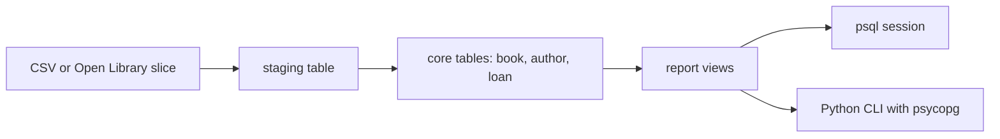
- **Staging table:** a loose copy of the input file with every column as `text`, so a bad row never stops the load. You clean and move rows from here with `INSERT ... SELECT`.
- **Core tables:** the normalized schema with keys and constraints.
- **Report views:** named queries (`CREATE VIEW overdue_loans AS ...`) so the CLI and you run the same SQL.
- **CLI:** optional. It lists, lends and returns books by calling parameterized queries, never by gluing strings together.

### Data model
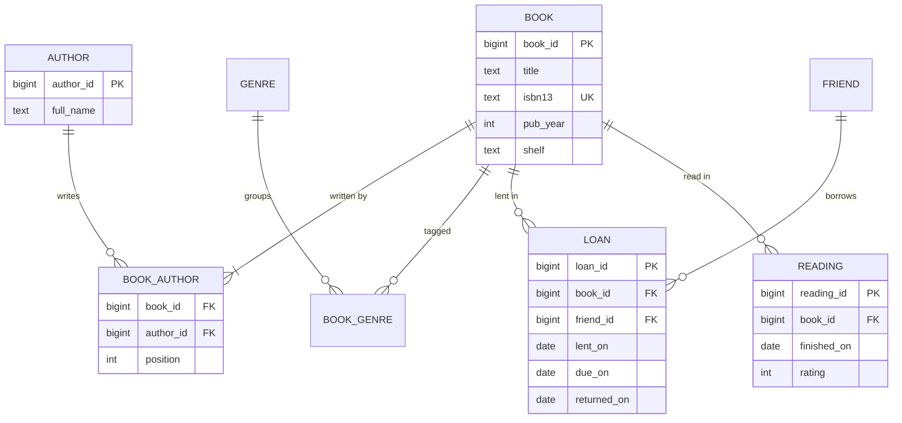
`BOOK_AUTHOR.position` keeps the author order printed on the cover, so "Kernighan and Ritchie" never becomes "Ritchie and Kernighan".

### Tech stack
| Component | Choice | Why |
|---|---|---|
| Database | PostgreSQL 14 | The book's dialect. Partial indexes and `CHECK` constraints do the hard work |
| Loading | `\copy` in psql | Reads a client-side CSV without superuser rights |
| Script | Python 3.14 + psycopg 3 | Parameterized queries in a few lines |
| Keys | `bigint GENERATED ALWAYS AS IDENTITY` | The standard SQL way to get surrogate keys (Ch 9) |

### Milestones
1. **Schema.** Write `00_schema.sql` with all tables, primary and foreign keys and `CHECK` constraints. *Done when* the script runs twice in a row (it drops and recreates) without errors.
2. **Seed data.** Load 200+ books through a staging table. *Done when* `SELECT count(*)` matches the file and no book has zero authors (an anti-join returns nothing).
3. **Loans.** Add the one-open-loan rule. *Done when* lending a book that is already out fails with a unique-violation error (SQLSTATE `23505`).
4. **Reports.** Create the five views. *Done when* each returns the rows you expect on hand-made test data.
5. **CLI (optional).** `lend`, `return`, `search`. *Done when* a title with an apostrophe (`Harry's Game`) works, which proves you used parameters.

### Deep dive: the hard parts
- **One open loan per book.** A plain `UNIQUE (book_id)` on `loan` would forbid all history. The trick is a **partial unique index**, which only indexes rows matching a `WHERE` clause: `CREATE UNIQUE INDEX one_open_loan ON loan (book_id) WHERE returned_on IS NULL;`. Returned loans drop out of the index, so history is unlimited, but two open loans for the same book collide. This one line replaces a whole class of application bugs.
- **NULL in reports.** "Unread books" is an **anti-join** (rows in one table with no match in another). Write it with `NOT EXISTS`, not `NOT IN`: if the subquery ever returns a `NULL`, `NOT IN` returns no rows at all (Ch 6).
- **Overdue logic and dates.** `due_on < current_date AND returned_on IS NULL`. Store dates as `date`, not text, so comparisons and `current_date - due_on` (an integer number of days) work.
- **Many-to-many reporting.** Joining books to authors to genres multiplies rows (a 2-author, 3-genre book appears 6 times). Count with `count(DISTINCT book_id)` or aggregate each side in a subquery first (Ch 5, "fan-out").

### Testing strategy
Keep a `tests.sql` that inserts a tiny known dataset inside a transaction, runs each view, compares the result with expected rows using `EXCEPT` both ways, then rolls back. Add negative tests: each constraint should reject one bad row. Wrap those in `DO` blocks that catch the expected error and raise if the insert succeeded.

### Trade-offs, scaling and failure modes
- **Surrogate vs natural key.** ISBN looks like a natural key, but old books have none and some reprints reuse them. Use a surrogate `book_id` plus a `UNIQUE` ISBN that allows `NULL`.
- **Free-text genres vs a table.** A `text[]` array of tags is quicker to build but harder to rename and count. The junction table is the normalized choice.
- **Scaling** is not a concern at this size. The lesson is correctness. The same patterns (partial unique index, junction tables) are what a real library system with millions of copies uses.

### Stretch goals
- Split **work** from **copy**: you own two copies of a favourite book. Loans then point at copies.
- Add an ISBN-13 checksum `CHECK` using a small SQL function.
- Fuzzy title search with the `pg_trgm` extension and `similarity()`.
- A "recommend next" query: unread books by authors you rated 4+.

### Skills practised
- Keys, constraints and identity columns: [Ch 9 — DDL, DML and Constraints](../chapters/09-ddl-dml-and-constraints/README.md)
- Turning an ER diagram into tables: [Ch 10 — Data Modeling and ER Diagrams](../chapters/10-data-modeling-and-er-diagrams/README.md)
- Anti-joins and the `NOT IN` trap: [Ch 6 — Subqueries and Set Operations](../chapters/06-subqueries-and-set-operations/README.md)
- Filtering and sorting: [Ch 2 — SELECT Basics](../chapters/02-select-basics/README.md)

### In the interview
**Q:** How do you allow many loans per book in history but only one active loan?

**A:** A partial unique index on `book_id` with `WHERE returned_on IS NULL`. Only open loans are indexed, so the uniqueness rule applies only to them.

**Q:** Why not store authors as a comma-separated column?

**A:** It breaks first normal form. You cannot index, join or rename an author cleanly, and counting "books per author" needs string parsing. A junction table makes each fact one row.

**Q:** Is ISBN a good primary key?

**A:** No. It can be missing or reused, and keys should never change. Use a surrogate key and keep ISBN as a nullable unique column.

### TL;DR
A personal library teaches the basic schema-design moves: junction tables for many-to-many, constraints that encode business rules, and a partial unique index for "only one active at a time".

## 2. Movie ratings analysis

**Level:** Beginner · **Time:** 1 weekend · **Prerequisites:** Ch 2, Ch 3, Ch 4, Ch 5

### What it is
You load the public MovieLens dataset (real movie ratings from real users) into PostgreSQL and answer questions with SQL: the best-rated films with enough votes, the most divisive films, how tastes differ by genre and decade, and which users rate harshly. The output is a set of saved queries and a one-page written report of findings.

### The problem it solves
Most beginners practise SQL on toy tables with ten rows, where every query looks right. Real data has messy text (genres packed into one string, the year inside the title), skew (a few films get most of the ratings) and statistical traps (a film rated 5.0 by one person is not "the best film"). This project teaches you to ask a question, write a query, and then check whether the answer means anything.

### Real-world examples
- [MovieLens datasets](https://grouplens.org/datasets/movielens/) from GroupLens at the University of Minnesota. The "latest small" set has about 100,000 ratings of 9,000 films by 600 users, and the 32M set has 32 million ratings. Start small, then load the big one to feel the difference.
- [IMDb non-commercial datasets](https://developer.imdb.com/non-commercial-datasets/) publish titles, crew and average ratings as TSV files. Joining them to MovieLens through the `imdbId` column in MovieLens's `links.csv` is a good stretch goal.

### Requirements
**Functional**
- Load `movies.csv`, `ratings.csv`, `tags.csv` and `links.csv` into staging tables, then into clean tables.
- Split the pipe-separated `genres` string into a `movie_genre` junction table. Extract the release year from the title, as in `Heat (1995)`.
- Convert the Unix-epoch `timestamp` to `timestamptz`.
- Answer at least ten questions, each as a saved `.sql` file with a comment saying what it answers.

**Non-functional**
- Load the small dataset in under 10 seconds and the 32M set in under 10 minutes on a laptop.
- Every "top" list applies a minimum vote count and states it.
- Each analytic query under 2 seconds on the 32M set after you add the right indexes.

### The architecture
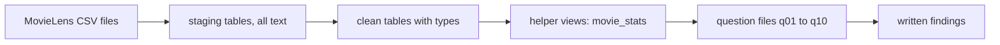
- **Staging tables** mirror the CSV exactly so `\copy` never fails on a type error.
- **Clean tables** have real types, keys and the genre junction table.
- **Helper views** compute per-film counts and averages once, so each question stays short.
- **Question files** are where the learning is. Each one is small and readable.

### Data model
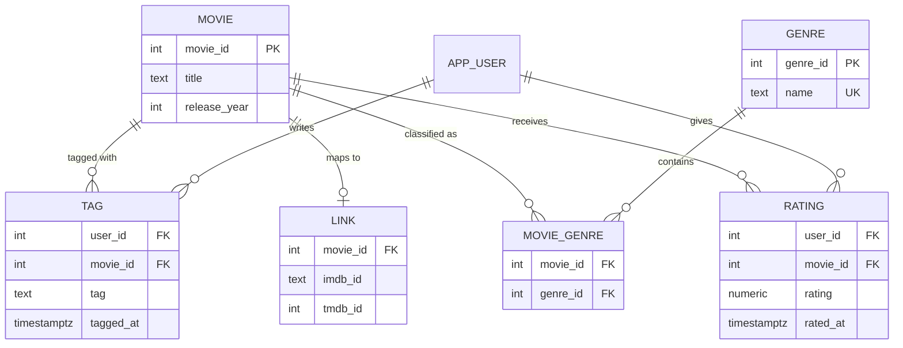
`RATING` has the composite primary key `(user_id, movie_id)`: one rating per user per film. `APP_USER` exists only as an id because the dataset is anonymous.

### Tech stack
| Component | Choice | Why |
|---|---|---|
| Database | PostgreSQL 14 | `string_to_table` or `regexp_split_to_table` split genres, `to_timestamp` converts epochs |
| Load | `\copy ... CSV HEADER` | Handles quoted titles with commas |
| Charts (optional) | Python + matplotlib | Plot rating distributions from query results |

### Milestones
1. **Load raw.** Staging tables plus `\copy`. *Done when* row counts match `wc -l` minus the header.
2. **Clean.** Typed tables, genre junction, year extracted with `substring(title from '\((\d{4})\)\s*$')`. *Done when* fewer than 1% of films have a `NULL` year, and you have looked at those rows.
3. **Basic questions.** Counts per genre, ratings per year, top 20 films with at least 50 ratings. *Done when* results are plausible (well-known classics near the top).
4. **Harder questions.** Most divisive films (highest `stddev_samp` of rating), genre preference per user, harsh versus generous raters. *Done when* each has a written one-line interpretation.
5. **Big data.** Load the 32M set, time the queries, add indexes, time again. *Done when* you can explain each speed-up with `EXPLAIN`.

### Deep dive: the hard parts
- **Small-sample bias.** A film with one 5-star rating tops a naive `ORDER BY avg(rating) DESC`. Fix it with `HAVING count(*) >= 50` or, better, a **Bayesian average** (a weighted mix of the film's mean and the global mean): `(v*R + m*C) / (v + m)`, where `v` is the film's vote count, `R` its mean, `C` the global mean and `m` a prior weight such as 50. Compute `C` once in a CTE (Ch 7).
- **Splitting the genre string.** `regexp_split_to_table(genres, '\|')` turns one row into many. Watch for the literal value `(no genres listed)`, which is a placeholder, not a genre.
- **Integer versus numeric averages.** Ratings are half-stars (0.5–5.0), so store them as `numeric(2,1)`. `avg()` of a numeric is a numeric, and `round(avg(rating), 2)` gives tidy output (Ch 3).
- **Fan-out when joining genres.** Joining ratings to genres repeats each rating once per genre of the film. That is right for "average rating per genre" but wrong for "total number of ratings". Decide on purpose.

### Testing strategy
Hand-check three films: pick them in the CSV with `grep`, count their ratings by hand, and compare with your view. Add sanity queries that must return zero rows: ratings outside 0.5–5.0, ratings for unknown films, duplicate `(user_id, movie_id)`. Re-run the whole pipeline from scratch and check the results are identical.

### Trade-offs, scaling and failure modes
- **Views vs tables for stats.** A view is always fresh but recomputes 32 million rows each time. A **materialized view** (a view whose result is stored and refreshed on demand) is fast but stale. Since this dataset never changes, materialize.
- **Indexes.** An index on `rating (movie_id)` helps per-film lookups. Whole-table aggregates read everything anyway and use a sequential scan, which is correct.
- **Memory.** Large `GROUP BY` queries may spill to disk. Look for "external merge" or a hash aggregate that spills in `EXPLAIN ANALYZE`, and try raising `work_mem` for the session.

### Stretch goals
- "Users who liked X also liked Y": a self-join on `rating` that counts co-high-ratings.
- Join to IMDb data through `links` and compare MovieLens averages with IMDb's.
- Ratings over time per genre with `date_trunc('year', rated_at)`.

### Skills practised
- Filters, `ORDER BY`, `LIMIT`: [Ch 2 — SELECT Basics](../chapters/02-select-basics/README.md)
- String and date functions: [Ch 3 — Functions and Expressions](../chapters/03-functions-and-expressions/README.md)
- `GROUP BY`, `HAVING`, `FILTER`: [Ch 4 — Aggregation](../chapters/04-aggregation/README.md)
- Join fan-out: [Ch 5 — Joins](../chapters/05-joins/README.md)

### In the interview
**Q:** How do you rank items by average rating fairly?

**A:** Require a minimum number of votes, or use a Bayesian average that pulls films with few votes toward the global mean.

**Q:** Why did my genre totals add up to more than the number of ratings?

**A:** Each film belongs to several genres, so the join repeats each rating once per genre. Count distinct ratings, or accept that genre totals overlap.

**Q:** How would you find the most divisive film?

**A:** Group by film, require enough ratings, and order by the standard deviation of the rating, highest first.

### TL;DR
Load a real ratings dataset, clean it into a normalized schema, and learn that good analytic SQL means guarding against small samples and join fan-out, not just writing `avg()`.

## 3. Student gradebook

**Level:** Beginner · **Time:** 1 weekend · **Prerequisites:** Ch 4, Ch 5, Ch 9

### What it is
A gradebook for a small school or a single teacher: courses, students, enrolments, assignments grouped into weighted categories (homework 30%, exams 50%, project 20%), scores, and a final letter grade per student per course. Everything, including the weighted final grade, is computed in SQL.

### The problem it solves
Teachers often keep grades in spreadsheets where one wrong cell reference silently changes a student's final grade. Missing work, excused work and late penalties make the arithmetic harder. In a database the rules live in one place: the weights must add to 100, a score cannot exceed the maximum points, and the final grade comes from one view everyone shares.

### Real-world examples
- [Canvas LMS](https://github.com/instructure/canvas-lms), Instructure's open-source learning platform, runs on PostgreSQL and models assignment groups with weights, the same idea as this project's categories.
- Moodle, another widely used open-source learning platform, supports PostgreSQL and also lets teachers set category weights and choose how empty grades are treated. Compare its options for missing work with the rules you choose here.

### Requirements
**Functional**
- Courses, terms, students, enrolments (a student takes a course in a term).
- Assignment categories per course with a weight, and assignments with maximum points and a due date.
- Submissions with points earned, a submitted-at time, and a status: `graded`, `missing`, `excused`.
- Final grade per enrolment: per-category percentage, weighted total and letter grade from a grade-scale table.
- Reports: class average per assignment, students at risk (below 60%), rank within a course.

**Non-functional**
- Category weights per course add to exactly 100. Points between 0 and the maximum. One submission per student per assignment.
- Final-grade view under 100 ms for a course of 300 students and 40 assignments.

### The architecture
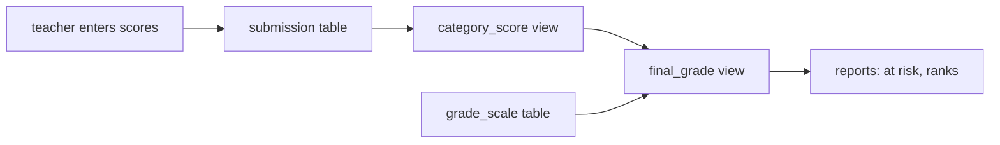
- **Submission table:** raw facts only. Never store a computed percentage here.
- **category_score view:** sums points per student per category, skipping excused work and counting missing work as zero.
- **final_grade view:** weights the category percentages and joins the grade scale to get a letter.
- **Reports:** small queries on top of `final_grade`.

### Data model
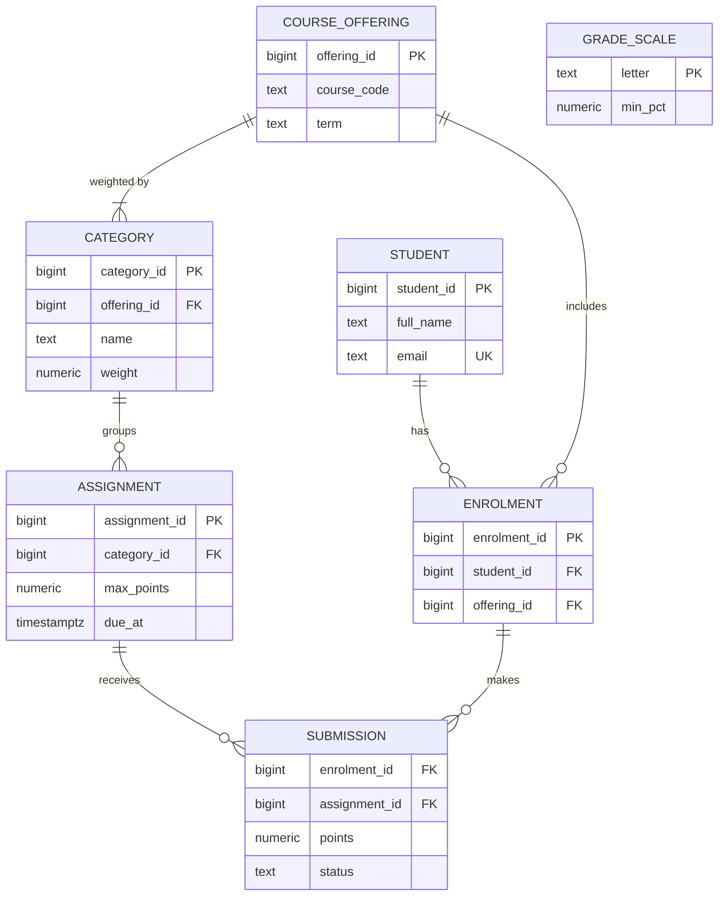

### Tech stack
| Component | Choice | Why |
|---|---|---|
| Database | PostgreSQL 14 | `CHECK`, views and `FILTER` cover all the logic |
| Status | `text` + `CHECK (status IN (...))` | Easier to change than an `ENUM` type |
| Data | `generate_series` + `random()` | Generate a realistic course in one statement |

### Milestones
1. **Schema with rules.** *Done when* a score above `max_points` and a duplicate submission are both rejected.
2. **Generated data.** Three courses, 300 students, 40 assignments each, about 5% missing and 2% excused. *Done when* the counts match.
3. **Category and final views.** *Done when* three students, worked out by hand on paper, match the view to two decimals.
4. **Letter grades.** Join to the grade scale. *Done when* boundary scores (exactly 90.00) get the right letter.
5. **Reports.** At-risk list, assignment averages, rank with `rank()`. *Done when* ties share a rank.

### Deep dive: the hard parts
- **Weights must add to 100.** A `CHECK` constraint sees only one row, so it cannot check a sum across rows. Options: a **constraint trigger** (a trigger that runs at commit and raises an error, Ch 14), declared `DEFERRABLE INITIALLY DEFERRED` so you can insert all categories of a course in one transaction before the check runs. Or a validation query that teachers run before publishing. Learn why the first is stronger.
- **Missing vs excused.** Missing counts as 0 points out of `max_points`. Excused is removed from both the numerator and the denominator. With conditional aggregation: `sum(points) FILTER (WHERE status = 'graded')` and `sum(max_points) FILTER (WHERE status <> 'excused')`. Count missing work as zero with `coalesce`.
- **Range lookup for letters.** The grade scale stores only a lower bound. Pick the highest `min_pct` not above the student's percentage, using a `LATERAL` subquery with `ORDER BY min_pct DESC LIMIT 1` (Ch 6), or a window `lead()` to build upper bounds.
- **Division by zero.** A category whose only assignment is excused has a denominator of 0. `NULLIF(denominator, 0)` turns it into `NULL`, and you then re-weight the remaining categories.

### Testing strategy
Build a "golden" fixture: two students, two categories, four assignments, with results calculated by hand in a comment. Assert the view equals that fixture. Add edge cases: all work excused, perfect scores, a student enrolled but with no submissions (must show 0%, not disappear, so use a `LEFT JOIN`).

### Trade-offs, scaling and failure modes
- **Compute on read vs store.** Views always reflect the latest score. Storing final grades would need refreshing after every change. At 300 students, compute on read.
- **Rounding policy.** Decide whether to round per category or only at the end. It can change a letter grade at a boundary, so write the rule down.
- **Failure mode:** a teacher changes a weight mid-term and every grade shifts silently. An audit table (Project 15) or a `published_at` lock on categories prevents surprises.

### Stretch goals
- Late penalty: minus 10% per day late, capped at 50%, computed from `submitted_at - due_at`.
- "Drop the lowest homework" with `row_number()` per student and category.
- A grade-distribution histogram with `width_bucket()`.

### Skills practised
- Conditional aggregation: [Ch 4 — Aggregation](../chapters/04-aggregation/README.md)
- Outer joins that keep students with no work: [Ch 5 — Joins](../chapters/05-joins/README.md)
- Constraints and deferrable checks: [Ch 9 — DDL, DML and Constraints](../chapters/09-ddl-dml-and-constraints/README.md)
- `rank()` and `lead()`: [Ch 8 — Window Functions](../chapters/08-window-functions/README.md)

### In the interview
**Q:** How do you enforce a rule that spans many rows, like weights summing to 100?

**A:** `CHECK` only sees one row. Use a deferred constraint trigger that checks the sum at commit, or a serialized write path that validates before commit.

**Q:** Why should a student with no submissions still appear?

**A:** Start from enrolments and `LEFT JOIN` submissions. An inner join would drop them, and the teacher would never see the student who needs help most.

**Q:** How do you map a percentage to a letter from a table of lower bounds?

**A:** For each student, take the scale row with the largest lower bound not above the percentage, using `LATERAL ... ORDER BY min_pct DESC LIMIT 1`.

### TL;DR
A gradebook is weighted conditional aggregation plus a range lookup. The interesting part is enforcing cross-row rules and treating missing and excused work correctly.

## 4. Personal expense tracker

**Level:** Beginner · **Time:** 1 weekend · **Prerequisites:** Ch 3, Ch 4, Ch 9

### What it is
A database of your own spending: accounts (current account, credit card, cash), transactions imported from your bank's CSV exports, categories, monthly budgets, and reports such as "spending by category this month versus budget" and "running balance per account". It is small, personal and full of the money and date details that trip up real financial systems.

### The problem it solves
Bank exports differ in column order, date format and sign convention (some show spending as negative, some as a separate debit column). Importing the same file twice doubles your spending. Floating-point arithmetic loses cents. A careful schema with exact `numeric` amounts, idempotent imports and categorisation rules solves all three.

### Real-world examples
- [Firefly III](https://www.firefly-iii.org/) is an open-source personal finance manager that can run on PostgreSQL. It models accounts, budgets, categories and rules that auto-categorise transactions, which is a good reference after your first design.
- The PostgreSQL wiki's [Don't Do This](https://wiki.postgresql.org/wiki/Don%27t_Do_This) page explains why the `money` type is a poor choice and why `numeric` is preferred for amounts. Read it before choosing types.

### Requirements
**Functional**
- Accounts with a currency. Transactions with date, amount, description, account and category.
- Import a bank CSV through a staging table, mapping each bank's format to yours.
- Categorisation rules: "description contains `TESCO`" → Groceries. Applied on import, editable later.
- Monthly budgets per category. Reports: month vs budget, top merchants, running balance, month-over-month change.

**Non-functional**
- Amounts exact to the cent: `numeric(12,2)`, never `float`.
- Re-importing the same file adds zero rows.
- Reports under 100 ms on 10 years of data (about 20,000 transactions).

### The architecture
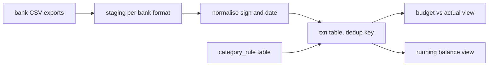
- **Staging per format:** one staging table per bank, all `text`.
- **Normalise:** an `INSERT ... SELECT` that parses dates with `to_date(col, 'DD/MM/YYYY')` and makes spending negative.
- **txn table:** has a unique **import fingerprint** so `ON CONFLICT DO NOTHING` skips duplicates.
- **Rules:** a table of patterns, so categorisation is data, not code.

### Data model
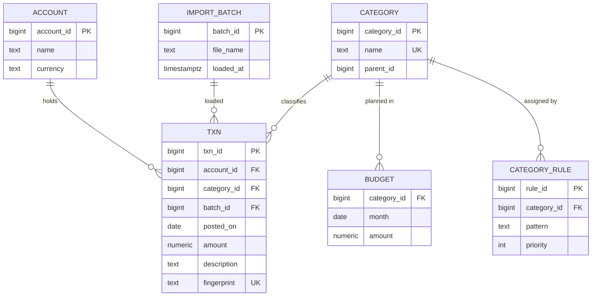

### Tech stack
| Component | Choice | Why |
|---|---|---|
| Amounts | `numeric(12,2)` | Exact decimal arithmetic |
| Dedup | `UNIQUE (fingerprint)` + `ON CONFLICT DO NOTHING` | Idempotent import (Ch 9) |
| Matching | `ILIKE` patterns, ordered by priority | Simple and editable |
| Months | `date_trunc('month', posted_on)::date` | One key for budget joins |

### Milestones
1. **Schema and one bank format.** *Done when* a real export loads and the account total matches your bank statement to the cent.
2. **Idempotent import.** *Done when* loading the same file twice leaves the row count unchanged.
3. **Rules.** *Done when* 90%+ of transactions are categorised, and you can list the uncategorised ones.
4. **Reports.** Budget vs actual, running balance with `sum(amount) OVER (PARTITION BY account_id ORDER BY posted_on, txn_id)`. *Done when* the final running balance equals the statement balance.
5. **Second bank format.** *Done when* both formats land in one `txn` table with consistent signs.

### Deep dive: the hard parts
- **What makes two rows "the same"?** Banks rarely give a stable transaction id. A fingerprint of `account_id, posted_on, amount, description` collides when you buy two identical coffees on one day. Add the row's position among identical rows in that file (`row_number()` over the identical columns) to the fingerprint, so genuine duplicates in one file survive and re-imports still dedupe.
- **Rule priority.** Several rules can match ("AMAZON PRIME" matches both Shopping and Subscriptions). Pick the best rule per transaction with `DISTINCT ON (txn_id) ... ORDER BY txn_id, priority` (a PostgreSQL extension that keeps the first row per group) or a `LATERAL ... LIMIT 1`.
- **Months with no spending.** "Budget vs actual" must show categories with a budget but no spending. Start from `budget` and `LEFT JOIN` the monthly sums, with `coalesce(actual, 0)`.
- **Transfers.** Paying your credit card from your current account is not spending. Mark transfer pairs (same amount, opposite sign, two accounts, within 3 days) and exclude them from category totals.

### Testing strategy
The best test is reconciliation: for each account, the sum of transactions up to a statement date must equal that statement's closing balance. Keep three statement balances as fixtures and check all three. Add tests for the rule engine: a table of descriptions with expected categories, checked with `EXCEPT`.

### Trade-offs, scaling and failure modes
- **Single currency vs multi-currency.** Converting at report time needs a rates table by date. Converting at import time loses the original amount. Store both if you go multi-currency.
- **Editing history.** Recategorising last year's transactions changes old reports. That is usually what you want in personal finance, but not in accounting, where closed periods are locked (Project 26).
- **Failure mode:** a bank changes its export format and the date parser silently swaps day and month. Validate that parsed dates fall inside the statement period and reject the batch otherwise.

### Stretch goals
- Split transactions (one supermarket receipt, two categories).
- Recurring-payment detection: same merchant, similar amount, about 30 days apart, using `lag()`.
- PostgreSQL 15+: rewrite the import with `MERGE`.

### Skills practised
- Numeric types and date parsing: [Ch 3 — Functions and Expressions](../chapters/03-functions-and-expressions/README.md)
- Grouping and `FILTER`: [Ch 4 — Aggregation](../chapters/04-aggregation/README.md)
- Upsert and unique constraints: [Ch 9 — DDL, DML and Constraints](../chapters/09-ddl-dml-and-constraints/README.md)
- Running totals: [Ch 8 — Window Functions](../chapters/08-window-functions/README.md)

### In the interview
**Q:** Why not use `float` for money?

**A:** Binary floating point cannot represent most decimal fractions exactly, so sums drift by fractions of a cent. `numeric` is exact.

**Q:** How do you make an import idempotent?

**A:** Give each row a deterministic key, put a unique constraint on it, and insert with `ON CONFLICT DO NOTHING`. A second run then inserts nothing.

**Q:** How do you compute a running balance?

**A:** A window sum ordered by date with a unique tie-breaker such as the id, partitioned by account. Without the tie-breaker, rows on the same date get the same total under the default `RANGE` frame.

### TL;DR
An expense tracker teaches exact money types, idempotent imports with a deterministic key, rules stored as data, and reconciliation against a known balance as the ultimate test.

## 5. Bike-rental queries

**Level:** Beginner · **Time:** 1–2 weekends · **Prerequisites:** Ch 3, Ch 4, Ch 5, Ch 6, Ch 10

### What it is
You load a month of real bike-share trips (Citi Bike in New York publishes every ride) and build the operational queries a bike-share company runs every day: busiest stations, trip durations by member type, stations that run empty in the morning, round trips, and hour-of-day demand. You also design the clean schema behind the raw file, as in the bike-rental example of Chapter 10.

### The problem it solves
Bike-share operators need to move bikes from full stations to empty ones before the rush hour. That decision comes straight from SQL over trip data: net flow per station per hour. The raw file is one wide table with repeated station names and coordinates, so you also practise turning a flat export into a normalized schema.

### Real-world examples
- [Citi Bike System Data](https://citibikenyc.com/system-data) publishes monthly CSV trip files with ride id, bike type, start and end times, start and end stations with coordinates, and whether the rider is a member or a casual user. Rides under 60 seconds and staff trips are already removed.
- The same operator publishes real-time station status in the GBFS format (General Bikeshare Feed Specification), linked from the same page. Snapshots of it are a stretch goal for "how full is each station right now".

### Requirements
**Functional**
- Load one month (a few million rows in summer) into a staging table.
- Normalize into `station` and `trip`, with station names and coordinates stored once.
- Questions: top 10 start stations, median trip duration by member type, net bikes gained or lost per station per hour, most common station pairs, round trips, weekend vs weekday demand, and stations never used as a destination.

**Non-functional**
- Load plus normalize in under 2 minutes for a 3-million-row month.
- Each question under 3 seconds after indexing.
- Queries correct across the daylight-saving change if your month includes one.

### The architecture
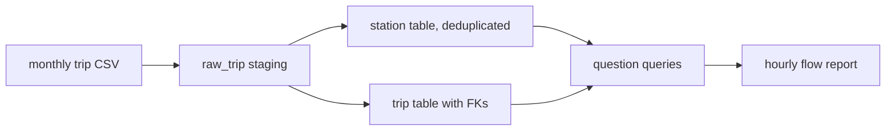
- **raw_trip:** one row per CSV line, all `text`.
- **station:** one row per station id. When the same id has slightly different coordinates or names across rows, you choose one deliberately.
- **trip:** typed times, foreign keys to stations, and a generated `duration` you can compute in queries.
- **Questions:** each a file. The hourly flow report is the headline.

### Data model
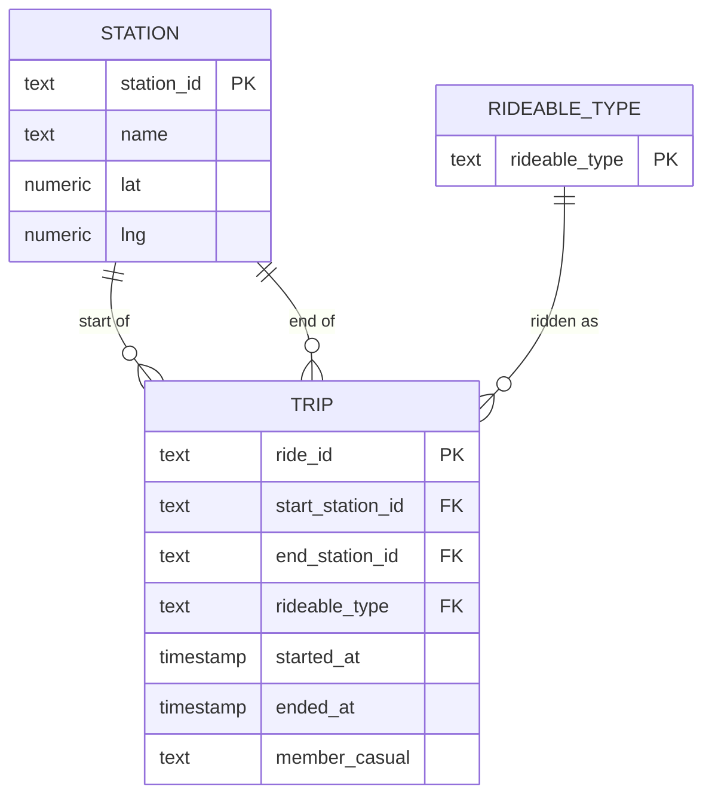
Times in the file are New York local time without an offset. Load them as `timestamp` (without time zone), then convert with `AT TIME ZONE 'America/New_York'` if you store `timestamptz`. Decide once and write it down.

### Tech stack
| Component | Choice | Why |
|---|---|---|
| Load | `\copy` into staging | Fast and tolerant |
| Median | `percentile_cont(0.5) WITHIN GROUP (ORDER BY ...)` | An ordered-set aggregate built into PostgreSQL |
| Hours | `date_trunc('hour', started_at)` and `extract(isodow ...)` | Time bucketing (Ch 3) |
| Gaps | `generate_series` of hours | Shows zero-trip hours instead of hiding them |

### Milestones
1. **Load.** *Done when* the staging count matches the file and you have counted rows with a missing end station (dock-less ends).
2. **Normalize.** *Done when* every trip's station ids exist in `station` (foreign keys added after cleaning) and no station id has two names.
3. **Easy questions.** Top stations, trips by member type, duration distribution. *Done when* answers look sensible (rush-hour peaks on weekdays).
4. **Net flow.** Departures minus arrivals per station per hour, including hours with zero trips. *Done when* the sum over all stations in an hour equals departures minus arrivals for the whole system in that hour.
5. **Indexes.** Time every question, add indexes, time again. *Done when* each speed-up is explained by a changed `EXPLAIN` plan.

### Deep dive: the hard parts
- **Net flow needs two aggregations.** Departures group by `start_station_id`, arrivals by `end_station_id`. Aggregate each in its own CTE, then `FULL JOIN` them on station and hour, with `coalesce(..., 0)`. Joining trips to trips first would multiply rows (Ch 5).
- **Hours with no trips.** `GROUP BY` only returns groups that exist. To show a zero for 4 a.m., cross join every station with `generate_series(start, end, interval '1 hour')`, then `LEFT JOIN` the counts.
- **Durations and data quality.** Some trips last days (bikes not docked properly). Use the median and percentiles, not the mean, and flag trips over 24 hours instead of deleting them.
- **Stations never used as destinations.** An anti-join from `station` to `trip` on `end_station_id`. Use `NOT EXISTS`. The end station column contains NULLs, which would make `NOT IN` return nothing.

### Testing strategy
Write invariants as queries that must return zero rows: trips ending before they start, trips whose stations are missing, hours where system-wide flow does not match. Hand-check one station for one hour by filtering the raw CSV with `grep` and counting.

### Trade-offs, scaling and failure modes
- **Natural station ids vs surrogate keys.** Citi Bike's ids are strings that have changed format over the years. A surrogate key plus the external id as `UNIQUE` survives such changes.
- **One month vs years.** Several years is hundreds of millions of rows. That is where partitioning by month (Project 27) and BRIN indexes (Ch 12) start to pay off.
- **Failure mode:** silently treating local times as UTC shifts every hourly chart by four or five hours.

### Stretch goals
- Distance per trip with the haversine formula in SQL, and average speed by bike type.
- Load GBFS snapshots and find stations that hit zero bikes most often.
- Compare two months and explain the seasonal change.

### Skills practised
- Date and time functions, time zones: [Ch 3 — Functions and Expressions](../chapters/03-functions-and-expressions/README.md)
- Percentiles and grouping: [Ch 4 — Aggregation](../chapters/04-aggregation/README.md)
- `FULL JOIN` and anti-joins: [Ch 5 — Joins](../chapters/05-joins/README.md), [Ch 6 — Subqueries and Set Operations](../chapters/06-subqueries-and-set-operations/README.md)
- Normalizing a flat file: [Ch 10 — Data Modeling and ER Diagrams](../chapters/10-data-modeling-and-er-diagrams/README.md)

### In the interview
**Q:** How do you report a zero for hours with no trips?

**A:** Generate the full grid of stations and hours, then `LEFT JOIN` the aggregated counts and `coalesce` NULL to 0.

**Q:** Why median rather than average for trip duration?

**A:** The distribution has a long tail of very long trips, which pulls the mean up. The median describes a typical trip.

**Q:** How do you compute departures minus arrivals per station?

**A:** Aggregate departures and arrivals separately, then full-join them on station and hour. Joining raw trips to each other first multiplies rows.

### TL;DR
Bike-share data teaches normalizing a flat file, time bucketing with real time zones, filling empty buckets with `generate_series`, and combining two aggregations without fan-out.

## 6. Recipe and pantry planner

**Level:** Beginner · **Time:** 1 weekend · **Prerequisites:** Ch 5, Ch 6, Ch 9

### What it is
A database of recipes, their ingredients with quantities, and what is in your kitchen right now. It answers the question every cook asks: *what can I make tonight with what I have?* It also answers *what am I missing for this recipe?* and *what should I buy to unlock the most recipes?*

### The problem it solves
"Recipes whose every ingredient is in my pantry" is a famous SQL pattern called **relational division**: find the rows of one table (recipes) related to *all* rows of another set (their ingredients) that appear in a third (the pantry). Beginners often write it wrong, returning recipes where *any* ingredient matches. This project makes you write it three ways and prove they agree.

### Real-world examples
- Joe Celko's [Divided We Stand: The SQL of Relational Division](https://www.red-gate.com/simple-talk/databases/sql-server/t-sql-programming-sql-server/divided-we-stand-the-sql-of-relational-division/) (Simple Talk) explains exact and remainder division with a similar "pilots and planes" example. Read it after your first attempt.
- [Open Food Facts](https://world.openfoodfacts.org/data) publishes a large open database of food products with ingredients and nutrition, available as CSV and database dumps. It is a source of realistic ingredient names and nutrition values for a stretch goal.

### Requirements
**Functional**
- Recipes with servings, steps and tags. Ingredients with a canonical unit (grams, millilitres or pieces).
- `recipe_ingredient` with quantity and an `optional` flag (salt "to taste" should not block a recipe).
- Pantry items with quantity and expiry date.
- Queries: cookable now, missing at most one ingredient, shopping list for a chosen set of recipes, recipes that use ingredients expiring within 3 days.

**Non-functional**
- Each query under 50 ms for 2,000 recipes and 500 ingredients.
- Quantities exact (`numeric`), never negative. An ingredient appears at most once per recipe.

### The architecture
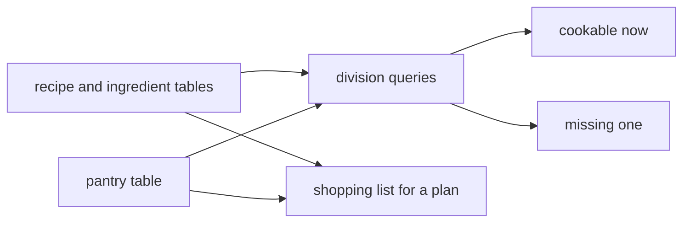
- **Recipe and ingredient tables:** the catalogue. Rarely changes.
- **Pantry:** changes daily. Kept separate so it could become per-user later.
- **Division queries:** the heart of the project, written as views.
- **Shopping list:** sums required quantities over chosen recipes and subtracts what you have, never going below zero.

### Data model
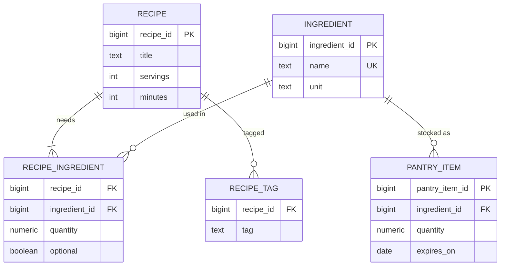
The pantry can hold two packs of the same ingredient with different expiry dates, so it has its own key rather than `ingredient_id` as the key.

### Tech stack
| Component | Choice | Why |
|---|---|---|
| Database | PostgreSQL 14 | `EXISTS`, `HAVING` and `bool_and` give three ways to divide |
| Seed data | Hand-written recipes + a generator | Small enough to check by eye |
| Units | One canonical unit per ingredient | Avoids conversion in every query |

### Milestones
1. **Schema and 30 hand-written recipes.** *Done when* a recipe with the same ingredient twice is rejected.
2. **Cookable now, three ways.** Double `NOT EXISTS`, `GROUP BY ... HAVING count(*) = count(pantry match)`, and `bool_and`. *Done when* all three return the same set (check with `EXCEPT` both ways).
3. **Quantities.** Cookable only if the pantry *amount* is enough. *Done when* a recipe needing 500 g of flour with 300 g in stock is not listed.
4. **Missing one.** *Done when* the list shows each recipe with the one missing ingredient's name.
5. **Shopping list.** *Done when* buying exactly the listed amounts makes every chosen recipe cookable (re-run milestone 3 to check).

### Deep dive: the hard parts
- **Division with double negation.** "Recipe R is cookable if there is no required ingredient of R that is not in the pantry." In SQL: `NOT EXISTS (SELECT 1 FROM recipe_ingredient ri WHERE ri.recipe_id = r.recipe_id AND NOT ri.optional AND NOT EXISTS (SELECT 1 FROM pantry ...))`. Read it aloud until it makes sense. It is the most reliable form.
- **Division with counting.** `LEFT JOIN` the pantry totals, group by recipe, and keep groups where the number of required ingredients equals the number with enough stock: `count(*) FILTER (WHERE NOT optional) = count(*) FILTER (WHERE NOT optional AND have >= quantity)`. Beware the pantry having two rows for one ingredient. Sum the pantry per ingredient first, or the join fans out.
- **Empty divisor.** A recipe whose ingredients are all optional is "cookable" by the double-negation form (there is nothing missing). Decide whether that is right and make all three forms agree.
- **Shopping list floor.** `greatest(sum(required) - coalesce(have, 0), 0)` so surplus stock does not produce negative purchases (Ch 3).

### Testing strategy
Craft a pantry where you know the answer: one recipe exactly covered, one short by quantity, one missing an optional ingredient only, one missing two items. Assert each view's output. The three division forms must always agree on randomized pantries too. Generate 100 random pantries and compare.

### Trade-offs, scaling and failure modes
- **Canonical units vs conversions.** Real recipes say "2 cups" or "1 tin". A `unit_conversion` table adds realism and joins. Canonical units keep queries simple. Start simple.
- **Performance.** Double `NOT EXISTS` becomes anti-joins that PostgreSQL executes well. An index on `recipe_ingredient (ingredient_id)` helps the reverse lookup "recipes that use this ingredient".
- **Failure mode:** ingredient names like "tomato" and "tomatoes" create duplicates. A `UNIQUE` index on `lower(name)` and a cleanup step stop this.

### Stretch goals
- "Best ingredient to buy": the ingredient that would unlock the most recipes, ranked.
- Nutrition per serving from Open Food Facts data.
- Per-user pantries with a `user_id` everywhere (a first taste of multi-tenancy, Project 16).

### Skills practised
- `EXISTS`, `NOT EXISTS` and division: [Ch 6 — Subqueries and Set Operations](../chapters/06-subqueries-and-set-operations/README.md)
- Outer joins and fan-out: [Ch 5 — Joins](../chapters/05-joins/README.md)
- Composite keys and `CHECK`: [Ch 9 — DDL, DML and Constraints](../chapters/09-ddl-dml-and-constraints/README.md)
- More division problems: [Ch 19 — SQL Interview Problems II](../chapters/19-sql-interview-problems-2/README.md)

### In the interview
**Q:** What is relational division?

**A:** Finding entities related to every member of a set, such as recipes whose every required ingredient is in stock. You write it with double `NOT EXISTS` or by comparing counts per group.

**Q:** Why can the counting method give wrong answers?

**A:** If the joined table has duplicates per key (two pantry rows for flour), counts inflate. Aggregate that side first, or count distinct keys.

**Q:** How would you find recipes missing exactly one ingredient?

**A:** Group by recipe and keep groups where required ingredients minus available ingredients equals one. Use `string_agg` with a `FILTER` to name the missing one.

### TL;DR
"What can I cook?" is relational division. Write it with double `NOT EXISTS` and with counting, prove they agree, and guard against fan-out from duplicate rows.

## 7. Pet clinic appointments

**Level:** Beginner · **Time:** 1–2 weekends · **Prerequisites:** Ch 3, Ch 9, Ch 10

### What it is
The database behind a small veterinary clinic: owners, pets, vets, opening hours, fixed 15-minute appointment slots, visits with notes and treatments, and vaccinations with due dates for reminders. It focuses on constraints and dates. Every rule the receptionist knows ("a vet cannot see two pets at once", "no bookings on Sunday") becomes something the database enforces.

### The problem it solves
Booking systems fail in boring ways: two pets booked in the same slot, an appointment at 3 a.m. because of a time-zone slip, a reminder for a rabies booster sent a year late because someone stored dates as text. Data modeling decisions (what is an entity, what is a weak entity, which constraint goes where) prevent most of these before any application code exists.

### Real-world examples
- [Spring PetClinic](https://spring-petclinic.github.io/) is a long-running sample application from the Spring team, with owners, pets, vets, specialties and visits. It can run on PostgreSQL. Compare its simple schema with yours, which adds slots, constraints and reminders.
- [RFC 5545 (iCalendar)](https://datatracker.ietf.org/doc/html/rfc5545) defines how calendars describe events, time zones and recurring rules. Exporting appointments as `.ics` files for owners is a stretch goal, and the RFC shows why storing an explicit time zone matters.

### Requirements
**Functional**
- Owners (contact details), pets (species, breed, birth date), vets (specialties), clinic opening hours per weekday.
- Appointments: pet, vet, start time, reason, status (`booked`, `arrived`, `done`, `no_show`, `cancelled`).
- Visits record what happened: weight, diagnosis notes, treatments given.
- Vaccinations: vaccine, date given, valid for N months. Report "due in the next 30 days" with the owner's phone number.
- Free-slot finder: for a vet and a date, list open 15-minute slots.

**Non-functional**
- A vet never has two active appointments at the same start time. A pet never has two at the same time.
- Appointments only inside opening hours and on a 15-minute boundary.
- All times stored as `timestamptz` and shown in the clinic's zone.

### The architecture
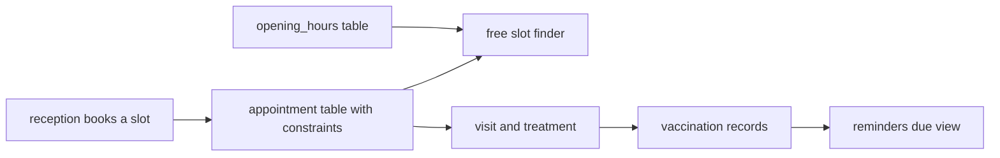
- **Appointment table:** the constraints live here: unique vet and start for active rows, `CHECK` on minutes.
- **Free-slot finder:** generates all slots from opening hours with `generate_series`, then removes booked ones with an anti-join.
- **Visit:** a record of what happened, linked one-to-one to an appointment.
- **Reminders view:** vaccinations whose `given_on + valid_months` falls within the next 30 days.

### Data model
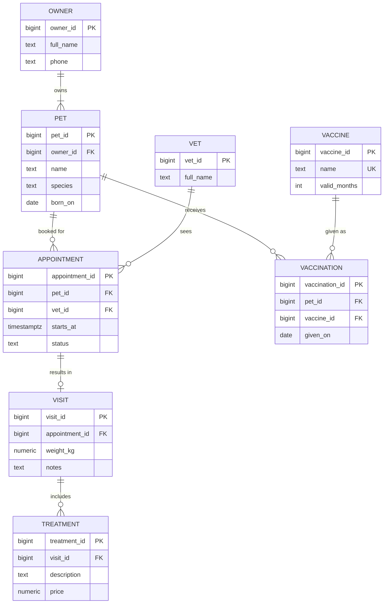

### Tech stack
| Component | Choice | Why |
|---|---|---|
| Times | `timestamptz` + clinic zone setting | Unambiguous instants, local display |
| Slot rule | `CHECK (extract(minute FROM starts_at AT TIME ZONE 'Europe/London')::int % 15 = 0)` | 15-minute boundaries |
| Double booking | Partial unique index on `(vet_id, starts_at)` for active statuses | Allows cancelled rows to stay |
| Slots | `generate_series(open, close - interval '15 min', interval '15 min')` | Builds the grid |

### Milestones
1. **Core schema.** Owners, pets, vets, opening hours. *Done when* a pet without an owner cannot be inserted.
2. **Appointments with rules.** *Done when* double-booking a vet fails, booking at 10:07 fails, and re-booking a cancelled slot succeeds.
3. **Free-slot finder.** *Done when* it shows exactly the open slots for a test day with three bookings.
4. **Visits and vaccinations.** *Done when* the reminders view lists a dog vaccinated 11.5 months ago against a 12-month vaccine.
5. **Reports.** No-show rate per owner, revenue per vet per month. *Done when* totals match the treatments table.

### Deep dive: the hard parts
- **Why a partial unique index and not a plain one?** A cancelled appointment should not block the slot, but you want to keep it for history. `CREATE UNIQUE INDEX ON appointment (vet_id, starts_at) WHERE status IN ('booked', 'arrived')` enforces uniqueness only for live appointments. This works because slots are fixed-length. Variable-length bookings need an exclusion constraint, which Project 13 covers.
- **Opening-hours check.** A `CHECK` constraint cannot read another table. Either enforce opening hours in the booking function (a SQL function that inserts only if the slot is in the generated grid), or use a trigger. The trade-off is where the rule lives and whether ad-hoc inserts can bypass it.
- **Time zones and daylight saving.** Store instants as `timestamptz`. Generate the day's slots in local time and convert: `(day + open_time) AT TIME ZONE 'Europe/London'`. On the day the clocks change, the clinic still opens at 9:00 local, and the conversion handles the shift. Doing the arithmetic in UTC would put the first slot at 8:00 or 10:00 local.
- **Date arithmetic for reminders.** `given_on + make_interval(months => valid_months)` handles month lengths correctly. Adding `30 * valid_months` days drifts.

### Testing strategy
A fixture day per edge case: a fully booked day, a day with a cancellation, a daylight-saving day, a Sunday. Each test asserts the free-slot list exactly. Negative tests for every constraint. A test that the reminders view includes pets due tomorrow and excludes pets due in 31 days.

### Trade-offs, scaling and failure modes
- **Fixed slots vs free-form times.** Fixed slots make uniqueness trivial and the UI simple. Surgeries that take two hours need several slots or a range-based design.
- **Status as text vs a separate history table.** A status column shows the current state only. If you need "when was it cancelled and by whom", add an `appointment_event` table.
- **Failure mode:** the receptionist's laptop has the wrong time zone and every booking shifts an hour. Set the zone per session (`SET TIME ZONE`) from the clinic's configuration, not from the client.

### Stretch goals
- Vet specialties: only vets with "exotics" can see reptiles (a join rule enforced in the booking function).
- `.ics` export of a pet's upcoming appointments.
- Weight history chart per pet using `lag()` to show change between visits.

### Skills practised
- Dates, intervals and time zones: [Ch 3 — Functions and Expressions](../chapters/03-functions-and-expressions/README.md)
- Constraints and partial indexes: [Ch 9 — DDL, DML and Constraints](../chapters/09-ddl-dml-and-constraints/README.md)
- Weak entities and one-to-one links: [Ch 10 — Data Modeling and ER Diagrams](../chapters/10-data-modeling-and-er-diagrams/README.md)
- `generate_series`: [Ch 7 — CTEs, Views and Recursion](../chapters/07-ctes-views-and-recursion/README.md)

### In the interview
**Q:** How do you prevent double-booking but keep cancelled appointments?

**A:** A partial unique index on vet and start time that only covers active statuses.

**Q:** Why `timestamptz` and not `timestamp`?

**A:** `timestamptz` stores an absolute instant and converts to the session's zone for display. `timestamp` has no zone, so the same value means different instants in different places.

**Q:** How do you find free slots?

**A:** Generate every slot from opening hours with `generate_series`, then anti-join against booked appointments.

### TL;DR
A clinic booking system is mostly constraints and dates: partial unique indexes for "only one active", `timestamptz` with local-time slot generation, and interval arithmetic that respects months.

## 8. Gym classes and attendance

**Level:** Beginner · **Time:** 1–2 weekends · **Prerequisites:** Ch 3, Ch 4, Ch 7, Ch 9

### What it is
A gym's class system: members with memberships of different plans, a weekly timetable ("Yoga, Tuesdays 18:00, room 2, capacity 20"), concrete sessions generated from that timetable for the coming weeks, bookings with a waitlist, check-ins, and reports on attendance, no-shows and membership expiry.

### The problem it solves
A timetable is a *rule*, while sessions are *instances* of the rule on real dates. Mixing the two causes bugs: cancel one Tuesday and you cancel every Tuesday, or change the time and history changes too. The project also has a capacity limit, which is the first time a beginner meets a rule that depends on counting other rows.

### Real-world examples
- [RFC 5545 (iCalendar)](https://datatracker.ietf.org/doc/html/rfc5545) defines recurrence rules (`RRULE`) such as "weekly on Tuesday". Calendar apps store the rule and expand it into occurrences, the same rule-and-instance split as this project.
- PostgreSQL's [set-returning functions](https://www.postgresql.org/docs/current/functions-srf.html), especially `generate_series` over timestamps, are how you expand a weekly rule into dated sessions in one `INSERT ... SELECT`.

### Requirements
**Functional**
- Members, plans (monthly, annual, ten-class pass), memberships with start and end dates.
- Class types, rooms, instructors, a weekly timetable.
- Sessions generated eight weeks ahead. A single session can be cancelled or moved without touching the timetable.
- Bookings: confirmed up to capacity, then waitlisted in order. Cancellation promotes the first waitlisted member.
- Check-in marks attendance. Reports: attendance rate per class type, no-show rate per member, busiest hours, memberships expiring in 14 days.

**Non-functional**
- A member cannot book the same session twice. Only members with an active membership on the session date can book.
- Confirmed bookings never exceed capacity, even with two people booking the last place at the same moment.

### The architecture
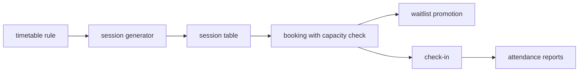
- **Timetable:** weekday, local start time, duration, class type, room, capacity.
- **Generator:** an idempotent `INSERT ... SELECT ... ON CONFLICT DO NOTHING` that creates sessions for the next eight weeks.
- **Booking:** a SQL function that locks the session row, counts confirmed bookings and inserts as `confirmed` or `waitlisted`.
- **Promotion:** on cancellation, the earliest waitlisted booking becomes confirmed in the same transaction.

### Data model
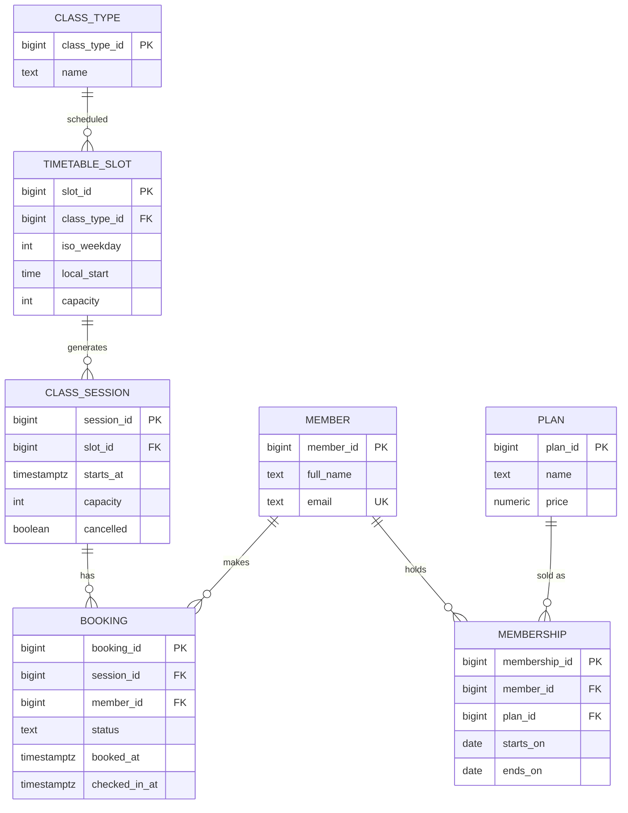
`CLASS_SESSION` copies `capacity` from the timetable when it is generated, so a later change to the timetable does not rewrite past sessions.

### Tech stack
| Component | Choice | Why |
|---|---|---|
| Expansion | `generate_series` over dates + `extract(isodow ...)` | One statement creates all sessions |
| Idempotence | `UNIQUE (slot_id, starts_at)` + `ON CONFLICT DO NOTHING` | Run the generator daily safely |
| Capacity | `SELECT ... FOR UPDATE` on the session row | Serializes bookings for one session |
| Logic | SQL or PL/pgSQL functions | Rules in one place (Ch 14) |

### Milestones
1. **Members and memberships.** *Done when* a query lists members active on a given date (`starts_on <= d AND ends_on >= d`).
2. **Timetable and generator.** *Done when* running the generator twice creates each session once, and moving one session leaves the timetable unchanged.
3. **Booking function.** *Done when* the 21st booking for a 20-place class is waitlisted.
4. **Concurrency test.** Two `psql` sessions book the last place at once. *Done when* exactly one gets `confirmed`.
5. **Promotion and reports.** *Done when* cancelling a confirmed booking promotes the earliest waitlisted member, and attendance reports match hand counts.

### Deep dive: the hard parts
- **Counting under concurrency.** "Count confirmed bookings, then insert if fewer than capacity" is a race. Two transactions both count 19 and both insert. Locking the *session* row first (`SELECT ... FROM class_session WHERE session_id = $1 FOR UPDATE`) makes the second transaction wait until the first commits, then it counts 20. This is the simplest correct fix. Project 20 compares it with other approaches.
- **Expanding the timetable.** Generate dates with `generate_series(current_date, current_date + 55, interval '1 day')`, keep those whose ISO weekday matches, and combine date with local start time and the gym's zone to get a `timestamptz`. The same daylight-saving lesson as Project 7 applies.
- **Waitlist order.** Promote `ORDER BY booked_at, booking_id LIMIT 1`. The id breaks ties when two bookings share a timestamp.
- **Ten-class passes.** A pass is "active" while it has unused classes. That is a count of attended bookings, not a date range, so the eligibility rule depends on the plan type. Model it explicitly rather than with a magic far-future end date.

### Testing strategy
Unit-test the booking function with fixtures: under capacity, at capacity, member without an active membership, duplicate booking. Run the concurrency test with a small Python script that opens two connections and books at the same moment, 100 times, asserting the confirmed count never exceeds capacity.

### Trade-offs, scaling and failure modes
- **Generate ahead vs compute on the fly.** Stored sessions can be edited one by one and hold bookings. Computing sessions from rules at query time saves storage but makes exceptions awkward.
- **Lock contention.** `FOR UPDATE` on the session row serializes bookings for *one* class. That is fine, since a class has at most a few dozen bookings. A flash sale with thousands of buyers needs a different design (Project 20).
- **Failure mode:** forgetting to run the generator means no sessions next week. Schedule it (cron or the `pg_cron` extension) and alert when the furthest session is less than seven days away.

### Stretch goals
- Instructor double-booking prevention across rooms.
- Monthly attendance heat map: weekday × hour with `count(*)` and `crosstab` from `tablefunc`.
- Membership revenue recognised per month for annual plans.

### Skills practised
- Date arithmetic and ISO weekdays: [Ch 3 — Functions and Expressions](../chapters/03-functions-and-expressions/README.md)
- Grouping for reports: [Ch 4 — Aggregation](../chapters/04-aggregation/README.md)
- `generate_series` and CTEs: [Ch 7 — CTEs, Views and Recursion](../chapters/07-ctes-views-and-recursion/README.md)
- Row locks: [Ch 13 — Transactions and Concurrency](../chapters/13-transactions-and-concurrency/README.md)

### In the interview
**Q:** How do you model a weekly class and its occurrences?

**A:** Store the rule (weekday, time) in one table and generate dated sessions into another. Exceptions such as cancellations edit only the session.

**Q:** Two members book the last place at once. What happens in your design?

**A:** Both transactions lock the session row with `FOR UPDATE`. The second waits, then sees the first booking and is waitlisted.

**Q:** How do you make the session generator safe to run repeatedly?

**A:** A unique key on slot and start time, and `INSERT ... ON CONFLICT DO NOTHING`.

### TL;DR
Separate rules from instances, expand rules with `generate_series`, and protect a capacity limit by locking the parent row before counting.

## 9. Habit tracker with streaks

**Level:** Beginner · **Time:** 1–2 weekends · **Prerequisites:** Ch 7, Ch 8

### What it is
A habit tracker where you log a check-in each day you do something (run, read, practise SQL), and the database computes current streaks, longest streaks, completion rate per week, and "best day of the week". Some habits are daily, some are "3 times a week". The streak logic is entirely in SQL with window functions.

### The problem it solves
"Longest run of consecutive days" is the classic **gaps and islands** problem: finding runs (islands) of consecutive values separated by gaps. It appears in interviews and in real products (login streaks, uptime periods, consecutive failed payments). A habit tracker is a friendly way to learn the pattern and its variations.

### Real-world examples
- [Loop Habit Tracker](https://loophabits.org/) is an open-source Android habit tracker with streaks and a "habit strength" score. It stores data in SQLite, but its features map directly to the queries in this project.
- PostgreSQL's [window functions tutorial](https://www.postgresql.org/docs/current/tutorial-window.html) covers the `row_number()` and `lag()` functions that every streak query uses.

### Requirements
**Functional**
- Users, habits (name, schedule: daily, or N times per ISO week), check-ins (one per habit per local date, optional note).
- Current streak and longest streak per habit, with start and end dates.
- Weekly completion: for "3 per week" habits, a week counts if it has at least 3 check-ins. Streaks count weeks.
- Calendar view: every day of the last 90 days with a done or not-done flag.
- Best weekday: completion rate by weekday.

**Non-functional**
- One check-in per habit per day (unique constraint).
- Dates are the user's *local* date, so a check-in at 23:30 counts for that day.
- Streak query under 50 ms for a user with 10 habits over 5 years.

### The architecture
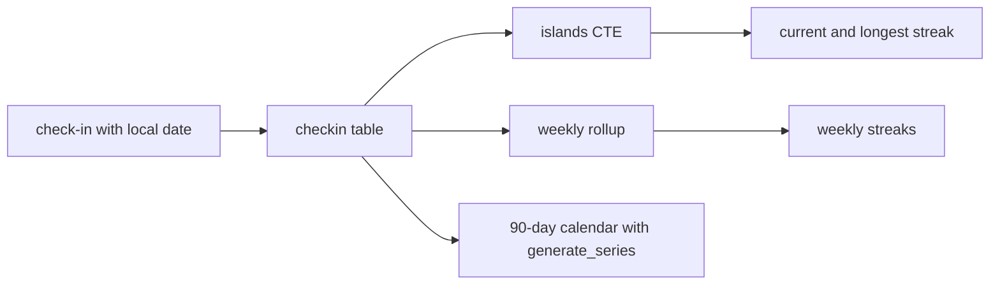
- **checkin table:** stores the local date the user meant, computed when written from the user's zone.
- **islands CTE:** labels each run of consecutive dates with a group key.
- **Weekly rollup:** groups check-ins into ISO weeks, then reuses the same island logic on week numbers.
- **Calendar:** a full date series left-joined to check-ins.

### Data model
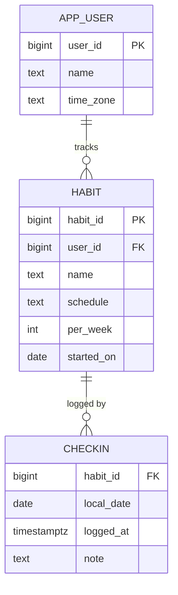
`CHECKIN` has the composite primary key `(habit_id, local_date)`, which both enforces one per day and gives the index the streak queries need.

### Tech stack
| Component | Choice | Why |
|---|---|---|
| Dates | `date` for the habit day, `timestamptz` for the log time | Local day vs real instant |
| Islands | `local_date - row_number()` trick | Classic gaps-and-islands |
| Weeks | `date_trunc('week', local_date)` | ISO weeks starting Monday |
| Calendar | `generate_series` + `LEFT JOIN` | Shows missed days |

### Milestones
1. **Schema and fake history.** Generate two years of check-ins with about 70% probability per day. *Done when* the unique constraint rejects a second check-in on one day.
2. **Islands.** *Done when* a query lists every streak (start, end, length) for one habit, and the lengths add up to the number of check-ins.
3. **Current and longest.** *Done when* the current streak is 0 if neither today nor yesterday has a check-in, and is correct otherwise.
4. **Weekly habits.** *Done when* "3 per week" streaks count consecutive qualifying weeks.
5. **Calendar and best weekday.** *Done when* the calendar has exactly 90 rows with correct flags.

### Deep dive: the hard parts
- **The island trick.** Number the check-ins of a habit in date order with `row_number()`. For consecutive dates, `local_date - row_number` (a date minus an integer is a date) stays constant, so it works as a group key. Group by it and take `min`, `max` and `count`. Draw a five-row table on paper to see why. A gap makes the difference jump.
- **An alternative with `lag()`.** Mark a row as a new island when `local_date - lag(local_date) > 1`, then a running `sum()` of those flags gives the island number. It is longer, but it generalises to "consecutive within 2 days" or "consecutive weeks".
- **Is the streak current?** The latest island is current if its end date is today or yesterday in the user's zone. "Today" must be `(now() AT TIME ZONE u.time_zone)::date`, not `current_date`, because `current_date` uses the server or session zone.
- **Weekly islands.** Turn each qualifying week into a number (`date_trunc('week', d)::date`, then subtract the row number times 7 days) and reuse the same trick with a step of one week.

### Testing strategy
Fixtures with known answers: a single day, two separate streaks, a streak that ends yesterday (still current), a streak that ended two days ago (not current), a run across New Year and across a leap day. Compare query results with expected rows. Property test: the sum of island lengths equals the number of check-ins.

### Trade-offs, scaling and failure modes
- **Compute on read vs store streak counters.** A counter updated on each check-in is fast but breaks when users back-fill a forgotten day. Computing from history is always right and, with the primary-key index, fast enough.
- **Local date at write time.** If a user moves time zones, old check-ins keep the local date they were recorded with. That is usually what users expect.
- **Failure mode:** using `timestamptz` truncated to UTC days splits an evening check-in into the next day for users west of UTC.

### Stretch goals
- "Habit strength", a score that decays on misses, computed with a recursive CTE over days.
- A "freeze" day that keeps a streak alive once per month.
- Leaderboard of longest current streaks among friends.

### Skills practised
- `generate_series` and CTEs: [Ch 7 — CTEs, Views and Recursion](../chapters/07-ctes-views-and-recursion/README.md)
- `row_number()`, `lag()` and running sums: [Ch 8 — Window Functions](../chapters/08-window-functions/README.md)
- Gaps-and-islands interview problems: [Ch 19 — SQL Interview Problems II](../chapters/19-sql-interview-problems-2/README.md)
- Time zones: [Ch 3 — Functions and Expressions](../chapters/03-functions-and-expressions/README.md)

### In the interview
**Q:** How do you find the longest run of consecutive days?

**A:** Subtract `row_number()` (ordered by date) from the date. Consecutive dates share the same result, so group by it and take the largest count.

**Q:** How would you allow a one-day gap inside a streak?

**A:** Use `lag()` to flag rows where the gap from the previous date is larger than 2, then a running sum of the flags numbers the islands.

**Q:** Why store a local date rather than only a timestamp?

**A:** The habit day is the day in the user's zone. Deriving it from a UTC timestamp later depends on knowing the zone they were in at the time.

### TL;DR
Streaks are gaps and islands: `date - row_number()` groups consecutive days, `lag()` plus a running sum handles looser rules, and "today" must be computed in the user's time zone.

## 10. Open-data import and cleaning

**Level:** Beginner · **Time:** 2 weekends · **Prerequisites:** Ch 3, Ch 9, Ch 11

### What it is
You take a large, messy public CSV, such as New York City's 311 service requests (complaints about noise, potholes, heating), and build a repeatable pipeline that loads it, finds and reports data-quality problems, cleans it, and normalizes it into a well-designed schema. The deliverable is the pipeline plus a data-quality report generated by SQL.

### The problem it solves
Real data is never clean. Dates come in two formats, a "borough" column has `BROOKLYN`, `Brooklyn` and `Unspecified`, ZIP codes lose leading zeros, and one row in a million has an extra comma. Most projects die at import. This one teaches the **staging pattern** (load everything as text, validate, then move good rows on and quarantine bad ones) and normalization applied to a real wide table.

### Real-world examples
- [NYC 311 Service Requests](https://data.cityofnewyork.us/Social-Services/311-Service-Requests-from-2010-to-Present/erm2-nwe9) on NYC Open Data has tens of millions of rows since 2010 and exports as CSV. Download one month or one borough to start.
- The PostgreSQL [`COPY` documentation](https://www.postgresql.org/docs/current/sql-copy.html) describes CSV options such as `HEADER`, `NULL`, `QUOTE` and `FORCE_NULL`. PostgreSQL 17+ adds `ON_ERROR ignore` to skip rows that fail type conversion, and PostgreSQL 18+ adds `REJECT_LIMIT` to cap how many may be skipped. On 14 you get the same safety with an all-`text` staging table.

### Requirements
**Functional**
- Load one month (hundreds of thousands of rows) into `raw_311`, all columns `text`, plus a `batch_id` and the source line number.
- Validation rules as data: a `dq_rule` table with a name and a SQL predicate that flags bad rows. Results go into `dq_issue`.
- Clean rows go into a normalized schema: `request`, `complaint_type`, `agency`, `location`. Bad rows go into `quarantine` with their reasons.
- A data-quality report: issues per rule, per column, per day, and the percentage of rows accepted.

**Non-functional**
- Load and clean a month in under 3 minutes.
- Re-running a batch is idempotent: it replaces that batch's output and never duplicates.
- Every rejected row can be traced to its line in the source file.

### The architecture
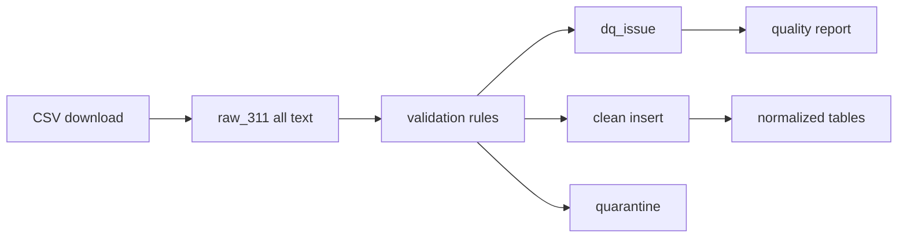
- **raw_311:** an exact copy of the file. Never edited, so you can always re-run.
- **Validation:** each rule is a predicate such as `created_date !~ '^\d{2}/\d{2}/\d{4}'`, run as `INSERT INTO dq_issue SELECT ... WHERE <predicate>`.
- **Clean insert:** casts, trims, maps codes, and upserts dimension rows (agency, complaint type).
- **Quarantine:** keeps rejected rows and the rules they broke.

### Data model
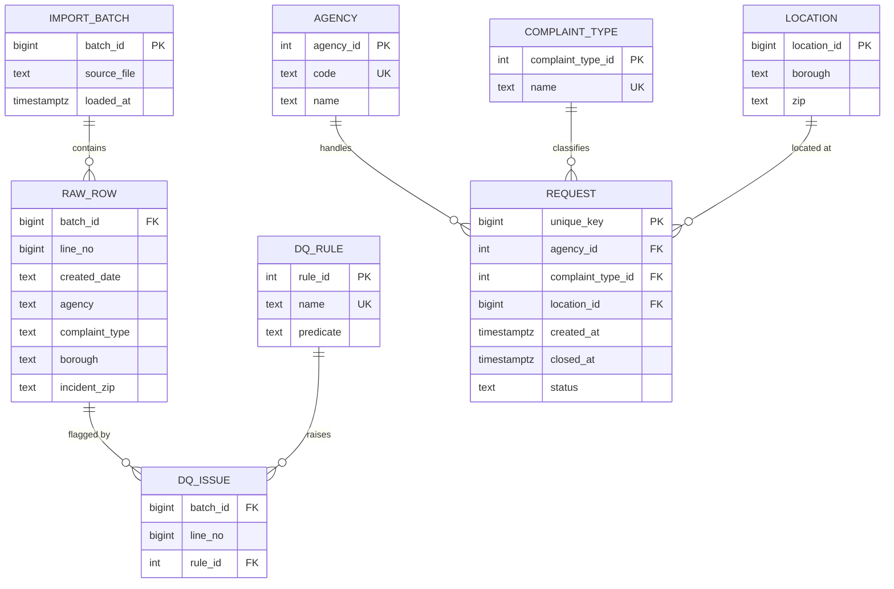

### Tech stack
| Component | Choice | Why |
|---|---|---|
| Load | `\copy raw_311 FROM ... CSV HEADER` | Client-side, no superuser needed |
| Rules | `dq_rule` table + a PL/pgSQL loop with `EXECUTE format(...)` | Rules are data, easy to add |
| Cleaning | `trim`, `upper`, `nullif`, `to_timestamp`, `lpad` for ZIPs | Ch 3 string and date functions |
| Upserts | `INSERT ... ON CONFLICT` | Idempotent dimension loads |

### Milestones
1. **Raw load.** *Done when* the row count equals the file's data lines and each row has its line number.
2. **Profiling.** For each column: null count, distinct count, top 10 values, min and max length. *Done when* you have a written list of at least eight problems you found.
3. **Rules.** Turn the problems into `dq_rule` rows. *Done when* the report shows counts per rule.
4. **Clean and normalize.** *Done when* accepted + quarantined = raw for the batch, and `request` has foreign keys to all dimensions.
5. **Idempotent re-run.** *Done when* running the batch twice gives identical counts and no duplicates.

### Deep dive: the hard parts
- **Profiling a wide table quickly.** Writing 40 near-identical queries is tedious. Generate them: query `information_schema.columns` for the staging table and build each profiling statement with `format('SELECT %L, count(*) FILTER (WHERE %I IS NULL) ...', col, col)`. Run them with `\gexec` in psql, which executes each result row as a statement.
- **Rules as data, safely.** Running a stored predicate needs dynamic SQL (`EXECUTE`). Only the project owner writes rules, but still build statements with `format()` and `%I` for identifiers, the habit that prevents SQL injection (Ch 14).
- **Normalization of a real table.** Find **functional dependencies** (when one column's value determines another's, Ch 11) in the data itself: does `agency` determine `agency_name`? Check with `SELECT agency FROM raw GROUP BY agency HAVING count(DISTINCT agency_name) > 1`. Where the data violates a dependency you expected, you have found a quality issue, not a design flaw.
- **Idempotence by batch.** In one transaction: delete the batch's rows from the output tables and the quarantine, then re-insert. Readers see either the old or the new batch, never half of each.

### Testing strategy
Make a 20-line CSV with one example of every problem (bad date, lowercase borough, ZIP `7302`, unknown agency, duplicate key) and assert exactly which rules fire on which lines. Use it as a regression test whenever you change a rule.

### Trade-offs, scaling and failure modes
- **Reject vs repair.** Repairing (`'Brooklyn'` → `'BROOKLYN'`) keeps more data, but every repair is a guess. Log each repair as a lower-severity issue so analysts know.
- **PostgreSQL 17+ `ON_ERROR ignore`** is fast and convenient, but it silently drops rows. The staging approach keeps them for inspection.
- **Scale.** Ten years of 311 data is tens of millions of rows. Load per month, add indexes after loading, and consider partitioning the final table by month (Project 27).

### Stretch goals
- Data-quality trend: issue rates per month across a year of batches.
- Use `file_fdw` to query the CSV in place without loading it.
- Median time-to-close per agency and complaint type.

### Skills practised
- Cleaning functions: [Ch 3 — Functions and Expressions](../chapters/03-functions-and-expressions/README.md)
- Loading, upserts and constraints: [Ch 9 — DDL, DML and Constraints](../chapters/09-ddl-dml-and-constraints/README.md)
- Functional dependencies and normal forms: [Ch 11 — Normalization](../chapters/11-normalization/README.md)
- Dynamic SQL and injection safety: [Ch 14 — Advanced SQL and Using SQL from Code](../chapters/14-advanced-sql-and-using-sql-from-code/README.md)

### In the interview
**Q:** Why load into an all-text staging table first?

**A:** A single bad value would make a typed `COPY` fail the whole load. Text staging accepts everything, so you can validate with SQL and keep bad rows for inspection.

**Q:** How do you make a load re-runnable?

**A:** Tag rows with a batch id, and in one transaction delete that batch's output and re-insert it. Upserts handle shared dimension rows.

**Q:** How can you check a functional dependency in real data?

**A:** Group by the determinant and look for groups with more than one distinct dependent value.

### TL;DR
Load raw as text, profile, turn problems into rules stored as data, quarantine with reasons, normalize the clean rows, and make every batch idempotent.

## 11. E-commerce orders and inventory

**Level:** Intermediate · **Time:** 2–3 weeks · **Prerequisites:** Ch 9, Ch 10, Ch 13

### What it is
The transactional core of an online shop: customers, products and their variants (size, colour), stock per warehouse, carts, orders with line items, payments and shipments. The focus is the moment of checkout: turning a cart into an order, reserving stock and taking payment so that you never sell stock you do not have and never charge twice.

### The problem it solves
Under load, the naive checkout ("read stock, check it is enough, write stock minus quantity") oversells. Two buyers read "1 left", both buy, stock becomes -1. Retries after a network timeout create duplicate orders. Prices change between adding to the cart and paying. A correct schema plus the right transaction pattern fixes each of these, and the same ideas reappear in every system that handles money or scarce items.

### Real-world examples
- [Saleor](https://docs.saleor.io/) is an open-source, headless e-commerce platform built on PostgreSQL. Its documentation describes products, variants, warehouses, stock allocation and orders, a useful comparison for your model.
- Stripe's post [Designing robust and predictable APIs with idempotency](https://stripe.com/blog/idempotency) explains idempotency keys: the client sends a unique key with each request so a retry returns the first result instead of charging again. Your checkout uses the same idea.

### Requirements
**Functional**
- Products with variants (SKU), prices with a currency, stock per warehouse.
- Carts with items. Checkout creates an order, copies prices into order lines, reserves stock and records a payment attempt.
- Order states: `pending_payment`, `paid`, `shipped`, `delivered`, `cancelled`, `refunded`. Cancelling releases reserved stock.
- Reports: daily revenue, best sellers, low-stock alerts, abandoned carts.

**Non-functional**
- Stock never negative, even with 50 concurrent checkouts on the last 10 units.
- Checkout idempotent per client key: the same key never creates two orders.
- Checkout transaction p95 under 50 ms at 200 checkouts per second on a laptop (measure with `pgbench` and a custom script).

### The architecture
```mermaid
flowchart LR
    A["client with idempotency key"] --> B["checkout function"]
    B --> C["idempotency_key table"]
    B --> D["stock: conditional UPDATE"]
    B --> E["orders and order_lines"]
    B --> F["payment attempt"]
    E --> G["state transition function"]
    G --> D
```
- **Checkout function:** one transaction that does all the steps or none.
- **idempotency_key:** maps a client key to the order it created. A repeated key returns that order.
- **Stock update:** `UPDATE stock SET on_hand = on_hand - $qty WHERE sku_id = $1 AND warehouse_id = $2 AND on_hand >= $qty`. Zero rows updated means "out of stock".
- **State transition function:** the only way to change an order's status. It checks the move is allowed (you cannot ship a cancelled order).

### Data model
```mermaid
erDiagram
    CUSTOMER ||--o{ CART : owns
    CART ||--o{ CART_ITEM : contains
    PRODUCT ||--|{ SKU : "has variants"
    SKU ||--o{ STOCK : "stocked in"
    WAREHOUSE ||--o{ STOCK : holds
    CUSTOMER ||--o{ ORDERS : places
    ORDERS ||--|{ ORDER_LINE : contains
    SKU ||--o{ ORDER_LINE : "sold as"
    ORDERS ||--o{ PAYMENT : "paid by"
    ORDERS ||--o{ SHIPMENT : "shipped in"
    SKU {
        bigint sku_id PK
        bigint product_id FK
        text code UK
        numeric price
    }
    STOCK {
        bigint sku_id FK
        bigint warehouse_id FK
        int on_hand
        int reserved
    }
    ORDERS {
        bigint order_id PK
        bigint customer_id FK
        text status
        numeric total
        text idempotency_key UK
        timestamptz placed_at
    }
    ORDER_LINE {
        bigint order_id FK
        int line_no
        bigint sku_id FK
        int qty
        numeric unit_price
    }
    PAYMENT {
        bigint payment_id PK
        bigint order_id FK
        numeric amount
        text status
    }
```
`ORDER_LINE.unit_price` is a copy of the price at purchase time. It is deliberate denormalization: the order must not change when the catalogue price does.

### Tech stack
| Component | Choice | Why |
|---|---|---|
| Stock safety | Conditional `UPDATE ... WHERE on_hand >= qty` + `CHECK (on_hand >= 0)` | Atomic test-and-decrement, with a safety net |
| Idempotency | `UNIQUE (idempotency_key)` | The database rejects the duplicate |
| Logic | PL/pgSQL functions | One round trip per checkout |
| Load test | `pgbench -f checkout.sql -c 50` | Real concurrency, built in |

### Milestones
1. **Catalogue and stock.** *Done when* `CHECK (on_hand >= 0)` rejects a manual negative update.
2. **Naive checkout first.** Read, then write, with `READ COMMITTED`. *Done when* `pgbench` with 50 clients oversells. Keep this as proof of the bug.
3. **Correct checkout.** Conditional update. *Done when* the same test sells exactly the available units and every other attempt gets a clean "out of stock".
4. **Idempotency.** *Done when* repeating a checkout with the same key returns the original order id and stock is decremented once.
5. **Order state machine and reports.** *Done when* illegal transitions raise errors and cancelling restores stock.

### Deep dive: the hard parts
- **Why the conditional update is enough.** In `READ COMMITTED`, an `UPDATE` that finds a row locked by another transaction waits. When that one commits, PostgreSQL re-checks the `WHERE` clause against the new row version (the "EvalPlanQual" re-check). So the second buyer sees `on_hand = 0`, the condition fails, and zero rows are updated. No explicit lock and no retry loop needed. Compare this with `SELECT ... FOR UPDATE` then `UPDATE`, which also works but takes two statements.
- **Multi-line carts and deadlocks.** Two carts with SKUs A and B, locked in opposite orders, can deadlock (Ch 13). Always update stock rows in a fixed order (`ORDER BY sku_id`).
- **Idempotency key races.** Two retries with the same key may arrive at once. Insert the key row *first* in the transaction. The second insert waits on the first's uncommitted unique entry, then fails with `23505` when it commits, and the handler returns the existing order.
- **Reserve vs decrement.** Real shops often *reserve* at checkout and *decrement* at shipping, so `on_hand` matches the shelf. That needs `available = on_hand - reserved`, a `CHECK (reserved <= on_hand)`, and a job that releases reservations of unpaid orders after 15 minutes.

### Testing strategy
Concurrency tests are the core: a `pgbench` script per scenario (last unit, multi-line carts in random order, duplicate keys), each followed by invariant queries: total sold + remaining = initial stock, no negative stock, one order per key. Unit tests for the state machine: a table of (from, to, allowed) checked exhaustively.

### Trade-offs, scaling and failure modes
- **Hot rows.** A single best-selling SKU becomes a lock hot spot, because every buyer queues on one row. Options: split stock into several bucket rows and decrement any bucket with stock, or accept a small oversell and fix it in fulfilment.
- **Payment outside the transaction.** Never call a payment provider while holding row locks. Create the order as `pending_payment`, commit, call the provider, then transition. A crash in between leaves a pending order that a reconciliation job resolves.
- **Snapshotted prices** cost storage but keep history correct.

### Stretch goals
- Coupons with usage limits (another counter under concurrency).
- Split shipments from several warehouses, choosing the nearest with stock.
- PostgreSQL 15+: `MERGE` for cart synchronisation from a client payload.

### Skills practised
- Constraints, `CHECK` and upsert: [Ch 9 — DDL, DML and Constraints](../chapters/09-ddl-dml-and-constraints/README.md)
- Modelling orders and variants: [Ch 10 — Data Modeling and ER Diagrams](../chapters/10-data-modeling-and-er-diagrams/README.md)
- Lost updates, deadlocks, isolation: [Ch 13 — Transactions and Concurrency](../chapters/13-transactions-and-concurrency/README.md)
- The e-commerce case study: [Ch 17 — Schema Design Case Studies](../chapters/17-schema-design-case-studies/README.md)

### In the interview
**Q:** How do you stop overselling without heavy locking?

**A:** One conditional `UPDATE` that decrements only if enough stock remains, and checks the affected row count. A `CHECK (on_hand >= 0)` is the safety net.

**Q:** Why copy the price into the order line?

**A:** The order is a historical record. If it referenced the current price, changing the catalogue would rewrite past invoices.

**Q:** How do you make checkout safe to retry?

**A:** The client sends an idempotency key, stored with a unique constraint in the same transaction as the order. A retry finds the key and returns the original order.

**Q:** Where does the payment call go?

**A:** Outside the database transaction. Commit a pending order, call the provider, then update the status, with a reconciliation job for crashes in between.

### TL;DR
Checkout is one atomic transaction: conditional stock decrements in a fixed order, an idempotency key with a unique constraint, prices copied into lines, and payment calls kept outside the locks.

## 12. Analytics dashboard queries

**Level:** Intermediate · **Time:** 2 weeks · **Prerequisites:** Ch 4, Ch 7, Ch 8

### What it is
The SQL behind a business dashboard for an online shop: daily revenue with a 7-day moving average, month-to-date versus last month, revenue share per category, top 3 products per category, running totals, week-over-week growth, customers' days between orders, and a funnel. Each tile is one query, written with window functions, and the project ends with a small dashboard tool (Metabase, Grafana or a Python script) showing them.

### The problem it solves
Without window functions these metrics need self-joins, correlated subqueries or application loops, which are slow and easy to get wrong. With them, each tile is a short, fast, readable query. Analysts and backend developers write these queries every week, and interviewers love them.

### Real-world examples
- [Metabase](https://www.metabase.com/docs/latest/questions/native-editor/writing-sql) is an open-source BI tool that lets you write native SQL against PostgreSQL and turn each query into a dashboard card. Connect it to your database for the final milestone.
- The PostgreSQL [window functions reference](https://www.postgresql.org/docs/current/functions-window.html) lists every function you will use (`rank`, `lag`, `ntile`, `first_value`), and the [SELECT reference](https://www.postgresql.org/docs/current/sql-select.html) defines frame clauses.

### Requirements
**Functional**
- A generated dataset: 50,000 customers, 2 million orders over 3 years, seasonal patterns, a few product categories.
- Twelve dashboard tiles, each a saved query with a comment explaining the business question.
- Tiles must handle missing days (a day with no orders shows 0, not a gap).
- A date-range parameter for every tile.

**Non-functional**
- Each tile under 500 ms for a 90-day range on 2 million orders.
- Results identical to a slower reference query (self-join or subquery version) for at least four tiles.

### The architecture
```mermaid
flowchart LR
    A["orders and order_lines"] --> B["daily_sales rollup"]
    C["calendar table"] --> B
    B --> D["tiles: moving avg, MTD, growth"]
    A --> E["tiles: top N, share, gaps"]
    D --> F["Metabase or script"]
    E --> F
```
- **Calendar table:** one row per date with year, month, ISO week and weekday. It fills gaps and makes period comparisons easy.
- **daily_sales rollup:** a materialized view or table of revenue per day per category, refreshed nightly.
- **Tiles:** read the rollup where they can, and the raw tables only for per-customer metrics.

### Data model
```mermaid
erDiagram
    CUSTOMER ||--o{ ORDERS : places
    ORDERS ||--|{ ORDER_LINE : contains
    PRODUCT ||--o{ ORDER_LINE : "sold in"
    CATEGORY ||--o{ PRODUCT : groups
    CALENDAR ||--o{ DAILY_SALES : "keyed by"
    CATEGORY ||--o{ DAILY_SALES : "split by"
    ORDERS {
        bigint order_id PK
        bigint customer_id FK
        timestamptz placed_at
        text status
    }
    ORDER_LINE {
        bigint order_id FK
        bigint product_id FK
        int qty
        numeric amount
    }
    CALENDAR {
        date day PK
        int iso_year
        int iso_week
        int month
        boolean is_weekend
    }
    DAILY_SALES {
        date day FK
        int category_id FK
        numeric revenue
        int orders
    }
    PRODUCT {
        bigint product_id PK
        int category_id FK
        text name
    }
    CATEGORY {
        int category_id PK
        text name
    }
```

### Tech stack
| Component | Choice | Why |
|---|---|---|
| Moving average | `avg(revenue) OVER (ORDER BY day ROWS BETWEEN 6 PRECEDING AND CURRENT ROW)` | One pass, no self-join |
| Top N per group | `row_number()` or `rank()` in a subquery, then filter | Window results cannot be filtered in the same `WHERE` |
| Rollup | Materialized view + `REFRESH MATERIALIZED VIEW CONCURRENTLY` | Fast reads, refresh without blocking readers |
| Dashboard | Metabase or Python + matplotlib | Any tool that runs SQL |

### Milestones
1. **Data generator.** *Done when* a daily revenue chart shows weekly and yearly seasonality you designed.
2. **Calendar and rollup.** *Done when* the rollup has a row for every day and category, zeros included, and totals match the raw tables.
3. **Six basic tiles.** Daily revenue, 7-day average, month-to-date, running total, category share, week-over-week change. *Done when* each matches a reference query.
4. **Six harder tiles.** Top 3 per category, days between orders per customer (median), first order vs repeat revenue, a funnel, best day ever, and a year-over-year comparison aligned by weekday. *Done when* each has a written interpretation.
5. **Dashboard.** *Done when* all tiles load together in under 3 seconds.

### Deep dive: the hard parts
- **`ROWS` vs `RANGE` frames.** The default frame with `ORDER BY` is `RANGE BETWEEN UNBOUNDED PRECEDING AND CURRENT ROW`, which treats rows with equal sort keys as peers. A running total over orders with equal timestamps then jumps by the whole group at once. With daily rows from the calendar, `ROWS` and `RANGE` agree. On raw orders they do not. Know which you need.
- **Moving average over missing days.** `ROWS BETWEEN 6 PRECEDING` means six *rows*, not six *days*. If days are missing, the window spans more than a week. Join to the calendar first, or use `RANGE BETWEEN interval '6 days' PRECEDING AND CURRENT ROW` (offset `RANGE` frames, available since PostgreSQL 11).
- **Year-over-year by weekday.** Comparing 1 March with 1 March last year mixes weekdays. Compare with the date 364 days earlier (52 weeks), which is the same weekday, or use `lag(revenue, 364)` over a gap-free calendar.
- **Share of total.** `revenue / sum(revenue) OVER ()` gives each row's share of the grand total in one pass. `sum(...) OVER (PARTITION BY month)` gives share within the month. Remember integer division if you count rather than sum (Ch 3).

### Testing strategy
For each tile keep a slow reference version (correlated subquery or self-join) and assert equality with `EXCEPT` on a small date range. Test boundary days: the first day of data (moving average over fewer than 7 rows), month ends, and a leap day.

### Trade-offs, scaling and failure modes
- **Rollups vs raw queries.** Rollups make dashboards fast but add a refresh delay and one more thing to keep correct. Use them for daily metrics and query raw tables only when you need per-customer detail.
- **Refreshing concurrently** needs a unique index on the materialized view and takes longer than a plain refresh, but readers are not blocked.
- **Failure mode:** time zones. "Daily revenue" in UTC and in the shop's local zone give different days. Choose one and bucket with `(placed_at AT TIME ZONE 'Europe/Berlin')::date`.

### Stretch goals
- `GROUPING SETS` to produce category, month and grand totals in one query.
- An incremental rollup that only recomputes the last 3 days.
- Anomaly flag: days more than 3 standard deviations from the 28-day moving average.

### Skills practised
- `GROUP BY`, `FILTER`, `ROLLUP`: [Ch 4 — Aggregation](../chapters/04-aggregation/README.md)
- CTEs and materialized views: [Ch 7 — CTEs, Views and Recursion](../chapters/07-ctes-views-and-recursion/README.md)
- Frames, ranking, `lag`: [Ch 8 — Window Functions](../chapters/08-window-functions/README.md)
- Interview-style analytics: [Ch 18 — SQL Interview Problems I](../chapters/18-sql-interview-problems-1/README.md)

### In the interview
**Q:** How do you compute a 7-day moving average?

**A:** `avg(x) OVER (ORDER BY day ROWS BETWEEN 6 PRECEDING AND CURRENT ROW)` on a gap-free daily series, or a `RANGE` frame with an interval offset if days can be missing.

**Q:** How do you get the top 3 products per category?

**A:** Rank products within each category with `row_number()` or `rank()` in a subquery or CTE, then filter on the rank in the outer query.

**Q:** What is the difference between `ROWS` and `RANGE`?

**A:** `ROWS` counts physical rows. `RANGE` groups rows with equal sort values as peers and can use value offsets, such as an interval.

### TL;DR
Dashboard metrics are window functions over a gap-free calendar: choose the frame on purpose, keep reference queries to prove correctness, and pre-aggregate daily rollups for speed.

## 13. Hotel booking with exclusion constraints

**Level:** Intermediate · **Time:** 2 weeks · **Prerequisites:** Ch 9, Ch 12, Ch 13

### What it is
A booking system for a small hotel chain: hotels, room types, rooms, rates by date, and reservations for a date range. The central rule, "no room is booked twice for overlapping nights", is enforced by a PostgreSQL **exclusion constraint** over **range types** rather than by application code.

### The problem it solves
Overlap checks in application code ("is there any booking where start < my_end and end > my_start?") race under concurrency: two requests check, both see the room free, both insert. A unique index cannot help because overlapping ranges are not equal values. PostgreSQL's exclusion constraint generalises uniqueness to any operator, here "overlaps" (`&&`), and makes the database reject the second booking atomically.

### Real-world examples
- The PostgreSQL [range types documentation](https://www.postgresql.org/docs/current/rangetypes.html#RANGETYPES-CONSTRAINT) uses a room-reservation table as its own example of `EXCLUDE USING GIST (room WITH =, during WITH &&)`, with the [`btree_gist`](https://www.postgresql.org/docs/current/btree-gist.html) extension providing the equality part.
- PostgreSQL 18 release notes describe [temporal primary keys and unique constraints](https://www.postgresql.org/docs/18/release-18.html) with `WITHOUT OVERLAPS`, a standard-SQL way to say the same thing. This project uses the exclusion constraint so it runs on 14.

### Requirements
**Functional**
- Hotels, room types (capacity, base price), rooms, and a rate calendar (price per room type per night).
- Search: available room types in a hotel for a date range and number of guests, with the total price.
- Book: assign a specific room, store the stay as a `daterange` with exclusive end (check-out day not included).
- Cancel, change dates, and block rooms for maintenance (blocks also cannot overlap bookings).
- Occupancy report: occupied room-nights / available room-nights per hotel per month.

**Non-functional**
- No overlapping active stays per room, enforced by the database.
- Search under 100 ms for 50 hotels, 5,000 rooms and 2 years of bookings (about 1 million rows).
- Booking under 20 ms, and correct under 100 concurrent requests for the same room.

### The architecture
```mermaid
flowchart LR
    A["search request"] --> B["availability query"]
    B --> C["rate calendar"]
    B --> D["stay table with GiST index"]
    E["book request"] --> F["insert stay"]
    F --> D
    D --> G["exclusion constraint rejects overlap"]
    G --> H["try next free room"]
```
- **Availability query:** room types with at least one room that has no overlapping stay, joined to the rate calendar for the price.
- **stay table:** reservations and maintenance blocks in one table, with a `kind` column, so one constraint covers both.
- **Exclusion constraint:** the last line of defence. Even a buggy search cannot produce a double booking.
- **Retry:** if insert fails with SQLSTATE `23P01` (exclusion violation), try the next candidate room.

### Data model
```mermaid
erDiagram
    HOTEL ||--o{ ROOM_TYPE : offers
    ROOM_TYPE ||--o{ ROOM : "has rooms"
    ROOM_TYPE ||--o{ RATE : "priced by night"
    GUEST ||--o{ RESERVATION : makes
    RESERVATION ||--|{ STAY : "assigned as"
    ROOM ||--o{ STAY : occupies
    HOTEL {
        bigint hotel_id PK
        text name
        text time_zone
    }
    ROOM_TYPE {
        bigint room_type_id PK
        bigint hotel_id FK
        int max_guests
    }
    ROOM {
        bigint room_id PK
        bigint room_type_id FK
        text number
    }
    RATE {
        bigint room_type_id FK
        date night
        numeric price
    }
    RESERVATION {
        bigint reservation_id PK
        bigint guest_id FK
        text status
        numeric total
    }
    STAY {
        bigint stay_id PK
        bigint room_id FK
        bigint reservation_id FK
        daterange nights
        text kind
    }
    GUEST {
        bigint guest_id PK
        text full_name
        text email
    }
```

### Tech stack
| Component | Choice | Why |
|---|---|---|
| Range | `daterange` with `[)` bounds | Check-out day is free for the next guest |
| Constraint | `EXCLUDE USING gist (room_id WITH =, nights WITH &&) WHERE (kind <> 'cancelled')` | Overlap-proof, ignores cancelled rows |
| Equality in GiST | `btree_gist` extension | Lets a GiST index handle `bigint =` |
| Multi-room stays | `range_agg` (PostgreSQL 14+) | Merges ranges into multiranges for reports |

### Milestones
1. **Schema with constraint.** *Done when* inserting an overlapping stay fails with `23P01` and a back-to-back stay (check-out = next check-in) succeeds.
2. **Rate calendar and pricing.** *Done when* a 3-night stay's price equals the sum of the three nights' rates.
3. **Search.** *Done when* results match a brute-force check on a test hotel.
4. **Concurrent booking test.** 100 clients try to book the same room type for the same nights. *Done when* exactly as many succeed as there are rooms and none overlap.
5. **Occupancy and changes.** *Done when* changing dates is atomic (the old stay is not lost if the new range conflicts) and occupancy reports match hand counts.

### Deep dive: the hard parts
- **How the exclusion constraint works.** On insert, PostgreSQL searches the GiST index for any existing row where `room_id = new.room_id AND nights && new.nights`. If one exists, the insert fails. Concurrent inserts are handled like unique indexes: the second waits for the first to commit or roll back, then re-checks. So it is race-free with no explicit locks.
- **Half-open ranges.** `daterange('2026-05-01', '2026-05-04')` is `[2026-05-01,2026-05-04)`: nights of the 1st, 2nd and 3rd. Two stays `[1,4)` and `[4,6)` do not overlap. Using closed ranges would block same-day turnover. Number of nights: `upper(nights) - lower(nights)`.
- **Assigning a room under contention.** The search returns a room type, but you insert a specific room. Pick candidates in random order (or `ORDER BY room_id`) and try each, catching `23P01` in a PL/pgSQL `EXCEPTION` block. An exception block creates a subtransaction, which is fine here, but keep the loop short because heavy subtransaction use has real costs (see GitLab's experience in Project 35).
- **Changing dates atomically.** Update the `nights` column in place. The constraint ignores the row's own old version, so moving from `[1,4)` to `[2,5)` works if nobody else has the 4th.

### Testing strategy
Constraint tests: overlap rejected, touching ranges accepted, cancelled stays ignored, maintenance blocks conflict with bookings. Concurrency test via `pgbench` with random date ranges, followed by a self-join that finds overlapping pairs and must return zero rows. Performance: `EXPLAIN ANALYZE` the availability search and confirm it uses the GiST index.

### Trade-offs, scaling and failure modes
- **Room-level vs type-level inventory.** Booking a type without assigning a room (the guest gets a room at check-in) maximises occupancy but needs a count per type per night instead of an exclusion constraint. The Chapter 17 hotel case study discusses this split.
- **GiST write cost.** GiST inserts are slower than B-tree inserts. At hotel scale this does not matter. At airline-seat scale you would partition by date.
- **Failure mode:** forgetting `WHERE (kind <> 'cancelled')` in the constraint means cancelled bookings block rooms forever.

### Stretch goals
- PostgreSQL 18+: rewrite with `PRIMARY KEY (room_id, nights WITHOUT OVERLAPS)` and compare.
- Minimum-stay rules per night (Saturday requires 2 nights).
- Overbooking by a small percentage per room type, with a report of walked guests.

### Skills practised
- Constraints and extensions: [Ch 9 — DDL, DML and Constraints](../chapters/09-ddl-dml-and-constraints/README.md)
- GiST indexes: [Ch 12 — Indexes, Storage and Query Performance](../chapters/12-indexes-storage-and-query-performance/README.md)
- Concurrent inserts and constraint checks: [Ch 13 — Transactions and Concurrency](../chapters/13-transactions-and-concurrency/README.md)
- The hotel case study: [Ch 17 — Schema Design Case Studies](../chapters/17-schema-design-case-studies/README.md)

### In the interview
**Q:** How do you prevent overlapping bookings in PostgreSQL?

**A:** Store the stay as a range and add `EXCLUDE USING gist (room_id WITH =, nights WITH &&)`. The database rejects any overlapping row atomically, even under concurrency.

**Q:** Why a half-open range?

**A:** So one guest's check-out day can be the next guest's check-in day without the ranges overlapping.

**Q:** Why is an application-level overlap check not enough?

**A:** Two transactions can both run the check before either inserts, so both see the room free. Only a constraint, a lock or serializable isolation closes that gap.

### TL;DR
Model stays as half-open `daterange` values and let an exclusion constraint with `btree_gist` reject overlaps. It is a uniqueness rule for intervals and it is race-free.

## 14. Job queue with SKIP LOCKED

**Level:** Intermediate · **Time:** 2 weeks · **Prerequisites:** Ch 9, Ch 12, Ch 13

### What it is
A background-job queue stored in a PostgreSQL table. Producers insert jobs, often in the same transaction as the business change that caused them. Many workers claim jobs concurrently with `SELECT ... FOR UPDATE SKIP LOCKED`, run them, and mark them done, retry them with backoff, or move them to a dead-letter state. You also build a dashboard query for queue depth and job age.

### The problem it solves
Adding Redis or a message broker just for background jobs adds another system to run, and creates a gap. If the database commit succeeds but the enqueue fails, the job is lost. If the enqueue happens before the commit, the worker may run before the data exists. A queue in the same database is transactional: the job exists if and only if the business change committed. `SKIP LOCKED` (PostgreSQL 9.5+) lets many workers take different jobs without blocking each other.

### Real-world examples
- [River](https://riverqueue.com/docs) is a job queue for Go built on PostgreSQL. It promotes transactional enqueueing: insert the job in the same transaction as your data. Graphile Worker (Node) and Oban (Elixir) follow the same idea.
- Brandur Leach's [Transactionally Staged Job Drains in Postgres](https://brandur.org/job-drain) explains the two failure modes above (jobs that run too early, jobs that are lost) and a staging-table fix.
- The PostgreSQL [SELECT documentation on locking clauses](https://www.postgresql.org/docs/current/sql-select.html#SQL-FOR-UPDATE-SHARE) notes that `SKIP LOCKED` gives an inconsistent view of the data on purpose, which makes it suitable for queue-like tables and not for general queries.

### Requirements
**Functional**
- `job` table: queue name, payload (`jsonb`), state (`available`, `running`, `succeeded`, `failed`, `dead`), attempts, max attempts, run-after time, priority, last error.
- Enqueue inside any transaction. Optional unique key to avoid duplicate jobs.
- Claim a batch of up to N jobs per worker, with priority then age order.
- Heartbeat and lease: a job held by a crashed worker becomes available again after its lease expires.
- Retry with exponential backoff and jitter. Move to `dead` after max attempts.
- Monitoring: depth per queue and state, oldest available job age, throughput per minute.

**Non-functional**
- 1,000+ jobs per second claimed and completed on a laptop with 8 workers.
- No job processed by two workers at the same time while its lease is valid.
- Table size stays bounded: finished jobs are deleted or archived.

### The architecture
```mermaid
flowchart LR
    A["app transaction"] --> B["INSERT job"]
    B --> C["job table"]
    D["worker 1"] --> E["claim with SKIP LOCKED"]
    F["worker 2"] --> E
    E --> C
    D --> G["run handler"]
    G --> H["mark succeeded or retry"]
    H --> C
    I["reaper"] --> C
    J["NOTIFY on insert"] --> D
```
- **Claim:** one statement that selects available jobs with `FOR UPDATE SKIP LOCKED` and updates them to `running` with a lease expiry.
- **Workers:** small Python or Java processes. Each claims a batch, runs it, writes results.
- **Reaper:** periodically resets `running` jobs whose lease expired.
- **NOTIFY:** a trigger sends `NOTIFY job_inserted` so idle workers wake immediately instead of polling every second.

### Data model
```mermaid
erDiagram
    QUEUE ||--o{ JOB : contains
    JOB ||--o{ JOB_ATTEMPT : "tried in"
    QUEUE {
        text name PK
        int max_attempts
        int lease_seconds
    }
    JOB {
        bigint job_id PK
        text queue FK
        jsonb payload
        text state
        int priority
        int attempts
        timestamptz run_after
        timestamptz lease_until
        text unique_key UK
    }
    JOB_ATTEMPT {
        bigint job_id FK
        int attempt
        text worker_id
        timestamptz started_at
        timestamptz finished_at
        text error
    }
```

### Tech stack
| Component | Choice | Why |
|---|---|---|
| Claim | `UPDATE ... WHERE job_id IN (SELECT ... FOR UPDATE SKIP LOCKED LIMIT n) RETURNING *` | One round trip, no blocking |
| Index | Partial index on `(queue, priority, run_after) WHERE state = 'available'` | Small, matches the claim query |
| Wake-up | `LISTEN` / `NOTIFY` | Low latency without tight polling |
| Workers | Python 3.14 + psycopg 3, or Java 25 + JDBC | Either is fine |

### Milestones
1. **Table, enqueue and a single worker.** *Done when* a job inserted in a rolled-back transaction is never run.
2. **Concurrent claim.** *Done when* 8 workers process 100,000 jobs with each job run exactly once (no lease expiry in this test).
3. **Retries and dead letters.** *Done when* a handler that always fails produces exactly `max_attempts` attempts with increasing delays, then `dead`.
4. **Leases and reaper.** Kill a worker with `kill -9` mid-job. *Done when* the job is re-run after the lease expires.
5. **Throughput and bloat.** *Done when* you sustain 1,000 jobs per second for 10 minutes and the table and index sizes stay flat.

### Deep dive: the hard parts
- **Why `SKIP LOCKED`.** Without it, all workers select the same "oldest" row, and all but one block on its lock. `FOR UPDATE NOWAIT` errors instead of blocking. `SKIP LOCKED` simply skips rows another transaction has locked, so worker 2 takes the second-oldest job. Lock the inner `SELECT` and update in the same statement so the lock is held only for milliseconds.
- **Short transactions with leases, not long ones.** Holding the row lock for the whole job (minutes) keeps a transaction open, which blocks VACUUM from cleaning dead rows across the *whole database* and wastes a connection. Instead, claim and commit quickly, setting `state = 'running'` and `lease_until = now() + interval '5 minutes'`. The lease is what protects the job. The worker extends it with a heartbeat.
- **At-least-once, not exactly-once.** A worker can finish the work and crash before marking it done, so the job runs again. Handlers must be **idempotent** (running twice has the same effect as once), for example by checking a "sent" flag or using an idempotency key with the external service.
- **Bloat.** Every state change is an `UPDATE`, which in PostgreSQL writes a new row version (MVCC). A busy queue creates many dead rows. Keep rows small (payload in `jsonb`, not huge), delete finished jobs promptly, tune autovacuum for this table (lower `autovacuum_vacuum_scale_factor`), and watch `n_dead_tup` in `pg_stat_user_tables`.

### Testing strategy
An exactly-once test: each handler inserts its job id into a `processed` table with a unique constraint, so any duplicate run fails loudly (when no crash is simulated). A crash test with `kill -9`. A load test measuring throughput and p99 claim latency while you watch `pg_stat_activity` for lock waits.

### Trade-offs, scaling and failure modes
- **Database queue vs broker.** A PostgreSQL queue is transactional and has nothing else to run. It suits thousands of jobs per second. At much higher rates, or with many independent consumers of the same event stream, a log-based broker (Kafka) fits better (Project 29).
- **Priority starvation.** Strict priority order can starve low-priority jobs. Add aging (an effective priority that improves with wait time) or separate worker pools.
- **Failure mode:** one long-open transaction elsewhere (an idle `psql` session with `BEGIN`) stops dead rows from being vacuumed, and the queue slows down over hours. Set `idle_in_transaction_session_timeout`.

### Stretch goals
- Scheduled and cron-like recurring jobs.
- Per-queue concurrency limits (at most 5 running "email" jobs).
- Partition finished-job history by day and drop old partitions instead of deleting.

### Skills practised
- Partial indexes and `jsonb` columns: [Ch 9 — DDL, DML and Constraints](../chapters/09-ddl-dml-and-constraints/README.md)
- Index design and bloat: [Ch 12 — Indexes, Storage and Query Performance](../chapters/12-indexes-storage-and-query-performance/README.md)
- `FOR UPDATE SKIP LOCKED` and MVCC: [Ch 13 — Transactions and Concurrency](../chapters/13-transactions-and-concurrency/README.md)
- `LISTEN`/`NOTIFY` and psycopg: [Ch 14 — Advanced SQL and Using SQL from Code](../chapters/14-advanced-sql-and-using-sql-from-code/README.md)

### In the interview
**Q:** What does `SKIP LOCKED` do and why is it good for queues?

**A:** It makes a locking `SELECT` skip rows other transactions have locked instead of waiting. Concurrent workers each grab different jobs with no blocking.

**Q:** Why not hold the row lock for the whole job?

**A:** It keeps a transaction open for minutes, which blocks VACUUM cleanup and ties up a connection. Claim quickly, commit, and protect the job with a lease timestamp.

**Q:** What delivery guarantee does your queue give?

**A:** At least once. A worker can crash after doing the work but before recording it, so handlers must be idempotent.

**Q:** When would you move off a PostgreSQL queue?

**A:** When throughput or fan-out needs exceed what one primary can handle comfortably, or when many consumers need to replay the same event stream.

### TL;DR
A PostgreSQL job queue gives transactional enqueueing for free. Claim with `FOR UPDATE SKIP LOCKED` in a short transaction, protect running jobs with leases, make handlers idempotent, and keep the table small to fight bloat.

## 15. Audit log with triggers

**Level:** Intermediate · **Time:** 1–2 weeks · **Prerequisites:** Ch 9, Ch 14

### What it is
A generic audit trail: any table you "enable" gets an `AFTER INSERT OR UPDATE OR DELETE` trigger that writes who changed what, when, and the before and after values (as `jsonb`) into an `audit.log` table. You then build queries that answer "who changed this customer's email and when?" and "what did this row look like last Tuesday?", and a function that restores a row to an earlier state.

### The problem it solves
Regulators, security teams and support staff all ask "who changed this?". Application-level logging misses changes made by scripts, migrations or a developer in `psql`. A trigger fires for *every* change, whatever the client, in the same transaction, so the audit row exists if and only if the change committed.

### Real-world examples
- The PostgreSQL wiki's [Audit trigger 91plus](https://wiki.postgresql.org/wiki/Audit_trigger_91plus) is a widely copied generic audit trigger that records table, action, user, statement and old and new row data.
- [pgAudit](https://github.com/pgaudit/pgaudit) is an extension that writes detailed *statement* audit records to the server log, which is a different approach (what statements ran, rather than row history). Compare when each is right.
- Supabase's [supa_audit](https://github.com/supabase/supa_audit) is a small open-source extension that stores row history in `jsonb` with a stable record id per row, close to this project's design.

### Requirements
**Functional**
- `audit.enable('public.customer')` attaches the trigger. `audit.disable(...)` removes it.
- Each log row: table, operation, primary key of the changed row, old and new values (`jsonb`), changed columns only for updates, database role, application user (from a session setting), transaction id, timestamp.
- Queries: history of one row, all changes by one user in a time window, reconstruct a row as of a timestamp.
- Exclude noisy columns (such as `updated_at`) per table.

**Non-functional**
- Overhead under 30% on a bulk update benchmark, measured with and without the trigger.
- Ordinary application roles cannot modify or delete audit rows.
- Audit storage is partitioned by month so old data can be archived.

### The architecture
```mermaid
flowchart LR
    A["app sets app.user_id"] --> B["UPDATE customer"]
    B --> C["AFTER row trigger"]
    C --> D["audit.log partitioned by month"]
    E["psql or migration"] --> B
    D --> F["history queries"]
    D --> G["as-of reconstruction"]
    D --> H["restore function"]
```
- **Session context:** the application runs `SET LOCAL app.user_id = '42'` (or `set_config('app.user_id', '42', true)`) at the start of each transaction, so the trigger knows the human behind the shared database role.
- **Trigger:** one generic PL/pgSQL function used by every audited table. It reads `TG_TABLE_NAME`, `TG_OP`, `OLD` and `NEW`.
- **audit.log:** append-only, owned by a separate role, partitioned by month.
- **Restore:** reads the old values for a row and applies them as an `UPDATE`, which is itself audited.

### Data model
```mermaid
erDiagram
    AUDITED_TABLE ||--o{ AUDIT_LOG : "changes recorded in"
    AUDITED_TABLE {
        text table_name PK
        text ignored_columns
        boolean enabled
    }
    AUDIT_LOG {
        bigint event_id PK
        text table_name FK
        text op
        jsonb row_key
        jsonb old_data
        jsonb new_data
        text app_user
        text db_role
        bigint txid
        timestamptz changed_at
    }
```
In the real table, `ignored_columns` is a `text[]` array. The diagram only allows single-word types. `row_key` is the changed row's primary key as `jsonb` (for example `{"customer_id": 7}`), so composite keys work too.

### Tech stack
| Component | Choice | Why |
|---|---|---|
| Trigger | PL/pgSQL, `AFTER ... FOR EACH ROW` | Sees final values, runs in the same transaction |
| Row to JSON | `to_jsonb(OLD)`, `to_jsonb(NEW)` | Works for any table shape |
| Diff | `jsonb_each` + `IS DISTINCT FROM` | Store only changed columns |
| Bulk loads | Statement trigger with transition tables (`REFERENCING NEW TABLE AS ...`, PostgreSQL 10+) | One insert per statement instead of per row |
| Security | `SECURITY DEFINER` trigger function, `REVOKE` on the log | Apps write through the trigger only |

### Milestones
1. **Generic trigger on one table.** *Done when* insert, update and delete each produce exactly one log row with the right old and new data.
2. **User context.** *Done when* the log shows the application user set with `SET LOCAL`, and `NULL` (or a "system" marker) when it was not set.
3. **Diff only.** *Done when* an update that changes one column stores only that column in `new_data`, and an update that changes nothing (or only ignored columns) logs nothing.
4. **Security and partitioning.** *Done when* the app role gets "permission denied" on `DELETE FROM audit.log`, and rows land in the correct monthly partition.
5. **As-of and restore.** *Done when* reconstructing a row as of a past time matches a snapshot you saved then, and restore produces a new audited update.

### Deep dive: the hard parts
- **Who changed it?** `current_user` is the database role, which is the same for every web request. Pass the human identity with `set_config('app.user_id', ..., true)`. The `true` makes it local to the transaction, which matters with connection pools: a session-level setting would leak to the next request that reuses the connection.
- **Computing the diff.** Expand `to_jsonb(NEW)` with `jsonb_each`, join to `jsonb_each(to_jsonb(OLD))` on key, and keep pairs where values are `IS DISTINCT FROM` each other (which treats `NULL` correctly). Remove ignored keys with the `-` operator on `jsonb`.
- **As-of reconstruction.** Take the latest audit event for the row at or before time T. If you store full `new_data`, that is the row. If you store only diffs, fold diffs forward from the insert, which is harder and slower. A common compromise is full images on insert and delete, diffs on update, and a periodic full snapshot.
- **Trigger cost.** A row trigger runs once per row. A 1-million-row `UPDATE` writes 1 million audit rows in the same transaction, doubling WAL. Measure it. For bulk jobs use a statement-level trigger with **transition tables** (`OLD TABLE` and `NEW TABLE` hold all affected rows) so one `INSERT ... SELECT` writes the whole batch.

### Testing strategy
For each operation, assert the exact log row. A pooled-connection test: two transactions on one connection with different `app.user_id`, checking that the second does not inherit the first. A benchmark with `pgbench` comparing update throughput with and without auditing. A security test that runs as the app role and expects permission errors on the log.

### Trade-offs, scaling and failure modes
- **Triggers vs logical decoding.** Triggers are simple and transactional but add write cost to every change. Reading the WAL with logical decoding (Project 29) audits with no trigger overhead, but loses the session's application user unless you also write it somewhere.
- **Full images vs diffs.** Full images make reads trivial and cost space. Diffs save space and complicate reconstruction.
- **Failure mode:** `TRUNCATE` does not fire row triggers. Add a `BEFORE TRUNCATE` statement trigger that logs or forbids it.

### Stretch goals
- A "time travel" view: `customer_as_of(timestamptz)` returning the whole table at a past time.
- Ship old partitions to cheap storage and detach them (`DETACH PARTITION CONCURRENTLY`, PostgreSQL 14+).
- PostgreSQL 18+: use `OLD` and `NEW` in `RETURNING` to compare values in application code without a trigger.

### Skills practised
- Partitioning and privileges: [Ch 9 — DDL, DML and Constraints](../chapters/09-ddl-dml-and-constraints/README.md)
- Triggers, `jsonb` and security definer functions: [Ch 14 — Advanced SQL and Using SQL from Code](../chapters/14-advanced-sql-and-using-sql-from-code/README.md)
- WAL volume and write cost: [Ch 13 — Transactions and Concurrency](../chapters/13-transactions-and-concurrency/README.md)
- Partitioning old data: [Ch 15 — Scaling Databases](../chapters/15-scaling-databases/README.md)

### In the interview
**Q:** Why audit with triggers rather than in the application?

**A:** Triggers catch every change from every client, including scripts and manual fixes, and run in the same transaction, so the audit row commits or rolls back with the change.

**Q:** How does the trigger know which end user made a change?

**A:** The application sets a transaction-local setting such as `app.user_id` with `set_config(..., true)`, and the trigger reads it with `current_setting('app.user_id', true)`.

**Q:** What does auditing cost?

**A:** An extra insert per changed row, more WAL and storage. Statement-level triggers with transition tables reduce the per-row overhead for bulk changes.

### TL;DR
A generic `AFTER` row trigger writing `jsonb` diffs to a protected, partitioned log gives a complete, transactional change history. Pass the human user through a transaction-local setting.

## 16. Multi-tenant SaaS with row-level security

**Level:** Intermediate · **Time:** 2–3 weeks · **Prerequisites:** Ch 9, Ch 12, Ch 14

### What it is
The database for a business-to-business SaaS product, say a project tracker, where many customer companies (**tenants**) share one database and one set of tables. Every row carries a `tenant_id`, and PostgreSQL **row-level security** (RLS, rules that filter which rows a role may see or change) makes sure a query can only ever touch the current tenant's rows, even if the application forgets a `WHERE tenant_id = ...`.

### The problem it solves
When every customer's rows sit in the same tables, forgetting the tenant condition in a single query is enough to show company A the projects of company B. Few bugs damage a SaaS business more. Code review and tests catch most of these, but not all. RLS moves the rule into the database: it adds the tenant predicate to every query on the table automatically, so isolation no longer depends on every developer remembering it.

### Real-world examples
- AWS's post [Multi-tenant data isolation with PostgreSQL Row Level Security](https://aws.amazon.com/blogs/database/multi-tenant-data-isolation-with-postgresql-row-level-security/) compares silo, bridge and pool models and shows the pool model with a policy that reads `current_setting('app.current_tenant')`.
- [Supabase's RLS guide](https://supabase.com/docs/guides/database/postgres/row-level-security) shows RLS used as the main authorisation layer of a whole platform, with policies based on the signed-in user.
- The [Citus multi-tenant tutorial](https://docs.citusdata.com/en/stable/get_started/tutorial_multi_tenant.html) uses the same "tenant id on every table" layout, which is what makes the later move to sharding (Project 28) possible.

### Requirements
**Functional**
- Tenants, users (who belong to one tenant), projects, tasks, comments, attachments' metadata.
- The app connects as a non-owner role and sets the tenant per transaction.
- Policies on every tenant table for `SELECT`, `INSERT`, `UPDATE` and `DELETE`.
- Roles inside a tenant: `admin` sees all projects, `member` sees only projects they belong to (a second policy layer).
- A support "break-glass" role that can read across tenants, with every use audited.

**Non-functional**
- A query without a tenant set returns zero rows (fail closed), never all rows.
- Cross-tenant references impossible: a task cannot point at another tenant's project.
- RLS overhead under 10% on the main list queries at 1,000 tenants and 10 million tasks.

### The architecture
```mermaid
flowchart LR
    A["web request with auth token"] --> B["app server"]
    B --> C["BEGIN and set_config app.tenant_id"]
    C --> D["PgBouncer transaction pool"]
    D --> E["PostgreSQL app_user role"]
    E --> F["RLS policies add tenant predicate"]
    F --> G["tenant tables with tenant_id"]
    H["support role"] --> I["audited security definer function"]
    I --> G
```
- **App server:** reads the tenant from the verified token, never from a request parameter.
- **set_config:** `SELECT set_config('app.tenant_id', $1, true)` makes the value local to the transaction, which is safe with transaction pooling.
- **app_user role:** not the table owner, not a superuser, no `BYPASSRLS`. Otherwise policies do not apply.
- **Policies:** `USING (tenant_id = current_setting('app.tenant_id', true)::uuid)` for reads and the same in `WITH CHECK` for writes.
- **Support path:** a narrow function that logs the access before returning data.

### Data model
```mermaid
erDiagram
    TENANT ||--o{ APP_USER : employs
    TENANT ||--o{ PROJECT : owns
    PROJECT ||--o{ TASK : contains
    TASK ||--o{ COMMENT : has
    APP_USER ||--o{ PROJECT_MEMBER : joins
    PROJECT ||--o{ PROJECT_MEMBER : includes
    TENANT {
        uuid tenant_id PK
        text name
        text plan
    }
    APP_USER {
        uuid user_id PK
        uuid tenant_id FK
        text email
        text role
    }
    PROJECT {
        uuid project_id PK
        uuid tenant_id FK
        text name
    }
    PROJECT_MEMBER {
        uuid tenant_id FK
        uuid project_id FK
        uuid user_id FK
    }
    TASK {
        uuid task_id PK
        uuid tenant_id FK
        uuid project_id FK
        text title
        text status
    }
    COMMENT {
        uuid comment_id PK
        uuid tenant_id FK
        uuid task_id FK
        text body
    }
```
Every child table repeats `tenant_id`, and foreign keys are **composite**: `FOREIGN KEY (tenant_id, project_id) REFERENCES project (tenant_id, project_id)`. That needs `UNIQUE (tenant_id, project_id)` on `project`, and it makes a cross-tenant reference impossible at the schema level.

### Tech stack
| Component | Choice | Why |
|---|---|---|
| Isolation | RLS policies + `FORCE ROW LEVEL SECURITY` | Applies even to the table owner |
| Context | `set_config(..., true)` per transaction | Safe with poolers |
| Indexes | Every index starts with `tenant_id` | Matches the injected predicate |
| Keys | `uuid` (`gen_random_uuid()`, built in since PostgreSQL 13) | Safe to expose, no cross-tenant guessing |
| Pooler | PgBouncer in transaction mode | Many app connections, few server connections |

### Milestones
1. **Schema with composite keys.** *Done when* inserting a task whose project belongs to another tenant fails with a foreign-key error.
2. **Policies.** *Done when* as `app_user` with tenant A set, `SELECT count(*) FROM task` returns only A's tasks, and with no tenant set it returns 0.
3. **Write checks.** *Done when* inserting or updating a row with another tenant's id fails with "new row violates row-level security policy".
4. **Member-level policies.** *Done when* a `member` sees only tasks in projects they belong to, and an `admin` sees all of the tenant's.
5. **Performance.** Generate 1,000 tenants of skewed sizes. *Done when* `EXPLAIN ANALYZE` of the main list queries shows index scans on `(tenant_id, ...)` and overhead within 10% of the same query with a manual `WHERE`.
6. **Leak tests.** *Done when* an automated suite runs every view and function as tenant A and finds no tenant B rows.

### Deep dive: the hard parts
- **Who bypasses RLS.** Superusers and roles with `BYPASSRLS` always bypass policies. The table owner bypasses them too, unless the table has `ALTER TABLE ... FORCE ROW LEVEL SECURITY`. So migrations run as the owner, and the application runs as a separate role. This one mistake (connecting as the owner) silently disables everything.
- **Views can leak.** A normal view runs with its *owner's* privileges, so if the owner bypasses RLS, querying the view returns every tenant's rows. On PostgreSQL 15+ create views `WITH (security_invoker = true)`. On 14, make sure view owners are subject to RLS, or put the tenant filter in the view itself.
- **Fail closed.** `current_setting('app.tenant_id', true)` returns `NULL` when the setting is missing (the `true` means "missing is OK"). `tenant_id = NULL` is never true, so no rows match. Without the second argument the query errors instead, which also fails closed but noisily. Never default to "all tenants".
- **Performance of policies.** The policy predicate is added to the query like a normal `WHERE` clause. `current_setting` is a stable function, so the planner can use it as an index condition. Policies that call your own functions should mark them `STABLE` (and, where safe, `LEAKPROOF`), or the planner may not push them into index scans.

### Testing strategy
The leak suite is the most important test: for every table, view and function, run as tenant A and assert no row has another tenant's id. Generate the list from the catalog so new tables are covered automatically, and fail the build if a tenant table has RLS disabled (`pg_class.relrowsecurity = false`). Add a test that runs two transactions with different tenants on one pooled connection.

### Trade-offs, scaling and failure modes
- **Pool vs schema-per-tenant vs database-per-tenant.** Shared tables with RLS scale to many small tenants cheaply. Schema or database per tenant gives stronger isolation and per-tenant backups, but thousands of schemas strain catalog size and migrations. Many SaaS companies mix them: pool for small tenants, a dedicated database for the largest.
- **Noisy neighbours.** One huge tenant can dominate I/O. Per-tenant statement timeouts and, later, sharding by tenant (Project 28) are the answers.
- **Failure mode:** a background job runs as the owner role "for convenience" and writes rows with the wrong tenant. Run jobs as `app_user` with an explicit tenant.

### Stretch goals
- Tenant export: one tenant's data as a consistent dump using a `REPEATABLE READ` snapshot.
- Per-tenant usage metering with a nightly rollup.
- Move a large tenant to its own database and route by a tenant directory table.

### Skills practised
- Composite keys and uuid: [Ch 9 — DDL, DML and Constraints](../chapters/09-ddl-dml-and-constraints/README.md)
- Index design for tenant-first queries: [Ch 12 — Indexes, Storage and Query Performance](../chapters/12-indexes-storage-and-query-performance/README.md)
- Roles, policies and pooling: [Ch 14 — Advanced SQL and Using SQL from Code](../chapters/14-advanced-sql-and-using-sql-from-code/README.md)
- Sharding by tenant later: [Ch 15 — Scaling Databases](../chapters/15-scaling-databases/README.md)

### In the interview
**Q:** How does RLS enforce tenant isolation?

**A:** You enable RLS on each table and add a policy such as `tenant_id = current_setting('app.tenant_id')::uuid`. PostgreSQL adds that predicate to every query and checks it on writes with `WITH CHECK`.

**Q:** Which roles are not filtered by RLS?

**A:** Superusers and roles with `BYPASSRLS` always skip it. The table owner skips it unless `FORCE ROW LEVEL SECURITY` is set. The application must connect as a different, ordinary role.

**Q:** How do you pass the tenant with PgBouncer in transaction mode?

**A:** Set it per transaction with `set_config('app.tenant_id', ..., true)`. A session-level `SET` would leak to whichever client gets the connection next.

**Q:** How do you stop a row referencing another tenant's parent?

**A:** Composite foreign keys that include `tenant_id`.

### TL;DR
Put `tenant_id` on every table and every index, use composite foreign keys, enforce isolation with RLS policies on a non-owner role, pass the tenant per transaction, and test for leaks automatically.

## 17. Full-text search for a knowledge base

**Level:** Intermediate · **Time:** 2 weeks · **Prerequisites:** Ch 12, Ch 14

### What it is
Search for a help-centre or wiki: articles with titles, bodies and tags, searched with PostgreSQL's built-in full-text search. Results are ranked (title matches first), highlighted with snippets, filtered by tag and language, and tolerant of typos in short queries through trigram similarity. No Elasticsearch, just PostgreSQL.

### The problem it solves
`WHERE body ILIKE '%reset password%'` scans every row, cannot rank results, misses "resetting passwords", and does not match words in a different order. Full-text search turns documents into normalized word lists (`tsvector`), turns queries into `tsquery`, matches them through a GIN index, and ranks by relevance. For many products this is good enough and saves running a separate search cluster.

### Real-world examples
- The PostgreSQL manual's [full-text search chapter](https://www.postgresql.org/docs/current/textsearch.html), especially [controlling text search](https://www.postgresql.org/docs/current/textsearch-controls.html) for ranking and `ts_headline`, and [preferred index types](https://www.postgresql.org/docs/current/textsearch-indexes.html) for GIN versus GiST.
- [Supabase's full-text search guide](https://supabase.com/docs/guides/database/full-text-search) shows a product team using the same `tsvector`, `to_tsquery` and GIN combination for application search.

### Requirements
**Functional**
- Articles (title, body in Markdown, tags, language, published flag), revisions.
- A stored `tsvector` built from title (weight A), tags (weight B) and body (weight C).
- Query syntax that users already know: words, `"exact phrase"`, `-exclude`, `or`, through `websearch_to_tsquery` (PostgreSQL 11+).
- Ranked results with a highlighted snippet, filtered by tag and language, paginated.
- "Did you mean" and autocomplete on titles with `pg_trgm`.
- Search analytics: queries with zero results.

**Non-functional**
- p95 search latency under 50 ms on 500,000 articles.
- New or edited articles searchable immediately (same transaction).

### The architecture
```mermaid
flowchart LR
    A["article insert or update"] --> B["generated tsvector column"]
    B --> C["GIN index"]
    D["user query"] --> E["websearch_to_tsquery"]
    E --> F["match with GIN, top 20 by ts_rank_cd"]
    C --> F
    F --> G["ts_headline on top 20 only"]
    D --> H["pg_trgm fallback on titles"]
    D --> I["search_log"]
```
- **Generated column:** `search_vec tsvector GENERATED ALWAYS AS (setweight(to_tsvector('english', title), 'A') || ...) STORED` (stored generated columns are PostgreSQL 12+). Always in sync, no trigger needed.
- **GIN index:** an inverted index from each word (lexeme) to the rows containing it.
- **Ranking:** `ts_rank_cd` uses weights and how close the matched words are to each other.
- **Headline:** `ts_headline` re-parses the original text, which is slow, so call it only on the final page of results.
- **Trigram fallback:** when full-text search finds nothing, suggest titles by similarity.

### Data model
```mermaid
erDiagram
    ARTICLE ||--o{ ARTICLE_REVISION : "versioned as"
    ARTICLE ||--o{ ARTICLE_TAG : tagged
    TAG ||--o{ ARTICLE_TAG : labels
    SEARCH_LOG }o--|| LANGUAGE_CONFIG : "searched in"
    ARTICLE }o--|| LANGUAGE_CONFIG : "written in"
    ARTICLE {
        bigint article_id PK
        text title
        text body
        text lang FK
        boolean published
        tsvector search_vec
    }
    ARTICLE_REVISION {
        bigint article_id FK
        int revision
        text body
        timestamptz edited_at
    }
    TAG {
        int tag_id PK
        text name UK
    }
    ARTICLE_TAG {
        bigint article_id FK
        int tag_id FK
    }
    LANGUAGE_CONFIG {
        text lang PK
        text ts_config
    }
    SEARCH_LOG {
        bigint search_id PK
        text query
        text lang FK
        int result_count
        timestamptz searched_at
    }
```

### Tech stack
| Component | Choice | Why |
|---|---|---|
| Parsing | `to_tsvector(config, text)` with per-language configs | Stemming: "running" matches "run" |
| Query | `websearch_to_tsquery` | Safe for raw user input, Google-like syntax |
| Index | GIN on `search_vec` | Fast lookups for many words |
| Typos | `pg_trgm` GIN index on `title` with `%` and `similarity()` | Fuzzy matching |
| Accents | `unaccent` extension in a custom config | "cafe" finds "café" |

### Milestones
1. **Data.** Load a real corpus (for example a Wikipedia or Stack Exchange dump slice, or your own notes). *Done when* you have 100,000+ articles.
2. **Basic search.** Generated column, GIN index, `@@` match. *Done when* `EXPLAIN` shows a bitmap index scan on the GIN index.
3. **Ranking and snippets.** *Done when* an article with the query in its title ranks above one that mentions it only in the body, and snippets show `<b>` around matches.
4. **User syntax and filters.** *Done when* phrases, exclusions and tag filters work, and odd input such as `(((` does not raise an error.
5. **Typos and analytics.** *Done when* "postgress replcation" suggests the right title, and a report lists the top zero-result queries.

### Deep dive: the hard parts
- **Why match counts are fast but ranking is not.** The GIN index finds matching rows quickly, but ranking needs each matching row's `tsvector`. A query term that matches 200,000 rows ("the" is removed as a stop word, but "database" may not be) forces 200,000 rank computations. Mitigations: rank only within a limited candidate set, add filters that narrow candidates first, or precompute popularity and combine it with rank.
- **`ts_headline` is expensive.** It re-reads and re-parses the full original text. Run it in an outer query over the final 20 rows only, after `ORDER BY rank LIMIT 20`.
- **Language configuration.** `to_tsvector('english', ...)` stems English. A French article needs `'french'`. Store the config per article in a column of type `regconfig` and pass that column as the first argument. A generated column needs an immutable expression, and the two-argument `to_tsvector(regconfig, text)` is immutable, while the one-argument form depends on the `default_text_search_config` setting and is not. Querying must use the same config as indexing or stems will not match.
- **Prefix and autocomplete.** `to_tsquery('postg:*')` does prefix matching on lexemes. For titles as you type, a trigram index on `title` or a `text_pattern_ops` B-tree for `LIKE 'abc%'` is often better.

### Testing strategy
A relevance test set: 30 queries with the article that should appear in the top 3. Run it after every change to weights or configuration and track the pass rate. Edge-case tests for user input (empty string, only stop words, quotes left open). Latency tests with `EXPLAIN (ANALYZE, BUFFERS)` on frequent and rare terms.

### Trade-offs, scaling and failure modes
- **PostgreSQL FTS vs a search engine.** PostgreSQL gives transactional freshness, one system and SQL filters. Dedicated engines (Elasticsearch, OpenSearch) give better relevance tuning (BM25 scoring), faceting at scale, and horizontal scaling. Many teams start in PostgreSQL and move only when relevance or scale demands it.
- **GIN write cost.** GIN uses a pending list (`fastupdate`) to batch insertions. It makes writes cheaper but can make some searches slower until the list is merged. Watch for this during bulk loads.
- **Failure mode:** someone changes the text-search configuration but does not rebuild the stored vectors. Old and new rows then stem differently and matches go missing.

### Stretch goals
- Hybrid search: combine this with vector similarity (Project 38).
- Synonym dictionary ("login" = "sign in").
- Faceted counts: matches per tag next to the results, in one query with `GROUP BY` over the candidate set.

### Skills practised
- GIN and trigram indexes: [Ch 12 — Indexes, Storage and Query Performance](../chapters/12-indexes-storage-and-query-performance/README.md)
- Full-text search functions and generated columns: [Ch 14 — Advanced SQL and Using SQL from Code](../chapters/14-advanced-sql-and-using-sql-from-code/README.md)
- When to add a search engine: [Ch 16 — Beyond Relational](../chapters/16-beyond-relational/README.md)

### In the interview
**Q:** Why not just use `ILIKE '%term%'`?

**A:** It cannot use a normal B-tree index, scans everything, ignores word forms, and cannot rank. Full-text search with a GIN index fixes all four.

**Q:** What are `tsvector` and `tsquery`?

**A:** A `tsvector` is a document's sorted list of normalized words with positions. A `tsquery` is a search expression of normalized words with AND, OR, NOT and phrase operators. `@@` tests whether they match.

**Q:** How do you rank title matches higher?

**A:** Build the vector with `setweight` (A for title, C for body). The ranking functions weight A matches more.

**Q:** When would you move to Elasticsearch?

**A:** When you need advanced relevance tuning, large-scale faceting, or search load you want to scale separately from the primary database.

### TL;DR
A stored, weighted `tsvector` with a GIN index, `websearch_to_tsquery` for user input, ranking on a small candidate set and `ts_headline` only on the final page gives fast, good-enough search inside PostgreSQL.

## 18. Cohort retention analytics

**Level:** Intermediate · **Time:** 2 weeks · **Prerequisites:** Ch 4, Ch 7, Ch 8, Ch 19

### What it is
The retention analysis a product team checks every week: users grouped into **cohorts** by signup week, and for each cohort the share still active 1, 2, 3 … 12 weeks later, shown as the familiar triangular table. You build it from a raw event table, add segmentation (by country, by acquisition channel), and compute related metrics: daily and monthly active users, stickiness (DAU/MAU) and churn.

### The problem it solves
"How many users do we have?" hides whether new users stay. A cohort table answers the question that decides whether a product works: of the people who joined in a given week, how many are still here later? It is also a great SQL exercise, combining date bucketing, joins to a "first seen" set, conditional aggregation and pivoting, and it is a common interview problem.

### Real-world examples
- [PostHog's retention documentation](https://posthog.com/docs/product-analytics/retention) explains start and return events, cohort periods, and the difference between counting users who return *on* a period and *on or after* it. Your queries should support both.
- Retention problems in [Ch 19 — SQL Interview Problems II](../chapters/19-sql-interview-problems-2/README.md) show the core query shape on small data.

### Requirements
**Functional**
- Event table: user id, event name, timestamp, properties (`jsonb`). Users table: signup time, country, channel.
- Weekly cohort table: cohort week, cohort size, retention percentages for weeks 0–12.
- Choice of "active" event (any event, or a key action such as `created_project`).
- Two definitions: classic (active in exactly week N) and unbounded (active in week N or later).
- Segments: the same table filtered by country or channel.
- DAU, WAU, MAU and DAU/MAU per day.

**Non-functional**
- 100 million events, 2 million users generated with realistic decay.
- Cohort table under 5 seconds from raw events, under 200 ms from a daily rollup.

### The architecture
```mermaid
flowchart LR
    A["raw events"] --> B["user_week_activity rollup"]
    C["users with signup week"] --> D["cohort CTE"]
    B --> E["join cohort to activity"]
    D --> E
    E --> F["count per cohort and week offset"]
    F --> G["pivot with FILTER"]
    G --> H["triangle table"]
```
- **user_week_activity:** one row per user per active week. It shrinks 100 million events to a few million rows and is the key optimisation.
- **Cohort CTE:** each user's signup week, which is cohort membership.
- **Offset:** `(activity_week - cohort_week) / 7` gives week number 0, 1, 2…
- **Pivot:** `count(*) FILTER (WHERE week_n = 1)` per column, divided by cohort size.

### Data model
```mermaid
erDiagram
    APP_USER ||--o{ EVENT : generates
    APP_USER ||--o{ USER_WEEK_ACTIVITY : "active in"
    CHANNEL ||--o{ APP_USER : acquires
    APP_USER {
        bigint user_id PK
        timestamptz signed_up_at
        text country
        int channel_id FK
    }
    EVENT {
        bigint event_id PK
        bigint user_id FK
        text name
        timestamptz occurred_at
        jsonb props
    }
    USER_WEEK_ACTIVITY {
        bigint user_id FK
        date week_start
        int events
        boolean key_action
    }
    CHANNEL {
        int channel_id PK
        text name
    }
```

### Tech stack
| Component | Choice | Why |
|---|---|---|
| Bucketing | `date_trunc('week', ts)::date` | ISO weeks starting Monday |
| Rollup | Table refreshed incrementally per day | Avoids rescanning history |
| Pivot | `FILTER` per column, or `crosstab` from `tablefunc` | Portable vs compact |
| Events storage | BRIN index on `occurred_at` | Tiny index for time-ordered appends |

### Milestones
1. **Generator.** Users sign up over a year. Each week a user stays active with a probability that decays, and differs by channel. *Done when* a raw count shows the decay you designed.
2. **Cohort table from raw events.** *Done when* week 0 is 100% for every cohort, and one cohort's numbers match a hand count with simple queries.
3. **Rollup.** *Done when* the cohort table from the rollup equals the one from raw events, and is at least 20 times faster.
4. **Unbounded retention and segments.** *Done when* unbounded retention never increases from one week to the next (it can only stay flat or fall), and segment tables sum correctly.
5. **DAU, MAU, stickiness.** *Done when* MAU uses a rolling 30-day window, not calendar months.

### Deep dive: the hard parts
- **Incomplete cohorts.** The cohort that signed up last week has no week-4 data yet. Show `NULL`, not 0%, for future cells: compare `cohort_week + 7 * n` with the last complete week. Showing 0% makes the newest cohorts look terrible.
- **Unbounded retention.** "Active in week N or later" for each user is "last active week ≥ N". Compute each user's maximum week offset once, then count users with `max_week >= n` for every n. It is one pass, not twelve joins.
- **Rolling MAU efficiently.** Counting distinct users in a 30-day window for every day is costly: `count(DISTINCT ...)` is not allowed as a window function in PostgreSQL. Options: a self-join of the calendar to daily active user sets, or a `user_last_seen` approach where a user is in MAU on day d if their last activity on or before d is within 30 days. Compare their speed.
- **Time zones and week starts.** Weeks in UTC versus the user's zone shift activity across boundaries. Pick one, document it, and keep it consistent across the rollup and cohorts.

### Testing strategy
A fixture of 10 users with hand-written activity weeks and the expected triangle written in the test file. Property tests on the generated data: week 0 = 100%, unbounded is non-increasing, segment cohort sizes sum to the total. A consistency test between raw-event and rollup results.

### Trade-offs, scaling and failure modes
- **Rollups vs raw.** The rollup is the difference between seconds and milliseconds, but changing the definition of "active" means rebuilding it. Store a few flags (any event, key action) to support the common variants.
- **Distinct counts at scale.** Exact distinct counts over billions of events get expensive. Approximate sketches such as HyperLogLog (the `hll` extension) trade a small error for big savings.
- **Failure mode:** bot or test accounts inflate early weeks. Exclude them in the cohort CTE, and log how many you excluded.

### Stretch goals
- Revenue retention: share of week-0 revenue still earned in week N.
- Survival curve and median lifetime per channel.
- A chart of the triangle as a heat map with matplotlib.

### Skills practised
- Conditional aggregation and pivots: [Ch 4 — Aggregation](../chapters/04-aggregation/README.md)
- CTEs and rollups: [Ch 7 — CTEs, Views and Recursion](../chapters/07-ctes-views-and-recursion/README.md)
- Windows and frames: [Ch 8 — Window Functions](../chapters/08-window-functions/README.md)
- Retention interview problems: [Ch 19 — SQL Interview Problems II](../chapters/19-sql-interview-problems-2/README.md)

### In the interview
**Q:** How do you build a weekly retention table?

**A:** Find each user's cohort week, find the weeks they were active, compute the week offset, count distinct users per cohort and offset, and divide by cohort size. Pivot offsets into columns with `FILTER`.

**Q:** Why can't the newest cohorts show week-8 retention?

**A:** That week has not happened yet for them. Those cells must be empty, not zero.

**Q:** What is the difference between classic and unbounded retention?

**A:** Classic counts users active in exactly week N. Unbounded counts users active in week N or any later week, so it never rises over time.

### TL;DR
Cohort retention is date bucketing, a join to each user's first week, distinct counts per offset and a pivot. Pre-aggregate to user-weeks, and never show future cells as zero.

## 19. JSONB product catalogue

**Level:** Intermediate · **Time:** 2 weeks · **Prerequisites:** Ch 9, Ch 12, Ch 14

### What it is
A catalogue for a marketplace that sells very different things (laptops with RAM and CPU, shoes with sizes and materials, books with ISBNs). Common fields (name, price, brand, category) are normal columns. Category-specific attributes live in a `jsonb` column, validated against a per-category attribute definition, indexed with GIN and expression indexes, and searchable with faceted filters such as "laptops, 16 GB RAM or more, brand Lenovo or Dell, under 1,000".

### The problem it solves
A fixed column for every possible attribute gives hundreds of mostly-NULL columns and a migration for every new product type. The classic alternative, **EAV** (entity-attribute-value, a table of `(product, attribute, value)` rows), makes every filter a multi-way self-join and loses types. `jsonb` sits in between: flexible, indexable, queryable. But overused, it hides data from the planner and from constraints. This project teaches where the line is.

### Real-world examples
- Heap's post [When To Avoid JSONB In A PostgreSQL Schema](https://www.heap.io/blog/when-to-avoid-jsonb-in-a-postgresql-schema) explains two hidden costs: the planner keeps no statistics on values inside `jsonb`, which can produce badly wrong plans, and repeated keys cost storage. They saved about 30% of disk by moving common fields into real columns.
- The PostgreSQL [JSON types documentation](https://www.postgresql.org/docs/current/datatype-json.html#JSON-INDEXING) compares the two GIN operator classes, `jsonb_ops` and `jsonb_path_ops`, and which operators each supports.

### Requirements
**Functional**
- Products with typed common columns plus `attrs jsonb`.
- Attribute definitions per category: name, type (number, text, boolean, enum), allowed values, required flag, filterable flag.
- Validation on write: required attributes present, types correct, enum values allowed.
- Faceted search: filter by any combination of filterable attributes, show counts per facet value.
- Bulk import of 1 million products across 20 categories.

**Non-functional**
- A filter on two attributes plus a price range under 100 ms at 1 million products.
- No product with an invalid attribute can be saved.
- Facet counts under 300 ms for a category with 100,000 products.

### The architecture
```mermaid
flowchart LR
    A["import or admin edit"] --> B["validate against attribute_def"]
    B --> C["product with attrs jsonb"]
    C --> D["GIN index jsonb_path_ops"]
    C --> E["expression indexes on hot keys"]
    F["search with filters"] --> G["containment query"]
    G --> D
    G --> E
    G --> H["facet counts"]
```
- **Validation:** a trigger or a `CHECK` calling an immutable validation function that reads the definitions. Learn why a `CHECK` reading another table is dangerous (it is not re-checked when definitions change).
- **GIN index:** answers containment queries such as `attrs @> '{"brand": "Lenovo"}'` for any key.
- **Expression indexes:** B-tree on `((attrs->>'ram_gb')::int)` for range filters on a few hot numeric keys.
- **Facets:** grouped counts over the filtered set, one per filterable attribute.

### Data model
```mermaid
erDiagram
    CATEGORY ||--o{ PRODUCT : contains
    CATEGORY ||--o{ ATTRIBUTE_DEF : defines
    BRAND ||--o{ PRODUCT : makes
    PRODUCT ||--o{ PRODUCT_IMAGE : shows
    CATEGORY {
        int category_id PK
        text name
        int parent_id
    }
    ATTRIBUTE_DEF {
        int category_id FK
        text attr_key
        text data_type
        boolean required
        boolean filterable
        jsonb allowed_values
    }
    PRODUCT {
        bigint product_id PK
        int category_id FK
        int brand_id FK
        text name
        numeric price
        jsonb attrs
    }
    BRAND {
        int brand_id PK
        text name UK
    }
    PRODUCT_IMAGE {
        bigint product_id FK
        int position
        text url
    }
```
Brand and price are real columns because every product has them and they are filtered constantly. That is the Heap lesson in practice.

### Tech stack
| Component | Choice | Why |
|---|---|---|
| Flexible attributes | `jsonb` | Binary, indexable, deduplicated keys within one value |
| General index | GIN `jsonb_path_ops` | Smaller and faster for `@>` than default `jsonb_ops` |
| Range filters | Expression B-tree indexes on cast values | GIN cannot do `>=` on numbers |
| Statistics | Expression indexes or `CREATE STATISTICS` on expressions (PostgreSQL 14+) | Gives the planner real estimates |
| Newer SQL/JSON | `JSON_TABLE` (PostgreSQL 17+) | Turns `jsonb` into rows for reporting |

### Milestones
1. **Schema and definitions.** *Done when* 20 categories have attribute definitions and a sample product per category validates.
2. **Validation.** *Done when* a laptop without `ram_gb`, a shoe with `size: "huge"` and a `ram_gb` given as text are all rejected with clear messages.
3. **Import 1 million products.** *Done when* the import finishes in under 5 minutes and validation still runs (or you validate in bulk in a staging step).
4. **Search.** *Done when* containment filters use the GIN index and numeric ranges use expression indexes, shown in `EXPLAIN`.
5. **Facets and estimates.** *Done when* facet counts are correct, and you have fixed at least one bad row estimate by adding statistics.

### Deep dive: the hard parts
- **Which operators use which index.** GIN on `jsonb` supports `@>` (contains), and with `jsonb_ops` also `?` (key exists). It does *not* support `attrs->>'brand' = 'Lenovo'`. Write filters as containment: `attrs @> '{"brand":"Lenovo"}'`. Range filters (`ram_gb >= 16`) need a B-tree expression index, and the query must use the identical expression.
- **The statistics blind spot.** For `attrs @> '{"color":"red"}'` the planner has no per-key statistics, so it falls back to a generic estimate whether red matches 1 row or 900,000. That can choose a nested loop over 900,000 rows. An expression index on `(attrs->>'color')` makes `ANALYZE` collect statistics on that expression, and PostgreSQL 14+ can also do it with `CREATE STATISTICS` on expressions without an index. Then filter with the same expression.
- **Validation design.** A trigger that looks up the category's definitions and checks each key with `jsonb_typeof` and the allowed values is honest about reading another table. A `CHECK` that calls a function reading another table "works" but is not re-validated when definitions change, and `pg_dump` may restore rows before definitions.
- **When to promote a key to a column.** If a key is present in most rows, filtered often, or needs a foreign key, it should be a real column. Write down your rule and apply it to your 20 categories.

### Testing strategy
Validation tests per data type and rule. Query-correctness tests that compare `jsonb` filters with a slow reference using `jsonb_each`. Plan tests that assert index use for the top 10 search patterns (check `EXPLAIN (FORMAT JSON)` output in a script). A size comparison: the same data as wide columns, EAV and `jsonb`, measured with `pg_total_relation_size`.

### Trade-offs, scaling and failure modes
- **jsonb vs EAV vs columns.** Columns: fastest, typed, constrained, rigid. EAV: flexible, typed only with one value column per type, slow multi-attribute filters. `jsonb`: flexible and reasonably fast, weaker typing and statistics.
- **Update cost.** Changing one key rewrites the whole `jsonb` value and the whole row (MVCC). Large, frequently updated documents bloat. Keep fast-changing fields (stock, price) out of `jsonb`.
- **Failure mode:** two spellings of one key (`ramGB` and `ram_gb`) split the data invisibly. Validation against definitions prevents it.

### Stretch goals
- PostgreSQL 17+: a report with `JSON_TABLE` that flattens attributes into columns.
- Product comparison: three products side by side with attributes unioned.
- An EAV version of the same catalogue and a benchmark of a three-attribute filter.

### Skills practised
- Types, constraints and validation: [Ch 9 — DDL, DML and Constraints](../chapters/09-ddl-dml-and-constraints/README.md)
- GIN, expression indexes and statistics: [Ch 12 — Indexes, Storage and Query Performance](../chapters/12-indexes-storage-and-query-performance/README.md)
- `jsonb` operators and functions: [Ch 14 — Advanced SQL and Using SQL from Code](../chapters/14-advanced-sql-and-using-sql-from-code/README.md)
- Document stores compared: [Ch 16 — Beyond Relational](../chapters/16-beyond-relational/README.md)

### In the interview
**Q:** When is `jsonb` a good choice?

**A:** For sparse, varied attributes that differ by type of record and are not central to joins or constraints. Common, frequently filtered fields belong in real columns.

**Q:** How do you index `jsonb` for filters?

**A:** A GIN index (often `jsonb_path_ops`) for containment queries, plus B-tree expression indexes on cast values for range filters on hot keys.

**Q:** Why can `jsonb` queries get bad plans?

**A:** PostgreSQL keeps no per-key statistics on values inside `jsonb`, so it guesses selectivity. Expression indexes or expression statistics give it real numbers.

### TL;DR
Use real columns for common fields and `jsonb` for the long tail, validate against definitions, write filters as containment for GIN, add expression indexes for ranges and statistics, and know when to promote a key to a column.

## 20. Event ticketing with seat holds

**Level:** Intermediate · **Time:** 2 weeks · **Prerequisites:** Ch 9, Ch 13

### What it is
A ticketing system for concerts: venues with seat maps (section, row, seat number), events, seats per event, short-lived **holds** while a buyer pays (for example 10 minutes), and purchases. You must handle an on-sale moment when thousands of buyers try to grab the best seats at the same time, without selling a seat twice and without holds that never expire.

### The problem it solves
Ticketing combines three hard rules: a seat is sold at most once, a buyer needs a guaranteed hold while they type card details, and abandoned holds must return seats to sale. Doing this with a cron job that "releases expired holds every minute" creates windows where seats look taken but are free, and contention when everyone wants row A. The project explores lazy expiry, row locks and `SKIP LOCKED` for "best available" selection.

### Real-world examples
- The PostgreSQL [explicit locking chapter](https://www.postgresql.org/docs/current/explicit-locking.html) documents row-level locks and **advisory locks** (application-defined locks the database tracks but never takes on its own). Both are tools for this project.
- Brandur Leach's [Implementing Stripe-like Idempotency Keys in Postgres](https://brandur.org/idempotency-keys) shows how to make a multi-step purchase safe to retry, with recovery points stored in the database. Use it for the payment step.
- The [Chapter 17 ticket-booking case study](../chapters/17-schema-design-case-studies/README.md) designs the schema. This project adds the on-sale concurrency.

### Requirements
**Functional**
- Venues, sections, seats. Events with a price per section. An `event_seat` row per seat per event.
- Hold specific seats (pick from a map) or "best available N seats together in a section".
- Holds expire after 10 minutes. Purchase converts a valid hold to a sale. Expired holds cannot be purchased.
- Limit: at most 6 seats per buyer per event.
- Release on cancel, and reports: sold, held and free per section in real time.

**Non-functional**
- Zero double sales under 500 concurrent buyers on a 20,000-seat event.
- Hold requests p99 under 100 ms during the on-sale test.
- No background job is needed for correctness. Expiry is correct even if the cleanup job is down.

### The architecture
```mermaid
flowchart LR
    A["buyers"] --> B["hold function"]
    B --> C["event_seat rows"]
    C --> D["status free or hold not expired"]
    B --> E["hold record with expires_at"]
    A --> F["purchase function"]
    F --> E
    F --> G["sale and payment"]
    H["cleanup job, optional"] --> C
```
- **event_seat:** one row per seat per event with `status`, `hold_id` and `hold_expires_at`.
- **Lazy expiry:** a seat is available if `status = 'free'` *or* (`status = 'held'` *and* `hold_expires_at < now()`). Correctness does not depend on cleanup.
- **Hold function:** locks and claims seats in one statement.
- **Purchase:** checks the hold is still valid and owned by this buyer, converts seats to `sold`.
- **Cleanup job:** only tidies expired holds for reporting, not for correctness.

### Data model
```mermaid
erDiagram
    VENUE ||--|{ SECTION : has
    SECTION ||--|{ SEAT : contains
    EVENT ||--|{ EVENT_SEAT : sells
    SEAT ||--o{ EVENT_SEAT : "offered as"
    BUYER ||--o{ HOLD : places
    HOLD ||--o{ EVENT_SEAT : reserves
    HOLD ||--o| SALE : "becomes"
    EVENT {
        bigint event_id PK
        bigint venue_id FK
        timestamptz starts_at
        timestamptz on_sale_at
    }
    SEAT {
        bigint seat_id PK
        bigint section_id FK
        text row_label
        int seat_no
    }
    EVENT_SEAT {
        bigint event_id FK
        bigint seat_id FK
        text status
        bigint hold_id FK
        timestamptz hold_expires_at
        numeric price
    }
    HOLD {
        bigint hold_id PK
        bigint buyer_id FK
        bigint event_id FK
        timestamptz expires_at
    }
    SALE {
        bigint sale_id PK
        bigint hold_id FK
        numeric amount
        text idempotency_key UK
    }
    BUYER {
        bigint buyer_id PK
        text email
    }
    VENUE {
        bigint venue_id PK
        text name
    }
    SECTION {
        bigint section_id PK
        bigint venue_id FK
        text name
    }
```

### Tech stack
| Component | Choice | Why |
|---|---|---|
| Specific seats | `UPDATE event_seat ... WHERE seat_id = ANY($1) AND (available predicate) RETURNING` | Atomic, all-or-nothing check by row count |
| Best available | `SELECT ... FOR UPDATE SKIP LOCKED LIMIT n` ordered by seat quality | Concurrent buyers get different seats |
| Per-buyer limit | `pg_advisory_xact_lock(buyer_id)` around the count | Serializes one buyer's requests only |
| Load test | Python with 500 concurrent connections, or `pgbench` | Simulates the on-sale moment |

### Milestones
1. **Venue and event setup.** Generate a 20,000-seat venue. *Done when* `event_seat` has one row per seat for a new event, created with one `INSERT ... SELECT`.
2. **Specific-seat holds.** *Done when* holding 4 seats where one is taken holds none (the function checks the updated row count and raises, rolling back).
3. **Lazy expiry.** *Done when* a hold that expired 1 second ago can be taken by another buyer with no cleanup job running.
4. **Best available.** *Done when* 500 concurrent "best 2 in section A" requests produce no overlaps, and the best seats go first.
5. **Purchase and limits.** *Done when* purchasing an expired hold fails, retrying a purchase with the same key returns the same sale, and a buyer cannot exceed 6 seats even with parallel requests.

### Deep dive: the hard parts
- **All-or-nothing seat holds.** Update the requested seats where available, `RETURNING seat_id`, and compare the count with the request. If fewer rows came back, raise an exception so the whole statement rolls back. Under `READ COMMITTED` a concurrent buyer's update to the same seat waits, re-checks the predicate after the first commits, and finds it no longer available.
- **"Best available" with SKIP LOCKED.** Ordering by quality and locking with `FOR UPDATE SKIP LOCKED LIMIT 2` gives each buyer the best *unlocked* seats. Contiguous pairs ("two together") are harder: find candidate pairs with `lead()` over seat numbers in a row, then try to lock both. On failure, try the next pair. Bound the attempts.
- **Lazy expiry and the clock.** Use the database clock (`now()`, the transaction start time) consistently. Mixing app-server time and database time causes holds to expire early or late. Note that `now()` is fixed for the whole transaction, so long transactions see an older "now". Use `clock_timestamp()` where that matters.
- **Per-buyer limits.** "Count this buyer's seats, then hold more" races when the buyer sends two parallel requests. A transaction-level advisory lock on the buyer id serializes only that buyer, with no table lock.

### Testing strategy
Concurrency tests with invariant checks after each run: no seat sold twice (unique on `(event_id, seat_id)` already ensures one row, so check sales against holds), no buyer over the limit, sold + held + free = capacity. Time-travel tests: set `hold_expires_at` in the past directly to simulate expiry. Measure p99 latency and lock waits during the on-sale run.

### Trade-offs, scaling and failure modes
- **Row per seat vs counters.** General-admission events (no seat numbers) need only a counter per section, which turns into a hot row. Split it into several bucket rows, or put a virtual waiting room in front so only N buyers enter at once.
- **Lazy vs eager expiry.** Lazy expiry is always correct but makes "available" a more complex predicate and index. A partial index on free seats no longer covers expired holds. Run a cleanup job for index efficiency and reports.
- **Failure mode:** the payment provider is slow and holds expire mid-payment. Extend the hold when payment starts, and make the purchase step check and extend atomically.

### Stretch goals
- A waiting-room table that admits buyers in batches with `SKIP LOCKED`.
- Dynamic pricing per section based on the sell-through rate.
- Seat-map rendering data: one query returning every seat with its live status as `jsonb`.

### Skills practised
- Constraints and generated rows: [Ch 9 — DDL, DML and Constraints](../chapters/09-ddl-dml-and-constraints/README.md)
- Row locks, `SKIP LOCKED` and advisory locks: [Ch 13 — Transactions and Concurrency](../chapters/13-transactions-and-concurrency/README.md)
- `lead()` for adjacent seats: [Ch 8 — Window Functions](../chapters/08-window-functions/README.md)
- The ticketing case study: [Ch 17 — Schema Design Case Studies](../chapters/17-schema-design-case-studies/README.md)

### In the interview
**Q:** How do you expire holds without a cron job?

**A:** Store an expiry time and treat expired holds as free in the availability predicate. Correctness never depends on cleanup, which becomes housekeeping only.

**Q:** How do you give concurrent buyers different "best available" seats?

**A:** Select the best seats ordered by quality with `FOR UPDATE SKIP LOCKED LIMIT n`. Each buyer skips seats other buyers are locking.

**Q:** How do you enforce "at most 6 seats per buyer" with parallel requests?

**A:** Serialize that buyer's requests with a transaction-level advisory lock on the buyer id, then count and hold.

### TL;DR
Hold seats with atomic conditional updates, treat expired holds as free (lazy expiry), use `SKIP LOCKED` for "best available", and serialize per-buyer limits with advisory locks.

## 21. Game leaderboard with materialized views

**Level:** Intermediate · **Time:** 1–2 weeks · **Prerequisites:** Ch 7, Ch 8, Ch 12

### What it is
Leaderboards for an online game: every finished match writes a score, and players see the all-time top 100, this week's top 100, a per-country board, their own rank ("you are 48,213th") and the five players just above and below them. You build it with window functions, materialized views for the big boards and indexes for the "my rank" lookup, and compare the result with a Redis sorted set.

### The problem it solves
Ranking millions of players is easy to write (`rank() OVER (ORDER BY score DESC)`) and expensive to run on every page view, because ranking means sorting everyone. Real leaderboards mix precomputed boards (refreshed every minute) with cheap point lookups. Choosing which numbers must be live and which can be a minute old is the real design work.

### Real-world examples
- The PostgreSQL [REFRESH MATERIALIZED VIEW](https://www.postgresql.org/docs/current/sql-refreshmaterializedview.html) page explains `CONCURRENTLY`: refresh without blocking readers, which requires a unique index on the view.
- [Redis sorted sets](https://redis.io/docs/latest/develop/data-types/sorted-sets/) are the usual dedicated leaderboard structure, with logarithmic-time rank lookups. The Redis docs use leaderboards as their main example. Build the stretch goal with it and compare.

### Requirements
**Functional**
- Players (name, country), matches, scores per player per match, game modes.
- A player's board score is their **best** score per mode, not the sum.
- Boards: all-time, current ISO week, per country, per mode. Ties share a rank.
- "My rank" and the neighbourhood (5 above, 5 below) for any player.
- Percentile badge: top 1%, top 10%.

**Non-functional**
- 5 million players, 200 million score rows.
- Top-100 page under 20 ms. "My rank" under 50 ms. Boards at most 60 seconds stale.
- Score writes at 2,000 per second are not slowed by board refreshes.

### The architecture
```mermaid
flowchart LR
    A["match results"] --> B["score table, append only"]
    B --> C["best_score upsert"]
    C --> D["mv_alltime_board"]
    C --> E["mv_weekly_board"]
    D --> F["top 100 page"]
    C --> G["my rank by count of higher scores"]
    H["refresh every minute"] --> D
    H --> E
```
- **score:** every result, kept for history and anti-cheat checks.
- **best_score:** one row per player and mode, updated with `INSERT ... ON CONFLICT DO UPDATE SET best = greatest(best, EXCLUDED.best)`.
- **Materialized views:** ranked boards with `rank()`, refreshed concurrently each minute.
- **My rank:** `1 + count(*) of players with a higher best score`, answered from a B-tree index on `(mode, best DESC)`. It is always live.

### Data model
```mermaid
erDiagram
    PLAYER ||--o{ SCORE : earns
    MATCH ||--o{ SCORE : records
    GAME_MODE ||--o{ MATCH : "played in"
    PLAYER ||--o{ BEST_SCORE : holds
    GAME_MODE ||--o{ BEST_SCORE : "ranked in"
    PLAYER {
        bigint player_id PK
        text name
        text country
    }
    MATCH {
        bigint match_id PK
        int mode_id FK
        timestamptz finished_at
    }
    SCORE {
        bigint match_id FK
        bigint player_id FK
        int points
    }
    BEST_SCORE {
        bigint player_id FK
        int mode_id FK
        int best
        timestamptz achieved_at
    }
    GAME_MODE {
        int mode_id PK
        text name
    }
```

### Tech stack
| Component | Choice | Why |
|---|---|---|
| Best per player | Upsert with `greatest()` | One row per player, cheap to rank |
| Boards | Materialized views + unique index | Fast reads, concurrent refresh |
| Scheduling | `pg_cron` extension or an external cron | Refresh every minute |
| Live rank | `count(*)` with an index-only scan | No full sort |

### Milestones
1. **Data.** *Done when* 200 million scores exist with a realistic skewed distribution (most players low, few high).
2. **Best-score upsert.** *Done when* replaying all scores into `best_score` gives the same result as `max()` per player.
3. **Boards.** *Done when* the top 100 matches a direct `rank()` query and refreshes concurrently while writes continue.
4. **My rank and neighbours.** *Done when* rank equals the board's rank for 100 random players, in under 50 ms each.
5. **Weekly and country boards.** *Done when* the weekly board resets correctly on Monday 00:00 in the chosen zone.

### Deep dive: the hard parts
- **Rank without sorting everyone.** A player's rank is one plus the number of players with a strictly higher score. With a B-tree on `(mode_id, best)`, PostgreSQL counts those entries with an index-only scan, which reads only the index if the visibility map is up to date (Ch 12). The count still grows with rank: rank 4 million means counting 4 million entries. For low-ranked players show a percentile bucket instead of an exact rank. That is what most games do.
- **Neighbours.** Five above: `WHERE best > my_best ORDER BY best ASC LIMIT 5`. Five below: `WHERE best < my_best ORDER BY best DESC LIMIT 5`. Each is an index range scan. Ties need a tie-breaker (earlier `achieved_at` wins) in both the ordering and the comparison, as a row comparison: `(best, achieved_at) > (my_best, my_time)`.
- **`rank`, `dense_rank`, `row_number`.** With ties at 1,000 points, `rank` gives 1, 1, 3, `dense_rank` gives 1, 1, 2, and `row_number` gives 1, 2, 3 in arbitrary order unless you add a tie-breaker. Pick per board and explain why.
- **Concurrent refresh cost.** `REFRESH ... CONCURRENTLY` computes the new result, diffs it against the old one and applies changes. It is slower than a plain refresh, but readers never block. For a top-100 view, materialize only the top 1,000 rows.

### Testing strategy
Equality tests between each optimized path and a brute-force `rank()` over the full table, on a sample of players. A concurrency test: a write load plus refreshes plus reads, checking no reader errors or waits. A staleness check that `max(achieved_at)` in the view is within 60 seconds of the base table.

### Trade-offs, scaling and failure modes
- **PostgreSQL vs Redis.** A sorted set gives live rank in logarithmic time and is ideal for this one job. But it is another system, kept in memory, and must be rebuilt from PostgreSQL after data loss. PostgreSQL alone is often enough with the tricks above.
- **Exact vs approximate rank.** Exact rank deep in the list costs linear counting. A histogram of score buckets (refreshed each minute) gives an approximate rank in constant time.
- **Failure mode:** a cheater posts an impossible score and tops the board. Keep raw scores, validate against match data, and rebuild `best_score` for a player after removing bad scores.

### Stretch goals
- Seasonal boards with archived final standings.
- Friends leaderboard: rank among people you follow (a join on a follow table).
- The same features in Redis with a sync job from PostgreSQL, and a latency comparison.

### Skills practised
- Materialized views: [Ch 7 — CTEs, Views and Recursion](../chapters/07-ctes-views-and-recursion/README.md)
- `rank`, `dense_rank`, `row_number`: [Ch 8 — Window Functions](../chapters/08-window-functions/README.md)
- Index-only scans and the visibility map: [Ch 12 — Indexes, Storage and Query Performance](../chapters/12-indexes-storage-and-query-performance/README.md)
- Upserts: [Ch 9 — DDL, DML and Constraints](../chapters/09-ddl-dml-and-constraints/README.md)

### In the interview
**Q:** How do you get one player's rank without ranking everyone?

**A:** Count players with a higher score using an index on the score column. Rank is that count plus one.

**Q:** Why keep a best-score table instead of ranking raw scores?

**A:** Raw scores have many rows per player. Ranking one row per player is smaller, and an upsert with `greatest()` keeps it current cheaply.

**Q:** What does `REFRESH MATERIALIZED VIEW CONCURRENTLY` need and cost?

**A:** A unique index on the view. It diffs old and new results, so it is slower than a plain refresh, but readers are not blocked.

### TL;DR
Keep one best score per player, precompute top boards in concurrently refreshed materialized views, and answer "my rank" live with an index count, switching to percentiles deep in the list.

## 22. URL shortener with click analytics

**Level:** Intermediate · **Time:** 1–2 weeks · **Prerequisites:** Ch 9, Ch 12

### What it is
A link shortener: users submit a long URL and get a short code (`sho.rt/aZ3k9`). Visiting the code redirects to the long URL and records the click (time, country, referrer, device). Owners see clicks per day, top referrers and countries. The database work is code generation, very fast lookups, an append-heavy click log, and rollups that keep dashboards fast.

### The problem it solves
Redirects must be fast and never fail, even while millions of click rows pour in. A naive design updates a `click_count` column on every visit, which makes one popular link a lock hot spot. Another naive design runs `count(*)` over the raw click log for every dashboard view. The project separates the read path, the write path and the analytics path.

### Real-world examples
- The PostgreSQL [index types page](https://www.postgresql.org/docs/current/indexes-types.html) describes hash indexes (equality only, crash-safe since PostgreSQL 10) and BRIN indexes, both of which fit this project: hash for code lookup, BRIN for the time-ordered click log.
- Instagram's [Sharding & IDs at Instagram](https://instagram-engineering.com/sharding-ids-at-instagram-1cf5a71e5a5c) shows a PostgreSQL function that builds 64-bit, time-sortable ids from a timestamp, a shard number and a sequence. It is a good model if you later shard links.

### Requirements
**Functional**
- Create a link: optional custom alias, optional expiry date, owner.
- Resolve a code to a URL, honouring expiry and a disabled flag.
- Record each click: link, time, country, referrer domain, device class.
- Analytics: clicks per day for 90 days, top 10 referrers and countries, unique visitors per day (approximate is fine).

**Non-functional**
- Resolve under 2 ms server-side at 5,000 per second.
- Click ingest of 5,000 per second without slowing resolves.
- Dashboards under 100 ms for a link with 50 million clicks.
- Codes are short (7 characters or fewer) and not guessable in sequence.

### The architecture
```mermaid
flowchart LR
    A["visitor"] --> B["resolve code"]
    B --> C["link table, hash or btree on code"]
    B --> D["click buffer table"]
    D --> E["batch move every 10 seconds"]
    E --> F["click log partitioned by day, BRIN"]
    E --> G["daily rollup upsert"]
    G --> H["owner dashboard"]
```
- **Resolve:** a single indexed lookup. Nothing else runs in the redirect path except an insert into a small buffer, which could even be done asynchronously.
- **Click buffer:** an unlogged or small table that absorbs inserts. A batch job moves rows to the log and updates rollups.
- **Click log:** partitioned by day, BRIN index on time, dropped after the retention period.
- **Daily rollup:** `(link_id, day, country)` counters updated with `INSERT ... ON CONFLICT DO UPDATE SET clicks = clicks + EXCLUDED.clicks`, one statement per batch.

### Data model
```mermaid
erDiagram
    APP_USER ||--o{ LINK : owns
    LINK ||--o{ CLICK : receives
    LINK ||--o{ CLICK_DAILY : "summarised in"
    APP_USER {
        bigint user_id PK
        text email UK
    }
    LINK {
        bigint link_id PK
        text code UK
        text target_url
        bigint user_id FK
        timestamptz expires_at
        boolean disabled
    }
    CLICK {
        bigint link_id FK
        timestamptz clicked_at
        text country
        text referrer
        text device
    }
    CLICK_DAILY {
        bigint link_id FK
        date day
        text country
        bigint clicks
    }
```

### Tech stack
| Component | Choice | Why |
|---|---|---|
| Codes | Base62 of a shuffled sequence value, or random with retry on conflict | Short and not sequential |
| Lookup | `UNIQUE` B-tree on `code` (try a hash index too and compare) | Point lookups |
| Click log | Range partitions by day + BRIN on `clicked_at` | Cheap appends, cheap drops |
| Rollups | Batched upserts | No per-click hot row |
| Uniques | `hll` extension or a daily distinct table | Approximate unique visitors |

### Milestones
1. **Links and codes.** *Done when* 10 million codes are generated with no duplicates and consecutive links do not get consecutive codes.
2. **Resolve path.** *Done when* `pgbench` shows the target latency with a 10-million-row link table, and the plan is a single index scan.
3. **Click ingest.** *Done when* 5,000 clicks per second for 10 minutes do not raise resolve latency by more than 10%.
4. **Rollups.** *Done when* rollup totals equal `count(*)` over the raw log for 20 random links and days.
5. **Retention.** *Done when* dropping a day's partition takes milliseconds and does not block anything.

### Deep dive: the hard parts
- **Generating codes.** A random 7-character base62 code has about 3.5 trillion values. Collisions are rare but certain at scale, so insert and retry on unique violation. Alternatively, encode a sequence value, but first scramble it with a reversible bit permutation (a simple Feistel-style function in SQL) so codes are not guessable. Custom aliases share the same unique column.
- **The hot counter problem.** `UPDATE link SET clicks = clicks + 1` serializes every click on a viral link through one row lock and creates one dead row version per click. Batching into the rollup turns thousands of clicks into one upsert per link per batch.
- **BRIN for append-only time data.** A **BRIN** index (block range index) stores only the min and max of a column per range of table pages. For a log written in time order it is thousands of times smaller than a B-tree, and range queries on time skip most pages. It only works if physical order follows time, which partitions by day guarantee.
- **Buffer table durability.** An `UNLOGGED` buffer is fast because it skips WAL, but it is emptied after a crash, so a crash loses up to one batch of clicks. Decide whether analytics can lose 10 seconds of clicks. Redirects never depend on it.

### Testing strategy
Uniqueness and non-sequential code tests. Latency tests on the resolve path under concurrent ingest. Reconciliation of rollups against raw data. A crash test: kill the server with `pg_ctl stop -m immediate` during ingest, restart, and measure what was lost in the unlogged buffer compared with a logged one.

### Trade-offs, scaling and failure modes
- **Redirect caching.** A CDN or in-memory cache in front of resolves removes most database reads. Then the cache needs invalidation when a link is disabled, so keep the time-to-live short.
- **Hash vs B-tree on `code`.** A hash index is smaller for long keys and only supports equality, and it cannot enforce `UNIQUE`. In practice the B-tree you need for uniqueness is good enough. Measure both.
- **Failure mode:** abuse (phishing links). A disabled flag checked in the resolve path, and a blocklist table checked at creation.

### Stretch goals
- QR code endpoint and per-campaign UTM tagging.
- Geo lookup of IP ranges with a GiST index on `inet` ranges.
- Shard links by code across two databases with Instagram-style ids.

### Skills practised
- Unique constraints and upserts: [Ch 9 — DDL, DML and Constraints](../chapters/09-ddl-dml-and-constraints/README.md)
- Hash, B-tree and BRIN indexes: [Ch 12 — Indexes, Storage and Query Performance](../chapters/12-indexes-storage-and-query-performance/README.md)
- Partitioning: [Ch 15 — Scaling Databases](../chapters/15-scaling-databases/README.md)
- Hot rows and MVCC: [Ch 13 — Transactions and Concurrency](../chapters/13-transactions-and-concurrency/README.md)

### In the interview
**Q:** How do you generate short codes?

**A:** Either random base62 strings with a unique constraint and retry on collision, or a scrambled sequence value encoded in base62. Both give short, non-sequential codes.

**Q:** Why not increment a counter on the link row for each click?

**A:** Every click would lock the same row and create a dead tuple. Popular links become a bottleneck. Log clicks and roll them up in batches.

**Q:** Why is BRIN a good index for a click log?

**A:** Rows arrive in time order, so each block range covers a narrow time span. BRIN stores only min and max per range, which makes it tiny and still lets time-range queries skip most blocks.

### TL;DR
Keep the redirect path to one indexed lookup, absorb clicks in a buffer, move them in batches to a day-partitioned, BRIN-indexed log, and serve dashboards from upserted rollups.

## 23. Store locator with PostGIS

**Level:** Intermediate · **Time:** 2 weeks · **Prerequisites:** Ch 12, Ch 16

### What it is
A store locator and delivery-zone service for a retail chain: "the 10 nearest open stores to me", "stores within 5 km that stock this product", "does this address fall inside a store's delivery area?", and "which postcodes have no store within 10 km?". It uses **PostGIS**, the spatial extension for PostgreSQL, with geography types and spatial indexes.

### The problem it solves
Distance on a sphere is not `sqrt(dx² + dy²)` on latitude and longitude, and a plain B-tree index cannot answer "nearest to a point". Without a spatial index, every "near me" query computes the distance to every store. PostGIS adds spatial types, accurate distance functions and GiST indexes that make nearest-neighbour and radius queries fast.

### Real-world examples
- The [PostGIS workshop chapter on nearest-neighbour search](https://postgis.net/workshops/postgis-intro/knn.html) explains the `<->` distance operator with `ORDER BY ... LIMIT`, and the `CROSS JOIN LATERAL` pattern for "nearest store for each customer".
- The [PostGIS geography chapter](https://postgis.net/workshops/postgis-intro/geography.html) explains when to use `geography` (latitude and longitude on the Earth's surface, distances in metres) versus `geometry` (projected, planar coordinates).
- [OpenStreetMap](https://www.openstreetmap.org/) data, loaded with `osm2pgsql`, gives real store and postcode locations to test with.

### Requirements
**Functional**
- Stores with location, address, opening hours per weekday and special closures.
- Products and stock per store (simplified).
- Delivery zones as polygons per store.
- Queries: N nearest stores, nearest open now, within radius with product in stock, point-in-zone lookup, coverage gaps.

**Non-functional**
- 10,000 stores, 1 million customer addresses.
- Nearest-10 under 10 ms. Point-in-zone under 5 ms.
- Distances accurate to within 0.5% of true ground distance.

### The architecture
```mermaid
flowchart LR
    A["address or GPS point"] --> B["geocode to lat and lng"]
    B --> C["nearest query with GiST KNN"]
    C --> D["store table, geography column"]
    D --> E["filter open now and stock"]
    B --> F["point in delivery zone"]
    F --> G["zone polygons with GiST"]
    H["coverage report"] --> G
```
- **Geocoding:** outside the scope. Use coordinates from OpenStreetMap or a generator.
- **Store table:** `location geography(Point, 4326)` with a GiST index. SRID 4326 is the WGS 84 latitude and longitude system GPS uses.
- **KNN query:** `ORDER BY location <-> $point LIMIT 10` walks the index in distance order.
- **Zones:** polygons. `ST_Covers(zone, point)` answers "inside?".

### Data model
```mermaid
erDiagram
    STORE ||--o{ OPENING_HOURS : "open during"
    STORE ||--o{ STORE_CLOSURE : "closed on"
    STORE ||--o{ STORE_STOCK : stocks
    PRODUCT ||--o{ STORE_STOCK : "available at"
    STORE ||--o{ DELIVERY_ZONE : serves
    STORE {
        bigint store_id PK
        text name
        geography location
        text time_zone
    }
    OPENING_HOURS {
        bigint store_id FK
        int iso_weekday
        time opens
        time closes
    }
    STORE_CLOSURE {
        bigint store_id FK
        date closed_on
    }
    STORE_STOCK {
        bigint store_id FK
        bigint product_id FK
        int qty
    }
    PRODUCT {
        bigint product_id PK
        text name
    }
    DELIVERY_ZONE {
        bigint zone_id PK
        bigint store_id FK
        geography area
        numeric fee
    }
```

### Tech stack
| Component | Choice | Why |
|---|---|---|
| Spatial | PostGIS (current version) | Standard spatial extension |
| Type | `geography` for points and zones | Metres and great-circle distance without projections |
| Index | GiST on location and area | Supports KNN `<->` and `ST_DWithin` |
| Radius | `ST_DWithin(location, point, 5000)` | Index-assisted, unlike `ST_Distance < 5000` |
| Lightweight alternative | `cube` + `earthdistance` extensions | Fine for simple radius queries |

### Milestones
1. **Load stores.** *Done when* 10,000 stores have valid points and a GiST index.
2. **Nearest-N.** *Done when* results match a brute-force `ORDER BY ST_Distance` for 100 random points, and `EXPLAIN` shows an index scan.
3. **Radius with stock and open-now.** *Done when* a store open 9:00–17:00 in its own zone is "open" at 16:59 local and not at 17:00.
4. **Delivery zones.** *Done when* point-in-zone results match a brute-force check, including points on the boundary (decide the rule).
5. **Coverage gaps.** *Done when* a report lists postcode centroids with no store within 10 km, using an anti-join with `ST_DWithin`.

### Deep dive: the hard parts
- **Why `ST_DWithin` and not `ST_Distance < r`.** `ST_DWithin` first uses the index to find candidates whose bounding boxes are within the radius, then checks exact distances. `ST_Distance(a, b) < r` computes a distance for every row and cannot use the index.
- **KNN with extra filters.** `ORDER BY location <-> p LIMIT 10` is fast because the index returns rows in distance order. Adding "open now and has stock" filters rows after the index, so if most nearby stores are closed, PostgreSQL walks further. That is fine for common filters but slow for rare ones. For rare filters, filter first (stores with the product) and then sort by distance.
- **"Open now" across time zones and midnight.** Convert `now()` to each store's local time, then compare with opening hours. Hours that cross midnight (20:00–02:00) need two intervals or a check that `closes < opens`. Special closures override weekly hours.
- **Geography accuracy vs speed.** Geography distance uses the spheroid by default (accurate, slower). The `<->` operator on geography uses a sphere, so re-check the final ordering with `ST_Distance` if exact order matters.

### Testing strategy
Brute-force comparisons for nearest-N and radius on random points. Known-distance tests between famous landmarks (published distances). Opening-hours tests at boundaries, across midnight and on closure dates. Performance tests with `EXPLAIN (ANALYZE, BUFFERS)` for dense city centres and empty rural areas.

### Trade-offs, scaling and failure modes
- **geography vs geometry.** Geography is simplest for global data in metres. Geometry in a local projected system is faster and supports more functions, but you must choose a projection per region.
- **PostGIS vs a search engine.** Search engines also do geo queries and combine them with text relevance. PostGIS wins on precise polygons, joins and transactions.
- **Failure mode:** swapped coordinates. `ST_MakePoint` takes longitude first, then latitude. Getting it backwards puts London in Somalia. Add a `CHECK` that latitude is in the expected range for your data.

### Stretch goals
- Driving-time zones with pgRouting instead of straight-line distance.
- Heat map of customer density with `ST_SnapToGrid` and counts.
- Pick a site for a new store: the candidate point that covers the most uncovered customers.

### Skills practised
- GiST indexes and plans: [Ch 12 — Indexes, Storage and Query Performance](../chapters/12-indexes-storage-and-query-performance/README.md)
- Spatial databases: [Ch 16 — Beyond Relational](../chapters/16-beyond-relational/README.md)
- `LATERAL` joins: [Ch 6 — Subqueries and Set Operations](../chapters/06-subqueries-and-set-operations/README.md)
- Time zones: [Ch 3 — Functions and Expressions](../chapters/03-functions-and-expressions/README.md)

### In the interview
**Q:** How do you find the nearest 10 stores efficiently?

**A:** A GiST index on the location and `ORDER BY location <-> point LIMIT 10`. The index returns rows in distance order, so only a few are visited.

**Q:** Why does `ST_Distance(a, b) < 5000` in `WHERE` perform badly?

**A:** It computes the distance for every row. `ST_DWithin` uses the spatial index to find candidates first.

**Q:** geography or geometry?

**A:** geography for global latitude and longitude with distances in metres. geometry with a local projection for speed and richer functions in a limited area.

### TL;DR
Store locations as PostGIS geography with GiST indexes, use `<->` with `LIMIT` for nearest-N and `ST_DWithin` for radius, and handle local opening hours carefully.

## 24. Subscription billing and invoicing

**Level:** Intermediate · **Time:** 2–3 weeks · **Prerequisites:** Ch 9, Ch 13, Ch 14

### What it is
The billing engine of a SaaS company: plans with prices, customer subscriptions, monthly and annual billing periods, trials, upgrades and downgrades in the middle of a period with **proration** (charging only for the part of the period used), invoice generation, payment attempts and **dunning** (retrying failed payments and eventually cancelling). Every invoice must be generated exactly once per period, even if the billing job runs twice.

### The problem it solves
Billing bugs are expensive and very visible: double invoices, missed invoices, wrong proration amounts, customers charged after cancelling. They come from date arithmetic (month ends, leap years), concurrency (two billing jobs) and changing state (a plan change halfway through a period). A schema that makes each invoice idempotent per subscription and period, plus exact `numeric` arithmetic, removes most of them.

### Real-world examples
- Stripe's [prorations documentation](https://docs.stripe.com/billing/subscriptions/prorations) explains how plan changes in the middle of a cycle become credit and debit line items, which is a useful specification to check your behaviour against.
- [Lago](https://getlago.com/docs/guide/introduction/welcome-to-lago) is open-source software for metering and usage-based billing. Its documentation of plans, subscriptions, charges and invoices is a good comparison model.

### Requirements
**Functional**
- Plans and prices (monthly or annual, currency). Subscriptions with status: `trialing`, `active`, `past_due`, `cancelled`.
- Billing periods anchored on the start date (subscribed on the 31st → bills on the last day of shorter months).
- Invoice generation for every subscription whose period ended. Line items for the plan, proration credits and debits, and tax.
- Upgrade or downgrade at any moment, prorated to the second or to the day (choose and document).
- Payment attempts. Dunning: retry after 1, 3 and 7 days, then cancel.
- Reports: monthly recurring revenue (MRR), churned MRR, upcoming invoices.

**Non-functional**
- Exactly one invoice per subscription per period, even with concurrent or repeated billing runs.
- Amounts in `numeric`, with rounding only at the line-item level and a documented rule.
- A billing run for 100,000 subscriptions under 2 minutes.

### The architecture
```mermaid
flowchart LR
    A["billing run, any time"] --> B["find due periods"]
    B --> C["claim with SKIP LOCKED"]
    C --> D["build invoice and lines"]
    D --> E["UNIQUE subscription and period"]
    D --> F["payment attempt"]
    F --> G["dunning schedule"]
    H["plan change"] --> I["proration lines"]
    I --> D
```
- **Find due periods:** subscriptions whose `current_period_end <= now()` and that have no invoice for that period.
- **Claim:** `FOR UPDATE SKIP LOCKED` so several workers can run in parallel safely.
- **Invoice:** a unique key on `(subscription_id, period_start)` makes duplicates impossible.
- **Payment and dunning:** each attempt is a row. The next attempt time is computed from the attempt number.
- **Proration:** a plan change writes pending proration items that the next invoice picks up.

### Data model
```mermaid
erDiagram
    CUSTOMER ||--o{ SUBSCRIPTION : has
    PLAN ||--o{ SUBSCRIPTION : "priced by"
    SUBSCRIPTION ||--o{ INVOICE : billed
    INVOICE ||--|{ INVOICE_LINE : contains
    INVOICE ||--o{ PAYMENT_ATTEMPT : "paid by"
    SUBSCRIPTION ||--o{ PENDING_ITEM : accrues
    PLAN {
        bigint plan_id PK
        text name
        numeric price
        text interval_unit
        text currency
    }
    SUBSCRIPTION {
        bigint subscription_id PK
        bigint customer_id FK
        bigint plan_id FK
        text status
        timestamptz anchor_at
        timestamptz current_period_start
        timestamptz current_period_end
    }
    INVOICE {
        bigint invoice_id PK
        bigint subscription_id FK
        timestamptz period_start
        numeric total
        text status
    }
    INVOICE_LINE {
        bigint invoice_id FK
        int line_no
        text description
        numeric amount
    }
    PAYMENT_ATTEMPT {
        bigint attempt_id PK
        bigint invoice_id FK
        int attempt_no
        text result
        timestamptz next_retry_at
    }
    PENDING_ITEM {
        bigint item_id PK
        bigint subscription_id FK
        numeric amount
        bigint invoice_id FK
    }
    CUSTOMER {
        bigint customer_id PK
        text email
    }
```

### Tech stack
| Component | Choice | Why |
|---|---|---|
| Idempotency | `UNIQUE (subscription_id, period_start)` | Duplicate invoices are impossible |
| Parallel runs | `FOR UPDATE SKIP LOCKED` | Workers never block each other |
| Dates | `anchor + make_interval(months => n)` | PostgreSQL clamps to month end |
| Money | `numeric(14,4)` internally, rounded to cents per line | Exact, auditable rounding |
| Sync | `MERGE` (PostgreSQL 15+) or `ON CONFLICT` | Plan catalogue sync from config |

### Milestones
1. **Plans and subscriptions.** *Done when* period ends for a subscription anchored on 31 January are correct for a whole year, including February in a leap year.
2. **Idempotent billing run.** *Done when* running the job twice, or in two sessions at once, produces each invoice exactly once.
3. **Proration.** *Done when* an upgrade halfway through a 30-day period yields a credit and a charge that match a hand calculation to the cent.
4. **Payments and dunning.** *Done when* a card that always fails produces attempts at +1, +3 and +7 days and then cancellation.
5. **Reports.** *Done when* MRR normalises annual plans to monthly, and churned MRR matches cancellations.

### Deep dive: the hard parts
- **Month arithmetic.** `'2026-01-31'::date + interval '1 month'` is `2026-02-28`. Adding another month to *that* gives 28 March, not 31 March. Always compute period n from the original anchor: `anchor + make_interval(months => n)`, never from the previous period end. This one rule removes a whole family of drift bugs.
- **Proration math.** Credit for the unused part of the old plan: `old_price * remaining_seconds / period_seconds`. Charge for the new plan for the same fraction. Use `extract(epoch FROM ...)` for durations and keep full precision until the final rounding per line. Write down whether you round half up or half even, because auditors will ask.
- **Exactly once.** "Check whether an invoice exists, then insert" races. Let the unique constraint decide: `INSERT ... ON CONFLICT (subscription_id, period_start) DO NOTHING RETURNING invoice_id`. If nothing returns, someone else created it. The line items are inserted in the same transaction only when the invoice was created.
- **Advancing the period.** Creating the invoice and advancing `current_period_*` must happen in one transaction. Otherwise a crash between them either skips a period or bills it twice.

### Testing strategy
A table-driven date test: anchors on the 28th to the 31st across two years. Proration tests with hand-computed expected values. Concurrency tests running 4 billing workers against 100,000 subscriptions and checking one invoice per period. A "time machine" test that advances a fake clock (pass `as_of` into functions instead of calling `now()`) through 13 months of a subscription's life.

### Trade-offs, scaling and failure modes
- **Daily vs per-second proration.** Per-second is fair and simple to compute. Per-day matches how customers think. Pick one and show it on the invoice.
- **Invoices are immutable.** Never edit a finalized invoice. Corrections are credit notes. This is the same principle as the ledger in Project 26.
- **Failure mode:** the payment provider charges the card but your system times out. Store a provider idempotency key per attempt so a retry does not charge twice, and reconcile with the provider's records daily.

### Stretch goals
- Usage-based charges from a metered events table, aggregated per period.
- Multi-currency with exchange rates fixed at invoice time.
- Revenue recognition: spread annual payments over 12 months in a schedule table.

### Skills practised
- Constraints and upsert: [Ch 9 — DDL, DML and Constraints](../chapters/09-ddl-dml-and-constraints/README.md)
- `SKIP LOCKED` and atomic multi-step changes: [Ch 13 — Transactions and Concurrency](../chapters/13-transactions-and-concurrency/README.md)
- Functions and procedures: [Ch 14 — Advanced SQL and Using SQL from Code](../chapters/14-advanced-sql-and-using-sql-from-code/README.md)
- Interval arithmetic: [Ch 3 — Functions and Expressions](../chapters/03-functions-and-expressions/README.md)

### In the interview
**Q:** How do you guarantee one invoice per subscription per period?

**A:** A unique constraint on `(subscription_id, period_start)` and `INSERT ... ON CONFLICT DO NOTHING`. The database settles races, not application checks.

**Q:** Why compute every period from the original anchor date?

**A:** Adding a month to a clamped date (28 February) loses the original day. Anchor-plus-n-months always lands on the right day or the month's end.

**Q:** How do you fix a wrong invoice?

**A:** Never edit it. Issue a credit note or adjustment on a new document, so the history stays auditable.

### TL;DR
Make invoices idempotent with a unique key per period, compute periods from the anchor date, prorate with full precision and round once per line, and treat finalized invoices as immutable.

## 25. Social feed with keyset pagination

**Level:** Intermediate · **Time:** 2–3 weeks · **Prerequisites:** Ch 6, Ch 12, Ch 15

### What it is
The data layer of a small social network: users, follows, posts, likes, comments, and a home timeline showing recent posts from people you follow. You implement the timeline two ways, **fan-out on read** (query the follow graph each time) and **fan-out on write** (copy each new post id into every follower's timeline table), compare them, and paginate with **keyset pagination** instead of `OFFSET`.

### The problem it solves
"Recent posts from the 300 people I follow" is cheap for one user and expensive for millions, and celebrities with millions of followers break the simple approaches in opposite ways. Paging with `OFFSET 10000` makes the database read and discard 10,000 rows, and items shift between pages as new posts arrive. This project teaches the classic timeline trade-off and the pagination technique every feed uses.

### Real-world examples
- Instagram's [Sharding & IDs at Instagram](https://instagram-engineering.com/sharding-ids-at-instagram-1cf5a71e5a5c) describes ids made of 41 bits of milliseconds, 13 bits of logical shard and 10 bits of sequence, generated inside PostgreSQL. Time-ordered ids make "newest first" a simple id sort, which is exactly what keyset pagination needs.
- Markus Winand's [We need tool support for keyset pagination](https://use-the-index-luke.com/no-offset) explains why `OFFSET` gets slower page by page and how "seek" pagination with a row-value comparison stays fast.

### Requirements
**Functional**
- Users, follows (directed), posts, likes, comments with counts.
- Home timeline: newest posts from followed users, 20 per page, stable "load more".
- Profile timeline: a user's own posts.
- Like and unlike, with a like count that is fast to read.
- "Who to follow": friends of friends you do not follow yet.

**Non-functional**
- 1 million users, power-law follower counts (a few with 1 million followers), 50 million posts.
- Timeline page under 30 ms for typical users, under 100 ms for users following 5,000 accounts.
- Posting under 50 ms for normal users. Celebrity posts must not block.

### The architecture
```mermaid
flowchart LR
    A["new post"] --> B["posts table"]
    B --> C["fan-out worker, normal authors"]
    C --> D["timeline table per follower"]
    E["read home feed"] --> D
    E --> F["merge celebrity posts on read"]
    B --> F
    D --> G["keyset page"]
    F --> G
```
- **Posts table:** the source of truth, indexed on `(author_id, post_id DESC)`.
- **Fan-out worker:** a job queue (Project 14) inserts `(follower_id, post_id)` rows for each follower of a normal author.
- **Timeline table:** primary key `(user_id, post_id)`. A page is an index range scan.
- **Hybrid read:** authors with more than N followers are not fanned out. Their recent posts are merged at read time.
- **Keyset page:** the client sends the last `post_id` it saw, and the next page is `WHERE post_id < $last ORDER BY post_id DESC LIMIT 20`.

### Data model
```mermaid
erDiagram
    APP_USER ||--o{ FOLLOW : follows
    APP_USER ||--o{ FOLLOW : "followed by"
    APP_USER ||--o{ POST : writes
    POST ||--o{ POST_LIKE : receives
    APP_USER ||--o{ POST_LIKE : gives
    POST ||--o{ COMMENT : has
    APP_USER ||--o{ TIMELINE_ENTRY : sees
    POST ||--o{ TIMELINE_ENTRY : "delivered as"
    APP_USER {
        bigint user_id PK
        text handle UK
        int follower_count
    }
    FOLLOW {
        bigint follower_id FK
        bigint followee_id FK
        timestamptz since
    }
    POST {
        bigint post_id PK
        bigint author_id FK
        text body
        int like_count
    }
    POST_LIKE {
        bigint post_id FK
        bigint user_id FK
    }
    COMMENT {
        bigint comment_id PK
        bigint post_id FK
        bigint user_id FK
        text body
    }
    TIMELINE_ENTRY {
        bigint user_id FK
        bigint post_id FK
    }
```

### Tech stack
| Component | Choice | Why |
|---|---|---|
| Ids | Time-ordered 64-bit ids (Instagram-style function or `uuidv7()` on PostgreSQL 18+) | Sorting by id is sorting by time |
| Paging | Keyset with `post_id < $cursor` | Constant cost per page |
| Fan-out | Job queue with `SKIP LOCKED` | Asynchronous, retryable |
| Counts | Denormalized `like_count` updated with the like row | Fast reads, with a hot-row caveat |

### Milestones
1. **Graph and posts.** *Done when* the follower distribution is power-law and the top account has about 1 million followers.
2. **Fan-out on read.** Join follows to posts, `ORDER BY post_id DESC LIMIT 20`. *Done when* you have measured it for typical and heavy users.
3. **Fan-out on write.** *Done when* timelines are filled asynchronously and a page read is one index range scan.
4. **Hybrid.** *Done when* celebrity posts appear in followers' feeds without fan-out, and posting as a celebrity takes under 50 ms.
5. **Keyset pagination and suggestions.** *Done when* page 500 is as fast as page 1, and "who to follow" returns friends of friends ranked by mutual count.

### Deep dive: the hard parts
- **Why fan-out on read gets slow.** For a user following 5,000 accounts, the database must look at the newest posts of each followee and merge them. A plan that does a `LATERAL` "top 20 per followee" with an index on `(author_id, post_id DESC)`, then a merge, beats a plain join with a sort, but it still touches thousands of index pages.
- **Why fan-out on write fails for celebrities.** One post by an account with 1 million followers means 1 million timeline inserts. The hybrid approach skips fan-out above a threshold and merges those authors' posts at read time, since a user follows only a few celebrities.
- **Keyset pagination details.** With a unique, time-ordered id you need only `post_id < $cursor`. If you sort by a non-unique column (such as `created_at`), you need a tie-breaker and a row comparison: `(created_at, post_id) < ($t, $id)`, with an index on both columns in that order. `OFFSET` re-reads all skipped rows and shows duplicates when new posts arrive.
- **Like counts.** Inserting a like row and incrementing `like_count` in one transaction keeps them consistent, but a viral post's row becomes hot. Batch increments as in Project 22, or accept slightly stale counts.

### Testing strategy
Feed correctness: for random users, the fan-out-on-write feed (plus merged celebrity posts) equals the fan-out-on-read feed. Pagination tests: walking all pages returns every post exactly once, even while new posts are inserted between page requests. Latency percentiles for users across the follower-count distribution.

### Trade-offs, scaling and failure modes
- **Storage vs read speed.** Fan-out on write multiplies storage (one row per follower per post). Trim timelines to the newest 1,000 entries per user.
- **Unfollow and deletes.** Fan-out on write must remove or filter entries for unfollowed authors and deleted posts. Filtering at read time is simpler than cleaning every copy.
- **Sharding.** At scale, shard posts by author and timelines by reader (Ch 15). Time-ordered ids with an embedded shard number let you route without a lookup.

### Stretch goals
- Ranked feed: score by recency and engagement instead of pure time.
- Notifications ("X liked your post") with the same fan-out machinery.
- Partition the timeline table by hash of `user_id` and compare.

### Skills practised
- `LATERAL` top-N per group: [Ch 6 — Subqueries and Set Operations](../chapters/06-subqueries-and-set-operations/README.md)
- Composite indexes and keyset paging: [Ch 12 — Indexes, Storage and Query Performance](../chapters/12-indexes-storage-and-query-performance/README.md)
- Sharding and fan-out: [Ch 15 — Scaling Databases](../chapters/15-scaling-databases/README.md)
- The Instagram case study: [Ch 17 — Schema Design Case Studies](../chapters/17-schema-design-case-studies/README.md)

### In the interview
**Q:** Fan-out on read or on write?

**A:** On write for most users, because reads are far more frequent than posts. On read for accounts with huge follower counts, merged at read time. The hybrid gives fast reads without million-row writes.

**Q:** Why is `OFFSET` pagination bad for feeds?

**A:** The database reads and discards every skipped row, so later pages get slower, and new posts shift items between pages. Keyset pagination seeks directly to the last seen key.

**Q:** How do you paginate by a non-unique timestamp?

**A:** Add a unique tie-breaker and compare row values: `(created_at, id) < ($t, $id)`, backed by an index on both columns.

### TL;DR
Use time-ordered ids, fan out on write for normal authors and merge celebrities on read, and paginate with keyset seeks instead of `OFFSET`.

## 26. Double-entry ledger with serializable isolation

**Level:** Advanced · **Time:** 3–4 weeks · **Prerequisites:** Ch 9, Ch 13, Ch 14

### What it is
A money ledger for a wallet or payments product, built on **double-entry bookkeeping**: every movement of money is a transaction made of two or more **entries** (postings) that debit some accounts and credit others, and the entries of each transaction sum to zero. Balances are derived from entries. Transfers run under `SERIALIZABLE` isolation with automatic retries, so rules such as "this account may not go negative" hold under any concurrency.

### The problem it solves
A wallet that stores only a `balance` column and updates it in place has no history, cannot explain how a balance came to be, and makes reconciliation with banks guesswork. Double-entry makes every unit of money traceable: it always comes *from* somewhere and goes *to* somewhere. The concurrency side is subtle too. Rules that span rows ("the sum of this account's entries stays at or above zero") suffer from **write skew** (two transactions each read a valid state, write different rows, and together break the rule) unless you lock carefully or use serializable isolation.

### Real-world examples
- Stripe's [Ledger: Stripe's system for tracking and validating money movement](https://stripe.dev/blog/ledger-stripe-system-for-tracking-and-validating-money-movement) (2024) describes an immutable, double-entry log of fund flows. Past transactions are never modified, any past state can be rebuilt, and clearing accounts with a non-zero balance reveal stuck money.
- Modern Treasury's [Accounting for Developers, Part I](https://www.moderntreasury.com/journal/accounting-for-developers-part-i) explains debits, credits, normal balances and why every transaction must balance, in software terms.
- The PostgreSQL [transaction isolation chapter](https://www.postgresql.org/docs/current/transaction-iso.html#XACT-SERIALIZABLE) explains Serializable Snapshot Isolation and why applications must be ready to retry on serialization failures.

### Requirements
**Functional**
- Accounts with a type (asset, liability, revenue, expense) and currency. Customer wallets, a bank clearing account, a fees revenue account.
- Post a transaction: a set of entries that sum to zero per currency. Each has a description, external reference and idempotency key.
- Transfers between wallets with a fee. Deposits and withdrawals through the clearing account.
- Balances: current and as of any past timestamp. Statements per account.
- Corrections only by reversal transactions. Entries are never updated or deleted.
- Daily trial balance: the sum over all accounts is zero.

**Non-functional**
- No wallet goes below zero, under 200 concurrent transfers touching overlapping accounts.
- Exactly-once posting per idempotency key.
- 1,000 transfers per second on a laptop with retries counted and reported.
- Balance lookup under 5 ms at 100 million entries.

### The architecture
```mermaid
flowchart LR
    A["transfer request with key"] --> B["post_transaction function"]
    B --> C["SERIALIZABLE transaction"]
    C --> D["check balances"]
    C --> E["insert ledger_txn and entries"]
    E --> F["deferred check: entries sum to zero"]
    C --> G["update balance snapshot"]
    H["client retry loop on 40001"] --> B
    I["daily trial balance job"] --> E
```
- **post_transaction:** validates, checks the idempotency key, checks balance rules, inserts entries and updates cached balances.
- **SERIALIZABLE:** PostgreSQL detects dangerous read/write patterns between concurrent transactions and aborts one with SQLSTATE `40001`.
- **Retry loop:** in the client, around the whole transaction, with jittered backoff and a maximum attempt count.
- **Deferred check:** a constraint trigger that runs at commit and verifies the entries of each touched transaction sum to zero.
- **Balance snapshot:** a cached per-account balance with a version, so reads do not sum millions of entries.

### Data model
```mermaid
erDiagram
    ACCOUNT ||--o{ ENTRY : "posted to"
    LEDGER_TXN ||--|{ ENTRY : "made of"
    ACCOUNT ||--|| ACCOUNT_BALANCE : "cached as"
    LEDGER_TXN ||--o| LEDGER_TXN : reverses
    ACCOUNT {
        bigint account_id PK
        text account_type
        text currency
        boolean allow_negative
    }
    LEDGER_TXN {
        bigint txn_id PK
        text idempotency_key UK
        text description
        bigint reverses_txn_id FK
        timestamptz posted_at
    }
    ENTRY {
        bigint entry_id PK
        bigint txn_id FK
        bigint account_id FK
        numeric amount
        text currency
    }
    ACCOUNT_BALANCE {
        bigint account_id FK
        numeric balance
        bigint last_entry_id
        bigint version
    }
```
`ENTRY.amount` is signed (debit positive, credit negative, by convention). One signed column makes "sum to zero" a single `sum()`.

### Tech stack
| Component | Choice | Why |
|---|---|---|
| Isolation | `SERIALIZABLE` for postings | Prevents write skew without hand-written lock ordering |
| Retries | Client loop on `40001` and `40P01` | Required by SSI |
| Immutability | `REVOKE UPDATE, DELETE` + trigger that raises | Entries are append-only |
| Balance rule | Check after insert, inside the transaction | SSI makes the check safe |
| Amounts | `numeric(20,4)`, or `bigint` minor units | Exact |

### Milestones
1. **Schema and posting.** *Done when* a transaction whose entries do not sum to zero fails at commit, and a balanced one succeeds.
2. **Immutability and reversals.** *Done when* `UPDATE entry` fails for every role, and a reversal transaction restores both balances.
3. **Write-skew demo.** With `READ COMMITTED` and no locks, run concurrent transfers out of one wallet. *Done when* you reproduce a negative balance, and keep the script as evidence.
4. **Serializable with retries.** *Done when* the same load never produces a negative balance, and you report the retry rate.
5. **Balance cache and as-of queries.** *Done when* cached balances equal summed entries for every account after a 1-million-transfer run, and an as-of balance matches a saved statement.
6. **Trial balance.** *Done when* the nightly check shows zero per currency, and a deliberately corrupted entry (inserted as a superuser) is detected.

### Deep dive: the hard parts
- **How SSI catches write skew.** Under `SERIALIZABLE`, PostgreSQL tracks which rows (or ranges, via predicate locks) each transaction read. When transaction A reads data that B then writes, and B reads data that A writes, it forms a "dangerous structure" and aborts one. Your transfer reads the wallet's balance and writes new entries, so two concurrent overdrafts conflict and one gets `40001`. Rules that would otherwise need careful `FOR UPDATE` ordering become correct by default. The price is retries and some false positives.
- **Making retries safe.** Retry the *whole* transaction, re-reading everything. Never retry one statement. Combine with the idempotency key: if a retry finds the key already committed (the first attempt succeeded but the reply was lost), return that result instead of posting again.
- **Balance cache vs summing.** Summing a wallet's entries is always correct but grows with history. A cached balance updated in the same transaction is fast, but it is a hot row for busy accounts (a platform fee account touched by every transfer). Options: split hot accounts into several sub-accounts and sum them, or update the cache asynchronously for system accounts that are allowed to go negative.
- **Index and predicate-lock granularity.** SSI predicate locks on index pages. Without an index on `entry (account_id)`, the balance check scans the table and locks it as a whole, so every transfer conflicts with every other one. A good index keeps conflicts to transfers that really touch the same account. Read-only reports can run as `SERIALIZABLE READ ONLY DEFERRABLE`, which waits for a safe snapshot and then never aborts.

### Testing strategy
Invariant checks after every concurrent run: per-currency sum of all entries is zero, no non-negative account below zero, cached balance equals summed entries, one transaction per idempotency key. A chaos test that kills client connections mid-transfer and retries with the same key. Property tests that generate random transfer graphs and compare final balances with a pure-Python model.

### Trade-offs, scaling and failure modes
- **SERIALIZABLE vs explicit locks.** Locking both wallets with `SELECT ... FOR UPDATE` in id order also works, with no retries, but every new rule needs new lock reasoning. SSI is safer to evolve but needs retry discipline and monitoring of abort rates.
- **Scaling.** One PostgreSQL primary handles a lot of ledger traffic. Beyond that, shard by account, and make cross-shard transfers go through clearing accounts with a two-step protocol, which is what large payment systems do instead of distributed transactions.
- **Failure mode:** a long-running serializable report holds back cleanup and raises conflict rates. Use `READ ONLY DEFERRABLE` or run reports on a replica.

### Stretch goals
- Multi-currency transfers through FX accounts with a rate per transaction.
- Monthly period close: lock a period so no new entry can be back-dated into it.
- Partition `entry` by month and keep balances as monthly opening balances plus recent entries.

### Skills practised
- Constraints, deferred triggers and privileges: [Ch 9 — DDL, DML and Constraints](../chapters/09-ddl-dml-and-constraints/README.md)
- Write skew, SSI and retries: [Ch 13 — Transactions and Concurrency](../chapters/13-transactions-and-concurrency/README.md)
- Functions and constraint triggers: [Ch 14 — Advanced SQL and Using SQL from Code](../chapters/14-advanced-sql-and-using-sql-from-code/README.md)
- The banking case study: [Ch 17 — Schema Design Case Studies](../chapters/17-schema-design-case-studies/README.md)

### In the interview
**Q:** Why double-entry instead of a balance column?

**A:** Every movement has a source and a destination and is kept forever, so any balance can be explained and rebuilt, and the whole ledger can be checked by confirming it sums to zero.

**Q:** What is write skew and how does SERIALIZABLE stop it?

**A:** Two transactions read overlapping data, each makes a change that is valid alone, and together they break a rule. SSI detects the read/write dependency cycle and aborts one with `40001`.

**Q:** What must the application do under SERIALIZABLE?

**A:** Retry the whole transaction on serialization failures, with backoff, and make the operation idempotent so a retry after a lost reply does not post twice.

**Q:** How do you correct a wrong entry?

**A:** Post a reversing transaction, then a correct one. Entries are never updated or deleted.

### TL;DR
Model money as immutable, balanced entries, derive balances from them with a cache, run postings under `SERIALIZABLE` with idempotent retries, and prove correctness with invariants that must always sum to zero.

## 27. Partitioned time-series metrics store

**Level:** Advanced · **Time:** 3 weeks · **Prerequisites:** Ch 8, Ch 12, Ch 15

### What it is
A metrics store for infrastructure monitoring: thousands of hosts report CPU, memory and request counts every 10 seconds. You store raw samples in a table **partitioned** by day, roll them up into 1-minute and 1-hour aggregates, keep raw data for 7 days and rollups for a year, and answer dashboard queries ("p95 latency per service over the last 6 hours") quickly. Everything runs on plain PostgreSQL 14 with declarative partitioning, with an optional comparison against TimescaleDB.

### The problem it solves
Time-series data grows without end and is mostly appended, queried by recent time ranges and deleted by age. In one big table, `DELETE` of old rows creates huge amounts of dead tuples and WAL, indexes outgrow memory, and every query scans more than it needs. Partitioning by time turns retention into dropping a whole partition (instant), keeps each partition's indexes small, and lets the planner skip partitions outside the queried range (**partition pruning**).

### Real-world examples
- GitLab's [database partitioning guide](https://docs.gitlab.com/development/database/partitioning/) documents the strategies GitLab uses on its PostgreSQL database (date range, integer range, hash and list) and warns that converting an existing large table is a multi-step process across several releases.
- [pg_partman](https://github.com/pgpartman/pg_partman) is an extension that creates future partitions and drops expired ones on a schedule, which is the job you will first do by hand.
- [TimescaleDB hypertables](https://docs.timescale.com/use-timescale/latest/hypertables/) automate time partitioning (chunks) inside PostgreSQL and add compression and continuous aggregates. Compare it with your hand-built version as a stretch goal.

### Requirements
**Functional**
- Series identified by metric name and labels (host, service, region). Samples: series id, timestamp, value.
- Ingest batches via `COPY` or multi-row `INSERT`.
- Rollups: 1-minute and 1-hour min, max, avg, count, and approximate p95.
- Queries: last N hours raw, last 30 days from 1-minute rollups, last year from hourly, and top 10 hosts by CPU.
- Retention: raw 7 days, 1-minute 90 days, hourly 1 year. Automatic partition creation ahead of time.

**Non-functional**
- Ingest 100,000 samples per second on a laptop (batched).
- Dashboard query over 6 hours under 200 ms, over 30 days under 500 ms.
- Retention runs take under 1 second and never block ingest.

### The architecture
```mermaid
flowchart LR
    A["agents"] --> B["batch COPY"]
    B --> C["samples parent, partitioned by day"]
    C --> D["rollup job every minute"]
    D --> E["rollup_1m partitioned by month"]
    E --> F["rollup_1h"]
    G["maintenance job"] --> C
    G --> E
    H["dashboard"] --> I["router picks resolution by range"]
    I --> C
    I --> E
    I --> F
```
- **Series table:** maps a label set to a small integer id, so samples store 16 bytes or so instead of repeating text labels.
- **Samples:** `PARTITION BY RANGE (ts)` with one partition per day, a BRIN index on `ts` and a B-tree on `(series_id, ts)`.
- **Rollup job:** aggregates the last closed minute and upserts into `rollup_1m`. Hourly rolls from minutes.
- **Maintenance:** creates partitions 7 days ahead and drops or detaches expired ones.
- **Router:** chooses the raw table, 1-minute or hourly table based on the requested range.

### Data model
```mermaid
erDiagram
    SERIES ||--o{ SAMPLE : "measured as"
    SERIES ||--o{ ROLLUP_1M : "summarised as"
    SERIES ||--o{ ROLLUP_1H : "summarised as"
    METRIC ||--o{ SERIES : defines
    METRIC {
        int metric_id PK
        text name UK
        text unit
    }
    SERIES {
        int series_id PK
        int metric_id FK
        jsonb labels
    }
    SAMPLE {
        int series_id FK
        timestamptz ts
        float8 value
    }
    ROLLUP_1M {
        int series_id FK
        timestamptz bucket
        float8 min_v
        float8 max_v
        float8 sum_v
        int n
    }
    ROLLUP_1H {
        int series_id FK
        timestamptz bucket
        float8 min_v
        float8 max_v
        float8 sum_v
        int n
    }
```
Rollups store `sum` and `n`, not `avg`. Averages of averages are wrong when counts differ. Sums and counts combine correctly.

### Tech stack
| Component | Choice | Why |
|---|---|---|
| Partitioning | Declarative `RANGE` by day (PostgreSQL 10+, pruning improved in 11+) | Instant retention, small indexes |
| Detach | `DETACH PARTITION ... CONCURRENTLY` (PostgreSQL 14+) | Removes a partition without blocking queries |
| Indexes | BRIN on `ts`, B-tree on `(series_id, ts)` | Range scans and per-series lookups |
| Scheduling | `pg_cron` or an external scheduler | Rollups and maintenance |
| Percentiles | `percentile_cont` on raw, or histogram buckets in rollups | Exact vs combinable |

### Milestones
1. **Partitioned schema.** *Done when* inserting a sample for a day with no partition fails (or lands in a default partition you monitor), and `EXPLAIN` of a 6-hour query shows only one or two partitions scanned.
2. **Ingest benchmark.** *Done when* you sustain 100,000 samples per second with `COPY` batches, and you know where the limit is (WAL, CPU or indexes).
3. **Rollups.** *Done when* 1-minute rollups equal aggregates over raw data for random series and minutes, and late samples (arriving 2 minutes late) are folded in.
4. **Retention and maintenance.** *Done when* a week-long run keeps exactly 7 raw partitions and dropping takes milliseconds.
5. **Query router.** *Done when* every dashboard range meets its latency target.

### Deep dive: the hard parts
- **Partition pruning needs the partition key in the query.** `WHERE ts >= now() - interval '6 hours'` is pruned at execution time (since `now()` is stable, not constant). Wrapping the key in a function, such as `WHERE date_trunc('hour', ts) = ...`, can stop pruning. Check with `EXPLAIN` which partitions appear.
- **Late data and idempotent rollups.** Agents retry, and samples arrive late. Re-aggregate a sliding window (the last 5 minutes) each run and upsert, overwriting buckets with fresh totals. That is idempotent and absorbs lateness. Data later than the window needs a separate correction path.
- **Percentiles do not roll up.** A p95 of p95s is meaningless. Either compute percentiles from raw data (limited to raw retention), or store a fixed histogram (counts per value bucket) in each rollup, which can be summed, and estimate percentiles from the summed histogram.
- **Dropping vs detaching.** `DROP TABLE` on a partition needs an `ACCESS EXCLUSIVE` lock on the parent briefly. `DETACH PARTITION ... CONCURRENTLY` (14+) avoids blocking queries, after which you drop the detached table at leisure. Also set `lock_timeout` on maintenance so it gives up rather than queueing behind a long query and blocking everyone behind it.

### Testing strategy
Correctness: rollups equal raw aggregates. Pruning: assert that `EXPLAIN (FORMAT JSON)` for typical queries touches the expected partitions. Endurance: run ingest, rollups, queries and maintenance together for 24 hours (with time compressed by writing future timestamps) and watch table counts, bloat and latency.

### Trade-offs, scaling and failure modes
- **Partition size.** Daily partitions for 7 days is fine. Hourly partitions give finer retention but more tables. Thousands of partitions slow planning, so keep the count in the low hundreds.
- **Plain PostgreSQL vs TimescaleDB.** Plain partitioning teaches the mechanics and has no extension dependency. TimescaleDB adds compression (often a large saving on numeric series), continuous aggregates and automatic chunk management.
- **Failure mode:** the maintenance job stops, tomorrow's partition does not exist, and ingest fails at midnight. Alert when fewer than 3 future partitions exist.

### Stretch goals
- Compare storage and query speed with TimescaleDB compression.
- Downsampling with gap filling: a chart with a point every 5 minutes, even where no samples exist.
- Label queries: `labels @> '{"service": "api"}'` with a GIN index on `series.labels`.

### Skills practised
- Windowed aggregation and percentiles: [Ch 8 — Window Functions](../chapters/08-window-functions/README.md)
- BRIN and composite indexes: [Ch 12 — Indexes, Storage and Query Performance](../chapters/12-indexes-storage-and-query-performance/README.md)
- Range partitioning and pruning: [Ch 15 — Scaling Databases](../chapters/15-scaling-databases/README.md)
- Time-series databases: [Ch 16 — Beyond Relational](../chapters/16-beyond-relational/README.md)

### In the interview
**Q:** Why partition time-series data by time?

**A:** Old data is removed by dropping partitions instead of deleting rows, each partition's indexes stay small, and queries on recent ranges skip old partitions.

**Q:** Why store sum and count rather than average in rollups?

**A:** Sums and counts combine across buckets. Averaging averages with different counts gives the wrong answer.

**Q:** How do you handle late-arriving samples?

**A:** Recompute a recent window of buckets on each run and upsert the results, so the rollup is idempotent and catches late data.

### TL;DR
Partition by time, ingest in batches, roll up into combinable aggregates with idempotent recomputation, drop or detach old partitions, and let the query pick the right resolution.

## 28. Sharded SaaS schema with Citus

**Level:** Advanced · **Time:** 3–4 weeks · **Prerequisites:** Ch 12, Ch 15, Ch 16

### What it is
You take the multi-tenant schema from Project 16 and shard it across several PostgreSQL nodes with **Citus**, an open-source extension that turns PostgreSQL into a distributed database. Tenant tables are distributed by `tenant_id` and **co-located** (rows with the same tenant live on the same node), small shared tables become **reference tables** copied to every node, and you measure what becomes faster, what becomes slower and what stops working. A short comparison with application-level sharding (as Notion and Figma built) closes the project.

### The problem it solves
A single PostgreSQL primary eventually runs out of write throughput, memory for the working set, or vacuum headroom. **Sharding** (splitting data across several databases by a key) spreads the load. Done badly, it turns every query into a cross-node query and every transaction into a distributed one. The craft is choosing a shard key so that almost all work stays on one shard.

### Real-world examples
- Notion's [Herding elephants: lessons learned from sharding Postgres at Notion](https://www.notion.com/blog/sharding-postgres-at-notion) (2021) describes 480 logical shards spread over 32 physical databases, partitioned by workspace id, with double writes, backfill and dark reads before the switch. They chose application-level sharding over Citus for control over data placement. [The Great Re-shard](https://www.notion.com/blog/the-great-re-shard) (2023) moved to 96 databases using logical replication.
- Figma's [How Figma's databases team lived to tell the scale](https://www.figma.com/blog/how-figmas-databases-team-lived-to-tell-the-scale/) describes "colos" (groups of tables sharing a shard key, where joins and transactions work within one key), a query-routing proxy and views used for logical sharding before physical moves.
- The Citus [data modeling guide](https://docs.citusdata.com/en/stable/sharding/data_modeling.html) explains distribution columns, co-location and reference tables, and the [cluster management guide](https://docs.citusdata.com/en/stable/admin_guide/cluster_management.html) covers online rebalancing and isolating a large tenant to its own shard.

### Requirements
**Functional**
- A Citus cluster: 1 coordinator and 3 workers in Docker (current Citus version, on the PostgreSQL version it supports).
- Distribute every tenant table by `tenant_id`, co-located. Make `plan`, `country` and similar tables reference tables.
- Run the Project 16 application queries unchanged where possible, and list the ones that needed changes.
- Add a fourth worker and rebalance shards online.
- Isolate the largest tenant onto its own shard.
- A cross-tenant admin report, and a measurement of how it executes.

**Non-functional**
- Single-tenant queries keep their latency within 20% of single-node results.
- Rebalancing completes with no failed application requests during a continuous load test.
- 10,000 tenants with a skewed size distribution, 100 million task rows.

### The architecture
```mermaid
flowchart LR
    A["app"] --> B["coordinator"]
    B --> C["metadata: shard map"]
    B --> D["worker 1: shards"]
    B --> E["worker 2: shards"]
    B --> F["worker 3: shards"]
    G["reference tables on all nodes"] --> D
    G --> E
    G --> F
    H["rebalancer via logical replication"] --> D
    H --> E
```
- **Coordinator:** receives queries, uses the shard map to route a query with `tenant_id = X` to the one worker holding that tenant's shards, or plans a distributed query when the filter is missing.
- **Workers:** ordinary PostgreSQL nodes holding shards (regular tables named with a shard suffix).
- **Co-location:** shards of `project`, `task` and `comment` for the same hash range live on the same worker, so joins on `tenant_id` run locally.
- **Rebalancer:** moves shards between workers using logical replication, with a brief write lock only at the switch.

### Data model
```mermaid
erDiagram
    TENANT ||--o{ PROJECT : owns
    PROJECT ||--o{ TASK : contains
    TASK ||--o{ COMMENT : has
    PLAN ||--o{ TENANT : "subscribed to"
    TENANT {
        uuid tenant_id PK
        int plan_id FK
        text name
    }
    PROJECT {
        uuid tenant_id PK
        uuid project_id PK
        text name
    }
    TASK {
        uuid tenant_id PK
        uuid task_id PK
        uuid project_id FK
        text status
    }
    COMMENT {
        uuid tenant_id PK
        uuid comment_id PK
        uuid task_id FK
        text body
    }
    PLAN {
        int plan_id PK
        text name
        numeric price
    }
```
Primary keys become `(tenant_id, id)`, because in a distributed table unique constraints must include the distribution column. Each node can only enforce uniqueness within its own shards. `PLAN` is a reference table.

### Tech stack
| Component | Choice | Why |
|---|---|---|
| Distribution | Citus `create_distributed_table('task', 'tenant_id', colocate_with => 'project')` | Hash shards, co-located |
| Shared lookups | `create_reference_table('plan')` | Joins to it stay local on every node |
| Rebalancing | `citus_rebalance_start()` | Online shard moves |
| Big tenants | `isolate_tenant_to_new_shard` | Gives one tenant its own shard |
| Load | `pgbench` custom scripts with tenant-scoped queries | Measures routing |

### Milestones
1. **Cluster up.** *Done when* the coordinator lists 3 active workers.
2. **Distribute.** Convert the Project 16 schema. *Done when* every tenant table is distributed and co-located, and `EXPLAIN` of a tenant-scoped join shows a single-task router plan.
3. **Application compatibility.** *Done when* you have a list of failing queries with the reason for each (unique constraints without `tenant_id`, foreign keys to non-co-located tables, queries missing the tenant filter) and fixed versions.
4. **Rebalance online.** Add a worker and rebalance during a load test. *Done when* no requests fail and shards are evenly spread.
5. **Hot tenant.** *Done when* the biggest tenant is on its own shard (and, if you like, its own worker), and its latency no longer affects others.
6. **Comparison write-up.** *Done when* you can explain in one page what Citus gave you and what an application-level router (as at Notion) would have given you instead.

### Deep dive: the hard parts
- **Choosing the distribution column.** It must appear in nearly every query's `WHERE`, be part of every unique key, and spread load evenly. `tenant_id` fits a B2B SaaS. For a consumer app, `user_id` might, but anything that joins two users (messages between them) then becomes cross-shard. Write down the queries that will become multi-shard before you choose.
- **What changes for the application.** Every primary and unique key must include `tenant_id`. Foreign keys must be between co-located tables or point to reference tables. Queries without a tenant filter fan out to every shard. That is fine for an admin report and terrible for a hot path. Sequences are cluster-wide, but ordering by id across shards is no longer meaningful for time.
- **Skew.** Hashing spreads tenants, not load. One tenant with 30% of rows makes its shard a hot spot. Tenant isolation moves it to its own shard. At a more extreme size, it gets a dedicated node.
- **Distributed transactions.** A transaction touching several shards on several nodes uses two-phase commit between coordinator and workers. It works but costs latency and adds failure modes. Design so that normal transactions touch one tenant only.

### Testing strategy
Run the Project 16 leak tests and application test suite against Citus. Plan tests: assert router plans for tenant-scoped queries. Load tests during rebalance and tenant isolation, counting errors and p99 latency. A failure test: stop a worker and observe which tenants are affected (only those on it) and what errors the app sees.

### Trade-offs, scaling and failure modes
- **Citus vs application-level sharding.** Citus gives SQL across shards, online rebalancing and one connection endpoint. Application-level sharding gives full control over placement and no coordinator, at the cost of building routing, migrations and cross-shard tooling yourself. Notion and Figma chose control. Many smaller teams prefer Citus.
- **Coordinator as a bottleneck.** All queries go through the coordinator unless you route to workers directly (Citus supports querying from any node in recent versions). Measure coordinator CPU.
- **Failure mode:** a migration adds a unique index without `tenant_id`, which fails on a distributed table. Catch it in CI by running migrations against a small Citus cluster.

### Stretch goals
- Columnar storage (`USING columnar`) for an analytics table, and its query speed.
- Schema-based sharding (newer Citus versions) and a comparison with row-based distribution.
- A minimal application-level router in Python: a tenant directory table and connection pools per shard.

### Skills practised
- Index and key design for distribution: [Ch 12 — Indexes, Storage and Query Performance](../chapters/12-indexes-storage-and-query-performance/README.md)
- Sharding, consistent hashing, distributed queries and 2PC: [Ch 15 — Scaling Databases](../chapters/15-scaling-databases/README.md)
- NewSQL and distributed SQL: [Ch 16 — Beyond Relational](../chapters/16-beyond-relational/README.md)

### In the interview
**Q:** How do you choose a shard key?

**A:** The column that appears in almost every query, groups data that is used together, is part of every unique key, and spreads load evenly. For B2B SaaS that is usually the tenant id.

**Q:** What is co-location and why does it matter?

**A:** Placing rows with the same shard key from different tables on the same node, so joins and transactions on one tenant run locally without network hops or distributed commits.

**Q:** What happens to unique constraints in a sharded table?

**A:** They must include the distribution column, because each node can only check uniqueness among its own rows.

**Q:** Why did Notion build its own sharding instead of using Citus?

**A:** They wanted explicit control over where data lives and how it moves. Their post says the clustering logic of packaged solutions was too opaque for them.

### TL;DR
Shard by the key every query already filters on, co-locate related tables, replicate small lookups as reference tables, include the key in every unique constraint, and plan for skewed tenants.

## 29. CDC and transactional outbox

**Level:** Advanced · **Time:** 3–4 weeks · **Prerequisites:** Ch 13, Ch 14, Ch 15

### What it is
A pipeline that publishes reliable events from an order service's PostgreSQL database to other systems (search index, analytics, email service), using **change data capture** (CDC, reading committed changes from the database's write-ahead log) and the **transactional outbox** pattern (writing the event into an `outbox` table in the same transaction as the business change). You build it twice: once with PostgreSQL's built-in logical decoding read by a small Python consumer, and once with Debezium and Kafka.

### The problem it solves
"Save the order, then publish an event" is a **dual write**. If the publish fails after the commit, other systems never hear about the order. If you publish first and the commit fails, they hear about an order that does not exist. The outbox removes the dual write: the event is just another row in the same transaction. CDC then reads committed rows from the WAL in commit order and delivers them, so nothing is lost and nothing is invented.

### Real-world examples
- Debezium's [Outbox Event Router](https://debezium.io/documentation/reference/stable/transformations/outbox-event-router.html) documents the outbox table layout (aggregate type, aggregate id, event type, payload) and routes each outbox row to a Kafka topic. The [Debezium PostgreSQL connector](https://debezium.io/documentation/reference/stable/connectors/postgresql.html) explains snapshots, replication slots and the `pgoutput` plugin.
- PostgreSQL's [logical decoding concepts](https://www.postgresql.org/docs/current/logicaldecoding-explanation.html) explain replication slots, output plugins and exported snapshots.
- Brandur Leach's [Transactionally Staged Job Drains](https://brandur.org/job-drain) is the same idea applied to job queues, with a staging table drained by a separate process.

### Requirements
**Functional**
- Order service schema: orders, order lines, and an `outbox` table.
- Every state change writes an outbox event in the same transaction.
- Version A: a logical replication slot with `pgoutput` (or the `test_decoding` plugin for learning), and a Python consumer that reads changes and publishes them to a local queue or file.
- Version B: Debezium in Docker with the outbox router, Kafka, and a consumer.
- Consumers are idempotent: duplicates are detected by event id.
- Initial snapshot: new consumers can start from a consistent copy plus the stream that follows.

**Non-functional**
- Zero lost events across consumer crashes and database restarts.
- End-to-end latency p95 under 1 second at 2,000 events per second.
- WAL retained for a stuck consumer is bounded and alerted on.

### The architecture
```mermaid
sequenceDiagram
    participant App
    participant PG as PostgreSQL
    participant Slot as Replication slot
    participant Relay as Consumer or Debezium
    participant Bus as Kafka or queue
    App->>PG: BEGIN, update order, insert outbox, COMMIT
    PG->>Slot: WAL with committed changes
    Relay->>Slot: stream changes from confirmed LSN
    Relay->>Bus: publish event keyed by aggregate id
    Relay->>Slot: confirm LSN after publish
    Bus->>Bus: downstream consumers dedupe by event id
```
- **Outbox insert:** part of the business transaction, so the event exists only if the order change committed.
- **Replication slot:** remembers how far the consumer has confirmed (its **LSN**, log sequence number, a position in the WAL) and keeps WAL from being removed until then.
- **Relay:** reads changes, publishes, then confirms. A crash between publish and confirm re-sends, which is why delivery is at least once.
- **Bus:** partitions by aggregate id so events of one order stay in order.

### Data model
```mermaid
erDiagram
    ORDERS ||--|{ ORDER_LINE : contains
    ORDERS ||--o{ OUTBOX : emits
    CONSUMER ||--o{ PROCESSED_EVENT : records
    ORDERS {
        bigint order_id PK
        text status
        numeric total
        timestamptz updated_at
    }
    ORDER_LINE {
        bigint order_id FK
        int line_no
        bigint sku_id
        int qty
    }
    OUTBOX {
        uuid event_id PK
        text aggregate_type
        bigint aggregate_id FK
        text event_type
        jsonb payload
        timestamptz created_at
    }
    CONSUMER {
        text consumer_name PK
    }
    PROCESSED_EVENT {
        text consumer_name FK
        uuid event_id
        timestamptz processed_at
    }
```
The outbox rows can be deleted right after insert (in the same transaction or soon after) because CDC reads the insert from the WAL, not from the table. That keeps the table tiny.

### Tech stack
| Component | Choice | Why |
|---|---|---|
| Decoding | `wal_level = logical`, slot with `pgoutput` (PostgreSQL 10+) | Built-in, used by native logical replication |
| Learning plugin | `test_decoding` | Human-readable change output |
| Consumer A | Python + psycopg replication support, or `pg_recvlogical` | See the raw mechanics |
| Consumer B | Debezium + Kafka in Docker | The industry-standard path |
| Filtering | Publication row filters and column lists (PostgreSQL 15+) | Publish only the outbox table, only needed columns |
| Safety | `max_slot_wal_keep_size` (PostgreSQL 13+) | Caps WAL kept for a stuck slot |

### Milestones
1. **Outbox in transactions.** *Done when* a rolled-back order change leaves no outbox row, and every committed change has exactly one.
2. **See the WAL.** Create a `test_decoding` slot and read changes with `pg_logical_slot_peek_changes`. *Done when* you can explain each line, including `BEGIN` and `COMMIT` with transaction ids.
3. **Consumer A.** *Done when* killing the consumer at random and restarting it delivers every event at least once, and the idempotent sink stores each exactly once.
4. **Debezium path.** *Done when* outbox events arrive on per-aggregate topics with the event id in headers, and the same crash tests pass.
5. **Snapshot plus stream.** *Done when* a new consumer bootstraps the current orders and then follows changes, with no gap and no missed update between snapshot and stream.
6. **Operations.** *Done when* a stopped consumer triggers an alert based on `pg_replication_slots` retained WAL, and `max_slot_wal_keep_size` protects the disk.

### Deep dive: the hard parts
- **Why the slot is both a guarantee and a danger.** A slot keeps WAL until its consumer confirms. That guarantees no loss. But a consumer that dies and is forgotten makes the primary keep WAL forever until the disk fills and the database stops. Monitor `pg_wal_lsn_diff(pg_current_wal_lsn(), confirmed_flush_lsn)` per slot. Set `max_slot_wal_keep_size` so PostgreSQL invalidates a hopeless slot rather than filling the disk, and accept that the consumer must then re-snapshot.
- **Consistent snapshot plus stream.** Creating a slot can export a snapshot. A transaction that uses `SET TRANSACTION SNAPSHOT` with it sees exactly the data as of the slot's start point. Copy tables from that snapshot, then stream from the slot. Every change is then either in the copy or in the stream, never both or neither. Debezium does this for you. Do it by hand once.
- **Ordering and idempotence.** Logical decoding emits transactions in commit order. Kafka keeps order only within a partition, so key by aggregate id. Consumers store processed event ids (or the per-aggregate version) and skip duplicates. Exactly-once *effect* comes from idempotent consumers, not from the transport.
- **Outbox vs raw table CDC.** Capturing the `orders` table directly exposes internal columns and couples consumers to your schema. The outbox publishes deliberate, versioned event payloads, the public contract. Raw table CDC is still right for replication into a warehouse (Project 34).

### Testing strategy
Fault injection is the test plan: kill the consumer between publish and confirm, restart PostgreSQL during streaming, pause the consumer for an hour, fail Kafka. After each, compare the set of outbox event ids committed with the set processed by the sink: no missing ids, duplicates only where allowed. Measure lag during a 2,000-events-per-second load.

### Trade-offs, scaling and failure modes
- **Polling vs log-based relay.** A poller (`SELECT ... FROM outbox ORDER BY id FOR UPDATE SKIP LOCKED`) is simpler and needs no slot, but can miss rows whose sequence ids commit out of order unless carefully designed, and adds load. Log-based CDC is exact and cheap on the database, but adds slot operations.
- **Failover.** Before PostgreSQL 17, logical slots were not synchronized to physical standbys, so a failover lost the slot and forced a re-snapshot. PostgreSQL 17+ can mark slots for failover and sync them to standbys.
- **Schema evolution.** Version event types (`OrderPaid.v2`), add fields without removing old ones, and let consumers ignore unknown fields.

### Stretch goals
- Publish only the outbox table with a PostgreSQL 15+ publication using a column list.
- A search-index consumer that keeps a full-text table in another database in sync.
- Measure WAL overhead of the outbox with `pg_stat_wal`.

### Skills practised
- WAL, commit order and isolation: [Ch 13 — Transactions and Concurrency](../chapters/13-transactions-and-concurrency/README.md)
- `jsonb` payloads and Python database drivers: [Ch 14 — Advanced SQL and Using SQL from Code](../chapters/14-advanced-sql-and-using-sql-from-code/README.md)
- Logical replication and slots: [Ch 15 — Scaling Databases](../chapters/15-scaling-databases/README.md)
- Streaming systems: [Ch 16 — Beyond Relational](../chapters/16-beyond-relational/README.md)

### In the interview
**Q:** What is the dual-write problem?

**A:** Writing to the database and to a message broker as two separate steps. A crash between them leaves the two out of sync, either losing or inventing events.

**Q:** How does the transactional outbox fix it?

**A:** The event is written to an outbox table in the same transaction as the business change. A relay then publishes committed outbox rows, from the WAL or by polling.

**Q:** What is the risk of a replication slot?

**A:** It retains WAL until its consumer confirms. A dead consumer makes WAL grow until the disk fills. Monitor slot lag and cap it with `max_slot_wal_keep_size`.

**Q:** Is delivery exactly once?

**A:** Delivery is at least once. Consumers make the effect exactly once by deduplicating on event id.

### TL;DR
Write events to an outbox in the same transaction, stream them from the WAL through a replication slot, publish keyed by aggregate, dedupe in consumers, and watch slot lag like a hawk.

## 30. Query performance tuning lab

**Level:** Advanced · **Time:** 3 weeks · **Prerequisites:** Ch 12, Ch 13

### What it is
A self-made performance lab: a realistic schema with tens of millions of rows, a workload of 25 slow queries you write on purpose (each with a different root cause), and a written diagnosis and fix for each, backed by `EXPLAIN (ANALYZE, BUFFERS)` before and after. You also set up the tools teams use to find slow queries in production: `pg_stat_statements`, `auto_explain`, and a plan visualizer.

### The problem it solves
Most performance work is diagnosis, not tricks. The same symptom ("this query is slow") has many causes: a missing index, a wrong row estimate, a function on an indexed column, an implicit cast, a correlated subquery, a bad join order, table bloat, too little `work_mem`. Learning to read a plan and name the cause is the most valuable database skill for backend engineers, and interviewers test it directly.

### Real-world examples
- Markus Winand's [Use The Index, Luke](https://use-the-index-luke.com/) is a free online book about SQL indexing and execution plans for developers. Many of your 25 cases come from its chapters.
- PostgreSQL's [`pg_stat_statements`](https://www.postgresql.org/docs/current/pgstatstatements.html) and [`auto_explain`](https://www.postgresql.org/docs/current/auto-explain.html) documentation describe how to find the queries using the most total time and log plans of slow queries automatically.
- [explain.dalibo.com](https://explain.dalibo.com/) (the PEV2 visualizer) and [explain.depesz.com](https://explain.depesz.com/) turn text plans into trees with per-node timings, which makes long plans readable.

### Requirements
**Functional**
- A schema of 6–8 tables (customers, orders, order lines, products, events, sessions) with 50 million rows in the largest, skewed distributions and correlated columns.
- 25 slow queries, each with a different primary cause (list below).
- For each: the symptom, the plan before, the diagnosis in one paragraph, the fix, the plan after, the speed-up, and the trade-off of the fix.
- Monitoring setup: `pg_stat_statements` loaded, `auto_explain` logging plans over 200 ms.

**Non-functional**
- Each fix gives at least a 10x improvement or a written explanation of why not.
- All before/after measurements are taken with a warm cache and repeated 5 times (report the median).

Cause catalogue to cover: missing index, wrong column order in a composite index, function on an indexed column, implicit cast or type mismatch, leading-wildcard `LIKE`, `OR` across columns, `NOT IN` with NULLs, `OFFSET` paging, N+1 queries from the app, correlated subquery, stale statistics, correlated columns (fix with extended statistics), generic-plan misestimate in a prepared statement, sort spilling to disk, hash join spilling, too many indexes slowing writes, bloated table, unused index, missing partial index for a skewed filter, `count(*)` on a big table, `DISTINCT` hiding a join fan-out, CTE or view preventing a pushdown, lock wait mistaken for slowness, missing index on a foreign key causing slow deletes, large `IN` list.

### The architecture
```mermaid
flowchart LR
    A["data generator"] --> B["lab database"]
    C["workload runner"] --> B
    B --> D["pg_stat_statements"]
    B --> E["auto_explain to log"]
    D --> F["top queries by total time"]
    E --> G["plans in PEV2"]
    F --> H["diagnosis notes"]
    G --> H
    H --> I["fix and re-measure"]
```
- **Generator:** SQL with `generate_series` and skewed random functions, so some customers have 10,000 orders and most have 3.
- **Workload runner:** a Python script that runs the query mix for 10 minutes with realistic parameters.
- **pg_stat_statements:** aggregates statistics per normalized query: calls, total and mean time, rows, buffer hits and reads.
- **auto_explain:** logs the plan of any statement slower than the threshold, with `log_analyze` and `log_buffers` on in the lab.

### Data model
```mermaid
erDiagram
    CUSTOMER ||--o{ ORDERS : places
    ORDERS ||--|{ ORDER_LINE : contains
    PRODUCT ||--o{ ORDER_LINE : "sold as"
    CUSTOMER ||--o{ WEB_SESSION : starts
    WEB_SESSION ||--o{ EVENT : contains
    CUSTOMER {
        bigint customer_id PK
        text email
        text country
        text city
        timestamptz created_at
    }
    ORDERS {
        bigint order_id PK
        bigint customer_id FK
        text status
        timestamptz placed_at
    }
    ORDER_LINE {
        bigint order_id FK
        bigint product_id FK
        int qty
        numeric amount
    }
    PRODUCT {
        bigint product_id PK
        text name
        text category
    }
    WEB_SESSION {
        bigint session_id PK
        bigint customer_id FK
        timestamptz started_at
    }
    EVENT {
        bigint event_id PK
        bigint session_id FK
        text kind
        timestamptz at
    }
```
`country` and `city` are deliberately correlated (each city belongs to one country), which fools the planner's independence assumption until you add extended statistics.

### Tech stack
| Component | Choice | Why |
|---|---|---|
| Plans | `EXPLAIN (ANALYZE, BUFFERS)` (BUFFERS is on by default with ANALYZE in PostgreSQL 18+) | Real times, rows and I/O |
| Workload stats | `pg_stat_statements` | Find what matters by total time |
| Slow plans | `auto_explain` | Plans of real executions |
| Hypothetical indexes | HypoPG extension | Test an index without building it |
| Visualizer | PEV2 or depesz | Read big plans |

### Milestones
1. **Data and workload.** *Done when* the largest table has 50 million rows, skew is visible in `pg_stats`, and the runner produces a stable `pg_stat_statements` top 10.
2. **First 10 cases.** Index-related causes. *Done when* each has a write-up with before and after plans.
3. **Estimation cases.** Stale statistics, correlated columns, generic plans. *Done when* each fix makes estimated and actual rows agree within a factor of 10.
4. **Memory, bloat and locks.** *Done when* you have shown a sort spilling (`Sort Method: external merge`) and fixed it, measured bloat before and after `VACUUM FULL` or `pg_repack`, and identified a lock wait with `pg_stat_activity` and `pg_locks`.
5. **Application patterns.** N+1, `OFFSET` paging, huge `IN` lists. *Done when* the app-side fix (batching, keyset, `= ANY($1)`) is measured end to end.

### Deep dive: the hard parts
- **Reading a plan.** Read from the innermost nodes outward. For each node compare `rows` estimated with `actual rows` (times `loops`). A large mismatch is the usual root cause of a bad join choice. A nested loop chosen because the planner expected 1 row and got 100,000 is the classic disaster. `Buffers: shared hit` means pages found in PostgreSQL's cache, `read` means fetched from the OS or disk.
- **Why estimates go wrong.** The planner assumes columns are independent and uses per-column statistics. `WHERE country = 'FR' AND city = 'Paris'` is estimated as the product of two selectivities, far too low. `CREATE STATISTICS (dependencies) ON country, city FROM customer` fixes it. Functions on columns, `jsonb` fields and parameters in generic plans also hide statistics.
- **Index column order.** For `WHERE customer_id = ? AND placed_at > ? ORDER BY placed_at`, an index on `(customer_id, placed_at)` serves the filter and the order. `(placed_at, customer_id)` mostly does not. Equality columns first, then range or sort columns. PostgreSQL 18+ can sometimes use a multicolumn index without a condition on its first column (skip scan), but the rule still holds for the best plan.
- **The cost of a fix.** Each new index slows inserts and updates, uses memory and disk, and can stop HOT updates (updates that avoid touching indexes when no indexed column changes). Finish each case by stating what the fix costs.

### Testing strategy
Each case is a script that sets up, runs the slow query, applies the fix and runs it again, printing both timings and checking that both return the same rows. A regression run executes all 25 and fails if any fixed query is more than 2x slower than its recorded "after" time.

### Trade-offs, scaling and failure modes
- **Lab vs production.** Production has a different cache state, concurrent load and data distribution. Confirm fixes with `pg_stat_statements` after deployment, not only with `EXPLAIN` in the lab.
- **`auto_explain` overhead.** `log_analyze` adds timing overhead to *every* query, not only slow ones. In production use sampling (`auto_explain.sample_rate`) or leave timing off.
- **Failure mode:** fixing a query with a planner setting (`SET enable_nestloop = off`) hides the real cause and breaks other queries. Fix estimates and indexes, not the planner.

### Stretch goals
- A query-review checklist for pull requests, built from your 25 cases.
- Measure `random_page_cost` effects on SSD vs the default.
- PostgreSQL 17+: `EXPLAIN (SERIALIZE)` to measure the cost of converting results for the client.

### Skills practised
- Indexes, plans, statistics and join algorithms: [Ch 12 — Indexes, Storage and Query Performance](../chapters/12-indexes-storage-and-query-performance/README.md)
- Lock waits and MVCC bloat: [Ch 13 — Transactions and Concurrency](../chapters/13-transactions-and-concurrency/README.md)
- `NOT IN` and subquery rewrites: [Ch 6 — Subqueries and Set Operations](../chapters/06-subqueries-and-set-operations/README.md)
- N+1 and pooling from code: [Ch 14 — Advanced SQL and Using SQL from Code](../chapters/14-advanced-sql-and-using-sql-from-code/README.md)

### In the interview
**Q:** A query got slow overnight. What do you check first?

**A:** `pg_stat_statements` to confirm which query and how much, then `EXPLAIN (ANALYZE, BUFFERS)` comparing estimated and actual rows. A mismatch points to statistics, so check when the table was last analyzed and whether the data shape changed.

**Q:** How do you choose composite index column order?

**A:** Columns compared with equality first, then the range or sort column, so one index range scan satisfies both the filter and the order.

**Q:** Why can a query not use an index on `email` when it filters on `lower(email)`?

**A:** The index stores `email`, not `lower(email)`. Create an expression index on `lower(email)` or change the query.

**Q:** What does "rows=1, actual rows=200000" tell you?

**A:** A severe misestimate. The planner probably chose a nested loop that now runs 200,000 times. Fix the estimate with fresh or extended statistics, or rewrite the predicate.

### TL;DR
Find slow queries by total time, read plans by comparing estimated and actual rows, name the root cause, fix indexes and statistics rather than planner switches, and record what every fix costs.

## 31. Zero-downtime schema migrations

**Level:** Advanced · **Time:** 3 weeks · **Prerequisites:** Ch 9, Ch 12, Ch 13

### What it is
A migration toolkit and a playbook for changing the schema of a busy PostgreSQL database without downtime: adding columns and indexes, adding constraints, renaming a column, changing a column's type, and splitting a table. You build a small migration runner that enforces safety rules (lock timeouts, concurrent index builds, batched backfills) and practise each change against a live load generator that must never see an error.

### The problem it solves
Some `ALTER TABLE` forms rewrite the whole table or hold an `ACCESS EXCLUSIVE` lock (which blocks even reads) for the duration. Worse, a migration that only needs a brief lock still waits behind a long-running query, and every query that arrives after it waits behind *it*: the **lock queue** problem. A 2-second query plus an innocent `ALTER` can stall a whole site. Safe migrations follow a known set of patterns, and the most important one is **expand and contract**: add the new structure, migrate gradually, then remove the old.

### Real-world examples
- Stripe's [Online migrations at scale](https://stripe.com/blog/online-migrations) (2017) describes the four-step pattern: dual-write to old and new, move reads, move writes, then remove the old data, used to migrate hundreds of millions of subscription records without downtime.
- GitLab's [migration style guide](https://docs.gitlab.com/development/migration_style_guide/) sets rules for a large PostgreSQL deployment: which operations need special helpers, how to add indexes concurrently, and how to run batched background migrations.
- [pgroll](https://pgroll.com/) is an open-source tool for zero-downtime, reversible PostgreSQL schema changes that serves old and new schema versions at the same time during a migration.

### Requirements
**Functional**
- A migration runner: ordered files, a `schema_migrations` table, a lock on the runner itself (advisory lock) so two deploys cannot run at once.
- Safety defaults per migration: `SET lock_timeout = '2s'`, `statement_timeout`, and automatic retries for lock timeouts.
- A linter that flags dangerous statements: non-concurrent `CREATE INDEX` on big tables, `ADD COLUMN ... DEFAULT volatile_function()`, `ALTER COLUMN TYPE`, `SET NOT NULL` without a validated check, adding a foreign key without `NOT VALID`.
- Playbooks executed under load: add a column, add an index, add a foreign key, add `NOT NULL`, rename a column, change `int` to `bigint`, split `address` out of `customer`.
- A batched backfill framework: process N rows per batch, sleep, resume after crash.

**Non-functional**
- The load generator (500 queries per second mixed reads and writes) sees zero errors and p99 latency under 3x its baseline during every playbook.
- Every migration is reversible until the contract step.

### The architecture
```mermaid
flowchart LR
    A["migration files"] --> B["linter"]
    B --> C["runner with advisory lock"]
    C --> D["SET lock_timeout and retry"]
    D --> E["expand: new column or table"]
    E --> F["dual write via app or trigger"]
    F --> G["batched backfill"]
    G --> H["switch reads then writes"]
    H --> I["contract: drop old"]
    J["load generator"] --> K["error and latency monitor"]
```
- **Linter:** parses migration SQL (or pattern-matches) and refuses unsafe forms unless marked as reviewed.
- **Runner:** applies migrations one by one, retrying when the lock timeout fires.
- **Expand / dual write / backfill / switch / contract:** the five phases of any non-trivial change. Each phase is a separate deploy.
- **Monitor:** watches `pg_stat_activity` and `pg_locks` for waits during migrations.

### Data model
```mermaid
erDiagram
    SCHEMA_MIGRATION ||--o{ MIGRATION_LOG : "logged in"
    BACKFILL_JOB ||--o{ BACKFILL_BATCH : "runs as"
    CUSTOMER ||--o| CUSTOMER_ADDRESS : "split into"
    SCHEMA_MIGRATION {
        text version PK
        text phase
        timestamptz applied_at
    }
    MIGRATION_LOG {
        bigint log_id PK
        text version FK
        text statement
        int attempts
        int lock_wait_ms
    }
    BACKFILL_JOB {
        bigint job_id PK
        text target_table
        bigint last_id
        int batch_size
        text status
    }
    BACKFILL_BATCH {
        bigint job_id FK
        bigint from_id
        bigint to_id
        int rows_done
        timestamptz done_at
    }
    CUSTOMER {
        bigint customer_id PK
        text name
        text address_legacy
    }
    CUSTOMER_ADDRESS {
        bigint customer_id FK
        text line1
        text city
        text postcode
    }
```

### Tech stack
| Component | Choice | Why |
|---|---|---|
| Lock safety | `lock_timeout` + retry with backoff | Never queue behind a long query for long |
| Indexes | `CREATE INDEX CONCURRENTLY` | Builds without blocking writes |
| Constraints | `ADD CONSTRAINT ... NOT VALID`, then `VALIDATE CONSTRAINT` | Validation takes a weaker lock |
| NOT NULL | Validated `CHECK (col IS NOT NULL)`, then `SET NOT NULL` (PostgreSQL 12+ skips the scan) | Avoids a long exclusive scan |
| Defaults | Constant `DEFAULT` on `ADD COLUMN` (PostgreSQL 11+ no rewrite) | Instant column add |
| Type change | New column + backfill + swap | `ALTER TYPE` usually rewrites the table |

### Milestones
1. **Runner and lock queue demo.** *Done when* you reproduce the lock queue (a long `SELECT`, then an `ALTER`, then normal queries all stuck) and show that `lock_timeout` plus retry avoids it.
2. **Linter.** *Done when* it flags all six dangerous forms in a test file and passes their safe equivalents.
3. **Indexes and constraints.** *Done when* adding an index, a foreign key and `NOT NULL` to a 20-million-row table under load causes zero errors. Include recovering from a failed concurrent index build (an `INVALID` index left behind).
4. **int to bigint.** *Done when* the primary key of a 20-million-row table moves to `bigint` with no downtime, using a new column, a trigger to keep it in sync, a batched backfill, and a short final swap.
5. **Rename and split.** *Done when* `customer.address_legacy` becomes a `customer_address` table through expand and contract, with old and new application versions running at the same time during the switch.

### Deep dive: the hard parts
- **The lock queue.** PostgreSQL grants locks in order. An `ALTER TABLE` needing `ACCESS EXCLUSIVE` waits for a running `SELECT`. Every later `SELECT` needs a lock that conflicts with the *waiting* `ALTER`, so it queues too. With `lock_timeout = '2s'`, the `ALTER` gives up after 2 seconds, the queue drains, and you retry. Many short attempts beat one long wait.
- **Concurrent index builds.** `CREATE INDEX CONCURRENTLY` scans the table twice and waits for existing transactions. It cannot run inside a transaction block. If it fails, it leaves an `INVALID` index that still slows writes. Drop it and retry. The runner must detect this case.
- **Changing a primary key type.** Add `id_new bigint`. A trigger copies `id` to `id_new` on every insert and update. Backfill old rows in batches by key range with short transactions. Build a unique index concurrently on `id_new`. Then, in one short transaction under a lock timeout, swap the columns and the primary key using the existing index (`ADD CONSTRAINT ... PRIMARY KEY USING INDEX`). Foreign keys that reference it need the same treatment, which is the most work.
- **Backfills that do not hurt.** Update in batches of a few thousand rows by primary-key range, commit each batch, sleep briefly, and watch replication lag (Project 35). One huge `UPDATE` creates a giant transaction, doubles the table with dead rows and stalls replicas.

### Testing strategy
Every playbook runs against the load generator, recording errors and latency per second. Assertions: zero errors and p99 within the limit. Data checks after each backfill (old and new columns equal for all rows). Crash tests: kill the backfill mid-way and resume from the recorded position.

### Trade-offs, scaling and failure modes
- **Trigger-based vs application dual writes.** Triggers catch every writer and are deployed with the migration, but they add write cost and hidden logic. Application dual writes are explicit but miss scripts and other services.
- **Tools vs hand-rolled.** pgroll and similar tools automate expand and contract with views. They save effort but add a layer to understand. Learn the manual pattern first.
- **Failure mode:** a migration passes in staging (small tables, no load) and locks production for minutes. Run migration tests against a production-sized copy with load, or at least with the linter and lock timeouts always on.

### Stretch goals
- PostgreSQL 18+: add a `NOT NULL` constraint as `NOT VALID` and validate it later, and compare with the `CHECK` approach.
- Online table repack with `pg_repack` and measure its impact.
- A "migration budget" dashboard: lock waits per deploy over time.

### Skills practised
- `ALTER TABLE` forms and constraints: [Ch 9 — DDL, DML and Constraints](../chapters/09-ddl-dml-and-constraints/README.md)
- Concurrent index builds: [Ch 12 — Indexes, Storage and Query Performance](../chapters/12-indexes-storage-and-query-performance/README.md)
- Lock modes and queues: [Ch 13 — Transactions and Concurrency](../chapters/13-transactions-and-concurrency/README.md)
- Triggers: [Ch 14 — Advanced SQL and Using SQL from Code](../chapters/14-advanced-sql-and-using-sql-from-code/README.md)

### In the interview
**Q:** Why can a fast `ALTER TABLE` take a site down?

**A:** It waits in the lock queue behind a long query, and every new query queues behind it. Set `lock_timeout` and retry.

**Q:** How do you add an index to a big table safely?

**A:** `CREATE INDEX CONCURRENTLY`, outside a transaction, and check for an invalid index if it fails.

**Q:** How do you change a column's type without downtime?

**A:** Expand and contract: add a new column, keep it in sync with a trigger, backfill in batches, switch reads and writes, then drop the old column.

**Q:** How do you add NOT NULL to a large table?

**A:** Add `CHECK (col IS NOT NULL) NOT VALID`, validate it (weaker lock), then `SET NOT NULL`, which PostgreSQL 12+ completes without a scan thanks to the validated check.

### TL;DR
Use lock timeouts with retries, concurrent index builds, `NOT VALID` then `VALIDATE`, batched backfills, and expand and contract across several deploys. Test every migration under load.

## 32. Temporal and bitemporal tables

**Level:** Advanced · **Time:** 3–4 weeks · **Prerequisites:** Ch 9, Ch 13, Ch 14

### What it is
An insurance policy database that keeps two kinds of history. **Valid time** says when a fact was true in the real world (the policy covered a car from 1 March). **Transaction time** (also called system time) says when the database recorded it (we entered that on 5 March, and corrected it on 10 March). A table with both is **bitemporal**. You can then answer "what was the premium on 1 April?" and also "what did we *believe* on 6 March the premium on 1 April was?", which auditors and regulators ask.

### The problem it solves
Most tables store only the current state. Updating a policy loses the old version, and correcting a mistake loses the fact that the mistake existed and that letters were sent based on it. Back-dated changes ("the customer moved house last month, effective then") and retroactive corrections are routine in insurance, banking, HR and pricing. Without temporal modeling you cannot reproduce past invoices or reports.

### Real-world examples
- Martin Fowler's [Bitemporal History](https://martinfowler.com/articles/bitemporal-history.html) explains actual (valid) time versus record (transaction) time with a payroll example, and why retroactive changes need both.
- PostgreSQL 18's [release notes](https://www.postgresql.org/docs/18/release-18.html) add temporal constraints: `PRIMARY KEY` and `UNIQUE` with `WITHOUT OVERLAPS`, and foreign keys with `PERIOD`, which check valid-time ranges natively. On PostgreSQL 14 you build the same rules with exclusion constraints and triggers.

### Requirements
**Functional**
- Policies, insured vehicles, coverage options, premiums. Each versioned row has `valid_period tstzrange` and `recorded_period tstzrange`.
- Operations: create, change effective from a date (future or past), correct a past mistake, cancel effective a date.
- Queries: current state, state valid at time V, state as recorded at time T, and the combination (as of V, as known at T).
- Temporal referential integrity: a vehicle's coverage period must fall inside the policy's valid period.
- History report: every change to a policy, with who recorded it and why.

**Non-functional**
- No two current versions of the same policy have overlapping valid periods.
- Rows are never physically updated except to close their `recorded_period`. Nothing is deleted.
- As-of queries under 20 ms for 1 million policies with 20 versions each.

### The architecture
```mermaid
flowchart LR
    A["change request with effective date"] --> B["temporal update function"]
    B --> C["close recorded_period of affected rows"]
    B --> D["insert new versions split by valid time"]
    C --> E["policy_version table"]
    D --> E
    E --> F["exclusion constraint on current rows"]
    G["as-of query V and T"] --> E
    H["current view"] --> E
```
- **Temporal update function:** the only way to change data. It finds versions whose valid period overlaps the change, closes their recorded period at `now()`, and inserts replacement rows: the unchanged parts before and after, plus the changed part.
- **policy_version:** all versions, both histories.
- **Exclusion constraint:** among rows still current in transaction time, valid periods for one policy do not overlap.
- **Views:** `policy_current` (valid now, recorded now) for everyday use.

### Data model
```mermaid
erDiagram
    POLICY ||--|{ POLICY_VERSION : "versioned as"
    POLICY ||--o{ VEHICLE_COVER : covers
    VEHICLE ||--o{ VEHICLE_COVER : "covered by"
    CHANGE_REASON ||--o{ POLICY_VERSION : explains
    POLICY {
        bigint policy_id PK
        text policy_number UK
    }
    POLICY_VERSION {
        bigint version_id PK
        bigint policy_id FK
        numeric premium
        text holder_address
        tstzrange valid_period
        tstzrange recorded_period
        int reason_id FK
        text recorded_by
    }
    VEHICLE_COVER {
        bigint cover_id PK
        bigint policy_id FK
        bigint vehicle_id FK
        tstzrange valid_period
        tstzrange recorded_period
    }
    VEHICLE {
        bigint vehicle_id PK
        text registration UK
    }
    CHANGE_REASON {
        int reason_id PK
        text label
    }
```

### Tech stack
| Component | Choice | Why |
|---|---|---|
| Periods | `tstzrange` with `[)` bounds | Half-open, overlap operators, GiST-indexable |
| Valid-time uniqueness | `EXCLUDE USING gist (policy_id WITH =, valid_period WITH &&) WHERE (upper_inf(recorded_period))` | No overlaps among current versions |
| Temporal FK | Trigger checking `range_agg` coverage (PostgreSQL 14+ multiranges) | Child period inside parent periods |
| PostgreSQL 18+ | `WITHOUT OVERLAPS` and `PERIOD` foreign keys | Native valid-time constraints |
| Indexes | GiST on `(policy_id, valid_period, recorded_period)` via `btree_gist` | As-of lookups |

### Milestones
1. **Uni-temporal (valid time only).** *Done when* a change effective in the future splits one version into two, and overlapping inserts are rejected.
2. **Bitemporal.** *Done when* a retroactive correction keeps the wrong version (with a closed recorded period) and the as-known-at query returns the wrong value for a time before the correction.
3. **Temporal integrity.** *Done when* vehicle cover outside the policy's valid period is rejected, even when the policy period is the union of several versions.
4. **Query library.** *Done when* four functions (current, as of V, as known at T, both) pass fixture tests.
5. **Scale and indexes.** *Done when* as-of queries meet the target on 20 million versions, confirmed with `EXPLAIN`.

### Deep dive: the hard parts
- **Splitting periods on update.** A change to the premium effective 1 June, applied to a version valid from 1 January to infinity, becomes: close that row's recorded period, then insert `[1 Jan, 1 Jun)` with the old premium and `[1 Jun, infinity)` with the new one. A change valid only for June splits into three. Write the function once with range operators (`*` intersection, `-` difference, `lower`, `upper`) and test it heavily.
- **Exclusion only among current records.** History legitimately contains overlapping valid periods (the wrong version and its correction). The constraint must apply only to rows with an open recorded period: a partial exclusion constraint with `WHERE (upper_inf(recorded_period))`.
- **Temporal foreign keys.** "Cover period ⊆ union of policy valid periods" is not a plain foreign key. On 14, a constraint trigger computes `range_agg(valid_period)` (a multirange) for the policy's current versions and checks `@>` containment. Updates to the parent also need checking. On PostgreSQL 18+, `FOREIGN KEY (policy_id, PERIOD valid_period) REFERENCES policy_version (policy_id, PERIOD valid_period)` does this natively for valid time.
- **Which clock?** Transaction time must come from the database (`now()` or `transaction_timestamp()`), never the client, so the order of recording matches commit order closely. Clock skew between app servers would otherwise reorder history.

### Testing strategy
A fixture story told day by day: create, future change, retroactive correction, cancellation. For each day, the expected answers of all four query functions are written in the test. Property tests: for any (V, T), at most one version per policy is returned. Constraint tests for overlaps and integrity.

### Trade-offs, scaling and failure modes
- **One table vs history tables.** Keeping current rows in one table and history in another makes current queries simpler and faster, at the cost of moving rows on every change. A single bitemporal table is simpler to reason about.
- **Storage growth.** Every change adds rows and nothing is removed. Partition by recorded time if history is large and rarely read.
- **Failure mode:** application code that updates `policy_version` directly, bypassing the function, destroys history. Revoke `UPDATE` and `DELETE` from the app role and expose only the functions.

### Stretch goals
- Rebuild a past invoice exactly as it was produced, from bitemporal data.
- PostgreSQL 18+: migrate valid-time constraints to `WITHOUT OVERLAPS` and `PERIOD` foreign keys and compare.
- A visual timeline of a policy's versions (valid time on one axis, recorded time on the other).

### Skills practised
- Exclusion constraints and range types: [Ch 9 — DDL, DML and Constraints](../chapters/09-ddl-dml-and-constraints/README.md)
- Transaction timestamps and commit order: [Ch 13 — Transactions and Concurrency](../chapters/13-transactions-and-concurrency/README.md)
- Constraint triggers and functions: [Ch 14 — Advanced SQL and Using SQL from Code](../chapters/14-advanced-sql-and-using-sql-from-code/README.md)
- GiST indexes: [Ch 12 — Indexes, Storage and Query Performance](../chapters/12-indexes-storage-and-query-performance/README.md)

### In the interview
**Q:** What is the difference between valid time and transaction time?

**A:** Valid time is when a fact was true in the real world. Transaction time is when the database knew it. Bitemporal tables keep both, so you can reproduce what you believed at any past moment.

**Q:** How do you stop overlapping versions of the same entity?

**A:** An exclusion constraint on the entity id with `=` and the valid period with `&&`, limited to rows that are still current in transaction time. PostgreSQL 18+ also offers `WITHOUT OVERLAPS`.

**Q:** How do you correct a past mistake in a bitemporal table?

**A:** Close the recorded period of the wrong version and insert the corrected version with the same valid period. Nothing is overwritten.

### TL;DR
Give each version a valid period and a recorded period, change data only through functions that split periods, enforce non-overlap among current rows with exclusion constraints, and never update or delete history.

## 33. Graph queries with recursive CTEs

**Level:** Advanced · **Time:** 2–3 weeks · **Prerequisites:** Ch 7, Ch 12, Ch 16

### What it is
Graph analysis in plain SQL on two real-ish graphs: an airline route network (airports and flights) and a software package dependency graph. You answer path questions with recursive CTEs: all airports reachable with at most 2 stops, the cheapest route, every transitive dependency of a package, dependency cycles, and "which packages break if this one is removed?". You then compare with a graph extension (Apache AGE) or a dedicated graph database.

### The problem it solves
Many datasets are graphs stored in relational tables: org charts, bills of materials, social connections, network topologies, permissions inherited through groups. Plain joins handle a fixed number of hops. Recursive CTEs handle "any number of hops", but they can explode in size, loop forever on cycles and run slowly without the right indexes. Knowing how far SQL can go before you need a graph database is a real design skill.

### Real-world examples
- The PostgreSQL [WITH queries documentation](https://www.postgresql.org/docs/current/queries-with.html#QUERIES-WITH-RECURSIVE) covers recursive CTEs, and the `SEARCH` and `CYCLE` clauses (PostgreSQL 14+) that produce depth-first or breadth-first order and stop at cycles.
- [OpenFlights data](https://openflights.org/data.php) publishes airports, airlines and routes as CSV files, a good real route graph for this project.
- [Apache AGE](https://age.apache.org/) is a PostgreSQL extension that adds graph storage and the openCypher query language, so you can compare Cypher path queries with your SQL.

### Requirements
**Functional**
- Load airports and routes (directed edges with distance, and a generated price).
- Reachability within k stops, shortest path by hops, cheapest path by price (bounded hops), all routes between two airports up to 3 legs.
- Package graph: packages, versions, `depends_on` edges. Transitive dependencies, reverse dependencies, cycle detection, depth of the deepest chain.
- Output paths as arrays of airport codes or package names.

**Non-functional**
- Reachability within 2 stops from a hub under 200 ms (about 67,000 routes in OpenFlights).
- Every recursive query terminates on cyclic graphs.
- Transitive dependencies of a package in a 100,000-package graph under 500 ms.

### The architecture
```mermaid
flowchart LR
    A["OpenFlights CSV"] --> B["airport and route tables"]
    C["package generator"] --> D["package and dependency tables"]
    B --> E["recursive CTE library"]
    D --> E
    E --> F["reachability"]
    E --> G["cheapest path, bounded"]
    E --> H["cycle detection with CYCLE clause"]
    B --> I["Apache AGE comparison"]
```
- **Edge tables:** `(from_id, to_id, weight)`, indexed on `from_id` (forward) and `to_id` (reverse).
- **Recursive CTE library:** functions taking a start node and a hop limit.
- **AGE comparison:** load the same graph and run equivalent Cypher queries.

### Data model
```mermaid
erDiagram
    AIRPORT ||--o{ ROUTE : "departs from"
    AIRPORT ||--o{ ROUTE : "arrives at"
    AIRLINE ||--o{ ROUTE : operates
    PACKAGE ||--o{ DEPENDENCY : requires
    PACKAGE ||--o{ DEPENDENCY : "required by"
    AIRPORT {
        int airport_id PK
        text iata UK
        text city
        numeric lat
        numeric lng
    }
    ROUTE {
        int route_id PK
        int src_airport_id FK
        int dst_airport_id FK
        int airline_id FK
        int distance_km
        numeric price
    }
    AIRLINE {
        int airline_id PK
        text name
    }
    PACKAGE {
        int package_id PK
        text name UK
    }
    DEPENDENCY {
        int package_id FK
        int depends_on_id FK
        text version_range
    }
```

### Tech stack
| Component | Choice | Why |
|---|---|---|
| Traversal | `WITH RECURSIVE` | Standard SQL, any depth |
| Cycles | `CYCLE id SET is_cycle USING path` (PostgreSQL 14+), or a path array with `<> ALL(path)` | Guaranteed termination |
| Order | `SEARCH BREADTH FIRST BY id SET ord` (PostgreSQL 14+) | Shortest-by-hops first |
| Indexes | B-tree on `(src, dst)` and `(dst, src)` | Fast expansion both ways |
| Comparison | Apache AGE (openCypher) | Graph query language on PostgreSQL |

### Milestones
1. **Load and index.** *Done when* route counts match the CSV after cleaning (OpenFlights uses `\N` for missing values).
2. **Bounded reachability.** *Done when* the 1-stop and 2-stop reachable sets from a hub match a brute-force self-join.
3. **Paths and costs.** *Done when* the cheapest route within 3 legs between two cities is correct on a small hand-checked graph, and the query returns the path array.
4. **Dependency graph.** *Done when* transitive dependencies, reverse dependencies and cycle detection work on a generated graph with planted cycles.
5. **Comparison.** *Done when* you have the same three queries in Cypher on AGE, with timings and a paragraph on readability.

### Deep dive: the hard parts
- **Why recursive CTEs explode.** A recursive CTE is breadth expansion: each iteration joins the previous frontier to the edge table. Without deduplication, every path is kept, not every node, and the number of paths grows exponentially with depth. For reachability, keep only nodes not seen before. In plain SQL that is awkward because the recursive term cannot reference the whole result so far. Common approaches: limit depth, track the path array and skip visited nodes on that path, or iterate in PL/pgSQL with a temporary "visited" table.
- **Cycles.** In the package graph, A → B → C → A loops forever without protection. The PostgreSQL 14+ `CYCLE` clause marks and stops cycles automatically. The portable way is a path array and `WHERE NOT next_id = ANY(path)`.
- **Shortest and cheapest paths.** Breadth-first order finds the fewest hops. Cheapest by price is Dijkstra's algorithm, which needs a priority queue that SQL lacks. With a hop limit (at most 3 legs) you can enumerate all paths and take the minimum. For unbounded weighted shortest paths, use PL/pgSQL, pgRouting or a graph engine.
- **Index direction.** Forward traversal joins on `src_airport_id`. Reverse traversal (who depends on me?) joins on `dst`. Each needs its own index, and `EXPLAIN` shows a nested loop with an index scan per frontier row when it is right.

### Testing strategy
Small hand-drawn graphs (a diamond, a cycle, a disconnected component) with expected results for each query. Brute-force comparisons for depth 1–2 using self-joins. Termination tests on graphs with many cycles, with a `statement_timeout` as a safety net.

### Trade-offs, scaling and failure modes
- **SQL vs graph database.** SQL handles bounded traversals and hierarchies well and keeps graphs next to the rest of your data. Deep, unbounded, weighted traversals and graph algorithms (centrality, community detection) are better in a graph engine.
- **Closure tables.** For read-heavy hierarchies, precompute all ancestor and descendant pairs in a closure table, which makes reads trivial and writes heavier. The `ltree` extension is another option for trees.
- **Failure mode:** a recursive query on production data without a depth limit runs until it fills `temp` space. Always add a depth limit and a statement timeout.

### Stretch goals
- A closure table for the package graph, maintained by triggers, compared with recursive queries.
- pgRouting shortest paths on the route graph.
- "Six degrees" on a social graph from Project 25.

### Skills practised
- Recursive CTEs, `SEARCH` and `CYCLE`: [Ch 7 — CTEs, Views and Recursion](../chapters/07-ctes-views-and-recursion/README.md)
- Indexes for joins and nested loops: [Ch 12 — Indexes, Storage and Query Performance](../chapters/12-indexes-storage-and-query-performance/README.md)
- Graph databases: [Ch 16 — Beyond Relational](../chapters/16-beyond-relational/README.md)
- Hierarchy interview problems: [Ch 19 — SQL Interview Problems II](../chapters/19-sql-interview-problems-2/README.md)

### In the interview
**Q:** How does a recursive CTE work?

**A:** It has a base query and a recursive query joined with `UNION` or `UNION ALL`. The recursive part runs repeatedly on the rows produced by the previous iteration until no new rows appear.

**Q:** How do you stop infinite recursion on cycles?

**A:** Track the visited path in an array and skip nodes already on it, or use the `CYCLE` clause (PostgreSQL 14+). Add a depth limit as a safety net.

**Q:** When would you choose a graph database instead?

**A:** For deep or unbounded traversals, weighted shortest paths and graph algorithms at scale, where a recursive CTE's path explosion becomes the bottleneck.

### TL;DR
Recursive CTEs handle bounded graph traversals in SQL. Index both edge directions, protect against cycles and path explosion, and move to a graph engine for deep weighted algorithms.

## 34. Data warehouse star schema and ELT

**Level:** Advanced · **Time:** 3–4 weeks · **Prerequisites:** Ch 8, Ch 10, Ch 11, Ch 16

### What it is
A small data warehouse for the e-commerce system of Project 11. You extract data from the operational (OLTP) database, load it raw into a warehouse schema, and transform it inside the database (**ELT**: extract, load, then transform) into a **star schema**: a central **fact table** of order lines surrounded by **dimension tables** (date, customer, product, store). Customer changes are tracked as a **slowly changing dimension type 2** (a new dimension row per change, with validity dates). Analysts then answer business questions with simple, fast queries.

### The problem it solves
Operational schemas are normalized for safe writes. Analytics on them needs many joins, competes with production traffic, and loses history (the customer's old address is overwritten). A dimensional model is denormalized for reading: one fact table, a handful of dimensions, history preserved, and queries that business users can understand. ELT inside PostgreSQL shows the whole pipeline without a big-data stack.

### Real-world examples
- The Kimball Group's [dimensional modeling techniques](https://www.kimballgroup.com/data-warehouse-business-intelligence-resources/kimball-techniques/dimensional-modeling-techniques/) define the vocabulary: grain, facts, conformed dimensions, and [type 2 slowly changing dimensions](https://www.kimballgroup.com/data-warehouse-business-intelligence-resources/kimball-techniques/dimensional-modeling-techniques/type-2/).
- [dbt](https://docs.getdbt.com/docs/introduction) is a widely used tool for the "T" in ELT: SQL models compiled into tables and views, with tests, and with [incremental models](https://docs.getdbt.com/docs/build/incremental-models) and [snapshots](https://docs.getdbt.com/docs/build/snapshots) (its name for type 2 history).

### Requirements
**Functional**
- Extract from the OLTP database incrementally (rows changed since the last run, by `updated_at` or from the CDC stream of Project 29).
- Raw layer: exact copies with load metadata. Staging layer: cleaned and typed. Mart layer: star schema.
- Fact table at the grain "one row per order line", with quantity, net amount, discount and cost.
- Dimensions: date (generated), customer (type 2 on address and segment), product (type 1 on name, type 2 on category), store or channel.
- Aggregate tables for monthly sales by category and region.
- Data tests: uniqueness of keys, no orphan facts, row counts against the source.

**Non-functional**
- 50 million fact rows. Typical analyst query (a year by month and category) under 2 seconds.
- Nightly incremental run under 10 minutes for 1 million changed rows.
- Re-running a load is idempotent.

### The architecture
```mermaid
flowchart LR
    A["OLTP PostgreSQL"] --> B["extract changed rows"]
    B --> C["raw schema"]
    C --> D["staging models"]
    D --> E["dim_customer SCD2"]
    D --> F["dim_product, dim_date"]
    D --> G["fact_order_line"]
    E --> G
    F --> G
    G --> H["aggregate tables"]
    H --> I["BI tool or SQL"]
    J["data tests"] --> G
```
- **Extract:** `postgres_fdw` (query the OLTP database as foreign tables), `COPY` export and import, or CDC.
- **Raw:** append-only, with `_loaded_at` and `_batch_id`.
- **Staging:** one model per source table, renamed and typed.
- **Dimensions:** surrogate keys, type 2 history with `valid_from`, `valid_to` and `is_current`.
- **Fact:** looks up the dimension row valid at the order time, so history is correct.

### Data model
```mermaid
erDiagram
    DIM_DATE ||--o{ FACT_ORDER_LINE : "dated"
    DIM_CUSTOMER ||--o{ FACT_ORDER_LINE : "bought by"
    DIM_PRODUCT ||--o{ FACT_ORDER_LINE : "sold"
    DIM_CHANNEL ||--o{ FACT_ORDER_LINE : "through"
    DIM_DATE {
        int date_key PK
        date full_date
        int year
        int month
        int iso_week
        boolean is_holiday
    }
    DIM_CUSTOMER {
        bigint customer_key PK
        bigint customer_id
        text segment
        text city
        date valid_from
        date valid_to
        boolean is_current
    }
    DIM_PRODUCT {
        bigint product_key PK
        bigint product_id
        text name
        text category
        date valid_from
        date valid_to
    }
    DIM_CHANNEL {
        int channel_key PK
        text name
    }
    FACT_ORDER_LINE {
        bigint order_id
        int line_no
        int date_key FK
        bigint customer_key FK
        bigint product_key FK
        int channel_key FK
        int qty
        numeric net_amount
        numeric cost
    }
```
`customer_id` is the business key from the source. `customer_key` is the warehouse surrogate key, a new one for every historical version.

### Tech stack
| Component | Choice | Why |
|---|---|---|
| Extract | `postgres_fdw` or CDC | Pull changes without custom code |
| Transform | SQL models (plain files or dbt) | ELT in the database |
| SCD2 | `MERGE` (PostgreSQL 15+) or `UPDATE` + `INSERT` in one transaction | Close old row, open new row |
| Fact storage | Range-partitioned by month, BRIN on date key | Fast loads and pruning |
| Aggregates | Materialized views or incremental tables | Fast dashboards |

### Milestones
1. **Source and extract.** *Done when* an incremental extract picks up exactly the rows changed since the last watermark, including updates.
2. **Dimensions.** *Done when* moving a customer to another city creates a new `dim_customer` row, closes the old one, and exactly one row per customer is current.
3. **Fact load.** *Done when* every fact row points at the dimension version valid at its order date, and an order before the move reports the old city.
4. **Data tests.** *Done when* tests for unique keys, orphan facts and source-vs-warehouse totals run after each load and fail the run on error.
5. **Performance and aggregates.** *Done when* analyst queries meet targets and aggregates match facts exactly.

### Deep dive: the hard parts
- **Choosing the grain.** The grain (what one fact row means) decides everything. "One row per order line" supports product analysis. "One row per order" cannot split revenue by product. Declare the grain first and never mix grains in one fact table.
- **Type 2 mechanics.** For each changed customer: set `valid_to = change_date` and `is_current = false` on the current row, insert a new row with `valid_from = change_date`. Detect changes by comparing a hash of the tracked columns. Late-arriving changes (back-dated) require splitting history, the same problem as Project 32.
- **Point-in-time lookups for facts.** Join each order to `dim_customer` on `customer_id` and `order_date >= valid_from AND order_date < valid_to`. With a default far-future `valid_to`, this is a range join. Index `(customer_id, valid_from)` or use a `daterange` with GiST.
- **Idempotent incremental loads.** Use a watermark (`max(updated_at)` loaded) with an overlap window to catch late commits, and upsert facts on the natural key `(order_id, line_no)`. Deletes in the source need either CDC or a periodic full comparison.

### Testing strategy
dbt-style tests as SQL queries that must return zero rows: duplicate surrogate keys, facts with missing dimension keys, more than one current row per customer, gaps or overlaps in a customer's validity periods. Reconciliation: revenue per day in the warehouse equals the source. A history test that changes a customer's city and checks old orders still report the old city.

### Trade-offs, scaling and failure modes
- **PostgreSQL vs a columnar warehouse.** PostgreSQL is a row store, which is fine for tens of millions of fact rows with good partitioning. At billions, columnar engines (Snowflake, BigQuery, ClickHouse, or columnar storage extensions) scan only the needed columns and compress far better.
- **Star vs one wide table.** A single denormalized table is easiest for BI tools but repeats dimension values and makes type 2 history awkward. Stars balance both.
- **Failure mode:** a source schema change (renamed column) silently loads `NULL`s. Contract tests on the raw layer catch it before transformations run.

### Stretch goals
- A conformed dimension shared with a second fact table (returns).
- A periodic snapshot fact table: inventory level per product per day.
- Run the same models with dbt and compare with your hand-written pipeline.

### Skills practised
- Window functions for analytics: [Ch 8 — Window Functions](../chapters/08-window-functions/README.md)
- Modelling and surrogate keys: [Ch 10 — Data Modeling and ER Diagrams](../chapters/10-data-modeling-and-er-diagrams/README.md)
- Deliberate denormalization: [Ch 11 — Normalization](../chapters/11-normalization/README.md)
- OLAP, columnar and batch processing: [Ch 16 — Beyond Relational](../chapters/16-beyond-relational/README.md)

### In the interview
**Q:** What is a star schema?

**A:** A central fact table of measurable events at a declared grain, with foreign keys to denormalized dimension tables that describe who, what, when and where.

**Q:** What is a type 2 slowly changing dimension?

**A:** A dimension that keeps history by adding a new row for each change, with validity dates and a current flag, so facts link to the version that was true at the time.

**Q:** ETL or ELT?

**A:** ELT loads raw data first and transforms it with SQL inside the warehouse, so transformations are versioned, re-runnable and use the warehouse's compute. ETL transforms before loading, in a separate engine.

### TL;DR
Declare the grain, build type 2 dimensions with surrogate keys, join facts to the dimension version valid at event time, load incrementally and idempotently, and test the data on every run.

## 35. Read-replica routing

**Level:** Advanced · **Time:** 3 weeks · **Prerequisites:** Ch 13, Ch 14, Ch 15

### What it is
A primary PostgreSQL server with two streaming replicas, plus a routing layer in the application (Python or Java) that sends writes to the primary and reads to replicas, while guaranteeing **read-your-writes** (a user always sees their own changes) despite **replication lag** (the delay before a replica has applied the primary's changes). You measure lag, handle replica failures and query conflicts, and decide which reads must go to the primary.

### The problem it solves
Most applications read far more than they write. Replicas add read capacity cheaply, but naively spreading reads creates bugs that are hard to reproduce: a user saves a profile and the next page shows the old one, a background job reads a row that "does not exist yet", or a long report on a replica is cancelled because of a conflict with cleanup on the primary. The routing layer has to know about lag.

### Real-world examples
- GitLab's [database load balancing](https://docs.gitlab.com/administration/postgresql/database_load_balancing/) documentation describes routing reads to replicas, "sticking" a user to the primary after a write until replicas catch up, skipping replicas that lag too far, and discovering replicas through DNS.
- OpenAI's [Scaling PostgreSQL](https://openai.com/index/scaling-postgresql/) post (2026, summarised by [InfoQ](https://www.infoq.com/news/2026/02/openai-runs-chatgpt-postgres)) describes one primary and nearly 50 geo-distributed read replicas behind PgBouncer serving ChatGPT, with write-heavy workloads moved to other systems.
- GitLab's [Why we spent the last month eliminating PostgreSQL subtransactions](https://about.gitlab.com/blog/2021/09/29/why-we-spent-the-last-month-eliminating-postgresql-subtransactions/) shows a replica-only performance collapse caused by `SAVEPOINT` use during a long transaction on the primary, a reminder that replicas have their own failure modes.

### Requirements
**Functional**
- Primary plus 2 streaming replicas (Docker or local clusters).
- A router library: `write()` and `read(consistency=...)` with levels `strong` (primary), `session` (read-your-writes), and `eventual` (any healthy replica).
- Session consistency via LSN tracking: after a write, remember the primary's WAL position. Read from a replica only if it has replayed at least that far.
- Health checks: replica up, lag in bytes and seconds. Unhealthy replicas leave the pool.
- Failover of reads to the primary when no replica qualifies.

**Non-functional**
- Zero read-your-writes violations in a test with 1,000 simulated users.
- Reads spread at least 70% to replicas under normal load.
- Router overhead under 1 ms per query.

### The architecture
```mermaid
sequenceDiagram
    participant U as User session
    participant R as Router
    participant P as Primary
    participant S as Replica
    U->>R: update profile
    R->>P: UPDATE and COMMIT
    R->>P: SELECT pg_current_wal_lsn
    R->>U: store LSN in session
    U->>R: read profile
    R->>S: SELECT pg_last_wal_replay_lsn
    S->>R: replayed LSN
    R->>S: read if replayed LSN is at least session LSN
    R->>P: else read from primary
```
- **Write path:** after commit, record `pg_current_wal_lsn()` (or the commit's LSN) in the user's session or token.
- **Read path:** compare the session LSN with each replica's `pg_last_wal_replay_lsn()`, which the router caches and refreshes every few hundred milliseconds.
- **Health monitor:** polls replicas and the primary's `pg_stat_replication` for lag.

### Data model
```mermaid
erDiagram
    DB_NODE ||--o{ HEALTH_SAMPLE : "measured in"
    USER_SESSION ||--o{ ROUTED_QUERY : issues
    DB_NODE ||--o{ ROUTED_QUERY : serves
    DB_NODE {
        text node_name PK
        text role
        text dsn
        boolean in_pool
    }
    HEALTH_SAMPLE {
        text node_name FK
        timestamptz sampled_at
        pg_lsn replay_lsn
        bigint lag_bytes
        numeric lag_seconds
    }
    USER_SESSION {
        text session_id PK
        pg_lsn last_write_lsn
        timestamptz last_write_at
    }
    ROUTED_QUERY {
        bigint query_id PK
        text session_id FK
        text node_name FK
        text consistency
        boolean fallback_to_primary
    }
```
This model is the router's own state and metrics, kept in a small table or in memory. `pg_lsn` is PostgreSQL's type for WAL positions, and it supports comparison and subtraction.

### Tech stack
| Component | Choice | Why |
|---|---|---|
| Replication | Streaming physical replication | Exact copies, low lag |
| Position | `pg_current_wal_lsn()`, `pg_last_wal_replay_lsn()` | Precise read-your-writes check |
| Connection targeting | libpq `target_session_attrs` (`read-only`, `prefer-standby` in PostgreSQL 14+), `load_balance_hosts=random` (PostgreSQL 16+) | Driver-level routing helpers |
| Pooling | PgBouncer per node | Many app connections |
| Strong reads | `synchronous_commit = remote_apply` for chosen transactions | The replica has applied before commit returns |

### Milestones
1. **Cluster.** *Done when* both replicas stream and `pg_stat_replication` shows them on the primary.
2. **Lag lab.** Generate heavy writes. *Done when* you can measure lag in bytes and seconds on each replica and reproduce a stale read with a naive router.
3. **LSN-based router.** *Done when* 1,000 simulated users doing write-then-read never see stale data, and most reads still go to replicas.
4. **Health and failover.** Stop a replica, then pause replay on one (`pg_wal_replay_pause()`). *Done when* the router removes each from the pool within 2 seconds and adds them back after recovery.
5. **Conflicts.** Run a long report on a replica while the primary vacuums. *Done when* you reproduce "canceling statement due to conflict with recovery" and fix it with a chosen setting, documenting the trade-off.

### Deep dive: the hard parts
- **Why time-based stickiness is a guess and LSN is exact.** "Read from the primary for 5 seconds after a write" fails when lag exceeds 5 seconds and wastes primary capacity when lag is 10 ms. Comparing LSNs answers precisely whether the replica has applied the user's write. Store the LSN in the session (or a cookie) so it survives across app servers.
- **Query conflicts on replicas.** The primary's VACUUM may remove row versions that a long replica query still needs. The replica then either delays applying WAL (up to `max_standby_streaming_delay`, increasing lag) or cancels the query. `hot_standby_feedback = on` tells the primary what the replica still needs, which avoids cancellations but causes bloat on the primary. Separate replicas for reports (long delay allowed) and for user traffic (short delay) is a common answer.
- **Which reads must stay on the primary?** Anything followed by a write that depends on it (read-modify-write), anything inside a write transaction, uniqueness checks before insert, and money. The router API should make the safe choice the default.
- **Monitoring lag correctly.** Byte lag (`pg_wal_lsn_diff`) is precise. Time lag (`now() - pg_last_xact_replay_timestamp()`) looks large when the primary is idle, because no new transactions arrive to replay. Use both and interpret carefully.

### Testing strategy
A consistency test harness: simulated users write a value and immediately read it, under heavy background writes, counting stale reads (must be zero). Fault injection: stop, pause and lag replicas. Throughput measurement with and without replicas to show the capacity gained.

### Trade-offs, scaling and failure modes
- **App-level vs proxy-level routing.** A proxy (Pgpool-II, or a cloud reader endpoint) needs no app changes but cannot know which reads need read-your-writes. App-level routing knows the session but must be built into every service.
- **Synchronous replication** gives zero-lag reads for chosen transactions at the cost of commit latency and availability (commits wait for the replica).
- **Failure mode:** replicas fall far behind during a big backfill (Project 31), all reads fall back to the primary, and the primary overloads. Throttle backfills on replica lag.

### Stretch goals
- Causal consistency across services by passing the LSN in request headers.
- Cascading replication: a replica feeding another, and the effect on lag.
- A read-only route through PgBouncer per replica with health-based weights.

### Skills practised
- WAL, commit and isolation: [Ch 13 — Transactions and Concurrency](../chapters/13-transactions-and-concurrency/README.md)
- Drivers and pooling: [Ch 14 — Advanced SQL and Using SQL from Code](../chapters/14-advanced-sql-and-using-sql-from-code/README.md)
- Replication, lag and consistency models: [Ch 15 — Scaling Databases](../chapters/15-scaling-databases/README.md)

### In the interview
**Q:** How do you guarantee read-your-writes with replicas?

**A:** After a write, record the primary's WAL LSN. Serve the user's next reads only from replicas whose replayed LSN is at least that value, otherwise from the primary.

**Q:** Why do long queries get cancelled on replicas?

**A:** Replaying the primary's cleanup would remove row versions the query still needs. The replica cancels the query after `max_standby_streaming_delay`. `hot_standby_feedback` avoids it at the cost of primary bloat.

**Q:** Which reads should never go to a replica?

**A:** Reads that decide a write (read-modify-write), reads inside write transactions, and anything where stale data would cause a wrong decision, such as balances.

### TL;DR
Route reads to replicas only when they have replayed the user's last write LSN, watch lag in bytes and seconds, separate report replicas from user replicas, and fall back to the primary safely.

## 36. Backup, PITR and disaster-recovery drill

**Level:** Advanced · **Time:** 2–3 weeks · **Prerequisites:** Ch 9, Ch 13, Ch 15

### What it is
A complete, tested backup system for a PostgreSQL database: nightly base backups, continuous WAL archiving, **point-in-time recovery** (PITR, restoring the database to any moment, such as one second before someone ran `DELETE` without a `WHERE`), backup verification, and a scripted disaster-recovery drill that restores to a fresh server and measures how long it took and how much data was lost. You do it with the built-in tools first, then with pgBackRest.

### The problem it solves
Until you have restored a backup, you do not know that it works. The two numbers that matter are **RPO** (recovery point objective, how much data you can lose) and **RTO** (recovery time objective, how long you can be down). `pg_dump` alone gives an RPO of a day and a slow restore. Continuous archiving gives an RPO of seconds and lets you pick the exact moment before a mistake. A regular drill proves both numbers.

### Real-world examples
- GitLab's [postmortem of the 31 January 2017 database outage](https://about.gitlab.com/blog/2017/02/10/postmortem-of-database-outage-of-january-31/) describes about 300 GB deleted from the primary by mistake, `pg_dump` backups that had silently failed because of a 9.2 client against a 9.6 server, failure emails that were never delivered, and recovery from a 6-hour-old snapshot. It is the best argument for automated restore testing.
- The PostgreSQL manual's [continuous archiving and PITR chapter](https://www.postgresql.org/docs/current/continuous-archiving.html) explains base backups, `archive_command`, `restore_command` and recovery targets.
- [pgBackRest](https://pgbackrest.org/) is a widely used backup tool for PostgreSQL with full, differential and incremental backups, parallel compression, repository encryption and backup verification.

### Requirements
**Functional**
- WAL archiving to a separate location (a second disk, an object store or a directory standing in for one).
- Base backups with `pg_basebackup` on a schedule. PostgreSQL 17+: incremental backups with `pg_basebackup --incremental` and `pg_combinebackup`.
- Logical backups with `pg_dump` for single-table restores and upgrades.
- PITR runbook: restore to a named timestamp, a named restore point (`pg_create_restore_point`) or a transaction id.
- Automated verification: a nightly job restores the latest backup to a scratch server, replays WAL, runs consistency queries and reports.
- Monitoring: last successful archive, archive failures, backup age, restore drill results.

**Non-functional**
- RPO under 1 minute (`archive_timeout` and monitoring).
- RTO for a 50 GB database under 30 minutes, measured.
- Backups encrypted and stored in a second location. Retention 14 days of PITR.

### The architecture
```mermaid
flowchart LR
    A["primary"] --> B["WAL segments"]
    B --> C["archive_command to archive store"]
    A --> D["nightly base backup"]
    D --> E["backup store"]
    F["restore drill job"] --> G["fresh server"]
    E --> G
    C --> G
    G --> H["replay to target time"]
    H --> I["consistency checks"]
    I --> J["report RPO and RTO"]
```
- **WAL archiving:** every completed 16 MB WAL segment is copied to the archive. `archive_timeout` forces a switch on quiet servers so the RPO stays bounded.
- **Base backup:** a physical copy of the data directory taken while the server runs, plus the WAL needed to make it consistent.
- **Restore:** copy the base backup, set `restore_command` and a recovery target, create `recovery.signal` (PostgreSQL 12+), start the server, and it replays archived WAL up to the target.
- **Drill job:** does this automatically on a scratch machine.

### Data model
```mermaid
erDiagram
    BACKUP_SET ||--o{ WAL_ARCHIVE_SEGMENT : "needs"
    BACKUP_SET ||--o{ RESTORE_DRILL : "tested by"
    RESTORE_DRILL ||--o{ DRILL_CHECK : runs
    BACKUP_SET {
        text backup_label PK
        text kind
        pg_lsn start_lsn
        pg_lsn stop_lsn
        timestamptz finished_at
        bigint size_bytes
    }
    WAL_ARCHIVE_SEGMENT {
        text segment_name PK
        timestamptz archived_at
        text checksum
    }
    RESTORE_DRILL {
        bigint drill_id PK
        text backup_label FK
        timestamptz target_time
        int restore_seconds
        int data_loss_seconds
        boolean passed
    }
    DRILL_CHECK {
        bigint drill_id FK
        text check_name
        boolean passed
        text detail
    }
```
This catalogue lives in a separate small database (not the one being backed up), so it survives the disaster it reports on.

### Tech stack
| Component | Choice | Why |
|---|---|---|
| Archiving | `archive_command` (or `archive_library`, PostgreSQL 15+) | Continuous WAL copy |
| Base backups | `pg_basebackup`, then pgBackRest | Learn the primitive, then the tool |
| Incremental | `pg_basebackup --incremental` + `pg_combinebackup` (PostgreSQL 17+) | Smaller nightly backups |
| Logical | `pg_dump -Fc` | Per-object restores, version upgrades |
| Verification | Restore + `amcheck` + row-count checks | Proves the backup works |

### Milestones
1. **Archiving.** *Done when* `pg_stat_archiver` shows segments archived, and you have simulated an archive failure (target directory unwritable) and seen it alert.
2. **Base backup and restore.** *Done when* a restore to a fresh data directory starts and the latest committed data is present.
3. **PITR.** Run a workload, record the time, run a destructive `DELETE`, keep working. *Done when* a restore to one second before the `DELETE` contains the rows and none of the later changes.
4. **Automated drill.** *Done when* a nightly job restores, checks and writes a drill record with measured RTO and RPO.
5. **pgBackRest.** *Done when* the same drill passes with pgBackRest, with compressed, encrypted backups and a retention policy.

### Deep dive: the hard parts
- **Why physical plus WAL beats dumps for recovery.** A `pg_dump` is a logical snapshot at one moment: restoring it loses everything after, and it rebuilds every index, which is slow. A physical base backup plus WAL can be rolled forward to any point, and the data files are already in their final form. Keep dumps too, for single-table recovery and major-version moves.
- **Choosing the recovery target.** You rarely know the exact second of a mistake. Find it in the logs (`log_statement` for DDL, or the application's logs), or look in the WAL with `pg_waldump` to find the transaction id of the bad `DELETE` and use `recovery_target_xid` with `recovery_target_inclusive = false`. Restore to a scratch server, check, and copy the lost rows back to production rather than replacing production.
- **Silent failures.** GitLab's backups failed for months because of a version mismatch and undelivered alerts. Every backup step must report success positively (a heartbeat that goes missing triggers an alert), not just report failures. Check the drill result, not the backup log.
- **Timelines.** After PITR, the restored server starts a new **timeline** (a new branch of WAL history) so its WAL does not collide with the old history. Promoting the wrong branch or mixing archives from two timelines is a classic mistake. Learn to read the `.history` files.

### Testing strategy
The drill itself is the test, run nightly. Add chaos variants: a missing WAL segment in the archive (restore must stop and report, not silently stop early), a corrupted backup file (checksum verification must catch it), and a restore onto a different machine (paths and permissions).

### Trade-offs, scaling and failure modes
- **Backup frequency vs WAL replay time.** Fewer base backups mean more WAL to replay, which raises RTO. Incremental backups (PostgreSQL 17+ or pgBackRest) reduce the cost of frequent backups.
- **Replicas are not backups.** A replica faithfully copies the `DELETE` within milliseconds. A delayed replica (`recovery_min_apply_delay`) can act as a fast undo window, but it is still not an off-site backup.
- **Failure mode:** the archive and the database are on the same disk or account. One failure, or one compromised credential, destroys both. Store archives elsewhere with separate credentials.

### Stretch goals
- A delayed replica with a 1-hour apply delay as a fast recovery path.
- Major-version upgrade rehearsal with `pg_upgrade` from a restored backup (PostgreSQL 18+ keeps planner statistics across `pg_upgrade`).
- Restore a single table from a physical backup by restoring to scratch and copying.

### Skills practised
- `pg_dump`, `pg_restore` and backups: [Ch 9 — DDL, DML and Constraints](../chapters/09-ddl-dml-and-constraints/README.md)
- WAL and durability: [Ch 13 — Transactions and Concurrency](../chapters/13-transactions-and-concurrency/README.md)
- Recovery, replication and high availability: [Ch 15 — Scaling Databases](../chapters/15-scaling-databases/README.md)

### In the interview
**Q:** How do you restore a database to just before a bad `DELETE`?

**A:** Restore the last base backup to a new server, set `restore_command` and a recovery target time or transaction id just before the delete, and let it replay archived WAL. Then copy the lost rows back.

**Q:** What are RPO and RTO?

**A:** RPO is how much data you can afford to lose. RTO is how long recovery may take. WAL archiving drives RPO toward seconds, and restore speed and backup frequency drive RTO.

**Q:** Is a replica a backup?

**A:** No. It replicates mistakes immediately. You need independent, tested, off-site backups.

**Q:** How do you know your backups work?

**A:** Restore them automatically and regularly, run consistency checks, and alert when a drill fails or does not run.

### TL;DR
Archive WAL continuously, take regular base backups, practise PITR to an exact moment, store backups separately, and prove it all with automated restore drills that measure RPO and RTO.

## 37. High-availability cluster with automatic failover

**Level:** Advanced · **Time:** 3–4 weeks · **Prerequisites:** Ch 13, Ch 15

### What it is
A three-node PostgreSQL cluster managed by **Patroni** (an open-source HA manager) with **etcd** as the distributed configuration store, plus HAProxy or PgBouncer so clients always reach the current primary. You kill the primary in several ways and measure how long writes are unavailable and whether any committed data is lost, with asynchronous and synchronous replication.

### The problem it solves
A single primary is a single point of failure. Promoting a replica by hand at 3 a.m. takes minutes to hours. Automatic failover is harder than it looks: the system must decide the primary is really dead (not just slow or partitioned), make sure the old primary stops accepting writes (**fencing**), promote the most up-to-date replica, and redirect clients. Two primaries at once (**split brain**) is worse than downtime because the data diverges.

### Real-world examples
- [Patroni's documentation](https://patroni.readthedocs.io/en/latest/) explains its design: each node runs an agent, the leader holds a key with a time-to-live in a distributed store (etcd, Consul, ZooKeeper or Kubernetes), and a node that cannot renew its leader key demotes itself.
- The PostgreSQL [high availability chapter](https://www.postgresql.org/docs/current/warm-standby.html) covers streaming replication, synchronous replication and promotion. [`pg_rewind`](https://www.postgresql.org/docs/current/app-pgrewind.html) lets a failed old primary rejoin as a replica without a full copy.

### Requirements
**Functional**
- 3 PostgreSQL nodes managed by Patroni, 3 etcd members, HAProxy routing to the leader via Patroni's REST health checks.
- Planned switchover with no data loss.
- Automatic failover on: process kill, node shutdown, network partition of the primary, disk full.
- Old primary rejoins as a replica with `pg_rewind`.
- Two modes: asynchronous replication, and synchronous (`synchronous_mode` in Patroni) with at least one synchronous standby.
- A client load generator that records every acknowledged commit, so lost writes can be counted after failover.

**Non-functional**
- Failover completes in under 30 seconds with default-ish settings, and you can explain each second.
- Zero acknowledged commits lost in synchronous mode. Measured loss in asynchronous mode.
- Never two writable primaries, verified under network partition.

### The architecture
```mermaid
flowchart LR
    A["clients"] --> B["HAProxy"]
    B --> C["node 1 PostgreSQL + Patroni"]
    B --> D["node 2 PostgreSQL + Patroni"]
    B --> E["node 3 PostgreSQL + Patroni"]
    C --> F["etcd cluster, leader key with TTL"]
    D --> F
    E --> F
    C --> D
    C --> E
```
- **Patroni agent:** manages PostgreSQL on its node, holds or watches the leader key, promotes or demotes.
- **etcd:** a consensus-based store (Raft) that decides who holds the leader key. Only a majority partition can grant it.
- **HAProxy:** health-checks each node's Patroni REST endpoint and sends writes only to the one reporting itself primary.
- **Replication:** streaming from the leader to the others, with optional synchronous standbys.

### Data model
```mermaid
erDiagram
    TEST_RUN ||--o{ ACKED_WRITE : records
    TEST_RUN ||--o{ FAILOVER_EVENT : observes
    TEST_RUN {
        bigint run_id PK
        text scenario
        text replication_mode
        timestamptz started_at
    }
    ACKED_WRITE {
        bigint run_id FK
        bigint seq
        timestamptz acked_at
        text node
    }
    FAILOVER_EVENT {
        bigint run_id FK
        text event
        text node
        timestamptz at
    }
```
The load generator writes rows with an increasing `seq` into the cluster and, separately, logs each acknowledged `seq` to a file or a database outside the cluster. After failover, any acknowledged `seq` missing from the new primary is a lost write.

### Tech stack
| Component | Choice | Why |
|---|---|---|
| HA manager | Patroni (current version) | Widely used, well documented |
| Consensus store | etcd | Majority-based leader election |
| Routing | HAProxy with Patroni health checks | Clients follow the leader |
| Rejoin | `pg_rewind` (needs `wal_log_hints` or data checksums) | Fast resync of the old primary |
| Lab | Docker Compose, `tc` or `iptables` for partitions | Reproducible failures |

### Milestones
1. **Cluster up.** *Done when* `patronictl list` shows one leader and two replicas streaming.
2. **Switchover.** *Done when* a planned switchover under load loses no acknowledged writes and the client sees only a few seconds of errors.
3. **Failover, asynchronous.** Kill the primary in four ways. *Done when* you have a timeline for each (detection, election, promotion, routing) and a count of lost writes.
4. **Synchronous mode.** *Done when* the same tests lose zero acknowledged writes, and you measured the commit latency cost.
5. **Partition test.** Cut the primary off from etcd and the replicas, but not from some clients. *Done when* the old primary stops accepting writes within its TTL and no client write succeeds on it after that.
6. **Rejoin.** *Done when* the old primary rejoins via `pg_rewind` and catches up.

### Deep dive: the hard parts
- **Detection time is a trade-off.** Patroni's `ttl` and `loop_wait` decide how fast a dead leader is noticed. Short values fail over faster but risk failing over during a garbage-collection pause or a network blip. Your timeline should show: leader key expires, a replica wins the election, promotion, HAProxy health check notices.
- **Fencing the old primary.** Under a partition, the old primary may still be running and reachable by some clients. Patroni demotes it when it cannot renew the leader key in etcd, but only after its TTL. Between partition and demotion it could accept writes that will be lost. Synchronous replication closes this gap: a commit cannot be acknowledged without a standby that the new primary is chosen from.
- **Which replica to promote.** The one with the most WAL received. In asynchronous mode, even the best replica may miss the last few commits the old primary acknowledged. That is your measured loss. Patroni's `maximum_lag_on_failover` prevents promoting a replica that is too far behind, trading availability for durability.
- **Synchronous replication's availability cost.** If the only synchronous standby dies, commits block. Patroni's synchronous mode can pick another standby automatically, and with three nodes one failure is tolerated. Understand `synchronous_commit` levels: `on` waits for flush on the standby, `remote_apply` waits for it to be visible there.

### Testing strategy
The failure matrix is the test plan: each scenario (kill -9, clean shutdown, host power-off, network partition of the primary, partition of etcd majority, disk full) × each replication mode, with lost-write count, unavailability window and split-brain check recorded. Repeat each 5 times. Write a one-line verdict per cell.

### Trade-offs, scaling and failure modes
- **Async vs sync.** Async: fast commits, possible loss of the last seconds of writes on failover. Sync: no loss of acknowledged commits, higher latency, and writes block if no synchronous standby is available.
- **Managed services** (cloud HA databases) do this for you, with their own trade-offs and failover times. Building it once teaches what to ask them.
- **Failure mode:** etcd runs on the same three hosts as PostgreSQL, and losing two hosts loses both the database majority and the consensus majority. Know your failure domains.

### Stretch goals
- A cascading replica in another "region" with higher latency, and failover policies that avoid promoting it.
- Connection-level failover in the driver with libpq multi-host strings and `target_session_attrs=read-write`.
- Measure how PgBouncer and application retries hide (or amplify) the failover window.

### Skills practised
- Durability, WAL and commit acknowledgement: [Ch 13 — Transactions and Concurrency](../chapters/13-transactions-and-concurrency/README.md)
- Replication, consensus, failover and split brain: [Ch 15 — Scaling Databases](../chapters/15-scaling-databases/README.md)
- Connection handling from code: [Ch 14 — Advanced SQL and Using SQL from Code](../chapters/14-advanced-sql-and-using-sql-from-code/README.md)

### In the interview
**Q:** How does Patroni avoid split brain?

**A:** The leader must keep renewing a key with a time-to-live in a consensus store. Only a majority can grant it, and a node that cannot renew it demotes itself.

**Q:** Can an automatic failover lose data?

**A:** With asynchronous replication, yes: commits acknowledged by the old primary but not yet received by the promoted replica are lost. Synchronous replication prevents losing acknowledged commits.

**Q:** What limits how fast failover happens?

**A:** The time to detect failure (TTL and check intervals), election, promotion and client rerouting. Shorter timeouts mean faster failover but more false failovers.

**Q:** How does a failed primary rejoin?

**A:** `pg_rewind` rewinds its data directory to the point where timelines diverged, then it follows the new primary as a replica.

### TL;DR
Use a consensus store to elect one leader with a TTL, route clients by health checks, choose async or sync replication by how much loss you can accept, and prove behaviour with a failure matrix that counts lost writes.

## 38. Hybrid vector and keyword search with pgvector

**Level:** Advanced · **Time:** 2–3 weeks · **Prerequisites:** Ch 12, Ch 14, Ch 16

### What it is
Semantic search over a document collection using **embeddings** (vectors of numbers that place texts with similar meanings close together) stored in PostgreSQL with the **pgvector** extension. You index them with approximate nearest-neighbour indexes (HNSW and IVFFlat), combine vector similarity with full-text search from Project 17 into **hybrid search**, add metadata filters (language, date, access rights), and measure **recall** (how many of the true nearest neighbours the index returns) against speed.

### The problem it solves
Keyword search misses synonyms and paraphrases ("cancel my plan" vs "end subscription"). Vector search finds them, but it misses exact identifiers and rare terms, and it needs special indexes that trade accuracy for speed. Running a separate vector database means syncing data and permissions. Keeping vectors next to the rows, with SQL filters and transactions, is often simpler. The interesting problems are index tuning, filtering and combining scores.

### Real-world examples
- [pgvector](https://github.com/pgvector/pgvector) is the open-source PostgreSQL extension for vector similarity search. It provides a `vector` type, distance operators (`<->` Euclidean, `<=>` cosine, `<#>` negative inner product), and HNSW and IVFFlat indexes.
- [Supabase's pgvector guide](https://supabase.com/docs/guides/database/extensions/pgvector) shows it used in a hosted PostgreSQL product and warns that filtering the results of an approximate index can return fewer rows than requested.

### Requirements
**Functional**
- Documents split into chunks (300–500 words). Each chunk has text, a `tsvector` and an embedding (computed with any embedding model, stored as `vector(n)`).
- Pure vector search: top-k chunks by cosine distance.
- Hybrid search: combine vector and full-text results with reciprocal rank fusion (RRF).
- Filters: language, document type, date range and tenant (reuse Project 16's RLS).
- An evaluation set: 50 queries with known relevant chunks. Report recall@10 and latency for each index setting.

**Non-functional**
- 1 million chunks. Top-10 query p95 under 50 ms with recall@10 above 0.95 against exact search.
- Inserts and re-embedding do not block search.

### The architecture
```mermaid
flowchart LR
    A["documents"] --> B["chunker"]
    B --> C["embedding model"]
    C --> D["chunk table: text, tsvector, vector"]
    D --> E["HNSW index on embedding"]
    D --> F["GIN index on tsvector"]
    G["query"] --> H["embed query"]
    H --> I["vector top 50"]
    G --> J["keyword top 50"]
    I --> K["RRF merge in SQL"]
    J --> K
    K --> L["top 10 with filters and RLS"]
```
- **Chunker and embedder:** outside the database (Python). Store the model name and version with each vector.
- **HNSW index:** a layered graph of neighbours that finds approximate nearest vectors quickly. `ef_search` trades recall for speed at query time.
- **Keyword branch:** the full-text search of Project 17.
- **RRF merge:** each result's score is the sum of `1 / (k + rank)` over the lists it appears in, computed with two ranked CTEs and a `FULL JOIN`.

### Data model
```mermaid
erDiagram
    DOCUMENT ||--|{ CHUNK : "split into"
    EMBEDDING_MODEL ||--o{ CHUNK : "embedded by"
    TENANT ||--o{ DOCUMENT : owns
    EVAL_QUERY ||--o{ EVAL_JUDGEMENT : "judged by"
    CHUNK ||--o{ EVAL_JUDGEMENT : "relevant for"
    DOCUMENT {
        bigint doc_id PK
        uuid tenant_id FK
        text title
        text lang
        date published_on
    }
    CHUNK {
        bigint chunk_id PK
        bigint doc_id FK
        int model_id FK
        text body
        tsvector search_vec
        vector embedding
    }
    EMBEDDING_MODEL {
        int model_id PK
        text name
        int dimensions
    }
    TENANT {
        uuid tenant_id PK
        text name
    }
    EVAL_QUERY {
        int query_id PK
        text query_text
    }
    EVAL_JUDGEMENT {
        int query_id FK
        bigint chunk_id FK
        int relevance
    }
```

### Tech stack
| Component | Choice | Why |
|---|---|---|
| Vectors | pgvector `vector(n)` | Vectors next to the rows they describe |
| ANN index | HNSW (`m`, `ef_construction`, query-time `hnsw.ef_search`) | Good recall-speed trade-off, no training step |
| Alternative | IVFFlat (`lists`, `ivfflat.probes`) | Faster to build, needs data before building |
| Keywords | `tsvector` + GIN | Exact terms and rare words |
| Fusion | Reciprocal rank fusion in SQL | No score calibration needed |

### Milestones
1. **Load and embed.** *Done when* 1 million chunks have embeddings, and exact search (no index) returns sensible neighbours for 5 test queries.
2. **Exact baseline.** *Done when* you have the exact top-10 for all 50 evaluation queries, which is the ground truth for recall.
3. **HNSW and IVFFlat.** *Done when* you have a table of build time, index size, recall@10 and p95 latency across at least 4 settings of each index.
4. **Hybrid.** *Done when* hybrid search beats both pure vector and pure keyword on your relevance set (measure with recall or nDCG), or you can explain why not.
5. **Filters and tenants.** *Done when* filtered queries still return 10 results with the target recall, and tenant isolation holds under RLS.

### Deep dive: the hard parts
- **Approximate means approximate.** HNSW search explores a limited part of the graph, controlled by `ef_search`. Higher values raise recall and latency. Always measure recall against exact search on your own data. Defaults that work for one embedding model may not work for another.
- **Filtering after the index.** The index returns the approximate top `ef_search` candidates. A `WHERE lang = 'de'` filter is applied afterwards. If only 2% of chunks are German, most candidates are thrown away and you get fewer than 10 rows. Options: raise `ef_search`, use pgvector's iterative index scans (in recent versions), use partial indexes per common filter value, or partition by the filter column.
- **Combining scores.** Cosine distances and `ts_rank` scores live on different scales, so adding them is meaningless. RRF uses only ranks, which is robust and simple. Retrieve, for example, the top 50 from each branch, fuse, then take the top 10.
- **Model changes.** Vectors from different models are not comparable. Store `model_id`, build the index per model (a partial index with `WHERE model_id = 2`), and re-embed in the background while queries keep using the old model until the switch.

### Testing strategy
Recall and relevance are measured, not asserted: keep the evaluation set and a results table per configuration, and fail a change that lowers recall@10 below the target. Functional tests for filters (always k results when enough matches exist) and tenant isolation. Load tests mixing inserts and queries.

### Trade-offs, scaling and failure modes
- **pgvector vs a dedicated vector database.** pgvector gives transactions, joins, SQL filters and one system to run. Dedicated engines may scale to billions of vectors more easily and offer built-in hybrid ranking. Many applications with up to tens of millions of vectors do well with pgvector.
- **Memory.** HNSW performs best when the index fits in memory. Compute its size before you choose the instance. Half-precision or lower-dimension embeddings shrink it.
- **Failure mode:** chunks are updated but embeddings are not re-computed, so search returns stale meaning. Store a hash of the chunk text with the embedding and re-embed when it changes.

### Stretch goals
- Re-ranking the top 50 with a cross-encoder model outside the database.
- A retrieval-augmented generation (RAG) demo that answers questions using the retrieved chunks.
- Compare HNSW build time with `maintenance_work_mem` settings and parallel builds.

### Skills practised
- Index trade-offs and memory: [Ch 12 — Indexes, Storage and Query Performance](../chapters/12-indexes-storage-and-query-performance/README.md)
- Full-text search and RLS: [Ch 14 — Advanced SQL and Using SQL from Code](../chapters/14-advanced-sql-and-using-sql-from-code/README.md)
- Specialised databases: [Ch 16 — Beyond Relational](../chapters/16-beyond-relational/README.md)

### In the interview
**Q:** What does an HNSW index trade off?

**A:** Accuracy for speed. It searches a neighbour graph approximately. `ef_search` raises recall at the cost of latency, and you must measure recall against exact search.

**Q:** Why can a filtered vector query return fewer rows than `LIMIT`?

**A:** The index returns a fixed number of approximate candidates, and the filter runs afterwards, discarding many. Raise the candidate count, use iterative scans, or partition or partially index by the filter.

**Q:** How do you combine keyword and vector results?

**A:** Reciprocal rank fusion: sum `1 / (k + rank)` from each list, because raw scores are on different scales.

### TL;DR
Store embeddings next to the data with pgvector, tune HNSW by measured recall, handle filters deliberately, fuse vector and keyword results by rank, and version embeddings by model.

## 39. Event-sourced inventory with projections

**Level:** Advanced · **Time:** 3–4 weeks · **Prerequisites:** Ch 13, Ch 14, Ch 16

### What it is
A warehouse inventory system built with **event sourcing**: instead of storing current stock levels, you store every event that changed them (`GoodsReceived`, `ItemPicked`, `StockAdjusted`, `ItemReserved`) in an append-only event store in PostgreSQL. Current state is a **projection** (a read model computed from events). You implement optimistic concurrency per stream, snapshots for long streams, several projections (stock per bin, stock per SKU, movement history), and rebuilding a projection from scratch.

### The problem it solves
A `stock` table that is updated in place tells you the current quantity but not why it is what it is. Inventory disputes ("we received 100, the system says 92") need the full history. Event sourcing makes the history the source of truth and derives everything else, so you can add a new report next year and compute it over all past events. The hard parts are concurrency on a stream, reliable ordering for projections, and evolving event formats.

### Real-world examples
- Martin Fowler's [Event Sourcing](https://martinfowler.com/eaaDev/EventSourcing.html) defines the pattern: capture every change as an event, rebuild state by replaying, and use the log for temporal queries and retroactive fixes.
- [Marten](https://martendb.io/events/) is a .NET library that uses PostgreSQL as an event store and document database, with streams, optimistic concurrency, projections and snapshots. Its documentation is a concrete reference design on PostgreSQL.

### Requirements
**Functional**
- Streams per SKU-and-warehouse. Events with type, version number within the stream, payload (`jsonb`), metadata (user, correlation id) and a global position.
- Append with an expected version: fail if someone else appended first.
- Business rules checked against the current stream state (cannot pick more than available).
- Projections: stock per bin, stock per SKU across warehouses, daily movements report. Each tracks its last processed global position.
- Snapshots every 500 events per stream.
- Rebuild any projection from position 0 while the old one keeps serving reads, then swap.
- Upcasting: read version-1 events as version-2 shapes.

**Non-functional**
- 2,000 appends per second with 200 concurrent writers on different streams.
- Projections lag under 1 second at that rate.
- Projections process each event exactly once in effect, in global order.

### The architecture
```mermaid
flowchart LR
    A["command: pick 3 units"] --> B["load stream: snapshot plus events"]
    B --> C["check business rule"]
    C --> D["append with expected version"]
    D --> E["event table"]
    E --> F["projector reads by global position"]
    F --> G["stock_by_bin projection"]
    F --> H["stock_by_sku projection"]
    F --> I["daily_movements projection"]
    J["snapshotter"] --> K["snapshot table"]
    K --> B
```
- **Command handler:** loads state, checks rules, appends new events. Retries from the start on a version conflict.
- **Event table:** append-only, unique `(stream_id, version)`.
- **Projector:** reads events after its checkpoint in global order, updates the read model and the checkpoint in one transaction.
- **Snapshotter:** saves folded state every N events so loading a stream does not replay its whole life.

### Data model
```mermaid
erDiagram
    STREAM ||--|{ EVENT : contains
    STREAM ||--o{ SNAPSHOT : "summarised by"
    PROJECTION_CHECKPOINT ||--o{ STOCK_BY_BIN : maintains
    STREAM {
        text stream_id PK
        text stream_type
        int current_version
    }
    EVENT {
        bigint global_position PK
        text stream_id FK
        int version
        text event_type
        int schema_version
        jsonb payload
        jsonb metadata
        timestamptz recorded_at
    }
    SNAPSHOT {
        text stream_id FK
        int version
        jsonb state
    }
    PROJECTION_CHECKPOINT {
        text projection_name PK
        bigint last_position
    }
    STOCK_BY_BIN {
        text sku
        text bin
        int on_hand
        int reserved
    }
```

### Tech stack
| Component | Choice | Why |
|---|---|---|
| Concurrency | `UNIQUE (stream_id, version)` | A second writer with the same expected version fails |
| Global order | Single-writer sequence, or a commit-order safe reader | Projections must not skip events |
| Projections | Same-database tables updated with the checkpoint | Exactly-once effect via one transaction |
| Wake-up | `LISTEN`/`NOTIFY` after append | Low projection lag |
| Payloads | `jsonb` with `schema_version` | Evolvable events |

### Milestones
1. **Event store and append.** *Done when* two concurrent appends with the same expected version result in one success and one unique violation.
2. **Aggregate and rules.** *Done when* picking more than available fails, and concurrent picks on the same stream never oversell (retry on conflict).
3. **Projections.** *Done when* stock per bin equals a full replay of all events after a 1-million-event load test.
4. **The ordering trap.** *Done when* you reproduce a projection skipping an event because of out-of-order commits with a plain sequence, and fix it.
5. **Snapshots, rebuild and upcasting.** *Done when* loading a 100,000-event stream takes under 10 ms with snapshots, a projection rebuild swaps in without downtime, and old event versions are read through an upcaster.

### Deep dive: the hard parts
- **Optimistic concurrency.** The handler reads the stream at version 41 and appends events 42 and 43. If another writer already appended 42, the unique constraint fails and the handler reloads and retries. No locks are held while the business logic runs. This is the same idea as an `UPDATE ... WHERE version = 41` check, built into the key.
- **The global ordering trap.** A `bigserial` `global_position` is assigned at insert, not at commit. Transaction A takes position 100, transaction B takes 101 and commits first. A projector that has read up to 101 then moves past 100 before A commits, and never sees it. Fixes: a single writer for appends (simple, limits throughput), a projector that only reads up to the oldest in-progress transaction (using `pg_snapshot_xmin(pg_current_snapshot())` and storing each event's transaction id, PostgreSQL 13+ functions), or a short "settle" delay with gap detection. Explain which you chose.
- **Exactly-once projections.** Update the read model and the checkpoint in the same transaction. A crash rolls back both, and the projector re-reads from the old checkpoint. Projections in another system (a search index) need idempotent writes keyed by global position instead.
- **Event schema evolution.** Events are immutable, so old shapes live forever. An **upcaster** converts version 1 payloads to version 2 when reading. Never rewrite stored events, except for legal deletion, where you crypto-shred or redact deliberately.

### Testing strategy
Given-when-then tests per aggregate: given these past events, when this command runs, then these new events (or this error). Projection tests: replay a fixed event list and compare the read model with expected rows. Concurrency tests for appends and for the ordering trap. A full-rebuild test that compares a rebuilt projection with the live one.

### Trade-offs, scaling and failure modes
- **Event sourcing vs state plus audit log.** An audit log (Project 15) records history beside the state. Event sourcing makes history the state. It gives powerful replays and new projections, at the cost of eventual consistency for reads and more design work.
- **Projection lag.** Reads from projections are slightly behind writes. Commands that need current state must load the stream itself, not read a projection.
- **Failure mode:** a projection bug writes wrong numbers for weeks. The fix is easy (fix the code, rebuild from events), which is one of the pattern's main benefits.

### Stretch goals
- Publish events to other services through the outbox of Project 29.
- Temporal queries: stock in bin B7 at any past moment, from events.
- Archive old events to cold storage and keep snapshots as the new starting point.

### Skills practised
- Unique constraints, commit order and MVCC snapshots: [Ch 13 — Transactions and Concurrency](../chapters/13-transactions-and-concurrency/README.md)
- `jsonb`, functions and `LISTEN`/`NOTIFY`: [Ch 14 — Advanced SQL and Using SQL from Code](../chapters/14-advanced-sql-and-using-sql-from-code/README.md)
- Logs, streams and derived data: [Ch 16 — Beyond Relational](../chapters/16-beyond-relational/README.md)

### In the interview
**Q:** How do you prevent two writers corrupting one event stream?

**A:** Optimistic concurrency: each append states the expected version, and a unique constraint on `(stream_id, version)` rejects the loser, which reloads and retries.

**Q:** Why can a projector miss events when reading by a sequence column?

**A:** Sequence values are assigned at insert, but transactions commit in a different order. A lower number can become visible after a higher one, so the projector must not advance past in-flight transactions.

**Q:** How do you change an event's format?

**A:** Never rewrite stored events. Add a schema version and upcast old versions to the new shape when reading.

### TL;DR
Append immutable events with per-stream optimistic concurrency, project them in true commit order with checkpoints in the same transaction, snapshot long streams, and evolve events by upcasting.

## 40. Database health and autovacuum observatory

**Level:** Advanced · **Time:** 3 weeks · **Prerequisites:** Ch 12, Ch 13, Ch 15

### What it is
A monitoring and diagnosis kit for PostgreSQL built from its own statistics views: a collector that samples `pg_stat_*` views every minute into a history schema, dashboards for the signals that predict trouble (transaction ID age, table bloat, autovacuum progress, replication lag, lock waits, cache hit ratio, connection counts, slowest queries), alert rules with thresholds you can justify, and a set of reproducible "incidents" to prove the alerts fire before users notice.

### The problem it solves
PostgreSQL rarely fails suddenly. It degrades: dead tuples pile up because autovacuum cannot keep up, a forgotten transaction holds back cleanup, transaction IDs approach **wraparound** (the 32-bit transaction counter running out, after which the database refuses writes to protect data), a replication slot fills the disk. Each has early signals in the statistics views. Knowing which signals to watch, and why, is the core of running PostgreSQL in production.

### Real-world examples
- Sentry's [Transaction ID Wraparound in Postgres](https://blog.sentry.io/transaction-id-wraparound-in-postgres/) (2015) describes writes halting for hours when the transaction ID counter reached its protection limit on a very write-heavy, very large table, and the autovacuum tuning that followed.
- The PostgreSQL manual's [routine vacuuming chapter](https://www.postgresql.org/docs/current/routine-vacuuming.html) explains why vacuum is needed (dead tuples, the visibility map, freezing to prevent wraparound) and how autovacuum decides when to run.
- The [cumulative statistics chapter](https://www.postgresql.org/docs/current/monitoring-stats.html) documents `pg_stat_activity`, `pg_stat_user_tables`, `pg_stat_replication`, `pg_stat_progress_vacuum` and, in PostgreSQL 16+, `pg_stat_io`.

### Requirements
**Functional**
- Collector: every minute, snapshot key views into `monitor.*` history tables (partitioned by day, kept 30 days).
- Signals: oldest transaction age (`age(datfrozenxid)` per database, `age(relfrozenxid)` per table), dead tuples and last autovacuum per table, long-running and idle-in-transaction sessions, lock waits with blocking chains, replication slot retained WAL, replica lag, cache hit ratio, connection usage versus `max_connections`, top queries from `pg_stat_statements` as deltas between samples.
- Alerts with levels (warning, critical) and a runbook link per alert.
- Incident lab: scripts that cause each problem on purpose.

**Non-functional**
- Collector overhead under 1% CPU on the monitored server.
- Every incident in the lab triggers its alert before it causes user-visible errors.

### The architecture
```mermaid
flowchart LR
    A["monitored PostgreSQL"] --> B["collector every minute"]
    B --> C["monitor schema, partitioned by day"]
    C --> D["delta views: rates per minute"]
    D --> E["alert rules"]
    E --> F["notifications with runbooks"]
    D --> G["dashboard: Grafana or SQL reports"]
    H["incident lab scripts"] --> A
```
- **Collector:** a SQL function or a small Python job that inserts snapshots with a sample time. Cumulative counters (rows inserted, blocks read) only make sense as differences between samples.
- **Delta views:** use `lag()` over sample time per object to turn counters into rates.
- **Alert rules:** SQL queries that return rows when a threshold is crossed.
- **Incident lab:** reproducible causes for every alert.

### Data model
```mermaid
erDiagram
    SAMPLE ||--o{ TABLE_STAT : contains
    SAMPLE ||--o{ ACTIVITY_STAT : contains
    SAMPLE ||--o{ STATEMENT_STAT : contains
    SAMPLE ||--o{ SLOT_STAT : contains
    ALERT_RULE ||--o{ ALERT_EVENT : fires
    SAMPLE {
        bigint sample_id PK
        timestamptz taken_at
    }
    TABLE_STAT {
        bigint sample_id FK
        text relname
        bigint n_live_tup
        bigint n_dead_tup
        bigint xid_age
        timestamptz last_autovacuum
    }
    ACTIVITY_STAT {
        bigint sample_id FK
        int pid
        text state
        text wait_event_type
        int xact_age_seconds
    }
    STATEMENT_STAT {
        bigint sample_id FK
        bigint queryid
        bigint calls
        numeric total_exec_ms
    }
    SLOT_STAT {
        bigint sample_id FK
        text slot_name
        bigint retained_bytes
        boolean active
    }
    ALERT_RULE {
        int rule_id PK
        text name
        text severity
        text runbook_url
    }
    ALERT_EVENT {
        bigint event_id PK
        int rule_id FK
        timestamptz fired_at
        text detail
    }
```

### Tech stack
| Component | Choice | Why |
|---|---|---|
| Source | `pg_stat_*` views, `pg_stat_statements`, `pg_locks` | Built in, no agents needed |
| History | Day-partitioned tables in a separate monitoring database | Cheap retention, survives load on the target |
| Rates | `lag()` over samples | Counters to per-minute rates |
| Visuals | Grafana with a PostgreSQL data source, or SQL reports | Optional |
| Newer views | `pg_stat_io` (16+), `pg_stat_checkpointer` (17+), `pg_wait_events` (17+) | Finer I/O and wait insight |

### Milestones
1. **Collector.** *Done when* 24 hours of samples exist and the overhead is measured.
2. **Rates and dashboards.** *Done when* inserts per second per table and query time per minute appear as rates, and a counter reset (a statistics reset or server restart) does not produce a negative spike.
3. **Bloat and autovacuum.** Run a heavy update workload on a table with default autovacuum settings. *Done when* the dead-tuple alert fires, you tune per-table `autovacuum_vacuum_scale_factor` and cost limits, and the dead-tuple curve flattens.
4. **Held-back cleanup.** Leave a session `idle in transaction`. *Done when* the alert names the session, its age and the tables whose dead tuples are growing because of it.
5. **Wraparound rehearsal.** On a disposable cluster, consume transaction IDs quickly (a client loop that runs `SELECT txid_current()` as many separate tiny transactions). *Done when* the XID-age alert fires at your warning threshold, far ahead of PostgreSQL's own warnings, and an aggressive vacuum brings the age back down.
6. **Slots and locks.** *Done when* an abandoned replication slot and a blocking-lock chain each trigger their alerts with the blocking `pid` and query text.

### Deep dive: the hard parts
- **Why vacuum falls behind.** Autovacuum runs on a table when dead tuples exceed `autovacuum_vacuum_threshold + autovacuum_vacuum_scale_factor * reltuples`. With the default scale factor of 0.2, a 1-billion-row table waits for 200 million dead tuples. Large hot tables need a much smaller per-table scale factor. Autovacuum is also throttled by cost limits so it does not hurt foreground work, which on fast disks can make it too slow.
- **What holds cleanup back.** Vacuum can only remove row versions that no running transaction might still see. The oldest of these sets a horizon: a long transaction, an idle-in-transaction session, an old prepared transaction, a replication slot, or a replica with `hot_standby_feedback`. Your alert should report the oldest `backend_xmin` and *who* holds it, not just "bloat is growing".
- **Wraparound arithmetic.** Transaction IDs are 32-bit and compared in a circle, so a row's xid must be "frozen" before it is about 2 billion transactions old. Autovacuum starts anti-wraparound vacuums at `autovacuum_freeze_max_age` (200 million by default). PostgreSQL warns as the age gets close to the limit and, near the limit, refuses new transaction IDs. Alert on `age(datfrozenxid)` well before the warnings, for example at 500 million and 1 billion, and track how fast it grows per day.
- **Counters vs gauges.** `n_dead_tup` is a gauge (current value). `seq_scan` and `pg_stat_statements.calls` are counters that only grow until reset. Rates need deltas, and resets (`pg_stat_reset`, or a crash) must be detected when a counter goes down.

### Testing strategy
The incident lab is the test suite: each script creates one problem, and the harness asserts that the right alert fires within the expected time and clears after the fix. Run the whole lab after any change to thresholds or collector code. Also test the monitor's own failure: if the collector stops, an alert about missing samples must fire.

### Trade-offs, scaling and failure modes
- **Build vs buy.** Hosted monitors (pganalyze, cloud database insights) and exporters (postgres_exporter for Prometheus) cover most signals. Building one teaches you what the signals mean and why the thresholds are what they are.
- **Sampling interval.** One minute misses short lock storms. Ten seconds costs more storage. Sample cheap views often and expensive ones (bloat estimates) hourly.
- **Failure mode:** the monitoring database lives on the monitored server, and when that server is in trouble the monitor goes blind exactly when needed. Keep it separate.

### Stretch goals
- A bloat estimator using `pgstattuple` on samples, compared with the statistics-based estimate.
- Weekly capacity report: growth per table and days until the disk is full.
- Alert routing with deduplication and quiet hours.

### Skills practised
- Visibility map, HOT updates and bloat: [Ch 12 — Indexes, Storage and Query Performance](../chapters/12-indexes-storage-and-query-performance/README.md)
- MVCC, vacuum, xmin horizons and wraparound: [Ch 13 — Transactions and Concurrency](../chapters/13-transactions-and-concurrency/README.md)
- Replication slots and lag: [Ch 15 — Scaling Databases](../chapters/15-scaling-databases/README.md)
- `lag()` for rates: [Ch 8 — Window Functions](../chapters/08-window-functions/README.md)

### In the interview
**Q:** What is transaction ID wraparound and how do you prevent it?

**A:** Transaction IDs are 32-bit and compared in a circle, so old ones must be frozen by vacuum before about 2 billion newer transactions pass. Keep autovacuum healthy, watch `age(datfrozenxid)`, and alert long before PostgreSQL's own limits.

**Q:** Autovacuum runs but bloat keeps growing. Why?

**A:** Something holds back the cleanup horizon: a long or idle-in-transaction session, a forgotten prepared transaction, an inactive replication slot, or a replica with `hot_standby_feedback`. Find the oldest `backend_xmin` and its owner.

**Q:** Why tune autovacuum per table?

**A:** The default scale factor is proportional to table size, so huge tables wait for millions of dead tuples. Hot large tables need a small scale factor and higher cost limits.

### TL;DR
Sample PostgreSQL's statistics views into a separate history, turn counters into rates, alert on the leading signals (XID age, held-back cleanup, dead tuples, slot WAL, lock chains), and prove every alert with a reproducible incident.
