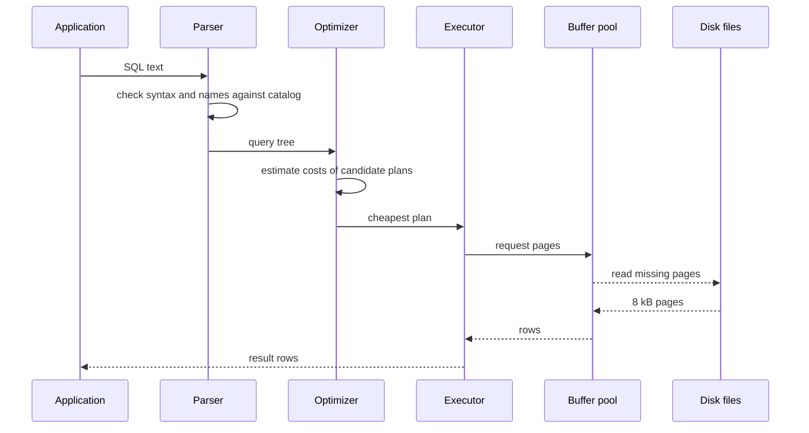
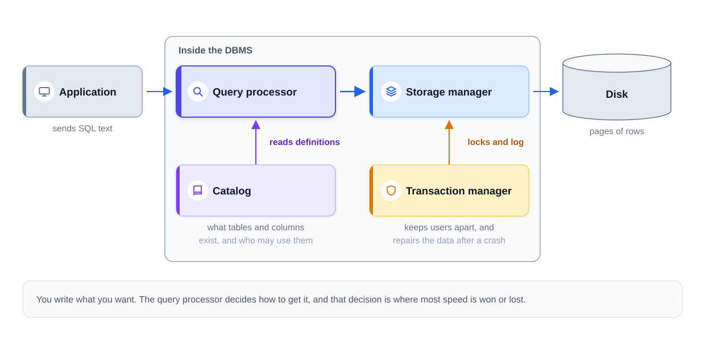
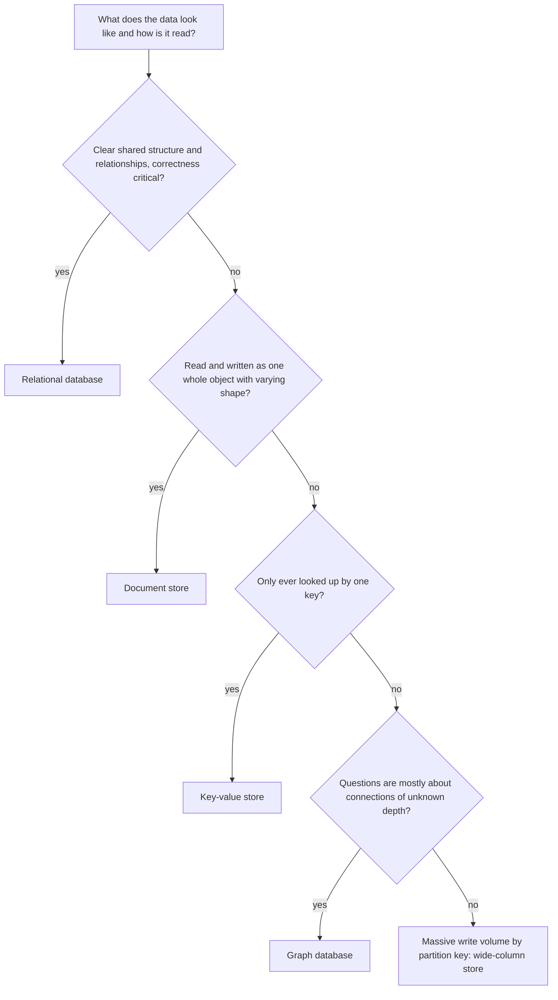
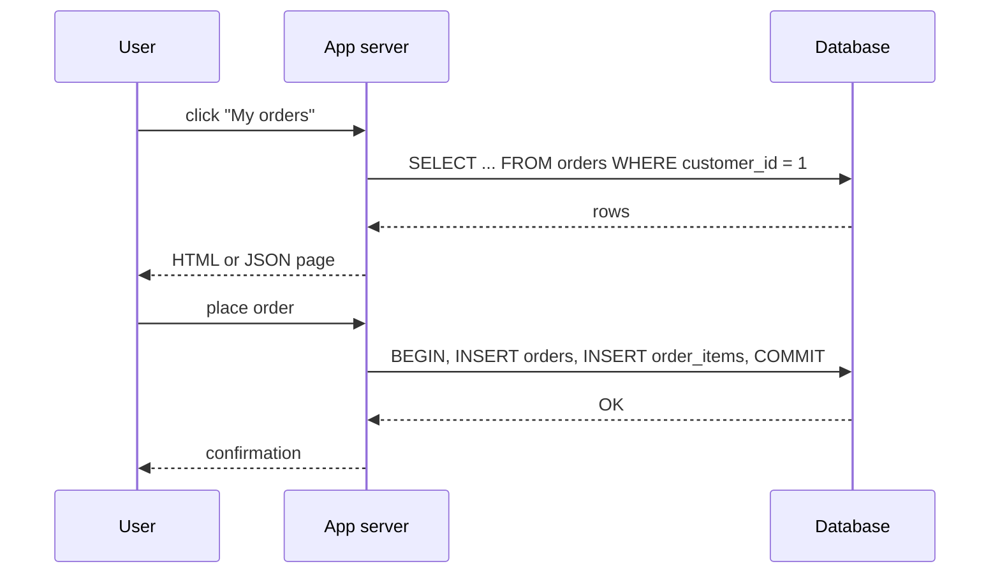
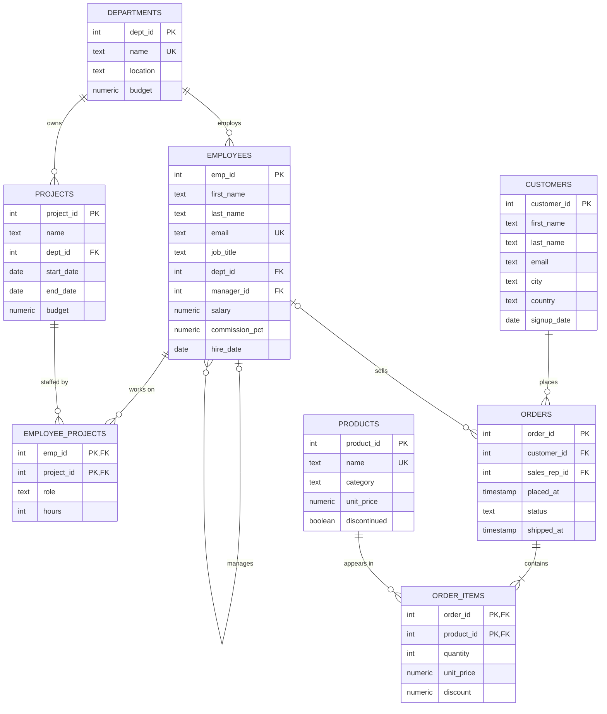

# Chapter 1 — Databases and the Relational Model

Almost every program you use keeps its facts somewhere: the orders in a shop, the balance in a bank, the messages in a chat app. This chapter explains where those facts live and why the answer is usually "in a relational database". You will see the problems that existed before databases, what a database management system (DBMS) does for you, how a DBMS is built inside, how relational databases compare with NoSQL stores, and what SQL is. The chapter ends with a working PostgreSQL server on your machine and the **sample database** that the next chapters query.

**What you'll learn**

| # | Topic | You will be able to… |
|---|---|---|
| 1.1 | Life before databases | name the seven problems of file-based systems |
| 1.2 | What a database is | define database, DBMS and database system precisely |
| 1.3 | What a DBMS does | list its six jobs and explain data independence |
| 1.4 | Inside a DBMS | follow one query through parser, optimizer, executor, storage and log |
| 1.5 | Database architectures | compare two-tier, three-tier, n-tier, cloud and distributed set-ups |
| 1.6 | The relational model | use the vocabulary (relation, tuple, key…) and the four table rules |
| 1.7 | RDBMS products | describe what an RDBMS adds and how the main products differ |
| 1.8 | Relational vs non-relational | choose a store by data shape and access pattern |
| 1.9 | What SQL is | sort any statement into DDL, DML, DQL, DCL or TCL |
| 1.10 | Your private PostgreSQL and psql | start the server, connect, and use the psql commands you need daily |
| 1.11 | The sample database | know the `company` tables used in chapters 2 onward |

All code is in [`code/`](code/). Every output below was pasted from a real run on the book's private PostgreSQL 14 server (section 1.10 shows how to start it).

> **Dialect note.** This book writes PostgreSQL first. Where MySQL, SQLite or SQL Server behave differently, a small table says so. Most of what you learn transfers directly; the differences are mainly in functions (chapter 3), limits/paging (chapter 2) and data types (chapter 9).

---

## 1.1 Before databases: the file processing era

### What it is
Until the late 1960s most business software stored data in **files owned by one program each**. A payroll program had its payroll files, the billing program had its billing files. The layout of each file (which bytes meant "name", which meant "salary") was written into the program's code, not stored with the file. This arrangement is called a **file processing system**.

Think of a school where the admissions office, the library and the exam office each keep their own paper register of students. Each register works fine on its own. Trouble starts when a student moves house.


*Figure — One fact stored in three separate files: an update reaches one of them and the other two go stale (course diagram).*

Records in such files were found in one of two ways. **Sequential access** reads the file from the beginning until the wanted record appears. **Indexed access** keeps a second, hand-maintained file that maps a key (say, a student number) to a byte position, which is faster but is one more thing to keep in sync.

### The problem it solves — seven recurring failures
As companies added programs and data grew, the same seven problems appeared everywhere. Each one later became a feature of the DBMS.

| # | Problem | What went wrong | What a DBMS does instead |
|---|---|---|---|
| 1 | **Redundancy → inconsistency** | A customer's address is copied into several files; an update reaches one copy, the copies disagree, and nothing notices. | Store each fact once; every program reads the same copy. |
| 2 | **Data isolation** | Files sit on different machines in different formats (CSV, fixed-width binary); a cross-department question needs custom parsing code. | One store with one self-describing format. |
| 3 | **No ad-hoc questions** | No query language: "which customers owe more than ₹500?" means days of writing a new program, so many questions are never asked. | A declarative query language (SQL): a new question is a new query. |
| 4 | **Integrity rules buried in code** | "Marks must be 0–100" lives as an `if` in one program. Any other program writing that file can skip it. | Constraints declared once and enforced for every writer. |
| 5 | **Unsafe concurrent access** | Two clerks both read "1 copy left" and both save 0: two copies go out, the count dropped once — a **lost update**. Locking the whole file blocks everybody. | Row-level locks and transactions. |
| 6 | **No crash recovery** | A transfer is two writes; power fails after the first and the money has left one account and reached none. Only an old backup can repair it. | A log that lets the system undo or redo half-finished work. |
| 7 | **All-or-nothing security** | File permissions cover the whole file. A clerk who needs addresses can also read salaries. | Permissions per table, column and even row. |

### How the DBMS changed things
A DBMS is a layer of software that **every application must go through**; no program touches the stored files directly.


*Figure — With a DBMS in the middle, a single shared copy of the data lives alongside its protecting rules (course diagram).*

Because every read and write passes through one place, that place can apply all seven fixes in the table above.

A short timeline helps place the ideas:

| Year | Milestone |
|---|---|
| 1960s | Navigational databases: IBM's IMS (hierarchical, a tree of records) and Charles Bachman's IDS / the CODASYL network model. Programs followed stored pointers from record to record. |
| 1970 | Edgar F. Codd (IBM) publishes *A Relational Model of Data for Large Shared Data Banks*. |
| 1974–79 | IBM's System R and the query language SEQUEL (later renamed SQL); UC Berkeley's Ingres; Oracle ships the first commercial SQL database (1979). |
| 1986–87 | SQL becomes an ANSI (1986), then ISO (1987) standard. In 1986 UC Berkeley also starts POSTGRES, the ancestor of PostgreSQL. |
| 2000s | Open-source RDBMSs dominate the web (MySQL, PostgreSQL); SQLite runs inside phones and browsers. |
| late 2000s | "NoSQL" systems (key-value, document, wide-column, graph) for web-scale workloads. |
| 2010s–now | Cloud-managed databases and distributed SQL ("NewSQL"). |

### Self-check
1. *Why does storing the same fact in three files lead to wrong answers, not just wasted space?* → Updates reach some copies and not others, so the copies drift apart (inconsistency), and nothing checks that they match.
2. *What is a lost update?* → Two programs read the same value, each computes a new value from it, and the second write overwrites the first, so one change disappears.
3. *Which file-system problem does a transaction log solve?* → Recovery from a crash in the middle of a multi-step change.

---

## 1.2 What a database is

### What it is
A **database** is an organised, persistent collection of related data that you can query and update, stored *along with a description of its own structure*. Your phone's contact list is a (tiny) database; so is a bank's decade of transactions. Size changes the hardware and the cost, not the definition.

Four properties make a pile of data a database:

| Property | Meaning | Example |
|---|---|---|
| **Related** | Everything describes one chosen slice of reality, often called the *mini-world* (a school, a shop, a hospital). | A shop database holds customers, products and orders — not your holiday photos. |
| **Self-describing** | The database stores **metadata** (data about data: table names, column names, types, rules) in its **catalog**, also called the **data dictionary**. | Any program can ask "which columns does `employees` have?" instead of hard-coding the layout. |
| **Purposeful** | Built for specific people and the questions they ask; requirements are gathered before any table exists. | A hospital's schema is shaped by what doctors, nurses and billing staff need to look up. |
| **Persistent** | Data survives after the program ends and the machine restarts. | An in-memory list that disappears on exit is not a database. |


*Figure — The catalog sits inside the database next to the data it describes (course diagram).*

You can see self-description in action: PostgreSQL answers questions about its own tables through the standard `information_schema` views and its own `pg_catalog` tables.

```sql
-- code/02_catalog_metadata.sql (part)
SELECT column_name, data_type, is_nullable
FROM information_schema.columns
WHERE table_name = 'departments'
ORDER BY ordinal_position;
```
Output:
```
 column_name | data_type | is_nullable
-------------+-----------+-------------
 dept_id     | integer   | NO
 name        | text      | NO
 location    | text      | YES
 budget      | numeric   | NO
(4 rows)
```
```sql
SELECT conname AS constraint_name, contype AS kind, conrelid::regclass AS on_table
FROM pg_constraint
WHERE conrelid = 'employees'::regclass
ORDER BY conname;
```
Output:
```
      constraint_name      | kind | on_table
---------------------------+------+-----------
 employees_dept_id_fkey    | f    | employees
 employees_email_key       | u    | employees
 employees_manager_id_fkey | f    | employees
 employees_pkey            | p    | employees
 employees_salary_check    | c    | employees
(5 rows)
```
The `kind` letters are `p` primary key, `f` foreign key, `u` unique, `c` check. The rules you declared live in the catalog, which is how the DBMS can enforce them for every program.

### Database vs DBMS vs database system
These three are often mixed up — including in interviews.

| Term | What it is | Example |
|---|---|---|
| **Database** | The stored data plus its description | the `company` tables in this book |
| **DBMS** (database management system) | The software that creates, stores, queries and protects databases | PostgreSQL, MySQL, Oracle |
| **Database system** | DBMS + databases + the applications that use them | PostgreSQL + `company` + the web shop that talks to it |

### Why it matters
Databases make large amounts of data fast to find, keep it accurate (integrity rules) and private (access control, encryption), let many users work at once, and feed the reports behind business decisions. A good one is well structured, scalable, reliable through failures, richly queryable and usable from many tools and languages.

### Real-world examples
A shop must never lose a paid order; a hospital must never show records to the wrong person; a bank must never lose or double-apply a transfer; a social app must not fall over when millions read the same post. Each requirement maps to a DBMS job in the next section.

### Self-check
1. *What is metadata and where is it kept?* → Data describing the data (tables, columns, types, constraints, permissions); in the catalog / data dictionary inside the database.
2. *Is MySQL a database?* → Strictly, no — it is a DBMS. The tables you create inside it form a database.

---

## 1.3 What a DBMS does

### What it is
A **DBMS** is the program that stands between applications and stored data. Applications send requests ("give me these rows", "store this order"); the DBMS decides where bytes go on disk, how to find them again, and how to keep them safe.

### How it works — the six jobs
| Job | Meaning | In SQL / PostgreSQL |
|---|---|---|
| **Define** | Describe tables, columns, types and rules; saved in the catalog | `CREATE TABLE`, `ALTER TABLE` |
| **Construct** | Physically write the data to storage; you never choose file names or byte offsets | PostgreSQL chooses files under its data directory |
| **Manipulate** | Read, add, change, remove data | `SELECT`, `INSERT`, `UPDATE`, `DELETE` |
| **Share** | Let many users and programs work on the same data at once without corrupting it | transactions, locks, MVCC ([chapter 13](../13-transactions-and-concurrency/README.md)) |
| **Protect** | *Security* (who may read/write what) and *failure protection* (stay correct after a crash) | `GRANT`/`REVOKE`, the write-ahead log |
| **Maintain** | Let the schema and storage evolve for years without rewriting applications | add a column, add an index, move to faster disks |

File processing systems managed the first three poorly and the last three not at all.

### Who talks to a DBMS
| Role | What they do |
|---|---|
| **Application programs** | Issue SQL for the people using them (a shopper clicks buttons, never writes SQL). |
| **Database administrators (DBAs)** | Create users and permissions, plan backups, tune and monitor. |
| **Database designers** | Decide which tables exist and how they connect ([chapter 10](../10-data-modeling-and-er-diagrams/README.md)). |
| **Analysts** | Query the data themselves to produce reports and insights. |

### Data independence
**Data independence** means a change at one level of the system's description does not force changes at the level above. It is the reason a 20-year-old report query can still run after the database moved to new hardware.

| Kind | You change… | …and this keeps working | Example |
|---|---|---|---|
| **Physical** data independence | how data is stored (indexes, files, disks, page layout) | the tables and every query | add an index; move to SSDs |
| **Logical** data independence | the tables (add a column or a table) | applications that don't use the changed part | add `phone` to `employees`; a report reading names is unaffected |

*What does "logical is separate from physical" mean?* The **logical level** is what you query — tables, columns, views. The **physical level** is how the bytes are laid out — data files, 8 kB pages, index trees. SQL names only logical objects, so the DBMS may reorganise the physical side freely and your queries keep their meaning.

The demo below changes both levels and runs the same "application" query each time.

```sql
-- code/06_data_independence.sql
SELECT first_name, last_name, job_title FROM employees WHERE last_name = 'Verma';
EXPLAIN (COSTS OFF) SELECT first_name, last_name, job_title FROM employees WHERE last_name = 'Verma';

-- Physical change: add an index. The query text is unchanged.
CREATE INDEX employees_last_name_idx ON employees (last_name);
SET enable_seqscan = off;   -- the table is tiny; nudge the planner so we can SEE it use the index
EXPLAIN (COSTS OFF) SELECT first_name, last_name, job_title FROM employees WHERE last_name = 'Verma';
SELECT first_name, last_name, job_title FROM employees WHERE last_name = 'Verma';
RESET enable_seqscan;

-- Logical change: add a column the query does not use. Still unchanged.
ALTER TABLE employees ADD COLUMN phone text;
SELECT first_name, last_name, job_title FROM employees WHERE last_name = 'Verma';
```
Output (abridged to the interesting parts):
```
 first_name | last_name | job_title
------------+-----------+-----------
 Rahul      | Verma     | Engineer
(1 row)

              QUERY PLAN
---------------------------------------
 Seq Scan on employees
   Filter: (last_name = 'Verma'::text)
(2 rows)

                      QUERY PLAN
-------------------------------------------------------
 Index Scan using employees_last_name_idx on employees
   Index Cond: (last_name = 'Verma'::text)
(2 rows)

...
ALTER TABLE
 first_name | last_name | job_title
------------+-----------+-----------
 Rahul      | Verma     | Engineer
(1 row)
```
`EXPLAIN` shows the **plan** — the method the DBMS chose. Before the index it scans every row (`Seq Scan`); after, it jumps through the index (`Index Scan`). The result and the query text never changed. (`enable_seqscan = off` is a teaching switch only; on a 15-row table the planner would rightly prefer the full scan. Chapter 12 covers plans properly.)

### Self-check
1. *Name the six jobs of a DBMS.* → Define, construct, manipulate, share, protect, maintain.
2. *Adding an index without touching any query is an example of…?* → Physical data independence.

---

## 1.4 Inside a DBMS: the core components

### What it is
A DBMS is several cooperating parts, each with one job. Knowing them makes database behaviour predictable: why the first run of a query is slower than the second, why a crash does not lose committed data, why two users can update different rows at once.


*Figure — Query processor, storage engine, transaction manager, lock manager, cache manager, recovery manager and catalog (course diagram).*

| Component | Job | Sub-parts / tools |
|---|---|---|
| **Query processor** | Turn SQL text into results | **Parser** checks syntax and meaning (do these tables/columns exist? may you use them?) and builds an internal tree. **Optimizer** considers alternative plans and picks the cheapest by estimated cost. **Execution engine** runs the plan, asking the storage engine for rows. |
| **Storage engine** (storage manager) | Store and fetch bytes | Organises data into fixed-size **pages** (blocks) inside files; maintains indexes; may store rows (row store) or columns (column store). Examples: InnoDB in MySQL, WiredTiger in MongoDB, PostgreSQL's heap + index access methods. |
| **Cache / buffer manager** | Keep hot pages in memory | The **buffer pool** holds recently used pages; a query whose pages are already cached avoids disk reads. |
| **Transaction manager** | Make groups of operations all-or-nothing and isolated | Begins, commits and rolls back transactions; guarantees ACID ([chapter 13](../13-transactions-and-concurrency/README.md)). |
| **Lock manager** | Coordinate concurrent access | **Shared (S) locks**: many readers may hold one at once. **Exclusive (X) locks**: one writer, nobody else. Prevents lost updates and dirty reads; must also detect **deadlocks** (two transactions each waiting for the other's lock). |
| **Recovery manager** | Restore a consistent state after a crash | Writes a **log** of every change *before* applying it; after a crash, **redoes** committed work (roll forward) and **undoes** uncommitted work (roll back). |
| **Catalog** (data dictionary) | Describe everything | Tables, columns, types, constraints, indexes, views, users and permissions, storage sizes. Every other component reads it. |

A **transaction** bundles several operations into one all-or-nothing unit: if any step fails, none of the steps remain. The classic example is a bank transfer — the debit and the credit succeed together or not at all.

### How it works — the journey of one query

The optimizer's candidate plans differ in scan method (full scan or index), join order and join algorithm; it estimates each one's cost from **statistics** about the data. That division of labour is what **declarative** means: your SQL names the result, the DBMS picks the algorithm. For writes, the change is first recorded in the log, the lock manager holds off conflicting writers, and the change becomes durable at `COMMIT`.


*Figure — A query flows from the application through the query processor to storage; the catalog and the transaction manager support every step (course diagram).*

### Real-world example — the same parts in PostgreSQL
| Generic component | PostgreSQL name |
|---|---|
| Parser / optimizer / executor | parser → rewriter → **planner** → executor (each connection gets its own server process) |
| Pages | 8 kB blocks (`SHOW block_size` → `8192`) in files under the data directory |
| Buffer pool | `shared_buffers` (default `128MB`) plus the operating-system cache |
| Recovery log | **WAL** (write-ahead log) in `pg_wal/` |
| Lock manager + concurrency | table/row locks **plus MVCC** (multi-version concurrency control: readers see a snapshot and don't block writers) |
| Catalog | `pg_catalog` tables and the standard `information_schema` views |

(Both numbers were read on the book's server by `code/02_catalog_metadata.sql`.)

### Common mistakes
- Assuming SQL runs "top to bottom as written" — the optimizer may reorder joins and filters as long as the result is the same.
- Judging a query by its first (cold-cache) run — the second may be served from the buffer pool.
- Confusing the cache (memory, lost in a crash) with durability (the log on disk).

### In the interview
**30-second answer:** "A DBMS has a query processor — parser, optimizer, executor — that turns SQL into a plan and runs it; a storage engine that keeps data in fixed-size pages and indexes; a buffer pool that caches pages in memory; a transaction manager and lock manager that give ACID and safe concurrency; a recovery manager that uses a write-ahead log to redo or undo work after a crash; and a catalog that describes everything."

- *Why does the optimizer need statistics?* → To estimate how many rows each step returns, which decides whether an index or a full scan, and which join order, is cheaper.
- *What is write-ahead logging?* → The log record describing a change is flushed to disk before the changed data page, so after a crash the system can replay or undo from the log.
- *Shared vs exclusive lock?* → Shared allows concurrent readers; exclusive allows one writer and blocks others.

### Self-check
1. *Which component decides between an index scan and a full scan?* → The optimizer (planner).
2. *What does the recovery manager do for a committed transaction whose pages weren't yet written?* → Redoes it from the log (roll forward).

---

## 1.5 Database architectures

### What it is
An **architecture** describes where the database runs relative to its users and how requests travel. The same PostgreSQL can sit in any of these set-ups.

### Two-tier: client–server
The client application talks **directly** to the database server: it opens a connection, sends SQL, gets rows back.


*Figure — Two-tier client–server: many clients, one database server (course diagram).*

- **Good:** simple; fine for small teams and internal tools (a desktop accounting app on an office server, `psql` itself).
- **Bad:** one server struggles with many client connections; business rules live in every client, so a change means redeploying them all; clients hold database credentials.

### Three-tier
A middle **application tier** sits between the user interface and the database.


*Figure — Three-tier: presentation, application (business logic) and data layers (course diagram).*

| Tier | Job | Example |
|---|---|---|
| Presentation | User interface | browser page or mobile app |
| Application (middle tier) | Business rules, validation, coordination, connection pooling | a Java/Python/Node web service |
| Data | Storage and queries | PostgreSQL |

- **Good:** tiers scale separately (more app servers behind a load balancer); rules change in one place; the database stays off the internet. **Bad:** more moving parts, a little latency per hop.
- **Typical use:** almost every web application — shops, ERP (enterprise resource planning) and CRM (customer relationship management) systems.

### N-tier
Split further into specialised layers: an authentication service, a payment service, a cache tier (e.g. Redis), a search tier, message queues.


*Figure — N-tier: extra service, integration and caching layers (course diagram).*

- **Good:** layers scale, deploy and fail independently. **Bad:** harder to operate and debug; more network hops. Microservices are an extreme form.

### Cloud-hosted databases
The database runs on a cloud provider's infrastructure. Three service models:

| Model | You manage | Provider manages | Example |
|---|---|---|---|
| **IaaS** (Infrastructure as a Service) | OS, DBMS install, backups, upgrades | hardware, virtual machines | PostgreSQL you install on an AWS EC2 or Azure VM |
| **PaaS** / DBaaS (Platform / Database as a Service) | schema, queries, some settings | install, patching, backups, failover | Amazon RDS, Google Cloud SQL, Azure Database for PostgreSQL |
| **SaaS** (Software as a Service) | only your data inside the app | everything, including the database | Salesforce, Google Workspace |

- **Good:** elastic capacity, less operational work, global reach. **Bad:** depends on the network; cost can grow quietly; data location must satisfy compliance (data-residency) rules.

### Distributed databases
Data is spread over several machines, often in several regions.


*Figure — A distributed database: nodes in different locations, data partitioned and replicated (course diagram).*

- **Partitioning / sharding** — split data into pieces, each on a different node (e.g. customers A–M on node 1, N–Z on node 2).
- **Replication** — keep copies of the same data on several nodes for availability and read scaling.
- **Consistency models** — how quickly all copies agree, from **strong** (every read sees the latest write) to **eventual** (copies converge after a while).
- **Good:** scales past one machine, survives node failures, puts data near users. **Bad:** much harder to reason about; cross-node queries and transactions pay network costs.

All of this is chapter 15 ([Scaling databases](../15-scaling-databases/README.md)); see also the DDIA notes ([`../../../ddia/`](../../../ddia/)).

### Self-check
1. *Why is exposing the database directly to thousands of browser clients a bad idea?* → Too many connections, credentials on clients, and business rules duplicated in every client; a middle tier pools connections and centralises rules.
2. *Amazon RDS is which cloud model?* → PaaS / managed database service.
3. *Partitioning vs replication?* → Partitioning splits different data across nodes; replication copies the same data to several nodes.

---

## 1.6 The relational model

### What it is
The **relational model** stores *all* data in tables and connects tables using **values they share**, not pointers or file addresses. Codd proposed it in 1970 because the navigational databases of the day forced programs to follow stored pointers, so reorganising data meant rewriting programs. His proposal: represent everything as plain values in tables and leave the retrieval strategy to the system — the query states the goal, the DBMS finds the route.

A common misconception: "relational" does **not** come from relationships between tables. It comes from **relation**, the mathematical word for a table (a set of tuples).

### The vocabulary
| Formal term | Everyday term | Meaning |
|---|---|---|
| **Relation** | table | a named set of rows that all have the same columns |
| **Tuple** | row, record | one item — one employee, one order |
| **Attribute** | column, field | one property — a name, a price |
| **Domain** | data type (+ rules) | the allowed values for a column |
| **Degree** | number of columns | `departments` has degree 4 |
| **Cardinality** | number of rows | `departments` has cardinality 6 |
| **Schema** | table/database definition | the list of tables, columns, types and constraints |

(Careful: "cardinality" also has a second meaning in ER modelling — one-to-many, many-to-many — covered in chapter 10.)

### The four rules every table obeys
1. **Same columns in every row.** No row has extra private fields. A missing value is stored as `NULL`, meaning "unknown" or "not applicable" (chapter 2 treats `NULL` in depth).
2. **One value per cell (atomic values).** Not a list, not a nested record. This is the heart of *First Normal Form* ([chapter 11](../11-normalization/README.md)).
3. **Row order means nothing.** The table is a set; if you need an order, store it in a column and ask for it with `ORDER BY`.
4. **No duplicate rows — in theory.** A mathematical set cannot contain the same element twice. SQL is looser: a table without a primary key or unique constraint will happily store identical rows, which is why good designs always declare one.

### Keys and referential integrity
- A **primary key (PK)** is a column (or set of columns) whose value identifies exactly one row; it may not repeat and may not be `NULL`. Example: `customers.customer_id`.
- A **foreign key (FK)** is a column whose values must match a primary (or unique) key in another table. Example: `orders.customer_id` → `customers.customer_id`.
- **Referential integrity** is the DBMS rule that every foreign-key value points at a real row. Inserting an order for a customer who doesn't exist is rejected. Deleting a customer who still has orders is either refused or cascades to delete the orders too, depending on the `ON DELETE` rule chosen when the table was created ([chapter 9](../09-ddl-dml-and-constraints/README.md)).
- **Entity integrity** is the rule that a primary key is never `NULL`.

Here the sample database enforces all of these (errors are deliberate):
```sql
-- code/04_integrity.sql
INSERT INTO orders (order_id, customer_id, placed_at, status)
VALUES (200, 99, '2025-07-01 10:00', 'pending');           -- no customer 99
DELETE FROM customers WHERE customer_id = 1;                -- customer 1 has orders
INSERT INTO orders (order_id, customer_id, placed_at, status)
VALUES (201, 1, '2025-07-01 10:00', 'lost');               -- not an allowed status
INSERT INTO departments VALUES (1, 'Legal', 'Pune', 1000);  -- duplicate key
INSERT INTO departments VALUES (NULL, 'Legal', 'Pune', 1000);
SELECT count(*) AS orders_still FROM orders;
```
Output:
```
ERROR:  insert or update on table "orders" violates foreign key constraint "orders_customer_id_fkey"
DETAIL:  Key (customer_id)=(99) is not present in table "customers".
ERROR:  update or delete on table "customers" violates foreign key constraint "orders_customer_id_fkey" on table "orders"
DETAIL:  Key (customer_id)=(1) is still referenced from table "orders".
ERROR:  new row for relation "orders" violates check constraint "orders_status_check"
DETAIL:  Failing row contains (201, 1, null, 2025-07-01 10:00:00, lost, null).
ERROR:  duplicate key value violates unique constraint "departments_pkey"
DETAIL:  Key (dept_id)=(1) already exists.
ERROR:  null value in column "dept_id" of relation "departments" violates not-null constraint
DETAIL:  Failing row contains (null, Legal, Pune, 1000.00).
 orders_still
--------------
           14
(1 row)
```
No application code checked anything — the rules live in the schema, so they hold for every program that connects.

### Connecting tables with a join
A **join** combines rows from two tables whose shared values match. Joins are the everyday workhorse of relational querying (chapter 5 covers every kind). Which products did customer 1 buy?

```sql
-- code/01_first_queries.sql (part)
SELECT c.first_name, c.last_name, o.order_id, p.name AS product
FROM customers   c
JOIN orders      o  ON o.customer_id = c.customer_id
JOIN order_items oi ON oi.order_id   = o.order_id
JOIN products    p  ON p.product_id  = oi.product_id
WHERE c.customer_id = 1
ORDER BY o.order_id, p.name;
```
Output:
```
 first_name | last_name | order_id |       product
------------+-----------+----------+---------------------
 Anita      | Shah      |      101 | Laptop Pro 14
 Anita      | Shah      |      101 | Wireless Mouse
 Anita      | Shah      |      104 | Ergonomic Chair
 Anita      | Shah      |      104 | Standing Desk
 Anita      | Shah      |      113 | Laptop Pro 14
 Anita      | Shah      |      113 | Mechanical Keyboard
(6 rows)
```
Nothing in the tables "points" anywhere: the value `1` in `orders.customer_id` and the value `1` in `customers.customer_id` are the whole connection.

Because queries name only tables and columns, the model gives data independence and lets the optimizer choose (and later improve) the method; because it is mathematical, it also gives exact tests for design flaws — the normal forms of [chapter 11](../11-normalization/README.md).

### Common mistakes
- Relying on "the order rows came back in" without `ORDER BY` — it can change at any time.
- Storing lists in one cell (`'red,green,blue'`), which breaks rule 2 and makes querying painful.
- Tables without a primary key, which lets exact duplicates creep in.

### In the interview
**30-second answer:** "The relational model, from Codd in 1970, stores data as relations — tables of tuples with typed attributes — and links them only by values: a foreign-key column stores the key of a row in another table, and the DBMS guarantees that row exists. Rows are unordered and cells hold single values. Because queries are declarative and never mention storage, the DBMS can optimise and reorganise freely."

- *Where does the word 'relational' come from?* → From *relation*, the mathematical name for a table — not from relationships.
- *What happens if you delete a parent row that has children?* → Depends on the FK's `ON DELETE` action: `NO ACTION`/`RESTRICT` (error, the default), `CASCADE`, `SET NULL` or `SET DEFAULT`.

### Self-check
1. *Degree and cardinality of `products`?* → Degree 5 (columns), cardinality 9 (rows).
2. *Why is a primary key not allowed to be NULL?* → It must identify a row; an unknown identifier identifies nothing (entity integrity).
3. *Which rule does storing `'555-1234, 555-9876'` in one phone column break?* → One value per cell (First Normal Form).

---

## 1.7 RDBMS — relational database management systems

### What it is
An **RDBMS** is a DBMS that implements the relational model and speaks SQL. Its defining features:

| Feature | What it gives you |
|---|---|
| Tables of rows and columns | one uniform structure for all data |
| Primary and foreign keys | identity and enforced relationships |
| SQL | one standard language to define, change, query and secure data |
| Transactions with **ACID** guarantees | Atomicity, Consistency, Isolation, Durability (defined in 1.8, in depth in chapter 13) |
| Integrity constraints | types, `NOT NULL`, `UNIQUE`, `CHECK`, keys — bad data is refused at the door |
| Separation of logical and physical | data independence (1.3) |

**Advantages:** the same tables answer countless questions without being reorganised, SQL is far shorter than file-access code, ACID and constraints keep data correct, and modern products handle large volumes and many concurrent users.

### The main products
| Product | Licence | Known for | Notes for this book |
|---|---|---|---|
| **PostgreSQL** | open source (PostgreSQL licence) | standards compliance, correctness, extensibility (JSONB, PostGIS, custom types) | this book's main dialect |
| **MySQL** (and fork MariaDB) | open source (GPL) + commercial | ubiquity on the web, simple operations | the SQL course's original dialect; differences noted per chapter |
| **Oracle Database** | commercial | enterprise features, PL/SQL | mentioned where syntax differs notably |
| **Microsoft SQL Server** | commercial | Microsoft ecosystem integration, T-SQL | differences noted in small tables |
| **SQLite** | public domain | serverless: a whole database in one file, embedded in apps, phones and browsers | `*.sqlite.sql` examples run in `sqlite3` |

### Self-check
1. *What makes SQLite different from the others?* → No separate server process; a library that stores the whole database in a single file.

---

## 1.8 Relational vs non-relational databases

### What it is
**Non-relational** databases store data in shapes other than tables. The umbrella name is **NoSQL**; people now tend to expand it as "**not only SQL**", since many such products later gained SQL-flavoured query languages. Neither family is "better": the shape of the data decides which questions are cheap.

Picture a food-delivery app. Orders and payments fit tables perfectly. Restaurant menus do not: one restaurant has thirty dishes with sizes and toppings, another four fixed meals, a third rewrites its menu weekly. That is the moment teams consider a second kind of store.

### The four NoSQL families

*Figure — One dataset, four non-relational shapes, next to the relational version (course diagram).*

| Family | Data shape | Strength | Weakness | Examples | Typical use |
|---|---|---|---|---|---|
| **Document** | self-contained JSON/BSON (or XML) documents; documents in one collection may differ in fields | reading/writing one whole object; varied shapes | cross-document joins are limited | MongoDB, Couchbase, CouchDB | catalogs, content, user profiles, menus |
| **Key-value** | a value stored under a key; mainly `put` and `get` | extremely fast lookups by key | cannot search inside values | Redis, Amazon DynamoDB, Riak | caches, sessions, feature flags |
| **Wide-column** (column-family) | rows grouped into column families; rows may have different columns; partitioned by key | very high write throughput across many machines | queries must follow the partition key | Apache Cassandra, HBase | time series, event logs, IoT |
| **Graph** | nodes, edges and properties | multi-hop relationship questions ("friends of friends who…") | not built for bulk aggregation | Neo4j, Amazon Neptune | social networks, recommendations, fraud detection |

Chapter 16 ([Beyond relational](../16-beyond-relational/README.md)) builds each of these in practice.

### ACID vs BASE
**ACID** — the guarantees of a relational transaction:

| Letter | Guarantee |
|---|---|
| **Atomicity** | all operations in the transaction happen, or none do |
| **Consistency** | after a transaction finishes, every declared rule (keys, checks, constraints) is still satisfied |
| **Isolation** | transactions running side by side behave as if they ran alone; half-done changes stay invisible to others |
| **Durability** | once committed, changes survive crashes and power loss |

**BASE** — how many distributed NoSQL systems describe themselves:

| Letter(s) | Meaning |
|---|---|
| **Basically Available** | requests still get answers while some nodes are failing, though the data returned may be stale |
| **Soft state** | stored state may keep changing without new writes as replicas catch up |
| **Eventual consistency** | if writes stop, all replicas converge; until then two readers may see different values |

BASE gives up immediate agreement to stay available — acceptable for a product catalogue, unacceptable for an account balance.

### Three claims that need care
1. **"Relational databases only scale vertically."** *False.* **Vertical scaling** = a bigger machine; **horizontal scaling** = more machines. Relational systems scale out with read replicas, partitioning/sharding and distributed SQL (CockroachDB, Google Spanner, YugabyteDB, Citus for PostgreSQL). The real issue is *cost*: cross-machine joins and transactions are expensive, and NoSQL models avoid them by design.
2. **"NoSQL databases don't support transactions."** *Out of date.* MongoDB has had multi-document ACID transactions since version 4.0 (2018); DynamoDB added transactions in 2018; Cassandra offers lightweight (compare-and-set) transactions per partition. Limits and costs vary, so check the specific product.
3. **"NoSQL databases have no schema."** *Misleading.* The database doesn't *enforce* one, but your code still expects `price` to be a number — the schema has moved into the application. The names: **schema-on-write** (the database checks data as it's written — relational) vs **schema-on-read** (the reader interprets whatever is stored). Schema-on-read makes change cheap and bad data easy.

### Comparison
| Aspect | Relational | Non-relational |
|---|---|---|
| Schema | checked by the DBMS as rows are written (schema-on-write) | mostly checked by application code when reading (schema-on-read) |
| Query language | SQL, standardised | product-specific (MongoDB's query API, Cassandra's CQL, Neo4j's Cypher…), some SQL-like |
| Joins | built in, optimised | few or none; applications join in code or embed related data instead |
| Transactions | full ACID across tables | available in many products, often scoped (one document / one partition) or slower |
| Best fit | structured, related data where correctness matters (orders, payments, bookings, inventory, ERP, CRM) | huge volumes, varied/changing record shapes, one dominant access pattern (catalogues, caches, feeds, telemetry, real-time analytics) |

### How to choose

Real systems often combine several: orders and payments in PostgreSQL, menus in a document store, sessions in Redis. Using different stores for different jobs is **polyglot persistence**. It is not free — every extra store must be run, backed up, monitored and kept in step with the others — so start with one database (a relational one is the safe default) and add another only when a concrete requirement demands it.

### In the interview
**30-second answer:** "I pick from the access pattern, not the fashion. Orders need multi-table transactions and constraints, so relational. Menus differ per restaurant and are fetched as one unit, which suits a document store. Sessions are key lookups, so Redis. Relational databases do scale horizontally — replicas, sharding, distributed SQL — the real cost is cross-node joins and transactions."

- *Why not one database for everything?* → Often you should! Each extra store adds operational cost and consistency problems between stores; add one only when a requirement justifies it.

### Self-check
1. *A feature-flag service reads flags by name millions of times per second. Which family?* → Key-value.
2. *"Who are the friends of my friends who also like jazz?" Which family?* → Graph.
3. *Horizontal vs vertical scaling?* → More machines vs a bigger machine.

---

## 1.9 What SQL is

### What it is
**SQL (Structured Query Language)** is the standard language for defining, changing, querying and securing data in relational databases. It is **declarative**: you describe the result you want, not the steps to compute it. Developed at IBM in the 1970s as SEQUEL (renamed SQL for trademark reasons), it became an ANSI standard in 1986 and an ISO standard in 1987; the current edition is **SQL:2023**. Every RDBMS implements the standard's core plus its own extensions — a **dialect** (PostgreSQL's, MySQL's, T-SQL for SQL Server, PL/SQL-flavoured Oracle SQL).

SQL is the traffic between applications and databases:


### The five sub-languages
SQL statements are traditionally grouped into five families. (Some texts fold DQL into DML; interviewers accept either, but know both.)

| Sub-language | Purpose | Main statements |
|---|---|---|
| **DDL** — Data Definition Language | define and change *structure* | `CREATE`, `ALTER`, `DROP`, `TRUNCATE`, `COMMENT`, `RENAME` (via `ALTER`) |
| **DML** — Data Manipulation Language | change *data* | `INSERT`, `UPDATE`, `DELETE`, `MERGE` (PostgreSQL 15+), `COPY` (PostgreSQL) |
| **DQL** — Data Query Language | read data | `SELECT` |
| **DCL** — Data Control Language | control *access* | `GRANT`, `REVOKE` (and role management such as `CREATE ROLE`) |
| **TCL** — Transaction Control Language | group changes into transactions | `BEGIN`/`START TRANSACTION`, `COMMIT`, `ROLLBACK`, `SAVEPOINT`, `ROLLBACK TO SAVEPOINT`, `RELEASE SAVEPOINT` |

A frequent mix-up: **granting and revoking permissions is DCL, not TCL.** TCL is only about transaction boundaries (commit, rollback, savepoints).

### How it works — one statement of each kind
```sql
-- code/03_sql_sublanguages.sql
-- DDL: define structure
CREATE TABLE suppliers (
    supplier_id integer PRIMARY KEY,
    name        text NOT NULL,
    country     text
);

-- DML: change data
INSERT INTO suppliers VALUES (1, 'Deskworks', 'India'), (2, 'Clicky Ltd', 'UK');
UPDATE suppliers SET country = 'Ireland' WHERE supplier_id = 2;

-- DQL: read data
SELECT * FROM suppliers ORDER BY supplier_id;

-- DCL: control who may do what
CREATE ROLE sql01_report_reader;
GRANT SELECT ON suppliers TO sql01_report_reader;
SELECT grantee, privilege_type
FROM information_schema.role_table_grants
WHERE table_name = 'suppliers' AND grantee = 'sql01_report_reader';
REVOKE SELECT ON suppliers FROM sql01_report_reader;

-- TCL: group changes into a transaction, with a savepoint
BEGIN;
INSERT INTO suppliers VALUES (3, 'Chairmakers', 'India');
SAVEPOINT before_mistake;
DELETE FROM suppliers;                 -- oops: no WHERE clause
ROLLBACK TO SAVEPOINT before_mistake;  -- undo only the delete
COMMIT;
SELECT * FROM suppliers ORDER BY supplier_id;
```
Output (psql echoes a *command tag* such as `INSERT 0 2` after each change — `0` is a legacy OID field, `2` is the number of rows):
```
CREATE TABLE
INSERT 0 2
UPDATE 1
 supplier_id |    name    | country
-------------+------------+---------
           1 | Deskworks  | India
           2 | Clicky Ltd | Ireland
(2 rows)

CREATE ROLE
GRANT
       grantee       | privilege_type
---------------------+----------------
 sql01_report_reader | SELECT
(1 row)

REVOKE
BEGIN
INSERT 0 1
SAVEPOINT
DELETE 3
ROLLBACK
COMMIT
 supplier_id |    name     | country
-------------+-------------+---------
           1 | Deskworks   | India
           2 | Clicky Ltd  | Ireland
           3 | Chairmakers | India
(3 rows)
```
The `DELETE 3` wiped every row, but `ROLLBACK TO SAVEPOINT` undid just that step; the insert before the savepoint survived the `COMMIT`.

### SQL syntax basics you'll use from chapter 2
| Rule | Detail |
|---|---|
| Statements end with `;` | psql waits for the semicolon before running anything |
| Keywords are case-insensitive | `select` = `SELECT`; this book capitalises keywords for readability |
| Unquoted identifiers fold to lower case in PostgreSQL | `Employees` means `employees`; `"Employees"` (double quotes) keeps the case exactly |
| Strings use single quotes | `'Mumbai'`; a quote inside a string is doubled: `'O''Brien'` |
| Comments | `-- to end of line` and `/* block */` |
| Whitespace is free | break long queries over lines |

### Dialect differences at a glance
| Feature | PostgreSQL | MySQL | SQLite | SQL Server |
|---|---|---|---|---|
| Limit rows | `LIMIT n` / `FETCH FIRST n ROWS ONLY` | `LIMIT n` | `LIMIT n` | `TOP n` / `OFFSET … FETCH` |
| Identifier quotes | `"name"` | `` `name` `` (or `"` in ANSI mode) | `"name"` | `[name]` or `"name"` |
| String concat | `\|\|`, `concat()` | `concat()` (`\|\|` is OR by default) | `\|\|` | `+`, `concat()` |
| Auto-increment | `GENERATED … AS IDENTITY` / `serial` | `AUTO_INCREMENT` | `INTEGER PRIMARY KEY` | `IDENTITY(1,1)` |
| DDL inside transactions | yes, can be rolled back | no (implicit commit) | yes | mostly yes |

### Self-check
1. *Classify: `TRUNCATE`, `GRANT`, `SAVEPOINT`, `MERGE`, `SELECT`.* → DDL, DCL, TCL, DML, DQL.
2. *What does "declarative" mean for SQL?* → You state the result; the DBMS decides the algorithm.
3. *Why did `ROLLBACK TO SAVEPOINT` not remove supplier 3?* → The insert happened before the savepoint; only work after the savepoint is undone.

### TL;DR
SQL is the declarative, standardised language of relational databases, split into DDL (structure), DML (changes), DQL (queries), DCL (permissions) and TCL (transactions). Each product speaks a dialect; this book uses PostgreSQL's.

---

## 1.10 Your private PostgreSQL server and psql

### What it is
The book ships a small script, `tools_pg.sh`, in the project root. It runs a **private PostgreSQL 14 server** that belongs only to this book: its data lives in `~/.pg-books-system-design/` (outside the iCloud-synced Documents folder), it listens on port **5544** through a Unix socket in `/tmp`, and it never touches any other PostgreSQL you may have installed (which normally uses port 5432). **psql** is PostgreSQL's command-line client: you type SQL, it prints results.

### How it works — step by step
Run these from the project root (`system_design_notes/`).

1. **Start the server** (the first run also creates the data directory):
   ```bash
   bash tools_pg.sh start
   ```
   ```
   postgres ready on port 5544 (socket /tmp)
   ```
2. **Create a database** for the sample data:
   ```bash
   bash tools_pg.sh psql -d postgres -c "CREATE DATABASE company ENCODING 'UTF8' TEMPLATE template0"
   ```
   ```
   CREATE DATABASE
   ```
   Asking for `UTF8` explicitly guarantees that accented and non-Latin text (`café`, `मुंबई`) is stored and measured correctly, whatever encoding the server was initialised with; `TEMPLATE template0` is required when the encoding differs from the default template's.
3. **Load the sample schema** (section 1.11):
   ```bash
   bash tools_pg.sh psql -d company -q -f sql/chapters/01-databases-and-the-relational-model/code/00_schema.sql
   ```
4. **Check it**:
   ```bash
   bash tools_pg.sh psql -d company -c '\conninfo' -c 'SELECT count(*) FROM employees'
   ```
   ```
   You are connected to database "company" as user "postgres" via socket in "/tmp" at port "5544".
    count
   -------
       15
   (1 row)
   ```
5. **Open an interactive session**: `bash tools_pg.sh psql -d company`. The prompt `company=#` means "connected to `company` as a superuser" (`=>` for ordinary users). If you press Enter before the `;`, the prompt changes to `company-#` — psql is waiting for the rest of the statement. Type `\q` to leave.
6. **Stop the server** when you're done: `bash tools_pg.sh stop`.

`tools_pg.sh psql` is a thin wrapper around `psql -h /tmp -p 5544 -U postgres -X`: `-h /tmp` uses the socket directory, `-p` the port, `-U` the user, and `-X` skips any personal `~/.psqlrc` so output looks the same for every reader.

### psql meta-commands
Lines starting with a backslash are **meta-commands**: psql handles them itself instead of sending them to the server. They do not need a semicolon.

| Command | Does |
|---|---|
| `\?` / `\h SELECT` | help on meta-commands / SQL syntax help for a statement |
| `\l` | list databases |
| `\c company` | connect to another database |
| `\conninfo` | show current connection |
| `\dt` / `\dt+` | list tables (with sizes) |
| `\d employees` | describe a table: columns, types, indexes, constraints, references |
| `\dn`, `\df`, `\dv`, `\di`, `\du` | schemas, functions, views, indexes, roles |
| `\x` (or `\x auto`) | expanded display: one field per line, good for wide rows |
| `\pset null '(null)'` | show NULLs visibly instead of as blanks (used throughout this book) |
| `\timing` | print how long each statement took |
| `\i file.sql` | run a file of SQL |
| `\e` | edit the last query in your `$EDITOR` |
| `\copy` | import/export CSV from your machine (client side) |
| `\q` | quit |

Meta-commands also work inside script files:
```sql
-- code/05_psql_meta_commands.sql
\dt
\d departments
\x on
SELECT * FROM employees WHERE emp_id = 7;
\x off
```
Output (abridged):
```
               List of relations
 Schema |       Name        | Type  |  Owner
--------+-------------------+-------+----------
 public | customers         | table | postgres
 public | departments       | table | postgres
 ...
 public | projects          | table | postgres
(8 rows)

                Table "public.departments"
  Column  |     Type      | Collation | Nullable | Default
----------+---------------+-----------+----------+---------
 dept_id  | integer       |           | not null |
 name     | text          |           | not null |
 location | text          |           |          |
 budget   | numeric(12,2) |           | not null |
Indexes:
    "departments_pkey" PRIMARY KEY, btree (dept_id)
    "departments_name_key" UNIQUE CONSTRAINT, btree (name)
Check constraints:
    "departments_budget_check" CHECK (budget >= 0::numeric)
Referenced by:
    TABLE "employees" CONSTRAINT "employees_dept_id_fkey" FOREIGN KEY (dept_id) REFERENCES departments(dept_id)
    TABLE "projects" CONSTRAINT "projects_dept_id_fkey" FOREIGN KEY (dept_id) REFERENCES departments(dept_id)

Expanded display is on.
-[ RECORD 1 ]--+---------------------------
emp_id         | 7
first_name     | Priya
last_name      | Nair
email          | priya.nair@company.example
...
hire_date      | 2020-02-10

Expanded display is off.
```

### Running the book's code
- Run **one file** against your `company` database: `bash tools_pg.sh psql -d company -f sql/chapters/02-select-basics/code/02_where.sql`. (Files that change data, like 1.3's demo, are best run on a fresh copy: re-run step 3 to reset.)
- Run **every chapter's code** the way the book was checked: `bash tools_run_sql.sh sql`. For each file it creates a fresh database, loads that chapter's `00_schema.sql`, runs the file, and prints `OK` or `FAIL`.

### Common mistakes
- Forgetting the `;` — psql shows `company-#` and waits. Type `;` and Enter.
- Typing SQL at the shell prompt (`$`) instead of inside psql.
- Connecting to the wrong server: always go through `tools_pg.sh psql` (port 5544), not a bare `psql` (default port 5432).
- A typo inside a transaction puts it in an aborted state (`current transaction is aborted…`); type `ROLLBACK;` to start again.

### TL;DR
`bash tools_pg.sh start` → create the UTF-8 `company` database → load `00_schema.sql` → `bash tools_pg.sh psql -d company`. Use `\dt`, `\d table`, `\x`, `\pset null`, `\timing`, `\q`. `tools_run_sql.sh sql` runs all examples on fresh databases.

---

## 1.11 The sample database

### What it is
Chapters 2 onward query one small, realistic dataset: **`company`**, a fictional firm that sells office equipment. It has staff organised in departments and projects, and a small shop side with customers, products and orders. Every chapter's `code/00_schema.sql` is a copy of [`code/00_schema.sql`](code/00_schema.sql), so you can load it once and follow along.


(Columns that may be NULL are listed in the table below. How to read the crow's-foot symbols — `||` exactly one, `o{` zero or more, `|{` one or more, `|o` zero or one — is explained in [chapter 10](../10-data-modeling-and-er-diagrams/README.md).)

### The tables
| Table | Rows | What a row is | Notable columns |
|---|---|---|---|
| `departments` | 6 | a department | `location` may be NULL, `budget` |
| `employees` | 15 | a member of staff | `manager_id` → another employee (a self-reference), `commission_pct` only for some sales staff |
| `projects` | 5 | an internal project owned by a department | `end_date` NULL = still running |
| `employee_projects` | 13 | "employee X works on project Y" (a many-to-many link) | composite key `(emp_id, project_id)`, `role`, `hours` |
| `customers` | 10 | a shop customer | `city`, `email` may be NULL |
| `products` | 9 | a product for sale | `category` may be NULL, `discontinued` |
| `orders` | 14 | an order header | `placed_at`, `status` ∈ pending / shipped / delivered / cancelled, `shipped_at`, `sales_rep_id` NULL for online orders |
| `order_items` | 22 | one product line in an order | `quantity`, `unit_price` at time of sale, `discount` (0.10 = 10 %) |

### Deliberate quirks (so later chapters have something to find)
| Quirk | Where | Useful for |
|---|---|---|
| CEO (Asha) and a new intern (Rohan) have no department | `employees.dept_id` NULL | NULL handling, outer joins |
| Research department has no employees; Support has no location | `departments` | outer joins, anti-joins, NULL sorting |
| Salary ties: Rahul & Meera 98,000; Arjun & Sara 68,000 | `employees.salary` | `DISTINCT`, `WITH TIES`, ranking functions |
| Missing emails (Meera, Ananya) and commissions | `employees` | `IS NULL`, `COALESCE`, `count(col)` |
| One email stored in mixed case (`Neha.Gupta@Company.example`) | `employees.email` | case-insensitive matching |
| Anita Shah entered twice, second time with spaces and capitals in the email and city `mumbai` | `customers` 1 and 8 | de-duplication, `trim`, `lower` |
| Customers 9 and 10 never ordered; product "Desk Lamp" never sold; "Gift Card" has no category | `customers`, `products` | anti-joins, NULL groups |
| Orders across Jan–Jun 2025, one at 23:55 on 31 January | `orders.placed_at` | date ranges, month boundaries |
| Pending/cancelled orders have no `shipped_at` | `orders` | NULLs in date arithmetic |

A first look:
```sql
SELECT * FROM departments;
```
Output:
```
 dept_id |    name     | location  |  budget
---------+-------------+-----------+-----------
       1 | Engineering | Bengaluru | 900000.00
       2 | Sales       | Mumbai    | 400000.00
       3 | Marketing   | Mumbai    | 250000.00
       4 | Finance     | Pune      | 200000.00
       5 | Support     | (null)    | 150000.00
       6 | Research    | Pune      | 300000.00
(6 rows)
```

---

## Key terms (chapter 1)
Every term is defined where it is first used (in **bold**). For flash-card revision: file processing system, redundancy/inconsistency, lost update, metadata, catalog/data dictionary, DBMS, database system, data independence (physical/logical), buffer pool, page, WAL, transaction, ACID, BASE, relation/tuple/attribute/domain, degree, cardinality, primary key, foreign key, entity and referential integrity, schema-on-write/-on-read, horizontal/vertical scaling, polyglot persistence, DDL/DML/DQL/DCL/TCL, declarative. The book-wide glossary is in [chapter 20](../20-cheatsheet-and-glossary/README.md).

---

## Chapter 1 TL;DR
- File-based systems suffered seven problems (redundancy, isolation, no queries, rules in code, lost updates, no recovery, coarse security); the **DBMS** fixes them by mediating every access.
- A **database** is related, self-describing (catalog), purposeful, persistent data; the **DBMS** is the software that **defines, constructs, manipulates, shares, protects and maintains** it, with **physical and logical data independence**.
- Inside: **parser → optimizer → executor**, a **storage engine** with pages, a **buffer pool**, **transaction/lock managers**, a **recovery manager** with a write-ahead log, and a **catalog**.
- Architectures: two-tier, three-tier, n-tier, cloud (IaaS/PaaS/SaaS), distributed (partitioning + replication).
- The **relational model**: relations of tuples and attributes; same columns per row, atomic cells, no row order, no duplicates; **primary keys** identify, **foreign keys** link, the DBMS enforces **referential integrity**.
- NoSQL families (document, key-value, wide-column, graph) trade enforced structure and joins for flexible shapes and easier scale-out; choose by access pattern.
- **SQL** is declarative and standard: **DDL, DML, DQL, DCL, TCL**.
- Your lab: `bash tools_pg.sh start`, `bash tools_pg.sh psql -d company`; the `company` sample database powers the next chapters.

Next: [Chapter 2 — SELECT basics](../02-select-basics/README.md).
