# Chapter 1 — Databases and the Relational Model

Where do an application's facts live, and why is the answer usually "in a relational database"? This chapter covers the problems that existed before databases, what a database management system (DBMS) does, how it is built inside, how relational databases compare with NoSQL stores (databases that keep data in shapes other than tables, 1.8), and what SQL is. It ends with a working PostgreSQL server (PostgreSQL is a free, open-source relational database; a *server* is a background program that answers requests from other programs) and the **sample database** used from chapter 2 on.

**Sections:** 1.1 Life before databases · 1.2 What a database is · 1.3 What a DBMS does · 1.4 Inside a DBMS · 1.5 Database architectures · 1.6 The relational model · 1.7 RDBMS products · 1.8 Relational vs non-relational · 1.9 What SQL is · 1.10 Your private PostgreSQL and psql · 1.11 The sample database.

All code is in [`code/`](code/). Every output was pasted from a real run on the book's private PostgreSQL 14 server (1.10).

> **Dialect note.** This book writes PostgreSQL first. Where MySQL, SQLite or SQL Server (compared in 1.7) behave differently, a small table says so. Each product speaks its own *dialect* of SQL (1.9); the differences are mainly in functions (chapter 3), limits/paging (chapter 2) and data types (chapter 9).

---

## 1.1 Before databases: the file processing era

### What it is
Until the late 1960s most business software stored data in **files owned by one program each** — payroll files for the payroll program, billing files for billing. The file layout (which bytes meant "name", which "salary") was written into the program's code, not stored with the file. This is a **file processing system**.

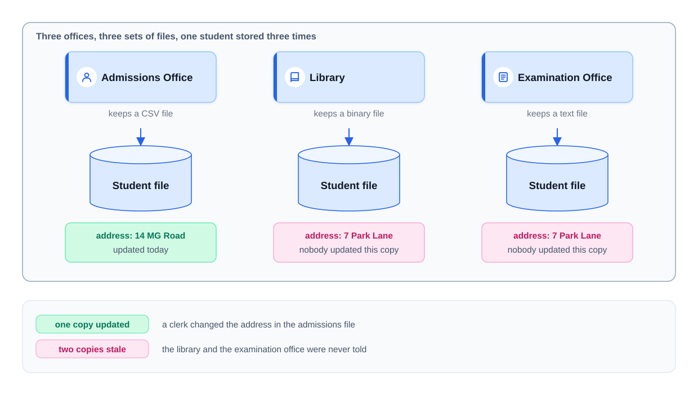
*Figure — One fact stored in three separate files: an update reaches one of them and the other two go stale (course diagram).*

Records were found by **sequential access** (read from the start until the record appears) or **indexed access** (a second, hand-maintained file mapping a key to a byte position — faster, but one more thing to keep in sync).

### The problem it solves — seven recurring failures
Each of these later became a DBMS feature.

| # | Problem | What went wrong | What a DBMS does instead |
|---|---|---|---|
| 1 | **Redundancy → inconsistency** | A customer's address is copied into several files; an update reaches one copy, the copies disagree, and nothing notices. | Store each fact once; every program reads the same copy. |
| 2 | **Data isolation** | Files sit on different machines in different formats (CSV = text with commas between values; fixed-width binary = raw bytes at set positions); a cross-department question needs custom parsing code. | One store with one self-describing format. |
| 3 | **No ad-hoc questions** | No query language: "which customers owe more than ₹500?" means days of writing a new program. | A declarative query language (SQL — you state *what* you want, not *how*): a new question is a new query. |
| 4 | **Integrity rules buried in code** | "Marks must be 0–100" lives as an `if` in one program; any other writer can skip it. | Constraints (rules declared on the table) enforced for every writer. |
| 5 | **Unsafe concurrent access** | Two clerks both read "1 copy left" and both save 0: two copies go out, the count dropped once — a **lost update**. Locking the whole file blocks everybody. | Row-level locks (others wait while one program changes a row) and transactions (all-or-nothing groups of changes, 1.4). |
| 6 | **No crash recovery** | A transfer is two writes; power fails after the first and the money has left one account and reached none. | A log (append-only diary of every change) that lets the system undo or redo half-finished work. |
| 7 | **All-or-nothing security** | File permissions cover the whole file; a clerk who needs addresses can also read salaries. | Permissions per table, column and even row. |

### How the DBMS changed things
A DBMS is a layer of software that **every application must go through**; no program touches the stored files directly. Because every read and write passes through one place, that place can apply all seven fixes.

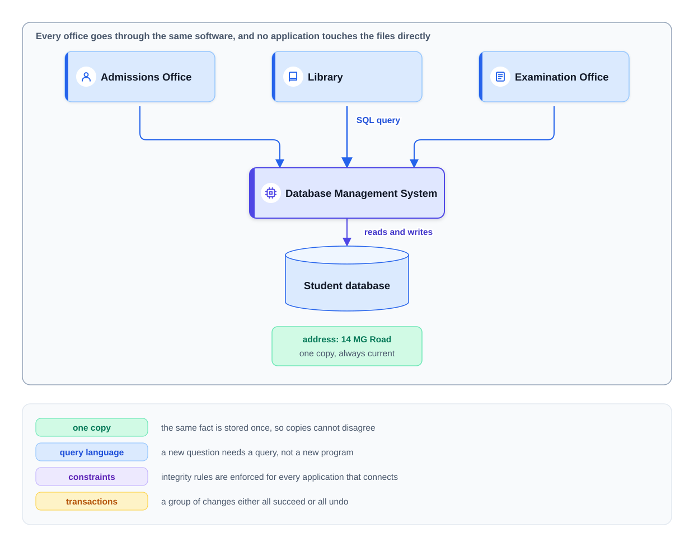
*Figure — One shared copy of the data alongside its protecting rules (course diagram).*

| Year | Milestone |
|---|---|
| 1960s | Navigational databases: IBM's IMS (hierarchical, a tree of records) and Charles Bachman's IDS / the CODASYL network model (records linked in a web). Programs followed stored pointers (saved disk addresses) from record to record. |
| 1970 | Edgar F. Codd (IBM) publishes *A Relational Model of Data for Large Shared Data Banks*. |
| 1974–79 | IBM's System R and SEQUEL (later SQL); UC Berkeley's Ingres; Oracle ships the first commercial SQL database (1979). |
| 1986–87 | SQL becomes an ANSI (1986), then ISO (1987) standard (US and international standards bodies). In 1986 UC Berkeley starts POSTGRES, the ancestor of PostgreSQL. |
| 2000s | Open-source RDBMSs (relational DBMSs, 1.7) dominate the web (MySQL, PostgreSQL); SQLite runs inside phones and browsers. |
| late 2000s | "NoSQL" systems (key-value, document, wide-column, graph) for web-scale workloads. |
| 2010s–now | Cloud-managed databases (run for you by a provider such as AWS) and distributed SQL ("NewSQL": relational databases spread over many machines). |

### Self-check
1. *Why does storing a fact in three files give wrong answers, not just wasted space?* → Updates reach some copies and not others, and nothing checks that they match.
2. *What is a lost update?* → Two programs read the same value, each computes a new value from it, and the second write overwrites the first.
3. *Which file-system problem does a transaction log solve?* → Recovery from a crash in the middle of a multi-step change.

---

## 1.2 What a database is

### What it is
A **database** is an organised, persistent collection of related data that you can query and update, stored *along with a description of its own structure*. A phone's contact list and a bank's decade of transactions both qualify; size changes the hardware, not the definition.

| Property | Meaning | Example |
|---|---|---|
| **Related** | Everything describes one slice of reality, the *mini-world* (a school, a shop). | A shop database holds customers, products and orders — not holiday photos. |
| **Self-describing** | Stores **metadata** (data about data: table and column names, types, rules) in its **catalog**, also called the **data dictionary**. | Any program can ask "which columns does `employees` have?" |
| **Purposeful** | Built for specific people and their questions; requirements come before tables. | A hospital schema is shaped by what doctors, nurses and billing need. |
| **Persistent** | Survives program exit and machine restart. | An in-memory list that disappears on exit is not a database. |

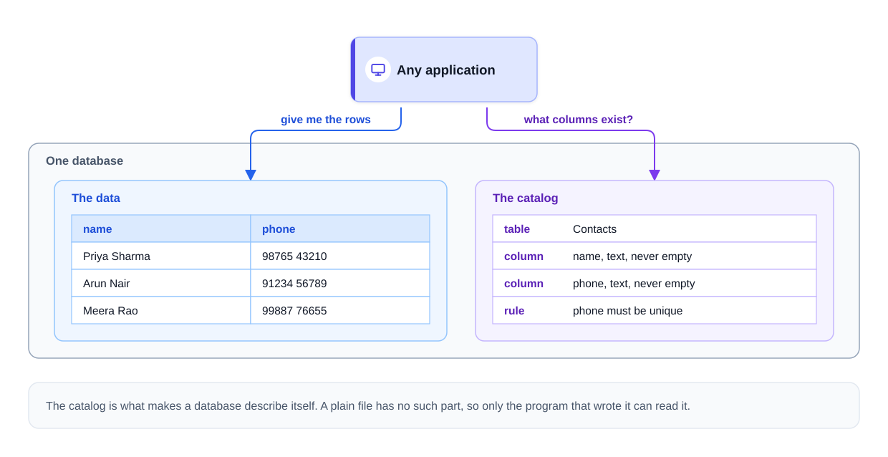
*Figure — The catalog sits inside the database next to the data it describes (course diagram).*

PostgreSQL exposes self-description through the standard `information_schema` views (a **view** is a saved query you read like a table — chapter 7) and its own `pg_catalog` tables.

```sql
-- code/02_catalog_metadata.sql (part)
SELECT column_name, data_type, is_nullable
FROM information_schema.columns
WHERE table_name = 'departments'
ORDER BY ordinal_position;
```
Output:
```
 column_name | data_type | is_nullable
-------------+-----------+-------------
 dept_id     | integer   | NO
 name        | text      | NO
 location    | text      | YES
 budget      | numeric   | NO
(4 rows)
```
```sql
SELECT conname AS constraint_name, contype AS kind, conrelid::regclass AS on_table
FROM pg_constraint
WHERE conrelid = 'employees'::regclass
ORDER BY conname;
```
Output:
```
      constraint_name      | kind | on_table
---------------------------+------+-----------
 employees_dept_id_fkey    | f    | employees
 employees_email_key       | u    | employees
 employees_manager_id_fkey | f    | employees
 employees_pkey            | p    | employees
 employees_salary_check    | c    | employees
(5 rows)
```
A **constraint** is a rule attached to a table that the DBMS checks on every write: `p` *primary key* (the column identifying each row), `f` *foreign key* (value must exist in another table; both defined in 1.6), `u` *unique* (no repeats), `c` *check* (a yes/no test every row must pass — here, salary positive). Because the rules live in the catalog, the DBMS enforces them for every program.

### Database vs DBMS vs database system
Often mixed up, including in interviews.

| Term | What it is | Example |
|---|---|---|
| **Database** | The stored data plus its description | the `company` tables in this book |
| **DBMS** (database management system) | The software that creates, stores, queries and protects databases | PostgreSQL, MySQL, Oracle |
| **Database system** | DBMS + databases + the applications that use them | PostgreSQL + `company` + the web shop that talks to it |

### Why it matters
Databases make large data fast to find, keep it accurate (integrity rules) and private (access control — who may see what; encryption — only key holders can read it), let many users work at once, and feed business reports. A good one is well structured, scalable (handles more data and users by adding hardware), reliable through failures and richly queryable. A shop must never lose a paid order, a bank never double-apply a transfer — each such requirement maps to a DBMS job in 1.3.

### Self-check
1. *What is metadata and where is it kept?* → Data describing the data (tables, columns, types, constraints, permissions), in the catalog inside the database.
2. *Is MySQL a database?* → Strictly no — it is a DBMS; the tables you create inside it form a database.

---

## 1.3 What a DBMS does

### What it is
A **DBMS** stands between applications and stored data: applications send requests ("give me these rows", "store this order"); the DBMS decides where bytes go on disk, how to find them, and how to keep them safe.

### How it works — the six jobs
| Job | Meaning | In SQL / PostgreSQL |
|---|---|---|
| **Define** | Describe tables, columns, types and rules; saved in the catalog | `CREATE TABLE`, `ALTER TABLE` |
| **Construct** | Physically write the data; you never choose file names or offsets | files under PostgreSQL's data directory |
| **Manipulate** | Read, add, change, remove data | `SELECT`, `INSERT`, `UPDATE`, `DELETE` |
| **Share** | Many users work on the same data at once without corrupting it | transactions, locks, MVCC (several row versions so readers and writers don't block each other; [chapter 13](../13-transactions-and-concurrency/README.md)) |
| **Protect** | *Security* (who may read/write what) and *failure protection* (correct after a crash) | `GRANT`/`REVOKE`, the write-ahead log (change diary saved to disk *before* the data, used to repair after a crash) |
| **Maintain** | Let schema and storage evolve for years without rewriting applications | add a column, add an index (below), move to faster disks |

File processing systems managed the first three poorly and the last three not at all.

### Who talks to a DBMS
| Role | What they do |
|---|---|
| **Application programs** | Issue SQL for their users (a shopper clicks buttons, never writes SQL). |
| **Database administrators (DBAs)** | Users and permissions, backups, tuning and monitoring. |
| **Database designers** | Decide which tables exist and how they connect ([chapter 10](../10-data-modeling-and-er-diagrams/README.md)). |
| **Analysts** | Query the data themselves for reports. |

### Data independence
**Data independence** means a change at one level of the system's description does not force changes at the level above — why a 20-year-old report still runs after a hardware move. The **logical level** is what you query (tables, columns, views); the **physical level** is how bytes are laid out (data files, 8 kB pages — fixed-size chunks read and written as one unit — index trees).

| Kind | You change… | …and this keeps working | Example |
|---|---|---|---|
| **Physical** data independence | how data is stored (indexes, files, disks, page layout) | the tables and every query | add an index; move to SSDs |
| **Logical** data independence | the tables (add a column or a table) | applications that don't use the changed part | add `phone` to `employees`; a report reading names is unaffected |

> **Key term — index:** an extra, sorted structure beside a table that finds rows by a column's value without reading every row — like a book's index. Faster reads, at the cost of disk space and extra work on every write. PostgreSQL's default is a *B-tree*, a balanced tree that stays sorted as rows change (chapter 12). SQL names only logical objects, so the DBMS may reorganise the physical side freely.

The demo changes both levels and runs the same "application" query each time:

```sql
-- code/06_data_independence.sql
SELECT first_name, last_name, job_title FROM employees WHERE last_name = 'Verma';
EXPLAIN (COSTS OFF) SELECT first_name, last_name, job_title FROM employees WHERE last_name = 'Verma';

-- Physical change: add an index. The query text is unchanged.
CREATE INDEX employees_last_name_idx ON employees (last_name);
SET enable_seqscan = off;   -- the table is tiny; nudge the planner so we can SEE it use the index
EXPLAIN (COSTS OFF) SELECT first_name, last_name, job_title FROM employees WHERE last_name = 'Verma';
SELECT first_name, last_name, job_title FROM employees WHERE last_name = 'Verma';
RESET enable_seqscan;

-- Logical change: add a column the query does not use. Still unchanged.
ALTER TABLE employees ADD COLUMN phone text;
SELECT first_name, last_name, job_title FROM employees WHERE last_name = 'Verma';
```
Output (abridged):
```
 first_name | last_name | job_title
------------+-----------+-----------
 Rahul      | Verma     | Engineer
(1 row)

              QUERY PLAN
---------------------------------------
 Seq Scan on employees
   Filter: (last_name = 'Verma'::text)
(2 rows)

                      QUERY PLAN
-------------------------------------------------------
 Index Scan using employees_last_name_idx on employees
   Index Cond: (last_name = 'Verma'::text)
(2 rows)

...
ALTER TABLE
 first_name | last_name | job_title
------------+-----------+-----------
 Rahul      | Verma     | Engineer
(1 row)
```
`EXPLAIN` shows the **plan** — the method chosen by the **planner** (PostgreSQL's name for the optimizer). Before the index it reads every row (`Seq Scan`); after, it jumps through the index (`Index Scan`). Result and query text never changed. (`enable_seqscan = off` is a teaching switch only; on 15 rows the full scan is rightly preferred. Chapter 12 covers plans.)

### Self-check
1. *Name the six jobs of a DBMS.* → Define, construct, manipulate, share, protect, maintain.
2. *Adding an index without touching any query is an example of…?* → Physical data independence.

---

## 1.4 Inside a DBMS: the core components

### What it is
A DBMS is several cooperating parts, each with one job. Knowing them explains why a query's first run is slower than its second, why a crash does not lose committed data, and why two users can update different rows at once.

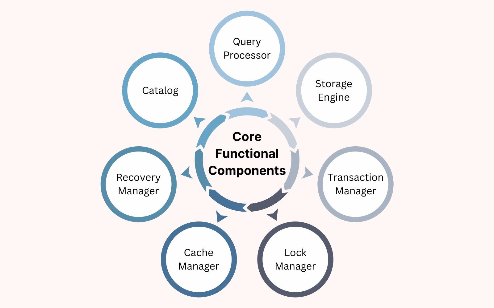
*Figure — Query processor, storage engine, transaction manager, lock manager, cache manager, recovery manager and catalog (course diagram).*

| Component | Job | Sub-parts / tools |
|---|---|---|
| **Query processor** | Turn SQL text into results | **Parser** checks syntax and meaning (do these tables/columns exist? may you use them?) and builds an internal tree. **Optimizer** picks the cheapest of alternative plans by estimated cost. **Execution engine** runs the plan, asking storage for rows. |
| **Storage engine** (storage manager) | Store and fetch bytes | Data in fixed-size **pages** (blocks) inside files; maintains indexes; row store or column store. Examples: InnoDB (MySQL), WiredTiger (MongoDB), PostgreSQL's heap + index access methods. |
| **Cache / buffer manager** | Keep hot pages in memory | The **buffer pool** holds recently used pages; cached pages avoid disk reads. |
| **Transaction manager** | Make groups of operations all-or-nothing and isolated | Begins, commits (makes permanent) and rolls back (cancels) transactions; guarantees ACID (1.8, [chapter 13](../13-transactions-and-concurrency/README.md)). |
| **Lock manager** | Coordinate concurrent access | **Shared (S)** locks: many readers at once. **Exclusive (X)** locks: one writer, nobody else. Prevents lost updates and dirty reads (seeing another transaction's uncommitted change); detects **deadlocks** (two transactions each waiting for the other's lock). |
| **Recovery manager** | Restore a consistent state after a crash | Writes a **log** of every change *before* applying it; after a crash **redoes** committed work (roll forward) and **undoes** uncommitted work (roll back). |
| **Catalog** (data dictionary) | Describe everything | Tables, columns, types, constraints, indexes, views, users, permissions, sizes. Every other component reads it. |

A **transaction** bundles several operations into one all-or-nothing unit — a bank transfer's debit and credit succeed together or not at all.

### How it works — the journey of one query
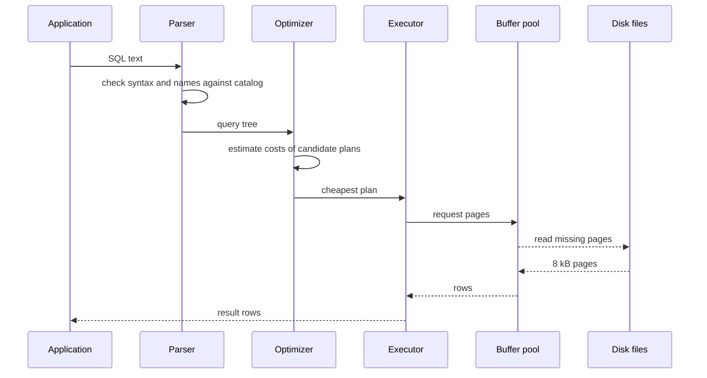
Candidate plans differ in scan method (full scan or index), join order and join algorithm; the optimizer costs each from **statistics** about the data. That division of labour is what **declarative** means: your SQL names the result, the DBMS picks the algorithm. For writes, the change is first logged, the lock manager holds off conflicting writers, and the change becomes durable at `COMMIT`.

### Real-world example — the same parts in PostgreSQL
| Generic component | PostgreSQL name |
|---|---|
| Parser / optimizer / executor | parser → rewriter → **planner** → executor (each connection gets its own server process) |
| Pages | 8 kB blocks (`SHOW block_size` → `8192`) in files under the data directory |
| Buffer pool | `shared_buffers` (default `128MB`) plus the operating-system file cache |
| Recovery log | **WAL** (write-ahead log) in `pg_wal/` |
| Lock manager + concurrency | table/row locks **plus MVCC** (multi-version concurrency control: readers see a snapshot and don't block writers) |
| Catalog | `pg_catalog` tables and the standard `information_schema` views |

(Both numbers were read on the book's server by `code/02_catalog_metadata.sql`.)

### Common mistakes
- Assuming SQL runs "top to bottom as written" — the optimizer may reorder joins and filters if the result is the same.
- Judging a query by its first (cold-cache) run — the second may be served from the buffer pool.
- Confusing the cache (in-memory copy, lost in a crash) with durability (committed data survives — provided by the log on disk).

### In the interview
**30-second answer:** "A DBMS has a query processor — parser, optimizer, executor — that turns SQL into a plan and runs it; a storage engine that keeps data in fixed-size pages and indexes; a buffer pool that caches pages; transaction and lock managers that give ACID and safe concurrency; a recovery manager that uses a write-ahead log to redo or undo work after a crash; and a catalog that describes everything."

- *Why does the optimizer need statistics?* → To estimate row counts per step, which decides index vs full scan and the join order.
- *What is write-ahead logging?* → The log record of a change is flushed to disk before the changed data page, so after a crash the system can replay or undo from the log.
- *Shared vs exclusive lock?* → Shared allows concurrent readers; exclusive allows one writer and blocks others.
- *Which component decides between an index scan and a full scan?* → The optimizer (planner).
- *A committed transaction's pages weren't yet written when the server crashed — what happens?* → The recovery manager redoes it from the log (roll forward).

---

## 1.5 Database architectures

### What it is
An **architecture** describes where the database runs relative to its users and how requests travel. The same PostgreSQL fits any of these.

### Two-tier: client–server
The **client** application talks **directly** to the database server: it opens a **connection** (a logged-in, two-way network channel), sends SQL, gets rows back.

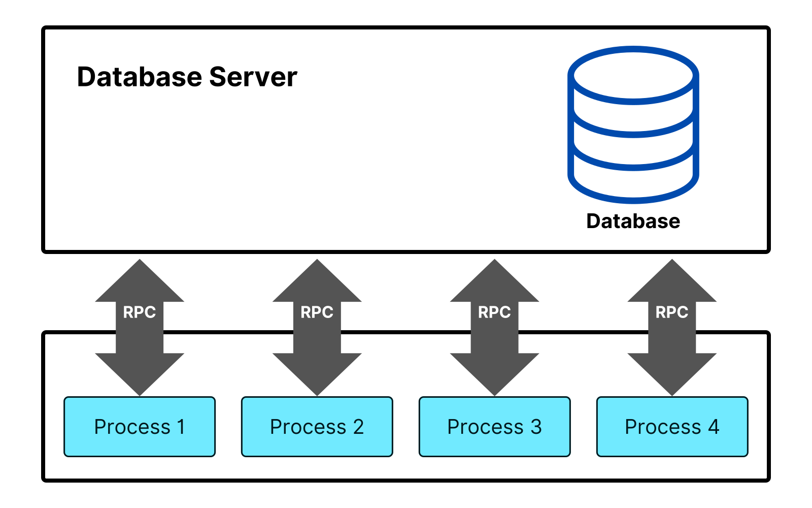
*Figure — Two-tier client–server (course diagram).*

- **Good:** simple; fine for small teams and internal tools (a desktop accounting app, `psql` itself).
- **Bad:** one server struggles with many connections; business rules live in every client, so a change means redeploying them all; clients hold database credentials.

### Three-tier
A middle **application tier** sits between the user interface and the database.

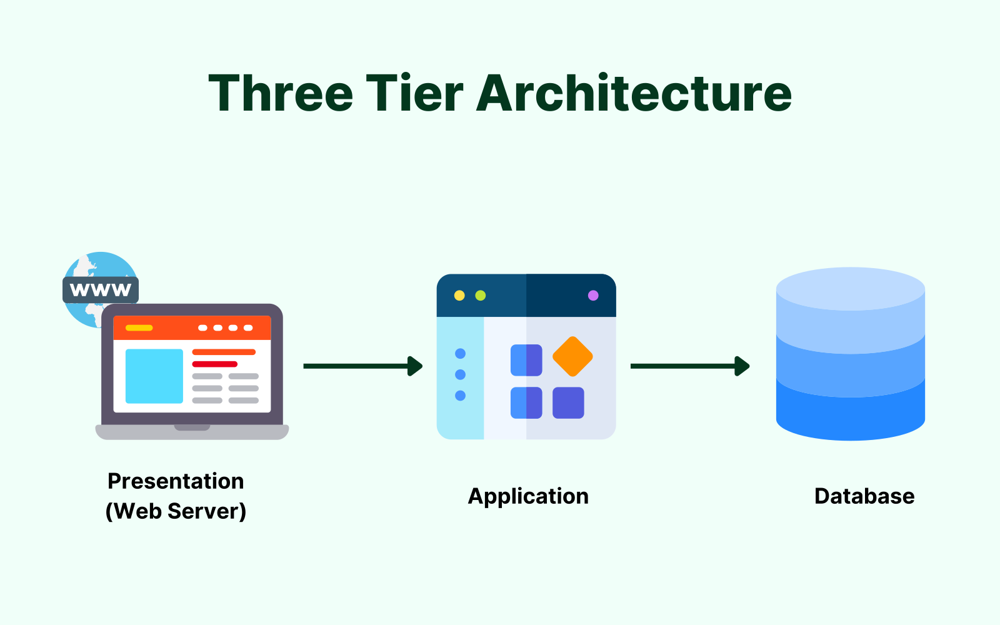
*Figure — Three-tier: presentation, application and data layers (course diagram).*

| Tier | Job | Example |
|---|---|---|
| Presentation | User interface | browser page or mobile app |
| Application (middle tier) | Business rules, validation, coordination, connection pooling (reusing a few open connections for many users) | a Java/Python/Node web service |
| Data | Storage and queries | PostgreSQL |

- **Good:** tiers scale separately (more app servers behind a **load balancer**, which spreads requests across servers); rules change in one place; the database stays off the internet. **Bad:** more moving parts and a little **latency** (delay) per network hop. See [System Design Fundamentals](../../../system-design-patterns/modules/00-system-design-fundamentals/README.md).
- **Typical use:** almost every web application — shops, ERP (enterprise resource planning) and CRM (customer relationship management) systems.

### N-tier
Further specialised layers: authentication, payments, a cache tier (e.g. Redis, a fast in-memory store), search, message queues (buffers where one service drops work for another).

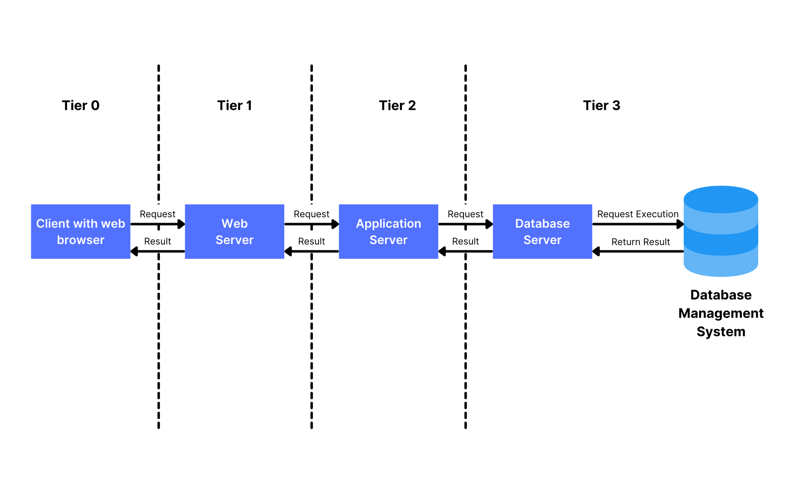
*Figure — N-tier (course diagram).*

- **Good:** layers scale, deploy and fail independently. **Bad:** harder to operate and debug; more hops. Microservices (many small, independently deployed services) are an extreme form.

### Cloud-hosted databases
| Model | You manage | Provider manages | Example |
|---|---|---|---|
| **IaaS** (Infrastructure as a Service) | OS, DBMS install, backups, upgrades | hardware, virtual machines | PostgreSQL you install on an AWS EC2 or Azure VM |
| **PaaS** / DBaaS (Platform / Database as a Service) | schema, queries, some settings | install, patching, backups, failover (switching to a standby when the main copy dies) | Amazon RDS, Google Cloud SQL, Azure Database for PostgreSQL |
| **SaaS** (Software as a Service) | only your data inside the app | everything | Salesforce, Google Workspace |

- **Good:** elastic capacity, less operational work, global reach. **Bad:** network-dependent; cost can grow quietly; data location must satisfy data-residency rules.

### Distributed databases
Data spread over several machines (**nodes**), often in several regions.

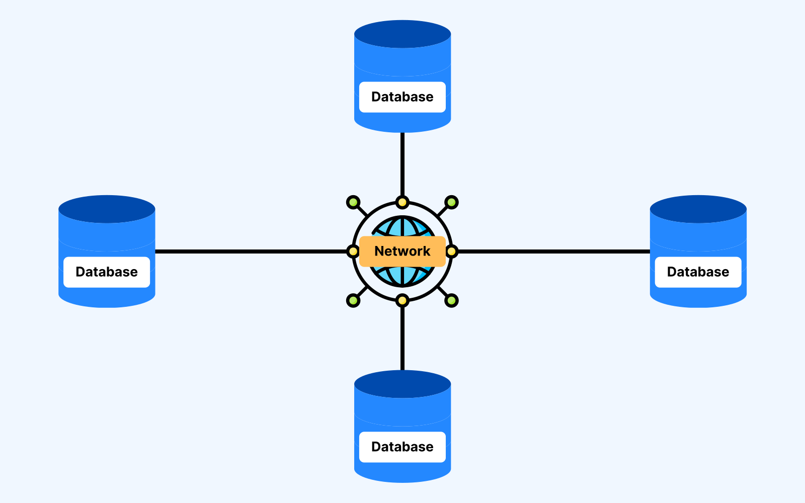
*Figure — Nodes in different locations, data partitioned and replicated (course diagram).*

- **Partitioning / sharding** — different data on different nodes (customers A–M on node 1, N–Z on node 2).
- **Replication** — copies (**replicas**) of the same data on several nodes for availability and read scaling.
- **Consistency models** — how quickly copies agree, from **strong** (every read sees the latest write) to **eventual** (copies converge after a while).
- **Good:** scales past one machine, survives node failures, data near users. **Bad:** harder to reason about; cross-node queries and transactions pay network costs.

More in chapter 15 ([Scaling databases](../15-scaling-databases/README.md)) and the DDIA notes (*Designing Data-Intensive Applications*; [`../../../ddia/`](../../../ddia/)).

### Self-check
1. *Why not expose the database directly to thousands of browsers?* → Too many connections, credentials on clients, rules duplicated in every client; a middle tier pools connections and centralises rules.
2. *Amazon RDS is which cloud model?* → PaaS / managed database service.
3. *Partitioning vs replication?* → Partitioning splits different data across nodes; replication copies the same data to several nodes.

---

## 1.6 The relational model

### What it is
The **relational model** stores *all* data in tables and connects them by **shared values**, not pointers or file addresses. Codd proposed it in 1970 because navigational databases forced programs to follow stored pointers, so reorganising data meant rewriting programs. Values in tables plus a system-chosen retrieval strategy fixed that.

"Relational" does **not** come from relationships between tables; it comes from **relation**, the mathematical word for a table (a set of tuples).

### The vocabulary
| Formal term | Everyday term | Meaning |
|---|---|---|
| **Relation** | table | a named set of rows with the same columns |
| **Tuple** | row, record | one item — one employee, one order |
| **Attribute** | column, field | one property — a name, a price |
| **Domain** | data type (+ rules) | the allowed values for a column (a *data type* is the kind of value: integer, text, date…) |
| **Degree** | number of columns | `departments` has degree 4 |
| **Cardinality** | number of rows | `departments` has cardinality 6 |
| **Schema** | table/database definition | the tables, columns, types and constraints |

("Cardinality" also means one-to-many / many-to-many in ER modelling — chapter 10.)

### The four rules every table obeys
1. **Same columns in every row.** A missing value is `NULL`, "unknown" or "not applicable" (chapter 2).
2. **One value per cell (atomic values)** — not a list or nested record. The heart of *First Normal Form* ([chapter 11](../11-normalization/README.md)).
3. **Row order means nothing.** The table is a set; ask for an order with `ORDER BY`.
4. **No duplicate rows — in theory.** SQL is looser: a table without a primary key or unique constraint will store identical rows, so good designs always declare one.

### Keys and referential integrity
- A **primary key (PK)** is a column (or columns) whose value identifies exactly one row; never repeated, never `NULL`. Example: `customers.customer_id`.
- A **foreign key (FK)** is a column whose values must match a primary (or unique) key in another table: `orders.customer_id` → `customers.customer_id`.
- **Referential integrity**: every FK value points at a real row. An order for a non-existent customer is rejected; deleting a customer who has orders is refused or **cascades** (repeats the delete on dependent rows), per the `ON DELETE` rule ([chapter 9](../09-ddl-dml-and-constraints/README.md)).
- **Entity integrity**: a primary key is never `NULL`.

The sample database enforces all of these (errors are deliberate):
```sql
-- code/04_integrity.sql
INSERT INTO orders (order_id, customer_id, placed_at, status)
VALUES (200, 99, '2025-07-01 10:00', 'pending');           -- no customer 99
DELETE FROM customers WHERE customer_id = 1;                -- customer 1 has orders
INSERT INTO orders (order_id, customer_id, placed_at, status)
VALUES (201, 1, '2025-07-01 10:00', 'lost');               -- not an allowed status
INSERT INTO departments VALUES (1, 'Legal', 'Pune', 1000);  -- duplicate key
INSERT INTO departments VALUES (NULL, 'Legal', 'Pune', 1000);
SELECT count(*) AS orders_still FROM orders;
```
Output:
```
ERROR:  insert or update on table "orders" violates foreign key constraint "orders_customer_id_fkey"
DETAIL:  Key (customer_id)=(99) is not present in table "customers".
ERROR:  update or delete on table "customers" violates foreign key constraint "orders_customer_id_fkey" on table "orders"
DETAIL:  Key (customer_id)=(1) is still referenced from table "orders".
ERROR:  new row for relation "orders" violates check constraint "orders_status_check"
DETAIL:  Failing row contains (201, 1, null, 2025-07-01 10:00:00, lost, null).
ERROR:  duplicate key value violates unique constraint "departments_pkey"
DETAIL:  Key (dept_id)=(1) already exists.
ERROR:  null value in column "dept_id" of relation "departments" violates not-null constraint
DETAIL:  Failing row contains (null, Legal, Pune, 1000.00).
 orders_still
--------------
           14
(1 row)
```
No application code checked anything — the rules live in the schema, so they hold for every program.

### Connecting tables with a join
A **join** combines rows from two tables whose shared values match (chapter 5). Which products did customer 1 buy?

```sql
-- code/01_first_queries.sql (part)
SELECT c.first_name, c.last_name, o.order_id, p.name AS product
FROM customers   c
JOIN orders      o  ON o.customer_id = c.customer_id
JOIN order_items oi ON oi.order_id   = o.order_id
JOIN products    p  ON p.product_id  = oi.product_id
WHERE c.customer_id = 1
ORDER BY o.order_id, p.name;
```
Output:
```
 first_name | last_name | order_id |       product
------------+-----------+----------+---------------------
 Anita      | Shah      |      101 | Laptop Pro 14
 Anita      | Shah      |      101 | Wireless Mouse
 Anita      | Shah      |      104 | Ergonomic Chair
 Anita      | Shah      |      104 | Standing Desk
 Anita      | Shah      |      113 | Laptop Pro 14
 Anita      | Shah      |      113 | Mechanical Keyboard
(6 rows)
```
Nothing "points" anywhere: the value `1` in both `customer_id` columns is the whole connection. Because queries name only tables and columns, the optimizer is free to choose the method; because the model is mathematical, it gives exact tests for design flaws — the normal forms of [chapter 11](../11-normalization/README.md).

### Common mistakes
- Relying on the order rows came back in without `ORDER BY` — it can change at any time.
- Storing lists in one cell (`'red,green,blue'`), breaking rule 2.
- Tables without a primary key, letting exact duplicates creep in.

### In the interview
**30-second answer:** "The relational model, from Codd in 1970, stores data as relations — tables of tuples with typed attributes — linked only by values: a foreign-key column stores another row's key, and the DBMS guarantees that row exists. Rows are unordered and cells hold single values. Queries are declarative and never mention storage, so the DBMS can optimise and reorganise freely."

- *Where does 'relational' come from?* → *Relation*, the mathematical name for a table — not relationships.
- *Deleting a parent row that has children?* → Depends on the FK's `ON DELETE`: `NO ACTION`/`RESTRICT` (error, the default), `CASCADE`, `SET NULL` or `SET DEFAULT`.

### Self-check
1. *Degree and cardinality of `products`?* → Degree 5, cardinality 9.
2. *Why can't a primary key be NULL?* → An unknown identifier identifies nothing (entity integrity).
3. *Which rule does `'555-1234, 555-9876'` in one phone column break?* → One value per cell (1NF).

---

## 1.7 RDBMS — relational database management systems

### What it is
An **RDBMS** is a DBMS that implements the relational model and speaks SQL.

| Feature | What it gives you |
|---|---|
| Tables of rows and columns | one uniform structure for all data |
| Primary and foreign keys | identity and enforced relationships |
| SQL | one standard language to define, change, query and secure data |
| Transactions with **ACID** guarantees | Atomicity, Consistency, Isolation, Durability (1.8, chapter 13) |
| Integrity constraints | types, `NOT NULL`, `UNIQUE`, `CHECK`, keys — bad data refused at the door |
| Separation of logical and physical | data independence (1.3) |

**Advantages:** the same tables answer countless questions without reorganisation, SQL is far shorter than file-access code, ACID and constraints keep data correct, and modern products handle large volumes and many concurrent users.

### The main products
| Product | Licence | Known for | Notes for this book |
|---|---|---|---|
| **PostgreSQL** | open source (PostgreSQL licence) | standards compliance, correctness, extensibility (JSONB = stored JSON documents, PostGIS = geography, custom types) | this book's main dialect |
| **MySQL** (and fork MariaDB) | open source (GPL, keeps derived code open) + commercial | ubiquity on the web, simple operations | the SQL course's original dialect; differences noted per chapter |
| **Oracle Database** | commercial | enterprise features, PL/SQL (Oracle's procedural language) | mentioned where syntax differs notably |
| **Microsoft SQL Server** | commercial | Microsoft ecosystem, T-SQL (Transact-SQL, its dialect) | differences noted in small tables |
| **SQLite** | public domain | serverless: a whole database in one file, embedded in apps, phones and browsers | `*.sqlite.sql` examples run in `sqlite3` |

### Self-check
1. *What makes SQLite different?* → No separate server process; a library storing the whole database in one file.

---

## 1.8 Relational vs non-relational databases

### What it is
**Non-relational** databases store data in shapes other than tables. The umbrella name **NoSQL** is now usually expanded as "**not only SQL**", since many gained SQL-like query languages. Neither family is "better": the shape of the data decides which questions are cheap. In a food-delivery app, orders and payments fit tables perfectly; restaurant menus (thirty dishes with toppings here, four fixed meals there, rewritten weekly) do not.

### The four NoSQL families
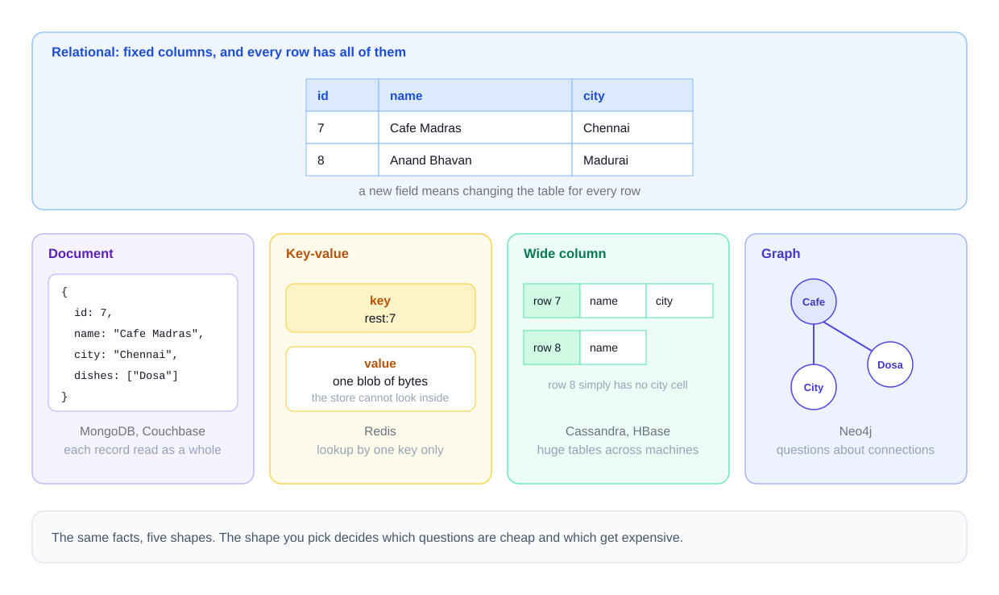
*Figure — One dataset, four non-relational shapes, next to the relational version (course diagram).*

| Family | Data shape | Strength | Weakness | Examples | Typical use |
|---|---|---|---|---|---|
| **Document** | self-contained JSON/BSON (or XML) documents (JSON = nested `{"key": value}` text; BSON = binary JSON); documents in one collection may differ in fields | reading/writing one whole object; varied shapes | cross-document joins limited | MongoDB, Couchbase, CouchDB | catalogs, content, user profiles, menus |
| **Key-value** | a value under a key; mainly `put` and `get` | extremely fast key lookups | cannot search inside values | Redis, Amazon DynamoDB, Riak | caches, sessions, feature flags |
| **Wide-column** (column-family) | rows grouped into column families; rows may have different columns; partitioned by key | very high write throughput across many machines | queries must follow the partition key (the column deciding which machine holds a row) | Apache Cassandra, HBase | time series, event logs, IoT |
| **Graph** | nodes, edges and properties | multi-hop relationship questions ("friends of friends who…") | not built for bulk aggregation | Neo4j, Amazon Neptune | social networks, recommendations, fraud detection |

Chapter 16 ([Beyond relational](../16-beyond-relational/README.md)) builds each in practice.

### ACID vs BASE
**ACID** — the guarantees of a relational transaction:

| Letter | Guarantee |
|---|---|
| **Atomicity** | all operations happen, or none do |
| **Consistency** | after the transaction, every declared rule (keys, checks, constraints) still holds |
| **Isolation** | concurrent transactions behave as if run alone; half-done changes stay invisible |
| **Durability** | once committed, changes survive crashes and power loss |

**BASE** — how many distributed NoSQL systems describe themselves:

| Letter(s) | Meaning |
|---|---|
| **Basically Available** | requests get answers while some nodes fail, though data may be stale |
| **Soft state** | state may change without new writes as replicas catch up |
| **Eventual consistency** | if writes stop, replicas converge; until then readers may see different values |

BASE gives up immediate agreement to stay available — fine for a product catalogue, not for an account balance.

### Three claims that need care
1. **"Relational databases only scale vertically."** *False.* **Vertical scaling** = a bigger machine; **horizontal scaling** = more machines. Relational systems scale out with read replicas, partitioning/sharding and distributed SQL (CockroachDB, Google Spanner, YugabyteDB, Citus for PostgreSQL). The real issue is *cost*: cross-machine joins and transactions are expensive, and NoSQL models avoid them by design.
2. **"NoSQL databases don't support transactions."** *Out of date.* MongoDB has multi-document ACID transactions since 4.0 (2018); DynamoDB added transactions in 2018; Cassandra offers lightweight (compare-and-set: "write only if the value is still what I last saw") transactions per partition. Limits vary by product.
3. **"NoSQL databases have no schema."** *Misleading.* The database doesn't *enforce* one, but your code still expects `price` to be a number — the schema moved into the application. **Schema-on-write** (database checks data as written — relational) vs **schema-on-read** (the reader interprets whatever is stored): the latter makes change cheap and bad data easy.

### Comparison
| Aspect | Relational | Non-relational |
|---|---|---|
| Schema | schema-on-write | mostly schema-on-read |
| Query language | SQL, standardised | product-specific (MongoDB query API, Cassandra's CQL, Neo4j's Cypher…), some SQL-like |
| Joins | built in, optimised | few or none; join in code or embed related data |
| Transactions | full ACID across tables | often scoped (one document / partition) or slower |
| Best fit | structured, related data where correctness matters (orders, payments, bookings, inventory, ERP, CRM) | huge volumes, varied shapes, one dominant access pattern (catalogues, caches, feeds, telemetry, real-time analytics) |

### How to choose
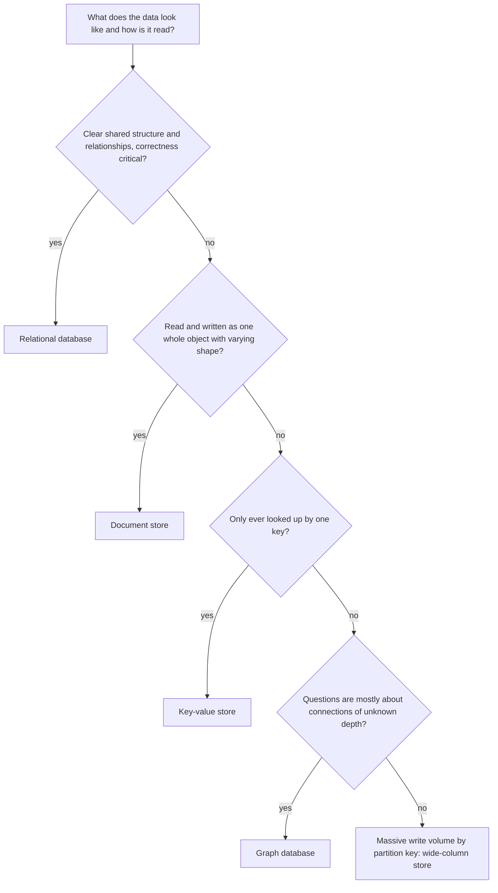
Using different stores for different jobs (orders in PostgreSQL, menus in a document store, sessions in Redis) is **polyglot persistence**. Every extra store must be run, backed up, monitored and kept in step, so start with one (relational is the safe default) and add another only for a concrete requirement.

### In the interview
**30-second answer:** "I pick from the access pattern, not the fashion. Orders need multi-table transactions and constraints, so relational. Menus differ per restaurant and are fetched whole — a document store. Sessions are key lookups — Redis. Relational databases do scale horizontally — replicas, sharding, distributed SQL — the real cost is cross-node joins and transactions."

- *Why not one database for everything?* → Often you should; each extra store adds operational cost and cross-store consistency problems.

### Self-check
1. *Feature flags read by name millions of times per second?* → Key-value.
2. *"Friends of my friends who also like jazz"?* → Graph.
3. *Horizontal vs vertical scaling?* → More machines vs a bigger machine.

---

## 1.9 What SQL is

### What it is
**SQL (Structured Query Language)** is the standard language for defining, changing, querying and securing relational data. It is **declarative**: you describe the result, not the steps. Developed at IBM in the 1970s as SEQUEL (renamed for trademark reasons), it became an ANSI standard in 1986 and ISO in 1987; the current edition is **SQL:2023**. Every RDBMS implements the core plus extensions — its **dialect** (PostgreSQL's, MySQL's, T-SQL, PL/SQL-flavoured Oracle SQL).

SQL is the traffic between applications and databases:
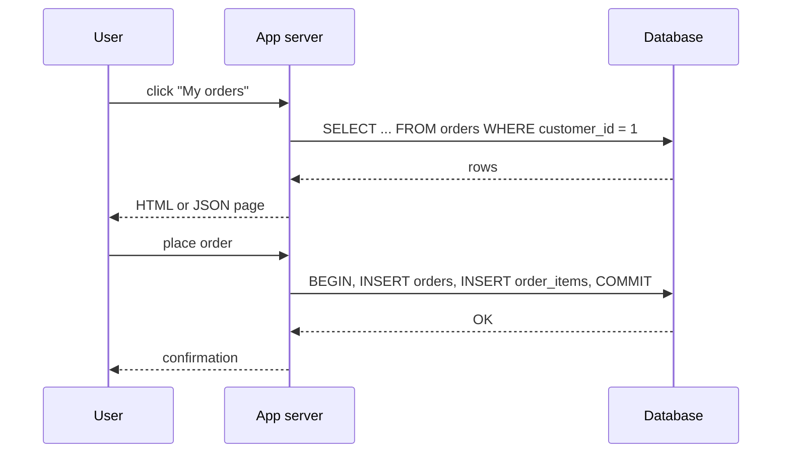

### The five sub-languages
(Some texts fold DQL into DML; know both.)

| Sub-language | Purpose | Main statements |
|---|---|---|
| **DDL** — Data Definition Language | define and change *structure* | `CREATE`, `ALTER`, `DROP`, `TRUNCATE`, `COMMENT`, `RENAME` (via `ALTER`) |
| **DML** — Data Manipulation Language | change *data* | `INSERT`, `UPDATE`, `DELETE`, `MERGE` (PostgreSQL 15+), `COPY` (PostgreSQL) |
| **DQL** — Data Query Language | read data | `SELECT` |
| **DCL** — Data Control Language | control *access* | `GRANT`, `REVOKE` (and role management such as `CREATE ROLE`) |
| **TCL** — Transaction Control Language | group changes into transactions | `BEGIN`/`START TRANSACTION`, `COMMIT`, `ROLLBACK`, `SAVEPOINT`, `ROLLBACK TO SAVEPOINT`, `RELEASE SAVEPOINT` |

Frequent mix-up: **granting and revoking is DCL, not TCL.** TCL is only transaction boundaries.

### How it works — one statement of each kind
```sql
-- code/03_sql_sublanguages.sql
-- DDL: define structure
CREATE TABLE suppliers (
    supplier_id integer PRIMARY KEY,
    name        text NOT NULL,
    country     text
);

-- DML: change data
INSERT INTO suppliers VALUES (1, 'Deskworks', 'India'), (2, 'Clicky Ltd', 'UK');
UPDATE suppliers SET country = 'Ireland' WHERE supplier_id = 2;

-- DQL: read data
SELECT * FROM suppliers ORDER BY supplier_id;

-- DCL: control who may do what
CREATE ROLE sql01_report_reader;
GRANT SELECT ON suppliers TO sql01_report_reader;
SELECT grantee, privilege_type
FROM information_schema.role_table_grants
WHERE table_name = 'suppliers' AND grantee = 'sql01_report_reader';
REVOKE SELECT ON suppliers FROM sql01_report_reader;

-- TCL: group changes into a transaction, with a savepoint
BEGIN;
INSERT INTO suppliers VALUES (3, 'Chairmakers', 'India');
SAVEPOINT before_mistake;
DELETE FROM suppliers;                 -- oops: no WHERE clause
ROLLBACK TO SAVEPOINT before_mistake;  -- undo only the delete
COMMIT;
SELECT * FROM suppliers ORDER BY supplier_id;
```
Output (psql echoes a *command tag* such as `INSERT 0 2` — `0` is a legacy OID (object identifier) field, `2` the row count):
```
CREATE TABLE
INSERT 0 2
UPDATE 1
 supplier_id |    name    | country
-------------+------------+---------
           1 | Deskworks  | India
           2 | Clicky Ltd | Ireland
(2 rows)

CREATE ROLE
GRANT
       grantee       | privilege_type
---------------------+----------------
 sql01_report_reader | SELECT
(1 row)

REVOKE
BEGIN
INSERT 0 1
SAVEPOINT
DELETE 3
ROLLBACK
COMMIT
 supplier_id |    name     | country
-------------+-------------+---------
           1 | Deskworks   | India
           2 | Clicky Ltd  | Ireland
           3 | Chairmakers | India
(3 rows)
```
`DELETE 3` wiped every row, but `ROLLBACK TO SAVEPOINT` undid just that step; the insert before the savepoint survived the `COMMIT`.

### SQL syntax basics you'll use from chapter 2
| Rule | Detail |
|---|---|
| Statements end with `;` | psql waits for the semicolon before running anything |
| Keywords are case-insensitive | `select` = `SELECT`; this book capitalises keywords |
| Unquoted identifiers fold to lower case in PostgreSQL | `Employees` means `employees`; `"Employees"` keeps the case |
| Strings use single quotes | `'Mumbai'`; a quote inside is doubled: `'O''Brien'` |
| Comments | `-- to end of line` and `/* block */` |
| Whitespace is free | break long queries over lines |

### Dialect differences at a glance
| Feature | PostgreSQL | MySQL | SQLite | SQL Server |
|---|---|---|---|---|
| Limit rows | `LIMIT n` / `FETCH FIRST n ROWS ONLY` | `LIMIT n` | `LIMIT n` | `TOP n` / `OFFSET … FETCH` |
| Identifier quotes | `"name"` | `` `name` `` (or `"` in ANSI mode) | `"name"` | `[name]` or `"name"` |
| String concat | `\|\|`, `concat()` | `concat()` (`\|\|` is OR by default) | `\|\|` | `+`, `concat()` |
| Auto-increment | `GENERATED … AS IDENTITY` / `serial` | `AUTO_INCREMENT` | `INTEGER PRIMARY KEY` | `IDENTITY(1,1)` |
| DDL inside transactions | yes, can be rolled back | no (implicit commit) | yes | mostly yes |

### Self-check
1. *Classify: `TRUNCATE`, `GRANT`, `SAVEPOINT`, `MERGE`, `SELECT`.* → DDL, DCL, TCL, DML, DQL.
2. *What does "declarative" mean?* → You state the result; the DBMS decides the algorithm.
3. *Why did `ROLLBACK TO SAVEPOINT` not remove supplier 3?* → The insert came before the savepoint; only later work is undone.

---

## 1.10 Your private PostgreSQL server and psql

### What it is
The script `tools_pg.sh` in the project root runs a **private PostgreSQL 14 server** for this book only: data in `~/.pg-books-system-design/` (outside the iCloud-synced Documents folder), listening on port **5544** (a *port* is a numbered network door) through a Unix socket in `/tmp` (a special file for same-machine communication). It never touches another PostgreSQL install (normally port 5432). **psql** is PostgreSQL's command-line client: you type SQL, it prints results.

### How it works — step by step
From the project root (`system_design_notes/`):

1. **Start the server** (first run creates the data directory):
   ```bash
   bash tools_pg.sh start
   ```
   ```
   postgres ready on port 5544 (socket /tmp)
   ```
2. **Create the database**:
   ```bash
   bash tools_pg.sh psql -d postgres -c "CREATE DATABASE company ENCODING 'UTF8' TEMPLATE template0"
   ```
   ```
   CREATE DATABASE
   ```
   An **encoding** turns characters into bytes; **UTF-8** covers every language. Asking for `UTF8` explicitly guarantees `café` and `मुंबई` are stored and measured correctly whatever the server default; `TEMPLATE template0` is required when the encoding differs from the default template's.
3. **Load the sample schema** (1.11):
   ```bash
   bash tools_pg.sh psql -d company -q -f sql/chapters/01-databases-and-the-relational-model/code/00_schema.sql
   ```
4. **Check it**:
   ```bash
   bash tools_pg.sh psql -d company -c '\conninfo' -c 'SELECT count(*) FROM employees'
   ```
   ```
   You are connected to database "company" as user "postgres" via socket in "/tmp" at port "5544".
    count
   -------
       15
   (1 row)
   ```
5. **Interactive session**: `bash tools_pg.sh psql -d company`. Prompt `company=#` means connected as a superuser (an account allowed everything); `=>` for ordinary users. `company-#` means psql is waiting for the rest of a statement (no `;` yet). `\q` leaves.
6. **Stop the server**: `bash tools_pg.sh stop`.

`tools_pg.sh psql` wraps `psql -h /tmp -p 5544 -U postgres -X`: socket directory, port, user, and `-X` to skip a personal `~/.psqlrc` so output looks the same for every reader.

### psql meta-commands
Lines starting with a backslash are **meta-commands**, handled by psql itself (no semicolon needed).

| Command | Does |
|---|---|
| `\?` / `\h SELECT` | help on meta-commands / SQL syntax for a statement |
| `\l` | list databases |
| `\c company` | connect to another database |
| `\conninfo` | show current connection |
| `\dt` / `\dt+` | list tables (with sizes) |
| `\d employees` | describe a table: columns, types, indexes, constraints, references |
| `\dn`, `\df`, `\dv`, `\di`, `\du` | schemas, functions, views, indexes, roles |
| `\x` (or `\x auto`) | expanded display: one field per line |
| `\pset null '(null)'` | show NULLs visibly (used throughout this book) |
| `\timing` | print each statement's duration |
| `\i file.sql` | run a file of SQL |
| `\e` | edit the last query in `$EDITOR` |
| `\copy` | import/export CSV from your machine (client side) |
| `\q` | quit |

They also work inside script files:
```sql
-- code/05_psql_meta_commands.sql
\dt
\d departments
\x on
SELECT * FROM employees WHERE emp_id = 7;
\x off
```
Output (abridged; `\dt` lists the 8 tables):
```
                Table "public.departments"
  Column  |     Type      | Collation | Nullable | Default
----------+---------------+-----------+----------+---------
 dept_id  | integer       |           | not null |
 name     | text          |           | not null |
 location | text          |           |          |
 budget   | numeric(12,2) |           | not null |
Indexes:
    "departments_pkey" PRIMARY KEY, btree (dept_id)
    "departments_name_key" UNIQUE CONSTRAINT, btree (name)
Check constraints:
    "departments_budget_check" CHECK (budget >= 0::numeric)
Referenced by:
    TABLE "employees" CONSTRAINT "employees_dept_id_fkey" FOREIGN KEY (dept_id) REFERENCES departments(dept_id)
    TABLE "projects" CONSTRAINT "projects_dept_id_fkey" FOREIGN KEY (dept_id) REFERENCES departments(dept_id)

Expanded display is on.
-[ RECORD 1 ]--+---------------------------
emp_id         | 7
first_name     | Priya
...
hire_date      | 2020-02-10
```

### Running the book's code
- **One file**: `bash tools_pg.sh psql -d company -f sql/chapters/02-select-basics/code/02_where.sql`. Run files that change data (like 1.3's demo) on a fresh copy — re-run step 3 to reset.
- **Everything**, as the book was checked: `bash tools_run_sql.sh sql` — per file it creates a fresh database, loads that chapter's `00_schema.sql`, runs the file, prints `OK` or `FAIL`.

### Common mistakes
- Forgetting the `;` — psql shows `company-#` and waits.
- Typing SQL at the shell prompt (`$`) instead of inside psql.
- Connecting to the wrong server: use `tools_pg.sh psql` (port 5544), not a bare `psql` (5432).
- A typo inside a transaction aborts it (`current transaction is aborted…`); type `ROLLBACK;`.

---

## 1.11 The sample database

### What it is
Chapters 2 onward query **`company`**, a fictional firm selling office equipment: staff in departments and projects, plus a small shop with customers, products and orders. Every chapter's `code/00_schema.sql` is a copy of [`code/00_schema.sql`](code/00_schema.sql).

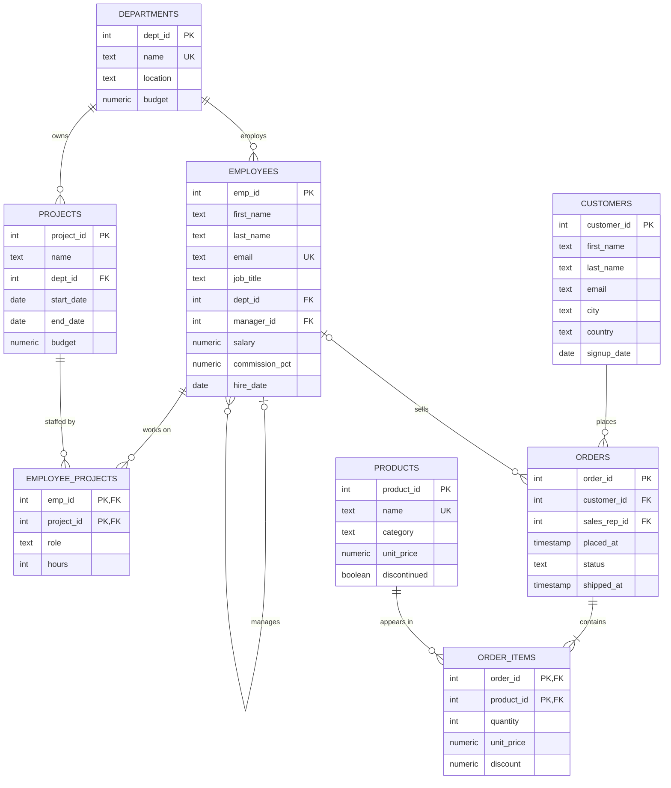
(Crow's-foot symbols — `||` exactly one, `o{` zero or more, `|{` one or more, `|o` zero or one — are explained in [chapter 10](../10-data-modeling-and-er-diagrams/README.md).)

### The tables
| Table | Rows | What a row is | Notable columns |
|---|---|---|---|
| `departments` | 6 | a department | `location` may be NULL, `budget` |
| `employees` | 15 | a member of staff | `manager_id` → another employee (a self-reference: an FK to its own table), `commission_pct` only for some sales staff |
| `projects` | 5 | an internal project owned by a department | `end_date` NULL = still running |
| `employee_projects` | 13 | "employee X works on project Y" (many-to-many link) | composite key (several columns together) `(emp_id, project_id)`, `role`, `hours` |
| `customers` | 10 | a shop customer | `city`, `email` may be NULL |
| `products` | 9 | a product for sale | `category` may be NULL, `discontinued` |
| `orders` | 14 | an order header | `placed_at`, `status` ∈ pending / shipped / delivered / cancelled, `shipped_at`, `sales_rep_id` NULL for online orders |
| `order_items` | 22 | one product line in an order | `quantity`, `unit_price` at time of sale, `discount` (0.10 = 10 %) |

### Deliberate quirks (so later chapters have something to find)
| Quirk | Where | Useful for |
|---|---|---|
| CEO (Asha) and a new intern (Rohan) have no department | `employees.dept_id` NULL | NULL handling, outer joins |
| Research has no employees; Support has no location | `departments` | outer joins (keep unmatched rows), anti-joins (rows with *no* match), NULL sorting |
| Salary ties: Rahul & Meera 98,000; Arjun & Sara 68,000 | `employees.salary` | `DISTINCT`, `WITH TIES`, ranking functions |
| Missing emails (Meera, Ananya) and commissions | `employees` | `IS NULL`, `COALESCE`, `count(col)` |
| One email in mixed case (`Neha.Gupta@Company.example`) | `employees.email` | case-insensitive matching |
| Anita Shah entered twice, second time with spaces and capitals in the email and city `mumbai` | `customers` 1 and 8 | de-duplication, `trim`, `lower` |
| Customers 9 and 10 never ordered; "Desk Lamp" never sold; "Gift Card" has no category | `customers`, `products` | anti-joins, NULL groups |
| Orders across Jan–Jun 2025, one at 23:55 on 31 January | `orders.placed_at` | date ranges, month boundaries |
| Pending/cancelled orders have no `shipped_at` | `orders` | NULLs in date arithmetic |

```sql
SELECT * FROM departments;
```
Output:
```
 dept_id |    name     | location  |  budget
---------+-------------+-----------+-----------
       1 | Engineering | Bengaluru | 900000.00
       2 | Sales       | Mumbai    | 400000.00
       3 | Marketing   | Mumbai    | 250000.00
       4 | Finance     | Pune      | 200000.00
       5 | Support     | (null)    | 150000.00
       6 | Research    | Pune      | 300000.00
(6 rows)
```

---

## Key terms (chapter 1)
Defined where first used (in **bold**): file processing system, redundancy/inconsistency, lost update, metadata, catalog/data dictionary, DBMS, database system, data independence (physical/logical), buffer pool, page, WAL, transaction, ACID, BASE, relation/tuple/attribute/domain, degree, cardinality, primary key, foreign key, entity and referential integrity, schema-on-write/-on-read, horizontal/vertical scaling, polyglot persistence, DDL/DML/DQL/DCL/TCL, declarative. Book-wide glossary: [chapter 20](../20-cheatsheet-and-glossary/README.md).

---

## Chapter 1 TL;DR
- File-based systems suffered seven problems (redundancy, isolation, no queries, rules in code, lost updates, no recovery, coarse security); the **DBMS** fixes them by mediating every access.
- A **database** is related, self-describing (catalog), purposeful, persistent data; the **DBMS** **defines, constructs, manipulates, shares, protects and maintains** it, with **physical and logical data independence**.
- Inside: **parser → optimizer → executor**, a **storage engine** with pages, a **buffer pool**, **transaction/lock managers**, a **recovery manager** with a write-ahead log, and a **catalog**.
- Architectures: two-tier, three-tier, n-tier, cloud (IaaS/PaaS/SaaS), distributed (partitioning + replication).
- The **relational model**: relations of tuples and attributes; same columns per row, atomic cells, no row order, no duplicates; **primary keys** identify, **foreign keys** link, the DBMS enforces **referential integrity**.
- NoSQL families (document, key-value, wide-column, graph) trade enforced structure and joins for flexible shapes and easier scale-out; choose by access pattern.
- **SQL** is declarative and standard: **DDL, DML, DQL, DCL, TCL**; each product speaks a dialect.
- Lab: `bash tools_pg.sh start` → create UTF-8 `company` → load `00_schema.sql` → `bash tools_pg.sh psql -d company`; `\dt`, `\d`, `\x`, `\pset null`, `\timing`, `\q`; `tools_run_sql.sh sql` runs all examples on fresh databases.

Next: [Chapter 2 — SELECT basics](../02-select-basics/README.md).
