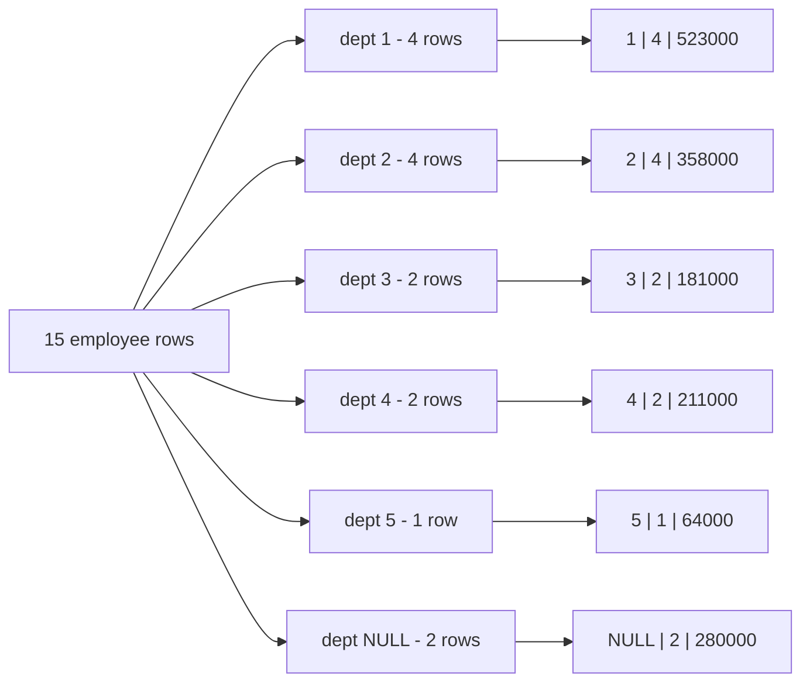
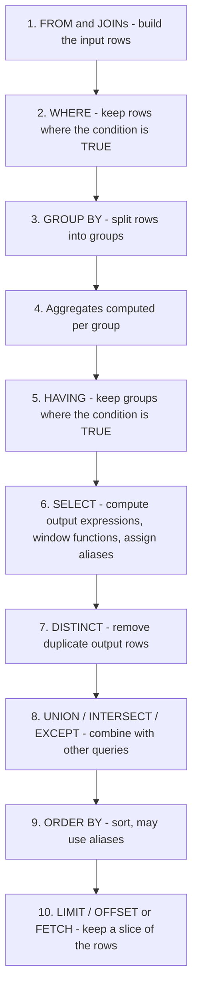

# Chapter 4 — Aggregation: Summarising Many Rows

Chapters 2 and 3 worked **row by row**: `WHERE` kept or dropped each row, and functions such as `upper()` or `round()` turned one row's value into another value for the same row. Most business questions are not about single rows, though. "How many orders did we ship last month?", "What is the average salary per department?", "Which customers spent more than 1,000?" — each of these squeezes **many rows into one answer**. That squeezing is called **aggregation**, and it is the subject of this chapter.

**What you'll learn**

- The aggregate functions (`COUNT`, `SUM`, `AVG`, `MIN`, `MAX` and PostgreSQL's useful extras) and exactly how each treats `NULL` and empty input.
- `GROUP BY` — splitting rows into groups and getting one result row per group — and the rule about which columns you may select.
- `HAVING` — filtering whole groups after they have been summarised — and how it differs from `WHERE`.
- Conditional aggregation with `FILTER (WHERE …)` and `CASE`, the trick behind most "count several things in one pass" and pivot-style reports.
- The **logical query processing order** — the order in which the database *conceptually* evaluates the clauses of a `SELECT` — and why it explains almost every "column does not exist" error.
- Subtotals and grand totals in a single query with `GROUPING SETS`, `ROLLUP` and `CUBE`.

**How to run the examples.** Every query in this chapter is in [`code/`](code/) and was run on the book's private PostgreSQL 14 server; the output under each query is the real `psql` output. `(null)` in the output is how we asked `psql` to display `NULL` (`\pset null '(null)'`).

```bash
bash tools_run_sql.sh sql '04-*'                         # run this chapter's files (fresh DB per file)
bash tools_pg.sh psql -d <db> -f sql/chapters/04-aggregation/code/02_group_by.sql
```

**The sample data.** We keep using the book's `company` database from [Chapter 1](../01-databases-and-the-relational-model/README.md) ([`code/00_schema.sql`](code/00_schema.sql) is an exact copy). The tables that matter most here:

| Table | Rows | What is in it (the quirks we will meet) |
|---|---|---|
| `employees` | 15 | `emp_id`, `first_name`, `dept_id`, `salary`, `commission_pct`, `hire_date`, `manager_id`. The CEO (Asha) and the intern (Rohan) have **no department** (`dept_id` is `NULL`); only 3 people have a commission; two salaries are shared by two people each. |
| `departments` | 6 | Engineering, Sales, Marketing, Finance, Support, Research (Research has **no** employees). |
| `orders` | 14 | `status` is one of pending / shipped / delivered / cancelled; `sales_rep_id` is `NULL` for online orders. |
| `order_items` | 22 | One row per product in an order: `quantity`, `unit_price` (price paid), `discount` (0.10 = 10 % off). |
| `products`, `customers` | 9, 10 | One product has no category; two customers have never ordered. |

---

## 4.1 Aggregate functions

### What it is

An **aggregate function** takes a *set of rows* and returns *one value* that summarises them. Think of a shop's till at closing time: it does not print every sale again — it prints the number of sales, the total taken, the largest single sale. Those are aggregates.

| Function | Returns | Works on | Notes |
|---|---|---|---|
| `COUNT(*)` | number of **rows** | any rows | Counts rows, even rows that are all `NULL`. |
| `COUNT(expr)` | number of rows where `expr` is **not NULL** | any type | The usual way to count "how many have a value". |
| `COUNT(DISTINCT expr)` | number of **different** non-NULL values | any type | Duplicates and `NULL`s are dropped first. |
| `SUM(expr)` | total | numbers, intervals | `NULL` if there are no non-NULL inputs. |
| `AVG(expr)` | arithmetic mean = `SUM / COUNT(expr)` | numbers, intervals | Divides by the count of **non-NULL** values. |
| `MIN(expr)` / `MAX(expr)` | smallest / largest | anything that can be sorted: numbers, text, dates | Text uses the column's collation (alphabetical order). |

Two words you will see a lot: a **scalar function** (Chapter 3) works on one row's values and returns one value *per row*; an **aggregate function** works on many rows and returns one value *per group*. Without `GROUP BY`, the whole table (after `WHERE`) is one group, so the query returns exactly one row.

### Why it matters

Reports, dashboards, KPIs, billing, fraud checks and most SQL interview questions are aggregations. Doing the summary inside the database is also far cheaper than shipping every row to your application and adding them up there: the database reads the rows where they live and sends back one small result.

### How it works

1. The database builds the input rows (`FROM` and any joins), then removes rows that fail `WHERE`.
2. For each aggregate in the `SELECT` list, it walks the remaining rows, keeping a small running **state** (a counter, a running total, the smallest value so far …).
3. Before feeding a value into the state, it **skips `NULL`s** — every aggregate except `COUNT(*)` does this.
4. At the end it turns the state into the result (for `AVG`, total ÷ count).

```sql
SELECT count(*)              AS employees,
       sum(salary)           AS payroll,
       round(avg(salary), 2) AS avg_salary,
       min(salary)           AS lowest,
       max(salary)           AS highest
FROM employees;
```

Output:

```text
 employees |  payroll   | avg_salary |  lowest  |  highest  
-----------+------------+------------+----------+-----------
        15 | 1617000.00 |  107800.00 | 30000.00 | 250000.00
(1 row)
```

### The three flavours of COUNT

```sql
SELECT count(*)                AS all_rows,
       count(email)            AS with_email,
       count(dept_id)          AS with_dept,
       count(DISTINCT dept_id) AS distinct_depts,
       count(DISTINCT job_title) AS distinct_titles
FROM employees;
```

Output:

```text
 all_rows | with_email | with_dept | distinct_depts | distinct_titles 
----------+------------+-----------+----------------+-----------------
       15 |         13 |        13 |              5 |              12
(1 row)
```

- `count(*)` = 15: every row.
- `count(email)` = 13: two employees have no email.
- `count(dept_id)` = 13 but `count(DISTINCT dept_id)` = 5: 13 people have a department, and they are spread over 5 different departments. The two `NULL`s are not counted as a sixth "value".

### NULLs are skipped — and that changes averages

```sql
SELECT count(commission_pct)            AS non_null,
       avg(commission_pct)              AS avg_ignoring_nulls,
       avg(coalesce(commission_pct, 0)) AS avg_nulls_as_zero
FROM employees;
```

Output:

```text
 non_null |   avg_ignoring_nulls   |   avg_nulls_as_zero    
----------+------------------------+------------------------
        3 | 0.08333333333333333333 | 0.01666666666666666667
(1 row)
```

`AVG` divided by **3** (the people who have a commission), not by 15. Whether that is right depends on the question. "What is the average commission rate *among people who earn commission*?" → 0.083 is correct. "What is the average commission rate *across all staff*, treating no commission as zero?" → you must say so with `COALESCE(commission_pct, 0)`, giving 0.017. Neither is wrong; the mistake is not knowing which one you asked for.

### Empty input

```sql
SELECT count(*) AS n, sum(salary) AS total, avg(salary) AS mean, max(salary) AS top
FROM employees WHERE salary > 1000000;
```

Output:

```text
 n | total  |  mean  |  top   
---+--------+--------+--------
 0 | (null) | (null) | (null)
(1 row)
```

Nobody earns over a million, so the aggregates see zero rows. `COUNT` answers `0`; `SUM`, `AVG`, `MIN` and `MAX` answer `NULL` ("there is no total of nothing"). You still get **one row** back — an aggregate query without `GROUP BY` always returns exactly one row. If your application expects `0` for an empty sum, write `COALESCE(SUM(x), 0)`.

### Other useful points

`MIN`/`MAX` work on any sortable type, and an aggregate can take an **expression**, not just a column:

```sql
SELECT min(hire_date) AS first_hire, max(hire_date) AS latest_hire,
       min(last_name) AS first_alpha, max(last_name) AS last_alpha
FROM employees;

SELECT round(sum(quantity * unit_price * (1 - discount)), 2) AS gross_revenue
FROM order_items;
```

Output:

```text
 first_hire | latest_hire | first_alpha | last_alpha 
------------+-------------+-------------+------------
 2015-01-05 | 2025-06-02  | Brooks      | Wei
(1 row)

 gross_revenue 
---------------
      10026.61
(1 row)
```

A `WHERE` clause simply shrinks the set being aggregated:

```sql
SELECT count(*) AS delivered, min(placed_at) AS first, max(placed_at) AS last
FROM orders WHERE status = 'delivered';
```

Output:

```text
 delivered |        first        |        last         
-----------+---------------------+---------------------
         7 | 2025-01-03 10:15:00 | 2025-04-09 16:45:00
(1 row)
```

### Beyond the big five (PostgreSQL)

PostgreSQL ships many more aggregates. These are the ones you will actually use:

```sql
SELECT string_agg(first_name, ', ' ORDER BY first_name) AS engineers,
       array_agg(emp_id ORDER BY emp_id)                AS ids,
       bool_and(salary > 90000)                         AS all_above_90k,
       bool_or(email IS NULL)                           AS any_missing_email
FROM employees WHERE dept_id = 1;

SELECT round(stddev_samp(salary), 2) AS stddev,
       percentile_cont(0.5) WITHIN GROUP (ORDER BY salary) AS median,
       mode() WITHIN GROUP (ORDER BY salary)               AS most_common
FROM employees;
```

Output:

```text
         engineers          |    ids    | all_above_90k | any_missing_email 
----------------------------+-----------+---------------+-------------------
 Meera, Neha, Rahul, Vikram | {2,3,4,5} | t             | t
(1 row)

  stddev  | median | most_common 
----------+--------+-------------
 57217.88 |  98000 |    68000.00
(1 row)
```

| Aggregate | What it gives | Typical use |
|---|---|---|
| `string_agg(x, sep ORDER BY …)` | all values joined into one string | "list the products in each order" |
| `array_agg(x ORDER BY …)` | all values as an array | feed an app, or `unnest` later |
| `bool_and` / `bool_or` | TRUE if all / any inputs are true | "did every item ship?" |
| `stddev_samp`, `variance` | spread of the values | analytics |
| `percentile_cont(f) WITHIN GROUP (ORDER BY x)` | interpolated percentile (0.5 = median) | median salary, p95 latency |
| `percentile_disc(f) …` | percentile that is an actual input value | "the median order", not an average of two |
| `mode() WITHIN GROUP (ORDER BY x)` | most frequent value | most common salary / status |

`percentile_cont`, `percentile_disc` and `mode` are **ordered-set aggregates**: the `WITHIN GROUP (ORDER BY …)` tells them which order to read the values in.

### Dialect differences

| Feature | PostgreSQL | MySQL 8 | SQLite | SQL Server |
|---|---|---|---|---|
| Join values into a string | `string_agg(x, ',')` | `GROUP_CONCAT(x SEPARATOR ',')` | `group_concat(x, ',')` | `STRING_AGG(x, ',')` (2017+) |
| `AVG` of an integer column | exact `numeric` | decimal | floating point | **integer** (truncated!) — cast first: `AVG(1.0 * x)` |
| Median | `percentile_cont(0.5) WITHIN GROUP (…)` | no built-in | no built-in | `PERCENTILE_CONT(0.5) WITHIN GROUP (…) OVER ()` (window form) |
| Boolean aggregates | `bool_and`, `bool_or` | `MIN`/`MAX` of 0/1 | `min`/`max` of 0/1 | `MIN`/`MAX` of a `CASE` |

### Common mistakes

- **`COUNT(column)` when you meant `COUNT(*)`** (or the other way round). They differ exactly by the number of `NULL`s in that column.
- **Averaging with NULLs without thinking** — see the commission example above.
- **`SUM` of an empty set used as a number** in application code — it is `NULL`, not `0`.
- **Integer averages in SQL Server** (`AVG` of `int` returns an `int`).
- **`COUNT(DISTINCT a, b)`** — PostgreSQL does not accept two arguments; count distinct *rows* instead: `COUNT(DISTINCT (a, b))` or a subquery with `SELECT DISTINCT a, b`.

### In the interview

**30-second answer.** "Aggregate functions reduce a set of rows to one value: `COUNT`, `SUM`, `AVG`, `MIN`, `MAX`. All of them ignore `NULL` inputs except `COUNT(*)`, which counts rows. On empty input `COUNT` returns 0 and the others return `NULL`. Without `GROUP BY` the whole filtered table is one group, so you get one row."

- *Q: What is the difference between `COUNT(*)`, `COUNT(1)` and `COUNT(col)`?* — `COUNT(*)` and `COUNT(1)` both count rows (1 is never NULL), and PostgreSQL treats them the same way; `COUNT(col)` counts non-NULL values of `col`.
- *Q: `AVG(x)` vs `SUM(x)/COUNT(*)`?* — They differ when `x` has NULLs: `AVG` divides by `COUNT(x)`. Also `SUM(int)/COUNT(*)` is integer division in PostgreSQL.
- *Q: How do you compute a median in PostgreSQL?* — `percentile_cont(0.5) WITHIN GROUP (ORDER BY x)`.

### Self-check

1. A column has values 10, NULL, 20. What do `COUNT(*)`, `COUNT(col)`, `SUM(col)`, `AVG(col)` return? → 3, 2, 30, 15.
2. What does `SELECT MAX(salary) FROM employees WHERE 1 = 0` return — zero rows or one row? → One row containing `NULL`.
3. How would you count employees who have *no* email? → `COUNT(*) - COUNT(email)`, or `COUNT(*) FILTER (WHERE email IS NULL)` (§4.4).
4. Can `MIN` be used on a text column? → Yes; it returns the alphabetically first value (by the column's collation).

### TL;DR

Aggregates turn many rows into one value. `COUNT(*)` counts rows; every other aggregate skips `NULL`s. Empty input → `COUNT` = 0, the rest `NULL`. No `GROUP BY` → exactly one result row.

---

## 4.2 GROUP BY

### What it is

`GROUP BY` splits the rows into **groups** — one group per distinct value (or combination of values) of the listed expressions — and then runs the aggregates **once per group**. The result has **one row per group**.

Analogy: a teacher sorting exam papers into piles by class, then writing the number of papers and the average mark on top of each pile. The piles are the groups; the numbers on top are the aggregates.

### How it works

1. Build and filter the rows (`FROM`, `WHERE`).
2. Put rows with the **same values** in all `GROUP BY` expressions into the same group. For grouping, all `NULL`s count as equal, so every row with a `NULL` key lands in **one** `NULL` group.
3. For each group, compute each aggregate over just that group's rows.
4. Output one row per group. The `SELECT` list may contain only the grouping expressions, aggregates, constants, or expressions built from those.

```sql
SELECT dept_id, count(*) AS headcount, sum(salary) AS payroll
FROM employees
GROUP BY dept_id
ORDER BY dept_id;
```

Output:

```text
 dept_id | headcount |  payroll  
---------+-----------+-----------
       1 |         4 | 523000.00
       2 |         4 | 358000.00
       3 |         2 | 181000.00
       4 |         2 | 211000.00
       5 |         1 |  64000.00
  (null) |         2 | 280000.00
(6 rows)
```

Six groups: five departments plus a **`NULL` group** holding Asha and Rohan, who have no department. Notice that Research (department 6) does not appear: `GROUP BY` can only make groups from rows that exist in its input. To list departments with zero employees you need an outer join ([Chapter 5](../05-joins/README.md#54-left-outer-join)).



*Figure 4.1 — GROUP BY dept_id: split the rows into piles, then summarise each pile into one output row.*

### Grouping by several columns

With two grouping columns, each **distinct pair** is a group:

```sql
SELECT dept_id, job_title, count(*) AS n, round(avg(salary)) AS avg_salary
FROM employees
WHERE dept_id IN (1, 2)
GROUP BY dept_id, job_title
ORDER BY dept_id, job_title;
```

Output:

```text
 dept_id |      job_title      | n | avg_salary 
---------+---------------------+---+------------
       1 | Engineer            | 2 |      98000
       1 | Engineering Manager | 1 |     185000
       1 | Senior Engineer     | 1 |     142000
       2 | Sales Manager       | 1 |     150000
       2 | Sales Rep           | 3 |      69333
(5 rows)
```

The order of columns in `GROUP BY` does not change *which* groups you get — `GROUP BY a, b` and `GROUP BY b, a` produce the same groups. Row order in the output is controlled only by `ORDER BY`.

### Grouping by an expression

You can group by a computed value, such as the month of a timestamp:

```sql
SELECT date_trunc('month', placed_at)::date AS month, count(*) AS orders
FROM orders
GROUP BY date_trunc('month', placed_at)
ORDER BY month;
```

Output:

```text
   month    | orders 
------------+--------
 2025-01-01 |      3
 2025-02-01 |      2
 2025-03-01 |      2
 2025-04-01 |      3
 2025-05-01 |      2
 2025-06-01 |      2
(6 rows)
```

PostgreSQL also lets you refer to a `SELECT` alias or a column position in `GROUP BY` (a non-standard convenience; if an alias clashes with a real column name, the real column wins):

```sql
SELECT extract(year FROM hire_date) AS hire_year, count(*) AS hires
FROM employees
GROUP BY hire_year
ORDER BY 1;
```

Output:

```text
 hire_year | hires 
-----------+-------
      2015 |     1
      2016 |     1
      2017 |     1
      2018 |     1
      2019 |     2
      2020 |     1
      2021 |     2
      2022 |     2
      2023 |     2
      2024 |     1
      2025 |     1
(11 rows)
```

Grouping usually follows a join. Revenue per product category joins `order_items` to `products` first (joins are Chapter 5):

```sql
SELECT p.category, sum(oi.quantity) AS units,
       round(sum(oi.quantity * oi.unit_price * (1 - oi.discount)), 2) AS revenue
FROM order_items oi JOIN products p ON p.product_id = oi.product_id
GROUP BY p.category
ORDER BY revenue DESC;
```

Output:

```text
  category   | units | revenue 
-------------+-------+---------
 Electronics |    16 | 7314.79
 Furniture   |     5 | 1940.47
 Accessories |    11 |  671.35
 (null)      |     2 |  100.00
(4 rows)
```

A `GROUP BY` with no aggregates returns each distinct group once — the same result as `SELECT DISTINCT status FROM orders`:

```sql
SELECT status FROM orders GROUP BY status ORDER BY status;
```

Output:

```text
  status   
-----------
 cancelled
 delivered
 pending
 shipped
(4 rows)
```

### The single-value rule

After grouping, each output row stands for a whole group. A column that is neither grouped nor aggregated could have **several different values** inside one group — which one should be shown? SQL refuses to guess:

```sql
SELECT dept_id, first_name, count(*) FROM employees GROUP BY dept_id;
```

Output:

```text
ERROR:  column "employees.first_name" must appear in the GROUP BY clause or be used in an aggregate function
LINE 1: SELECT dept_id, first_name, count(*) FROM employees GROUP BY...
                        ^
```

There is one exception. If you group by a table's **primary key**, every other column of that table has exactly one value per group (it is *functionally dependent* on the key — see [Chapter 11](../11-normalization/README.md)), so PostgreSQL (9.1+) allows it:

```sql
SELECT d.dept_id, d.name, count(e.emp_id) AS headcount
FROM departments d JOIN employees e ON e.dept_id = d.dept_id
GROUP BY d.dept_id
ORDER BY d.dept_id;
```

Output:

```text
 dept_id |    name     | headcount 
---------+-------------+-----------
       1 | Engineering |         4
       2 | Sales       |         4
       3 | Marketing   |         2
       4 | Finance     |         2
       5 | Support     |         1
(5 rows)
```

| Database | Non-grouped, non-aggregated column in SELECT |
|---|---|
| PostgreSQL | Error, unless the column depends on a grouped primary key. |
| MySQL 8 | Error by default (`ONLY_FULL_GROUP_BY` mode, on since 5.7.5); also detects primary-key dependency. With the mode off it returns an arbitrary value. |
| SQLite | Allowed ("bare column"); the value comes from an arbitrary row of the group (or from the row holding the `min`/`max` if the query has exactly one of those). |
| SQL Server, Oracle | Always an error. |

### Trade-offs and performance

The database groups rows in one of two ways (you can see which with `EXPLAIN`, [Chapter 12](../12-indexes-storage-and-query-performance/README.md)): **hash aggregation** builds an in-memory hash table keyed by the group values (fast, no sorting, needs memory for all groups), or **sort + group aggregation** sorts the rows by the grouping key and summarises each run of equal keys (can use an index that is already in that order, and streams with little memory). Grouping by many high-cardinality columns creates many groups and costs more memory.

### When not to use it

- If you need each **row** *and* a group total next to it (e.g. each salary and its department's average), `GROUP BY` collapses the rows you want to keep. Use a **window function** instead: `avg(salary) OVER (PARTITION BY dept_id)` — [Chapter 8](../08-window-functions/README.md).
- If you only want distinct values, `SELECT DISTINCT` states the intent more clearly.

### Common mistakes

- Selecting a column that is not grouped (error above) — and "fixing" it by adding the column to `GROUP BY`, which silently creates *smaller* groups than you meant. Ask yourself: "one row per *what*?" and group by exactly that.
- Expecting groups for values that have no rows (Research). Groups come only from existing rows.
- Forgetting that `NULL` keys form their own group — often labelled with `COALESCE(dept_id::text, 'none')` in reports.
- Relying on `GROUP BY` to sort. PostgreSQL's hash aggregation returns groups in no particular order; always add `ORDER BY`.

### In the interview

**30-second answer.** "`GROUP BY` partitions the filtered rows by the grouping columns and computes the aggregates once per partition, returning one row per group. Every selected column must be grouped or aggregated — unless it depends on a grouped primary key. `NULL`s form one group. For per-row output with group totals, use window functions instead."

- *Q: Does `GROUP BY` guarantee sorted output?* — No. Only `ORDER BY` does.
- *Q: `GROUP BY` vs `DISTINCT`?* — Without aggregates they give the same rows; `GROUP BY` is needed when you want to compute something per group.
- *Q: How do you find duplicate emails?* — `SELECT lower(email), count(*) FROM customers GROUP BY lower(email) HAVING count(*) > 1;` (the `HAVING` part is next).

### Self-check

1. `GROUP BY dept_id` on our data gives 6 rows but there are 6 departments. Is the Research department one of them? → No; the sixth group is the `NULL` group. Research has no rows to group.
2. Why is `SELECT dept_id, first_name, count(*) … GROUP BY dept_id` an error? → `first_name` has several values per department; SQL will not pick one.
3. Does `GROUP BY a, b` produce more, fewer or the same number of groups as `GROUP BY a`? → The same or more — each `a` group is split by `b`.

### TL;DR

`GROUP BY` = split rows into groups by key, aggregate each group, one output row per group. Select only keys and aggregates. `NULL` keys form one group. Add `ORDER BY` for order.

---

## 4.3 HAVING

### What it is

`HAVING` is a filter on **groups**. It runs **after** grouping and aggregation, so its condition can use aggregates such as `count(*) > 2`. `WHERE` is a filter on **rows** and runs *before* grouping, so it cannot.

| | `WHERE` | `HAVING` |
|---|---|---|
| Filters | individual rows | whole groups |
| Runs | before `GROUP BY` | after `GROUP BY` and aggregation |
| Can use aggregates? | **No** | Yes |
| Can use plain columns? | Yes | Only grouping columns (or inside aggregates) |
| Effect on work | fewer rows to group → cheaper | groups are already computed |

### How it works

```sql
SELECT dept_id, count(*) AS headcount
FROM employees
GROUP BY dept_id
HAVING count(*) > 2
ORDER BY dept_id;
```

Output:

```text
 dept_id | headcount 
---------+-----------
       1 |         4
       2 |         4
(2 rows)
```

1. Group the 15 employees by `dept_id` (6 groups).
2. Compute `count(*)` for each group.
3. Keep only groups where the count is greater than 2 — Engineering and Sales.

Using `WHERE` and `HAVING` together is common: `WHERE` removes unwanted *rows*, then `HAVING` removes unwanted *groups*. "Among orders that were not cancelled, which customers ordered at least twice?"

```sql
SELECT customer_id, count(*) AS orders
FROM orders
WHERE status <> 'cancelled'
GROUP BY customer_id
HAVING count(*) >= 2
ORDER BY customer_id;
```

Output:

```text
 customer_id | orders 
-------------+--------
           1 |      3
           2 |      2
           5 |      2
           6 |      2
(4 rows)
```

Customer 3 (Chen) has two orders in total, but one is cancelled; `WHERE` drops it first, the group then has 1 row, and `HAVING` drops the group.

`HAVING` may use an aggregate that is not in the `SELECT` list, and may combine conditions with `AND`/`OR`:

```sql
SELECT dept_id
FROM employees
GROUP BY dept_id
HAVING max(salary) > 140000
ORDER BY dept_id;

SELECT dept_id, count(*) AS n, round(avg(salary)) AS avg_salary
FROM employees
WHERE dept_id IS NOT NULL
GROUP BY dept_id
HAVING avg(salary) > 90000 AND count(*) >= 2
ORDER BY avg_salary DESC;
```

Output:

```text
 dept_id 
---------
       1
       2
  (null)
(3 rows)

 dept_id | n | avg_salary 
---------+---+------------
       1 | 4 |     130750
       4 | 2 |     105500
       3 | 2 |      90500
(3 rows)
```

In the first result the `NULL` group qualifies because it contains the CEO's salary.

### An aggregate in WHERE is an error

```sql
SELECT dept_id, count(*) FROM employees WHERE count(*) > 2 GROUP BY dept_id;
```

Output:

```text
ERROR:  aggregate functions are not allowed in WHERE
LINE 1: SELECT dept_id, count(*) FROM employees WHERE count(*) > 2 G...
                                                      ^
```

When `WHERE` runs, groups do not exist yet, so there is nothing to count (§4.5 shows the full order).

### Row conditions belong in WHERE

A condition on a grouping column works in either place and gives the same answer:

```sql
SELECT dept_id, count(*) FROM employees GROUP BY dept_id HAVING dept_id = 2;
SELECT dept_id, count(*) FROM employees WHERE dept_id = 2 GROUP BY dept_id;
```

Output:

```text
 dept_id | count 
---------+-------
       2 |     4
(1 row)

 dept_id | count 
---------+-------
       2 |     4
(1 row)
```

Prefer `WHERE`: it removes rows *before* the expensive grouping, can use an index, and tells the reader "this is a row filter". (PostgreSQL's planner often moves such a `HAVING` condition down into `WHERE` for you, but don't rely on every database doing so.)

### HAVING without GROUP BY

If a query has `HAVING` but no `GROUP BY`, the whole input is treated as **one group**. The query returns that one row if the condition is true, and no rows otherwise:

```sql
SELECT count(*) AS products FROM products HAVING count(*) > 5;
SELECT count(*) AS products FROM products HAVING count(*) > 50;
```

Output:

```text
 products 
----------
        9
(1 row)

 products 
----------
(0 rows)
```

### Common mistakes

- Putting an aggregate condition in `WHERE` (error) or a row condition in `HAVING` (works but slower and confusing).
- Referring to a `SELECT` alias in `HAVING`: `HAVING headcount > 2` fails in PostgreSQL (`column "headcount" does not exist`), because `HAVING` is evaluated before `SELECT` names its outputs. Repeat the aggregate. (MySQL allows the alias as an extension.)
- Forgetting that `WHERE` changes what `HAVING` sees (the Chen example).

### In the interview

**30-second answer.** "`WHERE` filters rows before grouping and can't use aggregates; `HAVING` filters groups after aggregation and can. Use `WHERE` for anything that doesn't need an aggregate, because it shrinks the input early."

- *Q: Find departments with more than 3 employees.* — `SELECT dept_id FROM employees GROUP BY dept_id HAVING COUNT(*) > 3;`
- *Q: Can you use `HAVING` without `GROUP BY`?* — Yes; the whole table is one group, so you get one row or none.
- *Q: Find duplicate rows.* — `GROUP BY` all the columns that define "duplicate" and `HAVING COUNT(*) > 1`.

### Self-check

1. Which runs first, `WHERE` or `HAVING`? → `WHERE` (on rows), then grouping, then `HAVING` (on groups).
2. Rewrite `HAVING dept_id <> 5` in the better place. → `WHERE dept_id <> 5` (before `GROUP BY`) — careful: `WHERE dept_id <> 5` also drops `NULL` rows, just as the `HAVING` version drops the `NULL` group.
3. What does `SELECT count(*) FROM t HAVING count(*) > 0` return on an empty table? → No rows (the count is 0, so the one group is filtered out).

### TL;DR

`HAVING` = `WHERE` for groups. Aggregates go in `HAVING`; row filters go in `WHERE`. No `GROUP BY` → one big group.

---

## 4.4 Conditional aggregation: FILTER and CASE

### What it is

**Conditional aggregation** means aggregating only the rows that meet a condition, *inside* a single query, so you can compute several differently-filtered numbers side by side. PostgreSQL has a dedicated clause for it — `aggregate(...) FILTER (WHERE condition)` (SQL standard; PostgreSQL 9.4+, SQLite 3.30+). Every database supports the older trick of putting a `CASE` expression inside the aggregate.

### The problem it solves

"For each customer: total orders, delivered orders, cancelled orders, online orders." With plain `WHERE` you would need four queries (or four subqueries), each scanning `orders` again. Conditional aggregation does it in **one pass** over the table.

### How it works

`FILTER (WHERE cond)` feeds only the rows where `cond` is true into that one aggregate. Other aggregates in the same query still see all rows of the group.

```sql
SELECT customer_id,
       count(*)                                       AS total,
       count(*) FILTER (WHERE status = 'delivered')   AS delivered,
       count(*) FILTER (WHERE status = 'cancelled')   AS cancelled,
       count(*) FILTER (WHERE sales_rep_id IS NULL)   AS online
FROM orders
GROUP BY customer_id
ORDER BY customer_id;
```

Output:

```text
 customer_id | total | delivered | cancelled | online 
-------------+-------+-----------+-----------+--------
           1 |     3 |         2 |         0 |      1
           2 |     2 |         2 |         0 |      1
           3 |     2 |         1 |         1 |      1
           4 |     1 |         0 |         1 |      0
           5 |     2 |         1 |         0 |      1
           6 |     2 |         0 |         0 |      1
           7 |     1 |         0 |         0 |      0
           8 |     1 |         1 |         0 |      1
(8 rows)
```

The portable version uses `CASE`. Two equivalent styles:

- `SUM(CASE WHEN cond THEN 1 ELSE 0 END)` — adds 1 for each matching row.
- `COUNT(CASE WHEN cond THEN 1 END)` — the `CASE` gives `NULL` for non-matching rows, and `COUNT` skips `NULL`s.

```sql
SELECT customer_id,
       count(*)                                          AS total,
       sum(CASE WHEN status = 'delivered' THEN 1 ELSE 0 END) AS delivered,
       count(CASE WHEN status = 'cancelled' THEN 1 END)      AS cancelled
FROM orders
GROUP BY customer_id
ORDER BY customer_id;
```

Output:

```text
 customer_id | total | delivered | cancelled 
-------------+-------+-----------+-----------
           1 |     3 |         2 |         0
           2 |     2 |         2 |         0
           3 |     2 |         1 |         1
           4 |     1 |         0 |         1
           5 |     2 |         1 |         0
           6 |     2 |         0 |         0
           7 |     1 |         0 |         0
           8 |     1 |         1 |         0
(8 rows)
```

### Ratios and percentages

Conditional aggregates make "what share of X is Y" questions easy — divide a filtered aggregate by the unfiltered one. Multiply by `100.0` (not `100`) so integer inputs don't cause integer division.

```sql
SELECT dept_id,
       sum(salary) AS payroll,
       round(100.0 * sum(salary) FILTER (WHERE hire_date < '2020-01-01') / sum(salary), 1) AS pct_veterans
FROM employees
WHERE dept_id IS NOT NULL
GROUP BY dept_id
ORDER BY dept_id;
```

Output:

```text
 dept_id |  payroll  | pct_veterans 
---------+-----------+--------------
       1 | 523000.00 |         62.5
       2 | 358000.00 |         41.9
       3 | 181000.00 |         66.3
       4 | 211000.00 |         64.0
       5 |  64000.00 |       (null)
(5 rows)
```

Support shows `NULL`, not 0: its only employee was hired in 2023, so the filtered `SUM` saw no rows and returned `NULL`. Wrap it in `COALESCE(…, 0)` if the report should show 0.

### Pivot-style reports

One column per category of something is called a **pivot** (rows turned into columns). Conditional aggregation is the standard way to pivot in SQL when the column list is known in advance:

```sql
SELECT p.category,
       sum(oi.quantity) FILTER (WHERE o.status = 'delivered') AS delivered_units,
       sum(oi.quantity) FILTER (WHERE o.status = 'shipped')   AS shipped_units,
       sum(oi.quantity) FILTER (WHERE o.status = 'pending')   AS pending_units
FROM order_items oi
JOIN orders o   ON o.order_id = oi.order_id
JOIN products p ON p.product_id = oi.product_id
GROUP BY p.category
ORDER BY p.category NULLS LAST;
```

Output:

```text
  category   | delivered_units | shipped_units | pending_units 
-------------+-----------------+---------------+---------------
 Accessories |               6 |        (null) |             5
 Electronics |               9 |             3 |             1
 Furniture   |               2 |             3 |        (null)
 (null)      |               2 |        (null) |        (null)
(4 rows)
```

Dynamic pivots (where the columns are not known until you look at the data) and `crosstab` are covered in [Chapter 14](../14-advanced-sql-and-using-sql-from-code/README.md).

### Trade-offs

| Approach | Portable? | Readability | Notes |
|---|---|---|---|
| `agg(x) FILTER (WHERE c)` | PostgreSQL, SQLite 3.30+ (not MySQL, SQL Server) | Best — the condition is separate from the value | Works with every aggregate, including `string_agg`, `array_agg`. |
| `SUM(CASE WHEN c THEN 1 ELSE 0 END)` | Everywhere | Good | Returns 0, not `NULL`, when nothing matches. |
| `COUNT(CASE WHEN c THEN 1 END)` | Everywhere | Good | Relies on `COUNT` skipping `NULL`. |
| Separate queries / subqueries | Everywhere | Verbose | Several scans of the table. |

In MySQL a boolean expression is 0 or 1, so `SUM(status = 'delivered')` is a common MySQL shortcut (not valid in PostgreSQL, where `boolean` can't be summed; you would write `SUM((status = 'delivered')::int)`).

### Common mistakes

- `COUNT(CASE WHEN c THEN 1 ELSE 0 END)` — counts *every* row, because 0 is not `NULL`. Use `SUM` with `ELSE 0`, or `COUNT` with no `ELSE`.
- Integer division in ratios (`100 * a / b` with integer `a`, `b`).
- Putting the condition in `WHERE` when other columns need the unfiltered rows — that filters the rows for *all* aggregates.

### In the interview

**30-second answer.** "Conditional aggregation computes several filtered aggregates in one pass: `COUNT(*) FILTER (WHERE status='x')` in PostgreSQL, or `SUM(CASE WHEN status='x' THEN 1 ELSE 0 END)` anywhere. It's how you do per-group breakdowns, ratios and fixed pivots."

- *Q: Share of cancelled orders per month?* — `GROUP BY` month, `ROUND(100.0 * COUNT(*) FILTER (WHERE status='cancelled') / COUNT(*), 1)`.
- *Q: Why does `COUNT(CASE … ELSE 0 END)` give the wrong number?* — Because `COUNT` counts non-NULL values and 0 is non-NULL.

### Self-check

1. Write "number of employees with no email per department" two ways. → `COUNT(*) FILTER (WHERE email IS NULL)` and `SUM(CASE WHEN email IS NULL THEN 1 ELSE 0 END)`.
2. What does a `FILTER`ed `SUM` return for a group where no row matches? → `NULL`.
3. Why is `100.0` used instead of `100` in percentages? → To force numeric (decimal) arithmetic instead of integer division.

### TL;DR

Put the condition *inside* the aggregate (`FILTER (WHERE …)` or `CASE`) to compute many filtered numbers in one scan. It powers breakdowns, ratios and fixed pivots.

---

## 4.5 The logical order of query processing

### What it is

You **write** a `SELECT` in this order: `SELECT … FROM … WHERE … GROUP BY … HAVING … ORDER BY … LIMIT`. The database **conceptually evaluates** it in a different order, starting with `FROM`. This *logical query processing order* is a mental model defined by the SQL standard's semantics: each step takes the table produced by the previous step and hands a new table to the next one.



*Figure 4.2 — Logical query processing order. Each step only sees what earlier steps produced.*

| Step | Clause | Input → output | Can refer to |
|---|---|---|---|
| 1 | `FROM`, `JOIN … ON` | tables → one combined row set | table columns |
| 2 | `WHERE` | rows → fewer rows | table columns (no aggregates, no `SELECT` aliases) |
| 3–4 | `GROUP BY` + aggregates | rows → one row per group | table columns / expressions |
| 5 | `HAVING` | groups → fewer groups | grouping columns, aggregates |
| 6 | `SELECT` | groups/rows → output columns | grouping columns, aggregates; **window functions run here** |
| 7 | `DISTINCT` | output rows → unique output rows | output columns |
| 8 | set operators | two results → one | output columns |
| 9 | `ORDER BY` | rows → sorted rows | output aliases, output positions, and (without `DISTINCT`/set ops) input columns |
| 10 | `LIMIT`/`OFFSET` | sorted rows → a slice | — |

### Why it matters

Almost every "column does not exist" or "aggregate not allowed" error is explained by this order:

- **`WHERE` can't use a `SELECT` alias** — the alias is created in step 6, `WHERE` is step 2.
- **`WHERE` can't use aggregates** — groups don't exist until step 3.
- **`ORDER BY` *can* use aliases** — it runs after `SELECT`.
- **`LIMIT` applies to the sorted, final rows** — so `ORDER BY … LIMIT 3` really means "top 3".
- **Window functions can't be used in `WHERE`** — they are computed in step 6 ([Chapter 8](../08-window-functions/README.md)).

It also guides efficient writing and debugging. Filtering rows as early as possible (in `WHERE`, step 2) means fewer rows to group, aggregate and sort later; and when a query returns surprising results, walking through the steps in this order — what rows does `FROM` produce, which survive `WHERE`, what groups form — usually shows where the logic went wrong.

```sql
SELECT emp_id, salary * 12 AS yearly FROM employees WHERE yearly > 2000000;
```

Output:

```text
ERROR:  column "yearly" does not exist
LINE 1: ...mp_id, salary * 12 AS yearly FROM employees WHERE yearly > 2...
                                                             ^
```

```sql
SELECT emp_id, salary * 12 AS yearly FROM employees ORDER BY yearly DESC LIMIT 3;
```

Output:

```text
 emp_id |   yearly   
--------+------------
      1 | 3000000.00
      2 | 2220000.00
      6 | 1800000.00
(3 rows)
```

Two fixes for the `WHERE` case: repeat the expression (`WHERE salary * 12 > 2000000`), or compute it in a **derived table** (a subquery in `FROM`, [Chapter 6](../06-subqueries-and-set-operations/README.md#66-table-subqueries-derived-tables-and-row-subqueries)) so that it becomes an input column of the outer query:

```sql
SELECT * FROM (SELECT emp_id, salary * 12 AS yearly FROM employees) t
WHERE yearly > 2000000;
```

Output:

```text
 emp_id |   yearly   
--------+------------
      1 | 3000000.00
      2 | 2220000.00
(2 rows)
```

### A query that uses every clause

```sql
SELECT   dept_id, count(*) AS headcount, round(avg(salary)) AS avg_salary
FROM     employees
WHERE    hire_date >= '2018-01-01'
GROUP BY dept_id
HAVING   count(*) >= 2
ORDER BY avg_salary DESC
LIMIT    3;
```

Output:

```text
 dept_id | headcount | avg_salary 
---------+-----------+------------
       1 |         4 |     130750
       3 |         2 |      90500
       2 |         3 |      69333
(3 rows)
```

Tracing it step by step:

1. **FROM** `employees` → 15 rows.
2. **WHERE** hired in 2018 or later → drops Asha (2015), Kiran (2016) and Daniel (2017) → 12 rows.
3. **GROUP BY** `dept_id` → groups 1 (4 rows), 2 (3 rows), 3 (2), 4 (1: Omar), 5 (1: Li), `NULL` (1: Rohan).
4. **Aggregates** → count and average per group.
5. **HAVING** `count(*) >= 2` → keeps groups 1, 2, 3.
6. **SELECT** → computes `headcount`, `avg_salary` and names them.
7. **ORDER BY** `avg_salary DESC` (an alias — allowed here).
8. **LIMIT 3** → all three survive.

`DISTINCT` happens after `SELECT` and before `ORDER BY` and `LIMIT`, and `ORDER BY` may even sort by an aggregate that is not selected:

```sql
SELECT DISTINCT job_title FROM employees ORDER BY job_title LIMIT 4;

SELECT dept_id FROM employees WHERE dept_id IS NOT NULL
GROUP BY dept_id ORDER BY sum(salary) DESC;
```

Output:

```text
   job_title    
----------------
 Accountant
 CEO
 Content Writer
 Engineer
(4 rows)

 dept_id 
---------
       1
       2
       4
       3
       5
(5 rows)
```

### Logical order is not physical order

The logical order defines **what the answer is**, not **how the database computes it**. The query planner is free to do things in any order that gives the same answer: it may push a `WHERE` condition into a join, use an index so rows arrive already sorted and skip the sort step, stop reading once `LIMIT` rows are found, or move a `HAVING` condition on a grouping column down into the scan. `EXPLAIN` shows the physical plan ([Chapter 12](../12-indexes-storage-and-query-performance/README.md)).

### Dialect notes

| Behaviour | PostgreSQL | MySQL | SQLite | SQL Server |
|---|---|---|---|---|
| `SELECT` alias in `GROUP BY` | allowed (extension) | allowed | allowed | **not** allowed |
| `SELECT` alias in `HAVING` | not allowed | allowed | allowed | not allowed |
| `SELECT` alias in `WHERE` | not allowed | not allowed | allowed (quirk) | not allowed |
| Row limit | `LIMIT n OFFSET m` / `FETCH FIRST n ROWS ONLY` | `LIMIT` | `LIMIT` | `TOP n` / `OFFSET … FETCH` |

The extensions work because those databases look the name up among the output columns; they do not change the logical order.

### In the interview

**30-second answer.** "Logically, SQL runs `FROM`/joins, then `WHERE`, `GROUP BY`, aggregates, `HAVING`, `SELECT` (including window functions), `DISTINCT`, set operators, `ORDER BY`, and finally `LIMIT`/`OFFSET`. That's why `WHERE` can't see aliases or aggregates but `ORDER BY` can. The optimizer may physically reorder work as long as the result is the same."

- *Q: Why can't I filter on `ROW_NUMBER()` in `WHERE`?* — Window functions are computed in the `SELECT` step, after `WHERE`. Wrap the query in a subquery or CTE and filter outside.
- *Q: Is `LIMIT` applied before or after `ORDER BY`?* — After. Without `ORDER BY`, which rows you get is undefined.
- *Q: Does `WHERE` run before the join?* — Logically after `FROM` builds the joined rows; physically the planner often filters each table before joining.

### Self-check

1. Put in logical order: `HAVING`, `FROM`, `ORDER BY`, `SELECT`, `WHERE`, `GROUP BY`, `LIMIT`. → `FROM`, `WHERE`, `GROUP BY`, `HAVING`, `SELECT`, `ORDER BY`, `LIMIT`.
2. Why does `ORDER BY yearly` work but `WHERE yearly > …` fail? → `ORDER BY` runs after `SELECT` creates the alias; `WHERE` runs before.
3. Where do window functions run? → In the `SELECT` step — after `HAVING`, before `DISTINCT`/`ORDER BY`.

### TL;DR

**F**rom → **W**here → **G**roup by → **H**aving → **S**elect → **D**istinct → **O**rder by → **L**imit. A clause can only use what earlier steps produced. Logical order ≠ execution plan.

---

## 4.6 Subtotals: GROUPING SETS, ROLLUP and CUBE

### What it is

A normal `GROUP BY` produces one level of detail. Reports often need **several levels at once**: revenue per country *and* category, a subtotal per country, and a grand total. `GROUPING SETS`, `ROLLUP` and `CUBE` (SQL:1999; PostgreSQL 9.5+) produce all of those levels in one query, as if several `GROUP BY` queries had been glued together with `UNION ALL`.

| Syntax | Groupings produced | Example with `(country, category)` |
|---|---|---|
| `GROUPING SETS ((a, b), (a), ())` | exactly the ones you list | whatever you list |
| `ROLLUP (a, b)` | `(a, b)`, `(a)`, `()` — a hierarchy, dropping columns from the right | detail, per-country subtotal, grand total |
| `CUBE (a, b)` | every subset: `(a, b)`, `(a)`, `(b)`, `()` — 2ⁿ groupings | detail, per-country, per-category, grand total |

In a subtotal row, a column that was "rolled up" is shown as `NULL`. The function `GROUPING(col)` returns 1 when `col` is `NULL` *because it was rolled up*, and 0 when it is a real value — which is how you tell a subtotal `NULL` from a genuine `NULL` in the data.

### How it works

We first define a small view (a saved query, [Chapter 7](../07-ctes-views-and-recursion/README.md)) with one row per non-cancelled order line:

```sql
CREATE VIEW sales AS
SELECT c.country, coalesce(p.category, 'Other') AS category,
       oi.quantity * oi.unit_price * (1 - oi.discount) AS revenue
FROM order_items oi
JOIN orders o    ON o.order_id = oi.order_id
JOIN customers c ON c.customer_id = o.customer_id
JOIN products p  ON p.product_id = oi.product_id
WHERE o.status <> 'cancelled';
```

**ROLLUP** — detail, then a subtotal per country, then the grand total:

```sql
SELECT country, category, round(sum(revenue), 2) AS revenue
FROM sales
GROUP BY ROLLUP (country, category)
ORDER BY country NULLS LAST, category NULLS LAST;
```

Output:

```text
 country |  category   | revenue 
---------+-------------+---------
 India   | Accessories |  621.85
 India   | Electronics | 2558.04
 India   | Furniture   | 1441.47
 India   | (null)      | 4621.36
 UK      | Accessories |   49.50
 UK      | Electronics | 1808.86
 UK      | Furniture   |  499.00
 UK      | (null)      | 2357.36
 USA     | Electronics |  324.90
 USA     | Other       |  100.00
 USA     | (null)      |  424.90
 (null)  | (null)      | 7403.62
(12 rows)
```

The rows with `category = (null)` are the per-country subtotals; the last row (both `NULL`) is the grand total. Replacing those `NULL`s with labels using `GROUPING()`:

```sql
SELECT CASE WHEN grouping(country) = 1 THEN 'ALL countries' ELSE country END AS country,
       CASE WHEN grouping(category) = 1 THEN 'ALL categories' ELSE category END AS category,
       round(sum(revenue), 2) AS revenue
FROM sales
GROUP BY ROLLUP (country, category)
ORDER BY grouping(country), country, grouping(category), category;
```

Output:

```text
    country    |    category    | revenue 
---------------+----------------+---------
 India         | Accessories    |  621.85
 India         | Electronics    | 2558.04
 India         | Furniture      | 1441.47
 India         | ALL categories | 4621.36
 UK            | Accessories    |   49.50
 UK            | Electronics    | 1808.86
 UK            | Furniture      |  499.00
 UK            | ALL categories | 2357.36
 USA           | Electronics    |  324.90
 USA           | Other          |  100.00
 USA           | ALL categories |  424.90
 ALL countries | ALL categories | 7403.62
(12 rows)
```

**CUBE** adds the per-category totals across all countries. `grouping(country, category)` returns a bit mask — 0 for detail rows, 1 when `category` was rolled up, 2 when `country` was, 3 for the grand total:

```sql
SELECT country, category, round(sum(revenue), 2) AS revenue,
       grouping(country, category) AS level_bits
FROM sales
GROUP BY CUBE (country, category)
ORDER BY level_bits, country, category;
```

Output:

```text
 country |  category   | revenue | level_bits 
---------+-------------+---------+------------
 India   | Accessories |  621.85 |          0
 India   | Electronics | 2558.04 |          0
 India   | Furniture   | 1441.47 |          0
 UK      | Accessories |   49.50 |          0
 UK      | Electronics | 1808.86 |          0
 UK      | Furniture   |  499.00 |          0
 USA     | Electronics |  324.90 |          0
 USA     | Other       |  100.00 |          0
 India   | (null)      | 4621.36 |          1
 UK      | (null)      | 2357.36 |          1
 USA     | (null)      |  424.90 |          1
 (null)  | Accessories |  671.35 |          2
 (null)  | Electronics | 4691.80 |          2
 (null)  | Furniture   | 1940.47 |          2
 (null)  | Other       |  100.00 |          2
 (null)  | (null)      | 7403.62 |          3
(16 rows)
```

**GROUPING SETS** lets you pick exactly the levels you want — here one total per country, one per category, and the grand total, but no country × category detail:

```sql
SELECT country, category, count(*) AS lines
FROM sales
GROUP BY GROUPING SETS ((country), (category), ())
ORDER BY country NULLS LAST, category NULLS LAST;
```

Output:

```text
 country |  category   | lines 
---------+-------------+-------
 India   | (null)      |    11
 UK      | (null)      |     5
 USA     | (null)      |     4
 (null)  | Accessories |     6
 (null)  | Electronics |     9
 (null)  | Furniture   |     4
 (null)  | Other       |     1
 (null)  | (null)      |    20
(8 rows)
```

### Trade-offs

| Option | Pros | Cons |
|---|---|---|
| `ROLLUP` / `CUBE` / `GROUPING SETS` | One statement, one scan of the input, totals always consistent | Output mixes levels — readers must understand the `NULL`s; `CUBE` grows as 2ⁿ |
| Several `GROUP BY` queries + `UNION ALL` | Works in every database | Repeats the query; scans the input once per level |
| Totals in the application / BI tool | Flexible formatting | Moves more data out of the database |

| Database | Support |
|---|---|
| PostgreSQL 9.5+ | `GROUPING SETS`, `ROLLUP`, `CUBE`, `GROUPING()` |
| SQL Server, Oracle | all of the above |
| MySQL 8 | `GROUP BY a, b WITH ROLLUP` and `GROUPING()`; no `CUBE` or `GROUPING SETS` |
| SQLite | none — use `UNION ALL` |

### Common mistakes

- Confusing a subtotal `NULL` with a real `NULL` in the data (use `GROUPING()`; or, as the view does, `COALESCE` real `NULL`s to a label first).
- Expecting subtotals in a particular order — add an `ORDER BY` (often on `GROUPING(...)`).
- Using `CUBE` on many columns: 5 columns = 32 groupings.

### In the interview

**30-second answer.** "`ROLLUP(a, b)` gives `(a, b)`, `(a)` and the grand total — hierarchical subtotals. `CUBE(a, b)` gives every combination including `(b)` alone. `GROUPING SETS` lets you list the exact groupings. Rolled-up columns show as `NULL`, and `GROUPING(col)` tells those apart from real `NULL`s."

- *Q: How many groupings does `CUBE(a, b, c)` produce?* — 2³ = 8.
- *Q: How would you add a grand-total row without `ROLLUP`?* — `UNION ALL` a second query with no `GROUP BY`.

### Self-check

1. Which groupings does `ROLLUP (year, month, day)` produce? → `(year, month, day)`, `(year, month)`, `(year)`, `()`.
2. What does `GROUPING(country)` return on the grand-total row? → 1.
3. Rewrite `GROUP BY ROLLUP (a)` with `GROUPING SETS`. → `GROUP BY GROUPING SETS ((a), ())`.

### TL;DR

`ROLLUP` = hierarchy of subtotals + grand total; `CUBE` = all combinations; `GROUPING SETS` = exactly the ones you list. Use `GROUPING()` to label subtotal rows.

---

## Chapter 4 TL;DR

| Idea | Remember |
|---|---|
| Aggregates | `COUNT(*)` counts rows; every other aggregate (and `COUNT(col)`) skips `NULL`s. Empty input → 0 for `COUNT`, `NULL` for the rest. |
| `GROUP BY` | One output row per distinct key; select only keys and aggregates (or columns of a grouped primary key). `NULL`s form one group. No automatic ordering. |
| `HAVING` | Filters groups after aggregation; `WHERE` filters rows before. Aggregates only in `HAVING`. |
| Conditional aggregation | `agg(...) FILTER (WHERE …)` or `SUM(CASE …)` — many filtered numbers in one scan; ratios with `100.0 *`. |
| Logical order | FROM → WHERE → GROUP BY → aggregates → HAVING → SELECT (windows) → DISTINCT → set ops → ORDER BY → LIMIT. |
| Subtotals | `ROLLUP`, `CUBE`, `GROUPING SETS`; label rolled-up rows with `GROUPING()`. |

Next: [Chapter 5 — Joins](../05-joins/README.md) combines rows from several tables, which is what most real aggregations are built on.
