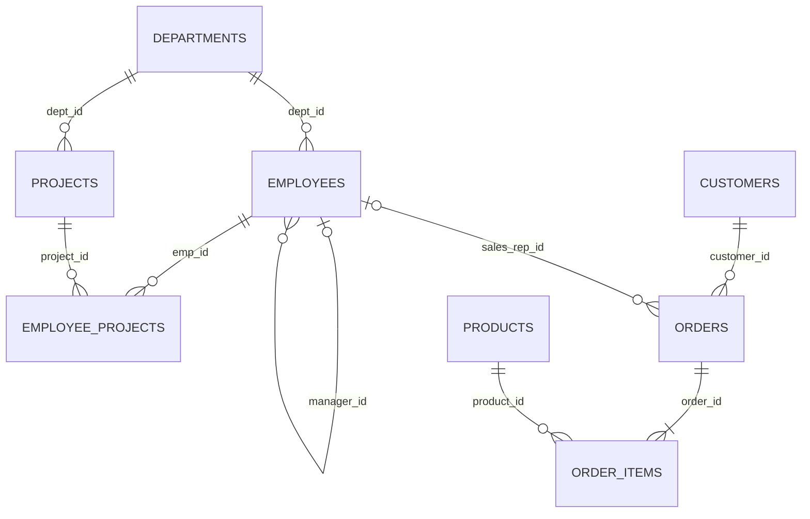
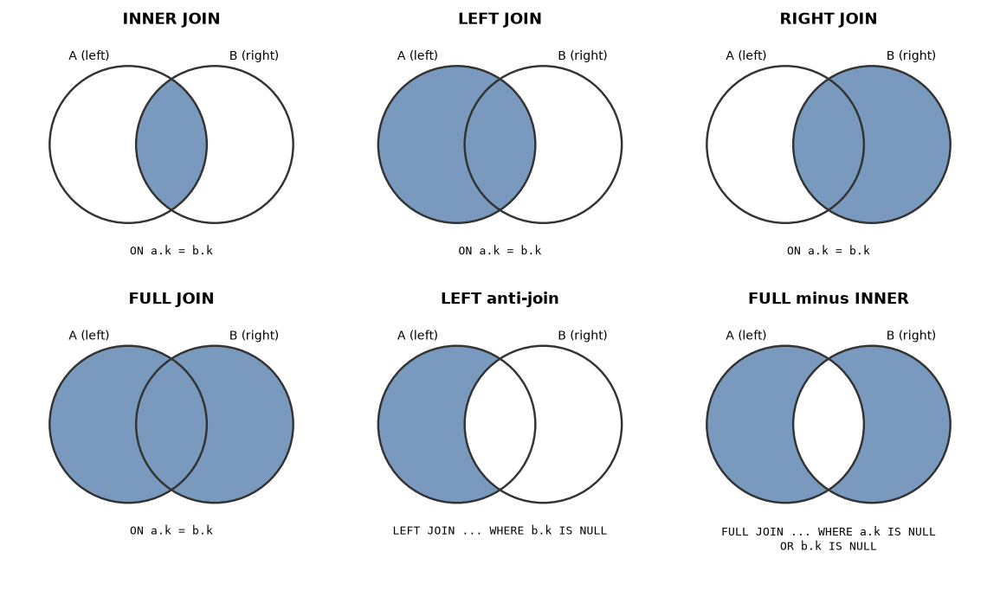

# Chapter 5 — Joins: Combining Tables

A well-designed relational database splits information into many narrow tables: employees in one, departments in another, orders in a third. That design avoids duplication (Chapter 11 explains why), but it means the answer to almost any real question — "which department does Neha work in?", "what did Anita buy?" — is spread across tables. A **join** puts the pieces back together at query time. Joins are the single most important skill in SQL and the most common topic in SQL interviews.

**What you'll learn**

- What a join really is: a **Cartesian product** (every row paired with every row) filtered by a **join condition**, and `CROSS JOIN`.
- `INNER JOIN` and the three **outer joins** — `LEFT`, `RIGHT` and `FULL` — with Venn-style pictures *and* row-by-row result tables that show exactly which rows come back and where `NULL` padding appears.
- **Self joins** (a table joined to itself: managers, pairs, sequences).
- **Semi-joins** and **anti-joins** ("customers who ordered" / "customers who never ordered") and the three ways to write them.
- Join pitfalls: **fan-out** (rows multiplying), `ON` vs `WHERE` in outer joins, `NULL` keys, `COUNT(*)` after an outer join.
- `USING`, `NATURAL JOIN`, multi-table joins, and how databases physically execute joins.

**How to run the examples.** All queries are in [`code/`](code/) and ran on the book's private PostgreSQL 14; outputs are real `psql` output, with `NULL` displayed as `(null)`.

```bash
bash tools_run_sql.sh sql '05-*'
bash tools_pg.sh psql -d <db> -f sql/chapters/05-joins/code/04_outer_joins.sql
```

We use the book's `company` database ([`code/00_schema.sql`](code/00_schema.sql), same as [Chapter 1](../01-databases-and-the-relational-model/README.md)). The relationships that the joins in this chapter follow:



*Figure 5.1 — The sample schema's foreign keys: every line is a join path.*

The quirks that make joins interesting: **Asha (CEO) and Rohan (intern) have no department**, the **Research** department has **no employees**, two customers (Hana, Ivan) **never ordered**, one product (Desk Lamp) was **never sold**, and online orders have **no sales rep**.

---

## 5.1 Join theory: the Cartesian product and CROSS JOIN

### What it is

The **Cartesian product** of two tables (named after René Descartes' coordinate pairs) is the set of **every row of the first table paired with every row of the second**. If `A` has *m* rows and `B` has *n* rows, the product has *m × n* rows. SQL writes it as `CROSS JOIN` (or, in the old style, a comma between tables).

Analogy: a clothes shop with 3 sizes and 2 colours can print 3 × 2 = 6 different labels — every size with every colour.

```sql
CREATE TABLE sizes  (size text);
CREATE TABLE colors (color text);
INSERT INTO sizes  VALUES ('S'), ('M'), ('L');
INSERT INTO colors VALUES ('red'), ('blue');

SELECT size, color FROM sizes CROSS JOIN colors ORDER BY size, color;
SELECT count(*) AS pairs FROM sizes, colors;
```

Output:

```text
 size | color 
------+-------
 L    | blue
 L    | red
 M    | blue
 M    | red
 S    | blue
 S    | red
(6 rows)

 pairs 
-------
     6
(1 row)
```

### Every join is a filtered Cartesian product

This is the key idea of the whole chapter. Conceptually, `A JOIN B ON condition`:

1. Forms every pair (a, b) — the Cartesian product.
2. Keeps only the pairs for which the **join condition** (the `ON` clause) is `TRUE`.
3. For outer joins only: adds back the rows that found **no partner**, padding the missing side with `NULL`s.

(Real databases never build the full product when they can avoid it — §5.10 — but the *result* is defined this way.)

```sql
SELECT count(*) AS all_pairs FROM employees, departments;
SELECT count(*) AS matching_pairs FROM employees e, departments d WHERE e.dept_id = d.dept_id;
```

Output:

```text
 all_pairs 
-----------
        90
(1 row)

 matching_pairs 
----------------
             13
(1 row)
```

15 employees × 6 departments = 90 pairs, of which only 13 make sense (the employee really belongs to that department). The 77 others are noise. Forgetting the join condition — an **accidental Cartesian product** — is a classic bug: the query "works" but returns far too many rows, and aggregates over it are wildly wrong.

### When CROSS JOIN is what you want

A deliberate cross join is useful for building **every combination**: a report grid (every department × every month, so that months with no data still appear), test data, or a calendar.

```sql
SELECT d.name, m.month
FROM departments d
CROSS JOIN (VALUES ('2025-01'), ('2025-02')) AS m(month)
WHERE d.dept_id <= 2
ORDER BY d.name, m.month;
```

Output:

```text
    name     |  month  
-------------+---------
 Engineering | 2025-01
 Engineering | 2025-02
 Sales       | 2025-01
 Sales       | 2025-02
(4 rows)
```

### Join syntax: explicit vs implicit

| Style | Example | Notes |
|---|---|---|
| Explicit (ANSI SQL-92) | `FROM a JOIN b ON a.k = b.k` | Join condition sits next to the join; required for outer joins. **Use this.** |
| Implicit (comma) | `FROM a, b WHERE a.k = b.k` | Older style; easy to forget a condition in a long `WHERE`; can't express outer joins in standard SQL. |

A few vocabulary words used below: an **equi-join** uses only `=` in its condition; a **non-equi join** uses other operators (`<`, `BETWEEN` …); the **join key** is the column(s) compared; **left** and **right** table simply mean "written before" and "written after" the `JOIN` keyword.

---

## 5.2 The four main join types at a glance

Before looking at each join in detail, here they are side by side on two tiny tables, so you can see **every row** each one returns. There is no foreign key between them on purpose, so we can have a student in a club that doesn't exist.

```sql
CREATE TABLE clubs    (club_id int PRIMARY KEY, club text);
CREATE TABLE students (id int PRIMARY KEY, name text, club_id int);   -- no FK on purpose
INSERT INTO clubs    VALUES (10, 'Chess'), (20, 'Drama'), (30, 'Robotics');
INSERT INTO students VALUES (1, 'Ana', 10), (2, 'Ben', 20), (3, 'Cai', 20),
                            (4, 'Dev', NULL), (5, 'Eli', 40);
```

Output (the two inputs):

```text
 id | name | club_id 
----+------+---------
  1 | Ana  |      10
  2 | Ben  |      20
  3 | Cai  |      20
  4 | Dev  |  (null)
  5 | Eli  |      40
(5 rows)

 club_id |   club   
---------+----------
      10 | Chess
      20 | Drama
      30 | Robotics
(3 rows)
```

Row by row, which pairs match on `c.club_id = s.club_id`?

| Student | `s.club_id` | Matching club | Why |
|---|---|---|---|
| Ana | 10 | Chess | 10 = 10 |
| Ben | 20 | Drama | 20 = 20 |
| Cai | 20 | Drama | 20 = 20 (Drama matches **two** students) |
| Dev | `NULL` | none | `NULL = anything` is UNKNOWN, never TRUE |
| Eli | 40 | none | no club 40 (an "orphan" row) |
| — | — | Robotics (30) | no student has 30 |

### The Venn-style picture



*Figure 5.2 — Join "Venn" cheat sheet (drawn by [`code/make_join_venn.py`](code/make_join_venn.py)). Left circle = rows of the left table, right circle = rows of the right table, overlap = pairs that satisfy the `ON` condition. Shaded = what the query returns.*

A caution about this picture: a Venn diagram describes **sets of rows**, but a join produces **pairs**. One left row can pair with several right rows (Drama pairs with Ben *and* Cai), so the "overlap" can contain more rows than either table has. Use the diagram to remember *which unmatched rows are kept*, and the result tables below to see *how many rows* you get.

### The result of each join, row by row

`INNER JOIN` — only the matched pairs (3 rows):

```sql
SELECT s.id, s.name, s.club_id AS s_club, c.club_id AS c_club, c.club
FROM students s INNER JOIN clubs c ON c.club_id = s.club_id
ORDER BY s.id;
```

```text
 id | name | s_club | c_club | club  
----+------+--------+--------+-------
  1 | Ana  |     10 |     10 | Chess
  2 | Ben  |     20 |     20 | Drama
  3 | Cai  |     20 |     20 | Drama
(3 rows)
```

`LEFT JOIN` — the matched pairs **plus** every unmatched *left* row, padded with `NULL`s on the right (5 rows):

```sql
SELECT s.id, s.name, s.club_id AS s_club, c.club_id AS c_club, c.club
FROM students s LEFT JOIN clubs c ON c.club_id = s.club_id
ORDER BY s.id;
```

```text
 id | name | s_club | c_club |  club  
----+------+--------+--------+--------
  1 | Ana  |     10 |     10 | Chess
  2 | Ben  |     20 |     20 | Drama
  3 | Cai  |     20 |     20 | Drama
  4 | Dev  | (null) | (null) | (null)
  5 | Eli  |     40 | (null) | (null)
(5 rows)
```

`RIGHT JOIN` — the matched pairs **plus** every unmatched *right* row, padded with `NULL`s on the left (4 rows):

```sql
SELECT s.id, s.name, s.club_id AS s_club, c.club_id AS c_club, c.club
FROM students s RIGHT JOIN clubs c ON c.club_id = s.club_id
ORDER BY c.club_id, s.id;
```

```text
   id   |  name  | s_club | c_club |   club   
--------+--------+--------+--------+----------
      1 | Ana    |     10 |     10 | Chess
      2 | Ben    |     20 |     20 | Drama
      3 | Cai    |     20 |     20 | Drama
 (null) | (null) | (null) |     30 | Robotics
(4 rows)
```

`FULL JOIN` — matched pairs, plus unmatched rows from **both** sides (6 rows):

```sql
SELECT s.id, s.name, s.club_id AS s_club, c.club_id AS c_club, c.club
FROM students s FULL JOIN clubs c ON c.club_id = s.club_id
ORDER BY s.id NULLS LAST, c.club_id;
```

```text
   id   |  name  | s_club | c_club |   club   
--------+--------+--------+--------+----------
      1 | Ana    |     10 |     10 | Chess
      2 | Ben    |     20 |     20 | Drama
      3 | Cai    |     20 |     20 | Drama
      4 | Dev    | (null) | (null) | (null)
      5 | Eli    |     40 | (null) | (null)
 (null) | (null) | (null) |     30 | Robotics
(6 rows)
```

Summary of the same example:

| Join | Matched pairs | + unmatched left (Dev, Eli) | + unmatched right (Robotics) | Rows |
|---|:-:|:-:|:-:|:-:|
| `INNER` | ✓ | | | 3 |
| `LEFT` | ✓ | ✓ | | 5 |
| `RIGHT` | ✓ | | ✓ | 4 |
| `FULL` | ✓ | ✓ | ✓ | 6 |
| `CROSS` | every pair, no condition | | | 5 × 3 = 15 |

Notice two things in the `LEFT` result. Dev's row has `s_club = (null)` because Dev's own value is `NULL`; Eli's has `s_club = 40` but `c_club = (null)` because the `NULL`s were **added by the join**. A `NULL` in a right-side column after a `LEFT JOIN` therefore means "no partner was found" — unless that column can also be `NULL` in the data, which is why tests for "no match" should use a column that is never `NULL` in the right table, typically its primary key.

### The edges of the Venn diagram: "only in one side"

Adding `WHERE <right key> IS NULL` after a `LEFT JOIN` keeps just the rows that found no partner — the left-only crescent (an **anti-join**, §5.8). The same idea works for the right side and for "only in one of them":

```sql
SELECT s.name FROM students s LEFT JOIN clubs c ON c.club_id = s.club_id
WHERE c.club_id IS NULL ORDER BY s.id;

SELECT c.club FROM students s RIGHT JOIN clubs c ON c.club_id = s.club_id
WHERE s.id IS NULL;

SELECT s.name, c.club FROM students s FULL JOIN clubs c ON c.club_id = s.club_id
WHERE s.id IS NULL OR c.club_id IS NULL ORDER BY s.id NULLS LAST;
```

Output:

```text
 name 
------
 Dev
 Eli
(2 rows)

   club   
----------
 Robotics
(1 row)

  name  |   club   
--------+----------
 Dev    | (null)
 Eli    | (null)
 (null) | Robotics
(3 rows)
```

The rest of the chapter goes through each join type in depth on the company data.

---

## 5.3 INNER JOIN

### What it is

An **inner join** returns only the pairs of rows for which the join condition is true. Rows with no partner on the other side disappear from the result. `JOIN` on its own means `INNER JOIN`.

Analogy: matching guests to reserved seats — a guest without a reservation and a seat nobody booked are both left out of the seating list.

### How it works

1. For each row of the left table, find the rows of the right table where the `ON` condition is `TRUE`.
2. Output one combined row per matching pair — so a left row with 3 matches appears 3 times, and a left row with 0 matches not at all.
3. Rows where the key is `NULL` never match (the comparison is UNKNOWN).

```sql
SELECT e.emp_id, e.first_name, d.name AS department
FROM employees e
INNER JOIN departments d ON d.dept_id = e.dept_id
ORDER BY e.emp_id;
```

Output:

```text
 emp_id | first_name | department  
--------+------------+-------------
      2 | Vikram     | Engineering
      3 | Neha       | Engineering
      4 | Rahul      | Engineering
      5 | Meera      | Engineering
      6 | Daniel     | Sales
      7 | Priya      | Sales
      8 | Arjun      | Sales
      9 | Sara       | Sales
     10 | Lucas      | Marketing
     11 | Ananya     | Marketing
     12 | Kiran      | Finance
     13 | Omar       | Finance
     14 | Li         | Support
(13 rows)
```

13 rows: Asha (1) and Rohan (15) are missing because their `dept_id` is `NULL`, and Research is missing because no employee points to it.

**Table aliases** (`e`, `d`) are short names for the tables in this query. They are needed when a column name exists in both tables (`dept_id`), and make long queries readable. Always qualify columns with the alias in joins — `e.dept_id`, not just `dept_id` — or you will get `column reference "dept_id" is ambiguous`.

### Filters with joins

For an inner join, a condition gives the same result whether you put it in `ON` or in `WHERE`. Convention: the relationship goes in `ON`, other filters go in `WHERE`. (For outer joins the placement **changes the result** — §5.9.)

```sql
SELECT e.first_name, e.salary, d.name AS department, d.location
FROM employees e
JOIN departments d ON d.dept_id = e.dept_id
WHERE d.location = 'Mumbai' AND e.salary > 70000
ORDER BY e.salary DESC;
```

Output:

```text
 first_name |  salary   | department | location 
------------+-----------+------------+----------
 Daniel     | 150000.00 | Sales      | Mumbai
 Lucas      | 120000.00 | Marketing  | Mumbai
 Priya      |  72000.00 | Sales      | Mumbai
(3 rows)
```

### Joining three or more tables

Each additional `JOIN` joins the result so far with one more table. An order joined to its customer and its sales rep:

```sql
SELECT o.order_id, c.first_name AS customer, e.first_name AS rep, o.status
FROM orders o
JOIN customers c ON c.customer_id = o.customer_id
JOIN employees e ON e.emp_id = o.sales_rep_id
ORDER BY o.order_id;
```

Output:

```text
 order_id | customer |  rep  |  status   
----------+----------+-------+-----------
      101 | Anita    | Priya | delivered
      103 | Chen     | Arjun | delivered
      105 | Divya    | Priya | cancelled
      107 | Fatima   | Sara  | shipped
      108 | Ben      | Priya | delivered
      110 | George   | Arjun | shipped
      112 | Ethan    | Sara  | shipped
      113 | Anita    | Priya | pending
(8 rows)
```

Only 8 of the 14 orders appear — the 6 online orders have `sales_rep_id = NULL` and the inner join to `employees` dropped them. That may or may not be what you want; §5.10 fixes it with a `LEFT JOIN`.

A **many-to-many** relationship (employees ↔ projects) goes through a **junction table** (`employee_projects`), so you join through it:

```sql
SELECT p.name AS project, d.name AS dept, e.first_name, ep.role, ep.hours
FROM employee_projects ep
JOIN employees   e ON e.emp_id     = ep.emp_id
JOIN projects    p ON p.project_id = ep.project_id
JOIN departments d ON d.dept_id    = p.dept_id
WHERE p.project_id IN (1, 2)
ORDER BY p.project_id, ep.hours DESC;
```

Output:

```text
     project     |    dept     | first_name |   role    | hours 
-----------------+-------------+------------+-----------+-------
 Checkout Revamp | Engineering | Neha       | Developer |   400
 Checkout Revamp | Engineering | Rahul      | Developer |   350
 Checkout Revamp | Engineering | Vikram     | Lead      |   120
 Mobile App      | Engineering | Neha       | Lead      |   300
 Mobile App      | Engineering | Meera      | Developer |   280
 Mobile App      | Engineering | Rohan      | Tester    |    90
(6 rows)
```

Joins and aggregation work together — join first, then group ([Chapter 4](../04-aggregation/README.md)):

```sql
SELECT e.first_name AS rep, count(DISTINCT o.order_id) AS orders,
       round(sum(oi.quantity * oi.unit_price * (1 - oi.discount)), 2) AS revenue
FROM orders o
JOIN employees e    ON e.emp_id = o.sales_rep_id
JOIN order_items oi ON oi.order_id = o.order_id
WHERE o.status <> 'cancelled'
GROUP BY e.emp_id, e.first_name
ORDER BY revenue DESC;
```

Output:

```text
  rep  | orders | revenue 
-------+--------+---------
 Priya |      3 | 4141.04
 Sara  |      2 |  879.91
 Arjun |      2 |  687.00
(3 rows)
```

`count(DISTINCT o.order_id)` rather than `count(*)`: after joining to `order_items`, each order appears once *per line*, so `count(*)` would count lines, not orders (the fan-out effect, §5.9).

### Non-equi joins

The join condition can be any boolean expression. Here we pair each order line with its product only when the price paid was below the current list price:

```sql
SELECT oi.order_id, p.name, p.unit_price AS list_price, oi.unit_price AS paid
FROM order_items oi
JOIN products p ON p.product_id = oi.product_id
               AND oi.unit_price < p.unit_price
ORDER BY oi.order_id;
```

Output:

```text
 order_id |     name      | list_price |  paid   
----------+---------------+------------+---------
      104 | Standing Desk |     499.00 |  479.00
      108 | Laptop Pro 14 |    1299.00 | 1249.00
(2 rows)
```

Other common non-equi joins: matching a value to a range (`ON s.amount BETWEEN b.low AND b.high` for tax brackets or grade bands), and time windows (`ON b.t > a.t AND b.t <= a.t + interval '1 day'`).

### In the interview

**30-second answer.** "An inner join returns the combinations of rows from both tables that satisfy the join condition; unmatched rows on either side are dropped, and `NULL` keys never match. If a row has several matches it appears several times."

- *Q: Is `JOIN` the same as `INNER JOIN`?* — Yes.
- *Q: `ON` vs `WHERE` for an inner join?* — Same result; put the relationship in `ON` for readability. For outer joins they differ.
- *Q: Why did my row count go up after a join?* — One-to-many: each left row repeats once per matching right row.

### Self-check

1. `employees` has 15 rows. Can `employees JOIN departments` return more than 15 rows? → Not here, because each employee has at most one department (the join key is the department's primary key). Joining in the other direction to a many-side (e.g. `orders JOIN order_items`) can.
2. Why are the CEO and the intern missing from the inner join? → Their `dept_id` is `NULL`, and `NULL = x` is never true.
3. What error do you get if you write `SELECT dept_id FROM employees e JOIN departments d ON …`? → `column reference "dept_id" is ambiguous`.

### TL;DR

`INNER JOIN` = matched pairs only. Unmatched and `NULL`-keyed rows vanish; multiple matches multiply rows. Qualify columns with aliases.

---

## 5.4 LEFT OUTER JOIN

### What it is

A **left outer join** (`LEFT JOIN` or `LEFT OUTER JOIN` — `OUTER` is optional) returns **every row of the left table**. Rows with a partner are combined with it, exactly as in an inner join; rows **without** a partner are still returned once, with every column from the right table set to `NULL` (called **NULL padding** or **NULL extension**).

Analogy: a class register. Every student is listed; next to each is their exam mark — or a blank if they missed the exam. The blank doesn't remove the student from the register.

### Why it matters

It answers the questions that inner joins silently get wrong: "list **all** customers with their order count — **including zero**", "all employees with their department — even if unassigned", "every product and how much it sold".

### How it works (rows of employees LEFT JOIN departments)

The two inputs around the edge cases:

```sql
SELECT emp_id, first_name, dept_id FROM employees WHERE emp_id IN (1, 2, 14, 15) ORDER BY emp_id;
SELECT dept_id, name FROM departments ORDER BY dept_id;
```

```text
 emp_id | first_name | dept_id 
--------+------------+---------
      1 | Asha       |  (null)
      2 | Vikram     |       1
     14 | Li         |       5
     15 | Rohan      |  (null)
(4 rows)

 dept_id |    name     
---------+-------------
       1 | Engineering
       2 | Sales
       3 | Marketing
       4 | Finance
       5 | Support
       6 | Research
(6 rows)
```

```sql
SELECT e.first_name, e.dept_id AS e_dept, d.dept_id AS d_dept, d.name
FROM employees e LEFT JOIN departments d ON d.dept_id = e.dept_id
ORDER BY d.dept_id NULLS LAST, e.emp_id;
```

Output:

```text
 first_name | e_dept | d_dept |    name     
------------+--------+--------+-------------
 Vikram     |      1 |      1 | Engineering
 Neha       |      1 |      1 | Engineering
 Rahul      |      1 |      1 | Engineering
 Meera      |      1 |      1 | Engineering
 Daniel     |      2 |      2 | Sales
 Priya      |      2 |      2 | Sales
 Arjun      |      2 |      2 | Sales
 Sara       |      2 |      2 | Sales
 Lucas      |      3 |      3 | Marketing
 Ananya     |      3 |      3 | Marketing
 Kiran      |      4 |      4 | Finance
 Omar       |      4 |      4 | Finance
 Li         |      5 |      5 | Support
 Asha       | (null) | (null) | (null)
 Rohan      | (null) | (null) | (null)
(15 rows)
```

1. The 13 employees who have a department are matched exactly as in the inner join.
2. Asha and Rohan find no partner. Instead of being dropped, each is output **once** with `d_dept` and `name` padded with `NULL`.
3. Research is not in the result: a left join keeps unmatched rows of the **left** table only.

Rule of thumb: **`LEFT JOIN` never returns fewer rows than the left table has.** It returns more if some left rows match several right rows.

### The everyday use: counts that include zero

```sql
SELECT c.customer_id, c.first_name, count(o.order_id) AS orders
FROM customers c
LEFT JOIN orders o ON o.customer_id = c.customer_id
GROUP BY c.customer_id, c.first_name
ORDER BY orders, c.customer_id;
```

Output:

```text
 customer_id | first_name | orders 
-------------+------------+--------
           9 | Hana       |      0
          10 | Ivan       |      0
           4 | Divya      |      1
           7 | George     |      1
           8 | Anita      |      1
           2 | Ben        |      2
           3 | Chen       |      2
           5 | Ethan      |      2
           6 | Fatima     |      2
           1 | Anita      |      3
(10 rows)
```

Hana and Ivan have 0 orders. It must be `count(o.order_id)` — a column from the right table — not `count(*)`: their padded row still counts as one row for `count(*)` (§5.9).

### When not to use it

- If you only need **left rows that have a match** (and don't need right-side columns), a semi-join with `EXISTS` is clearer and never duplicates rows (§5.8).
- If you actually require a match, use `INNER JOIN` — a `LEFT JOIN` followed by a `WHERE` on a right column silently becomes an inner join anyway (§5.9).

### Common mistakes

- Filtering the right table in `WHERE` (turns it back into an inner join) — put the condition in `ON`.
- Following a `LEFT JOIN` with an `INNER JOIN` to a table hanging off the right side: `a LEFT JOIN b … JOIN c ON c.x = b.x` drops the padded rows again, because `b.x` is `NULL`. Make the second join a `LEFT JOIN` too.
- Using `count(*)` for "how many matches".

### In the interview

**30-second answer.** "A left join returns every row of the left table; where there is a matching right row the columns are filled in, otherwise they're `NULL`. It's the standard way to keep rows with no related data — like customers with zero orders — and, with `WHERE right.pk IS NULL`, to find rows with no match."

- *Q: How many rows can a left join return?* — At least as many as the left table; more if there are one-to-many matches.
- *Q: Find employees without a department.* — `LEFT JOIN departments … WHERE d.dept_id IS NULL`, or simply `WHERE dept_id IS NULL` on employees — plus rows whose `dept_id` points to a missing department, if there is no foreign key.

### Self-check

1. After `employees LEFT JOIN departments`, which employees have `d.name = NULL`? → Asha and Rohan.
2. Would the result change if we swapped the tables? → Yes, it becomes "all departments" (see §5.5).
3. Why use `count(o.order_id)` rather than `count(*)` in the customer query? → `count(*)` counts the `NULL`-padded row as 1.

### TL;DR

`LEFT JOIN` keeps all left rows and pads missing right-side data with `NULL`. It's how you include "zero" and find "missing".

---

## 5.5 RIGHT OUTER JOIN

### What it is

A **right outer join** is the mirror image: it keeps **every row of the right table**, padding the left side with `NULL`s where there's no match. `A RIGHT JOIN B` returns the same rows as `B LEFT JOIN A` (only the column order differs).

```sql
SELECT e.first_name, e.dept_id AS e_dept, d.dept_id AS d_dept, d.name
FROM employees e RIGHT JOIN departments d ON d.dept_id = e.dept_id
ORDER BY d.dept_id, e.emp_id;
```

Output:

```text
 first_name | e_dept | d_dept |    name     
------------+--------+--------+-------------
 Vikram     |      1 |      1 | Engineering
 Neha       |      1 |      1 | Engineering
 Rahul      |      1 |      1 | Engineering
 Meera      |      1 |      1 | Engineering
 Daniel     |      2 |      2 | Sales
 Priya      |      2 |      2 | Sales
 Arjun      |      2 |      2 | Sales
 Sara       |      2 |      2 | Sales
 Lucas      |      3 |      3 | Marketing
 Ananya     |      3 |      3 | Marketing
 Kiran      |      4 |      4 | Finance
 Omar       |      4 |      4 | Finance
 Li         |      5 |      5 | Support
 (null)     | (null) |      6 | Research
(14 rows)
```

Now Research appears with the **employee** columns padded with `NULL`, and Asha and Rohan are gone (they're unmatched *left* rows). Swapping the tables and using `LEFT JOIN` gives the same 14 rows:

```sql
SELECT count(*) AS left_swapped FROM departments d LEFT JOIN employees e ON d.dept_id = e.dept_id;
```

```text
 left_swapped 
--------------
           14
(1 row)
```

### When to use it

Rarely. Most teams write every outer join as a `LEFT JOIN` and put the "keep all rows of this" table first, because a query that reads "start from departments, attach employees where possible" is easier to follow. `RIGHT JOIN` is handy when you are appending one more table to a long chain of joins and want to keep all rows of *that* new table without restructuring the query. SQLite supported `RIGHT` and `FULL` joins only from version 3.39.0 (2022).

### Self-check

1. Rewrite `orders o RIGHT JOIN customers c ON …` as a left join. → `customers c LEFT JOIN orders o ON …`.
2. Which department does the right join add compared with the inner join? → Research, with `NULL` employee columns.

### TL;DR

`RIGHT JOIN` = `LEFT JOIN` with the tables swapped. Prefer writing it as a `LEFT JOIN`.

---

## 5.6 FULL OUTER JOIN

### What it is

A **full outer join** keeps **all rows from both tables**: matched pairs are combined; unmatched left rows are padded on the right; unmatched right rows are padded on the left. It is the union of the left-join and right-join results (without repeating the matched pairs).

```sql
SELECT e.first_name, e.dept_id AS e_dept, d.dept_id AS d_dept, d.name
FROM employees e FULL JOIN departments d ON d.dept_id = e.dept_id
ORDER BY d.dept_id NULLS LAST, e.emp_id;
```

Output:

```text
 first_name | e_dept | d_dept |    name     
------------+--------+--------+-------------
 Vikram     |      1 |      1 | Engineering
 Neha       |      1 |      1 | Engineering
 Rahul      |      1 |      1 | Engineering
 Meera      |      1 |      1 | Engineering
 Daniel     |      2 |      2 | Sales
 Priya      |      2 |      2 | Sales
 Arjun      |      2 |      2 | Sales
 Sara       |      2 |      2 | Sales
 Lucas      |      3 |      3 | Marketing
 Ananya     |      3 |      3 | Marketing
 Kiran      |      4 |      4 | Finance
 Omar       |      4 |      4 | Finance
 Li         |      5 |      5 | Support
 (null)     | (null) |      6 | Research
 Asha       | (null) | (null) | (null)
 Rohan      | (null) | (null) | (null)
(16 rows)
```

The row counts of the four joins on the same data line up exactly with the edge cases — 13 matched pairs, 2 unmatched employees, 1 unmatched department:

```sql
SELECT (SELECT count(*) FROM employees e JOIN departments d ON d.dept_id = e.dept_id)       AS inner_rows,
       (SELECT count(*) FROM employees e LEFT JOIN departments d ON d.dept_id = e.dept_id)  AS left_rows,
       (SELECT count(*) FROM employees e RIGHT JOIN departments d ON d.dept_id = e.dept_id) AS right_rows,
       (SELECT count(*) FROM employees e FULL JOIN departments d ON d.dept_id = e.dept_id)  AS full_rows;
```

```text
 inner_rows | left_rows | right_rows | full_rows 
------------+-----------+------------+-----------
         13 |        15 |         14 |        16
(1 row)
```

In general: `full = inner + unmatched left + unmatched right`, `left = inner + unmatched left`, `right = inner + unmatched right`.

### Real-world use: reconciliation

`FULL JOIN` shines when **comparing two lists** where each side may have entries the other lacks: planned vs actual, yesterday's snapshot vs today's, the bank statement vs the ledger.

```sql
CREATE TABLE planned (emp_id int, hours int);
CREATE TABLE actual  (emp_id int, hours int);
INSERT INTO planned VALUES (3, 300), (4, 200), (5, 250);
INSERT INTO actual  VALUES (3, 310), (5, 250), (7, 40);
SELECT coalesce(p.emp_id, a.emp_id) AS emp_id, p.hours AS planned, a.hours AS actual,
       CASE WHEN p.emp_id IS NULL THEN 'unplanned work'
            WHEN a.emp_id IS NULL THEN 'no work logged'
            WHEN p.hours <> a.hours THEN 'different'
            ELSE 'ok' END AS verdict
FROM planned p FULL JOIN actual a ON a.emp_id = p.emp_id
ORDER BY 1;
```

Output:

```text
 emp_id | planned | actual |    verdict     
--------+---------+--------+----------------
      3 |     300 |    310 | different
      4 |     200 | (null) | no work logged
      5 |     250 |    250 | ok
      7 |  (null) |     40 | unplanned work
(4 rows)
```

`COALESCE(p.emp_id, a.emp_id)` picks whichever side's key is present, giving one clean key column.

### Dialects

| Database | FULL OUTER JOIN |
|---|---|
| PostgreSQL, SQL Server, Oracle | supported |
| SQLite | supported since 3.39.0 |
| MySQL / MariaDB | **not supported** — emulate: `SELECT … FROM a LEFT JOIN b ON … UNION SELECT … FROM a RIGHT JOIN b ON …` (or `UNION ALL` with the right-join half filtered to `WHERE a.key IS NULL` to avoid removing genuine duplicates) |

PostgreSQL restricts `FULL JOIN` conditions to ones it can run as a merge or hash join (in practice: at least one equality between the two sides); an arbitrary condition such as `ON a.x < b.y` alone gives an error.

### In the interview

**30-second answer.** "A full outer join returns every row from both tables, matching where it can and padding the other side with `NULL`s where it can't. It's used to reconcile two datasets. MySQL lacks it, so you emulate it with a `LEFT JOIN` `UNION` a `RIGHT JOIN`."

- *Q: How do you find rows that are in exactly one of two tables?* — `FULL JOIN … WHERE a.pk IS NULL OR b.pk IS NULL` (or two anti-joins, or `EXCEPT` both ways — Chapter 6).

### Self-check

1. Inner join = 13 rows, 2 unmatched left, 1 unmatched right. How many rows in the full join? → 16.
2. Why use `COALESCE(p.emp_id, a.emp_id)`? → On unmatched rows one of the two keys is `NULL`; `COALESCE` returns the one that exists.

### TL;DR

`FULL JOIN` = everything from both sides, `NULL`-padded where unmatched. Great for reconciliation; emulate with `UNION` in MySQL.

---

## 5.7 SELF JOIN

### What it is

A **self join** joins a table **to itself**. It is not a new keyword — it's an ordinary inner or outer join in which the same table appears twice under two different aliases, so SQL can tell "the employee row" from "the manager row". You need it whenever rows of a table refer to other rows of the **same** table (a hierarchy through `manager_id`), or when you want to compare rows of a table with each other (pairs, sequences).

Analogy: a class photo with two copies. On one copy you circle a student; on the other you find the student sitting next to them. Same photo, two roles.

### How it works

```sql
SELECT e.emp_id, e.first_name AS employee, m.first_name AS manager
FROM employees e
LEFT JOIN employees m ON m.emp_id = e.manager_id
ORDER BY e.emp_id;
```

Output:

```text
 emp_id | employee | manager 
--------+----------+---------
      1 | Asha     | (null)
      2 | Vikram   | Asha
      3 | Neha     | Vikram
      4 | Rahul    | Vikram
      5 | Meera    | Vikram
      6 | Daniel   | Asha
      7 | Priya    | Daniel
      8 | Arjun    | Daniel
      9 | Sara     | Daniel
     10 | Lucas    | Asha
     11 | Ananya   | Lucas
     12 | Kiran    | Asha
     13 | Omar     | Kiran
     14 | Li       | Vikram
     15 | Rohan    | Vikram
(15 rows)
```

1. `e` is "the employee" copy and `m` is "the manager" copy of the same table.
2. The condition `m.emp_id = e.manager_id` pairs each employee with the row whose id equals their `manager_id`.
3. `LEFT JOIN` keeps Asha, who has no manager (`manager_id` is `NULL`); an inner join would drop her.

### More self-join patterns

Compare each employee with their manager:

```sql
SELECT e.first_name, e.salary, m.first_name AS manager, m.salary AS mgr_salary
FROM employees e JOIN employees m ON m.emp_id = e.manager_id
WHERE e.salary >= 0.7 * m.salary
ORDER BY e.emp_id;
```

```text
 first_name |  salary   | manager | mgr_salary 
------------+-----------+---------+------------
 Vikram     | 185000.00 | Asha    |  250000.00
 Neha       | 142000.00 | Vikram  |  185000.00
(2 rows)
```

Count direct reports (join, then group by the manager):

```sql
SELECT m.first_name AS manager, count(*) AS direct_reports
FROM employees e JOIN employees m ON m.emp_id = e.manager_id
GROUP BY m.emp_id, m.first_name
ORDER BY direct_reports DESC, manager;
```

```text
 manager | direct_reports 
---------+----------------
 Vikram  |              5
 Asha    |              4
 Daniel  |              3
 Kiran   |              1
 Lucas   |              1
(5 rows)
```

Find **pairs** of rows that share a value. The condition `a.emp_id < b.emp_id` removes pairing a row with itself (Arjun–Arjun) and mirror duplicates (Arjun–Sara *and* Sara–Arjun):

```sql
SELECT a.first_name AS emp_a, b.first_name AS emp_b, a.salary
FROM employees a JOIN employees b ON a.salary = b.salary AND a.emp_id < b.emp_id
ORDER BY a.salary;
```

```text
 emp_a | emp_b |  salary  
-------+-------+----------
 Arjun | Sara  | 68000.00
 Rahul | Meera | 98000.00
(2 rows)
```

Go up **two** levels with a second self join (for arbitrary depth, use a recursive CTE — [Chapter 7](../07-ctes-views-and-recursion/README.md)):

```sql
SELECT e.first_name AS employee, m.first_name AS manager, g.first_name AS grand_manager
FROM employees e
JOIN employees m ON m.emp_id = e.manager_id
LEFT JOIN employees g ON g.emp_id = m.manager_id
WHERE e.dept_id = 1
ORDER BY e.emp_id;
```

```text
 employee | manager | grand_manager 
----------+---------+---------------
 Vikram   | Asha    | (null)
 Neha     | Vikram  | Asha
 Rahul    | Vikram  | Asha
 Meera    | Vikram  | Asha
(4 rows)
```

Compare rows **in time** — here, customers who ordered again within 60 days of an earlier order:

```sql
SELECT a.customer_id, a.order_id AS first_order, b.order_id AS next_order,
       b.placed_at::date - a.placed_at::date AS days_between
FROM orders a JOIN orders b
  ON b.customer_id = a.customer_id AND b.placed_at > a.placed_at
 AND b.placed_at <= a.placed_at + interval '60 days'
ORDER BY a.customer_id, a.order_id;
```

```text
 customer_id | first_order | next_order | days_between 
-------------+-------------+------------+--------------
           1 |         101 |        104 |           39
(1 row)
```

Many "compare with the previous row" problems (consecutive days, streaks) are solved either with a self join like this or, more efficiently, with `LAG`/`LEAD` window functions ([Chapter 8](../08-window-functions/README.md)).

### Common mistakes

- Forgetting aliases (`employees JOIN employees` is an error: `table name "employees" specified more than once`).
- Using an inner join for hierarchies and losing the root (the CEO).
- Getting every pair twice (and each row paired with itself) — use `a.id < b.id`.

### In the interview

**30-second answer.** "A self join joins a table to itself using two aliases — for hierarchies like employee → manager, for finding pairs of rows with something in common, and for comparing a row with a related row of the same table. Use a left join to keep rows without a parent, and `a.id < b.id` to avoid duplicate pairs."

- *Q: Employees who earn more than their manager?* — `FROM employees e JOIN employees m ON m.emp_id = e.manager_id WHERE e.salary > m.salary`. (In our data: nobody.)
- *Q: How do you get the whole chain of managers?* — A recursive CTE; self joins only reach a fixed depth.

### Self-check

1. In the manager query, why is Asha's manager `NULL`? → She has no `manager_id`, and the `LEFT JOIN` padded the manager columns.
2. What does `a.emp_id < b.emp_id` prevent? → Self-pairs and mirrored pairs.

### TL;DR

Self join = the same table twice, two aliases, two roles. Hierarchies, pairs, and row-to-row comparisons.

---

## 5.8 Semi-joins and anti-joins

### What they are

Two very common questions aren't really about *combining* columns at all:

- **Semi-join** — "rows of A that **have at least one** match in B" (customers who have ordered). Each A row is returned **at most once**, and no columns of B are needed.
- **Anti-join** — "rows of A that have **no** match in B" (customers who never ordered).

SQL has no `SEMI JOIN` keyword; you write them with `EXISTS`/`IN` (semi) and `NOT EXISTS`/`LEFT JOIN … IS NULL`/`NOT IN` (anti). The query planner recognises these shapes and runs them with special *semi-join* and *anti-join* algorithms.

### Semi-join: EXISTS vs a plain JOIN

```sql
SELECT c.customer_id, c.first_name
FROM customers c
WHERE EXISTS (SELECT 1 FROM orders o WHERE o.customer_id = c.customer_id)
ORDER BY c.customer_id;
```

```text
 customer_id | first_name 
-------------+------------
           1 | Anita
           2 | Ben
           3 | Chen
           4 | Divya
           5 | Ethan
           6 | Fatima
           7 | George
           8 | Anita
(8 rows)
```

A plain inner join answers a different question — it returns one row **per order**:

```sql
SELECT c.customer_id, c.first_name
FROM customers c JOIN orders o ON o.customer_id = c.customer_id
ORDER BY c.customer_id;
```

```text
 customer_id | first_name 
-------------+------------
           1 | Anita
           1 | Anita
           1 | Anita
           2 | Ben
           2 | Ben
           3 | Chen
           3 | Chen
           4 | Divya
           5 | Ethan
           5 | Ethan
           6 | Fatima
           6 | Fatima
           7 | George
           8 | Anita
(14 rows)
```

Fixing that with `SELECT DISTINCT` works but does extra work (build all pairs, then remove duplicates) and hides the intent. `EXISTS` stops at the first match for each customer.

### Anti-join: three ways

```sql
-- 1. NOT EXISTS
SELECT c.customer_id, c.first_name FROM customers c
WHERE NOT EXISTS (SELECT 1 FROM orders o WHERE o.customer_id = c.customer_id)
ORDER BY 1;

-- 2. LEFT JOIN ... IS NULL
SELECT c.customer_id, c.first_name FROM customers c
LEFT JOIN orders o ON o.customer_id = c.customer_id
WHERE o.order_id IS NULL
ORDER BY 1;

-- 3. NOT IN
SELECT c.customer_id, c.first_name FROM customers c
WHERE c.customer_id NOT IN (SELECT customer_id FROM orders)
ORDER BY 1;
```

Output (identical for all three here):

```text
 customer_id | first_name 
-------------+------------
           9 | Hana
          10 | Ivan
(2 rows)
```

| Form | NULL-safe? | Notes |
|---|---|---|
| `NOT EXISTS (correlated subquery)` | **Yes** | Clearest intent; PostgreSQL plans it as an anti join. **Recommended.** |
| `LEFT JOIN … WHERE b.pk IS NULL` | Yes, if you test a never-NULL column (the PK) | Also planned as an anti join; handy when you want other columns from the join. |
| `NOT IN (subquery)` | **No** | If the subquery returns even one `NULL`, the result is **empty** — see [Chapter 6](../06-subqueries-and-set-operations/README.md#62-multi-row-subqueries-in-and-not-in). Also often planned less efficiently. |

The plan shows PostgreSQL executing `NOT EXISTS` as a **Hash Anti Join**:

```sql
EXPLAIN (COSTS OFF)
SELECT c.customer_id FROM customers c
WHERE NOT EXISTS (SELECT 1 FROM orders o WHERE o.customer_id = c.customer_id);
```

```text
                  QUERY PLAN                  
----------------------------------------------
 Hash Anti Join
   Hash Cond: (c.customer_id = o.customer_id)
   ->  Seq Scan on customers c
   ->  Hash
         ->  Seq Scan on orders o
(5 rows)
```

More anti-joins on our data — the product never sold and the department with no staff:

```sql
SELECT p.name FROM products p
WHERE NOT EXISTS (SELECT 1 FROM order_items oi WHERE oi.product_id = p.product_id);

SELECT d.name FROM departments d
LEFT JOIN employees e ON e.dept_id = d.dept_id
WHERE e.emp_id IS NULL;
```

```text
   name    
-----------
 Desk Lamp
(1 row)

   name   
----------
 Research
(1 row)
```

### In the interview

**30-second answer.** "A semi-join returns rows of A that have a match in B, once each — write it with `EXISTS` or `IN`. An anti-join returns rows of A with no match — write it with `NOT EXISTS` or `LEFT JOIN … WHERE b.pk IS NULL`. Avoid `NOT IN` with a subquery on a nullable column: one `NULL` makes it return nothing."

- *Q: Customers who never placed an order?* — Any of the three forms; say why you prefer `NOT EXISTS`.
- *Q: Why not `JOIN` + `DISTINCT` for a semi-join?* — It multiplies then de-duplicates; `EXISTS` stops at the first match and states the intent.

### Self-check

1. Which is NULL-safe: `NOT IN` or `NOT EXISTS`? → `NOT EXISTS`.
2. In the `LEFT JOIN … IS NULL` pattern, why test `o.order_id` rather than, say, `o.sales_rep_id`? → `sales_rep_id` can be `NULL` on real rows (online orders); the primary key is never `NULL`, so a `NULL` there must be padding.

### TL;DR

Semi-join = `EXISTS` ("has a match", no duplicates). Anti-join = `NOT EXISTS` or `LEFT JOIN … pk IS NULL` ("has no match"). Beware `NOT IN` with `NULL`s.

---

## 5.9 Join pitfalls

### Pitfall 1 — fan-out (row multiplication)

When you join a parent to **two different child tables** at once, every child row of one kind pairs with every child row of the other kind. Engineering has 4 employees and 2 projects, so joining both gives 4 × 2 = 8 rows, and every salary is counted twice:

```sql
SELECT d.name, count(*) AS joined_rows, sum(e.salary) AS wrong_payroll
FROM departments d
JOIN employees e ON e.dept_id = d.dept_id
JOIN projects  p ON p.dept_id = d.dept_id
WHERE d.dept_id = 1
GROUP BY d.name;
```

```text
    name     | joined_rows | wrong_payroll 
-------------+-------------+---------------
 Engineering |           8 |    1046000.00
(1 row)
```

The real payroll is 523,000. **Fix:** aggregate each child table separately (in a derived table or CTE), so each has one row per department, *then* join:

```sql
SELECT d.name, e.payroll, p.projects
FROM departments d
JOIN (SELECT dept_id, sum(salary) AS payroll FROM employees GROUP BY dept_id) e ON e.dept_id = d.dept_id
JOIN (SELECT dept_id, count(*) AS projects FROM projects GROUP BY dept_id)     p ON p.dept_id = d.dept_id
ORDER BY d.dept_id;
```

```text
    name     |  payroll  | projects 
-------------+-----------+----------
 Engineering | 523000.00 |        2
 Marketing   | 181000.00 |        1
 Finance     | 211000.00 |        1
 Support     |  64000.00 |        1
(4 rows)
```

Signs of fan-out: totals that are suspiciously exact multiples of the right answer, and `count(*)` larger than the number of parent rows. `count(DISTINCT …)` hides it for counts but **not** for sums.

### Pitfall 2 — a WHERE on the right table undoes a LEFT JOIN

Goal: every customer with their number of **delivered** orders, 0 if none.

```sql
SELECT c.customer_id, count(o.order_id) AS delivered
FROM customers c LEFT JOIN orders o ON o.customer_id = c.customer_id
WHERE o.status = 'delivered'
GROUP BY c.customer_id ORDER BY c.customer_id;          -- wrong: customers with 0 vanish
```

```text
 customer_id | delivered 
-------------+-----------
           1 |         2
           2 |         2
           3 |         1
           5 |         1
           8 |         1
(5 rows)
```

Only 5 customers. Why: the `LEFT JOIN` produced padded rows for Hana and Ivan (with `o.status = NULL`), and rows for customers whose only orders were not delivered — then `WHERE o.status = 'delivered'` ran **after** the join (logical order, [Chapter 4](../04-aggregation/README.md#45-the-logical-order-of-query-processing)) and threw all of those away. Put the right-table condition **in the `ON` clause**, so it limits which rows *match*, not which rows *survive*:

```sql
SELECT c.customer_id, count(o.order_id) AS delivered
FROM customers c LEFT JOIN orders o ON o.customer_id = c.customer_id
                                    AND o.status = 'delivered'
GROUP BY c.customer_id ORDER BY c.customer_id;          -- right: condition in ON
```

```text
 customer_id | delivered 
-------------+-----------
           1 |         2
           2 |         2
           3 |         1
           4 |         0
           5 |         1
           6 |         0
           7 |         0
           8 |         1
           9 |         0
          10 |         0
(10 rows)
```

| Condition on the right table of a LEFT JOIN placed in… | Effect |
|---|---|
| `ON` | Decides which right rows count as a match; unmatched left rows are still kept (padded). |
| `WHERE` | Filters the joined result; padded rows have `NULL` there and are removed → behaves like an `INNER JOIN`. |

(A `WHERE right.pk IS NULL` test is the deliberate exception — that's the anti-join.) Conditions on the **left** table belong in `WHERE`; put in `ON` they don't remove left rows, they just stop them matching.

### Pitfall 3 — NULL keys never match

```sql
CREATE TABLE a (k int, label text);
CREATE TABLE b (k int, label text);
INSERT INTO a VALUES (1, 'a1'), (2, 'a2'), (NULL, 'a-null');
INSERT INTO b VALUES (1, 'b1'), (3, 'b3'), (NULL, 'b-null');
SELECT a.label, b.label FROM a JOIN b ON a.k = b.k;
SELECT a.label, b.label FROM a JOIN b ON a.k IS NOT DISTINCT FROM b.k ORDER BY 1;
```

```text
 label | label 
-------+-------
 a1    | b1
(1 row)

 label  | label  
--------+--------
 a-null | b-null
 a1     | b1
(2 rows)
```

`NULL = NULL` is UNKNOWN, so the two `NULL`-keyed rows don't pair. If you really want `NULL` to match `NULL` (for example when comparing two snapshots of a nullable column), use `IS NOT DISTINCT FROM` — but know that PostgreSQL can't use a hash or merge join for it, so it can be slow on large tables.

### Pitfall 4 — COUNT(*) after an outer join

```sql
SELECT d.name, count(*) AS count_star, count(e.emp_id) AS count_col
FROM departments d LEFT JOIN employees e ON e.dept_id = d.dept_id
WHERE d.dept_id IN (5, 6)
GROUP BY d.name ORDER BY d.name;
```

```text
   name   | count_star | count_col 
----------+------------+-----------
 Research |          1 |         0
 Support  |          1 |         1
(2 rows)
```

Research has no employees, but `count(*)` says 1 — it counted the padded row. Count a right-side, never-NULL column instead.

### Other pitfalls, briefly

- **Joining on the wrong columns** — e.g. `ON e.emp_id = d.dept_id` "works" (both are integers) and returns nonsense. Foreign keys document the correct paths.
- **Type mismatches** — joining `text` to `integer` fails in PostgreSQL; casting inside the condition (`ON a.code::int = b.id`) prevents index use on `a.code`.
- **Duplicated keys in a lookup table** — if the "one" side isn't actually unique, every match fans out. Check with `GROUP BY key HAVING count(*) > 1`.

### Self-check

1. A query sums order amounts and joins both `order_items` and `payments` to `orders`. What goes wrong? → Fan-out: each item pairs with each payment, inflating the sums. Aggregate each child first.
2. `a LEFT JOIN b ON a.id = b.a_id WHERE b.active` — what kind of join is this really? → An inner join (padded rows have `b.active = NULL`). Move `b.active` to `ON`.

### TL;DR

Aggregate children separately to avoid fan-out; right-table filters of a `LEFT JOIN` go in `ON`; `NULL` keys never match; count a right-side key, not `*`.

---

## 5.10 USING, NATURAL JOIN, multi-table joins, and how joins are executed

### USING

When the join columns have the **same name** in both tables, `USING (col)` is a shorthand for `ON a.col = b.col`. The shared column appears **once** in the output (and in `SELECT *`), and you refer to it without a table prefix:

```sql
SELECT order_id, customer_id, first_name, status
FROM orders JOIN customers USING (customer_id)
WHERE order_id <= 103
ORDER BY order_id;
```

```text
 order_id | customer_id | first_name |  status   
----------+-------------+------------+-----------
      101 |           1 | Anita      | delivered
      102 |           2 | Ben        | delivered
      103 |           3 | Chen       | delivered
(3 rows)
```

In a `FULL JOIN … USING`, the merged column is `COALESCE(left.col, right.col)`, so it is filled in for unmatched rows on either side:

```sql
SELECT dept_id, first_name, name
FROM employees FULL JOIN departments USING (dept_id)
WHERE first_name IS NULL OR name IS NULL
ORDER BY dept_id NULLS LAST;
```

```text
 dept_id | first_name |   name   
---------+------------+----------
       6 | (null)     | Research
  (null) | Asha       | (null)
  (null) | Rohan      | (null)
(3 rows)
```

### NATURAL JOIN — and why to avoid it

`NATURAL JOIN` joins on **every** pair of columns that happen to share a name, without listing them. It looks convenient until a table gains a column:

```sql
SELECT count(*) AS natural_rows FROM projects NATURAL JOIN departments;
SELECT count(*) AS using_rows   FROM projects JOIN departments USING (dept_id);
```

```text
 natural_rows 
--------------
            0
(1 row)

 using_rows 
------------
          5
(1 row)
```

`projects` and `departments` share `dept_id` — but also `name` and `budget`. `NATURAL JOIN` required all three to be equal, so no row matched. Schemas change over time (someone adds `created_at` to both tables), and a `NATURAL JOIN` changes meaning silently. **Name your join columns.**

| | `ON` | `USING` | `NATURAL` |
|---|---|---|---|
| Columns compared | any expression | listed same-named columns | *all* same-named columns |
| Duplicated key column in `SELECT *` | yes (both copies) | no (one merged column) | no |
| Safe against schema changes | yes | yes | **no** |
| SQL Server support | yes | no | no |

### Multi-table joins

A query can join many tables; each `JOIN` adds one table to the result built so far. A realistic report — every order line with customer, product and sales rep, keeping online orders:

```sql
SELECT o.order_id, c.first_name AS customer, p.name AS product, oi.quantity,
       coalesce(e.first_name, 'online') AS rep
FROM orders o
JOIN customers c    ON c.customer_id = o.customer_id
JOIN order_items oi ON oi.order_id   = o.order_id
JOIN products p     ON p.product_id  = oi.product_id
LEFT JOIN employees e ON e.emp_id    = o.sales_rep_id
WHERE o.order_id BETWEEN 101 AND 104
ORDER BY o.order_id, p.name;
```

```text
 order_id | customer |           product           | quantity |  rep   
----------+----------+-----------------------------+----------+--------
      101 | Anita    | Laptop Pro 14               |        1 | Priya
      101 | Anita    | Wireless Mouse              |        1 | Priya
      102 | Ben      | Noise-Cancelling Headphones |        2 | online
      103 | Chen     | Mechanical Keyboard         |        1 | Arjun
      103 | Chen     | USB-C Hub                   |        2 | Arjun
      104 | Anita    | Ergonomic Chair             |        1 | online
      104 | Anita    | Standing Desk               |        1 | online
(7 rows)
```

And a department overview built entirely from outer joins, so that Sales (no projects) and Research (nothing at all) still appear:

```sql
SELECT d.name AS department,
       count(DISTINCT e.emp_id)     AS employees,
       count(DISTINCT p.project_id) AS projects,
       coalesce(sum(ep.hours), 0)   AS hours_on_own_projects
FROM departments d
LEFT JOIN employees e          ON e.dept_id = d.dept_id
LEFT JOIN projects p           ON p.dept_id = d.dept_id
LEFT JOIN employee_projects ep ON ep.project_id = p.project_id AND ep.emp_id = e.emp_id
GROUP BY d.dept_id, d.name
ORDER BY d.dept_id;
```

```text
 department  | employees | projects | hours_on_own_projects 
-------------+-----------+----------+-----------------------
 Engineering |         4 |        2 |                  1450
 Sales       |         4 |        0 |                     0
 Marketing   |         2 |        1 |                   350
 Finance     |         2 |        1 |                   240
 Support     |         1 |        1 |                    60
 Research    |         0 |        0 |                     0
(6 rows)
```

This query deliberately fans out (employees × projects per department) — it is only correct because the counts use `DISTINCT` and the hours come from `employee_projects` joined on **both** keys, so each (employee, project) assignment is counted once. When in doubt, pre-aggregate as in §5.9.

Rules for multi-table joins:

1. Inner joins can be written in any order — the result is the same, and the planner picks the physical order.
2. **Outer joins are not freely reorderable**: `(a LEFT JOIN b) JOIN c` can differ from `a LEFT JOIN (b JOIN c)`. Write them in the order you mean, and keep the "keep everything from here" table first.
3. Every table after the first needs its own join condition, or you get a Cartesian product with it.

### How databases execute joins

The logical definition (filtered Cartesian product) is not how joins run. The planner picks one of three physical algorithms per join, based on table sizes, indexes and statistics — you'll see them in `EXPLAIN` ([Chapter 12](../12-indexes-storage-and-query-performance/README.md)):

| Algorithm | How it works | Good when | Cost (roughly) |
|---|---|---|---|
| **Nested loop** | For each outer row, look up matching inner rows (ideally through an index) | Outer side small, index on the inner join key; also the only option for non-equi joins | *outer rows × cost of one lookup* |
| **Hash join** | Build a hash table on the smaller input's key, then probe it with each row of the other | Equi-joins of large unsorted inputs | *O(n + m)*, needs memory for the hash table |
| **Merge join** | Sort both inputs by the key (or read them in index order), then walk them together | Inputs already sorted / indexed; very large inputs | *O(n + m)* after sorting |

Practical consequence: **index your foreign-key columns** (`orders.customer_id`, `order_items.product_id` …). PostgreSQL indexes primary keys automatically but **not** foreign keys, and nested-loop joins from a parent to its children depend on those indexes.

### Dialect summary for joins

| Feature | PostgreSQL | MySQL 8 | SQLite | SQL Server |
|---|---|---|---|---|
| `INNER`, `LEFT`, `CROSS` | yes | yes | yes | yes |
| `RIGHT JOIN` | yes | yes | 3.39+ | yes |
| `FULL JOIN` | yes | **no** (emulate with `UNION`) | 3.39+ | yes |
| `USING`, `NATURAL` | yes | yes | yes | **no** |
| `LATERAL` (Chapter 6) | yes | 8.0.14+ | no | `CROSS APPLY` / `OUTER APPLY` |
| `IS NOT DISTINCT FROM` | yes | `<=>` | `IS` | 2022+ |

### In the interview

**30-second answer (whole chapter).** "A join pairs rows from two tables that satisfy a condition — conceptually a filtered Cartesian product. Inner join keeps matches only; left/right keep all rows of one side with `NULL` padding; full keeps both; cross gives every combination. Self joins use two aliases on one table. For 'has a match / has no match' use `EXISTS` / `NOT EXISTS`. Watch for fan-out, filters on the outer side in `WHERE`, and `NULL` keys."

- *Q: What's the difference between `WHERE` and `ON` in a left join?* — `ON` decides matches; `WHERE` filters the result and removes padded rows.
- *Q: What join algorithms do you know?* — Nested loop, hash, merge; the optimizer chooses based on sizes, indexes and sort order.
- *Q: How do you do a full outer join in MySQL?* — `LEFT JOIN` `UNION` `RIGHT JOIN`.

### Self-check

1. What columns does `SELECT *` return for `orders JOIN customers USING (customer_id)`? → `customer_id` once, then the other columns of `orders` and `customers`.
2. Why is `NATURAL JOIN` risky? → It joins on every same-named column, which changes when schemas change.
3. Which physical join works for `ON a.x < b.y`? → Nested loop (hash and merge need equality).

### TL;DR

Prefer explicit `ON` (or `USING`), never `NATURAL`. Inner joins reorder freely; outer joins don't. The planner chooses nested loop, hash or merge — index your foreign keys.

---

## Chapter 5 TL;DR

| Join | Returns | Typical use |
|---|---|---|
| `CROSS JOIN` | every pair (m × n) | grids, combinations |
| `INNER JOIN` | matched pairs only | "orders with their customers" |
| `LEFT JOIN` | all left rows + matches, `NULL`-padded | "all customers, with orders if any" |
| `RIGHT JOIN` | all right rows + matches | same, mirrored — write as `LEFT` |
| `FULL JOIN` | all rows of both sides | reconciliation |
| Self join | table joined to itself (two aliases) | hierarchies, pairs, previous/next |
| Semi-join (`EXISTS`) | left rows with ≥ 1 match, once each | "customers who ordered" |
| Anti-join (`NOT EXISTS`, `LEFT … IS NULL`) | left rows with no match | "customers who never ordered" |

Pitfalls: fan-out, right-table filters in `WHERE` after a `LEFT JOIN`, `NULL` keys, `count(*)` on padded rows, `NOT IN` with `NULL`s, `NATURAL JOIN`.

Next: [Chapter 6 — Subqueries and Set Operations](../06-subqueries-and-set-operations/README.md).
