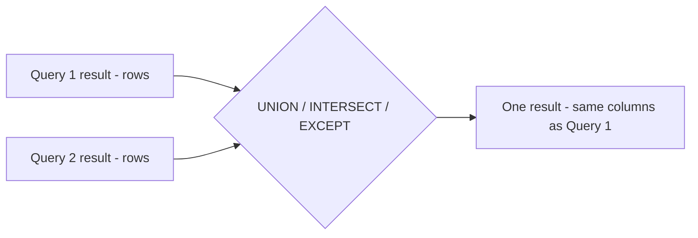

# Chapter 6 — Subqueries and Set Operations

Some questions need **the answer to another question first**. "Who earns more than the average?" needs the average before it can compare. "Which customers never ordered?" needs the list of customers who *did*. SQL lets you put one query **inside** another — a **subquery** — and use its result as a value, a list, or a whole table. The second half of the chapter covers the other way of combining queries: stacking or comparing their results with the **set operators** `UNION`, `INTERSECT` and `EXCEPT`.

**What you'll learn**

- What a subquery (nested query) is, where it can appear, and the three shapes of result it can return: **scalar**, **row**, **table**.
- **Non-correlated** subqueries (run once) vs **correlated** subqueries (conceptually re-run for every outer row), and how PostgreSQL actually executes them.
- Multi-row subqueries with `IN`, `EXISTS`, `ANY`/`SOME`/`ALL` — and the famous `NOT IN` + `NULL` trap.
- **Derived tables** (subqueries in `FROM`), row subqueries, and `LATERAL` for "top-N per group" (the first *N* rows inside each group, e.g. the two best-paid people in every department).
- The set operations `UNION`, `UNION ALL`, `INTERSECT`, `EXCEPT` (and their `ALL` forms): rules, `NULL` handling, precedence, sorting, and when to prefer a join or `EXISTS` instead.

**How to run the examples.** All queries are in [`code/`](code/) and ran on the book's private PostgreSQL 14; outputs are real `psql` output, `NULL` shown as `(null)`. Data: the book's `company` database ([`code/00_schema.sql`](code/00_schema.sql); see [Chapter 1](../01-databases-and-the-relational-model/README.md)).

```bash
bash tools_run_sql.sh sql '06-*'
bash tools_pg.sh psql -d <db> -f sql/chapters/06-subqueries-and-set-operations/code/04_exists.sql
```

---

## 6.1 Subqueries: queries inside queries

### What it is

A **subquery** (also called a **nested query** or **inner query**) is a complete `SELECT` statement written in parentheses inside another SQL statement (the **outer query**). The database evaluates the subquery and uses its result in the outer query — as a single value, as a list of values to compare against, or as a temporary table.

Analogy: asking a colleague "what is the team's average salary?" before you can answer your manager's question "who earns more than average?". The colleague's answer is the subquery.

### Where a subquery can appear

| Position | Example | What the subquery must return |
|---|---|---|
| `WHERE` / `HAVING` with `=`, `<`, `>` … | `WHERE salary > (SELECT avg(salary) …)` | **one value** (scalar) |
| `WHERE` with `IN`, `ANY`, `ALL` | `WHERE dept_id IN (SELECT dept_id …)` | **one column, many rows** |
| `WHERE` with `EXISTS` | `WHERE EXISTS (SELECT 1 …)` | anything — only "any rows?" matters |
| `SELECT` list | `SELECT name, (SELECT count(*) …) AS n` | one value per outer row |
| `FROM` / `JOIN` | `FROM (SELECT … ) AS t` | a whole table (**derived table**) |
| Row comparison | `WHERE (a, b) = (SELECT x, y …)` | one row with several columns |
| `INSERT … SELECT`, `UPDATE … SET col = (…)`, `DELETE … WHERE … IN (…)` | see §6.3 | depends on position |

### Types of subqueries

Subqueries are classified in two independent ways:

**By the shape of their result**

| Type | Returns | Typical operators |
|---|---|---|
| **Scalar subquery** | exactly one row, one column (or no row → `NULL`) | `=`, `<>`, `<`, `>`, arithmetic, `SELECT` list |
| **Row subquery** | one row, several columns | `(a, b) = (…)` |
| **Column / multi-row subquery** | one column, many rows | `IN`, `NOT IN`, `ANY`, `ALL` |
| **Table subquery** | many rows and columns | `FROM`, `EXISTS`, `IN` with row values |

**By dependence on the outer query**

| Type | Meaning | Evaluated |
|---|---|---|
| **Non-correlated** (simple, nested) | The inner query does not mention the outer query's tables. It can run on its own. | Conceptually **once**; the result is reused. |
| **Correlated** | The inner query refers to a column of the current outer row (e.g. `WHERE x.dept_id = e.dept_id`). It can't run on its own. | Conceptually **once per outer row** (§6.3). |

Textbooks and courses name the same shapes in slightly different ways. How the common names map onto the two tables above:

| Name you may meet | What it means | Example in this chapter |
|---|---|---|
| Nested scalar subquery | returns one value, used in a comparison | `salary > (SELECT avg(salary) …)` (below) |
| Single-row subquery | returns at most one row (one or several columns); used with `=`, `<`, `>` or a row constructor | `(dept_id, job_title) = (SELECT … WHERE emp_id = 4)` (§6.6) |
| Multiple-row subquery | returns several rows; needs `IN`, `ANY`, `ALL` or `EXISTS` | `dept_id IN (SELECT dept_id … 'Mumbai')` (§6.2) |
| Single-column subquery | returns one column (one or many rows) | every `IN (SELECT one_column …)` |
| Correlated subquery | refers to the outer row | "above *their own* department's average" (§6.3) |

### How a non-correlated scalar subquery works

```sql
SELECT first_name, salary
FROM employees
WHERE salary > (SELECT avg(salary) FROM employees)
ORDER BY salary DESC;
```

Output:

```text
 first_name |  salary   
------------+-----------
 Asha       | 250000.00
 Vikram     | 185000.00
 Daniel     | 150000.00
 Neha       | 142000.00
 Kiran      | 135000.00
 Lucas      | 120000.00
(6 rows)
```

1. The database runs the inner query once: the average salary is 107,800.
2. It substitutes that value, so the outer query becomes `WHERE salary > 107800`.
3. It runs the outer query.

Without a subquery you would need two round trips (a request sent to the database plus its reply) from your application (fetch the average, then send a second query) — and the value could change between them.

A scalar subquery can be used anywhere a single value can, including the `SELECT` list and arithmetic:

```sql
SELECT first_name, salary,
       round((SELECT avg(salary) FROM employees)) AS company_avg,
       round(salary - (SELECT avg(salary) FROM employees)) AS diff
FROM employees
WHERE dept_id = 1
ORDER BY emp_id;
```

Output:

```text
 first_name |  salary   | company_avg | diff  
------------+-----------+-------------+-------
 Vikram     | 185000.00 |      107800 | 77200
 Neha       | 142000.00 |      107800 | 34200
 Rahul      |  98000.00 |      107800 | -9800
 Meera      |  98000.00 |      107800 | -9800
(4 rows)
```

Two classic uses — "the row with the extreme value" and "the second-highest value":

```sql
SELECT first_name, hire_date FROM employees
WHERE hire_date = (SELECT max(hire_date) FROM employees);

SELECT max(salary) AS second_highest
FROM employees
WHERE salary < (SELECT max(salary) FROM employees);
```

Output:

```text
 first_name | hire_date  
------------+------------
 Rohan      | 2025-06-02
(1 row)

 second_highest 
----------------
      185000.00
(1 row)
```

The second query reads "the largest salary that is smaller than the largest salary". (For the *N*-th highest in general, window functions — functions that compute over related rows while keeping every row — such as `DENSE_RANK()` are cleaner — [Chapter 8](../08-window-functions/README.md) — and interview versions are in [Chapter 19](../19-sql-interview-problems-2/README.md).)

### Scalar subqueries: the two edge cases

If a scalar subquery returns **no rows**, its value is `NULL`:

```sql
SELECT (SELECT salary FROM employees WHERE emp_id = 999) AS missing;
```

```text
 missing 
---------
  (null)
(1 row)
```

If it returns **more than one row**, the query fails at run time:

```sql
SELECT first_name FROM employees
WHERE salary = (SELECT salary FROM employees WHERE dept_id = 1);
```

```text
ERROR:  more than one row returned by a subquery used as an expression
```

This error depends on the **data**, not just the query — it can work in testing and fail in production (the live system real users depend on) once a second matching row appears. If more than one row is possible, use `IN` (§6.2), or make the subquery provably single-row (aggregate it, or filter on a unique key).

### Common mistakes

- Using `=` with a subquery that can return several rows (use `IN`).
- Forgetting the parentheses, or putting `ORDER BY` inside a subquery and expecting the outer result to be ordered (only the outermost `ORDER BY` orders the final result).
- Writing a subquery where a join is simpler — e.g. fetching a column from a related table for every row (see §6.3 for when each is better).

### Self-check

1. What does a scalar subquery return when it finds no row? → `NULL`.
2. Is `(SELECT avg(salary) FROM employees)` correlated? → No — it doesn't refer to any outer table, so it runs once.
3. Name the four places a subquery can appear in a `SELECT`. → `SELECT` list, `FROM`/`JOIN`, `WHERE`, `HAVING`.

### TL;DR

A subquery is a `SELECT` inside parentheses. By result: scalar, row, column, table. By dependence: non-correlated (runs once) or correlated (per outer row). Scalar with 0 rows → `NULL`; with 2+ rows → error.

---

## 6.2 Multi-row subqueries: IN and NOT IN

### What it is

When the subquery returns **one column with many rows**, you compare against the whole list. `x IN (subquery)` is true if `x` equals **any** value in the list; `x NOT IN (subquery)` is true if `x` equals **none** of them.

```sql
SELECT first_name, dept_id FROM employees
WHERE dept_id IN (SELECT dept_id FROM departments WHERE location = 'Mumbai')
ORDER BY emp_id;
```

Output:

```text
 first_name | dept_id 
------------+---------
 Daniel     |       2
 Priya      |       2
 Arjun      |       2
 Sara       |       2
 Lucas      |       3
 Ananya     |       3
(6 rows)
```

The subquery returns `{2, 3}` (Sales and Marketing are in Mumbai), and the outer query keeps employees whose `dept_id` is in that set. `IN` never produces duplicates in the outer result, even if the list contains a value many times — it's a semi-join (each outer row is returned at most once if it has any match; [Chapter 5](../05-joins/README.md#58-semi-joins-and-anti-joins)).

The subquery can have its own joins and filters:

```sql
SELECT name FROM products
WHERE product_id IN (SELECT oi.product_id
                     FROM order_items oi JOIN orders o ON o.order_id = oi.order_id
                     WHERE o.status = 'delivered')
ORDER BY name;
```

Output:

```text
            name             
-----------------------------
 Ergonomic Chair
 Gift Card
 Laptop Pro 14
 Mechanical Keyboard
 Noise-Cancelling Headphones
 Standing Desk
 USB-C Hub
 Wireless Mouse
(8 rows)
```

### Nesting several levels

Subqueries can be nested inside subqueries. Read them **from the innermost outwards**: Furniture products → orders containing them → the customers of those orders.

```sql
SELECT first_name, last_name FROM customers
WHERE customer_id IN (
      SELECT customer_id FROM orders
      WHERE order_id IN (
            SELECT order_id FROM order_items
            WHERE product_id IN (SELECT product_id FROM products WHERE category = 'Furniture')))
ORDER BY customer_id;
```

Output:

```text
 first_name | last_name 
------------+-----------
 Anita      | Shah
 Fatima     | Qureshi
 George     | Hill
(3 rows)
```

Deep nesting is legal but hard to read; the same question is usually clearer as joins plus `DISTINCT`/`EXISTS`, or as a chain of CTEs (Common Table Expressions — named subqueries written with `WITH`; [Chapter 7](../07-ctes-views-and-recursion/README.md)).

### The NOT IN trap

Question: which employees are **not** anybody's manager?

```sql
SELECT count(*) AS not_in_rows FROM employees
WHERE emp_id NOT IN (SELECT manager_id FROM employees);
```

Output:

```text
 not_in_rows 
-------------
           0
(1 row)
```

Zero — obviously wrong. The subquery's list contains a `NULL` (the CEO has no manager). `x NOT IN (a, b, NULL)` means `x <> a AND x <> b AND x <> NULL`. The last comparison is UNKNOWN for every `x`, so the whole condition can never be TRUE — at best UNKNOWN — and `WHERE` keeps only TRUE rows ([three-valued logic, Chapter 2](../02-select-basics/README.md)). One `NULL` in the list silently empties the result.

| Condition | `x = 3`, list `(1, 2)` | `x = 3`, list `(1, 2, NULL)` | `x = 1`, list `(1, 2, NULL)` |
|---|---|---|---|
| `x IN (list)` | FALSE | **UNKNOWN** | TRUE |
| `x NOT IN (list)` | TRUE | **UNKNOWN** (row dropped) | FALSE |

Two fixes:

```sql
-- Fix 1: filter the NULLs out of the subquery
SELECT first_name FROM employees
WHERE emp_id NOT IN (SELECT manager_id FROM employees WHERE manager_id IS NOT NULL)
ORDER BY emp_id;

-- Fix 2 (preferred): NOT EXISTS is NULL-safe
SELECT first_name FROM employees e
WHERE NOT EXISTS (SELECT 1 FROM employees r WHERE r.manager_id = e.emp_id)
ORDER BY emp_id;
```

Output (both):

```text
 first_name 
------------
 Neha
 Rahul
 Meera
 Priya
 Arjun
 Sara
 Ananya
 Omar
 Li
 Rohan
(10 rows)
```

Prefer `NOT EXISTS`: it is correct whatever the data, states the intent ("there is no row that…"), and PostgreSQL plans it as an efficient anti join (a join that returns only the outer rows with *no* match), whereas `NOT IN (subquery)` must stay a filter that checks the whole list (hashed — loaded into an in-memory hash table, a structure that finds a value in about one step — if it fits in memory, otherwise re-scanned per row).

### In the interview

**30-second answer.** "`IN (subquery)` checks membership in the list the subquery returns — a semi-join, no duplicates. `NOT IN` is dangerous: if the list contains a `NULL`, `NOT IN` is never true and returns nothing. Use `NOT EXISTS` (or filter out `NULL`s) for anti-joins."

- *Q: Why does `NOT IN` return no rows?* — The list has a `NULL`; `x <> NULL` is UNKNOWN, so the `AND` chain is never TRUE.
- *Q: Does `IN` have the same problem?* — No: a `NULL` in the list can't make a match TRUE into something else; it can only turn FALSE into UNKNOWN, and both are dropped by `WHERE`.

### Self-check

1. `SELECT 5 NOT IN (1, 2, NULL)` returns? → `NULL` (UNKNOWN).
2. Which three columns in our schema would make a `NOT IN (SELECT col …)` risky? → Any nullable one, e.g. `employees.manager_id`, `employees.dept_id`, `orders.sales_rep_id`.

### TL;DR

`IN` = "is in the list"; `NOT IN` + a `NULL` in the list = empty result. Anti-joins: use `NOT EXISTS`.

---

## 6.3 Correlated subqueries

### What it is

A **correlated subquery** refers to a column of the **current row of the outer query**. It therefore can't be run once up front: conceptually, the database runs it again for every outer row, with that row's values plugged in.

Analogy: a teacher checking each student's mark against *that student's own class average*. The average to compare with changes as the teacher moves from student to student.

### How it works

"Employees who earn more than the average **of their own department**":

```sql
SELECT e.first_name, e.dept_id, e.salary
FROM employees e
WHERE e.salary > (SELECT avg(x.salary) FROM employees x WHERE x.dept_id = e.dept_id)
ORDER BY e.dept_id, e.salary DESC;
```

Output:

```text
 first_name | dept_id |  salary   
------------+---------+-----------
 Vikram     |       1 | 185000.00
 Neha       |       1 | 142000.00
 Daniel     |       2 | 150000.00
 Lucas      |       3 | 120000.00
 Kiran      |       4 | 135000.00
(5 rows)
```

1. Take the first outer row, e.g. Vikram with `e.dept_id = 1`.
2. Run the inner query with `e.dept_id` replaced by 1 → average of Engineering = 130,750.
3. Keep Vikram if 185,000 > 130,750. Move to the next outer row and repeat.
4. Asha and Rohan (`dept_id` `NULL`) are never kept: `x.dept_id = NULL` matches nothing, so the average is `NULL` and the comparison is UNKNOWN.

The aliases `e` (outer) and `x` (inner) are essential — both refer to `employees`, and the alias tells SQL which copy each column belongs to. An unqualified column in a subquery is resolved to the **nearest** table that has it (the inner one first), which can silently turn a correlated subquery into a non-correlated one or vice versa.

"The top earner in each department" (ties would all be returned):

```sql
SELECT e.dept_id, e.first_name, e.salary
FROM employees e
WHERE e.salary = (SELECT max(x.salary) FROM employees x WHERE x.dept_id = e.dept_id)
ORDER BY e.dept_id;
```

Output:

```text
 dept_id | first_name |  salary   
---------+------------+-----------
       1 | Vikram     | 185000.00
       2 | Daniel     | 150000.00
       3 | Lucas      | 120000.00
       4 | Kiran      | 135000.00
       5 | Li         |  64000.00
(5 rows)
```

### Correlated subqueries in SELECT, and the join alternative

A correlated scalar subquery in the `SELECT` list works like a per-row lookup:

```sql
SELECT c.customer_id, c.first_name,
       (SELECT count(*)       FROM orders o WHERE o.customer_id = c.customer_id) AS orders,
       (SELECT max(placed_at)::date FROM orders o WHERE o.customer_id = c.customer_id) AS last_order
FROM customers c
ORDER BY c.customer_id;
```

Output:

```text
 customer_id | first_name | orders | last_order 
-------------+------------+--------+------------
           1 | Anita      |      3 | 2025-06-02
           2 | Ben        |      2 | 2025-04-01
           3 | Chen       |      2 | 2025-05-06
           4 | Divya      |      1 | 2025-02-28
           5 | Ethan      |      2 | 2025-05-20
           6 | Fatima     |      2 | 2025-06-15
           7 | George     |      1 | 2025-04-25
           8 | Anita      |      1 | 2025-04-09
           9 | Hana       |      0 | (null)
          10 | Ivan       |      0 | (null)
(10 rows)
```

The same result with a `LEFT JOIN` and `GROUP BY`:

```sql
SELECT c.customer_id, c.first_name, count(o.order_id) AS orders, max(o.placed_at)::date AS last_order
FROM customers c LEFT JOIN orders o ON o.customer_id = c.customer_id
GROUP BY c.customer_id, c.first_name
ORDER BY c.customer_id;
```

(Identical output — omitted.) How PostgreSQL's optimizer (the component that decides how to run a query) executes the subquery version, as shown by `EXPLAIN` (which prints the chosen plan; `Seq Scan` = read the whole table):

```sql
EXPLAIN (COSTS OFF)
SELECT c.customer_id, (SELECT count(*) FROM orders o WHERE o.customer_id = c.customer_id) AS orders
FROM customers c;
```

```text
                      QUERY PLAN                       
-------------------------------------------------------
 Seq Scan on customers c
   SubPlan 1
     ->  Aggregate
           ->  Seq Scan on orders o
                 Filter: (customer_id = c.customer_id)
(5 rows)
```

`SubPlan 1` under the customers scan means the inner aggregate really **runs once per customer**. With an index on `orders.customer_id` (an **index** is a sorted lookup structure that finds rows by a column's value without reading the whole table) each run is a quick index lookup, and for a page of 20 rows that is perfectly fine. Over a million customers it's a million lookups, where the join version reads `orders` once and aggregates everything with a single hash join (build a hash table from one input, then probe it with each row of the other).

| | Correlated subquery | Join + `GROUP BY` (or derived table) |
|---|---|---|
| Readability | Very clear for "per row, look up X" | Clear once you know joins |
| Execution (PostgreSQL) | `EXISTS`/`IN` forms become semi/anti joins; scalar forms in `SELECT`/`WHERE` run per outer row | Set-based (whole tables at once): one pass, hash/merge join |
| Multiple values from the same lookup | One subquery **per value** (repeated work) | One join gives all columns |
| Risk | Slow on large outer tables without an index | Fan-out if you join several children (Chapter 5 §5.9) |

Rule of thumb: `EXISTS`/`NOT EXISTS` correlated subqueries are excellent and idiomatic. For scalar lookups over **many** rows, prefer a join, a derived table, or `LATERAL` (§6.7).

### Correlated subqueries in UPDATE and DELETE

Correlated subqueries are also the standard way to update a table from related data:

```sql
ALTER TABLE projects ADD COLUMN total_hours int;
UPDATE projects p
SET total_hours = (SELECT coalesce(sum(hours), 0) FROM employee_projects ep WHERE ep.project_id = p.project_id);
SELECT project_id, name, total_hours FROM projects ORDER BY project_id;
```

Output:

```text
 project_id |       name       | total_hours 
------------+------------------+-------------
          1 | Checkout Revamp  |         870
          2 | Mobile App       |         670
          3 | Spring Campaign  |         370
          4 | Year-End Audit   |         240
          5 | Helpdesk Chatbot |          75
(5 rows)
```

(PostgreSQL also offers `UPDATE … FROM` for join-style updates — [Chapter 9](../09-ddl-dml-and-constraints/README.md).)

### Common mistakes

- Forgetting to correlate (`WHERE x.dept_id = dept_id` without the outer alias resolves to `x.dept_id = x.dept_id`, which is always true for non-NULL values).
- A correlated scalar subquery that can return two rows (error at run time).
- Using per-row subqueries for large reports without an index on the correlated column.

### In the interview

**30-second answer.** "A correlated subquery references the outer row, so logically it's evaluated once per outer row — like 'salary above *their department's* average'. The optimizer turns `EXISTS`/`IN` forms into semi-joins, but scalar ones often really run per row, so for large sets I'd rewrite with a join or window function."

- *Q: Rewrite 'above department average' without a correlated subquery.* — Join to a derived table of department averages, or use `avg(salary) OVER (PARTITION BY dept_id)` in a subquery and filter outside.
- *Q: Can a correlated subquery appear in `SELECT`?* — Yes, as a scalar subquery; it must return at most one row.

### Self-check

1. Why are Asha and Rohan never returned by the "above department average" query? → Their `dept_id` is `NULL`, so the inner average is `NULL` and the comparison is UNKNOWN.
2. What does `SubPlan` in an `EXPLAIN` tell you? → A subquery evaluated (potentially) once per outer row.
3. Is `WHERE EXISTS (SELECT 1 FROM orders o WHERE o.customer_id = c.customer_id)` correlated? → Yes (it references `c`).

### TL;DR

Correlated = refers to the outer row, evaluated per outer row. Great with `EXISTS`; for big scalar lookups prefer joins, derived tables or window functions.

---

## 6.4 EXISTS and NOT EXISTS

### What it is

`EXISTS (subquery)` is TRUE if the subquery returns **at least one row**, FALSE if it returns none. It never returns UNKNOWN, and it doesn't care what the subquery's `SELECT` list contains. `NOT EXISTS` is the opposite. They are almost always correlated.

```sql
SELECT d.name FROM departments d
WHERE EXISTS (SELECT 1 FROM projects p WHERE p.dept_id = d.dept_id AND p.end_date IS NULL)
ORDER BY d.dept_id;
```

Output:

```text
    name     
-------------
 Engineering
 Support
(2 rows)
```

"Departments that have at least one project still running." The database can stop searching as soon as it finds one matching project for a department.

Because only the existence of a row matters, `SELECT 1`, `SELECT *` or even `SELECT NULL` inside `EXISTS` all behave identically; `SELECT 1` is a common convention that signals "I don't need the columns".

```sql
SELECT count(*) FROM departments d
WHERE EXISTS (SELECT NULL FROM employees e WHERE e.dept_id = d.dept_id);
```

```text
 count 
-------
     5
(1 row)
```

### NOT EXISTS — the anti-join

"Employees who are on no project":

```sql
SELECT e.first_name, e.job_title FROM employees e
WHERE NOT EXISTS (SELECT 1 FROM employee_projects ep WHERE ep.emp_id = e.emp_id)
ORDER BY e.emp_id;
```

Output:

```text
 first_name |   job_title   
------------+---------------
 Asha       | CEO
 Daniel     | Sales Manager
 Arjun      | Sales Rep
 Sara       | Sales Rep
(4 rows)
```

### "For all" questions: double NOT EXISTS

SQL has no "for all" operator, but "X for **all** Y" is the same as "there is **no** Y for which X is missing". Which customers bought **every** Accessories product?

```sql
SELECT c.customer_id, c.first_name FROM customers c
WHERE NOT EXISTS (
    SELECT 1 FROM products p
    WHERE p.category = 'Accessories'
      AND NOT EXISTS (SELECT 1 FROM orders o JOIN order_items oi ON oi.order_id = o.order_id
                      WHERE o.customer_id = c.customer_id AND oi.product_id = p.product_id));
```

Output:

```text
 customer_id | first_name 
-------------+------------
           3 | Chen
(1 row)
```

Read it as: "customers for whom there is no Accessories product that they have not bought". This pattern is called **relational division**. An often simpler alternative is counting: group each customer's distinct Accessories purchases and keep those whose count equals the number of Accessories products (`HAVING count(DISTINCT product_id) = (SELECT count(*) FROM products WHERE category = 'Accessories')`).

### IN vs EXISTS vs NOT IN vs NOT EXISTS with a NULL

A block list that contains a `NULL` shows the difference clearly:

```sql
CREATE TABLE blocked (customer_id int);
INSERT INTO blocked VALUES (4), (NULL);
SELECT (SELECT count(*) FROM customers WHERE customer_id IN (SELECT customer_id FROM blocked))            AS in_rows,
       (SELECT count(*) FROM customers c WHERE EXISTS (SELECT 1 FROM blocked b WHERE b.customer_id = c.customer_id)) AS exists_rows,
       (SELECT count(*) FROM customers WHERE customer_id NOT IN (SELECT customer_id FROM blocked))        AS not_in_rows,
       (SELECT count(*) FROM customers c WHERE NOT EXISTS (SELECT 1 FROM blocked b WHERE b.customer_id = c.customer_id)) AS not_exists_rows;
```

Output:

```text
 in_rows | exists_rows | not_in_rows | not_exists_rows 
---------+-------------+-------------+-----------------
       1 |           1 |           0 |               9
(1 row)
```

`IN` and `EXISTS` agree (1 blocked customer). `NOT IN` returns 0 because of the `NULL`; `NOT EXISTS` correctly returns the 9 other customers.

| | `IN (subquery)` | `EXISTS (subquery)` |
|---|---|---|
| Question asked | "is this value in the list?" | "is there any matching row?" |
| Correlated? | usually not | usually yes |
| Multiple columns | `(a, b) IN (SELECT x, y …)` | any condition in the subquery's `WHERE` |
| Negation with `NULL`s | `NOT IN` breaks | `NOT EXISTS` is safe |
| Performance in PostgreSQL | both become semi joins | both become semi joins |

Old advice that "`EXISTS` is always faster than `IN`" came from older optimizers; modern optimizers (PostgreSQL included) usually turn both `IN (subquery)` and `EXISTS` into the same semi-join. Choose by clarity — but always prefer `NOT EXISTS` over `NOT IN`.

### Self-check

1. What does `EXISTS` return if the subquery's single row is all `NULL`s? → TRUE — a row exists.
2. Rewrite `WHERE dept_id IN (SELECT dept_id FROM departments WHERE location = 'Pune')` with `EXISTS`. → `WHERE EXISTS (SELECT 1 FROM departments d WHERE d.dept_id = e.dept_id AND d.location = 'Pune')`.

### TL;DR

`EXISTS` = "at least one row". Never UNKNOWN, ignores the select list, stops at the first match. `NOT EXISTS` is the safe anti-join; double `NOT EXISTS` expresses "for all".

---

## 6.5 ANY, SOME and ALL

### What it is

`ANY` and `ALL` let you use any comparison operator (`=`, `<>`, `<`, `>`, `<=`, `>=`) against a list:

- `x > ANY (subquery)` — true if `x` is greater than **at least one** value (i.e. greater than the minimum). `SOME` is an exact synonym for `ANY`.
- `x > ALL (subquery)` — true if `x` is greater than **every** value (i.e. greater than the maximum).

```sql
SELECT first_name, salary FROM employees
WHERE salary > ANY (SELECT salary FROM employees WHERE dept_id = 2)
  AND dept_id <> 2
ORDER BY salary;

SELECT first_name, salary FROM employees
WHERE salary > ALL (SELECT salary FROM employees WHERE dept_id = 2)
ORDER BY salary;
```

Output:

```text
 first_name |  salary   
------------+-----------
 Omar       |  76000.00
 Rahul      |  98000.00
 Meera      |  98000.00
 Lucas      | 120000.00
 Kiran      | 135000.00
 Neha       | 142000.00
 Vikram     | 185000.00
(7 rows)

 first_name |  salary   
------------+-----------
 Vikram     | 185000.00
 Asha       | 250000.00
(2 rows)
```

Sales salaries range from 68,000 to 150,000. `> ANY` means "above 68,000": Ananya (61,000) and Li (64,000) fail it, while Asha and Rohan drop out for another reason — `dept_id <> 2` is UNKNOWN for their `NULL` department. `> ALL` means "above 150,000" (Vikram and Asha).

| Expression | Same as |
|---|---|
| `x = ANY (list)` | `x IN (list)` |
| `x <> ALL (list)` | `x NOT IN (list)` — with the same `NULL` trap |
| `x > ANY (list)` | `x > (SELECT min(…))` (if the list is non-empty and has no `NULL`s) |
| `x > ALL (list)` | `x > (SELECT max(…))` (same caveats) |
| `x <> ANY (list)` | "differs from at least one value" — rarely what people mean |

```sql
SELECT count(*) AS eq_any FROM products WHERE category = ANY (SELECT DISTINCT category FROM products WHERE unit_price > 300);
SELECT count(*) AS ne_all_with_null FROM products
WHERE unit_price <> ALL (SELECT unit_price FROM order_items UNION ALL SELECT NULL);
```

Output:

```text
 eq_any 
--------
      6
(1 row)

 ne_all_with_null 
------------------
                0
(1 row)
```

### Empty lists

Over an **empty** subquery, `ALL` is TRUE (vacuously: there is no value that fails) and `ANY` is FALSE (there is no value that passes). This differs from the `min`/`max` rewrite, where `max` of nothing is `NULL`:

```sql
SELECT (5 > ALL (SELECT salary FROM employees WHERE dept_id = 6)) AS all_empty,
       (5 > ANY (SELECT salary FROM employees WHERE dept_id = 6)) AS any_empty;
```

```text
 all_empty | any_empty 
-----------+-----------
 t         | f
(1 row)
```

PostgreSQL also accepts an **array** (an ordered list of values held in one value) on the right-hand side, which is how application code usually passes a list as one parameter (a value sent separately from the SQL text, filled into a placeholder):

```sql
SELECT name FROM products WHERE product_id = ANY (ARRAY[1, 3, 5]) ORDER BY product_id;
```

```text
     name      
---------------
 Laptop Pro 14
 USB-C Hub
 Standing Desk
(3 rows)
```

| Database | `ANY`/`SOME`/`ALL` with subquery | `= ANY(array)` |
|---|---|---|
| PostgreSQL | yes | yes |
| MySQL, SQL Server, Oracle | yes | no arrays |
| SQLite | **no** — use `IN`, `EXISTS`, `min`/`max` | no |

### Self-check

1. `salary > ALL (SELECT salary FROM employees WHERE dept_id = 99)` — with no department 99, which rows pass? → All rows (ALL over an empty set is TRUE).
2. What is `= ANY` equivalent to? → `IN`.

### TL;DR

`ANY`/`SOME` = compare with at least one; `ALL` = compare with every one. `= ANY` ≡ `IN`; `<> ALL` ≡ `NOT IN` (NULL trap). `ALL` of empty = TRUE.

---

## 6.6 Table subqueries: derived tables and row subqueries

### What it is

A subquery in the `FROM` clause is a **derived table** (PostgreSQL's docs call it a *subquery in FROM*; some people say *inline view*). Its result is treated as a temporary, unnamed table that exists only for this query. You must give it an alias (optional from PostgreSQL 16; our server is 14):

```sql
SELECT * FROM (SELECT 1 AS x);
```

```text
ERROR:  subquery in FROM must have an alias
LINE 1: SELECT * FROM (SELECT 1 AS x);
                      ^
HINT:  For example, FROM (SELECT ...) [AS] foo.
```

### Why it matters

Derived tables let you **build a query in stages**: compute something, then filter, join or aggregate the result. They solve the "can't use an alias in `WHERE`" and "can't aggregate an aggregate" problems from [Chapter 4](../04-aggregation/README.md#45-the-logical-order-of-query-processing).

```sql
SELECT dept_id, headcount
FROM (SELECT dept_id, count(*) AS headcount FROM employees GROUP BY dept_id) AS t
WHERE headcount >= 2
ORDER BY dept_id;
```

Output:

```text
 dept_id | headcount 
---------+-----------
       1 |         4
       2 |         4
       3 |         2
       4 |         2
  (null) |         2
(5 rows)
```

(The same filter could be written with `HAVING`; the derived-table form becomes necessary when the next step is something `HAVING` can't do.) An **aggregate of an aggregate** — "the average department payroll" — needs two levels, because `avg(sum(salary))` is not allowed:

```sql
SELECT round(avg(payroll)) AS avg_department_payroll
FROM (SELECT dept_id, sum(salary) AS payroll
      FROM employees WHERE dept_id IS NOT NULL GROUP BY dept_id) AS per_dept;
```

Output:

```text
 avg_department_payroll 
------------------------
                 267400
(1 row)
```

Derived tables can also be **joined** like any table — the standard cure for join fan-out ([Chapter 5 §5.9](../05-joins/README.md#59-join-pitfalls)). Each order's total next to that customer's average order total:

```sql
SELECT o.order_id, o.customer_id, round(t.order_total, 2) AS order_total, round(ca.avg_total, 2) AS customer_avg
FROM orders o
JOIN (SELECT order_id, sum(quantity * unit_price * (1 - discount)) AS order_total
      FROM order_items GROUP BY order_id) t ON t.order_id = o.order_id
JOIN (SELECT o2.customer_id, avg(t2.total) AS avg_total
      FROM orders o2
      JOIN (SELECT order_id, sum(quantity * unit_price * (1 - discount)) AS total
            FROM order_items GROUP BY order_id) t2 ON t2.order_id = o2.order_id
      GROUP BY o2.customer_id) ca ON ca.customer_id = o.customer_id
WHERE o.customer_id IN (1, 5)
ORDER BY o.order_id;
```

Output:

```text
 order_id | customer_id | order_total | customer_avg 
----------+-------------+-------------+--------------
      101 |           1 |     1323.99 |      1151.36
      104 |           1 |      811.49 |      1151.36
      106 |           5 |      174.97 |       212.45
      112 |           5 |      249.93 |       212.45
      113 |           1 |     1318.60 |      1151.36
(5 rows)
```

Notice the order-total subquery written **twice**. That repetition is exactly what a CTE (`WITH order_totals AS (…)`) removes — [Chapter 7](../07-ctes-views-and-recursion/README.md). Since PostgreSQL 12 a simple CTE that is referenced once is inlined (pasted into the main query), i.e. executed just like the equivalent derived table; CTEs mainly win on readability and reuse.

### Row subqueries

A **row subquery** returns a single row with several columns and is compared with a **row constructor** `(a, b)`. "Employees with the same department *and* job title as employee 4":

```sql
SELECT first_name, job_title, dept_id FROM employees
WHERE (dept_id, job_title) = (SELECT dept_id, job_title FROM employees WHERE emp_id = 4)
ORDER BY emp_id;
```

Output:

```text
 first_name | job_title | dept_id 
------------+-----------+---------
 Rahul      | Engineer  |       1
 Meera      | Engineer  |       1
(2 rows)
```

With `IN`, a multi-column subquery can return many rows. "Each customer's latest order" as "(customer, time) pairs that are some customer's maximum":

```sql
SELECT customer_id, order_id, placed_at::date
FROM orders
WHERE (customer_id, placed_at) IN (SELECT customer_id, max(placed_at) FROM orders GROUP BY customer_id)
ORDER BY customer_id;
```

Output:

```text
 customer_id | order_id | placed_at  
-------------+----------+------------
           1 |      113 | 2025-06-02
           2 |      108 | 2025-04-01
           3 |      111 | 2025-05-06
           4 |      105 | 2025-02-28
           5 |      112 | 2025-05-20
           6 |      114 | 2025-06-15
           7 |      110 | 2025-04-25
           8 |      109 | 2025-04-09
(8 rows)
```

(Row constructors with `IN` work in PostgreSQL, MySQL and Oracle, but **not** in SQL Server — use `EXISTS` there.)

### Self-check

1. Why can't you write `SELECT avg(sum(salary)) FROM employees GROUP BY dept_id`? → Aggregates can't be nested; compute the sums in a derived table and average them outside.
2. What must every derived table have in PostgreSQL 14? → An alias.

### TL;DR

Subquery in `FROM` = derived table: build queries in stages, aggregate aggregates, pre-aggregate before joins. Row subqueries compare several columns at once.

---

## 6.7 LATERAL subqueries

### What it is

A normal derived table can't refer to other tables in the same `FROM` clause — it's evaluated independently. A **`LATERAL`** subquery **can** refer to columns of tables listed *before* it, so it is re-evaluated for each row of those tables. Think of it as a correlated subquery that may return **many rows and many columns**, placed in `FROM`.

```sql
SELECT d.name, t.n FROM departments d,
     (SELECT count(*) AS n FROM employees e WHERE e.dept_id = d.dept_id) t;
```

```text
ERROR:  invalid reference to FROM-clause entry for table "d"
LINE 2: ... count(*) AS n FROM employees e WHERE e.dept_id = d.dept_id)...
                                                             ^
HINT:  There is an entry for table "d", but it cannot be referenced from this part of the query.
```

### The problem it solves: top-N per group

"The two highest-paid employees in each department" is hard with plain subqueries (you can't `LIMIT` per group). With `LATERAL`, for each department run a small query that sorts that department's employees and takes 2:

```sql
SELECT d.name, t.first_name, t.salary
FROM departments d
CROSS JOIN LATERAL (
    SELECT e.first_name, e.salary FROM employees e
    WHERE e.dept_id = d.dept_id
    ORDER BY e.salary DESC, e.emp_id
    LIMIT 2) AS t
ORDER BY d.dept_id, t.salary DESC;
```

Output:

```text
    name     | first_name |  salary   
-------------+------------+-----------
 Engineering | Vikram     | 185000.00
 Engineering | Neha       | 142000.00
 Sales       | Daniel     | 150000.00
 Sales       | Priya      |  72000.00
 Marketing   | Lucas      | 120000.00
 Marketing   | Ananya     |  61000.00
 Finance     | Kiran      | 135000.00
 Finance     | Omar       |  76000.00
 Support     | Li         |  64000.00
(9 rows)
```

`CROSS JOIN LATERAL` drops outer rows for which the subquery returns nothing (Research is missing). To keep them, use `LEFT JOIN LATERAL … ON true` — `ON true` because the correlation is already inside the subquery:

```sql
SELECT d.name, t.first_name, t.salary
FROM departments d
LEFT JOIN LATERAL (
    SELECT e.first_name, e.salary FROM employees e
    WHERE e.dept_id = d.dept_id
    ORDER BY e.salary DESC LIMIT 1) AS t ON true
ORDER BY d.dept_id;
```

Output:

```text
    name     | first_name |  salary   
-------------+------------+-----------
 Engineering | Vikram     | 185000.00
 Sales       | Daniel     | 150000.00
 Marketing   | Lucas      | 120000.00
 Finance     | Kiran      | 135000.00
 Support     | Li         |  64000.00
 Research    | (null)     |    (null)
(6 rows)
```

"Each customer's most recent order, with several of its columns" — something a scalar subquery can only do one column at a time:

```sql
SELECT c.first_name, last.order_id, last.status, last.placed_at::date
FROM customers c
LEFT JOIN LATERAL (
    SELECT o.order_id, o.status, o.placed_at FROM orders o
    WHERE o.customer_id = c.customer_id
    ORDER BY o.placed_at DESC LIMIT 1) AS last ON true
ORDER BY c.customer_id;
```

Output:

```text
 first_name | order_id |  status   | placed_at  
------------+----------+-----------+------------
 Anita      |      113 | pending   | 2025-06-02
 Ben        |      108 | delivered | 2025-04-01
 Chen       |      111 | cancelled | 2025-05-06
 Divya      |      105 | cancelled | 2025-02-28
 Ethan      |      112 | shipped   | 2025-05-20
 Fatima     |      114 | pending   | 2025-06-15
 George     |      110 | shipped   | 2025-04-25
 Anita      |      109 | delivered | 2025-04-09
 Hana       |   (null) | (null)    | (null)
 Ivan       |   (null) | (null)    | (null)
(10 rows)
```

With an index on `orders (customer_id, placed_at)`, each lateral lookup reads just one index entry — often the fastest way to get "latest row per group" when there are few outer rows. Window functions (`ROW_NUMBER() OVER (PARTITION BY …)`, [Chapter 8](../08-window-functions/README.md)) are the other standard approach and are usually better when you need the answer for *every* group of a large table.

| Database | Syntax |
|---|---|
| PostgreSQL 9.3+ | `CROSS JOIN LATERAL (…)`, `LEFT JOIN LATERAL (…) ON true` |
| MySQL 8.0.14+ | `LATERAL` |
| SQL Server, Oracle 12c+ | `CROSS APPLY` / `OUTER APPLY` (Oracle also has `LATERAL`) |
| SQLite | not supported |

### TL;DR

`LATERAL` = a derived table that can see earlier `FROM` items, evaluated per outer row; can return many rows/columns. Top-N per group, latest row per group. `LEFT JOIN LATERAL … ON true` keeps outer rows with no result.

---

## 6.8 Set operations and UNION

### What it is

**Set operations** combine the **results of two queries** into one result, by rows, like the operations on sets in mathematics (a *set* is a collection of distinct items; a *Venn picture* draws two sets as overlapping circles):

| Operator | Result | Venn picture |
|---|---|---|
| `UNION` | rows in the first **or** the second result (duplicates removed) | both circles |
| `UNION ALL` | all rows of both results, duplicates kept | both circles, overlap counted twice |
| `INTERSECT` | rows in **both** results | only the overlap |
| `EXCEPT` | rows in the first result that are **not** in the second | left circle minus overlap |

Joins combine tables **side by side** (more columns); set operations stack results **on top of each other** (more or fewer rows, same columns).



*Figure 6.1 — A set operation takes two results with the same columns and produces one.*

### The rules

1. Both queries must return the **same number of columns**.
2. Corresponding columns must have **compatible types** (PostgreSQL resolves them to a common type, like `CASE` does).
3. Column **names** of the result come from the **first** query.
4. Rows are compared **as whole rows**, and — unlike `=` — two `NULL`s are treated as **equal** (not distinct).
5. `ORDER BY` / `LIMIT` at the end apply to the **combined** result (§6.11).

Breaking rule 1 or 2:

```sql
SELECT first_name, last_name FROM employees UNION SELECT first_name FROM customers;
SELECT emp_id FROM employees UNION SELECT first_name FROM customers;
```

```text
ERROR:  each UNION query must have the same number of columns
LINE 1: ...first_name, last_name FROM employees UNION SELECT first_name...
                                                             ^

ERROR:  UNION types integer and text cannot be matched
LINE 1: SELECT emp_id FROM employees UNION SELECT first_name FROM cu...
                                                  ^
```

### UNION

One contact list from two tables, with a literal column (a fixed value typed into the query, here `'employee'`) to show where each row came from:

```sql
SELECT first_name, last_name, 'employee' AS kind FROM employees WHERE dept_id = 3
UNION
SELECT first_name, last_name, 'customer' FROM customers WHERE country = 'UK'
ORDER BY kind, last_name;
```

Output:

```text
 first_name | last_name |   kind   
------------+-----------+----------
 Ben        | Carter    | customer
 George     | Hill      | customer
 Ananya     | Das       | employee
 Lucas      | Martin    | employee
(4 rows)
```

Every city where we have customers or offices — `UNION` removes the duplicates (Mumbai, Bengaluru, Delhi …):

```sql
SELECT city FROM customers WHERE city IS NOT NULL
UNION
SELECT location FROM departments WHERE location IS NOT NULL
ORDER BY city;
```

Output:

```text
   city    
-----------
 Bengaluru
 Delhi
 London
 Mumbai
 New York
 Pune
 mumbai
(7 rows)
```

Note that `mumbai` and `Mumbai` are different strings, so both survive — clean data first (`initcap(city)`, [Chapter 3](../03-functions-and-expressions/README.md)) if case shouldn't matter.

### UNION vs UNION ALL

```sql
SELECT count(*) AS union_rows     FROM (SELECT country FROM customers UNION     SELECT 'India') t;
SELECT count(*) AS union_all_rows FROM (SELECT country FROM customers UNION ALL SELECT 'India') t;
```

Output:

```text
 union_rows 
------------
          3
(1 row)

 union_all_rows 
----------------
             11
(1 row)
```

`UNION` returned 3 (India, UK, USA — duplicates inside **each** input are removed too, not just between them). `UNION ALL` returned all 10 + 1 = 11 rows.

| | `UNION` | `UNION ALL` |
|---|---|---|
| Duplicates | removed (whole-row comparison) | kept |
| Extra work | a sort or hash over the whole result | none — rows are just appended |
| Use when | you need distinct rows | the inputs can't overlap, or duplicates are meaningful (counting, event logs) |

Default to **`UNION ALL`** unless you actually need de-duplication; `UNION` on large results costs a sort or hash and hides data problems.

A typical `UNION ALL`: stacking two kinds of events into one timeline:

```sql
SELECT placed_at AS at, 'order placed'  AS event, order_id FROM orders   WHERE customer_id = 1
UNION ALL
SELECT shipped_at,      'order shipped',          order_id FROM orders   WHERE customer_id = 1 AND shipped_at IS NOT NULL
ORDER BY at;
```

Output:

```text
         at          |     event     | order_id 
---------------------+---------------+----------
 2025-01-03 10:15:00 | order placed  |      101
 2025-01-04 09:00:00 | order shipped |      101
 2025-02-11 09:05:00 | order placed  |      104
 2025-02-12 16:45:00 | order shipped |      104
 2025-06-02 10:30:00 | order placed  |      113
(5 rows)
```

And rule 4 — set operations treat `NULL`s as duplicates of each other:

```sql
SELECT NULL::text AS v UNION SELECT NULL::text;
```

```text
   v    
--------
 (null)
(1 row)
```

### Self-check

1. `SELECT 1 UNION SELECT 1 UNION ALL SELECT 1` returns how many rows? → 2 (operators apply left to right: `(1 UNION 1)` = 1 row, then `UNION ALL 1` = 2 rows).
2. Where do the result's column names come from? → The first query.
3. Why prefer `UNION ALL` by default? → No de-duplication cost and no silently lost rows.

### TL;DR

Set operations stack results with the same column count and compatible types; names come from the first query. `UNION` de-duplicates (cost!), `UNION ALL` doesn't. `NULL`s count as equal.

---

## 6.9 INTERSECT

### What it is

`INTERSECT` returns the rows that appear in **both** results (the overlap of the Venn diagram), without duplicates.

"Cities where we have both customers and an office":

```sql
SELECT city FROM customers
INTERSECT
SELECT location FROM departments
ORDER BY city;
```

Output:

```text
   city    
-----------
 Bengaluru
 Mumbai
 (null)
(3 rows)
```

The `(null)` row is a lesson in rule 4: one customer has no city and one department has no location, and set operations treat the two `NULL`s as equal. An inner join on `c.city = d.location` would not match them. Add `WHERE city IS NOT NULL` if that row is unwanted.

"Employees who are on a project **and** manage someone":

```sql
SELECT emp_id FROM employee_projects
INTERSECT
SELECT manager_id FROM employees
ORDER BY emp_id;
```

Output:

```text
 emp_id 
--------
      2
     10
     12
(3 rows)
```

`INTERSECT` is equivalent to a semi-join with `EXISTS` on all columns (using `IS NOT DISTINCT FROM` for `NULL`s) plus `DISTINCT`. Use `INTERSECT` when you compare whole rows of two similar results; use `EXISTS`/`JOIN` when you need other columns from either side.

---

## 6.10 EXCEPT

### What it is

`EXCEPT` returns the rows of the first result that do **not** appear in the second (the left crescent), without duplicates. Oracle calls it `MINUS` (Oracle 21c also accepts `EXCEPT`).

"Products that were never ordered":

```sql
SELECT product_id FROM products
EXCEPT
SELECT product_id FROM order_items;
```

Output:

```text
 product_id 
------------
          8
(1 row)
```

Unlike `UNION` and `INTERSECT`, **order matters**: `A EXCEPT B` ≠ `B EXCEPT A`.

```sql
SELECT city FROM customers EXCEPT SELECT location FROM departments ORDER BY 1;
SELECT location FROM departments EXCEPT SELECT city FROM customers ORDER BY 1;
```

Output:

```text
   city   
----------
 Delhi
 London
 New York
 mumbai
(4 rows)

 location 
----------
 Pune
(1 row)
```

Customer cities with no office; office cities with no customers (only Pune).

Because `NULL`s compare equal in set operations, `EXCEPT` is also a handy way to **diff two queries that contain `NULL`s** — for example, check that a refactored query (rewritten for clarity or speed, meant to behave identically) returns exactly the same rows as the old one: `(old EXCEPT new)` and `(new EXCEPT old)` should both be empty. Here Meera's row is removed even though her email is `NULL`:

```sql
SELECT first_name, email FROM employees WHERE dept_id = 1
EXCEPT
SELECT first_name, email FROM employees WHERE emp_id IN (2, 5)
ORDER BY 1;
```

Output:

```text
 first_name |            email            
------------+-----------------------------
 Neha       | Neha.Gupta@Company.example
 Rahul      | rahul.verma@company.example
(2 rows)
```

### Without INTERSECT and EXCEPT

Some databases lacked these operators for a long time — MySQL only gained `INTERSECT` and `EXCEPT` in 8.0.31 (2022) — so you will often see them written with semi- and anti-joins instead ([Chapter 5 §5.8](../05-joins/README.md#58-semi-joins-and-anti-joins)):

```sql
-- INTERSECT-like: customer cities that also have an office
SELECT DISTINCT c.city FROM customers c
WHERE EXISTS (SELECT 1 FROM departments d WHERE d.location IS NOT DISTINCT FROM c.city)
ORDER BY c.city;

-- EXCEPT-like: customers whose city has no office (whole rows)
SELECT c.customer_id, c.first_name, c.city FROM customers c
WHERE NOT EXISTS (SELECT 1 FROM departments d WHERE d.location = c.city)
ORDER BY c.customer_id;
```

Output:

```text
   city    
-----------
 Bengaluru
 Mumbai
 (null)
(3 rows)

 customer_id | first_name |   city   
-------------+------------+----------
           2 | Ben        | London
           4 | Divya      | Delhi
           5 | Ethan      | New York
           6 | Fatima     | (null)
           7 | George     | London
           8 | Anita      | mumbai
           9 | Hana       | New York
          10 | Ivan       | Delhi
(8 rows)
```

(A `LEFT JOIN (SELECT DISTINCT location FROM departments) d ON d.location = c.city WHERE d.location IS NULL` returns the same 8 rows — see the code file.) Two differences from the real operators matter: you must add `DISTINCT` yourself to get set semantics (no duplicate rows), and `=` does **not** treat `NULL`s as equal. That is why the first query uses `IS NOT DISTINCT FROM` to reproduce `INTERSECT`'s `(null)` row, and why Fatima (no city) appears in the `NOT EXISTS` result although `EXCEPT` would have removed her `NULL` city. In return, the `EXISTS` forms can return any columns of the outer table, not just the compared ones.

### The ALL variants: bag semantics

SQL tables are really **bags** (multisets): the same row can appear several times. The `ALL` forms keep track of **how many times** each row appears:

| Operator | Row appearing *m* times in A and *n* times in B appears … |
|---|---|
| `UNION ALL` | *m + n* times |
| `UNION` | once |
| `INTERSECT ALL` | *min(m, n)* times |
| `INTERSECT` | once, if *m* > 0 and *n* > 0 |
| `EXCEPT ALL` | *max(m − n, 0)* times |
| `EXCEPT` | once, if *m* > 0 and *n* = 0 |

```sql
CREATE TABLE a (x int);
CREATE TABLE b (x int);
INSERT INTO a VALUES (1), (1), (1), (2), (3);
INSERT INTO b VALUES (1), (1), (2), (2), (4);
SELECT x FROM a INTERSECT     SELECT x FROM b ORDER BY x;
SELECT x FROM a INTERSECT ALL SELECT x FROM b ORDER BY x;
SELECT x FROM a EXCEPT        SELECT x FROM b ORDER BY x;
SELECT x FROM a EXCEPT ALL    SELECT x FROM b ORDER BY x;
```

Output (in order):

```text
 x 
---
 1
 2
(2 rows)

 x 
---
 1
 1
 2
(3 rows)

 x 
---
 3
(1 row)

 x 
---
 1
 3
(2 rows)
```

Check against the table: value 1 is 3 times in `a` and 2 times in `b` → `INTERSECT ALL` gives min(3, 2) = 2 copies, `EXCEPT ALL` gives 3 − 2 = 1 copy. Value 2 occurs once in `a` and twice in `b` → 1 copy in `INTERSECT ALL`, 0 in `EXCEPT ALL`. Value 3 is only in `a` → only in the `EXCEPT` results. For completeness, `UNION` gives `1, 2, 3, 4` and `UNION ALL` gives all 10 values.

### Dialect support

| Operator | PostgreSQL | MySQL | SQLite | SQL Server | Oracle |
|---|---|---|---|---|---|
| `UNION`, `UNION ALL` | yes | yes | yes | yes | yes |
| `INTERSECT`, `EXCEPT` | yes | 8.0.31+ | yes | yes | `INTERSECT`, `MINUS` (+ `EXCEPT` in 21c) |
| `INTERSECT ALL`, `EXCEPT ALL` | yes | 8.0.31+ | no | no | 21c+ |

### In the interview

**30-second answer.** "`UNION` combines two results and removes duplicates; `UNION ALL` keeps them and is cheaper. `INTERSECT` keeps rows in both; `EXCEPT` keeps rows in the first but not the second. Both inputs need the same number of columns with compatible types, and set operators treat `NULL`s as equal."

- *Q: `UNION` vs `UNION ALL`?* — De-duplication vs none; use `UNION ALL` unless you need distinct rows.
- *Q: Find IDs present in table A but not in B.* — `SELECT id FROM a EXCEPT SELECT id FROM b`, or `NOT EXISTS`. `EXCEPT` compares only the selected columns and returns distinct rows; `NOT EXISTS` returns full rows of `a` (with duplicates if `a` has them).
- *Q: How do you check two queries return identical results?* — `(q1 EXCEPT ALL q2) UNION ALL (q2 EXCEPT ALL q1)` must be empty.

### Self-check

1. `A = {1,1,2}`, `B = {1}`. What are `A EXCEPT B` and `A EXCEPT ALL B`? → `{2}` and `{1, 2}`.
2. Which set operator is not commutative (gives a different answer when its two sides are swapped)? → `EXCEPT`.
3. Why did `INTERSECT` return a `(null)` city? → Set operations treat two `NULL`s as the same value.

### TL;DR

`INTERSECT` = in both; `EXCEPT` = in the first only (order matters). `ALL` variants count duplicates (min, difference). Great for diffing results.

---

## 6.11 Precedence, sorting, and choosing the right tool

### Precedence

`INTERSECT` binds **tighter** than `UNION` and `EXCEPT` (like multiplication before addition); `UNION` and `EXCEPT` are evaluated left to right. Parentheses override:

```sql
SELECT 1 AS v UNION SELECT 2 INTERSECT SELECT 3;          -- = 1 UNION (2 INTERSECT 3)
(SELECT 1 AS v UNION SELECT 2) INTERSECT SELECT 3;        -- parentheses change it
```

Output:

```text
 v 
---
 1
(1 row)

 v 
---
(0 rows)
```

When mixing operators, **always use parentheses** — readers shouldn't need to remember precedence.

### ORDER BY and LIMIT

A single `ORDER BY`/`LIMIT` at the end applies to the **whole combined result**:

```sql
SELECT first_name, salary FROM employees WHERE dept_id = 1
UNION ALL
SELECT first_name, salary FROM employees WHERE dept_id = 2
ORDER BY salary DESC
LIMIT 3;
```

Output:

```text
 first_name |  salary   
------------+-----------
 Vikram     | 185000.00
 Daniel     | 150000.00
 Neha       | 142000.00
(3 rows)
```

To sort or limit **each branch**, wrap the branches in parentheses:

```sql
(SELECT first_name, salary FROM employees WHERE dept_id = 1 ORDER BY salary DESC LIMIT 1)
UNION ALL
(SELECT first_name, salary FROM employees WHERE dept_id = 2 ORDER BY salary DESC LIMIT 1);
```

Output:

```text
 first_name |  salary   
------------+-----------
 Vikram     | 185000.00
 Daniel     | 150000.00
(2 rows)
```

The final `ORDER BY` may only use **output column names or positions** — not expressions. Move the set operation into a derived table to sort by an expression:

```sql
SELECT first_name FROM employees UNION SELECT first_name FROM customers ORDER BY upper(first_name);
```

```text
ERROR:  invalid UNION/INTERSECT/EXCEPT ORDER BY clause
LINE 1: ...s UNION SELECT first_name FROM customers ORDER BY upper(firs...
                                                             ^
DETAIL:  Only result column names can be used, not expressions or functions.
HINT:  Add the expression/function to every SELECT, or move the UNION into a FROM clause.
```

```sql
SELECT * FROM (SELECT first_name FROM employees UNION SELECT first_name FROM customers) t
ORDER BY upper(first_name) LIMIT 3;
```

```text
 first_name 
------------
 Ananya
 Anita
 Arjun
(3 rows)
```

(Without any `ORDER BY`, the row order of a set operation — like any query — is not guaranteed.)

### EXCEPT vs NOT EXISTS

```sql
SELECT customer_id FROM customers EXCEPT SELECT customer_id FROM orders ORDER BY 1;

SELECT c.customer_id, c.first_name, c.city FROM customers c
WHERE NOT EXISTS (SELECT 1 FROM orders o WHERE o.customer_id = c.customer_id)
ORDER BY 1;
```

Output:

```text
 customer_id 
-------------
           9
          10
(2 rows)

 customer_id | first_name |   city   
-------------+------------+----------
           9 | Hana       | New York
          10 | Ivan       | Delhi
(2 rows)
```

Both find the customers who never ordered, but `EXCEPT` can only return the compared columns, while `NOT EXISTS` returns any columns of the outer table.

### Choosing between joins, subqueries and set operations

| You want… | Best tool |
|---|---|
| Columns from several related tables in one row | `JOIN` ([Chapter 5](../05-joins/README.md)) |
| Rows of A that have / don't have a match in B | `EXISTS` / `NOT EXISTS` (semi / anti-join) |
| Compare with one computed value (average, max) | scalar subquery |
| Compare with a list | `IN` (never `NOT IN` on nullable columns) |
| Build in stages; aggregate an aggregate; pre-aggregate before a join | derived table or CTE ([Chapter 7](../07-ctes-views-and-recursion/README.md)) |
| Top-N / latest row per group | `LATERAL` or a window function ([Chapter 8](../08-window-functions/README.md)) |
| Stack similar results from different sources | `UNION ALL` (`UNION` if de-duplication is needed) |
| Rows common to / missing from two similar results, whole-row comparison, `NULL`-safe | `INTERSECT` / `EXCEPT` |

### In the interview

**30-second answer (whole chapter).** "A subquery is a query nested in another; it can return a scalar, a row, a column or a table. Non-correlated subqueries run once; correlated ones depend on the outer row. I use `EXISTS`/`NOT EXISTS` for semi- and anti-joins and avoid `NOT IN` because of `NULL`s. Derived tables and `LATERAL` let me build queries in stages. Set operators combine whole results: `UNION ALL` by default, `UNION` to de-duplicate, `INTERSECT` for common rows, `EXCEPT` for differences — same column count, compatible types, `NULL`s treated as equal."

- *Q: When is a subquery better than a join?* — When you only test existence (`EXISTS`), compare with an aggregate, or need to aggregate before joining. A join is better when you need columns from both sides.
- *Q: Can you `ORDER BY` inside a `UNION` branch?* — Only inside parentheses and normally with `LIMIT`; otherwise the final `ORDER BY` sorts the whole result.

### Self-check

1. What does `SELECT 1 UNION SELECT 2 INTERSECT SELECT 2` return? → `{1, 2}` — `INTERSECT` first gives `{2}`, then `UNION` with `{1}`.
2. How do you sort a `UNION` result by `lower(name)`? → Wrap it in a derived table, or add `lower(name)` as an output column of every branch.

### TL;DR

`INTERSECT` before `UNION`/`EXCEPT`; use parentheses. Final `ORDER BY`/`LIMIT` apply to the whole result and accept only output columns. Pick joins for columns, `EXISTS` for existence, set operators for whole-result comparisons.

---

## Chapter 6 TL;DR

| Tool | Returns / does | Watch out for |
|---|---|---|
| Scalar subquery | one value | 0 rows → `NULL`; 2+ rows → run-time error |
| `IN (subquery)` | membership (semi-join) | — |
| `NOT IN (subquery)` | non-membership | any `NULL` in the list → no rows |
| Correlated subquery | per-outer-row evaluation | slow for big scalar lookups; qualify columns |
| `EXISTS` / `NOT EXISTS` | "is there a row?" | the safe semi/anti-join |
| `ANY` / `ALL` | compare with at least one / every value | `ALL` over empty = TRUE; `<> ALL` = `NOT IN` |
| Derived table | subquery in `FROM` | needs an alias (before PostgreSQL 16) |
| `LATERAL` | per-row subquery in `FROM` | `LEFT JOIN LATERAL … ON true` to keep all rows |
| `UNION` / `UNION ALL` | stack results | `UNION` costs a de-duplication |
| `INTERSECT` / `EXCEPT` | common / missing rows | `EXCEPT` isn't commutative; `NULL`s compare equal |

Next: [Chapter 7 — CTEs, Views and Recursion](../07-ctes-views-and-recursion/README.md) gives names to subqueries so that long queries read top to bottom.
