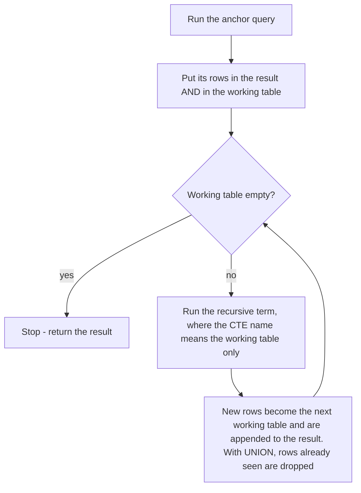
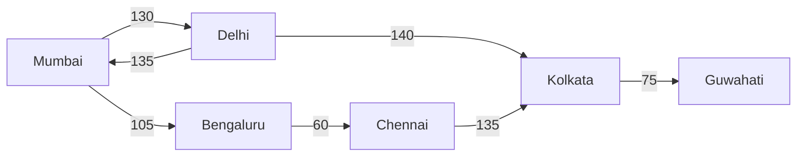
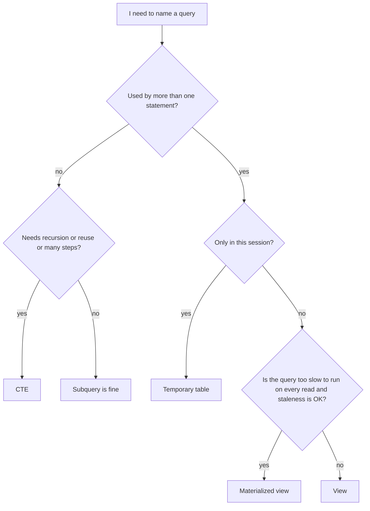

# Chapter 7 — CTEs, Views and Recursion: Naming Queries and Walking Trees

Real queries grow. A report that needs "order totals, then customer totals, then only the customers above average" quickly turns into three levels of nested subqueries that nobody can read. This chapter gives you the tools SQL has for **naming** a piece of a query so you can build big queries out of small, readable steps:

- a **common table expression (CTE)** names a query for the length of *one* statement;
- a **recursive CTE** calls itself, which lets plain SQL walk hierarchies (org charts, category trees, bills of materials) and graphs (flight routes, friend networks) and produce sequences;
- a **view** names a query *permanently* in the database, so everyone can reuse it like a table;
- a **materialized view** also stores the query's *result*, trading freshness for speed.

It also covers `generate_series`, PostgreSQL's quick way to produce rows of numbers or dates, which you need for "fill in the missing days" reports.

**What you'll learn**

| # | Topic | You will be able to… |
|---|---|---|
| 7.1 | CTE basics | write `WITH` queries, chain several CTEs, know when PostgreSQL inlines them |
| 7.2 | Data-modifying CTEs | archive/move rows in one atomic statement with `RETURNING` |
| 7.3 | Recursive CTE mechanics | explain anchor, recursive term, working table and termination |
| 7.4 | Hierarchies | list a tree top-down with depth and path, walk up to the root, total a subtree |
| 7.5 | Graphs and cycles | traverse a graph without looping forever; use `CYCLE` and `SEARCH` (PostgreSQL 14) |
| 7.6 | `generate_series` | make number/date rows, fill gaps in time series, create test data |
| 7.7 | Views | create, replace, update through, and protect views (`WITH CHECK OPTION`) |
| 7.8 | Materialized views | store results, refresh them (also `CONCURRENTLY`), index them |
| 7.9 | Choosing | pick between subquery, CTE, view, materialized view and temporary table |

**Setup.** Examples use the `company` sample database from [chapter 1, section 1.11](../01-databases-and-the-relational-model/README.md#111-the-sample-database) plus one extra table, `routes` (a small flight network, see 7.5). The files are in [`code/`](code/); `code/00_schema.sql` builds everything. Subqueries and derived tables, which CTEs replace, are explained in [chapter 6](../06-subqueries-and-set-operations/README.md).

---

## 7.1 Common table expressions (WITH)

### What it is
A **common table expression** is a named, temporary result set that you define at the start of a statement with `WITH name AS (query)` and then use in the rest of that statement as if it were a table. It disappears when the statement ends.

Analogy: when you solve a maths problem you write intermediate results on scrap paper ("let *x* = total per customer") and then use *x* in the final answer. A CTE is that scrap paper, with a name.

```sql
WITH cte_name [(col1, col2, ...)] AS (
    SELECT ...                 -- any query
)
[, another_cte AS (SELECT ... FROM cte_name ...)]   -- later CTEs may use earlier ones
SELECT ... FROM cte_name ...;  -- the main statement
```

### The problem it solves
Without CTEs you nest derived tables (subqueries in `FROM`). Nesting reads *inside-out*: the first thing that runs is buried deepest. CTEs let you write the same logic *top-down*, in the order you think about it, and give every step a meaningful name. They also let you use one intermediate result **several times** without copying it.

### How it works
1. Each `name AS (query)` defines one CTE. Separate several with commas; write `WITH` only once.
2. A CTE can reference any CTE defined **before** it (and, with `RECURSIVE`, itself — see 7.3).
3. The final statement (a `SELECT`, `INSERT`, `UPDATE` or `DELETE`) uses the CTEs by name.
4. The CTE exists only while this one statement runs. Nothing is stored in the catalog.

**One CTE — employees paid above their department average:**
```sql
-- code/01_cte_basics.sql
WITH dept_avg AS (
    SELECT dept_id, round(avg(salary), 0) AS avg_salary
    FROM employees
    WHERE dept_id IS NOT NULL
    GROUP BY dept_id
)
SELECT e.first_name, e.dept_id, e.salary, d.avg_salary
FROM employees e
JOIN dept_avg d ON d.dept_id = e.dept_id
WHERE e.salary > d.avg_salary
ORDER BY e.dept_id, e.salary DESC;
```
Output:
```
 first_name | dept_id |  salary   | avg_salary
------------+---------+-----------+------------
 Vikram     |       1 | 185000.00 |     130750
 Neha       |       1 | 142000.00 |     130750
 Daniel     |       2 | 150000.00 |      89500
 Lucas      |       3 | 120000.00 |      90500
 Kiran      |       4 | 135000.00 |     105500
(5 rows)
```
`dept_avg` behaves like a four-row table (one row per department that has staff). The main query joins to it like any other table.

**Several CTEs as a pipeline.** Each step builds on the previous one — order value → customer lifetime value → the overall average — and the final `SELECT` reads almost like English:
```sql
WITH order_totals AS (          -- step 1: value of each non-cancelled order
    SELECT o.order_id, o.customer_id,
           sum(oi.quantity * oi.unit_price * (1 - oi.discount)) AS order_value
    FROM orders o
    JOIN order_items oi USING (order_id)
    WHERE o.status <> 'cancelled'
    GROUP BY o.order_id, o.customer_id
),
customer_totals AS (            -- step 2: lifetime value per customer
    SELECT customer_id, count(*) AS orders, round(sum(order_value), 2) AS lifetime_value
    FROM order_totals
    GROUP BY customer_id
),
overall AS (                    -- step 3: one number to compare against
    SELECT round(avg(lifetime_value), 2) AS avg_ltv FROM customer_totals
)
SELECT c.first_name, c.last_name, ct.orders, ct.lifetime_value, o.avg_ltv
FROM customer_totals ct
JOIN customers c USING (customer_id)
CROSS JOIN overall o
WHERE ct.lifetime_value > o.avg_ltv
ORDER BY ct.lifetime_value DESC;
```
Output:
```
 first_name | last_name | orders | lifetime_value | avg_ltv
------------+-----------+--------+----------------+---------
 Anita      | Shah      |      3 |        3454.08 | 1057.66
 Ben        | Carter    |      2 |        1858.36 | 1057.66
(2 rows)
```
`overall` is a one-row CTE, so `CROSS JOIN` simply attaches the average to every row. Written with nested subqueries this would be three levels deep.

**Using a CTE twice.** Here `monthly` is read by the main query *and* by a scalar subquery:
```sql
WITH monthly AS (
    SELECT date_trunc('month', placed_at)::date AS month, count(*) AS orders
    FROM orders
    GROUP BY 1
)
SELECT month, orders,
       orders = (SELECT max(orders) FROM monthly) AS is_best_month
FROM monthly
ORDER BY month;
```
Output:
```
   month    | orders | is_best_month
------------+--------+---------------
 2025-01-01 |      3 | t
 2025-02-01 |      2 | f
 ...
 2025-04-01 |      3 | t
 ...
(6 rows)
```

**Naming the columns in the header.** `WITH dept_size(dept, headcount) AS (...)` renames the CTE's output columns, handy when the inner query has unnamed expressions such as `count(e.emp_id)`:
```sql
WITH dept_size(dept, headcount) AS (
    SELECT d.name, count(e.emp_id)
    FROM departments d LEFT JOIN employees e USING (dept_id)
    GROUP BY d.name
)
SELECT * FROM dept_size WHERE headcount >= 2 ORDER BY headcount DESC, dept;
```
Output:
```
    dept     | headcount
-------------+-----------
 Engineering |         4
 Sales       |         4
 Finance     |         2
 Marketing   |         2
(4 rows)
```

### How PostgreSQL executes a CTE: inlined or materialized
A CTE can be run in two ways:
- **Inlined** — the optimizer pastes the CTE's query into the main query, exactly like a subquery, and optimizes the whole thing together (for example pushing a `WHERE` filter down into it so an index can be used).
- **Materialized** — the CTE runs once, its rows are stored in a temporary work area, and the main query scans that stored copy. Filters from outside cannot reach inside.

Since **PostgreSQL 12**, a non-recursive, side-effect-free CTE that is referenced **once** is inlined automatically; one referenced two or more times is materialized. You can override the choice with `AS MATERIALIZED` or `AS NOT MATERIALIZED`. (Before version 12 every CTE was materialized — an "optimization fence" that old blog posts still warn about.)

```sql
EXPLAIN (COSTS OFF)
WITH big AS (SELECT * FROM employees)
SELECT first_name FROM big WHERE emp_id = 3;

EXPLAIN (COSTS OFF)
WITH big AS MATERIALIZED (SELECT * FROM employees)
SELECT first_name FROM big WHERE emp_id = 3;
```
Output:
```
                  QUERY PLAN
----------------------------------------------
 Index Scan using employees_pkey on employees
   Index Cond: (emp_id = 3)
(2 rows)

          QUERY PLAN
-------------------------------
 CTE Scan on big
   Filter: (emp_id = 3)
   CTE big
     ->  Seq Scan on employees
(4 rows)
```
The first plan never mentions the CTE: the filter reached the primary-key index. The second copies the whole table into the CTE, then filters. (`EXPLAIN` is covered properly in [chapter 12](../12-indexes-storage-and-query-performance/README.md#1210-reading-explain-the-four-ways-to-read-a-table).)

`MATERIALIZED` is useful when the CTE is expensive and referenced several times, or when you deliberately want to compute something once (for example a call to a slow function). `NOT MATERIALIZED` is useful when a multiply-referenced CTE is cheap and each use filters it differently.

### Dialect notes
| Feature | PostgreSQL | MySQL | SQLite | SQL Server |
|---|---|---|---|---|
| `WITH` (non-recursive) | yes | 8.0+ | 3.8.3+ | 2005+ |
| `WITH RECURSIVE` keyword | required for recursion | required | required | *not used* — plain `WITH` can recurse |
| `MATERIALIZED` hint | 12+ | no | 3.35+ | no |
| CTE with `INSERT/UPDATE/DELETE` inside | yes (7.2) | no | no | no (but a CTE can be the *target* of an `UPDATE`/`DELETE`) |

In SQL Server the statement *before* a `WITH` must end with a semicolon, which is why you often see `;WITH` in T-SQL code (SQL Server — not run).

### Trade-offs
| | Derived table (subquery in `FROM`) | CTE |
|---|---|---|
| Readability | inside-out | top-down, named steps |
| Reuse in the same statement | copy-paste | reference by name |
| Recursion | no | yes |
| Performance (PostgreSQL 12+) | same when inlined | same when inlined; can force materialization |
| Scope | the one place it's written | the whole statement |

### When not to use it
- When the query is simple enough to read without it — one level of subquery is fine.
- When many different statements need the same logic: that is a **view** (7.7).
- When you need the intermediate result across several statements (for example to index it or look at it twice in a session): use a **temporary table** (7.9).

### Common mistakes
- **Writing `WITH` twice** (`WITH a AS (...) WITH b AS (...)`). Use one `WITH` and commas.
- **Referencing a CTE defined later** in the list. Order matters: a CTE sees only those above it (unless it is recursive and refers to itself).
- **Assuming a CTE "caches" work.** In PostgreSQL 12+ a CTE used once is inlined, so it is re-optimized, not cached. Use `MATERIALIZED` if you truly want one evaluation.
- **A missing comma between CTEs**, or an extra one after the last CTE.

### Real-world examples
Analytics teams write reports as a chain of CTEs (`raw → cleaned → joined → aggregated → final`); dbt encourages exactly this style.

### In the interview
**30-second answer:** "A CTE is a named subquery declared with `WITH` that exists for one statement. It makes complex queries readable as a sequence of steps, lets you reference the same intermediate result several times, and — with `WITH RECURSIVE` — lets a query refer to itself to walk hierarchies. In PostgreSQL 12 and later a CTE referenced once is inlined, so it costs the same as a subquery; you can force materialization with `AS MATERIALIZED`."

- *Is a CTE faster than a subquery?* → Usually identical, because modern optimizers inline it. It can be slower if it is materialized and a selective outer filter can't be pushed into it; it can be faster if an expensive CTE is materialized once and reused.
- *CTE vs temporary table?* → A CTE lasts one statement and isn't indexed; a temp table lasts the session (or transaction), can be indexed and analyzed, and can be reused by many statements.
- *Can you update through a CTE?* → In PostgreSQL the CTE itself can contain `UPDATE/DELETE/INSERT ... RETURNING` (next section).

### Self-check
1. *How long does a CTE exist?* → Only for the single statement it belongs to.
2. *Can CTE `b` use CTE `a` if `a` is written after `b`?* → No; a CTE can only refer to CTEs defined before it (or itself when recursive).
3. *In PostgreSQL 14, is a CTE referenced once materialized?* → No, it is inlined unless you write `AS MATERIALIZED` (or it is recursive or has side effects).

### TL;DR
`WITH name AS (query)` names a step for one statement. Chain steps with commas, reference them as tables, reuse them freely. PostgreSQL 12+ inlines single-use CTEs; `MATERIALIZED` / `NOT MATERIALIZED` override.

---

## 7.2 Data-modifying CTEs (PostgreSQL)

### What it is
In PostgreSQL a CTE may contain an `INSERT`, `UPDATE` or `DELETE` with a `RETURNING` clause. The rows it returns can feed the rest of the statement. This lets you do several changes as **one statement** — for example "delete these rows and copy them into an archive" — which is automatically atomic: either all of it happens or none of it.

### How it works
1. `DELETE ... RETURNING *` (or `UPDATE`/`INSERT ... RETURNING`) inside a CTE produces the affected rows.
2. Later CTEs or the main statement read those rows by the CTE's name.
3. Every data-modifying CTE runs **to completion exactly once**, even if nothing reads its output.
4. All parts of the statement see the **same snapshot** — the data as it was *before* the statement started. They do not see each other's changes, except through `RETURNING`.

**Example — archive cancelled orders and their items:**
```sql
-- code/02_data_modifying_cte.sql
CREATE TABLE orders_archive (LIKE orders INCLUDING ALL);
CREATE TABLE order_items_archive (LIKE order_items INCLUDING ALL);

WITH gone_items AS (
    DELETE FROM order_items
    WHERE order_id IN (SELECT order_id FROM orders WHERE status = 'cancelled')
    RETURNING *
),
saved_items AS (
    INSERT INTO order_items_archive SELECT * FROM gone_items RETURNING order_id
),
gone_orders AS (
    DELETE FROM orders
    WHERE status = 'cancelled'
    RETURNING *
)
INSERT INTO orders_archive
SELECT * FROM gone_orders
RETURNING order_id, status;
```
Output:
```
 order_id |  status
----------+-----------
      105 | cancelled
      111 | cancelled
(2 rows)
```
```sql
SELECT (SELECT count(*) FROM orders)              AS live_orders,
       (SELECT count(*) FROM orders_archive)      AS archived_orders,
       (SELECT count(*) FROM order_items_archive) AS archived_items;
```
Output:
```
 live_orders | archived_orders | archived_items
-------------+-----------------+----------------
          12 |               2 |              2
(1 row)
```
`CREATE TABLE ... (LIKE t INCLUDING ALL)` copies the column definitions, defaults and constraints of `t` (see [chapter 9](../09-ddl-dml-and-constraints/README.md)).

**The snapshot rule, shown:**
```sql
WITH bump AS (
    UPDATE products SET unit_price = unit_price + 1 WHERE product_id = 2
    RETURNING unit_price
)
SELECT (SELECT unit_price FROM products WHERE product_id = 2) AS seen_by_select,
       (SELECT unit_price FROM bump)                          AS new_value;
```
Output:
```
 seen_by_select | new_value
----------------+-----------
          24.99 |     25.99
(1 row)
```
The outer `SELECT` still reads the old price; only `RETURNING` shows the new one. After the statement finishes, the table holds 25.99.

### Common mistakes
- **Modifying the same row twice in one statement** (two CTEs updating the same row). The result is unpredictable; don't do it.
- **Expecting a later CTE to "see" an earlier change by querying the table.** It won't — read from the earlier CTE's `RETURNING` instead.
- **Porting to MySQL/SQL Server.** They don't support this; there you use a transaction with separate statements ([chapter 13](../13-transactions-and-concurrency/README.md)).

### TL;DR
PostgreSQL CTEs can `INSERT/UPDATE/DELETE ... RETURNING`; the statement is atomic and every part sees the pre-statement snapshot. Great for "move rows" and "update and log" in one go.

---

## 7.3 Recursive CTEs: the mechanics

### What it is
A **recursive CTE** is a CTE that refers to itself. It is written `WITH RECURSIVE name AS (anchor UNION ALL recursive_term)`. It is how standard SQL expresses *repetition*: "start with these rows, then keep deriving new rows from the last batch until no new rows appear."

Analogy: finding everyone in a family tree descended from one grandparent. You start with the grandparent (the anchor), then find their children, then the children's children, and stop when a generation has no children.

### The problem it solves
Some questions have no fixed depth: "all reports under this manager, at every level", "every category inside Electronics", "every city reachable from Mumbai". A join handles exactly one level; you would need an unknown number of self-joins ([chapter 5](../05-joins/README.md) shows the one-level self-join). A recursive CTE handles any depth.

### How it works

1. **Anchor** (the non-recursive part, before `UNION [ALL]`): runs once and produces the starting rows.
2. **Recursive term** (after `UNION [ALL]`): references the CTE name. On each pass, that name means *only the rows produced by the previous pass* (the "working table"), not the whole result so far.
3. Rows produced by each pass are added to the result and become the input of the next pass.
4. **Termination:** the process stops when a pass produces no rows. Your `WHERE` or join condition must eventually make that happen.
5. `UNION ALL` keeps every row; `UNION` discards rows that are duplicates of rows already produced — which also stops loops whose state repeats.

Rules for the recursive term in PostgreSQL: it may reference the CTE only **once**, and not inside an aggregate function, a subquery, or on the nullable side of an outer join. The anchor and recursive term must produce the same number of columns with compatible types — cast in the anchor (`0::bigint`, `name::text`) if the recursive term would produce a wider type.

**Counting 1 to 5:**
```sql
-- code/03_recursive_series.sql
WITH RECURSIVE counter(n) AS (
    SELECT 1                 -- anchor: the starting row(s)
    UNION ALL
    SELECT n + 1             -- recursive term: runs on the rows produced last time
    FROM counter
    WHERE n < 5              -- stop condition
)
SELECT n FROM counter;
```
Output:
```
 n
---
 1
 2
 3
 4
 5
(5 rows)
```
Trace: anchor → {1}. Pass 1 reads {1} → {2}. Pass 2 reads {2} → {3} … pass 4 reads {4} → {5}. Pass 5 reads {5}; `5 < 5` is false → no rows → stop.

**Carrying state in several columns.** Each row can hold more than a counter. Here each pass computes the next Fibonacci pair and a running factorial:
```sql
WITH RECURSIVE fib(i, a, b, fact) AS (
    SELECT 1, 0::bigint, 1::bigint, 1::numeric
    UNION ALL
    SELECT i + 1, b, a + b, fact * (i + 1)
    FROM fib
    WHERE i < 10
)
SELECT i, a AS fibonacci, fact AS factorial FROM fib;
```
Output:
```
 i  | fibonacci | factorial
----+-----------+-----------
  1 |         0 |         1
  2 |         1 |         2
  3 |         1 |         6
  4 |         2 |        24
 ...
 10 |        34 |   3628800
(10 rows)
```

**Walking dates.** The same pattern steps through time (here one week at a time):
```sql
WITH RECURSIVE weeks(week_start) AS (
    SELECT DATE '2025-01-06'
    UNION ALL
    SELECT (week_start + 7)::date FROM weeks WHERE week_start < DATE '2025-02-03'
)
SELECT week_start, to_char(week_start, 'Dy') AS weekday FROM weeks;
```
Output:
```
 week_start | weekday
------------+---------
 2025-01-06 | Mon
 2025-01-13 | Mon
 2025-01-20 | Mon
 2025-01-27 | Mon
 2025-02-03 | Mon
(5 rows)
```
In PostgreSQL `generate_series` (7.6) is simpler for this; the recursive form is what you use in MySQL, which has no `generate_series`.

**A runaway query and two safety nets.** A recursive CTE without a stop condition never ends. While experimenting, a `LIMIT` on the outer query stops it (PostgreSQL evaluates the recursion lazily, only as far as the outer query asks):
```sql
WITH RECURSIVE forever(n) AS (
    SELECT 1 UNION ALL SELECT n + 1 FROM forever      -- no stop condition!
)
SELECT n FROM forever LIMIT 3;
```
Output:
```
 n
---
 1
 2
 3
(3 rows)
```
And `UNION` instead of `UNION ALL` stops a computation whose state starts repeating. Doubling modulo 7 goes 1 → 2 → 4 → 1 …; the second 1 is a duplicate, so it is discarded and the working table becomes empty:
```sql
WITH RECURSIVE mod_cycle(n) AS (
    SELECT 1
    UNION
    SELECT (n * 2) % 7 FROM mod_cycle
)
SELECT n FROM mod_cycle;
```
Output:
```
 n
---
 1
 2
 4
(3 rows)
```
`UNION` only helps when the *whole row* repeats. If a row carries a growing column (a depth, a path, a running total) it never repeats exactly — you need explicit cycle detection (7.5).

### Dialect notes
| | PostgreSQL | MySQL 8 | SQLite | SQL Server |
|---|---|---|---|---|
| Syntax | `WITH RECURSIVE` | `WITH RECURSIVE` | `WITH RECURSIVE` | `WITH` (no keyword) |
| Built-in depth limit | none | `cte_max_recursion_depth` = 1000 by default | none | 100 by default; `OPTION (MAXRECURSION n)`, 0 = unlimited |
| `UNION` (distinct) in recursion | yes | yes | yes | no, `UNION ALL` only |
| `SEARCH` / `CYCLE` clauses | 14+ | no | no | no |

Oracle also supports recursive `WITH` (since 11g R2) and its older proprietary `CONNECT BY` syntax.

### Common mistakes
- **No stop condition** → the query runs until it runs out of memory or disk (or, in MySQL/SQL Server, hits the depth limit with an error).
- **Type mismatch between anchor and recursive term.** The anchor fixes each column's type. A `varchar(40)` column in the anchor followed by `path || ' > ' || name` (which yields `text`) is rejected with *"column has type character varying(40) in non-recursive term but type text overall"*; and `SELECT 1` makes a column `integer`, which a growing factorial soon overflows. Cast in the anchor (`first_name::text`, `1::numeric`).
- **Thinking the recursive term sees the whole result**: it sees only the previous pass's rows.
- **Relying on output order.** Without `ORDER BY` the order of a recursive result is not guaranteed. Build a sort key (depth, path, or `SEARCH`, 7.5) and order by it.

### Self-check
1. *What are the two parts of a recursive CTE?* → The anchor (runs once) and the recursive term (runs repeatedly on the previous pass's rows), joined by `UNION ALL` or `UNION`.
2. *When does recursion stop?* → When a pass produces no new rows.
3. *Why cast `0::bigint` in the anchor?* → The anchor fixes the column types; without the cast the column is `integer` and larger values in later passes would overflow.
4. *What does SQL Server need instead of `WITH RECURSIVE`?* → Just `WITH`; and it limits recursion to 100 levels unless `OPTION (MAXRECURSION n)`.

### TL;DR
Anchor rows → repeatedly apply the recursive term to the last batch → stop when a batch is empty. Always have a stop condition, cast types in the anchor, and `ORDER BY` explicitly.

---

## 7.4 Hierarchies: trees stored as parent pointers

### What it is
The most common way to store a tree in a relational table is the **adjacency list**: each row stores the key of its parent (`employees.manager_id` points to another `employees.emp_id`; `NULL` marks the root). Recursive CTEs are the standard way to query such trees.

### How it works — three classic queries
| Question | Anchor | Recursive step |
|---|---|---|
| Top-down: the whole tree (or a subtree) | the root(s): `manager_id IS NULL` (or `emp_id = X`) | children: `e.manager_id = parent.emp_id` |
| Bottom-up: the chain of ancestors | the starting node | parent: `m.emp_id = child.manager_id` |
| Subtree aggregates | every (boss, direct report) pair | extend each pair one level down, keeping the boss |

**Top-down with depth and path.** The path column doubles as a sort key that keeps each manager's team directly under them:
```sql
-- code/04_hierarchy.sql
WITH RECURSIVE org AS (
    SELECT emp_id, first_name, manager_id, 1 AS depth,
           first_name::text AS path
    FROM employees
    WHERE manager_id IS NULL                       -- anchor: the root
    UNION ALL
    SELECT e.emp_id, e.first_name, e.manager_id, o.depth + 1,
           o.path || ' > ' || e.first_name
    FROM employees e
    JOIN org o ON e.manager_id = o.emp_id          -- children of rows found so far
)
SELECT repeat('    ', depth - 1) || first_name AS org_chart, depth, path
FROM org
ORDER BY path;
```
Output:
```
   org_chart    | depth |         path
----------------+-------+-----------------------
 Asha           |     1 | Asha
     Daniel     |     2 | Asha > Daniel
         Arjun  |     3 | Asha > Daniel > Arjun
         Priya  |     3 | Asha > Daniel > Priya
         Sara   |     3 | Asha > Daniel > Sara
     Kiran      |     2 | Asha > Kiran
         Omar   |     3 | Asha > Kiran > Omar
 ...
     Vikram     |     2 | Asha > Vikram
         Li     |     3 | Asha > Vikram > Li
 ...
         Rohan  |     3 | Asha > Vikram > Rohan
(15 rows)
```
Pass 1 found Asha's four direct reports (depth 2), pass 2 found their reports (depth 3), pass 3 found nobody, so it stopped. Sorting by a text path works here because names don't contain `>`; for a robust sort key use an array of ids (`ARRAY[emp_id]`, then `path || e.emp_id`) — arrays compare element by element. To list only one subtree, change the anchor to `WHERE emp_id = 2`.

**Bottom-up: who is above the intern?**
```sql
WITH RECURSIVE chain AS (
    SELECT emp_id, first_name, job_title, manager_id, 0 AS steps_up
    FROM employees WHERE emp_id = 15
    UNION ALL
    SELECT m.emp_id, m.first_name, m.job_title, m.manager_id, c.steps_up + 1
    FROM employees m
    JOIN chain c ON m.emp_id = c.manager_id
)
SELECT steps_up, first_name, job_title FROM chain ORDER BY steps_up;
```
Output:
```
 steps_up | first_name |      job_title
----------+------------+---------------------
        0 | Rohan      | Intern
        1 | Vikram     | Engineering Manager
        2 | Asha       | CEO
(3 rows)
```
The only difference from top-down is the direction of the join: `m.emp_id = c.manager_id` ("find my parent") instead of `e.manager_id = o.emp_id` ("find my children"). Real uses: breadcrumbs (`Home > Electronics > Laptops`), approval chains, permission inheritance.

**Subtree totals: team size and payroll under each manager.** The trick is to carry the *boss* unchanged while walking down, producing one row per (boss, anyone below them):
```sql
WITH RECURSIVE reports AS (
    SELECT manager_id AS boss, emp_id, salary        -- direct reports
    FROM employees WHERE manager_id IS NOT NULL
    UNION ALL
    SELECT r.boss, e.emp_id, e.salary                -- their reports, and so on
    FROM reports r
    JOIN employees e ON e.manager_id = r.emp_id
)
SELECT b.first_name AS manager, count(*) AS team_size, sum(r.salary) AS team_salary
FROM reports r JOIN employees b ON b.emp_id = r.boss
GROUP BY b.first_name
ORDER BY team_size DESC, manager;
```
Output:
```
 manager | team_size | team_salary
---------+-----------+-------------
 Asha    |        14 |  1367000.00
 Vikram  |         5 |   432000.00
 Daniel  |         3 |   208000.00
 Kiran   |         1 |    76000.00
 Lucas   |         1 |    61000.00
(5 rows)
```
Asha has all 14 other employees below her; Vikram has Neha, Rahul, Meera, Li and Rohan. The aggregate runs in the *outer* query — aggregates aren't allowed inside the recursive term.

### Other ways to store trees (for comparison)
| Model | How | Reads | Writes | Notes |
|---|---|---|---|---|
| Adjacency list (this chapter) | `parent_id` column | recursive CTE | trivial (change one pointer) | the default choice |
| Materialized path | store `'1/2/15'` (or PostgreSQL `ltree`) | `LIKE '1/2/%'`, indexable | moving a subtree rewrites all descendants' paths | great for breadcrumbs |
| Nested sets | store `lft`/`rgt` numbers | subtree = range query | inserts renumber many rows | read-heavy, rarely-changing trees |
| Closure table | separate table of every (ancestor, descendant, depth) pair | simple joins | many rows per insert | *SQL Antipatterns* recommends it for heavy tree querying |

### Common mistakes
- **Anchoring on the wrong side**: using `manager_id = X` in the anchor lists X's reports but *not X*; use `emp_id = X` if X should be included.
- **Bad data creating cycles** (A manages B, B manages A). A top-down walk from a real root never reaches such a loop, but a walk that starts inside it runs forever. Protect with a path check (7.5) or a `CHECK`/trigger that prevents cycles.
- **Sorting by depth only**, which lists all level-2 rows, then all level-3 rows, losing the "team under manager" layout. Sort by the path.

### In the interview
**30-second answer:** "Store the tree as an adjacency list — each row points to its parent. To read a subtree, anchor on the root and recursively join children whose parent is in the previous level, carrying depth and a path for ordering. For ancestors, reverse the join. For totals per node, carry the top node through the recursion and aggregate outside."

- *How would you stop infinite loops if the data could contain a cycle?* → Carry an array of visited ids and add `WHERE NOT e.emp_id = ANY(path)`, or use PostgreSQL 14's `CYCLE` clause.
- *What if the tree is huge and queried constantly?* → Index `manager_id`; consider a closure table or materialized path (`ltree` with a GiST index) for fast subtree reads.

### Self-check
1. *Which join condition walks down, which walks up?* → Down: `child.manager_id = found.emp_id`; up: `parent.emp_id = found.manager_id`.
2. *Why carry `path`?* → To show the route from the root and to sort each subtree under its parent.
3. *Why is the `count(*)` outside the recursive CTE in the team-size query?* → Aggregates are not allowed in the recursive term; you generate all (boss, report) pairs first, then group.

### TL;DR
Adjacency list + recursive CTE = any-depth tree queries. Down: join children; up: join parent; totals: carry the ancestor, aggregate outside. Carry depth/path for display and ordering.

---

## 7.5 Graphs and cycles

### What it is
A **graph** is like a tree but nodes can have several parents and paths can loop back (a **cycle**). Flight routes, road networks, "follows" relationships and package dependencies are graphs. Our sample `routes` table stores one-way flights; Mumbai → Delhi → Mumbai is a cycle.



### The problem it solves
A naive recursive walk over a graph with a cycle never ends: Mumbai → Delhi → Mumbai → Delhi … and each row differs (the total time grows), so `UNION` does not stop it. You must remember where you have been.

### How it works (manual cycle detection)
1. Carry an **array of visited nodes** (`path`) in every row.
2. In the recursive term, only follow an edge if its destination is not already in the path: `WHERE r.to_city <> ALL (t.path)`.
3. Every row therefore represents a *simple path* (no repeated city); the number of simple paths is finite, so recursion ends.

```sql
-- code/05_graph_cycles.sql
WITH RECURSIVE trips AS (
    SELECT to_city AS city, ARRAY['Mumbai', to_city] AS path, minutes AS total_min
    FROM routes WHERE from_city = 'Mumbai'
    UNION ALL
    SELECT r.to_city, t.path || r.to_city, t.total_min + r.minutes
    FROM trips t
    JOIN routes r ON r.from_city = t.city
    WHERE r.to_city <> ALL (t.path)              -- never revisit a city
)
SELECT city, array_to_string(path, ' -> ') AS route, total_min
FROM trips
ORDER BY city, total_min;
```
Output:
```
   city    |                         route                         | total_min
-----------+-------------------------------------------------------+-----------
 Bengaluru | Mumbai -> Bengaluru                                   |       105
 Chennai   | Mumbai -> Bengaluru -> Chennai                        |       165
 Delhi     | Mumbai -> Delhi                                       |       130
 Guwahati  | Mumbai -> Delhi -> Kolkata -> Guwahati                |       345
 Guwahati  | Mumbai -> Bengaluru -> Chennai -> Kolkata -> Guwahati |       375
 Kolkata   | Mumbai -> Delhi -> Kolkata                            |       270
 Kolkata   | Mumbai -> Bengaluru -> Chennai -> Kolkata             |       300
(7 rows)
```
`ARRAY[...]` builds a PostgreSQL array ([chapter 14](../14-advanced-sql-and-using-sql-from-code/README.md#145-arrays)), `||` appends to it, and `x <> ALL (array)` is true when `x` differs from every element ([chapter 6](../06-subqueries-and-set-operations/README.md#65-any-some-and-all) covers `ALL`). Delhi → Mumbai was never followed because Mumbai is already in every path.

**Shortest (fastest) route to each city** — keep the best row per city with `DISTINCT ON` ([chapter 2](../02-select-basics/README.md#26-distinct-removing-duplicate-rows)):
```sql
-- same trips CTE as above, then:
SELECT DISTINCT ON (city) city, total_min, array_to_string(path, ' -> ') AS route
FROM trips
WHERE city <> 'Mumbai'
ORDER BY city, total_min;
```
Output:
```
   city    | total_min |                 route
-----------+-----------+----------------------------------------
 Bengaluru |       105 | Mumbai -> Bengaluru
 Chennai   |       165 | Mumbai -> Bengaluru -> Chennai
 Delhi     |       130 | Mumbai -> Delhi
 Guwahati  |       345 | Mumbai -> Delhi -> Kolkata -> Guwahati
 Kolkata   |       270 | Mumbai -> Delhi -> Kolkata
(5 rows)
```
This enumerates *every* simple path, which explodes on big, dense graphs. It is fine for small graphs and interview questions; real route planners use graph algorithms (Dijkstra, A*) in application code or extensions such as pgRouting, or graph databases ([chapter 16](../16-beyond-relational/README.md)).

### The CYCLE and SEARCH clauses (PostgreSQL 14+)
SQL:1999 defines two helper clauses that PostgreSQL implemented in version 14 (the version this book runs):

- `CYCLE col SET is_cycle USING path_col` — PostgreSQL tracks the visited values of `col` for you, marks a row whose `col` value was already seen on its path with `is_cycle = true`, and does not recurse further from it.
- `SEARCH DEPTH FIRST BY col SET ord` or `SEARCH BREADTH FIRST BY col SET ord` — adds a column `ord` that you `ORDER BY` to get depth-first or breadth-first order.

```sql
WITH RECURSIVE trips(city, total_min) AS (
    SELECT to_city, minutes FROM routes WHERE from_city = 'Mumbai'
    UNION ALL
    SELECT r.to_city, t.total_min + r.minutes
    FROM trips t JOIN routes r ON r.from_city = t.city
) CYCLE city SET is_cycle USING visited
SELECT city, total_min, is_cycle FROM trips
WHERE city IN ('Mumbai', 'Delhi')
ORDER BY total_min;
```
Output:
```
  city  | total_min | is_cycle
--------+-----------+----------
 Delhi  |       130 | f
 Mumbai |       265 | f
 Delhi  |       395 | t
(3 rows)
```
Why is Mumbai (265) *not* a cycle? The anchor starts from the routes' *destinations*, so "Mumbai" was not yet in the tracked path (Delhi → Mumbai). The next hop back to Delhi repeats Delhi, so that row is flagged and recursion stops there. To treat the start city as visited, begin the anchor with the start city itself (as the manual version did with `ARRAY['Mumbai', to_city]`).

```sql
WITH RECURSIVE org(emp_id, first_name, manager_id) AS (
    SELECT emp_id, first_name, manager_id FROM employees WHERE manager_id IS NULL
    UNION ALL
    SELECT e.emp_id, e.first_name, e.manager_id
    FROM employees e JOIN org o ON e.manager_id = o.emp_id
) SEARCH BREADTH FIRST BY emp_id SET ord
SELECT first_name, ord FROM org ORDER BY ord LIMIT 6;
```
Output:
```
 first_name |  ord
------------+--------
 Asha       | (0,1)
 Vikram     | (1,2)
 Daniel     | (1,6)
 Lucas      | (1,10)
 Kiran      | (1,12)
 Neha       | (2,3)
(6 rows)
```
For breadth-first, `ord` is (level, id): all of level 1 comes before level 2. `DEPTH FIRST` would instead produce an array path, like our manual `path` column.

### Self-check
1. *Why doesn't `UNION` stop the Mumbai–Delhi loop?* → Each lap has a different `total_min`/path, so rows never repeat exactly.
2. *What does `r.to_city <> ALL (t.path)` do?* → Follows an edge only if its destination hasn't been visited on this path.
3. *Which PostgreSQL version added `CYCLE` and `SEARCH`?* → 14.

### TL;DR
Graphs can loop, so carry a visited-path array and refuse to revisit, or use PostgreSQL 14's `CYCLE` clause. Path enumeration is exponential — fine for small graphs, not a route planner.

---

## 7.6 generate_series: making rows (PostgreSQL)

### What it is
`generate_series(start, stop [, step])` is a PostgreSQL **set-returning function**: used in `FROM`, it returns one row per value from `start` to `stop`. It works for integers, numerics, and timestamps/dates (step given as an `interval`).

```sql
-- code/06_generate_series.sql
SELECT * FROM generate_series(1, 5) AS n;
SELECT * FROM generate_series(10, 0, -5) AS n;
SELECT d::date AS day FROM generate_series(DATE '2025-03-01', DATE '2025-03-04', INTERVAL '1 day') AS d;
```
Output (the three results, one after another):
```
 n
---
 1
 2
 ...
 5
(5 rows)

 n
----
 10
  5
  0
(3 rows)

    day
------------
 2025-03-01
 2025-03-02
 2025-03-03
 2025-03-04
(4 rows)
```
With `date` arguments PostgreSQL picks the `timestamp with time zone` version of the function, so cast the result back to `date` for display.

### The problem it solves: missing rows in reports
`GROUP BY` can only produce groups for values that **exist** in the data. A month with no orders simply doesn't appear, and a chart drawn from the result silently skips it. The fix: generate the full calendar, then `LEFT JOIN` the data to it and count.
```sql
WITH months AS (
    SELECT m::date AS month
    FROM generate_series(DATE '2025-01-01', DATE '2025-07-01', INTERVAL '1 month') AS m
)
SELECT m.month, count(o.order_id) AS orders
FROM months m
LEFT JOIN orders o ON date_trunc('month', o.placed_at) = m.month
GROUP BY m.month
ORDER BY m.month;
```
Output:
```
   month    | orders
------------+--------
 2025-01-01 |      3
 2025-02-01 |      2
 ...
 2025-06-01 |      2
 2025-07-01 |      0
(7 rows)
```
July shows `0`. Note `count(o.order_id)`, not `count(*)`: for July the `LEFT JOIN` produces one row with `NULL` order columns, and `count(*)` would count it as 1 ([chapter 4](../04-aggregation/README.md)).

**Test data in one statement:**
```sql
CREATE TABLE fake_events AS
SELECT g AS id, DATE '2025-01-01' + (g % 90) AS day, (g * 37) % 100 AS score
FROM generate_series(1, 1000) AS g;
SELECT count(*), min(day), max(day), round(avg(score), 1) AS avg_score FROM fake_events;
```
Output:
```
 count |    min     |    max     | avg_score
-------+------------+------------+-----------
  1000 | 2025-01-01 | 2025-03-31 |      49.5
(1 row)
```
The arithmetic keeps the data deterministic (no `random()`), which is handy for reproducible performance tests ([chapter 12](../12-indexes-storage-and-query-performance/README.md) uses this idea with millions of rows).

### Dialect notes
| | Numbers / dates series |
|---|---|
| PostgreSQL | `generate_series(...)` |
| SQL Server 2022+ | `GENERATE_SERIES(start, stop [, step])` — numbers only (SQL Server — not run) |
| SQLite | `generate_series` table-valued function from the `series` extension (built into the `sqlite3` shell) |
| MySQL 8 | none — use a recursive CTE (7.3) or a permanent "numbers"/"calendar" table |

Many data warehouses keep a permanent **calendar table** (one row per date with flags like `is_weekend`, `fiscal_quarter`) for the same purpose.

### TL;DR
`generate_series` produces rows of numbers or timestamps. Generate the full range, `LEFT JOIN` the facts, `count(col)` — and empty days/months appear as 0.

---

## 7.7 Views

### What it is
A **view** is a named query stored in the database. You query it like a table (`SELECT * FROM staff_directory`), but it stores **no data**: every time you use it, the database substitutes the view's query into yours and runs it against the current contents of the underlying (**base**) tables.

Analogy: a view is a saved search in your email client. It doesn't copy emails into a new folder; it re-runs the search each time you open it, so it's always up to date.

### Why it matters
| Benefit | Example |
|---|---|
| **Simplicity** — hide a complex join once | analysts query `staff_directory` instead of re-writing the join |
| **Security** — expose only some columns/rows | grant access to a view without `salary`, not to `employees` |
| **Stable interface** — change tables, keep the view | rename/split a table and redefine the view so old queries still work |
| **Consistency** — one definition of a metric | "active customer" is defined once, not in 20 reports |

### How it works
1. `CREATE VIEW name AS query;` stores the query text (parsed) in the catalog.
2. When a query mentions the view, PostgreSQL's rewriter replaces the name with the stored query — just like an inlined CTE — and the optimizer plans the combined query.
3. Because nothing is stored, a view is always current and costs exactly as much as its query.

```sql
-- code/07_views.sql
CREATE VIEW staff_directory AS
SELECT e.emp_id, e.first_name || ' ' || e.last_name AS full_name,
       e.job_title, d.name AS department, e.email
FROM employees e
LEFT JOIN departments d USING (dept_id);

SELECT full_name, job_title, department FROM staff_directory
WHERE department = 'Sales' ORDER BY full_name;
```
Output:
```
   full_name   |   job_title   | department
---------------+---------------+------------
 Arjun Singh   | Sales Rep     | Sales
 Daniel Brooks | Sales Manager | Sales
 Priya Nair    | Sales Rep     | Sales
 Sara Khan     | Sales Rep     | Sales
(4 rows)
```
**Always current** — change a base table and the view reflects it immediately:
```sql
UPDATE employees SET job_title = 'Senior Sales Rep' WHERE emp_id = 7;
SELECT full_name, job_title FROM staff_directory WHERE emp_id = 7;
```
Output:
```
 full_name  |    job_title
------------+------------------
 Priya Nair | Senior Sales Rep
(1 row)
```

### Changing and dropping views
- `CREATE OR REPLACE VIEW` swaps the definition in place (keeping permissions), but in PostgreSQL the new query must return the **same columns, same names, same types, in the same order**; you may only **add** columns at the end.
- To remove or reorder columns: `DROP VIEW` and `CREATE VIEW` again (re-granting privileges).
- Objects that depend on each other are tracked: you can't drop a table (or a view) that a view uses unless you add `CASCADE`, which drops the dependent views too.

```sql
-- adding hire_date at the end: allowed
CREATE OR REPLACE VIEW staff_directory AS
SELECT e.emp_id, e.first_name || ' ' || e.last_name AS full_name,
       e.job_title, d.name AS department, e.email, e.hire_date
FROM employees e
LEFT JOIN departments d USING (dept_id);

-- removing columns: refused
CREATE OR REPLACE VIEW staff_directory AS
SELECT e.emp_id, e.job_title FROM employees e;

-- dropping a table the view depends on: refused
DROP TABLE departments;
```
Output:
```
ERROR:  cannot drop columns from view
ERROR:  cannot drop table departments because other objects depend on it
DETAIL:  constraint employees_dept_id_fkey on table employees depends on table departments
constraint projects_dept_id_fkey on table projects depends on table departments
view staff_directory depends on table departments
HINT:  Use DROP ... CASCADE to drop the dependent objects too.
```
(Two foreign keys also depend on `departments`; `CASCADE` would drop those constraints and the view — rarely what you want.)

### Updatable views
You can `INSERT`, `UPDATE` and `DELETE` through a view if PostgreSQL can map each view row to exactly one base-table row. Since PostgreSQL 9.3 a view is **automatically updatable** when its query:
- reads from exactly **one** table or updatable view in `FROM`;
- has no `GROUP BY`, `HAVING`, `DISTINCT`, `LIMIT`/`OFFSET`, window functions, aggregates, `UNION`/`INTERSECT`/`EXCEPT`, or `WITH` at top level.

Computed columns in such a view are simply read-only; plain columns can be written. For anything more complex you write an `INSTEAD OF` trigger ([chapter 14](../14-advanced-sql-and-using-sql-from-code/README.md)).

```sql
CREATE VIEW furniture AS
SELECT product_id, name, unit_price, category
FROM products
WHERE category = 'Furniture';

UPDATE furniture SET unit_price = 329.99 WHERE name = 'Ergonomic Chair';
INSERT INTO furniture VALUES (10, 'Bookshelf', 120.00, 'Furniture');
-- Nothing stops a row that falls OUTSIDE the view's WHERE...
INSERT INTO furniture VALUES (11, 'Webcam', 59.00, 'Electronics');
SELECT product_id, name, category FROM products WHERE product_id >= 10;
SELECT count(*) AS visible_in_view FROM furniture WHERE product_id >= 10;
```
Output:
```
 product_id |   name    |  category
------------+-----------+-------------
         10 | Bookshelf | Furniture
         11 | Webcam    | Electronics
(2 rows)

 visible_in_view
-----------------
               1
(1 row)
```
The Webcam went into `products` through the `furniture` view but is invisible in that view — a confusing "disappearing row". The `discontinued` column, not in the view, got its default (`false`).

**`WITH CHECK OPTION`** makes the view reject inserts and updates whose resulting row would not satisfy the view's `WHERE`:
```sql
CREATE OR REPLACE VIEW furniture AS
SELECT product_id, name, unit_price, category
FROM products
WHERE category = 'Furniture'
WITH CHECK OPTION;

INSERT INTO furniture VALUES (12, 'Monitor Arm', 79.00, 'Accessories');
```
Output:
```
ERROR:  new row violates check option for view "furniture"
DETAIL:  Failing row contains (12, Monitor Arm, Accessories, 79.00, f).
```
(`LOCAL` checks only this view's condition; `CASCADED`, the default, also checks the conditions of views it is built on.)

A view with a join or `GROUP BY` is read-only:
```sql
CREATE VIEW dept_payroll AS
SELECT d.name AS department, count(e.emp_id) AS headcount, sum(e.salary) AS payroll
FROM departments d LEFT JOIN employees e USING (dept_id)
GROUP BY d.name;
SELECT * FROM dept_payroll ORDER BY payroll DESC NULLS LAST;
UPDATE dept_payroll SET headcount = 0 WHERE department = 'Sales';
```
Output:
```
 department  | headcount |  payroll
-------------+-----------+-----------
 Engineering |         4 | 523000.00
 Sales       |         4 | 358000.00
 ...
 Research    |         0 |    (null)
(6 rows)

ERROR:  cannot update view "dept_payroll"
DETAIL:  Views containing GROUP BY are not automatically updatable.
HINT:  To enable updating the view, provide an INSTEAD OF UPDATE trigger or an unconditional ON UPDATE DO INSTEAD rule.
```
The catalog knows which views are updatable:
```sql
SELECT table_name, is_updatable
FROM information_schema.views
WHERE table_schema = 'public'
ORDER BY table_name;
```
Output:
```
   table_name    | is_updatable
-----------------+--------------
 dept_payroll    | NO
 furniture       | YES
 staff_directory | NO
(3 rows)
```

### Views and security
In PostgreSQL a view accesses its base tables with the privileges of the **view's owner**, so you can `GRANT SELECT ON staff_directory TO analyst` without granting anything on `employees`; the analyst sees names and titles but never salaries. Two refinements:
- `WITH (security_barrier)` stops a cleverly written user function in the caller's `WHERE` from peeking at rows the view's own `WHERE` is meant to hide (the optimizer otherwise may evaluate the cheap user function first).
- PostgreSQL 15 added `WITH (security_invoker = true)` to make a view use the *caller's* privileges instead (PostgreSQL 15 — not run here on 14).

Roles, `GRANT` and row-level security are in [chapter 14](../14-advanced-sql-and-using-sql-from-code/README.md).

### Dialect notes
| | PostgreSQL | MySQL | SQLite | SQL Server |
|---|---|---|---|---|
| `CREATE OR REPLACE VIEW` | yes (add columns only) | yes (any change) | no — drop & create | `CREATE OR ALTER VIEW` (2016 SP1+) |
| Auto-updatable simple views | yes | yes | no — read-only, use `INSTEAD OF` triggers | yes |
| `WITH CHECK OPTION` | yes | yes | no | yes |
| Materialized views | yes (7.8) | no | no | "indexed views" (kept up to date automatically) |

### When not to use it
- **Stacking views on views** many levels deep: each looks simple, the combined query is huge and hard to tune. Keep layers shallow.
- **As a performance tool**: a plain view is exactly as fast as its query. If the query is slow, the view is slow — consider a materialized view or better indexes.
- **`SELECT *` in a view definition**: PostgreSQL expands `*` when the view is *created*, so columns added to the table later do **not** appear in the view. List columns explicitly.

### Common mistakes
- Expecting a view to store data (that's a materialized view).
- Being surprised by "disappearing rows" when inserting through a filtered view — add `WITH CHECK OPTION`.
- Trying to reorder or drop columns with `CREATE OR REPLACE` in PostgreSQL.
- Adding `ORDER BY` inside a view and relying on it: order is only guaranteed by the **outer** query's `ORDER BY`.

### Real-world examples
- Reporting layers: BI tools (Metabase, Tableau, Power BI) are pointed at views rather than raw tables.
- Backward compatibility: after splitting `users` into `accounts` and `profiles`, a `users` view joins them so old code keeps working.
- PostgreSQL's own `information_schema` is a set of views over the system catalogs.

### In the interview
**30-second answer:** "A view is a stored query that acts like a virtual table. It stores no data, so it's always current and costs the same as running its query. Views simplify complex joins, provide a stable interface when tables change, and enforce security by exposing only certain columns or rows. Simple single-table views are updatable; `WITH CHECK OPTION` stops writes that would fall outside the view."

- *Does a view improve performance?* → Not by itself; it is expanded into the query. A materialized view (or indexed view in SQL Server) can.
- *Can you insert into a view?* → Yes if it's a simple single-table view (auto-updatable) or has `INSTEAD OF` triggers.
- *What happens to a view if you add a column to its table?* → Nothing; the view keeps the column list captured when it was created.

### Self-check
1. *Where is a view's data stored?* → Nowhere; only its query is stored.
2. *Why did the Webcam row vanish from the `furniture` view?* → It was inserted through the view but doesn't satisfy `category = 'Furniture'`.
3. *What prevents that?* → `WITH CHECK OPTION`.
4. *Can `CREATE OR REPLACE VIEW` remove a column in PostgreSQL?* → No; drop and recreate.
5. *Why is `staff_directory` not updatable?* → It joins two tables.

### TL;DR
A view is a named, stored query — virtual table, no data, always current. Use for simplicity, security and stable interfaces. Simple single-table views are writable; add `WITH CHECK OPTION`. Avoid deep view stacks and `SELECT *` definitions.

---

## 7.8 Materialized views

### What it is
A **materialized view** stores the *result* of its query on disk, like a table, and only recomputes it when you run `REFRESH MATERIALIZED VIEW`. It trades **freshness** for **speed**: reads are as fast as reading a small table, but the data is only as recent as the last refresh.

Analogy: a printed report on your desk. Reading it is instant, but it doesn't change when the numbers in the system change — you have to print a new one.

### How it works
1. `CREATE MATERIALIZED VIEW name AS query;` runs the query once and stores the rows (add `WITH NO DATA` to create it empty; it can't be queried until refreshed).
2. Queries read the stored rows. They can use indexes you create on the materialized view.
3. `REFRESH MATERIALIZED VIEW name;` re-runs the query and replaces the contents. This takes a strong lock: **reads are blocked** during the refresh.
4. `REFRESH MATERIALIZED VIEW CONCURRENTLY name;` builds the new result separately and applies only the differences, so readers are not blocked. It requires a **unique index** on the materialized view (plain columns, no `WHERE`) and is slower overall.

```sql
-- code/08_materialized_views.sql
CREATE MATERIALIZED VIEW product_sales AS
SELECT p.product_id, p.name,
       coalesce(sum(oi.quantity), 0) AS units_sold,
       coalesce(round(sum(oi.quantity * oi.unit_price * (1 - oi.discount)), 2), 0) AS revenue
FROM products p
LEFT JOIN order_items oi USING (product_id)          -- every order line
GROUP BY p.product_id, p.name;

SELECT name, units_sold, revenue FROM product_sales ORDER BY revenue DESC LIMIT 3;
```
Output:
```
      name       | units_sold | revenue
-----------------+------------+---------
 Laptop Pro 14   |          5 | 6380.05
 Standing Desk   |          2 |  978.00
 Ergonomic Chair |          3 |  962.47
(3 rows)
```
**Stale until refreshed:**
```sql
INSERT INTO orders VALUES (115, 9, NULL, '2025-06-20 09:00', 'pending', NULL);
INSERT INTO order_items VALUES (115, 5, 3, 499.00, 0.00);

SELECT name, units_sold, revenue FROM product_sales WHERE name = 'Standing Desk';
REFRESH MATERIALIZED VIEW product_sales;
SELECT name, units_sold, revenue FROM product_sales WHERE name = 'Standing Desk';
```
Output:
```
     name      | units_sold | revenue
---------------+------------+---------
 Standing Desk |          2 |  978.00
(1 row)

     name      | units_sold | revenue
---------------+------------+---------
 Standing Desk |          5 | 2475.00
(1 row)
```
**Concurrent refresh needs a unique index:**
```sql
REFRESH MATERIALIZED VIEW CONCURRENTLY product_sales;          -- fails
CREATE UNIQUE INDEX product_sales_pk ON product_sales (product_id);
REFRESH MATERIALIZED VIEW CONCURRENTLY product_sales;          -- works
CREATE INDEX product_sales_revenue ON product_sales (revenue DESC);
SELECT matviewname, ispopulated FROM pg_matviews;
```
Output:
```
ERROR:  cannot refresh materialized view "public.product_sales" concurrently
HINT:  Create a unique index with no WHERE clause on one or more columns of the materialized view.
  matviewname  | ispopulated
---------------+-------------
 product_sales | t
(1 row)
```

### Trade-offs
| | View | Materialized view | Summary table maintained by triggers/jobs |
|---|---|---|---|
| Stores data | no | yes | yes |
| Freshness | always current | as of last refresh | as current as your code keeps it |
| Read speed | cost of the query | fast (indexable) | fast |
| Write overhead | none | none at write time; refresh cost later | on every write |
| Effort | trivial | trivial + schedule refreshes | most code, most bugs |

PostgreSQL has **no automatic or incremental refresh**: each refresh recomputes the whole query. You schedule it (cron, the `pg_cron` extension, your job scheduler) or trigger it after batch loads. Oracle supports incremental "fast refresh"; SQL Server's indexed views are updated automatically on every write (with many restrictions); MySQL has no materialized views.

### When to use / not use
- **Use** for dashboards and reports over large data that can be minutes or hours old, expensive aggregations read far more often than the data changes, and precomputed search/lookup data.
- **Don't use** when readers need up-to-the-second numbers, or when the base data changes constantly and refreshing costs more than it saves.

### Common mistakes
- Forgetting to schedule refreshes — the dashboard shows last month's numbers.
- Using plain `REFRESH` on a busy materialized view and blocking every reader for the duration.
- Treating it as a cache that updates itself (in PostgreSQL it doesn't).

### In the interview
**30-second answer:** "A view stores a query; a materialized view stores the query's result. Materialized views make expensive aggregations fast to read and can be indexed, but they're stale until refreshed. In PostgreSQL refresh is manual and full; `CONCURRENTLY` avoids blocking readers but needs a unique index."

- *How would you keep a materialized view fresh?* → Scheduled refresh (e.g. every 5 minutes with pg_cron), or refresh after each ETL batch; if you need real-time, maintain a summary table incrementally instead.
- *Materialized view vs cache like Redis?* → The materialized view lives in the database, is queryable with SQL and consistent with a point in time; an external cache is faster per key but needs invalidation logic ([chapter 15](../15-scaling-databases/README.md)).

### Self-check
1. *Does a materialized view reflect an insert automatically in PostgreSQL?* → No; only after `REFRESH`.
2. *What does `CONCURRENTLY` need?* → A unique index on the materialized view with no `WHERE` clause.
3. *Can you index a materialized view?* → Yes, like a table.

### TL;DR
Materialized view = stored result + manual refresh. Fast reads, stale data. Use `CONCURRENTLY` (with a unique index) to avoid blocking readers; schedule refreshes yourself.

---

## 7.9 Choosing the right tool

| Need | Use | Lifetime | Stores rows? | Indexable? |
|---|---|---|---|---|
| One-off intermediate result inside one query, used once | subquery / derived table ([ch. 6](../06-subqueries-and-set-operations/README.md)) | one statement | no | no |
| Readable multi-step query, reuse within the statement, recursion, move rows atomically | CTE | one statement | only if materialized, temporarily | no |
| Reusable definition for many queries and users, security, stable interface | view | permanent | no | no (index the base tables) |
| Fast reads of expensive results that may be slightly stale | materialized view | permanent | yes | yes |
| Intermediate data reused by several statements in a session, needs indexes/statistics | `CREATE TEMP TABLE` ([ch. 9](../09-ddl-dml-and-constraints/README.md)) | session or transaction | yes | yes |



---

## Chapter 7 TL;DR

- **CTE** (`WITH name AS (...)`) names a step for one statement; chain with commas; reuse by name. PostgreSQL 12+ inlines single-use CTEs; `MATERIALIZED` / `NOT MATERIALIZED` override.
- **Data-modifying CTEs** (PostgreSQL) run `INSERT/UPDATE/DELETE ... RETURNING` inside `WITH` — atomic multi-step changes; all parts see the pre-statement snapshot.
- **Recursive CTE** = anchor `UNION [ALL]` recursive term; the recursive term sees only the previous pass's rows; stops when a pass returns nothing. Cast types in the anchor, always have a stop condition, `ORDER BY` a path/depth.
- **Trees**: adjacency list + recursion — join children to go down, join the parent to go up, carry the top node and aggregate outside for subtree totals.
- **Graphs**: carry a visited array and refuse revisits, or use `CYCLE` (PostgreSQL 14+); `SEARCH BREADTH/DEPTH FIRST` gives an ordering column.
- **`generate_series`** makes number/date rows: full calendar + `LEFT JOIN` + `count(col)` fills gaps with zeros. MySQL uses a recursive CTE instead.
- **View** = stored query, no data, always current; for simplicity, security, stable interfaces. Simple single-table views are updatable; `WITH CHECK OPTION` blocks out-of-view writes; `CREATE OR REPLACE` can only append columns in PostgreSQL.
- **Materialized view** = stored result; fast, indexable, stale until `REFRESH` (`CONCURRENTLY` needs a unique index). No auto-refresh in PostgreSQL.

Next: [chapter 8 — window functions](../08-window-functions/README.md), which compute running totals, rankings and comparisons with neighbouring rows without collapsing rows the way `GROUP BY` does.
