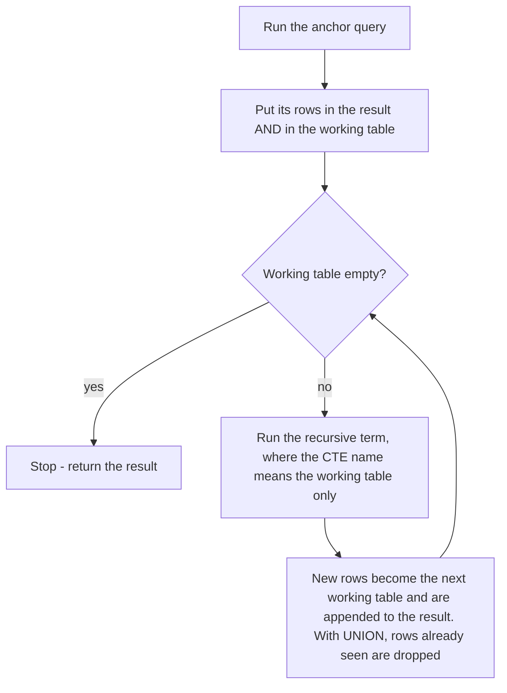
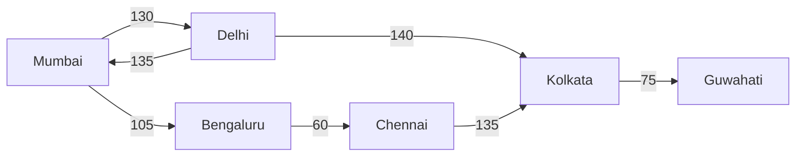

# Chapter 7 — CTEs, Views and Recursion: Naming Queries and Walking Trees

A report needing "order totals, then customer totals, then customers above average" becomes three unreadable levels of nested subqueries. This chapter covers SQL's tools for **naming** a piece of a query so big queries are built from small, readable steps:

- a **common table expression (CTE)** names a query for the length of *one* statement;
- a **recursive CTE** calls itself, which lets plain SQL walk hierarchies (org charts, category trees, bills of materials — parts lists where each part can itself be made of parts) and graphs (networks of connected items: flight routes, friend networks) and produce sequences;
- a **view** names a query *permanently* in the database, so everyone can reuse it like a table;
- a **materialized view** also stores the query's *result*, trading freshness for speed.

Plus `generate_series`, PostgreSQL's way to produce rows of numbers or dates for "fill in the missing days" reports.

**Sections:** 7.1 CTE basics · 7.2 Data-modifying CTEs · 7.3 Recursive CTE mechanics · 7.4 Hierarchies · 7.5 Graphs and cycles · 7.6 `generate_series` · 7.7 Views · 7.8 Materialized views · 7.9 Choosing.

**Setup.** The `company` database ([chapter 1, 1.11](../01-databases-and-the-relational-model/README.md#111-the-sample-database)) plus a `routes` table (a small flight network, 7.5); [`code/`](code/)`00_schema.sql` builds everything. Subqueries and derived tables, which CTEs replace: [chapter 6](../06-subqueries-and-set-operations/README.md).

---

## 7.1 Common table expressions (WITH)

### What it is
A **common table expression** is a named, temporary result set defined at the start of a statement with `WITH name AS (query)` and used in the rest of that statement like a table — named scrap paper ("let *x* = total per customer") that disappears when the statement ends.

```sql
WITH cte_name [(col1, col2, ...)] AS (
    SELECT ...                 -- any query
)
[, another_cte AS (SELECT ... FROM cte_name ...)]   -- later CTEs may use earlier ones
SELECT ... FROM cte_name ...;  -- the main statement
```

### The problem it solves
Nested derived tables (subqueries in `FROM`) read *inside-out* — the first step is buried deepest. CTEs write the logic *top-down* with a name per step, and let one intermediate result be used **several times** without copying it.

### How it works
1. Each `name AS (query)` defines one CTE; separate several with commas, write `WITH` once.
2. A CTE can reference CTEs defined **before** it (and, with `RECURSIVE`, itself — 7.3).
3. The final `SELECT`/`INSERT`/`UPDATE`/`DELETE` uses them by name.
4. Nothing is stored in the catalog (the database's internal list of objects); the CTE lives for this one statement.

**One CTE — employees paid above their department average:**
```sql
-- code/01_cte_basics.sql
WITH dept_avg AS (
    SELECT dept_id, round(avg(salary), 0) AS avg_salary
    FROM employees
    WHERE dept_id IS NOT NULL
    GROUP BY dept_id
)
SELECT e.first_name, e.dept_id, e.salary, d.avg_salary
FROM employees e
JOIN dept_avg d ON d.dept_id = e.dept_id
WHERE e.salary > d.avg_salary
ORDER BY e.dept_id, e.salary DESC;
```
Output:
```
 first_name | dept_id |  salary   | avg_salary
------------+---------+-----------+------------
 Vikram     |       1 | 185000.00 |     130750
 Neha       |       1 | 142000.00 |     130750
 Daniel     |       2 | 150000.00 |      89500
 Lucas      |       3 | 120000.00 |      90500
 Kiran      |       4 | 135000.00 |     105500
(5 rows)
```
`dept_avg` behaves like a table with one row per staffed department.

**Several CTEs as a pipeline** — order value → customer lifetime value → overall average:
```sql
WITH order_totals AS (          -- step 1: value of each non-cancelled order
    SELECT o.order_id, o.customer_id,
           sum(oi.quantity * oi.unit_price * (1 - oi.discount)) AS order_value
    FROM orders o
    JOIN order_items oi USING (order_id)
    WHERE o.status <> 'cancelled'
    GROUP BY o.order_id, o.customer_id
),
customer_totals AS (            -- step 2: lifetime value per customer
    SELECT customer_id, count(*) AS orders, round(sum(order_value), 2) AS lifetime_value
    FROM order_totals
    GROUP BY customer_id
),
overall AS (                    -- step 3: one number to compare against
    SELECT round(avg(lifetime_value), 2) AS avg_ltv FROM customer_totals
)
SELECT c.first_name, c.last_name, ct.orders, ct.lifetime_value, o.avg_ltv
FROM customer_totals ct
JOIN customers c USING (customer_id)
CROSS JOIN overall o
WHERE ct.lifetime_value > o.avg_ltv
ORDER BY ct.lifetime_value DESC;
```
Output:
```
 first_name | last_name | orders | lifetime_value | avg_ltv
------------+-----------+--------+----------------+---------
 Anita      | Shah      |      3 |        3454.08 | 1057.66
 Ben        | Carter    |      2 |        1858.36 | 1057.66
(2 rows)
```
`overall` has one row, so `CROSS JOIN` attaches the average to every row. Nested subqueries would be three levels deep.

**Using a CTE twice** — `monthly` is read by the main query *and* a scalar subquery:
```sql
WITH monthly AS (
    SELECT date_trunc('month', placed_at)::date AS month, count(*) AS orders
    FROM orders
    GROUP BY 1
)
SELECT month, orders,
       orders = (SELECT max(orders) FROM monthly) AS is_best_month
FROM monthly
ORDER BY month;
```
Output:
```
   month    | orders | is_best_month
------------+--------+---------------
 2025-01-01 |      3 | t
 2025-02-01 |      2 | f
 ...
 2025-04-01 |      3 | t
 ...
(6 rows)
```

**Naming the columns in the header.** `WITH dept_size(dept, headcount) AS (SELECT d.name, count(e.emp_id) …)` renames the output columns — handy for unnamed expressions like `count(e.emp_id)` (`code/01_cte_basics.sql`).

### How PostgreSQL executes a CTE: inlined or materialized
- **Inlined** — the optimizer (the component choosing how to run a query) pastes the CTE into the main query like a subquery and optimizes everything together (e.g. pushing a `WHERE` down so an index — a sorted lookup structure — can be used).
- **Materialized** — the CTE runs once into a temporary work area that the main query scans; outside filters can't reach inside.

Since **PostgreSQL 12**, a non-recursive, side-effect-free (read-only) CTE referenced **once** is inlined automatically; one referenced two or more times is materialized. Override with `AS MATERIALIZED` / `AS NOT MATERIALIZED`. (Before 12 every CTE was materialized — the "optimization fence" old blog posts warn about.)

```sql
EXPLAIN (COSTS OFF)
WITH big AS (SELECT * FROM employees)
SELECT first_name FROM big WHERE emp_id = 3;

EXPLAIN (COSTS OFF)
WITH big AS MATERIALIZED (SELECT * FROM employees)
SELECT first_name FROM big WHERE emp_id = 3;
```
Output:
```
                  QUERY PLAN
----------------------------------------------
 Index Scan using employees_pkey on employees
   Index Cond: (emp_id = 3)
(2 rows)

          QUERY PLAN
-------------------------------
 CTE Scan on big
   Filter: (emp_id = 3)
   CTE big
     ->  Seq Scan on employees
(4 rows)
```
The first plan never mentions the CTE — the filter reached the primary-key index; the second copies the whole table, then filters. (`EXPLAIN` prints the chosen plan; `Seq Scan` = read the whole table; [chapter 12](../12-indexes-storage-and-query-performance/README.md#1210-reading-explain-the-four-ways-to-read-a-table).)

`MATERIALIZED` suits an expensive CTE referenced several times, or something to compute exactly once (a slow function call). `NOT MATERIALIZED` suits a cheap multiply-referenced CTE that each use filters differently.

### Dialect notes
| Feature | PostgreSQL | MySQL | SQLite | SQL Server |
|---|---|---|---|---|
| `WITH` (non-recursive) | yes | 8.0+ | 3.8.3+ | 2005+ |
| `WITH RECURSIVE` keyword | required for recursion | required | required | *not used* — plain `WITH` can recurse |
| `MATERIALIZED` hint | 12+ | no | 3.35+ | no |
| CTE with `INSERT/UPDATE/DELETE` inside | yes (7.2) | no | no | no (but a CTE can be the *target* of an `UPDATE`/`DELETE`) |

In SQL Server the statement *before* a `WITH` must end with a semicolon — hence `;WITH` in T-SQL code (not run).

### Trade-offs
| | Derived table (subquery in `FROM`) | CTE |
|---|---|---|
| Readability | inside-out | top-down, named steps |
| Reuse in the same statement | copy-paste | reference by name |
| Recursion | no | yes |
| Performance (PostgreSQL 12+) | same when inlined | same when inlined; can force materialization |
| Scope | the one place it's written | the whole statement |

### When not to use it
- The query is readable without it — one level of subquery is fine.
- Many statements need the same logic: a **view** (7.7).
- The intermediate result is needed across statements in a session (one connection's lifetime), perhaps indexed: a **temporary table** (visible only to your session, dropped when it ends; 7.9).

### Common mistakes
- **`WITH` twice** (`WITH a AS (...) WITH b AS (...)`), a missing comma between CTEs, or an extra one after the last.
- **Referencing a CTE defined later** — a CTE sees only those above it (or itself, if recursive).
- **Assuming a CTE "caches" work** — a single-use CTE is inlined (12+); use `MATERIALIZED` for one evaluation.

### Real-world examples
Analytics teams chain CTEs (`raw → cleaned → joined → aggregated → final`); dbt (a tool for building data-transformation pipelines from SQL files) encourages this style.

### In the interview
**30-second answer:** "A CTE is a named subquery declared with `WITH` that exists for one statement. It makes complex queries readable as a sequence of steps, lets you reference the same intermediate result several times, and — with `WITH RECURSIVE` — lets a query refer to itself to walk hierarchies. In PostgreSQL 12 and later a CTE referenced once is inlined, so it costs the same as a subquery; you can force materialization with `AS MATERIALIZED`."

- *Is a CTE faster than a subquery?* → Usually identical (inlined). Slower if materialized and a selective outer filter can't be pushed in; faster if an expensive CTE is materialized once and reused.
- *CTE vs temporary table?* → A CTE lasts one statement and isn't indexed; a temp table lasts the session (or transaction), can be indexed and analyzed (statistics gathered for the optimizer), and serves many statements.
- *Can you update through a CTE?* → In PostgreSQL the CTE itself can contain `UPDATE/DELETE/INSERT ... RETURNING` (next section).

### Self-check
1. *In PostgreSQL 14, is a CTE referenced once materialized?* → No, inlined — unless `AS MATERIALIZED`, recursive, or with side effects.

---

## 7.2 Data-modifying CTEs (PostgreSQL)

### What it is
In PostgreSQL a CTE may contain `INSERT`, `UPDATE` or `DELETE` with `RETURNING`, whose rows feed the rest of the statement. Several changes ("delete these rows and copy them to an archive") become **one statement**, automatically atomic — all or nothing.

### How it works
1. `DELETE/UPDATE/INSERT ... RETURNING` inside a CTE produces the affected rows; later CTEs or the main statement read them by name.
2. Every data-modifying CTE runs **to completion exactly once**, even if nothing reads its output.
3. All parts see the **same snapshot** (a frozen picture of the data) from *before* the statement — not each other's changes, except through `RETURNING`.

**Example — archive cancelled orders and their items:**
```sql
-- code/02_data_modifying_cte.sql
CREATE TABLE orders_archive (LIKE orders INCLUDING ALL);
CREATE TABLE order_items_archive (LIKE order_items INCLUDING ALL);

WITH gone_items AS (
    DELETE FROM order_items
    WHERE order_id IN (SELECT order_id FROM orders WHERE status = 'cancelled')
    RETURNING *
),
saved_items AS (
    INSERT INTO order_items_archive SELECT * FROM gone_items RETURNING order_id
),
gone_orders AS (
    DELETE FROM orders
    WHERE status = 'cancelled'
    RETURNING *
)
INSERT INTO orders_archive
SELECT * FROM gone_orders
RETURNING order_id, status;
```
Output:
```
 order_id |  status
----------+-----------
      105 | cancelled
      111 | cancelled
(2 rows)
```
```sql
SELECT (SELECT count(*) FROM orders)              AS live_orders,
       (SELECT count(*) FROM orders_archive)      AS archived_orders,
       (SELECT count(*) FROM order_items_archive) AS archived_items;
```
Output:
```
 live_orders | archived_orders | archived_items
-------------+-----------------+----------------
          12 |               2 |              2
(1 row)
```
`CREATE TABLE ... (LIKE t INCLUDING ALL)` copies the column definitions, defaults and constraints of `t` (see [chapter 9](../09-ddl-dml-and-constraints/README.md)).

**The snapshot rule, shown:**
```sql
WITH bump AS (
    UPDATE products SET unit_price = unit_price + 1 WHERE product_id = 2
    RETURNING unit_price
)
SELECT (SELECT unit_price FROM products WHERE product_id = 2) AS seen_by_select,
       (SELECT unit_price FROM bump)                          AS new_value;
```
Output:
```
 seen_by_select | new_value
----------------+-----------
          24.99 |     25.99
(1 row)
```
The outer `SELECT` reads the old price; only `RETURNING` shows the new one. Afterwards the table holds 25.99.

### Common mistakes
- **Modifying the same row twice in one statement** (two CTEs) — unpredictable result.
- **Expecting a later CTE to "see" an earlier change via the table** — read the earlier CTE's `RETURNING`.
- **Porting to MySQL/SQL Server** — unsupported; use a transaction (statements committed or undone together) of separate statements ([chapter 13](../13-transactions-and-concurrency/README.md)).

---

## 7.3 Recursive CTEs: the mechanics

### What it is
A **recursive CTE** refers to itself: `WITH RECURSIVE name AS (anchor UNION ALL recursive_term)`. It is standard SQL's *repetition*: "start with these rows, keep deriving new rows from the last batch until none appear" — like listing a grandparent's descendants generation by generation until one has no children.

### The problem it solves
Questions with no fixed depth — "all reports under this manager at every level", "every category inside Electronics", "every city reachable from Mumbai". A join handles one level ([chapter 5](../05-joins/README.md) self-join); a recursive CTE handles any depth.

### How it works

1. **Anchor** (before `UNION [ALL]`) runs once, producing the starting rows.
2. **Recursive term** (after it) references the CTE name, which on each pass means *only the previous pass's rows* (the "working table"); its output is appended to the result and feeds the next pass.
3. **Termination:** stop when a pass produces no rows — your `WHERE` or join must make that happen.
4. `UNION ALL` keeps every row; `UNION` discards rows already produced, which also stops loops whose state repeats.

PostgreSQL rules: the recursive term references the CTE only **once**, not inside an aggregate, a subquery, or the nullable side of an outer join. Anchor and recursive term need the same column count and compatible types — cast in the anchor (`0::bigint`, `name::text`) if the recursive term produces a wider type.

**Counting 1 to 5:**
```sql
-- code/03_recursive_series.sql
WITH RECURSIVE counter(n) AS (
    SELECT 1                 -- anchor: the starting row(s)
    UNION ALL
    SELECT n + 1             -- recursive term: runs on the rows produced last time
    FROM counter
    WHERE n < 5              -- stop condition
)
SELECT n FROM counter;
```
Output:
```
 n
---
 1
 2
 3
 4
 5
(5 rows)
```
Trace: anchor → {1}. Pass 1 reads {1} → {2}. Pass 2 reads {2} → {3} … pass 4 reads {4} → {5}. Pass 5 reads {5}; `5 < 5` is false → no rows → stop.

**Carrying state in several columns** — the next Fibonacci pair (each number the sum of the two before) and a running factorial (*n*! = 1 × 2 × … × *n*):
```sql
WITH RECURSIVE fib(i, a, b, fact) AS (
    SELECT 1, 0::bigint, 1::bigint, 1::numeric
    UNION ALL
    SELECT i + 1, b, a + b, fact * (i + 1)
    FROM fib
    WHERE i < 10
)
SELECT i, a AS fibonacci, fact AS factorial FROM fib;
```
Output:
```
 i  | fibonacci | factorial
----+-----------+-----------
  1 |         0 |         1
  2 |         1 |         2
  3 |         1 |         6
  4 |         2 |        24
 ...
 10 |        34 |   3628800
(10 rows)
```

**Walking dates** works the same way: anchor `SELECT DATE '2025-01-06'`, recursive term `SELECT (week_start + 7)::date FROM weeks WHERE week_start < DATE '2025-02-03'` → five Mondays (`code/03_recursive_series.sql`). PostgreSQL's `generate_series` (7.6) is simpler; the recursive form is for MySQL, which lacks it.

**A runaway query and two safety nets.** Without a stop condition recursion never ends. While experimenting, an outer `LIMIT` stops it (PostgreSQL evaluates recursion lazily, only as far as the outer query asks):
```sql
WITH RECURSIVE forever(n) AS (
    SELECT 1 UNION ALL SELECT n + 1 FROM forever      -- no stop condition!
)
SELECT n FROM forever LIMIT 3;
```
Output:
```
 n
---
 1
 2
 3
(3 rows)
```
And `UNION` stops a computation whose state repeats: doubling modulo 7 (remainder after dividing by 7) goes 1 → 2 → 4 → 1; the second 1 is discarded and the working table empties:
```sql
WITH RECURSIVE mod_cycle(n) AS (
    SELECT 1
    UNION
    SELECT (n * 2) % 7 FROM mod_cycle
)
SELECT n FROM mod_cycle;
```
Output:
```
 n
---
 1
 2
 4
(3 rows)
```
`UNION` only helps when the *whole row* repeats; a growing column (depth, path, running total) never repeats — use explicit cycle detection (7.5).

### Dialect notes
| | PostgreSQL | MySQL 8 | SQLite | SQL Server |
|---|---|---|---|---|
| Syntax | `WITH RECURSIVE` | `WITH RECURSIVE` | `WITH RECURSIVE` | `WITH` (no keyword) |
| Built-in depth limit | none | `cte_max_recursion_depth` = 1000 by default | none | 100 by default; `OPTION (MAXRECURSION n)`, 0 = unlimited |
| `UNION` (distinct) in recursion | yes | yes | yes | no, `UNION ALL` only |
| `SEARCH` / `CYCLE` clauses | 14+ | no | no | no |

Oracle also supports recursive `WITH` (since 11g R2) and its older proprietary `CONNECT BY` syntax.

### Common mistakes
- **No stop condition** → runs until memory or disk runs out (MySQL/SQL Server: depth-limit error).
- **Anchor/recursive type mismatch.** The anchor fixes column types: a `varchar(40)` anchor column extended by `path || ' > ' || name` (`text`) fails with *"column has type character varying(40) in non-recursive term but type text overall"*; `SELECT 1` makes an `integer` that a growing factorial overflows. Cast in the anchor (`first_name::text`, `1::numeric`).
- **Thinking the recursive term sees the whole result** — only the previous pass.
- **Relying on output order** — build a sort key (depth, path, or `SEARCH`, 7.5) and `ORDER BY` it.

### Self-check
1. *When does recursion stop?* → When a pass produces no new rows.
2. *What does SQL Server need instead of `WITH RECURSIVE`?* → Just `WITH`; recursion is limited to 100 levels unless `OPTION (MAXRECURSION n)`.

---

## 7.4 Hierarchies: trees stored as parent pointers

### What it is
The usual relational tree is the **adjacency list**: each row stores its parent's key (`employees.manager_id` → another `emp_id`; `NULL` marks the root), queried with recursive CTEs.

### How it works — three classic queries
| Question | Anchor | Recursive step |
|---|---|---|
| Top-down: the whole tree (or a subtree) | the root(s): `manager_id IS NULL` (or `emp_id = X`) | children: `e.manager_id = parent.emp_id` |
| Bottom-up: the chain of ancestors | the starting node | parent: `m.emp_id = child.manager_id` |
| Subtree aggregates | every (boss, direct report) pair | extend each pair one level down, keeping the boss |

**Top-down with depth and path** (the path doubles as a sort key keeping each team under its manager):
```sql
-- code/04_hierarchy.sql
WITH RECURSIVE org AS (
    SELECT emp_id, first_name, manager_id, 1 AS depth,
           first_name::text AS path
    FROM employees
    WHERE manager_id IS NULL                       -- anchor: the root
    UNION ALL
    SELECT e.emp_id, e.first_name, e.manager_id, o.depth + 1,
           o.path || ' > ' || e.first_name
    FROM employees e
    JOIN org o ON e.manager_id = o.emp_id          -- children of rows found so far
)
SELECT repeat('    ', depth - 1) || first_name AS org_chart, depth, path
FROM org
ORDER BY path;
```
Output:
```
   org_chart    | depth |         path
----------------+-------+-----------------------
 Asha           |     1 | Asha
     Daniel     |     2 | Asha > Daniel
         Arjun  |     3 | Asha > Daniel > Arjun
         Priya  |     3 | Asha > Daniel > Priya
         Sara   |     3 | Asha > Daniel > Sara
     Kiran      |     2 | Asha > Kiran
         Omar   |     3 | Asha > Kiran > Omar
 ...
     Vikram     |     2 | Asha > Vikram
         Li     |     3 | Asha > Vikram > Li
 ...
         Rohan  |     3 | Asha > Vikram > Rohan
(15 rows)
```
Pass 1 found Asha's four reports (depth 2), pass 2 theirs (depth 3), pass 3 nobody — stop. A text path sorts correctly only because names lack `>`; a robust key is an id array (`ARRAY[emp_id]`, then `path || e.emp_id`), compared element by element. For one subtree, anchor on `WHERE emp_id = 2`.

**Bottom-up: who is above the intern?**
```sql
WITH RECURSIVE chain AS (
    SELECT emp_id, first_name, job_title, manager_id, 0 AS steps_up
    FROM employees WHERE emp_id = 15
    UNION ALL
    SELECT m.emp_id, m.first_name, m.job_title, m.manager_id, c.steps_up + 1
    FROM employees m
    JOIN chain c ON m.emp_id = c.manager_id
)
SELECT steps_up, first_name, job_title FROM chain ORDER BY steps_up;
```
Output:
```
 steps_up | first_name |      job_title
----------+------------+---------------------
        0 | Rohan      | Intern
        1 | Vikram     | Engineering Manager
        2 | Asha       | CEO
(3 rows)
```
Only the join direction differs: `m.emp_id = c.manager_id` ("find my parent") vs `e.manager_id = o.emp_id` ("find my children"). Uses: breadcrumbs (`Home > Electronics > Laptops`), approval chains, permission inheritance.

**Subtree totals** — carry the *boss* unchanged while walking down, one row per (boss, anyone below):
```sql
WITH RECURSIVE reports AS (
    SELECT manager_id AS boss, emp_id, salary        -- direct reports
    FROM employees WHERE manager_id IS NOT NULL
    UNION ALL
    SELECT r.boss, e.emp_id, e.salary                -- their reports, and so on
    FROM reports r
    JOIN employees e ON e.manager_id = r.emp_id
)
SELECT b.first_name AS manager, count(*) AS team_size, sum(r.salary) AS team_salary
FROM reports r JOIN employees b ON b.emp_id = r.boss
GROUP BY b.first_name
ORDER BY team_size DESC, manager;
```
Output:
```
 manager | team_size | team_salary
---------+-----------+-------------
 Asha    |        14 |  1367000.00
 Vikram  |         5 |   432000.00
 Daniel  |         3 |   208000.00
 Kiran   |         1 |    76000.00
 Lucas   |         1 |    61000.00
(5 rows)
```
Asha has all 14 others below her; Vikram has Neha, Rahul, Meera, Li, Rohan. The aggregate runs *outside* — aggregates aren't allowed in the recursive term.

### Other ways to store trees (for comparison)
| Model | How | Reads | Writes | Notes |
|---|---|---|---|---|
| Adjacency list (this chapter) | `parent_id` column | recursive CTE | trivial (change one pointer) | the default choice |
| Materialized path | store `'1/2/15'` (or PostgreSQL `ltree`, an extension type for dotted label paths) | `LIKE '1/2/%'`, indexable | moving a subtree rewrites all descendants' paths | great for breadcrumbs |
| Nested sets | store `lft`/`rgt` numbers | subtree = range query | inserts renumber many rows | read-heavy, rarely-changing trees |
| Closure table | separate table of every (ancestor, descendant, depth) pair | simple joins | many rows per insert | *SQL Antipatterns* recommends it for heavy tree querying |

### Common mistakes
- **Anchoring on `manager_id = X`** lists X's reports but *not X*; use `emp_id = X` to include X.
- **Cyclic bad data** (A manages B, B manages A): a walk from a real root never reaches it, but one starting inside loops forever. Protect with a path check (7.5) or a `CHECK`/trigger (function run automatically on row changes) preventing cycles.
- **Sorting by depth only** loses the "team under manager" layout; sort by path.

### In the interview
**30-second answer:** "Store the tree as an adjacency list — each row points to its parent. To read a subtree, anchor on the root and recursively join children whose parent is in the previous level, carrying depth and a path for ordering. For ancestors, reverse the join. For totals per node, carry the top node through the recursion and aggregate outside."

- *How would you stop infinite loops if the data could contain a cycle?* → Carry an array of visited ids and add `WHERE NOT e.emp_id = ANY(path)`, or use PostgreSQL 14's `CYCLE` clause.
- *Huge tree queried constantly?* → Index `manager_id`; consider a closure table or materialized path (`ltree` with a GiST index — a PostgreSQL index type for not-simply-sortable data like paths or shapes).

### Self-check
1. *Which join walks down, which up?* → Down: `child.manager_id = found.emp_id`; up: `parent.emp_id = found.manager_id`.

---

## 7.5 Graphs and cycles

### What it is
A **graph** is a tree whose nodes can have several parents and whose paths can loop back (a **cycle**): flight routes, roads, "follows", package dependencies. `routes` stores one-way flights; Mumbai → Delhi → Mumbai is a cycle.



### The problem it solves
A naive walk loops forever (Mumbai → Delhi → Mumbai …), and each row differs (total time grows), so `UNION` won't stop it. Remember where you have been:

### How it works (manual cycle detection)
carry an **array of visited nodes** (`path`) and follow an edge only if its destination isn't in it (`WHERE r.to_city <> ALL (t.path)`). Every row is then a *simple path* (no repeated city); there are finitely many, so recursion ends.

```sql
-- code/05_graph_cycles.sql
WITH RECURSIVE trips AS (
    SELECT to_city AS city, ARRAY['Mumbai', to_city] AS path, minutes AS total_min
    FROM routes WHERE from_city = 'Mumbai'
    UNION ALL
    SELECT r.to_city, t.path || r.to_city, t.total_min + r.minutes
    FROM trips t
    JOIN routes r ON r.from_city = t.city
    WHERE r.to_city <> ALL (t.path)              -- never revisit a city
)
SELECT city, array_to_string(path, ' -> ') AS route, total_min
FROM trips
ORDER BY city, total_min;
```
Output:
```
   city    |                         route                         | total_min
-----------+-------------------------------------------------------+-----------
 Bengaluru | Mumbai -> Bengaluru                                   |       105
 Chennai   | Mumbai -> Bengaluru -> Chennai                        |       165
 Delhi     | Mumbai -> Delhi                                       |       130
 Guwahati  | Mumbai -> Delhi -> Kolkata -> Guwahati                |       345
 Guwahati  | Mumbai -> Bengaluru -> Chennai -> Kolkata -> Guwahati |       375
 Kolkata   | Mumbai -> Delhi -> Kolkata                            |       270
 Kolkata   | Mumbai -> Bengaluru -> Chennai -> Kolkata             |       300
(7 rows)
```
`ARRAY[...]` builds an array ([chapter 14](../14-advanced-sql-and-using-sql-from-code/README.md#145-arrays)), `||` appends, `x <> ALL (array)` is true when `x` differs from every element ([chapter 6](../06-subqueries-and-set-operations/README.md#65-any-some-and-all)). Delhi → Mumbai is never followed: Mumbai is in every path.

**Shortest (fastest) route to each city** — keep the best row per city with `DISTINCT ON` ([chapter 2](../02-select-basics/README.md#26-distinct-removing-duplicate-rows)):
```sql
-- same trips CTE as above, then:
SELECT DISTINCT ON (city) city, total_min, array_to_string(path, ' -> ') AS route
FROM trips
WHERE city <> 'Mumbai'
ORDER BY city, total_min;
```
Output:
```
   city    | total_min |                 route
-----------+-----------+----------------------------------------
 Bengaluru |       105 | Mumbai -> Bengaluru
 Chennai   |       165 | Mumbai -> Bengaluru -> Chennai
 Delhi     |       130 | Mumbai -> Delhi
 Guwahati  |       345 | Mumbai -> Delhi -> Kolkata -> Guwahati
 Kolkata   |       270 | Mumbai -> Delhi -> Kolkata
(5 rows)
```
This enumerates *every* simple path — exponential work (can double per extra hop) on big, dense graphs. Fine for small graphs and interviews; real route planners use shortest-path algorithms (Dijkstra, A* — never enumerate every path) in code or extensions such as pgRouting, or graph databases (store nodes and edges directly; [chapter 16](../16-beyond-relational/README.md)).

### The CYCLE and SEARCH clauses (PostgreSQL 14+)
SQL:1999 helper clauses, implemented in PostgreSQL 14 (this book's version):

- `CYCLE col SET is_cycle USING path_col` — tracks visited `col` values, flags a row whose value was already on its path with `is_cycle = true`, and stops recursing from it.
- `SEARCH DEPTH FIRST BY col SET ord` / `SEARCH BREADTH FIRST BY col SET ord` — adds `ord` to `ORDER BY` for depth-first (one branch fully down before the next) or breadth-first (level by level) order.

```sql
WITH RECURSIVE trips(city, total_min) AS (
    SELECT to_city, minutes FROM routes WHERE from_city = 'Mumbai'
    UNION ALL
    SELECT r.to_city, t.total_min + r.minutes
    FROM trips t JOIN routes r ON r.from_city = t.city
) CYCLE city SET is_cycle USING visited
SELECT city, total_min, is_cycle FROM trips
WHERE city IN ('Mumbai', 'Delhi')
ORDER BY total_min;
```
Output:
```
  city  | total_min | is_cycle
--------+-----------+----------
 Delhi  |       130 | f
 Mumbai |       265 | f
 Delhi  |       395 | t
(3 rows)
```
Mumbai (265) is *not* flagged: the anchor starts from *destinations*, so Mumbai wasn't yet on the tracked path; the hop back to Delhi repeats Delhi and is flagged. To count the start city as visited, include it in the anchor (as `ARRAY['Mumbai', to_city]` did).

```sql
WITH RECURSIVE org(emp_id, first_name, manager_id) AS (
    SELECT emp_id, first_name, manager_id FROM employees WHERE manager_id IS NULL
    UNION ALL
    SELECT e.emp_id, e.first_name, e.manager_id
    FROM employees e JOIN org o ON e.manager_id = o.emp_id
) SEARCH BREADTH FIRST BY emp_id SET ord
SELECT first_name, ord FROM org ORDER BY ord LIMIT 6;
```
Output:
```
 first_name |  ord
------------+--------
 Asha       | (0,1)
 Vikram     | (1,2)
 Daniel     | (1,6)
 Lucas      | (1,10)
 Kiran      | (1,12)
 Neha       | (2,3)
(6 rows)
```
Breadth-first `ord` is (level, id); `DEPTH FIRST` produces an array path like our manual `path`.

### Self-check
1. *Why doesn't `UNION` stop the Mumbai–Delhi loop?* → Each lap has a different `total_min`/path, so rows never repeat exactly.

---

## 7.6 generate_series: making rows (PostgreSQL)

### What it is
`generate_series(start, stop [, step])` is a PostgreSQL **set-returning function**: in `FROM` it returns one row per value from `start` to `stop`, for integers, numerics and timestamps/dates (step as an `interval`).

```sql
-- code/06_generate_series.sql
SELECT * FROM generate_series(1, 5) AS n;
SELECT * FROM generate_series(10, 0, -5) AS n;
SELECT d::date AS day FROM generate_series(DATE '2025-03-01', DATE '2025-03-04', INTERVAL '1 day') AS d;
```
Output (the three results, one after another):
```
 n
---
 1
 2
 ...
 5
(5 rows)

 n
----
 10
  5
  0
(3 rows)

    day
------------
 2025-03-01
 2025-03-02
 2025-03-03
 2025-03-04
(4 rows)
```
With `date` arguments the `timestamp with time zone` version is used, so cast back to `date`.

### The problem it solves: missing rows in reports
`GROUP BY` only makes groups for values that **exist**: a month with no orders vanishes and a chart silently skips it. Generate the full calendar, `LEFT JOIN` the data, count:
```sql
WITH months AS (
    SELECT m::date AS month
    FROM generate_series(DATE '2025-01-01', DATE '2025-07-01', INTERVAL '1 month') AS m
)
SELECT m.month, count(o.order_id) AS orders
FROM months m
LEFT JOIN orders o ON date_trunc('month', o.placed_at) = m.month
GROUP BY m.month
ORDER BY m.month;
```
Output:
```
   month    | orders
------------+--------
 2025-01-01 |      3
 2025-02-01 |      2
 ...
 2025-06-01 |      2
 2025-07-01 |      0
(7 rows)
```
July shows `0` — via `count(o.order_id)`; `count(*)` would count July's `NULL`-padded row as 1 ([chapter 4](../04-aggregation/README.md)).

**Test data in one statement:**
```sql
CREATE TABLE fake_events AS
SELECT g AS id, DATE '2025-01-01' + (g % 90) AS day, (g * 37) % 100 AS score
FROM generate_series(1, 1000) AS g;
SELECT count(*), min(day), max(day), round(avg(score), 1) AS avg_score FROM fake_events;
```
Output:
```
 count |    min     |    max     | avg_score
-------+------------+------------+-----------
  1000 | 2025-01-01 | 2025-03-31 |      49.5
(1 row)
```
Arithmetic instead of `random()` keeps data deterministic (identical every run) for reproducible performance tests ([chapter 12](../12-indexes-storage-and-query-performance/README.md) scales this to millions of rows).

### Dialect notes
| | Numbers / dates series |
|---|---|
| PostgreSQL | `generate_series(...)` |
| SQL Server 2022+ | `GENERATE_SERIES(start, stop [, step])` — numbers only (SQL Server — not run) |
| SQLite | `generate_series` table-valued function from the `series` extension (built into the `sqlite3` shell) |
| MySQL 8 | none — use a recursive CTE (7.3) or a permanent "numbers"/"calendar" table |

Data warehouses (databases for analysing large historical data) often keep a permanent **calendar table** (one row per date with flags like `is_weekend`, `fiscal_quarter`) for this.

---

## 7.7 Views

### What it is
A **view** is a named query stored in the database, queried like a table (`SELECT * FROM staff_directory`) but storing **no data**: each use substitutes its query into yours and runs it against the current **base** tables — like a saved email search, always up to date.

### Why it matters
| Benefit | Example |
|---|---|
| **Simplicity** — hide a complex join once | analysts query `staff_directory` instead of re-writing the join |
| **Security** — expose only some columns/rows | grant access to a view without `salary`, not to `employees` |
| **Stable interface** — change tables, keep the view | rename/split a table and redefine the view so old queries still work |
| **Consistency** — one definition of a metric | "active customer" is defined once, not in 20 reports |

### How it works
`CREATE VIEW name AS query;` stores the parsed query in the catalog. When a query mentions the view, PostgreSQL's rewriter (a pre-planning stage that expands views) substitutes it — like an inlined CTE — and the optimizer plans the whole. So a view is always current and costs exactly its query.

```sql
-- code/07_views.sql
CREATE VIEW staff_directory AS
SELECT e.emp_id, e.first_name || ' ' || e.last_name AS full_name,
       e.job_title, d.name AS department, e.email
FROM employees e
LEFT JOIN departments d USING (dept_id);

SELECT full_name, job_title, department FROM staff_directory
WHERE department = 'Sales' ORDER BY full_name;
```
Output:
```
   full_name   |   job_title   | department
---------------+---------------+------------
 Arjun Singh   | Sales Rep     | Sales
 Daniel Brooks | Sales Manager | Sales
 Priya Nair    | Sales Rep     | Sales
 Sara Khan     | Sales Rep     | Sales
(4 rows)
```
**Always current**: after `UPDATE employees SET job_title = 'Senior Sales Rep' WHERE emp_id = 7`, the view shows Priya Nair as Senior Sales Rep immediately.

### Changing and dropping views
- `CREATE OR REPLACE VIEW` swaps the definition in place (keeping permissions), but in PostgreSQL only if it returns the **same columns, names, types and order**; you may only **add** columns at the end.
- To remove or reorder columns: `DROP VIEW` + `CREATE VIEW` (re-granting privileges given with `GRANT`).
- Dependencies are tracked: a table (or view) used by a view can't be dropped without `CASCADE`, which drops the dependent views too.

```sql
-- adding hire_date at the end: allowed
CREATE OR REPLACE VIEW staff_directory AS
SELECT e.emp_id, e.first_name || ' ' || e.last_name AS full_name,
       e.job_title, d.name AS department, e.email, e.hire_date
FROM employees e
LEFT JOIN departments d USING (dept_id);

-- removing columns: refused
CREATE OR REPLACE VIEW staff_directory AS
SELECT e.emp_id, e.job_title FROM employees e;

-- dropping a table the view depends on: refused
DROP TABLE departments;
```
Output:
```
ERROR:  cannot drop columns from view
ERROR:  cannot drop table departments because other objects depend on it
DETAIL:  constraint employees_dept_id_fkey on table employees depends on table departments
constraint projects_dept_id_fkey on table projects depends on table departments
view staff_directory depends on table departments
HINT:  Use DROP ... CASCADE to drop the dependent objects too.
```
(`CASCADE` would also drop the two foreign-key constraints — rarely what you want.)

### Updatable views
Writes through a view work if each view row maps to exactly one base row. Since PostgreSQL 9.3 a view is **automatically updatable** when it reads exactly **one** table or updatable view and has no `GROUP BY`, `HAVING`, `DISTINCT`, `LIMIT`/`OFFSET`, window functions, aggregates, `UNION`/`INTERSECT`/`EXCEPT`, or top-level `WITH`. Computed columns are read-only. Otherwise write an `INSTEAD OF` trigger (a function run automatically in place of the write; [chapter 14](../14-advanced-sql-and-using-sql-from-code/README.md)).

```sql
CREATE VIEW furniture AS
SELECT product_id, name, unit_price, category
FROM products
WHERE category = 'Furniture';

UPDATE furniture SET unit_price = 329.99 WHERE name = 'Ergonomic Chair';
INSERT INTO furniture VALUES (10, 'Bookshelf', 120.00, 'Furniture');
-- Nothing stops a row that falls OUTSIDE the view's WHERE...
INSERT INTO furniture VALUES (11, 'Webcam', 59.00, 'Electronics');
SELECT product_id, name, category FROM products WHERE product_id >= 10;
SELECT count(*) AS visible_in_view FROM furniture WHERE product_id >= 10;
```
Output:
```
 product_id |   name    |  category
------------+-----------+-------------
         10 | Bookshelf | Furniture
         11 | Webcam    | Electronics
(2 rows)

 visible_in_view
-----------------
               1
(1 row)
```
The Webcam went into `products` through `furniture` but is invisible there — a "disappearing row". (`discontinued`, not in the view, got its default `false`.) **`WITH CHECK OPTION`** rejects writes whose row would not satisfy the view's `WHERE`:
```sql
CREATE OR REPLACE VIEW furniture AS
SELECT product_id, name, unit_price, category
FROM products
WHERE category = 'Furniture'
WITH CHECK OPTION;

INSERT INTO furniture VALUES (12, 'Monitor Arm', 79.00, 'Accessories');
```
Output:
```
ERROR:  new row violates check option for view "furniture"
DETAIL:  Failing row contains (12, Monitor Arm, Accessories, 79.00, f).
```
(`LOCAL` checks only this view's condition; `CASCADED`, the default, also those of underlying views.) A view with a join or `GROUP BY` is read-only:
```sql
CREATE VIEW dept_payroll AS
SELECT d.name AS department, count(e.emp_id) AS headcount, sum(e.salary) AS payroll
FROM departments d LEFT JOIN employees e USING (dept_id)
GROUP BY d.name;
SELECT * FROM dept_payroll ORDER BY payroll DESC NULLS LAST;
UPDATE dept_payroll SET headcount = 0 WHERE department = 'Sales';
```
Output:
```
 department  | headcount |  payroll
-------------+-----------+-----------
 Engineering |         4 | 523000.00
 Sales       |         4 | 358000.00
 ...
 Research    |         0 |    (null)
(6 rows)

ERROR:  cannot update view "dept_payroll"
DETAIL:  Views containing GROUP BY are not automatically updatable.
HINT:  To enable updating the view, provide an INSTEAD OF UPDATE trigger or an unconditional ON UPDATE DO INSTEAD rule.
```
The catalog knows which views are updatable:
```sql
SELECT table_name, is_updatable
FROM information_schema.views
WHERE table_schema = 'public'
ORDER BY table_name;
```
Output:
```
   table_name    | is_updatable
-----------------+--------------
 dept_payroll    | NO
 furniture       | YES
 staff_directory | NO
(3 rows)
```

### Views and security
A PostgreSQL view reads base tables with the **view owner's** privileges, so `GRANT SELECT ON staff_directory TO analyst` exposes names and titles but never salaries, with no grant on `employees`.
- `WITH (security_barrier)` stops a crafted user function in the caller's `WHERE` from peeking at rows the view's `WHERE` hides (otherwise the optimizer may run the cheap function first).
- PostgreSQL 15 added `WITH (security_invoker = true)` to use the *caller's* privileges (not run here on 14).

Roles, `GRANT` and row-level security (per-user row limits): [chapter 14](../14-advanced-sql-and-using-sql-from-code/README.md).

### Dialect notes
| | PostgreSQL | MySQL | SQLite | SQL Server |
|---|---|---|---|---|
| `CREATE OR REPLACE VIEW` | yes (add columns only) | yes (any change) | no — drop & create | `CREATE OR ALTER VIEW` (2016 SP1+) |
| Auto-updatable simple views | yes | yes | no — read-only, use `INSTEAD OF` triggers | yes |
| `WITH CHECK OPTION` | yes | yes | no | yes |
| Materialized views | yes (7.8) | no | no | "indexed views" (kept up to date automatically) |

### When not to use it
- **Deep view stacks** — each looks simple, the combined query is huge and hard to tune.
- **As a performance tool** — a view is exactly as fast as its query; use a materialized view or indexes.
- **`SELECT *` in a definition** — `*` is expanded at *creation*, so later table columns do **not** appear. List columns.

### Common mistakes
- Expecting a view to store data (that's a materialized view).
- Relying on `ORDER BY` inside a view — only the **outer** query's `ORDER BY` guarantees order.

### Real-world examples
BI (business-intelligence) tools (Metabase, Tableau, Power BI) point at views, not raw tables; after splitting `users` into `accounts` and `profiles`, a `users` view keeps old code working; PostgreSQL's `information_schema` is views over the system catalogs.

### In the interview
**30-second answer:** "A view is a stored query that acts like a virtual table. It stores no data, so it's always current and costs the same as running its query. Views simplify complex joins, provide a stable interface when tables change, and enforce security by exposing only certain columns or rows. Simple single-table views are updatable; `WITH CHECK OPTION` stops writes that would fall outside the view."

- *Does a view improve performance?* → Not by itself; it is expanded into the query. A materialized view (or indexed view in SQL Server) can.
- *Can you insert into a view?* → Yes if it's a simple single-table view (auto-updatable) or has `INSTEAD OF` triggers.
- *What happens to a view if you add a column to its table?* → Nothing; the view keeps the column list captured when it was created.

### Self-check
1. *Why did the Webcam vanish from `furniture`, and what prevents it?* → It doesn't satisfy `category = 'Furniture'`; `WITH CHECK OPTION`.
2. *Why is `staff_directory` not updatable?* → It joins two tables.

---

## 7.8 Materialized views

### What it is
A **materialized view** stores its query's *result* on disk like a table and recomputes only on `REFRESH MATERIALIZED VIEW` — trading **freshness** for **speed** (like a printed report: instant to read, stale until reprinted).

### How it works
1. `CREATE MATERIALIZED VIEW name AS query;` runs the query and stores the rows (`WITH NO DATA` creates it empty, unqueryable until refreshed). Reads can use indexes you create on it.
2. `REFRESH MATERIALIZED VIEW name;` re-runs and replaces the contents under a strong lock (others wait): **reads are blocked**.
3. `REFRESH MATERIALIZED VIEW CONCURRENTLY name;` builds the new result separately and applies only differences, not blocking readers; needs a **unique index** (plain columns, no `WHERE`) and is slower overall.

```sql
-- code/08_materialized_views.sql
CREATE MATERIALIZED VIEW product_sales AS
SELECT p.product_id, p.name,
       coalesce(sum(oi.quantity), 0) AS units_sold,
       coalesce(round(sum(oi.quantity * oi.unit_price * (1 - oi.discount)), 2), 0) AS revenue
FROM products p
LEFT JOIN order_items oi USING (product_id)          -- every order line
GROUP BY p.product_id, p.name;

SELECT name, units_sold, revenue FROM product_sales ORDER BY revenue DESC LIMIT 3;
```
Output:
```
      name       | units_sold | revenue
-----------------+------------+---------
 Laptop Pro 14   |          5 | 6380.05
 Standing Desk   |          2 |  978.00
 Ergonomic Chair |          3 |  962.47
(3 rows)
```
**Stale until refreshed:**
```sql
INSERT INTO orders VALUES (115, 9, NULL, '2025-06-20 09:00', 'pending', NULL);
INSERT INTO order_items VALUES (115, 5, 3, 499.00, 0.00);

SELECT name, units_sold, revenue FROM product_sales WHERE name = 'Standing Desk';
REFRESH MATERIALIZED VIEW product_sales;
SELECT name, units_sold, revenue FROM product_sales WHERE name = 'Standing Desk';
```
Output:
```
     name      | units_sold | revenue
---------------+------------+---------
 Standing Desk |          2 |  978.00
(1 row)

     name      | units_sold | revenue
---------------+------------+---------
 Standing Desk |          5 | 2475.00
(1 row)
```
**Concurrent refresh needs a unique index:**
```sql
REFRESH MATERIALIZED VIEW CONCURRENTLY product_sales;          -- fails
CREATE UNIQUE INDEX product_sales_pk ON product_sales (product_id);
REFRESH MATERIALIZED VIEW CONCURRENTLY product_sales;          -- works
CREATE INDEX product_sales_revenue ON product_sales (revenue DESC);
SELECT matviewname, ispopulated FROM pg_matviews;
```
Output:
```
ERROR:  cannot refresh materialized view "public.product_sales" concurrently
HINT:  Create a unique index with no WHERE clause on one or more columns of the materialized view.
  matviewname  | ispopulated
---------------+-------------
 product_sales | t
(1 row)
```

### Trade-offs
| | View | Materialized view | Summary table maintained by triggers/jobs |
|---|---|---|---|
| Stores data | no | yes | yes |
| Freshness | always current | as of last refresh | as current as your code keeps it |
| Read speed | cost of the query | fast (indexable) | fast |
| Write overhead | none | none at write time; refresh cost later | on every write |
| Effort | trivial | trivial + schedule refreshes | most code, most bugs |

PostgreSQL has **no automatic or incremental refresh** — each refresh recomputes everything. Schedule it (cron, the Unix timetable scheduler; the `pg_cron` extension; a job scheduler) or run it after batch loads. Oracle has incremental "fast refresh"; SQL Server's indexed views update on every write (many restrictions); MySQL has none.

### When to use / not use
- **Use** for dashboards/reports that may be minutes or hours old, expensive aggregations read far more than the data changes, precomputed lookup data.
- **Don't** when readers need up-to-the-second numbers, or refreshing costs more than it saves.

### Common mistakes
- No scheduled refresh — the dashboard shows last month's numbers.
- Plain `REFRESH` on a busy materialized view, blocking every reader.

### In the interview
**30-second answer:** "A view stores a query; a materialized view stores the query's result. Materialized views make expensive aggregations fast to read and can be indexed, but they're stale until refreshed. In PostgreSQL refresh is manual and full; `CONCURRENTLY` avoids blocking readers but needs a unique index."

- *Keeping it fresh?* → Scheduled refresh (e.g. every 5 minutes with pg_cron) or after each ETL batch (Extract-Transform-Load job copying and reshaping data in); for real-time, maintain a summary table incrementally.
- *vs a cache like Redis?* → The materialized view is in the database, SQL-queryable, consistent as of a point in time; an external cache (hot data outside the database; Redis is an in-memory key-value store) is faster per key but needs invalidation (updating copies when data changes; [System Design Fundamentals](../../../system-design-patterns/modules/00-system-design-fundamentals/README.md), [chapter 15](../15-scaling-databases/README.md)).

### Self-check
1. *What does `CONCURRENTLY` need?* → A unique index on the materialized view with no `WHERE` clause.

---

## 7.9 Choosing the right tool

| Need | Use | Lifetime | Stores rows? | Indexable? |
|---|---|---|---|---|
| One-off intermediate result inside one query, used once | subquery / derived table ([ch. 6](../06-subqueries-and-set-operations/README.md)) | one statement | no | no |
| Readable multi-step query, reuse within the statement, recursion, move rows atomically | CTE | one statement | only if materialized, temporarily | no |
| Reusable definition for many queries and users, security, stable interface | view | permanent | no | no (index the base tables) |
| Fast reads of expensive results that may be slightly stale | materialized view | permanent | yes | yes |
| Intermediate data reused by several statements in a session, needs indexes/statistics | `CREATE TEMP TABLE` ([ch. 9](../09-ddl-dml-and-constraints/README.md)) | session or transaction | yes | yes |

---

## Chapter 7 TL;DR

- **CTE** (`WITH name AS (...)`) names a step for one statement; chain with commas; reuse by name. PostgreSQL 12+ inlines single-use CTEs; `MATERIALIZED` / `NOT MATERIALIZED` override.
- **Data-modifying CTEs** (PostgreSQL) run `INSERT/UPDATE/DELETE ... RETURNING` inside `WITH` — atomic multi-step changes; all parts see the pre-statement snapshot.
- **Recursive CTE** = anchor `UNION [ALL]` recursive term; the recursive term sees only the previous pass's rows; stops when a pass returns nothing. Cast types in the anchor, always have a stop condition, `ORDER BY` a path/depth.
- **Trees**: adjacency list + recursion — join children to go down, join the parent to go up, carry the top node and aggregate outside for subtree totals.
- **Graphs**: carry a visited array and refuse revisits, or use `CYCLE` (PostgreSQL 14+); `SEARCH BREADTH/DEPTH FIRST` gives an ordering column.
- **`generate_series`** makes number/date rows: full calendar + `LEFT JOIN` + `count(col)` fills gaps with zeros. MySQL uses a recursive CTE instead.
- **View** = stored query, no data, always current; for simplicity, security, stable interfaces. Simple single-table views are updatable; `WITH CHECK OPTION` blocks out-of-view writes; `CREATE OR REPLACE` can only append columns in PostgreSQL.
- **Materialized view** = stored result; fast, indexable, stale until `REFRESH` (`CONCURRENTLY` needs a unique index). No auto-refresh in PostgreSQL.

Next: [chapter 8 — window functions](../08-window-functions/README.md), which compute running totals, rankings and comparisons with neighbouring rows without collapsing rows the way `GROUP BY` does.
