# Chapter 10 — Data Modeling and ER Diagrams

Up to now the tables in this book were handed to you. In real work nobody hands you tables: somebody describes a business in a few sentences ("we rent bikes to people"), and you must decide what to store, how the pieces connect, and which rules the database should enforce. That decision is **data modeling**, and it matters more than any single query you will write, because any fact left out of the model is a question no SQL, however clever, can ever answer.

This chapter walks the whole path: from a plain-language brief, to a drawing that business people can check (an **ER diagram**), to precise tables with keys and constraints (the **relational model** — the theory of storing all data as tables of rows and columns, §10.11), to `CREATE TABLE` statements running on PostgreSQL. [Chapter 11](../11-normalization/README.md) then tests those tables for repeated data, and [Chapter 17](../17-schema-design-case-studies/README.md) applies everything to nine full case studies.

**What you'll learn**

1. What a data model is, who reads it, and the three levels it is drawn at (conceptual, logical, physical).
2. A repeatable seven-step modeling process, and the best practices that separate easy-to-change models from painful ones.
3. The ER model: entities, the five kinds of attribute, relationships, degree, cardinality, participation, relationship attributes and weak entities — in **Chen notation** and in **crow's-foot notation** (the one `mermaid erDiagram` draws — Mermaid is a tool that turns a short text description into a diagram).
4. A complete worked example: an employee-management ER diagram built step by step.
5. The relational model: relations, tuples, attributes, domains, `NULL`, the seven kinds of key and the integrity constraints.
6. The mechanical procedure that turns any ER diagram into tables, and the judgement calls it leaves to you.

All runnable code is in [`code/`](code/): `00_schema.sql` builds a small bike-rental database; `01`–`04` run on a fresh database each (see [Chapter 1](../01-databases-and-the-relational-model/README.md) for the private PostgreSQL 14 server). Every "Output:" block below is real psql output (psql is PostgreSQL's command-line client).

---

## 10.1 What data modeling is

### What it is
**Data modeling** is deciding three things before you write any SQL:

| Part | Plain meaning | Usually becomes |
|---|---|---|
| **Entity** | a *thing* you keep data about (Customer, Bike, Rental) — almost always a noun | a table |
| **Attribute** | one *fact* about an entity (a customer's email, a bike's frame number) | a column |
| **Relationship** | a *link* between entities (a customer *rents* a bike) | a foreign key (a column holding another table's key), or a table of its own |

The result — a **data model** — is a picture of those three things and nothing else. It says nothing about indexes (lookup structures that speed up searches), `VARCHAR` lengths or which database product you will use. Analogy: it is the architect's floor plan, drawn before anyone picks brick suppliers.

### The problem it solves — the question you cannot answer
A small bike-rental shop says: *"We rent bikes to customers."* That sounds like two tables, `customer` and `bike`. Then the owner asks: *"We own three 'Urban 3' bikes. One came back with a bent wheel — which one, and who had it?"*

If your `bike` table actually describes a **model** of bike (name, type, hourly rate), it cannot answer. The physical object with a frame number is a different thing from the product it is an example of. Add a separate entity for the physical bike and the question becomes a short join. The code got no smarter; the database simply began recording one more fact.

*Figure — the same idea in the course's library example: a Book (a title) is not a Copy (the object on the shelf) (course diagram)*

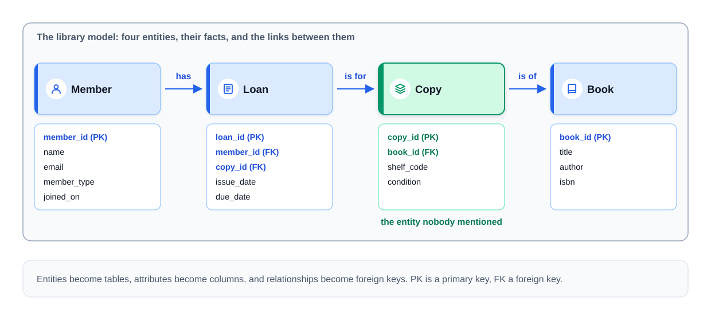

The bike shop's model therefore has four entities: `customer`, `bike_model` (the "title"), `bike` (the physical object) and `rental` (who had which bike, when).

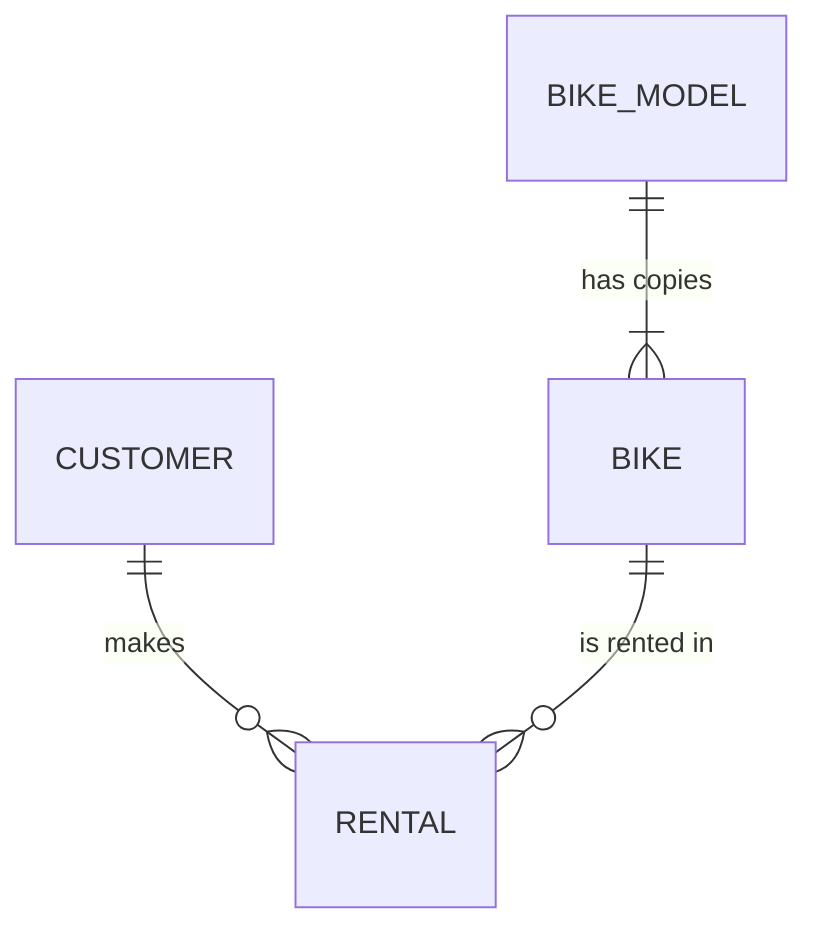

### Who reads a data model
| Reader | What they check |
|---|---|
| Business people (shop owner, registrar, librarian) | "Is anything missing? Are the rules right?" — they spot a forgotten entity in seconds |
| Developers | which tables exist and what each one means |
| Database administrators | storage, indexes, backups (mostly at the physical level) |
| Analysts | where each fact lives, so reports are correct |

Since non-technical readers must follow it, you describe the model in everyday language first and add technical detail afterwards — which is why §10.2 has three levels.

### What data modeling is *not*
- **Not writing SQL.** SQL comes last and is nearly mechanical once the model is right (§10.15).
- **Not performance tuning.** Indexes and query plans (the step-by-step strategy the database picks for running a query) come later ([Chapter 12](../12-indexes-storage-and-query-performance/README.md)). Quickly answering the wrong question helps nobody.
- **Not application code.** Two very different apps can share one model.

### Why it matters
- **Fewer wrong answers** — rules in the model become constraints that every program must obey.
- **Less repeated data** — each fact stored once cannot contradict itself.
- **Cheaper change** — a model that matches reality absorbs new requirements; one that doesn't fights each of them.
- **Shared vocabulary** — when the team says "rental", everyone means the same thing.

### TL;DR
A data model = entities (things) + attributes (facts) + relationships (links). Entities → tables, attributes → columns, relationships → foreign keys. If the model does not hold a fact, no query can recover it.

---

## 10.2 The three levels of a data model

### What it is
The same model is drawn three times, each time with more detail, for a different audience:

| | **Conceptual** | **Logical** | **Physical** |
|---|---|---|---|
| Shows | entities and relationships only | + attributes, keys, general types (text/number/date) | + exact types, indexes, partitioning (splitting a big table into pieces), storage options |
| Detail | low | medium | high |
| Main audience | business people | designers, developers | DBAs (database administrators), developers |
| Tied to a DBMS (database management system, e.g. PostgreSQL) product? | no | no | **yes** |
| Question it answers | "Is every thing present, and is each link correct?" | "Which facts are recorded, and which keys join the tables?" | "How do we store this well on *this* database?" |
| Bike-shop example | Customer *rents* Bike; Bike *is of* BikeModel | `rental(rental_id, customer_id → customer, bike_id → bike, out_at, due_at, back_at)` | `CREATE TABLE rental (... timestamp ..., INDEX on customer_id)` |

*Figure — the same data at the three levels (course diagram)*

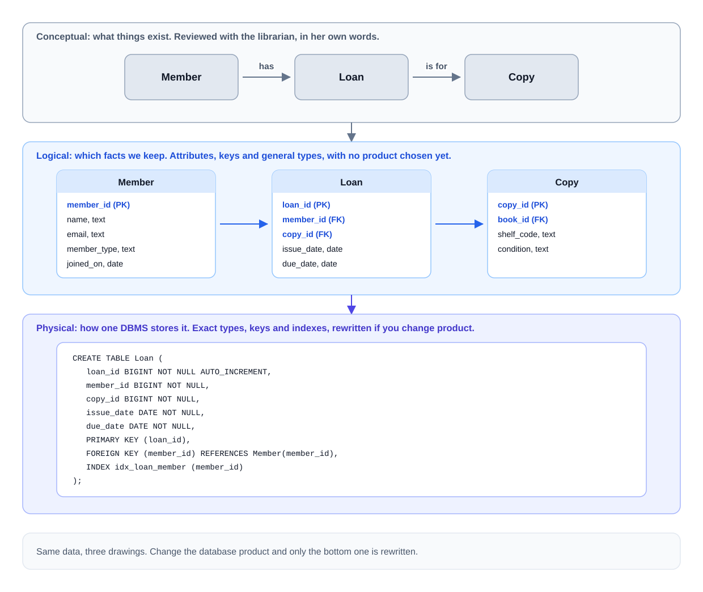

### How it works
1. **Conceptual** — boxes and lines, in the users' own words. Technology-independent: it would be equally valid for a relational database, a document store (a database that keeps JSON-like documents instead of tables) or a paper ledger.
2. **Logical** — add attributes, primary and foreign keys, and general types. This is where **normalization** happens (removing repeated data — [Chapter 11](../11-normalization/README.md)). Still product-neutral.
3. **Physical** — rewrite for one DBMS: `bigint` vs `int`, `numeric(6,2)`, `timestamp`, indexes for the known queries, identity columns (keys the database numbers automatically), partitioning.

The physical version of the rental table from `code/00_schema.sql`:

```sql
CREATE TABLE rental (
  rental_id   bigint GENERATED ALWAYS AS IDENTITY PRIMARY KEY,
  customer_id bigint      NOT NULL REFERENCES customer(customer_id),
  bike_id     bigint      NOT NULL REFERENCES bike(bike_id),
  out_at      timestamp   NOT NULL,
  due_at      timestamp   NOT NULL,
  back_at     timestamp,                          -- NULL = bike still out (meaningful NULL)
  CHECK (due_at > out_at),
  CHECK (back_at IS NULL OR back_at >= out_at)
);
CREATE INDEX rental_customer_idx ON rental(customer_id);   -- "rentals of this customer"
CREATE INDEX rental_bike_idx     ON rental(bike_id);       -- "who has this bike"
```

The entity came from the conceptual model, the columns and keys from the logical model; only the exact types, the identity column and the two indexes are physical decisions. Identity syntax differs by product, which is exactly why this level is product-specific:

| Auto-numbered key | Syntax |
|---|---|
| PostgreSQL 10+ | `bigint GENERATED ALWAYS AS IDENTITY` (older: `bigserial`) |
| MySQL | `BIGINT AUTO_INCREMENT` |
| SQLite | `INTEGER PRIMARY KEY` (becomes the rowid, SQLite's built-in row number) |
| SQL Server | `BIGINT IDENTITY(1,1)` |

### Why bother with three levels
- **Every reader gets a version pitched at them.** A shop owner reviewing three boxes finds a missing entity; the same person shown `CREATE TABLE` finds nothing.
- **Mistakes are caught while cheap.** A missing entity costs a conversation at the conceptual level and a migration (a script that changes an existing schema and its data) once two million rows exist.
- **Technology is isolated.** Switch from MySQL to PostgreSQL and only the physical model is rewritten. This is **data independence** (changing how data is stored without rewriting the programs that use it; defined in [Chapter 1](../01-databases-and-the-relational-model/README.md)) applied at design time.

The levels are not a one-way street: working out the logical model often shows the conceptual one was wrong, and you go back. That is cheap precisely because the conceptual drawing is small.

### Common mistakes
- Showing column types to business reviewers (they stop reading).
- Calling a diagram with attributes and keys "conceptual" — once keys appear it is logical.
- Treating logical and physical as the same: *logical = what the business needs; physical = how one product stores it.*

### Self-check
1. Which level first shows primary keys? → **Logical.**
2. You migrate from SQL Server to PostgreSQL. Which levels change? → **Only the physical.**
3. Where does normalization happen? → **Logical level.**

### TL;DR
Conceptual (things + links, for the business) → logical (attributes, keys, general types, normalized) → physical (exact types, indexes, one DBMS). Only the physical level depends on the product.

---

## 10.3 The data modeling process

### What it is
A fixed order of work where every step produces something you can show someone. Starting with tables is the classic mistake — it fixes the answer before you understand the question.

*Figure — seven steps and the three places the work loops back (course diagram)*

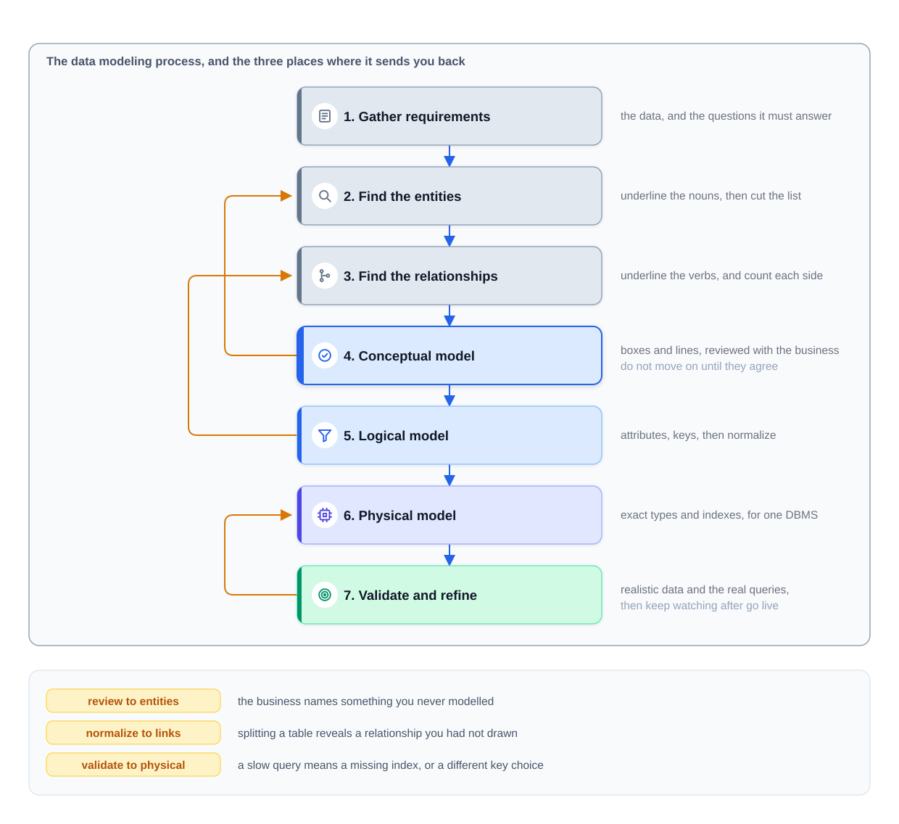

### How it works — the bike shop, step by step
1. **Gather requirements — including the questions.** Talk to the people doing the work. Write down what must be recorded *and* what the system must answer:
   - Customers are casual or members; members may keep a bike longer.
   - The shop owns several physical bikes of each model.
   - A customer takes a bike at a time and must return it by a due time.
   - Late returns cost 2.00 per started hour.
   - Staff must see which bikes are out and who has them.

   An unanswerable question is a bug in the design, and right now it costs nothing to fix.
2. **Find the entities: underline the nouns.** customer, member, model, bike, time, fee, staff. Keep a noun as an entity only if you store *several facts* about it and there are *many instances* of it:
   - customer, bike_model, bike, rental → entities.
   - time → one value → an attribute.
   - casual/member → two kinds of customer → start with a `customer_type` attribute.
   - late fee → calculable from times → a **derived** value (§10.6), not stored.
   - staff → users of the system, not necessarily data in it.
3. **Find the relationships: underline the verbs between nouns.** customer *rents* bike; bike *is of* bike_model. For each, ask "how many on each side?" (cardinality, §10.7) and write it in words: one customer has many rentals; each rental is for one bike.
4. **Draw and review the conceptual model** with the owner, reading it back as sentences. She will correct you ("customers can also *reserve* a bike for tomorrow") — a new entity for the price of one box. Do not continue until the business agrees.
5. **Design the logical model.** Attributes, primary keys, foreign keys, general types; then normalize.
6. **Build the physical model.** Exact types, and an index for every question from step 1 (`rental.customer_id`, `rental.bike_id`).
7. **Validate, implement, refine.** Load realistic volumes (not ten rows — enough rows for slowness to show up), run the step-1 questions, check correctness and speed. After go-live (the launch to real users) keep watching: a model right for 10 thousand rentals may need a new index at 10 million.

### The loops back are part of the process
| Trigger | Sends you back to |
|---|---|
| Stakeholder (anyone with a say in the system) review reveals something new (reservations) | step 2 (entities) |
| Normalization splits a table and exposes a hidden link | step 3 (relationships) |
| Validation finds a slow query | step 6 (index or key choice) |

Looping back is the method working, not failing: every loop costs less than releasing the error.

### Trade-offs to keep in mind throughout
- **Normalize vs denormalize** — normalize first (split tables so each fact is stored once); add redundancy (deliberate duplicate copies) back only for a measured slow query ([Chapter 11](../11-normalization/README.md#1116-denormalization--when-and-how-to-break-the-rules)).
- **Growth** — rows in three years, not today; it changes key and index choices.
- **Access control** — mark sensitive data early (emails, payments).
- **Integrity** — each business rule you collected in step 1 belongs in a constraint, not in an `if` inside the application.

### The model answering the step-1 questions (`code/01_bike_questions.sql`)
```sql
-- Q1: which bikes are out right now, and who has them?
SELECT b.frame_no, m.model_name, c.full_name, r.due_at
FROM rental r
JOIN bike b       ON b.bike_id = r.bike_id
JOIN bike_model m ON m.model_id = b.model_id
JOIN customer c   ON c.customer_id = r.customer_id
WHERE r.back_at IS NULL
ORDER BY b.frame_no;
-- Q2: bikes never rented (NOT EXISTS anti-join)   Q4: late fee, derived at read time
SELECT r.rental_id, c.full_name,
       ceil(extract(epoch FROM (r.back_at - r.due_at)) / 3600) * 2.00 AS late_fee
FROM rental r JOIN customer c USING (customer_id)
WHERE r.back_at > r.due_at;
```
Output:
```
--- Q1: which bikes are out right now, and who has them?
 frame_no | model_name |  full_name   |       due_at        
----------+------------+--------------+---------------------
 FR-2001  | Ridge 29   | Meera Nair   | 2026-09-27 18:00:00
 FR-3001  | Volt City  | Lena Fischer | 2026-09-27 10:30:00
(2 rows)

--- Q2: which physical bikes have never been rented?
 frame_no | model_name 
----------+------------
 FR-1002  | Urban 3
 FR-1003  | Urban 3
(2 rows)

--- Q3: how many bikes of each model exist, and how many are out?
 model_name | bikes | out_now 
------------+-------+---------
 Ridge 29   |     1 |       1
 Urban 3    |     3 |       0
 Volt City  |     1 |       1
(3 rows)

--- Q4: late returns, with a late fee of 2.00 per started hour (fee is derived, not stored)
 rental_id | full_name  | late_fee 
-----------+------------+----------
         2 | Tom Okafor |     2.00
(1 row)
```
Q2 and Q3 are only possible because `bike` (the physical object) is separate from `bike_model`.

### In the interview
**30-second answer:** "I start from requirements *and the questions the system must answer*. Nouns give candidate entities, verbs give relationships. I draw a conceptual model and review it with the business, then add attributes and keys and normalize (logical), then choose types and indexes for the target database (physical), and validate with realistic data and the real queries. I expect to loop back."

- *How do you decide whether a noun is an entity or an attribute?* → Entity if it carries several facts and has many instances; a single value (a date, a colour) is an attribute.
- *When do you add indexes?* → At the physical level, for the queries written down in requirements — not "on every column".

### TL;DR
Requirements (+ questions) → nouns = entities → verbs = relationships → conceptual review → logical (keys, normalize) → physical (types, indexes) → validate with real data; loop back when reality disagrees.

---

## 10.4 Best practices in data modeling

Two models can both work on day one and differ enormously a year later. The difference comes from small early decisions. Here are the rules, each with the reason.

| Practice | Rule | Why |
|---|---|---|
| **Questions first** | Write the list of questions before drawing. | A model is only "correct" relative to the questions it must answer. |
| **Rules in the database** | Every stated rule → a `PRIMARY KEY`, `FOREIGN KEY`, `NOT NULL`, `UNIQUE` or `CHECK`. | A constraint protects every program that ever connects, including tomorrow's ad-hoc (one-off, written for a single task) script; an `if` protects only the program it is in. |
| **One naming convention** | Decide once (`snake_case` = lower case with underscores, singular *or* plural tables) and never mix. Same thing = same name everywhere (`customer_id`, never `cust_no` elsewhere). Name FKs after their target. | Joins read naturally; nobody has to guess. |
| **Types on purpose** | Dates as `date`/`timestamp`, never text; money as `numeric`, never `float`/`double`; text sized for real data. Prefer the narrowest type that fits. | Text dates accept "31 February" and sort wrongly; floating point cannot represent most decimals exactly, so totals drift; narrower rows = more rows per page (the fixed-size block the database reads from disk) = fewer disk reads. |
| **Decide what NULL means** | `NOT NULL` whenever the fact must exist; allow `NULL` only when "missing" is meaningful (`back_at IS NULL` = bike still out). | `NULL` means unknown/not applicable, is not 0 or '' and is not equal to anything (§10.12). |
| **Keys deliberately** | Surrogate primary key (a generated id with no business meaning) + `UNIQUE` on the natural key (a real-world identifier: `email`, `frame_no`). Keep keys narrow. | Natural values change; a PK is copied into every FK and index. |
| **Normalize, then denormalize with evidence** | Default to 3NF (third normal form, the usual target of normalization); denormalize only after a measured slow query that an index could not fix — and document why. | Redundant copies can disagree ([Chapter 11](../11-normalization/README.md)). |
| **Index for real queries** | Index what the requirement questions filter/join on; nothing else. | Every index slows every write and costs disk. |
| **Design for predictable growth** | Estimate rows in 3 years; don't build tables for imagined requirements. | Speculative tables become the parts nobody understands. |
| **Document meaning** | For each entity/column: what it means, allowed values, units. | Anyone can see `status` is text; only docs say which 4 values it holds. |

The CHECK constraints in the bike schema are this practice in action: a rental due before it starts, or returned before it left, is refused for every client.

```sql
CHECK (due_at > out_at),
CHECK (back_at IS NULL OR back_at >= out_at)
```

### Common mistakes
- **A list in one column** — `phones = '555-1, 555-2'` cannot be searched, counted or constrained → separate table.
- **Numbered columns** — `phone1, phone2, phone3` stores a list across columns and breaks the day someone owns a fourth phone.
- **One huge table** — 60 columns, mostly empty per row, is several entities that were never separated.
- **Over-normalizing** — seven joins for an everyday question is a real cost; 3NF is the usual stopping point.
- **Rules only in code** — some other program will break them.

### Real-world examples
- **Stripe's API** (the programming interface of the payments company Stripe) represents amounts as integers in the smallest currency unit (cents) — the same idea as "never float for money".
- **ISO country codes** (the international standard two-letter codes such as `IN`, `GB`) are `char(2)` — "size text for the data" in the wild.

### TL;DR
Questions first; constraints in the schema; one naming style; correct types (dates as dates, money as `numeric`); explicit `NOT NULL`; surrogate PK + unique natural key; normalize to 3NF, denormalize with measurements; index only real queries; document meaning.

---

## 10.5 The Entity-Relationship (ER) model and its notations

### What it is
The **Entity-Relationship model** (ER model), proposed by Peter Chen in 1976, lets you sketch entities, attributes and relationships on paper long before you create a table. An **ER diagram (ERD)** is one such drawing. It is how you draw the conceptual model (entities + relationships only) and then the logical model (the same diagram with attributes, keys and cardinalities added). It never names a DBMS.

*Figure — a complete Chen-notation ER diagram for a student management system; by §10.10 you can read every symbol (course diagram)*

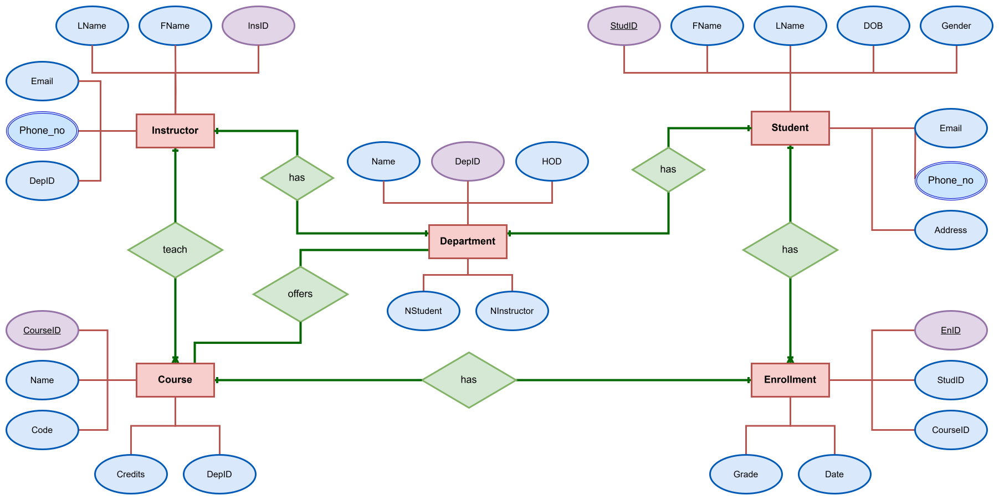

### Two notations for the same model
| | **Chen notation** | **Crow's-foot notation** (IE / Martin) |
|---|---|---|
| Entity | rectangle | rectangle with a title bar |
| Attribute | ellipse attached by a line | a row listed *inside* the rectangle |
| Relationship | diamond labelled with a verb | the line itself, labelled with a verb |
| Cardinality | `1`, `N`, `M` written near the diamond (or `(min,max)` pairs) | the *shape* of each line end (see table below) |
| Participation | double line = total, single = partial | inner symbol: bar = at least one, circle = may be zero |
| Used by | textbooks, exams, teaching | nearly every design tool (dbdiagram, MySQL Workbench, ERwin, Lucidchart), and `mermaid erDiagram` |
| Strength | shows the concepts explicitly | compact; fits 40 tables on a screen |

Neither is "more correct". Learn Chen to understand the concepts; you will read crow's foot immediately afterwards. In this book the course's Chen figures show the concepts, and every schema is also drawn in crow's foot with mermaid.

**Reading crow's-foot line ends** — each end has an *outer* symbol (maximum) and an *inner* symbol (minimum):

| Mermaid syntax (left end / right end) | Picture | Meaning (min, max) |
|---|---|---|
| `\|o` / `o\|` | circle + bar | zero or one `(0,1)` |
| `\|\|` / `\|\|` | bar + bar | exactly one `(1,1)` |
| `}o` / `o{` | circle + crow's foot | zero or more `(0,N)` |
| `}\|` / `\|{` | bar + crow's foot | one or more `(1,N)` |

So `CUSTOMER ||--o{ RENTAL : makes` reads: *each rental belongs to exactly one customer; a customer makes zero or more rentals*. Strictly, mermaid draws a solid line `--` for an **identifying** relationship (the child's key includes the parent's — a weak entity, §10.9) and a dashed line `..` for a non-identifying one. This book draws every line solid for readability; a weak entity is recognised by a PK that contains the owner's key.

### Strengths and limits of an ERD
- **Good at:** making the things, their links and the counts on each link visible, so even a non-technical reviewer notices what is missing.
- **Not a table diagram:** a single M:N diamond turns into *three* tables (§10.7).
- **Not a performance document:** no indexes or storage.
- **Not a process diagram:** it says a student enrols in a course, not which screens or approvals happen.

### TL;DR
The ER model (Chen, 1976) draws entities, attributes and relationships. Chen = rectangles/ellipses/diamonds (teaching); crow's foot = attributes inside boxes and cardinality in line ends (industry, mermaid). Same model, two pictures.

---

## 10.6 Entities and the five kinds of attribute

### Entities: type, instance, set
An **entity** is any object or concept in the business that you record data about and can distinguish from others like it. Three words are used loosely but mean different things:

| Term | Meaning | Example |
|---|---|---|
| **Entity type** | the general kind; what the rectangle is labelled | `Employee` |
| **Entity instance** | one particular member | employee #2, Ravi Menon |
| **Entity set** | all instances that exist right now | every row in the `employee` table today |

You *draw* types; the database *stores* sets.

*Figure — every Chen symbol and its meaning (course diagram)*

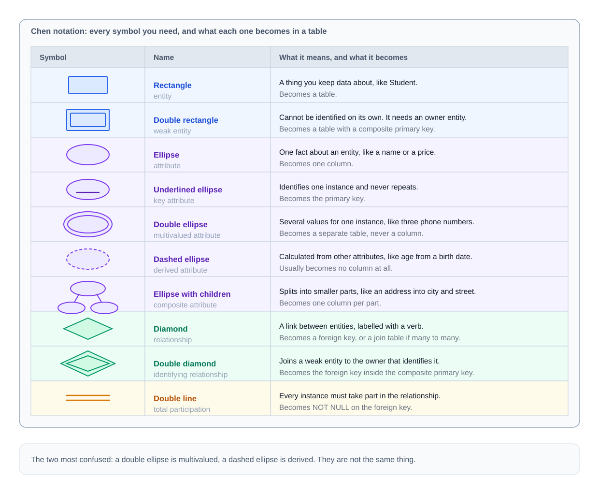

### The five kinds of attribute
| Kind | Chen symbol | Example | Becomes in tables |
|---|---|---|---|
| **Key** | ellipse, name **underlined** | `emp_id` | the primary key |
| **Simple (atomic)** | plain ellipse | `birth_date` | one column |
| **Composite** | ellipse with child ellipses | `full_name` = first + middle initial + last | one column **per part** |
| **Multivalued** | **double** ellipse | `phone` (an employee may have several) | a **separate table** (owner key + value) |
| **Derived** | **dashed** ellipse | `age` (from `birth_date`) | usually **no column** — computed on read |

The two most confused: **double ellipse = multivalued**, **dashed ellipse = derived**.

*Figure — composite, multivalued and derived attributes in Chen notation (course diagrams)*

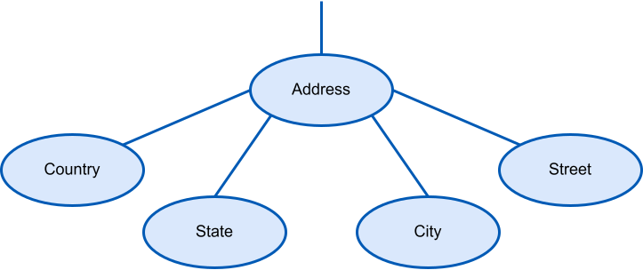

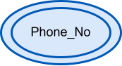

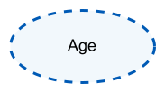

Why each "becomes" rule holds:
- **Composite → split.** If the whole address sits in one column you cannot search by city. (If you *never* query the parts, one column is fine — split the day you need to.)
- **Multivalued → own table.** A relational cell holds exactly one value (§10.12), so a list cannot be a column. `phone1, phone2, phone3` is the mistake the double ellipse exists to prevent.
- **Derived → compute.** A stored `age` is wrong a year later. Store a derived value only if it is expensive to compute *and* you accept keeping it fresh — or if it must be **frozen in time** (an order total at the prices of the day of purchase is not really derivable from *today's* data).

In crow's foot there are no special shapes: the composite is already split into columns, the multivalued attribute is already a separate box, and a derived attribute is usually omitted or marked with a comment:

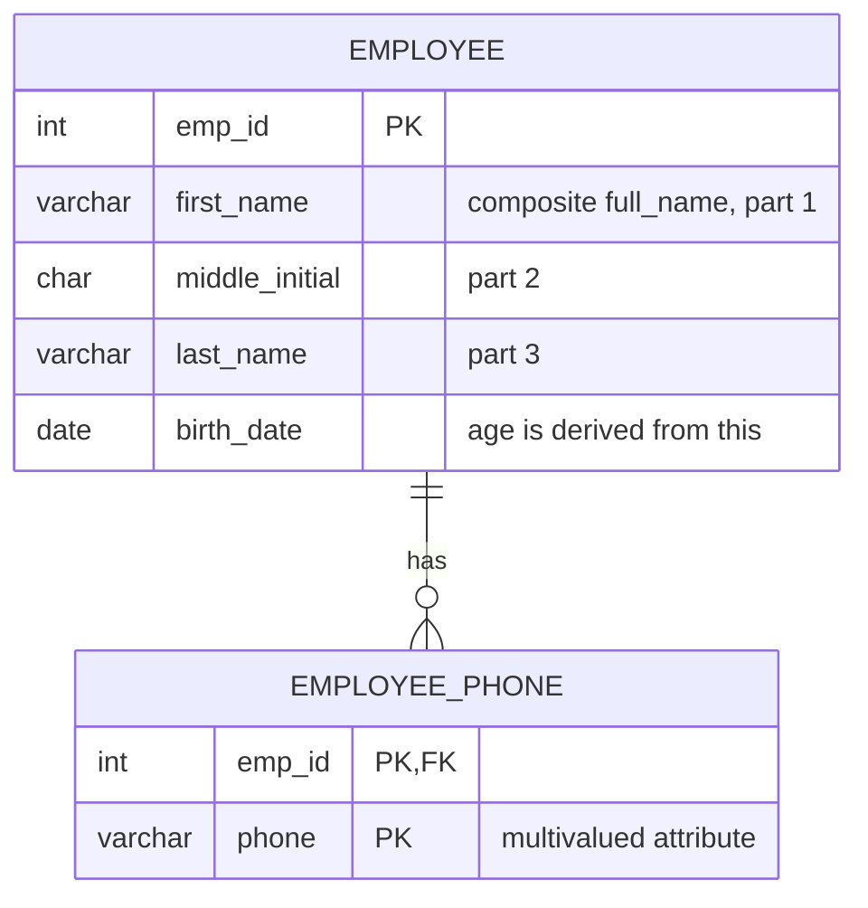

### Self-check
1. A double ellipse means…? → **Multivalued** (e.g. phone numbers).
2. `age` next to `birth_date` — which kind, and what column? → **Derived**; no column, compute it.
3. `address` split into street/city/postcode is…? → **Composite**; one column per part.

### TL;DR
Key (underlined) → PK; simple → column; composite → one column per part; multivalued (double ellipse) → separate table; derived (dashed) → computed, not stored.

---

## 10.7 Relationships: degree, cardinality and participation

A **relationship** is an association between entities, drawn in Chen as a diamond labelled with a verb that reads well aloud ("Employee *works in* Department", not "Employee *has* Department"). As with entities, the **relationship type** is the general association you draw, and the **relationship set** is the actual pairs stored (employee 2 works in department 10, …).

Three separate questions describe every relationship: **degree** (how many entity *types*), **cardinality** (how many *instances* on each side) and **participation** (is taking part *required*).

### Degree
| Degree | Name | Example | Tables |
|---|---|---|---|
| 1 | **Unary** (recursive) | an employee *supervises* employees | self-referencing FK: `employee.supervisor_id → employee.emp_id` |
| 2 | **Binary** | employee *works in* department | the usual case |
| 3 | **Ternary** | supplier *supplies* part *to* site | one table with three FKs, usually all three in the PK |

*Figure — unary and ternary relationships (course diagrams)*

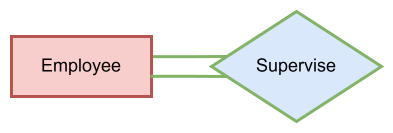

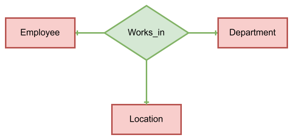

A ternary relationship records a fact that three binary relationships cannot: *which* combination is true. The demo in `code/04_ternary_and_weak_entity.sql` stores three supplier-part-site facts, then keeps only the binary pairs and joins them back:

```sql
WITH sp AS (SELECT DISTINCT supplier_id, part_id FROM supplies),
     ss AS (SELECT DISTINCT supplier_id, site_id FROM supplies)
SELECT ... FROM sp JOIN ss USING (supplier_id) ...   -- rebuild from pairs
```
Output:
```
--- the ternary fact: who supplies what, where
 supplier | part  | city  
----------+-------+-------
 Acme     | bolt  | Leeds
 Acme     | panel | Pune
 Bolt Co  | bolt  | Pune
(3 rows)

--- keep only binary pairs (supplier-part, supplier-site) and join them back:
 supplier | part  | city  | really_true 
----------+-------+-------+-------------
 Acme     | bolt  | Leeds | t
 Acme     | bolt  | Pune  | f
 Acme     | panel | Leeds | f
 Acme     | panel | Pune  | t
 Bolt Co  | bolt  | Pune  | t
(5 rows)
```
From the pairs alone you cannot tell whether Acme sends bolts to Pune. Ternary relationships are rare, though — before drawing one, check the fact truly needs all three at once (Chapter 11's 5NF, §11.13, is the formal version of this question).

### Cardinality (mapping cardinality)
| Cardinality | Meaning | Example |
|---|---|---|
| **1:1** | each side links to at most one of the other | employee ↔ payroll record |
| **1:N** | one on the left, many on the right | a department employs many employees |
| **N:1** | 1:N viewed from the opposite side | many employees work in one department |
| **M:N** | many on both sides | employees work on many projects; a project has many employees |

*Figure — many-to-many in Chen notation (course diagram)*

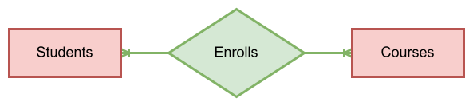

1:N and N:1 are one relationship described from opposite ends; both names are correct.

### How each cardinality becomes tables
*Figure — cardinality to foreign keys (course diagram)*

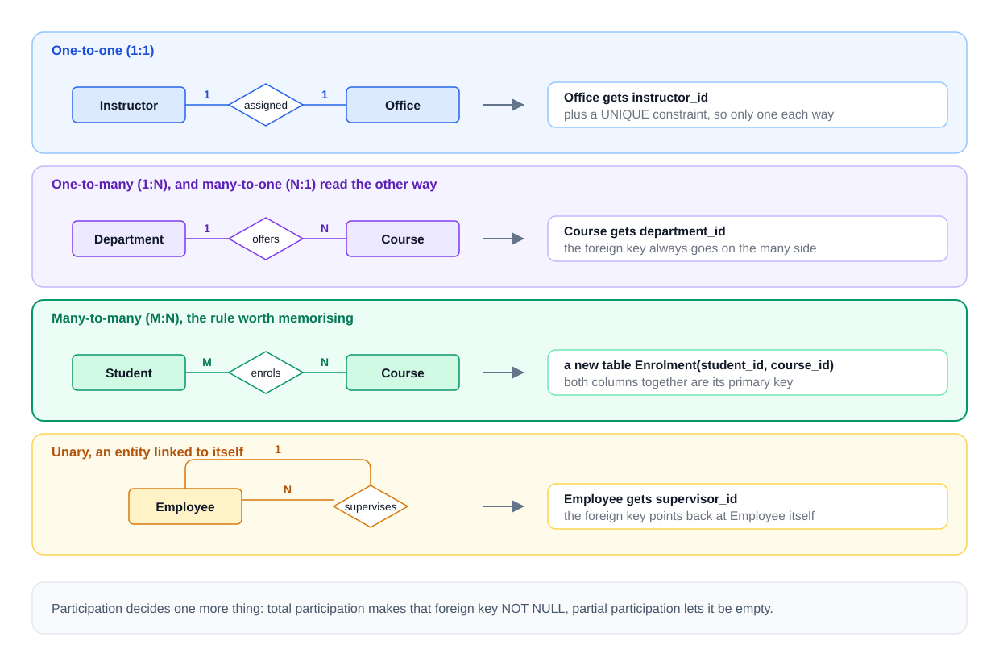

| Cardinality | Rule | Why |
|---|---|---|
| 1:N / N:1 | FK on the **many** side (`employee.dept_id`) | the "one" side would need a list in a cell |
| M:N | a new **junction table** (also *join*, *bridge* or *associative* table) holding both FKs, which together form its PK (`works_on(emp_id, project_id)`) | there is no single side to put it on |
| 1:1 | FK on **either** side **+ `UNIQUE`**; prefer the side with total participation so it can be `NOT NULL` | without `UNIQUE` it silently becomes 1:N |
| Unary | FK to the same table | |

Memorise this one: **every M:N link in a diagram costs three tables in SQL.**

### Participation
**Participation** says whether every instance *must* take part.

| | Chen drawing | Meaning | Becomes |
|---|---|---|---|
| **Total** (mandatory) | double line | every employee must work in a department | FK `NOT NULL` |
| **Partial** (optional) | single line | an employee may have no supervisor | FK allows `NULL` |

*Figure — total (double line) and partial (single line) participation (course diagrams)*

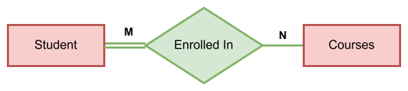

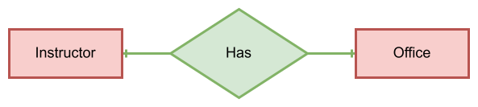

Skipping participation is easy and expensive: it decides whether a column can be empty, and that decision affects every query (outer vs inner joins, `IS NULL` checks).

### The (min, max) notation
Design tools often label each end with a pair **(min, max)** — the fewest and most times one instance can take part:

| Pair | Meaning | Participation | Crow's foot |
|---|---|---|---|
| `(0,1)` | at most once, maybe never | partial | `o\|` |
| `(1,1)` | exactly once | total | `\|\|` |
| `(0,N)` | any number, including none | partial | `o{` |
| `(1,N)` | at least once | total | `\|{` |

**The minimum is the participation; the maximum is the cardinality.** That is why tools prefer the pair: one label says both.

Careful: in Chen's `(min,max)` style the pair is usually written next to the entity it describes ("each employee works in (1,1) departments"), which is the *opposite* end from where crow's foot draws its symbol. Always check a diagram's legend.

### In the interview
**30-second answer:** "Degree counts the entity types involved — one (unary), two (binary) or three (ternary). Cardinality is how many instances link: 1:1, 1:N or M:N. Participation is whether taking part is mandatory. 1:N puts the FK on the many side; M:N needs a junction table; 1:1 is an FK plus UNIQUE; total participation makes the FK NOT NULL."

- *Where does the FK go in a 1:N?* → Many side. *Why not the one side?* → It would need a list in one cell, which violates 1NF (first normal form: one value per cell).
- *How do you enforce 1:1 in SQL?* → FK + `UNIQUE` on it (or share the same PK in both tables).
- *Can you enforce "every department has at least one employee" with a plain FK?* → No; an FK constrains the child side. You need a deferred constraint trigger (a trigger — code the database runs automatically on a change — whose check waits until commit) or application logic.

### TL;DR
Degree = number of entity types; cardinality = max instances per side; participation = min (mandatory or not). 1:N → FK on many side; M:N → junction table; 1:1 → FK + UNIQUE; unary → self-FK; total → NOT NULL.

---

## 10.8 Attributes of relationships

### What it is
Some facts describe the **link**, not either entity. The hours an employee spends on a project depend on *both* the employee and the project. In Chen notation such an attribute hangs off the diamond.

*Figure — an attribute on a relationship (course diagram)*

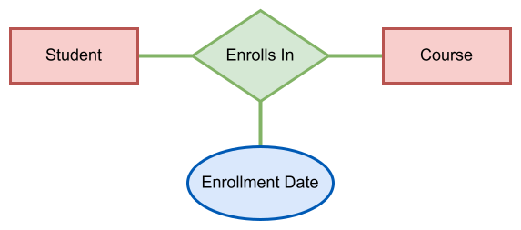

**The test:** *would you need to know both entities to know the value?*

| Attribute | Needs | Belongs on |
|---|---|---|
| `weekly_hours` | employee **and** project | the relationship *works on* |
| `start_date` of an assignment | employee **and** project | the relationship |
| `title` | project only | Project |
| `last_name` | employee only | Employee |

### Where it lands in tables
**Put the attribute wherever the relationship itself ended up:**
- **M:N** → a column in the junction table: `works_on(emp_id, project_id, weekly_hours)`.
- **1:N** → the many side, beside the FK (if an employee works in exactly one department, `role_in_dept` sits on `employee` next to `dept_id`).
- **1:1** → wherever the FK went.

*Figure — placement depends on cardinality (course diagram)*

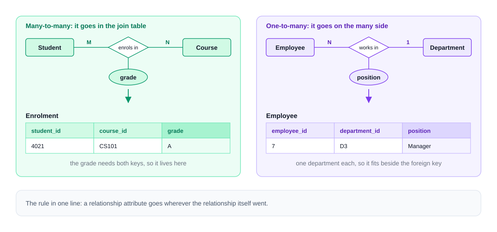

Putting it on an entity forces a false rule: `weekly_hours` on `employee` allows only one number per employee, however many projects they work on.

### When a relationship should become an entity
When a link collects many facts (a rental has out time, due time, return time, fee), promote it to an entity. The tables come out identical; the diagram just gains a box for a noun people already use. **Test:** if the business has a noun for the link ("rental", "loan", "enrolment", "booking"), make it an entity. That is why `rental` in the bike shop is an entity, not a diamond between Customer and Bike.

### TL;DR
If a fact needs both ends of a link, it is a relationship attribute; it lands in the junction table (M:N) or the many side (1:N). A link with its own name and many facts becomes an entity.

---

## 10.9 Weak entities

### What it is
A **weak entity** has nothing of its own that singles it out. "Room 101" is ambiguous — many buildings have one. Only *(Main building, room 101)* identifies it. The entity it depends on is the **owner** (or identifying / strong entity).

Four properties:
1. **No key of its own** — nothing inside it is unique across all instances.
2. **A partial key** (also called a **discriminator**) — unique *within one owner* (`room_no`).
3. **Existence dependency** — delete the building and its rooms mean nothing.
4. **Total participation in the identifying relationship** — no room belongs to no building.

### How it is drawn
| Chen symbol | Meaning |
|---|---|
| double rectangle | the weak entity |
| double diamond | the **identifying relationship** |
| dashed underline | the partial key |
| double line (weak side) | total participation |

*Figure — a weak entity in Chen notation, and its table (course diagrams)*

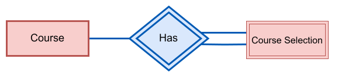

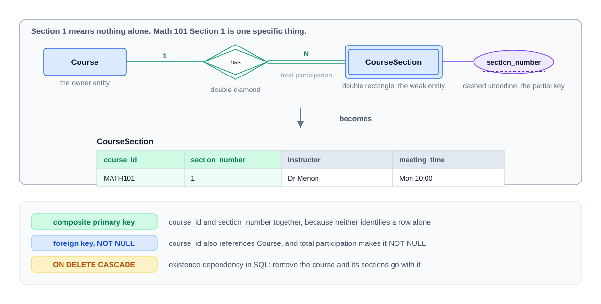

In crow's foot (mermaid), a weak entity is shown by an **identifying (solid) line** and a PK that includes the owner's key:

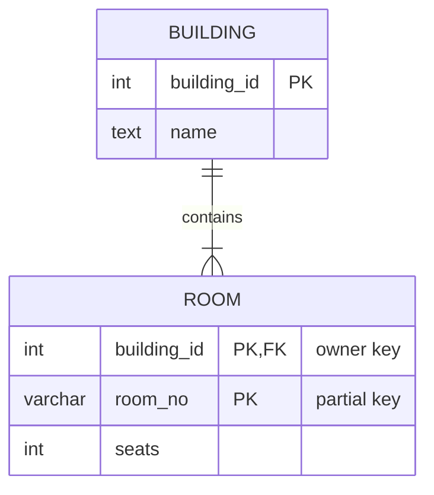

### What it becomes in SQL — two valid options
```sql
-- Option A: composite key = owner key + partial key
CREATE TABLE room_a (
  building_id int NOT NULL REFERENCES building ON DELETE CASCADE,
  room_no     varchar(6) NOT NULL,                 -- partial key (discriminator)
  seats       int,
  PRIMARY KEY (building_id, room_no)
);
-- Option B: surrogate key + UNIQUE on (owner key, partial key)
CREATE TABLE room_b (
  room_id     int GENERATED ALWAYS AS IDENTITY PRIMARY KEY,
  building_id int NOT NULL REFERENCES building ON DELETE CASCADE,
  room_no     varchar(6) NOT NULL,
  seats       int,
  UNIQUE (building_id, room_no)                    -- without this, duplicates slip in
);
```
Output (both options refuse a duplicate room, and cascade when the owner goes):
```
--- both options refuse a second room 101 in building 1
NOTICE:  room_a: duplicate key value violates unique constraint "room_a_pkey"
NOTICE:  room_b: duplicate key value violates unique constraint "room_b_building_id_room_no_key"
--- existence dependency: delete the Annex, its rooms go too
 room_a_rows | room_b_rows 
-------------+-------------
           1 |           1
(1 row)
```

| | Composite PK (A) | Surrogate PK (B) |
|---|---|---|
| Enforces "no duplicate partial key per owner" | automatically | only with the extra `UNIQUE` (easy to forget) |
| Referencing it from other tables | two columns | one column |
| Key width copied into child FKs/indexes | wider | narrow |

Common examples: order → order line (`(order_id, line_no)`), building → room, invoice → invoice line. **Weak or not is a design decision:** bank transactions numbered per account are weak; with a global transaction id they are strong. A reasonable default is option B *with* the unique constraint.

### Self-check
1. What is a partial key? → An attribute unique only within one owner (e.g. `line_no` within an order).
2. Which SQL clause expresses existence dependency? → `ON DELETE CASCADE` on the owner FK.
3. Why is the owner FK `NOT NULL`? → Participation in the identifying relationship is total.

### TL;DR
Weak entity = identified only together with its owner. PK = owner key + partial key (or surrogate + `UNIQUE(owner, partial)`), owner FK `NOT NULL` and `ON DELETE CASCADE`. Chen: double rectangle, double diamond, dashed underline.

---

## 10.10 Worked example — an employee-management ER diagram

### The brief
A company wants to:
1. Record each employee: name, date of birth, one or more phone numbers, and the department they belong to (every employee has exactly one department).
2. Keep one payroll record per employee (monthly salary, cash advance, tax); no payroll record is shared by two employees. Net pay is salary − advance − tax.
3. Record who supervises whom (the CEO has no supervisor).
4. Record which projects employees work on and for how many hours a week (many-to-many).
5. Record each employee's dependants (children, spouse) for insurance; a dependant is identified by name *within* an employee.

### Step 1 — entities (nouns)
Employee, Department, Payroll, Project, Dependant. ("Record", "information" and "number" are words about data, not things.)

### Step 2 — attributes, classified
| Entity | Attribute | Kind | Reason |
|---|---|---|---|
| Employee | `emp_id` | key | issued once, never repeats |
| | `full_name` | composite | first name, middle initial, last name |
| | `birth_date` | simple | one value |
| | `phone` | **multivalued** | "one or more" |
| | `age` | **derived** | from `birth_date` |
| Payroll | `payroll_id` | key | |
| | `monthly_salary`, `cash_advance`, `tax` | simple, **stored** | typed in by a person — nothing computes them |
| | `net_pay` | **derived** | salary − advance − tax |
| Department | `dept_id` (key), `dept_name` | | |
| Project | `project_id` (key), `title` | | |
| Dependant | `dep_name` | **partial key** | unique only within one employee |
| | `relationship` | simple | |

The recurring trap is salary vs net pay: **if someone types the value in, it is stored; if you can compute it from stored attributes, it is derived.**

### Steps 3–4 — relationships with degree, cardinality and participation
| Relationship | Degree | Cardinality | Participation |
|---|---|---|---|
| Employee *works in* Department | binary | N:1 | employee total (brief says "exactly one") |
| Employee *is paid through* Payroll | binary | 1:1 | both total |
| Employee *supervises* Employee | unary | 1:N | partial (CEO has none) |
| Employee *works on* Project, attribute `weekly_hours` | binary | M:N | partial |
| Employee *has* Dependant (identifying) | binary | 1:N | dependant total |

### Step 5 — the diagram
The course's Chen diagram for the core of this system (Employee + Payroll, with composite, multivalued and derived attributes) shows every special symbol at once:

*Figure — Employee and Payroll in Chen notation: underlined keys, composite Full_Name, double-ellipse Contact_Number, dashed Age and Net_Pay (course diagram)*

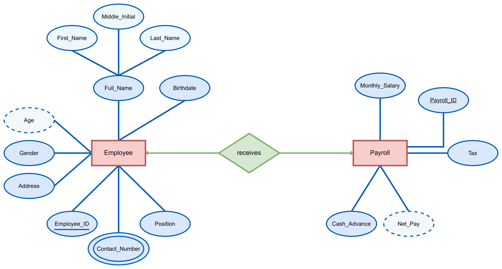

The full design in crow's-foot notation:

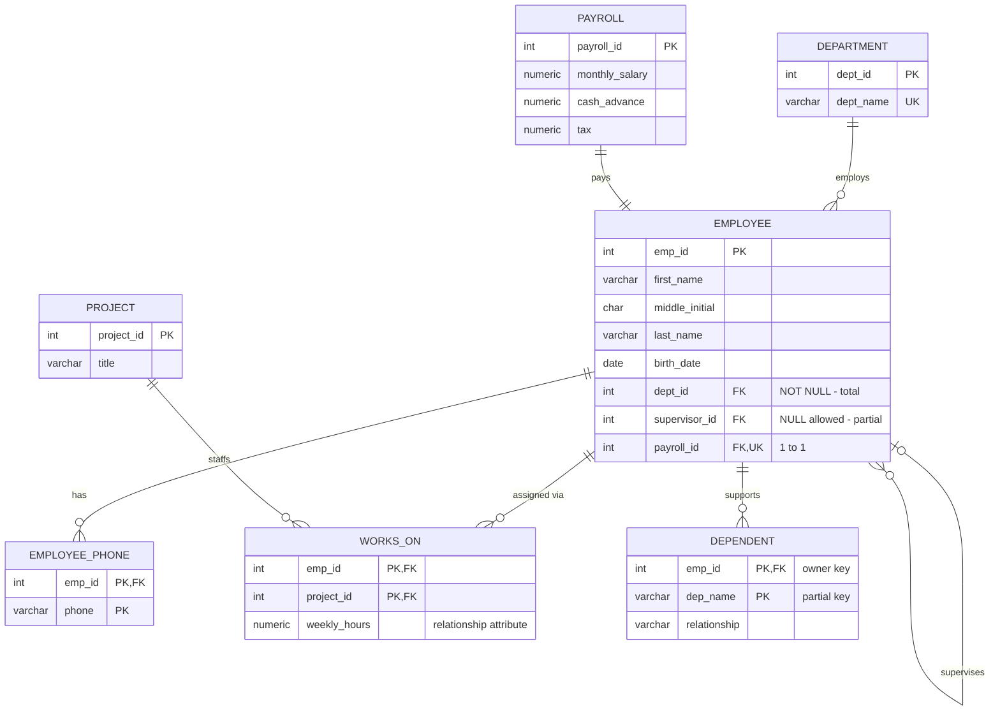

**Read it back as sentences** — if one sounds wrong, the diagram is wrong: "Each employee works in exactly one department; a department employs zero or more employees (the brief does not require every department to have staff). Each employee has exactly one payroll record and vice versa. An employee may supervise several employees and has at most one supervisor…"

### Design check: does Payroll deserve its own table?
A 1:1 with total participation on **both** sides usually describes one thing stored in two places. Reasons to keep two tables anyway:
- **Access control** — salaries can be granted to HR only (`GRANT` gives a user or role a permission: `GRANT SELECT ON payroll TO hr`; see [Chapter 14](../14-advanced-sql-and-using-sql-from-code/README.md)).
- **Row width** — the frequently read `employee` row stays narrow.
- **Optional data** — if many employees had no payroll row, a separate table stores nothing for them instead of several `NULL`s.

Reasons to merge: no join, and no way to have an employee without payroll. Either answer is acceptable in an interview **if you notice the question and justify your choice.** Here we keep them separate for access control. §10.15 converts this diagram to tables and runs it.

### TL;DR
Nouns → entities; classify every attribute (key/simple/composite/multivalued/derived); settle degree, cardinality and participation separately for each verb; read the diagram back as sentences; a 1:1 with total participation both ways should always prompt "one table or two?".

---

## 10.11 The relational model

### What it is
The ER diagram is a drawing; a database stores **relations** (tables). The **relational model**, published by **Edgar F. Codd in 1970**, says: store all data as tables of values, and let programs *describe* the data they want while the system works out how to fetch it.

Before it, hierarchical and network databases (older designs where records were linked in trees or webs) made programs walk stored paths of pointers (stored disk addresses of other records) (employee record → pointer → department record). Reorganize the file and every program walking that path broke.

### The three parts of the model
| Part | Question it answers | Content |
|---|---|---|
| **Structure** | What shape is the data? | Only relations: a name, named columns, rows of single values. No nested records, arrays or pointers. |
| **Integrity** | Which tables are legal? | Keys and constraints declared once on the table; the DBMS refuses any change that breaks them. |
| **Manipulation** | How do I get data out? | Declarative queries (SQL: you state *what* you want, not how to fetch it), built on **relational algebra**: operations (select, project, join, union, difference …) that take relations and return a relation. |

*Figure — structure, integrity, manipulation (course diagram)*

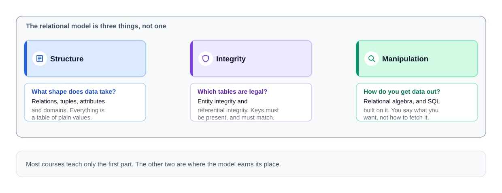

### Links are values, not pointers
`employee.dept_id = 10` links to the department whose `dept_id` is 10 — the shared *value* is the whole link. Consequences:
- The link survives copying the table to another server, reloading in a different order, or rebuilding indexes.
- The DBMS can **check** the link (a foreign key refuses `dept_id = 99` if no department 99 exists). A raw pointer cannot be checked like that.

### What you get
- **One rule reaches every program** — constraints live with the data.
- **Physical data independence** — queries name *what*, not *how*, so indexes and storage can change without editing queries.
- **Some logical data independence** — adding a column or hiding a split behind a view (a saved query that behaves like a table) does not break existing queries. It is *not* total: renaming a column or shrinking its type still breaks the programs that use it.

### What it does not promise
- **Nothing about storage** — files, pages and indexes belong to the storage engine (the part of the DBMS that reads and writes the files) ([Chapter 12](../12-indexes-storage-and-query-performance/README.md)).
- **Joins are not free** — matching values costs work that grows with table size.
- **A table is not always an entity** — tables also come from M:N relationships (`works_on`) and multivalued attributes (`employee_phone`).

### TL;DR
Codd (1970): everything is a relation of single values; integrity rules are declared on tables; queries are declarative. Rows link by shared values, which can be checked and survive reorganization.

---

## 10.12 Relations, tuples, attributes — the precise vocabulary

### The core words
| Formal term | SQL term | Older file term | Meaning |
|---|---|---|---|
| **relation** | table | file | named set of rows with fixed named columns |
| **tuple** | row | record | one value for each attribute |
| **attribute** | column | field | a named column |
| **domain** | data type + constraints | field type | the set of allowed values for an attribute |
| **degree** (arity) | number of columns | number of fields | a property of the schema |
| **cardinality** | number of rows | number of records | a property of the current data |

*Figure — anatomy of a relation (course diagram)*

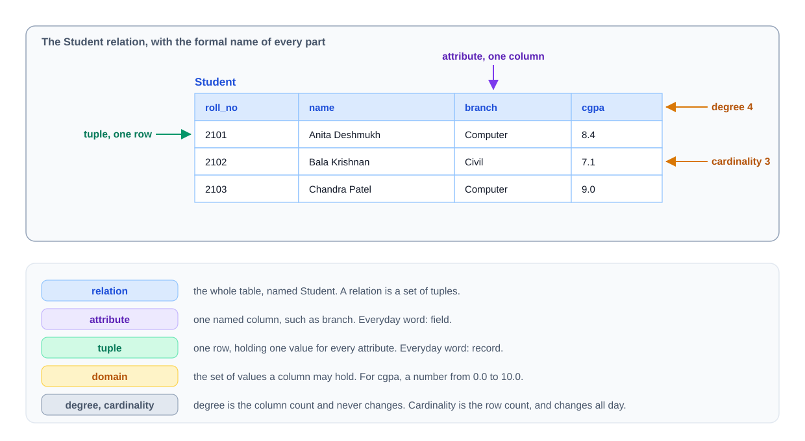

- **Domain** is what you *mean*, which is more than a type: `int` is a type; "integers 1–500" is the domain you meant for room capacity, enforced with `CHECK`.
- **Schema vs instance.** The **relation schema** is the design — `room(room_id, code, capacity)` — and rarely changes. The **relation instance** is the set of rows at this moment and changes with every insert. A key belongs to the *schema*, so it has to be true for any data the table could ever legally contain — the current rows prove nothing.
- **Two meanings of "cardinality".** In §10.7 it meant how many instances link (1:N); here it means a row count. Both are standard; context tells you which.

### Five properties of every relation
1. **One value per cell** (atomic) — no lists, no nested records. This is why multivalued attributes need their own table, and it is the heart of 1NF ([§11.7](../11-normalization/README.md#117-first-normal-form-1nf)).
2. **Rows have no inherent order** — a relation is a set, so if you need sorted output you must ask for it with `ORDER BY`.
3. **Columns have no inherent order either** — you refer to them by name. (Real SQL tables do remember the order columns were declared in, so `SELECT *` always lists them the same way; still, list the columns you want explicitly.)
4. **Attribute names are unique within a relation.**
5. **No duplicate tuples** — a set has no duplicates. *Here SQL differs:* a SQL table accepts identical rows unless a `PRIMARY KEY` or `UNIQUE` forbids them. Declaring a key closes the gap.

### NULL
`NULL` marks a **missing** value: either *unknown* (grade not yet computed) or *not applicable* (no middle name). It is not zero and not the empty string. SQL uses **three-valued logic**: comparing anything with `NULL` gives *unknown*, and `WHERE` keeps only rows where the condition is *true* ([Chapter 2](../02-select-basics/README.md) covers this in depth). From `code/03_keys_and_integrity.sql`:

```sql
SELECT (SELECT count(*) FROM lecturer WHERE room_id = NULL)  AS eq_null,
       (SELECT count(*) FROM lecturer WHERE room_id IS NULL) AS is_null,
       count(room_id) AS count_col, count(*) AS count_star
FROM lecturer;
```
Output:
```
 eq_null | is_null | count_col | count_star 
---------+---------+-----------+------------
       0 |       2 |         1 |          3
(1 row)
```
`= NULL` matches nothing, `IS NULL` works, `count(col)` skips nulls while `count(*)` counts rows. So whenever a column is nullable, each query touching it must decide how missing values are treated.

### Self-check
1. `student(roll_no, name, cgpa, dept)` holds 8,000 rows. Degree? Cardinality? → **4** and **8,000**.
2. Does a SQL table forbid duplicate rows by default? → **No** — only a key or `UNIQUE` does.
3. Why can't you prove `{name}` is a key by looking at the rows? → Keys are schema properties; rows can only *disprove* one (two equal names).

### TL;DR
Relation = table, tuple = row, attribute = column, domain = allowed values; degree = #columns (schema), cardinality = #rows (instance). Cells are atomic, order is meaningless, formal relations have no duplicates (SQL tables do unless keyed). `NULL` = missing; test with `IS NULL`.

---

## 10.13 Keys in relational databases

Two identical-looking rows — same name, department and year — and a support ticket asking to change "that student". Without something that tells rows apart, the request has no answer. **Keys** make identity exist. Chapter 11 states its rules with exactly these definitions, so precision matters.

Running example: `lecturer(lecturer_id, email, name, room_id)`, where ids are issued once and emails are unique.

| Key | Definition | Example |
|---|---|---|
| **Superkey** | a set of attributes that can **never** repeat in two rows (in any legal instance) | `{lecturer_id}`, `{email}`, `{lecturer_id, name}`, all four columns … |
| **Candidate key** | a **minimal** superkey — remove any attribute and it stops being unique | `{lecturer_id}`, `{email}` |
| **Primary key** | the one candidate key you *choose*; unique and never `NULL` | `lecturer_id` |
| **Alternate key** | any candidate key other than the chosen primary one — declare it `UNIQUE` | `email` |
| **Composite key** | any key with 2+ attributes (a shape, not a separate kind) | `booking(room_id, day, slot)` |
| **Foreign key** | attributes whose values must match a key in a (possibly the same) table, or be `NULL` | `lecturer.room_id → room.room_id` |
| **Natural key** | made of real-world data | email, ISBN, frame number |
| **Surrogate key** | system-generated, no business meaning | identity integer, UUID |

*Figure — superkeys ⊇ candidate keys ⊇ primary key, with prime and non-prime attributes (course diagram)*

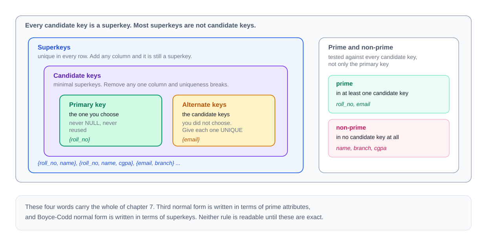

Key facts to be exact about:
- **A superkey stays a superkey when you add columns to it**, so there are many of them; candidate keys are the ones with nothing spare. Minimality is about *removability*, not size — a 3-column candidate key is fine if none can go.
- **All candidate keys are superkeys, but the reverse is rarely true.**
- **Prime attribute** = appears in *some* candidate key (any of them, not only the chosen primary key). **Non-prime** = belongs to none. In `lecturer`, `lecturer_id` and `email` are prime; `name` and `room_id` are non-prime. 3NF is defined with these words ([§11.9](../11-normalization/README.md#119-third-normal-form-3nf)).
- **Composite example.** `enrolment(student_id, course_id, term, grade)`: students may retake a course another term, so only `{student_id, course_id, term}` identifies a row, and dropping any of the three breaks it.
- **Foreign keys:** may be `NULL` (no link yet — that is not a violation); may reference any `PRIMARY KEY` **or `UNIQUE`** column set; may reference their own table (`employee.supervisor_id`), which is how a unary relationship becomes a column.
- **Surrogate vs natural:** surrogates are narrow and never change; natural keys are readable and sometimes save a join, but change when the business changes (a new roll-number format means updating every FK). **Default: surrogate PK + `UNIQUE` natural key** — the `customer` table in `00_schema.sql` does exactly that.

### In the interview
**30-second answer:** "A superkey uniquely identifies rows; a candidate key is a minimal superkey; the primary key is the candidate I pick — unique and not null; the other candidates are alternate keys and get UNIQUE constraints. A foreign key references a primary or unique key and may be null. My default is a generated surrogate PK, with the natural key kept unique."

- *Is `{id, name}` a candidate key?* → A superkey, not a candidate key: `name` can be dropped.
- *UUID vs bigint surrogate?* → UUIDs can be generated anywhere without coordination but are 16 bytes vs 8 and random UUIDs scatter B-tree (the default, always-sorted index structure) inserts; time-ordered UUIDs (v7) reduce that.
- *Is an attribute of an alternate key prime?* → Yes — prime means "in any candidate key".

### TL;DR
Superkey (unique) ⊇ candidate key (minimal) ⊇ primary key (chosen, NOT NULL); other candidates = alternate keys (UNIQUE). Prime = in some candidate key. FKs match a PK/UNIQUE or are NULL. Surrogate PK + unique natural key is the safe default.

---

## 10.14 Relational integrity constraints

### What it is
An **integrity constraint** is a condition stored data is never allowed to break. Whatever program connects, the DBMS tests it during each `INSERT`, `UPDATE` and `DELETE` and refuses any change that would violate it.

*Figure — the integrity constraints and the SQL that declares each (course diagram)*

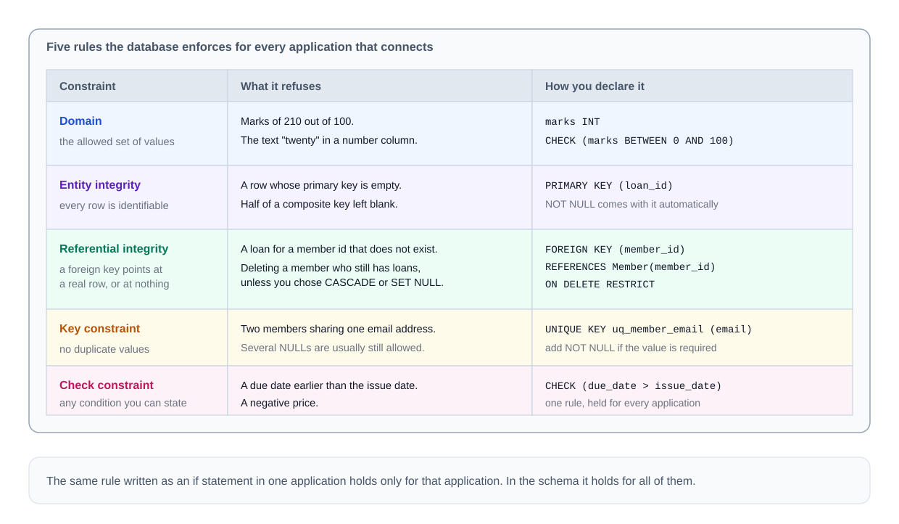

| Constraint | Rule | SQL |
|---|---|---|
| **Domain** | a value must be in the attribute's domain | the data type, plus `CHECK (capacity BETWEEN 1 AND 500)` |
| **Entity integrity** | no part of a primary key may be `NULL` | `PRIMARY KEY` (implies `NOT NULL`) |
| **Key** | candidate keys are unique | `PRIMARY KEY`, `UNIQUE` |
| **Referential integrity** | an FK value matches an existing referenced row, or is `NULL` — no **orphan rows** | `FOREIGN KEY … REFERENCES …` |
| (also declared the same way) | must always have a value / default when omitted | `NOT NULL`, `DEFAULT` (DEFAULT never refuses anything, so it is not strictly a constraint) |

Why entity integrity: a primary key identifies a row, and `NULL` means "unknown" — a row with unknown identity cannot be distinguished, so the model rejects it. For composite keys *every* column must be present.

### What happens when a referenced (parent) row is deleted or its key updated
| Action (`ON DELETE` / `ON UPDATE`) | Effect | Use when |
|---|---|---|
| `NO ACTION` (default) | error if children exist; in PostgreSQL the check runs at the end of the statement and can be `DEFERRABLE` (postponed) to the end of the transaction — the group of statements committed together | general default |
| `RESTRICT` | error immediately, cannot be deferred | you want an immediate refusal |
| `CASCADE` | delete/update the children too | weak entities, pure child data (phones, order lines) — dangerous elsewhere |
| `SET NULL` | children's FK becomes `NULL` (column must be nullable) | optional relationships |
| `SET DEFAULT` | children's FK becomes its default | rare |

Dialect notes: MySQL/InnoDB (MySQL's default storage engine) treats `NO ACTION` as `RESTRICT` and rejects `SET DEFAULT`; SQL Server has no `RESTRICT` keyword (use `NO ACTION`); SQLite enforces FKs only after `PRAGMA foreign_keys = ON` (a SQLite settings command). MySQL enforces `CHECK` only from 8.0.16 (earlier versions parsed and ignored it).

### Running it (`code/03_keys_and_integrity.sql`)
Each failing statement is wrapped in a `DO` block (a one-off piece of PostgreSQL procedural code) that catches the error and prints it as a `NOTICE` (an informational message), so the script keeps going.

```sql
CREATE TABLE room (
  room_id  int PRIMARY KEY,                                    -- entity integrity: unique + NOT NULL
  code     varchar(10) NOT NULL UNIQUE,                        -- alternate (candidate) key
  capacity int NOT NULL CHECK (capacity BETWEEN 1 AND 500)     -- domain constraint
);
CREATE TABLE lecturer (
  lecturer_id int PRIMARY KEY,
  name        varchar(60) NOT NULL,
  email       varchar(120) UNIQUE,                             -- UNIQUE but nullable
  room_id     int REFERENCES room(room_id) ON DELETE SET NULL  -- optional link
);
CREATE TABLE booking (
  room_id  int  NOT NULL REFERENCES room(room_id) ON DELETE RESTRICT,
  day      date NOT NULL,
  slot     int  NOT NULL CHECK (slot BETWEEN 1 AND 8),
  PRIMARY KEY (room_id, day, slot)                             -- composite key
);
-- each violation is attempted inside:  DO $$ BEGIN ... EXCEPTION WHEN ... THEN RAISE NOTICE ... END $$;
```
Output:
```
--- 1. domain: capacity 900 is outside the allowed values
NOTICE:  new row for relation "room" violates check constraint "room_capacity_check"
--- 2. entity integrity: a primary key may not be NULL
NOTICE:  null value in column "room_id" of relation "room" violates not-null constraint
--- 3. key constraint: the alternate key code must be unique
NOTICE:  duplicate key value violates unique constraint "room_code_key"
--- 4. referential integrity: no orphan rows
NOTICE:  insert or update on table "booking" violates foreign key constraint "booking_room_id_fkey"
--- 5. UNIQUE lets several rows have NULL (Dr Silva and Dr Wu both have no email)
   name   | email 
----------+-------
 Dr Silva | 
 Dr Wu    | 
(2 rows)

--- 6. ON DELETE RESTRICT: room 1 still has bookings
NOTICE:  update or delete on table "room" violates foreign key constraint "booking_room_id_fkey" on table "booking"
--- 7. ON DELETE SET NULL: deleting room 2 empties Dr Silva's room_id
   name   | room_id 
----------+---------
 Dr Park  |       1
 Dr Silva |        
 Dr Wu    |        
(3 rows)
```

### UNIQUE and NULL — a classic surprise
Because `NULL` is never equal to `NULL`, most databases let a `UNIQUE` column hold **many** nulls (output 5). If "unique when present" is not what you want, add `NOT NULL`.

| DBMS | Multiple NULLs in a UNIQUE column? |
|---|---|
| PostgreSQL | yes by default; PostgreSQL 15+ can say `UNIQUE NULLS NOT DISTINCT` to allow only one (not run here — our server is 14) |
| MySQL (InnoDB) | yes |
| SQLite | yes |
| SQL Server | **no — only one NULL**; use a filtered unique index (one covering only rows that match its `WHERE`) `WHERE col IS NOT NULL` for "many" |

### Why rules belong in the schema
1. **They hold for everybody** — web app, mobile backend (the server code behind a phone app), nightly import, a hand-typed fix at midnight.
2. **They cannot drift** — one copy, not one per application.
3. **They document meaning** — the `CREATE TABLE` tells a reader what the data is.

Costs: constraints add a little work to each write, and a thoughtless `CASCADE` can wipe out far more rows than someone meant. Both are small next to the benefit of a single, central enforcement point.

### Common mistakes
- Forgetting to declare alternate keys → two customers with the same email.
- `ON DELETE CASCADE` on a "real" relationship (deleting a customer silently deletes their invoices).
- Assuming a nullable `UNIQUE` column means "at most one missing".
- Leaving FKs off "for speed" — orphans appear and joins silently lose rows.

### TL;DR
Domain (type + CHECK), entity integrity (PK never NULL), key (UNIQUE), referential (FK matches or NULL; choose RESTRICT/NO ACTION/CASCADE/SET NULL on delete). UNIQUE usually allows many NULLs. Put rules in the schema so they hold for every client.

---

## 10.15 Converting an ER diagram to tables

### The procedure
Once the diagram is right, conversion is mechanical — one decision per construct:

| # | ER construct | Relational result |
|---|---|---|
| 1 | Strong entity | a table; key attribute → primary key |
| 2 | Simple attribute | a column |
| 3 | Composite attribute | one column per part (no column for the whole) |
| 4 | Derived attribute | no column (compute in the query or a view) |
| 5 | Multivalued attribute | own table: owner key + value, both in the PK, `ON DELETE CASCADE` |
| 6a | 1:N / N:1 relationship | FK on the many side |
| 6b | M:N relationship | junction table: both FKs, together the PK |
| 6c | 1:1 relationship | FK + `UNIQUE` on either side, prefer the total-participation side |
| 6d | Unary relationship | FK to the same table |
| 6e | Ternary relationship | table with three FKs (PK usually all three) |
| 7 | Relationship attribute | follows the relationship: junction table (M:N) or many side (1:N) |
| 8 | Weak entity | table with PK = owner key + partial key; owner FK `NOT NULL`, usually `ON DELETE CASCADE` |
| 9 | Participation | total → FK `NOT NULL`; partial → FK nullable |

Create tables in **dependency order** — parents before children, since a foreign key can only point at a table that already exists.

*Figure — the course's Employee/Payroll example as tables: the composite splits, the multivalued attribute becomes a table, the derived attributes vanish (course diagrams)*

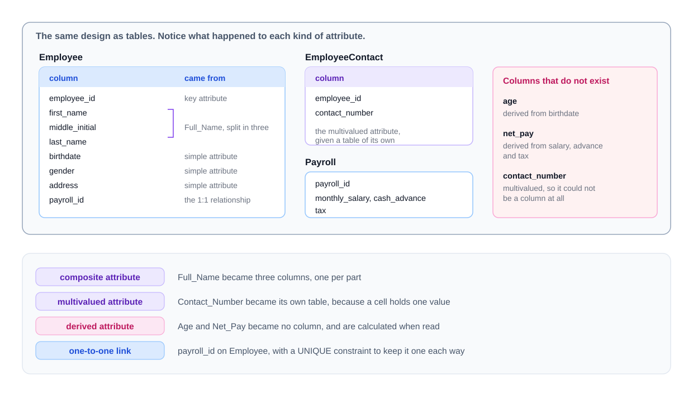

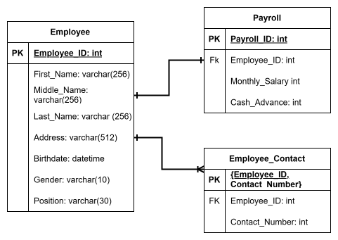

### Running the procedure on §10.10 (`code/02_employee_er_to_tables.sql`)
```sql
CREATE TABLE department (                      -- strong entity -> table
  dept_id   int PRIMARY KEY,
  dept_name varchar(60) NOT NULL UNIQUE
);
CREATE TABLE payroll (                         -- strong entity -> table
  payroll_id     int PRIMARY KEY,
  monthly_salary numeric(10,2) NOT NULL CHECK (monthly_salary >= 0),  -- stored (typed in)
  cash_advance   numeric(10,2) NOT NULL DEFAULT 0,
  tax            numeric(10,2) NOT NULL DEFAULT 0
  -- net_pay is DERIVED -> no column (computed in the view below)
);
CREATE TABLE employee (
  emp_id         int PRIMARY KEY,                               -- key attribute
  first_name     varchar(40) NOT NULL,                          -- composite attribute full_name
  middle_initial char(1),                                       --   split into
  last_name      varchar(40) NOT NULL,                          --   one column per part
  birth_date     date NOT NULL,                                 -- simple; age is DERIVED
  dept_id        int  NOT NULL REFERENCES department(dept_id),  -- 1:N, total participation -> NOT NULL
  supervisor_id  int  REFERENCES employee(emp_id),              -- unary 1:N, partial -> NULL allowed
  payroll_id     int  NOT NULL UNIQUE REFERENCES payroll(payroll_id)  -- 1:1 -> FK + UNIQUE
);
CREATE TABLE employee_phone (                   -- multivalued attribute -> own table
  emp_id int         NOT NULL REFERENCES employee(emp_id) ON DELETE CASCADE,
  phone  varchar(20) NOT NULL,
  PRIMARY KEY (emp_id, phone)
);
CREATE TABLE project (project_id int PRIMARY KEY, title varchar(80) NOT NULL);
CREATE TABLE works_on (                          -- M:N -> junction table
  emp_id     int NOT NULL REFERENCES employee(emp_id),
  project_id int NOT NULL REFERENCES project(project_id),
  weekly_hours numeric(4,1) NOT NULL CHECK (weekly_hours > 0),  -- relationship attribute
  PRIMARY KEY (emp_id, project_id)
);
CREATE TABLE dependent (                          -- weak entity
  emp_id       int NOT NULL REFERENCES employee(emp_id) ON DELETE CASCADE,  -- owner key
  dep_name     varchar(40) NOT NULL,                                       -- partial key
  relationship varchar(20) NOT NULL,
  PRIMARY KEY (emp_id, dep_name)                                           -- owner key + partial key
);
-- Derived attributes live in a view (fixed "as of" date so the output is repeatable):
CREATE VIEW employee_card AS
SELECT e.emp_id,
       concat_ws(' ', e.first_name, e.middle_initial, e.last_name)   AS full_name,
       date_part('year', age(date '2026-09-28', e.birth_date))::int  AS age,
       p.monthly_salary - p.cash_advance - p.tax                    AS net_pay,
       (SELECT string_agg(phone, ', ' ORDER BY phone) FROM employee_phone ph
         WHERE ph.emp_id = e.emp_id)                                 AS phones
FROM employee e JOIN payroll p USING (payroll_id);
```
Output:
```
--- employee_card (derived: full_name, age, net_pay; multivalued: phones)
 emp_id |  full_name   | age | net_pay |              phones               
--------+--------------+-----+---------+-----------------------------------
      1 | Aisha Khan   |  41 | 4900.00 | +44 20 7946 0001
      2 | Ravi K Menon |  33 | 4250.00 | +91 80 4000 0003, +91 98450 00002
      3 | Sofia Rossi  |  28 | 3100.00 | 
(3 rows)

--- the unary relationship: who reports to whom
 employee | supervisor 
----------+------------
 Aisha    | 
 Ravi     | Aisha
 Sofia    | Aisha
(3 rows)

--- 1:1 is enforced by UNIQUE: a second employee on payroll 501 is refused
NOTICE:  refused: duplicate key value violates unique constraint "employee_payroll_id_key"
--- weak entity: deleting the owner removes its dependents (ON DELETE CASCADE)
 dependents_left | phones_left 
-----------------+-------------
               0 |           0
(1 row)
```
(Before deleting employee 2 the script first removes their `works_on` rows and clears the `supervisor_id` pointing at them, because those FKs use the default `NO ACTION` — the database would otherwise refuse, which is exactly referential integrity at work.)

### Checking a conversion
1. **Count:** 5 entities + 1 multivalued attribute + 1 M:N relationship = 7 tables. ✓
2. **Every relationship produced something** (an FK, a UNIQUE FK or a table). A relationship that produced nothing was missed.
3. **No derived attribute survived** as a column — or, if one did, a comment says why.
4. **No multivalued attribute left in its parent** — a list column is a 1NF violation (Chapter 11).

### TL;DR
Entities → tables; simple → columns; composite → parts; derived → nothing; multivalued → own table; 1:N → FK on many side; M:N → junction table; 1:1 → FK + UNIQUE; weak → owner key + partial key with CASCADE; total participation → NOT NULL. Parents first.

---

## 10.16 Best practices for ER → relational mapping

The procedure is mechanical for small diagrams; large ones need judgement in a few places.

| Situation | Recommendation | Why / exception |
|---|---|---|
| **Composite attribute** | Store the parts; do **not** also store the whole. Build the whole in a query or view. | Two copies disagree after the first partial update. Exception: never query the parts → one column is fine. |
| **Multivalued attribute** | Always a separate table with a composite PK (owner key + value). Never numbered columns. | The composite PK stops the same phone being stored twice for one person. |
| **Derived attribute** | Compute on read. Store only if expensive *or* it must be frozen in time (order total at purchase prices) — and comment the column. | Otherwise the next engineer deletes it as a "mistake". |
| **1:1 with total participation both sides** | Probably one table. Keep two only for access control, row width, or mostly-absent optional data. | Two tables always joined 1:1 are cost without benefit. |
| **M:N** | The junction table is mandatory; relationship attributes live there; give it a business name (`enrolment`, `booking`) not `student_course`. | Add a surrogate key only if other tables must reference a single row — and keep `UNIQUE` on the pair so nobody enrols twice. |
| **Weak entity with a surrogate key** | Keep `UNIQUE (owner_key, partial_key)`. | Otherwise the rule the weak entity expressed is enforced nowhere. |
| **Naming** | One style for tables and columns; FKs named after their target; **role names** when two FKs hit the same table (`origin_airport_id`, `destination_airport_id`, not `airport_id_1/2`). | Readable joins. |
| **Normalization** | Run the normal forms over the result ([Chapter 11](../11-normalization/README.md)); expect one or two further splits. | A careful ERD lands *near* 3NF, rarely exactly on it. |
| **Large diagrams** | Create parent tables before children and finish one area (say orders) before starting the next (inventory); record each choice you made that the rules left open (merged 1:1s, stored derived columns, surrogate keys on weak entities). | Those are the choices someone will question later. |

### Common mistakes
- Converting an M:N with an FK on one side (only works if it was really 1:N).
- Keeping `full_name` *and* `first_name`/`last_name`.
- Surrogate key on a junction table without the pair `UNIQUE`.
- Creating child tables before parents in a migration script.

### In the interview
**30-second answer (for "turn this ERD into tables"):** "Each strong entity becomes a table with its key as PK. Composite attributes split into columns, derived ones are computed, multivalued ones get their own table. 1:N puts the FK on the many side, M:N gets a junction table holding both keys plus any relationship attributes, 1:1 is an FK with UNIQUE. A weak entity's PK combines its owner's key with its partial key, with cascade delete, and total participation means NOT NULL. Then I check the result against the normal forms."

- *Where does `grade` go in student–course?* → In the enrolment junction table.
- *Would you merge a 1:1?* → Yes unless access control, row width or sparse optional data justify splitting.

### Self-check
1. Two FKs from `flight` to `airport` — how do you name them? → By role: `origin_airport_id`, `destination_airport_id`.
2. A junction table has a surrogate PK. What else must it have? → `UNIQUE` on the two FK columns.
3. Is the converted schema automatically in 3NF? → No; check it with the normal forms.

### TL;DR
Split composites without keeping the whole; multivalued → table; derived → computed (unless frozen); question every total 1:1; junction tables hold relationship attributes and a unique pair; name by role; convert in dependency order; then normalize.

---

## Key terms

| Term | Meaning |
|---|---|
| Data model | picture of entities, attributes and relationships |
| Conceptual / logical / physical model | things + links / + attributes, keys, general types / + exact types, indexes for one DBMS |
| Data independence | changing storage (physical) or some schema details (logical) without changing applications |
| Entity type / instance / set | the kind / one member / all current members |
| Key, simple, composite, multivalued, derived attribute | identifies / one value / has parts / many values / computed |
| Relationship type / set | the association / the actual pairs |
| Degree | number of entity types in a relationship (unary, binary, ternary) |
| Cardinality (ER) | max instances per side: 1:1, 1:N, M:N |
| Participation | total (mandatory, double line) or partial (optional) |
| (min, max) | min = participation, max = cardinality |
| Junction table | table implementing an M:N relationship |
| Weak entity, owner, partial key (discriminator), identifying relationship | entity identified only with its owner, via owner key + partial key |
| Chen vs crow's-foot | ellipse/diamond notation vs attributes-in-box + line-end notation |
| Relation, tuple, attribute, domain | table, row, column, allowed values |
| Degree / cardinality (relation) | number of columns / number of rows |
| Schema vs instance | design vs current data |
| Superkey, candidate, primary, alternate, composite, foreign, natural, surrogate key | see §10.13 |
| Prime / non-prime attribute | in some candidate key / in none |
| Domain, entity, key, referential integrity | allowed values / PK not NULL / uniqueness / FK matches or NULL |
| Orphan row | child row whose FK points at nothing |
| RESTRICT / NO ACTION / CASCADE / SET NULL / SET DEFAULT | what happens to children when a parent is deleted/updated |

---

## Chapter 10 TL;DR

- **Model before tables.** Entities (nouns) → tables, attributes → columns, relationships (verbs) → FKs or junction tables. A fact you do not model is a question you cannot answer.
- **Three levels:** conceptual (for the business), logical (attributes, keys, normalization), physical (types, indexes, one DBMS).
- **Process:** requirements + questions → entities → relationships → conceptual review → logical → physical → validate; loop back freely.
- **Best practices:** constraints in the schema, one naming style, dates as dates, money as `numeric`, explicit `NOT NULL`, surrogate PK + unique natural key, 3NF by default, index real queries.
- **ER notation:** Chen (rectangle, ellipse, diamond; double ellipse = multivalued, dashed = derived, double rectangle/diamond = weak) vs crow's foot (`||`, `o|`, `o{`, `|{`), which mermaid draws.
- **Relationships:** degree, cardinality, participation are three separate questions; (min,max) = (participation, cardinality).
- **Relational model (Codd 1970):** relations of atomic values, links by value, declarative queries; SQL tables allow duplicates unless keyed; `NULL` needs `IS NULL`.
- **Keys:** superkey ⊇ candidate (minimal) ⊇ primary; alternates get `UNIQUE`; prime = in any candidate key.
- **Integrity:** domain, entity, key, referential (+ ON DELETE choices); UNIQUE usually allows many NULLs.
- **Mapping:** composite → parts, multivalued → table, derived → view, 1:N → FK on many, M:N → junction, 1:1 → FK + UNIQUE, weak → owner key + partial key + CASCADE, total → NOT NULL. Then normalize — [Chapter 11](../11-normalization/README.md).

Next: [Chapter 11 — Normalization](../11-normalization/README.md), which checks a design for redundancy and splits tables safely.
