# Chapter 11 — Normalization

[Chapter 10](../10-data-modeling-and-er-diagrams/README.md) turned a business description into tables. This chapter asks the next question: **does each fact live in exactly one place?** When it doesn't, the table can contradict itself — a customer with two cities, a doctor with two specialties — and some facts cannot be stored or are lost by accident. **Normalization** is the precise, rule-based way to find such tables and split them safely.

Normalization is often taught as vague advice ("avoid redundancy"). Here it is built on one exact tool, the **functional dependency**, so that "is this table in 3NF?" has a checkable yes/no answer. A small Python program ([`code/fd_tools.py`](code/fd_tools.py)) computes closures, candidate keys and normal-form violations, and every worked answer in the chapter was verified with it. The SQL files show the anomalies happening on PostgreSQL and disappearing after decomposition.

**What you'll learn**

1. Functional dependencies: the definition, where they come from, and their types (trivial, full, partial, transitive, multivalued).
2. Armstrong's inference rules, attribute closure, finding every candidate key, and minimal covers.
3. The three anomalies (insert, update, delete) — demonstrated live.
4. 1NF, 2NF, 3NF, BCNF, 4NF and 5NF: the rule, a violating table, the fix, and the proof that nothing was lost.
5. Lossless decomposition and dependency preservation — and why 3NF, not BCNF, is the usual stopping point.
6. Four exercises with full solutions, and when to deliberately **denormalize**.

Files in [`code/`](code/): `00_schema.sql` (one wide order table), `01`–`07` (SQL demos, each on a fresh database) and `fd_tools.py` (run with Python 3: `python fd_tools.py`). All "Output:" blocks are real.

---

## 11.1 Functional dependencies

### What it is
A **functional dependency (FD)** says that the values of one set of columns *fix* the values of another. Written **`X -> Y`**, read "X determines Y" (or "Y is functionally dependent on X").

**The test, in terms of rows:** take any two rows. If they agree on every column of `X`, they must agree on every column of `Y`. A single pair of rows that agrees on `X` but differs on `Y` proves `X -> Y` false.

Analogy: a national ID number determines a person's date of birth — two records with the same ID and different birthdays mean one record is wrong. But a birthday does not determine an ID: millions of people share one.

*Figure — the FD rule in rows: two rows that agree on the left side must agree on the right side (course diagram)*

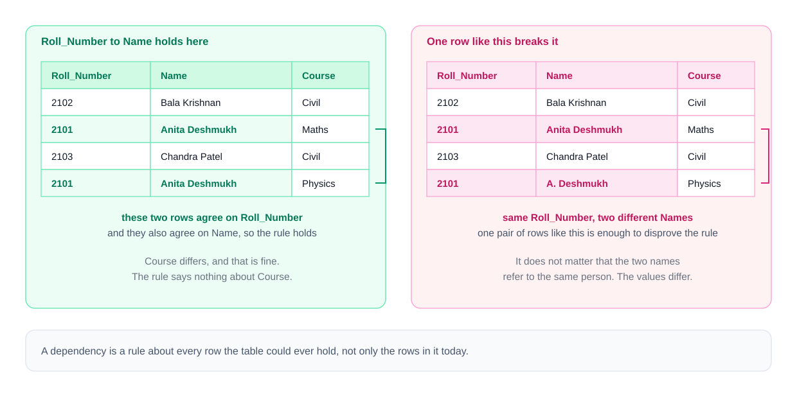

### The running example
This chapter uses one deliberately bad table from a small online shop (`code/00_schema.sql`):

| order_id | product_id | order_date | customer_id | customer_name | customer_city | product_name | list_price | qty |
|---|---|---|---|---|---|---|---|---|
| O1 | P1 | 2026-09-01 | C1 | Nadia Lopez | Lisbon | Kettle | 29.00 | 1 |
| O1 | P2 | 2026-09-01 | C1 | Nadia Lopez | Lisbon | Mug | 6.50 | 4 |
| O2 | P1 | 2026-09-03 | C2 | Jonas Berg | Oslo | Kettle | 29.00 | 1 |
| O3 | P3 | 2026-09-05 | C1 | Nadia Lopez | Lisbon | Teapot | 18.00 | 2 |
| O4 | P4 | 2026-09-06 | C3 | Priya Das | Kochi | Tea tin | 9.00 | 3 |

The shop owner confirms four rules — these are the FDs:

| # | FD | In words |
|---|---|---|
| F1 | `order_id -> order_date, customer_id` | an order is placed on one date by one customer |
| F2 | `customer_id -> customer_name, customer_city` | a customer has one name and one city |
| F3 | `product_id -> product_name, list_price` | a product has one name and one current list price |
| F4 | `{order_id, product_id} -> qty` | a product appears once per order, with one quantity |

### Vocabulary
- **Determinant** — the left side (`customer_id` in F2). Several normal forms are phrased in terms of determinants.
- **Dependent** — the right side.
- A side with several columns is **composite** (`{order_id, product_id}` in F4).

### An FD is a rule, not a summary of today's rows
Look at the table: every `customer_name` is different, so `customer_name -> customer_city` *happens* to hold in these five rows. It is **not** a real dependency — two customers called Nadia Lopez can live in different cities. Rows can **disprove** an FD (by showing a counter-pair) but can **never prove** one. FDs are constraints on every legal state of the table, like `NOT NULL`.

**Where FDs come from:** ask the people who own the data, one question per candidate rule — *"If I tell you the X, do you always know the Y?"* Customer id → city? "Yes, always." City → customer? "No." Write every answer down before designing tables; that list is the input to everything in this chapter.

**Direction matters:** `X -> Y` says nothing about `Y -> X`. Both can hold (an id and a unique email determine each other), but each needs its own check.

### FDs and keys are the same idea
From [§10.13](../10-data-modeling-and-er-diagrams/README.md#1013-keys-in-relational-databases): a **superkey** is a set that never repeats. In FD terms: **`X` is a superkey precisely when `X` functionally determines all columns** (two rows equal on `X` would be equal everywhere, i.e. the same row). A **candidate key** is then a superkey from which nothing can be removed. So the tool that tests FDs (closure, §11.4) is also the tool that finds keys.

### Why the rest of the chapter needs this
Each normal form is a statement about which FDs may exist in a table: 2NF bans one shape, 3NF another, BCNF a third. Once the FDs are written down, "is this table normalized?" stops being opinion.

### TL;DR
`X -> Y`: rows equal on X are equal on Y. One counter-pair disproves it; data never proves it — FDs come from business rules. X is a superkey iff X determines all columns.

---

## 11.2 Types of functional dependencies

In the running example the only candidate key is `{order_id, product_id}`, so **prime attributes** (members of some candidate key — [§10.13](../10-data-modeling-and-er-diagrams/README.md#1013-keys-in-relational-databases)) are `order_id` and `product_id`; all others are **non-prime**.

*Figure — full, partial and transitive dependencies on one table (course diagram, using the course's enrolment example)*

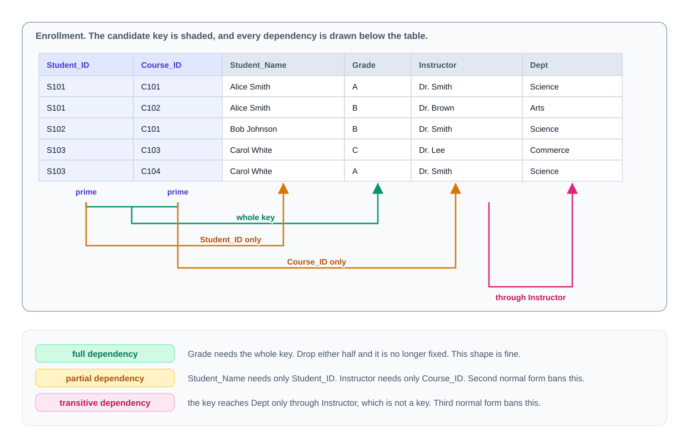

| Type | Definition | Example (running table) | Banned by |
|---|---|---|---|
| **Trivial** | the right side is contained in the left: `{order_id, product_id} -> product_id` | always true; says nothing | never a problem — every rule says "non-trivial" |
| **Non-trivial** | the right side adds a column the left side lacks | `customer_id -> customer_city` | — |
| **Completely non-trivial** | left and right share no column | `product_id -> list_price` | — |
| **Full** | needs its *whole* (composite) determinant: remove any column and it fails | `{order_id, product_id} -> qty` (O1 has quantities 1 and 4; P1 appears in O1 and O2) | — |
| **Partial** | a *proper part* of a candidate key already determines a non-prime column | `order_id -> order_date`, `product_id -> product_name` | **2NF** |
| **Transitive** | from `X -> Y` plus `Y -> Z` you get `X -> Z`, where `Y` is not a superkey and `Z` is non-prime | `order_id -> customer_id -> customer_city` | **3NF** |
| **Determinant not a superkey** | any non-trivial `X -> Y` with X not a superkey | all of F1–F3 here | **BCNF** |
| **Multivalued** (`X ->> Y`) | for one X, the *set* of Y values is independent of the other columns | a restaurant's dishes vs its delivery zones (§11.12) | **4NF** |

Notes worth being precise about:
- **Full vs partial only makes sense for composite determinants.** With a one-column key there is no "part", so a partial dependency is impossible.
- **The two conditions on "transitive" matter.** Without "Y is not a superkey" every table would be full of transitive dependencies (the key determines itself determines everything).
- **Partial and transitive can overlap:** `order_id -> customer_city` is partial (order_id is part of the key) *and* transitive (via customer_id).
- **Multivalued dependencies** are a different kind of constraint (sets of values, not single values); every FD is also an MVD, not vice versa. §11.12 treats them.

### Self-check
1. `{order_id, product_id} -> order_id` — which type? → Trivial.
2. Why is `product_id -> product_name` partial? → `product_id` is a proper part of the only candidate key and `product_name` is non-prime.
3. In a table with a single-column key, which of partial/transitive can exist? → Only transitive.

### TL;DR
Trivial (always true) · full (needs whole key) · partial (part of a key → non-prime; kills 2NF) · transitive (key → non-key → non-prime; kills 3NF) · non-superkey determinant (kills BCNF) · multivalued (kills 4NF).

---

## 11.3 Armstrong's inference rules

### What it is
A set of FDs implies more FDs than it lists. Nobody wrote `order_id -> customer_city`, yet F1 (`order_id -> customer_id`) and F2 (`customer_id -> customer_city`) force it. The given FDs `F` plus everything they imply is the **closure of F**, written **F⁺**. The rules for deriving implied FDs are **Armstrong's axioms** (W. W. Armstrong, 1974).

*Figure — the three axioms and the three derived rules (course diagram)*

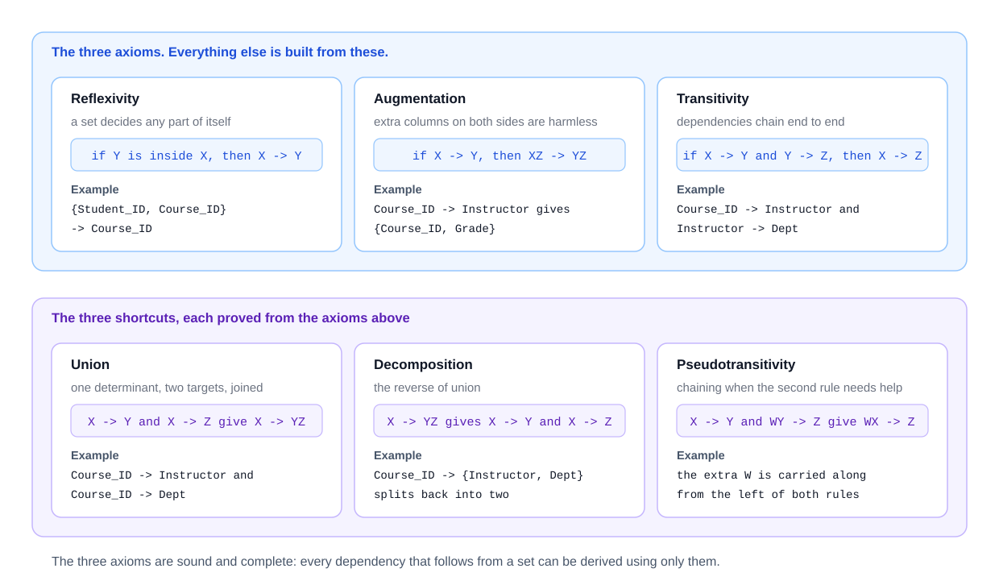

### The three axioms
| Axiom | Rule | Example | Why it is true |
|---|---|---|---|
| **Reflexivity** | if `Y ⊆ X` then `X -> Y` | `{order_id, product_id} -> product_id` | rows equal on X are equal on any part of X (these are the trivial FDs) |
| **Augmentation** | if `X -> Y` then `XZ -> YZ` | from F2: `{customer_id, product_id} -> {customer_city, product_id}` | rows equal on X and Z are equal on Y (by the FD) and on Z (by assumption) |
| **Transitivity** | if `X -> Y` and `Y -> Z` then `X -> Z` | F1 + F2: `order_id -> customer_city` | chain the two guarantees |

The axioms are:
- **Sound** — they never derive an FD that is false in some table satisfying F.
- **Complete** — every FD that holds in *all* tables satisfying F can be derived with them.

So these three are enough; the next three add convenience, not power.

### Three derived rules
| Rule | Pattern | Example |
|---|---|---|
| **Union** | `X -> Y` and `X -> Z` ⟹ `X -> YZ` | `order_id -> order_date` and `order_id -> customer_city` ⟹ `order_id -> {order_date, customer_city}` |
| **Decomposition** (split) | `X -> YZ` ⟹ `X -> Y` and `X -> Z` | F3 ⟹ `product_id -> list_price` |
| **Pseudotransitivity** | `X -> Y` and `WY -> Z` ⟹ `WX -> Z` | suppose a customer leaves one review per product: `{customer_id, product_id} -> review_stars`. With F1 (`order_id -> customer_id`), taking W = product_id: `{order_id, product_id} -> review_stars` |

Decomposition is why worked examples first rewrite every FD with a single column on the right — the list becomes easier to scan.

**Deriving union from the axioms** (a common exam question):
1. Augment `X -> Y` with X: `X -> XY` (since XX = X).
2. Augment `X -> Z` with Y: `XY -> YZ`.
3. Transitivity on 1 and 2: `X -> YZ`. ∎

Decomposition follows from reflexivity (`YZ -> Y`) plus transitivity; pseudotransitivity from augmenting `X -> Y` with W and then transitivity.

### What the rules are for
Finding candidate keys (most "X determines everything" facts are derived, not given) and checking claims like "this table is in 3NF", which depend on implied FDs too. Applying the rules by hand is slow for 6+ columns, so in practice you use attribute closure (next), which the axioms justify.

`fd_tools.py` confirms both derivations above:
```
order_id -> customer_city follows? True
customer_id -> order_id follows?   False
pseudotransitivity: order_id -> customer_id and {customer_id, product_id} -> review_stars
  so {order_id, product_id} -> review_stars? True
```

### TL;DR
F⁺ = all FDs implied by F. Axioms: reflexivity, augmentation, transitivity — sound and complete. Shortcuts: union, decomposition, pseudotransitivity.

---

## 11.4 Attribute closure and finding candidate keys

### What it is
The **closure of an attribute set X**, written **X⁺**, is every attribute X determines, directly or through chains. It always contains X itself.

### The algorithm
1. Start with `result = X`.
2. Scan the FDs. For any FD whose **entire** left side is inside `result`, add its right side.
3. Repeat full passes until a pass adds nothing. `result` is X⁺.

The only classic mistake is firing an FD whose left side is only *partly* present. Repeated passes matter because an FD can become usable halfway through (once an earlier FD adds the column it needs).

The core of `fd_tools.py`:
```python
def closure(attrs, fds, trace=False):
    """X+ : keep adding the right side of any FD whose WHOLE left side is already in the set."""
    result = set(attrs)
    changed = True
    while changed:
        changed = False
        for lhs, rhs in fds:
            if lhs <= result and not rhs <= result:   # lhs fully present, something new to add
                result |= rhs
                changed = True
    return frozenset(result)
```

### Worked closures on the running example
**{order_id}⁺** — start `{order_id}`. F1 fires (`order_id` present) → add `order_date, customer_id`. Now F2's left side `customer_id` is present → add `customer_name, customer_city`. F3 needs `product_id` — absent. F4 needs *both* `order_id` and `product_id` — only one present, **skip**. Nothing more fires.

Output of `fd_tools.py`:
```
closure trace for {order_id}:
    step 1: {order_id} -> {customer_id, order_date} fires, set = {customer_id, order_date, order_id}
    step 2: {customer_id} -> {customer_city, customer_name} fires, set = {customer_city, customer_id, customer_name, order_date, order_id}
{order_id}+ = {customer_city, customer_id, customer_name, order_date, order_id}
{product_id}+ = {list_price, product_id, product_name}
{order_id, product_id}+ = {customer_city, customer_id, customer_name, list_price, order_date, order_id, product_id, product_name, qty}
```

*Figure — the closure loop step by step on the course's enrolment example (course diagram)*

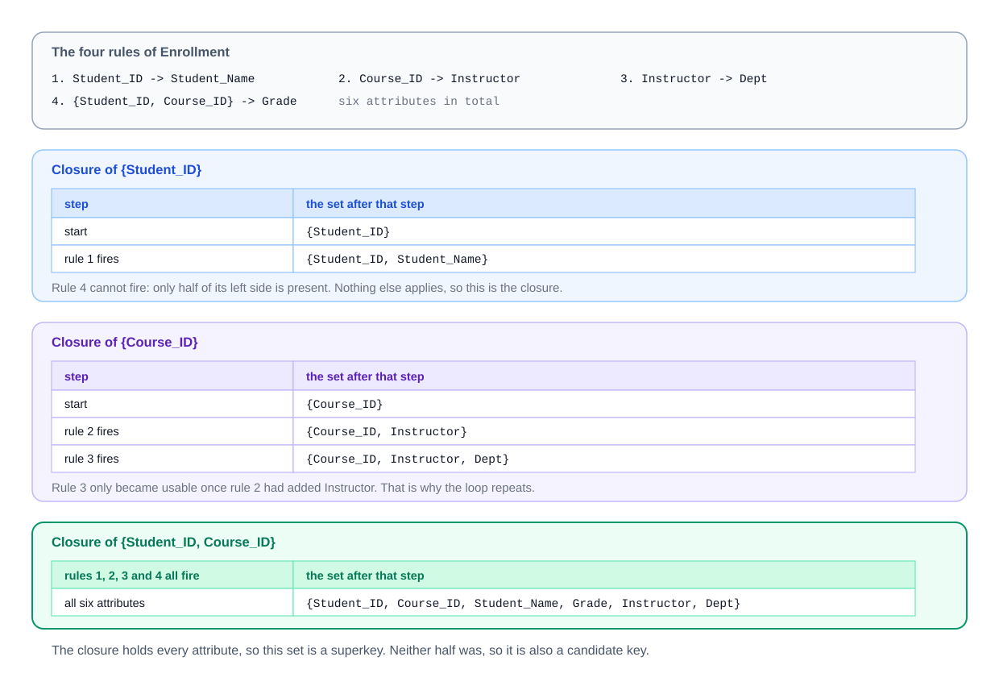

### Two uses of closure
| Question | Test |
|---|---|
| Is X a **superkey**? | X⁺ contains **all** attributes of the table |
| Is X a **candidate key**? | X is a superkey **and** no proper subset is (it is enough to test the subsets with one attribute removed) |
| Does **X -> Y** follow from F? | Y ⊆ X⁺ |

On the running example: `{order_id, product_id}⁺` is all nine columns → superkey. `{order_id}⁺` (5 columns) and `{product_id}⁺` (3 columns) are not → neither half is a superkey → **`{order_id, product_id}` is a candidate key**. And `customer_id -> order_id` does **not** follow (`order_id ∉ {customer_id}⁺`) — matching reality: a customer has many orders.

### Finding *all* candidate keys systematically
1. **Classify attributes** by where they appear in the FDs:
   - never on any right side → **must be in every key** (nothing can derive them);
   - only on right sides (never on a left) → **in no key** (they add nothing);
   - on both sides → maybe.
2. Compute the closure of the "must" set. If it is everything, it is the *only* candidate key.
3. Otherwise add "maybe" attributes one at a time, then two at a time, …, skipping any set that contains a key already found (it would not be minimal).

Running example: `order_id` and `product_id` never appear on a right side → both in every key, and their closure is everything → the unique candidate key. That shortcut is why `fd_tools.candidate_keys` starts from that "core".

**A harder example (Exercise 3 below):** R(A, B, C, D, E) with `A -> B`, `BC -> D`, `D -> A`, `C -> E`. `C` is never on a right side → in every key; `C⁺ = {C, E}` is not everything. Try adding one attribute:
```
{C}+ = {C, E}
{A, C}+ = {A, B, C, D, E}
{B, C}+ = {A, B, C, D, E}
{C, D}+ = {A, B, C, D, E}
{C, E}+ = {C, E}
```
So there are **three** candidate keys: `{A,C}`, `{B,C}`, `{C,D}`. Prime attributes: A, B, C, D; non-prime: E. Tables with several overlapping keys like this are exactly where BCNF differs from 3NF (§11.11).

### In the interview
**30-second answer:** "To test whether X is a key, compute X⁺: start with X and repeatedly add the right side of any FD whose left side is fully contained, until nothing changes. If X⁺ is the whole relation, X is a superkey; if no smaller subset is, it's a candidate key. Attributes that never appear on a right-hand side must be in every key, which is where I start."

- *How do you check whether an FD is implied?* → Compute the closure of its left side and see if the right side is inside.
- *Complexity?* → A naive loop is O(|F|² · |attrs|) per closure; finding all keys can be exponential in the worst case (a relation can have exponentially many keys), but class-sized problems are tiny.

### TL;DR
X⁺ = everything X determines (fire only FDs whose whole LHS is present; loop until stable). Superkey ⟺ X⁺ = all attributes; candidate key = minimal superkey; X -> Y implied ⟺ Y ⊆ X⁺. Never-on-the-right attributes are in every key.

---

## 11.5 Minimal (canonical) cover

### What it is
Different FD lists can say the same thing. A **minimal cover** (also called a **canonical cover**, F_c) is an equivalent list with no waste:
1. every right side is a **single** attribute (use decomposition);
2. no left side has an **extraneous** attribute (one you can drop without changing F⁺);
3. no FD is **redundant** (derivable from the others).

It is the input to the 3NF synthesis algorithm (§11.14) and a common interview/exam exercise.

### Worked example
F = { `A -> BC`, `B -> C`, `AB -> D` }
1. Split: `A -> B`, `A -> C`, `B -> C`, `AB -> D`.
2. Extraneous LHS: in `AB -> D`, is B extraneous? `A⁺` (using the current list) = {A, B, C, D} contains D → yes, replace with `A -> D`.
3. Redundant FDs: `A -> C` follows from `A -> B` and `B -> C` → remove it.

Result `{A -> B, B -> C, A -> D}` — the same as `fd_tools.py` prints:
```
=== minimal cover of {A->BC, B->C, AB->D}: {A}->{B}, {B}->{C}, {A}->{D}
```
A minimal cover is not always unique (the order you remove things can matter), but every minimal cover implies exactly F⁺.

### TL;DR
Minimal cover = singleton right sides, no extraneous left attributes, no redundant FDs; equivalent to F. Needed for 3NF synthesis.

---

## 11.6 Anomalies — why normalization exists

### The problem it solves
The wide order table stores "Nadia lives in Lisbon" three times and "P1 is a Kettle at 29.00" twice. That repetition causes three named failures:

| Anomaly | What goes wrong | In the running table |
|---|---|---|
| **Insertion** | you cannot record one fact without inventing an unrelated one | a new product nobody has ordered yet has no row to live in — the key needs an `order_id` |
| **Update** | one real-world change must be repeated on many rows; miss one and the table contradicts itself | Nadia moves: 3 rows must change |
| **Deletion** | deleting one fact silently deletes another | cancel Priya's only order and the shop forgets Priya *and* the tea tin |

*Figure — the three anomalies on the course's enrolment table (course diagram)*


### Seeing them happen (`code/01_anomalies.sql`)
```sql
-- INSERT: a new product with no order
INSERT INTO order_line_wide (order_id, product_id, ..., product_name, list_price, qty)
VALUES (NULL, 'P5', ..., 'Milk jug', 12.00, 1);              -- inside a DO block that catches the error
-- UPDATE: Nadia moves, but a careless WHERE edits only one of her rows
UPDATE order_line_wide SET customer_city = 'Porto' WHERE customer_id = 'C1' AND order_id = 'O3';
-- DELETE: cancel O4
DELETE FROM order_line_wide WHERE order_id = 'O4';
```
Output:
```
--- the same facts are stored many times
 customer_id | customer_name | customer_city | rows_holding_it 
-------------+---------------+---------------+-----------------
 C1          | Nadia Lopez   | Lisbon        |               3
 C2          | Jonas Berg    | Oslo          |               1
 C3          | Priya Das     | Kochi         |               1
(3 rows)

--- INSERT anomaly: a new product nobody has ordered yet has nowhere to go
NOTICE:  refused: null value in column "order_id" of relation "order_line_wide" violates not-null constraint
--- UPDATE anomaly: Nadia moves to Porto, but the update misses one of her rows
 customer_id | cities_on_file 
-------------+----------------
 C1          | {Lisbon,Porto}
(1 row)

--- DELETE anomaly: cancel order O4 and customer C3 and product P4 vanish with it
 rows_about_priya | rows_about_tea_tin 
------------------+--------------------
                0 |                  0
(1 row)
```

### What normalization does
**Normalization** splits a table along its functional dependencies so that **every fact has exactly one home** — "Nadia lives in Lisbon" in one row of a `customer` table. One row to update, nothing unrelated to delete, and every fact can be inserted on its own. It does this with **decomposition** (replacing a table by projections of it) that must be **lossless** (§11.10).

### The ladder of normal forms
Each **normal form** is a named test a table passes or fails. Each assumes the previous one and is stricter:

| Form | Removes | One-line rule | Origin |
|---|---|---|---|
| **1NF** | lists and repeating groups in cells | every cell holds one atomic value | Codd 1970 |
| **2NF** | partial dependencies | no non-prime attribute depends on part of a candidate key | Codd 1971 |
| **3NF** | transitive dependencies | no non-prime attribute depends on a non-superkey | Codd 1971 |
| **BCNF** | remaining FD redundancy | every non-trivial FD's determinant is a superkey | Boyce & Codd 1974 |
| **4NF** | independent multivalued facts | every non-trivial MVD's determinant is a superkey | Fagin 1977 |
| **5NF** | join dependencies not implied by keys | the table cannot be split losslessly except via its keys | Fagin 1979 |

*Figure — the ladder of normal forms (course diagram)*

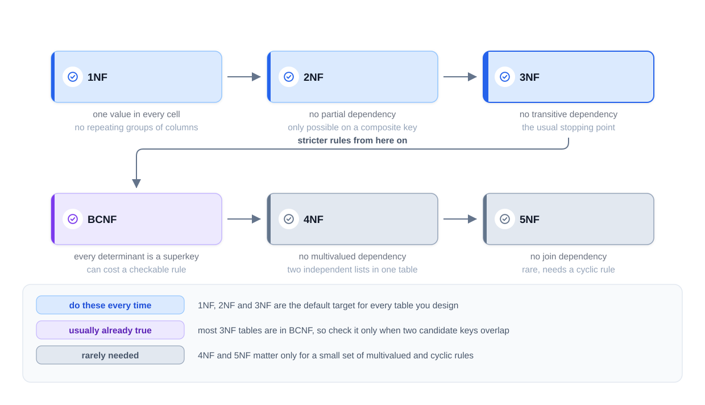

(There are also domain-key NF and 6NF — used in temporal databases and some data-warehouse styles — which are beyond everyday design.)

**You do not always climb to the top.** Each step removes redundancy and usually adds a join. **3NF is where most practical designs stop**: it removes the redundancy behind the worst anomalies and always has a safe decomposition (§11.14). Climbing higher is something you choose on purpose when a particular problem demands it. Putting redundancy back on purpose is **denormalization** (§11.16).

### TL;DR
Redundancy → insertion, update and deletion anomalies. Normalization decomposes tables along FDs so each fact is stored once. 1NF → 2NF → 3NF → BCNF → 4NF → 5NF, each stricter; most designs stop at 3NF.

---

## 11.7 First normal form (1NF)

### What it is
A table is in **1NF** when:
1. every cell holds a **single, indivisible (atomic)** value — no lists, sets or nested records;
2. there are **no repeating groups** — no `phone1, phone2, phone3` columns;
3. rows are distinguishable — the table has a key (which, in the relational model, every relation has).

It is purely about the **shape of a cell**.

### The problem it solves
```
vol_id | name  | languages
     1 | Hana  | Japanese, English
     3 | Ama   | Twi, English, French
```
"Who speaks English?" needs a text search (`LIKE '%English%'`), which also matches "Old English" or a typo; you cannot count languages, index them usefully, or constrain their spelling.

### How to fix it — two routes
*Figure — a list in a cell, fixed by one-row-per-value or by a separate table (course diagram)*

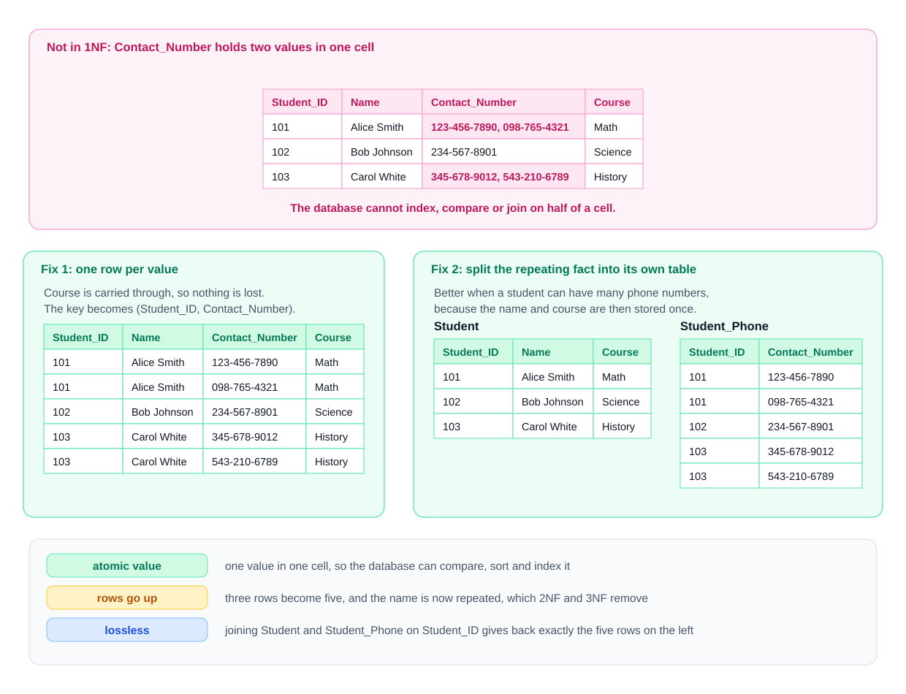

1. **One row per value** in the same table (the key becomes `(vol_id, language)`). This reaches 1NF — but copies the other columns onto every new row.
2. **A separate table** for the repeating fact — `volunteer(vol_id, name)` + `volunteer_language(vol_id, language)`. This is what 2NF would produce from route 1 anyway (the name depends only on `vol_id`), and it is what [§10.6](../10-data-modeling-and-er-diagrams/README.md#106-entities-and-the-five-kinds-of-attribute) predicted for a multivalued attribute.

`code/03_first_normal_form.sql` repairs both kinds of violation in SQL:
```sql
-- a list in one cell -> one row per value (string_to_table: PostgreSQL 14+)
CREATE TABLE volunteer_language AS
SELECT vol_id, trim(lang) AS language
FROM volunteer_packed, string_to_table(languages, ',') AS lang;
ALTER TABLE volunteer_language ADD PRIMARY KEY (vol_id, language);

-- a repeating group phone1..phone3 -> rows (unpivot with LATERAL VALUES)
SELECT g.guest_id, g.name, p.phone
FROM guest_sideways g
CROSS JOIN LATERAL (VALUES (g.phone1), (g.phone2), (g.phone3)) AS p(phone)
WHERE p.phone IS NOT NULL
ORDER BY g.guest_id, p.phone;
```
Output:
```
--- repair: one row per value (string_to_table needs PostgreSQL 14+)
 vol_id | language 
--------+----------
      1 | English
      1 | Japanese
      2 | Spanish
      3 | English
      3 | French
      3 | Twi
(6 rows)

--- now counting and exact matching are ordinary SQL
 language | speakers 
----------+----------
 English  |        2
 French   |        1
 Japanese |        1
 Spanish  |        1
 Twi      |        1
(5 rows)

--- unpivot the phone columns into rows; guests without a phone produce no rows
 guest_id | name  |  phone   
----------+-------+----------
       10 | Ivo   | 555-0101
       10 | Ivo   | 555-0102
       12 | Malik | 555-0301
       12 | Malik | 555-0303
(4 rows)
```
Dialect note: on PostgreSQL < 14 use `unnest(string_to_array(languages, ','))`; MySQL 8 has `JSON_TABLE` or a recursive CTE; SQL Server has `STRING_SPLIT` and `CROSS APPLY (VALUES …)` for the unpivot. (Not run here.)

### What 1NF does *not* say — the two classic misconceptions
- **1NF does not require column values to be unique.** Only keys are unique; `name` may repeat freely.
- **1NF does not reduce redundancy — route 1 increases it.** Splitting one row into three copies every other value three times. Removing that repetition is 2NF's and 3NF's job.

Also: a normalization step splits tables or rows but **never drops a column**. If a column disappears, information was lost and the design is wrong.

### Borderline cases
- **Structured text** (a whole address in one column) — a 1NF problem only if your application queries the parts.
- **JSON / arrays** — strictly non-atomic. PostgreSQL has first-class `jsonb` and arrays with indexes ([Chapter 14](../14-advanced-sql-and-using-sql-from-code/README.md)); storing a document *on purpose* (sparse attributes, payloads you never filter on) is a legitimate design. The question is: do you search, join or constrain on what is inside? If yes, it belongs in rows.

### Common mistakes
- Comma-separated ids in a column ("tag_ids = '3,7,9'") — the *SQL Antipatterns* book calls this **Jaywalking**; you cannot join on it or enforce FKs.
- Numbered columns (`item1…item5`).
- Believing 1NF means "no duplicate values".

### TL;DR
1NF = atomic cells, no repeating groups, a key. Fix lists with one row per value or (better) a child table. 1NF does not remove redundancy and does not require unique values.

---

## 11.8 Second normal form (2NF)

### What it is
A table is in **2NF** when it is in 1NF **and no non-prime attribute is partially dependent on any candidate key** — every non-key column depends on the *whole* key.

A table whose candidate keys all have **one column** is automatically in 2NF (there is no "part" of a single column).

### Finding the violation in the running table
Candidate key `{order_id, product_id}`. Test each non-prime column: does it need the whole key?

| Column | Needs | Verdict |
|---|---|---|
| `qty` | order **and** product | full ✓ |
| `order_date`, `customer_id` | `order_id` only | partial ✗ |
| `customer_name`, `customer_city` | `order_id` only (via customer_id) | partial ✗ |
| `product_name`, `list_price` | `product_id` only | partial ✗ |

`fd_tools.py` agrees:
```
candidate keys: {order_id, product_id}
2NF violations: ['{order_id} -> {customer_city, customer_id, customer_name, order_date}', '{product_id} -> {list_price, product_name}']
```

*Figure — a composite-key table, its partial dependencies and the 2NF split (course diagram)*

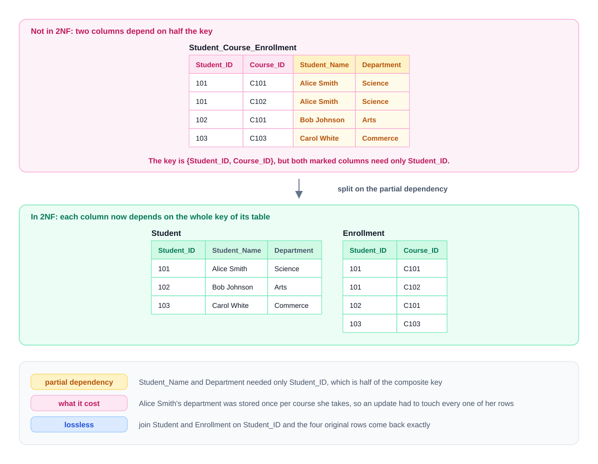

### How to fix it
1. For each part of the key that has dependents, create a table keyed by that part and move its dependents there.
2. Leave the full-key columns in a table keyed by the whole key.
3. Group the moved columns **by the key part that determines them** — one new table per part.

Result:
- `order_header(order_id, order_date, customer_id, customer_name, customer_city)`
- `product(product_id, product_name, list_price)`
- `order_item(order_id, product_id, qty)`

`product` and `order_item` are now clean. `order_header` still repeats Nadia's city once per order — that is a *transitive* dependency, which 2NF cannot see. Next section.

### Common mistakes
- Moving only one part's dependents (e.g. splitting off `product` but leaving order facts in the composite-key table) — still not 2NF.
- Checking only the primary key: 2NF is about **every candidate key** and **non-prime** attributes (Exercise 1 has a second candidate key).

### TL;DR
2NF = 1NF + no non-prime column determined by part of a candidate key. Only composite keys can violate it. Fix: one table per key part with its dependents, plus the full-key table.

---

## 11.9 Third normal form (3NF)

### What it is
**3NF** requires 2NF **plus: no non-prime attribute is transitively dependent on a candidate key** — non-key columns depend on the key, the whole key, and nothing but the key. (A popular mnemonic, usually credited to Bill Kent.)

The precise textbook form (Zaniolo's), which you should know for interviews: **for every non-trivial FD `X -> A`, either X is a superkey, or A is a prime attribute.** It also covers 2NF, so a table meeting it is automatically in 2NF.

### Finding the violation
`order_header(order_id, order_date, customer_id, customer_name, customer_city)` has a single-column key, so it is in 2NF. But:

`order_id -> customer_id` and `customer_id -> customer_city`, and `customer_id` is **not a superkey** here (Nadia has three orders), and `customer_city` is **non-prime** → transitive dependency → **not 3NF**. Check with the precise form: FD `customer_id -> customer_city` — is `customer_id` a superkey? No. Is `customer_city` prime? No. Both escapes fail.

*Figure — a transitive dependency through a non-key column and the 3NF split (course diagram)*

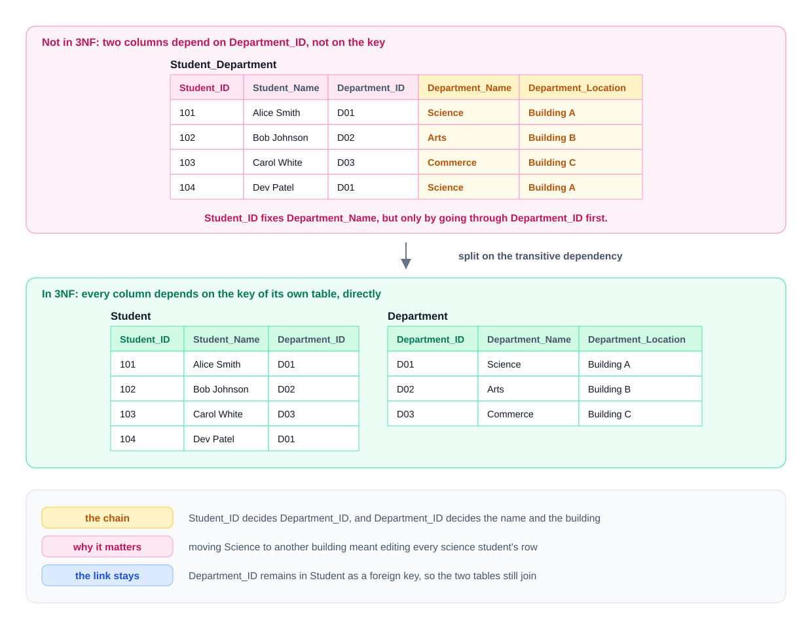

### How to fix it
Move the columns at the **far end of the chain** into a new table whose key is the **middle** column:
- `customer(customer_id, customer_name, customer_city)`
- `orders(order_id, order_date, customer_id → customer)`

The middle column stays in `orders` as an FK — without it there would be nothing to join on.

### 2NF vs 3NF side by side
| | Dependency runs through | Possible when |
|---|---|---|
| 2NF violation | **part** of a candidate key | the key is composite |
| 3NF violation | a **non-key** column | any key shape, including one column |

So 3NF must be checked on every table; 2NF only on tables with composite keys.

### The complete running example in 3NF
The 3NF synthesis algorithm (§11.14) in `fd_tools.py` produces exactly our four tables:
```
3NF synthesis: ['{customer_id, order_date, order_id}', '{customer_city, customer_id, customer_name}', '{list_price, product_id, product_name}', '{order_id, product_id, qty}']
```

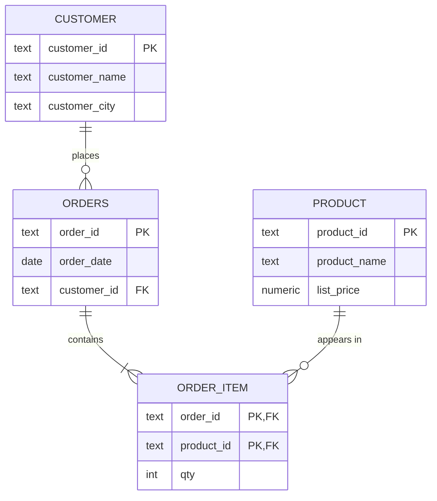
§11.10 builds these tables in PostgreSQL and re-runs the anomalies.

### In the interview
**30-second answer:** "1NF: atomic values. 2NF: no non-key attribute depends on part of a composite key. 3NF: no non-key attribute depends on another non-key attribute — formally, for every non-trivial FD X → A, X is a superkey or A is prime. I normalize to 3NF by default because it removes the update anomalies and there's always a lossless, dependency-preserving 3NF decomposition."

- *Give a 3NF violation with a single-column key.* → `employee(emp_id, dept_id, dept_name)`: `dept_id -> dept_name`.
- *Is a table with only key columns in 3NF?* → Yes (no non-prime attributes at all); check BCNF separately.

### TL;DR
3NF = 2NF + no non-key → non-key dependency (formally: every FD's LHS is a superkey or RHS is prime). Fix: split the chain's tail into a table keyed by the middle column, which stays behind as an FK.

---

## 11.10 Decomposition done right: lossless joins and dependency preservation

Every split must satisfy two properties — one mandatory, one highly desirable.

### Lossless (non-additive) join — mandatory
Joining the pieces must return **exactly** the original rows — nothing lost, **nothing invented**. (A lossy split usually *adds* rows, "spurious tuples"; the information lost is which combinations were true.)

**Test for a two-way split** of R into R1 and R2: the split is lossless iff the shared columns `R1 ∩ R2` are a **superkey of R1 or of R2** (i.e. `R1 ∩ R2 -> R1` or `R1 ∩ R2 -> R2` is in F⁺). Every split in this chapter shares a column that is the key of one piece.

`code/04_lossy_join.sql` shows what happens otherwise. `staff(emp, dept, city)` with `emp -> dept, city`, split two ways:
```sql
-- bad: (emp, city) + (dept, city); city is a key of neither piece
WITH ec AS (SELECT DISTINCT emp, city FROM staff),
     dc AS (SELECT DISTINCT dept, city FROM staff)
SELECT ec.emp, dc.dept, ec.city,
       (ec.emp, dc.dept, ec.city) IN (SELECT emp, dept, city FROM staff) AS real_row
FROM ec JOIN dc USING (city) ORDER BY 1, 2;
```
Output:
```
--- bad split: (emp, city) and (dept, city). The shared column city is a key of neither piece.
 emp |  dept   | city  | real_row 
-----+---------+-------+----------
 Ana | Sales   | Leeds | t
 Ana | Support | Leeds | f
 Ben | Sales   | Leeds | f
 Ben | Support | Leeds | t
 Cai | Sales   | York  | t
(5 rows)

--- good split: (emp, dept) and (emp, city). The shared column emp is a key of both.
 invented_rows 
---------------
             0
(1 row)
```

### Dependency preservation — strongly desirable
Every original FD should still be checkable **inside a single table** (so a `PRIMARY KEY`/`UNIQUE` constraint enforces it), or be implied by FDs that are. If not, enforcing the rule needs a join — a trigger or application code. §11.11 shows a split that is lossless but not dependency-preserving.

### The running example decomposed in PostgreSQL (`code/02_decompose_and_fix.sql`)
```sql
CREATE TABLE customer AS SELECT DISTINCT customer_id, customer_name, customer_city FROM order_line_wide;
CREATE TABLE product  AS SELECT DISTINCT product_id, product_name, list_price     FROM order_line_wide;
CREATE TABLE orders   AS SELECT DISTINCT order_id, order_date, customer_id        FROM order_line_wide;
CREATE TABLE order_item AS SELECT order_id, product_id, qty                       FROM order_line_wide;
ALTER TABLE customer   ADD PRIMARY KEY (customer_id);
ALTER TABLE product    ADD PRIMARY KEY (product_id);
ALTER TABLE orders     ADD PRIMARY KEY (order_id),
                       ADD FOREIGN KEY (customer_id) REFERENCES customer;
ALTER TABLE order_item ADD PRIMARY KEY (order_id, product_id),
                       ADD FOREIGN KEY (order_id)   REFERENCES orders ON DELETE CASCADE,
                       ADD FOREIGN KEY (product_id) REFERENCES product;
-- lossless check: (original EXCEPT rejoined) and (rejoined EXCEPT original) must both be empty
```
Output:
```
--- row counts after the split
 customers | products | orders | order_items 
-----------+----------+--------+-------------
         3 |        4 |      4 |           5
(1 row)

--- lossless? join the pieces back and compare with the original, both directions
 missing_rows | invented_rows 
--------------+---------------
            0 |             0
(1 row)

--- INSERT: a product with no orders is now fine
--- UPDATE: Nadia moves once, in one row
 customer_city 
---------------
 Porto
(1 row)

--- DELETE: cancel O4; Priya and the tea tin survive
 priya_rows | tea_tin_rows | o4_items 
------------+--------------+----------
          1 |            1 |        0
(1 row)
```
All three anomalies are gone, and `SELECT DISTINCT` + `ADD PRIMARY KEY` is the standard way to perform such a split on live data (if `ADD PRIMARY KEY` fails, the data already contradicts the FD you assumed — a useful check in itself). The pieces also preserve every FD: each of F1–F4 lives inside one table.

### TL;DR
Lossless: shared columns must be a key of one side (else the join invents rows). Dependency-preserving: each FD checkable in one table. Verify a split with `EXCEPT` both ways.

---

## 11.11 Boyce–Codd normal form (BCNF)

### What it is
**BCNF** holds when the left side of **every non-trivial FD `X -> Y` is a superkey** — "every determinant is a (super)key". Compared with 3NF's precise form, BCNF simply removes the second escape ("…or Y is prime"). Hence every BCNF table is in 3NF; not vice versa. It is sometimes called "3.5NF".

**When does 3NF pass but BCNF fail?** Only if the table has **several composite candidate keys sharing at least one attribute**. With a single candidate key, 3NF and BCNF coincide — which is why reaching 3NF usually means reaching BCNF too.

### A 3NF table that is not in BCNF
A clinic's rules: each doctor has exactly one specialty (`doctor -> specialty`); a patient sees exactly one doctor per specialty (`{patient, specialty} -> doctor`).

| patient | specialty | doctor |
|---|---|---|
| Ali | Cardiology | Dr Osei |
| Ali | Dermatology | Dr Lind |
| Beth | Cardiology | Dr Osei |
| Beth | Neurology | Dr Tan |
| Chen | Cardiology | Dr Moreau |

`fd_tools.py`:
```
=== visit (3NF, not BCNF)
candidate keys: {doctor, patient}, {patient, specialty}
prime: {doctor, patient, specialty}  non-prime: {}
2NF violations: none
3NF violations: none
BCNF violations: ['{doctor} -> {specialty}']
highest normal form: 3NF
BCNF decomposition: ['{doctor, specialty}', '{doctor, patient}']
FDs no longer checkable in one piece: ['{patient, specialty} -> {doctor}']
```
Why: both candidate keys are composite and overlap on `patient`, so every attribute is prime. `doctor -> specialty` passes 3NF because `specialty` is prime, but fails BCNF because `doctor` is not a superkey. The redundancy is real: "Dr Osei is a cardiologist" is stored once per patient, with the usual anomalies — from `code/05_bcnf.sql`:
```
--- the fact "Dr Osei is a cardiologist" is stored once per patient
  doctor   |  specialty  | copies 
-----------+-------------+--------
 Dr Osei   | Cardiology  |      2
 ...
--- nothing stops the copies disagreeing (update anomaly)
 doctor  |      specialties      
---------+-----------------------
 Dr Osei | {Cardiology,Oncology}
(1 row)
```

### Decomposing
Split on the offending FD: `doctor_specialty(doctor PK, specialty)` and `patient_doctor(patient, doctor)` (PK both columns). The shared column `doctor` is the key of `doctor_specialty`, so the join is lossless (the script prints `invented_rows 0, missing_rows 0`).

### The honest cost: a lost dependency
`{patient, specialty} -> doctor` now spans two tables, so no single `PRIMARY KEY`/`UNIQUE` can enforce it:
```sql
INSERT INTO patient_doctor VALUES ('Ali', 'Dr Moreau');     -- accepted!
```
Output:
```
--- the cost: {patient, specialty} -> doctor is no longer checked by any one table
 patient | specialty  |         doctors         
---------+------------+-------------------------
 Ali     | Cardiology | {"Dr Moreau","Dr Osei"}
(1 row)
```
Ali now has two cardiologists, which the business forbids. **General result:** you can always split a table into **3NF** pieces that are both lossless and dependency-preserving; for **BCNF** that is not guaranteed. This is why practitioners usually stop at 3NF and move to BCNF only when the redundancy actually hurts.

**A practical middle way** (also in `05_bcnf.sql`): keep the 3NF table (so `{patient, specialty}` stays its PK) and add a master `doctor_specialty` table plus a **composite foreign key** `(doctor, specialty) → doctor_specialty(doctor, specialty) ON UPDATE CASCADE`. The copies can no longer disagree, and one update propagates:
```
NOTICE:  refused: insert or update on table "visit_3nf" violates foreign key constraint "visit_3nf_doctor_specialty_fkey"
 patient |    specialty    | doctor  
---------+-----------------+---------
 Ali     | Cardiac surgery | Dr Osei
 Beth    | Cardiac surgery | Dr Osei
(2 rows)
```

### The trap: "looks like BCNF, is really 2NF"
`enrol(student, course, instructor)` with `course -> instructor`, key `{student, course}`. It is tempting to call this a BCNF example, but `instructor` is **non-prime** and hangs off **half** of the key → a **2NF** violation; the table is not even in 2NF. `fd_tools.py`: `2NF violations: ['{course} -> {instructor}'] … highest normal form: 1NF`. **Rule of thumb:** a non-prime dependent whose determinant is a proper subset of a key signals a 2NF problem; only when every attribute involved is prime and a determinant still is not a superkey is it a genuine BCNF problem.

### In the interview
**30-second answer:** "BCNF says every determinant must be a superkey. It's stricter than 3NF, which also allows X → A when A is prime. The two only differ for tables with several composite candidate keys that overlap. BCNF decompositions are always lossless but not always dependency-preserving, so sometimes I stay at 3NF and enforce the rule with a composite foreign key."

- *Example of 3NF-not-BCNF?* → Patient/specialty/doctor with doctor → specialty.
- *What's lost in the BCNF split?* → The FD {patient, specialty} → doctor can't be enforced by one table's key.

### TL;DR
BCNF: every non-trivial FD's LHS is a superkey. Differs from 3NF only with overlapping composite candidate keys. Split on the violating FD (lossless), but you may lose dependency preservation.

---

## 11.12 Fourth normal form (4NF) — independent multivalued facts

### What it is
3NF and BCNF are about FDs (one value determines one value). **4NF** handles a different redundancy: two **independent lists** about the same thing stored in one table.

A restaurant has a set of dishes and a separately chosen set of delivery zones. Stored together, every dish must be paired with every zone:

| restaurant | dish | zone |
|---|---|---|
| Saffron | Biryani | North |
| Saffron | Biryani | Centre |
| Saffron | Dal | North |
| Saffron | Dal | Centre |
| Nori | Ramen | East |

Here `restaurant` does not functionally determine `dish` (Saffron has two). What holds is a **multivalued dependency (MVD)**, written **`restaurant ->> dish`**: for a given restaurant, the set of dishes is the same whatever zone you look at (and symmetrically `restaurant ->> zone` — MVDs come in complementary pairs). The table's only key is all three columns, so it is in BCNF — and still redundant.

*Figure — two independent lists stored as a full cross product, and the 4NF split (course diagram, using sports and clubs)*

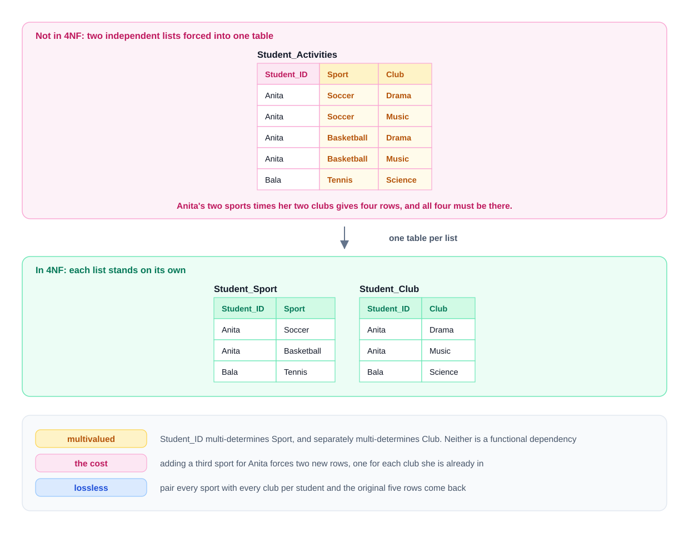

### The rule
A table is in **4NF** when it is in BCNF and **for every non-trivial MVD `X ->> Y`, X is a superkey**. In practice: **one table per independent list**.

### The signature and the damage (`code/06_4nf_5nf.sql`)
The tell-tale sign is a **full cross product** per key value: 2 dishes × 2 zones = 4 rows. Adding one dish needs one new row *per zone*; forget one and the table claims that dish is not delivered somewhere:
```
--- restaurant ->> dish | zone: every dish is paired with every zone (a full cross product)
 restaurant | dishes | zones | rows 
------------+--------+-------+------
 Nori       |      1 |     1 |    1
 Saffron    |      2 |     2 |    4
(2 rows)

--- adding one dish to Saffron needs one row PER ZONE; forget one and the table lies
 restaurant |     dish     | zones_listed 
------------+--------------+--------------
 Saffron    | Biryani      |            2
 Saffron    | Dal          |            2
 Saffron    | Paneer tikka |            1
(3 rows)

--- 4NF split: one table per independent list; the join rebuilds the original exactly
 dish_rows | zone_rows | invented_rows 
-----------+-----------+---------------
         3 |         3 |             0
(1 row)
```
Five rows became 3 + 3, and every new fact is now a single row. The split is lossless precisely because the lists were independent (an MVD `X ->> Y` is exactly the condition for splitting R into XY and X(R−Y) losslessly).

**Caution:** if the lists are *not* independent (a dish is only delivered to some zones), then the three-column table is the correct design and there is no MVD. As with FDs, the business rule decides, not the rows.

### TL;DR
MVD `X ->> Y`: for each X, the set of Y values is independent of the other columns (visible as a full cross product). 4NF: every non-trivial MVD's LHS is a superkey → store each independent list in its own table.

---

## 11.13 Fifth normal form (5NF) — facts that need three tables

### What it is
5NF (also **project-join normal form, PJ/NF**) handles a rarer case: a table with no FD or MVD problems that nonetheless can be split into **three (or more)** projections that join back exactly — while **no two** of them can. The constraint behind it is a **join dependency (JD)**.

Classic shape — a **cyclic business rule**: *if a supplier supplies a part, and the part is used in a project, and the supplier supplies that project, then the supplier supplies that part to that project.*

| supplier | part | project |
|---|---|---|
| Acme | bolt | Bridge |
| Acme | bolt | Tower |
| Acme | nut | Tower |
| Brix | bolt | Tower |

### Why two tables are not enough
Take the three pairwise projections — supplier-part (`sp`), part-project (`pj`), supplier-project (`sj`). **Every** two-way join invents a false row; the three-way join does not (`code/06_4nf_5nf.sql`):
```
--- rows INVENTED by each two-way join (none of these is true)
 pieces | supplier | part | project 
--------+----------+------+---------
 pj+sj  | Brix     | nut  | Tower
 sp+pj  | Brix     | bolt | Bridge
 sp+sj  | Acme     | nut  | Bridge
(3 rows)

--- the three-way join invents nothing: 5NF stores sp, pj and sj instead of spj
 invented_rows 
---------------
             0
(1 row)
```
For example `sp+pj` claims Brix supplies bolts to Bridge; the third table `sj` rules it out, because Brix does not supply the Bridge project at all.

*Figure — why two pairwise tables invent a row that the third rules out (course diagram)*

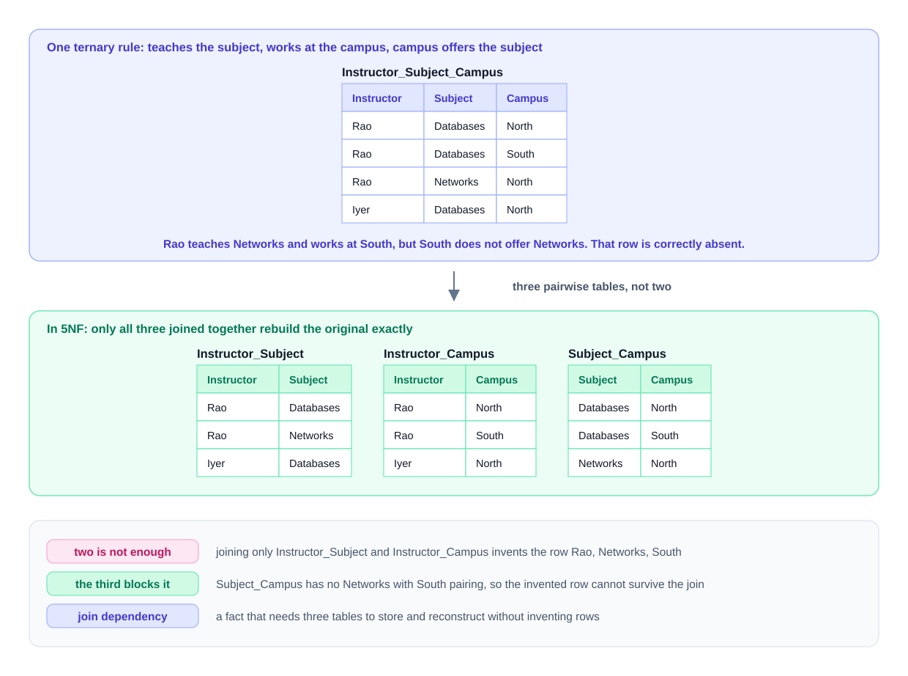

### The rule
A table is in **5NF** when every non-trivial join dependency on it is implied by its candidate keys. Practically: when a real cyclic rule links three things, keep the **three two-column tables** (here `sp`, `pj`, `sj`) and derive the combined view by a three-way join. Then inserting one pairwise fact automatically implies the right combinations.

### How often 4NF and 5NF come up
Rarely. Independent lists usually get separate tables from the start (they are separate multivalued attributes in the ER diagram), and three-way rules are often simpler to enforce with a constraint or in code. Know them to **name** the problem precisely and to recognise the cross-product and invented-row signatures. Proof of correctness is the same as always: join the pieces and get exactly the original rows.

### TL;DR
5NF (PJ/NF): no join dependency except those implied by keys. Signature: every two-way join of the projections invents rows but the three-way join doesn't → store the three pairwise tables.

---

## 11.14 Putting it together — a normalization procedure

### Step by step for any table
1. **Write down the FDs** from business rules (not from sample rows). Split right sides to single attributes.
2. **Find all candidate keys** with closure (§11.4); mark prime / non-prime.
3. **1NF:** atomic cells, no repeating groups.
4. **2NF:** any non-prime attribute determined by part of a candidate key? → split per key part.
5. **3NF:** any FD `X -> A` with X not a superkey and A non-prime? → split the chain.
6. **BCNF (only if overlapping composite keys exist):** any FD with a non-superkey LHS? → split, and check what you lose.
7. **4NF/5NF (only if you see cross products / three-way rules).**
8. **Verify every split:** lossless (shared columns are a key of one side; `EXCEPT` both ways is empty) and ideally dependency-preserving; no column dropped.

### Two textbook algorithms (both in `fd_tools.py`)
| | **3NF synthesis** (Bernstein) | **BCNF decomposition** |
|---|---|---|
| Steps | 1. compute a minimal cover · 2. one table per group of FDs with the same LHS · 3. if no table contains a candidate key, add one · 4. drop tables contained in others | while some table has an FD X → Y with X not a superkey *of that table*: replace it by `X⁺` (within the table) and `(table − X⁺) ∪ X` |
| Lossless? | always | always |
| Dependency-preserving? | **always** | not always |
| Redundancy left? | possibly (only the 3NF-not-BCNF kind) | none from FDs |

Run on Exercise 3's relation (R(A,B,C,D,E), `A -> B, BC -> D, D -> A, C -> E`):
```
BCNF decomposition: ['{A, B}', '{C, E}', '{A, D}', '{C, D}']
FDs lost by it: ['{B, C} -> {D}']
3NF synthesis: ['{A, B}', '{B, C, D}', '{A, D}', '{C, E}']
```
The BCNF result loses `BC -> D`; the 3NF result keeps it (in `{B, C, D}`) at the cost of some redundancy. This trade-off is the whole BCNF-vs-3NF story in one line.

### TL;DR
FDs → keys → check 1NF, 2NF, 3NF (BCNF/4NF/5NF when their signatures appear) → split → verify lossless + dependency-preserving. 3NF synthesis always preserves dependencies; BCNF decomposition may not.

---

## 11.15 Exercises (with solutions)

Try each one on paper before looking at the solution — the real skill is noticing the dependency in a table you have never seen. Every answer below was checked with `fd_tools.py` (its output is quoted).

### Exercise 1 — workshop sign-ups (target: 2NF, and beyond)
A conference records sign-ups in one table:

| attendee_id | workshop_id | attendee_name | attendee_email | workshop_title | room | seat_no |
|---|---|---|---|---|---|---|
| A1 | W1 | Kofi | kofi@mail.example | Intro to SQL | R12 | 4 |
| A1 | W2 | Kofi | kofi@mail.example | Indexing | R07 | 9 |
| A2 | W1 | Mei | mei@mail.example | Intro to SQL | R12 | 5 |
| A3 | W3 | Lars | lars@mail.example | Data modeling | R12 | 1 |

Rules: an attendee has one name and one email; **emails are unique per attendee**; a workshop has one title and one room; each attendee has one seat in each workshop they attend. Is the table in 2NF? Normalize it to 3NF.

**Solution**

**FDs:** `attendee_id -> attendee_name, attendee_email`; `attendee_email -> attendee_id`; `workshop_id -> workshop_title, room`; `{attendee_id, workshop_id} -> seat_no`.

**Keys — the twist:** because email identifies an attendee, there are **two** candidate keys:
```
candidate keys: {attendee_email, workshop_id}, {attendee_id, workshop_id}
prime: {attendee_email, attendee_id, workshop_id}  non-prime: {attendee_name, room, seat_no, workshop_title}
2NF violations: ['{attendee_email} -> {attendee_name}', '{attendee_id} -> {attendee_name}', '{workshop_id} -> {room, workshop_title}']
highest normal form: 1NF
```
`attendee_email` is **prime** (it is in a candidate key), so `attendee_id -> attendee_email` is not itself a 2NF problem — but `attendee_name`, `workshop_title` and `room` are non-prime and depend on halves of keys. **Not in 2NF.**

**Decomposition** (the 3NF synthesis agrees):
```
3NF synthesis: ['{attendee_email, attendee_id, attendee_name}', '{room, workshop_id, workshop_title}', '{attendee_id, seat_no, workshop_id}']
```
- `attendee(attendee_id PK, attendee_name, attendee_email UNIQUE)` — both keys enforced.
- `workshop(workshop_id PK, workshop_title, room)`
- `signup(attendee_id FK, workshop_id FK, seat_no, PK (attendee_id, workshop_id))`

All three are in BCNF: every determinant in each is a key of that table. Lossless: `signup` shares `attendee_id` (key of `attendee`) and `workshop_id` (key of `workshop`). **Common wrong answer:** splitting off only `attendee` and leaving the workshop columns in the composite-key table — still a partial dependency on `workshop_id`. **Beyond the question:** is `(workshop_id, seat_no)` unique too (one person per seat)? If so, declare `UNIQUE (workshop_id, seat_no)` on `signup` — a rule no normal form would have told you to add.

### Exercise 2 — flights (target: 3NF, and question the assumption)
| flight_id | flight_date | tail_number | aircraft_type | seat_capacity |
|---|---|---|---|---|
| 9001 | 2026-10-01 | G-EZAA | A320 | 186 |
| 9002 | 2026-10-01 | G-EZBB | A320 | 180 |
| 9003 | 2026-10-02 | G-EZAA | A320 | 186 |
| 9004 | 2026-10-02 | EI-FJK | B737-800 | 189 |

`flight_id` is the key. A flight is operated by one aircraft (identified by its tail number); each aircraft has one type and one seat capacity. Is the table in 2NF? In 3NF? Normalize it.

**Solution**

**2NF:** yes, automatically — the only candidate key `{flight_id}` has one column, so nothing can depend on "part" of it (and cells are atomic).

**FDs:** `flight_id -> flight_date, tail_number`; `tail_number -> aircraft_type, seat_capacity`. Chain: `flight_id -> tail_number -> aircraft_type`, and `tail_number` is not a key here (G-EZAA flies 9001 and 9003) → **transitive dependency → not 3NF**.
```
2NF violations: none
3NF violations: ['{tail_number} -> {aircraft_type}', '{tail_number} -> {seat_capacity}']
highest normal form: 2NF
BCNF decomposition: ['{aircraft_type, seat_capacity, tail_number}', '{flight_date, flight_id, tail_number}']
```
**Tables:** `aircraft(tail_number PK, aircraft_type, seat_capacity)` and `flight(flight_id PK, flight_date, tail_number FK)`. The middle column `tail_number` stays in `flight` as the FK. Now a cabin refit on G-EZAA is one update, and a newly delivered aircraft can be recorded before its first flight.

**Question the assumption.** A tempting "further" step is `aircraft_type -> seat_capacity` and a third table `aircraft_type(type, capacity)`. The data refutes it: G-EZAA and G-EZBB are both A320s with 186 and 180 seats — capacity depends on each airframe's cabin layout, not on the type. One counter-pair kills the FD. Had the business told you "every A320 has 186 seats", the third table would be right; **a dependency is a claim about the world**, and when you state your assumptions in an interview, say which ones the answer depends on.

### Exercise 3 — abstract relation (keys, closure, BCNF vs 3NF)
R(A, B, C, D, E) with F = { `A -> B`, `BC -> D`, `D -> A`, `C -> E` }. (a) Find all candidate keys. (b) Highest normal form? (c) Give a BCNF decomposition and say what it loses. (d) Give a 3NF decomposition.

**Solution**

(a) `C` never appears on a right side → in every key; `C⁺ = {C, E}`. Adding one attribute: `{A,C}⁺`, `{B,C}⁺`, `{C,D}⁺` are all of R; `{C,E}⁺ = {C,E}`. **Keys: AC, BC, CD** (any other superkey contains one of these).

(b) Prime = {A, B, C, D}; non-prime = {E}. `C -> E`: C is part of a key, E non-prime → partial dependency → **only 1NF**.
```
candidate keys: {A, C}, {B, C}, {C, D}
2NF violations: ['{C} -> {E}']
3NF violations: ['{C} -> {E}']
BCNF violations: ['{A} -> {B}', '{D} -> {A}', '{C} -> {E}']
highest normal form: 1NF
```
Note `A -> B` and `D -> A` are fine for 3NF (B and A are prime) but violate BCNF.

(c) BCNF: `{A,B}`, `{C,E}`, `{A,D}`, `{C,D}` — lossless, but **`BC -> D` is lost** (B and C, D are never together in one table).

(d) 3NF synthesis: `{A,B}`, `{B,C,D}`, `{A,D}`, `{C,E}` — `{B,C,D}` contains the key BC, so it is lossless, and every FD lives in one table.

### Exercise 4 — quick-fire: keys and highest normal form
| # | Relation and FDs |
|---|---|
| Q1 | R(A,B,C): `A -> B`, `B -> C` |
| Q2 | R(A,B,C): `AB -> C`, `C -> B` |
| Q3 | R(A,B,C,D): `AB -> C`, `B -> D` |
| Q4 | R(A,B,C): `A -> B`, `B -> A`, `A -> C` |
| Q5 | Tutor(tutor, subject, language): a tutor's subjects and the languages they teach in are independent |

**Solution**

```
Q1 R(A,B,C)  A->B, B->C          keys: {A}                highest NF: 2NF
Q2 R(A,B,C)  AB->C, C->B         keys: {A, B}, {A, C}     highest NF: 3NF
Q3 R(A,B,C,D)  AB->C, B->D       keys: {A, B}             highest NF: 1NF
Q4 R(A,B,C)  A->B, B->A, A->C    keys: {A}, {B}           highest NF: BCNF
```
- Q1: transitive A → B → C (single key, so 2NF holds).
- Q2: the textbook 3NF-not-BCNF shape — `C -> B` with B prime, C not a superkey.
- Q3: `B -> D` is partial (B is part of key AB, D non-prime).
- Q4: A and B are both keys; every determinant is a key.
- Q5: no non-trivial FDs, key = all three columns → BCNF; but `tutor ->> subject` (and `->> language`) is a non-trivial MVD with a non-superkey LHS → **BCNF, not 4NF**. Split into `tutor_subject` and `tutor_language`.

---

## 11.16 Denormalization — when and how to break the rules

### What it is
**Denormalization** is deliberately adding redundancy back into a normalized design to make important reads faster or simpler — accepting extra write work and a consistency risk. It is a conscious, measured trade, not "skipping normalization": you must know exactly which redundancy you add and how it stays correct.

*Figure — the same data normalized and denormalized, with the cost of each (course diagram)*

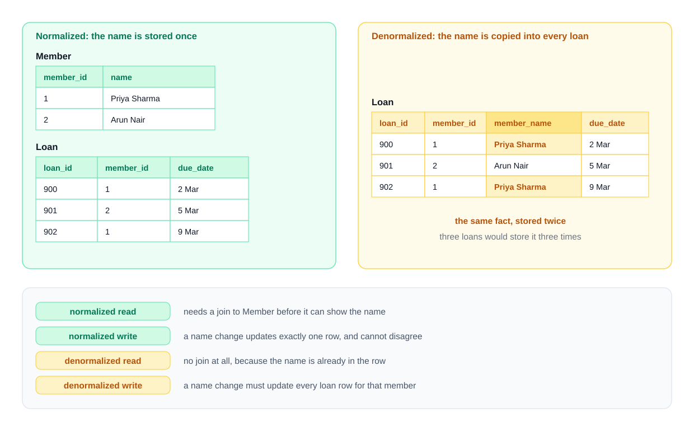

### Why it matters — the trade
| | Normalized | Denormalized |
|---|---|---|
| Each fact stored | once | more than once |
| Writes | touch one row; cannot disagree | touch several places; can drift if not maintained |
| Reads | may need joins / aggregation | fewer joins; precomputed answers |
| Storage | smaller | larger |
| Best for | OLTP (many small writes) | read-heavy, reporting, analytics (OLAP) |

### Common techniques
| Technique | Example | Keeping it correct |
|---|---|---|
| **Stored summary / counter column** | `orders.item_count`, a post's `like_count` | trigger in the same transaction, or batch recompute |
| **Materialized view** | nightly sales-by-product report | `REFRESH MATERIALIZED VIEW` (stale in between; `CONCURRENTLY` needs a unique index) |
| **Duplicated column to avoid a join** | copying `customer_name` onto `orders` for a list page | trigger or application code on every change — the riskiest option |
| **Pre-joined / wide tables** | star-schema dimensions in a data warehouse (Kimball-style dimensional modeling) | rebuilt by ETL, not updated in place |
| **Caches outside the DB** | Redis copy of a product page | expiry / invalidation (see the system-design notes) |

### Running it (`code/07_denormalization.sql`)
```sql
CREATE TABLE orders (order_id text PRIMARY KEY, customer text NOT NULL,
                     item_count int NOT NULL DEFAULT 0);   -- DENORMALIZED: derivable from order_item
CREATE TABLE order_item (
  order_id   text REFERENCES orders ON DELETE CASCADE,
  product_id text REFERENCES product,
  qty        int  NOT NULL CHECK (qty > 0),
  price_paid numeric(8,2) NOT NULL,   -- NOT redundancy: the price at order time is its own fact
  PRIMARY KEY (order_id, product_id)
);
-- AFTER INSERT/UPDATE OF qty/DELETE trigger adjusts orders.item_count in the same transaction
CREATE MATERIALIZED VIEW sales_by_product AS
SELECT p.name, sum(oi.qty) AS units, sum(oi.qty * oi.price_paid) AS revenue
FROM order_item oi JOIN product p USING (product_id) GROUP BY p.name;
```
Output:
```
--- stored item_count vs the value recomputed from order_item
 order_id | stored | recomputed 
----------+--------+------------
 O1       |      4 |          4
 O2       |      2 |          2
(2 rows)

--- the list price changes later; price_paid on old orders must not
 order_id |  name  | price_paid | todays_price 
----------+--------+------------+--------------
 O1       | Kettle |      29.00 |        31.00
 O2       | Kettle |      27.00 |        31.00
(2 rows)

--- after a new sale, before REFRESH (stale copy)
  name  | units | revenue 
--------+-------+---------
 Kettle |     3 |   83.00
 Mug    |     3 |   19.50
(2 rows)

--- after REFRESH
  name  | units | revenue 
--------+-------+---------
 Kettle |     3 |   83.00
 Mug    |    13 |   84.50
(2 rows)
```
Two lessons: the trigger keeps the counter exact (but adds a write to every item change and a row lock on the order); the materialized view is cheap to read but **stale until refreshed**.

**Not everything that looks redundant is.** `price_paid` looks like a copy of `list_price`, but the FD is `{order_id, product_id} -> price_paid` — the price *on that day* — a different fact from today's list price. In the running example we assumed `product_id -> list_price`; in a real shop you would store both. Always ask: *is this the same fact, or a snapshot of it?*

### When to denormalize — the rule
1. Normalize first (3NF).
2. Find a specific, important query that is too slow **on realistic data**, and check that indexes, query rewrites and caching did not fix it.
3. Add the smallest redundancy that fixes it, **with an enforced maintenance path** (trigger, materialized view refresh, ETL), and document which query it serves.

### When not to denormalize
- Write-heavy tables (every write pays the maintenance).
- When the data must be exactly consistent at all times and you have no reliable maintenance mechanism.
- "Because joins are slow" in general — joins on indexed keys are what relational databases are built for ([Chapter 12](../12-indexes-storage-and-query-performance/README.md)).

### Real-world examples
- **Data warehouses** (Snowflake, BigQuery, Redshift) routinely use denormalized star schemas: facts in a narrow table, wide dimension tables — because data is loaded in batches and read by many analytical queries.
- **Social feeds** keep counters (likes, followers) as stored columns rather than `COUNT(*)` on every page view.
- Wide-column and document stores ([Chapter 16](../16-beyond-relational/README.md)) are designed around query-shaped, denormalized data.

### In the interview
**30-second answer:** "I normalize to 3NF by default so every fact has one home. I denormalize only for a measured read bottleneck that indexing didn't solve — typically a counter column maintained by a trigger, a materialized view for reports, or a star schema for analytics — and I make sure the redundant copy has a single, enforced maintenance path."

- *Is storing the order total denormalization?* → If it is recomputable from current data, yes; if it freezes historical prices, it is its own fact.
- *Materialized view vs trigger-maintained table?* → MV: simple, periodically stale; trigger: always current, adds write cost and locking.

### TL;DR
Denormalize = add controlled redundancy for reads, after normalizing and measuring. Use counters with triggers, materialized views or warehouse star schemas; every copy needs an enforced maintenance path. Snapshots (price paid) are facts, not redundancy.

---

## Key terms

| Term | Meaning |
|---|---|
| Functional dependency `X -> Y` | rows equal on X are equal on Y |
| Determinant / dependent | left / right side of an FD |
| Trivial / non-trivial FD | RHS ⊆ LHS / RHS adds a new attribute |
| Full / partial dependency | needs the whole composite determinant / a proper part of a key suffices |
| Transitive dependency | key → non-superkey → non-prime attribute |
| Multivalued dependency `X ->> Y` | for each X, the set of Y values is independent of the rest |
| Join dependency | the table equals the join of certain projections |
| F⁺ / X⁺ | closure of an FD set / of an attribute set |
| Armstrong's axioms | reflexivity, augmentation, transitivity (sound and complete) |
| Union, decomposition, pseudotransitivity | derived inference rules |
| Minimal (canonical) cover | equivalent FD set with single RHS, no extraneous attributes, no redundant FDs |
| Prime / non-prime attribute | in some candidate key / in none |
| Insertion / update / deletion anomaly | can't add a fact alone / must change many rows / deleting loses an unrelated fact |
| 1NF, 2NF, 3NF, BCNF, 4NF, 5NF | see §11.6 table |
| Lossless (non-additive) decomposition | joining pieces returns exactly the original rows |
| Spurious tuple | row invented by a lossy join |
| Dependency preservation | every FD enforceable within one piece |
| 3NF synthesis / BCNF decomposition | the two standard normalization algorithms |
| Denormalization | deliberate, maintained redundancy for read performance |
| Materialized view | stored query result refreshed on demand |

---

## Chapter 11 TL;DR

- **FDs are the foundation.** `X -> Y` is a business rule; data can disprove it, never prove it. X is a superkey iff X⁺ is everything.
- **Tools:** Armstrong's axioms (sound, complete), attribute closure (fire only fully-present LHS; loop), candidate keys (start with attributes never on a right side), minimal covers.
- **Anomalies** (insert/update/delete) come from storing a fact more than once; normalization decomposes tables so each fact lives in one place.
- **1NF** atomic cells · **2NF** no non-prime on part of a key · **3NF** every FD's LHS is a superkey or RHS is prime · **BCNF** every determinant is a superkey · **4NF** no independent lists (MVDs) · **5NF** no join dependencies beyond keys.
- **Every split must be lossless** (shared columns = key of one side; check with `EXCEPT` both ways) and ideally dependency-preserving. 3NF can always have both; BCNF sometimes loses an FD — which is why 3NF is the default stopping point.
- **Denormalize** only for a measured read problem, with an enforced way to keep copies correct; snapshots such as `price_paid` are separate facts, not redundancy.
- Next: [Chapter 12](../12-indexes-storage-and-query-performance/README.md) makes the joins that normalization creates fast; [Chapter 17](../17-schema-design-case-studies/README.md) applies Chapters 10–11 to full designs.
