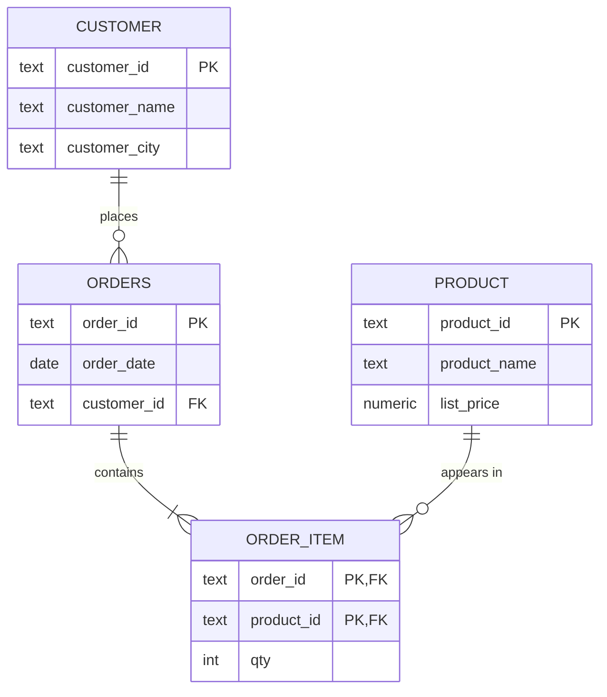

# Chapter 11 — Normalization

[Chapter 10](../10-data-modeling-and-er-diagrams/README.md) turned a business description into tables. This chapter asks: **does each fact live in exactly one place?** If not, the table can contradict itself (a customer with two cities) and some facts cannot be stored or are lost by accident. **Normalization** is the rule-based way to find such tables and split them safely.

Everything here rests on one exact tool, the **functional dependency**, so "is this table in 3NF?" has a checkable yes/no answer. [`code/fd_tools.py`](code/fd_tools.py) (Python 3: `python fd_tools.py`) computes closures, candidate keys (minimal column sets that identify a row) and normal-form violations; every worked answer was verified with it. The SQL files (`00_schema.sql`, one wide order table; `01`–`07`, each on a fresh database) show the anomalies on PostgreSQL and their disappearance after decomposition (splitting one table into several). All "Output:" blocks are real.

**What you'll learn:** FDs and their types · Armstrong's rules, closure, finding every candidate key, minimal covers · insert/update/delete anomalies, live · 1NF → 5NF: rule, violating table, fix, proof nothing was lost · lossless joins and dependency preservation, and why 3NF (not BCNF) is the usual stopping point · four exercises · when to **denormalize**.

---

## 11.1 Functional dependencies

### What it is
A **functional dependency (FD)** **`X -> Y`** ("X determines Y") says: take any two rows; if they agree on every column of `X`, they must agree on every column of `Y`. One pair that agrees on `X` but differs on `Y` proves the FD false. (An ID number determines a birthday; a birthday does not determine an ID.)


### The running example
One deliberately bad table from a small online shop (`code/00_schema.sql`):

| order_id | product_id | order_date | customer_id | customer_name | customer_city | product_name | list_price | qty |
|---|---|---|---|---|---|---|---|---|
| O1 | P1 | 2026-09-01 | C1 | Nadia Lopez | Lisbon | Kettle | 29.00 | 1 |
| O1 | P2 | 2026-09-01 | C1 | Nadia Lopez | Lisbon | Mug | 6.50 | 4 |
| O2 | P1 | 2026-09-03 | C2 | Jonas Berg | Oslo | Kettle | 29.00 | 1 |
| O3 | P3 | 2026-09-05 | C1 | Nadia Lopez | Lisbon | Teapot | 18.00 | 2 |
| O4 | P4 | 2026-09-06 | C3 | Priya Das | Kochi | Tea tin | 9.00 | 3 |

The shop owner confirms four rules — these are the FDs:

| # | FD | In words |
|---|---|---|
| F1 | `order_id -> order_date, customer_id` | an order is placed on one date by one customer |
| F2 | `customer_id -> customer_name, customer_city` | a customer has one name and one city |
| F3 | `product_id -> product_name, list_price` | a product has one name and one current list price |
| F4 | `{order_id, product_id} -> qty` | a product appears once per order, with one quantity |

**Vocabulary:** the left side is the **determinant** (`customer_id` in F2; several normal forms are phrased in terms of determinants), the right side the **dependent**; a multi-column side is **composite** (`{order_id, product_id}` in F4).

### An FD is a rule, not a summary of today's rows
Every `customer_name` above is different, so `customer_name -> customer_city` *happens* to hold — but two customers called Nadia Lopez can live in different cities. Rows can **disprove** an FD but never **prove** one; FDs are constraints on every legal state, like `NOT NULL`.

- **Where FDs come from:** ask the data owners, one rule at a time — *"If I tell you the X, do you always know the Y?"* Write every answer down before designing tables.
- **Direction matters:** `X -> Y` says nothing about `Y -> X` (an id and a unique email determine each other, but each needs its own check).

### FDs and keys are the same idea
A **superkey** ([§10.13](../10-data-modeling-and-er-diagrams/README.md#1013-keys-in-relational-databases)) is a set that never repeats: **`X` is a superkey exactly when `X` determines all columns** (rows equal on X would be the same row). A **candidate key** is a superkey from which nothing can be removed. So closure (§11.4), the tool that tests FDs, also finds keys — and each normal form is a statement about which FDs may exist, which makes "is this normalized?" a fact, not an opinion.

### TL;DR
`X -> Y`: rows equal on X are equal on Y. One counter-pair disproves it; data never proves it — FDs come from business rules. X is a superkey iff X determines all columns.

---

## 11.2 Types of functional dependencies

In the running example the only candidate key is `{order_id, product_id}`, so the **prime attributes** (members of some candidate key) are `order_id` and `product_id`; all others are **non-prime**.


| Type | Definition | Example (running table) | Banned by |
|---|---|---|---|
| **Trivial** | right side contained in the left: `{order_id, product_id} -> product_id` | always true; says nothing | never a problem — every rule says "non-trivial" |
| **Non-trivial** | right side adds a column the left lacks | `customer_id -> customer_city` | — |
| **Completely non-trivial** | left and right share no column | `product_id -> list_price` | — |
| **Full** | needs its *whole* (composite) determinant: remove any column and it fails | `{order_id, product_id} -> qty` (O1 has quantities 1 and 4; P1 appears in O1 and O2) | — |
| **Partial** | a *proper part* of a candidate key determines a non-prime column | `order_id -> order_date`, `product_id -> product_name` | **2NF** |
| **Transitive** | `X -> Y` and `Y -> Z` give `X -> Z`, where `Y` is not a superkey and `Z` is non-prime | `order_id -> customer_id -> customer_city` | **3NF** |
| **Determinant not a superkey** | any non-trivial `X -> Y` with X not a superkey | all of F1–F3 here | **BCNF** |
| **Multivalued** (`X ->> Y`) | for one X, the *set* of Y values is independent of the other columns | a restaurant's dishes vs its delivery zones (§11.12) | **4NF** |

Precision points:
- **Full vs partial needs a composite determinant** — a one-column key has no "part".
- **Both conditions on "transitive" matter:** without "Y is not a superkey", every table would be full of transitive dependencies (key → key → everything).
- **Partial and transitive can overlap:** `order_id -> customer_city` is both.
- **Every FD is also an MVD** (multivalued dependency), not vice versa (§11.12).

**Self-check:** `{order_id, product_id} -> order_id`? → trivial. Why is `product_id -> product_name` partial? → `product_id` is a proper part of the only key and `product_name` is non-prime. With a single-column key, which can exist? → only transitive.

### TL;DR
Trivial (always true) · full (needs whole key) · partial (part of a key → non-prime; kills 2NF) · transitive (key → non-key → non-prime; kills 3NF) · non-superkey determinant (kills BCNF) · multivalued (kills 4NF).

---

## 11.3 Armstrong's inference rules

### What it is
A set of FDs implies more than it lists: nobody wrote `order_id -> customer_city`, yet F1 and F2 force it. The given FDs `F` plus everything they imply is the **closure of F**, **F⁺**. The derivation rules are **Armstrong's axioms** (W. W. Armstrong, 1974).


| Axiom | Rule | Example | Why it is true |
|---|---|---|---|
| **Reflexivity** | if `Y ⊆ X` then `X -> Y` | `{order_id, product_id} -> product_id` | rows equal on X are equal on any part of X (the trivial FDs) |
| **Augmentation** | if `X -> Y` then `XZ -> YZ` | from F2: `{customer_id, product_id} -> {customer_city, product_id}` | rows equal on X and Z are equal on Y (FD) and Z (assumption) |
| **Transitivity** | if `X -> Y` and `Y -> Z` then `X -> Z` | F1 + F2: `order_id -> customer_city` | chain the two guarantees |

The axioms are **sound** (never derive an FD false in some table satisfying F) and **complete** (derive every FD that holds in all such tables). The derived rules add convenience, not power:

| Rule | Pattern | Example |
|---|---|---|
| **Union** | `X -> Y` and `X -> Z` ⟹ `X -> YZ` | `order_id -> {order_date, customer_city}` |
| **Decomposition** (split) | `X -> YZ` ⟹ `X -> Y` and `X -> Z` | F3 ⟹ `product_id -> list_price` |
| **Pseudotransitivity** | `X -> Y` and `WY -> Z` ⟹ `WX -> Z` | if `{customer_id, product_id} -> review_stars` (one review per product), F1 with W = product_id gives `{order_id, product_id} -> review_stars` |

Decomposition is why worked examples first rewrite every FD with a single column on the right.

**Deriving union from the axioms** (common exam question): (1) augment `X -> Y` with X: `X -> XY` (since XX = X); (2) augment `X -> Z` with Y: `XY -> YZ`; (3) transitivity: `X -> YZ`. ∎ Decomposition = reflexivity (`YZ -> Y`) + transitivity; pseudotransitivity = augment `X -> Y` with W, then transitivity.

They matter because keys and normal-form claims depend on implied FDs; in practice you apply them via attribute closure (next). `fd_tools.py` confirms the derivations:
```
order_id -> customer_city follows? True
customer_id -> order_id follows?   False
pseudotransitivity: order_id -> customer_id and {customer_id, product_id} -> review_stars
  so {order_id, product_id} -> review_stars? True
```

### TL;DR
F⁺ = all FDs implied by F. Axioms: reflexivity, augmentation, transitivity — sound and complete. Shortcuts: union, decomposition, pseudotransitivity.

---

## 11.4 Attribute closure and finding candidate keys

### What it is
The **closure of an attribute set X**, **X⁺**, is every attribute X determines, directly or through chains (always including X).

### The algorithm
1. Start with `result = X`.
2. For any FD whose **entire** left side is inside `result`, add its right side.
3. Repeat full passes until a pass adds nothing.

The classic mistake is firing an FD whose left side is only *partly* present. Repeated passes matter because an FD can become usable once an earlier one adds the column it needs. The core of `fd_tools.py`:
```python
def closure(attrs, fds, trace=False):
    """X+ : keep adding the right side of any FD whose WHOLE left side is already in the set."""
    result = set(attrs)
    changed = True
    while changed:
        changed = False
        for lhs, rhs in fds:
            if lhs <= result and not rhs <= result:   # lhs fully present, something new to add
                result |= rhs
                changed = True
    return frozenset(result)
```

**{order_id}⁺:** F1 fires → add `order_date, customer_id`; now F2 fires → add `customer_name, customer_city`. F3 needs `product_id` (absent); F4 needs *both* key columns — **skip**.
```
closure trace for {order_id}:
    step 1: {order_id} -> {customer_id, order_date} fires, set = {customer_id, order_date, order_id}
    step 2: {customer_id} -> {customer_city, customer_name} fires, set = {customer_city, customer_id, customer_name, order_date, order_id}
{order_id}+ = {customer_city, customer_id, customer_name, order_date, order_id}
{product_id}+ = {list_price, product_id, product_name}
{order_id, product_id}+ = {customer_city, customer_id, customer_name, list_price, order_date, order_id, product_id, product_name, qty}
```


### Uses of closure
| Question | Test |
|---|---|
| Is X a **superkey**? | X⁺ contains **all** attributes |
| Is X a **candidate key**? | superkey **and** no proper subset is (enough to test subsets with one attribute removed) |
| Does **X -> Y** follow from F? | Y ⊆ X⁺ |

Here `{order_id, product_id}⁺` is all nine columns, while `{order_id}⁺` (5) and `{product_id}⁺` (3) are not → **`{order_id, product_id}` is a candidate key**. `customer_id -> order_id` does **not** follow (`order_id ∉ {customer_id}⁺` — a customer has many orders).

### Finding *all* candidate keys systematically
1. **Classify attributes:** never on a right side → **in every key**; only on right sides → **in no key**; both → maybe.
2. Close the "must" set. If it is everything, it is the *only* candidate key (the running example: `order_id`, `product_id` never appear on a right side — which is why `fd_tools.candidate_keys` starts from that "core").
3. Otherwise add "maybe" attributes one at a time, then two, …, skipping supersets of keys already found.

**Harder example (Exercise 3):** R(A, B, C, D, E), `A -> B`, `BC -> D`, `D -> A`, `C -> E`. `C` is never on a right side; `C⁺ = {C, E}`. Adding one attribute:
```
{C}+ = {C, E}
{A, C}+ = {A, B, C, D, E}
{B, C}+ = {A, B, C, D, E}
{C, D}+ = {A, B, C, D, E}
{C, E}+ = {C, E}
```
**Three** candidate keys: `{A,C}`, `{B,C}`, `{C,D}`; prime A, B, C, D; non-prime E. Overlapping keys like these are where BCNF differs from 3NF (§11.11).

### In the interview
**30-second answer:** "To test whether X is a key, compute X⁺: start with X and repeatedly add the right side of any FD whose left side is fully contained, until nothing changes. If X⁺ is the whole relation, X is a superkey; if no smaller subset is, it's a candidate key. Attributes that never appear on a right-hand side must be in every key, which is where I start."

- *How do you check whether an FD is implied?* → Close its left side; is the right side inside?
- *Complexity?* → A naive closure loop is O(|F|² · |attrs|); finding all keys can be exponential in the worst case (a relation can have exponentially many keys), but class-sized problems are tiny.

### TL;DR
X⁺ = everything X determines (fire only FDs whose whole LHS is present; loop until stable). Superkey ⟺ X⁺ = all attributes; candidate key = minimal superkey; X -> Y implied ⟺ Y ⊆ X⁺. Never-on-the-right attributes are in every key.

---

## 11.5 Minimal (canonical) cover

A **minimal cover** (**canonical cover**, F_c) is an equivalent FD list with no waste:
1. every right side is a **single** attribute;
2. no left side has an **extraneous** attribute (droppable without changing F⁺);
3. no FD is **redundant** (derivable from the others).

It is the input to 3NF synthesis (§11.14). **Worked example:** F = { `A -> BC`, `B -> C`, `AB -> D` }
1. Split: `A -> B`, `A -> C`, `B -> C`, `AB -> D`.
2. In `AB -> D`, B is extraneous: `A⁺` = {A, B, C, D} contains D → `A -> D`.
3. `A -> C` follows from `A -> B`, `B -> C` → remove.
```
=== minimal cover of {A->BC, B->C, AB->D}: {A}->{B}, {B}->{C}, {A}->{D}
```
A minimal cover is not always unique (removal order can matter), but every one implies exactly F⁺.

### TL;DR
Minimal cover = singleton right sides, no extraneous left attributes, no redundant FDs; equivalent to F. Needed for 3NF synthesis.

---

## 11.6 Anomalies — why normalization exists

### The problem it solves
The wide table stores "Nadia lives in Lisbon" three times and "P1 is a Kettle at 29.00" twice. That causes three failures:

| Anomaly | What goes wrong | In the running table |
|---|---|---|
| **Insertion** | cannot record one fact without inventing an unrelated one | a product nobody has ordered has no row — the key needs an `order_id` |
| **Update** | one real-world change must be repeated on many rows; miss one and the table contradicts itself | Nadia moves: 3 rows must change |
| **Deletion** | deleting one fact silently deletes another | cancel Priya's only order and the shop forgets Priya *and* the tea tin |


`code/01_anomalies.sql`:
```sql
-- INSERT: a new product with no order
INSERT INTO order_line_wide (order_id, product_id, ..., product_name, list_price, qty)
VALUES (NULL, 'P5', ..., 'Milk jug', 12.00, 1);              -- inside a DO block that catches the error
-- UPDATE: Nadia moves, but a careless WHERE edits only one of her rows
UPDATE order_line_wide SET customer_city = 'Porto' WHERE customer_id = 'C1' AND order_id = 'O3';
-- DELETE: cancel O4
DELETE FROM order_line_wide WHERE order_id = 'O4';
```
Output:
```
--- the same facts are stored many times
 customer_id | customer_name | customer_city | rows_holding_it 
-------------+---------------+---------------+-----------------
 C1          | Nadia Lopez   | Lisbon        |               3
 C2          | Jonas Berg    | Oslo          |               1
 C3          | Priya Das     | Kochi         |               1
(3 rows)

--- INSERT anomaly: a new product nobody has ordered yet has nowhere to go
NOTICE:  refused: null value in column "order_id" of relation "order_line_wide" violates not-null constraint
--- UPDATE anomaly: Nadia moves to Porto, but the update misses one of her rows
 customer_id | cities_on_file 
-------------+----------------
 C1          | {Lisbon,Porto}
(1 row)

--- DELETE anomaly: cancel order O4 and customer C3 and product P4 vanish with it
 rows_about_priya | rows_about_tea_tin 
------------------+--------------------
                0 |                  0
(1 row)
```

### What normalization does
**Normalization** splits a table along its FDs so **every fact has exactly one home** — one row to update, nothing unrelated to delete, every fact insertable on its own. It uses **decomposition** into projections (a *projection* = some of the columns, duplicates removed) that must be **lossless** (§11.10).

### The ladder of normal forms
Each **normal form** is a pass/fail test; each assumes the previous one and is stricter:

| Form | Removes | One-line rule | Origin |
|---|---|---|---|
| **1NF** | lists and repeating groups in cells | every cell holds one atomic value | Codd 1970 |
| **2NF** | partial dependencies | no non-prime attribute depends on part of a candidate key | Codd 1971 |
| **3NF** | transitive dependencies | no non-prime attribute depends on a non-superkey | Codd 1971 |
| **BCNF** | remaining FD redundancy | every non-trivial FD's determinant is a superkey | Boyce & Codd 1974 |
| **4NF** | independent multivalued facts | every non-trivial MVD's determinant is a superkey | Fagin 1977 |
| **5NF** | join dependencies not implied by keys | the table cannot be split losslessly except via its keys | Fagin 1979 |


(Domain-key NF and 6NF — used in temporal databases, which record how values change over time, and some data-warehouse styles — are beyond everyday design.)

**You do not always climb to the top.** Each step removes redundancy and usually adds a join. **3NF is where most designs stop**: it removes the redundancy behind the worst anomalies and always has a safe decomposition (§11.14). Putting redundancy back on purpose is **denormalization** (§11.16).

### TL;DR
Redundancy → insertion, update and deletion anomalies. Normalization decomposes tables along FDs so each fact is stored once. 1NF → 2NF → 3NF → BCNF → 4NF → 5NF, each stricter; most designs stop at 3NF.

---

## 11.7 First normal form (1NF)

### What it is
A table is in **1NF** when (1) every cell holds a **single, indivisible (atomic)** value — no lists, sets or nested records; (2) there are **no repeating groups** (`phone1, phone2, phone3`); (3) rows are distinguishable — it has a key. It is purely about the **shape of a cell**.

### The problem it solves
```
vol_id | name  | languages
     1 | Hana  | Japanese, English
     3 | Ama   | Twi, English, French
```
"Who speaks English?" needs `LIKE '%English%'`, which also matches "Old English" or a typo; you cannot count, index usefully or constrain spelling.

### How to fix it — two routes


1. **One row per value** (key becomes `(vol_id, language)`) — reaches 1NF but copies the other columns onto every row.
2. **A separate table** — `volunteer(vol_id, name)` + `volunteer_language(vol_id, language)`. This is what 2NF would produce from route 1 anyway, and what [§10.6](../10-data-modeling-and-er-diagrams/README.md#106-entities-and-the-five-kinds-of-attribute) predicted for a multivalued attribute.

`code/03_first_normal_form.sql` repairs both kinds of violation (*unpivoting* turns columns into rows; `CROSS JOIN LATERAL` lets `VALUES` read the current row):
```sql
-- a list in one cell -> one row per value (string_to_table: PostgreSQL 14+)
CREATE TABLE volunteer_language AS
SELECT vol_id, trim(lang) AS language
FROM volunteer_packed, string_to_table(languages, ',') AS lang;
ALTER TABLE volunteer_language ADD PRIMARY KEY (vol_id, language);

-- a repeating group phone1..phone3 -> rows (unpivot with LATERAL VALUES)
SELECT g.guest_id, g.name, p.phone
FROM guest_sideways g
CROSS JOIN LATERAL (VALUES (g.phone1), (g.phone2), (g.phone3)) AS p(phone)
WHERE p.phone IS NOT NULL
ORDER BY g.guest_id, p.phone;
```
Output:
```
--- repair: one row per value (string_to_table needs PostgreSQL 14+)
 vol_id | language 
--------+----------
      1 | English
      1 | Japanese
      2 | Spanish
      3 | English
      3 | French
      3 | Twi
(6 rows)

--- now counting and exact matching are ordinary SQL
 ...
--- unpivot the phone columns into rows; guests without a phone produce no rows
 guest_id | name  |  phone   
----------+-------+----------
       10 | Ivo   | 555-0101
       10 | Ivo   | 555-0102
       12 | Malik | 555-0301
       12 | Malik | 555-0303
(4 rows)
```
Dialect note (not run): PostgreSQL < 14 `unnest(string_to_array(languages, ','))`; MySQL 8 `JSON_TABLE` or a recursive CTE; SQL Server `STRING_SPLIT` and `CROSS APPLY (VALUES …)`.

### Misconceptions and borderline cases
- **1NF does not require unique column values** — only keys are unique.
- **1NF does not reduce redundancy — route 1 increases it.** Removing repetition is 2NF/3NF's job.
- A normalization step **never drops a column**; if one disappears, information was lost.
- **Structured text** (a whole address in one column) is a 1NF problem only if you query the parts.
- **JSON / arrays** are strictly non-atomic. PostgreSQL has first-class `jsonb` (parsed binary JSON) and indexable arrays ([Chapter 14](../14-advanced-sql-and-using-sql-from-code/README.md)); storing a document *on purpose* (sparse attributes most rows lack, payloads you never filter on) is legitimate. If you search, join or constrain on what is inside, it belongs in rows.
- **Common mistakes:** comma-separated ids (`tag_ids = '3,7,9'`) — *SQL Antipatterns*' **Jaywalking**: no joins, no FKs; numbered columns (`item1…item5`); believing 1NF means "no duplicate values".

### TL;DR
1NF = atomic cells, no repeating groups, a key. Fix lists with one row per value or (better) a child table. 1NF does not remove redundancy and does not require unique values.

---

## 11.8 Second normal form (2NF)

### What it is
**2NF** = 1NF **and no non-prime attribute is partially dependent on any candidate key** — every non-key column depends on the *whole* key. A table whose candidate keys all have **one column** is automatically in 2NF.

### Finding the violation
Key `{order_id, product_id}`:

| Column | Needs | Verdict |
|---|---|---|
| `qty` | order **and** product | full ✓ |
| `order_date`, `customer_id` | `order_id` only | partial ✗ |
| `customer_name`, `customer_city` | `order_id` only (via customer_id) | partial ✗ |
| `product_name`, `list_price` | `product_id` only | partial ✗ |

```
candidate keys: {order_id, product_id}
2NF violations: ['{order_id} -> {customer_city, customer_id, customer_name, order_date}', '{product_id} -> {list_price, product_name}']
```


### How to fix it
One new table per key part that has dependents (dependents grouped by the part that determines them), plus a table for the full-key columns:
- `order_header(order_id, order_date, customer_id, customer_name, customer_city)`
- `product(product_id, product_name, list_price)`
- `order_item(order_id, product_id, qty)`

`order_header` still repeats Nadia's city once per order — a *transitive* dependency, invisible to 2NF.

**Common mistakes:** moving only one part's dependents (still not 2NF); checking only the primary key — 2NF concerns **every candidate key** and **non-prime** attributes (Exercise 1).

### TL;DR
2NF = 1NF + no non-prime column determined by part of a candidate key. Only composite keys can violate it. Fix: one table per key part with its dependents, plus the full-key table.

---

## 11.9 Third normal form (3NF)

### What it is
**3NF** = 2NF **plus no non-prime attribute transitively dependent on a candidate key** — "the key, the whole key, and nothing but the key" (mnemonic usually credited to Bill Kent). The precise form (Zaniolo's), worth knowing for interviews: **for every non-trivial FD `X -> A`, either X is a superkey, or A is prime.** It implies 2NF.

### Finding the violation
`order_header` has a single-column key (so 2NF). But `customer_id -> customer_city`: is `customer_id` a superkey here? No (Nadia has three orders). Is `customer_city` prime? No. Both escapes fail → **not 3NF**.


### How to fix it
Move the **far end of the chain** into a table keyed by the **middle** column, which stays behind as an FK (otherwise nothing to join on):
- `customer(customer_id, customer_name, customer_city)`
- `orders(order_id, order_date, customer_id → customer)`

| | Dependency runs through | Possible when |
|---|---|---|
| 2NF violation | **part** of a candidate key | the key is composite |
| 3NF violation | a **non-key** column | any key shape, including one column |

So 3NF must be checked on every table; 2NF only with composite keys. The 3NF synthesis algorithm (§11.14) produces exactly our four tables:
```
3NF synthesis: ['{customer_id, order_date, order_id}', '{customer_city, customer_id, customer_name}', '{list_price, product_id, product_name}', '{order_id, product_id, qty}']
```



### In the interview
**30-second answer:** "1NF: atomic values. 2NF: no non-key attribute depends on part of a composite key. 3NF: no non-key attribute depends on another non-key attribute — formally, for every non-trivial FD X → A, X is a superkey or A is prime. I normalize to 3NF by default because it removes the update anomalies and there's always a lossless, dependency-preserving 3NF decomposition."

- *A 3NF violation with a single-column key?* → `employee(emp_id, dept_id, dept_name)`: `dept_id -> dept_name`.
- *Is a table with only key columns in 3NF?* → Yes (no non-prime attributes); check BCNF separately.

### TL;DR
3NF = 2NF + no non-key → non-key dependency (formally: every FD's LHS is a superkey or RHS is prime). Fix: split the chain's tail into a table keyed by the middle column, which stays behind as an FK.

---

## 11.10 Decomposition done right: lossless joins and dependency preservation

### Lossless (non-additive) join — mandatory
Joining the pieces must return **exactly** the original rows. A lossy split usually *adds* rows (**spurious tuples**); what is lost is which combinations were true. **Two-way test:** splitting R into R1, R2 is lossless iff `R1 ∩ R2` is a **superkey of R1 or of R2** (`R1 ∩ R2 -> R1` or `-> R2` is in F⁺).

`code/04_lossy_join.sql`: `staff(emp, dept, city)` with `emp -> dept, city`:
```sql
-- bad: (emp, city) + (dept, city); city is a key of neither piece
WITH ec AS (SELECT DISTINCT emp, city FROM staff),
     dc AS (SELECT DISTINCT dept, city FROM staff)
SELECT ec.emp, dc.dept, ec.city,
       (ec.emp, dc.dept, ec.city) IN (SELECT emp, dept, city FROM staff) AS real_row
FROM ec JOIN dc USING (city) ORDER BY 1, 2;
```
Output:
```
--- bad split: (emp, city) and (dept, city). The shared column city is a key of neither piece.
 emp |  dept   | city  | real_row 
-----+---------+-------+----------
 Ana | Sales   | Leeds | t
 Ana | Support | Leeds | f
 Ben | Sales   | Leeds | f
 Ben | Support | Leeds | t
 Cai | Sales   | York  | t
(5 rows)

--- good split: (emp, dept) and (emp, city). The shared column emp is a key of both.
 invented_rows 
---------------
             0
(1 row)
```

### Dependency preservation — strongly desirable
Every original FD should be checkable **inside one table** (so a `PRIMARY KEY`/`UNIQUE` enforces it), or be implied by FDs that are. Otherwise enforcement needs a join — a trigger (code the database runs on every change) or application code. §11.11 shows a lossless split that loses one.

### The running example decomposed (`code/02_decompose_and_fix.sql`)
```sql
CREATE TABLE customer AS SELECT DISTINCT customer_id, customer_name, customer_city FROM order_line_wide;
CREATE TABLE product  AS SELECT DISTINCT product_id, product_name, list_price     FROM order_line_wide;
CREATE TABLE orders   AS SELECT DISTINCT order_id, order_date, customer_id        FROM order_line_wide;
CREATE TABLE order_item AS SELECT order_id, product_id, qty                       FROM order_line_wide;
-- then ADD PRIMARY KEY to each, and FOREIGN KEYs from orders and order_item (see the file)
-- lossless check: (original EXCEPT rejoined) and (rejoined EXCEPT original) must both be empty
```
Output:
```
--- row counts after the split
 customers | products | orders | order_items 
-----------+----------+--------+-------------
         3 |        4 |      4 |           5
(1 row)

--- lossless? join the pieces back and compare with the original, both directions
 missing_rows | invented_rows 
--------------+---------------
            0 |             0
(1 row)

--- INSERT: a product with no orders is now fine
--- UPDATE: Nadia moves once, in one row
 customer_city 
---------------
 Porto
(1 row)

--- DELETE: cancel O4; Priya and the tea tin survive
 priya_rows | tea_tin_rows | o4_items 
------------+--------------+----------
          1 |            1 |        0
(1 row)
```
All three anomalies are gone, and each of F1–F4 lives inside one table. `SELECT DISTINCT` + `ADD PRIMARY KEY` is the standard way to split live data — if `ADD PRIMARY KEY` fails, the data already contradicts the assumed FD.

### TL;DR
Lossless: shared columns must be a key of one side (else the join invents rows). Dependency-preserving: each FD checkable in one table. Verify a split with `EXCEPT` both ways.

---

## 11.11 Boyce–Codd normal form (BCNF)

### What it is
**BCNF**: the left side of **every non-trivial FD `X -> Y` is a superkey** — "every determinant is a (super)key". It drops 3NF's second escape ("…or Y is prime"), so every BCNF table is in 3NF, not vice versa; sometimes called "3.5NF". **3NF passes but BCNF fails only with several composite candidate keys that overlap** — with a single candidate key they coincide.

### A 3NF table that is not in BCNF
Clinic rules: each doctor has one specialty (`doctor -> specialty`); a patient sees one doctor per specialty (`{patient, specialty} -> doctor`).

| patient | specialty | doctor |
|---|---|---|
| Ali | Cardiology | Dr Osei |
| Ali | Dermatology | Dr Lind |
| Beth | Cardiology | Dr Osei |
| Beth | Neurology | Dr Tan |
| Chen | Cardiology | Dr Moreau |

```
=== visit (3NF, not BCNF)
candidate keys: {doctor, patient}, {patient, specialty}
prime: {doctor, patient, specialty}  non-prime: {}
2NF violations: none
3NF violations: none
BCNF violations: ['{doctor} -> {specialty}']
highest normal form: 3NF
BCNF decomposition: ['{doctor, specialty}', '{doctor, patient}']
FDs no longer checkable in one piece: ['{patient, specialty} -> {doctor}']
```
Both keys are composite and overlap on `patient`, so every attribute is prime: `doctor -> specialty` passes 3NF (specialty is prime) but fails BCNF (doctor is not a superkey). The redundancy is real (`code/05_bcnf.sql`):
```
--- the fact "Dr Osei is a cardiologist" is stored once per patient
  doctor   |  specialty  | copies 
-----------+-------------+--------
 Dr Osei   | Cardiology  |      2
 ...
--- nothing stops the copies disagreeing (update anomaly)
 doctor  |      specialties      
---------+-----------------------
 Dr Osei | {Cardiology,Oncology}
(1 row)
```

### Decomposing, and the cost
Split on the offending FD: `doctor_specialty(doctor PK, specialty)` + `patient_doctor(patient, doctor)` (PK both). Shared `doctor` is the key of `doctor_specialty` → lossless (`invented_rows 0, missing_rows 0`). But `{patient, specialty} -> doctor` now spans two tables, so no single key enforces it:
```sql
INSERT INTO patient_doctor VALUES ('Ali', 'Dr Moreau');     -- accepted!
```
Output:
```
--- the cost: {patient, specialty} -> doctor is no longer checked by any one table
 patient | specialty  |         doctors         
---------+------------+-------------------------
 Ali     | Cardiology | {"Dr Moreau","Dr Osei"}
(1 row)
```
Ali now has two cardiologists. **General result:** a **3NF** decomposition that is both lossless and dependency-preserving always exists; for **BCNF** it is not guaranteed — why practitioners usually stop at 3NF.

**Practical middle way** (also in `05_bcnf.sql`): keep the 3NF table (`{patient, specialty}` stays PK), add a master `doctor_specialty` table and a **composite foreign key** `(doctor, specialty) → doctor_specialty(doctor, specialty) ON UPDATE CASCADE`. Copies can no longer disagree, and one update propagates:
```
NOTICE:  refused: insert or update on table "visit_3nf" violates foreign key constraint "visit_3nf_doctor_specialty_fkey"
 patient |    specialty    | doctor  
---------+-----------------+---------
 Ali     | Cardiac surgery | Dr Osei
 Beth    | Cardiac surgery | Dr Osei
(2 rows)
```

### The trap: "looks like BCNF, is really 2NF"
`enrol(student, course, instructor)`, `course -> instructor`, key `{student, course}`: `instructor` is **non-prime** and hangs off **half** the key → not even 2NF (`2NF violations: ['{course} -> {instructor}'] … highest normal form: 1NF`). **Rule of thumb:** non-prime dependent of a proper subset of a key → 2NF problem; only when every attribute involved is prime and a determinant still is not a superkey is it a genuine BCNF problem.

### In the interview
**30-second answer:** "BCNF says every determinant must be a superkey. It's stricter than 3NF, which also allows X → A when A is prime. The two only differ for tables with several composite candidate keys that overlap. BCNF decompositions are always lossless but not always dependency-preserving, so sometimes I stay at 3NF and enforce the rule with a composite foreign key."

- *Example of 3NF-not-BCNF?* → Patient/specialty/doctor with doctor → specialty.
- *What's lost in the BCNF split?* → {patient, specialty} → doctor can't be enforced by one table's key.

### TL;DR
BCNF: every non-trivial FD's LHS is a superkey. Differs from 3NF only with overlapping composite candidate keys. Split on the violating FD (lossless), but you may lose dependency preservation.

---

## 11.12 Fourth normal form (4NF) — independent multivalued facts

### What it is
**4NF** handles a non-FD redundancy: two **independent lists** about one thing in one table. A restaurant's dishes and its separately chosen delivery zones, stored together, force every dish to pair with every zone:

| restaurant | dish | zone |
|---|---|---|
| Saffron | Biryani | North |
| Saffron | Biryani | Centre |
| Saffron | Dal | North |
| Saffron | Dal | Centre |
| Nori | Ramen | East |

`restaurant` does not determine `dish`; what holds is a **multivalued dependency (MVD)** **`restaurant ->> dish`**: for a restaurant, the set of dishes is the same whatever zone you look at (and symmetrically `restaurant ->> zone` — MVDs come in complementary pairs). The only key is all three columns, so the table is in BCNF — and still redundant.


**Rule:** 4NF = BCNF and **for every non-trivial MVD `X ->> Y`, X is a superkey** — in practice, **one table per independent list**.

### The signature and the damage (`code/06_4nf_5nf.sql`)
A **full cross product** per key value (2 dishes × 2 zones = 4 rows). Adding a dish needs one row *per zone*; forget one and the table lies:
```
--- restaurant ->> dish | zone: every dish is paired with every zone (a full cross product)
 restaurant | dishes | zones | rows 
------------+--------+-------+------
 Nori       |      1 |     1 |    1
 Saffron    |      2 |     2 |    4
(2 rows)

--- adding one dish to Saffron needs one row PER ZONE; forget one and the table lies
 restaurant |     dish     | zones_listed 
------------+--------------+--------------
 Saffron    | Biryani      |            2
 Saffron    | Dal          |            2
 Saffron    | Paneer tikka |            1
(3 rows)

--- 4NF split: one table per independent list; the join rebuilds the original exactly
 dish_rows | zone_rows | invented_rows 
-----------+-----------+---------------
         3 |         3 |             0
(1 row)
```
Five rows became 3 + 3, and each new fact is one row. The split is lossless because the lists are independent (an MVD `X ->> Y` is exactly the condition for splitting R into XY and X(R−Y) losslessly). **Caution:** if a dish is only delivered to some zones, the three-column table is correct and there is no MVD — the business rule decides, not the rows.

### TL;DR
MVD `X ->> Y`: for each X, the set of Y values is independent of the other columns (visible as a full cross product). 4NF: every non-trivial MVD's LHS is a superkey → store each independent list in its own table.

---

## 11.13 Fifth normal form (5NF) — facts that need three tables

### What it is
**5NF** (**project-join normal form, PJ/NF**): a table with no FD/MVD problems that can still be split into **three (or more)** projections that join back exactly, while **no two** of them can. The constraint is a **join dependency (JD)**. Classic shape — a **cyclic business rule**: *if a supplier supplies a part, the part is used in a project, and the supplier supplies that project, then the supplier supplies that part to that project.*

| supplier | part | project |
|---|---|---|
| Acme | bolt | Bridge |
| Acme | bolt | Tower |
| Acme | nut | Tower |
| Brix | bolt | Tower |

Of the pairwise projections supplier-part (`sp`), part-project (`pj`), supplier-project (`sj`), **every** two-way join invents a false row; the three-way join does not:
```
--- rows INVENTED by each two-way join (none of these is true)
 pieces | supplier | part | project 
--------+----------+------+---------
 pj+sj  | Brix     | nut  | Tower
 sp+pj  | Brix     | bolt | Bridge
 sp+sj  | Acme     | nut  | Bridge
(3 rows)

--- the three-way join invents nothing: 5NF stores sp, pj and sj instead of spj
 invented_rows 
---------------
             0
(1 row)
```
E.g. `sp+pj` claims Brix supplies bolts to Bridge; `sj` rules it out (Brix does not supply Bridge at all).


**Rule:** 5NF = every non-trivial join dependency is implied by the candidate keys. Practically: for a real cyclic rule, keep the **three two-column tables** and derive the combination by a three-way join; inserting one pairwise fact then implies the right combinations.

**How often?** Rarely — independent lists usually get separate tables from the ER diagram, and three-way rules are often simpler as a constraint or code. Know 4NF/5NF to **name** the problem and recognise the cross-product and invented-row signatures; proof is always the same — join the pieces, get exactly the original rows.

### TL;DR
5NF (PJ/NF): no join dependency except those implied by keys. Signature: every two-way join of the projections invents rows but the three-way join doesn't → store the three pairwise tables.

---

## 11.14 Putting it together — a normalization procedure

1. **Write down the FDs** from business rules (not sample rows); split right sides to single attributes.
2. **Find all candidate keys** with closure (§11.4); mark prime / non-prime.
3. **1NF:** atomic cells, no repeating groups.
4. **2NF:** non-prime attribute determined by part of a candidate key? → split per key part.
5. **3NF:** FD `X -> A` with X not a superkey and A non-prime? → split the chain.
6. **BCNF** (only with overlapping composite keys): non-superkey LHS? → split, and check what you lose.
7. **4NF/5NF** (only on cross products / three-way rules).
8. **Verify every split:** lossless (shared columns key one side; `EXCEPT` both ways empty), ideally dependency-preserving, no column dropped.

### Two textbook algorithms (both in `fd_tools.py`)
| | **3NF synthesis** (Bernstein) | **BCNF decomposition** |
|---|---|---|
| Steps | 1. minimal cover · 2. one table per group of FDs with the same LHS · 3. if no table contains a candidate key, add one · 4. drop tables contained in others | while some table has an FD X → Y with X not a superkey *of that table*: replace it by `X⁺` (within the table) and `(table − X⁺) ∪ X` |
| Lossless? | always | always |
| Dependency-preserving? | **always** | not always |
| Redundancy left? | possibly (only the 3NF-not-BCNF kind) | none from FDs |

On Exercise 3's R(A,B,C,D,E), `A -> B, BC -> D, D -> A, C -> E`:
```
BCNF decomposition: ['{A, B}', '{C, E}', '{A, D}', '{C, D}']
FDs lost by it: ['{B, C} -> {D}']
3NF synthesis: ['{A, B}', '{B, C, D}', '{A, D}', '{C, E}']
```
BCNF loses `BC -> D`; 3NF keeps it (in `{B, C, D}`) at the cost of some redundancy — the whole BCNF-vs-3NF story in one line.

### TL;DR
FDs → keys → check 1NF, 2NF, 3NF (BCNF/4NF/5NF when their signatures appear) → split → verify lossless + dependency-preserving. 3NF synthesis always preserves dependencies; BCNF decomposition may not.

---

## 11.15 Exercises (with solutions)

Try each on paper first. Every answer was checked with `fd_tools.py` (output quoted).

### Exercise 1 — workshop sign-ups (target: 2NF, and beyond)
| attendee_id | workshop_id | attendee_name | attendee_email | workshop_title | room | seat_no |
|---|---|---|---|---|---|---|
| A1 | W1 | Kofi | kofi@mail.example | Intro to SQL | R12 | 4 |
| A1 | W2 | Kofi | kofi@mail.example | Indexing | R07 | 9 |
| A2 | W1 | Mei | mei@mail.example | Intro to SQL | R12 | 5 |
| A3 | W3 | Lars | lars@mail.example | Data modeling | R12 | 1 |

Rules: an attendee has one name and one email; **emails are unique per attendee**; a workshop has one title and one room; each attendee has one seat per workshop. Is it in 2NF? Normalize to 3NF.

**Solution.** FDs: `attendee_id -> attendee_name, attendee_email`; `attendee_email -> attendee_id`; `workshop_id -> workshop_title, room`; `{attendee_id, workshop_id} -> seat_no`. **The twist:** email identifies an attendee, so there are **two** candidate keys:
```
candidate keys: {attendee_email, workshop_id}, {attendee_id, workshop_id}
prime: {attendee_email, attendee_id, workshop_id}  non-prime: {attendee_name, room, seat_no, workshop_title}
2NF violations: ['{attendee_email} -> {attendee_name}', '{attendee_id} -> {attendee_name}', '{workshop_id} -> {room, workshop_title}']
highest normal form: 1NF
```
`attendee_email` is prime, so `attendee_id -> attendee_email` is not itself a 2NF problem — but `attendee_name`, `workshop_title`, `room` are non-prime and depend on halves of keys. **Not in 2NF.** 3NF synthesis gives three tables:
- `attendee(attendee_id PK, attendee_name, attendee_email UNIQUE)` — both keys enforced.
- `workshop(workshop_id PK, workshop_title, room)`
- `signup(attendee_id FK, workshop_id FK, seat_no, PK (attendee_id, workshop_id))`

All three are in BCNF; lossless because `signup` shares the key of each other table. **Common wrong answer:** splitting off only `attendee` (still partial on `workshop_id`). **Beyond the question:** if one person per seat, declare `UNIQUE (workshop_id, seat_no)` — a rule no normal form would tell you to add.

### Exercise 2 — flights (target: 3NF, and question the assumption)
| flight_id | flight_date | tail_number | aircraft_type | seat_capacity |
|---|---|---|---|---|
| 9001 | 2026-10-01 | G-EZAA | A320 | 186 |
| 9002 | 2026-10-01 | G-EZBB | A320 | 180 |
| 9003 | 2026-10-02 | G-EZAA | A320 | 186 |
| 9004 | 2026-10-02 | EI-FJK | B737-800 | 189 |

Key `flight_id`. A flight uses one aircraft (tail number); each aircraft has one type and one capacity. 2NF? 3NF? Normalize.

**Solution.** **2NF:** yes, automatically (single-column key, atomic cells). FDs: `flight_id -> flight_date, tail_number`; `tail_number -> aircraft_type, seat_capacity`; chain `flight_id -> tail_number -> aircraft_type`, and `tail_number` is not a key here (G-EZAA flies 9001 and 9003) → **transitive → not 3NF**.
```
2NF violations: none
3NF violations: ['{tail_number} -> {aircraft_type}', '{tail_number} -> {seat_capacity}']
highest normal form: 2NF
BCNF decomposition: ['{aircraft_type, seat_capacity, tail_number}', '{flight_date, flight_id, tail_number}']
```
**Tables:** `aircraft(tail_number PK, aircraft_type, seat_capacity)`, `flight(flight_id PK, flight_date, tail_number FK)`. A cabin refit is one update; a new aircraft can be recorded before its first flight.

**Question the assumption:** `aircraft_type -> seat_capacity` (a third table `aircraft_type(type, capacity)`) is refuted by the data — G-EZAA and G-EZBB are both A320s with 186 and 180 seats; capacity depends on each airframe's layout. Had the business said "every A320 has 186 seats", the third table would be right: **a dependency is a claim about the world** — in an interview, state which assumptions your answer depends on.

### Exercise 3 — abstract relation (keys, closure, BCNF vs 3NF)
R(A, B, C, D, E), F = { `A -> B`, `BC -> D`, `D -> A`, `C -> E` }. (a) All candidate keys. (b) Highest normal form. (c) BCNF decomposition and what it loses. (d) 3NF decomposition.

**Solution.** (a) `C` never on a right side; `C⁺ = {C, E}`; `{A,C}⁺`, `{B,C}⁺`, `{C,D}⁺` are all of R → **keys AC, BC, CD**. (b) Prime {A, B, C, D}, non-prime {E}; `C -> E` is partial → **only 1NF**:
```
candidate keys: {A, C}, {B, C}, {C, D}
2NF violations: ['{C} -> {E}']
3NF violations: ['{C} -> {E}']
BCNF violations: ['{A} -> {B}', '{D} -> {A}', '{C} -> {E}']
highest normal form: 1NF
```
`A -> B` and `D -> A` are fine for 3NF (B and A are prime) but violate BCNF. (c) `{A,B}`, `{C,E}`, `{A,D}`, `{C,D}` — lossless, but **`BC -> D` is lost**. (d) `{A,B}`, `{B,C,D}`, `{A,D}`, `{C,E}` — `{B,C,D}` contains key BC (lossless) and every FD lives in one table.

### Exercise 4 — quick-fire: keys and highest normal form
Find the keys and highest normal form of Q1–Q4 (relations and FDs in the first columns below), and of Q5: Tutor(tutor, subject, language), where a tutor's subjects and teaching languages are independent.

```
Q1 R(A,B,C)  A->B, B->C          keys: {A}                highest NF: 2NF
Q2 R(A,B,C)  AB->C, C->B         keys: {A, B}, {A, C}     highest NF: 3NF
Q3 R(A,B,C,D)  AB->C, B->D       keys: {A, B}             highest NF: 1NF
Q4 R(A,B,C)  A->B, B->A, A->C    keys: {A}, {B}           highest NF: BCNF
```
- Q1: transitive A → B → C (single key, so 2NF holds).
- Q2: the textbook 3NF-not-BCNF shape — `C -> B`, B prime, C not a superkey.
- Q3: `B -> D` is partial.
- Q4: A and B are both keys; every determinant is a key.
- Q5: no non-trivial FDs, key = all three → BCNF; but `tutor ->> subject` (and `->> language`) has a non-superkey LHS → **BCNF, not 4NF**. Split into `tutor_subject` and `tutor_language`.

---

## 11.16 Denormalization — when and how to break the rules

### What it is
**Denormalization** deliberately adds redundancy back into a normalized design to make important reads faster or simpler, accepting extra write work and a consistency risk. It is a measured trade, not "skipping normalization": you know exactly which redundancy you add and how it stays correct.


| | Normalized | Denormalized |
|---|---|---|
| Each fact stored | once | more than once |
| Writes | touch one row; cannot disagree | touch several places; can drift if not maintained |
| Reads | may need joins / aggregation | fewer joins; precomputed answers |
| Storage | smaller | larger |
| Best for | OLTP (online transaction processing: many small writes) | read-heavy, reporting, analytics (OLAP, online analytical processing) |

### Common techniques
| Technique | Example | Keeping it correct |
|---|---|---|
| **Stored summary / counter column** | `orders.item_count`, a post's `like_count` | trigger in the same transaction, or batch recompute |
| **Materialized view** (a saved query result) | nightly sales-by-product report | `REFRESH MATERIALIZED VIEW` (stale in between; `CONCURRENTLY` refreshes without blocking readers, needs a unique index) |
| **Duplicated column to avoid a join** | `customer_name` copied onto `orders` | trigger or application code on every change — the riskiest option |
| **Pre-joined / wide tables** | **star schema** dimensions in a warehouse (Kimball-style dimensional modeling: a narrow *fact* table of events surrounded by wide *dimension* tables) | rebuilt by **ETL** (extract, transform, load: batch copy-reshape-load into the warehouse), not updated in place |
| **Caches outside the DB** | Redis (an in-memory store) copy of a product page | expiry / invalidation ([System Design Fundamentals](../../../system-design-patterns/modules/00-system-design-fundamentals/README.md)) |

### Running it (`code/07_denormalization.sql`)
```sql
CREATE TABLE orders (order_id text PRIMARY KEY, customer text NOT NULL,
                     item_count int NOT NULL DEFAULT 0);   -- DENORMALIZED: derivable from order_item
CREATE TABLE order_item (
  order_id   text REFERENCES orders ON DELETE CASCADE,
  product_id text REFERENCES product,
  qty        int  NOT NULL CHECK (qty > 0),
  price_paid numeric(8,2) NOT NULL,   -- NOT redundancy: the price at order time is its own fact
  PRIMARY KEY (order_id, product_id)
);
-- AFTER INSERT/UPDATE OF qty/DELETE trigger adjusts orders.item_count in the same transaction
CREATE MATERIALIZED VIEW sales_by_product AS
SELECT p.name, sum(oi.qty) AS units, sum(oi.qty * oi.price_paid) AS revenue
FROM order_item oi JOIN product p USING (product_id) GROUP BY p.name;
```
Output:
```
--- stored item_count vs the value recomputed from order_item
 order_id | stored | recomputed 
----------+--------+------------
 O1       |      4 |          4
 O2       |      2 |          2
(2 rows)

--- the list price changes later; price_paid on old orders must not
 order_id |  name  | price_paid | todays_price 
----------+--------+------------+--------------
 O1       | Kettle |      29.00 |        31.00
 O2       | Kettle |      27.00 |        31.00
(2 rows)

--- after a new sale, before REFRESH (stale copy)
  name  | units | revenue 
--------+-------+---------
 Kettle |     3 |   83.00
 Mug    |     3 |   19.50
(2 rows)

--- after REFRESH
  name  | units | revenue 
--------+-------+---------
 Kettle |     3 |   83.00
 Mug    |    13 |   84.50
(2 rows)
```
**Not everything that looks redundant is.** `price_paid` looks like a copy of `list_price`, but its FD is `{order_id, product_id} -> price_paid` — the price *on that day*, a different fact. A real shop stores both. Ask: *the same fact, or a snapshot of it?*

### When to denormalize — and when not
1. Normalize first (3NF).
2. Find a specific, important query too slow **on realistic data**, after indexes, query rewrites and caching failed.
3. Add the smallest redundancy that fixes it, **with an enforced maintenance path** (trigger, MV refresh, ETL), documenting which query it serves.

**Not:** on write-heavy tables (every write pays), when data must be exactly consistent and no reliable maintenance exists, or "because joins are slow" — joins on indexed keys are what relational databases are built for ([Chapter 12](../12-indexes-storage-and-query-performance/README.md)).

**Real-world examples:** cloud warehouses (Snowflake, BigQuery, Redshift) use star schemas because data is batch-loaded and read by many analytical queries; social feeds store like/follower counters; wide-column and document ("NoSQL", [Chapter 16](../16-beyond-relational/README.md)) stores are built around query-shaped, denormalized data.

### In the interview
**30-second answer:** "I normalize to 3NF by default so every fact has one home. I denormalize only for a measured read bottleneck that indexing didn't solve — typically a counter column maintained by a trigger, a materialized view for reports, or a star schema for analytics — and I make sure the redundant copy has a single, enforced maintenance path."

- *Is storing the order total denormalization?* → If recomputable from current data, yes; if it freezes historical prices, it is its own fact.
- *Materialized view vs trigger-maintained table?* → MV: cheap to read, simple, **stale until refreshed**; trigger: always exact, but adds a write per item change and a row lock on the order (other transactions changing it wait).

### TL;DR
Denormalize = add controlled redundancy for reads, after normalizing and measuring. Use counters with triggers, materialized views or warehouse star schemas; every copy needs an enforced maintenance path. Snapshots (price paid) are facts, not redundancy.

---

## Chapter 11 TL;DR

- **FDs are the foundation.** `X -> Y` is a business rule; data can disprove it, never prove it. X is a superkey iff X⁺ is everything.
- **Tools:** Armstrong's axioms (sound, complete), attribute closure (fire only fully-present LHS; loop), candidate keys (start with attributes never on a right side), minimal covers.
- **Anomalies** (insert/update/delete) come from storing a fact more than once; normalization decomposes tables so each fact lives in one place.
- **1NF** atomic cells · **2NF** no non-prime on part of a key · **3NF** every FD's LHS is a superkey or RHS is prime · **BCNF** every determinant is a superkey · **4NF** no independent lists (MVDs) · **5NF** no join dependencies beyond keys.
- **Every split must be lossless** (shared columns = key of one side; check with `EXCEPT` both ways) and ideally dependency-preserving. 3NF can always have both; BCNF sometimes loses an FD — which is why 3NF is the default stopping point.
- **Denormalize** only for a measured read problem, with an enforced way to keep copies correct; snapshots such as `price_paid` are separate facts, not redundancy.
- All terms are defined in the [glossary](../20-cheatsheet-and-glossary/README.md#2020-glossary-az). Next: [Chapter 12](../12-indexes-storage-and-query-performance/README.md) makes the joins normalization creates fast; [Chapter 17](../17-schema-design-case-studies/README.md) applies Chapters 10–11 to full designs.
