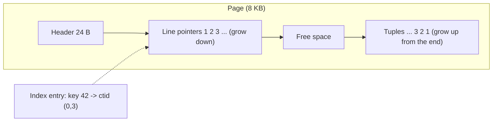
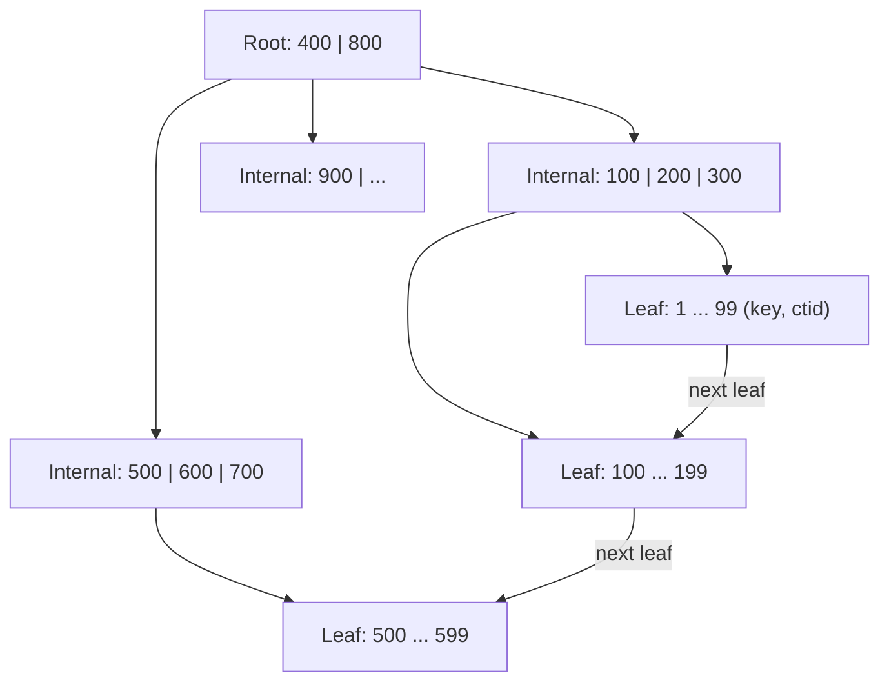
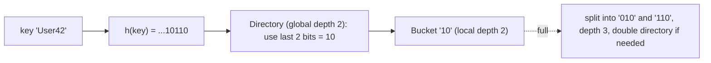
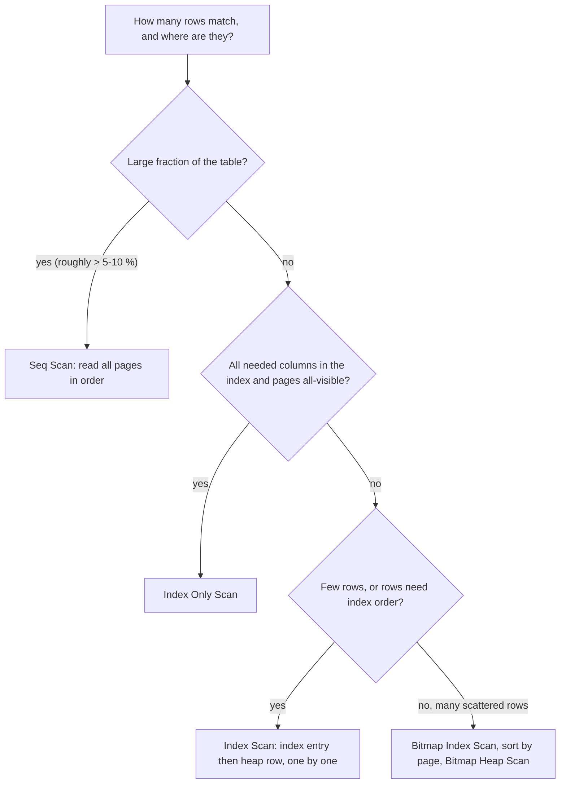

# Chapter 12 — Indexes, Storage and Query Performance

Up to now we have asked *what* a query returns. This chapter asks *how fast*, and why. The answer always comes down to one question: **how many pages of data does the database have to touch?** To answer it you need to know how rows sit on disk, what an index really is, how the query planner (the part of the database that decides *how* to run a query) chooses between reading everything and jumping straight to the rows it needs, and which query habits quietly defeat an index. Every claim below is measured on a real PostgreSQL 14 server with a one-million-row table.

**What you'll learn**

- How a database stores rows: the storage hierarchy, 8 KB pages, slotted pages, heap files, TOAST, row vs column layout, and compression/encoding tricks.
- File organizations (heap, sorted, hashed, clustered) and why physical order matters.
- What an index is; primary, clustering and secondary indexes; dense vs sparse; single-level and multilevel indexes with block-count arithmetic.
- B-trees and B+ trees, hash indexes (static, extendible, linear hashing), Bloom filters (with a simulation), and PostgreSQL's GIN, GiST, BRIN and bloom indexes.
- Reading `EXPLAIN (ANALYZE, BUFFERS)` (PostgreSQL's command for showing how a query ran): seq scan, index scan, index-only scan, bitmap scan.
- Composite indexes and the leftmost-prefix rule, covering (`INCLUDE`), partial and expression indexes.
- Anti-patterns: functions on columns, leading wildcards (and the `pg_trgm` fix), `OR`, OFFSET paging (and keyset paging), N+1 queries.
- The three join algorithms and the statistics the planner relies on.

**How to run the examples.** SQL files are in [`code/`](code/); the runner (a helper script) builds a fresh database per file, loading [`00_schema.sql`](code/00_schema.sql) first (about 5 seconds, it generates one million orders):

```bash
bash tools_run_sql.sh sql '12-*'                                   # all files of this chapter
bash tools_pg.sh psql -d ch_12 -f sql/chapters/12-indexes-storage-and-query-performance/code/02_scans.sql
cd sql/chapters/12-indexes-storage-and-query-performance/code
python3 bloom_filter_sim.py; python3 compression_demo.py
../../../../.venv-books/bin/python n_plus_one.py                   # needs psycopg
```

> **About the numbers.** Timings (`actual time`, `Execution Time`, `exec_ms`) depend on the machine and on what is already cached; yours will differ. **Buffer counts** (pages touched) and **plan shapes** are the stable things to compare. Long plan lines are trimmed with `...`.

The data is a small shop. Every value is computed from the row number, so every run builds the same tables:

```sql
CREATE TABLE customers (id int PRIMARY KEY, name text, email text, country text, signup_on date); -- 100,000 rows
CREATE TABLE orders (id bigint PRIMARY KEY, customer_id int REFERENCES customers(id),
                     status text, amount numeric(10,2), created_at timestamp, note text);
INSERT INTO orders
SELECT g, (g::bigint * 7919) % 100000 + 1,               -- exactly 10 orders per customer, scattered
       CASE WHEN g % 100 < 2 THEN 'pending' WHEN g % 100 < 5 THEN 'refunded'
            ELSE 'shipped' END,                          -- 2 % / 3 % / 95 %
       ((g::bigint * 37) % 50000) / 100.0 + 1,
       TIMESTAMP '2024-01-01' + g * INTERVAL '31 seconds', -- grows with id
       CASE WHEN g % 10 = 0 THEN 'gift wrap please' END   -- 90 % NULL
FROM generate_series(1, 1000000) AS g;
VACUUM ANALYZE orders;
```

`VACUUM ANALYZE` at the end cleans up the table and gathers the statistics the planner relies on (12.16). `psycopg`, needed by the last command, is the Python driver (library) for talking to PostgreSQL. The schema file also defines `plan_stats(query)`, which returns just the execution time and pages touched of a query, for side-by-side tables.

---

## 12.1 How a database stores data

### What it is

A database keeps data on **persistent storage** and works on it in **memory**. The layers differ by a factor of thousands in speed:

| Level | Examples | Survives power loss? | Rough access time | Role in a DBMS |
|---|---|---|---|---|
| CPU cache / RAM (main memory; primary storage) | L1–L3 cache, DRAM | No (volatile — lost when power goes) | ~1–100 ns | Buffer pool: cached pages, sort and hash memory |
| SSD / NVMe (secondary storage) | flash drives | Yes | ~20–100 µs | Data files, indexes, write-ahead log (the change log written before the data files) |
| Hard disk (secondary) | spinning disks | Yes | ~5–10 ms per random seek | Same, on older or cheaper servers |
| Tertiary / archive | tape, object storage (cloud file storage such as S3 Glacier) | Yes | seconds to hours | Backups, cold archives |

Because the slow levels are so slow, a DBMS never fetches single rows from disk; it moves data in fixed-size **blocks** (also called **pages**): 8 KB in PostgreSQL and SQL Server, 16 KB in MySQL InnoDB, 4 KB by default in SQLite. The part of RAM that holds recently used pages is the **buffer pool** (PostgreSQL: `shared_buffers`). A read that finds its page there is a *hit*; one that must go to the operating system is a *read*. In `EXPLAIN (BUFFERS)` output you will see exactly those two words.

### How a table is laid out

1. Each table is stored as one or more **files** (PostgreSQL: one file per 1 GB segment under `base/<database-oid>/`, where an *oid* is PostgreSQL's internal object number). A file is a sequence of pages numbered 0, 1, 2, …
2. Each page is a **slotted page**: a small header, an array of **line pointers** (slots) growing from the front, and the row data (**tuples**) growing from the back. Free space sits in the middle.
3. A row's physical address is (page number, slot number). PostgreSQL exposes it as the hidden column **`ctid`**. Indexes store these addresses. Because an index points at a *slot*, not a byte offset, the page can shuffle tuples around internally without breaking any index.
4. Large values are handled by **TOAST** (The Oversized-Attribute Storage Technique): when a row grows beyond about 2 KB, big values are compressed and, if still too big, cut into chunks stored in a separate TOAST table.



### Seeing it on the real server

```sql
SELECT relname, pg_size_pretty(pg_relation_size(oid)) AS main_fork, ... FROM pg_class WHERE ...;
SELECT ctid, id, status, amount FROM orders WHERE id IN (1, 2, 3, 124, 125) ORDER BY id;
SELECT lower, upper, special, pagesize FROM page_header(get_raw_page('orders', 0));
SELECT lp, lp_off, lp_len, t_ctid FROM heap_page_items(get_raw_page('orders', 0)) LIMIT 4;
```

Output (from [`01_storage_pages.sql`](code/01_storage_pages.sql), which uses the `pageinspect` extension — an add-on module for looking at raw pages):

```
   relname   | main_fork | pages | est_rows
-------------+-----------+-------+----------
 customers   | 7344 kB   |   918 |   100000
 orders      | 68 MB     |  8662 |  1000000
 orders_pkey | 21 MB     |  2745 |  1000000

 ctid  | id  |  status  | amount
-------+-----+----------+--------
 (0,1) |   1 | pending  |   1.37
 (0,2) |   2 | refunded |   1.74
 (0,3) |   3 | refunded |   2.11
 (1,8) | 124 | shipped  |  46.88
 (1,9) | 125 | shipped  |  47.25

 lower | upper | special | pagesize
-------+-------+---------+----------
   488 |   504 |    8192 |     8192

 lp | lp_off | lp_len | t_ctid
----+--------+--------+--------
  1 |   8128 |     64 | (0,1)
  2 |   8064 |     64 | (0,2)
  3 |   8000 |     64 | (0,3)
  4 |   7936 |     64 | (0,4)
```

What this shows:

- One million orders occupy **8,662 pages**; a full scan must touch all of them. That number is the yardstick for everything that follows.
- Page 0 holds 116 rows (row 124 is the 8th row of page 1). Each tuple is 64 bytes: a 23-byte tuple header (transaction ids used by MVCC — *multi-version concurrency control*, PostgreSQL's way of keeping old row versions so readers and writers don't block each other; see [chapter 13](../13-transactions-and-concurrency/README.md#1314-multiversion-concurrency-control-mvcc)) plus the column values, aligned.
- `lower = 488` is where the slot array ends, `upper = 504` where tuple data begins: only 16 bytes free, so the page is full. Tuple 1 sits at the very end (offset 8128 + 64 = 8192) and later tuples are placed in front of it.

TOAST in action — three values of very different shape:

```
 id | logical_bytes | stored_bytes
----+---------------+--------------
  1 |            30 |           31      -- tiny: stored inline, 1-byte length header
  2 |         40000 |          477      -- 'abcdefgh' x 5000: compressed ~84x
  3 |         48000 |        48000      -- hex digests: incompressible, moved out of line as is
```

(Hex digests are hash outputs written in hexadecimal — effectively random text, so they don't compress.)

`pg_column_size` reports the bytes actually stored. PostgreSQL keeps a value uncompressed when compression would not save enough.

### From memory to bytes: serialization, endianness, alignment

- **Serialization** turns an in-memory value (a row, a JSON document) into a byte sequence that can be written to a page or sent over the network; **deserialization** rebuilds it. Each engine has its own format: PostgreSQL's tuple layout, MongoDB's BSON (a binary form of JSON), Parquet's (a column-oriented file format) column chunks. Compact formats mean fewer pages.
- **Endianness** is the byte order of multi-byte numbers: *big-endian* writes the most significant byte first, *little-endian* the least significant first (x86 and ARM machines are little-endian). The integer 258 is `01 02` big-endian and `02 01` little-endian. A file format or network protocol must fix one order, or data written on one machine is misread on another — why PostgreSQL's binary files are not portable across architectures while `pg_dump` output is.
- **Alignment**: CPUs read a 4- or 8-byte value fastest at an address that is a multiple of its size, so engines insert padding. In PostgreSQL, column order therefore affects row size: `(bool, bigint, bool, bigint)` pads each `bool` to 8 bytes, while `(bigint, bigint, bool, bool)` does not. Index pages are laid out on aligned boundaries for the same reason.

### Row stores vs column stores

| Layout | How a page is filled | Good at | Examples |
|---|---|---|---|
| **Row-oriented** | All columns of a row together | OLTP (online transaction processing — many small reads and writes of single rows): fetch or change whole rows by key | PostgreSQL, MySQL InnoDB, SQL Server (rowstore), SQLite |
| **Column-oriented** | All values of *one column* together | Analytics: scan a few columns of billions of rows; compresses very well | ClickHouse, Amazon Redshift, Snowflake, DuckDB, Parquet files, SQL Server columnstore |

Summing `amount` in a row store reads every whole row; a column store reads only the `amount` column, which also compresses well. More in DDIA (the book *Designing Data-Intensive Applications*): [storage and retrieval](../../../ddia/chapters/03-storage-and-retrieval/README.md).

### Self-check

1. Why do databases read whole pages instead of single rows? → Storage transfers blocks anyway, and a random access costs far more than the extra bytes; grouping rows per page amortizes the cost (spreads it over many rows).
2. What is a `ctid`? → The (page, slot) address of a row version in PostgreSQL; indexes store it.

---

## 12.2 Data compression and encoding

### What it is

**Compression** stores the same information in fewer bytes. It is **lossless** when the original can be rebuilt exactly (always the case for database data) and **lossy** when some detail is thrown away (JPEG, MP3 — never used for table values). **Encoding** is compression that exploits the *type and shape* of a column rather than treating it as a byte stream.

### Why it matters

Fewer bytes means fewer pages to read, more rows fitting in the buffer pool, and cheaper storage and network transfer. The price is CPU time to compress and decompress, and sometimes slower in-place updates.

### The common techniques

| Technique | Idea | Works best on | Used by |
|---|---|---|---|
| **Run-length encoding (RLE)** | Store (value, how many times in a row) | Sorted or slowly changing columns | Column stores, Parquet, bitmap indexes |
| **Dictionary encoding** | Store each distinct value once; rows hold a small integer code | Few distinct values (country, status) | Parquet, ClickHouse `LowCardinality`, Redshift |
| **Delta encoding** | Store the first value, then differences | Timestamps, ids, sorted numbers | Time-series DBs (databases of timestamped measurements: Gorilla/Prometheus), Parquet |
| **Bit-packing** | Use only as many bits as the largest value needs | Small integers (codes, deltas) | Combined with the two above |
| **Lempel–Ziv (LZ77/LZ78 family)** | Replace a repeated byte sequence with a reference ("copy 8 bytes from 40 bytes back") | Text, repeated strings; no type knowledge | PostgreSQL TOAST (`pglz`, `lz4` since PG 14), zlib/zstd (widely used compression libraries) page compression |
| **Huffman coding** | Give frequent symbols short bit codes and rare ones long codes | Skewed symbol frequencies | Inside zlib/DEFLATE and zstd |

`compression_demo.py` applies each technique to a column of 100,000 values:

```python
status  = ["shipped"] * 60_000 + ["pending"] * 25_000 + ["refunded"] * 15_000   # sorted
country = [["IN", "US", "DE", "BR", "JP"][(i * 7) % 5] for i in range(N)]      # 5 distinct
ts      = [1_700_000_000 + i * 31 + (i % 7) for i in range(N)]                  # increasing
# rle(), dictionary(), delta() are ~6 lines each; see the file
```

Output:

```
status   raw text               :   715,000 bytes
status   RLE (3 runs)           :        34 bytes  -> [['shipped', 60000], ['pending', 25000], ['refunded', 15000]]
country  raw text               :   200,000 bytes
country  dictionary + 3-bit codes:    37,510 bytes  (dictionary ['IN', 'DE', 'JP', 'US', 'BR'], codes [0, 1, 2, 3, 4, 0]...)
ts       raw 8-byte ints        :   800,000 bytes
ts       delta + 6-bit packing  :    75,007 bytes  (first 1700000000, deltas [32, 32, 32, 32, 32, 32]...)
ts       zlib on the text       :   273,868 bytes  (no knowledge of the data type)
```

Type-aware encodings beat the general-purpose compressor by a wide margin and can often be queried without decompressing (counting `'pending'` rows is reading one run length) — why column stores sort data and choose an encoding per column.

### Trade-offs and when not to use it

- Compression costs CPU on every write and read; for hot (frequently accessed), small OLTP rows it usually is not worth it (PostgreSQL compresses only when a row exceeds ~2 KB).

---

## 12.3 File organization

### What it is

**File organization** is the rule that decides *where* in the data file a new record goes, and therefore how records can be found later.

| Organization | Where records go | Fast | Slow | Real systems |
|---|---|---|---|---|
| **Heap (unordered)** | Any page with free space (usually the end) | Inserts; full scans | Finding one record without an index (scan everything) | PostgreSQL tables, SQL Server heaps, Oracle default |
| **Sequential (sorted)** | Kept in order of a key | Range reads and ordered output on that key; binary search (repeatedly halving the search range) | Inserts/deletes in the middle (shift records or use overflow pages, reorganize periodically) | Old ISAM files, sorted SSTables in LSM engines |
| **Hashed** | Page = hash(key) mod number of buckets | Equality lookups on the key: ~1 page read | Ranges and ordering; growing beyond the bucket count | Hash clusters (Oracle), hash-partitioned stores |
| **ISAM** (indexed sequential) | Sorted data file plus a static multilevel index built at load time; later inserts go to overflow pages | Reads and ranges on a stable file | Overflow chains grow until the file is reorganized | IBM mainframe ISAM files |
| **B+ tree file organization** | Records live in the leaves of a B+ tree on the key (12.6); the tree rebalances itself on insert | Point and range access that stays fast under inserts | Some space kept free in every leaf; splits | Same as the next row |
| **Clustered / index-organized** | The table *is* a B+ tree ordered by a key; leaf pages hold the rows | Primary-key lookups and ranges | Inserts in random key order cause page splits; secondary indexes must store the key | MySQL InnoDB, SQL Server clustered index, Oracle IOT (index-organized table), SQLite rowid / `WITHOUT ROWID` tables |

> **Key terms — hashing and LSM engines:** a **hash function** turns a key into a seemingly random number; `mod N` (the remainder after dividing by N) then picks one of N **buckets**. **ISAM** (indexed sequential access method) is IBM's classic sorted-file-plus-index design. An **LSM** (log-structured merge) engine buffers writes in memory and flushes them as immutable sorted files called **SSTables** (sorted string tables), merging them in the background — fast writes, at the cost of reads checking several files.

A hashed file with `bucket = key mod 5` puts keys 21, 32 and 43 in buckets 1, 2 and 3; key 36 also lands in bucket 1 — a **collision**, resolved by chaining it next to 21 (12.7). A clustered file with a department key stores all employees of department 7 in the same few blocks, so "list department 7" reads only those blocks.

PostgreSQL has only heap tables; `CLUSTER` sorts a heap **once** by an index, but new rows are not kept in order afterwards.

### Why physical order matters — measured

Each customer's 10 orders are scattered through the table (the generator jumps by 7,919 customers per row). Summing the orders of 1,000 customers (10,000 rows) — before and after `CLUSTER` ([`09_clustering.sql`](code/09_clustering.sql)):

```sql
SELECT correlation FROM pg_stats WHERE tablename = 'orders' AND attname = 'customer_id';
EXPLAIN (ANALYZE, BUFFERS, COSTS OFF)
SELECT sum(amount) FROM orders WHERE customer_id BETWEEN 1000 AND 1999;
CLUSTER orders USING orders_customer_idx;  ANALYZE orders;
-- ... same two queries again
```

```
 correlation = 0.0034                                           -- before: random order (sampled; varies per run)
 Aggregate (actual time=5.814..5.815 rows=1 loops=1)
   Buffers: shared hit=8454 read=14
   ->  Bitmap Heap Scan on orders (... rows=10000 loops=1)
         Heap Blocks: exact=8454                                -- 10,000 rows on 8,454 pages!
 ...
 correlation = 1                                                -- after CLUSTER
 Aggregate (actual time=0.895..0.895 rows=1 loops=1)
   Buffers: shared hit=2 read=100
   ->  Index Scan using orders_customer_idx on orders (... rows=10000 loops=1)
 Execution Time: 0.901 ms
```

Same rows, same index: **8,468 pages → 102 pages**, because after clustering the 10,000 rows sit next to each other. The statistic **correlation** (−1 … 1) tells the planner how well a column's order matches the physical order.

A related knob is **fillfactor**: how full to pack each page when inserting, leaving room so that updated row versions can stay on the same page (PostgreSQL's heap-only-tuple — HOT — updates, which skip index maintenance, [chapter 13](../13-transactions-and-concurrency/README.md#1314-multiversion-concurrency-control-mvcc)). The same 100,000 rows take 443 pages at the default `fillfactor = 100` and 633 pages at `fillfactor = 70`.

### Trade-offs

- Only **one** physical order per table — pick the key of your most important range queries (often time or tenant id — the customer organisation a row belongs to in a multi-tenant app).
- In InnoDB and SQL Server the clustered key is copied into every secondary index, so a wide or random key (a random UUID — a 128-bit randomly generated id) bloats every index and causes page splits; prefer a short, increasing key.

---

## 12.4 What an index is

### What it is

An **index** is a separate, smaller data structure that maps **search-key values to row addresses**, kept sorted (or hashed) so that the database can find matching rows without reading the whole table. Think of the index at the back of a textbook: sorted terms with page numbers. You look up "B+ tree", jump to page 412, and never read pages 1–411.

- **Search key**: the column(s) the index is built on (not necessarily a primary or unique key).
- **Index entry**: (key value, pointer). The pointer is a `ctid` in PostgreSQL, the primary-key value in InnoDB secondary indexes, a row id in Oracle.

### The problem it solves

Without an index, `WHERE customer_id = 4242` must check every row. With one, the database walks a handful of index pages and fetches only the matching rows:

```
-- no index
 Seq Scan on orders (actual time=2.944..30.041 rows=10 loops=1)
   Filter: (customer_id = 4242)
   Rows Removed by Filter: 999990
   Buffers: shared hit=8662
 Execution Time: 30.068 ms
-- CREATE INDEX orders_customer_idx ON orders (customer_id);
 Bitmap Heap Scan on orders (actual time=0.015..0.023 rows=10 loops=1)
   Buffers: shared hit=10 read=3
   ->  Bitmap Index Scan on orders_customer_idx (... rows=10 loops=1)
 Execution Time: 0.036 ms
```

**8,662 pages → 13 pages; ~30 ms → ~0.04 ms.** That is the whole reason indexes exist.

### Kinds of index (classic terminology)

| Term | Meaning |
|---|---|
| **Primary index** | Built on the ordering key of a *sorted* file, usually the primary key; one entry per data block is enough (sparse). |
| **Clustering index** | Built on a sorting field that is *not* unique (e.g. file sorted by department); one entry per distinct value, pointing to its first block. |
| **Secondary index** | Built on any other column; the file is not sorted by it, so it needs one entry per record (dense). A table can have many. |
| **Dense index** | An entry for **every** search-key value (every record). |
| **Sparse index** | Entries for only **some** values — typically the first key of each block; works only if the file is sorted on that key. |
| **Clustered vs non-clustered** (vendor usage) | *Clustered*: the table rows are stored in index order (at most one per table — SQL Server, InnoDB PK). *Non-clustered*: a separate structure pointing to rows. PostgreSQL indexes are all non-clustered. |
| **Unique index** | Rejects duplicate keys; how `PRIMARY KEY` and `UNIQUE` constraints are enforced. |

### The SQL

```sql
CREATE INDEX orders_customer_idx ON orders (customer_id);              -- B-tree by default
CREATE UNIQUE INDEX customers_email_uq ON customers (email);          -- enforces uniqueness
CREATE INDEX CONCURRENTLY orders_note_idx ON orders (note);           -- PG: build without blocking writes
DROP INDEX orders_customer_idx;                         -- MySQL / SQL Server: DROP INDEX name ON table
ALTER TABLE t ADD CONSTRAINT t_pk PRIMARY KEY (id);     -- creates a unique index implicitly
```

SQL Server adds `CREATE [CLUSTERED|NONCLUSTERED] INDEX`. `CONCURRENTLY` (PostgreSQL) and `ONLINE = ON` (SQL Server Enterprise) / `ALGORITHM=INPLACE, LOCK=NONE` (MySQL) avoid long write locks (locks that stop other sessions from changing the table) on big tables.

### Trade-offs

| Benefit | Cost |
|---|---|
| Fast lookups, ranges, joins, `ORDER BY`, `MIN/MAX` | Every `INSERT`, `DELETE` and many `UPDATE`s must also change every index |
| Enforces uniqueness | Disk and buffer-pool space (our 1M-row PK index is 21 MB) |
| Enables index-only scans | Too many indexes slow writes and make the planner's job harder |

### When not to index

- Small tables (a few pages): a sequential scan is already cheap.
- Columns that most rows share (low selectivity): `status = 'shipped'` matches 95 % of rows — see 12.10.
- Write-heavy tables whose columns are rarely searched.
- Columns only ever used inside functions (index the expression instead — 12.12).

### Common mistakes

- "Index every column." Each one costs writes; unused indexes are pure overhead (find them with `pg_stat_user_indexes.idx_scan = 0` — a statistics view that counts how often each index is used).
- Forgetting that **foreign-key columns are not indexed automatically** in PostgreSQL (MySQL InnoDB does create one). Without an index, joins on the FK and `ON DELETE` checks on the parent scan the child table.

### In the interview

"An index is a sorted (or hashed) side structure mapping key values to row locations, so a lookup reads a few pages instead of the whole table; it speeds up filters, joins and sorts at the cost of slower writes and extra space. I index selective predicates (`WHERE` conditions that match few rows) and join keys and confirm with EXPLAIN."

- *Why not index everything?* → Write amplification (one logical change causing many physical writes), space, and cache pressure (indexes competing for limited memory); low-selectivity indexes are ignored anyway.
- *Clustered vs non-clustered?* → Clustered stores the rows themselves in key order (one per table); non-clustered is a separate structure with pointers.

---

## 12.5 Single-level indexing, with numbers

### How it works

An index file is much smaller than the data file because each entry holds only a key and a pointer. Searching it with binary search costs about log₂(index blocks) reads, plus one read for the data block. The arithmetic (from *Database System Concepts* and *Fundamentals of Database Systems*):

- **Blocking factor** `bfr = ⌊block size / record size⌋` — records per block. (`⌊x⌋` rounds down, `⌈x⌉` rounds up.)
- **Blocks** `b = ⌈records / bfr⌉`.
- **Binary search** on `b` sorted blocks: `⌈log₂ b⌉` block reads.

### Worked example (own numbers)

A file of **r = 1,000,000** records, each **200 bytes**, block size **4,096 bytes**. Index entries are 8-byte key + 8-byte pointer = **16 bytes**.

| Access path | Calculation | Block reads |
|---|---|---|
| Data file | bfr = ⌊4096/200⌋ = 20; b = 1,000,000/20 = **50,000 blocks** | — |
| Linear scan, unordered file | average b/2, worst b | 25,000 avg / 50,000 worst |
| Binary search, file sorted on the key | ⌈log₂ 50,000⌉ = 16 | **16** |
| **Primary index (sparse)**: one entry per data block | 50,000 entries; index bfr = ⌊4096/16⌋ = 256; 50,000/256 → **196 blocks**; ⌈log₂ 196⌉ = 8, +1 data block | **9** |
| **Secondary index (dense)** on an unsorted column: one entry per record | 1,000,000/256 → **3,907 blocks**; ⌈log₂ 3907⌉ = 12, +1 | **13** |
| **Multilevel** (index on the index, fan-out — entries per index block — 256) | level 1: 3,907 blocks → level 2: ⌈3907/256⌉ = 16 → level 3: 1 block; 3 levels + 1 data block | **4** |

Two lessons: a sparse index is much smaller than a dense one but requires a sorted file; and building an index **on top of the index** — each level 256× smaller — turns a log₂ search into a log₂₅₆ search. The top level is small enough to stay in RAM, so in practice only the lower levels and the data block cost disk reads. That idea, made dynamic, is the B+ tree. (Courses often call primary, clustering and secondary indexes *single-level* and B-/B+ trees *multi-level* indexes.)

### Trade-offs of single-level indexes

- Sparse: small, but only possible for the file's sort key, and inserts must keep the file sorted.
- Dense: works for any column, but large; still needs binary search over thousands of blocks.
- Both are **static**: inserting into a sorted index means shifting entries. Multilevel trees with free space in each node fix that.

### Self-check

1. Why can a secondary index not be sparse? → The file is not sorted on that column, so the first key of a block says nothing about the others.
2. With fan-out 256, how many index levels for 16 million entries? → 256³ ≈ 16.7 million, so 3 levels.

---

## 12.6 Tree-based indexes: B-trees and B+ trees

### What it is

A **B-tree** (Bayer & McCreight, 1972) is a balanced search tree whose nodes are whole disk pages, each holding hundreds of sorted keys. "Balanced" means every leaf is at the same depth, so every lookup costs the same number of page reads. The **B+ tree** — what nearly every database actually uses (PostgreSQL's "btree", InnoDB, SQL Server, SQLite, Oracle) — adds two rules:

1. **All data pointers live in the leaves.** Internal nodes hold only separator keys and child pointers, so more of them fit per page (higher **fan-out**).
2. **Leaves are linked** left-to-right (PostgreSQL: both ways), so a range scan finds the first key and then just walks sideways.



Why a tree at all? In big-O notation (how work grows with the number of entries n), an unsorted array needs O(n) comparisons per search; a sorted array allows O(log n) binary search but each insert must shift up to n entries. A B-tree keeps keys sorted *and* absorbs inserts locally, with O(log n) search, insert and delete.

### How it works

- **Search** (e.g. `id = 500000`): read the root, pick the child whose key range contains 500,000, repeat until a leaf, then follow the pointer to the heap (the table's unordered data file). Cost = tree height + 1. In the figure, looking for 650 goes root (400 < 650 < 800 → middle child) → internal (600 < 650 < 700) → the leaf holding 600–699.
- **Range** (`BETWEEN 1000 AND 1999`): search for 1000, then read leaves left to right until a key > 1999.
- **Insert**: find the leaf; if it has room, insert in sorted position. If it is full, **split** it into two half-full leaves and push the middle key up into the parent; if the parent overflows it splits too. Only a root split makes the tree taller — which is why the tree stays balanced.
- **Delete**: remove the entry; if a node becomes too empty, borrow from a sibling or merge. (PostgreSQL does not merge eagerly; it reclaims empty pages via `VACUUM`.)
- **Order** `n` of a tree: each node holds up to `n − 1` keys and `n` children, and every non-root node stays at least half full.

### Seeing it on the server

```sql
SELECT level AS root_level FROM bt_metap('orders_pkey');
SELECT type, live_items, avg_item_size, free_size FROM bt_page_stats('orders_pkey', 1);
```

```
 root_level = 2                  -- levels 2 (root), 1 (internal), 0 (leaves): height 3
 type | live_items | avg_item_size | free_size
------+------------+---------------+-----------
 l    |        367 |            16 |       808
```

A leaf page holds 367 entries of 16 bytes and keeps ~10 % free for future inserts (the B-tree default fillfactor is 90). One million keys need about 2,700 leaves, and just one internal level to point to them. That is why the primary-key lookup in 12.10 touched only **7 buffers** — the three tree levels, the heap page and a few index-metadata accesses — against 8,662 for a full scan. A billion keys would need only one more level.

### B-tree vs B+ tree vs others

| Structure | Data pointers in | Range scans | Used by |
|---|---|---|---|
| B-tree (classic) | Every node | Needs in-order tree walk | Rare today; some file systems |
| **B+ tree** | Leaves only; leaves linked | Walk the leaf chain | PostgreSQL, MySQL, SQL Server, Oracle, SQLite |
| LSM tree | Sorted immutable files merged in the background | Merge several files | RocksDB, Cassandra, ScyllaDB, LevelDB (write-optimized storage engines and NoSQL databases; see [ch. 16](../16-beyond-relational/README.md)) |
| R-tree | Bounding boxes | Spatial "overlaps/near" | PostGIS (PostgreSQL's maps-and-geometry extension, via GiST), SQLite R*Tree |

### Trade-offs

- Random-key inserts (random UUIDs) hit random leaves: more page splits and more cache misses (needed pages not already in memory) than an increasing key.
- PostgreSQL 13+ **deduplicates** repeated keys in leaves, so a B-tree on a low-uniqueness column is much smaller (our `customer_id` index: 9 MB vs 21 MB for unique `created_at`).

### In the interview

**30-second answer:** "Databases use B+ trees: balanced trees whose nodes are pages with hundreds of keys, so even a billion rows need only 3–4 levels. Values sit in linked leaves, so range scans walk the leaves. Inserts split full nodes and push keys up, keeping every leaf at the same depth."

- *B-tree vs LSM?* → B+ trees update pages in place (read-optimized); LSM trees append and merge (write-optimized, need Bloom filters for reads).

### Self-check

1. Why do B+ tree internal nodes hold no row pointers? → To fit more separator keys per page, raising fan-out and lowering height.
2. When does a B+ tree get taller? → Only when the root splits.

---

## 12.7 Hash-based indexing

### What it is

A **hash index** computes `hash(key)` and uses it to pick a **bucket** (a page or chain of pages) that holds the entries for that key. A lookup reads one bucket — typically one or two pages — no matter how large the table.

### How it works

1. **Hash function**: maps a key to an integer spread evenly across buckets (`bucket = h(key) mod N`). A good one scatters similar keys (`User1`, `User2`) far apart.
2. **Collisions**: different keys can land in the same bucket. Databases put them in the same bucket page; when it fills, an **overflow page** is chained on. (In-memory hash tables also use *open addressing*: probe the next slots.)
3. **Static hashing** fixes `N` up front. Example with `h(k) = k mod 7`: keys 15, 23, 40 go to buckets 1, 2 and 5; inserting 29 (29 mod 7 = 1) collides with 15 and is **chained** in bucket 1, so a search for 29 hashes to bucket 1 and walks its short chain. If the data grows, chains get long; if it shrinks, space is wasted. Rehashing everything into a bigger table is expensive.
4. **Dynamic hashing** grows gradually:
   - **Extendible hashing** keeps a **directory** of `2^d` pointers indexed by the last `d` bits of the hash (**global depth**). Each bucket records how many bits it really uses (**local depth**). When a bucket overflows it splits in two using one more bit; only if its local depth already equals the global depth does the directory double (pointers copied, no data moved).
   - **Linear hashing** has no directory: buckets are split one at a time in a fixed round-robin order (a "next to split" pointer), using `h mod 2N` for already-split buckets. Growth is smooth; overflow chains are temporary. PostgreSQL's hash index (based on Seltzer and Yigit's 1991 hashing package) likewise has no directory: it splits one bucket at a time and allocates bucket pages in power-of-2 groups whose location is computed from the bucket number.



### On the server

```sql
CREATE INDEX o_cust_hash ON orders USING hash (customer_id);
EXPLAIN (COSTS OFF) SELECT * FROM orders WHERE customer_id = 42;   -- Bitmap Index Scan on o_cust_hash
EXPLAIN (COSTS OFF) SELECT * FROM orders WHERE customer_id < 42;   -- Seq Scan: hash can't do ranges
```

```
   index_name    | type  |  size
-----------------+-------+---------
 o_cust_hash     | hash  | 32 MB
 o_created_btree | btree | 21 MB
 o_cust_btree    | btree | 9256 kB
 o_created_brin  | brin  | 24 kB
```

### Trade-offs

| | Hash index | B-tree |
|---|---|---|
| `=` lookups | O(1) buckets | O(log n) pages (3–4 in practice) |
| Ranges, `ORDER BY`, prefix `LIKE` | No | Yes |
| Unique constraints | No (PostgreSQL) | Yes |
| Size | Can be larger (no deduplication — 32 MB vs 9 MB above) | Compact with dedup |

In practice the B-tree's extra 2–3 page reads are usually cached, so hash indexes win only for very large, equality-only keys (long strings, URLs). PostgreSQL hash indexes are crash-safe (intact after a server crash) only since version 10 — old advice to avoid them dates from before that. MySQL InnoDB has no user-created hash indexes (its *adaptive hash index* is built automatically in memory); the MEMORY engine does. Hashing is also the heart of **hash joins** (12.15) and **hash partitioning** ([ch. 15](../15-scaling-databases/README.md#152-partitioning)).

### Self-check

1. Why can't a hash index answer `ORDER BY customer_id`? → Hashing destroys order: neighbouring keys land in unrelated buckets.

---

## 12.8 Bloom filters

### What it is

A **Bloom filter** (Burton Bloom, 1970) is a compact, probabilistic set: it answers "is x in the set?" with either **"definitely not"** or **"probably yes"**. It never gives a false negative; it gives false positives at a rate you choose by spending more bits. Analogy: a bouncer with a smudged guest list who never turns away a real guest but occasionally lets in a stranger.

### Why it matters

Checking a filter in RAM costs nanoseconds; checking disk costs micro- to milliseconds. If most lookups are for keys that are *not* there, the filter skips almost all of that disk work.

### How it works

1. Start with an array of **m bits**, all 0, and choose **k** independent hash functions.
2. **Add(x)**: compute the k hashes, set those k bits to 1.
3. **Query(x)**: compute the k hashes; if **any** bit is 0, x was never added (definitely absent). If all are 1, x is *probably* present — those bits may have been set by other keys.
4. With n keys inserted, the false-positive probability is approximately **p ≈ (1 − e^(−kn/m))^k**, minimized at **k = (m/n)·ln 2**; then about **1.44·log₂(1/p) bits per key** are needed (≈ 9.6 bits for 1 %).
5. You cannot delete (clearing a bit could erase other keys). **Counting Bloom filters** keep a small counter per position instead of a bit to allow deletes; **scalable Bloom filters** add new, larger filters as n grows.

**A tiny example** (10 bits, k = 3; hash outputs made up for illustration). Insert `"sql"` → positions 2, 5, 8 set. Insert `"java"` → positions 1, 5, 9 set (5 was already 1). Bits now: `0110010011` (positions 1, 2, 5, 8, 9). Query `"css"` → positions 2, 6, 9: bit 6 is 0, so **definitely absent**. Query `"go"` → positions 1, 2, 8: all 1 though `"go"` was never added — a **false positive**. A *false positive* is "maybe present" for an absent key; a *false negative* ("absent" for a present key) cannot happen. The work per operation depends on k, not on m.

### Simulation vs theory

[`bloom_filter_sim.py`](code/bloom_filter_sim.py) builds real filters (SHA-256 — a standard cryptographic hash function — with double hashing), inserts 10,000 keys and probes 50,000 keys that were never added:

```python
class BloomFilter:
    def __init__(self, m_bits, k_hashes):
        self.m, self.k = m_bits, k_hashes
        self.bits = bytearray((m_bits + 7) // 8)
    def _positions(self, key):                        # h_i = h1 + i*h2 (mod m)
        d = hashlib.sha256(key.encode()).digest()
        h1, h2 = int.from_bytes(d[:8], "big"), int.from_bytes(d[8:16], "big") | 1
        return [(h1 + i * h2) % self.m for i in range(self.k)]
    def add(self, key):
        for p in self._positions(key): self.bits[p // 8] |= 1 << (p % 8)
    def might_contain(self, key):
        return all(self.bits[p // 8] >> (p % 8) & 1 for p in self._positions(key))
```

Output:

```
bits/key   m bits   k  measured FP  theory FP    memory
       4    40000   3     14.6340%   14.6892%     4.9KB
       8    80000   6      2.1700%    2.1577%     9.8KB
      10   100000   7      0.8720%    0.8194%    12.2KB
      16   160000  11      0.0520%    0.0459%    19.5KB

Effect of k at a fixed 8 bits/key:
  k= 1  measured 11.604%   theory 11.750%
  k= 2  measured  4.770%   theory  4.893%
  k= 4  measured  2.324%   theory  2.397%
  k= 6  measured  2.170%   theory  2.158%
  k= 8  measured  2.654%   theory  2.549%
  k=12  measured  4.780%   theory  4.833%
```

The measured rates track the formula closely; ~10 bits per key buys < 1 % false positives regardless of how long the keys are; and too many hash functions hurts (k = 12 fills the array with ones).

### Real-world examples

- **LSM-tree databases** (RocksDB, Cassandra, HBase, LevelDB) keep one Bloom filter per sorted file so a read skips files that cannot hold the key.
- **"Is this username taken?"** checks and duplicate-submission checks in web apps: a filter in memory answers most "no" cases without touching the database.
- **Web caches and CDNs** (content delivery networks: servers around the world that keep copies of web content near users; see [System Design Fundamentals](../../../system-design-patterns/modules/00-system-design-fundamentals/README.md)) use them to avoid caching objects seen only once; routers and distributed caches use them to summarize which keys a peer holds.
- **Join filters**: many engines build a Bloom filter from the smaller join side and push it to the scan of the larger side (Spark — a distributed data-processing engine — SQL Server bitmap filters, Oracle).
- **PostgreSQL `bloom` extension**: an index that stores a small signature per row covering many columns, so one index answers equality on *any* subset of them:

```sql
CREATE INDEX wide_bloom ON wide USING bloom (a, b, c, d, e) WITH (length = 80);
EXPLAIN (ANALYZE, COSTS OFF, TIMING OFF, SUMMARY OFF) SELECT * FROM wide WHERE c = 5 AND e = 9;
```

```
 bloom_index_size | table_size
------------------+------------
 4720 kB          | 15 MB
 Bitmap Heap Scan on wide (actual rows=50 loops=1)
   Recheck Cond: ((c = 5) AND (e = 9))
   Rows Removed by Index Recheck: 97          <- the false positives, removed by rechecking
   ->  Bitmap Index Scan on wide_bloom (actual rows=147 loops=1)
```

### Self-check

1. Can a Bloom filter say "no" to a key that was added? → Never; added keys set all their bits.
2. What happens to p if you double m at the same n? → Drops sharply (roughly from 2 % to 0.05 % between 8 and 16 bits/key).
3. Why can't you delete from a plain Bloom filter? → Bits are shared among keys; use a counting Bloom filter.

### TL;DR

Bit array + k hashes; "no" is certain, "yes" is probable; ~10 bits/key ≈ 1 % false positives; used to skip disk reads in LSM stores and joins.

---

## 12.9 PostgreSQL's other index types: GIN, GiST, BRIN

B-trees answer "equal / less / greater". Other questions — *does this array contain X*, *do these ranges overlap*, *which rows fall in this month of a huge log table* — need other structures. All examples are in [`10_index_types.sql`](code/10_index_types.sql).

| Type | Structure in one line | Answers | Typical use |
|---|---|---|---|
| **B-tree** (default) | Balanced sorted tree (12.6) | `= < > BETWEEN`, prefix `LIKE`, `ORDER BY` | Almost everything |
| **Hash** | Buckets by hash (12.7) | `=` only | Long keys, equality only |
| **GIN** (Generalized Inverted Index) | For each *element* (array item, JSON key/value, word, trigram — a 3-character chunk of text) a list of rows containing it | `@>` contains, `?` key exists, full-text `@@`, `LIKE '%x%'` with `pg_trgm` | Tags, JSONB documents, search |
| **GiST** (Generalized Search Tree) | Balanced tree of "bounding" predicates (boxes, ranges) that may overlap | Overlap `&&`, containment, nearest-neighbour `<->` | Geometry (PostGIS), ranges, exclusion constraints |
| **SP-GiST** | Space-partitioned trees (quadtrees, tries) | Points, IP ranges, text prefixes | Unevenly distributed data |
| **BRIN** (Block Range INdex) | min/max summary per range of 128 pages | Ranges on columns that follow physical order | Append-only (rows only ever added, never changed) logs, time-series |
| **bloom** (extension) | Bloom signature per row (12.8) | `=` on any subset of many columns | Wide tables with ad-hoc filters |

**BRIN** — our `created_at` rises with insertion order (correlation 1), so a 24 kB BRIN index replaces a 21 MB B-tree:

```
 Aggregate (actual time=0.716..0.717 rows=1 loops=1)
   Buffers: shared hit=130 read=3
   ->  Bitmap Heap Scan on orders (actual time=0.222..0.656 rows=2787 loops=1)
         Rows Removed by Index Recheck: 11992
         Heap Blocks: lossy=128                 <- one 128-page block range read
         ->  Bitmap Index Scan on o_created_brin (... rows=1280 loops=1)
```

It is *lossy*: it only knows which 128-page ranges *might* hold matching timestamps, so it reads the whole range and rechecks every row. On a column in random order every range would span everything and BRIN would be useless.

**GIN** on arrays and JSONB:

```sql
CREATE INDEX posts_tags_gin ON posts USING gin (tags);
CREATE INDEX posts_meta_gin ON posts USING gin (meta jsonb_path_ops);
SELECT count(*) FROM posts WHERE tags @> ARRAY['go', 'advanced'];     -- 20000, via Bitmap Index Scan on posts_tags_gin
EXPLAIN (COSTS OFF) SELECT count(*) FROM posts WHERE meta @> '{"lang": "hi", "likes": 7}';
--   ->  Bitmap Index Scan on posts_meta_gin
```

GIN is fast to read but slower to update (one row touches many posting lists — the per-element lists of rows; PostgreSQL buffers new entries in a "pending list").

**GiST** enforcing "no double booking" — an **exclusion constraint** (no two rows may conflict under the given operators; `tsrange` is a range of timestamps and `&&` means "overlaps"; needs `btree_gist` for the `room WITH =` part):

```sql
CREATE TABLE bookings (room int, during tsrange, EXCLUDE USING gist (room WITH =, during WITH &&));
INSERT INTO bookings VALUES (101, '[2024-05-01 14:00, 2024-05-03 11:00)');
INSERT INTO bookings VALUES (102, '[2024-05-01 14:00, 2024-05-03 11:00)');  -- other room: fine
INSERT INTO bookings VALUES (101, '[2024-05-02 14:00, 2024-05-04 11:00)');  -- overlaps!
```

```
ERROR:  conflicting key value violates exclusion constraint "bookings_room_during_excl"
DETAIL:  Key (room, during)=(101, ["2024-05-02 14:00:00","2024-05-04 11:00:00")) conflicts with existing key (room, during)=(101, ["2024-05-01 14:00:00","2024-05-03 11:00:00")).
```

Elsewhere: MySQL offers B-tree, full-text, spatial and multi-valued JSON indexes (8.0.17+); SQL Server rowstore, columnstore, full-text and spatial; SQLite B-tree plus FTS5 and R*Tree.

---

## 12.10 Reading EXPLAIN: the four ways to read a table

### What it is

`EXPLAIN` shows the **plan** the optimizer (another name for the planner) chose: a tree of operators, read from the innermost (most indented) node outwards. `EXPLAIN ANALYZE` also **runs** the query and adds real row counts and times; `BUFFERS` adds pages hit in cache / read from the OS. Key fields:

| Field | Meaning |
|---|---|
| `cost=0.42..8.44` | Planner's estimate in abstract units: startup cost .. total cost (a sequential page read = 1.0, random = `random_page_cost` = 4.0) |
| `rows=` (estimate) vs `actual ... rows=` | Estimated vs real row count — a big gap means bad statistics (12.16) |
| `loops=` | How many times the node ran (inner side of a nested loop); times and rows are per loop |
| `Buffers: shared hit=/read=` | Pages found in the buffer pool / fetched from the OS |
| `Filter` + `Rows Removed by Filter` | Rows read then thrown away — wasted work |
| `Index Cond` | Condition applied *inside* the index — the useful work |

`EXPLAIN ANALYZE` executes the statement — wrap `INSERT/UPDATE/DELETE` in `BEGIN … ROLLBACK`. MySQL has `EXPLAIN` and `EXPLAIN ANALYZE` (8.0.18+); SQL Server shows plans via `SET SHOWPLAN_XML ON` / "actual execution plan"; SQLite uses `EXPLAIN QUERY PLAN`.

### The four access methods, measured

From [`02_scans.sql`](code/02_scans.sql) (parallel query — splitting one query across several worker processes — switched off to keep plans small):

| Query | Plan | Pages touched | Time |
|---|---|---|---|
| `customer_id = 4242`, no index | **Seq Scan** — read every page, filter | 8,662 | ~30 ms |
| same, with `orders_customer_idx` | **Bitmap Index + Bitmap Heap Scan** | 13 | ~0.04 ms |
| `id = 500000` | **Index Scan** on `orders_pkey` | 7 | ~0.01 ms |
| `count(*) … customer_id BETWEEN 1000 AND 1999` | **Index Only Scan**, `Heap Fetches: 0` | 15 | ~0.5 ms |
| `sum(amount) … status = 'shipped'` (95 %) | **Seq Scan** despite the index | 8,662 | ~76 ms |
| `sum(amount) … customer_id BETWEEN 1000 AND 1999` | **Bitmap Heap Scan**, `exact=8454` | 8,468 | ~5 ms |
| `status = 'refunded' AND customer_id < 2000` | **BitmapAnd** of two indexes | — | — |



How to read each:

1. **Seq Scan** reads pages in physical order (storage read-ahead — fetching the next pages before they are requested — makes this fast). For a predicate keeping 95 % of rows it is the right choice.
2. **Index Scan** walks the B-tree, then fetches each heap row; best for a few rows, and rows come out **in index order**, so `ORDER BY … LIMIT` can stop early.
3. **Index Only Scan** answers from the index alone, visiting the heap only for pages not marked all-visible in the **visibility map** (maintained by `VACUUM`; shown as `Heap Fetches`, [ch. 13](../13-transactions-and-concurrency/README.md#1314-multiversion-concurrency-control-mvcc)).
4. **Bitmap scan** collects matching `ctid`s into a bitmap (a compact array of bits, one per row or page), sorts them by page and reads each needed page once; it can combine indexes (`BitmapAnd/Or`). Short of memory, the bitmap turns *lossy* (whole pages) and rows are rechecked.

Note the 1 % case: 10,000 rows lived on **8,454 of 8,662 pages**. The index saved almost nothing because the rows were scattered — the reason the planner cares about correlation (12.3) and why "selective" means *few pages*, not just few rows.

### Self-check

1. Why did `status = 'shipped'` ignore its index? → 95 % of rows match; reading index + nearly every heap page randomly costs more than one sequential pass.
2. What does `Heap Fetches: 0` mean? → Every page was all-visible, so the index-only scan never touched the table.
3. What is the difference between `Filter` and `Index Cond`? → `Index Cond` narrows the search inside the index; `Filter` discards rows after they were read.

---

## 12.11 Composite indexes and column order

### What it is

A **composite** (multi-column) index sorts by the first column, then by the second within equal first values, and so on — like a phone book sorted by last name, then first name. From [`03_composite_indexes.sql`](code/03_composite_indexes.sql), with `CREATE INDEX orders_cust_created_idx ON orders (customer_id, created_at)`:

| Query | Uses the index? | Why |
|---|---|---|
| `WHERE customer_id = 777` | Yes (3 index pages) | Leading column |
| `WHERE customer_id = 777 ORDER BY created_at DESC LIMIT 3` | Yes, **Index Scan Backward**, no Sort node, 6 pages | Within one customer, entries are already in time order |
| `WHERE created_at >= '2024-06-01' AND created_at < '2024-06-01 00:10'` | **No** → Seq Scan, 8,662 pages, ~30 ms | Second column alone: one day's rows are spread across all customers' sections |
| same, after `CREATE INDEX … (created_at)` | Index Only Scan, 4 pages, ~0.04 ms | Now the range is contiguous |

```
 Limit (actual time=0.002..0.003 rows=3 loops=1)
   Buffers: shared hit=6
   ->  Index Scan Backward using orders_cust_created_idx on orders (... rows=3 loops=1)
         Index Cond: (customer_id = 777)
```

This is the **leftmost-prefix rule**: an index on `(a, b, c)` serves filters on `a`, `a,b` and `a,b,c` efficiently, but not on `b` or `c` alone. (Oracle, MySQL 8.0.13+ and PostgreSQL 18+ can sometimes "skip scan" a composite index when the leading column has few distinct values; don't design around it.)

### Equality first, range last

Same query, `customer_id = 777 AND created_at >= '2024-06-01'`, two column orders:

```
-- (customer_id, created_at)
   ->  Bitmap Index Scan on orders_cust_created_idx (... rows=5 loops=1)
         Buffers: shared hit=3
-- (created_at, customer_id)
 Index Scan using orders_created_cust_idx on orders (actual time=1.541..8.275 rows=5 loops=1)
   Index Cond: ((created_at >= '2024-06-01 ...') AND (customer_id = 777))
   Buffers: shared hit=5 read=2211
```

**8 pages (3 of them index) vs 2,216 pages.** With the equality column first, all matches sit in one narrow slice. With the range column first, the index must walk every entry after June 1 (≈ 55 % of the index) and test `customer_id` on each. Rule of thumb: **equality columns first, then the range or sort column; among equality columns, the most-used-alone first.**

### Common mistakes

- Separate `(a)`, `(a, b)`, `(a, b, c)` indexes — the last covers the others.
- Putting a low-selectivity column first "because it's in every query" when queries also filter on a range — check the range test above.
- Assuming `(a, b)` helps `ORDER BY b` — only when `a` is fixed by equality.

---

## 12.12 Covering, partial and expression indexes

From [`04_covering_partial_expression.sql`](code/04_covering_partial_expression.sql).

**Covering index (`INCLUDE`, PostgreSQL 11+, SQL Server).** Store extra *payload* columns in the leaf entries so the query never visits the table. They are not part of the key (not sorted, not unique-checked).

```sql
CREATE INDEX orders_cust_incl_idx ON orders (customer_id) INCLUDE (amount);
SELECT sum(amount) FROM orders WHERE customer_id BETWEEN 5000 AND 5999;
```

| Index | Plan | Pages | Time |
|---|---|---|---|
| `(customer_id)` | Bitmap Heap Scan, 8,450 heap pages | 8,464 | ~5.3 ms |
| `(customer_id) INCLUDE (amount)` | **Index Only Scan**, Heap Fetches: 0 | 42 | ~0.75 ms |

In MySQL you get the same effect by adding the column to the key (`(customer_id, amount)`); InnoDB secondary indexes also always contain the primary key.

**Partial index (PostgreSQL, SQLite, SQL Server "filtered index"; not MySQL).** Index only the rows a query cares about:

```sql
CREATE INDEX orders_pending_idx ON orders (created_at) WHERE status = 'pending';
SELECT id, created_at FROM orders WHERE status = 'pending' ORDER BY created_at LIMIT 5;
```

```
        index_name         |  size
---------------------------+--------
 orders_pending_idx        | 456 kB       -- 2 % of rows
 orders_status_created_idx | 30 MB        -- full (status, created_at) rival
 Limit (actual time=0.009..0.011 rows=5 loops=1)
   ->  Index Scan using orders_pending_idx on orders (... rows=5 loops=1)
         Buffers: shared hit=2 read=2
```

The plan has no `Index Cond` at all: every entry in the index is already a pending order. Perfect for work queues (tables of jobs waiting to be processed: "oldest unprocessed job"), soft deletes (`WHERE deleted_at IS NULL`) and **conditional uniqueness** — `CREATE UNIQUE INDEX ON orders (customer_id) WHERE status = 'pending'` allows at most one pending order per customer. The planner uses a partial index only when the query's `WHERE` provably implies the index predicate; `status = 'refunded'` gets a Seq Scan + Sort.

**Expression (functional) index.** Index the result of an expression; queries must use the *same* expression:

```sql
CREATE INDEX customers_lower_email_idx ON customers (lower(email));
SELECT id FROM customers WHERE lower(email) = 'user4242@mail.com';   -- Seq Scan 918 pages -> Index Scan 4 pages
SELECT id FROM customers WHERE upper(email) = 'USER4242@MAIL.COM';   -- Seq Scan: different expression
```

Only `IMMUTABLE` functions are allowed (same input, same output forever). MySQL 8.0.13+ supports functional key parts `((lower(email)))`; SQL Server indexes a computed column; alternatives are a `citext` (case-insensitive text) column or a case-insensitive collation (the rules a database uses to compare and sort text).

---

## 12.13 Anti-patterns that disable indexes

From [`05_antipatterns.sql`](code/05_antipatterns.sql). The index only helps when the **bare column** is compared with something the planner can compute up front — a property called **sargable** (Search ARGument ABLE).

| Anti-pattern | Plan | Fix | Plan after fix |
|---|---|---|---|
| `WHERE created_at::date = DATE '2024-06-01'` | Seq Scan, 8,662 pages, ~39 ms | `created_at >= '2024-06-01' AND created_at < '2024-06-02'` | Index Only Scan, 15 pages, ~0.2 ms |
| `WHERE id + 1 = 500001` | Seq Scan | `WHERE id = 500001 - 1` | Index Scan on `orders_pkey` |
| `WHERE email LIKE '%4242@corp%'` (leading wildcard) | Seq Scan, 918 pages | trigram GIN index | Bitmap scan, 74 pages |
| `WHERE email = … OR name = …` (name unindexed) | Seq Scan | index both sides (`BitmapOr`) or rewrite as `UNION` | BitmapOr |
| `WHERE lower(email) = …` without an expression index | Seq Scan | expression index (12.12) | Index Scan |

Other classics: comparing a column to a value of a different type (in MySQL `WHERE varchar_col = 123` casts the column and skips the index), `NOT IN`/`<>` (rarely selective), and `SELECT *` (rules out index-only scans).

**Prefix vs leading wildcard.** A B-tree is sorted by the *start* of the string, so `LIKE 'User4242%'` becomes a range (`email >= 'User4242' AND email < 'User4243'`, visible in the plan's Index Cond). This database uses the C collation; under other collations create the index with `text_pattern_ops`. For `'%…%'` the sort order is useless; **pg_trgm** splits text into 3-character pieces and a GIN index finds rows sharing the pattern's trigrams:

```sql
CREATE EXTENSION IF NOT EXISTS pg_trgm;
SELECT show_trgm('User42');     -- {"  u"," us","42 ",er4,r42,ser,use}
CREATE INDEX customers_email_trgm_idx ON customers USING gin (email gin_trgm_ops);
```

```
 Bitmap Heap Scan on customers (actual time=0.563..0.565 rows=3 loops=1)
   Recheck Cond: (email ~~ '%4242@corp%'::text)
   ->  Bitmap Index Scan on customers_email_trgm_idx (... rows=3 loops=1)
         Buffers: shared hit=71
```

For word search in prose, use full-text search (word-based search that understands word forms and ranks matches) instead (`tsvector` + GIN, [ch. 14](../14-advanced-sql-and-using-sql-from-code/README.md)).

### The N+1 query problem

Not an index problem but the most common performance bug in application code: load a list (1 query), then run one more query **per item** (N queries). ORMs do this silently when you touch a lazy relationship inside a loop.

> **Key term — ORM:** an *object-relational mapper* is a library that lets application code work with database rows as ordinary objects (`customer.orders`) and writes the SQL for you. A **lazy** relationship is loaded only when first touched — convenient, but touching it once per item in a loop fires one query per item. **Eager loading** fetches the related rows up front in one or two queries. [`n_plus_one.py`](code/n_plus_one.py) totals the orders of 500 customers three ways:

```python
for cid, _name in customers:                                        # N+1
    conn.execute("SELECT coalesce(sum(amount), 0) FROM orders WHERE customer_id = %s", (cid,))
conn.execute("SELECT customer_id, sum(amount) FROM orders WHERE customer_id = ANY(%s) "
             "GROUP BY customer_id", (ids,))                         # batched: 2 queries
conn.execute("SELECT c.id, coalesce(sum(o.amount), 0) FROM (...) c "
             "LEFT JOIN orders o ON o.customer_id = c.id GROUP BY c.id")   # 1 query
```

```
n_plus_one       queries= 501  local time=   14.5 ms  + network @1ms RTT ~    501 ms
batched_in_list  queries=   2  local time=    1.4 ms  + network @1ms RTT ~      2 ms
single_join      queries=   1  local time=    3.1 ms  + network @1ms RTT ~      1 ms
all three return the same totals: True
```

Over a local Unix socket (a same-machine connection with no network) the loop costs 10×; across a real network each round trip (a request out and its reply back; RTT = round-trip time) adds latency (waiting time), so 501 queries at 1 ms each is half a second. Fixes: a join, an `IN`/`= ANY` batch, or the ORM's eager loading (`select_related`/`prefetch_related` in Django, `JOIN FETCH` / `@EntityGraph` in JPA, `includes` in Rails — popular Python, Java and Ruby frameworks).

---

## 12.14 OFFSET vs keyset pagination

`LIMIT 20 OFFSET 999960` does not jump to row 999,960: the database must produce and **discard** all earlier rows. **Keyset** (seek) pagination instead remembers the last row shown and asks for rows *after* it, which an index answers directly. [`06_pagination.sql`](code/06_pagination.sql), with `CREATE INDEX orders_created_id_idx ON orders (created_at, id)`, newest first, 20 per page:

```sql
-- OFFSET: page N
SELECT id, created_at, amount FROM orders
ORDER BY created_at DESC, id DESC LIMIT 20 OFFSET (N - 1) * 20;
-- Keyset: pass the last (created_at, id) of the previous page
SELECT id, created_at, amount FROM orders
WHERE (created_at, id) < (:'last_ts', :last_id)
ORDER BY created_at DESC, id DESC LIMIT 20;
```

```
       method       | exec_ms | buffers
--------------------+---------+---------
 OFFSET, page 1     |    0.02 |       4
 OFFSET, page 100   |    0.15 |      39
 OFFSET, page 10000 |   15.47 |    3425
 OFFSET, page 49999 |   79.05 |   17114
 keyset, page 49999 |    0.02 |       4
 rows_that_differ = 0
 Limit (actual time=0.004..0.007 rows=20 loops=1)
   ->  Index Scan Backward using orders_created_id_idx on orders (... rows=20 loops=1)
         Index Cond: (ROW(created_at, id) < ROW('2024-01-01 00:21:11'::timestamp ..., 41))
```

OFFSET cost grows linearly with the page number; keyset stays at 4 pages. Rules: make the sort key **unique** by adding the primary key as a tie-breaker (else rows with equal timestamps are skipped or repeated); the row comparison `(a, b) < (x, y)` matches a composite index in PostgreSQL (elsewhere write `a < x OR (a = x AND b < y)`); keyset cannot jump to "page 537" but never skips or duplicates rows when data changes between requests. APIs (the interfaces programs call over the web) hide the last key in an opaque **cursor** — a token the client passes back without reading it (Stripe, Slack, GitHub GraphQL).

---

## 12.15 Join algorithms

The logical join ([ch. 5](../05-joins/README.md)) says *what* to match; the planner picks *how*. From [`07_join_algorithms.sql`](code/07_join_algorithms.sql):

| Algorithm | How it works | Cost | Best when |
|---|---|---|---|
| **Nested loop** | For each outer row, look up matching inner rows (ideally via an index) | outer rows × one lookup | Outer side small, inner side indexed on the join key |
| **Hash join** | Build a hash table (an in-memory lookup table keyed by hash) on the smaller input's join key, then stream the larger input and probe it | read both once; needs memory (`work_mem`, PostgreSQL's per-operation memory budget) | Large unsorted inputs, equality joins only |
| **Merge join** | Both inputs sorted on the key (by index or by a Sort); walk them together like merging two sorted lists | read both once (+ sorts) | Inputs already sorted, or output needs that order; also works for range-ish joins |

Three customers (30 orders):

```
 Nested Loop (actual time=0.015..0.047 rows=30 loops=1)
   ->  Index Scan using customers_pkey on customers c (... rows=3 loops=1)
   ->  Bitmap Heap Scan on orders o (... rows=10 loops=3)     <- inner side runs 3 times
         ->  Bitmap Index Scan on orders_customer_idx (... loops=3)
```

All customers × all orders, grouped by country:

```
 HashAggregate (actual time=362.870..362.906 rows=10 loops=1)
   ->  Hash Join (actual time=11.526..288.224 rows=1000000 loops=1)
         Hash Cond: (o.customer_id = c.id)
         ->  Seq Scan on orders o (... rows=1000000 loops=1)
         ->  Hash (actual time=11.401..11.402 rows=100000 loops=1)
               Buckets: 131072  Batches: 2  Memory Usage: 2976kB
```

`Batches: 2` means the 100,000-row hash table did not fit in `work_mem` (4 MB), so it was split and partly written to temporary files (`temp read/written` in the buffers line). Raising `work_mem` for such a query would make it one batch. With `ORDER BY c.id LIMIT 5` the planner avoids hashing everything: it walks `customers_pkey` in `id` order in a **Nested Loop**, looks up each customer's orders by index, and stops after five rows. A **Merge Join** needs both inputs sorted on the key; here it appears only when forced (below).

Forcing each algorithm with the `enable_*` settings (for experiments only):

```
     join_size        |  forced  |  join_node  | exec_ms
----------------------+----------+-------------+---------
 small: 3 customers   | nestloop | Nested Loop |     0.1
 small: 3 customers   | hash     | Hash Join   |    33.9
 small: 3 customers   | merge    | Merge Join  |     0.2
 large: all 1M orders | nestloop | Nested Loop |   525.8
 large: all 1M orders | hash     | Hash Join   |   236.7
 large: all 1M orders | merge    | Merge Join  |   487.5
```

No algorithm always wins: hash join is 300× slower than a nested loop for the small join (it scans all 1M orders to build/probe) and 2× faster for the large one. The planner chooses using **row estimates** — which is why statistics matter. MySQL used only nested-loop variants until 8.0.18 added hash joins; SQL Server and Oracle have all three.

---

## 12.16 Statistics: how the planner estimates

### What it is

The planner cannot run every candidate plan, so it **estimates** how many rows each step produces using statistics that `ANALYZE` (the command that gathers table statistics) collects from a random sample (30,000 rows at the default `default_statistics_target = 100`) and stores in `pg_statistic` (readable through the `pg_stats` view). Autovacuum (PostgreSQL's background maintenance process) runs `ANALYZE` automatically after enough rows change. Because sampling is random, your frequencies may differ slightly. From [`08_statistics.sql`](code/08_statistics.sql):

```
   attname   | null_frac | n_distinct | correlation
-------------+-----------+------------+-------------
 amount      |         0 |      50066 |       0.002
 created_at  |         0 |         -1 |       1.000
 customer_id |         0 |  -0.100437 |       0.003
 note        |    0.9009 |          1 |       1.000
 status      |         0 |          3 |       0.907
      most_common_vals      |        most_common_freqs
----------------------------+---------------------------------
 {shipped,refunded,pending} | {0.95103335,0.0293,0.019666666}
```

| Statistic | Meaning | Used for |
|---|---|---|
| `null_frac` | Fraction of NULLs | `IS NULL` estimates |
| `n_distinct` | Distinct values; negative = fraction of rows (−1 = unique, −0.1 = 10 rows per value) | `=` on non-common values, `GROUP BY` sizes |
| `most_common_vals/freqs` | The most frequent values and their shares | `status = 'refunded'` → 0.0293 × 1M ≈ 29,300 rows |
| `histogram_bounds` | Equal-population buckets (a histogram: how values are spread across ranges) over the other values | Range predicates |
| `correlation` | Physical order vs column order | Index-scan cost (12.3) |

With fresh statistics, estimate and reality agree: `rows=29300` estimated vs `actual rows=30000`.

### When statistics go wrong

**Stale statistics.** A table where `'error'` was 0.1 % of rows when analyzed; then 200,000 error rows arrive and nobody re-analyzes:

```
 Index Scan using events_kind_idx on events  (cost=0.42..24.78 rows=440 ...) (actual rows=200200 loops=1)
 -- after ANALYZE:
 Index Scan using events_kind_idx on events  (cost=0.42..5249.09 rows=200000 ...) (actual rows=200200 loops=1)
```

The estimate was off by roughly 450× (the exact figure varies with ANALYZE's random sample). Here the plan survived (the new rows happen to be stored together), but in a join, such an error is how a planner picks a nested loop that runs 200,000 times instead of one hash join. Run `ANALYZE` after bulk loads; don't wait for autovacuum.

**Correlated columns.** The planner multiplies selectivities as if columns were independent. `city = 42 AND state = 4` (city determines state): estimated about 100 rows (106 in the run shown; it varies with sampling), actual 1,000. **Extended statistics** teach it the dependency:

```sql
CREATE STATISTICS addr_city_state (dependencies) ON city, state FROM addresses;
ANALYZE addresses;      -- estimate becomes about 1,000 (1040 in this run), actual 1000
```

Other levers: `ALTER TABLE … ALTER COLUMN … SET STATISTICS 1000` for a finer histogram on a skewed column (one where a few values are far more common than others); `CREATE STATISTICS … (ndistinct, mcv)` for multi-column `GROUP BY` and value combinations.

### In the interview

**30-second answer:** "The optimizer is cost-based (it scores candidate plans by estimated work and picks the lowest): it estimates rows per step from sampled statistics — null fraction, distinct counts, most common values, histograms, correlation — and picks the cheapest plan. When a query is slow, I compare estimated and actual rows in EXPLAIN ANALYZE; a big gap points to stale or missing statistics, fixed with ANALYZE, a higher statistics target or extended statistics."

- *Why would the planner ignore my index?* → Low selectivity, poor correlation, tiny table, stale stats, a function or type mismatch on the column, or the query needs most rows anyway.

---

## 12.17 A tuning workflow

1. **Find** the expensive queries: `pg_stat_statements` (an extension that keeps timing statistics for every query), slow-query logs (`log_min_duration_statement`, MySQL slow log), `auto_explain`.
2. **Read** `EXPLAIN (ANALYZE, BUFFERS)`: big `Rows Removed by Filter`, estimate/actual gaps, `Batches > 1` or on-disk sorts, huge `loops=`.
3. **Fix the query first** (sargable predicates, fewer columns, keyset, no N+1), **then add indexes** (equality → range/sort, `INCLUDE`, partial, expression; `CONCURRENTLY` in production).
4. **Verify** with `EXPLAIN`; drop indexes whose `pg_stat_user_indexes.idx_scan` stays 0; keep statistics fresh.
5. **Still too big?** Partitioning (splitting a table into pieces), replicas (read-only copies on other servers), caching, sharding (spreading data across several servers) — see [System Design Fundamentals](../../../system-design-patterns/modules/00-system-design-fundamentals/README.md) and [chapter 15](../15-scaling-databases/README.md).

### Dialect notes

| Feature | PostgreSQL | MySQL (InnoDB) | SQL Server | SQLite |
|---|---|---|---|---|
| Table storage | Heap + separate indexes | Clustered on PK | Heap or clustered index | B-tree by rowid (or `WITHOUT ROWID`) |
| Page size | 8 KB | 16 KB | 8 KB | 4 KB default |
| Covering columns | `INCLUDE` (11+) | add to key; PK always included | `INCLUDE` | add to key |
| Partial index | Yes | No | Filtered index | Yes |
| Expression index | Yes | Functional key parts (8.0.13+) | Index on computed column | Yes |
| Hash index | Yes | MEMORY engine; adaptive hash (auto) | Memory-optimized tables | No |
| Plan output | `EXPLAIN (ANALYZE, BUFFERS)` | `EXPLAIN ANALYZE` (8.0.18+) | Actual execution plan | `EXPLAIN QUERY PLAN` |

---

## Chapter TL;DR

- Performance = **pages touched**. A table is a file of 8 KB slotted pages; 1M orders = 8,662 pages, and a Seq Scan reads them all (~30 ms here).
- Rows are addressed by `ctid` (page, slot); large values are compressed/moved by TOAST. Column stores + RLE/dictionary/delta encoding make analytics cheap.
- File organizations: heap, sorted, hashed, clustered. Physical order (correlation) decides whether an index read touches 100 pages or 8,400.
- Indexes: primary/clustering/secondary, dense/sparse; multilevel indexes → **B+ trees** (3 levels for 1M keys). Hash indexes: equality only. Bloom filters: "definitely not / probably yes", ~10 bits/key ≈ 1 % false positives.
- GIN for contains/JSON/trigrams, GiST for overlaps and exclusion constraints, BRIN for huge append-only time columns.
- Scans: Seq (many rows) · Index (few rows, ordered) · Index Only (all columns in the index, vacuumed) · Bitmap (many scattered rows, combinable).
- Composite indexes: **leftmost prefix**; **equality first, range last** (8 vs 2,216 pages). `INCLUDE` for index-only scans; partial indexes for hot subsets; expression indexes for `lower(email)`.
- Keep predicates **sargable**; no functions on indexed columns; `pg_trgm` for `'%x%'`; kill N+1 loops; **keyset** instead of deep OFFSET (79 ms → 0.02 ms).
- Joins: nested loop (small + index), hash (big, equality), merge (sorted). The planner chooses from **statistics** — compare estimated vs actual rows and `ANALYZE` when they diverge.
- Next: [chapter 13](../13-transactions-and-concurrency/README.md) (MVCC, vacuum — why dead rows and visibility maps affect all of the above) and [chapter 15](../15-scaling-databases/README.md) (partitioning and scaling beyond one server).
