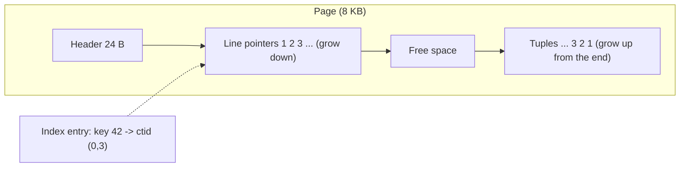
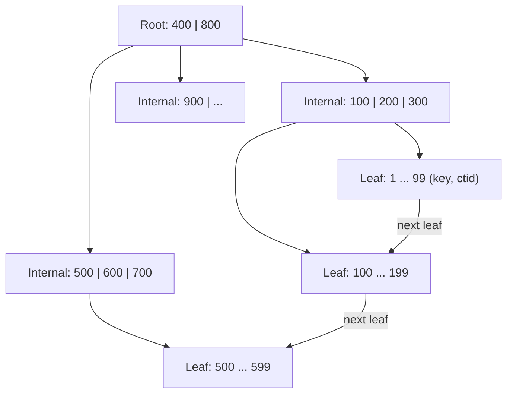
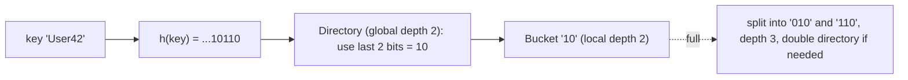
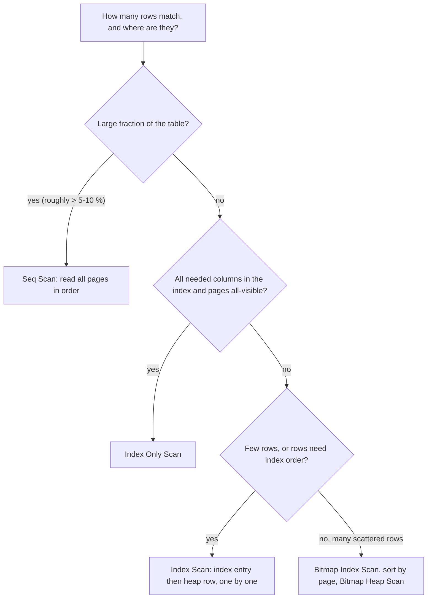

# Chapter 12 — Indexes, Storage and Query Performance

This chapter asks *how fast* a query runs, and why. The answer always comes down to: **how many pages of data does the database have to touch?** That depends on how rows sit on disk, what an index is, how the query planner (the part of the database that decides *how* to run a query) chooses between reading everything and jumping to the rows it needs, and which query habits defeat an index. Every claim is measured on PostgreSQL 14 with a one-million-row table.

**What you'll learn:** storage (hierarchy, 8 KB slotted pages, heap files, TOAST, row vs column layout, compression) · file organizations · index kinds (primary/clustering/secondary, dense/sparse, multilevel arithmetic) · B+ trees, hashing (static, extendible, linear), Bloom filters, GIN/GiST/BRIN/bloom · reading `EXPLAIN (ANALYZE, BUFFERS)` · composite, covering, partial and expression indexes · anti-patterns (functions on columns, leading wildcards and `pg_trgm`, `OR`, OFFSET vs keyset, N+1) · join algorithms and planner statistics.

**How to run the examples.** The runner builds a fresh database per file in [`code/`](code/), loading [`00_schema.sql`](code/00_schema.sql) first (~5 s; it generates one million orders):

```bash
bash tools_run_sql.sh sql '12-*'                                   # all files of this chapter
bash tools_pg.sh psql -d ch_12 -f sql/chapters/12-indexes-storage-and-query-performance/code/02_scans.sql
cd sql/chapters/12-indexes-storage-and-query-performance/code
python3 bloom_filter_sim.py; python3 compression_demo.py
../../../../.venv-books/bin/python n_plus_one.py                   # needs psycopg
```

> **About the numbers.** Timings depend on the machine and cache; **buffer counts** (pages touched) and **plan shapes** are what to compare. Long plan lines are trimmed with `...`.

The data is a small shop; every value is computed from the row number, so every run builds the same tables:

```sql
CREATE TABLE customers (id int PRIMARY KEY, name text, email text, country text, signup_on date); -- 100,000 rows
CREATE TABLE orders (id bigint PRIMARY KEY, customer_id int REFERENCES customers(id),
                     status text, amount numeric(10,2), created_at timestamp, note text);
INSERT INTO orders
SELECT g, (g::bigint * 7919) % 100000 + 1,               -- exactly 10 orders per customer, scattered
       CASE WHEN g % 100 < 2 THEN 'pending' WHEN g % 100 < 5 THEN 'refunded'
            ELSE 'shipped' END,                          -- 2 % / 3 % / 95 %
       ((g::bigint * 37) % 50000) / 100.0 + 1,
       TIMESTAMP '2024-01-01' + g * INTERVAL '31 seconds', -- grows with id
       CASE WHEN g % 10 = 0 THEN 'gift wrap please' END   -- 90 % NULL
FROM generate_series(1, 1000000) AS g;
VACUUM ANALYZE orders;
```

`VACUUM ANALYZE` cleans the table and gathers planner statistics (12.16). The schema file also defines `plan_stats(query)`, returning just execution time and pages touched, for side-by-side tables.

---

## 12.1 How a database stores data

### What it is

A database keeps data on **persistent storage** and works on it in **memory**; the layers differ by a factor of thousands in speed:

| Level | Examples | Survives power loss? | Rough access time | Role in a DBMS |
|---|---|---|---|---|
| CPU cache / RAM (main memory; primary storage) | L1–L3 cache, DRAM | No (volatile) | ~1–100 ns | Buffer pool: cached pages, sort and hash memory |
| SSD / NVMe (secondary storage) | flash drives | Yes | ~20–100 µs | Data files, indexes, write-ahead log (the change log written before the data files) |
| Hard disk (secondary) | spinning disks | Yes | ~5–10 ms per random seek | Same, on older or cheaper servers |
| Tertiary / archive | tape, object storage (S3 Glacier) | Yes | seconds to hours | Backups, cold archives |

So a DBMS never fetches single rows: it moves fixed-size **blocks** (**pages**) — 8 KB in PostgreSQL and SQL Server, 16 KB in MySQL InnoDB, 4 KB by default in SQLite. RAM holding recently used pages is the **buffer pool** (PostgreSQL: `shared_buffers`). A read finding its page there is a *hit*; one going to the operating system is a *read* — the two words in `EXPLAIN (BUFFERS)` output.

### How a table is laid out

1. Each table is one or more **files** (PostgreSQL: one per 1 GB segment under `base/<database-oid>/`, *oid* = internal object number) — a sequence of pages 0, 1, 2, …
2. Each page is a **slotted page**: header, an array of **line pointers** (slots) growing from the front, row data (**tuples**) growing from the back, free space in the middle.
3. A row's address is (page, slot) — PostgreSQL's hidden column **`ctid`**, which indexes store. Because it points at a *slot*, not a byte offset, the page can shuffle tuples internally without breaking any index.
4. **TOAST** (The Oversized-Attribute Storage Technique): when a row exceeds about 2 KB, big values are compressed and, if still too big, chunked into a separate TOAST table.



### Seeing it on the real server

```sql
SELECT relname, pg_size_pretty(pg_relation_size(oid)) AS main_fork, ... FROM pg_class WHERE ...;
SELECT ctid, id, status, amount FROM orders WHERE id IN (1, 2, 3, 124, 125) ORDER BY id;
SELECT lower, upper, special, pagesize FROM page_header(get_raw_page('orders', 0));
SELECT lp, lp_off, lp_len, t_ctid FROM heap_page_items(get_raw_page('orders', 0)) LIMIT 4;
```

Output ([`01_storage_pages.sql`](code/01_storage_pages.sql), using the `pageinspect` extension for raw pages):

```
   relname   | main_fork | pages | est_rows
-------------+-----------+-------+----------
 customers   | 7344 kB   |   918 |   100000
 orders      | 68 MB     |  8662 |  1000000
 orders_pkey | 21 MB     |  2745 |  1000000

 ctid  | id  |  status  | amount
-------+-----+----------+--------
 (0,1) |   1 | pending  |   1.37
 (0,2) |   2 | refunded |   1.74
 (0,3) |   3 | refunded |   2.11
 (1,8) | 124 | shipped  |  46.88
 (1,9) | 125 | shipped  |  47.25

 lower | upper | special | pagesize
-------+-------+---------+----------
   488 |   504 |    8192 |     8192

 lp | lp_off | lp_len | t_ctid
----+--------+--------+--------
  1 |   8128 |     64 | (0,1)
  2 |   8064 |     64 | (0,2)
  3 |   8000 |     64 | (0,3)
  4 |   7936 |     64 | (0,4)
```

- One million orders occupy **8,662 pages**; a full scan touches all of them — the yardstick for everything that follows.
- Page 0 holds 116 rows (row 124 is the 8th row of page 1). Each tuple is 64 bytes: a 23-byte header (transaction ids used by MVCC — *multi-version concurrency control*, keeping old row versions so readers and writers don't block each other, [chapter 13](../13-transactions-and-concurrency/README.md#1314-multiversion-concurrency-control-mvcc)) plus aligned column values.
- `lower = 488` (slot array end) and `upper = 504` (tuple data start) leave 16 bytes: the page is full. Tuple 1 sits at the very end (8128 + 64 = 8192); later tuples go in front of it.

TOAST in action (`pg_column_size` reports bytes actually stored; a value stays uncompressed when compression would not save enough):

```
 id | logical_bytes | stored_bytes
----+---------------+--------------
  1 |            30 |           31      -- tiny: stored inline, 1-byte length header
  2 |         40000 |          477      -- 'abcdefgh' x 5000: compressed ~84x
  3 |         48000 |        48000      -- hex digests: incompressible, moved out of line as is
```

(Hex digests — hash outputs in hexadecimal — are effectively random, so they don't compress.)

### From memory to bytes: serialization, endianness, alignment

- **Serialization** turns an in-memory value into bytes for a page or the network; **deserialization** rebuilds it. Formats differ per engine: PostgreSQL's tuple layout, MongoDB's BSON (binary JSON), Parquet's (a columnar file format) column chunks. Compact formats mean fewer pages.
- **Endianness** is the byte order of multi-byte numbers: *big-endian* most significant byte first, *little-endian* least first (x86 and ARM are little-endian). 258 is `01 02` big-endian, `02 01` little-endian. Formats must fix one order — why PostgreSQL's binary files are not portable across architectures while `pg_dump` output is.
- **Alignment**: CPUs read a 4- or 8-byte value fastest at an address that is a multiple of its size, so engines pad. In PostgreSQL column order affects row size: `(bool, bigint, bool, bigint)` pads each `bool` to 8 bytes, `(bigint, bigint, bool, bool)` does not. Index pages are aligned for the same reason.

### Row stores vs column stores

| Layout | How a page is filled | Good at | Examples |
|---|---|---|---|
| **Row-oriented** | All columns of a row together | OLTP: fetch or change whole rows by key | PostgreSQL, MySQL InnoDB, SQL Server (rowstore), SQLite |
| **Column-oriented** | All values of *one column* together | Analytics: scan a few columns of billions of rows; compresses very well | ClickHouse, Amazon Redshift, Snowflake, DuckDB, Parquet files, SQL Server columnstore |

Summing `amount` in a row store reads every whole row; a column store reads only the `amount` column. More in DDIA (*Designing Data-Intensive Applications*): [storage and retrieval](../../../ddia/chapters/03-storage-and-retrieval/README.md).

### Self-check

1. Why read whole pages, not single rows? → Storage transfers blocks anyway, and a random access costs far more than the extra bytes; grouping rows per page spreads the cost over many rows.
2. What is a `ctid`? → The (page, slot) address of a row version; indexes store it.

---

## 12.2 Data compression and encoding

### What it is

**Compression** stores the same information in fewer bytes: **lossless** (original rebuilt exactly — always the case for table data) or **lossy** (detail thrown away, e.g. JPEG, MP3 — never used for table values). **Encoding** is compression exploiting a column's *type and shape* rather than treating it as a byte stream. Benefit: fewer pages to read, more rows in the buffer pool, cheaper storage and transfer. Price: CPU to compress/decompress, sometimes slower in-place updates.

| Technique | Idea | Works best on | Used by |
|---|---|---|---|
| **Run-length encoding (RLE)** | Store (value, how many times in a row) | Sorted or slowly changing columns | Column stores, Parquet, bitmap indexes |
| **Dictionary encoding** | Each distinct value once; rows hold a small integer code | Few distinct values (country, status) | Parquet, ClickHouse `LowCardinality`, Redshift |
| **Delta encoding** | First value, then differences | Timestamps, ids, sorted numbers | Time-series DBs (Gorilla/Prometheus), Parquet |
| **Bit-packing** | Only as many bits as the largest value needs | Small integers (codes, deltas) | Combined with the two above |
| **Lempel–Ziv (LZ77/LZ78 family)** | Replace a repeated byte sequence with a reference ("copy 8 bytes from 40 bytes back") | Text, repeated strings; no type knowledge | PostgreSQL TOAST (`pglz`, `lz4` since PG 14), zlib/zstd page compression |
| **Huffman coding** | Short bit codes for frequent symbols, long for rare | Skewed symbol frequencies | Inside zlib/DEFLATE and zstd |

`compression_demo.py` applies each to a 100,000-value column:

```python
status  = ["shipped"] * 60_000 + ["pending"] * 25_000 + ["refunded"] * 15_000   # sorted
country = [["IN", "US", "DE", "BR", "JP"][(i * 7) % 5] for i in range(N)]      # 5 distinct
ts      = [1_700_000_000 + i * 31 + (i % 7) for i in range(N)]                  # increasing
# rle(), dictionary(), delta() are ~6 lines each; see the file
```

```
status   raw text               :   715,000 bytes
status   RLE (3 runs)           :        34 bytes  -> [['shipped', 60000], ['pending', 25000], ['refunded', 15000]]
country  raw text               :   200,000 bytes
country  dictionary + 3-bit codes:    37,510 bytes  (dictionary ['IN', 'DE', 'JP', 'US', 'BR'], codes [0, 1, 2, 3, 4, 0]...)
ts       raw 8-byte ints        :   800,000 bytes
ts       delta + 6-bit packing  :    75,007 bytes  (first 1700000000, deltas [32, 32, 32, 32, 32, 32]...)
ts       zlib on the text       :   273,868 bytes  (no knowledge of the data type)
```

Type-aware encodings beat the general-purpose compressor by far and can often be queried without decompressing (counting `'pending'` rows = reading one run length) — why column stores sort data and pick an encoding per column. **When not to use it:** for hot, small OLTP rows the CPU cost usually isn't worth it (PostgreSQL compresses only rows over ~2 KB).

---

## 12.3 File organization

**File organization** decides *where* in the data file a new record goes, and therefore how records are found later.

| Organization | Where records go | Fast | Slow | Real systems |
|---|---|---|---|---|
| **Heap (unordered)** | Any page with free space (usually the end) | Inserts; full scans | Finding one record without an index | PostgreSQL tables, SQL Server heaps, Oracle default |
| **Sequential (sorted)** | In order of a key | Ranges and ordered output on that key; binary search (repeatedly halving the range) | Inserts/deletes in the middle (shift records or overflow pages, reorganize periodically) | Old ISAM files, sorted SSTables in LSM engines |
| **Hashed** | Page = hash(key) mod number of buckets | Equality on the key: ~1 page read | Ranges and ordering; growing beyond the bucket count | Hash clusters (Oracle), hash-partitioned stores |
| **ISAM** (indexed sequential access method, IBM's classic) | Sorted data file plus a static multilevel index built at load time; later inserts go to overflow pages | Reads and ranges on a stable file | Overflow chains grow until reorganized | IBM mainframe ISAM files |
| **B+ tree file organization** | Records in the leaves of a B+ tree on the key (12.6), which rebalances on insert | Point and range access that stays fast under inserts | Free space in every leaf; splits | Same as the next row |
| **Clustered / index-organized** | The table *is* a B+ tree ordered by a key; leaves hold the rows | Primary-key lookups and ranges | Random-order inserts cause page splits; secondary indexes must store the key | MySQL InnoDB, SQL Server clustered index, Oracle IOT (index-organized table), SQLite rowid / `WITHOUT ROWID` tables |

> **Key terms:** a **hash function** turns a key into a seemingly random number; `mod N` then picks one of N **buckets**. An **LSM** (log-structured merge) engine buffers writes in memory and flushes them as immutable sorted files (**SSTables**, sorted string tables), merged in the background — fast writes, reads check several files.

A clustered file keyed by department stores department 7's employees in the same few blocks, so "list department 7" reads only those. PostgreSQL has only heap tables; `CLUSTER` sorts a heap **once** by an index, but new rows are not kept in order.

### Why physical order matters — measured

Each customer's 10 orders are scattered (the generator jumps 7,919 customers per row). Summing 1,000 customers' orders (10,000 rows) before and after `CLUSTER` ([`09_clustering.sql`](code/09_clustering.sql)):

```sql
SELECT correlation FROM pg_stats WHERE tablename = 'orders' AND attname = 'customer_id';
EXPLAIN (ANALYZE, BUFFERS, COSTS OFF)
SELECT sum(amount) FROM orders WHERE customer_id BETWEEN 1000 AND 1999;
CLUSTER orders USING orders_customer_idx;  ANALYZE orders;
-- ... same two queries again
```

```
 correlation = 0.0034                                           -- before: random order (sampled; varies per run)
 Aggregate (actual time=5.814..5.815 rows=1 loops=1)
   Buffers: shared hit=8454 read=14
   ->  Bitmap Heap Scan on orders (... rows=10000 loops=1)
         Heap Blocks: exact=8454                                -- 10,000 rows on 8,454 pages!
 ...
 correlation = 1                                                -- after CLUSTER
 Aggregate (actual time=0.895..0.895 rows=1 loops=1)
   Buffers: shared hit=2 read=100
   ->  Index Scan using orders_customer_idx on orders (... rows=10000 loops=1)
 Execution Time: 0.901 ms
```

Same rows, same index: **8,468 → 102 pages**. The statistic **correlation** (−1 … 1) tells the planner how well a column's order matches physical order. **Fillfactor** sets how full pages are packed on insert, leaving room so updated row versions stay on the same page (PostgreSQL's heap-only-tuple — HOT — updates, which skip index maintenance, [chapter 13](../13-transactions-and-concurrency/README.md#1314-multiversion-concurrency-control-mvcc)): the same 100,000 rows take 443 pages at the default `fillfactor = 100`, 633 at `fillfactor = 70`.

**Trade-offs:** only **one** physical order per table — choose the key of your most important ranges (often time or tenant id, the customer organisation a row belongs to in a multi-tenant app). In InnoDB and SQL Server the clustered key is copied into every secondary index, so a wide or random key (a random UUID) bloats every index and causes page splits; prefer a short, increasing key.

---

## 12.4 What an index is

### What it is

An **index** is a separate, smaller structure mapping **search-key values to row addresses**, kept sorted (or hashed) so the database finds matching rows without reading the whole table — like a textbook's index: look up "B+ tree", jump to page 412, never read pages 1–411.

- **Search key**: the indexed column(s) (not necessarily a primary or unique key).
- **Index entry**: (key, pointer) — a `ctid` in PostgreSQL, the primary-key value in InnoDB secondary indexes, a row id in Oracle.

Without an index, `WHERE customer_id = 4242` checks every row; with one, a handful of index pages:

```
-- no index
 Seq Scan on orders (actual time=2.944..30.041 rows=10 loops=1)
   Filter: (customer_id = 4242)
   Rows Removed by Filter: 999990
   Buffers: shared hit=8662
 Execution Time: 30.068 ms
-- CREATE INDEX orders_customer_idx ON orders (customer_id);
 Bitmap Heap Scan on orders (actual time=0.015..0.023 rows=10 loops=1)
   Buffers: shared hit=10 read=3
   ->  Bitmap Index Scan on orders_customer_idx (... rows=10 loops=1)
 Execution Time: 0.036 ms
```

**8,662 pages → 13 pages; ~30 ms → ~0.04 ms.** That is the whole reason indexes exist.

### Kinds of index (classic terminology)

| Term | Meaning |
|---|---|
| **Primary index** | On the ordering key of a *sorted* file, usually the PK; one entry per data block suffices (sparse). |
| **Clustering index** | On a *non-unique* sorting field (file sorted by department); one entry per distinct value, pointing to its first block. |
| **Secondary index** | On any other column; the file is not sorted by it, so one entry per record (dense). A table can have many. |
| **Dense index** | An entry for **every** search-key value (every record). |
| **Sparse index** | Entries for only **some** values (typically each block's first key); works only if the file is sorted on that key. |
| **Clustered vs non-clustered** (vendor usage) | *Clustered*: rows stored in index order (at most one per table — SQL Server, InnoDB PK). *Non-clustered*: separate structure pointing to rows. All PostgreSQL indexes are non-clustered. |
| **Unique index** | Rejects duplicate keys; how `PRIMARY KEY` and `UNIQUE` are enforced. |

```sql
CREATE INDEX orders_customer_idx ON orders (customer_id);              -- B-tree by default
CREATE UNIQUE INDEX customers_email_uq ON customers (email);          -- enforces uniqueness
CREATE INDEX CONCURRENTLY orders_note_idx ON orders (note);           -- PG: build without blocking writes
DROP INDEX orders_customer_idx;                         -- MySQL / SQL Server: DROP INDEX name ON table
ALTER TABLE t ADD CONSTRAINT t_pk PRIMARY KEY (id);     -- creates a unique index implicitly
```

SQL Server adds `CREATE [CLUSTERED|NONCLUSTERED] INDEX`. `CONCURRENTLY` (PostgreSQL), `ONLINE = ON` (SQL Server Enterprise) and `ALGORITHM=INPLACE, LOCK=NONE` (MySQL) avoid long write locks on big tables.

### Trade-offs, when not to index, mistakes

| Benefit | Cost |
|---|---|
| Fast lookups, ranges, joins, `ORDER BY`, `MIN/MAX` | Every `INSERT`, `DELETE` and many `UPDATE`s must change every index |
| Enforces uniqueness | Disk and buffer-pool space (our 1M-row PK index is 21 MB) |
| Enables index-only scans | Too many indexes slow writes and complicate planning |

- **Don't index:** small tables (a seq scan is cheap); low-selectivity columns (`status = 'shipped'` matches 95 % — 12.10); write-heavy tables rarely searched; columns only used inside functions (index the expression — 12.12).
- **Common mistakes:** "index every column" — unused indexes are pure overhead (find them with `pg_stat_user_indexes.idx_scan = 0`); forgetting that **foreign-key columns are not indexed automatically** in PostgreSQL (InnoDB does create one) — joins on the FK and `ON DELETE` checks then scan the child table.

### In the interview

"An index is a sorted (or hashed) side structure mapping key values to row locations, so a lookup reads a few pages instead of the whole table; it speeds up filters, joins and sorts at the cost of slower writes and extra space. I index selective predicates (`WHERE` conditions that match few rows) and join keys and confirm with EXPLAIN."

- *Why not index everything?* → Write amplification (one logical change causing many physical writes), space, cache pressure; low-selectivity indexes are ignored anyway.
- *Clustered vs non-clustered?* → Clustered stores the rows themselves in key order (one per table); non-clustered is separate, with pointers.

---

## 12.5 Single-level indexing, with numbers

An index file is much smaller than the data file (entries hold only key + pointer); binary search over it costs about log₂(index blocks) reads, plus one data block. The arithmetic (from *Database System Concepts* and *Fundamentals of Database Systems*):

- **Blocking factor** `bfr = ⌊block size / record size⌋` — records per block (`⌊x⌋` rounds down, `⌈x⌉` up).
- **Blocks** `b = ⌈records / bfr⌉`; **binary search** on `b` sorted blocks: `⌈log₂ b⌉` reads.

**Worked example:** r = **1,000,000** records of **200 bytes**, block **4,096 bytes**, index entries 8-byte key + 8-byte pointer = **16 bytes**.

| Access path | Calculation | Block reads |
|---|---|---|
| Data file | bfr = ⌊4096/200⌋ = 20; b = 1,000,000/20 = **50,000 blocks** | — |
| Linear scan, unordered file | average b/2, worst b | 25,000 avg / 50,000 worst |
| Binary search, file sorted on the key | ⌈log₂ 50,000⌉ = 16 | **16** |
| **Primary index (sparse)**: one entry per data block | 50,000 entries; index bfr = ⌊4096/16⌋ = 256; 50,000/256 → **196 blocks**; ⌈log₂ 196⌉ = 8, +1 data block | **9** |
| **Secondary index (dense)** on an unsorted column | 1,000,000/256 → **3,907 blocks**; ⌈log₂ 3907⌉ = 12, +1 | **13** |
| **Multilevel** (index on the index, fan-out — entries per index block — 256) | 3,907 blocks → ⌈3907/256⌉ = 16 → 1 block; 3 levels + 1 data block | **4** |

A sparse index is much smaller than a dense one but requires a sorted file; indexing **the index** — each level 256× smaller — turns a log₂ search into log₂₅₆. The top level stays in RAM, so only lower levels and the data block cost disk reads. Made dynamic, that idea is the B+ tree. (Courses call primary, clustering and secondary indexes *single-level* and B-/B+ trees *multi-level*.)

**Trade-offs:** sparse — small, but only on the sort key, and inserts must keep the file sorted; dense — any column, but large; both **static** (inserting shifts entries) — multilevel trees with free space per node fix that.

### Self-check

1. Why can a secondary index not be sparse? → The file isn't sorted on that column, so a block's first key says nothing about the others.
2. Fan-out 256, 16 million entries — how many levels? → 256³ ≈ 16.7 million, so 3.

---

## 12.6 Tree-based indexes: B-trees and B+ trees

### What it is

A **B-tree** (Bayer & McCreight, 1972) is a balanced search tree whose nodes are pages holding hundreds of sorted keys; every leaf is at the same depth, so every lookup costs the same number of page reads. It keeps keys sorted *and* absorbs inserts locally: O(log n) search, insert and delete, where a sorted array needs O(n) shifting per insert and an unsorted one O(n) per search. The **B+ tree** — what nearly every database uses (PostgreSQL "btree", InnoDB, SQL Server, SQLite, Oracle) — adds two rules:

1. **All data pointers live in the leaves**; internal nodes hold only separator keys and child pointers, so more fit per page (higher **fan-out**).
2. **Leaves are linked** left-to-right (PostgreSQL: both ways), so a range scan finds the first key and walks sideways.



### How it works

- **Search**: from the root, pick the child whose range contains the key, repeat to a leaf, then follow the pointer to the heap (the table's unordered data file). Cost = height + 1. Finding 650: root (400 < 650 < 800 → middle) → internal (600 < 650 < 700) → leaf 600–699.
- **Range** (`BETWEEN 1000 AND 1999`): search for 1000, then read leaves rightwards until a key > 1999.
- **Insert**: into the leaf in sorted position; if full, **split** into two half-full leaves and push the middle key into the parent (which may split too). Only a root split makes the tree taller — why it stays balanced.
- **Delete**: remove; if a node becomes too empty, borrow from a sibling or merge (PostgreSQL doesn't merge eagerly; `VACUUM` reclaims empty pages).
- **Order** `n`: each node holds up to `n − 1` keys and `n` children; every non-root node stays at least half full.

```sql
SELECT level AS root_level FROM bt_metap('orders_pkey');
SELECT type, live_items, avg_item_size, free_size FROM bt_page_stats('orders_pkey', 1);
```

```
 root_level = 2                  -- levels 2 (root), 1 (internal), 0 (leaves): height 3
 type | live_items | avg_item_size | free_size
------+------------+---------------+-----------
 l    |        367 |            16 |       808
```

A leaf holds 367 16-byte entries and keeps ~10 % free (B-tree default fillfactor 90). One million keys need ~2,700 leaves and one internal level — why the PK lookup in 12.10 touched only **7 buffers** (three levels, the heap page, some index metadata) vs 8,662 for a full scan. A billion keys would need one more level.

| Structure | Data pointers in | Range scans | Used by |
|---|---|---|---|
| B-tree (classic) | Every node | In-order tree walk | Rare today; some file systems |
| **B+ tree** | Leaves only; leaves linked | Walk the leaf chain | PostgreSQL, MySQL, SQL Server, Oracle, SQLite |
| LSM tree | Sorted immutable files merged in the background | Merge several files | RocksDB, Cassandra, ScyllaDB, LevelDB ([ch. 16](../16-beyond-relational/README.md)) |
| R-tree | Bounding boxes | Spatial "overlaps/near" | PostGIS (PostgreSQL's geometry extension, via GiST), SQLite R*Tree |

**Trade-offs:** random-key inserts (random UUIDs) hit random leaves — more splits and cache misses than an increasing key. PostgreSQL 13+ **deduplicates** repeated keys in leaves, so a low-uniqueness B-tree is much smaller (our `customer_id` index: 9 MB vs 21 MB for unique `created_at`).

### In the interview

**30-second answer:** "Databases use B+ trees: balanced trees whose nodes are pages with hundreds of keys, so even a billion rows need only 3–4 levels. Values sit in linked leaves, so range scans walk the leaves. Inserts split full nodes and push keys up, keeping every leaf at the same depth."

- *B-tree vs LSM?* → B+ trees update pages in place (read-optimized); LSM trees append and merge (write-optimized, need Bloom filters for reads).
- *Why no row pointers in internal nodes?* → More separator keys per page: higher fan-out, lower height.
- *When does a B+ tree get taller?* → Only when the root splits.

---

## 12.7 Hash-based indexing

### What it is

A **hash index** computes `hash(key)` to pick a **bucket** (a page or chain of pages) holding that key's entries; a lookup reads one bucket — typically one or two pages — however large the table.

### How it works

1. **Hash function**: maps keys evenly across buckets (`bucket = h(key) mod N`), scattering similar keys (`User1`, `User2`) far apart.
2. **Collisions**: different keys in one bucket share its page; when full, an **overflow page** is chained on. (In-memory hash tables also use *open addressing*: probe the next slots.)
3. **Static hashing** fixes `N`. With `h(k) = k mod 7`, keys 15, 23, 40 go to buckets 1, 2, 5; inserting 29 (29 mod 7 = 1) collides with 15 and is **chained** in bucket 1, so a search for 29 walks that short chain. Growth makes chains long; shrinking wastes space; rehashing everything is expensive.
4. **Dynamic hashing** grows gradually:
   - **Extendible hashing**: a **directory** of `2^d` pointers indexed by the last `d` hash bits (**global depth**); each bucket records the bits it uses (**local depth**). An overflowing bucket splits using one more bit; only if its local depth equals the global depth does the directory double (pointers copied, no data moved).
   - **Linear hashing**: no directory; buckets split one at a time in round-robin order (a "next to split" pointer), using `h mod 2N` for already-split buckets — smooth growth, temporary overflow chains. PostgreSQL's hash index (based on Seltzer and Yigit's 1991 package) likewise has no directory: it splits one bucket at a time and allocates bucket pages in power-of-2 groups located by computation from the bucket number.



```sql
CREATE INDEX o_cust_hash ON orders USING hash (customer_id);
EXPLAIN (COSTS OFF) SELECT * FROM orders WHERE customer_id = 42;   -- Bitmap Index Scan on o_cust_hash
EXPLAIN (COSTS OFF) SELECT * FROM orders WHERE customer_id < 42;   -- Seq Scan: hash can't do ranges
```

```
   index_name    | type  |  size
-----------------+-------+---------
 o_cust_hash     | hash  | 32 MB
 o_created_btree | btree | 21 MB
 o_cust_btree    | btree | 9256 kB
 o_created_brin  | brin  | 24 kB
```

### Trade-offs

| | Hash index | B-tree |
|---|---|---|
| `=` lookups | O(1) buckets | O(log n) pages (3–4 in practice) |
| Ranges, `ORDER BY`, prefix `LIKE` | No (hashing destroys order: neighbouring keys land in unrelated buckets) | Yes |
| Unique constraints | No (PostgreSQL) | Yes |
| Size | Can be larger (no deduplication — 32 MB vs 9 MB above) | Compact with dedup |

The B-tree's extra 2–3 page reads are usually cached, so hash indexes win only for very large, equality-only keys (long strings, URLs). PostgreSQL hash indexes are crash-safe only since version 10 — old "avoid them" advice predates that. InnoDB has no user-created hash indexes (its *adaptive hash index* is built automatically in memory); the MEMORY engine does; SQL Server has them on memory-optimized tables; SQLite has none. Hashing also drives **hash joins** (12.15) and **hash partitioning** ([ch. 15](../15-scaling-databases/README.md#152-partitioning)).

---

## 12.8 Bloom filters

### What it is

A **Bloom filter** (Burton Bloom, 1970) is a compact, probabilistic set answering "is x in the set?" with **"definitely not"** or **"probably yes"**: never a **false negative** ("absent" for a present key), but **false positives** ("maybe" for an absent key) at a rate you choose by spending bits. Checking it in RAM costs nanoseconds vs micro- to milliseconds for disk, so when most lookups are for absent keys it skips almost all disk work.

### How it works

1. An array of **m bits**, all 0, and **k** independent hash functions.
2. **Add(x)**: set the k hashed bits to 1.
3. **Query(x)**: if **any** of the k bits is 0, x was never added; if all are 1, x is *probably* present (other keys may have set them). Work per operation depends on k, not m.
4. With n keys, false-positive probability **p ≈ (1 − e^(−kn/m))^k**, minimized at **k = (m/n)·ln 2**, needing about **1.44·log₂(1/p) bits per key** (≈ 9.6 bits for 1 %).
5. No deletes (clearing a bit could erase other keys). **Counting Bloom filters** keep a small counter per position to allow deletes; **scalable Bloom filters** add larger filters as n grows.

**Tiny example** (10 bits, k = 3; made-up hash outputs): `"sql"` → bits 2, 5, 8; `"java"` → 1, 5, 9. Bits: `0110010011`. Query `"css"` → 2, 6, 9: bit 6 is 0 → **definitely absent**. Query `"go"` → 1, 2, 8: all 1, never added → **false positive**.

### Simulation vs theory

[`bloom_filter_sim.py`](code/bloom_filter_sim.py) builds real filters (SHA-256 with double hashing, `h_i = h1 + i*h2 mod m`), inserts 10,000 keys and probes 50,000 never-added keys:

```
bits/key   m bits   k  measured FP  theory FP    memory
       4    40000   3     14.6340%   14.6892%     4.9KB
       8    80000   6      2.1700%    2.1577%     9.8KB
      10   100000   7      0.8720%    0.8194%    12.2KB
      16   160000  11      0.0520%    0.0459%    19.5KB

Effect of k at a fixed 8 bits/key:
  k= 1  measured 11.604%   theory 11.750%
  k= 2  measured  4.770%   theory  4.893%
  k= 4  measured  2.324%   theory  2.397%
  k= 6  measured  2.170%   theory  2.158%
  k= 8  measured  2.654%   theory  2.549%
  k=12  measured  4.780%   theory  4.833%
```

Measured rates track the formula; ~10 bits per key buys < 1 % false positives regardless of key length; doubling m (8 → 16 bits/key) drops p from ~2 % to ~0.05 %; too many hashes hurts (k = 12 fills the array with ones).

### Real-world examples

- **LSM-tree databases** (RocksDB, Cassandra, HBase, LevelDB): one filter per sorted file lets a read skip files that cannot hold the key.
- **"Username taken?"** and duplicate-submission checks: an in-memory filter answers most "no" cases without the database.
- **Web caches and CDNs** (content delivery networks — servers worldwide caching content near users, [System Design Fundamentals](../../../system-design-patterns/modules/00-system-design-fundamentals/README.md)) avoid caching one-hit objects; routers and distributed caches summarize which keys a peer holds.
- **Join filters**: engines build a filter from the smaller join side and push it to the larger side's scan (Spark, SQL Server bitmap filters, Oracle).
- **PostgreSQL `bloom` extension**: a per-row signature over many columns, so one index answers equality on *any* subset:

```sql
CREATE INDEX wide_bloom ON wide USING bloom (a, b, c, d, e) WITH (length = 80);
EXPLAIN (ANALYZE, COSTS OFF, TIMING OFF, SUMMARY OFF) SELECT * FROM wide WHERE c = 5 AND e = 9;
```

```
 bloom_index_size | table_size
------------------+------------
 4720 kB          | 15 MB
 Bitmap Heap Scan on wide (actual rows=50 loops=1)
   Recheck Cond: ((c = 5) AND (e = 9))
   Rows Removed by Index Recheck: 97          <- the false positives, removed by rechecking
   ->  Bitmap Index Scan on wide_bloom (actual rows=147 loops=1)
```

### TL;DR

Bit array + k hashes; "no" is certain, "yes" is probable; ~10 bits/key ≈ 1 % false positives; no deletes (use counting filters); used to skip disk reads in LSM stores and joins.

---

## 12.9 PostgreSQL's other index types: GIN, GiST, BRIN

B-trees answer "equal / less / greater". *Does this array contain X*, *do these ranges overlap*, *which rows fall in this month of a huge log* need other structures ([`10_index_types.sql`](code/10_index_types.sql)):

| Type | Structure in one line | Answers | Typical use |
|---|---|---|---|
| **B-tree** (default) | Balanced sorted tree (12.6) | `= < > BETWEEN`, prefix `LIKE`, `ORDER BY` | Almost everything |
| **Hash** | Buckets by hash (12.7) | `=` only | Long keys, equality only |
| **GIN** (Generalized Inverted Index) | For each *element* (array item, JSON key/value, word, trigram — a 3-character chunk of text) a list of rows containing it | `@>` contains, `?` key exists, full-text `@@`, `LIKE '%x%'` with `pg_trgm` | Tags, JSONB documents, search |
| **GiST** (Generalized Search Tree) | Balanced tree of possibly overlapping "bounding" predicates (boxes, ranges) | Overlap `&&`, containment, nearest-neighbour `<->` | Geometry (PostGIS), ranges, exclusion constraints |
| **SP-GiST** | Space-partitioned trees (quadtrees, tries) | Points, IP ranges, text prefixes | Unevenly distributed data |
| **BRIN** (Block Range INdex) | min/max summary per 128-page range | Ranges on columns following physical order | Append-only logs, time-series |
| **bloom** (extension) | Bloom signature per row (12.8) | `=` on any subset of many columns | Wide tables with ad-hoc filters |

**BRIN** — `created_at` rises with insertion order (correlation 1), so a 24 kB BRIN replaces a 21 MB B-tree:

```
 Aggregate (actual time=0.716..0.717 rows=1 loops=1)
   Buffers: shared hit=130 read=3
   ->  Bitmap Heap Scan on orders (actual time=0.222..0.656 rows=2787 loops=1)
         Rows Removed by Index Recheck: 11992
         Heap Blocks: lossy=128                 <- one 128-page block range read
         ->  Bitmap Index Scan on o_created_brin (... rows=1280 loops=1)
```

It is *lossy*: it knows only which ranges *might* match, reads the whole range and rechecks rows. On a randomly ordered column every range spans everything and BRIN is useless.

**GIN** on arrays and JSONB:

```sql
CREATE INDEX posts_tags_gin ON posts USING gin (tags);
CREATE INDEX posts_meta_gin ON posts USING gin (meta jsonb_path_ops);
SELECT count(*) FROM posts WHERE tags @> ARRAY['go', 'advanced'];     -- 20000, via Bitmap Index Scan on posts_tags_gin
EXPLAIN (COSTS OFF) SELECT count(*) FROM posts WHERE meta @> '{"lang": "hi", "likes": 7}';
--   ->  Bitmap Index Scan on posts_meta_gin
```

GIN is fast to read but slower to update (one row touches many posting lists — the per-element row lists; PostgreSQL buffers new entries in a "pending list").

**GiST** enforcing "no double booking" with an **exclusion constraint** (no two rows may conflict under the given operators; `tsrange` is a timestamp range, `&&` "overlaps"; `btree_gist` is needed for `room WITH =`):

```sql
CREATE TABLE bookings (room int, during tsrange, EXCLUDE USING gist (room WITH =, during WITH &&));
INSERT INTO bookings VALUES (101, '[2024-05-01 14:00, 2024-05-03 11:00)');
INSERT INTO bookings VALUES (102, '[2024-05-01 14:00, 2024-05-03 11:00)');  -- other room: fine
INSERT INTO bookings VALUES (101, '[2024-05-02 14:00, 2024-05-04 11:00)');  -- overlaps!
```

```
ERROR:  conflicting key value violates exclusion constraint "bookings_room_during_excl"
DETAIL:  Key (room, during)=(101, ["2024-05-02 14:00:00","2024-05-04 11:00:00")) conflicts with existing key (room, during)=(101, ["2024-05-01 14:00:00","2024-05-03 11:00:00")).
```

Elsewhere: MySQL has B-tree, full-text, spatial and multi-valued JSON indexes (8.0.17+); SQL Server rowstore, columnstore, full-text and spatial; SQLite B-tree plus FTS5 and R*Tree.

---

## 12.10 Reading EXPLAIN: the four ways to read a table

### What it is

`EXPLAIN` shows the **plan** the optimizer (planner) chose: a tree of operators, read from the innermost (most indented) node outwards. `EXPLAIN ANALYZE` also **runs** the query and adds real rows and times; `BUFFERS` adds pages hit in cache / read from the OS.

| Field | Meaning |
|---|---|
| `cost=0.42..8.44` | Estimate in abstract units: startup .. total (sequential page read = 1.0, random = `random_page_cost` = 4.0) |
| `rows=` (estimate) vs `actual ... rows=` | A big gap means bad statistics (12.16) |
| `loops=` | Times the node ran (inner side of a nested loop); times and rows are per loop |
| `Buffers: shared hit=/read=` | Pages found in the buffer pool / fetched from the OS |
| `Filter` + `Rows Removed by Filter` | Rows read then thrown away — wasted work |
| `Index Cond` | Condition applied *inside* the index — the useful work |

`EXPLAIN ANALYZE` executes the statement — wrap `INSERT/UPDATE/DELETE` in `BEGIN … ROLLBACK`. MySQL: `EXPLAIN ANALYZE` (8.0.18+); SQL Server: `SET SHOWPLAN_XML ON` / "actual execution plan"; SQLite: `EXPLAIN QUERY PLAN`.

### The four access methods, measured

From [`02_scans.sql`](code/02_scans.sql) (parallel query — one query split across worker processes — off to keep plans small):

| Query | Plan | Pages touched | Time |
|---|---|---|---|
| `customer_id = 4242`, no index | **Seq Scan** — read every page, filter | 8,662 | ~30 ms |
| same, with `orders_customer_idx` | **Bitmap Index + Bitmap Heap Scan** | 13 | ~0.04 ms |
| `id = 500000` | **Index Scan** on `orders_pkey` | 7 | ~0.01 ms |
| `count(*) … customer_id BETWEEN 1000 AND 1999` | **Index Only Scan**, `Heap Fetches: 0` | 15 | ~0.5 ms |
| `sum(amount) … status = 'shipped'` (95 %) | **Seq Scan** despite the index | 8,662 | ~76 ms |
| `sum(amount) … customer_id BETWEEN 1000 AND 1999` | **Bitmap Heap Scan**, `exact=8454` | 8,468 | ~5 ms |
| `status = 'refunded' AND customer_id < 2000` | **BitmapAnd** of two indexes | — | — |



1. **Seq Scan** reads pages in physical order (storage read-ahead makes this fast) — right for a predicate keeping 95 % of rows.
2. **Index Scan** walks the B-tree, then fetches each heap row; best for few rows; rows come out **in index order**, so `ORDER BY … LIMIT` can stop early.
3. **Index Only Scan** answers from the index alone, visiting the heap only for pages not marked all-visible in the **visibility map** (maintained by `VACUUM`; shown as `Heap Fetches`, [ch. 13](../13-transactions-and-concurrency/README.md#1314-multiversion-concurrency-control-mvcc)).
4. **Bitmap scan** collects matching `ctid`s into a bitmap (one bit per row or page), sorts by page and reads each needed page once; can combine indexes (`BitmapAnd/Or`). Short of memory, the bitmap turns *lossy* (whole pages) and rows are rechecked.

The 1 % case: 10,000 rows lived on **8,454 of 8,662 pages** — scattered rows make an index save almost nothing, which is why the planner cares about correlation (12.3) and why "selective" means *few pages*, not just few rows.

### Self-check

1. Why did `status = 'shipped'` ignore its index? → 95 % match; index + nearly every heap page randomly costs more than one sequential pass.
2. `Heap Fetches: 0`? → Every page was all-visible; the table was never touched.
3. `Filter` vs `Index Cond`? → `Index Cond` narrows the search inside the index; `Filter` discards rows after reading.

---

## 12.11 Composite indexes and column order

A **composite** (multi-column) index sorts by the first column, then by the second within equal first values — like a phone book (last name, then first name). [`03_composite_indexes.sql`](code/03_composite_indexes.sql), `CREATE INDEX orders_cust_created_idx ON orders (customer_id, created_at)`:

| Query | Uses the index? | Why |
|---|---|---|
| `WHERE customer_id = 777` | Yes (3 index pages) | Leading column |
| `WHERE customer_id = 777 ORDER BY created_at DESC LIMIT 3` | Yes, **Index Scan Backward**, no Sort node, 6 pages | Within one customer, entries are already in time order |
| `WHERE created_at >= '2024-06-01' AND created_at < '2024-06-01 00:10'` | **No** → Seq Scan, 8,662 pages, ~30 ms | Second column alone: the range is spread across every customer's section |
| same, after `CREATE INDEX … (created_at)` | Index Only Scan, 4 pages, ~0.04 ms | Now the range is contiguous |

```
 Limit (actual time=0.002..0.003 rows=3 loops=1)
   Buffers: shared hit=6
   ->  Index Scan Backward using orders_cust_created_idx on orders (... rows=3 loops=1)
         Index Cond: (customer_id = 777)
```

**Leftmost-prefix rule:** an index on `(a, b, c)` serves filters on `a`, `a,b` and `a,b,c`, not `b` or `c` alone. (Oracle, MySQL 8.0.13+ and PostgreSQL 18+ can sometimes "skip scan" when the leading column has few distinct values; don't design around it.)

### Equality first, range last

`customer_id = 777 AND created_at >= '2024-06-01'`, two column orders:

```
-- (customer_id, created_at)
   ->  Bitmap Index Scan on orders_cust_created_idx (... rows=5 loops=1)
         Buffers: shared hit=3
-- (created_at, customer_id)
 Index Scan using orders_created_cust_idx on orders (actual time=1.541..8.275 rows=5 loops=1)
   Index Cond: ((created_at >= '2024-06-01 ...') AND (customer_id = 777))
   Buffers: shared hit=5 read=2211
```

**8 pages (3 index) vs 2,216.** Equality first puts all matches in one narrow slice; range first walks every entry after June 1 (≈ 55 % of the index) testing `customer_id` on each. Rule: **equality columns first, then the range or sort column; among equality columns, the most-used-alone first.**

**Common mistakes:** separate `(a)`, `(a, b)`, `(a, b, c)` indexes (the last covers the others); a low-selectivity column first "because it's in every query" when queries also filter a range; assuming `(a, b)` helps `ORDER BY b` (only when `a` is fixed by equality).

---

## 12.12 Covering, partial and expression indexes

From [`04_covering_partial_expression.sql`](code/04_covering_partial_expression.sql).

**Covering index (`INCLUDE`, PostgreSQL 11+, SQL Server).** Extra *payload* columns in the leaf entries (not part of the key: not sorted, not unique-checked) so the query never visits the table:

```sql
CREATE INDEX orders_cust_incl_idx ON orders (customer_id) INCLUDE (amount);
SELECT sum(amount) FROM orders WHERE customer_id BETWEEN 5000 AND 5999;
```

| Index | Plan | Pages | Time |
|---|---|---|---|
| `(customer_id)` | Bitmap Heap Scan, 8,450 heap pages | 8,464 | ~5.3 ms |
| `(customer_id) INCLUDE (amount)` | **Index Only Scan**, Heap Fetches: 0 | 42 | ~0.75 ms |

MySQL: add the column to the key (`(customer_id, amount)`); InnoDB secondary indexes always contain the PK.

**Partial index (PostgreSQL, SQLite, SQL Server "filtered index"; not MySQL).** Index only the rows a query cares about:

```sql
CREATE INDEX orders_pending_idx ON orders (created_at) WHERE status = 'pending';
SELECT id, created_at FROM orders WHERE status = 'pending' ORDER BY created_at LIMIT 5;
```

```
        index_name         |  size
---------------------------+--------
 orders_pending_idx        | 456 kB       -- 2 % of rows
 orders_status_created_idx | 30 MB        -- full (status, created_at) rival
 Limit (actual time=0.009..0.011 rows=5 loops=1)
   ->  Index Scan using orders_pending_idx on orders (... rows=5 loops=1)
         Buffers: shared hit=2 read=2
```

No `Index Cond` at all: every entry is already pending. Ideal for work queues ("oldest unprocessed job"), soft deletes (`WHERE deleted_at IS NULL`) and **conditional uniqueness** — `CREATE UNIQUE INDEX ON orders (customer_id) WHERE status = 'pending'` allows one pending order per customer. Used only when the query's `WHERE` provably implies the index predicate (`status = 'refunded'` gets Seq Scan + Sort).

**Expression (functional) index.** Index an expression's result; queries must use the *same* expression:

```sql
CREATE INDEX customers_lower_email_idx ON customers (lower(email));
SELECT id FROM customers WHERE lower(email) = 'user4242@mail.com';   -- Seq Scan 918 pages -> Index Scan 4 pages
SELECT id FROM customers WHERE upper(email) = 'USER4242@MAIL.COM';   -- Seq Scan: different expression
```

Only `IMMUTABLE` functions (same input, same output forever). MySQL 8.0.13+ has functional key parts `((lower(email)))`; SQL Server indexes a computed column; alternatives are `citext` (case-insensitive text) or a case-insensitive collation.

---

## 12.13 Anti-patterns that disable indexes

From [`05_antipatterns.sql`](code/05_antipatterns.sql). An index helps only when the **bare column** is compared with something computable up front — **sargable** (Search ARGument ABLE).

| Anti-pattern | Plan | Fix | Plan after fix |
|---|---|---|---|
| `WHERE created_at::date = DATE '2024-06-01'` | Seq Scan, 8,662 pages, ~39 ms | `created_at >= '2024-06-01' AND created_at < '2024-06-02'` | Index Only Scan, 15 pages, ~0.2 ms |
| `WHERE id + 1 = 500001` | Seq Scan | `WHERE id = 500001 - 1` | Index Scan on `orders_pkey` |
| `WHERE email LIKE '%4242@corp%'` (leading wildcard) | Seq Scan, 918 pages | trigram GIN index | Bitmap scan, 74 pages |
| `WHERE email = … OR name = …` (name unindexed) | Seq Scan | index both sides (`BitmapOr`) or rewrite as `UNION` | BitmapOr |
| `WHERE lower(email) = …` without an expression index | Seq Scan | expression index (12.12) | Index Scan |

Also: comparing to a different type (MySQL `WHERE varchar_col = 123` casts the column and skips the index), `NOT IN`/`<>` (rarely selective), `SELECT *` (rules out index-only scans).

**Prefix vs leading wildcard.** A B-tree is sorted by the string's *start*, so `LIKE 'User4242%'` becomes a range (`email >= 'User4242' AND email < 'User4243'` in the Index Cond) — under the C collation used here; otherwise build the index with `text_pattern_ops`. For `'%…%'`, **pg_trgm** splits text into 3-character pieces and a GIN index finds rows sharing the pattern's trigrams:

```sql
CREATE EXTENSION IF NOT EXISTS pg_trgm;
SELECT show_trgm('User42');     -- {"  u"," us","42 ",er4,r42,ser,use}
CREATE INDEX customers_email_trgm_idx ON customers USING gin (email gin_trgm_ops);
```

```
 Bitmap Heap Scan on customers (actual time=0.563..0.565 rows=3 loops=1)
   Recheck Cond: (email ~~ '%4242@corp%'::text)
   ->  Bitmap Index Scan on customers_email_trgm_idx (... rows=3 loops=1)
         Buffers: shared hit=71
```

For words in prose use full-text search (understands word forms, ranks matches: `tsvector` + GIN, [ch. 14](../14-advanced-sql-and-using-sql-from-code/README.md)).

### The N+1 query problem

The most common performance bug in application code: load a list (1 query), then one more query **per item** (N). An **ORM** (*object-relational mapper*: a library that exposes rows as objects, `customer.orders`, and writes the SQL) does this silently when a **lazy** relationship (loaded on first touch) is touched inside a loop; **eager loading** fetches related rows up front. [`n_plus_one.py`](code/n_plus_one.py) totals 500 customers' orders three ways:

```python
for cid, _name in customers:                                        # N+1
    conn.execute("SELECT coalesce(sum(amount), 0) FROM orders WHERE customer_id = %s", (cid,))
conn.execute("SELECT customer_id, sum(amount) FROM orders WHERE customer_id = ANY(%s) "
             "GROUP BY customer_id", (ids,))                         # batched: 2 queries
conn.execute("SELECT c.id, coalesce(sum(o.amount), 0) FROM (...) c "
             "LEFT JOIN orders o ON o.customer_id = c.id GROUP BY c.id")   # 1 query
```

```
n_plus_one       queries= 501  local time=   14.5 ms  + network @1ms RTT ~    501 ms
batched_in_list  queries=   2  local time=    1.4 ms  + network @1ms RTT ~      2 ms
single_join      queries=   1  local time=    3.1 ms  + network @1ms RTT ~      1 ms
all three return the same totals: True
```

Over a local Unix socket the loop costs 10×; over a real network each round trip (RTT, round-trip time) adds latency, so 501 queries at 1 ms is half a second. Fixes: a join, an `IN`/`= ANY` batch, or eager loading (`select_related`/`prefetch_related` in Django, `JOIN FETCH` / `@EntityGraph` in JPA, `includes` in Rails).

---

## 12.14 OFFSET vs keyset pagination

`LIMIT 20 OFFSET 999960` must produce and **discard** all earlier rows. **Keyset** (seek) pagination remembers the last row shown and asks for rows *after* it, which an index answers directly. [`06_pagination.sql`](code/06_pagination.sql), index `(created_at, id)`, newest first, 20 per page:

```sql
-- OFFSET: page N
SELECT id, created_at, amount FROM orders
ORDER BY created_at DESC, id DESC LIMIT 20 OFFSET (N - 1) * 20;
-- Keyset: pass the last (created_at, id) of the previous page
SELECT id, created_at, amount FROM orders
WHERE (created_at, id) < (:'last_ts', :last_id)
ORDER BY created_at DESC, id DESC LIMIT 20;
```

```
       method       | exec_ms | buffers
--------------------+---------+---------
 OFFSET, page 1     |    0.02 |       4
 OFFSET, page 100   |    0.15 |      39
 OFFSET, page 10000 |   15.47 |    3425
 OFFSET, page 49999 |   79.05 |   17114
 keyset, page 49999 |    0.02 |       4
 rows_that_differ = 0
 Limit (actual time=0.004..0.007 rows=20 loops=1)
   ->  Index Scan Backward using orders_created_id_idx on orders (... rows=20 loops=1)
         Index Cond: (ROW(created_at, id) < ROW('2024-01-01 00:21:11'::timestamp ..., 41))
```

OFFSET cost grows linearly with the page; keyset stays at 4 pages. Rules: make the sort key **unique** with the PK as tie-breaker (else equal timestamps are skipped or repeated); `(a, b) < (x, y)` matches a composite index in PostgreSQL (elsewhere `a < x OR (a = x AND b < y)`); keyset cannot jump to "page 537" but never skips or duplicates rows when data changes between requests. Web APIs hide the last key in an opaque **cursor** token the client passes back (Stripe, Slack, GitHub GraphQL).

---

## 12.15 Join algorithms

The logical join ([ch. 5](../05-joins/README.md)) says *what* to match; the planner picks *how* ([`07_join_algorithms.sql`](code/07_join_algorithms.sql)):

| Algorithm | How it works | Cost | Best when |
|---|---|---|---|
| **Nested loop** | For each outer row, look up matching inner rows (ideally via an index) | outer rows × one lookup | Outer side small, inner side indexed on the join key |
| **Hash join** | Build an in-memory hash table on the smaller input's join key, stream the larger input and probe it | read both once; needs memory (`work_mem`, the per-operation memory budget) | Large unsorted inputs, equality joins only |
| **Merge join** | Both inputs sorted on the key (index or Sort); walk them together like merging two sorted lists | read both once (+ sorts) | Inputs already sorted, or output needs that order; also range-ish joins |

Three customers (30 orders):

```
 Nested Loop (actual time=0.015..0.047 rows=30 loops=1)
   ->  Index Scan using customers_pkey on customers c (... rows=3 loops=1)
   ->  Bitmap Heap Scan on orders o (... rows=10 loops=3)     <- inner side runs 3 times
         ->  Bitmap Index Scan on orders_customer_idx (... loops=3)
```

All customers × all orders, grouped by country:

```
 HashAggregate (actual time=362.870..362.906 rows=10 loops=1)
   ->  Hash Join (actual time=11.526..288.224 rows=1000000 loops=1)
         Hash Cond: (o.customer_id = c.id)
         ->  Seq Scan on orders o (... rows=1000000 loops=1)
         ->  Hash (actual time=11.401..11.402 rows=100000 loops=1)
               Buckets: 131072  Batches: 2  Memory Usage: 2976kB
```

`Batches: 2`: the 100,000-row hash table did not fit in `work_mem` (4 MB), so it was split and partly written to temporary files (`temp read/written`); raising `work_mem` would make it one batch. With `ORDER BY c.id LIMIT 5` the planner instead walks `customers_pkey` in a **Nested Loop**, looks up orders by index, and stops after five rows. A **Merge Join** appears here only when forced. Forcing each with `enable_*` settings (experiments only):

```
     join_size        |  forced  |  join_node  | exec_ms
----------------------+----------+-------------+---------
 small: 3 customers   | nestloop | Nested Loop |     0.1
 small: 3 customers   | hash     | Hash Join   |    33.9
 small: 3 customers   | merge    | Merge Join  |     0.2
 large: all 1M orders | nestloop | Nested Loop |   525.8
 large: all 1M orders | hash     | Hash Join   |   236.7
 large: all 1M orders | merge    | Merge Join  |   487.5
```

No algorithm always wins: hash join is 300× slower than a nested loop for the small join (it scans all 1M orders) and 2× faster for the large one. The planner chooses by **row estimates** — why statistics matter. MySQL had only nested-loop variants until 8.0.18 added hash joins; SQL Server and Oracle have all three.

---

## 12.16 Statistics: how the planner estimates

### What it is

The planner **estimates** rows per step from statistics that `ANALYZE` collects from a random sample (30,000 rows at the default `default_statistics_target = 100`) into `pg_statistic` (readable via `pg_stats`). Autovacuum (the background maintenance process) runs `ANALYZE` after enough rows change. Sampling is random, so frequencies vary slightly per run ([`08_statistics.sql`](code/08_statistics.sql)):

```
   attname   | null_frac | n_distinct | correlation
-------------+-----------+------------+-------------
 amount      |         0 |      50066 |       0.002
 created_at  |         0 |         -1 |       1.000
 customer_id |         0 |  -0.100437 |       0.003
 note        |    0.9009 |          1 |       1.000
 status      |         0 |          3 |       0.907
      most_common_vals      |        most_common_freqs
----------------------------+---------------------------------
 {shipped,refunded,pending} | {0.95103335,0.0293,0.019666666}
```

| Statistic | Meaning | Used for |
|---|---|---|
| `null_frac` | Fraction of NULLs | `IS NULL` estimates |
| `n_distinct` | Distinct values; negative = fraction of rows (−1 = unique, −0.1 = 10 rows per value) | `=` on non-common values, `GROUP BY` sizes |
| `most_common_vals/freqs` | Most frequent values and their shares | `status = 'refunded'` → 0.0293 × 1M ≈ 29,300 rows |
| `histogram_bounds` | Equal-population buckets over the other values | Range predicates |
| `correlation` | Physical order vs column order | Index-scan cost (12.3) |

With fresh statistics, `rows=29300` estimated vs `actual rows=30000`.

### When statistics go wrong

**Stale statistics.** `'error'` was 0.1 % of rows when analyzed; then 200,000 error rows arrive unanalyzed:

```
 Index Scan using events_kind_idx on events  (cost=0.42..24.78 rows=440 ...) (actual rows=200200 loops=1)
 -- after ANALYZE:
 Index Scan using events_kind_idx on events  (cost=0.42..5249.09 rows=200000 ...) (actual rows=200200 loops=1)
```

Off by ~450× (varies with the sample). The plan survived here (the new rows are stored together), but in a join such an error makes the planner pick a nested loop running 200,000 times instead of one hash join. Run `ANALYZE` after bulk loads; don't wait for autovacuum.

**Correlated columns.** The planner multiplies selectivities as if columns were independent. `city = 42 AND state = 4` (city determines state): estimated ~100 (106 in this run), actual 1,000. **Extended statistics** teach the dependency:

```sql
CREATE STATISTICS addr_city_state (dependencies) ON city, state FROM addresses;
ANALYZE addresses;      -- estimate becomes about 1,000 (1040 in this run), actual 1000
```

Other levers: `ALTER TABLE … ALTER COLUMN … SET STATISTICS 1000` for a finer histogram on a skewed column; `CREATE STATISTICS … (ndistinct, mcv)` for multi-column `GROUP BY` and value combinations.

### In the interview

**30-second answer:** "The optimizer is cost-based: it estimates rows per step from sampled statistics — null fraction, distinct counts, most common values, histograms, correlation — and picks the cheapest plan. When a query is slow, I compare estimated and actual rows in EXPLAIN ANALYZE; a big gap points to stale or missing statistics, fixed with ANALYZE, a higher statistics target or extended statistics."

- *Why would the planner ignore my index?* → Low selectivity, poor correlation, tiny table, stale stats, a function or type mismatch on the column, or the query needs most rows anyway.

---

## 12.17 A tuning workflow

1. **Find** expensive queries: `pg_stat_statements` (per-query timing statistics), slow-query logs (`log_min_duration_statement`, MySQL slow log), `auto_explain`.
2. **Read** `EXPLAIN (ANALYZE, BUFFERS)`: big `Rows Removed by Filter`, estimate/actual gaps, `Batches > 1` or on-disk sorts, huge `loops=`.
3. **Fix the query first** (sargable predicates, fewer columns, keyset, no N+1), **then add indexes** (equality → range/sort, `INCLUDE`, partial, expression; `CONCURRENTLY` in production).
4. **Verify** with `EXPLAIN`; drop indexes whose `idx_scan` stays 0; keep statistics fresh.
5. **Still too big?** Partitioning, replicas, caching, sharding — [chapter 15](../15-scaling-databases/README.md) and [System Design Fundamentals](../../../system-design-patterns/modules/00-system-design-fundamentals/README.md).

Dialect differences for storage, covering/partial/expression/hash indexes and plan output are in the [dialect table](../20-cheatsheet-and-glossary/README.md#2016-dialect-differences).

---

## Chapter TL;DR

- Performance = **pages touched**. A table is a file of 8 KB slotted pages; 1M orders = 8,662 pages, and a Seq Scan reads them all (~30 ms here).
- Rows are addressed by `ctid` (page, slot); large values are compressed/moved by TOAST. Column stores + RLE/dictionary/delta encoding make analytics cheap.
- File organizations: heap, sorted, hashed, clustered. Physical order (correlation) decides whether an index read touches 100 pages or 8,400.
- Indexes: primary/clustering/secondary, dense/sparse; multilevel indexes → **B+ trees** (3 levels for 1M keys). Hash indexes: equality only. Bloom filters: "definitely not / probably yes", ~10 bits/key ≈ 1 % false positives.
- GIN for contains/JSON/trigrams, GiST for overlaps and exclusion constraints, BRIN for huge append-only time columns.
- Scans: Seq (many rows) · Index (few rows, ordered) · Index Only (all columns in the index, vacuumed) · Bitmap (many scattered rows, combinable).
- Composite indexes: **leftmost prefix**; **equality first, range last** (8 vs 2,216 pages). `INCLUDE` for index-only scans; partial indexes for hot subsets; expression indexes for `lower(email)`.
- Keep predicates **sargable**; no functions on indexed columns; `pg_trgm` for `'%x%'`; kill N+1 loops; **keyset** instead of deep OFFSET (79 ms → 0.02 ms).
- Joins: nested loop (small + index), hash (big, equality), merge (sorted). The planner chooses from **statistics** — compare estimated vs actual rows and `ANALYZE` when they diverge.
- Next: [chapter 13](../13-transactions-and-concurrency/README.md) (MVCC, vacuum — why dead rows and visibility maps affect all of the above) and [chapter 15](../15-scaling-databases/README.md) (partitioning and scaling beyond one server).
