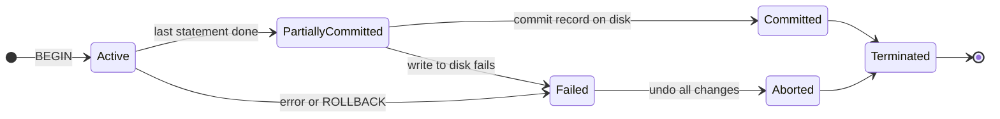
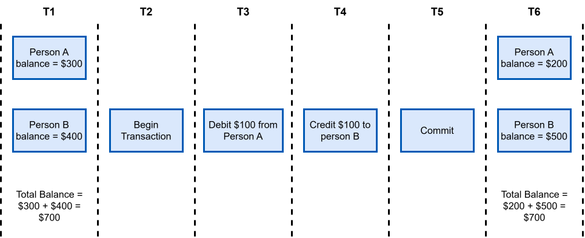
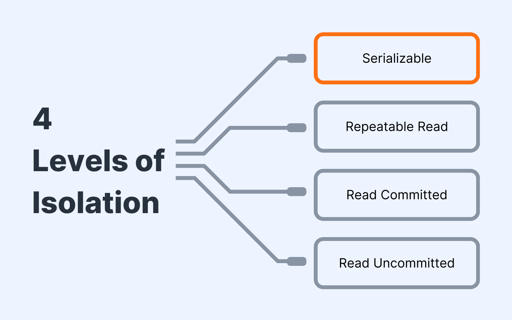
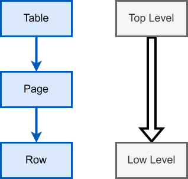
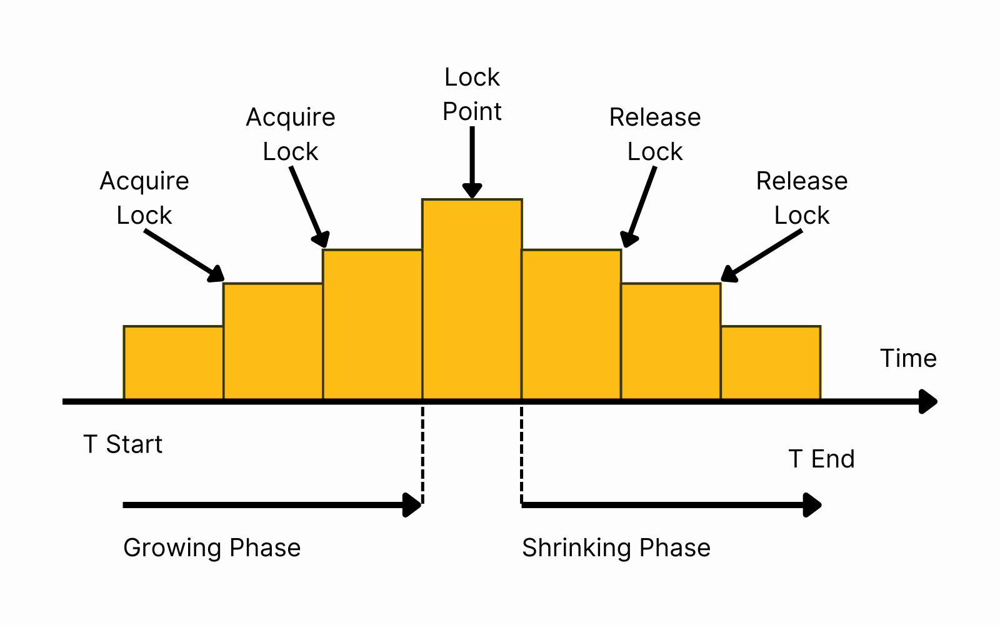
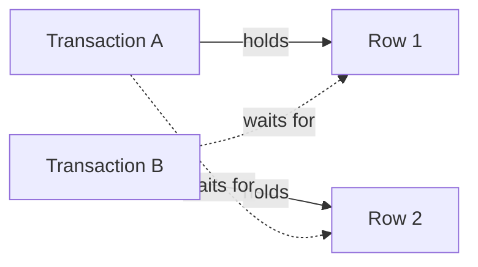
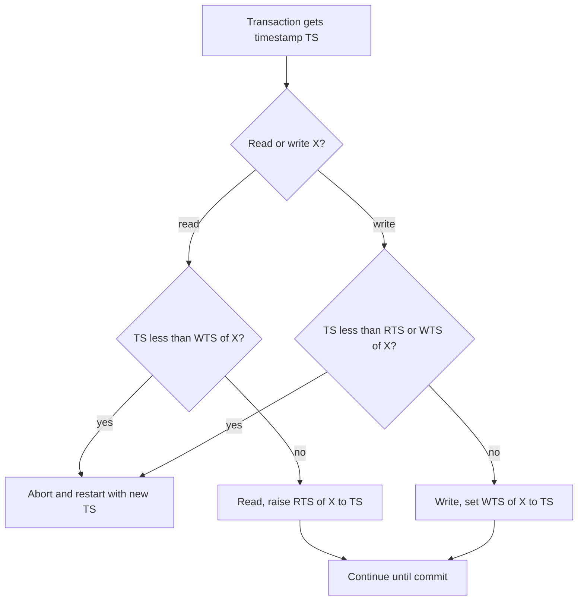

# Chapter 13 — Transactions and Concurrency

A shop's stock table takes hundreds of checkouts per second while reports read it. Two things can go wrong: a failure stops a change **halfway**, or two users working **at the same time** trip over each other. The tools against them are **transactions** and **concurrency control**; this chapter shows how PostgreSQL really behaves with live sessions (separate open connections) running side by side.

**What you'll learn:** transactions, their life cycle and `BEGIN`/`COMMIT`/`ROLLBACK`/`SAVEPOINT` · ACID and how each letter is implemented · every classic anomaly (dirty read/write, non-repeatable read, phantom, lost update, write skew) **reproduced on a real server** with two interleaved sessions · isolation levels in PostgreSQL vs MySQL, SQL Server, Oracle, SQLite · locks and two-phase locking, optimistic validation, timestamp ordering, MVCC (`xmin`/`xmax`) · deadlocks, `FOR UPDATE`, `NOWAIT`, the `SKIP LOCKED` job queue.

**How to run the examples.** Single-session files in [`code/`](code/) run on the book's PostgreSQL 14 server (port 5544):

```bash
bash tools_run_sql.sh sql                                  # runs every chapter's .sql files
bash tools_pg.sh psql -d <db> -f sql/chapters/13-transactions-and-concurrency/code/01_commit_and_rollback.sql
```

Two-session demos are in [`code/concurrency_demo.py`](code/concurrency_demo.py): connections **A** and **B** send statements in a fixed order; a statement expected to block runs in a background thread while a third *monitor* connection checks `pg_stat_activity` (the view of every connection and what it is doing) to prove it is waiting on a lock:

```bash
cd sql/chapters/13-transactions-and-concurrency/code
../../../../.venv-books/bin/python concurrency_demo.py            # all scenarios (~2 s)
../../../../.venv-books/bin/python concurrency_demo.py writeskew  # just one group
```

In the output `A| …` is a statement from session A, `->` the server's answer, `..` a monitor observation; transaction IDs differ per run. Each scenario starts from fresh data ([`00_schema.sql`](code/00_schema.sql)):

```sql
CREATE TABLE accounts (id int PRIMARY KEY, owner text NOT NULL,
                       balance numeric(10,2) NOT NULL CHECK (balance >= 0));
INSERT INTO accounts VALUES (1, 'asha', 500), (2, 'ben', 300), (3, 'chen', 50);

CREATE TABLE products (id int PRIMARY KEY, name text NOT NULL,
                       stock int NOT NULL CHECK (stock >= 0), version int NOT NULL DEFAULT 1);
INSERT INTO products VALUES (1, 'concert ticket', 10, 1), (2, 'poster', 3, 1);

CREATE TABLE on_call (doctor text PRIMARY KEY, shift text NOT NULL, on_duty boolean NOT NULL);
INSERT INTO on_call VALUES ('dr_rao', 'night', true), ('dr_kim', 'night', true), ('dr_lee', 'day', true);

CREATE TABLE jobs (id int PRIMARY KEY, payload text NOT NULL,
                   status text NOT NULL DEFAULT 'queued', claimed_by text);
INSERT INTO jobs (id, payload) SELECT g, 'email #' || g FROM generate_series(1, 6) g;
```

---

## 13.1 What a transaction is

### What it is

A **transaction** is a group of operations treated as **one logical unit of work**: every operation takes effect, or none does. It ends with a **commit** (changes permanent and visible to others) or an **abort**/rollback (every change undone).

Sending ₹100 from Asha to Ben needs two writes; a crash or broken rule **between** them loses 100. A transaction makes the pair all-or-nothing, which also makes **retrying safe**: after an abort nothing is half-applied, so the application simply runs it again.

### ACID in one table

The acronym **ACID** (Härder and Reuter, 1983); each letter gets a section below.

| Letter | Guarantee | Main mechanism |
|---|---|---|
| **A**tomicity | All or nothing — no half-done transfers | Undo information / WAL (write-ahead log, §13.5), shadow copies (§13.2) |
| **C**onsistency | Valid state → valid state (constraints and invariants — rules that must always hold — true after commit) | Constraints + correct application logic |
| **I**solation | Concurrent transactions don't see each other's in-progress work | Locks, MVCC (multi-version concurrency control, §13.14), SSI (serializable snapshot isolation, §13.8) |
| **D**urability | Committed means kept, even after a crash or power loss | WAL flushed to disk, replication (live copies on other servers) |

### Life cycle of a transaction

| State | What is happening |
|---|---|
| **Active** | Statements running; changes not final. |
| **Partially committed** | Last statement done; results not yet safely on permanent storage. |
| **Committed** | Commit record durable; changes permanent. |
| **Failed** | An error (constraint, crash, deadlock §13.11, cancel) stops normal progress. |
| **Aborted** | All changes rolled back. |
| **Terminated** | Finished; locks and snapshot (the frozen view of data it was reading) released. |



After an abort the application **restarts** (temporary problems such as a deadlock) or **gives up** and reports (logical problems such as "insufficient funds").

### How to write one in SQL

| Statement | Effect |
|---|---|
| `BEGIN` (or `START TRANSACTION`) | Start a transaction block. |
| `COMMIT` | Make all changes permanent. |
| `ROLLBACK` | Undo all changes since `BEGIN`. |
| `SAVEPOINT name` | Mark a point inside the transaction. |
| `ROLLBACK TO SAVEPOINT name` | Undo only the work after that mark; the transaction stays open. |
| `RELEASE SAVEPOINT name` | Forget the mark (keep the work). |

**Autocommit.** Without `BEGIN`, PostgreSQL (and by default psql, JDBC — Java's standard database API — and most drivers) wraps **each statement** in its own transaction and commits it. A lone `UPDATE` is already atomic; you need `BEGIN … COMMIT` only when several statements must succeed or fail together. (Python's `psycopg` is the odd one out: it opens a transaction and waits for `conn.commit()`.)

[`code/01_commit_and_rollback.sql`](code/01_commit_and_rollback.sql):

```sql
-- 1) Money transfer that commits: both rows change together.
BEGIN;
UPDATE accounts SET balance = balance - 100 WHERE id = 1;   -- debit asha
UPDATE accounts SET balance = balance + 100 WHERE id = 2;   -- credit ben
COMMIT;
SELECT id, owner, balance, (SELECT sum(balance) FROM accounts) AS bank_total
FROM accounts ORDER BY id;

-- 2) A transfer we change our mind about: ROLLBACK restores the old state.
BEGIN;
UPDATE accounts SET balance = balance - 200 WHERE id = 1;
SELECT 'inside txn' AS moment, balance FROM accounts WHERE id = 1;
ROLLBACK;
SELECT 'after rollback' AS moment, balance FROM accounts WHERE id = 1;

-- 3) Savepoints: undo only part of a transaction.
BEGIN;
UPDATE accounts SET balance = balance + 10 WHERE id = 3;    -- keep this
SAVEPOINT bonus;
UPDATE accounts SET balance = balance + 999 WHERE id = 3;   -- oops
ROLLBACK TO SAVEPOINT bonus;                                -- undo just the oops
COMMIT;
SELECT id, owner, balance FROM accounts WHERE id = 3;
```

Output:

```text
BEGIN
UPDATE 1
UPDATE 1
COMMIT
 id | owner | balance | bank_total 
----+-------+---------+------------
  1 | asha  |  400.00 |     850.00
  2 | ben   |  400.00 |     850.00
  3 | chen  |   50.00 |     850.00
(3 rows)

BEGIN
UPDATE 1
   moment   | balance 
------------+---------
 inside txn |  200.00
(1 row)

ROLLBACK
     moment     | balance 
----------------+---------
 after rollback |  400.00
(1 row)

BEGIN
UPDATE 1
SAVEPOINT
UPDATE 1
ROLLBACK
COMMIT
 id | owner | balance 
----+-------+---------
  3 | chen  |   60.00
(1 row)
```

The bank total stays 850; the session saw its own uncommitted 200, but after `ROLLBACK` the balance is 400 again; only the +10 survived the savepoint.

| | PostgreSQL | MySQL (InnoDB) | SQL Server | SQLite |
|---|---|---|---|---|
| Start | `BEGIN` / `START TRANSACTION` | `START TRANSACTION` / `BEGIN` | `BEGIN TRAN` | `BEGIN [DEFERRED\|IMMEDIATE\|EXCLUSIVE]` |
| DDL (`CREATE TABLE` …) inside a transaction | Transactional (can be rolled back) | Implicit commit (silently commits the open transaction) | Mostly transactional | Transactional |
| After an error mid-transaction | Whole transaction "aborted" until `ROLLBACK` | Only the failing statement undone; transaction continues | Depends on `XACT_ABORT` | Only the failing statement undone |

### Weaker guarantees some systems offer

Many NoSQL and caching systems trade multi-statement transactions for speed or scale:

| Guarantee | What it means | Example |
|---|---|---|
| **Single-object atomicity** | A write to *one* record is all-or-nothing; nothing spans two records | A MongoDB document update; a Cassandra row write |
| **Atomic increment** | Server does read-add-write in one indivisible step, so concurrent `+1`s never lose each other | Redis (in-memory key-value store) `INCR`; SQL `UPDATE … SET n = n + 1` |
| **Compare-and-set (CAS)** | "Write the new value only if the current value is still what I read"; else fail and retry | Redis `WATCH`/`MULTI`, DynamoDB conditional writes, SQL `UPDATE … WHERE version = 7` (§13.7) |

They protect **one** object; keeping several in step (a transfer, an order plus its stock decrement) needs a real transaction — why MongoDB (4.0+) and NewSQL systems (distributed databases keeping SQL and full transactions) added multi-document transactions.

### In the interview

**30-second answer:** "A transaction is a unit of work that fully commits or fully rolls back, with the ACID guarantees. In SQL: `BEGIN … COMMIT/ROLLBACK`, savepoints for partial rollback; without `BEGIN` each statement autocommits."

- *Why not undo step 1 myself on error?* The crash may kill your program too; the database's log handles it even after a power failure.
- *Is a single `UPDATE` atomic?* Yes — autocommit makes it a transaction, and a multi-row `UPDATE` changes all matching rows or none.

**Self-check:** the six states? → active, partially committed, committed, failed, aborted, terminated. `ROLLBACK TO SAVEPOINT s` keeps? → everything before `s`; the transaction stays open.

---

## 13.2 Atomicity

### What it is

**Atomicity**: a transaction is **indivisible** — all changes applied (commit) or none (rollback); no visible half-done state. Transfer 10 from X = 30 to Y = 100: the debit succeeds (X = 20), the credit fails. Without atomicity ten units vanish (X = 20, Y = 100); with it the debit is rolled back too (X = 30, Y = 100).

### How it works — three implementations

**1. Shadow copy** (early systems, some editors):
1. At begin, copy the whole database file — the **shadow**.
2. Make every change in the shadow only.
3. Commit = atomically switch a **db-pointer** (a small file naming the current database file) to the shadow, then delete the old file.
4. Abort = delete the shadow; the pointer never moved.

The pointer switch is the only commit point: a crash after all writes but before the switch (or midway) leaves the untouched original current. Impractical for real databases: copying the **entire** database per transaction is slow and wasteful, and it allows only **one** transaction at a time. (Its descendant *shadow paging* — copy only modified pages — was used in System R and lives on in copy-on-write stores such as LMDB, where changes always go to fresh copies.)

**2. Logging** (PostgreSQL, MySQL, SQL Server, Oracle). Changes go into in-memory pages and are described in the **write-ahead log (WAL)** (§13.5). On abort or crash before commit the engine undoes them from the log — or, in PostgreSQL, simply marks the transaction ID *aborted* so its row versions are ignored (§13.14).

**3. Across machines.** **Two-phase commit (2PC)**: a coordinator asks every participant to *prepare* (make the change durable but not final) and, only if all agree, tells them to *commit* ([chapter 15](../15-scaling-databases/README.md); PostgreSQL's `PREPARE TRANSACTION`). Optimistic concurrency control (§13.9) also applies writes all at once at commit, only if no conflict was found.

### Code: an error aborts the whole transaction

[`code/02_atomicity_on_error.sql`](code/02_atomicity_on_error.sql) — Chen has 50 and tries to send 80. The credit to Asha succeeds, then the debit breaks `CHECK (balance >= 0)` (`\set ON_ERROR_STOP off` lets psql continue after an error):

```sql
\set ON_ERROR_STOP off
BEGIN;
UPDATE accounts SET balance = balance + 80 WHERE id = 1;   -- credit asha: OK
UPDATE accounts SET balance = balance - 80 WHERE id = 3;   -- debit chen: violates CHECK
SELECT balance FROM accounts WHERE id = 1;                  -- refused: txn is aborted
COMMIT;                                                     -- turns into ROLLBACK
SELECT id, owner, balance FROM accounts ORDER BY id;        -- nothing changed

BEGIN;
UPDATE accounts SET balance = balance + 5 WHERE id = 2;
SAVEPOINT before_risky;
INSERT INTO accounts VALUES (1, 'dup', 1);                  -- duplicate primary key
ROLLBACK TO SAVEPOINT before_risky;
COMMIT;
SELECT id, owner, balance FROM accounts WHERE id = 2;
```

Output (psql file path shortened):

```text
BEGIN
UPDATE 1
psql:02_atomicity_on_error.sql:10: ERROR:  new row for relation "accounts" violates check constraint "accounts_balance_check"
psql:02_atomicity_on_error.sql:11: ERROR:  current transaction is aborted, commands ignored until end of transaction block
ROLLBACK
 id | owner | balance 
----+-------+---------
  1 | asha  |  500.00
  2 | ben   |  300.00
  3 | chen  |   50.00
(3 rows)

BEGIN
UPDATE 1
SAVEPOINT
psql:02_atomicity_on_error.sql:19: ERROR:  duplicate key value violates unique constraint "accounts_pkey"
ROLLBACK
COMMIT
 id | owner | balance 
----+-------+---------
  2 | ben   |  305.00
(1 row)
```

After an error PostgreSQL marks the transaction **aborted** and refuses further commands; `COMMIT` is answered with `ROLLBACK`, undoing Asha's +80 too. Rolling back to a savepoint clears the error and keeps Ben's +5.

### Common mistakes

- The two halves of a transfer as two autocommitted statements.
- Catching the error in code and carrying on to `COMMIT` — PostgreSQL silently rolls back; MySQL may commit the half that worked.
- Expecting rollback to undo an email sent or card charged — it undoes only **database** changes; write the action to an *outbox* table (pending messages, written in the same transaction, sent by a separate process after commit).

### In the interview

**30-second answer:** "All-or-nothing. Shadow copy (work on a copy, flip a pointer at commit) explains the idea but copies too much and serialises everything; real engines log changes and roll back from the log; across databases you need two-phase commit."

- *Does atomicity say anything about concurrency?* No — ACID's "atomic" is about failures; other users are isolation's job (unlike "atomic" in multithreaded code).

**Self-check:** PostgreSQL's answer to `COMMIT` in an aborted transaction? → `ROLLBACK`.

---

## 13.3 Consistency

### What it is

**Consistency** (ACID's C): every committed transaction leaves the database **valid if it started valid**. "Valid" means the rules hold — primary/unique/foreign keys, `CHECK`, `NOT NULL`, and business **invariants** such as "a transfer neither creates nor destroys money". A rule-breaking transaction must fail and leave the previous state; rules may be briefly false only *inside* a transaction.

Asha 300 + Ben 400 = **700**; transfer 100:

| Moment | Step | Asha | Ben | Total | Valid? |
|---|---|---|---|---|---|
| t1 | initial state / `BEGIN` | 300 | 400 | 700 | yes |
| t2 | debit Asha 100 | 200 | 400 | **600** | no (intermediate) |
| t3 | credit Ben 100 | 200 | 500 | 700 | yes |
| t4 | `COMMIT` / final state | 200 | 500 | 700 | yes |



The temporary 600 is harmless: nobody else can see it (isolation) and it can never be final (atomicity).

### How it is achieved — and how it breaks

1. **Declarative constraints**: `PRIMARY KEY`, `UNIQUE`, `FOREIGN KEY`, `CHECK (balance >= 0)`, `NOT NULL` ([chapter 9](../09-ddl-dml-and-constraints/README.md)); §13.2's `CHECK` rejected an overdraft.
2. **Pre-transaction checks**, best inside the statement: `UPDATE … SET balance = balance - 100 WHERE id = 1 AND balance >= 100`.
3. **Post-transaction verification**: deferred constraints (`DEFERRABLE INITIALLY DEFERRED` checks a foreign key only at commit) or audits (the ledger still sums to the same total).
4. **Atomicity** and **isolation** stop failures and concurrency from leaving a broken state.

| Cause | Example | Who stops it |
|---|---|---|
| Constraint violation | Duplicate primary key | The database rejects the statement |
| Crash mid-transaction | Crash after debit, before credit | Atomicity + recovery |
| Logic bug | Code transfers more than the balance | Only a `CHECK` or correct code |
| Concurrency without enough isolation | Two withdrawals both see enough money | Isolation level / locking (§13.4–13.8) |

**Trade-offs:** The database enforces only rules it knows. Cross-row invariants ("at least one doctor on call") can't be a simple `CHECK`; the application enforces them with strong enough isolation (§13.8) — hence Martin Kleppmann (DDIA, *Designing Data-Intensive Applications*) calls C an *application* property, with A, I and D as the database's tools. **ACID consistency is not CAP consistency:** in CAP (the distributed-systems trade-off theorem, [chapter 15](../15-scaling-databases/README.md#157-the-cap-theorem-and-pacelc)) "consistency" means *linearizability* — every read sees the latest write across replicas.

### In the interview

**30-second answer:** "Every committed state obeys the rules — keys, checks, business invariants. The database enforces declared constraints, the application the rest; atomicity and isolation keep failures and concurrency from breaking them."

- *An invariant a CHECK can't express?* "At least one doctor on call per shift" — spans rows; needs SERIALIZABLE or explicit locking.

**Self-check:** a temporarily wrong total inside a transaction is a violation? → No, only committed states must be valid. Why can concurrency break consistency? → Two transactions each valid alone can together break an invariant under weak isolation.

---

## 13.4 Isolation — anomalies and isolation levels

### What it is

**Isolation** controls what one running transaction can see of another's in-progress work. Ideally each behaves **as if alone**, but true one-at-a-time execution is too slow, so databases offer **isolation levels**: weaker levels allow more overlap but permit **anomalies** (wrong results caused by interleaving); stronger ones forbid more at the cost of blocking or aborts.

### The anomalies

T1 and T2 are concurrent; the account starts at 500.

**1. Dirty read** — reading another transaction's **uncommitted** write.

| Time | T1 | T2 |
|---|---|---|
| 1 | `BEGIN`; balance = 500 − 100 → **400** (uncommitted) | |
| 2 | | reads balance → **400** |
| 3 | `ROLLBACK` → balance is 500 again | |
| 4 | | has acted on 400, a value that never officially existed |

**2. Dirty write** — overwriting another transaction's **uncommitted** write. T1 adds 100 (→ 600, uncommitted); T2 adds 100 (→ 700); T1 aborts. Restoring 500 erases T2's deposit, keeping 700 keeps T1's cancelled one; the correct 600 can't be reconstructed. Practically every database at every level prevents it by making the second writer **wait**.

**3. Non-repeatable read (read skew)** — the same row read twice gives **different committed values** (T1 reads 500; T2 sets 400 and commits; T1 reads 400 — live in §13.6). "Read skew" broadly means seeing *different moments in time* in one transaction — e.g. account 1 before a transfer and account 2 after it, so the total looks wrong (§13.6).

**4. Phantom read** — the same **query** returns a **different set of rows** because another transaction inserted or deleted matching rows (a count of 2 becomes 3 — §13.6).

**5. Lost update** — two read-compute-write cycles; the second write silently overwrites the first (both read stock 10 and write 9: two sold, stock fell by one — §13.7).

**6. Write skew** — two transactions read the **same rows**, decide, and each writes **a different row**; neither overwrote the other, yet together they break a rule both checked (two on-call doctors each see "2 on call", both go off duty, §13.8). A lost update is the special case where both write the *same* row.

### The isolation levels



The SQL standard defines four levels by which read anomalies they must prevent:

| Level | Dirty read | Non-repeatable read | Phantom |
|---|---|---|---|
| Read Uncommitted | possible | possible | possible |
| Read Committed | prevented | possible | possible |
| Repeatable Read | prevented | prevented | possible |
| Serializable | prevented | prevented | prevented |

That is a *minimum*; the standard ignores lost updates and write skew. What **PostgreSQL** actually provides (verified in §13.6–13.8):

| Level in PostgreSQL | Dirty read | Dirty write | Non-repeatable / read skew | Phantom | Lost update | Write skew | How it's done |
|---|---|---|---|---|---|---|---|
| Read Uncommitted | **no** (treated as Read Committed) | no | yes | yes | yes | yes | new snapshot per statement |
| **Read Committed** (default) | no | no | yes | yes | yes (read-then-write in app) | yes | new snapshot per statement + row locks for writes |
| Repeatable Read | no | no | no | **no** (stronger than the standard) | no — aborts with a serialization error | **yes** | one snapshot per transaction (snapshot isolation) |
| Serializable | no | no | no | no | no | no — aborts one | snapshot isolation + SSI conflict tracking |

At **Read Committed**, MVCC engines give readers the last committed version so they never wait, while lock-based engines (SQL Server unless `READ_COMMITTED_SNAPSHOT` is on) make readers wait for the writer. **Serializable** (outcome equals *some* one-at-a-time order) is built with **two-phase locking** (take locks as you go, release none until the end, §13.10; MySQL, SQL Server) or **Serializable Snapshot Isolation (SSI)**, which tracks read/write dependencies and aborts a transaction when needed (PostgreSQL 9.1+) — so be ready to retry. Read Uncommitted (SQL Server's `NOLOCK` hint) is almost never used.

| Engine | Default level | Notes |
|---|---|---|
| PostgreSQL | Read Committed | RR = snapshot isolation (no phantoms); Serializable = SSI. |
| MySQL InnoDB | Repeatable Read | Plain `SELECT` reads a snapshot; locking reads (`FOR UPDATE`, `UPDATE`) read the *latest* row with next-key locks (index entries plus the gaps between them, §13.10) against phantoms. Does **not** abort lost updates at RR — use `FOR UPDATE` or atomic updates. |
| SQL Server | Read Committed (locking) | Optional `READ_COMMITTED_SNAPSHOT` and `SNAPSHOT` isolation keep row versions in tempdb (its shared scratch database). |
| Oracle | Read Committed | Its "SERIALIZABLE" is snapshot isolation (write skew possible). |
| SQLite | Serializable | One writer at a time for the whole file; WAL mode lets readers run during a write. |

### How to choose and set a level

```sql
BEGIN ISOLATION LEVEL REPEATABLE READ;                     -- for one transaction
SET TRANSACTION ISOLATION LEVEL SERIALIZABLE;              -- first statement inside BEGIN
SET default_transaction_isolation = 'serializable';        -- for the session
SHOW transaction_isolation;
```

| If you need… | Use |
|---|---|
| Normal OLTP, single-statement updates (`SET x = x + 1`) | Read Committed |
| A consistent report or export across many queries | Repeatable Read (often `READ ONLY`) |
| Read-then-write logic on the same row | `SELECT … FOR UPDATE` at Read Committed, or Repeatable Read + retry |
| Invariants that span rows (no double booking, at least one on call) | Serializable + retry, or explicit locks |

### In the interview

**30-second answer:** "Isolation levels trade correctness for concurrency; the standard defines four by which of dirty reads, non-repeatable reads and phantoms they allow. Postgres never allows dirty reads, its Repeatable Read is snapshot isolation (no phantoms or lost updates, but write skew), and Serializable uses SSI to abort one transaction of a write skew."

- *Non-repeatable read vs phantom?* Non-repeatable: the *same row* changed value. Phantom: the *set of rows* matching a condition changed (insert/delete).
- *Why isn't everyone on Serializable?* More aborts (or blocking with 2PL) and mandatory retries; most workloads are fine at Read Committed with a few targeted locks.

**Self-check:** default level in PostgreSQL? MySQL? → Read Committed; Repeatable Read.

---

## 13.5 Durability

### What it is

**Durability**: once the database says "committed", the change **stays** — even if power fails a millisecond later. People act on "committed" (ship the order), so recovery must restore every committed transaction and nothing uncommitted.

### How it works

1. **Write-ahead logging (WAL).** A record describing each change must reach the log before the changed data page may be written. At `COMMIT` the database appends a commit record and **flushes** the log (`fsync` — the OS call forcing data out of caches onto the physical disk); only then does it answer "COMMIT". Data pages are written later; after a crash recovery **replays** the log, redoing committed changes that never reached the data files. (One sequential append is much cheaper than updating scattered pages, and the log record alone suffices to redo the change.)
2. **Checkpoints.** Periodically all dirty pages (changed in memory, not yet in the data files) are written and "everything up to log position X is on disk" is recorded, so recovery replays only the log after the latest checkpoint (PostgreSQL: `checkpoint_timeout`, default 5 min, and `max_wal_size`).
3. **Synchronous disk writes.** A commit is acknowledged only once the log is on stable storage, not just in RAM or the OS cache: `synchronous_commit = on` and `fsync = on` (both defaults); `full_page_writes` protects against *torn pages* (a page only partly written at power loss).
4. **Replication.** Disks die, so the WAL is shipped to other machines (streaming replication: WAL records sent continuously); with *synchronous* replication a commit also waits for a replica ([chapter 15](../15-scaling-databases/README.md)).

### Code: watching the WAL grow

[`code/05_durability_wal.sql`](code/05_durability_wal.sql) inserts 1,000 rows and measures how far the WAL position (**LSN**, log sequence number) moved:

```sql
SELECT name, setting FROM pg_settings
WHERE name IN ('fsync', 'synchronous_commit', 'wal_level', 'full_page_writes', 'checkpoint_timeout')
ORDER BY name;

CREATE TEMP TABLE lsn_marks (label text, lsn pg_lsn);
INSERT INTO lsn_marks VALUES ('before', pg_current_wal_lsn());
INSERT INTO accounts SELECT g, 'user' || g, 100 FROM generate_series(10, 1009) g;   -- 1,000 rows
INSERT INTO lsn_marks VALUES ('after', pg_current_wal_lsn());

SELECT pg_size_pretty(pg_wal_lsn_diff(
         (SELECT lsn FROM lsn_marks WHERE label = 'after'),
         (SELECT lsn FROM lsn_marks WHERE label = 'before'))) AS wal_written_for_1000_rows;

BEGIN;
SET LOCAL synchronous_commit = off;     -- faster commit; a crash may lose this txn, never corrupts
UPDATE accounts SET balance = balance + 1 WHERE id = 10;
COMMIT;
```

Output:

```text
        name        | setting 
--------------------+---------
 checkpoint_timeout | 300
 fsync              | on
 full_page_writes   | on
 synchronous_commit | on
 wal_level          | replica
(5 rows)
...
 wal_written_for_1000_rows 
---------------------------
 135 kB
(1 row)
...
```

About 135 kB of WAL for 1,000 rows (varies slightly by version and settings). The `synchronous_commit = off` transaction returns before its WAL is flushed: a crash within about three times `wal_writer_delay` could lose that one commit but never corrupt the database — fine for click logging, never for payments.

**Common mistakes:** turning off `fsync` in production (a crash can **corrupt** the database, not just lose commits); assuming an *asynchronous* replica makes a commit durable (the primary — the server accepting writes — can die before shipping it); disks or cloud volumes that lie about flushes (a drive write cache without battery backup).

### In the interview

**30-second answer:** "Committed data survives crashes: the WAL record is fsynced before the commit is acknowledged, data pages are written later, and restart replays the log from the last checkpoint. Replication protects against losing the machine."

- *Why not write the data pages at commit?* Scattered page writes cost far more than one sequential log append, and the log record alone can redo the change.

**Self-check:** what must be on disk before `COMMIT` returns? → The transaction's WAL including the commit record. Does asynchronous replication make the latest commit more durable? → No; only synchronous replication does.

---

## 13.6 Watching isolation anomalies on a real server

The §13.4 anomalies on PostgreSQL 14 with two live sessions, via [`code/concurrency_demo.py`](code/concurrency_demo.py). Its core: a `Session` class opens an autocommit connection (the script sends `BEGIN`/`COMMIT` itself) with `run(sql)` to send and print, and `start(sql)` to run a statement expected to **block** in a thread; a `Monitor` polls `pg_stat_activity` (`wait_event_type, wait_event, pg_blocking_pids(pid)`) until that session shows `wait_event_type = 'Lock'`. Results print as rows, a command tag (`UPDATE 1`), or `ERROR <sqlstate>: <message>` (SQLSTATE = the standard five-character error code, e.g. `40001`); process IDs in deadlock messages are replaced by `<A>`/`<B>`.

### Dirty read and dirty write — impossible in PostgreSQL

A sets Asha's balance to 0 without committing; B even asks for `READ UNCOMMITTED`:

```text
=== Dirty read and dirty write: impossible in PostgreSQL ===
  A| BEGIN  -> BEGIN
  A| UPDATE accounts SET balance = 0 WHERE id = 1  -> UPDATE 1
  B| BEGIN ISOLATION LEVEL READ UNCOMMITTED  -> BEGIN
  B| SHOW transaction_isolation  -> read uncommitted
  B| SELECT balance FROM accounts WHERE id = 1  -> 500.00
  B| UPDATE accounts SET balance = balance + 1 WHERE id = 1
     .. B is WAITING (wait_event=transactionid, blocked by A)
  A| ROLLBACK  -> ROLLBACK
     -> (B resumes) UPDATE 1
  B| COMMIT  -> COMMIT
  M| SELECT balance FROM accounts WHERE id = 1  -> 501.00
```

- **No dirty read:** at `read uncommitted` B still reads the committed **500** — PostgreSQL implements Read Uncommitted as Read Committed — and without blocking (MVCC hands it the older version).
- **No dirty write:** B's `UPDATE` **waits** (`transactionid`: for A's transaction to end); after A's rollback it turns the committed 500 into 501.

### Non-repeatable read / read skew: Read Committed vs Repeatable Read

A reads Asha's balance; B transfers 100 from account 1 to 2 and commits; A reads both:

```text
=== Non-repeatable read / read skew: READ COMMITTED ===
  A| BEGIN ISOLATION LEVEL READ COMMITTED  -> BEGIN
  A| SELECT balance FROM accounts WHERE id = 1  -> 500.00
  B| BEGIN  -> BEGIN
  B| UPDATE accounts SET balance = balance - 100 WHERE id = 1  -> UPDATE 1
  B| UPDATE accounts SET balance = balance + 100 WHERE id = 2  -> UPDATE 1
  B| COMMIT  -> COMMIT
  A| SELECT balance FROM accounts WHERE id = 1  -> 400.00
  A| SELECT balance FROM accounts WHERE id = 2  -> 400.00
  A| COMMIT  -> COMMIT
```

The same row gave **500 then 400** — non-repeatable. An auditor adding its first read of account 1 (500) to account 2 (400) reports **900**, though the true total was 800 at every instant: **read skew**.

```text
=== Non-repeatable read / read skew: REPEATABLE READ ===
  A| BEGIN ISOLATION LEVEL REPEATABLE READ  -> BEGIN
  A| SELECT balance FROM accounts WHERE id = 1  -> 500.00
  ... (B runs the same transfer as above and commits)
  A| SELECT balance FROM accounts WHERE id = 1  -> 500.00
  A| SELECT balance FROM accounts WHERE id = 2  -> 300.00
  A| COMMIT  -> COMMIT
```

At Repeatable Read A sees the world as of its **first statement** (not `BEGIN`): 500 + 300 = 800 — consistent, slightly old.

### Phantom read: Read Committed vs Repeatable Read

```text
=== Phantom read: READ COMMITTED ===
  A| BEGIN ISOLATION LEVEL READ COMMITTED  -> BEGIN
  A| SELECT count(*) FROM accounts WHERE balance >= 100  -> 2
  B| INSERT INTO accounts VALUES (4, 'dina', 900)  -> INSERT 0 1
  A| SELECT count(*) FROM accounts WHERE balance >= 100  -> 3
  A| COMMIT  -> COMMIT

=== Phantom read: REPEATABLE READ (PostgreSQL prevents it) ===
  A| BEGIN ISOLATION LEVEL REPEATABLE READ  -> BEGIN
  A| SELECT count(*) FROM accounts WHERE balance >= 100  -> 2
  B| INSERT INTO accounts VALUES (4, 'dina', 900)  -> INSERT 0 1
  A| SELECT count(*) FROM accounts WHERE balance >= 100  -> 2
  A| COMMIT  -> COMMIT
```

Read Committed shows a phantom (2 → 3); at Repeatable Read the snapshot simply lacks Dina's row, though the standard would allow a phantom.

**Common mistakes:** believing Repeatable Read shows "the latest data" (a long RR transaction sees an increasingly stale world and holds back cleanup, §13.14); running a multi-query report at Read Committed and getting totals that never existed — use `BEGIN ISOLATION LEVEL REPEATABLE READ READ ONLY`.

---

## 13.7 Lost updates and how to prevent them

A **lost update** comes from *read–modify–write*: the application reads a value, computes a new one in its own code, and writes it back; overlapping copies wipe each other out. It is the most common concurrency bug in web apps (stock counters, likes, wallet balances, wiki edits). Two buyers, each app instance subtracting one in Python/Java:

```text
=== Lost update 1: read-modify-write in the application (READ COMMITTED) ===
  A| BEGIN  -> BEGIN
  A| SELECT stock FROM products WHERE id = 1  -> 10
  B| BEGIN  -> BEGIN
  B| SELECT stock FROM products WHERE id = 1  -> 10
  A| UPDATE products SET stock = 9 WHERE id = 1  -> UPDATE 1
  A| COMMIT  -> COMMIT
  B| UPDATE products SET stock = 9 WHERE id = 1  -> UPDATE 1
  B| COMMIT  -> COMMIT
  M| SELECT stock FROM products WHERE id = 1  -> 9
```

Two tickets sold, stock **9**, no error. Four standard fixes make read and write one protected step.

### Fix 1 — let the database do the arithmetic (atomic update)

```text
=== Lost update fix 1: atomic UPDATE ... SET stock = stock - 1 ===
  A| BEGIN  -> BEGIN
  A| UPDATE products SET stock = stock - 1 WHERE id = 1 RETURNING stock  -> 9
  B| BEGIN  -> BEGIN
  B| UPDATE products SET stock = stock - 1 WHERE id = 1 RETURNING stock
     .. B is WAITING (wait_event=transactionid, blocked by A)
     .. pg_locks for B: (transactionid, ExclusiveLock, True), (tuple, ExclusiveLock, True), (transactionid, ShareLock, False)
  A| COMMIT  -> COMMIT
     -> (B resumes) 8
  B| COMMIT  -> COMMIT
  M| SELECT stock FROM products WHERE id = 1  -> 8
```

B waits for A's row lock; when A commits, PostgreSQL (at Read Committed) **re-reads the newest row version** and applies `stock - 1`: 9 → 8. `pg_locks` (the view of held and awaited locks) shows the mechanism: B holds its own transaction-ID lock and a *tuple* lock (first in line for the row) and waits (`granted = False`) for a `ShareLock` on **A's transaction ID** — "wake me when A ends". The row lock itself lives in the row (its `xmax`), not a lock table, so locking a million rows needs no million lock entries. *Use when* the new value is computable in SQL (`n = n + 1`, `balance = balance - 100 WHERE balance >= 100`) — simplest and fastest.

### Fix 2 — pessimistic lock: `SELECT … FOR UPDATE`

When the new value needs application logic, lock the row while reading it:

```text
=== Lost update fix 2: pessimistic SELECT ... FOR UPDATE ===
  A| BEGIN  -> BEGIN
  A| SELECT stock FROM products WHERE id = 1 FOR UPDATE  -> 10
  B| BEGIN  -> BEGIN
  B| SELECT stock FROM products WHERE id = 1 FOR UPDATE
     .. B is WAITING (wait_event=transactionid, blocked by A)
  A| UPDATE products SET stock = 9 WHERE id = 1  -> UPDATE 1
  A| COMMIT  -> COMMIT
     -> (B resumes) 9
  B| UPDATE products SET stock = 8 WHERE id = 1  -> UPDATE 1
  B| COMMIT  -> COMMIT
  M| SELECT stock FROM products WHERE id = 1  -> 8
```

B's read waits, then returns **9**, so B computes 8. The lock lasts to the end of the transaction — keep it short and never wait for a human while holding one.

### Fix 3 — Repeatable Read detects it (optimistic, by the database)

```text
=== Lost update fix 3: REPEATABLE READ detects the conflict ===
  A| BEGIN ISOLATION LEVEL REPEATABLE READ  -> BEGIN
  A| SELECT stock FROM products WHERE id = 1  -> 10
  B| BEGIN ISOLATION LEVEL REPEATABLE READ  -> BEGIN
  B| SELECT stock FROM products WHERE id = 1  -> 10
  A| UPDATE products SET stock = 9 WHERE id = 1  -> UPDATE 1
  A| COMMIT  -> COMMIT
  B| UPDATE products SET stock = 9 WHERE id = 1  -> ERROR 40001: could not serialize access due to concurrent update
  B| ROLLBACK  -> ROLLBACK
  (B retries the whole transaction)
  ... (B re-reads 9, writes 8, commits)
  M| SELECT stock FROM products WHERE id = 1  -> 8
```

B's snapshot says 10 but the row was changed by a transaction committed after it, so PostgreSQL refuses with **40001** (`serialization_failure`); the application **retries the whole transaction**. (MySQL InnoDB at Repeatable Read raises no such error — its `UPDATE` reads the latest version — so use Fix 1 or 2 there.)

### Fix 4 — optimistic locking with a version column (compare-and-set)

CAS holds no lock, so it suits long gaps between read and write (a user editing a form for minutes, several HTTP requests each in its own transaction). Add a `version` column to the `WHERE`:

```text
=== Lost update fix 4: optimistic locking with a version column (compare-and-set) ===
  A| SELECT stock, version FROM products WHERE id = 1  -> (10, 1)
  B| SELECT stock, version FROM products WHERE id = 1  -> (10, 1)
  A| UPDATE products SET stock = 9, version = version + 1 WHERE id = 1 AND version = 1  -> UPDATE 1
  B| UPDATE products SET stock = 9, version = version + 1 WHERE id = 1 AND version = 1  -> UPDATE 0
  (B sees UPDATE 0 -> someone changed the row; re-read and retry)
  B| SELECT stock, version FROM products WHERE id = 1  -> (9, 2)
  B| UPDATE products SET stock = 8, version = version + 1 WHERE id = 1 AND version = 2  -> UPDATE 1
  M| SELECT stock, version FROM products WHERE id = 1  -> (8, 3)
```

`UPDATE 0` is the conflict signal ("someone else won — reload and retry, or tell the user the record changed"); the check and write are one atomic step. JPA/Hibernate `@Version`, Rails `lock_version`, DynamoDB conditional writes and Redis `WATCH`/`MULTI`/`EXEC` are the same idea: no locks (so no deadlocks), great when conflicts are rare, wasteful retries when frequent.

| Fix | Blocking? | Retry needed? | Best for |
|---|---|---|---|
| Atomic `UPDATE … SET x = x - 1` | Briefly (row lock) | No | Counters, balances — anything expressible in SQL |
| `SELECT … FOR UPDATE` | Yes, until commit | No | Complex logic between read and write, short transactions |
| Repeatable Read / Serializable | No (aborts instead) | Yes (40001) | Code that already has a retry loop |
| Version column (CAS) | No | Yes (0 rows) | Long "think time", web forms, APIs, distributed caches |

### In the interview

**30-second answer:** "Two read-modify-write cycles interleave and one write overwrites the other. Fixes: atomic SQL arithmetic; SELECT FOR UPDATE; Repeatable Read, where Postgres aborts the second writer (40001); or a version column where zero updated rows means retry."

- *A "like" counter?* Atomic `UPDATE posts SET likes = likes + 1` (or a likes table and count).
- *A user editing a product page for minutes?* Version column — never hold a DB lock across think time.
- *Does Read Committed prevent lost updates?* Only if the write is one atomic statement; not for app-side read-modify-write.

---

## 13.8 Write skew and Serializable isolation

Hospital rule: **at least one doctor on call for the night shift**. Dr Rao and Dr Kim each click "go off duty"; the app checks "is anyone else on call?" and, if so, updates *its own row*. Different rows, no row-lock conflict — yet the rule can break.

### Repeatable Read (snapshot isolation) allows it

```text
=== Write skew: REPEATABLE READ lets both doctors go off duty ===
  A| BEGIN ISOLATION LEVEL REPEATABLE READ  -> BEGIN
  B| BEGIN ISOLATION LEVEL REPEATABLE READ  -> BEGIN
  A| SELECT count(*) FROM on_call WHERE shift = 'night' AND on_duty  -> 2
  B| SELECT count(*) FROM on_call WHERE shift = 'night' AND on_duty  -> 2
  A| UPDATE on_call SET on_duty = false WHERE doctor = 'dr_rao'  -> UPDATE 1
  B| UPDATE on_call SET on_duty = false WHERE doctor = 'dr_kim'  -> UPDATE 1
  A| COMMIT  -> COMMIT
  B| COMMIT  -> COMMIT
  M| SELECT count(*) FROM on_call WHERE shift = 'night' AND on_duty  -> 0
```

**Nobody** is on call. Each was correct against its snapshot; run serially, the second would have seen 1 and refused. Same shape: double-booking a room, claiming a username checked by `SELECT` first, overspending a shared budget.

### Serializable (SSI) aborts one

```text
=== Write skew: SERIALIZABLE aborts one of them ===
  A| BEGIN ISOLATION LEVEL SERIALIZABLE  -> BEGIN
  B| BEGIN ISOLATION LEVEL SERIALIZABLE  -> BEGIN
  A| SELECT count(*) FROM on_call WHERE shift = 'night' AND on_duty  -> 2
  B| SELECT count(*) FROM on_call WHERE shift = 'night' AND on_duty  -> 2
  A| UPDATE on_call SET on_duty = false WHERE doctor = 'dr_rao'  -> UPDATE 1
  B| UPDATE on_call SET on_duty = false WHERE doctor = 'dr_kim'  -> UPDATE 1
  A| COMMIT  -> COMMIT
  B| COMMIT  -> ERROR 40001: could not serialize access due to read/write dependencies among transactions
     DETAIL: Reason code: Canceled on identification as a pivot, during commit attempt.
  M| SELECT count(*) FROM on_call WHERE shift = 'night' AND on_duty  -> 1
```

How **SSI** caught it:

1. Serializable transactions still read snapshots (readers and writers don't block).
2. Each records what it **read** as *SIREAD* "locks" — non-blocking notes such as "B read the night-shift rows".
3. Writing something a concurrent transaction read records a **read-write dependency** (rw-conflict): "A wrote what B read", "B wrote what A read".
4. Such a cycle means no serial order could produce the result; on the dangerous pattern (a "pivot" with a conflict in and out) PostgreSQL aborts one with **40001**. The retried B sees 1 doctor and refuses.

The error can come at any statement, including `COMMIT`, so **every Serializable transaction needs a retry loop**:

```python
for attempt in range(5):
    try:
        with conn.transaction():                       # BEGIN ... COMMIT
            conn.execute("SET TRANSACTION ISOLATION LEVEL SERIALIZABLE")
            go_off_duty(conn, doctor)
        break
    except psycopg.errors.SerializationFailure:        # SQLSTATE 40001
        continue                                       # rerun the whole transaction
```

SSI can also abort harmless transactions (false positives): its bookkeeping is approximate and coarsens from rows to pages or tables when a transaction reads a lot. Keep Serializable transactions short; mark read-only ones `READ ONLY`.

### Fix without Serializable: lock what you based the decision on

Both at the default Read Committed:

```text
=== Write skew fix without SERIALIZABLE: lock the rows you base the decision on ===
  A| BEGIN  -> BEGIN
  B| BEGIN  -> BEGIN
  A| SELECT doctor FROM on_call WHERE shift = 'night' AND on_duty FOR UPDATE  -> (dr_rao), (dr_kim)
  B| SELECT doctor FROM on_call WHERE shift = 'night' AND on_duty FOR UPDATE
     .. B is WAITING (wait_event=transactionid, blocked by A)
  A| UPDATE on_call SET on_duty = false WHERE doctor = 'dr_rao'  -> UPDATE 1
  A| COMMIT  -> COMMIT
     -> (B resumes) dr_kim
  (B's app sees only one doctor left, so it refuses to go off duty)
  B| ROLLBACK  -> ROLLBACK
  M| SELECT count(*) FROM on_call WHERE shift = 'night' AND on_duty  -> 1
```

After waiting, B's `FOR UPDATE` re-checks the rows and returns only Dr Kim. **Limitation:** `FOR UPDATE` locks only rows that **exist**; for a rule about *absent* rows ("no booking overlaps 10:00–11:00") there is nothing to lock. Then use Serializable; a constraint — `UNIQUE`, or an exclusion constraint forbidding two conflicting rows, `EXCLUDE USING gist (room WITH =, during WITH &&)` (needs `btree_gist` for `=`); or *materialize the conflict* by pre-creating lockable rows (one per room per time slot).

### In the interview

**30-second answer:** "Two transactions read the same data, decide on it, and write different rows — no write conflict, but an invariant breaks. Snapshot isolation allows it. Fixes: Serializable (SSI aborts one with 40001 — retry), FOR UPDATE on the rows the decision depends on, or a unique/exclusion constraint."

- *Why doesn't FOR UPDATE fix double-booking of an empty slot?* The conflicting row doesn't exist yet (a phantom); use a constraint, Serializable, or materialized slot rows.

**Self-check:** why no conflict at Repeatable Read? → They updated different rows. SIREAD locks? → Non-blocking records of what a Serializable transaction read, used to find rw-dependencies.

---

## 13.9 Concurrency control — the big picture

### What it is

**Concurrency control** decides how overlapping transactions may interleave so results stay correct (no §13.4 anomalies, each transaction isolated as its level promises) with as much parallelism as possible. The formal goal is **serializability**: a concurrent execution (a *schedule*) is correct if its effect equals *some* serial order. Two operations **conflict** if they are in different transactions, touch the same item, and at least one writes; a schedule is *conflict-serializable* if its conflict graph (arrow T1 → T2 when an operation of T1 conflicts with and precedes one of T2) has no cycle.

| Technique | Core idea | Waits or aborts? | Used by |
|---|---|---|---|
| **Pessimistic / lock-based** (e.g. 2PL) | Lock before you touch; others wait | Waits (deadlocks possible) | SQL Server, MySQL locking reads, DB2; `FOR UPDATE` everywhere |
| **Optimistic (OCC)** | Work freely, validate at commit, abort on conflict | Aborts | App-level version columns, some in-memory and distributed DBs |
| **Timestamp ordering** | Operations must respect transaction timestamp order | Aborts | Mostly textbook; ideas used in distributed DBs |
| **MVCC** | Several versions; readers read an old version, never block writers | Readers never wait; writers wait for writers | PostgreSQL, Oracle, MySQL InnoDB, SQL Server snapshot modes |

They combine in practice: PostgreSQL = MVCC for reads + row locks for writes + SSI (optimistic validation) for Serializable.

### Optimistic vs pessimistic

**Optimistic concurrency control (OCC)** assumes conflicts are rare: (1) **read/execute** in a private workspace without locks; (2) **validate** at commit — did a transaction that committed meanwhile change anything it read? (3) **write**, or **abort and retry** (the version-column pattern, §13.7 Fix 4). **Pessimistic (PCC)** assumes conflicts are likely: **lock** on first access, make conflicting transactions **wait**, **release** at commit or rollback (§13.7 Fix 2).

| Aspect | Optimistic (OCC) | Pessimistic (PCC) |
|---|---|---|
| Assumes | Conflicts are rare | Conflicts are common |
| Locks | None during execution | Taken on access, held to the end |
| Cost of a conflict | Abort and redo the work | Waiting |
| Overhead with no conflicts | Very low | Lock management on every access |
| Deadlocks | None (no waits) | Possible — need detection |
| Fits | Read-heavy, low contention, distributed systems, long user think time | Write-heavy, hot rows (a popular product's stock), critical updates where retrying is expensive — e.g. a flash sale on one product |

Real world: **Git** and **Google Docs** are optimistic (conflicts surface at merge/sync); **banking** and **ticketing** lock hot rows so a seat is never sold twice; **e-commerce** locks (or atomically decrements) the stock row.

### In the interview

**30-second answer:** "Keep interleaved transactions serializable. Pessimistic: lock and wait (high contention; deadlocks possible). Optimistic: validate at commit and abort on conflict (rare conflicts). Timestamp ordering: follow start order. MVCC: versions so readers never block writers. Postgres combines MVCC, row locks and SSI."

- *Why does OCC have no deadlocks?* → Transactions never wait for each other's locks.

---

## 13.10 Lock-based concurrency control

### What it is

A transaction must obtain a **lock** before using data; a conflicting request waits until release — so others can't read or overwrite in-progress changes.

| Lock | Purpose | Others may… |
|---|---|---|
| **Shared (S)** | Reading | also take S; may **not** write |
| **Exclusive (X)** | Writing | do nothing with the item until released |
| **Intention Shared (IS)** | On a table: "I will take S locks on some rows inside" | — |
| **Intention Exclusive (IX)** | On a table: "I will take X locks on some rows inside" | — |

### Lock granularity



| Granularity | Advantage | Disadvantage | Example |
|---|---|---|---|
| **Row** | Maximum concurrency | Many locks to manage (memory, CPU) | Update one customer's row |
| **Page** | Middle ground | Locks unrelated rows sharing the page | Older SQL Server, DB2 |
| **Table** | Simple, very low overhead | Blocks everyone else | Batch update of all `orders` |

Some engines **escalate** thousands of row locks into one table lock (SQL Server). PostgreSQL never escalates because row locks live in the rows.

**Why intention locks:** T1 holds X on row 5 of `employees`; T2 wants S on the **whole table**. Without extra information the manager would scan every row lock. With hierarchical locking: (1) T1 places **IX** on the table, then X on row 5; (2) T2's table S conflicts with IX → T2 waits, no row scan; (3) T3 wanting X on row 9 places IX (compatible with IX) and runs in parallel.

| Held → / Requested ↓ | IS | IX | S | X |
|---|---|---|---|---|
| **IS** | yes | yes | yes | no |
| **IX** | yes | yes | no | no |
| **S** | yes | no | yes | no |
| **X** | no | no | no | no |

### Two-phase locking (2PL)

**2PL** guarantees conflict-serializability: (1) **growing (expanding) phase** — acquire, never release; (2) **shrinking phase** — after the first release, never acquire. The peak is the **lock point**; transactions serialize in lock-point order.



| Variant | Rule | Why |
|---|---|---|
| Basic 2PL | grow, then shrink | Serializable, but one may read data from another that later aborts (*cascading aborts*) |
| **Strict 2PL** | hold all **X** locks until commit/abort | Nobody reads uncommitted data; what most lock-based databases do |
| **Rigorous 2PL** | hold **all** locks until commit/abort | Simplest to reason about; serial order = commit order |
| Conservative 2PL | take every lock before starting | No deadlocks, but the data set must be known in advance |

*Pros:* guaranteed serializability. *Cons:* **deadlocks** (§13.11) and lower throughput under contention — a long reader blocks writers and vice versa. MySQL and SQL Server implement Serializable with (strict) 2PL; it suits strong-isolation domains such as finance.

### Predicate locking and index-range locking

2PL on existing rows can't stop **phantoms**: a new row that *would* match didn't exist when you locked. **Predicate locking** locks the **condition** — every row, existing or future, satisfying `WHERE …`. `seats` holds 10 and 30; T runs `UPDATE seats SET held = true WHERE seat_no BETWEEN 10 AND 30`:

| Seat | Exists now? | Locked by predicate lock? |
|---|---|---|
| 10 | yes | yes |
| 20 | no | yes — an insert of seat 20 must wait |
| 30 | yes | yes |

It prevents phantoms and write skew, but checking every request against every active predicate is expensive and over-locks. **Index-range locking** (*next-key* / *gap* locking) approximates the predicate with index ranges: it locks matching entries *and the gaps between them*, so inserting seat 20 waits (locking only keys 10 and 30 would let it in). Cheaper because it reuses the index, sometimes locking a slightly wider range; without a suitable index the engine locks far more (up to the whole table). InnoDB's next-key locks at Repeatable Read work this way.

| Aspect | 2PL on rows | Predicate locking | Index-range (next-key) locking |
|---|---|---|---|
| What is locked | Rows actually touched | Every row matching the condition, even future ones | Matching index entries plus gaps |
| Phantoms prevented? | No | Yes | Yes (needs an index on the condition) |
| Seen in | All lock-based engines | Theory; PostgreSQL SSI's SIREAD locks are a non-blocking cousin | MySQL InnoDB, SQL Server key-range locks |

### PostgreSQL's locks in practice

Eight **table-level lock modes** (taken automatically by statements) and four **row-level** modes. [`code/04_lock_modes.sql`](code/04_lock_modes.sql):

```sql
BEGIN;
SELECT * FROM accounts WHERE id = 1;                          -- plain read
UPDATE products SET stock = stock - 1 WHERE id = 1;           -- write
SELECT * FROM on_call WHERE doctor = 'dr_rao' FOR SHARE;      -- shared row lock
LOCK TABLE jobs IN SHARE MODE;                                -- explicit table lock
SELECT c.relname, l.mode, l.granted
FROM pg_locks l JOIN pg_class c ON c.oid = l.relation
WHERE l.pid = pg_backend_pid() AND c.relnamespace = 'public'::regnamespace
ORDER BY c.relname, l.mode;
COMMIT;

SELECT pg_try_advisory_lock(42) AS got_it_first_time;
SELECT count(*) AS advisory_locks_held FROM pg_locks WHERE locktype = 'advisory' AND pid = pg_backend_pid();
SELECT pg_advisory_unlock(42) AS released;
```

Output (row echoes trimmed; the three advisory-lock results condensed onto one line):

```text
    relname    |       mode       | granted 
---------------+------------------+---------
 accounts      | AccessShareLock  | t
 accounts_pkey | AccessShareLock  | t
 jobs          | ShareLock        | t
 on_call       | RowShareLock     | t
 on_call_pkey  | RowShareLock     | t
 products      | RowExclusiveLock | t
 products_pkey | RowExclusiveLock | t
(7 rows)
...
 got_it_first_time → t     advisory_locks_held → 1     released → t
```

These table modes act as intention locks: `RowExclusiveLock` (from `UPDATE/INSERT/DELETE`) means "changing rows in here"; it doesn't conflict with other writers but does with `SHARE` and stronger:

| Common statement | Table lock taken | Blocks |
|---|---|---|
| `SELECT` | ACCESS SHARE | only ACCESS EXCLUSIVE (`DROP`, most `ALTER TABLE`) |
| `SELECT … FOR UPDATE/SHARE` | ROW SHARE | EXCLUSIVE, ACCESS EXCLUSIVE |
| `INSERT/UPDATE/DELETE` | ROW EXCLUSIVE | SHARE and stronger |
| `CREATE INDEX` | SHARE | writers |
| `CREATE INDEX CONCURRENTLY`, `VACUUM` | SHARE UPDATE EXCLUSIVE | other schema changes / vacuums |
| most `ALTER TABLE`, `DROP`, `TRUNCATE`, `VACUUM FULL` | ACCESS EXCLUSIVE | everything, even `SELECT` |

**Row-level lock modes**, strongest first: `FOR UPDATE` (`DELETE` or an update of key columns), `FOR NO KEY UPDATE` (a normal `UPDATE`), `FOR SHARE` (read, block changes), `FOR KEY SHARE` (foreign-key checks; blocks only key changes/deletes). **Advisory locks** (`pg_advisory_lock(n)`) lock a number only your application gives meaning to — e.g. "only one nightly job may run".

**Common mistakes:** an `ALTER TABLE` on a busy table waits for ACCESS EXCLUSIVE — and **every** later query queues behind it (use `SET lock_timeout = '2s'` for migrations); holding locks during slow work (HTTP calls, user input); relying on the absence of a row without a unique constraint or Serializable (phantoms).

### In the interview

**30-second answer:** "S locks for reads, X for writes; only S is compatible with S. Finer granularity means more concurrency and more overhead; intention locks let the manager check table-versus-row conflicts without scanning rows. 2PL (grow then shrink) guarantees serializability, strict 2PL keeps write locks to commit, and next-key locks stop phantoms."

- *Why does strict 2PL hold X locks until commit?* So nobody reads uncommitted data and cascading aborts can't happen.
- *How does Postgres avoid lock-table explosion for row locks?* Row locks are stored in the tuple header (`xmax` + infomask status bits); waiters wait on the holder's transaction ID.

---

## 13.11 Deadlocks

### What it is

A **deadlock** is a cycle of waiting: T1 holds resource 1 and waits for 2, T2 holds 2 and waits for 1; neither proceeds unless something intervenes.



| Strategy | How | Trade-off |
|---|---|---|
| **Detection** | *Wait-for graph* (edge T1 → T2 when T1 waits for T2); a cycle is a deadlock; abort a victim | Some work lost; PostgreSQL, MySQL, SQL Server, Oracle |
| **Timeout** | Abort any transaction waiting too long | Simple, but may abort non-deadlocked waiters or react slowly (`lock_timeout`, InnoDB `innodb_lock_wait_timeout`) |
| **Prevention by ordering** | Always lock in one global order (e.g. lower `id` first) | Needs discipline in application code — the most practical fix |
| **Wait-die / wound-wait** | By start timestamp: *wait-die* — an older requester waits, a younger one aborts ("dies"); *wound-wait* — an older requester aborts ("wounds") the younger holder, a younger one waits | No cycles; more aborts; some distributed databases |
| **Conservative 2PL** | Take all locks up front | Must know everything in advance |

### Seeing PostgreSQL detect one

A moves 10 from account 1 to 2; B from 2 to 1; each locks its "from" row first:

```text
=== Deadlock: PostgreSQL detects it and aborts one transaction ===
  A| SET deadlock_timeout = '10s'  -> SET
  B| SET deadlock_timeout = '200ms'  -> SET
  A| BEGIN  -> BEGIN
  B| BEGIN  -> BEGIN
  A| UPDATE accounts SET balance = balance - 10 WHERE id = 1  -> UPDATE 1
  B| UPDATE accounts SET balance = balance - 10 WHERE id = 2  -> UPDATE 1
  A| UPDATE accounts SET balance = balance + 10 WHERE id = 2
     .. A is WAITING (wait_event=transactionid, blocked by B)
  B| UPDATE accounts SET balance = balance + 10 WHERE id = 1  -> ERROR 40P01: deadlock detected
     DETAIL: Process <B> waits for ShareLock on transaction <xid>; blocked by process <A>.
             Process <A> waits for ShareLock on transaction <xid>; blocked by process <B>.
  B| ROLLBACK  -> ROLLBACK
     -> (A resumes) UPDATE 1
  A| COMMIT  -> COMMIT
  M| SELECT id, balance FROM accounts WHERE id IN (1, 2) ORDER BY id  -> (1, 490.00), (2, 310.00)
```

1. A waiting backend (the server process serving one connection) first sleeps `deadlock_timeout` (default **1 s**) — most waits end by themselves, and the check is costly.
2. Then it inspects the wait-for graph. B's timer fired first (200 ms vs 10 s, to make the victim predictable); it found A → B → A and aborted **B** with **40P01**.
3. B's locks are released, A completes; the application retries B.

**The fix** here is ordering: lock the lower id first (`SELECT … FROM accounts WHERE id IN (1, 2) ORDER BY id FOR UPDATE`), so both transfers queue for row 1 and no cycle forms. **Common mistakes:** not retrying on 40P01 (or 40001) — both mean "rerun the whole transaction"; locking rows in input order (an unsorted `for item in cart` loop) — sort by primary key first.

### In the interview

**30-second answer:** "A cycle in the wait-for graph. Databases detect it (Postgres after `deadlock_timeout`, 1 s by default) and abort a victim, which the app retries. Prevent by locking in a consistent order and keeping transactions short; textbook alternatives are wait-die and wound-wait."

---

## 13.12 Row locks for work queues: `FOR UPDATE`, `NOWAIT`, `SKIP LOCKED`

A **job table** (emails to send, images to resize) served by several workers must give each worker jobs **no other worker** holds. With plain `FOR UPDATE` all workers lock the *same* first rows and queue behind each other.

| Clause | If the row is locked by someone else… |
|---|---|
| `FOR UPDATE` | wait until they finish |
| `FOR UPDATE NOWAIT` | fail immediately with error 55P03 |
| `FOR UPDATE SKIP LOCKED` | silently skip that row and take the next unlocked one |

`SKIP LOCKED` exists in PostgreSQL (9.5+), MySQL (8.0+) and Oracle; SQL Server's `READPAST` hint does the same.

```text
=== Job queue: FOR UPDATE SKIP LOCKED (and NOWAIT) ===
  A| BEGIN  -> BEGIN
  A| SELECT id, payload FROM jobs WHERE status = 'queued' ORDER BY id LIMIT 2 FOR UPDATE SKIP LOCKED  -> (1, email #1), (2, email #2)
  B| BEGIN  -> BEGIN
  B| SELECT id, payload FROM jobs WHERE status = 'queued' ORDER BY id LIMIT 2 FOR UPDATE SKIP LOCKED  -> (3, email #3), (4, email #4)
  B| SELECT id FROM jobs WHERE id = 1 FOR UPDATE NOWAIT  -> ERROR 55P03: could not obtain lock on row in relation "jobs"
  B| ROLLBACK  -> ROLLBACK
  B| UPDATE jobs SET status = 'running', claimed_by = 'B' WHERE id IN (SELECT id FROM jobs WHERE status = 'queued' ORDER BY id LIMIT 2 FOR UPDATE SKIP LOCKED) RETURNING id  -> (3), (4)
  A| UPDATE jobs SET status = 'done', claimed_by = 'A' WHERE id IN (1, 2)  -> UPDATE 2
  A| COMMIT  -> COMMIT
  M| SELECT id, status, claimed_by FROM jobs ORDER BY id  -> (1, done, A), (2, done, A), (3, running, B), (4, running, B), (5, queued, None), (6, queued, None)
```

B, running the identical query, got jobs 3–4 **without waiting**; `NOWAIT` on job 1 failed at once. The usual form **claims and marks in one statement**:

```sql
UPDATE jobs SET status = 'running', claimed_by = $1
WHERE id IN (SELECT id FROM jobs
             WHERE status = 'queued'
             ORDER BY id
             LIMIT 10
             FOR UPDATE SKIP LOCKED)
RETURNING id, payload;
```

Two designs: (a) keep the transaction open while processing — a crashed worker's rollback releases its jobs; (b) mark `running` and commit at once, plus a `claimed_at` column and a sweeper job re-queuing stuck jobs. A partial index `CREATE INDEX ON jobs (id) WHERE status = 'queued'` keeps the claim fast ([chapter 12](../12-indexes-storage-and-query-performance/README.md)).

**When not to use it:** `SKIP LOCKED` deliberately hides locked rows — never for reports or business-rule checks. For very high throughput, fan-out (one message to many consumers) or replay, use a message broker such as Kafka, RabbitMQ or SQS ([System Design Fundamentals](../../../system-design-patterns/modules/00-system-design-fundamentals/README.md)); a Postgres queue shines when jobs must be created in the same transaction as the business data. **Real-world examples:** GoodJob (Ruby), Oban (Elixir), graphile-worker (Node), Procrastinate (Python); ticketing systems handing concurrent buyers different free seats.

---

## 13.13 Timestamp-based concurrency control

### What it is

**Timestamp ordering (TO)** gives each transaction a unique, increasing **timestamp** TS(T) at start (clock or counter). The result must equal running transactions **in timestamp order**; instead of waiting for locks, a transaction that would break the order is **aborted and restarted** with a new timestamp — always serializable.

| Symbol | Kept for | Meaning |
|---|---|---|
| **TS(T)** | each transaction | its start timestamp — its place in the serial order |
| **RTS(X)** | each data item X | largest timestamp of any transaction that **read** X |
| **WTS(X)** | each data item X | largest timestamp of any transaction that **wrote** X |

### The rules

**T reads X:** if TS(T) < WTS(X), a *younger* transaction already overwrote X (T would read "from its future") → **abort T**. Otherwise read and set RTS(X) = max(RTS(X), TS(T)).

**T writes X:**
1. TS(T) < RTS(X): a younger transaction already read the old value → **abort T**.
2. TS(T) < WTS(X): a younger transaction already wrote X, so T's write is outdated → **abort T** — or, under the **Thomas write rule**, **skip** the obsolete write (timestamp order would have overwritten it anyway).
3. Otherwise write and set WTS(X) = TS(T).



### Worked example — booking the last seats

Item **S** = seats left (RTS = WTS = 0). Priya's booking gets TS = 5; Omar's, a moment later, TS = 7.

| Step | Operation | Check | Result | RTS(S) | WTS(S) |
|---|---|---|---|---|---|
| 1 | T5 reads S | 5 ≥ WTS 0 | allowed | 5 | 0 |
| 2 | T7 reads S | 7 ≥ WTS 0 | allowed | 7 | 0 |
| 3 | T7 writes S (books a seat) | 7 ≥ RTS 7 and ≥ WTS 0 | allowed | 7 | 7 |
| 4 | T5 writes S (books a seat) | 5 < RTS 7 | **T5 aborted** | 7 | 7 |
| 5 | T5 restarts as T9, reads S | 9 ≥ WTS 7 | allowed, sees Omar's booking | 9 | 7 |

Priya's first attempt relied on a count a "later" transaction had already read and changed, so it was rolled back instead of double-selling.

| Advantages | Disadvantages |
|---|---|
| **No deadlocks** — nobody waits | **Many rollbacks** under contention; work thrown away |
| **Serializability** by construction | **Starvation** — a long transaction may restart again and again as younger ones touch its data |
| Simple conflict rule: compare two numbers | **Overhead** — every read updates RTS (reads become metadata writes); extra care to avoid reading uncommitted values |

**Where used:** pure TO is mostly textbook. Its descendant **multiversion timestamp ordering** (timestamped versions; each read picks the right one) underlies many MVCC systems; distributed databases rely on timestamps — Google Spanner's TrueTime (GPS- and atomic-clock-backed time with a known error bound), CockroachDB's hybrid logical clocks (physical time plus a counter) with MVCC.

### In the interview

**30-second answer:** "Transactions must behave as if run in start-timestamp order. Each item keeps its largest read and write timestamps; a read is rejected if a younger transaction already wrote the item, a write if a younger one already read or wrote it, and the loser restarts with a new timestamp. No deadlocks, but many aborts and possible starvation; the Thomas write rule skips obsolete writes."


**Self-check:** TS 4 wants to write X with RTS(X) = 6? → Abort (a younger transaction read X). Thomas write rule? → An outdated write (TS < WTS but ≥ RTS) is ignored instead of aborting.

---

## 13.14 Multiversion concurrency control (MVCC)

### What it is

**MVCC** keeps **several versions** of each row. A write creates a **new version** and marks the old one replaced; each transaction reads a **snapshot** — the versions committed as of some moment. **Readers and writers never block each other** (writers still block writers on the same row), and everyone sees a consistent picture.

### How it works

1. **Versions carry metadata:** the transaction that **created** it and the one that **deleted/replaced** it (empty if current).
2. **Snapshots:** when a transaction (Repeatable Read) or statement (Read Committed) starts, the database notes which transactions had committed.
3. **Visibility:** a version is visible if its creator committed before the snapshot and its deleter is empty, aborted, or uncommitted as of the snapshot.
4. **Writes** create versions; concurrent writers of a row serialize on a row lock (§13.7); at Repeatable Read/Serializable a concurrent committed change raises a serialization error.
5. **Cleanup:** versions no snapshot can see are garbage (PostgreSQL's `VACUUM`, InnoDB's purge thread).

**Worked example.** Account A = 500 (created by txn 1), B = 300; txn 2 adds 200 to A; txn 3 subtracts 100:

| After | Versions of account A (created_by, deleted_by, balance) | Account B |
|---|---|---|
| txn 1 | (1, –, **500**) | (1, –, 300) |
| txn 2 | (1, **2**, 500) · (2, –, **700**) | unchanged |
| txn 3 | (1, 2, 500) · (2, **3**, 700) · (3, –, **600**) | unchanged |

A snapshot from before txn 2's commit sees 500, one between txn 2 and 3 sees 700, new ones 600 — simultaneously, without locks.

### MVCC in PostgreSQL: `xmin` and `xmax` for real

Every row version carries hidden system columns **`xmin`** (inserting transaction ID) and **`xmax`** (deleting/locking transaction ID, 0 if none); **`ctid`** is its physical address (page, slot). [`code/03_mvcc_xmin_xmax.sql`](code/03_mvcc_xmin_xmax.sql) repeats the worked example (500 → +200 → −100) and looks inside the first 8 KB page with `pageinspect`:

```sql
CREATE EXTENSION IF NOT EXISTS pageinspect;
CREATE TABLE wallet (id int PRIMARY KEY, balance int);
INSERT INTO wallet VALUES (1, 500), (2, 300);
SELECT ctid, xmin, xmax, id, balance FROM wallet ORDER BY id;

UPDATE wallet SET balance = balance + 200 WHERE id = 1;
UPDATE wallet SET balance = balance - 100 WHERE id = 1;
SELECT ctid, xmin, xmax, id, balance FROM wallet ORDER BY id;

SELECT lp AS slot, t_xmin, t_xmax, t_ctid
FROM heap_page_items(get_raw_page('wallet', 0)) ORDER BY lp;

BEGIN;
UPDATE wallet SET balance = 0 WHERE id = 2;
SELECT txid_current() AS my_txid;
ROLLBACK;
SELECT ctid, xmin, xmax, id, balance FROM wallet WHERE id = 2;

VACUUM wallet;
SELECT lp AS slot, lp_flags, t_xmin, t_xmax, t_ctid
FROM heap_page_items(get_raw_page('wallet', 0)) ORDER BY lp;
```

Output (transaction IDs differ on every run; command tags trimmed):

```text
 ctid  | xmin | xmax | id | balance 
-------+------+------+----+---------
 (0,1) |  802 |    0 |  1 |     500
 (0,2) |  802 |    0 |  2 |     300
(2 rows)

UPDATE 1
UPDATE 1
 ctid  | xmin | xmax | id | balance 
-------+------+------+----+---------
 (0,4) |  804 |    0 |  1 |     600
 (0,2) |  802 |    0 |  2 |     300
(2 rows)

 slot | t_xmin | t_xmax | t_ctid 
------+--------+--------+--------
    1 |    802 |    803 | (0,3)
    2 |    802 |      0 | (0,2)
    3 |    803 |    804 | (0,4)
    4 |    804 |      0 | (0,4)
(4 rows)

BEGIN
UPDATE 1
 my_txid 
---------
     805
(1 row)

ROLLBACK
 ctid  | xmin | xmax | id | balance 
-------+------+------+----+---------
 (0,2) |  802 |  805 |  2 |     300
(1 row)

VACUUM
 slot | lp_flags | t_xmin | t_xmax | t_ctid 
------+----------+--------+--------+--------
    1 |        2 |        |        | 
    2 |        1 |    802 |    805 | (0,5)
    3 |        0 |        |        | 
    4 |        1 |    804 |      0 | (0,4)
    5 |        0 |        |        | 
(5 rows)
```

1. Transaction 802 inserted both rows (`xmax = 0`: not replaced).
2. After the updates, row 1's current version sits at a **new address** `(0,4)` with `xmin = 804`: an update = "insert a new version + mark the old one".
3. The raw page still holds **all three versions** of row 1 — slot 1 (500, 802 → 803), slot 3 (700, 803 → 804), slot 4 (600, current); each old version's `t_ctid` points to its successor.
4. The rolled-back update left `xmax = 805` on row 2, yet 300 is visible: 805 is marked **aborted** in the commit log (`pg_xact`), so its `xmax` is ignored — PostgreSQL rolls back instantly by marking, not undoing.
5. `VACUUM` removed dead versions: slots 3 and 5 are unused (`lp_flags = 0`) and slot 1 became a **redirect** (`lp_flags = 2`) to slot 4 — a *HOT* (heap-only tuple) chain, so the index can keep pointing at slot 1.

**Two sessions** — what *another* transaction sees during an uncommitted update:

```text
=== MVCC: xmin / xmax seen from two sessions ===
  A| SELECT xmin, xmax, balance FROM accounts WHERE id = 1  -> (1697, 0, 500.00)
  A| BEGIN  -> BEGIN
  A| UPDATE accounts SET balance = 450 WHERE id = 1  -> UPDATE 1
  A| SELECT txid_current()  -> 1698
  A| SELECT xmin, xmax, balance FROM accounts WHERE id = 1  -> (1698, 0, 450.00)
  B| SELECT xmin, xmax, balance FROM accounts WHERE id = 1  -> (1697, 1698, 500.00)
  A| COMMIT  -> COMMIT
  B| SELECT xmin, xmax, balance FROM accounts WHERE id = 1  -> (1698, 0, 450.00)
```

While 1698 is open, **two versions** exist: A sees its new one (450); B sees the **old** one (500) with `xmax = 1698` — "being replaced by an uncommitted transaction, so still visible to me". After the commit B sees 450. No one waited.

### Trade-offs

| Advantages | Costs |
|---|---|
| Readers and writers don't block each other | Extra storage for old versions; tables and indexes **bloat** (dead-version waste) |
| Consistent snapshots for reports and backups (`pg_dump` uses one) | Needs garbage collection (autovacuum — the background process running `VACUUM` — must keep up) |
| Cheap rollback in PostgreSQL (mark aborted) | Long-running transactions keep old versions alive for everyone |
| Basis for snapshot isolation and SSI | Snapshot isolation alone still allows write skew (§13.8) |

**Two designs.** PostgreSQL keeps every version **in the table** (vacuum later). InnoDB and Oracle update **in place** and rebuild older versions from an **undo log** — less bloat, more work for long readers ("snapshot too old" in Oracle).

**Common mistakes:** sessions "idle in transaction" for hours — vacuum can't remove versions newer than their snapshot, so tables bloat (set `idle_in_transaction_session_timeout`); disabling autovacuum — besides bloat, the 32-bit transaction IDs must be "frozen" (marked visible to everyone) before they wrap around (~2 billion transactions), or the server stops accepting writes; thinking MVCC means "no locks" — same-row writes still lock and wait. It is what lets shoppers browse while prices change and `pg_dump` take a coherent backup of a running database.

### In the interview

**30-second answer:** "Keep multiple row versions tagged with the writing transaction; readers pick the version visible to their snapshot, so readers and writers don't block each other. In Postgres an update inserts a tuple and sets xmax on the old one; VACUUM removes dead tuples. Costs: bloat, garbage collection, and long transactions hurt."

- *Non-zero `xmax` on a visible row?* Its deleter/updater hasn't committed or aborted — or it's only a row lock.
- *Why did the updated row get a new `ctid`?* An UPDATE writes a new tuple version elsewhere in the page.

---

## 13.15 Putting it together

1. Keep transactions **short** — never open across user think time or slow network calls.
2. Prefer **atomic statements** (`SET n = n - 1 WHERE n > 0`) over read-then-write in code; otherwise `FOR UPDATE`, or a **version column** for long gaps.
3. Declare every invariant you can as a **constraint** (unique, check, foreign key, exclusion); for cross-row rules use **Serializable + retry** or lock the rows the decision depends on.
4. **Retry** the whole transaction on 40001 and 40P01, with backoff (waiting longer before each attempt) and a limit.
5. Lock rows in a **consistent order**; set `lock_timeout` for migrations and `idle_in_transaction_session_timeout` to protect vacuum.
6. For consistent multi-query reports use `REPEATABLE READ READ ONLY`.

Deeper theory: [DDIA ch. 7 notes](../../../ddia/chapters/07-transactions/README.md). Thread-level locking in application code: LLD (low-level design) handbook [concurrency concepts](../../../lld/chapters/12-concurrency-concepts/README.md) and [concurrency problems](../../../lld/chapters/13-concurrency-problems/README.md). Distributed transactions and replication: [chapter 15](../15-scaling-databases/README.md); transactions from Python/Java: [chapter 14](../14-advanced-sql-and-using-sql-from-code/README.md); one-page summary: [§20.12](../20-cheatsheet-and-glossary/README.md#2012-transactions-isolation-and-concurrency).

---

## Chapter TL;DR

- A **transaction** is all-or-nothing; write it with `BEGIN … COMMIT/ROLLBACK`, using savepoints for partial undo.
- **ACID:** atomicity (logs/shadow copies), consistency (constraints + code), isolation (locks/MVCC/SSI), durability (WAL + fsync + checkpoints + replication).
- **Anomalies:** dirty read, dirty write, non-repeatable read/read skew, phantom, lost update, write skew. PostgreSQL never allows dirty reads/writes; Read Committed allows the next four; Repeatable Read (snapshot isolation) stops all but write skew; Serializable (SSI) stops everything by aborting with 40001.
- **Lost updates:** prefer atomic SQL updates; otherwise `FOR UPDATE`, Repeatable Read + retry, or a version column (CAS) for long think times.
- **Concurrency control:** pessimistic (S/X/intention locks, 2PL, predicate/next-key locks) vs optimistic (validate at commit) vs timestamp ordering vs **MVCC** (PostgreSQL's `xmin`/`xmax`, cleaned by VACUUM).
- **Deadlocks** are detected (40P01) and prevented by consistent lock ordering; **retry** 40001/40P01.
- **`FOR UPDATE SKIP LOCKED`** turns a table into a safe multi-worker job queue.

Next: [Chapter 14 — Advanced SQL and using SQL from code](../14-advanced-sql-and-using-sql-from-code/README.md), which runs these transactions from Python and Java.
