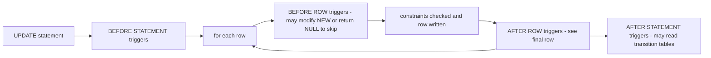
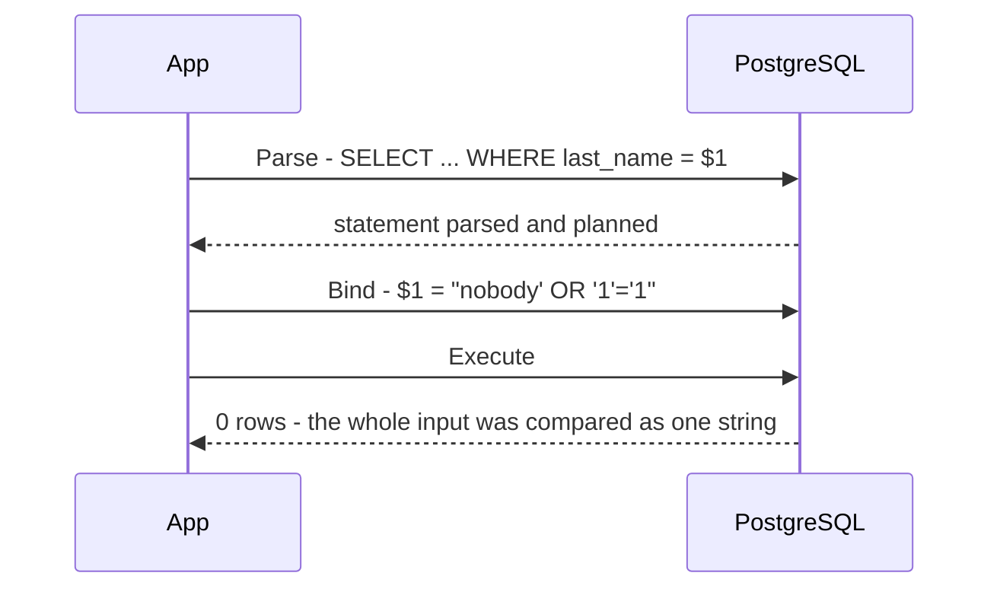
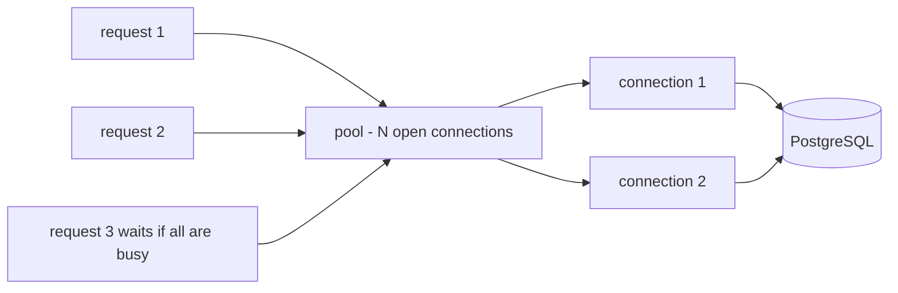

# Chapter 14 — Advanced SQL and Using SQL from Code

So far every query in this book has been typed into `psql` (PostgreSQL's command-line client) by a person. Real systems are different: the database runs **code of its own** (functions, procedures, triggers), stores **semi-structured data** — data whose shape varies from row to row (JSON, a text format for nested data; arrays; searchable text) — protects data **per user and per row**, and — most of all — is driven by **application programs** written in Python, Java and other languages. This chapter covers those "last mile" skills.

**What you'll learn**

- Writing functions and stored procedures in SQL and PL/pgSQL, and when logic belongs in the database.
- Triggers: automatic `updated_at` columns, validation rules, a generic audit log, statement-level triggers.
- JSON/JSONB and arrays: storing, querying, updating and indexing them.
- Full-text search with `tsvector` / `tsquery`, ranking and highlighting.
- Pivoting rows into columns (and back) with `FILTER`, `CASE`, `crosstab` and `LATERAL`.
- Security: roles, `GRANT` / `REVOKE`, column privileges and row-level security (RLS).
- SQL injection — seeing it succeed, then fixing it with parameters.
- Calling the database from Python (`psycopg`, `sqlite3`) and Java (JDBC): parameters, transactions, batches, streaming.
- Connection pooling, and the trade-offs between ORMs and hand-written SQL.

**How to run the examples.** Everything is in [`code/`](code/) and runs on the book's private PostgreSQL 14 server (port 5544). The shared sample database from [Chapter 1](../01-databases-and-the-relational-model/README.md) — a small office-gear company with `departments`, `employees`, `customers`, `products`, `orders` and `order_items` — is loaded first from [`code/00_schema.sql`](code/00_schema.sql); each numbered file then runs in a fresh database.

```bash
bash tools_run_sql.sh sql '14-*'                                    # all SQL files of this chapter
.venv-books/bin/python sql/chapters/14-advanced-sql-and-using-sql-from-code/code/psycopg_demo.py
python3 sql/chapters/14-advanced-sql-and-using-sql-from-code/code/sqlite3_demo.py
java --enable-native-access=ALL-UNNAMED -cp '.java-books/lib/*' \
     sql/chapters/14-advanced-sql-and-using-sql-from-code/code/JdbcDemo.java
```

---

## 14.1 User-defined functions

### What it is

A **user-defined function** (UDF) is a named piece of logic stored *inside* the database that takes arguments and returns a value (or a set of rows). You call it from SQL exactly like a built-in function such as `upper()` or `round()`. Think of it as a spreadsheet formula you give a name, so everyone uses the same one.

PostgreSQL lets you write the body in several **procedural languages**:

| Language | What the body looks like | Use it for |
|---|---|---|
| `sql` | One or more plain SQL statements; the last one's result is returned | Short calculations and reusable queries; the planner (the part of the database that decides how to run a query) can often *inline* them — paste their body into the calling query |
| `plpgsql` | PL/pgSQL: SQL plus variables, `IF`, loops, error handling | Logic with branches, loops, or several steps |
| `plpython3u`, `plperl`, … | Other languages (extensions, often "untrusted" = superuser — an all-powerful admin role — only) | Rare; needs the extension installed |

### Why it matters

- **One definition of a rule.** "Line total = quantity × price × (1 − discount)" written once, used by every report and every application.
- **Fewer round trips** (a request to the server and its reply). A multi-step operation runs next to the data instead of sending many statements over the network.
- **Reusable query building blocks.** A function that returns a table can be joined like a table.

### How it works

1. `CREATE FUNCTION name(args) RETURNS type LANGUAGE … AS $$ body $$` stores the function in the catalog (PostgreSQL's internal tables describing every object; here `pg_proc`).
2. `$$ … $$` is **dollar quoting**: a way to write a string literal without escaping (marking as "literal, not special") the single quotes inside the body.
3. Each argument can have a `DEFAULT`; callers may pass arguments by position or by name (`p_limit => 1`).
4. A **volatility** label tells the planner how the function behaves — it affects optimisation and whether the function may be used in an index:

| Label | Promise | Example |
|---|---|---|
| `IMMUTABLE` | Same inputs → same result forever; reads no tables | `line_total(2, 10, 0)` |
| `STABLE` | Same result within one statement; may read tables | "tier of customer 3" |
| `VOLATILE` (default) | Anything may change; may modify data | `random()`, a function that inserts rows |

Only `IMMUTABLE` functions can be used in an index expression. Lying (marking a table-reading function `IMMUTABLE`) gives wrong, cached-looking results.

### Example — SQL and PL/pgSQL functions

From [`code/01_functions.sql`](code/01_functions.sql):

```sql
-- (a) A plain SQL function, SQL-standard body (PostgreSQL 14+)
CREATE FUNCTION line_total(qty integer, price numeric, disc numeric DEFAULT 0)
RETURNS numeric
LANGUAGE sql IMMUTABLE
RETURN round(qty * price * (1 - disc), 2);

-- (b) PL/pgSQL: variables, IF, SELECT ... INTO, RAISE
CREATE FUNCTION customer_tier(p_customer_id integer)
RETURNS text
LANGUAGE plpgsql STABLE
AS $$
DECLARE
    v_spent numeric;
BEGIN
    IF NOT EXISTS (SELECT 1 FROM customers WHERE customer_id = p_customer_id) THEN
        RAISE EXCEPTION 'customer % does not exist', p_customer_id
              USING ERRCODE = 'no_data_found';
    END IF;

    SELECT coalesce(sum(line_total(oi.quantity, oi.unit_price, oi.discount)), 0)
    INTO   v_spent
    FROM   orders o JOIN order_items oi USING (order_id)
    WHERE  o.customer_id = p_customer_id AND o.status <> 'cancelled';

    RETURN CASE WHEN v_spent >= 1500 THEN 'gold'
                WHEN v_spent >= 300  THEN 'silver'
                ELSE 'bronze' END;
END;
$$;

SELECT customer_id, first_name, customer_tier(customer_id) AS tier
FROM   customers ORDER BY customer_id LIMIT 5;
```

Output:

```text
 customer_id | first_name |  tier
-------------+------------+--------
           1 | Anita      | gold
           2 | Ben        | gold
           3 | Chen       | bronze
           4 | Divya      | bronze
           5 | Ethan      | silver
```

What each part does: `DECLARE` lists local variables; `SELECT … INTO v_spent` stores a query result in a variable; `RAISE EXCEPTION … USING ERRCODE` aborts with a chosen SQLSTATE code (the standard five-character error code); `%` in the message is replaced by the next argument. `RAISE NOTICE` (used below) only prints a message.

**Catching errors.** A `BEGIN … EXCEPTION WHEN no_data_found THEN … END` block catches errors raised inside it (`SQLERRM` holds the message): the file's `safe_tier(999)` returns `unknown (customer 999 does not exist)` instead of failing. An `EXCEPTION` block silently creates a **savepoint** (a marker inside a transaction that you can roll back to) on entry, so it costs a little — don't wrap every statement in one.

**Set-returning functions.** `RETURNS TABLE (...)` makes a function usable in `FROM`, like a parameterised view:

```sql
CREATE FUNCTION top_products(p_limit integer DEFAULT 3)
RETURNS TABLE (product text, units bigint, revenue numeric)
LANGUAGE sql STABLE AS $$
    SELECT p.name, sum(oi.quantity), sum(line_total(oi.quantity, oi.unit_price, oi.discount))
    FROM   order_items oi JOIN orders o USING (order_id) JOIN products p USING (product_id)
    WHERE  o.status <> 'cancelled'
    GROUP  BY p.name ORDER BY 3 DESC LIMIT p_limit
$$;
SELECT * FROM top_products(p_limit => 1);  -- named argument; top_products() uses the default 3
```

```text
    product    | units | revenue
---------------+-------+---------
 Laptop Pro 14 |     3 | 3782.05
```

In PL/pgSQL, a set-returning function can instead loop (`FOR r IN SELECT … LOOP`) and emit one row at a time with `RETURN NEXT` — the file's `salary_bands(50000)` does this to count employees per 50,000 salary band.

**One-off code without a function:** `DO $$ … $$;` runs an anonymous PL/pgSQL block once. The file ends with one (it prints `NOTICE: pending orders: 2`) and with a look at the catalog, where `prokind` is `f` for function and `provolatile` is `i`/`s`/`v`.

### Dialect differences

| | PostgreSQL | MySQL | SQL Server | SQLite |
|---|---|---|---|---|
| Stored functions | `CREATE FUNCTION`, many languages | `CREATE FUNCTION` (SQL/PSM style) | `CREATE FUNCTION` (T-SQL, SQL Server's dialect), scalar and table-valued | None in SQL; register functions from the host language (the language of the program using SQLite) (e.g. Python's `conn.create_function`) |
| Replace | `CREATE OR REPLACE FUNCTION` | `DROP` then `CREATE` | `CREATE OR ALTER` | — |
| Error raising | `RAISE EXCEPTION` | `SIGNAL SQLSTATE` | `THROW` | `RAISE()` only inside triggers |

### Common mistakes

- **Wrong volatility**: a function that reads tables marked `IMMUTABLE` can return stale results; a pure calculation left `VOLATILE` blocks optimisations.
- **Hiding row-by-row loops in functions.** Calling a query-running function once per row of a million-row table runs a million queries; a set-based (one statement over all rows at once) `JOIN` is usually far faster.
- **Name clashes** between PL/pgSQL variables and column names (`WHERE customer_id = customer_id`). Prefix parameters (`p_`) and variables (`v_`).

### In the interview

**30-second answer:** "A UDF packages logic in the database so it's reused and runs next to the data. In Postgres I'd use a `LANGUAGE sql` function for simple expressions — it can be inlined — and PL/pgSQL for branching or loops. I'd set the right volatility, keep heavy business rules in the application unless they guard data integrity, and prefer set-based SQL over per-row function calls."

- *Function vs view?* → A view has no parameters; a set-returning function does. For a fixed query, a view is simpler and fully optimisable.
- *Why can't I index `lower(email)` with my own function?* → You can, but only if the function is `IMMUTABLE`.

### Self-check

1. What does `$$` do? → It quotes the function body without needing to double every `'` inside it.
2. Can a `STABLE` function update a table? → It shouldn't; it promises not to change the database. Use `VOLATILE`.
3. How do you return several rows? → `RETURNS TABLE(...)` or `RETURNS SETOF type`, with a query body or `RETURN NEXT` / `RETURN QUERY`.

### TL;DR

Functions are named, reusable logic stored in the database: `sql` for simple, `plpgsql` for procedural. Label volatility honestly, prefix variable names, and don't replace set-based SQL with row-by-row calls.

---

## 14.2 Stored procedures

### What it is

A **stored procedure** is like a function that *does* something rather than *computes* something. You run it with `CALL`, it returns no value (except through `INOUT`/`OUT` parameters), and — the key difference in PostgreSQL (procedures arrived in version 11) — it may **commit or roll back transactions inside its body**.

| | Function | Procedure |
|---|---|---|
| Invoked by | `SELECT f(...)`, inside any expression | `CALL p(...)` only |
| Returns | A value or a set of rows | Nothing; results via `INOUT` / `OUT` parameters |
| `COMMIT` / `ROLLBACK` inside | Not allowed — always runs inside the caller's transaction | Allowed when called outside an explicit transaction block |
| Typical use | Calculations, reusable queries, trigger bodies | Batch jobs, maintenance, multi-step operations |

### Why it matters

Long batch jobs (archive a year of orders, back-fill a column) should commit in **chunks**: a single giant transaction holds locks for a long time, keeps old row versions alive (blocking vacuum, PostgreSQL's clean-up of dead row versions — see [Chapter 13](../13-transactions-and-concurrency/README.md)), and loses all its work if it fails at the end.

### Example — archiving in committed batches

From [`code/02_procedures.sql`](code/02_procedures.sql):

```sql
CREATE TABLE orders_archive (LIKE orders INCLUDING ALL);

CREATE PROCEDURE archive_delivered(p_before date, p_batch int, INOUT moved int DEFAULT 0)
LANGUAGE plpgsql AS $$
DECLARE n int;
BEGIN
    LOOP
        WITH picked AS (
            SELECT order_id FROM orders
            WHERE  status = 'delivered' AND placed_at < p_before
              AND  order_id NOT IN (SELECT order_id FROM orders_archive)
            ORDER  BY order_id LIMIT p_batch
        )
        INSERT INTO orders_archive
        SELECT o.* FROM orders o JOIN picked USING (order_id);
        GET DIAGNOSTICS n = ROW_COUNT;     -- rows affected by the last statement
        EXIT WHEN n = 0;
        moved := moved + n;
        RAISE NOTICE 'batch of % committed', n;
        COMMIT;
    END LOOP;
END;
$$;

CALL archive_delivered('2025-04-01', 2);
```

Output:

```text
NOTICE:  batch of 2 committed
NOTICE:  batch of 2 committed
NOTICE:  batch of 1 committed
 moved
-------
     5
```

The five delivered orders placed before April 2025 (101, 102, 103, 104, 106) were copied in three separately committed batches, and the `INOUT` parameter came back as a one-row result.

**The catch.** If the caller already opened a transaction (`BEGIN; CALL …`), the procedure is inside it and cannot end it:

```sql
BEGIN;
DO $$ DECLARE m int := 0; BEGIN
    CALL archive_delivered('2025-12-31', 2, m);
EXCEPTION WHEN invalid_transaction_termination THEN
    RAISE NOTICE 'caught: %', SQLERRM;
END $$;
ROLLBACK;
```

```text
NOTICE:  batch of 2 committed
NOTICE:  caught: invalid transaction termination
```

The first `NOTICE` prints before the `COMMIT` fails — the message is misleading, which is why the file rolls everything back. Many drivers (the libraries programs use to talk to a database) open a transaction automatically (see 14.10), so a procedure that commits must be called in **auto-commit** mode (each statement committed on its own).

### Dialect differences

| | Syntax | Transaction control inside |
|---|---|---|
| PostgreSQL 11+ | `CREATE PROCEDURE … ; CALL p()` | Yes, if not called inside a transaction block |
| MySQL | `CREATE PROCEDURE` (the `mysql` client needs `DELIMITER //` to change the statement terminator — the character that ends a statement, normally `;`); `CALL p()` | Yes |
| SQL Server | `CREATE PROCEDURE`; `EXEC p` | Yes; can also return result sets directly |
| SQLite | No stored procedures | — |

### When not to use it

Stored procedures tie logic to one database product, are harder to unit-test (check with small automated tests), version and deploy (release to servers) than application code, and scale only as far as the database server. A common, balanced rule: **integrity rules and data-heavy batch work in the database; business workflows in the application.**

### Self-check

1. How do you get a value back from a procedure? → An `INOUT` (or, from PG 14, `OUT`) parameter.
2. Why does `COMMIT` in a procedure sometimes fail? → The caller is already inside a transaction block.
3. Why commit in batches? → Shorter locks, less bloat (wasted space from dead row versions), and completed work survives a later failure.

### TL;DR

Procedures are `CALL`ed, return through `INOUT` parameters, and can `COMMIT` inside — ideal for batch jobs, but only when called in auto-commit mode.

---

## 14.3 Triggers

### What it is

A **trigger** tells the database: "whenever *this event* happens on *this table*, run *this function* automatically". Events are `INSERT`, `UPDATE`, `DELETE` and `TRUNCATE`. It's like a motion-sensor light: nobody presses a switch, the event itself does.

| Choice | Options | Meaning |
|---|---|---|
| Timing | `BEFORE` / `AFTER` / `INSTEAD OF` (views only) | Before the row is written (can change or skip it), after it's written (can react), or replacing the write on a view |
| Level | `FOR EACH ROW` / `FOR EACH STATEMENT` | Once per affected row, or once per SQL statement (even if 0 rows) |
| Condition | `WHEN (…)` | Fire only if the condition on `OLD` / `NEW` is true |
| Column filter | `UPDATE OF col` | Fire only when those columns are named in the `UPDATE` |

Inside a row trigger, `NEW` is the new version of the row (INSERT/UPDATE), `OLD` the previous one (UPDATE/DELETE); `TG_OP`, `TG_TABLE_NAME` and friends describe the event. A trigger function is declared `RETURNS trigger`.



### Why it matters

Triggers enforce behaviour **no matter which application, script or person** changes the data: an `updated_at` stamp, an audit trail (a record of who changed what, when), a denormalised counter (a stored copy of a count, kept for fast reads) kept in sync, a rule a `CHECK` constraint cannot express because it needs another table.

### Example 1 — `updated_at`

From [`code/03_triggers.sql`](code/03_triggers.sql):

```sql
ALTER TABLE products ADD COLUMN updated_at timestamptz NOT NULL DEFAULT '2025-01-01 00:00+00';

CREATE FUNCTION set_updated_at() RETURNS trigger
LANGUAGE plpgsql AS $$
BEGIN
    NEW.updated_at := now();      -- change the row before it is written
    RETURN NEW;                   -- BEFORE row trigger: return the row to store (NULL = skip it)
END;
$$;

CREATE TRIGGER products_updated_at
BEFORE UPDATE ON products
FOR EACH ROW
WHEN (OLD.* IS DISTINCT FROM NEW.*)          -- skip no-op updates
EXECUTE FUNCTION set_updated_at();

UPDATE products SET unit_price = 22.99 WHERE product_id = 2;
UPDATE products SET unit_price = 35.00 WHERE product_id = 8;   -- same value as before
SELECT product_id, unit_price, updated_at > '2025-01-02' AS stamped_now
FROM   products WHERE product_id IN (2, 8) ORDER BY product_id;
```

```text
 product_id | unit_price | stamped_now
------------+------------+-------------
          2 |      22.99 | t
          8 |      35.00 | f
```

`EXECUTE FUNCTION` is the PostgreSQL 11+ spelling (older versions write `EXECUTE PROCEDURE`, still accepted).

### Example 2 — a validation rule that needs another table

```sql
CREATE FUNCTION forbid_discontinued() RETURNS trigger
LANGUAGE plpgsql AS $$
BEGIN
    IF (SELECT discontinued FROM products WHERE product_id = NEW.product_id) THEN
        RAISE EXCEPTION 'product % is discontinued', NEW.product_id;
    END IF;
    RETURN NEW;
END;
$$;

CREATE TRIGGER order_items_check_product
BEFORE INSERT OR UPDATE OF product_id ON order_items
FOR EACH ROW EXECUTE FUNCTION forbid_discontinued();
-- inserting the discontinued Desk Lamp (id 8):
-- NOTICE:  rejected: product 8 is discontinued
```

### Example 3 — a generic audit log

One function works for any table because `to_jsonb(OLD)` / `to_jsonb(NEW)` turn a whole row into JSON:

```sql
CREATE TABLE audit_log (
    id          bigint GENERATED ALWAYS AS IDENTITY PRIMARY KEY,
    table_name  text        NOT NULL,
    op          text        NOT NULL,
    changed_by  text        NOT NULL DEFAULT current_user,
    changed_at  timestamptz NOT NULL DEFAULT now(),
    old_row     jsonb,
    new_row     jsonb
);

CREATE FUNCTION audit_row() RETURNS trigger
LANGUAGE plpgsql AS $$
BEGIN
    INSERT INTO audit_log (table_name, op, old_row, new_row)
    VALUES (TG_TABLE_NAME, TG_OP,
            CASE WHEN TG_OP IN ('UPDATE','DELETE') THEN to_jsonb(OLD) END,
            CASE WHEN TG_OP IN ('INSERT','UPDATE') THEN to_jsonb(NEW) END);
    RETURN NULL;                  -- the return value of an AFTER trigger is ignored
END;
$$;

CREATE TRIGGER customers_audit
AFTER INSERT OR UPDATE OR DELETE ON customers
FOR EACH ROW EXECUTE FUNCTION audit_row();

INSERT INTO customers VALUES (11, 'Jia', 'Wong', 'jia.wong@mail.example', 'Singapore', 'Singapore', '2025-06-20');
UPDATE customers SET city = 'Mumbai' WHERE customer_id = 8;
DELETE FROM customers WHERE customer_id = 11;

SELECT id, table_name, op, changed_by, old_row ->> 'city' AS old_city, new_row ->> 'city' AS new_city
FROM   audit_log ORDER BY id;
```

```text
 id | table_name |   op   | changed_by | old_city  | new_city
----+------------+--------+------------+-----------+-----------
  1 | customers  | INSERT | postgres   |           | Singapore
  2 | customers  | UPDATE | postgres   | mumbai    | Mumbai
  3 | customers  | DELETE | postgres   | Singapore |
```

Which columns changed? Compare the two JSON objects key by key:

```sql
SELECT n.key, o.value AS before, n.value AS after
FROM   audit_log a, jsonb_each(a.new_row) n
JOIN   jsonb_each(a.old_row) o USING (key)
WHERE  a.op = 'UPDATE' AND n.value IS DISTINCT FROM o.value;
```

```text
 key  |  before  |  after
------+----------+----------
 city | "mumbai" | "Mumbai"
```

Because the audit insert runs **in the same transaction** as the change, a rolled-back change leaves no audit row — the log never lies.

### Example 4 — statement-level trigger with transition tables

A row trigger on a 1-million-row `UPDATE` fires a million times. A **statement-level** trigger fires once, and (PostgreSQL 10+) can see all changed rows at once through **transition tables**:

```sql
CREATE TRIGGER products_bulk_price
AFTER UPDATE ON products
REFERENCING OLD TABLE AS old_rows NEW TABLE AS new_rows
FOR EACH STATEMENT EXECUTE FUNCTION log_bulk_price_change();
-- the function reads new_rows / old_rows like tables (count, avg of price differences)

UPDATE products SET unit_price = unit_price * 1.10 WHERE category = 'Furniture';
-- NOTICE:  3 rows changed price, average change 29.47
```

### Trade-offs and dialect differences

| | PostgreSQL | MySQL | SQL Server | SQLite |
|---|---|---|---|---|
| Row-level | Yes | Yes (only kind) | No — statement-level only, with `inserted` / `deleted` pseudo-tables | Yes (only kind) |
| Statement-level | Yes (+ transition tables) | No | Yes (the only kind) | No |
| `INSTEAD OF` | On views | No | On tables and views | On views |
| Body | A separate trigger function | Inline SQL body | Inline T-SQL | Inline SQL body |

### When not to use it

- For **business workflows** (send an email, call a payment API — the interface another service exposes to programs) — triggers run inside the transaction and must be fast; put a row in an *outbox* table (a table of pending messages) instead and let a worker (a background process) act on it.
- When a **constraint** can do the job (`CHECK`, `FOREIGN KEY`, `UNIQUE`, generated column) — constraints are declarative, faster and visible in the schema.
- When the logic surprises people: "invisible" side effects are the most common complaint about triggers.

### Common mistakes

- Forgetting `RETURN NEW` in a `BEFORE` row trigger — returning `NULL` silently **skips** the row.
- A trigger that updates its own table, re-firing itself in a loop (guard with `WHEN` or `pg_trigger_depth()`).
- Expecting triggers on `TRUNCATE` from a row-level trigger — `TRUNCATE` only fires statement-level `ON TRUNCATE` triggers.

### Real-world examples

Compliance audit trails (who changed a salary, when), `updated_at` columns used by sync jobs, and the **transactional outbox** pattern for reliable event publishing (telling other systems that something changed).

### In the interview

**30-second answer:** "A trigger runs a function automatically on INSERT/UPDATE/DELETE, before or after, per row or per statement. I use them for cross-cutting (applying everywhere, regardless of which code writes) data rules — audit logs, timestamps, integrity checks a constraint can't express — and avoid them for business workflows because they're invisible and slow down writes."

- *BEFORE vs AFTER?* → BEFORE can modify or reject the row; AFTER sees the final row (after constraints) and is for reactions like auditing.
- *Does a trigger's work roll back with the statement?* → Yes, it runs in the same transaction.
- *How to audit a bulk update efficiently?* → A statement-level trigger with transition tables.

### Self-check

1. Which record is available in a DELETE trigger? → `OLD` only.
2. What happens if a BEFORE row trigger returns NULL? → That row's operation is skipped.
3. Why is `WHEN (OLD.* IS DISTINCT FROM NEW.*)` useful? → It skips no-op updates, so `updated_at` changes only when data really changed.

### TL;DR

Triggers = automatic functions on data events. Great for audit logs, `updated_at` and cross-table checks; keep them small, prefer constraints when possible, and never put slow external work in them.

---

## 14.4 JSON and JSONB

### What it is

**JSON** (JavaScript Object Notation) is the text format of web APIs: objects `{"key": value}`, arrays `[…]`, strings, numbers, booleans and `null`. PostgreSQL has two column types for it:

| | `json` | `jsonb` ("JSON binary") |
|---|---|---|
| Storage | The exact text you sent | Parsed into a binary tree |
| Duplicate keys, whitespace, key order | Kept as written | Last duplicate wins; whitespace removed; keys reordered |
| Speed | Fast to store, re-parsed on every read | Slightly slower to store, fast to query |
| Operators & indexing | Few | Containment `@>`, key-exists `?`, GIN (inverted) indexes, SQL/JSON path |

Use **`jsonb`** unless you must keep the original text byte-for-byte.

```sql
SELECT '{"b":1, "a":2, "a":3}'::json AS as_json, '{"b":1, "a":2, "a":3}'::jsonb AS as_jsonb;
```

```text
        as_json        |     as_jsonb
-----------------------+------------------
 {"b":1, "a":2, "a":3} | {"a": 3, "b": 1}
```

### Why it matters

Some data really is **semi-structured**: product specifications differ by category (a laptop has RAM, a desk has a height range), webhook payloads (data another service pushes to your app over HTTP) change shape, user preferences grow new keys. A `jsonb` column stores that without a new column (or a new table) for every attribute — while the stable, important fields stay in normal, typed, constrained columns. For whole-document databases see [Chapter 16](../16-beyond-relational/README.md).

### How it works — operators

| Operator / function | Returns | Example → result |
|---|---|---|
| `->` key or index | `jsonb` | `specs -> 'brand'` → `"Nimbus"` |
| `->>` key or index | `text` | `specs ->> 'brand'` → `Nimbus` |
| `#>` / `#>>` path | `jsonb` / `text` | `specs #>> '{screen,type}'` → `OLED` |
| `@>` contains | boolean | `specs @> '{"brand":"Nimbus"}'` |
| `?`, `?|`, `?&` | boolean | key exists / any of keys / all of keys |
| `@?`, `@@` | boolean | SQL/JSON path exists / path predicate (PG 12+) |
| `||`, `-`, `#-` | `jsonb` | merge / remove key / remove path |
| `jsonb_set(doc, path, value)` | `jsonb` | replace or add a value at a path |

### Example — product specs

From [`code/04_jsonb.sql`](code/04_jsonb.sql) (the file first adds `specs jsonb` and fills it for five products):

```sql
SELECT name,
       specs -> 'brand'                AS brand_json,
       specs ->> 'brand'               AS brand_text,
       specs #>> '{screen,type}'       AS screen_type,
       (specs ->> 'ram_gb')::int       AS ram_gb,
       specs -> 'ports' -> 0           AS first_port,
       jsonb_array_length(specs -> 'ports') AS n_ports
FROM   products WHERE specs ? 'ports' ORDER BY product_id;
```

```text
      name      | brand_json | brand_text | screen_type | ram_gb | first_port | n_ports
----------------+------------+------------+-------------+--------+------------+---------
 Laptop Pro 14  | "Nimbus"   | Nimbus     | OLED        |     16 | "usb-c"    |       2
 Wireless Mouse | "Clicko"   | Clicko     |             |        | "usb-a"    |       1
 USB-C Hub      | "Nimbus"   | Nimbus     |             |        | "usb-c"    |       4
```

Note the quotes: `->` gives JSON (`"Nimbus"`), `->>` gives plain text. Missing keys give `NULL`, not an error. To compare numbers, cast the text: `(specs ->> 'ram_gb')::int`.

Filtering:

```sql
SELECT name FROM products WHERE specs @> '{"brand":"Nimbus"}';           -- Laptop Pro 14, USB-C Hub
SELECT name FROM products WHERE specs -> 'ports' ? 'hdmi';                -- Laptop Pro 14, USB-C Hub
SELECT name, jsonb_path_query_first(specs, '$.height_cm.max') AS max_height
FROM   products WHERE specs @@ '$.height_cm.max > 100';                   -- Standing Desk | 120
```

(`?` on an array checks whether a string **element** is present.)

Updating — `jsonb` values are immutable, so each operation builds a new document:

```sql
UPDATE products SET specs = jsonb_set(specs, '{ram_gb}', '32')  WHERE product_id = 1;
UPDATE products SET specs = specs || '{"color":"black"}'         WHERE product_id = 2;
UPDATE products SET specs = specs - 'wireless'                   WHERE product_id = 7;
UPDATE products SET specs = specs #- '{screen,type}'             WHERE product_id = 1;
```

```text
 product_id |                                          specs
------------+-----------------------------------------------------------------------------------------
          1 | {"brand": "Nimbus", "ports": ["usb-c", "hdmi"], "ram_gb": 32, "screen": {"inches": 14}}
          2 | {"brand": "Clicko", "color": "black", "ports": ["usb-a"], "wireless": true}
          7 | {"brand": "Hushh", "battery_h": 30}
```

**Rows → JSON and back.** `jsonb_build_object` + `jsonb_agg` build a nested document — e.g. an API response for order 108 in one query: `{"items": [{"qty": 1, "product": "Laptop Pro 14"}, …], "status": "delivered", "order_id": 108}`. In the other direction, `jsonb_to_recordset('[{"sku":"A1","qty":2},{"sku":"B7","qty":5}]') AS t(sku text, qty int)` turns an incoming payload into rows `(A1, 2)`, `(B7, 5)`. `jsonb_each(doc)` similarly turns an object into `(key, value)` rows.

### Indexing

A **GIN** (Generalized Inverted Index — an index from each key/value to the rows containing it) serves `@>`, `?`, `?|`, `?&` and the path operators; a normal B-tree **expression index** serves equality and ranges on one extracted key. (The file disables sequential scans only because the demo table is tiny, and runs `VACUUM products` first: an index built over rows that still carry old versions from recent `UPDATE`s may be ignored by transactions whose snapshots are older than the index. See [Chapter 12](../12-indexes-storage-and-query-performance/README.md) for reading plans.)

```sql
CREATE INDEX products_specs_gin ON products USING gin (specs);
EXPLAIN (COSTS OFF) SELECT name FROM products WHERE specs @> '{"brand":"Nimbus"}';
CREATE INDEX products_brand_idx ON products ((specs ->> 'brand'));
EXPLAIN (COSTS OFF) SELECT name FROM products WHERE specs ->> 'brand' = 'Nimbus';
```

```text
 Bitmap Heap Scan on products
   Recheck Cond: (specs @> '{"brand": "Nimbus"}'::jsonb)
   ->  Bitmap Index Scan on products_specs_gin
         Index Cond: (specs @> '{"brand": "Nimbus"}'::jsonb)

 Index Scan using products_brand_idx on products
   Index Cond: ((specs ->> 'brand'::text) = 'Nimbus'::text)
```

The GIN index is *not* used for `specs ->> 'brand' = 'Nimbus'` — write the filter as `@>` or add the expression index.

### Dialect differences

| | Type | Extract text | Notes |
|---|---|---|---|
| PostgreSQL | `json`, `jsonb` | `->>`, `#>>`, `jsonb_path_query` | GIN indexes; `JSON_TABLE` and SQL/JSON query functions added in PG 17 |
| MySQL 5.7+ | `JSON` (binary) | `->>`, `JSON_EXTRACT`, `JSON_UNQUOTE` | Index via generated columns or multi-valued indexes (8.0.17+) |
| SQL Server | `nvarchar` + `JSON_VALUE` / `OPENJSON`; native `json` type in SQL Server 2025 and Azure SQL | `JSON_VALUE(doc, '$.brand')` | Index a computed column |
| SQLite | `TEXT` with built-in JSON functions; binary JSONB since 3.45 | `->>` (3.38+), `json_extract` | Expression indexes |

### When not to use it

When fields are known, always present, filtered or joined on, or need constraints (`NOT NULL`, foreign keys) — make them **real columns**. Stuffing everything into one JSON blob is the "EAV / schemaless" antipattern (EAV = entity–attribute–value, storing every attribute as a generic key/value pair): no types, no constraints, poor statistics, awkward queries.

### Common mistakes

- Comparing `->` output with text (`specs -> 'brand' = 'Nimbus'` fails: jsonb vs text). Use `->>` or `@>`.
- Sorting or comparing numbers as text (`'9' > '10'`). Cast first.
- Updating one key of a large document still rewrites the whole row.

### In the interview

**30-second answer:** "I use `jsonb` for genuinely variable attributes alongside normal columns. I query with `->>` / `@>`, index with GIN for containment or a B-tree expression index for one hot key, and promote any field that becomes important to a real column."

- *json vs jsonb?* → jsonb is parsed, indexable and fast to query; json keeps exact text.

### Self-check

1. `'{"a":1}'::jsonb -> 'a'` vs `->> 'a'`? → jsonb `1` vs text `'1'`.
2. Which index helps `WHERE specs @> '{"wireless":true}'`? → A GIN index on `specs`.
3. How to append a key? → `specs || '{"k":"v"}'` or `jsonb_set`.

### TL;DR

`jsonb` + `->>`/`@>` + GIN = flexible attributes inside a relational table. Keep core fields as columns.

---

## 14.5 Arrays

### What it is

PostgreSQL columns can hold an **array** — an ordered list of values of one type (`text[]`, `int[]`). Arrays are **1-based**, and reading past the end returns `NULL` instead of failing.

### Example — product tags

From [`code/05_arrays.sql`](code/05_arrays.sql):

```sql
ALTER TABLE products ADD COLUMN tags text[] NOT NULL DEFAULT '{}';
UPDATE products SET tags = CASE product_id
    WHEN 1 THEN ARRAY['laptop','work','premium']
    WHEN 2 THEN '{mouse,wireless,budget}'          -- text literal form
    WHEN 4 THEN ARRAY['keyboard','work']
    WHEN 5 THEN ARRAY['desk','work','premium']
    WHEN 7 THEN ARRAY['audio','wireless','premium']
    ELSE '{}' END;

SELECT name, tags, tags[1] AS first_tag, tags[2:3] AS slice, cardinality(tags) AS n, tags[9] AS no_such
FROM   products WHERE product_id IN (1, 2, 9) ORDER BY product_id;
```

```text
      name      |          tags           | first_tag |       slice       | n | no_such
----------------+-------------------------+-----------+-------------------+---+---------
 Laptop Pro 14  | {laptop,work,premium}   | laptop    | {work,premium}    | 3 |
 Wireless Mouse | {mouse,wireless,budget} | mouse     | {wireless,budget} | 3 |
 Gift Card      | {}                      |           | {}                | 0 |
```

| Operation | Syntax | Result in the demo |
|---|---|---|
| Element in array | `'premium' = ANY (tags)` | Laptop, Headphones, Desk |
| Contains all | `tags @> ARRAY['work','premium']` | Laptop, Desk |
| Overlaps (any in common) | `tags && ARRAY['wireless','keyboard']` | Keyboard, Headphones, Mouse |
| Append / remove | `array_append(a, x)`, `array_remove(a, x)` | `{a,b,c}`, `{b}` |
| Concatenate / find | `a || b`, `array_position(a, x)` | `{1,2,3}`, `2` |
| Array ↔ rows | `unnest(a) WITH ORDINALITY`, `array_agg(x ORDER BY …)` | see below |
| Array ↔ string | `string_to_array(s, ',')`, `array_to_string(a, ' | ')` | `{red,green,blue}`, `a | b` |

`unnest` and `array_agg` are opposites; together they answer "which tags are popular?":

```sql
SELECT tag, count(*) AS products, array_agg(name ORDER BY name) AS which
FROM   products, unnest(tags) AS tag
GROUP  BY tag HAVING count(*) > 1 ORDER BY products DESC, tag;
```

```text
   tag    | products |                              which
----------+----------+-----------------------------------------------------------------
 premium  |        3 | {"Laptop Pro 14","Noise-Cancelling Headphones","Standing Desk"}
 work     |        3 | {"Laptop Pro 14","Mechanical Keyboard","Standing Desk"}
 wireless |        2 | {"Noise-Cancelling Headphones","Wireless Mouse"}
```

**Arrays as a parameter.** Application code often needs "rows whose id is in this list". Instead of building `IN (3, 5, 7)` as a string (injection risk — see 14.9 — a new statement per list length), pass **one array parameter**: `WHERE product_id = ANY ($1)`. The file shows it with `PREPARE by_ids(int[])` / `EXECUTE by_ids('{3,5,7}')` (a server-side prepared statement: parsed once, run with different values), which returns USB-C Hub, Standing Desk and Noise-Cancelling Headphones. A GIN index on `tags` serves `@>`, `&&` and `<@` (the plan in the file shows `Bitmap Index Scan on products_tags_gin`).

### When not to use it

If you need to **join** on the elements, enforce **foreign keys** on them, or update single elements often, use a child table (`product_tags(product_id, tag)`) — that's what first normal form ([Chapter 11](../11-normalization/README.md)) recommends. Arrays suit small, read-mostly lists like tags. MySQL, SQL Server and SQLite have no array column type (use JSON arrays or a child table).

### Self-check

1. What is `ARRAY[10,20][0]`? → `NULL` — arrays start at 1.
2. `= ANY(arr)` vs `@>`? → `x = ANY(arr)` tests one value; `arr @> other` tests that every element of `other` is present.
3. Why pass `= ANY($1)` from code? → One statement for any list length, and values are bound safely.

### TL;DR

Arrays: 1-based lists in one column; query with `ANY`, `@>`, `&&`, explode with `unnest`, build with `array_agg`, index with GIN; use a child table when elements need relationships.

---

## 14.6 Full-text search

### What it is

**Full-text search** (FTS) finds documents that match *words* — ignoring case, word endings and filler words — and ranks them by relevance, like a small search engine inside the database.

Key terms:

| Term | Meaning |
|---|---|
| **Lexeme** | A normalised word: lower-cased and **stemmed** ("shipping", "shipped" → `ship`) |
| **Stop word** | A very common word ("the", "and", "was") that is dropped |
| `tsvector` | A document turned into sorted lexemes with positions: `'chair':2 'ship':4,8` |
| `tsquery` | A search: lexemes joined by `&` (and), `|` (or), `!` (not), `<->` (followed by) |
| `@@` | "Does this vector match this query?" |
| Text search configuration | Language rules, e.g. `'english'` (stemmer + stop-word list) |

### Why it matters

`LIKE '%word%'` has three problems: no stemming (searching "returning" misses "returned"), no ranking, and a leading `%` cannot use a B-tree index, so every row is scanned. FTS solves all three and is often enough to postpone running a separate search engine such as Elasticsearch/OpenSearch (dedicated search servers).

### How it works

1. `to_tsvector('english', text)` parses the text, drops stop words and stems the rest.
2. A query function builds a `tsquery` from user input:
   - `to_tsquery` — expects operator syntax (`'ship & chair'`); errors on bad syntax.
   - `plainto_tsquery` — all words ANDed.
   - `websearch_to_tsquery` (PG 11+) — Google-like: quotes for phrases, `or`, `-` to exclude; never errors on user input.
3. `vector @@ query` tests a match; `ts_rank` scores it; `ts_headline` highlights matches.
4. A GIN index on the `tsvector` makes matching fast.

From [`code/06_full_text_search.sql`](code/06_full_text_search.sql):

```sql
SELECT to_tsvector('english', 'The chairs were shipped quickly and the shipping was free') AS doc;
SELECT to_tsquery('english', 'shipping & chair')                          AS q1,
       plainto_tsquery('english', 'fast shipping chairs')                 AS q2,
       websearch_to_tsquery('english', '"standing desk" -cheap or lamp')  AS q3;
```

```text
                   doc
------------------------------------------
 'chair':2 'free':10 'quick':5 'ship':4,8

        q1        |            q2             |                   q3
------------------+---------------------------+----------------------------------------
 'ship' & 'chair' | 'fast' & 'ship' & 'chair' | 'stand' <-> 'desk' & !'cheap' | 'lamp'
```

### Example — a help-centre search

The search vector is a **generated column** (computed automatically from other columns on every write; PostgreSQL 12+) so it can never go stale; `setweight` marks title words `A` (most important) and body words `B`, which `ts_rank` rewards:

```sql
CREATE TABLE help_articles (
    id     int PRIMARY KEY,
    title  text NOT NULL,
    body   text NOT NULL,
    search tsvector GENERATED ALWAYS AS (
             setweight(to_tsvector('english', title), 'A') ||
             setweight(to_tsvector('english', body),  'B')) STORED
);
-- 5 articles: 'Returning a chair', 'Standing desk assembly', 'Shipping times',
--             'Keyboard not connecting', 'Cheap desk lamps discontinued'

SELECT id, title, round(ts_rank(search, q)::numeric, 3) AS rank
FROM   help_articles, websearch_to_tsquery('english', 'chair shipping') AS q
WHERE  search @@ q
ORDER  BY rank DESC, id;
```

```text
 id |       title       | rank
----+-------------------+-------
  1 | Returning a chair | 0.588
  3 | Shipping times    | 0.529
```

More query shapes from the same file:

| Query | Matches | Why |
|---|---|---|
| `to_tsquery('english', 'assem:*')` | 2 Standing desk assembly | `:*` = prefix match (autocomplete) |
| `websearch_to_tsquery('english', '"standing desk"')` | 2 | Phrase: `stand <-> desk` |
| `websearch_to_tsquery('english', 'desk -lamp')` | 2, 3 | Article 5 excluded by `-lamp` |

Highlighting shows the user *why* a result matched:

```sql
SELECT id, ts_headline('english', body, websearch_to_tsquery('english', 'desk chair'),
                       'StartSel=[, StopSel=], MaxWords=12, MinWords=5') AS snippet
FROM   help_articles WHERE search @@ websearch_to_tsquery('english', 'desk chair');
```

```text
 id |              snippet
----+-----------------------------------
  3 | [desk] or [chair] ships in a week
```

And stemming in action — no body contains the word "returning", but article 1's body has "returned" and "returns":

```text
 like_hits | fts_hits          -- body ILIKE '%returning%'  vs  to_tsvector(body) @@ 'returning'
-----------+----------
         0 |        1
```

With `CREATE INDEX … USING gin (search)` the plan becomes `Bitmap Index Scan on help_articles_search_gin`.

### Trade-offs

| | PostgreSQL FTS | Dedicated engine (Elasticsearch / OpenSearch / Solr) |
|---|---|---|
| Setup | None — same database, same transaction | Separate cluster (group of servers), sync pipeline (a job copying data across) |
| Freshness | Immediately consistent | Near-real-time, eventually consistent (copies catch up after a short delay) |
| Features | Stemming, ranking, phrases, prefixes, weights | Fuzzy/typo tolerance, facets (match counts per category, shown as filters), synonyms at scale, relevance tuning, distributed scoring |
| Best for | Up to millions of documents, app-level search | Very large corpora, search-centric products |

Typo tolerance in Postgres needs the `pg_trgm` extension (trigram similarity — comparing 3-character chunks of text), which is not installed on the book's server. Other databases: MySQL `FULLTEXT` indexes with `MATCH … AGAINST`, SQL Server full-text catalogs with `CONTAINS` / `FREETEXT`, SQLite's `FTS5` virtual tables.

### Common mistakes

- Mixing configurations: indexing with `to_tsvector('english', …)` but querying with `to_tsvector(body)` (default config) — the index won't be used. Always name the configuration.
- Passing raw user input to `to_tsquery` — a stray `&` or `(` raises a syntax error. Use `websearch_to_tsquery`.
- Computing `to_tsvector` in every query instead of storing it (generated column) and indexing it.

### In the interview

**30-second answer:** "Postgres FTS turns text into a `tsvector` of stemmed lexemes and matches a `tsquery` with `@@`. I store the vector as a weighted generated column, index it with GIN, parse user input with `websearch_to_tsquery`, and rank with `ts_rank`. I'd move to Elasticsearch only when I need fuzzy matching, facets or scale beyond one database."

### Self-check

1. Why does "shipping" match "shipped"? → Both stem to the lexeme `ship`.
2. Which index type? → GIN on the `tsvector`.
3. How to make titles count more? → `setweight(…, 'A')` for title lexemes; `ts_rank` weights A highest.

### TL;DR

FTS = `tsvector @@ tsquery` + GIN + `ts_rank` + `ts_headline`; beats `LIKE` on stemming, ranking and speed.

---

## 14.7 Pivot and unpivot

### What it is

**Pivoting** turns *values in rows* into *columns* — like an Excel pivot table: one row per category, one column per month. **Unpivoting** is the reverse: a wide table becomes tall again. Databases prefer tall (long) data; reports and spreadsheets prefer wide data. Standard SQL has no `PIVOT` keyword, so we build pivots from conditional aggregation (introduced in [Chapter 4](../04-aggregation/README.md)).

### Example — revenue by category and month

From [`code/07_pivot.sql`](code/07_pivot.sql). A view first produces the tall data (`category, month, revenue`):

```sql
SELECT category,
       round(sum(revenue) FILTER (WHERE month = '2025-01'), 2) AS jan,
       round(sum(revenue) FILTER (WHERE month = '2025-02'), 2) AS feb,
       round(sum(revenue) FILTER (WHERE month = '2025-03'), 2) AS mar,
       round(sum(revenue) FILTER (WHERE month = '2025-04'), 2) AS apr,
       round(sum(revenue), 2)                                  AS all_months
FROM   monthly_category_revenue
GROUP  BY category ORDER BY category;
```

```text
  category   |   jan   |  feb   |  mar   |   apr   | all_months
-------------+---------+--------+--------+---------+------------
 (none)      |         |        | 100.00 |         |     100.00
 Accessories |  188.00 |        |        |  200.80 |     671.35
 Electronics | 1683.90 |        |  74.97 | 1448.95 |    4691.80
 Furniture   |         | 811.49 | 629.98 |  499.00 |    1940.47
```

(`all_months` also includes May and June, which have no column here.) The portable form, which works in every database, puts `CASE` inside the aggregate: `sum(CASE WHEN month = '2025-01' THEN revenue ELSE 0 END) AS jan` — with `ELSE 0`, empty cells show `0.00` instead of `NULL`. The same technique counts order statuses per customer (`count(*) FILTER (WHERE o.status = 'delivered') AS delivered`, …).

### `crosstab` (tablefunc extension)

PostgreSQL's `tablefunc` extension provides `crosstab(source_sql, category_sql)`, which pivots a three-column query (row id, category, value). It is **not installed on the book's server** (Homebrew's — a macOS package manager — build here ships without it), so this is not run:

```sql
-- (PostgreSQL with contrib — not run)
CREATE EXTENSION IF NOT EXISTS tablefunc;
SELECT *
FROM crosstab(
  $$ SELECT category, month, round(revenue, 2) FROM monthly_category_revenue ORDER BY 1, 2 $$,
  $$ VALUES ('2025-01'), ('2025-02'), ('2025-03'), ('2025-04') $$
) AS ct(category text, jan numeric, feb numeric, mar numeric, apr numeric);
```

You must still list the output columns and their types in `AS ct(...)`; the two-argument form places each value in the right column even when some categories are missing. `FILTER` / `CASE` does the same job without an extension, so most teams use them.

### Unpivot with `LATERAL (VALUES …)`

```sql
CREATE TABLE quarterly_targets (region text PRIMARY KEY, q1 int, q2 int, q3 int, q4 int);
INSERT INTO quarterly_targets VALUES ('India', 120, 150, 170, 200), ('UK', 60, 65, NULL, 80);

SELECT t.region, v.quarter, v.target
FROM   quarterly_targets t
CROSS  JOIN LATERAL (VALUES ('Q1', t.q1), ('Q2', t.q2), ('Q3', t.q3), ('Q4', t.q4)) AS v(quarter, target)
WHERE  v.target IS NOT NULL
ORDER  BY t.region, v.quarter;
```

This returns 7 rows — four for India and three for the UK (its `NULL` Q3 target is filtered out).

`LATERAL` ([Chapter 6](../06-subqueries-and-set-operations/README.md)) lets the `VALUES` list refer to the current row's columns. The portable alternative is a `UNION ALL` of one `SELECT` per column.

### Dynamic pivots

SQL needs the column list **when the query is planned**, so a pivot whose columns depend on the data (every month that exists) requires either building the SQL text in code (with identifiers quoted — see 14.9) or returning a JSON object per row and letting the application lay it out:

```sql
SELECT category, jsonb_object_agg(month, round(revenue, 2) ORDER BY month) AS by_month
FROM   monthly_category_revenue GROUP BY category ORDER BY category;
```

```text
  category   |                          by_month
-------------+-----------------------------------------------------------
 (none)      | {"2025-03": 100.00}
 Accessories | {"2025-01": 188.00, "2025-04": 200.80, "2025-06": 282.55}
 ...           (Electronics and Furniture rows similar)
```

### Dialect differences

| | Pivot | Unpivot |
|---|---|---|
| PostgreSQL | `FILTER`, `CASE`, `crosstab` (tablefunc) | `LATERAL (VALUES …)`, `unnest` |
| SQL Server / Oracle | `PIVOT (SUM(x) FOR col IN (…))` operator | `UNPIVOT` operator (skips NULLs) |
| MySQL | `CASE` (or `SUM(cond)` since booleans are 0/1) | `UNION ALL`; `LATERAL` from 8.0.14 |
| SQLite | `FILTER` (3.30+) or `CASE` | `UNION ALL` |

### In the interview

**30-second answer:** "Pivot = group by the row key and write one conditional aggregate per output column — `SUM(x) FILTER (WHERE col = 'v')` or `SUM(CASE WHEN …)`. Unpivot = `CROSS JOIN LATERAL (VALUES …)` or `UNION ALL`. If the columns aren't known in advance, generate the SQL in code or return JSON."

- *`count(CASE WHEN … THEN 1 END)` vs `sum(CASE WHEN … THEN 1 ELSE 0 END)`?* → Same counts; `count` ignores the NULLs from the missing `ELSE`.

### TL;DR

Pivot with conditional aggregates, unpivot with `LATERAL (VALUES …)`; dynamic column lists need generated SQL or JSON.

---

## 14.8 Security: roles, privileges and row-level security

### What it is

- A **role** is PostgreSQL's single concept for both *users* and *groups*. A role with `LOGIN` can connect (a user); a role without it is a group that other roles are members of. Roles are **cluster-wide** (shared by all databases on one server).
- A **privilege** is permission for one action on one object: `SELECT`, `INSERT`, `UPDATE`, `DELETE`, `TRUNCATE`, `REFERENCES`, `TRIGGER` on tables; `USAGE`/`CREATE` on schemas; `EXECUTE` on functions; `CONNECT` on databases.
- `GRANT` gives privileges; `REVOKE` takes them away. These are the **DCL** (data control language) statements from [Chapter 1](../01-databases-and-the-relational-model/README.md).
- **Row-level security (RLS)** adds *per-row* filters: two users may read the same table but see different rows.

### Why it matters

The **principle of least privilege**: every account gets only what it needs. If the reporting tool's password leaks, the attacker can read reports — not delete orders. If the web app has an injection bug (14.9), a read-only role limits the damage. RLS pushes tenant isolation (a *tenant* is one customer organisation sharing the app: "customer A never sees customer B's data") into the database, so one forgotten `WHERE tenant_id = …` in the app can't leak data.

### Example — groups, grants, column privileges

From [`code/08_security.sql`](code/08_security.sql). (Roles use a `ch14_` prefix and are dropped at the end, because they are shared server-wide.)

```sql
CREATE ROLE ch14_reporting NOLOGIN;                          -- a group
CREATE ROLE ch14_analyst  LOGIN IN ROLE ch14_reporting;      -- a user in that group
CREATE ROLE ch14_app      LOGIN;                             -- the application's account

GRANT SELECT ON orders, order_items TO ch14_reporting;
GRANT SELECT, INSERT, UPDATE ON orders TO ch14_app;
GRANT SELECT (customer_id, first_name, city, country) ON customers TO ch14_reporting;  -- column-level
```

Querying `information_schema.role_table_grants` (`information_schema` is the SQL-standard set of catalog views) confirms: `ch14_app` has INSERT, SELECT, UPDATE on `orders`; `ch14_reporting` has SELECT on `orders` and `order_items`. (Column-level grants appear in `information_schema.column_privileges`, not in this table-level view.)

`SET ROLE` lets a superuser act as another role for testing — the same checks apply as if that role had logged in:

```sql
SET ROLE ch14_analyst;
SELECT count(*) FROM orders;                                        -- 14
SELECT first_name, city FROM customers WHERE customer_id = 1;      -- Anita | Mumbai
PERFORM email FROM customers;             -- NOTICE: analyst: permission denied for table customers
DELETE FROM orders WHERE order_id = 114;  -- NOTICE: analyst: permission denied for table orders
RESET ROLE;
REVOKE SELECT ON order_items FROM ch14_reporting;   -- analyst now denied on order_items too
```

(The failing statements are wrapped in `DO` blocks — one-off anonymous PL/pgSQL code — in the file so the script continues; `PERFORM` is PL/pgSQL's way to run a query and discard its result.) The analyst had no direct grants: privileges were **inherited** from the group, so revoking from the group affected every member at once — grant to groups, not to individuals.

### Example — row-level security: each sales rep sees only their orders

```sql
CREATE ROLE ch14_priya LOGIN;      -- employee 7
CREATE ROLE ch14_arjun LOGIN;      -- employee 8
CREATE TABLE rep_logins (role_name text PRIMARY KEY, emp_id int NOT NULL REFERENCES employees);
INSERT INTO rep_logins VALUES ('ch14_priya', 7), ('ch14_arjun', 8);
GRANT SELECT ON rep_logins TO ch14_priya, ch14_arjun;
GRANT SELECT, UPDATE ON orders TO ch14_priya, ch14_arjun;

ALTER TABLE orders ENABLE ROW LEVEL SECURITY;          -- from now on: no matching policy = no rows

CREATE POLICY rep_sees_own_orders ON orders
    FOR ALL TO ch14_priya, ch14_arjun
    USING      (sales_rep_id = (SELECT emp_id FROM rep_logins WHERE role_name = current_user))
    WITH CHECK (sales_rep_id = (SELECT emp_id FROM rep_logins WHERE role_name = current_user));

CREATE POLICY reporting_reads_all ON orders FOR SELECT TO ch14_reporting USING (true);

SET ROLE ch14_priya;
SELECT current_user, order_id, sales_rep_id, status FROM orders ORDER BY order_id;
UPDATE orders SET status = 'shipped' WHERE order_id = 103;     -- Arjun's order
UPDATE orders SET sales_rep_id = 8 WHERE order_id = 101;       -- hand her order to Arjun (in a DO block)
```

```text
 current_user | order_id | sales_rep_id |  status
--------------+----------+--------------+-----------
 ch14_priya   |      101 |            7 | delivered
 ch14_priya   |      105 |            7 | cancelled
 ch14_priya   |      108 |            7 | delivered
 ch14_priya   |      113 |            7 | pending

UPDATE 0
NOTICE:  priya: new row violates row-level security policy for table "orders"
```

| Role | Policy that applies | `count(*)` from `orders` |
|---|---|---|
| `ch14_priya` | `rep_sees_own_orders` | 4 |
| `ch14_arjun` | `rep_sees_own_orders` | 2 |
| `ch14_analyst` (member of reporting) | `reporting_reads_all` | 14 |
| `ch14_app` | none — has `SELECT` but no policy | **0** |
| `postgres` (superuser / owner) | bypasses RLS | 14 |

- **`USING`** filters which *existing* rows are visible (to `SELECT`, `UPDATE`, `DELETE`) — so the `UPDATE` of order 103 found 0 rows rather than failing.
- **`WITH CHECK`** validates rows being *written* (`INSERT`, `UPDATE`) — so Priya can't move a row out of her own view.
- Policies are **permissive** by default (combined with `OR`); `AS RESTRICTIVE` policies are combined with `AND`.

### Multi-tenant isolation with a session setting

SaaS (software as a service: one hosted app shared by many customer organisations) apps usually connect as **one** application role and tell the database which tenant the current request belongs to:

```sql
ALTER TABLE notes ENABLE ROW LEVEL SECURITY;
CREATE POLICY tenant_isolation ON notes
    USING (tenant = current_setting('app.tenant', true));    -- true: unset -> NULL, not an error

SET ROLE ch14_app;
SET app.tenant = 'acme';    SELECT * FROM notes;          -- only acme's 2 notes
SET app.tenant = 'globex';  SELECT * FROM notes;          -- only globex's note
RESET app.tenant;           SELECT count(*) FROM notes;   -- 0: no tenant, no rows
```

The app runs `SET LOCAL app.tenant = …` at the start of each transaction (`SET LOCAL` resets at commit — important with connection pools (sets of reusable open connections), 14.12, where the next request reuses the connection).

### Common mistakes

- **Testing RLS as a superuser or the table owner** — both bypass it, so "it works" proves nothing. Test with `SET ROLE`, and use `ALTER TABLE … FORCE ROW LEVEL SECURITY` if the owner must be filtered too.
- Letting the application connect as a superuser or the table owner "because it's easier".
- Forgetting that new tables aren't covered by old grants — use `ALTER DEFAULT PRIVILEGES … GRANT …` for future tables.
- Leaving the `PUBLIC` pseudo-role (an implicit role every user belongs to) with rights you didn't intend (in PG ≤ 14, everyone can `CREATE` in the `public` schema; PG 15 removed that default).

### Dialect differences

| | Roles / users | Row-level security |
|---|---|---|
| PostgreSQL | Roles (users = roles with `LOGIN`) | `CREATE POLICY` (9.5+) |
| MySQL 8.0 | Users + roles | None built in — use views or app logic |
| SQL Server 2016+ | Logins, users, roles | Security policies with inline predicate functions (functions returning a true/false filter) |
| Oracle | Users, roles | Virtual Private Database (VPD) |
| SQLite | No users — file-system permissions only | None |

### In the interview

**30-second answer:** "I apply least privilege: group roles that hold grants, login roles as members, the app gets only the DML it needs, reporting gets read-only, and nobody uses the superuser from code. For multi-tenant data I add row-level security keyed on a session variable, test it with `SET ROLE` — never as owner — and keep a tenant_id index so the policy filter is cheap."

- *USING vs WITH CHECK?* → Visibility of existing rows vs validity of new/changed rows.

### Self-check

1. Why did `ch14_app` see 0 orders? → RLS is enabled and no policy applies to it — default deny.
2. What does `REVOKE` on a group do to its members? → They lose the inherited privilege.
3. Why `SET LOCAL` with pooled connections? → The setting ends with the transaction, so it can't leak to the next request.

### TL;DR

Roles + `GRANT`/`REVOKE` for what each account may do; RLS policies for which rows it may see or write; test as the real role, never as owner.

---

## 14.9 SQL injection and parameterized queries

### What it is

**SQL injection** happens when user input is pasted into the *text* of a SQL statement, so specially crafted input changes the statement's meaning. It has been in the OWASP (Open Worldwide Application Security Project) Top 10 list of web risks since the list began, and has caused many real breaches (for example the 2015 TalkTalk breach in the UK and the 2023 MOVEit Transfer attacks).

Suppose the code builds:

```text
SELECT … FROM customers WHERE last_name = '<input>'
```

With the input `nobody' OR '1'='1`, the text becomes `… WHERE last_name = 'nobody' OR '1'='1'` — a condition that is always true.

### How it's fixed — parameters

A **parameterized query** (also *prepared statement* or *bind variables*) sends the SQL text with placeholders (`$1`, `?`, `%s`) and the values **separately**. The server parses the SQL first, then plugs the values in as data. Input can never become SQL syntax, however many quotes it contains.



### Example — injection inside the database (dynamic SQL)

The same bug appears in PL/pgSQL when `EXECUTE` runs a string. From [`code/09_sql_injection.sql`](code/09_sql_injection.sql):

```sql
-- VULNERABLE
CREATE FUNCTION find_customers_bad(p_last_name text)
RETURNS TABLE (customer_id int, first_name text, email text)
LANGUAGE plpgsql AS $$
BEGIN
    RETURN QUERY EXECUTE
        'SELECT customer_id, first_name, email FROM customers WHERE last_name = '''
        || p_last_name || '''';
END;
$$;
SELECT * FROM find_customers_bad('Carter');                 -- 1 row: Ben
SELECT * FROM find_customers_bad($$nobody' OR '1'='1$$);     -- 10 rows: every customer leaks

-- SAFE: the value is passed with USING, referenced as $1
CREATE FUNCTION find_customers_good(p_last_name text) ... AS $$
BEGIN
    RETURN QUERY EXECUTE
        'SELECT customer_id, first_name, email FROM customers WHERE last_name = $1'
        USING p_last_name;
END;
$$;
SELECT count(*) AS rows_leaked FROM find_customers_good($$nobody' OR '1'='1$$);   -- 0
```

**Identifiers can't be parameters.** Placeholders stand for *values*, never for table or column names. When a name must be dynamic, check it against an **allow-list** (a fixed list of permitted names) and quote it with `format('%I')` (identifier) — use `%L` for a literal:

```sql
SELECT format('SELECT * FROM %I WHERE name = %L', 'Order Items', $$O'Brien$$);
--  SELECT * FROM "Order Items" WHERE name = 'O''Brien'
```

`count_rows(p_table)` in the file raises an error for any table outside `('orders','customers','products')` before building its query. SQL-level prepared statements work the same way: `PREPARE orders_of(int) AS … WHERE customer_id = $1; EXECUTE orders_of(2);`.

The client-side versions of this demo (Python f-string vs `%s`, Java string concatenation vs `PreparedStatement`) are in 14.10 and 14.11 — all show **10 rows vs 0 rows**.

### Defence in depth

| Layer | Defence |
|---|---|
| Query | Parameters for every value; allow-list + `%I`/`quote_ident` for identifiers |
| Account | Least-privilege database role (14.8) — injection can't drop tables the role can't touch |
| Data | RLS for tenant isolation |
| Code | Linters/static analysis (tools that inspect code without running it) that flag string-built SQL; code review |
| Errors | Don't show raw database errors to users (they help attackers map the schema) |

**Escaping by hand** (doubling quotes yourself) is fragile — encodings (the byte representation of characters) and edge cases have broken it repeatedly. Use parameters.

### In the interview

**30-second answer:** "Injection is user input interpreted as SQL because it was concatenated into the query. The fix is parameterized queries — values travel separately and can't change the parse tree (the server's structured reading of the statement). For dynamic identifiers use an allow-list and identifier quoting. Add least privilege so a bug has limited blast radius (the amount of damage it can do). ORMs (object-relational mappers — libraries that generate SQL from code objects, 14.13) parameterize by default, but raw-SQL escape hatches (helpers for writing your own SQL) in ORMs are still injectable."

- *Do prepared statements help performance too?* → Yes — the server can reuse the parsed/planned statement across executions.
- *Is `LIKE ?` safe?* → From injection yes, but `%` and `_` in the input still act as wildcards; escape them if they should be literal.

### TL;DR

Never build SQL from input strings; bind values as parameters, allow-list identifiers, and limit what the database account can do.

---

## 14.10 Using SQL from Python

### Drivers and the DB-API

Python talks to databases through **drivers** that follow the **DB-API 2.0** standard (PEP 249 — a PEP is a Python Enhancement Proposal, an official design document): `connect()` → a **connection** (a session with the server) → **cursors** (objects that run statements and hold results) → `execute()`, `fetchone()`, `fetchall()`, `commit()`, `rollback()`. Two drivers are shown here:

| | `psycopg` (version 3) | `sqlite3` |
|---|---|---|
| Database | PostgreSQL server | SQLite file or in-memory DB, in-process (runs inside your program, no separate server) |
| Install | `pip install "psycopg[binary]"` (pip is Python's package installer; already in `.venv-books`, the book's virtual environment) | Built into Python |
| Placeholder | `%s` or `%(name)s` (*never* Python `%` formatting) | `?` or `:name` |
| Transactions | Implicit `BEGIN` unless `autocommit=True`; `with conn.transaction():` blocks | Implicit transaction before DML (data-changing statements: `INSERT`, `UPDATE`, `DELETE`); `with conn:` commits/rolls back |

See also the Python book's standard-library tour for `sqlite3` basics ([Python ch. 14](../../../python/chapters/14-standard-library-tour/README.md)).

### Example — psycopg against the private server

From [`code/psycopg_demo.py`](code/psycopg_demo.py) (it creates a fresh database `ch_14_code` and loads the shared schema). Key parts:

```python
SERVER = "host=/tmp port=5544 user=postgres"       # Unix socket directory + port
DSN = SERVER + " dbname=ch_14_code"

# autocommit=True: each statement commits on its own, and conn.transaction() blocks are
# real BEGIN ... COMMIT/ROLLBACK units
with psycopg.connect(DSN, autocommit=True) as conn:
    # 1. parameters: values are sent separately from the SQL text
    cur = conn.execute(
        "SELECT first_name, city FROM customers WHERE country = %s AND signup_date >= %s ORDER BY customer_id",
        ("India", "2025-01-01"))
    for row in cur.fetchall():
        print("  ", row)
    with conn.cursor(row_factory=dict_row) as cur:              # rows as dicts
        cur.execute("SELECT name, unit_price FROM products WHERE unit_price > %(min)s ORDER BY unit_price DESC",
                    {"min": 300})

    # 2. injection: f-string vs parameter; identifiers via psycopg.sql
    evil = "nobody' OR '1'='1"
    conn.execute(f"SELECT count(*) FROM customers WHERE last_name = '{evil}'")      # NEVER
    conn.execute("SELECT count(*) FROM customers WHERE last_name = %s", (evil,))
    q = sql.SQL("SELECT {} FROM customers WHERE customer_id = %s").format(sql.Identifier("city"))

    # 3. a transaction: both updates or neither
    try:
        with conn.transaction():
            conn.execute("UPDATE products SET unit_price = unit_price * 0.9 WHERE category = 'Furniture'")
            conn.execute("UPDATE products SET unit_price = -1 WHERE product_id = 2")   # CHECK fails
    except psycopg.errors.CheckViolation as e:
        print("rolled back:", e.diag.message_primary)

    # 4. batch (executemany), bulk load (cur.copy("COPY ... FROM STDIN") + write_row),
    #    and a named = server-side cursor that streams rows in chunks
    with conn.transaction(), conn.cursor(name="big_scan") as cur:
        cur.itersize = 4                                            # rows per round trip
        cur.execute("SELECT g FROM generate_series(1, 10) g")
        print("streamed:", [r[0] for r in cur])
```

Output:

```text
connected to ch_14_code on port 5544 | server 14

== 1. query, fetch, parameters ==
customers: 10
   ('Chen', 'Bengaluru')
   ('Divya', 'Delhi')
   ('Fatima', None)
   ('Anita', 'mumbai')
   ('Ivan', 'Delhi')
dict rows: [{'name': 'Laptop Pro 14', 'unit_price': Decimal('1299.00')}, ...]   (3 dicts, shortened here)

== 2. SQL injection: string building vs parameters ==
built SQL : SELECT count(*) FROM customers WHERE last_name = 'nobody' OR '1'='1'
f-string  : 10 rows
parameter : 0 rows
composed  : SELECT "city" FROM customers WHERE customer_id = %s -> Bengaluru

== 3. transactions ==
rolled back: new row for relation "products" violates check constraint "products_unit_price_check"
desk price after rollback: 499.00
desk price after commit: 479.00

== 4. batch insert, COPY, streaming ==
executemany rowcount: 3
customers now: 16
streamed: [1, 2, 3, 4, 5, 6, 7, 8, 9, 10]

== 5. connection pooling ==
no pool : 20 requests used 20 server processes
pool(2) : 20 requests used 2 server processes
```

Notes on what the output shows:

- **Type mapping**: SQL `NULL` → `None`, `numeric` → `Decimal` (exact, never `float` for money), `date` → `datetime.date`.
- **Transactions**: the 10 % furniture discount was rolled back together with the failing update — the desk still costs 499.00. Exceptions are typed by SQLSTATE (`psycopg.errors.CheckViolation`, `UniqueViolation`, …).
- **Bulk loading speed**, fastest last: one `execute` per row → `executemany` (psycopg 3 pipelines it — sends many statements without waiting for each reply) → `COPY` (PostgreSQL's bulk-load command).
- **Server-side cursor** (`conn.cursor(name=…)`): the result stays on the server and is fetched in chunks of `itersize`, so a 10-million-row export doesn't need 10 million rows in memory.
- **Default transaction trap**: without `autocommit=True`, psycopg sends `BEGIN` before your first statement and nothing is saved until `conn.commit()` (or leaving `with psycopg.connect(...)` normally). A forgotten commit, or a connection left "idle in transaction" (connected, with a transaction open, doing nothing), is a classic bug.

### Example — sqlite3

From [`code/sqlite3_demo.py`](code/sqlite3_demo.py) — same ideas, `?` placeholders, no server:

```python
conn = sqlite3.connect(":memory:")
conn.row_factory = sqlite3.Row
conn.execute("PRAGMA foreign_keys = ON")    # SQLite leaves FK checks off unless asked
...
with conn:                                   # commit on success, rollback on exception
    conn.executemany("INSERT INTO products (name, price, specs) VALUES (?, ?, ?)", rows)
for r in conn.execute("SELECT product_id, name, price FROM products WHERE price < :max ORDER BY price", {"max": 40}):
    print(dict(r))
```

```text
{'product_id': 1, 'name': 'Wireless Mouse', 'price': 24.99}
{'product_id': 3, 'name': 'Desk Lamp', 'price': 35.0}
rolled back: UNIQUE constraint failed: products.name
hub price: 49.5
f-string  rows: 3
parameter rows: 0
sqlite 3.53.4 | brands: ['Clicko', 'Nimbus']
```

(The version line shows the SQLite library bundled with this Python; yours may differ.) Note `with conn:` in `sqlite3` manages the **transaction**, not closing — call `conn.close()` yourself.

### Self-check

1. Why is `cur.execute("… = %s" % value)` wrong? → That's Python string formatting — injection again. Pass values as the second argument.
2. How do you stream a huge result in psycopg? → A named (server-side) cursor with `itersize`.
3. What type does `numeric` become? → `decimal.Decimal`.

---

## 14.11 Using SQL from Java (JDBC)

### What it is

**JDBC** (Java Database Connectivity) is Java's standard database API in `java.sql`. A vendor **driver** jar (a packaged Java library file) implements it; for PostgreSQL that's `org.postgresql:postgresql` (version 42.7.13 here, from Maven Central, the main public repository of Java libraries). The core types:

| Type | Role |
|---|---|
| `DriverManager` / `DataSource` | Hands out connections (a `DataSource` is how pools plug in) |
| `Connection` | A session; controls auto-commit, commit/rollback, isolation level |
| `PreparedStatement` | SQL with `?` placeholders, typed setters (`setString`, `setObject`, `setBigDecimal`) |
| `ResultSet` | A cursor over rows; `next()` + typed getters |
| `SQLException` | Errors, with `getSQLState()` (e.g. `23514` = check violation) |

Resources are closed with **try-with-resources** (Java syntax that closes objects automatically at the end of a block) so connections are never leaked. For the Java language side see the Java book ([ch. 8 exceptions](../../../java/chapters/08-exceptions/README.md), [ch. 18 tooling & JDBC](../../../java/chapters/18-testing-build-and-tooling/README.md)).

**Running it.** The jar lives in `.java-books/lib/`. Because the book's private server listens only on a Unix socket (`/tmp/.s.PGSQL.5544`), the URL adds the `junixsocket` socket factory (a plug-in that lets Java connect through a Unix socket — a same-machine connection without networking; two more jars in the same folder); against a normal server the URL is just `jdbc:postgresql://localhost:5544/ch_14_jdbc`. The `java` launcher can compile and run a single source file in one step (source-file mode, Java 11+; the book targets Java 25):

```bash
java --enable-native-access=ALL-UNNAMED -cp '.java-books/lib/*' \
     sql/chapters/14-advanced-sql-and-using-sql-from-code/code/JdbcDemo.java
```

(The file starts with `// tools_run: skip` so the Java book's generic runner doesn't try to run it without the driver.)

### Example — key parts of [`code/JdbcDemo.java`](code/JdbcDemo.java)

```java
// PreparedStatement: '?' placeholders, typed setters and getters
String sql = """
        SELECT first_name, city, signup_date
        FROM customers WHERE country = ? AND signup_date >= ? ORDER BY customer_id""";
try (PreparedStatement ps = conn.prepareStatement(sql)) {
    ps.setString(1, "India");
    ps.setObject(2, LocalDate.of(2025, 1, 1));               // java.time maps to DATE
    try (ResultSet rs = ps.executeQuery()) {
        while (rs.next()) {
            String city = rs.getString("city");               // SQL NULL -> Java null
            LocalDate d = rs.getObject("signup_date", LocalDate.class);
            ...
        }
    }
}

// Transaction: turn auto-commit off, commit or roll back as one unit
conn.setAutoCommit(false);
conn.setTransactionIsolation(Connection.TRANSACTION_REPEATABLE_READ);
try (PreparedStatement up = conn.prepareStatement(
        "UPDATE products SET unit_price = unit_price + ? WHERE product_id = ?")) {
    up.setBigDecimal(1, new BigDecimal("-10.00")); up.setInt(2, 5); up.executeUpdate();
    up.setBigDecimal(1, new BigDecimal("-99.00")); up.setInt(2, 2); up.executeUpdate(); // CHECK fails
    conn.commit();
} catch (SQLException e) {
    conn.rollback();                                           // undo BOTH updates
} finally {
    conn.setAutoCommit(true);
}

// Batch: setXxx(...) + ps.addBatch() per row, then int[] counts = ps.executeBatch(); conn.commit();
```

Output:

```text
connected: PostgreSQL 14.15 (Homebrew) via PostgreSQL JDBC Driver 42.7.13

== PreparedStatement ==
  Chen   Bengaluru  2025-01-08
  Divya  Delhi      2025-01-20
  Fatima (null)     2025-02-14
  Anita  mumbai     2025-03-09
  Ivan   Delhi      2025-05-30

== SQL injection ==
concatenated : 10 rows
parameterized: 0 rows

== transaction ==
rolled back, SQLState 23514: ERROR: new row for relation "products" violates check constraint "products_unit_price_check"
desk price unchanged: 499.00

== batch ==
batch update counts: [1, 1, 1]
  Monitor Arm -> 61.95
  Webcam HD -> 83.90
  Cable Tray -> 20.48
```

The last block used `UPDATE … RETURNING name, unit_price` with `executeQuery()` — PostgreSQL's `RETURNING` gives back computed values without a second query (JDBC's `getGeneratedKeys()` is the portable alternative for new ids).

### Common mistakes (Python and Java alike)

- **Leaking connections** — not closing them (use `with` / try-with-resources); the server runs out of connection slots.
- **Using `float`/`double` for money** — use `Decimal` / `BigDecimal`.
- **Forgetting `rs.wasNull()`**: `getInt` returns `0` for SQL `NULL`; use `getObject(col, Integer.class)` or check `wasNull()`.
- **Auto-commit surprises** — JDBC starts in auto-commit *on* (every statement its own transaction); psycopg starts with it *off*. Know which one your code is in.
- **One query per row** in a loop (the N+1 pattern, 14.13) instead of a join or `= ANY(?)` with an array (`conn.createArrayOf("int", ids)`).

---

## 14.12 Connection pooling

### What it is

Opening a PostgreSQL connection is expensive: a network handshake (the opening back-and-forth that sets up a connection), TLS (the encryption layer for network traffic; see [System Design Fundamentals](../../../system-design-patterns/modules/00-system-design-fundamentals/README.md)), authentication (checking who you are), and — PostgreSQL uses a **process per connection** — forking (the operating system copying a process to create) a new server process that allocates its own memory. That costs milliseconds, while a simple indexed query takes well under one. A **connection pool** opens a few connections once and **lends** them to requests, like a library lending books instead of printing a new copy for each reader.



The last section of `psycopg_demo.py` shows the difference with a 15-line `TinyPool` (a `queue.Queue` of open connections): 20 requests without a pool created **20 server processes**; with a pool of 2 they used **2**.

### How it works

1. At start-up the pool opens *min* connections.
2. A request **borrows** a connection (`getConnection()` / `pool.connection()`), waiting up to a timeout if all are busy.
3. When done, it **returns** it; the pool resets session state (rolls back an open transaction, may run a validation query) and keeps it open.
4. The pool closes connections that are idle too long or reach a maximum lifetime.

### Kinds of pools

| Where | Examples | Notes |
|---|---|---|
| In the application | HikariCP (Java; Spring Boot's — a popular Java web framework — default), `psycopg_pool`, SQLAlchemy's pool, node-postgres `Pool` | Per process; total = processes × pool size |
| External proxy (a separate program sitting between the apps and the database) | PgBouncer, pgcat, Amazon RDS Proxy | Shares a small set of server connections among many app processes |

PgBouncer's **transaction mode** gives a server connection to a client only for the length of one transaction — very efficient, but session features (plain `SET`, session advisory locks — application-defined locks on a number — and `LISTEN`, PostgreSQL's notification subscription) don't carry across transactions; use `SET LOCAL` (as in 14.8).

### Sizing

More connections is **not** faster: past a point, processes compete for CPU cores and disk, and each costs memory (`max_connections` defaults to 100). A widely quoted starting point from the HikariCP project is roughly *(CPU cores × 2) + effective disk spindles* (the number of physical disks working in parallel), then measure. Watch the pool's **wait time** — if requests queue, look for slow queries before raising the size.

### Common mistakes

- Holding a connection during slow non-database work (calling an external API mid-transaction).
- Session state leaking between borrowers (`SET` without `LOCAL`, temp tables, open transactions).
- Every microservice replica (one running copy of a small, separately deployed service) with a pool of 50 → thousands of connections; use an external pooler.

### Self-check

1. Why are PostgreSQL connections costly? → Handshake + auth + a forked server process per connection.
2. What breaks in PgBouncer transaction mode? → Session-level state such as plain `SET` and session advisory locks.

---

## 14.13 ORMs vs raw SQL

### What it is

An **ORM** (Object-Relational Mapper) maps tables to classes and rows to objects, and generates SQL for you: Hibernate/JPA (Java), SQLAlchemy and the Django ORM (Python), Entity Framework (.NET), ActiveRecord (Ruby), Prisma (TypeScript). In between sit **query builders** and **mappers** — jOOQ, MyBatis, Knex, SQLAlchemy Core — which help write SQL without hiding it. The mismatch between object graphs and tables is called the **object-relational impedance mismatch**.

### Trade-offs

| | ORM | Raw SQL / query builder |
|---|---|---|
| CRUD (create, read, update, delete) code | Very little | More boilerplate (repetitive setup code) |
| Safety | Parameterized by default | Parameterized if you do it (always do) |
| Complex queries (windows, CTEs, pivots, JSONB, FTS) | Awkward or impossible → raw-SQL escape hatch | Full power of the database |
| Performance visibility | SQL hidden; easy to generate N+1 or huge joins | You see and tune every query |
| Portability | Easier to switch databases | Tied to a dialect (usually fine) |
| Learning curve | ORM concepts (sessions, lazy loading, dirty checking — the ORM tracking which objects changed) *plus* SQL | SQL |
| Schema changes | Often paired with migrations (versioned schema-change scripts: Alembic, Flyway, Liquibase — these work without an ORM too) | Same migration tools |

### The N+1 query problem

The classic ORM trap: load 100 orders (1 query), then touch `order.customer` for each one, and **lazy loading** fires one more query per order (100 queries). In SQL terms:

```sql
-- N+1: what lazy loading does
SELECT * FROM orders WHERE status = 'shipped';           -- 1 query
SELECT * FROM customers WHERE customer_id = 6;           -- + 1 per order ...
SELECT * FROM customers WHERE customer_id = 7;
-- fix: one join (ORM: eager loading, e.g. JOIN FETCH / joinedload / select_related)
SELECT o.*, c.first_name FROM orders o JOIN customers c USING (customer_id) WHERE o.status = 'shipped';
-- or one batched lookup: WHERE customer_id = ANY($1)   (ORM: batch fetching / selectinload / prefetch_related)
```

Spot it by logging SQL in development and counting queries per request. (Indexing side: [Chapter 12](../12-indexes-storage-and-query-performance/README.md).)

### When to use which

- **ORM**: CRUD-heavy business apps, many simple entities, teams that value productivity — while still reading the SQL it generates.
- **Raw SQL / builder**: reporting, analytics, bulk jobs, anything using window functions, CTEs, JSONB or FTS, and hot paths (the most frequently run code) that need tuning.
- **Most real systems mix both**: ORM for everyday writes, hand-written SQL for the hard 10 %.

### In the interview

**30-second answer:** "ORMs speed up CRUD and parameterize by default, but hide the SQL, which invites N+1 queries and inefficient joins. I use an ORM for simple entity work, drop to SQL or a query builder for reporting and performance-critical paths, log generated SQL, and fix N+1 with eager or batched loading."

- *How do you detect N+1?* → Count queries per request in logs/APM (application performance monitoring tools); a request running the same query shape 100 times is the tell.
- *Are ORMs immune to injection?* → Their generated queries are, but raw-SQL helpers with string concatenation are not.

### Self-check

1. What is lazy loading? → Related objects are fetched only when first accessed — a hidden query each time.
2. Two fixes for N+1? → A join (eager loading) or one `IN`/`= ANY` batch query.

---

## Chapter TL;DR

| Topic | Remember |
|---|---|
| Functions | `sql` for simple, `plpgsql` for procedural; honest volatility; set-based beats per-row calls |
| Procedures | `CALL`, `INOUT`, can `COMMIT` in batches — only from auto-commit mode |
| Triggers | BEFORE modifies/rejects, AFTER reacts; audit with `to_jsonb(OLD/NEW)`; statement-level + transition tables for bulk; no slow external work |
| JSONB | `->` json, `->>` text, `@>` contains, GIN index; core fields stay columns |
| Arrays | 1-based; `ANY`, `@>`, `&&`, `unnest`, `array_agg`; `= ANY($1)` for id lists from code |
| Full-text search | `tsvector @@ tsquery`, stemming, `websearch_to_tsquery`, `ts_rank`, weighted generated column + GIN |
| Pivot | `FILTER` / `CASE` aggregates; `crosstab` needs tablefunc; unpivot with `LATERAL (VALUES …)` |
| Security | Group roles, least privilege, `GRANT`/`REVOKE`; RLS `USING` (read) + `WITH CHECK` (write); owners/superusers bypass |
| Injection | Never concatenate input; bind parameters; allow-list + `%I` for identifiers |
| From code | psycopg `%s`, sqlite3 `?`, JDBC `?`; explicit transactions; `Decimal`/`BigDecimal`; batch/COPY; stream big results |
| Pooling | Reuse connections; small pools; `SET LOCAL`; PgBouncer for many clients |
| ORMs | Productive for CRUD, watch for N+1; raw SQL for complex/hot queries |

Next: [Chapter 15 — Scaling databases](../15-scaling-databases/README.md), which takes one server to many: partitioning, replication, sharding and failover.
