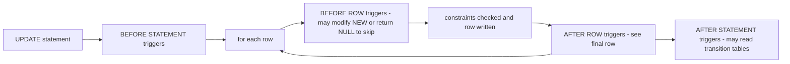
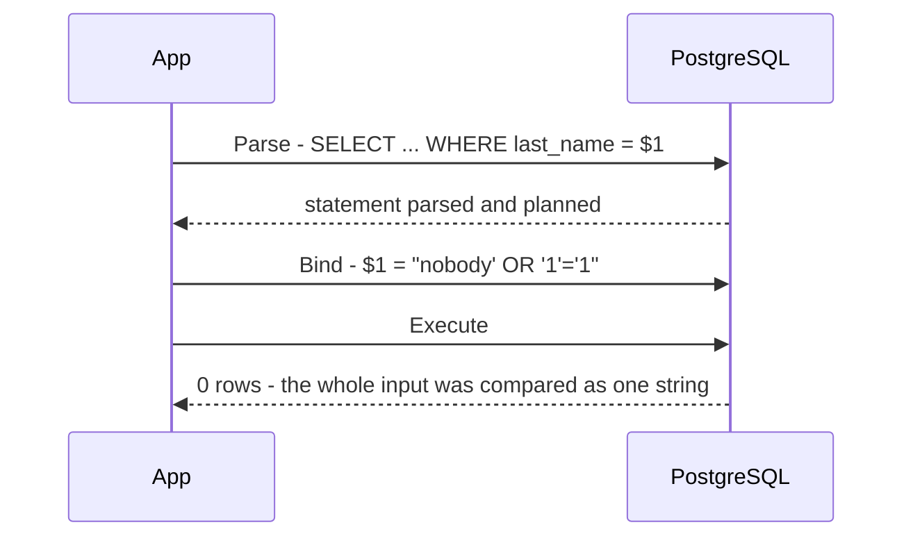
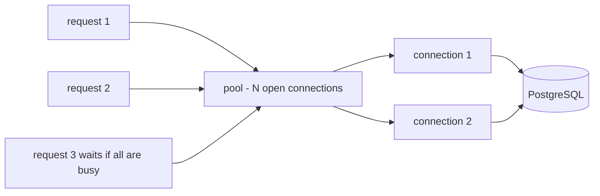

# Chapter 14 — Advanced SQL and Using SQL from Code

Real systems go beyond queries typed into `psql`: the database runs **code of its own** (functions, procedures, triggers), stores **semi-structured data** whose shape varies by row (JSON, arrays, searchable text), protects data **per user and per row**, and is driven by **application programs** in Python, Java and other languages. This chapter covers those "last mile" skills.

**What you'll learn:** functions and procedures in SQL and PL/pgSQL, and when logic belongs in the database · triggers (`updated_at`, validation, a generic audit log, statement-level) · JSON/JSONB and arrays: store, query, update, index · full-text search (`tsvector`/`tsquery`, ranking, highlighting) · pivot/unpivot (`FILTER`, `CASE`, `crosstab`, `LATERAL`) · roles, `GRANT`/`REVOKE`, column privileges, row-level security · SQL injection, seen succeeding then fixed with parameters · Python (`psycopg`, `sqlite3`) and Java (JDBC): parameters, transactions, batches, streaming · connection pooling, ORMs vs SQL.

**How to run the examples.** Everything in [`code/`](code/) runs on the book's PostgreSQL 14 server (port 5544). The shared sample database from [Chapter 1](../01-databases-and-the-relational-model/README.md) — an office-gear company with `departments`, `employees`, `customers`, `products`, `orders`, `order_items` — loads first from [`code/00_schema.sql`](code/00_schema.sql); each numbered file runs in a fresh database.

```bash
bash tools_run_sql.sh sql '14-*'                                    # all SQL files of this chapter
.venv-books/bin/python sql/chapters/14-advanced-sql-and-using-sql-from-code/code/psycopg_demo.py
python3 sql/chapters/14-advanced-sql-and-using-sql-from-code/code/sqlite3_demo.py
java --enable-native-access=ALL-UNNAMED -cp '.java-books/lib/*' \
     sql/chapters/14-advanced-sql-and-using-sql-from-code/code/JdbcDemo.java
```

---

## 14.1 User-defined functions

### What it is

A **user-defined function** (UDF) is named logic stored *inside* the database that takes arguments and returns a value (or a set of rows), called from SQL like `upper()` or `round()`. PostgreSQL bodies can be written in several **procedural languages**:

| Language | What the body looks like | Use it for |
|---|---|---|
| `sql` | One or more SQL statements; the last one's result is returned | Short calculations and reusable queries; the planner can often *inline* them (paste the body into the calling query) |
| `plpgsql` | PL/pgSQL: SQL plus variables, `IF`, loops, error handling | Branches, loops, several steps |
| `plpython3u`, `plperl`, … | Other languages (extensions, often "untrusted" = superuser-only) | Rare; needs the extension |

**Why it matters:** one definition of a rule ("line total = qty × price × (1 − discount)") used by every report and app; fewer network round trips for multi-step operations; set-returning functions can be joined like tables.

### How it works

1. `CREATE FUNCTION name(args) RETURNS type LANGUAGE … AS $$ body $$` stores it in the catalog (`pg_proc`).
2. `$$ … $$` is **dollar quoting**: a string literal whose inner single quotes need no escaping.
3. Arguments may have a `DEFAULT`; callers pass by position or by name (`p_limit => 1`).
4. A **volatility** label tells the planner how the function behaves, affecting optimisation and index use:

| Label | Promise | Example |
|---|---|---|
| `IMMUTABLE` | Same inputs → same result forever; reads no tables | `line_total(2, 10, 0)` |
| `STABLE` | Same result within one statement; may read tables | "tier of customer 3" |
| `VOLATILE` (default) | Anything may change; may modify data | `random()`, a function that inserts rows |

Only `IMMUTABLE` functions can appear in an index expression; marking a table-reading function `IMMUTABLE` gives wrong, cached-looking results.

### Example — SQL and PL/pgSQL functions

From [`code/01_functions.sql`](code/01_functions.sql):

```sql
-- (a) A plain SQL function, SQL-standard body (PostgreSQL 14+)
CREATE FUNCTION line_total(qty integer, price numeric, disc numeric DEFAULT 0)
RETURNS numeric
LANGUAGE sql IMMUTABLE
RETURN round(qty * price * (1 - disc), 2);

-- (b) PL/pgSQL: variables, IF, SELECT ... INTO, RAISE
CREATE FUNCTION customer_tier(p_customer_id integer)
RETURNS text
LANGUAGE plpgsql STABLE
AS $$
DECLARE
    v_spent numeric;
BEGIN
    IF NOT EXISTS (SELECT 1 FROM customers WHERE customer_id = p_customer_id) THEN
        RAISE EXCEPTION 'customer % does not exist', p_customer_id
              USING ERRCODE = 'no_data_found';
    END IF;

    SELECT coalesce(sum(line_total(oi.quantity, oi.unit_price, oi.discount)), 0)
    INTO   v_spent
    FROM   orders o JOIN order_items oi USING (order_id)
    WHERE  o.customer_id = p_customer_id AND o.status <> 'cancelled';

    RETURN CASE WHEN v_spent >= 1500 THEN 'gold'
                WHEN v_spent >= 300  THEN 'silver'
                ELSE 'bronze' END;
END;
$$;

SELECT customer_id, first_name, customer_tier(customer_id) AS tier
FROM   customers ORDER BY customer_id LIMIT 5;
```

```text
 customer_id | first_name |  tier
-------------+------------+--------
           1 | Anita      | gold
           2 | Ben        | gold
           3 | Chen       | bronze
           4 | Divya      | bronze
           5 | Ethan      | silver
```

`DECLARE` lists local variables; `SELECT … INTO v_spent` stores a result; `RAISE EXCEPTION … USING ERRCODE` aborts with a chosen SQLSTATE (`%` is replaced by the next argument); `RAISE NOTICE` only prints.

**Catching errors.** `BEGIN … EXCEPTION WHEN no_data_found THEN … END` catches errors raised inside (`SQLERRM` holds the message): the file's `safe_tier(999)` returns `unknown (customer 999 does not exist)`. An `EXCEPTION` block silently creates a **savepoint** on entry, so it costs a little — don't wrap every statement.

**Set-returning functions.** `RETURNS TABLE (...)` makes a function usable in `FROM`, like a parameterised view:

```sql
CREATE FUNCTION top_products(p_limit integer DEFAULT 3)
RETURNS TABLE (product text, units bigint, revenue numeric)
LANGUAGE sql STABLE AS $$
    SELECT p.name, sum(oi.quantity), sum(line_total(oi.quantity, oi.unit_price, oi.discount))
    FROM   order_items oi JOIN orders o USING (order_id) JOIN products p USING (product_id)
    WHERE  o.status <> 'cancelled'
    GROUP  BY p.name ORDER BY 3 DESC LIMIT p_limit
$$;
SELECT * FROM top_products(p_limit => 1);  -- named argument; top_products() uses the default 3
```

```text
    product    | units | revenue
---------------+-------+---------
 Laptop Pro 14 |     3 | 3782.05
```

PL/pgSQL can instead loop (`FOR r IN SELECT … LOOP`) and emit rows with `RETURN NEXT` — the file's `salary_bands(50000)` counts employees per 50,000 band. **One-off code:** `DO $$ … $$;` runs an anonymous block once (the file prints `NOTICE: pending orders: 2`), then inspects the catalog (`prokind` `f` = function, `provolatile` `i`/`s`/`v`).

| | PostgreSQL | MySQL | SQL Server | SQLite |
|---|---|---|---|---|
| Stored functions | `CREATE FUNCTION`, many languages | `CREATE FUNCTION` (SQL/PSM style) | `CREATE FUNCTION` (T-SQL), scalar and table-valued | None in SQL; register from the host program (Python's `conn.create_function`) |
| Replace | `CREATE OR REPLACE FUNCTION` | `DROP` then `CREATE` | `CREATE OR ALTER` | — |
| Error raising | `RAISE EXCEPTION` | `SIGNAL SQLSTATE` | `THROW` | `RAISE()` only inside triggers |

**Common mistakes:** wrong volatility (stale results, or blocked optimisations for a pure calculation left `VOLATILE`); hiding row-by-row loops in functions (a query-running function called per row of a million-row table runs a million queries — a set-based `JOIN` is far faster); name clashes between PL/pgSQL variables and columns (`WHERE customer_id = customer_id`) — prefix `p_` and `v_`.

### In the interview

**30-second answer:** "A UDF packages logic in the database so it's reused and runs next to the data. In Postgres I'd use a `LANGUAGE sql` function for simple expressions — it can be inlined — and PL/pgSQL for branching or loops. I'd set the right volatility, keep heavy business rules in the application unless they guard data integrity, and prefer set-based SQL over per-row function calls."

- *Function vs view?* → A view has no parameters; a set-returning function does. For a fixed query a view is simpler and fully optimisable.
- *Index `lower(email)` with my own function?* → Only if it is `IMMUTABLE`.
- *Can a `STABLE` function update a table?* → It shouldn't (it promises not to); use `VOLATILE`.
- *Return several rows?* → `RETURNS TABLE(...)` / `RETURNS SETOF type`, with a query body or `RETURN NEXT` / `RETURN QUERY`.

### TL;DR

Functions are named, reusable logic stored in the database: `sql` for simple, `plpgsql` for procedural. Label volatility honestly, prefix variable names, and don't replace set-based SQL with row-by-row calls.

---

## 14.2 Stored procedures

### What it is

A **stored procedure** *does* something rather than *computes* something: run with `CALL`, it returns nothing (except through `INOUT`/`OUT` parameters) and — the key difference in PostgreSQL (procedures since version 11) — may **commit or roll back inside its body**.

| | Function | Procedure |
|---|---|---|
| Invoked by | `SELECT f(...)`, inside any expression | `CALL p(...)` only |
| Returns | A value or a set of rows | Nothing; results via `INOUT` / `OUT` parameters |
| `COMMIT` / `ROLLBACK` inside | Not allowed — runs inside the caller's transaction | Allowed when called outside an explicit transaction block |
| Typical use | Calculations, reusable queries, trigger bodies | Batch jobs, maintenance, multi-step operations |

**Why it matters:** long batch jobs (archive a year of orders, back-fill a column) should commit in **chunks** — one giant transaction holds locks long, keeps old row versions alive (blocking vacuum, [Chapter 13](../13-transactions-and-concurrency/README.md#1314-multiversion-concurrency-control-mvcc)), and loses everything if it fails at the end.

### Example — archiving in committed batches

From [`code/02_procedures.sql`](code/02_procedures.sql):

```sql
CREATE TABLE orders_archive (LIKE orders INCLUDING ALL);

CREATE PROCEDURE archive_delivered(p_before date, p_batch int, INOUT moved int DEFAULT 0)
LANGUAGE plpgsql AS $$
DECLARE n int;
BEGIN
    LOOP
        WITH picked AS (
            SELECT order_id FROM orders
            WHERE  status = 'delivered' AND placed_at < p_before
              AND  order_id NOT IN (SELECT order_id FROM orders_archive)
            ORDER  BY order_id LIMIT p_batch
        )
        INSERT INTO orders_archive
        SELECT o.* FROM orders o JOIN picked USING (order_id);
        GET DIAGNOSTICS n = ROW_COUNT;     -- rows affected by the last statement
        EXIT WHEN n = 0;
        moved := moved + n;
        RAISE NOTICE 'batch of % committed', n;
        COMMIT;
    END LOOP;
END;
$$;

CALL archive_delivered('2025-04-01', 2);
```

```text
NOTICE:  batch of 2 committed
NOTICE:  batch of 2 committed
NOTICE:  batch of 1 committed
 moved
-------
     5
```

The five delivered orders before April 2025 (101, 102, 103, 104, 106) were copied in three committed batches; the `INOUT` parameter came back as a one-row result.

**The catch.** Inside a caller's transaction (`BEGIN; CALL …`) the procedure cannot end it:

```sql
BEGIN;
DO $$ DECLARE m int := 0; BEGIN
    CALL archive_delivered('2025-12-31', 2, m);
EXCEPTION WHEN invalid_transaction_termination THEN
    RAISE NOTICE 'caught: %', SQLERRM;
END $$;
ROLLBACK;
```

```text
NOTICE:  batch of 2 committed
NOTICE:  caught: invalid transaction termination
```

The first `NOTICE` prints before the `COMMIT` fails — misleading, which is why the file rolls everything back. Many drivers open a transaction automatically (14.10), so a committing procedure must be called in **autocommit** mode.

| | Syntax | Transaction control inside |
|---|---|---|
| PostgreSQL 11+ | `CREATE PROCEDURE … ; CALL p()` | Yes, if not called inside a transaction block |
| MySQL | `CREATE PROCEDURE` (the `mysql` client needs `DELIMITER //` to change the statement terminator from `;`); `CALL p()` | Yes |
| SQL Server | `CREATE PROCEDURE`; `EXEC p` | Yes; can also return result sets directly |
| SQLite | No stored procedures | — |

**When not to use it:** procedures tie logic to one product, are harder to unit-test, version and deploy than application code, and scale only as far as the database server. Balanced rule: **integrity rules and data-heavy batch work in the database; business workflows in the application.**

- *Value back from a procedure?* → An `INOUT` (or, from PG 14, `OUT`) parameter.
- *Why does `COMMIT` in a procedure sometimes fail?* → The caller is already in a transaction block.
- *Why commit in batches?* → Shorter locks, less bloat, completed work survives a later failure.

### TL;DR

Procedures are `CALL`ed, return through `INOUT` parameters, and can `COMMIT` inside — ideal for batch jobs, but only when called in autocommit mode.

---

## 14.3 Triggers

### What it is

A **trigger** says: "whenever *this event* happens on *this table*, run *this function* automatically". Events: `INSERT`, `UPDATE`, `DELETE`, `TRUNCATE`.

| Choice | Options | Meaning |
|---|---|---|
| Timing | `BEFORE` / `AFTER` / `INSTEAD OF` (views only) | Before the write (can change or skip the row), after it (can react), or replacing the write on a view |
| Level | `FOR EACH ROW` / `FOR EACH STATEMENT` | Once per affected row, or once per statement (even for 0 rows) |
| Condition | `WHEN (…)` | Fire only if the condition on `OLD` / `NEW` is true |
| Column filter | `UPDATE OF col` | Fire only when those columns are named in the `UPDATE` |

In a row trigger `NEW` is the new row (INSERT/UPDATE), `OLD` the previous one (UPDATE/DELETE); `TG_OP`, `TG_TABLE_NAME` and friends describe the event. The function is declared `RETURNS trigger`.



**Why it matters:** triggers enforce behaviour **whichever application, script or person** changes the data: an `updated_at` stamp, an audit trail, a denormalised counter kept in sync, a rule a `CHECK` can't express because it needs another table.

### Example 1 — `updated_at`

From [`code/03_triggers.sql`](code/03_triggers.sql):

```sql
ALTER TABLE products ADD COLUMN updated_at timestamptz NOT NULL DEFAULT '2025-01-01 00:00+00';

CREATE FUNCTION set_updated_at() RETURNS trigger
LANGUAGE plpgsql AS $$
BEGIN
    NEW.updated_at := now();      -- change the row before it is written
    RETURN NEW;                   -- BEFORE row trigger: return the row to store (NULL = skip it)
END;
$$;

CREATE TRIGGER products_updated_at
BEFORE UPDATE ON products
FOR EACH ROW
WHEN (OLD.* IS DISTINCT FROM NEW.*)          -- skip no-op updates
EXECUTE FUNCTION set_updated_at();

UPDATE products SET unit_price = 22.99 WHERE product_id = 2;
UPDATE products SET unit_price = 35.00 WHERE product_id = 8;   -- same value as before
SELECT product_id, unit_price, updated_at > '2025-01-02' AS stamped_now
FROM   products WHERE product_id IN (2, 8) ORDER BY product_id;
```

```text
 product_id | unit_price | stamped_now
------------+------------+-------------
          2 |      22.99 | t
          8 |      35.00 | f
```

`EXECUTE FUNCTION` is the PostgreSQL 11+ spelling (`EXECUTE PROCEDURE` still accepted).

### Example 2 — a validation rule that needs another table

```sql
CREATE FUNCTION forbid_discontinued() RETURNS trigger
LANGUAGE plpgsql AS $$
BEGIN
    IF (SELECT discontinued FROM products WHERE product_id = NEW.product_id) THEN
        RAISE EXCEPTION 'product % is discontinued', NEW.product_id;
    END IF;
    RETURN NEW;
END;
$$;

CREATE TRIGGER order_items_check_product
BEFORE INSERT OR UPDATE OF product_id ON order_items
FOR EACH ROW EXECUTE FUNCTION forbid_discontinued();
-- inserting the discontinued Desk Lamp (id 8):
-- NOTICE:  rejected: product 8 is discontinued
```

### Example 3 — a generic audit log

One function serves any table, because `to_jsonb(OLD)` / `to_jsonb(NEW)` turn a whole row into JSON:

```sql
CREATE TABLE audit_log (
    id          bigint GENERATED ALWAYS AS IDENTITY PRIMARY KEY,
    table_name  text        NOT NULL,
    op          text        NOT NULL,
    changed_by  text        NOT NULL DEFAULT current_user,
    changed_at  timestamptz NOT NULL DEFAULT now(),
    old_row     jsonb,
    new_row     jsonb
);

CREATE FUNCTION audit_row() RETURNS trigger
LANGUAGE plpgsql AS $$
BEGIN
    INSERT INTO audit_log (table_name, op, old_row, new_row)
    VALUES (TG_TABLE_NAME, TG_OP,
            CASE WHEN TG_OP IN ('UPDATE','DELETE') THEN to_jsonb(OLD) END,
            CASE WHEN TG_OP IN ('INSERT','UPDATE') THEN to_jsonb(NEW) END);
    RETURN NULL;                  -- the return value of an AFTER trigger is ignored
END;
$$;

CREATE TRIGGER customers_audit
AFTER INSERT OR UPDATE OR DELETE ON customers
FOR EACH ROW EXECUTE FUNCTION audit_row();

INSERT INTO customers VALUES (11, 'Jia', 'Wong', 'jia.wong@mail.example', 'Singapore', 'Singapore', '2025-06-20');
UPDATE customers SET city = 'Mumbai' WHERE customer_id = 8;
DELETE FROM customers WHERE customer_id = 11;

SELECT id, table_name, op, changed_by, old_row ->> 'city' AS old_city, new_row ->> 'city' AS new_city
FROM   audit_log ORDER BY id;
```

```text
 id | table_name |   op   | changed_by | old_city  | new_city
----+------------+--------+------------+-----------+-----------
  1 | customers  | INSERT | postgres   |           | Singapore
  2 | customers  | UPDATE | postgres   | mumbai    | Mumbai
  3 | customers  | DELETE | postgres   | Singapore |
```

Which columns changed? Compare the JSON objects key by key:

```sql
SELECT n.key, o.value AS before, n.value AS after
FROM   audit_log a, jsonb_each(a.new_row) n
JOIN   jsonb_each(a.old_row) o USING (key)
WHERE  a.op = 'UPDATE' AND n.value IS DISTINCT FROM o.value;
```

```text
 key  |  before  |  after
------+----------+----------
 city | "mumbai" | "Mumbai"
```

The audit insert runs **in the same transaction** as the change, so a rolled-back change leaves no audit row — the log never lies.

### Example 4 — statement-level trigger with transition tables

A row trigger on a million-row `UPDATE` fires a million times. A **statement-level** trigger fires once and (PostgreSQL 10+) sees all changed rows through **transition tables**:

```sql
CREATE TRIGGER products_bulk_price
AFTER UPDATE ON products
REFERENCING OLD TABLE AS old_rows NEW TABLE AS new_rows
FOR EACH STATEMENT EXECUTE FUNCTION log_bulk_price_change();
-- the function reads new_rows / old_rows like tables (count, avg of price differences)

UPDATE products SET unit_price = unit_price * 1.10 WHERE category = 'Furniture';
-- NOTICE:  3 rows changed price, average change 29.47
```

| | PostgreSQL | MySQL | SQL Server | SQLite |
|---|---|---|---|---|
| Row-level | Yes | Yes (only kind) | No — statement-level only, with `inserted` / `deleted` pseudo-tables | Yes (only kind) |
| Statement-level | Yes (+ transition tables) | No | Yes (the only kind) | No |
| `INSTEAD OF` | On views | No | On tables and views | On views |
| Body | A separate trigger function | Inline SQL body | Inline T-SQL | Inline SQL body |

### When not to use it, and mistakes

- **Business workflows** (send an email, call a payment API): triggers run inside the transaction and must be fast — write an *outbox* row and let a background worker act on it (the **transactional outbox** pattern for reliable event publishing).
- When a **constraint** can do the job (`CHECK`, `FOREIGN KEY`, `UNIQUE`, generated column) — declarative, faster, visible in the schema.
- When the logic surprises people — "invisible" side effects are the top complaint about triggers.
- **Common mistakes:** forgetting `RETURN NEW` in a `BEFORE` row trigger (`NULL` silently **skips** the row); a trigger updating its own table and re-firing in a loop (guard with `WHEN` or `pg_trigger_depth()`); expecting row-level triggers on `TRUNCATE` (only statement-level `ON TRUNCATE` fires).

Real uses: compliance audit trails (who changed a salary), `updated_at` columns read by sync jobs, the outbox.

### In the interview

**30-second answer:** "A trigger runs a function automatically on INSERT/UPDATE/DELETE, before or after, per row or per statement. I use them for cross-cutting data rules — audit logs, timestamps, integrity checks a constraint can't express — and avoid them for business workflows because they're invisible and slow down writes."

- *BEFORE vs AFTER?* → BEFORE can modify or reject the row; AFTER sees the final row (after constraints) and is for reactions like auditing.
- *Does a trigger's work roll back with the statement?* → Yes, same transaction.
- *Audit a bulk update efficiently?* → Statement-level trigger with transition tables.
- *Record available in a DELETE trigger?* → `OLD` only. *Why `WHEN (OLD.* IS DISTINCT FROM NEW.*)`?* → Skips no-op updates, so `updated_at` changes only on real changes.

### TL;DR

Triggers = automatic functions on data events. Great for audit logs, `updated_at` and cross-table checks; keep them small, prefer constraints when possible, and never put slow external work in them.

---

## 14.4 JSON and JSONB

### What it is

**JSON** (JavaScript Object Notation) is the text format of web APIs: objects `{"key": value}`, arrays `[…]`, strings, numbers, booleans, `null`. PostgreSQL has two types:

| | `json` | `jsonb` ("JSON binary") |
|---|---|---|
| Storage | The exact text you sent | Parsed into a binary tree |
| Duplicate keys, whitespace, key order | Kept as written | Last duplicate wins; whitespace removed; keys reordered |
| Speed | Fast to store, re-parsed on every read | Slightly slower to store, fast to query |
| Operators & indexing | Few | Containment `@>`, key-exists `?`, GIN (inverted) indexes, SQL/JSON path |

Use **`jsonb`** unless you must keep the original text byte-for-byte.

```sql
SELECT '{"b":1, "a":2, "a":3}'::json AS as_json, '{"b":1, "a":2, "a":3}'::jsonb AS as_jsonb;
```

```text
        as_json        |     as_jsonb
-----------------------+------------------
 {"b":1, "a":2, "a":3} | {"a": 3, "b": 1}
```

**Why it matters:** some data is genuinely **semi-structured** — specs differ by category (a laptop has RAM, a desk a height range), webhook payloads change shape, preferences grow new keys. A `jsonb` column holds that without a column per attribute, while stable, important fields stay typed, constrained columns. Whole-document databases: [Chapter 16](../16-beyond-relational/README.md).

### Operators

| Operator / function | Returns | Example → result |
|---|---|---|
| `->` key or index | `jsonb` | `specs -> 'brand'` → `"Nimbus"` |
| `->>` key or index | `text` | `specs ->> 'brand'` → `Nimbus` |
| `#>` / `#>>` path | `jsonb` / `text` | `specs #>> '{screen,type}'` → `OLED` |
| `@>` contains | boolean | `specs @> '{"brand":"Nimbus"}'` |
| `?`, `?|`, `?&` | boolean | key exists / any of keys / all of keys (on an array: string **element** present) |
| `@?`, `@@` | boolean | SQL/JSON path exists / path predicate (PG 12+) |
| `||`, `-`, `#-` | `jsonb` | merge / remove key / remove path |
| `jsonb_set(doc, path, value)` | `jsonb` | replace or add a value at a path |

### Example — product specs

From [`code/04_jsonb.sql`](code/04_jsonb.sql) (adds `specs jsonb` for five products):

```sql
SELECT name,
       specs -> 'brand'                AS brand_json,
       specs ->> 'brand'               AS brand_text,
       specs #>> '{screen,type}'       AS screen_type,
       (specs ->> 'ram_gb')::int       AS ram_gb,
       specs -> 'ports' -> 0           AS first_port,
       jsonb_array_length(specs -> 'ports') AS n_ports
FROM   products WHERE specs ? 'ports' ORDER BY product_id;
```

```text
      name      | brand_json | brand_text | screen_type | ram_gb | first_port | n_ports
----------------+------------+------------+-------------+--------+------------+---------
 Laptop Pro 14  | "Nimbus"   | Nimbus     | OLED        |     16 | "usb-c"    |       2
 Wireless Mouse | "Clicko"   | Clicko     |             |        | "usb-a"    |       1
 USB-C Hub      | "Nimbus"   | Nimbus     |             |        | "usb-c"    |       4
```

`->` gives JSON (`"Nimbus"`), `->>` plain text; missing keys give `NULL`, not an error; compare numbers after casting (`(specs ->> 'ram_gb')::int`).

```sql
SELECT name FROM products WHERE specs @> '{"brand":"Nimbus"}';           -- Laptop Pro 14, USB-C Hub
SELECT name FROM products WHERE specs -> 'ports' ? 'hdmi';                -- Laptop Pro 14, USB-C Hub
SELECT name, jsonb_path_query_first(specs, '$.height_cm.max') AS max_height
FROM   products WHERE specs @@ '$.height_cm.max > 100';                   -- Standing Desk | 120
```

Updating — `jsonb` values are immutable, so each operation builds a new document:

```sql
UPDATE products SET specs = jsonb_set(specs, '{ram_gb}', '32')  WHERE product_id = 1;
UPDATE products SET specs = specs || '{"color":"black"}'         WHERE product_id = 2;
UPDATE products SET specs = specs - 'wireless'                   WHERE product_id = 7;
UPDATE products SET specs = specs #- '{screen,type}'             WHERE product_id = 1;
```

```text
 product_id |                                          specs
------------+-----------------------------------------------------------------------------------------
          1 | {"brand": "Nimbus", "ports": ["usb-c", "hdmi"], "ram_gb": 32, "screen": {"inches": 14}}
          2 | {"brand": "Clicko", "color": "black", "ports": ["usb-a"], "wireless": true}
          7 | {"brand": "Hushh", "battery_h": 30}
```

**Rows ↔ JSON.** `jsonb_build_object` + `jsonb_agg` build a nested API response in one query — for order 108: `{"items": [{"qty": 1, "product": "Laptop Pro 14"}, …], "status": "delivered", "order_id": 108}`. Back: `jsonb_to_recordset('[{"sku":"A1","qty":2},{"sku":"B7","qty":5}]') AS t(sku text, qty int)` gives rows `(A1, 2)`, `(B7, 5)`; `jsonb_each(doc)` gives `(key, value)` rows.

### Indexing

A **GIN** index (each key/value → the rows containing it) serves `@>`, `?`, `?|`, `?&` and path operators; a B-tree **expression index** serves equality and ranges on one extracted key. (The file disables sequential scans only because the demo table is tiny, and runs `VACUUM products` first: an index built over rows still carrying old versions from recent `UPDATE`s may be ignored by transactions with older snapshots. Reading plans: [Chapter 12](../12-indexes-storage-and-query-performance/README.md).)

```sql
CREATE INDEX products_specs_gin ON products USING gin (specs);
EXPLAIN (COSTS OFF) SELECT name FROM products WHERE specs @> '{"brand":"Nimbus"}';
CREATE INDEX products_brand_idx ON products ((specs ->> 'brand'));
EXPLAIN (COSTS OFF) SELECT name FROM products WHERE specs ->> 'brand' = 'Nimbus';
```

```text
 Bitmap Heap Scan on products
   Recheck Cond: (specs @> '{"brand": "Nimbus"}'::jsonb)
   ->  Bitmap Index Scan on products_specs_gin
         Index Cond: (specs @> '{"brand": "Nimbus"}'::jsonb)

 Index Scan using products_brand_idx on products
   Index Cond: ((specs ->> 'brand'::text) = 'Nimbus'::text)
```

The GIN index is *not* used for `specs ->> 'brand' = 'Nimbus'` — write `@>` or add the expression index.

| | Type | Extract text | Notes |
|---|---|---|---|
| PostgreSQL | `json`, `jsonb` | `->>`, `#>>`, `jsonb_path_query` | GIN indexes; `JSON_TABLE` and SQL/JSON query functions in PG 17 |
| MySQL 5.7+ | `JSON` (binary) | `->>`, `JSON_EXTRACT`, `JSON_UNQUOTE` | Index via generated columns or multi-valued indexes (8.0.17+) |
| SQL Server | `nvarchar` + `JSON_VALUE` / `OPENJSON`; native `json` type in SQL Server 2025 and Azure SQL | `JSON_VALUE(doc, '$.brand')` | Index a computed column |
| SQLite | `TEXT` with built-in JSON functions; binary JSONB since 3.45 | `->>` (3.38+), `json_extract` | Expression indexes |

**When not to use it:** fields that are known, always present, filtered or joined on, or need constraints belong in **real columns**. One JSON blob for everything is the "EAV / schemaless" antipattern (EAV = entity–attribute–value, every attribute a generic key/value pair): no types, no constraints, poor statistics. **Common mistakes:** comparing `->` output with text (`specs -> 'brand' = 'Nimbus'` fails, jsonb vs text — use `->>` or `@>`); sorting numbers as text (`'9' > '10'`); forgetting that updating one key still rewrites the whole row.

### In the interview

**30-second answer:** "I use `jsonb` for genuinely variable attributes alongside normal columns. I query with `->>` / `@>`, index with GIN for containment or a B-tree expression index for one hot key, and promote any field that becomes important to a real column."

- *json vs jsonb?* → jsonb is parsed, indexable, fast to query; json keeps exact text.
- *`'{"a":1}'::jsonb -> 'a'` vs `->> 'a'`?* → jsonb `1` vs text `'1'`. *Append a key?* → `specs || '{"k":"v"}'` or `jsonb_set`.

### TL;DR

`jsonb` + `->>`/`@>` + GIN = flexible attributes inside a relational table. Keep core fields as columns.

---

## 14.5 Arrays

An **array** column holds an ordered list of one type (`text[]`, `int[]`); arrays are **1-based**, and reading past the end returns `NULL` (`ARRAY[10,20][0]` → `NULL`). From [`code/05_arrays.sql`](code/05_arrays.sql):

```sql
ALTER TABLE products ADD COLUMN tags text[] NOT NULL DEFAULT '{}';
UPDATE products SET tags = CASE product_id
    WHEN 1 THEN ARRAY['laptop','work','premium']
    WHEN 2 THEN '{mouse,wireless,budget}'          -- text literal form
    WHEN 4 THEN ARRAY['keyboard','work']
    WHEN 5 THEN ARRAY['desk','work','premium']
    WHEN 7 THEN ARRAY['audio','wireless','premium']
    ELSE '{}' END;

SELECT name, tags, tags[1] AS first_tag, tags[2:3] AS slice, cardinality(tags) AS n, tags[9] AS no_such
FROM   products WHERE product_id IN (1, 2, 9) ORDER BY product_id;
```

```text
      name      |          tags           | first_tag |       slice       | n | no_such
----------------+-------------------------+-----------+-------------------+---+---------
 Laptop Pro 14  | {laptop,work,premium}   | laptop    | {work,premium}    | 3 |
 Wireless Mouse | {mouse,wireless,budget} | mouse     | {wireless,budget} | 3 |
 Gift Card      | {}                      |           | {}                | 0 |
```

| Operation | Syntax | Result in the demo |
|---|---|---|
| Element in array | `'premium' = ANY (tags)` | Laptop, Headphones, Desk |
| Contains all | `tags @> ARRAY['work','premium']` | Laptop, Desk |
| Overlaps (any in common) | `tags && ARRAY['wireless','keyboard']` | Keyboard, Headphones, Mouse |
| Append / remove | `array_append(a, x)`, `array_remove(a, x)` | `{a,b,c}`, `{b}` |
| Concatenate / find | `a || b`, `array_position(a, x)` | `{1,2,3}`, `2` |
| Array ↔ rows | `unnest(a) WITH ORDINALITY`, `array_agg(x ORDER BY …)` | see below |
| Array ↔ string | `string_to_array(s, ',')`, `array_to_string(a, ' | ')` | `{red,green,blue}`, `a | b` |

`unnest` and `array_agg` are opposites; together they answer "which tags are popular?":

```sql
SELECT tag, count(*) AS products, array_agg(name ORDER BY name) AS which
FROM   products, unnest(tags) AS tag
GROUP  BY tag HAVING count(*) > 1 ORDER BY products DESC, tag;
```

```text
   tag    | products |                              which
----------+----------+-----------------------------------------------------------------
 premium  |        3 | {"Laptop Pro 14","Noise-Cancelling Headphones","Standing Desk"}
 work     |        3 | {"Laptop Pro 14","Mechanical Keyboard","Standing Desk"}
 wireless |        2 | {"Noise-Cancelling Headphones","Wireless Mouse"}
```

**Arrays as a parameter.** For "rows whose id is in this list", don't build `IN (3, 5, 7)` as a string (injection risk, 14.9, and a new statement per list length) — pass **one array**: `WHERE product_id = ANY ($1)`. The file shows `PREPARE by_ids(int[])` / `EXECUTE by_ids('{3,5,7}')` (a server-side prepared statement: parsed once, run with different values) returning USB-C Hub, Standing Desk and Noise-Cancelling Headphones. A GIN index on `tags` serves `@>`, `&&` and `<@` (`Bitmap Index Scan on products_tags_gin`).

**When not to use it:** to **join** on elements, enforce **foreign keys** on them, or update single elements often, use a child table (`product_tags(product_id, tag)`) — what first normal form ([§11.7](../11-normalization/README.md#117-first-normal-form-1nf)) recommends. Arrays suit small, read-mostly lists like tags. MySQL, SQL Server and SQLite have no array type (JSON arrays or a child table). `x = ANY(arr)` tests one value; `arr @> other` tests every element of `other`.

### TL;DR

Arrays: 1-based lists in one column; query with `ANY`, `@>`, `&&`, explode with `unnest`, build with `array_agg`, index with GIN; use a child table when elements need relationships.

---

## 14.6 Full-text search

### What it is

**Full-text search** (FTS) matches *words* — ignoring case, endings and filler words — and ranks documents by relevance.

| Term | Meaning |
|---|---|
| **Lexeme** | A normalised word: lower-cased and **stemmed** ("shipping", "shipped" → `ship`) |
| **Stop word** | A very common word ("the", "and", "was") that is dropped |
| `tsvector` | A document as sorted lexemes with positions: `'chair':2 'ship':4,8` |
| `tsquery` | A search: lexemes joined by `&` (and), `|` (or), `!` (not), `<->` (followed by) |
| `@@` | "Does this vector match this query?" |
| Text search configuration | Language rules, e.g. `'english'` (stemmer + stop-word list) |

**Why it matters:** `LIKE '%word%'` has no stemming ("returning" misses "returned"), no ranking, and a leading `%` can't use a B-tree. FTS fixes all three and often postpones a separate search engine (Elasticsearch/OpenSearch).

### How it works

1. `to_tsvector('english', text)` parses, drops stop words, stems the rest.
2. Build a `tsquery` from input: `to_tsquery` (operator syntax `'ship & chair'`; errors on bad syntax), `plainto_tsquery` (all words ANDed), `websearch_to_tsquery` (PG 11+, Google-like: quotes for phrases, `or`, `-` to exclude; never errors on user input).
3. `vector @@ query` tests a match; `ts_rank` scores; `ts_headline` highlights.
4. A GIN index on the `tsvector` makes matching fast.

From [`code/06_full_text_search.sql`](code/06_full_text_search.sql):

```sql
SELECT to_tsvector('english', 'The chairs were shipped quickly and the shipping was free') AS doc;
SELECT to_tsquery('english', 'shipping & chair')                          AS q1,
       plainto_tsquery('english', 'fast shipping chairs')                 AS q2,
       websearch_to_tsquery('english', '"standing desk" -cheap or lamp')  AS q3;
```

```text
                   doc
------------------------------------------
 'chair':2 'free':10 'quick':5 'ship':4,8

        q1        |            q2             |                   q3
------------------+---------------------------+----------------------------------------
 'ship' & 'chair' | 'fast' & 'ship' & 'chair' | 'stand' <-> 'desk' & !'cheap' | 'lamp'
```

### Example — a help-centre search

The search vector is a **generated column** (computed from other columns on every write; PostgreSQL 12+), so it never goes stale; `setweight` marks title words `A` (most important) and body words `B`, which `ts_rank` rewards:

```sql
CREATE TABLE help_articles (
    id     int PRIMARY KEY,
    title  text NOT NULL,
    body   text NOT NULL,
    search tsvector GENERATED ALWAYS AS (
             setweight(to_tsvector('english', title), 'A') ||
             setweight(to_tsvector('english', body),  'B')) STORED
);
-- 5 articles: 'Returning a chair', 'Standing desk assembly', 'Shipping times',
--             'Keyboard not connecting', 'Cheap desk lamps discontinued'

SELECT id, title, round(ts_rank(search, q)::numeric, 3) AS rank
FROM   help_articles, websearch_to_tsquery('english', 'chair shipping') AS q
WHERE  search @@ q
ORDER  BY rank DESC, id;
```

```text
 id |       title       | rank
----+-------------------+-------
  1 | Returning a chair | 0.588
  3 | Shipping times    | 0.529
```

| Query | Matches | Why |
|---|---|---|
| `to_tsquery('english', 'assem:*')` | 2 Standing desk assembly | `:*` = prefix match (autocomplete) |
| `websearch_to_tsquery('english', '"standing desk"')` | 2 | Phrase: `stand <-> desk` |
| `websearch_to_tsquery('english', 'desk -lamp')` | 2, 3 | Article 5 excluded by `-lamp` |

Highlighting shows *why* a result matched:

```sql
SELECT id, ts_headline('english', body, websearch_to_tsquery('english', 'desk chair'),
                       'StartSel=[, StopSel=], MaxWords=12, MinWords=5') AS snippet
FROM   help_articles WHERE search @@ websearch_to_tsquery('english', 'desk chair');
```

```text
 id |              snippet
----+-----------------------------------
  3 | [desk] or [chair] ships in a week
```

Stemming in action — no body contains "returning", but article 1 has "returned" and "returns":

```text
 like_hits | fts_hits          -- body ILIKE '%returning%'  vs  to_tsvector(body) @@ 'returning'
-----------+----------
         0 |        1
```

With `CREATE INDEX … USING gin (search)` the plan becomes `Bitmap Index Scan on help_articles_search_gin`.

| | PostgreSQL FTS | Dedicated engine (Elasticsearch / OpenSearch / Solr) |
|---|---|---|
| Setup | None — same database, same transaction | Separate cluster plus a sync pipeline |
| Freshness | Immediately consistent | Near-real-time, eventually consistent |
| Features | Stemming, ranking, phrases, prefixes, weights | Fuzzy/typo tolerance, facets (match counts per category, shown as filters), synonyms at scale, relevance tuning, distributed scoring |
| Best for | Up to millions of documents, app-level search | Very large corpora, search-centric products |

Typo tolerance in Postgres needs `pg_trgm` (trigram similarity, [§12.13](../12-indexes-storage-and-query-performance/README.md#1213-anti-patterns-that-disable-indexes)), not installed on the book's server. Elsewhere: MySQL `FULLTEXT` with `MATCH … AGAINST`, SQL Server full-text catalogs with `CONTAINS` / `FREETEXT`, SQLite `FTS5` virtual tables.

**Common mistakes:** indexing with `to_tsvector('english', …)` but querying `to_tsvector(body)` (default config) — the index isn't used, so always name the configuration; raw user input to `to_tsquery` (a stray `&` or `(` is a syntax error — use `websearch_to_tsquery`); computing `to_tsvector` per query instead of storing and indexing it.

### In the interview

**30-second answer:** "Postgres FTS turns text into a `tsvector` of stemmed lexemes and matches a `tsquery` with `@@`. I store the vector as a weighted generated column, index it with GIN, parse user input with `websearch_to_tsquery`, and rank with `ts_rank`. I'd move to Elasticsearch only when I need fuzzy matching, facets or scale beyond one database."

- *Why does "shipping" match "shipped"?* → Both stem to `ship`. *Titles count more?* → `setweight(…, 'A')`; `ts_rank` weights A highest.

### TL;DR

FTS = `tsvector @@ tsquery` + GIN + `ts_rank` + `ts_headline`; beats `LIKE` on stemming, ranking and speed.

---

## 14.7 Pivot and unpivot

**Pivoting** turns *values in rows* into *columns* (one row per category, one column per month); **unpivoting** turns a wide table tall again. Databases prefer tall data; reports prefer wide. Standard SQL has no `PIVOT`, so pivots use conditional aggregation ([§4.4](../04-aggregation/README.md#44-conditional-aggregation-filter-and-case)).

From [`code/07_pivot.sql`](code/07_pivot.sql); a view supplies tall `category, month, revenue`:

```sql
SELECT category,
       round(sum(revenue) FILTER (WHERE month = '2025-01'), 2) AS jan,
       round(sum(revenue) FILTER (WHERE month = '2025-02'), 2) AS feb,
       round(sum(revenue) FILTER (WHERE month = '2025-03'), 2) AS mar,
       round(sum(revenue) FILTER (WHERE month = '2025-04'), 2) AS apr,
       round(sum(revenue), 2)                                  AS all_months
FROM   monthly_category_revenue
GROUP  BY category ORDER BY category;
```

```text
  category   |   jan   |  feb   |  mar   |   apr   | all_months
-------------+---------+--------+--------+---------+------------
 (none)      |         |        | 100.00 |         |     100.00
 Accessories |  188.00 |        |        |  200.80 |     671.35
 Electronics | 1683.90 |        |  74.97 | 1448.95 |    4691.80
 Furniture   |         | 811.49 | 629.98 |  499.00 |    1940.47
```

(`all_months` also includes May and June.) The portable form puts `CASE` inside the aggregate — `sum(CASE WHEN month = '2025-01' THEN revenue ELSE 0 END) AS jan` — and with `ELSE 0` empty cells show `0.00` instead of `NULL`. The same technique counts statuses per customer (`count(*) FILTER (WHERE o.status = 'delivered') AS delivered`, …).

**`crosstab(source_sql, category_sql)`** (tablefunc extension) pivots a three-column query (row id, category, value). Not installed on the book's server (Homebrew's build ships without it), so not run:

```sql
-- (PostgreSQL with contrib — not run)
CREATE EXTENSION IF NOT EXISTS tablefunc;
SELECT *
FROM crosstab(
  $$ SELECT category, month, round(revenue, 2) FROM monthly_category_revenue ORDER BY 1, 2 $$,
  $$ VALUES ('2025-01'), ('2025-02'), ('2025-03'), ('2025-04') $$
) AS ct(category text, jan numeric, feb numeric, mar numeric, apr numeric);
```

Output columns and types must still be listed in `AS ct(...)`; the two-argument form places each value in the right column even when some categories are missing. `FILTER` / `CASE` does the same without an extension, so most teams use them.

**Unpivot with `LATERAL (VALUES …)`** (`LATERAL`, [§6.7](../06-subqueries-and-set-operations/README.md#67-lateral-subqueries), lets `VALUES` read the current row):

```sql
CREATE TABLE quarterly_targets (region text PRIMARY KEY, q1 int, q2 int, q3 int, q4 int);
INSERT INTO quarterly_targets VALUES ('India', 120, 150, 170, 200), ('UK', 60, 65, NULL, 80);

SELECT t.region, v.quarter, v.target
FROM   quarterly_targets t
CROSS  JOIN LATERAL (VALUES ('Q1', t.q1), ('Q2', t.q2), ('Q3', t.q3), ('Q4', t.q4)) AS v(quarter, target)
WHERE  v.target IS NOT NULL
ORDER  BY t.region, v.quarter;
```

7 rows — four for India, three for the UK (its `NULL` Q3 filtered out). Portable alternative: `UNION ALL` of one `SELECT` per column.

**Dynamic pivots.** SQL needs the column list **at plan time**, so data-dependent columns (every month that exists) require building SQL in code (identifiers quoted, 14.9; full worked version in [§19.6.2](../19-sql-interview-problems-2/README.md#1962-dynamic-pivot-one-column-per-store)) or returning a JSON object per row:

```sql
SELECT category, jsonb_object_agg(month, round(revenue, 2) ORDER BY month) AS by_month
FROM   monthly_category_revenue GROUP BY category ORDER BY category;
```

```text
  category   |                          by_month
-------------+-----------------------------------------------------------
 (none)      | {"2025-03": 100.00}
 Accessories | {"2025-01": 188.00, "2025-04": 200.80, "2025-06": 282.55}
 ...           (Electronics and Furniture rows similar)
```

| | Pivot | Unpivot |
|---|---|---|
| PostgreSQL | `FILTER`, `CASE`, `crosstab` (tablefunc) | `LATERAL (VALUES …)`, `unnest` |
| SQL Server / Oracle | `PIVOT (SUM(x) FOR col IN (…))` operator | `UNPIVOT` operator (skips NULLs) |
| MySQL | `CASE` (or `SUM(cond)` since booleans are 0/1) | `UNION ALL`; `LATERAL` from 8.0.14 |
| SQLite | `FILTER` (3.30+) or `CASE` | `UNION ALL` |

### In the interview

**30-second answer:** "Pivot = group by the row key and write one conditional aggregate per output column — `SUM(x) FILTER (WHERE col = 'v')` or `SUM(CASE WHEN …)`. Unpivot = `CROSS JOIN LATERAL (VALUES …)` or `UNION ALL`. If the columns aren't known in advance, generate the SQL in code or return JSON."

- *`count(CASE WHEN … THEN 1 END)` vs `sum(CASE WHEN … THEN 1 ELSE 0 END)`?* → Same counts; `count` ignores the NULLs from the missing `ELSE`.

### TL;DR

Pivot with conditional aggregates, unpivot with `LATERAL (VALUES …)`; dynamic column lists need generated SQL or JSON.

---

## 14.8 Security: roles, privileges and row-level security

### What it is

- A **role** is PostgreSQL's single concept for *users* and *groups*: with `LOGIN` it can connect (a user); without, it is a group others belong to. Roles are **cluster-wide** (shared by all databases on a server).
- A **privilege** permits one action on one object: `SELECT`, `INSERT`, `UPDATE`, `DELETE`, `TRUNCATE`, `REFERENCES`, `TRIGGER` on tables; `USAGE`/`CREATE` on schemas; `EXECUTE` on functions; `CONNECT` on databases.
- `GRANT` gives, `REVOKE` takes away — the **DCL** statements ([§1.9](../01-databases-and-the-relational-model/README.md#19-what-sql-is)).
- **Row-level security (RLS)** adds *per-row* filters: two users read one table and see different rows.

**Why — the principle of least privilege:** every account gets only what it needs. A leaked reporting password can read reports, not delete orders; with an injection bug (14.9) a read-only role limits damage. RLS pushes tenant isolation ("customer A never sees customer B's data") into the database, so one forgotten `WHERE tenant_id = …` can't leak data.

### Example — groups, grants, column privileges

From [`code/08_security.sql`](code/08_security.sql) (roles prefixed `ch14_` and dropped at the end, since they are server-wide):

```sql
CREATE ROLE ch14_reporting NOLOGIN;                          -- a group
CREATE ROLE ch14_analyst  LOGIN IN ROLE ch14_reporting;      -- a user in that group
CREATE ROLE ch14_app      LOGIN;                             -- the application's account

GRANT SELECT ON orders, order_items TO ch14_reporting;
GRANT SELECT, INSERT, UPDATE ON orders TO ch14_app;
GRANT SELECT (customer_id, first_name, city, country) ON customers TO ch14_reporting;  -- column-level
```

`information_schema.role_table_grants` (`information_schema` = the SQL-standard catalog views) confirms: `ch14_app` has INSERT, SELECT, UPDATE on `orders`; `ch14_reporting` SELECT on `orders` and `order_items` (column grants appear in `information_schema.column_privileges`). `SET ROLE` lets a superuser act as another role for testing, with the same checks:

```sql
SET ROLE ch14_analyst;
SELECT count(*) FROM orders;                                        -- 14
SELECT first_name, city FROM customers WHERE customer_id = 1;      -- Anita | Mumbai
PERFORM email FROM customers;             -- NOTICE: analyst: permission denied for table customers
DELETE FROM orders WHERE order_id = 114;  -- NOTICE: analyst: permission denied for table orders
RESET ROLE;
REVOKE SELECT ON order_items FROM ch14_reporting;   -- analyst now denied on order_items too
```

(Failing statements are wrapped in `DO` blocks so the script continues; `PERFORM` runs a query and discards its result.) The analyst had no direct grants — privileges were **inherited** from the group, so revoking from the group affected every member: grant to groups, not individuals.

### Example — row-level security: each sales rep sees only their orders

```sql
CREATE ROLE ch14_priya LOGIN;      -- employee 7
CREATE ROLE ch14_arjun LOGIN;      -- employee 8
CREATE TABLE rep_logins (role_name text PRIMARY KEY, emp_id int NOT NULL REFERENCES employees);
INSERT INTO rep_logins VALUES ('ch14_priya', 7), ('ch14_arjun', 8);
GRANT SELECT ON rep_logins TO ch14_priya, ch14_arjun;
GRANT SELECT, UPDATE ON orders TO ch14_priya, ch14_arjun;

ALTER TABLE orders ENABLE ROW LEVEL SECURITY;          -- from now on: no matching policy = no rows

CREATE POLICY rep_sees_own_orders ON orders
    FOR ALL TO ch14_priya, ch14_arjun
    USING      (sales_rep_id = (SELECT emp_id FROM rep_logins WHERE role_name = current_user))
    WITH CHECK (sales_rep_id = (SELECT emp_id FROM rep_logins WHERE role_name = current_user));

CREATE POLICY reporting_reads_all ON orders FOR SELECT TO ch14_reporting USING (true);

SET ROLE ch14_priya;
SELECT current_user, order_id, sales_rep_id, status FROM orders ORDER BY order_id;
UPDATE orders SET status = 'shipped' WHERE order_id = 103;     -- Arjun's order
UPDATE orders SET sales_rep_id = 8 WHERE order_id = 101;       -- hand her order to Arjun (in a DO block)
```

```text
 current_user | order_id | sales_rep_id |  status
--------------+----------+--------------+-----------
 ch14_priya   |      101 |            7 | delivered
 ch14_priya   |      105 |            7 | cancelled
 ch14_priya   |      108 |            7 | delivered
 ch14_priya   |      113 |            7 | pending

UPDATE 0
NOTICE:  priya: new row violates row-level security policy for table "orders"
```

| Role | Policy that applies | `count(*)` from `orders` |
|---|---|---|
| `ch14_priya` | `rep_sees_own_orders` | 4 |
| `ch14_arjun` | `rep_sees_own_orders` | 2 |
| `ch14_analyst` (member of reporting) | `reporting_reads_all` | 14 |
| `ch14_app` | none — has `SELECT` but no policy (default deny) | **0** |
| `postgres` (superuser / owner) | bypasses RLS | 14 |

- **`USING`** filters which *existing* rows are visible (to `SELECT`, `UPDATE`, `DELETE`) — so updating order 103 found 0 rows rather than failing.
- **`WITH CHECK`** validates rows being *written* (`INSERT`, `UPDATE`) — so Priya can't move a row out of her view.
- Policies are **permissive** by default (combined with `OR`); `AS RESTRICTIVE` ones combine with `AND`.

### Multi-tenant isolation with a session setting

SaaS apps (one hosted app shared by many customer organisations) usually connect as **one** application role and tell the database the current request's tenant:

```sql
ALTER TABLE notes ENABLE ROW LEVEL SECURITY;
CREATE POLICY tenant_isolation ON notes
    USING (tenant = current_setting('app.tenant', true));    -- true: unset -> NULL, not an error

SET ROLE ch14_app;
SET app.tenant = 'acme';    SELECT * FROM notes;          -- only acme's 2 notes
SET app.tenant = 'globex';  SELECT * FROM notes;          -- only globex's note
RESET app.tenant;           SELECT count(*) FROM notes;   -- 0: no tenant, no rows
```

The app runs `SET LOCAL app.tenant = …` per transaction — `SET LOCAL` resets at commit, so it can't leak to the next request on a pooled connection (14.12).

**Common mistakes:** testing RLS as a superuser or the table owner (both bypass it — test with `SET ROLE`; `ALTER TABLE … FORCE ROW LEVEL SECURITY` filters the owner too); letting the app connect as superuser or owner; forgetting new tables aren't covered by old grants (`ALTER DEFAULT PRIVILEGES … GRANT …`); leaving the `PUBLIC` pseudo-role (every user belongs to it) with unintended rights (PG ≤ 14 lets everyone `CREATE` in the `public` schema; PG 15 removed that).

| | Roles / users | Row-level security |
|---|---|---|
| PostgreSQL | Roles (users = roles with `LOGIN`) | `CREATE POLICY` (9.5+) |
| MySQL 8.0 | Users + roles | None built in — views or app logic |
| SQL Server 2016+ | Logins, users, roles | Security policies with inline predicate functions |
| Oracle | Users, roles | Virtual Private Database (VPD) |
| SQLite | No users — file-system permissions only | None |

### In the interview

**30-second answer:** "I apply least privilege: group roles that hold grants, login roles as members, the app gets only the DML it needs, reporting gets read-only, and nobody uses the superuser from code. For multi-tenant data I add row-level security keyed on a session variable, test it with `SET ROLE` — never as owner — and keep a tenant_id index so the policy filter is cheap."

- *USING vs WITH CHECK?* → Visibility of existing rows vs validity of new/changed rows.
- *Why `SET LOCAL` with pooled connections?* → It ends with the transaction, so it can't leak to the next request.

### TL;DR

Roles + `GRANT`/`REVOKE` for what each account may do; RLS policies for which rows it may see or write; test as the real role, never as owner.

---

## 14.9 SQL injection and parameterized queries

### What it is

**SQL injection**: user input pasted into the *text* of a SQL statement changes its meaning. It has been in the OWASP (Open Worldwide Application Security Project) Top 10 web risks since the list began and caused real breaches (the 2015 TalkTalk breach in the UK, the 2023 MOVEit Transfer attacks). If code builds `SELECT … FROM customers WHERE last_name = '<input>'`, the input `nobody' OR '1'='1` yields `… WHERE last_name = 'nobody' OR '1'='1'` — always true.

### The fix — parameters

A **parameterized query** (*prepared statement*, *bind variables*) sends SQL with placeholders (`$1`, `?`, `%s`) and the values **separately**; the server parses first, then plugs values in as data, so input can never become syntax.



### Example — injection inside the database (dynamic SQL)

The same bug appears in PL/pgSQL when `EXECUTE` runs a built string. From [`code/09_sql_injection.sql`](code/09_sql_injection.sql):

```sql
-- VULNERABLE
CREATE FUNCTION find_customers_bad(p_last_name text)
RETURNS TABLE (customer_id int, first_name text, email text)
LANGUAGE plpgsql AS $$
BEGIN
    RETURN QUERY EXECUTE
        'SELECT customer_id, first_name, email FROM customers WHERE last_name = '''
        || p_last_name || '''';
END;
$$;
SELECT * FROM find_customers_bad('Carter');                 -- 1 row: Ben
SELECT * FROM find_customers_bad($$nobody' OR '1'='1$$);     -- 10 rows: every customer leaks

-- SAFE: the value is passed with USING, referenced as $1
CREATE FUNCTION find_customers_good(p_last_name text) ... AS $$
BEGIN
    RETURN QUERY EXECUTE
        'SELECT customer_id, first_name, email FROM customers WHERE last_name = $1'
        USING p_last_name;
END;
$$;
SELECT count(*) AS rows_leaked FROM find_customers_good($$nobody' OR '1'='1$$);   -- 0
```

**Identifiers can't be parameters** — placeholders stand for *values*, never table or column names. For a dynamic name, check an **allow-list** and quote with `format('%I')` (identifier; `%L` for a literal):

```sql
SELECT format('SELECT * FROM %I WHERE name = %L', 'Order Items', $$O'Brien$$);
--  SELECT * FROM "Order Items" WHERE name = 'O''Brien'
```

The file's `count_rows(p_table)` rejects any table outside `('orders','customers','products')` before building its query. SQL-level prepared statements work the same way: `PREPARE orders_of(int) AS … WHERE customer_id = $1; EXECUTE orders_of(2);`. The client-side versions (Python f-string vs `%s`, Java concatenation vs `PreparedStatement`, 14.10–14.11) all show **10 rows vs 0 rows**.

### Defence in depth

| Layer | Defence |
|---|---|
| Query | Parameters for every value; allow-list + `%I`/`quote_ident` for identifiers |
| Account | Least-privilege role (14.8) — injection can't drop tables the role can't touch |
| Data | RLS for tenant isolation |
| Code | Static analysis that flags string-built SQL; code review |
| Errors | Don't show raw database errors to users (they help map the schema) |

**Escaping by hand** (doubling quotes yourself) is fragile — character encodings and edge cases have broken it repeatedly. Use parameters.

### In the interview

**30-second answer:** "Injection is user input interpreted as SQL because it was concatenated into the query. The fix is parameterized queries — values travel separately and can't change the parse tree. For dynamic identifiers use an allow-list and identifier quoting. Add least privilege so a bug has limited blast radius. ORMs (14.13) parameterize by default, but their raw-SQL escape hatches are still injectable."

- *Do prepared statements help performance too?* → Yes — the server can reuse the parsed/planned statement.
- *Is `LIKE ?` safe?* → From injection yes, but `%` and `_` in the input still act as wildcards; escape them if they should be literal.

### TL;DR

Never build SQL from input strings; bind values as parameters, allow-list identifiers, and limit what the database account can do.

---

## 14.10 Using SQL from Python

### Drivers and the DB-API

Python drivers follow **DB-API 2.0** (PEP 249, a Python design document): `connect()` → a **connection** (a session) → **cursors** (run statements, hold results) → `execute()`, `fetchone()`, `fetchall()`, `commit()`, `rollback()`.

| | `psycopg` (version 3) | `sqlite3` |
|---|---|---|
| Database | PostgreSQL server | SQLite file or in-memory DB, in-process (no separate server) |
| Install | `pip install "psycopg[binary]"` (already in `.venv-books`) | Built into Python |
| Placeholder | `%s` or `%(name)s` (*never* Python `%` formatting) | `?` or `:name` |
| Transactions | Implicit `BEGIN` unless `autocommit=True`; `with conn.transaction():` blocks | Implicit transaction before DML; `with conn:` commits/rolls back |

`sqlite3` basics: [Python ch. 14](../../../python/chapters/14-standard-library-tour/README.md).

### Example — psycopg against the private server

Key parts of [`code/psycopg_demo.py`](code/psycopg_demo.py) (creates database `ch_14_code` and loads the shared schema):

```python
SERVER = "host=/tmp port=5544 user=postgres"       # Unix socket directory + port
DSN = SERVER + " dbname=ch_14_code"

# autocommit=True: each statement commits on its own, and conn.transaction() blocks are
# real BEGIN ... COMMIT/ROLLBACK units
with psycopg.connect(DSN, autocommit=True) as conn:
    # 1. parameters: values are sent separately from the SQL text
    cur = conn.execute(
        "SELECT first_name, city FROM customers WHERE country = %s AND signup_date >= %s ORDER BY customer_id",
        ("India", "2025-01-01"))
    for row in cur.fetchall():
        print("  ", row)
    with conn.cursor(row_factory=dict_row) as cur:              # rows as dicts
        cur.execute("SELECT name, unit_price FROM products WHERE unit_price > %(min)s ORDER BY unit_price DESC",
                    {"min": 300})

    # 2. injection: f-string vs parameter; identifiers via psycopg.sql
    evil = "nobody' OR '1'='1"
    conn.execute(f"SELECT count(*) FROM customers WHERE last_name = '{evil}'")      # NEVER
    conn.execute("SELECT count(*) FROM customers WHERE last_name = %s", (evil,))
    q = sql.SQL("SELECT {} FROM customers WHERE customer_id = %s").format(sql.Identifier("city"))

    # 3. a transaction: both updates or neither
    try:
        with conn.transaction():
            conn.execute("UPDATE products SET unit_price = unit_price * 0.9 WHERE category = 'Furniture'")
            conn.execute("UPDATE products SET unit_price = -1 WHERE product_id = 2")   # CHECK fails
    except psycopg.errors.CheckViolation as e:
        print("rolled back:", e.diag.message_primary)

    # 4. batch (executemany), bulk load (cur.copy("COPY ... FROM STDIN") + write_row),
    #    and a named = server-side cursor that streams rows in chunks
    with conn.transaction(), conn.cursor(name="big_scan") as cur:
        cur.itersize = 4                                            # rows per round trip
        cur.execute("SELECT g FROM generate_series(1, 10) g")
        print("streamed:", [r[0] for r in cur])
```

```text
connected to ch_14_code on port 5544 | server 14

== 1. query, fetch, parameters ==
customers: 10
   ('Chen', 'Bengaluru')
   ('Divya', 'Delhi')
   ('Fatima', None)
   ('Anita', 'mumbai')
   ('Ivan', 'Delhi')
dict rows: [{'name': 'Laptop Pro 14', 'unit_price': Decimal('1299.00')}, ...]   (3 dicts, shortened here)

== 2. SQL injection: string building vs parameters ==
built SQL : SELECT count(*) FROM customers WHERE last_name = 'nobody' OR '1'='1'
f-string  : 10 rows
parameter : 0 rows
composed  : SELECT "city" FROM customers WHERE customer_id = %s -> Bengaluru

== 3. transactions ==
rolled back: new row for relation "products" violates check constraint "products_unit_price_check"
desk price after rollback: 499.00
desk price after commit: 479.00

== 4. batch insert, COPY, streaming ==
executemany rowcount: 3
customers now: 16
streamed: [1, 2, 3, 4, 5, 6, 7, 8, 9, 10]

== 5. connection pooling ==
no pool : 20 requests used 20 server processes
pool(2) : 20 requests used 2 server processes
```

- **Type mapping**: `NULL` → `None`, `numeric` → `Decimal` (exact — never `float` for money), `date` → `datetime.date`.
- **Transactions**: the 10 % furniture discount rolled back with the failing update (desk still 499.00). Exceptions are typed by SQLSTATE (`CheckViolation`, `UniqueViolation`, …).
- **Bulk loading**, fastest last: one `execute` per row → `executemany` (psycopg 3 pipelines it, not waiting for each reply) → `COPY` (the bulk-load command).
- **Server-side cursor** (`conn.cursor(name=…)`): the result stays on the server and arrives in `itersize` chunks, so a 10-million-row export needs little memory.
- **Default transaction trap**: without `autocommit=True` psycopg sends `BEGIN` before your first statement and saves nothing until `conn.commit()` (or a normal exit from `with psycopg.connect(...)`). A forgotten commit, or a connection left "idle in transaction", is a classic bug.
- **Mistake:** `cur.execute("… = %s" % value)` is Python string formatting — injection again; pass values as the second argument.

### Example — sqlite3

[`code/sqlite3_demo.py`](code/sqlite3_demo.py) — same ideas, `?` placeholders, no server:

```python
conn = sqlite3.connect(":memory:")
conn.row_factory = sqlite3.Row
conn.execute("PRAGMA foreign_keys = ON")    # SQLite leaves FK checks off unless asked
...
with conn:                                   # commit on success, rollback on exception
    conn.executemany("INSERT INTO products (name, price, specs) VALUES (?, ?, ?)", rows)
for r in conn.execute("SELECT product_id, name, price FROM products WHERE price < :max ORDER BY price", {"max": 40}):
    print(dict(r))
```

```text
{'product_id': 1, 'name': 'Wireless Mouse', 'price': 24.99}
{'product_id': 3, 'name': 'Desk Lamp', 'price': 35.0}
rolled back: UNIQUE constraint failed: products.name
hub price: 49.5
f-string  rows: 3
parameter rows: 0
sqlite 3.53.4 | brands: ['Clicko', 'Nimbus']
```

(The version line shows the SQLite bundled with this Python.) `with conn:` in `sqlite3` manages the **transaction**, not closing — call `conn.close()` yourself.

---

## 14.11 Using SQL from Java (JDBC)

### What it is

**JDBC** (Java Database Connectivity) is Java's standard database API (`java.sql`); a vendor **driver** jar implements it — for PostgreSQL `org.postgresql:postgresql` (42.7.13 here, from Maven Central).

| Type | Role |
|---|---|
| `DriverManager` / `DataSource` | Hands out connections (`DataSource` is how pools plug in) |
| `Connection` | A session; controls autocommit, commit/rollback, isolation level |
| `PreparedStatement` | SQL with `?` placeholders, typed setters (`setString`, `setObject`, `setBigDecimal`) |
| `ResultSet` | A cursor over rows; `next()` + typed getters |
| `SQLException` | Errors, with `getSQLState()` (e.g. `23514` = check violation) |

Resources close via **try-with-resources** so connections never leak. Java side: [ch. 8 exceptions](../../../java/chapters/08-exceptions/README.md), [ch. 18 tooling & JDBC](../../../java/chapters/18-testing-build-and-tooling/README.md).

**Running it.** The jar lives in `.java-books/lib/`. The book's server listens only on a Unix socket (`/tmp/.s.PGSQL.5544`), so the URL adds the `junixsocket` socket factory (two more jars in that folder); against a normal server it is just `jdbc:postgresql://localhost:5544/ch_14_jdbc`. The `java` launcher compiles and runs a single source file (source-file mode, Java 11+; the book targets Java 25); the file starts with `// tools_run: skip` so the Java book's runner skips it:

```bash
java --enable-native-access=ALL-UNNAMED -cp '.java-books/lib/*' \
     sql/chapters/14-advanced-sql-and-using-sql-from-code/code/JdbcDemo.java
```

### Example — key parts of [`code/JdbcDemo.java`](code/JdbcDemo.java)

```java
// PreparedStatement: '?' placeholders, typed setters and getters
String sql = """
        SELECT first_name, city, signup_date
        FROM customers WHERE country = ? AND signup_date >= ? ORDER BY customer_id""";
try (PreparedStatement ps = conn.prepareStatement(sql)) {
    ps.setString(1, "India");
    ps.setObject(2, LocalDate.of(2025, 1, 1));               // java.time maps to DATE
    try (ResultSet rs = ps.executeQuery()) {
        while (rs.next()) {
            String city = rs.getString("city");               // SQL NULL -> Java null
            LocalDate d = rs.getObject("signup_date", LocalDate.class);
            ...
        }
    }
}

// Transaction: turn auto-commit off, commit or roll back as one unit
conn.setAutoCommit(false);
conn.setTransactionIsolation(Connection.TRANSACTION_REPEATABLE_READ);
try (PreparedStatement up = conn.prepareStatement(
        "UPDATE products SET unit_price = unit_price + ? WHERE product_id = ?")) {
    up.setBigDecimal(1, new BigDecimal("-10.00")); up.setInt(2, 5); up.executeUpdate();
    up.setBigDecimal(1, new BigDecimal("-99.00")); up.setInt(2, 2); up.executeUpdate(); // CHECK fails
    conn.commit();
} catch (SQLException e) {
    conn.rollback();                                           // undo BOTH updates
} finally {
    conn.setAutoCommit(true);
}

// Batch: setXxx(...) + ps.addBatch() per row, then int[] counts = ps.executeBatch(); conn.commit();
```

```text
connected: PostgreSQL 14.15 (Homebrew) via PostgreSQL JDBC Driver 42.7.13

== PreparedStatement ==
  Chen   Bengaluru  2025-01-08
  Divya  Delhi      2025-01-20
  Fatima (null)     2025-02-14
  Anita  mumbai     2025-03-09
  Ivan   Delhi      2025-05-30

== SQL injection ==
concatenated : 10 rows
parameterized: 0 rows

== transaction ==
rolled back, SQLState 23514: ERROR: new row for relation "products" violates check constraint "products_unit_price_check"
desk price unchanged: 499.00

== batch ==
batch update counts: [1, 1, 1]
  Monitor Arm -> 61.95
  Webcam HD -> 83.90
  Cable Tray -> 20.48
```

The last block used `UPDATE … RETURNING name, unit_price` with `executeQuery()` — `RETURNING` gives back computed values without a second query (`getGeneratedKeys()` is the portable alternative for new ids).

### Common mistakes (Python and Java alike)

- **Leaking connections** — not closing them (`with` / try-with-resources); the server runs out of slots.
- **`float`/`double` for money** — use `Decimal` / `BigDecimal`.
- **`getInt` returns `0` for SQL `NULL`** — use `getObject(col, Integer.class)` or check `rs.wasNull()`.
- **Autocommit surprises** — JDBC starts with autocommit *on*; psycopg *off*. Know which you're in.
- **One query per row** in a loop (N+1, 14.13) instead of a join or `= ANY(?)` with an array (`conn.createArrayOf("int", ids)`).

---

## 14.12 Connection pooling

### What it is

Opening a PostgreSQL connection is expensive: network handshake, TLS (encryption), authentication, and — PostgreSQL uses a **process per connection** — forking a new server process with its own memory. That costs milliseconds; a simple indexed query takes well under one. A **connection pool** opens a few connections once and **lends** them to requests.



`psycopg_demo.py`'s last section uses a 15-line `TinyPool` (a `queue.Queue` of open connections): 20 requests without a pool created **20 server processes**; with a pool of 2, **2**.

### How it works

1. At start-up the pool opens *min* connections.
2. A request **borrows** one (`getConnection()` / `pool.connection()`), waiting up to a timeout if all are busy.
3. It **returns** it; the pool resets session state (rolls back an open transaction, may run a validation query) and keeps it open.
4. Connections idle too long or past a maximum lifetime are closed.

| Where | Examples | Notes |
|---|---|---|
| In the application | HikariCP (Java; Spring Boot's default), `psycopg_pool`, SQLAlchemy's pool, node-postgres `Pool` | Per process; total = processes × pool size |
| External proxy between apps and database | PgBouncer, pgcat, Amazon RDS Proxy | Shares a few server connections among many app processes |

PgBouncer's **transaction mode** lends a server connection only for one transaction — very efficient, but session features (plain `SET`, session advisory locks, `LISTEN` notifications) don't carry across transactions; use `SET LOCAL` (14.8).

**Sizing.** More connections is **not** faster: past a point processes compete for cores and disk, and each costs memory (`max_connections` defaults to 100). HikariCP's widely quoted start: *(CPU cores × 2) + effective disk spindles* (physical disks working in parallel), then measure. If the pool's **wait time** grows, look for slow queries before raising the size.

**Common mistakes:** holding a connection during slow non-database work (an external API call mid-transaction); session state leaking between borrowers (`SET` without `LOCAL`, temp tables, open transactions); every microservice replica with a pool of 50 → thousands of connections (use an external pooler).

---

## 14.13 ORMs vs raw SQL

### What it is

An **ORM** (object-relational mapper) maps tables to classes and rows to objects and generates SQL: Hibernate/JPA (Java), SQLAlchemy and the Django ORM (Python), Entity Framework (.NET), ActiveRecord (Ruby), Prisma (TypeScript). **Query builders** and **mappers** (jOOQ, MyBatis, Knex, SQLAlchemy Core) help write SQL without hiding it. The clash between object graphs and tables is the **object-relational impedance mismatch**.

| | ORM | Raw SQL / query builder |
|---|---|---|
| CRUD code | Very little | More boilerplate |
| Safety | Parameterized by default | Parameterized if you do it (always do) |
| Complex queries (windows, CTEs, pivots, JSONB, FTS) | Awkward or impossible → raw-SQL escape hatch | Full power of the database |
| Performance visibility | SQL hidden; easy to generate N+1 or huge joins | You see and tune every query |
| Portability | Easier to switch databases | Tied to a dialect (usually fine) |
| Learning curve | ORM concepts (sessions, lazy loading, dirty checking — tracking which objects changed) *plus* SQL | SQL |
| Schema changes | Often paired with migrations (versioned schema-change scripts: Alembic, Flyway, Liquibase — usable without an ORM) | Same migration tools |

### The N+1 query problem

The classic ORM trap (measured in [§12.13](../12-indexes-storage-and-query-performance/README.md#1213-anti-patterns-that-disable-indexes)): load 100 orders (1 query), touch `order.customer` for each, and **lazy loading** (fetch related objects on first access) fires one query per order:

```sql
-- N+1: what lazy loading does
SELECT * FROM orders WHERE status = 'shipped';           -- 1 query
SELECT * FROM customers WHERE customer_id = 6;           -- + 1 per order ...
SELECT * FROM customers WHERE customer_id = 7;
-- fix: one join (ORM: eager loading, e.g. JOIN FETCH / joinedload / select_related)
SELECT o.*, c.first_name FROM orders o JOIN customers c USING (customer_id) WHERE o.status = 'shipped';
-- or one batched lookup: WHERE customer_id = ANY($1)   (ORM: batch fetching / selectinload / prefetch_related)
```

Spot it by logging SQL in development and counting queries per request.

**When to use which:** ORM for CRUD-heavy apps with many simple entities (still reading the SQL it generates); raw SQL / builder for reporting, analytics, bulk jobs, window functions, CTEs, JSONB, FTS and hot paths that need tuning. **Most real systems mix both**: ORM for everyday writes, hand-written SQL for the hard 10 %.

### In the interview

**30-second answer:** "ORMs speed up CRUD and parameterize by default, but hide the SQL, which invites N+1 queries and inefficient joins. I use an ORM for simple entity work, drop to SQL or a query builder for reporting and performance-critical paths, log generated SQL, and fix N+1 with eager or batched loading."

- *How do you detect N+1?* → Count queries per request in logs/APM (application performance monitoring); the same query shape 100 times in one request is the tell.
- *Are ORMs immune to injection?* → Their generated queries are; raw-SQL helpers with string concatenation are not.

---

## Chapter TL;DR

| Topic | Remember |
|---|---|
| Functions | `sql` for simple, `plpgsql` for procedural; honest volatility; set-based beats per-row calls |
| Procedures | `CALL`, `INOUT`, can `COMMIT` in batches — only from autocommit mode |
| Triggers | BEFORE modifies/rejects, AFTER reacts; audit with `to_jsonb(OLD/NEW)`; statement-level + transition tables for bulk; no slow external work |
| JSONB | `->` json, `->>` text, `@>` contains, GIN index; core fields stay columns |
| Arrays | 1-based; `ANY`, `@>`, `&&`, `unnest`, `array_agg`; `= ANY($1)` for id lists from code |
| Full-text search | `tsvector @@ tsquery`, stemming, `websearch_to_tsquery`, `ts_rank`, weighted generated column + GIN |
| Pivot | `FILTER` / `CASE` aggregates; `crosstab` needs tablefunc; unpivot with `LATERAL (VALUES …)` |
| Security | Group roles, least privilege, `GRANT`/`REVOKE`; RLS `USING` (read) + `WITH CHECK` (write); owners/superusers bypass |
| Injection | Never concatenate input; bind parameters; allow-list + `%I` for identifiers |
| From code | psycopg `%s`, sqlite3 `?`, JDBC `?`; explicit transactions; `Decimal`/`BigDecimal`; batch/COPY; stream big results |
| Pooling | Reuse connections; small pools; `SET LOCAL`; PgBouncer for many clients |
| ORMs | Productive for CRUD, watch for N+1; raw SQL for complex/hot queries |

Next: [Chapter 15 — Scaling databases](../15-scaling-databases/README.md), which takes one server to many: partitioning, replication, sharding and failover.
