# Chapter 15 — Scaling Databases: Partitioning, Sharding, Replication and Recovery

One PostgreSQL server with plenty of RAM, fast SSDs and good indexes (Chapter 12) can serve thousands of queries per second. Sooner or later, though, the data outgrows one disk, the traffic outgrows one CPU, or the business can't accept that one broken machine takes the product offline. This chapter is about what databases do when **one box is no longer enough**. Two ideas carry most of the weight:

- **Partitioning / sharding**: split the data so each piece is smaller (more capacity, faster scans).
- **Replication**: copy the data so each piece exists more than once (availability, read scaling, disaster recovery).

Then come the problems they create: copies disagree (consistency models, CAP), machines must agree (consensus, leader election), and failures must not lose committed data (logging, checkpoints, two-phase commit, failover, backups).

| Section | Topic | Runnable part |
|---|---|---|
| 15.1 | What a distributed database is, scale up vs scale out | — |
| 15.2 | Partitioning: horizontal/vertical, range/list/hash/composite/round-robin | Postgres declarative partitioning + pruning with `EXPLAIN` |
| 15.3 | Sharding, shard keys, consistent hashing | Python: keys moved when a shard is added |
| 15.4 | Distributed query processing | `postgres_fdw`: predicate/aggregate push-down |
| 15.5 | Replication: types, sync vs async, single/multi/leaderless | Python: quorum reads/writes |
| 15.6 | Consistency models | — |
| 15.7 | CAP and PACELC | — |
| 15.8 | Consensus (Paxos, Raft, PBFT, PoW) and leader election | Python: Bully vs Ring message counts |
| 15.9 | Fault tolerance: WAL, redo/undo, LSNs, checkpoints, 2PC/3PC | Postgres WAL/LSN demo, Python recovery + 2PC |
| 15.10 | High availability and failover | — |
| 15.11 | Data resilience: redundancy, mirroring, backups | — |

> **Going deeper.** This chapter explains each idea once, at interview depth. Book-level depth: DDIA notes — [Replication](../../../ddia/chapters/05-replication/README.md), [Partitioning](../../../ddia/chapters/06-partitioning/README.md), [Trouble with distributed systems](../../../ddia/chapters/08-trouble-with-distributed-systems/README.md), [Consistency and consensus](../../../ddia/chapters/09-consistency-and-consensus/README.md). Design-interview patterns: [Storing data](../../../system-design-patterns/modules/03-storing-data/README.md) (primary-replica, sharding, consistent hashing, WAL), [Consistency](../../../system-design-patterns/modules/07-consistency/README.md) (2PC, saga, quorum, vector clocks), [Scaling](../../../system-design-patterns/modules/06-scaling/README.md), [Reliability](../../../system-design-patterns/modules/05-reliability/README.md).

SQL files in `code/` run on the book's PostgreSQL 14 server (`bash tools_run_sql.sh sql '15-*'`); `00_schema.sql` creates 12 customers in three regions (`NA`, `EU`, `APAC`) and 3,000 orders over 2022–2024. Python simulations: `.venv-books/bin/python code/<file>.py`.

---

## 15.1 Distributed databases: the big picture

### What it is

A **distributed database** stores data on several machines (**nodes**), possibly in different **data centres**, but presents itself to applications as *one* database.

| Term / characteristic | Meaning |
|---|---|
| **Node** | One server (physical or virtual) running a database process. **Cluster** = the group of nodes forming the database. |
| **Transparency** | The client needn't know *where* a row is (**location transparency**) or *how many copies* exist (**replication transparency**). |
| **Fault tolerance** | Keeps working when nodes fail, because data is copied elsewhere. |
| **Concurrency** | Many transactions on many nodes run at once without corrupting shared data (Chapter 13's concurrency control, across machines). |
| **Scalability** | Capacity grows by adding nodes. |
| **Network partition** | Some nodes can't talk to others because the network between them failed — not to be confused with *data* partitioning (15.2). |

### Scale up vs scale out

| | **Vertical scaling (scale up)** | **Horizontal scaling (scale out)** |
|---|---|---|
| How | Bigger machine: more CPU, RAM, faster disks | More machines, each holding part of the data/load |
| Example | Move Postgres from 8 to 64 cores for Black Friday | Add nodes to a Cassandra or CockroachDB cluster as users grow |
| Limit | The biggest machine you can buy (and its price) | Coordination cost between nodes |
| Failure | Still one machine = one point of failure | Survives node loss if data is replicated |
| App changes | None | Often needed (shard keys, cross-node queries) |

Distributed databases are built for **scale-out**, but scale-up is simpler and usually first: many companies run a large Postgres or MySQL **primary** (the one server accepting writes) plus **read replicas** (copies serving reads) for years before sharding ([System Design Fundamentals](../../../system-design-patterns/modules/00-system-design-fundamentals/README.md)). Scale-up's limits are cost and a **single point of failure** (one component whose failure takes everything down).

| Benefits | Challenges |
|---|---|
| **High availability** — other copies serve if a node or region dies | **Consistency** of copies written in different places (15.5–15.7) |
| **Lower latency** — data near its users (Singapore reads a Singapore node) | **Network latency** — milliseconds per cross-region hop |
| **Load spreading** — no node takes every request | **Failure detection** — silent may mean dead or slow (15.8–15.10) |
| **Capacity** grows with node count | **Operational complexity** — harder debugging and upgrades |

### How scale-out works: partition *and* replicate

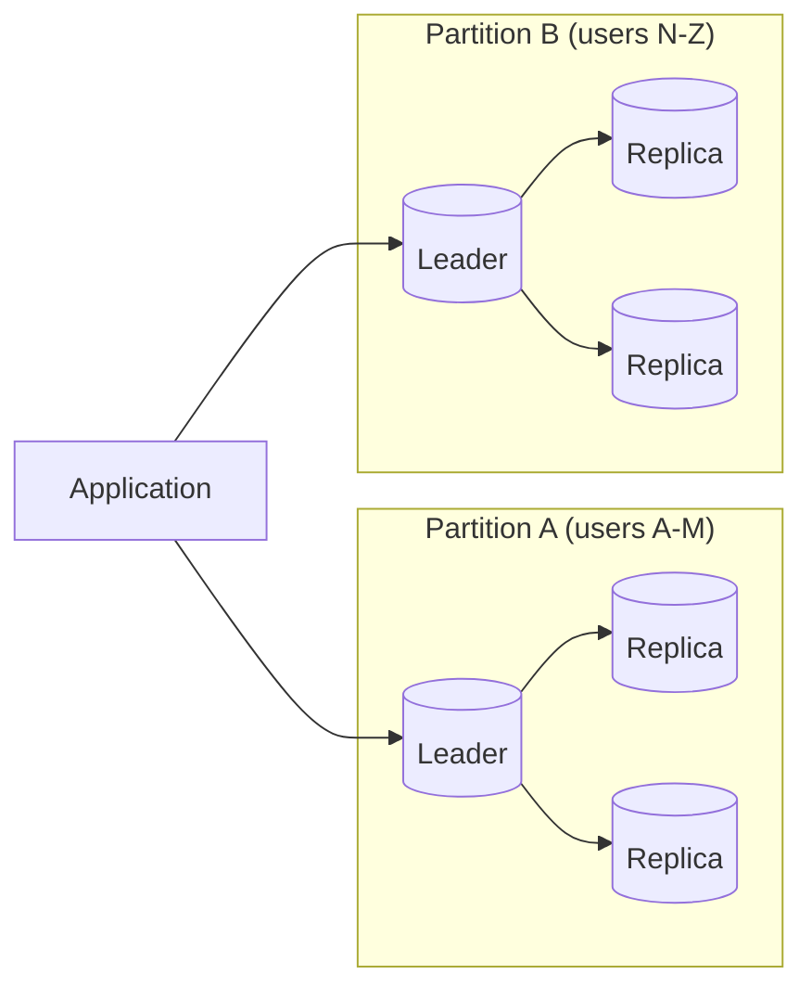

**Partitioning** gives each node a *subset* of the data (capacity, parallel work); **replication** stores each subset on *several* nodes (fault tolerance, read capacity); most real systems do both. *Example:* a food-delivery app in 20 countries partitions menus and orders by country (queries are local, and data-residency laws such as **GDPR**, the EU's personal-data regulation, are easier to meet), replicates each partition to three **availability zones** (separate data centres in one cloud region with independent power and networking), and adds nodes to the busiest cities on New Year's Eve.

---

## 15.2 Partitioning

### What it is

**Partitioning** splits one large table into smaller pieces (**partitions**) stored and managed separately while queries still see one logical table. Goals: **faster queries** (March 2023 reads only the 2023 partition — **partition pruning**), **easier maintenance** (archive a year by detaching one partition), **scalability** (partitions on different nodes = *sharding*, 15.3), **fault tolerance** (each partition replicated independently).

| Aspect | **Horizontal** (split rows) | **Vertical** (split columns) |
|---|---|---|
| Each piece has | All columns, some rows (2023 orders, 2024 orders) | Some columns, all rows; pieces share the primary key (1:1) |
| Speeds up | Queries that filter on the partition key | Queries that need only a few columns |
| Cost | Routing; queries without the key hit every piece | Joins to reassemble a full row |
| Typical use | Huge event/order/log tables, distributed DBs | Wide tables with big text/JSON/blob columns |

A vertical split (`code/05_vertical_partitioning.sql`) keeps listing-page columns (`product_id`, `name`, `price`) in `product_core` and the long `description` / `spec_sheet` in `product_details` (PK also referencing `product_core`). For 1,000 products, `pg_total_relation_size`:

```
 core_size | details_size 
-----------+--------------
 128 kB    | 1672 kB
```

The listing page reads 128 kB instead of ~1.8 MB; a view (`product_full`) joins the halves back. Postgres already moves very large values out of line (**TOAST**, [§12.1](../12-indexes-storage-and-query-performance/README.md#121-how-a-database-stores-data)), so a manual split pays off most for medium-sized, rarely read columns.

### Partitioning strategies

| Strategy | Rule | Good for | Watch out for |
|---|---|---|---|
| **Range** | Key in an interval, e.g. `2023-01-01 ≤ date < 2024-01-01` | Time data, "last N days", archiving | **Hot partition**: all new writes hit the newest range |
| **List** | Key in a set of values, e.g. `region IN ('EU')` | Regions, tenants, data-residency rules | Uneven sizes; new values need a partition (or DEFAULT) |
| **Hash** | `hash(key) mod N` | Even spread with no natural range (`order_id`, `user_id`) | Range queries can't be pruned; changing N moves data |
| **Composite** | Two levels, e.g. range by month, then hash by server | High-volume time series | More partitions to manage |
| **Round-robin** | Row 1 → P1, row 2 → P2, row 3 → P3, row 4 → P1… | Perfectly even bulk loads and parallel scans | Can't find a row by key — every lookup scans all partitions |

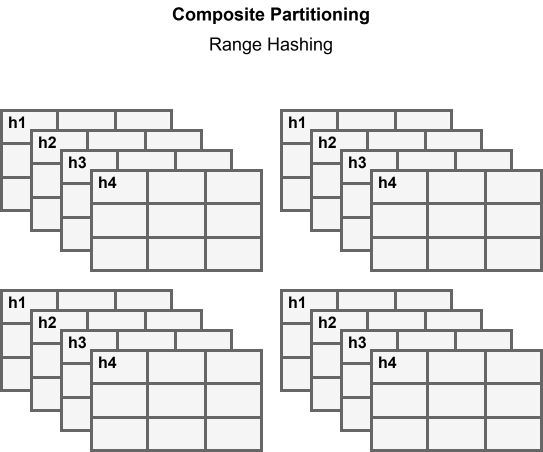

Postgres supports range, list and hash natively, composite by nesting; no round-robin (that's in warehouse systems, e.g. Azure Synapse `ROUND_ROBIN`). **To choose:** the key should be in the `WHERE` of your most common and most expensive queries (so pruning works), spread data reasonably evenly, and keep adding/dropping partitions simple.

### How it works in PostgreSQL (declarative partitioning)

Since PostgreSQL 10 (hash partitioning, default partitions and PKs on partitioned tables in 11): a **parent** declared `PARTITION BY RANGE | LIST | HASH (columns)` stores no rows; each **partition** is `CREATE TABLE … PARTITION OF parent FOR VALUES …`. Inserts are routed (a row fitting none is rejected unless a `DEFAULT` partition exists), and a `WHERE` on the key lets the planner **prune** partitions that can't match.

#### Range partitioning, with pruning

`code/01_range_partitioning.sql`:

```sql
CREATE TABLE orders_by_year (
  order_id    int  NOT NULL,
  customer_id int  NOT NULL,
  order_date  date NOT NULL,
  amount      numeric(10,2) NOT NULL,
  PRIMARY KEY (order_id, order_date)          -- a PK must include the partition key
) PARTITION BY RANGE (order_date);

CREATE TABLE orders_2022 PARTITION OF orders_by_year FOR VALUES FROM ('2022-01-01') TO ('2023-01-01');
CREATE TABLE orders_2023 PARTITION OF orders_by_year FOR VALUES FROM ('2023-01-01') TO ('2024-01-01');
CREATE TABLE orders_2024 PARTITION OF orders_by_year FOR VALUES FROM ('2024-01-01') TO ('2025-01-01');
CREATE TABLE orders_other PARTITION OF orders_by_year DEFAULT;   -- anything outside the ranges

INSERT INTO orders_by_year SELECT * FROM orders;
INSERT INTO orders_by_year VALUES (9001, 1, '2025-03-15', 99);   -- no 2025 partition -> DEFAULT

SELECT tableoid::regclass AS partition, count(*) AS rows,
       min(order_date) AS first_day, max(order_date) AS last_day
FROM orders_by_year GROUP BY 1 ORDER BY 1;
```

```
  partition   | rows | first_day  |  last_day  
--------------+------+------------+------------
 orders_2022  | 1016 | 2022-01-01 | 2022-12-31
 orders_2023  |  990 | 2023-01-01 | 2023-12-31
 orders_2024  |  994 | 2024-01-01 | 2024-12-31
 orders_other |    1 | 2025-03-15 | 2025-03-15
```

`FROM … TO …` has an **inclusive** lower and **exclusive** upper bound (so `2023-01-01` is in `orders_2023`); `tableoid::regclass` is a hidden column naming the physical table holding each row; the PK includes `order_date` because each partition enforces uniqueness only on its own rows. Pruning at plan time, versus a query not filtering on the key:

```sql
EXPLAIN (COSTS OFF) SELECT sum(amount) FROM orders_by_year
WHERE order_date >= '2023-03-01' AND order_date < '2023-04-01';
EXPLAIN (COSTS OFF) SELECT sum(amount) FROM orders_by_year WHERE customer_id = 7;
```

```
 Aggregate
   ->  Seq Scan on orders_2023 orders_by_year
         Filter: ((order_date >= '2023-03-01'::date) AND (order_date < '2023-04-01'::date))

 Aggregate
   ->  Append
         ->  Seq Scan on orders_2022 orders_by_year_1
               Filter: (customer_id = 7)
         ...   (same for orders_2023, orders_2024 and orders_other)
```

`Append` = "scan each child and concatenate" — all four read. **Partitioning only helps queries that filter on the partition key.** When the value is a prepared-statement parameter (known only at run time), Postgres 11+ prunes during execution:

```sql
SET plan_cache_mode = force_generic_plan;
PREPARE by_day(date) AS SELECT count(*) FROM orders_by_year WHERE order_date = $1;
EXPLAIN (COSTS OFF) EXECUTE by_day('2023-05-05');
```

```
 Aggregate
   ->  Append
         Subplans Removed: 3
         ->  Seq Scan on orders_2023 orders_by_year_1
               Filter: (order_date = $1)
```

**Maintenance is where range partitioning shines** — archiving a year is a metadata change, not a giant `DELETE`:

```sql
ALTER TABLE orders_by_year DETACH PARTITION orders_2022;         -- instant; now a plain table
DELETE FROM orders_other WHERE order_date >= '2025-01-01' AND order_date < '2026-01-01';
CREATE TABLE orders_2025 PARTITION OF orders_by_year FOR VALUES FROM ('2025-01-01') TO ('2026-01-01');
INSERT INTO orders_by_year VALUES (9001, 1, '2025-03-15', 99);
```

Afterwards the parent holds `orders_2023` (990), `orders_2024` (994), `orders_2025` (1); the detached `orders_2022` keeps its 1,016 rows as an ordinary table. The `DELETE` is needed because Postgres refuses to create `orders_2025` while DEFAULT still holds 2025 rows — create partitions ahead of time (a scheduled job or the `pg_partman` extension). `DETACH PARTITION … CONCURRENTLY` (Postgres 14+) avoids blocking queries on the parent.

#### List, hash and composite

`code/02_list_partitioning.sql` splits customers by region (`FOR VALUES IN ('NA')`, `('EU')`, `('APAC')`):

```
   partition    |         customers         
----------------+---------------------------
 customers_na   | Ben, Elena, Grace, Jack
 customers_eu   | Chloe, Dmitri, Ines, Liam
 customers_apac | Asha, Farid, Hiro, Kavya

 Seq Scan on customers_eu customers_by_region
   Filter: (region = 'EU'::text)

NOTICE:  rejected: no partition of relation "customers_by_region" found for row
```

The last line: a `'LATAM'` customer with no partition and no `DEFAULT` is rejected — a safety net against data landing in the wrong jurisdiction.

`code/03_hash_partitioning.sql` spreads orders over four partitions (`FOR VALUES WITH (MODULUS 4, REMAINDER 0..3)`): 730 / 752 / 774 / 744 rows. `WHERE order_id = 2024` prunes to one (`Seq Scan on orders_h2`), but `order_id BETWEEN 100 AND 110` scans all four — hashing scatters neighbours.

`code/04_composite_partitioning.sql` partitions server logs by month, each month `PARTITION BY HASH (server_id)` with two leaves (`MODULUS 2, REMAINDER 0/1`):

```
 leaf_partition  | rows | servers 
-----------------+------+---------
 logs_2024_01_h0 |  403 | 1,2
 logs_2024_01_h1 |  804 | 3,4,5,6
 logs_2024_02_h0 |  265 | 1,2
 logs_2024_02_h1 |  529 | 3,4,5,6

 Aggregate
   ->  Seq Scan on logs_2024_02_h1 server_logs
         Filter: ((logged_at >= '2024-02-10 00:00:00+00'::timestamp with time zone) AND
                  (logged_at < '2024-02-11 00:00:00+00'::timestamp with time zone) AND (server_id = 3))
```

A filter on both keys prunes to **one leaf of four**. The 2-vs-4 server split shows that **hashing evens things out only with many distinct key values**. `pg_partition_tree('server_logs')` lists parent (level 0), months (1), leaves (2).

### Trade-offs and dialects

Postgres limits: unique/PK constraints must include every partition-key column; planning time grows with partition count (hundreds fine, many thousands heavy); an index on the parent becomes a *local* index per partition — no global index; an `UPDATE` changing the key moves the row (PG 11+); `enable_partitionwise_join` / `_aggregate` (off by default) process matching partitions pairwise.

Other dialects *(not run)*: **MySQL** declares `PARTITION BY RANGE/LIST/HASH/KEY (...) (PARTITION p0 VALUES LESS THAN (...), ...)` in `CREATE TABLE`, every unique key including the partitioning columns; **SQL Server** a partition function plus scheme (range only); **Oracle** adds interval partitioning (auto-created ranges); **SQLite** none.

**Common mistakes:** a key the hot queries don't filter on; partitioning tables under a few million rows (a good index is simpler); forgetting next month's partition (inserts fail or pile into DEFAULT); thousands of tiny partitions; expecting hash partitioning to speed up range scans.

### In the interview

**30-second answer:** "Partitioning splits a big table into physical pieces by a key: range for time, list for categories, hash for even spread, composite to combine. The win is pruning — the planner skips partitions the `WHERE` clause excludes — plus cheap maintenance like dropping a month instantly. It only helps queries that filter on the key, and in Postgres unique keys must include it."

- *Range vs hash for an `events` table?* Range by time if queries are "recent events" and old data is archived; hash by `user_id` if queries are per user and write load must be spread.
- *Hot-partition problem?* Range-by-time sends all current writes to the newest partition; mitigate with time + hash composite.
- *`Subplans Removed`?* Partitions pruned at execution time because the value was a parameter.

### TL;DR

Partition by the column your big queries filter on: range for time, list for categories, hash for even spread, composite to combine. Check pruning with `EXPLAIN`; unique keys must include the partition key.

---

## 15.3 Sharding

### What it is

**Sharding** is horizontal partitioning where each partition — a **shard** — lives on a **separate database server**, a complete, independent database holding a subset of rows. A **shard key** decides which shard owns a row; a **router** sends each query to the right shard(s). Example: `order_id` 1–1,000,000 on shard A, 1,000,001–2,000,000 on B; `WHERE order_id = 42` goes only to A.

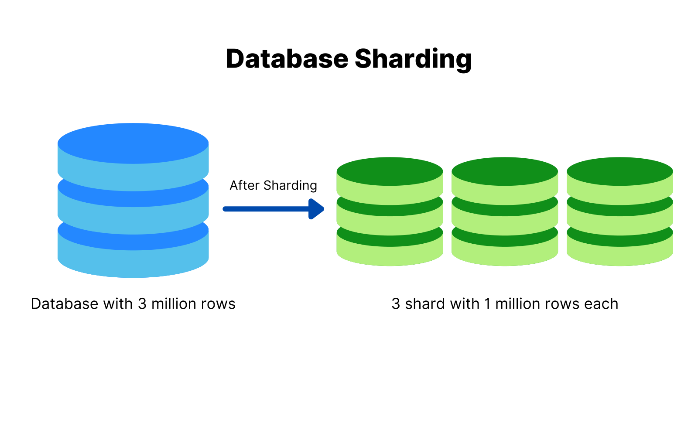

### How it works

1. Pick a **shard key** (`user_id`, `tenant_id`).
2. Choose a **mapping**: a range table, a hash, or a lookup directory.
3. A **router** applies it: the application, a **proxy** (a middle server forwarding client connections — Vitess for MySQL; pgcat/pgdog for Postgres), or the database itself (Citus, MongoDB `mongos`, CockroachDB).
4. Single-shard queries go to one shard; queries without the key are **scattered** to all and **gathered** — slower.
5. Each shard is **replicated** (15.5) — sharding alone doesn't remove single points of failure.

### Choosing the shard key (the most important decision)

| Property | Why | Example |
|---|---|---|
| **Spreads data and load evenly** | Avoids a **hotspot** — one overloaded shard sets the whole system's speed | `user_id` (millions of values), not `country` |
| **Matches the main query pattern** | Most queries hit exactly one shard | B2B SaaS sharded by `tenant_id` |
| **Keeps related data together** | Joins and transactions stay on one shard (**co-location**) | A user's orders on the user's shard |
| **Rarely changes / minimises rebalancing** | Changing the key or shard count means moving data | Immutable ids, not email addresses |

Typical: `user_id` for social apps, `tenant_id` for SaaS, time ranges for time-series (but then current writes hit the newest shard). Versus partitioning in one server, sharding needs a router instead of the planner, turns cross-piece queries into network scatter-gather and cross-piece transactions into distributed commits (2PC, 15.9), and lets one shard fail while others serve (**fault isolation**). Benefits: **write scaling**, **smaller working sets** (each shard's frequently touched data fits in RAM), fault isolation, more total capacity.

### Rebalancing: why `hash % N` hurts and consistent hashing helps

With naive `hash(key) % N`, changing N from 4 to 5 remaps most keys. **Consistent hashing** puts shards and keys on a ring (0 to 2³²); each key belongs to the next shard clockwise, so a new shard takes keys only from its neighbour. **Virtual nodes** give each shard many small ring points to even out load (Cassandra, Riak, Dynamo-style systems). `code/consistent_hashing.py` places 100,000 keys, then adds a fifth shard; the ring is a sorted list of `(hash, shard)` points searched with `bisect`:

```python
def lookup(self, key):
    i = bisect.bisect(self.hashes, h(key)) % len(self.points)  # next point clockwise
    return self.points[i][1]
```

```
hash % N                     moved  79.7%   max/min shard load 1.01
ring, 1 point per shard      moved   2.8%   max/min shard load 10.44
ring, 200 vnodes per shard   moved  17.1%   max/min shard load 1.28
ideal fraction to move when going 4 -> 5 shards: 1/5 = 20.0%
```

- `hash % N` balances perfectly but moves **80%** of keys — a huge migration.
- One point per shard moves little only because the new shard landed on a tiny arc; the biggest shard holds 10× the smallest (uneven arcs → uneven load).
- **200 vnodes** move ~17% (near the ideal 20%) and stay balanced — why real systems use them.

Alternative: a **fixed number of logical partitions** (say 1,024) mapped to servers by a directory; adding a server moves whole partitions, nothing re-hashed (roughly Citus shards, Vitess keyspace ranges, Kafka partitions). More: [DDIA ch.6 — rebalancing](../../../ddia/chapters/06-partitioning/README.md).

**Sharding Postgres in practice.** Core Postgres has no built-in sharding: application-level routing, the **Citus** extension (`create_distributed_table('orders','customer_id')` co-locates tables sharing the key), partitions whose leaves are `postgres_fdw` foreign tables (15.4), or a Postgres-compatible distributed SQL database (CockroachDB, YugabyteDB — Chapter 16).

**Common mistakes:** **monotonic key + range sharding** (auto-increment id, timestamp — every new row hits the last shard); **low-cardinality keys** (country, status — too few shards, some huge); **sharding too early** (read replicas, caching — [Caching patterns](../../../system-design-patterns/modules/04-caching/README.md) — and a bigger machine come first); **forgetting cross-shard needs** (global unique constraints, cross-shard joins, all-user reports become hard).

### In the interview

**30-second answer:** "Sharding puts horizontal partitions on separate servers so writes and storage scale out. The shard key should spread load evenly, match the main access pattern so most queries hit one shard, and keep related rows together. Queries without the key become scatter-gather and cross-shard transactions need 2PC. For rebalancing I'd use consistent hashing with virtual nodes, or fixed logical partitions mapped to nodes, never `hash mod N`."

- *A celebrity user overloads one shard?* Split that key (`user123#0..9`) to spread writes and merge on read, or cache their reads.
- *Unique ids across shards?* UUIDv7 (a 128-bit id generated anywhere without coordination; v7 starts with a timestamp so ids sort by time), Snowflake-style ids (timestamp + machine id + sequence), or per-shard sequences with disjoint ranges.

---

## 15.4 Distributed query processing

### What it is

With rows spread over nodes, the database decides **which nodes to ask, what to ask each, and how to combine answers** — moving as little data as possible, in parallel, correctly.


Step 1 includes **data localisation** (which nodes hold each table); step 3 minimises network traffic and time given location, link speeds and node load; step 5 merges partial results (union, final sort, final sum).

| Technique | Idea |
|---|---|
| **Query fragmentation** | Independent fragments run simultaneously on different nodes. |
| **Predicate push-down** | Apply `WHERE` on the node storing the data, so only matching rows travel. |
| **Aggregate push-down** | Each node computes partial `count`/`sum`; only small results travel. |
| **Local (co-located) joins** | Both tables sharded on the join key → each node joins its own pieces. |
| **Distributed joins** | Otherwise **broadcast** the small table, **repartition (shuffle)** both sides by the join key, or **semi-join**: send only join keys first, then fetch matching rows. |
| **Smart sharding, caching** | Keep common queries on one node; reuse frequent intermediate results. |

Challenges: data localisation, network latency, a far larger plan space, nodes failing mid-query, and consistency when pieces come from replicas at slightly different moments.

### Seeing it in Postgres with `postgres_fdw`

`postgres_fdw` (a **foreign data wrapper**) lets one Postgres query tables on another, which appear locally as **foreign tables**. `code/06_distributed_query_fdw.sql` points it at the same server: schema `shard_b` plays the "remote node", `remote.orders` is the foreign table:

```sql
CREATE EXTENSION IF NOT EXISTS postgres_fdw;
CREATE SERVER node_b FOREIGN DATA WRAPPER postgres_fdw
  OPTIONS (host '/tmp', port '5544', dbname 'ch_15');          -- in real life: another host
-- ... user mapping; shard_b.orders created as a copy of orders ...
IMPORT FOREIGN SCHEMA shard_b LIMIT TO (orders) FROM SERVER node_b INTO remote;

EXPLAIN (VERBOSE, COSTS OFF) SELECT order_id, amount FROM remote.orders WHERE amount > 500;
EXPLAIN (VERBOSE, COSTS OFF) SELECT customer_id, count(*), sum(amount) FROM remote.orders GROUP BY 1;
```

```
 Foreign Scan on remote.orders
   Output: order_id, amount
   Remote SQL: SELECT order_id, amount FROM shard_b.orders WHERE ((amount > 500::numeric))

 Foreign Scan
   Output: customer_id, (count(*)), (sum(amount))
   Relations: Aggregate on (remote.orders)
   Remote SQL: SELECT customer_id, count(*), sum(amount) FROM shard_b.orders GROUP BY 1
```

`Remote SQL` shows what was pushed down: the filter (only two columns and matching rows travel) and the whole `GROUP BY` (12 rows come back). A **cross-node join** — local USA `customers` with remote `orders` — is correct (Ben 250 orders / 64,750.00, Grace 250 / 65,000.00, Jack 250 / 64,750.00), but its plan shows a weakness:

```
 Hash Join
   Hash Cond: (o.customer_id = c.customer_id)
   ->  Foreign Scan on remote.orders o
         Remote SQL: SELECT order_id, customer_id FROM shard_b.orders
   ->  Hash
         ->  Seq Scan on public.customers c
               Filter: (c.country = 'USA'::text)
```

The remote query has **no WHERE**: all 3,000 orders cross the network, 750 survive. The **semi-join** fix finds USA ids locally and ships only those:

```sql
EXPLAIN (VERBOSE, COSTS OFF)
SELECT o.order_id, o.customer_id FROM remote.orders o
WHERE o.customer_id = ANY (ARRAY(SELECT customer_id FROM customers WHERE country = 'USA'));
```

```
 Foreign Scan on remote.orders o
   Output: o.order_id, o.customer_id
   Remote SQL: SELECT order_id, customer_id FROM shard_b.orders WHERE ((customer_id = ANY ($1::integer[])))
   InitPlan 1 (returns $0)
     ->  Seq Scan on public.customers
           Filter: (customers.country = 'USA'::text)
```

The `InitPlan` (a sub-query run once before the main query) runs locally; its three ids travel as `$1`, and only the 750 matching orders return. Distributed optimisers (Citus, CockroachDB, Spark, Trino) choose such strategies automatically from table sizes and location.

**Common mistakes:** wrapping remote columns in functions the remote side can't evaluate (blocks push-down — check `Remote SQL` in `EXPLAIN VERBOSE`); joining two large tables sharded on *different* keys in the hot path (co-locate or denormalise); `ORDER BY … LIMIT` across shards without per-shard limits (each shard should return its own top N first).

### In the interview

**30-second answer:** "The **coordinator** (the node receiving the query and orchestrating the others) localises the data, splits the query into per-node fragments, pushes filters and partial aggregates to the data, runs fragments in parallel and merges results. Network transfer dominates, so the optimiser prefers co-located joins, broadcasts small tables and uses semi-joins to ship keys instead of rows."

- *Why can't `AVG` be pushed down as `AVG`?* An average of averages is wrong when groups differ in size; push down `SUM` and `COUNT`, divide at the end.

---

## 15.5 Replication

### What it is

**Replication** keeps **copies of the same data on several nodes** (**replicas**). Benefits: **high availability** (a replica takes over when the primary dies), **read scaling**, **lower latency** (a Frankfurt replica serves Europe), **disaster recovery** (**DR** — a copy in another region for losing a whole site). Costs: keeping replicas in sync, extra storage and traffic, **conflicts** when several copies accept writes.

| Type | How it works | Trade-off | Typical use |
|---|---|---|---|
| **Full** | Every replica holds the whole database | Any replica answers anything / storage × replicas | DR copies |
| **Transactional** | Each committed transaction streams to replicas in commit order, near real time | Close and ordered / continuous overhead | OLTP read replicas, Postgres logical replication |
| **Snapshot** | Periodically copy a full snapshot | Very simple / only as fresh as the last copy | Nightly reporting copies |
| **Merge** | Copies change independently (even offline), then merge by rules | Works disconnected / conflicts | Field and mobile apps |
| **Key-based incremental** | Copy rows whose `updated_at`/version is newer than the last sync | Moves little data / **misses hard deletes** (physically removed rows) unless tombstoned (marked deleted) | ETL into warehouses, IoT device sync |

A retailer might mix them: orders and stock transactionally, the catalogue as nightly snapshots, a full replica in another region.

### Synchronous vs asynchronous

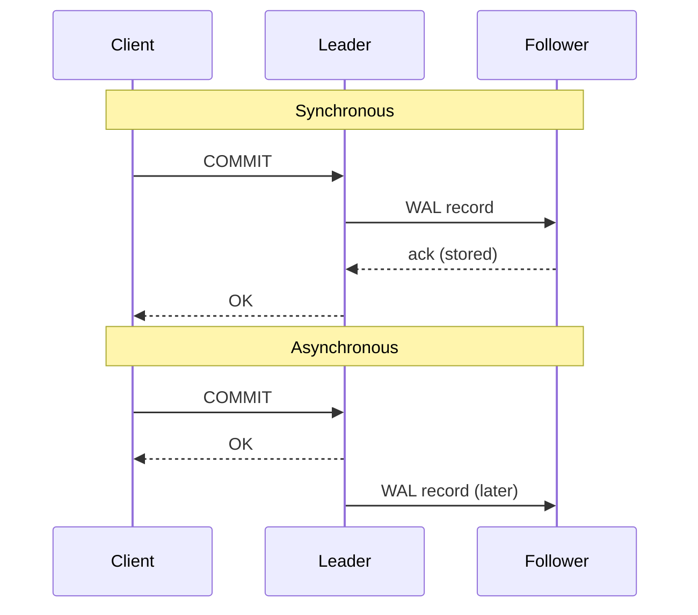

**Synchronous**: a commit returns only when the sync replica(s) have it — no acknowledged commit lost, but every write pays a network round trip and commits **block** if that replica is down (money, orders). **Asynchronous**: returns once the leader has it — fast, but the newest commits may be lost if the leader dies, and replicas lag (**replication lag**) — fine for read replicas, cross-region copies, analytics. Most systems are **semi-synchronous**: wait for *one* (or a quorum of) replicas, the rest async.

**In PostgreSQL**, physical **streaming replication** ships the WAL ([§13.5](../13-transactions-and-concurrency/README.md#135-durability)) to **standbys** (replicas ready to take over), async by default; `synchronous_standby_names` (e.g. `'ANY 1 (s1, s2)'`) makes commits wait, and `synchronous_commit` sets how far: `remote_write` (received), `on` (flushed), `remote_apply` (applied, so standby reads see it). **Logical replication** (`CREATE PUBLICATION` / `SUBSCRIPTION`, PG 10+) streams row changes per table.

### Replication topologies

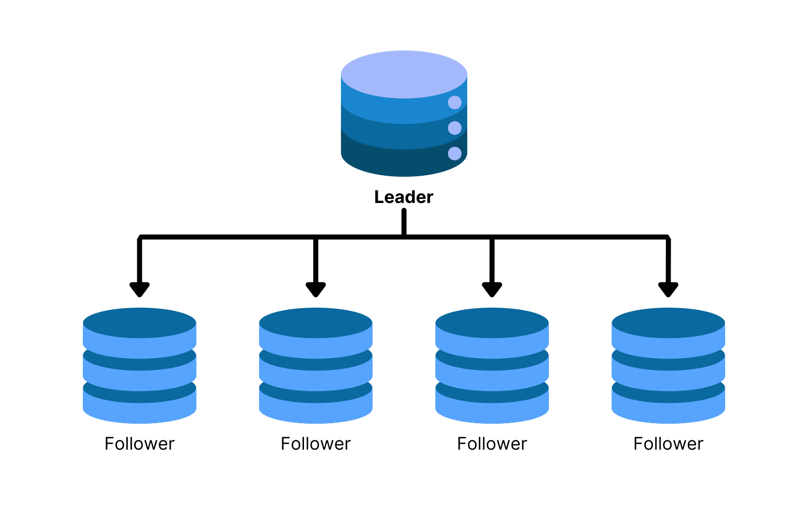

**1. Single-leader** (primary/replica; formerly master/slave). All writes go to the leader, which ships its **replication log / WAL** to **followers** (sync or async); reads may use any node; if the leader fails, **failover** promotes a follower (15.10). Simple, no write conflicts, strong consistency possible; but write throughput is one machine's and async followers can be stale. PostgreSQL, MySQL, SQL Server Always On, MongoDB replica sets.

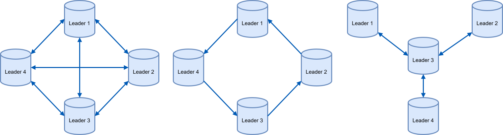

**2. Multi-leader** (active-active). Several nodes (often one per region) accept writes and replicate to each other. One row changed at two leaders at once is a **conflict**, resolved by **last-write-wins** (by timestamp — silently drops one write), custom merge code, or **CRDTs** (conflict-free replicated data types, which merge automatically). If a leader fails, clients switch. Used for multi-region writes, offline apps (each device a leader), collaborative editing. MySQL Group Replication (multi-primary), Postgres with BDR/pgEdge, CouchDB.

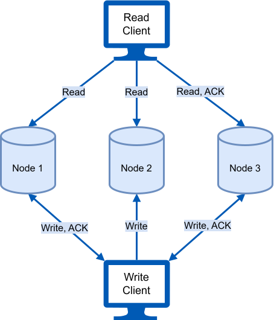

**3. Leaderless** (Dynamo-style). The client (or a coordinator) sends each write to all **N** replicas and succeeds once **W** acknowledge; reads ask **R** replicas and keep the newest version. If **R + W > N**, every read set overlaps every write set (the **quorum condition**). Stale replicas are fixed by **read repair** (the reader writes the newest value back), background **anti-entropy** (comparing **Merkle trees** — trees of hashes where each parent hashes its children, so replicas find differing data by comparing a few hashes) and **hinted handoff** (writes for a down node are held and delivered later). Concurrent writes are detected with **version vectors / vector clocks** (a per-node list of counters on each value; comparing two lists shows whether one write happened after the other or they were concurrent). Cassandra, ScyllaDB, Riak, Amazon's original Dynamo (the DynamoDB *service* uses a leader per partition). Leaderless systems use **quorums, not consensus** (no Paxos/Raft per write): available, but guaranteeing less.

`code/quorum.py` simulates N = 3: each trial a new version reaches W random replicas, a read asks R random replicas and keeps the highest version; stale if still old:

```
N = 3 replicas, 10,000 trials per setting
 W  R  R+W>N  stale reads
 1  1  False    66.4%
 1  2  False    34.0%
 1  3  True      0.0%
 2  1  False    33.8%
 2  2  True      0.0%
 ...  (every remaining row has R+W>N and 0.0%)

N=3, W=2, R=2: writes and reads still succeed with 1 replica down (2 of 3 answer); with 2 down they fail -> the system chooses consistency.
```

Every R + W > N setting had **zero** stale reads (for N=5, e.g. W=3, R=3). N=3, W=2, R=2 survives one failed replica — Cassandra's `QUORUM`; `ONE` is fast but possibly stale. Quorums still aren't **linearizability** (15.6): sloppy quorums (writes accepted by stand-in nodes), concurrent writes and clock-based last-write-wins can produce anomalies ([DDIA ch.5](../../../ddia/chapters/05-replication/README.md)).

**Choosing a topology:** correctness first → single-leader with a sync replica; writes in several regions → multi-leader with a conflict plan; must stay writable through failures and eventual is acceptable → leaderless with quorums.

**Replication lag in practice.** A user updates their profile, a lagging replica serves the next page, the old version appears. Fixes: read your own recent writes from the leader, pin a session to one replica, or wait until the replica's `pg_last_wal_replay_lsn()` reaches the write's LSN — the session guarantees of 15.6.

### In the interview

**30-second answer:** "Replication keeps copies for availability, read scaling and DR. Sync loses no acknowledged commits but slows writes; async is fast but can lose recent commits and serve stale reads, so most systems are semi-sync. Topologies: single-leader (simple, no conflicts), multi-leader (multi-region writes, conflicts), leaderless (quorums with R + W > N, read repair)."

- *A user doesn't see their own comment?* A lagging async replica served the read; use read-your-writes routing.
- *Last-write-wins downside?* Concurrent updates are silently lost, and **clock skew** (clocks disagreeing slightly) can discard the newer one.

---

## 15.6 Consistency models

### What it is

With several copies, "what will a read return?" has more than one answer. A **consistency model** is the contract: which writes a read is guaranteed to see, and in what order clients observe operations. Stronger models are easier to program against but need more coordination (slower, less available); weaker ones are faster but push work onto the application. (Not ACID's C, which is about constraints — [§13.3](../13-transactions-and-concurrency/README.md#133-consistency); these are about **replicas and ordering**.)

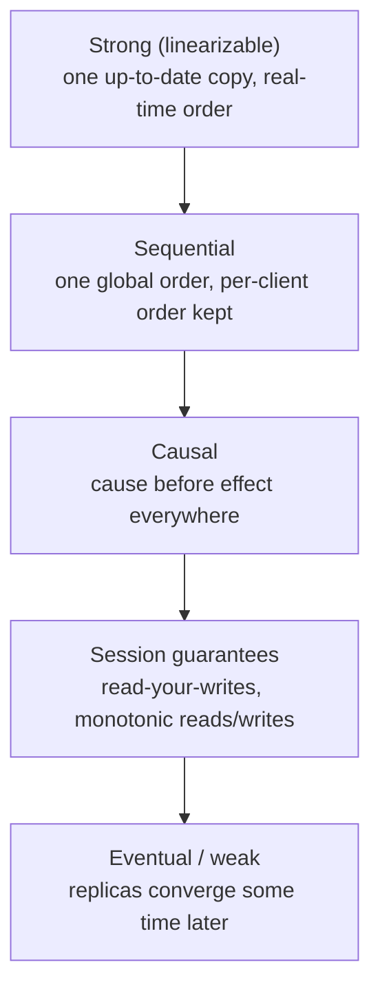

| Model | Guarantee | How it's built | Pros / cons | Use |
|---|---|---|---|---|
| **Strong (linearizable)** | Every read sees the **latest completed write**; acts like one copy with operations in **real-time** order (if A finishes before B starts, everyone sees A first) | Synchronous replication or consensus (15.8), atomic operations, one global order | Simplest to reason about, no stale reads / coordination latency, scales less, may be **unavailable** during partitions | Balances, stock at checkout, "is this username taken?", locks. etcd, ZooKeeper writes, Spanner, CockroachDB, single-node Postgres |
| **Sequential** | All clients see **the same order**, each client's operations in program order — but not necessarily real-time order | A global sequencer | One agreed history / still needs coordination, no recency promise | CPU memory models, distributed shared memory; rare by name in databases |
| **Causal** | If A could have influenced B (same client did A then B, or B read A), **everyone sees A before B**; **concurrent** operations may appear in different orders | Track dependencies with **vector clocks**; delay an update until its dependencies are visible | Little coordination, works across regions, matches intuition / complex tracking, brief divergence | Replies after questions, chat, collaborative editing; MongoDB causally consistent sessions |
| **Weak / eventual** | Few promises; **eventual consistency**: if writes stop, replicas converge | Async propagation, anti-entropy, conflict resolution | Lowest latency, highest availability / stale and out-of-order reads, confusing UX (a like count that jumps) | Caches/CDNs, counters, analytics, DNS |

*Sequential example:* Alice posts P1 then P2, Bob posts Q1; everyone sees one interleaving (say P1, Q1, P2), never P2 before P1 — but a reader just after Q1 finished may not see it yet (strong would).

### Session (client-centric) guarantees

Weaker than the global models, but they fix the anomalies users notice, **within one session**:

| Guarantee | Promise | Anomaly prevented | Example |
|---|---|---|---|
| **Read-your-writes** | You see your own earlier writes | "My new profile photo reverted" | Profile edits, cart |
| **Monotonic reads** | Never an older version after a newer one | A comment *disappears* on refresh | Feeds, notifications, config values |
| **Monotonic writes** | Your writes apply in the order issued | "price = 12" applied before the earlier "price = 10" | Version-control commits, debit then credit |
| **Writes-follow-reads** | A write after reading X is ordered after X | Reply stored before the post it answers | Comment threads |

**Session consistency** bundles them (Azure Cosmos DB's default): track the last version/LSN each session saw and route its reads to replicas at least that fresh — coherent for the user and cheap, though sessions may see different states and routing loses some load-balancing freedom.

**How to choose:** strong for money and stock; session guarantees where users mostly need their own actions to stick; causal for cause-and-effect content; eventual for high-volume, tolerant data. Many systems let you **choose per operation** — Cassandra consistency levels, DynamoDB `ConsistentRead`, MongoDB read/write concerns, Cosmos DB's five levels.

### In the interview

**30-second answer:** "A consistency model says what reads can return under replication. Linearizable: one up-to-date copy in real-time order. Sequential: one global order without the real-time promise. Causal: cause before effect. Eventual: convergence only. Session guarantees — read-your-writes, monotonic reads — fix what users see. Stronger costs latency and availability, so I pick per feature."

- *Model for a comment thread?* Causal — replies must never precede their parent.
- *Linearizable vs serializable?* Linearizability is about single objects and real-time recency; serializability is about multi-object transactions behaving as if run one at a time. Both together = "strict serializability" (Spanner).
- *A refresh shows an older comment list — which guarantee broke?* Monotonic reads.

---

## 15.7 The CAP theorem (and PACELC)

### What it is

The **CAP theorem** (Eric Brewer's conjecture, 2000; proved by Gilbert and Lynch, 2002) concerns three properties of a replicated store:

- **C — Consistency** (here *linearizability*; CAP in context: [System Design Fundamentals](../../../system-design-patterns/modules/00-system-design-fundamentals/README.md)): every read sees the most recent successful write — if Priya's balance drops from ₹500 to ₹300, no node may still report ₹500.
- **A — Availability**: every request to a **non-failed** node gets a non-error response, without waiting indefinitely.
- **P — Partition tolerance**: the system keeps working when the network drops or delays messages between groups of nodes.

**The theorem:** *during a network partition, a system must choose between consistency and availability.*

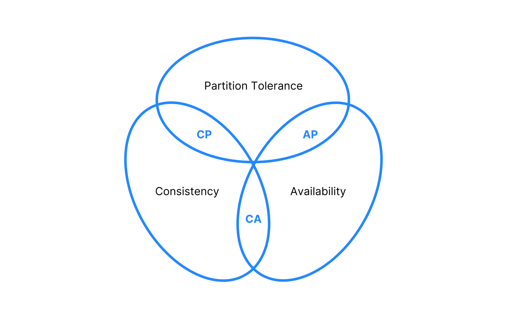

### Why "pick two of three" is misleading

Across machines **partitions will happen** (switches fail, cables get cut), so P can't be given up; the real choice is what to do *during* one:

| Choice | During a partition | Pros | Cons | Examples |
|---|---|---|---|---|
| **CP** | Refuse or delay some requests (usually the minority side) rather than return stale data | Correct, no divergence | Errors/timeouts for some users, coordination latency | etcd, ZooKeeper (small, strongly consistent coordination stores), HBase, Spanner, CockroachDB |
| **AP** | Keep answering on both sides, reconcile later | Always responsive | Temporarily inconsistent, needs conflict resolution | Cassandra/ScyllaDB (at `ONE`), Riak, CouchDB, DNS |
| **CA** | Only if partitions never happen — effectively one node | Simple and strong | No tolerance of network failure | A single Postgres server (not distributed, so CAP doesn't really apply) |

*Example:* a subscriber counter in two data centres when the link breaks — **AP** keeps accepting clicks on both sides and merges later; **CP** makes the minority side refuse clicks until the link returns. Nuances: the choice is often **per operation** (CP for "place order and decrement stock", AP for "show reviews"); with **no** partition a system can be both C and A; CAP's A is strict — many "CP" systems are highly available in practice.

### PACELC

Daniel Abadi's **PACELC** (2010): **if Partition, choose A or C; Else, choose Latency or Consistency** — even on a good day, synchronous coordination costs latency.

| System | Partition | Else |
|---|---|---|
| Cassandra, Riak, DynamoDB (default reads) | PA | EL (fast, possibly stale) |
| Spanner, CockroachDB, etcd | PC | EC (pay latency for consistency) |

### In the interview

**30-second answer:** "CAP says that during a partition a replicated store gives up either linearizable consistency or availability. Partitions are unavoidable, so the real choice is CP or AP — banking and inventory lean CP, feeds and carts lean AP with reconciliation. PACELC adds that without partitions you still trade latency for consistency."

- *Is a single Postgres server CA?* It isn't distributed, so CAP isn't about it; with async replicas plus failover it's neither fully C (can lose recent commits) nor fully A.

---

## 15.8 Consensus and leader election

### What consensus is

**Consensus** gets nodes to **agree on one value** (or one ordered log) even when some crash or messages are delayed. Everything needing "exactly one" rests on it — one leader, one commit decision, one log order, one lock owner. A correct protocol guarantees **agreement** (all non-faulty nodes decide the same value), **validity** (the decision was proposed by someone; if all propose v, it's v), **termination** (non-faulty nodes eventually decide) and **fault tolerance** (survives a minority of **crash faults**, or fewer than a third of **Byzantine faults** — nodes that lie). It's hard because nodes crash, networks partition and reorder messages, some nodes may be malicious, and every round trip adds latency. The **FLP result** (Fischer, Lynch, Paterson, 1985): no **deterministic** protocol can *guarantee* termination in a fully asynchronous network if even one node may crash — so real protocols are always *safe* and use timeouts to *usually* make progress.

### The algorithms in brief

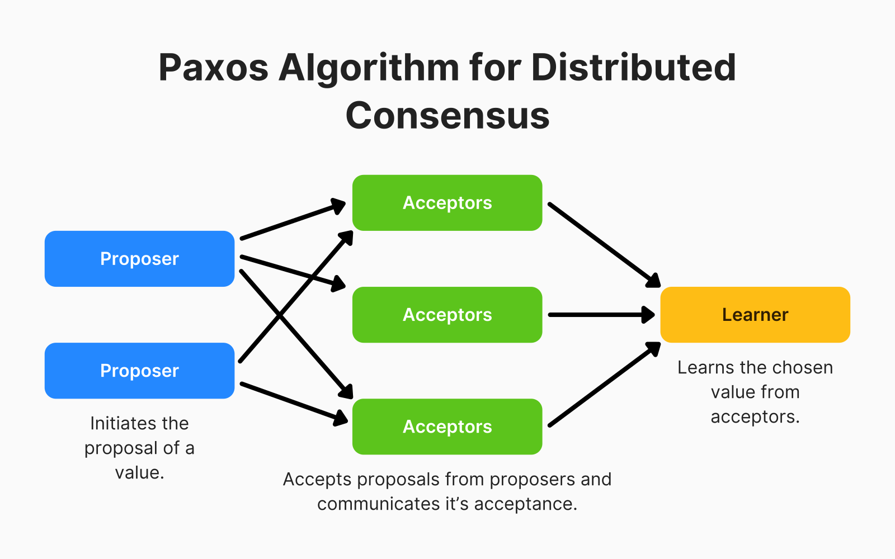

**Paxos** (Leslie Lamport; written 1989, published 1998) has **proposers**, **acceptors**, **learners**. (1) **Prepare/Promise:** a proposer sends *prepare(n)* with a unique, higher number to a majority; each acceptor promises to ignore anything below *n* and reports the highest-numbered proposal it already accepted. (2) **Accept:** with a majority of promises it sends *accept(n, v)*, where *v* must be the highest-numbered reported value (its own only if none). (3) Once a **majority accepts**, *v* is chosen and learners are told. Tolerates ⌊(N−1)/2⌋ crashes, needs no synchronised clocks for safety, formally proven — but hard to implement, two round trips per decision (**Multi-Paxos** keeps a stable leader to skip phase 1), and duelling proposers can stall it. Google's Chubby and Spanner.

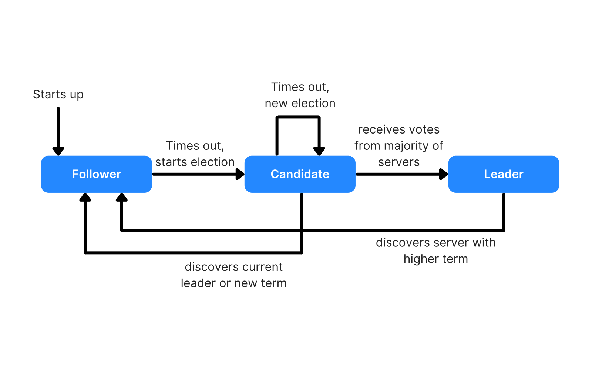

**Raft** (Ongaro and Ousterhout, 2014) gives the same guarantees, designed to be **understandable**. (1) **Election:** time is split into numbered **terms**; a follower hearing no **heartbeat** (periodic "I'm alive") within its **randomised election timeout** (150–300 ms in the paper) becomes a **candidate**, increments the term and requests votes; each node votes once per term, only for a candidate whose log is at least as up to date; a majority makes a **leader**, and random timeouts make split votes rare. (2) **Log replication:** the leader sends **AppendEntries** (also the heartbeat); an entry is **committed** once a majority stores it. (3) **Safety:** only a node holding every committed entry can win. Weaknesses: the leader caps throughput, unstable networks cause repeated elections, each commit waits for a majority. etcd (Kubernetes' store), Consul, CockroachDB, TiKV, YugabyteDB, Kafka's KRaft; MongoDB's replica-set protocol is Raft-inspired.

**PBFT** (Practical Byzantine Fault Tolerance; Castro and Liskov, 1999) tolerates **f lying nodes out of N ≥ 3f + 1**. In each **view** a **primary** runs *pre-prepare* (assign a sequence number) → *prepare* (replicas broadcast; prepared after 2f matching messages from others) → *commit* (after 2f + 1 matching commits) → *reply* (the client waits for f + 1 identical replies, so one is honest). **O(N²) messages**, so clusters stay at tens of nodes; **permissioned blockchains** (ledgers only approved participants may join; Hyperledger family) and critical control systems.

**Proof of Work** (Bitcoin) serves **open** networks, where fake identities make vote-counting useless: miners race to find a **nonce** that puts the block hash under a target, others verify cheaply, and the chain with the most accumulated work wins — no central authority, but heavy energy use, slow finality (a block every ~10 minutes) and exposure to a **51% attack** (most of the computing power can rewrite recent history). **Proof of Stake** (Ethereum since the 2022 "Merge") weights votes by locked-up currency.

| Algorithm | Fault model, tolerance | Cost | Fits |
|---|---|---|---|
| Paxos / Multi-Paxos | Crash, ⌊(N−1)/2⌋ | Majority round trips; hard to implement | Databases, lock services |
| Raft | Crash, ⌊(N−1)/2⌋ | Majority round trips, leader-bound | Config stores, distributed SQL |
| PBFT | Byzantine, ⌊(N−1)/3⌋ | O(N²) messages | Permissioned ledgers |
| PoW / PoS | Byzantine, open membership (honest majority of hash power / stake) | Slow, energy-hungry / better throughput | Public blockchains |

Known members that may crash → Raft or Paxos (what you'll meet inside databases); known members that may lie → PBFT family; unknown members → PoW/PoS. Full reasoning: [DDIA ch.9](../../../ddia/chapters/09-consistency-and-consensus/README.md).

### Leader election

A **leader** is the single decider for writes, task assignment or a lock; election picks one and re-picks on failure. Hard parts: a slow leader looks dead, partitions can create **two leaders** (**split brain**), clocks differ.

| Strategy | How it works | Strengths | Weaknesses |
|---|---|---|---|
| **Bully** | The detecting node sends ELECTION to all **higher** ids; if none answers it wins, else the higher node takes over; the winner broadcasts COORDINATOR | Simple, deterministic (highest live id) | Up to **O(n²)** messages; the top node always leads, even if weak |
| **Ring** | ELECTION travels a logical ring, each node substituting its id if higher; whoever gets its **own** id back wins and circulates COORDINATOR | About **2n** messages, equal participation | Slow on big rings; a dead node breaks the ring unless skipped |
| **Randomised** | Candidates wait a **random delay**, the first to announce wins, collisions retry | Simple, collisions rare | Non-deterministic (Raft adds majority votes) |
| **ZooKeeper** | Each candidate creates an **ephemeral sequential** znode (gone when its session dies); the **lowest** leads; each watches only the znode just **before** its own | Reliable, simple API; ZooKeeper runs the consensus protocol **ZAB** | Extra system to run (same pattern: etcd, Consul, Kubernetes **Lease**) |

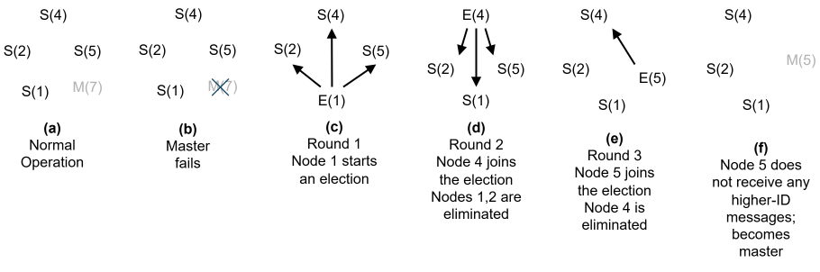

`code/leader_election.py` counts messages when the highest-id leader has crashed and the *lowest* id notices first (Bully's worst case):

```
nodes bully leader bully msgs ring leader ring msgs
    5            4         19           4         8
   10            9         89           9        18
   50           49       2449          49        98
```

Same leader either way; Bully grows roughly with n², Ring with 2n.

**Fencing.** A correctly elected leader can be *paused* (a long garbage-collection pause or a VM freeze), replaced, then wake still believing it leads. Give each new leader a higher term/epoch number (a **fencing token**) and have storage reject writes carrying an older one — Raft terms do exactly this.

### In the interview

**30-second answer:** "Consensus lets nodes agree on a value or log despite failures. Raft elects a leader with randomised timeouts and majority votes and commits an entry once a majority stores it, tolerating ⌊(N−1)/2⌋ crashes; Paxos is the older equivalent. PBFT tolerates liars with 3f+1 nodes at O(N²) messages. For leader election I'd use etcd or ZooKeeper and fence stale leaders with epoch numbers."

- *Why 3 or 5 nodes, not 4?* A majority of 4 is 3, so 4 nodes tolerate one failure — no better than 3 (5 tolerate 2).
- *What is split brain?* Two nodes both acting as leader after a partition; prevent with majority quorums and fencing.
- *PBFT with f = 2?* At least 3f + 1 = 7 nodes.

### TL;DR

Consensus = majority agreement that survives crashes (Raft/Paxos) or lies (PBFT, 3f+1). Leader election needs consensus underneath and fencing on top — use etcd, ZooKeeper or Consul rather than inventing your own.

---

## 15.9 Fault tolerance and recovery

### What it is

**Fault tolerance** is **working correctly while parts fail**. A **fault** is one component going wrong (dead disk, crashed process, dropped packet); a **failure** is the whole system stopping or answering wrongly — fault tolerance stops the first becoming the second. Objectives: **continuity of service**, **data integrity**, **graceful degradation** (recommendations vanish but checkout works), **recovery** — in support of **availability**, **reliability**, **safety** (failures stay contained) and **maintainability**.

Handling a fault has five phases: **detection** (heartbeats, health checks, monitoring) → **diagnosis** (logs, error codes) → **evidence generation** (detailed logs, snapshots, audit trails) → **assessment** (impact analysis, dependency maps) → **recovery** (fail over, restart, reconfigure, restore). Techniques at every level: **hardware** (RAID, 15.11; hot-swappable drives, dual power supplies), **software** (exception handling, retries with backoff, timeouts, graceful degradation, **circuit breakers** that stop calling a failing service for a while — [Reliability patterns](../../../system-design-patterns/modules/05-reliability/README.md)) and **system** (checkpointing, mirroring, load balancing, replication and failover). The rest covers the database machinery.

### Write-ahead logging, redo, undo and LSNs

The WAL rule — *a change's log record reaches disk before the changed data page*, with the log flushed (`fsync`) before COMMIT is acknowledged — is explained in [§13.5](../13-transactions-and-concurrency/README.md#135-durability). *Example:* Ravi moves ₹5,000 from A to B; "A −5,000", "B +5,000" and a commit record are flushed and he sees "Transfer complete"; if the server crashes a millisecond later, before the data pages were written, recovery replays those records. Recovery has two jobs:

- **Redo** makes **committed** work survive: re-apply logged changes (**after-images** — new values) that may not have reached the data files.
- **Undo** makes **uncommitted** work vanish: **before-images** (old values) restore any in-flight change that reached disk.
- Most databases do both. The classic design, **ARIES** (analysis → redo, "repeat history" → undo the losers), is used by DB2 and SQL Server; InnoDB uses the same redo + undo idea, its **undo logs** also serving MVCC snapshots.
- **PostgreSQL's WAL is redo-only.** Under MVCC ([§13.14](../13-transactions-and-concurrency/README.md#1314-multiversion-concurrency-control-mvcc)) an update writes a *new* row version; an aborted transaction is just marked not-committed in `pg_xact`, its versions are invisible, and VACUUM removes them later.

Every WAL record has a **log sequence number (LSN)** — its byte position in the log, always increasing. LSNs **order** redo/undo, tell recovery **what's already applied** (each data page stores the LSN of its last change, so older records are skipped), **mark checkpoints** (replay starts at the checkpoint's redo LSN) and **measure replication lag** (primary LSN vs replica replay LSN).

`code/07_wal_lsn_checkpoint.sql` first prints the defaults (`wal_level` = replica, `synchronous_commit` = on, `checkpoint_timeout` = 5min, `max_wal_size` = 1GB, `full_page_writes` = on), then measures WAL growth:

```sql
INSERT INTO lsn_marks VALUES ('before', pg_current_wal_insert_lsn());
INSERT INTO ledger SELECT i, 'acct-' || (i % 5), (i % 7) - 3 FROM generate_series(1, 5000) i;
INSERT INTO lsn_marks VALUES ('after 5,000 inserts', pg_current_wal_insert_lsn());

SELECT a.label AS from_mark, b.label AS to_mark,
       pg_wal_lsn_diff(b.lsn, a.lsn) > 0         AS wal_grew,
       pg_wal_lsn_diff(b.lsn, a.lsn) > 5000 * 50 AS more_than_50_bytes_per_row
FROM lsn_marks a, lsn_marks b WHERE a.label = 'before' AND b.label = 'after 5,000 inserts';

CHECKPOINT;
SELECT redo_lsn >= (SELECT lsn FROM lsn_marks WHERE label = 'after 5,000 inserts')
       AS redo_point_moved_past_our_inserts
FROM pg_control_checkpoint();
```

```
 from_mark |       to_mark       | wal_grew | more_than_50_bytes_per_row 
-----------+---------------------+----------+----------------------------
 before    | after 5,000 inserts | t        | t

 redo_point_moved_past_our_inserts 
-----------------------------------
 t
```

`pg_current_wal_insert_lsn()` returns the end of WAL (like `0/1A2B3C4`; booleans are printed because exact LSNs differ per run). Each row cost over 50 bytes of WAL (row data, index entries, headers). With `full_page_writes = on`, the first change to a page after a checkpoint logs the **whole page**, guarding against torn pages. After `CHECKPOINT` the **redo LSN** is past our inserts, so a crash now would replay from there.

### Checkpointing

A **checkpoint** flushes all dirty pages and logs *"everything before LSN X is on disk"*, so recovery replays only from there and older WAL (not needed by replicas or archiving) can be recycled.

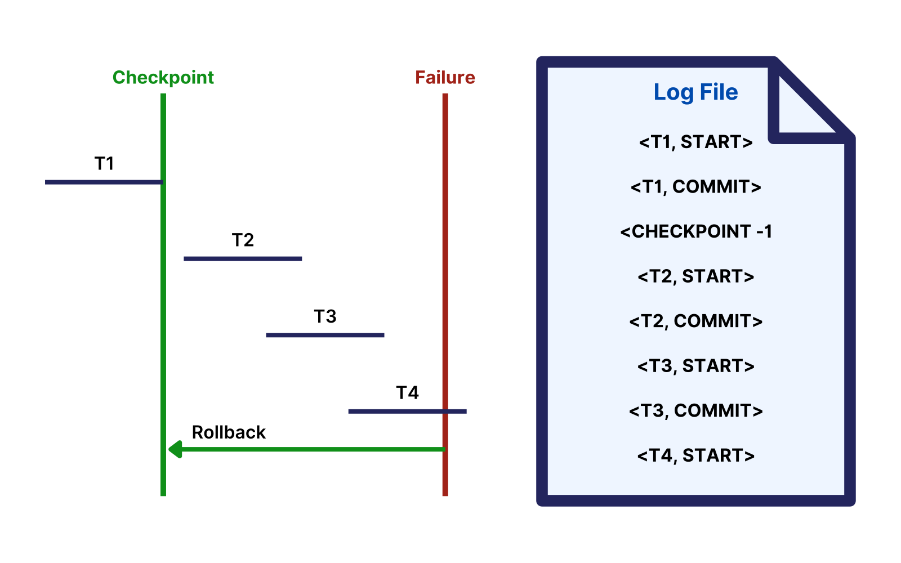

At the failure: **T1** finished before the checkpoint (already in the data files, ignored); **T2 and T3** committed after it and may exist only in the log (**redone**); **T4** never committed (**undone** — in Postgres, simply invisible). `code/wal_recovery.py` runs this on a toy log — T1 (A→B 300) commits before the checkpoint, T2 (C→D 50) after it, T3 (A→C 20) is interrupted after one page was flushed — with a forward **redo** pass after the checkpoint and a backward **undo** pass using before-images of uncommitted transactions:

```
on disk after crash : {'A': 580, 'B': 400, 'C': 500, 'D': 0}
redo  LSN 206 T2: C = 450
redo  LSN 207 T2: D = 50
redo  LSN 210 T3: A = 580
undo  LSN 210 T3: A = 600
recovered state     : {'A': 600, 'B': 400, 'C': 450, 'D': 50}
money conserved     : True
```

T1 needed nothing, T2 was replayed, T3's early-flushed change rolled back; the 1,500 total is intact.

A **sharp (consistent)** checkpoint pauses new work, flushes every dirty page and resumes — simple, fully consistent, a visible stall. A **fuzzy** checkpoint logs a start point, flushes *while work continues*, then logs the end; recovery starts from the start point — no downtime, more bookkeeping. PostgreSQL is fuzzy: every `checkpoint_timeout` (5 min default) or when `max_wal_size` of WAL accumulates, spreading writes over `checkpoint_completion_target` (0.9 of the interval by default since PG 14).

**Distributed checkpointing.** Nodes' saved states must form a **consistent global state**: if node 1's checkpoint records *sending* a message, node 2's must record *receiving* it. **Coordinated** checkpointing (a coordinator, or markers along channels as in the Chandy–Lamport snapshot) is always consistent at the cost of a short pause; **uncoordinated** is cheaper but recovery must search for a consistent combination and can cascade rollbacks (the **domino effect**). *Example:* payment, stock and email nodes restore from one global checkpoint, so never "stock decremented but payment never recorded" (Apache Flink's barrier checkpoints work this way).

### Coordinated commit: two-phase commit (2PC)

Distributed recovery is hard because networks partition, nodes fail and recover at different times, many transactions run concurrently, and every node must agree to commit or abort. When one transaction changes data on **several nodes** (a transfer between accounts on nodes 1 and 2), atomicity must span machines. **2PC** uses a **coordinator**:

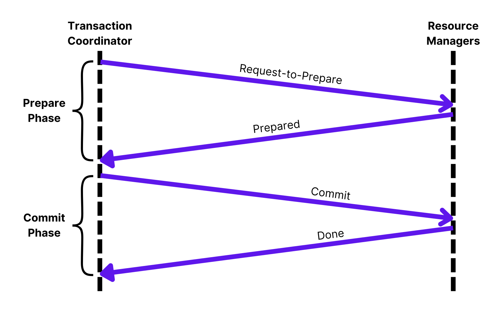

1. **Phase 1 — prepare (vote).** "Can you commit?" Each participant makes its changes durable, logs **PREPARED** and votes **YES** — from then on it may not decide alone — or **NO** (constraint failure, disk full).
2. **Phase 2 — decide.** All YES → the coordinator logs **COMMIT** and tells everyone; any NO or timeout → **ABORT**, everyone rolls back.

**Recovery:** a participant restarting without a PREPARED record aborts alone; one *with* PREPARED must **ask the coordinator**. If the coordinator crashes, participants that haven't voted can abort, but those that **voted YES must wait** — guessing could break atomicity. That wait, with locks held, is **2PC's blocking problem**; network delays and partitions also stall decisions. `code/two_phase_commit.py` shows all three cases:

```
--- happy path: debit on node 1, credit on node 2
  ...
  phase 2 final states: {'node1': 'committed', 'node2': 'committed'}
--- one participant votes no (e.g. constraint check failed)
  ...
  phase 2 final states: {'node1': 'aborted', 'node2': 'aborted'}
--- coordinator failure after the votes
  phase 1 votes: {'node1': True, 'node2': True}
  coordinator crashes before sending a decision
  node1: prepared, holding locks, cannot commit or abort alone -> BLOCKED
  node2: prepared, holding locks, cannot commit or abort alone -> BLOCKED
```

**2PC in PostgreSQL** — the participant side, driven by an external transaction manager *(not run: needs `max_prepared_transactions > 0`; the book server keeps the default 0)*:

```sql
BEGIN;
UPDATE accounts SET balance = balance - 5000 WHERE id = 'A';
PREPARE TRANSACTION 'transfer-42';   -- phase 1: durable, survives a crash, locks kept
COMMIT PREPARED 'transfer-42';       -- later, on the coordinator's decision (or ROLLBACK PREPARED)
```

Java XA/JTA transaction managers (XA = the standard distributed-transaction interface; JTA = Java's API for it) and MySQL's `XA START … XA PREPARE … XA COMMIT` work the same way. Forgotten prepared transactions hold locks and block VACUUM — monitor `pg_prepared_xacts`.

### Three-phase commit (3PC)

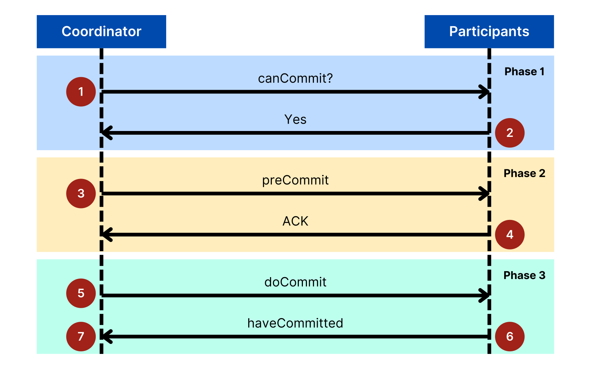

3PC inserts **PreCommit** between voting and committing: (1) **CanCommit** — vote as in 2PC; (2) **PreCommit** — if all voted YES, participants acknowledge and log that the outcome will be commit; (3) **DoCommit**. If the coordinator dies, participants that logged pre-commit know everyone voted YES and commit after a timeout; if no live participant saw pre-commit, nobody can have committed, so they abort. **Non-blocking** — *provided* message delays are bounded and nodes only crash; under a real **partition** both sides can time out and decide differently, so 3PC is rarely used. Modern systems make the coordinator fault-tolerant by **running the commit decision through consensus** (Spanner: 2PC over Paxos groups; CockroachDB: a transaction record replicated by Raft), and cross-service workflows use **sagas** (compensating steps) — [2PC and Saga patterns](../../../system-design-patterns/modules/07-consistency/README.md).

### In the interview

**30-second answer:** "Databases survive crashes with write-ahead logging: the log is flushed before commit is acknowledged and data pages are written later. Recovery starts at the last checkpoint, redoes committed changes and undoes uncommitted ones — Postgres needs no undo thanks to MVCC. Across nodes, 2PC gives atomic commit, but prepared participants block if the coordinator dies, so real systems replicate the decision with Paxos/Raft or use sagas."

- *What does `synchronous_commit = off` trade?* Commits return before the WAL flush: a crash can lose the last fraction of a second of commits, never corrupt data.
- *A 2PC participant voted YES and lost the coordinator — can it abort?* No, it must wait.

### TL;DR

Log first, write data later; checkpoints bound recovery; recovery = redo committed + undo uncommitted. 2PC blocks on coordinator failure and 3PC isn't partition-safe, so modern systems put the commit decision on a consensus group.

---

## 15.10 High availability: replication plus failover

### What it is

**High availability (HA)** keeps the service up despite failures, measured in "nines": 99.9% ≈ 8.8 hours of downtime a year, 99.99% ≈ 53 minutes. Two targets: **RPO** (recovery point objective — how much *data* you may lose; synchronous replication gives RPO = 0) and **RTO** (recovery time objective — how long you may be *down*; hot standbys and automatic failover make it short). HA = **replication** (15.5) + **failover**. A sync standby has every acknowledged commit (RPO 0, slower commits — local standbys in financial systems); an async one may miss the last commits (RPO > 0 — the lag at failure — fast commits; remote regions, read replicas).

### Failover

| Type | Standby state | Recovery time | Cost |
|---|---|---|---|
| **Cold** | Not running; must start and restore/catch up | Minutes to hours | Cheapest |
| **Warm** | Running and receiving updates, needs some catch-up or config | Seconds to minutes | Medium |
| **Hot** | Running, in sync, ready to serve immediately | Seconds | Highest |

1. **Heartbeats** — several missed "I'm alive" signals raise suspicion.
2. **Decision** — a **quorum** (majority of nodes or witnesses) must agree the primary is dead, preventing **split brain**; **priority rules** pick the standby (highest replayed LSN, preferred zone).
3. **Promotion** — Postgres: `pg_ctl promote` or `SELECT pg_promote()` (PG 12+).
4. **Fencing** the old primary — STONITH ("shoot the other node in the head"), lease revocation, or blocking at the proxy.
5. **Redirecting clients** — DNS, a **virtual IP** (an address movable between machines), a proxy (HAProxy, PgBouncer) or **service discovery** (a registry answering "where is the primary right now?").

Core PostgreSQL has **no automatic failover** (without a human); use **Patroni** (leader state in etcd/Consul/ZooKeeper — consensus-backed), **repmgr** or **pg_auto_failover**, or a managed service (Amazon RDS/Aurora, Cloud SQL, Azure Database). **Best practices:** redundancy across failure domains (racks, zones, regions); load-balanced reads with writes routed to the current primary; monitoring (replication lag, heartbeats, disk); **backups too** (a bad `DELETE` replicates in milliseconds — HA is not a backup); **regular failover tests** (game days, **chaos experiments** — deliberately breaking things in a controlled way).

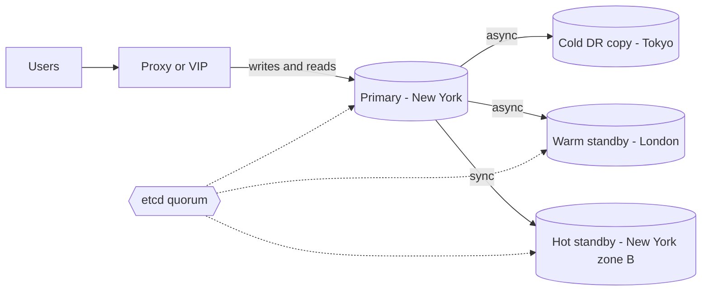

A zone failure in New York fails over to the sync hot standby in seconds with no data loss. Losing all of New York promotes London (RPO seconds, RTO about a minute; it also serves European reads). Tokyo is a cold copy for when both are gone. The etcd quorum spans three sites, so a partitioned minority can never promote itself.

### In the interview

**30-second answer:** "HA = replicas plus automatic failover: heartbeats detect failure, a quorum confirms it to avoid split brain, the most up-to-date standby is promoted, the old primary is fenced, clients are redirected. Sync standbys give zero data loss, async lower latency with some loss. I'd state RPO/RTO, choose hot/warm/cold to match, and test failover regularly."

---

## 15.11 Data resilience: redundancy, mirroring, backups

HA keeps the service **running**; **data resilience** makes the **data itself** survive disk crashes, corruption, ransomware, operator mistakes and site disasters.

### Redundancy

| Technique | How | Overhead | Survives |
|---|---|---|---|
| **Replication** | Full copies on other nodes (15.5) | N× | Node or site loss |
| **RAID 1 / 10** | Mirror each disk (10 = mirrors, striped; popular for databases) | 2× | 1 disk per mirror pair |
| **RAID 5 / 6** | Stripe data across disks with one / two parity blocks (computed from the data, used to rebuild a lost disk) | 1 / 2 disks | Any 1 / any 2 disks |
| **Erasure coding** | k data + m parity fragments; any k rebuild the data | (k+m)/k: 6+3 → 1.5× | Any m fragments |

Erasure coding (e.g. Reed–Solomon) gives replication-level safety at 1.5× instead of 3× storage, paid for with CPU and slower rebuilds — **object stores** (Amazon S3 and similar, storing whole files by key) and HDFS (Hadoop's distributed file system) use it for large, rarely read data.

**Mirroring** keeps an **exact, real-time copy**: every write goes to primary and mirror together, and the mirror takes over immediately — near-instant failover, always current, but double storage and extra write latency. *Example:* a bank mirrors its transaction database synchronously between two nearby data centres. (SQL Server literally called it "Database Mirroring"; Postgres's equivalent is synchronous streaming replication.)

**Media failure recovery.** A **media failure** is lost or damaged storage — **physical** (dead drive, bad sectors) or **logical** (corruption from software/firmware bugs or malware). Defences: **hot swapping** failed RAID drives while running; **health monitoring** (**SMART** drive telemetry, cloud volume metrics); **data scrubbing** (periodically read every block, verify **checksums** — small fingerprints of the data whose mismatch means corruption — and repair from redundancy: ZFS, Ceph; Postgres detects corrupted pages with `initdb --data-checksums`); **replication** to other nodes and regions.

### Backup and restoration

A **backup** is an independent copy that can take you **back in time** — replicas can't, they follow the primary instantly (so a synchronous replica is not a backup). **Restoration** gets data back from it.

| Type | Contains | Backup cost | Restore needs |
|---|---|---|---|
| **Full** | Everything | Slowest, largest | Just that backup (simplest restore) |
| **Incremental** | Changes since the **last backup of any kind** | Fastest, smallest | Last full + **every** incremental since, in order |
| **Differential** | Changes since the **last full** | Grows through the week | Last full + the **latest** differential |

**PostgreSQL** (commands in [§9.12](../09-ddl-dml-and-constraints/README.md#912-backup-and-restore)): `pg_dump` / `pg_restore` make **logical** backups of one database, portable across versions. `pg_basebackup` plus **continuous WAL archiving** (`archive_mode`, `archive_command`) gives a **physical** backup replayable to *any moment* — **point-in-time recovery (PITR)** with `recovery_target_time`, the cure for "someone ran `DELETE` without `WHERE` at 14:02". PostgreSQL 17 added incremental base backups (`pg_basebackup --incremental`); pgBackRest and Barman manage all of this.

**Best practices:** backup frequency matching RPO (daily plus continuous WAL for critical data); **off-site** copies by the **3-2-1 rule** (3 copies, 2 media, 1 off-site); **test restores** regularly; **versioning and immutability** (object lock — copies can't be changed or deleted for a set period) so **ransomware** (malware that encrypts or deletes data for payment) can't destroy every copy. *Example:* a hospital takes a full backup every Sunday, incrementals Monday–Saturday and continuous WAL, stores copies locally and in another cloud region, and monthly restores "last Wednesday 15:00" into a test environment and checks row counts.

### In the interview

**30-second answer:** "Replication and RAID protect against hardware loss but not bad writes, which replicate too. So I add backups — full plus incremental or differential, off-site, versioned, test-restored. In Postgres that's base backups plus WAL archiving for PITR. Erasure coding gives durable storage at about 1.5× instead of 3× for large, cold data."

- *Accidental `DROP TABLE` at 14:02?* Restore the base backup into a separate instance, replay WAL to 14:01:59, copy the table back.
- *Which RAID level survives any two disk failures?* RAID 6.

### TL;DR

Redundancy (replicas, RAID, erasure coding) survives hardware loss; backups (full/incremental/differential + WAL archiving) survive mistakes and disasters. Keep copies off-site and versioned, and test restores.

---

## Chapter 15 TL;DR

| Topic | Remember |
|---|---|
| Scale | Scale up first, then scale out with **partitioning + replication** together. |
| Partitioning | Range (time), list (category), hash (even), composite. Verify pruning with `EXPLAIN`. Unique keys include the partition key. |
| Sharding | Partitions on separate servers; a high-cardinality shard key matching the main query; consistent hashing with vnodes. |
| Distributed queries | Push filters and partial aggregates to the data, co-locate joins, semi-join to ship keys not rows. |
| Replication | Sync = no loss but slower; async = fast, lag, possible loss. Single-leader by default. Leaderless quorums need R + W > N. |
| Consistency | Strong > sequential > causal > session > eventual. Pick per feature. |
| CAP / PACELC | Under partition choose C or A; otherwise latency or consistency. |
| Consensus | Raft/Paxos: 2f+1 nodes survive f crashes. PBFT: 3f+1 for f liars. Elect leaders via etcd/ZooKeeper and fence stale ones. |
| Recovery | WAL first, checkpoints bound replay, redo committed + undo uncommitted (Postgres: redo-only + MVCC). 2PC blocks, 3PC isn't partition-safe; consensus-backed commit is the modern answer. |
| HA | Heartbeat → quorum decision → promote → fence → redirect. State RPO/RTO. |
| Resilience | Replicas are not backups. Full/incremental/differential + PITR, off-site, tested. |

**Next:** [Chapter 16 — Beyond relational](../16-beyond-relational/README.md) looks at the NoSQL, NewSQL and specialised databases that make these trade-offs in different ways.
