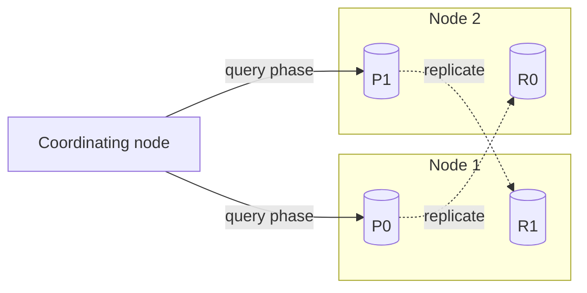
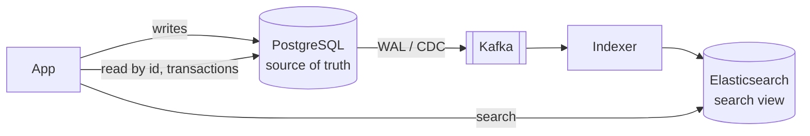
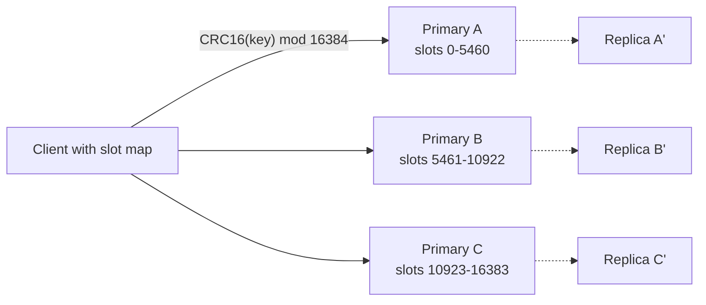

# Chapter 16 — Beyond Relational: NoSQL, NewSQL and Specialised Databases

Relational databases are the right default for most applications. They offer a flexible query language, joins, constraints and ACID transactions. But some workloads fit tables awkwardly. Examples include a product catalogue where every item has different attributes, a session cache that needs sub-millisecond reads, billions of sensor readings per day, "friends of friends who like jazz", or "every restaurant within 2 km". A whole family of databases grew up around those shapes of data. This chapter tours them, shows how much of each you can already do **inside PostgreSQL**, and ends with a decision table for choosing.

**What you'll learn**

| Section | Topic | Runnable part |
|---|---|---|
| 16.1 | Why NoSQL appeared, CAP and NoSQL, BASE vs ACID, the four families | — |
| 16.2 | Key-value stores (Redis, Riak) | KV + TTL + leaderboard in Postgres |
| 16.3 | Document databases (MongoDB, CouchDB) | **JSONB as a document store** with GIN indexes |
| 16.4 | Column-family and wide-column stores (Cassandra, HBase) | Wide-row time-series table |
| 16.5 | Graph databases (Neo4j, Neptune) | Friends-of-friends and shortest path with recursive CTEs |
| 16.6 | In-memory databases (SAP HANA, SingleStore, Redis) | — |
| 16.7 | NewSQL / distributed SQL (Spanner, CockroachDB) | — |
| 16.8 | Time-series and spatial databases | Partitions, BRIN, `date_bin`, geometric KNN with GiST |
| 16.9 | Big data frameworks: Hadoop, Spark, SQL-on-Hadoop, Kafka, Flink | Python MapReduce in miniature |
| 16.10 | Choosing a database | Decision table |
| 16.11 | Inside Elasticsearch/ELK (inverted index, analyzers, shards, refresh) and Redis (event loop, encodings, RDB/AOF, Cluster slots, eviction) | **Python inverted index + BM25 over two shards** |

Prerequisites: [Chapter 15](../15-scaling-databases/README.md) (partitioning, replication, CAP, consensus) and [Chapter 12](../12-indexes-storage-and-query-performance/README.md) (indexes). For the data-model theory behind this chapter, see your DDIA notes: [ch.2 — data models](../../../ddia/chapters/02-data-models-and-query-languages/README.md), [ch.3 — storage engines (LSM trees, column storage)](../../../ddia/chapters/03-storage-and-retrieval/README.md), [ch.10 — batch](../../../ddia/chapters/10-batch-processing/README.md) and [ch.11 — stream processing](../../../ddia/chapters/11-stream-processing/README.md). For the pattern view, see [Caching](../../../system-design-patterns/modules/04-caching/README.md), [Batch and streaming](../../../system-design-patterns/modules/10-batch-and-streaming/README.md) and [Storing data](../../../system-design-patterns/modules/03-storing-data/README.md).

All SQL runs on the book's private PostgreSQL 14 (`bash tools_run_sql.sh sql`); the two Python toys (MapReduce, inverted index) run with `bash tools_run_python.sh sql`. Snippets for other products (MongoDB, Redis, Cassandra, Neo4j, PostGIS) are marked **(not run)**.

---

## 16.1 Why NoSQL?

### What it is

**NoSQL** ("Not only SQL") is an umbrella term for databases that **don't use the relational table model** as their primary model. The term caught on around 2009. They trade some relational features, usually joins, a fixed schema, and sometimes multi-row transactions, for **flexible data models, easy horizontal scaling, and speed on specific access patterns**.

### The problem it solves

In the 2000s, web companies hit limits with the relational setups of the time:

| Pain with relational (as typically deployed then) | NoSQL answer |
|---|---|
| **Rigid schema**: every row has the same columns, and changing them means migrations | **Flexible/dynamic schema**: each record carries its own fields (JSON/BSON documents, dynamic columns) |
| **Scale-up only**: one bigger server, which gets expensive and eventually hits a ceiling | **Scale-out built in**: automatic sharding and replication across cheap nodes |
| **Joins and transactions get slow** at huge volume | Data **stored the way it's read** (denormalised/aggregated), so there are no joins in the hot path |

*Example.* An online marketplace sells laptops (RAM, CPU, warranty), T-shirts (size, material) and books (authors, pages). In a relational schema that means sparse columns, an entity-attribute-value table, or one table per category. In a document store, each product is simply a document with whatever fields it has (16.3).

Modern relational systems have closed much of this gap: Postgres has JSONB, partitioning, logical replication, and Citus for scale-out. That's why this chapter shows the Postgres equivalent of each model.

### CAP and NoSQL

Recall CAP (15.7). During a network partition a distributed store must choose **consistency** or **availability**:

- **CP** stores refuse or delay requests on the minority side to stay consistent. Examples: **HBase**, MongoDB (with majority write/read concern), etcd.
- **AP** stores keep answering and reconcile later. Examples: **Cassandra**, Riak, CouchDB, DynamoDB reads (eventually consistent unless you request a strongly consistent read).

Many NoSQL systems make this **tunable per request**, such as Cassandra's `ONE` vs `QUORUM`.

### BASE: the other end of the spectrum from ACID

Many AP-leaning NoSQL systems describe their guarantees as **BASE**:

- **Basically Available**: the system answers almost every request, even during partial failures, though the answer may not be the newest. *Example:* a Cassandra read at consistency `ONE` succeeds as long as one replica is up.
- **Soft state**: replicas may be temporarily out of sync, and the state can change without new input as updates propagate. *Example:* asynchronous replication in a MongoDB replica set, where a secondary can lag the primary.
- **Eventual consistency**: if writes stop, all replicas converge (15.6). *Example:* a Cassandra write that reached only some replicas is spread by hinted handoff, read repair and anti-entropy.

BASE is essentially the **AP** choice from CAP, packaged as a design philosophy. It suits social feeds, activity streams and metrics, where being up matters more than every reader seeing the very latest value.

| Property | ACID (typical relational) | BASE (typical AP NoSQL) |
|---|---|---|
| Atomicity | All-or-nothing, including multi-row transactions | Often per single record/document only |
| Consistency | Constraints hold after every commit, and reads see committed data | Replicas may briefly disagree and converge later |
| Isolation | Concurrent transactions don't interfere (per isolation level) | Weaker, and concurrent writes may conflict and need resolution |
| Durability | Committed = on disk (WAL) | Configurable (write concern, replication factor, fsync policy) |
| Availability focus | Consistency first during failures | Availability first |
| Scaling | Traditionally vertical plus read replicas | Horizontal by design |

**Correction to a common myth:** the line has blurred. MongoDB has supported multi-document ACID transactions since 4.0 (2018). DynamoDB has had `TransactWriteItems` since 2018. Cassandra has lightweight transactions (Paxos-based compare-and-set). Meanwhile Postgres stores schemaless JSON. Treat ACID vs BASE as a **spectrum of defaults**, not a hard divide.

### The four NoSQL families


*Figure — The main NoSQL families: key-value, document, column-family and graph (course diagram).*

| Family | Data model | Great at | Examples |
|---|---|---|---|
| **Key-value** | Opaque value looked up by a unique key | Caching, sessions, counters, leaderboards | Redis, Riak KV, Memcached, DynamoDB (also a document store) |
| **Document** | JSON-like documents grouped into collections | Catalogues, CMS content, user profiles | MongoDB, CouchDB, Firestore |
| **Column-family / wide-column** | Rows with a partition key, columns grouped into families, sorted within a partition | Huge write volumes, time-series, logs | Cassandra, HBase, ScyllaDB, Bigtable |
| **Graph** | Nodes and edges, both with properties | Relationships: social, fraud rings, recommendations | Neo4j, Amazon Neptune, ArangoDB |

Features they share: **dynamic schema** (no migration to add a field), **horizontal scaling** (add nodes), **performance tuned to one access pattern**, and **fault tolerance** through built-in replication.

### In the interview

**30-second answer:** "NoSQL databases drop the relational model to get flexible schemas, easy scale-out and speed on specific access patterns. There are four families: key-value, document, wide-column and graph. Many lean AP in CAP terms and follow BASE (basically available, soft state, eventually consistent) instead of strict ACID, though modern ones offer transactions and tunable consistency. You model data around queries, not around normalisation."

- *Is MongoDB ACID?* Single-document operations always were. Multi-document transactions exist since 4.0 (replica sets) and 4.2 (sharded clusters).
- *When is Postgres JSONB enough?* When you need flexible attributes *plus* joins, constraints and transactions, at a scale one Postgres (or Citus) can handle.

### Self-check

1. *What does the S in BASE mean?* Soft state: replica state may change as updates propagate, even with no new writes.
2. *Name a CP and an AP NoSQL store.* HBase (CP) and Cassandra (AP by default).
3. *Which family fits "who are my friends' friends"?* Graph.

### TL;DR

NoSQL = flexible models + scale-out + access-pattern-specific speed, often with BASE semantics. The ACID/BASE divide is now a spectrum.

---

## 16.2 Key-value stores

### What it is

The simplest database: a giant, distributed **dictionary**. Each **key** is unique (a string or number), and the **value** is whatever you store: text, a number, JSON, or a binary blob. The database doesn't interpret the value. You `GET key`, `SET key value` and `DELETE key`, and there are no joins and usually no queries by value.

```
session:9f2c      -> {"user_id": 42, "cart": ["LAP-13"], "expires": "..."}
rate:10.0.0.7     -> 17
weather:paris     -> {"temp_c": 18}
```

Designing keys is the whole data model. Use prefixes like `user:42:profile`, because the key is the only way in.

Key-value stores fit when you need very fast access by a known identifier, when relationships between items are minimal or handled in the application, and when each pair can be treated independently.

### Popular systems

**Redis** ("Remote Dictionary Server") keeps everything **in memory** and answers in well under a millisecond. Values can be rich **data structures**: strings, hashes, lists, sets, **sorted sets**, streams, bitmaps and HyperLogLogs. It also offers pub/sub messaging, Lua scripting, key expiry (**TTL**) and **eviction policies** such as LRU/LFU when memory is full. Persistence is optional, via RDB snapshots and/or an append-only file (AOF). Redis Cluster shards keys over 16,384 hash slots.

```
# Redis (not run)
SET session:42 '{"user":42}' EX 1800     # expires in 30 min
GET session:42
INCR page:home:views                      # atomic counter
ZADD steps 12050 ana 8300 bo 15010 cy     # sorted set = leaderboard
ZREVRANGE steps 0 2 WITHSCORES            # top 3
```

**Riak KV** is a Dynamo-style **distributed** key-value store: leaderless replication, consistent hashing, tunable N/R/W quorums, and **eventual consistency**, with sibling values for conflicts. It was built for high availability and survives node failures without failover. Riak's original company (Basho) closed in 2017, and the code lives on as open source.

### Use cases

| Use | Example | Why KV fits |
|---|---|---|
| **Caching** | A weather app caches the latest forecast per city. A shop caches product pages in Redis to spare the database. | Read by key, expiry built in |
| **Session storage** | Logged-in user state for a web app | Tiny, per-user, high-churn data |
| **Real-time data** | Live stock prices or ride locations updated many times a second | In-memory speed |
| **Counters and rate limits** | "100 requests per minute per API key" | Atomic `INCR` with a TTL |
| **Leaderboards** | A fitness app ranks users by daily steps | Sorted sets keep order as scores change |

### Performance: strengths and limits

| Strengths | Limits |
|---|---|
| O(1) lookups by key, very high throughput | **No ad-hoc queries**: filtering, joins and secondary lookups must be built in the app or with extra keys |
| Easy to shard (hash the key) and replicate | **Poor fit for relationships** between items |
| Values can be anything | In-memory stores are **bounded by RAM** (and RAM is expensive) |

### The same pattern in Postgres

`code/02_key_value_style.sql` builds a KV table with TTL, UPSERT "put", and a leaderboard:

```sql
CREATE UNLOGGED TABLE kv (            -- UNLOGGED: no WAL, fast, emptied after a crash (cache-like)
  k          text PRIMARY KEY,
  v          jsonb NOT NULL,
  expires_at timestamptz
);
-- PUT = insert or overwrite
INSERT INTO kv VALUES ('session:42', '{"user":42,"cart":["LAP-13","TSH-01"]}', now() + interval '30 minutes')
ON CONFLICT (k) DO UPDATE SET v = EXCLUDED.v, expires_at = EXCLUDED.expires_at;
INSERT INTO kv VALUES ('weather:paris', '{"temp_c":18}', now() - interval '1 minute');  -- already expired
-- GET only unexpired keys
SELECT k, v FROM kv WHERE k = 'session:42' AND (expires_at IS NULL OR expires_at > now());
```

Output:

```
     k      |                     v                      
------------+--------------------------------------------
 session:42 | {"cart": ["LAP-13", "TSH-01"], "user": 42}

 weather_hits 
--------------
            0
```

The expired `weather:paris` key isn't returned. The leaderboard is a window function (Chapter 8), and ties share a rank:

```
 rank | user_name | steps 
------+-----------+-------
    1 | cy        | 15010
    2 | ana       | 12050
    3 | bo        |  8300
    3 | di        |  8300
```

Cleanup is `DELETE FROM kv WHERE expires_at <= now() RETURNING k`, which evicts `weather:paris`. Redis does this expiry automatically. And `pg_class.relpersistence = 'u'` confirms the table is unlogged. This is fine for moderate loads. Redis still wins on latency, on built-in expiry and on data structures.

### Common mistakes

- Using a cache as the source of truth without persistence, then losing data on restart.
- Huge values (MBs) or "hot keys" that one shard must serve alone.
- Forgetting TTLs, so memory fills and eviction starts dropping useful keys.

### In the interview

**30-second answer:** "A key-value store is a distributed hash map: O(1) get/put by key, easy to shard and replicate, no queries by value. Redis adds in-memory speed and data structures like sorted sets. I use it for caching, sessions, counters, rate limiting and leaderboards, with a TTL on keys, and keep the durable truth in a primary database."

- *How would you build a rate limiter?* `INCR key` with `EXPIRE` for a fixed window, or a sorted set of timestamps for a sliding window.
- *Cache invalidation strategy?* Cache-aside with TTLs, and delete or refresh the key on writes. See the [caching patterns](../../../system-design-patterns/modules/04-caching/README.md).

### Self-check

1. *Why can't a pure KV store answer "all sessions of user 42"?* It only looks up by key. You'd need a secondary key such as `user:42:sessions` maintained by the app.
2. *What does Redis's sorted set give a leaderboard?* Members kept ordered by score, with O(log n) updates and fast range queries.
3. *What does `UNLOGGED` trade in Postgres?* Speed (no WAL) against durability. The table is truncated after a crash and is not replicated.

### TL;DR

Key-value = dictionary at scale. It's the fastest way to get by key, with nothing beyond that. Perfect for caches, sessions, counters and leaderboards.

---

## 16.3 Document databases

### What it is

A **document database** stores data as self-contained **documents**, usually JSON or a binary form of it (MongoDB's **BSON**). Documents are grouped into **collections** (roughly, tables), and collections into a **database**. Every document has a unique id (`_id` in MongoDB). Two documents in one collection may carry **different fields** and can **nest** objects and arrays.


*Figure — A document database: a database holds collections, and each collection holds JSON documents (course diagram).*

```json
{ "_id": 1, "name": "Meera", "city": "Pune",  "phone": "+91 98xxxxxx01" }
{ "_id": 2, "name": "Tomás", "city": "Porto", "languages": ["pt", "en"] }
```

The second document has a field the first lacks, and that's allowed.

### Key features

1. **Flexible schema**: add fields without migrations. A product catalogue can hold electronics with `warranty` and `brand` next to clothing with `size` and `material`.
2. **Nested structures**: a customer document can **embed** their addresses and recent orders, so one read returns everything a page needs.
3. **Performance without joins**: data that is read together is stored together.
4. **Horizontal scaling**: sharding by a shard key is built in (MongoDB).

### Popular systems

- **MongoDB**: BSON documents, a rich query language and secondary indexes, **aggregation pipelines** (`$match` → `$group` → `$sort`, similar to SQL's `WHERE`/`GROUP BY`), replica sets (single-leader, 15.5), sharding, and multi-document transactions since 4.0.
- **CouchDB**: JSON over a **RESTful HTTP API**, multi-leader **replication and sync** designed for occasionally connected devices (PouchDB in the browser syncs with it), and MVCC document revisions for conflict detection.

```js
// MongoDB shell (not run)
db.products.insertOne({ sku: "LAP-15", type: "laptop", price: 1399, specs: { ram_gb: 32 } })
db.products.find({ type: "laptop", "specs.ram_gb": { $gte: 16 } }).sort({ price: 1 })
db.products.aggregate([{ $group: { _id: "$type", avgPrice: { $avg: "$price" } } }])
db.products.createIndex({ type: 1, price: 1 })
```

### Use cases

| Use | Example |
|---|---|
| **Content management** | Blog posts with title, body, tags, author and a varying set of metadata |
| **Product catalogues** | Each category has different attributes, all in one collection |
| **User profiles and settings** | Optional, evolving fields per user |
| **Event and activity logging** | A game records player actions as documents for later analysis |

### Modelling: embed or reference?

| Embed (nest inside the parent) | Reference (store the id, look it up separately) |
|---|---|
| Data is read together and owned by the parent (a customer's addresses) | Data is shared by many parents (a product referenced by many orders) |
| Bounded size (a few addresses) | Unbounded growth (all of a user's comments ever) |
| One read, atomic single-document update | Needs a second query or `$lookup` (the document world's join) |

### Strengths and limits

| Strengths | Limits |
|---|---|
| Schema flexibility for evolving data | **Many-to-many relationships** and cross-document constraints are awkward. Relational handles them better. |
| Fast reads when documents match the page | **Duplicated data** (denormalised) must be kept in sync by the app |
| Built-in scale-out | Some configurations favour availability over strong consistency (e.g. reading from secondaries) |

### A document store inside Postgres: JSONB

PostgreSQL's **`jsonb`** type stores parsed, binary JSON. It supports operators, indexing and SQL/JSON path queries. `code/01_jsonb_document_store.sql` builds a mini product catalogue:

```sql
CREATE TABLE products (
  id  bigint GENERATED ALWAYS AS IDENTITY PRIMARY KEY,
  doc jsonb NOT NULL
);
INSERT INTO products (doc) VALUES
 ('{"sku":"LAP-13","type":"laptop","name":"Aero 13","price":999,
    "brand":"Nimbus","warranty_years":2,"specs":{"ram_gb":16,"cpu":"8-core"}}'),
 ('{"sku":"TSH-01","type":"tshirt","name":"Plain Tee","price":15,
    "sizes":["S","M","L"],"material":"cotton"}'),
 ('{"sku":"LAP-15","type":"laptop","name":"Aero 15","price":1399,
    "brand":"Nimbus","warranty_years":3,"specs":{"ram_gb":32,"cpu":"12-core"}}'),
 ('{"sku":"BK-042","type":"book","name":"Data at Scale","price":45,
    "authors":["R. Rao","M. Chen"],"pages":412}');

SELECT doc->>'sku' AS sku, (SELECT string_agg(k, ',' ORDER BY k) FROM jsonb_object_keys(doc) k) AS keys
FROM products ORDER BY id;
```

```
  sku   |                      keys                      
--------+------------------------------------------------
 LAP-13 | brand,name,price,sku,specs,type,warranty_years
 TSH-01 | material,name,price,sizes,sku,type
 LAP-15 | brand,name,price,sku,specs,type,warranty_years
 BK-042 | authors,name,pages,price,sku,type
```

Every row has its own shape, just like documents in a collection.

**Querying.** `->` returns JSON, `->>` returns text, and `#>>` follows a path:

```sql
SELECT doc->>'name' AS name, (doc->>'price')::numeric AS price, doc#>>'{specs,ram_gb}' AS ram_gb
FROM products WHERE doc->>'type' = 'laptop' ORDER BY price;
```

```
  name   | price | ram_gb 
---------+-------+--------
 Aero 13 |   999 | 16
 Aero 15 |  1399 | 32
```

**Containment `@>`** means "does the document contain this sub-document?". Arrays match if they contain the listed elements:

```sql
SELECT doc->>'name' AS name FROM products WHERE doc @> '{"sizes":["M"]}';                        -- Plain Tee
SELECT doc->>'name' AS name FROM products WHERE doc @> '{"brand":"Nimbus","specs":{"ram_gb":32}}'; -- Aero 15
SELECT doc->>'name' AS name FROM products WHERE doc ? 'authors';                                 -- Data at Scale
SELECT jsonb_path_query(doc, '$.authors[*]') AS author FROM products WHERE doc->>'sku' = 'BK-042';
```

```
  author   
-----------
 "R. Rao"
 "M. Chen"
```

**Partial updates** use `jsonb_set` (set a path), `||` (merge keys) and `-` (remove a key):

```sql
UPDATE products SET doc = jsonb_set(doc, '{price}', '1299') WHERE doc->>'sku' = 'LAP-15';
UPDATE products SET doc = doc || '{"on_sale":true}'         WHERE doc->>'sku' = 'TSH-01';
UPDATE products SET doc = doc - 'warranty_years'            WHERE doc->>'sku' = 'LAP-13';
```

```
  sku   | price | on_sale | warranty 
--------+-------+---------+----------
 LAP-13 | 999   |         | 
 TSH-01 | 15    | true    | 
 LAP-15 | 1299  |         | 3
 BK-042 | 45    |         | 
```

(Under the hood Postgres rewrites the whole row version. JSONB is not updated in place, which is why huge, frequently updated documents are a poor fit.)

**Indexing.** After adding 20,000 generated products:

```sql
CREATE INDEX products_doc_gin ON products USING gin (doc jsonb_path_ops);   -- serves @> on ANY key
EXPLAIN (COSTS OFF) SELECT count(*) FROM products WHERE doc @> '{"sku":"GEN-777"}';

CREATE INDEX products_price_idx ON products (((doc->>'price')::numeric));  -- B-tree on ONE field
EXPLAIN (COSTS OFF) SELECT doc->>'sku' FROM products WHERE (doc->>'price')::numeric > 503;
```

```
 Aggregate
   ->  Bitmap Heap Scan on products
         Recheck Cond: (doc @> '{"sku": "GEN-777"}'::jsonb)
         ->  Bitmap Index Scan on products_doc_gin
               Index Cond: (doc @> '{"sku": "GEN-777"}'::jsonb)

 Bitmap Heap Scan on products
   Recheck Cond: (((doc ->> 'price'::text))::numeric > '503'::numeric)
   ->  Bitmap Index Scan on products_price_idx
         Index Cond: (((doc ->> 'price'::text))::numeric > '503'::numeric)
```

The **GIN** index (Chapter 12) covers containment queries on any key. `jsonb_path_ops` is smaller and faster for `@>` but doesn't support `?`, while the default `jsonb_ops` supports both. An **expression B-tree** serves range and sort queries on one field.

**Guard rails that document databases often lack.** A `CHECK` constraint can enforce required keys and types:

```sql
ALTER TABLE products ADD CONSTRAINT doc_has_sku_and_price
  CHECK (doc ? 'sku' AND jsonb_typeof(doc->'price') = 'number');
-- inserting '{"name":"No SKU","price":"cheap"}' now fails:
-- NOTICE:  rejected: new row for relation "products" violates check constraint "doc_has_sku_and_price"
```

A common hybrid design is **regular columns for the stable, queried fields** (sku, price, type) plus a **JSONB column for the variable attributes**. That gives relational integrity where it matters and flexibility where it helps. More JSON functions are in [Chapter 14](../14-advanced-sql-and-using-sql-from-code/README.md).

### In the interview

**30-second answer:** "A document store keeps self-contained JSON documents in collections, with flexible schemas and nesting, so a page can be served by one read. I embed data that's owned and read together, and reference data that's shared or unbounded. It's weaker at many-to-many relationships and cross-document constraints. If I also need joins and transactions, Postgres JSONB with a GIN index gives most of the benefit."

- *`json` vs `jsonb` in Postgres?* `json` stores the exact text (keeps whitespace, duplicate keys and key order). `jsonb` stores a parsed binary form that is indexable and faster to query. Use `jsonb`.
- *How do you index a JSONB field for range queries?* A B-tree expression index on `((doc->>'field')::type)`.

### Self-check

1. *Which operator asks "does this JSON contain that sub-JSON"?* `@>`.
2. *When should you reference instead of embed?* When the child data is shared or grows without bound.
3. *Which index type serves `@>` on any key?* GIN.

### TL;DR

Documents = flexible, nested records read in one go. Model around your queries. In Postgres, `jsonb` + GIN + CHECK constraints gives you a document store with SQL around it.

---

## 16.4 Column-family and wide-column stores

### What it is

A **column-family** database stores rows identified by a **row key**. Each row's columns are grouped into **column families**, which are named groups of related columns stored together on disk. Rows don't need the same columns, and a row can have thousands of them, hence **"wide"**.


*Figure — Row key `CustomerID` with a "Customer Info" family (Name, Age) and an "Address" family (State, Country, City) (course diagram).*

For example, row key `cust#6857686` might have:

- family **info**: `name = "John"`, `age = 55`
- family **address**: `state = "California"`, `country = "US"`, `city = "..."`

A query for the address reads only the `address` family's storage. This is the **column-family model** of Google's Bigtable (2006), which HBase copied.

The **wide-column model**, as used by Cassandra and ScyllaDB, builds on it for distribution:

- A **partition key** decides which node stores the row (consistent hashing, 15.3). All rows with the same partition key live together.
- **Clustering columns** sort the rows *within* a partition, which makes range scans within a partition cheap.
- Replication is typically **eventually consistent** with **tunable** consistency.

```sql
-- Cassandra CQL (not run): one partition per server per day, rows sorted by time
CREATE TABLE metrics (
  server_id text, day date, ts timestamp, cpu_pct float, mem_mb int,
  PRIMARY KEY ((server_id, day), ts)          -- (partition key), clustering column
) WITH CLUSTERING ORDER BY (ts DESC);
SELECT ts, cpu_pct FROM metrics WHERE server_id = 'S1' AND day = '2024-12-06' LIMIT 60;
```

> **Don't confuse** *wide-column* stores (Cassandra, HBase) with **columnar** analytics databases (ClickHouse, Redshift, BigQuery, Parquet files). Columnar stores keep each *column* of a table contiguous on disk so that `SUM(amount)` over billions of rows reads only one column. Wide-column stores keep each *row partition* together, organised by key. The names are similar but the purposes are different ([DDIA ch.3 — column-oriented storage](../../../ddia/chapters/03-storage-and-retrieval/README.md)).

### Why they fit time-series and write-heavy data

- **Sequential writes**: most use **LSM trees**. Writes go to an in-memory table plus a commit log, then are flushed as immutable sorted files (SSTables) that are merged in the background (compaction). Writes are appends, so throughput is very high.
- **Partitioning by time range**: a partition key such as `(sensor, day)` spreads load and keeps each day's data together.
- **Flexible columns**: a new metric is just a new column, with no schema migration for the existing rows.

| server_id | ts | cpu_pct | mem_mb |
|---|---|---|---|
| web-1 | 2024-12-06 10:00 | 41 | 1980 |
| web-1 | 2024-12-06 10:01 | 44 | 2012 |
| db-1 | 2024-12-06 10:00 | 63 | 1705 |

*A server-monitoring feed: partitioned by server, clustered by time, so "last hour of web-1" is one sequential read.*

### Cassandra vs HBase

| | **Cassandra** (wide-column) | **HBase** (column-family) |
|---|---|---|
| Origin | Facebook (2008), combining Dynamo's distribution with Bigtable's data model | Apache clone of Google Bigtable, on Hadoop |
| Architecture | Leaderless ring, every node equal | Master + RegionServers, data in **HDFS** |
| Scaling unit | Token ranges on the ring | **Regions** (key ranges) that split automatically as they grow |
| Consistency | **Tunable** per query (`ONE`, `QUORUM`, `ALL`), AP by default | **Strong** per-row consistency (CP) |
| Query | CQL (SQL-like, no joins) | Java API, get/put/scan by row key, or SQL through Apache Phoenix |
| Typical use | User activity feeds, messaging, IoT at global scale | Big-data random read/write next to Hadoop and Spark jobs, e.g. transaction histories for fraud analysis |

### Use cases

- **Time-series and IoT**: temperature and humidity from millions of smart-home sensors.
- **Logs**: application and server logs for fast troubleshooting.
- **Activity and recommendation data**: every view and purchase per user, fed into recommenders.
- **Real-time analytics**: counters and recent windows for dashboards and alerts, such as price movements.

**Limits:** you must design tables **per query** (the same data is often written to several tables), there are no joins, secondary indexes are limited and ad-hoc queries are hard, and deletes create **tombstones** that slow reads until compaction.

### The same idea in Postgres

`code/04_time_series_and_wide_rows.sql` mirrors the wide-column layout. A composite primary key `(server_id, ts)` acts like partition key + clustering column, and range partitions by day provide retention:

```sql
CREATE TABLE metrics (
  server_id text        NOT NULL,       -- like a wide-column "partition key"
  ts        timestamptz NOT NULL,       -- like a "clustering key": rows sorted by time
  cpu_pct   real,
  mem_mb    int,
  PRIMARY KEY (server_id, ts)
) PARTITION BY RANGE (ts);
-- one partition per day; 3 servers x 2 days x 1,440 minutes = 8,640 readings
EXPLAIN (COSTS OFF)
SELECT ts, cpu_pct FROM metrics
WHERE server_id = 'web-1' AND ts >= '2024-12-06 23:30' AND ts < '2024-12-07 00:00';
```

```
 Bitmap Heap Scan on metrics_2024_12_06 metrics
   Recheck Cond: ((server_id = 'web-1'::text) AND (ts >= '2024-12-06 23:30:00+00'::timestamp with time zone) AND ...)
   ->  Bitmap Index Scan on metrics_2024_12_06_pkey
         Index Cond: ((server_id = 'web-1'::text) AND (ts >= '2024-12-06 23:30:00+00'::timestamp with time zone) AND ...)
```

One partition is scanned, and inside it the primary key's `(server_id, ts)` order gives a narrow range scan, which is exactly the wide-column access pattern. (More in 16.8.)

### In the interview

**30-second answer:** "Wide-column stores like Cassandra distribute rows by a partition key and sort them within the partition by clustering columns. Writes go to LSM trees, so they're append-fast. You design one table per query and live with no joins. Consistency is tunable per request. They're great for time-series, logs and activity feeds at huge write rates. They aren't the same as columnar analytics stores."

- *How would you model "latest 50 messages per chat" in Cassandra?* Partition key `chat_id` (plus a time bucket if chats are huge), clustering column `sent_at DESC`, then `LIMIT 50`.
- *Why bucket the partition key by day?* To keep partitions bounded in size (Cassandra's guidance is roughly 100 MB or less per partition) and to spread hot writes.

### Self-check

1. *What decides which node stores a Cassandra row?* The hash of its partition key.
2. *What orders rows inside a partition?* The clustering columns.
3. *HBase consistency vs Cassandra default?* HBase is strongly consistent per row. Cassandra is tunable, eventual by default.

### TL;DR

Wide-column = partition key for placement + clustering key for order + LSM for fast writes. One table per query. Built for massive write-heavy, time-ordered data.

---

## 16.5 Graph databases

### What it is

A **graph database** stores **nodes** (entities such as people, products or places), **edges** (relationships such as `KNOWS`, `BOUGHT`, `MEMBER_OF`) and **properties** on both (`name`, `since`, `weight`). Edges are first-class, stored data, not something computed at query time from foreign keys.


*Figure — Two people connected by `knows` edges, each a member of a cricket club (`isMember`) (course diagram).*

Choose a graph database when the **relationships matter as much as, or more than, the records**: social connections, recommendations, fraud rings, network topology, knowledge graphs, access-control hierarchies.

### Relational vs graph for the same data

**Relational:** a `person` table plus a `knows(src, dst)` link table. For friendships, store both directions or query both columns:

| src | dst |
|---|---|
| 1 (Ava) | 2 (Bilal) |
| 1 (Ava) | 3 (Chen) |
| 2 (Bilal) | 4 (Dana) |
| … | … |

Finding one person's friends means looking up the person's id, scanning or index-seeking the link table for matching `src`, and joining back to `person` for names. Each extra hop ("friends of friends of friends") adds **another join**. With B-tree lookups, each hop costs O(log n) per edge, and intermediate results can explode.

**Graph:** each node stores direct pointers to its edges (Neo4j calls this **index-free adjacency**). Finding friends means going to the node and following its `KNOWS` edges. The cost depends on the number of edges traversed, **not the total size of the database**, so deep, variable-length traversals stay fast.

```cypher
// Neo4j Cypher (not run)
CREATE (a:Person {name:'Ava'})-[:KNOWS]->(b:Person {name:'Bilal'});
MATCH (me:Person {name:'Ava'})-[:KNOWS]->(f)-[:KNOWS]->(fof)
WHERE NOT (me)-[:KNOWS]->(fof) AND fof <> me
RETURN DISTINCT fof.name;                                   // friend suggestions
MATCH p = shortestPath((:Person {name:'Ava'})-[:KNOWS*]-(:Person {name:'Goran'}))
RETURN [n IN nodes(p) | n.name];
```

Advantages: relationship queries are **simpler to write** (patterns instead of join chains), **fast at depth** ("who are Chen's friends?" or six hops away), and the model is **flexible** (add new node or edge types freely).

Query languages: **Cypher/openCypher** (Neo4j, Neptune, Memgraph), **Gremlin** (Apache TinkerPop), **SPARQL** (RDF triple stores), and the new ISO standard **GQL** (ISO/IEC 39075, 2024). SQL:2023 also added **SQL/PGQ** for property-graph queries over relational tables.

### Use cases

1. **Social networks**: mutual friends, degrees of separation, "people you may know".
2. **Recommendations**: nodes for users, products and categories, and edges for bought, liked and similar-to. "Customers who bought this also bought…" becomes a two-hop traversal.
3. **Fraud detection**: accounts sharing devices, addresses or cards form rings that are easy to spot as connected components.
4. **Network/IT dependency maps and knowledge graphs.**

### Scaling limits

- **Horizontal sharding is hard**: cutting a highly connected graph across machines means traversals cross the network on almost every hop. Many graph databases scale reads with replicas but keep the graph on one machine (or require careful partitioning).
- **Bulk updates** of every node matching a property are slower than in column or document stores.
- **Aggregations over everything** (totals, reports) are not their strength. Export to a warehouse for that.

### Graph queries in Postgres

`code/03_graph_in_sql.sql` models seven people and symmetric `knows` edges, then walks the graph with recursive CTEs ([Chapter 7](../07-ctes-views-and-recursion/README.md)):

```sql
-- 2 hops: friend-of-friend suggestions for Ava
SELECT DISTINCT p.name AS suggestion
FROM knows k1 JOIN knows k2 ON k2.src = k1.dst JOIN person p ON p.id = k2.dst
WHERE k1.src = 1 AND k2.dst <> 1
  AND k2.dst NOT IN (SELECT dst FROM knows WHERE src = 1);

-- N hops: degrees of separation (path array prevents cycles)
WITH RECURSIVE walk(id, depth, path) AS (
  SELECT 1, 0, ARRAY[1]
  UNION ALL
  SELECT k.dst, w.depth + 1, w.path || k.dst
  FROM walk w JOIN knows k ON k.src = w.id
  WHERE k.dst <> ALL (w.path) AND w.depth < 6
)
SELECT p.name, min(depth) AS degrees
FROM walk JOIN person p USING (id) GROUP BY p.name ORDER BY degrees, p.name;
```

Output (Ava's friends are Bilal and Chen, the suggestion, degrees, and the shortest path to Goran):

```
 suggestion 
------------
 Dana

  name  | degrees 
--------+---------
 Ava    |       0
 Bilal  |       1
 Chen   |       1
 Dana   |       2
 Eli    |       3
 Fatima |       4
 Goran  |       5

                 shortest_path                  
------------------------------------------------
 Ava -> Bilal -> Dana -> Eli -> Fatima -> Goran
```

This works well for small graphs and shallow depths. Recursive CTEs enumerate **every path**, so on large, dense graphs the work grows exponentially with depth. That's the point where a graph engine (or the Apache AGE extension, which adds Cypher to Postgres) pays off.

### In the interview

**30-second answer:** "A graph database stores nodes, edges and properties, and follows edges directly, so multi-hop queries cost in proportion to the edges touched rather than the table sizes. It's ideal for social graphs, recommendations and fraud rings. It's harder to shard and weaker at bulk aggregates. For a few hops on modest data, SQL with a link table and recursive CTEs is fine."

- *Why are deep joins slow in SQL?* Each hop is another join over the whole link table (through an index), and intermediate results multiply.
- *How would you detect a fraud ring?* Link accounts to shared devices, cards and addresses, then find connected components or short cycles.

### Self-check

1. *What's index-free adjacency?* Each node points directly to its neighbours, so traversal needs no index lookup.
2. *Why store friendships in both directions in the SQL model?* So a single `src = ?` lookup finds all friends of a person.
3. *Name two graph query languages.* Cypher and Gremlin (also SPARQL and GQL).

### TL;DR

Graphs make relationships first-class. Use one when the questions are "how is X connected to Y". Recursive CTEs cover the small cases.

---

## 16.6 In-memory databases

### What it is

An **in-memory database (IMDB)** keeps its primary copy of the data in **RAM** rather than on disk. RAM access takes about 100 nanoseconds, while an SSD read takes tens to hundreds of microseconds. The engine can use data structures designed for memory (hash tables, skip lists, compact column vectors) instead of disk pages and buffer management.


*Figure — The client reads and writes the primary node's in-memory store, and data is replicated to secondaries, some of which persist to disk (course diagram).*

### Architecture

1. **Primary node**: holds the working data in memory and serves reads and writes.
2. **Replication**: changes stream to **secondary nodes** (in memory, or disk-backed) for availability.
3. **Persistence**: because RAM is **volatile** (lost on power-off or crash), IMDBs write **snapshots** and/or an **append-only / write-ahead log** to disk. On restart they reload the snapshot and replay the log. This is the same WAL idea as in 15.9.

### Benefits

| Benefit | Example |
|---|---|
| **Speed** | A user's recent purchase history in well under a millisecond |
| **Real-time processing** | Live game scores and leaderboards, fraud checks during card authorisation, IoT alerts |
| **Simpler, memory-optimised structures** | Redis's native hashes and sorted sets |
| **High concurrency** | Hundreds of thousands of operations per second per node |

### Limitations

- **Volatility**: without persistence you lose data on restart, and with it you add I/O and recovery time.
- **Cost**: RAM costs far more per GB than disk, so large datasets are expensive.
- **Scaling**: adding capacity means adding RAM on more nodes, and data size is bounded by total cluster memory.

### Real systems

- **SAP HANA**: an in-memory, **column-oriented** database that runs **OLTP and OLAP on the same data** (sometimes called HTAP, hybrid transactional/analytical processing). *Example:* a retailer analyses today's sales in real time and adjusts stock orders the same afternoon.
- **SingleStore** (called **MemSQL** until 2020): distributed SQL with in-memory row storage plus disk-based columnstore tables, and MySQL-wire-compatible ANSI SQL. *Example:* a bank ingests millions of card transactions a day and scores each one for fraud in real time.
- **Redis** (16.2), **Memcached** (a cache only, no persistence), and **VoltDB** (in-memory NewSQL).

**Postgres note:** Postgres is not an IMDB, but with enough `shared_buffers` and OS cache, its hot data is served from memory anyway. `UNLOGGED` tables (16.2) skip the WAL for cache-like data. The on-disk WAL is what lets it survive a crash.

### In the interview

**30-second answer:** "In-memory databases keep data in RAM for microsecond access and use snapshots plus an append-only log, plus replicas, for durability. They're ideal for caches, sessions, leaderboards and real-time analytics. The trade-offs are cost per GB and dataset size limited by memory."

- *How does Redis survive a restart?* RDB snapshots and/or AOF (append-only file) replay, and replicas.

### Self-check

1. *What makes RAM data durable?* Snapshots and logs on disk, plus replication.
2. *What's HTAP?* Running transactional and analytical workloads on the same live data (SAP HANA, SingleStore).

### TL;DR

RAM-first storage for speed. Durability comes from logs, snapshots and replicas. The price is cost and a size ceiling.

---

## 16.7 NewSQL / distributed SQL

### What it is

**NewSQL** (today usually called **distributed SQL**) databases keep the **relational model, SQL and ACID transactions** but **scale out horizontally** like NoSQL, with automatic sharding, replication and failover.

### The gap they fill

- **Traditional SQL** (MySQL, PostgreSQL): strong consistency and ACID, but designed around one primary node. Scaling writes means scaling up or sharding by hand, and cross-shard transactions are your problem.
- **NoSQL** (MongoDB, Cassandra): scale-out and flexibility, but historically weaker guarantees (eventual consistency, limited transactions). That's risky for balances, inventory and bookings.

NewSQL aims to offer **both**: SQL and ACID *at* horizontal scale.

### How it works

1. **Automatic sharding.** Tables are split into ranges (CockroachDB calls them *ranges*, TiDB *regions*, Spanner *splits*) that move between nodes automatically as they grow or get hot. *Example:* a ride-hailing app's trips spread across nodes, so one busy city doesn't slow the others.
2. **Consensus-based replication.** Each shard is a **Raft** (CockroachDB, TiDB, YugabyteDB) or **Paxos** (Spanner) group of usually 3 or 5 replicas. A write commits once a majority stores it, so the loss of a minority loses nothing and needs no manual failover (15.8).
3. **Distributed transactions.** Transactions spanning shards use **2PC whose coordinator state is itself replicated by consensus**, which avoids 2PC's blocking problem (15.9). They provide serializable isolation, the default in CockroachDB and Spanner.
4. **Clock handling for global consistency.** **Google Spanner** uses **TrueTime**, GPS- and atomic-clock-backed time with a known uncertainty bound. It waits out that uncertainty before acknowledging a commit ("commit wait"), which gives externally consistent (linearizable) transactions worldwide. CockroachDB uses **hybrid logical clocks** on ordinary servers, with an uncertainty interval and retries.
5. **SQL front end**: familiar SQL, and often a wire-compatible protocol (CockroachDB and YugabyteDB speak PostgreSQL's protocol, TiDB speaks MySQL's).

### Examples

| System | Notes |
|---|---|
| **Google Spanner** (paper 2012, Cloud Spanner service 2017) | Global, Paxos + TrueTime, strict serializability. *Use:* a global shop keeping stock counts correct across regions during a flash sale. |
| **CockroachDB** | Postgres-compatible, Raft per range, serializable by default, survives zone or region loss. *Use:* a fintech processing payments across several data centres. |
| **TiDB** | MySQL-compatible, TiKV storage (Raft), with an optional columnar replica (TiFlash) for HTAP. |
| **YugabyteDB** | Reuses PostgreSQL's query layer on a Raft-replicated distributed store. |
| **VoltDB** | In-memory, partitioned, serial execution per partition. |

Where it fits: global apps that need correct transactions (payments, inventory, bookings), multi-region active-active with strong consistency, and real-time queries over distributed data. The costs are higher write latency (consensus round trips, and cross-region round trips for global writes), more complex operations, and a SQL dialect that is compatible but not identical.

### SQL vs NoSQL vs NewSQL

| Feature | Traditional SQL | NoSQL | NewSQL |
|---|---|---|---|
| Data model | Relational tables | Key-value, document, wide-column, graph | Relational tables |
| Schema | Defined up front (JSON columns add flexibility) | Dynamic | Defined up front, with JSON support |
| Scaling | Vertical + read replicas, manual sharding | Horizontal, built in | Horizontal, built in |
| Consistency | Strong, ACID | Often eventual/tunable (BASE) | Strong, ACID (serializable) |
| Typical use | ERP, banking, most business apps | Caches, feeds, IoT, catalogues | Global transactional apps, high-scale OLTP |
| Examples | PostgreSQL, MySQL, SQL Server | Redis, MongoDB, Cassandra, Neo4j | Spanner, CockroachDB, TiDB, YugabyteDB |

### In the interview

**30-second answer:** "NewSQL keeps SQL and ACID but scales out. Data is auto-sharded into ranges, each replicated with Raft or Paxos, and cross-shard transactions use 2PC on top of those consensus groups, so there's no single blocking coordinator. Spanner uses TrueTime for global external consistency, and CockroachDB uses hybrid logical clocks. The cost is write latency from consensus."

- *Why is a global write slower in Spanner/CockroachDB?* A majority of replicas, possibly in other regions, must acknowledge it, and Spanner adds the commit-wait.

### Self-check

1. *Which consensus protocol does CockroachDB use?* Raft.
2. *What problem does TrueTime solve?* Ordering transactions globally without a central clock, by waiting out a bounded clock uncertainty.

### TL;DR

NewSQL = relational + ACID + automatic scale-out through consensus-replicated shards. You pay for it with latency.

---

## 16.8 Time-series and spatial databases

### Time-series databases

#### What it is

A **time-series database (TSDB)** is optimised for **sequences of timestamped measurements**: metrics, sensor readings, prices. Data arrives in time order, is mostly appended and rarely updated, and is queried by **time range**, often **downsampled** (averages per minute or hour).

#### How they index and store temporal data

- **Time-partitioned storage**: data lives in chunks per hour, day or week, so "last 7 days" touches only 7 chunks, and dropping old data drops whole chunks. *Example:* smart-home sensor readings stored one partition per day.
- **B-trees and LSM trees**: B-trees serve range scans. **LSM trees** make high-rate appends cheap (InfluxDB's engine, Cassandra and others).
- **Compression**: consecutive timestamps and values are similar, so encodings like delta, delta-of-delta and XOR floats (Facebook's **Gorilla** paper, 2015) shrink data by around 10×. Columnar layouts help too.

#### Features

| Feature | Meaning |
|---|---|
| **Write optimisation** | Millions of points per second |
| **Retention policies** | Delete (or downsample) data older than N days automatically |
| **Continuous aggregates / downsampling** | Keep per-minute data for a week and per-hour data for a year |
| **Time functions** | Buckets, gap filling, interpolation, "last value" |

#### Applications

- **IoT**: temperature, humidity and power usage in homes and factories.
- **Server monitoring**: CPU, memory and network metrics, as in **Prometheus** (its own TSDB) and the Datadog platform.
- **Finance**: tick-by-tick prices and volumes for trend analysis.

Products: **InfluxDB**, **TimescaleDB** (a PostgreSQL extension with automatic time partitions called *hypertables*, compression and continuous aggregates), **Prometheus**, **QuestDB**, kdb+.

#### Time-series in plain Postgres

The rest of `code/04_time_series_and_wide_rows.sql` shows the TSDB toolkit using built-in features:

```sql
-- Downsample: 6-hour buckets per server (date_bin: PostgreSQL 14+)
SELECT server_id, date_bin('6 hours', ts, timestamptz '2024-12-06') AS bucket,
       round(avg(cpu_pct)::numeric, 1) AS avg_cpu, max(mem_mb) AS peak_mem
FROM metrics WHERE ts >= '2024-12-06'
GROUP BY 1, 2 ORDER BY 1, 2 LIMIT 6;
```

```
 server_id |         bucket         | avg_cpu | peak_mem 
-----------+------------------------+---------+----------
 db-1      | 2024-12-06 00:00:00+00 |    42.0 |     1923
 db-1      | 2024-12-06 06:00:00+00 |    54.0 |     1915
 db-1      | 2024-12-06 12:00:00+00 |    66.0 |     1922
 db-1      | 2024-12-06 18:00:00+00 |    78.0 |     1923
 web-1     | 2024-12-06 00:00:00+00 |    22.0 |     1923
 web-1     | 2024-12-06 06:00:00+00 |    34.0 |     1917
```

```sql
CREATE INDEX metrics_ts_brin ON metrics USING brin (ts);
-- index sizes on one day's partition (4,320 rows)
```

```
           index           |  size  
---------------------------+--------
 metrics_2024_12_06_pkey   | 152 kB
 metrics_2024_12_06_ts_idx | 24 kB
```

A **BRIN** index (block range index, Chapter 12) stores only min/max per block range. That's tiny, and it's ideal when rows arrive in time order. (24 kB is BRIN's minimum footprint. On millions of rows it stays small while the B-tree grows in proportion to the rows.)

```sql
-- Retention policy: dropping a day is instant (no giant DELETE, no vacuum debt).
DROP TABLE metrics_2024_12_05;
SELECT min(ts)::date AS oldest_day_kept, count(*) AS readings FROM metrics;
```

```
 oldest_day_kept | readings 
-----------------+----------
 2024-12-06      |     4320
```

### Spatial databases

#### What it is

A **spatial database** stores and queries **geometry and geography**: where things are and how shapes relate.

| Type | Represents | Example |
|---|---|---|
| **Point** | A location | A shop's GPS coordinates |
| **Line (LineString)** | A path | A road, a delivery route |
| **Polygon** | An area | A city boundary, a delivery zone |

#### Spatial indexing

Ordinary B-trees order values along one dimension and can't answer "near this point" in 2-D. Spatial indexes can:

- **R-tree**: groups nearby objects into nested **bounding rectangles**. A query descends only into the rectangles that overlap the search area. *Example:* "stores within 10 km" checks a few boxes instead of every store. PostgreSQL's **GiST** index implements R-tree-style indexing for geometric types and PostGIS.
- **Quadtree**: recursively splits 2-D space into **four quadrants** until each cell holds few points. It is good for points and uneven density (Postgres's SP-GiST supports quadtrees).
- **Geohash**: encodes latitude/longitude as a short **string** whose shared prefix means nearby. That lets spatial lookups run on a plain key-value store or B-tree (e.g. `u09tv` is a cell covering central Paris). Edge cases at cell borders mean you also check neighbouring cells. Related grid systems are Uber's **H3** (hexagons) and Google's **S2**.

#### Spatial queries

- **Proximity**: "restaurants within 5 km", "the 3 nearest drivers" (k-nearest-neighbour, KNN).
- **Intersection / containment**: "which delivery zones overlap?", "is this address inside the service area?"
- **Routing**: "shortest route from A to B" (pgRouting, graph algorithms over road networks).

#### Applications

- **Location-based services**: nearby restaurants and fuel stations, as in map apps.
- **Smart cities and logistics**: traffic, bus routes, rubbish-collection routes.
- **Geo-analytics**: where customers cluster, and where to open the next store.

Products: **PostGIS** (the standard geospatial extension for PostgreSQL), **BigQuery GIS**, Oracle Spatial, SQL Server spatial types, MongoDB 2dsphere indexes, Redis GEO commands.

#### Spatial queries with Postgres built-ins

PostGIS isn't installed on the book server, so `code/05_spatial_builtin.sql` uses Postgres's **built-in geometric types** (flat x/y plane, units here are km) with a **GiST** index:

```sql
CREATE TABLE store (id int PRIMARY KEY, name text, loc point NOT NULL);
-- 6 named stores + 5,000 kiosks scattered on the grid
CREATE INDEX store_loc_gist ON store USING gist (loc);    -- R-tree-like index

SELECT name, round((loc <-> point(2, 2))::numeric, 2) AS km          -- <-> = distance
FROM store WHERE id < 100 ORDER BY loc <-> point(2, 2) LIMIT 3;
SELECT name FROM store WHERE id < 100 AND loc <@ circle(point(0, 0), 5) ORDER BY name;   -- radius
SELECT name FROM store WHERE id < 100 AND loc <@ box(point(2, 3), point(7, 9)) ORDER BY name; -- zone
EXPLAIN (COSTS OFF) SELECT id FROM store ORDER BY loc <-> point(2, 2) LIMIT 3;
```

```
   name    |  km  
-----------+------
 Riverside | 2.24
 Central   | 2.83
 Mall      | 3.16

   name       (within 5 km of (0,0))
-----------
 Central
 Mall
 Old Town
 Riverside

   name       (inside the delivery-zone box)
-----------
 Harbour
 Riverside

 Limit
   ->  Index Scan using store_loc_gist on store
         Order By: (loc <-> '(2,2)'::point)
```

The last plan is **KNN search through the GiST index**: the index returns points in distance order, so `LIMIT 3` stops after three, with no full sort.

For real latitude/longitude on the curved Earth, use PostGIS:

```sql
-- PostGIS (not run)
CREATE EXTENSION postgis;
CREATE TABLE shop (id int PRIMARY KEY, name text, geom geography(Point, 4326));  -- WGS 84 lon/lat
CREATE INDEX ON shop USING gist (geom);
SELECT name FROM shop
WHERE ST_DWithin(geom, ST_MakePoint(2.3522, 48.8566)::geography, 2000);        -- within 2 km of Paris centre
SELECT z.name FROM zone z JOIN shop s ON ST_Intersects(z.area, s.geom);
```

### Time-series vs spatial

| Feature | Time-series | Spatial |
|---|---|---|
| Data focus | Timestamped measurements | Coordinates, lines, areas |
| Indexing | Time partitions/chunks, B-tree/LSM, BRIN, compression | R-tree (GiST), quadtree, geohash/H3/S2 |
| Typical query | "Average CPU per hour, last 24 h" | "Shops within 10 km", "which zone contains this point" |
| Applications | IoT, monitoring, finance | Maps, logistics, smart cities |

### In the interview

**30-second answer:** "Time-series stores partition by time, append with LSM or B-trees, compress heavily and apply retention and downsampling. In Postgres that's time partitions, BRIN, `date_bin`, or TimescaleDB. Spatial stores use R-trees, quadtrees or geohashes for near/within/intersects queries. In Postgres that's GiST, with PostGIS for real geography."

- *Design "drivers near me" at scale?* Put driver locations in a geohash/H3 cell index (Redis GEO or an in-memory grid) updated every few seconds, query the neighbouring cells, then rank by exact distance.

### Self-check

1. *Why is BRIN a good fit for time-series?* Rows arrive in time order, so per-block min/max summaries are selective and tiny.
2. *What does an R-tree store in internal nodes?* Bounding rectangles of its children.
3. *Why check neighbouring geohash cells?* Two nearby points can sit on opposite sides of a cell border.

### TL;DR

Time-series: partition by time, compress, retain, downsample. Spatial: R-tree/GiST, quadtrees and geohashes for near/within/intersects. PostGIS and TimescaleDB bring both to Postgres.

---

## 16.9 Big data and distributed processing frameworks

### What "big data" means

**Big data** is data too large, too fast or too varied for one traditional database server to store and process in reasonable time. The classic **3 Vs**:

- **Volume**: terabytes to petabytes and beyond.
- **Velocity**: data arrives continuously and fast (clickstreams, sensors) and must be processed quickly.
- **Variety**: structured tables, semi-structured JSON and logs, unstructured text, images and video.

(Veracity and value are often added as extra Vs.) The challenges are **storage** at that size, **processing** in acceptable time, and **scaling** as it grows. The answer is the same as in Chapter 15: **spread storage and computation over many machines and run in parallel**, moving computation to where the data is.

### Hadoop: HDFS + MapReduce

- **HDFS (Hadoop Distributed File System)** splits files into large **blocks** (128 MB by default) spread across nodes, with each block **replicated** (3 copies by default) for fault tolerance.
- **MapReduce** is a programming model with a **map** phase (each node transforms its local blocks into key/value pairs), a **shuffle** (pairs are grouped by key across the network), and a **reduce** phase (each group is combined into a result). Intermediate results are written to disk between stages, which is robust but slow for multi-step jobs.

*Example:* a retailer stores years of sales files in HDFS and runs MapReduce jobs to total sales per product per month.

`code/mapreduce_word_count.py` runs the phases in miniature over three "nodes" of order-event logs, including a **combiner** that pre-aggregates on each node before the shuffle:

```python
def map_phase(lines):                 # runs locally on each node
    for line in lines:
        action, item = line.split()
        yield (f"{action}:{item}", 1)
# ... combine per node, then send each key to reducer  hash(key) % 2 ...
```

```
map+combine on node-1: [('buy:laptop', 1), ('view:laptop', 2), ('view:tshirt', 1)]
map+combine on node-2: [('buy:book', 1), ('view:book', 1), ('view:laptop', 1)]
map+combine on node-3: [('buy:laptop', 1), ('view:laptop', 1), ('view:tshirt', 1)]
reducer 0: {'buy:laptop': 2, 'view:book': 1}
reducer 1: {'buy:book': 1, 'view:laptop': 4, 'view:tshirt': 2}
```

Each key ends up at exactly one reducer, which is why the totals are complete. It's the same as `SELECT action, item, count(*) … GROUP BY action, item`, but executed across machines.

### Apache Spark

**Spark** is a general-purpose distributed engine built to fix MapReduce's slowness:

- **In-memory processing**: intermediate results stay in RAM from one step to the next (originally as **RDDs**, resilient distributed datasets that can be recomputed from their lineage if a node fails, and today mostly as **DataFrames**). That makes iterative jobs such as machine learning and multi-stage queries much faster.
- **Many workloads in one engine**: batch processing, **Structured Streaming**, machine learning (MLlib) and graph processing (GraphX).
- **APIs** in Python (PySpark), Scala, Java, R, and SQL.

*Example:* a social platform uses Spark to crunch behaviour logs into features for personalised recommendations.

### SQL-on-Hadoop: SQL over big data

| Tool | What it is |
|---|---|
| **Apache Hive** | A data warehouse over HDFS. HiveQL queries are compiled into distributed jobs (originally MapReduce, later Tez or Spark). Good for large batch queries on structured files. |
| **Presto / Trino** | Distributed SQL query engines (Presto from Facebook, 2012, and Trino is its fork) for **fast, interactive** queries that can **federate** many sources: HDFS/S3 files, MySQL, Postgres, Kafka… |
| **Spark SQL** | SQL and DataFrames on Spark, sharing one optimiser with the other Spark APIs |

*Example:* a retailer uses Trino to join in-store sales (in Postgres) with online clickstream data (Parquet on S3) in one query.

### Real-time: Kafka and Flink

- **Apache Kafka** is a distributed, replicated, append-only **log**, used as a message broker. **Producers** append events to **topics** (split into partitions), and **consumers** read at their own pace and can replay. *Example:* a logistics company streams GPS pings from delivery vans through Kafka to live dashboards.
- **Apache Flink** is a **stream processor**: low-latency, **event-driven**, **stateful** computations (windows, joins, pattern detection) with **event-time** handling and **exactly-once** state through distributed checkpoints (15.9). *Example:* a trading platform flags unusual trade patterns within milliseconds.

A common architecture streams events into Kafka, processes them in Flink or Spark Streaming for real-time views, and lands them in a data lake or warehouse for batch analysis with Spark, Hive or Trino. Change data capture (CDC) from Postgres into Kafka (for example with Debezium) feeds the same pipeline from your OLTP database ([Batch and streaming patterns](../../../system-design-patterns/modules/10-batch-and-streaming/README.md)).

### Applications

| Area | Example |
|---|---|
| **IoT / sensors** | Smart factories analyse machine telemetry with Spark to predict failures |
| **Recommendations** | Streaming services update suggestions from live viewing events with Flink |
| **Fraud detection** | Banks score transactions from Kafka streams with Spark/Flink in real time |
| **Data integration** | Retailers combine store and web sales with Presto/Trino |

### In the interview

**30-second answer:** "Big data is volume, velocity and variety beyond one server. Hadoop stores blocks replicated in HDFS and processes them with MapReduce (map, shuffle, reduce, via disk). Spark keeps data in memory and covers batch, streaming, ML and SQL. Hive, Trino and Spark SQL put SQL on top. For real time, Kafka is the durable event log and Flink does stateful, exactly-once stream processing."

- *Why is Spark faster than MapReduce for iterative jobs?* It keeps intermediate data in memory instead of writing it to HDFS after every step.
- *What is a combiner?* A local reduce before the shuffle that shrinks network traffic. It only works for associative operations like sum and count.

### Self-check

1. *What are the 3 Vs?* Volume, velocity, variety.
2. *What does the shuffle guarantee?* All values for a key reach the same reducer.
3. *Kafka vs Flink?* Kafka stores and transports event streams, and Flink computes on them.

### TL;DR

Split data into replicated blocks, move code to data, map → shuffle → reduce. Spark does it in memory. SQL engines sit on top. Kafka + Flink handle real time.

---

## 16.10 Choosing a database

Start from the **access patterns and guarantees you need**, not from fashion. For most new applications the right first answer is still **PostgreSQL**, adding JSONB, partitioning, PostGIS or TimescaleDB as needed. Add a specialised store when a requirement clearly exceeds what it does well.

| If you need… | Consider | Why | Postgres can go far with |
|---|---|---|---|
| General business data, joins, constraints, transactions | **PostgreSQL / MySQL** | ACID, SQL, mature tooling | — (this is its home) |
| Sub-millisecond cache, sessions, counters, rate limits, leaderboards | **Redis** (Memcached for a pure cache) | In memory, TTL, data structures | `UNLOGGED` tables for moderate load |
| Flexible, nested, per-item attributes, read as whole objects | **MongoDB**, Firestore, CouchDB (offline sync) | Document model, easy scale-out | `jsonb` + GIN + CHECK |
| Massive write throughput, time-ordered per key, multi-region always-on | **Cassandra / ScyllaDB**, HBase/Bigtable | LSM writes, partitioned wide rows, tunable consistency | Partitioning + BRIN up to a point |
| Deep relationship queries (paths, communities, fraud rings) | **Neo4j**, Neptune | Traversals cost per edge touched | Recursive CTEs for shallow/small graphs |
| Metrics and IoT with retention and downsampling | **TimescaleDB**, InfluxDB, Prometheus | Time chunks, compression, continuous aggregates | Range partitions + `date_bin` + BRIN |
| Maps, "near me", zones | **PostGIS**, BigQuery GIS, Redis GEO | Spatial types + R-tree indexes | Built-in `point`/`box` + GiST (planar only) |
| SQL + ACID beyond one node, multi-region strong consistency | **CockroachDB, Spanner, YugabyteDB, TiDB** | Consensus-replicated shards | Citus for scale-out Postgres |
| Ad-hoc analytics over billions of rows | **Columnar warehouse**: BigQuery, Snowflake, Redshift, ClickHouse | Column storage, vectorised scans | Read replicas and summary tables |
| Petabyte batch and stream processing | **Spark, Trino, Kafka + Flink** | Distributed compute over a data lake | CDC out of Postgres into these |
| Full-text search with relevance ranking and facets | **Elasticsearch / OpenSearch** | Inverted indexes, scoring | `tsvector` + GIN full-text search (Chapter 14) |

**Questions to ask:**

1. What are the top queries, and do they need joins, ranges, aggregations or traversals?
2. What consistency does each piece of data need (15.6)? Money needs strong consistency, and like counts can be eventual.
3. What's the read/write ratio and the peak throughput? How big will the data be in 3 years?
4. Single region or multi-region? What RPO/RTO (15.10)?
5. What can the team operate? Each extra database adds backups, monitoring, upgrades and on-call load.

**Polyglot persistence.** Large systems commonly use several stores, each for what it does best. For example: Postgres for orders and payments, Redis for sessions and caching, Elasticsearch for product search, Kafka + a warehouse for analytics, and all of it fed by CDC from the primary database so there's **one source of truth**. See the database-design case studies in [Chapter 17](../17-schema-design-case-studies/README.md).

### In the interview

**30-second answer:** "I start from access patterns and consistency needs. Relational Postgres is the default for transactional data. I add Redis for caching and sessions, a document store if data is truly schemaless and read as whole objects, Cassandra for huge write-heavy time-ordered data, a graph DB for deep relationship queries, a TSDB for metrics, NewSQL if I need SQL + ACID across regions, and a columnar warehouse for analytics. Every extra store is operational cost, so each must earn its place."

### Self-check

1. *Where should like counts vs account balances live, consistency-wise?* Like counts can be eventually consistent. Balances need strong consistency and ACID.
2. *What keeps several stores in sync in polyglot persistence?* One source of truth plus CDC/event streams feeding the others.

---

## 16.11 Inside two workhorses: Elasticsearch (and the ELK stack) and Redis

Two non-relational systems sit next to almost every production relational database: a **search engine** for text search and log analytics, and **Redis** for caching and fast data structures. §16.2 and §16.10 said *when* to use them; this section opens them up so you can explain *how* they work and where they fail.

### Search engines: what it is
**Elasticsearch** (and its open-source fork **OpenSearch**, created by AWS in 2021 after Elastic changed its licence) is a distributed search and analytics engine built on the **Apache Lucene** library. You send it JSON documents; it makes every field searchable within about a second and answers relevance-ranked full-text queries, filters and aggregations over billions of documents. Solr is an older Lucene-based alternative.

### The problem it solves
`WHERE description LIKE '%running shoe%'` cannot use a B-tree index (the pattern starts with `%`), so it scans every row, does not match "shoes" or "Running", and returns rows in no useful order. Users expect typo tolerance, stemming ("running" finds "run"), relevance ranking and facets ("Brand: Nike (42)"). PostgreSQL's `tsvector` + GIN ([14.6](../14-advanced-sql-and-using-sql-from-code/README.md#146-full-text-search)) covers the basics inside the database; a dedicated engine takes over when search is a core feature or the data is huge.

### How it works — the inverted index
A B-tree maps *row → values*; an **inverted index** maps each **term → the list of documents containing it** (the **posting list**), like the index at the back of a book.

1. **Analysis.** At index time an **analyzer** turns text into terms: *character filters* (strip HTML), a *tokenizer* (split on word boundaries), then *token filters* (lowercase, remove stop words such as "the", **stem** "running" → "run", add synonyms). The same analyzer runs on the query, so "Running SHOES" and "running shoe" meet on the same terms. A `text` field is analysed; a `keyword` field is stored whole for exact filters, sorting and aggregations.
2. **Matching.** A query for `run AND trail` intersects two sorted posting lists — fast even for millions of entries.
3. **Scoring.** Matches are ranked with **BM25** (the default since Elasticsearch 5): a term counts more if it is frequent in *this* document (term frequency, with diminishing returns), rare across *all* documents (inverse document frequency), and the document is short (length normalisation).

`code/inverted_index.py` builds all three in miniature, splits five products over two shards and merges the per-shard results:

```text
analyze('Running shoes for the TRAIL') -> ['run', 'shoe', 'trail']
shard 0: docs [2, 4]
shard 1: docs [1, 3, 5]
postings['run'         ] -> {1: 2, 3: 1, 5: 1}
postings['trail'       ] -> {1: 1, 2: 1, 4: 1}
postings['shoe'        ] -> {1: 1, 3: 1}
postings['hik'         ] -> {2: 1, 5: 1}
postings['lightweight' ] -> {1: 1, 5: 1}
docs matching run AND trail: [1]
query terms: ['trail', 'run', 'shoe']
shard 0 top hits: [(2, 0.578), (4, 0.53)]
shard 1 top hits: [(1, 2.123), (3, 1.391), (5, 0.53)]
merged top 3: [(1, 2.123), (3, 1.391), (2, 0.578)]
  doc 1: Running shoes for trail running, lightweight
  doc 3: Road running shoes with extra cushioning
  doc 2: Waterproof hiking boots for the trail
```

The toy stemmer turns "hiking" into `hik`; real stemmers (Porter, Snowball) and dictionary-based lemmatisers do better, but the idea is the same. Notice doc 4 ("Trail mix snack") matches `trail` yet loses to documents that match more, rarer terms.

### How it works — shards, replicas and near-real-time search
- An **index** (like a table) is split into **primary shards**, each a complete Lucene index. A document goes to `shard = hash(_routing or _id) % number_of_primary_shards`, so the primary shard count is fixed at creation (changing it means `_split`, `_shrink` or reindexing).
- Each primary has **replica shards** on other nodes for failover and extra read capacity. Writes go to the primary, which forwards them to the in-sync replicas.
- A search is **scatter-gather**: the coordinating node sends the query to one copy of every shard (*query phase*: each returns its top-N ids and scores), merges them, then fetches the winning documents (*fetch phase*). Deep pagination (`from: 10000`) is expensive because every shard must return 10,000+ hits; use `search_after` instead.
- Lucene writes new documents into small, **immutable segments**. A **refresh** (every 1 second by default) opens the latest segment for search — hence **near-real-time**: a document is searchable about a second after indexing, not instantly. A **translog** (write-ahead log) makes acknowledged writes durable before the next Lucene commit (**flush**), and background **merges** combine small segments and purge deleted documents.



### The ELK stack
**ELK** = **Elasticsearch** (store and search) + **Logstash** (ingest pipelines: parse, enrich, route) + **Kibana** (dashboards and search UI). Lightweight shippers (**Beats**, now largely **Elastic Agent**) were added, and Elastic calls the whole set the **Elastic Stack**. The typical log pipeline: applications write JSON logs → an agent ships them (often via Kafka as a buffer) → ingest parsing → time-based indices (`logs-2026.09.28`) with **index lifecycle management** moving old indices to cheaper nodes and deleting them after the retention period. OpenSearch offers the same shape (OpenSearch Dashboards instead of Kibana). Loki and ClickHouse are popular cheaper alternatives for logs.

### When to pair it with a database — and when not
Keep the **relational database as the source of truth** and treat the search index as a derived, rebuildable view. Feed it by **change data capture** (e.g. Debezium reading the Postgres WAL → Kafka → an indexer) or an outbox table, not by dual writes from the application, which drift apart when one write fails.



Do **not** use Elasticsearch as the primary store for money or orders: no multi-document transactions, no joins, eventual visibility (refresh), and mapping changes need reindexing. Stay with Postgres full-text search while the data fits one database and relevance needs are simple.

### Redis internals: what it is
§16.2 introduced **Redis** as an in-memory key-value store with rich data structures. (Redis moved to source-available licences in 2024 and added the AGPLv3 option in 2025; the Linux Foundation's **Valkey** fork keeps the BSD licence. The internals below apply to both.)

### How it works — one thread, an event loop
Redis executes all commands on **one main thread**. It uses **I/O multiplexing** (`epoll` on Linux, `kqueue` on macOS/BSD) to watch thousands of client sockets at once and runs each ready command to completion, one at a time.

- **Why it is fast anyway:** data is in RAM, commands are O(1) or O(log n) on compact structures, and there are no locks or context switches. A single instance handles on the order of 100,000+ simple operations per second.
- **Why every command is atomic:** nothing else runs in the middle of `INCR` or a Lua script / `MULTI`–`EXEC` block.
- **The catch:** one slow command blocks *everyone*. `KEYS *`, `HGETALL` on a hash with millions of fields, `DEL` of a huge key or a long Lua script stall all clients. Use `SCAN`, `UNLINK` (frees memory in a background thread) and keep keys small. Since Redis 6, optional **I/O threads** parallelise reading and writing sockets, but command execution stays single-threaded.
- **Expiry** is lazy (checked when a key is touched) plus an active background sampler that deletes a portion of expired keys each cycle.

### How it works — data structures and encodings
Each type switches internal encoding by size to save memory: small hashes, lists and sorted sets use a compact **listpack** (one contiguous block), then convert to a **hash table**, **quicklist** (linked list of listpacks) or **skip list + hash table** as they grow. The sorted set's skip list gives O(log n) insert, rank and range — why it is the classic leaderboard structure (§16.2). Sets of small integers use an **intset**. `OBJECT ENCODING key` shows which one a key uses.

### How it works — persistence: RDB and AOF

| | **RDB snapshot** | **AOF (append-only file)** |
|---|---|---|
| What | point-in-time binary dump of the whole dataset | log of every write command |
| How | `fork()`; the child writes the snapshot while the parent keeps serving; the OS copies memory pages only when they change (**copy-on-write**) | appended on each write; `fsync` policy `always`, `everysec` (default) or `no`; rewritten in the background to stay compact |
| Data loss on crash | everything since the last snapshot (minutes) | about 1 second with `everysec` |
| Restart speed | fast load | slower replay (hybrid AOF with an RDB preamble helps) |

Most deployments enable both, or run Redis as a pure cache with persistence off. Watch memory during `fork()`: a write-heavy instance can briefly need much more RAM as pages are copied.

### How it works — replication, Sentinel and Cluster
- **Replication** is asynchronous primary → replicas. A replica does a full sync (RDB transfer) once, then streams commands; after a short disconnect it resumes from the primary's **replication backlog** (`PSYNC`). Asynchronous means an acknowledged write can be lost if the primary dies before replicating it (`WAIT` reduces, not removes, that window).
- **Sentinel** monitors primaries and promotes a replica on failure (high availability without sharding).
- **Redis Cluster** shards data over **16,384 hash slots**: `slot = CRC16(key) mod 16384`, and each primary owns a range of slots. Clients cache the slot map; a request to the wrong node gets a `MOVED` redirect (or `ASK` during slot migration). Multi-key commands work only when all keys are in one slot — force that with a **hash tag**: `{user:42}:cart` and `{user:42}:profile` hash only the part in braces. Nodes gossip to detect failures and promote replicas.



### How it works — eviction when memory is full
With `maxmemory` set, `maxmemory-policy` decides what to drop: `noeviction` (the default: writes fail with an error), `allkeys-lru` / `allkeys-lfu` (the usual cache choice), `volatile-lru` / `volatile-lfu` / `volatile-ttl` (only keys with a TTL), or `allkeys-random` / `volatile-random`. LRU and LFU are **approximated** by sampling a few keys (`maxmemory-samples`, default 5) and evicting the best candidate, which avoids the memory cost of a full LRU list. Memcached, by contrast, is multi-threaded, strings-only, has no persistence or replication, and uses a slab allocator with per-slab LRU — simpler and good for a pure cache, but without Redis's data structures.

### Trade-offs

| | Elasticsearch / OpenSearch | Redis |
|---|---|---|
| Best at | relevance search, filters + facets, log analytics | sub-millisecond reads/writes, counters, sessions, leaderboards, rate limits |
| Consistency | near-real-time (≈1 s refresh), no multi-doc transactions | atomic single commands/scripts; async replication can lose recent writes |
| Scaling | shards (fixed count per index) + replicas | Cluster hash slots + replicas; data bounded by RAM |
| Role | derived view fed from the source of truth | cache or fast secondary store; primary only if losing ~1 s of writes is acceptable |

### Common mistakes
- **Dual writes** to Postgres and Elasticsearch from the app → use CDC or an outbox so the index can always be rebuilt.
- **Too many small shards** (thousands of tiny indices) → each shard costs heap and file handles; aim for shards of roughly 10–50 GB.
- **Expecting read-your-writes from search** → a new document appears after the next refresh; read it back by id from the database, or use `refresh=wait_for` sparingly.
- **`KEYS *` or giant keys in production Redis** → blocks the single thread; use `SCAN`, split big keys, `UNLINK`.
- **No `maxmemory` / `noeviction` on a cache** → writes start failing when memory fills; pick an eviction policy.
- **Multi-key operations across Cluster slots** → `CROSSSLOT` error; design keys with hash tags.

### In the interview
**30-second answer:** "Elasticsearch stores an inverted index per shard: analysers turn text into terms, posting lists map terms to documents, and BM25 ranks matches. An index is split into a fixed number of primary shards with replicas; queries scatter to every shard and the results are merged. New documents become searchable after a one-second refresh, so it is near-real-time. I keep Postgres as the source of truth and feed Elasticsearch via CDC. Redis runs commands on a single thread with an epoll event loop, so each command is atomic but a slow one blocks everyone; it persists with RDB snapshots and/or an AOF, replicates asynchronously, shards over 16,384 hash slots in Cluster mode, and evicts with approximated LRU or LFU when it hits `maxmemory`."

- *Why is Redis single-threaded yet fast?* → In-memory data, no locks, cheap commands, and I/O multiplexing; the bottleneck is usually the network, not the CPU.
- *RDB vs AOF?* → Snapshots are compact and fast to load but lose minutes; AOF with `everysec` loses about one second but replays slower. Many use both.
- *Why can't you change Elasticsearch's primary shard count in place?* → Routing is `hash(id) % shards`; changing the divisor moves most documents, so you split, shrink or reindex.

### Self-check
1. What does an analyzer do at query time? → Applies the same tokenising and filtering as at index time so query and document terms match.
2. Why is Elasticsearch "near" real-time? → New segments become searchable only at the next refresh (1 s default).
3. Which Redis structure backs a leaderboard and why? → A sorted set (skip list + hash): O(log n) score updates and rank queries.
4. Two keys must be updated in one `MULTI` on Redis Cluster — how? → Give them the same hash tag so they land in the same slot.

### TL;DR
Search engines = analysers + inverted index + BM25, split into fixed primary shards with replicas, near-real-time via 1 s refresh; ELK = Elasticsearch + Logstash + Kibana for logs; pair with a relational source of truth through CDC. Redis = single-threaded event loop (atomic, but beware slow commands), size-adaptive encodings, RDB + AOF persistence, async replication, 16,384-slot Cluster with hash tags, approximated LRU/LFU eviction.

Sources: Elasticsearch Guide (near real-time search, shards and replicas, text analysis, similarity/BM25, index lifecycle management), Apache Lucene documentation, Robertson & Zaragoza, "The Probabilistic Relevance Framework: BM25 and Beyond" (2009), Redis documentation (persistence, replication, cluster specification, eviction, `OBJECT ENCODING`, I/O threads), Memcached wiki, Debezium documentation.

---

## Chapter 16 TL;DR

| Model | One-line summary | Examples | In Postgres |
|---|---|---|---|
| Key-value | Get/put by key, fastest possible | Redis, Riak | PK table, `UNLOGGED`, UPSERT |
| Document | Flexible nested JSON per record | MongoDB, CouchDB | `jsonb` + GIN |
| Wide-column | Partition key + clustering order + LSM writes | Cassandra, HBase | Composite PK + partitions |
| Graph | Nodes and edges, fast multi-hop traversal | Neo4j, Neptune | Link table + recursive CTE |
| In-memory | RAM-first, persisted by snapshot + log | SAP HANA, SingleStore, Redis | Buffer cache, unlogged tables |
| NewSQL | SQL + ACID + auto-sharding via Raft/Paxos | Spanner, CockroachDB, TiDB | Citus (scale-out) |
| Time-series | Time chunks, compression, retention | TimescaleDB, InfluxDB | Range partitions + BRIN + `date_bin` |
| Spatial | Geometry types + R-tree style indexes | PostGIS | `point`/`box` + GiST, PostGIS |
| Big data | Distributed batch and stream processing | Hadoop, Spark, Trino, Kafka, Flink | CDC out to them |
| Search engine | Analyzer + inverted index + BM25; shards + replicas; ~1 s refresh | Elasticsearch, OpenSearch (ELK for logs) | `tsvector` + GIN |

Redis internals (16.11): one command thread + epoll event loop, RDB/AOF persistence, async replication, 16,384 Cluster slots, approximated LRU/LFU eviction.

BASE vs ACID is a spectrum. Choose by access pattern and consistency need, default to Postgres, and add specialised stores only when they clearly earn their operational cost.

**Next:** [Chapter 17 — Schema design case studies](../17-schema-design-case-studies/README.md).
