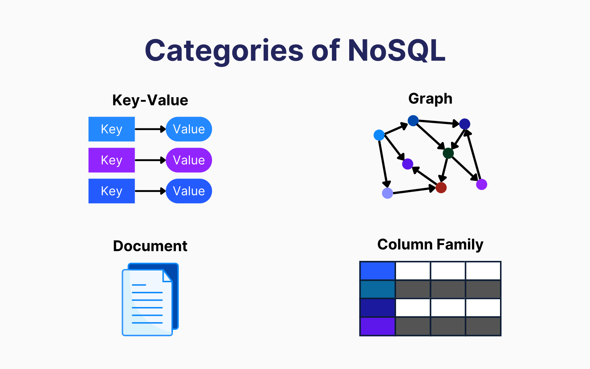
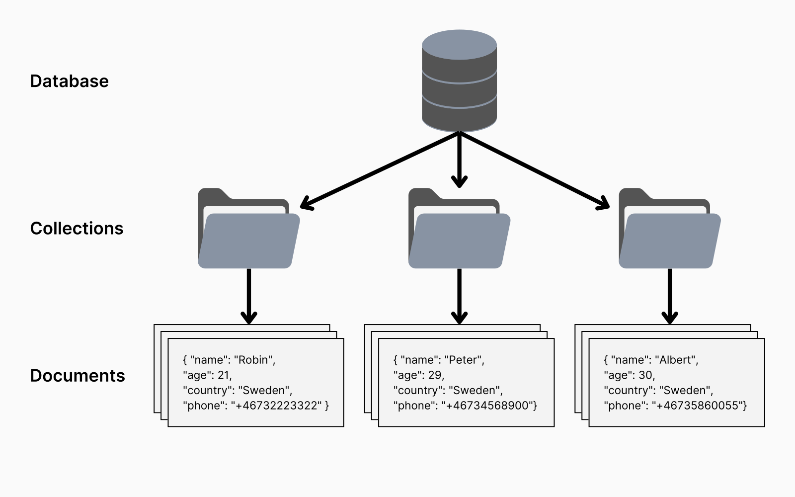
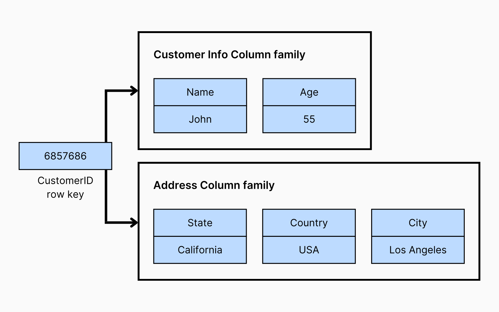
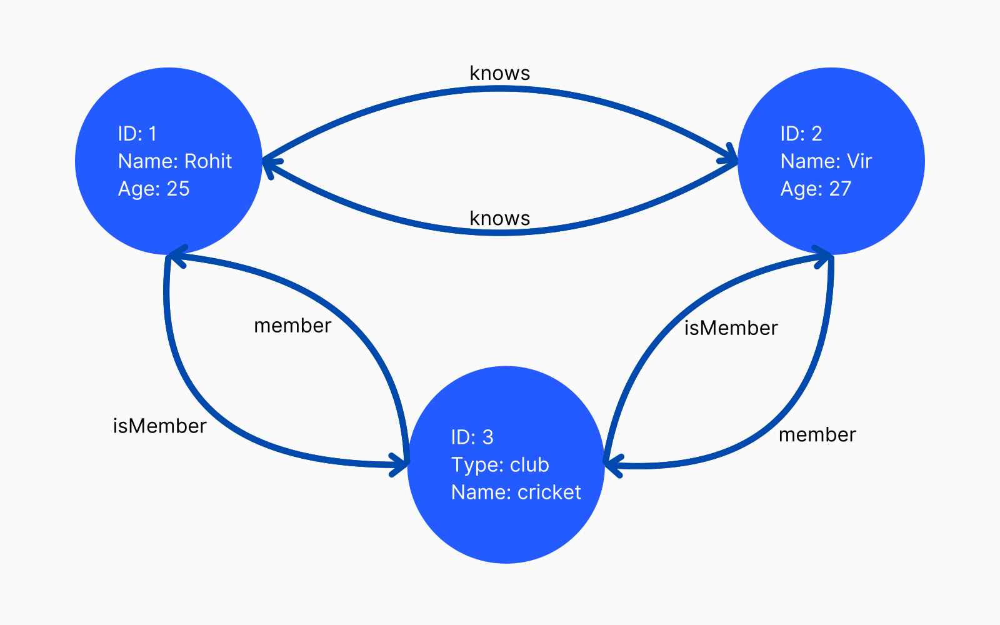
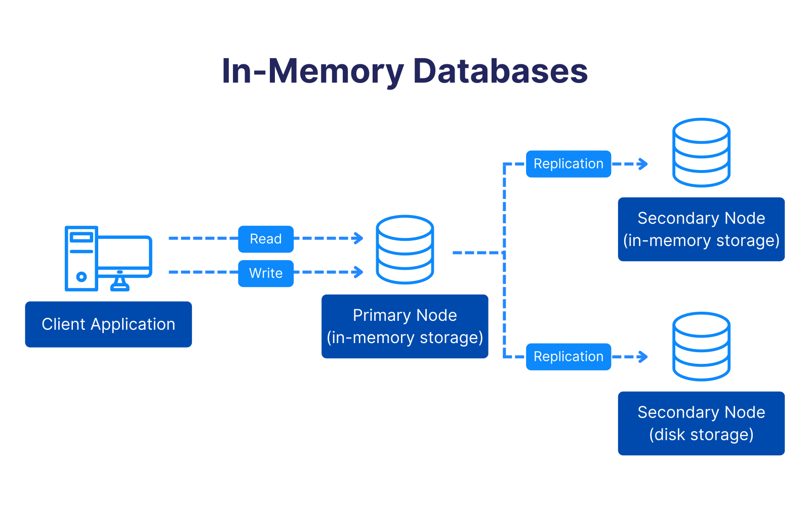
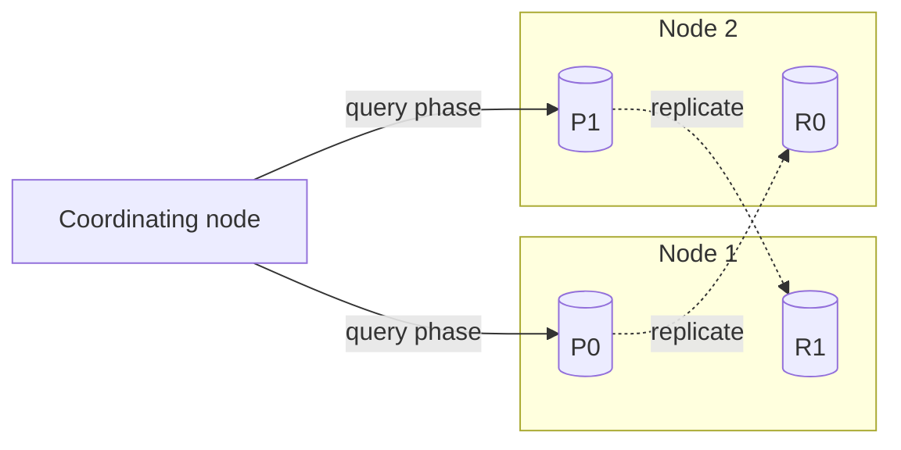
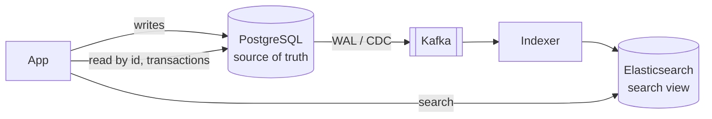
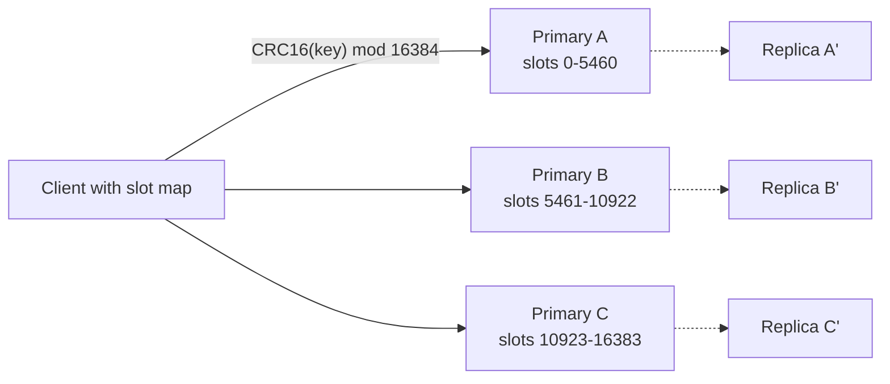

# Chapter 16 — Beyond Relational: NoSQL, NewSQL and Specialised Databases

Relational databases are the right default for most applications: a flexible query language, joins, constraints and ACID transactions (Chapter 13). But some workloads fit tables awkwardly — a catalogue where every item has different attributes, a session cache needing sub-millisecond reads, billions of sensor readings a day, "friends of friends who like jazz", "every restaurant within 2 km". A family of databases grew up around those shapes of data. This chapter tours them, shows how much of each you can already do **inside PostgreSQL**, and ends with a decision table.

| Section | Topic | Runnable part |
|---|---|---|
| 16.1 | Why NoSQL appeared, CAP and NoSQL, BASE vs ACID, the four families | — |
| 16.2 | Key-value stores (Redis, Riak) | KV + TTL + leaderboard in Postgres |
| 16.3 | Document databases (MongoDB, CouchDB) | **JSONB as a document store** with GIN indexes |
| 16.4 | Column-family and wide-column stores (Cassandra, HBase) | Wide-row time-series table |
| 16.5 | Graph databases (Neo4j, Neptune) | Friends-of-friends and shortest path with recursive CTEs |
| 16.6 | In-memory databases (SAP HANA, SingleStore, Redis) | — |
| 16.7 | NewSQL / distributed SQL (Spanner, CockroachDB) | — |
| 16.8 | Time-series and spatial databases | Partitions, BRIN, `date_bin`, geometric KNN with GiST |
| 16.9 | Big data frameworks: Hadoop, Spark, SQL-on-Hadoop, Kafka, Flink | Python MapReduce in miniature |
| 16.10 | Choosing a database | Decision table |
| 16.11 | Inside Elasticsearch/ELK (inverted index, analyzers, shards, refresh) and Redis (event loop, encodings, RDB/AOF, Cluster slots, eviction) | **Python inverted index + BM25 over two shards** |

Prerequisites: [Chapter 15](../15-scaling-databases/README.md) (partitioning, replication, CAP, consensus) and [Chapter 12](../12-indexes-storage-and-query-performance/README.md) (indexes). Theory: DDIA notes [ch.2 — data models](../../../ddia/chapters/02-data-models-and-query-languages/README.md), [ch.3 — storage engines (LSM trees, column storage)](../../../ddia/chapters/03-storage-and-retrieval/README.md), [ch.10 — batch](../../../ddia/chapters/10-batch-processing/README.md), [ch.11 — stream processing](../../../ddia/chapters/11-stream-processing/README.md). Patterns: [Caching](../../../system-design-patterns/modules/04-caching/README.md), [Batch and streaming](../../../system-design-patterns/modules/10-batch-and-streaming/README.md), [Storing data](../../../system-design-patterns/modules/03-storing-data/README.md).

All SQL runs on the book's PostgreSQL 14 (`bash tools_run_sql.sh sql`); the two Python toys (MapReduce, inverted index) with `bash tools_run_python.sh sql`. Snippets for other products (MongoDB, Redis, Cassandra, Neo4j, PostGIS) are marked **(not run)**.

---

## 16.1 Why NoSQL?

### What it is

**NoSQL** ("Not only SQL", a term that caught on around 2009) covers databases whose primary model **isn't the relational table**. They trade some relational features — usually joins, a fixed **schema** (declared tables, columns, types) and sometimes multi-row transactions — for **flexible data models, easy horizontal scaling, and speed on specific access patterns**.

### The problem it solves

| Pain with relational (as typically deployed in the 2000s) | NoSQL answer |
|---|---|
| **Rigid schema**: every row has the same columns; changes need **migrations** (scripted schema changes on a live database) | **Flexible/dynamic schema**: each record carries its own fields (JSON or BSON documents, dynamic columns) |
| **Scale-up only**: one bigger server, expensive, with a ceiling | **Scale-out built in**: automatic sharding and replication across cheap nodes |
| **Joins and transactions get slow** at huge volume | Data **stored the way it's read** (denormalised or pre-aggregated), so no joins in the **hot path** (the code run on every request) |

*Example.* A marketplace sells laptops (RAM, CPU, warranty), T-shirts (size, material) and books (authors, pages). Relationally that means **sparse columns** (mostly empty), an **entity-attribute-value** table (one row per `(item, attribute, value)`), or a table per category; in a document store each product is simply a document with the fields it has (16.3). Modern relational systems closed much of the gap — Postgres has JSONB, partitioning, logical replication and **Citus** (an extension spreading tables across servers) — hence this chapter shows the Postgres equivalent of each model.

### CAP and NoSQL

During a network partition a distributed store chooses consistency or availability ([§15.7](../15-scaling-databases/README.md#157-the-cap-theorem-and-pacelc)):

- **CP** stores refuse or delay requests on the minority side: **HBase**, MongoDB (with majority write/read concern — how many replicas must confirm a write or agree on a read), etcd.
- **AP** stores keep answering and reconcile later: **Cassandra**, Riak, CouchDB, DynamoDB reads (eventual unless a strongly consistent read is requested).

Many make this **tunable per request** (Cassandra `ONE` vs `QUORUM`).

### BASE: the other end of the spectrum from ACID

Many AP-leaning stores describe their guarantees as **BASE** — essentially CAP's **AP** choice as a design philosophy, suiting feeds, activity streams and metrics where being up beats every reader seeing the latest value:

- **Basically Available**: answers almost every request during partial failures, maybe not the newest value (a Cassandra read at `ONE` succeeds while one replica is up).
- **Soft state**: replicas may be temporarily out of sync, and state can change without new input as updates propagate (a lagging secondary in a MongoDB **replica set** — one **primary** taking writes, **secondaries** copying it).
- **Eventual consistency**: if writes stop, replicas converge ([§15.6](../15-scaling-databases/README.md#156-consistency-models)) — e.g. via hinted handoff, read repair and anti-entropy ([§15.5](../15-scaling-databases/README.md#155-replication)).

| Property | ACID (typical relational) | BASE (typical AP NoSQL) |
|---|---|---|
| Atomicity | All-or-nothing, including multi-row transactions | Often per single record/document only |
| Consistency | Constraints hold after every commit, and reads see committed data | Replicas may briefly disagree and converge later |
| Isolation | Concurrent transactions don't interfere (per isolation level) | Weaker; concurrent writes may conflict and need resolution |
| Durability | Committed = on disk (WAL) | Configurable (write concern, replication factor = number of copies, fsync policy) |
| Availability focus | Consistency first during failures | Availability first |
| Scaling | Traditionally vertical plus read replicas | Horizontal by design |

**Myth correction:** the line has blurred. MongoDB has multi-document ACID transactions since 4.0 (2018), DynamoDB `TransactWriteItems` since 2018, Cassandra lightweight transactions (Paxos-based compare-and-set), while Postgres stores schemaless JSON. ACID vs BASE is a **spectrum of defaults**.

### The four NoSQL families



| Family | Data model | Great at | Examples |
|---|---|---|---|
| **Key-value** | Opaque value (not interpreted by the database) looked up by a unique key | Caching, sessions, counters, leaderboards | Redis, Riak KV, Memcached, DynamoDB (also a document store) |
| **Document** | JSON-like documents grouped into collections | Catalogues, CMS content, user profiles | MongoDB, CouchDB, Firestore |
| **Column-family / wide-column** | Rows with a partition key, columns grouped into families, sorted within a partition | Huge write volumes, time-series, logs | Cassandra, HBase, ScyllaDB, Bigtable |
| **Graph** | Nodes and edges, both with properties | Relationships: social, fraud rings, recommendations | Neo4j, Amazon Neptune, ArangoDB |

Shared features: **dynamic schema**, **horizontal scaling**, **performance tuned to one access pattern**, **fault tolerance** through built-in replication.

### In the interview

**30-second answer:** "NoSQL databases drop the relational model to get flexible schemas, easy scale-out and speed on specific access patterns. There are four families: key-value, document, wide-column and graph. Many lean AP in CAP terms and follow BASE (basically available, soft state, eventually consistent) instead of strict ACID, though modern ones offer transactions and tunable consistency. You model data around queries, not around normalisation."

- *Is MongoDB ACID?* Single-document operations always were; multi-document transactions since 4.0 (replica sets) and 4.2 (sharded clusters).
- *When is Postgres JSONB enough?* When you need flexible attributes *plus* joins, constraints and transactions, at a scale one Postgres (or Citus) can handle.
- *A CP and an AP store?* HBase; Cassandra (by default). *Family for "friends' friends"?* Graph.

### TL;DR

NoSQL = flexible models + scale-out + access-pattern-specific speed, often with BASE semantics. The ACID/BASE divide is now a spectrum.

---

## 16.2 Key-value stores

### What it is

The simplest database: a giant, distributed **dictionary**. Each **key** is unique; the **value** is whatever you store (text, number, JSON, a binary **blob**), uninterpreted. You `GET`, `SET`, `DELETE` — no joins, usually no queries by value.

```
session:9f2c      -> {"user_id": 42, "cart": ["LAP-13"], "expires": "..."}
rate:10.0.0.7     -> 17
weather:paris     -> {"temp_c": 18}
```

Designing keys is the whole data model (prefixes like `user:42:profile`, because the key is the only way in). Fits when you need very fast access by a known id, relationships are minimal or handled in the app, and pairs are independent.

### Popular systems

**Redis** ("Remote Dictionary Server") keeps everything **in memory**, answering in well under a millisecond. Values are rich **data structures**: strings, hashes (field→value maps), lists, sets, **sorted sets** (members ordered by a numeric score), streams, bitmaps and HyperLogLogs (a tiny structure estimating distinct counts). It also offers **pub/sub** messaging (every subscriber to a channel receives each published message), **Lua** scripting run inside the server, key expiry (**TTL**, time to live), **eviction policies** such as **LRU** (least recently used) / **LFU** (least frequently used) when memory is full, optional **persistence** (RDB snapshots and/or an append-only file, AOF), and Redis Cluster's 16,384 hash slots — internals in 16.11.

```
# Redis (not run)
SET session:42 '{"user":42}' EX 1800     # expires in 30 min
GET session:42
INCR page:home:views                      # atomic counter
ZADD steps 12050 ana 8300 bo 15010 cy     # sorted set = leaderboard
ZREVRANGE steps 0 2 WITHSCORES            # top 3
```

**Riak KV** is a Dynamo-style (after Amazon's Dynamo paper) **distributed** key-value store: leaderless replication, consistent hashing, tunable N/R/W quorums ([§15.5](../15-scaling-databases/README.md#155-replication)), **eventual consistency** with sibling values for conflicts; built for high availability, survives node failures without failover. Its company (Basho) closed in 2017; the code lives on as open source.

| Use | Example | Why KV fits |
|---|---|---|
| **Caching** | A weather app caches the latest forecast per city; a shop caches product pages | Read by key, expiry built in |
| **Session storage** | Logged-in user state | Tiny, per-user, high-churn data |
| **Real-time data** | Live stock prices or ride locations updated many times a second | In-memory speed |
| **Counters and rate limits** | "100 requests per minute per API key" | Atomic `INCR` with a TTL |
| **Leaderboards** | A fitness app ranks users by daily steps | Sorted sets keep order as scores change |

| Strengths | Limits |
|---|---|
| O(1) lookups by key, very high throughput | **No ad-hoc queries**: filtering, joins and secondary lookups must be built in the app or with extra keys (e.g. "all sessions of user 42" needs an app-maintained `user:42:sessions`) |
| Easy to shard (hash the key) and replicate | **Poor fit for relationships** |
| Values can be anything | In-memory stores are **bounded by RAM** (expensive) |

### The same pattern in Postgres

`code/02_key_value_style.sql` builds a KV table with TTL, an UPSERT "put", and a leaderboard:

```sql
CREATE UNLOGGED TABLE kv (            -- UNLOGGED: no WAL, fast, emptied after a crash (cache-like)
  k          text PRIMARY KEY,
  v          jsonb NOT NULL,
  expires_at timestamptz
);
-- PUT = insert or overwrite
INSERT INTO kv VALUES ('session:42', '{"user":42,"cart":["LAP-13","TSH-01"]}', now() + interval '30 minutes')
ON CONFLICT (k) DO UPDATE SET v = EXCLUDED.v, expires_at = EXCLUDED.expires_at;
INSERT INTO kv VALUES ('weather:paris', '{"temp_c":18}', now() - interval '1 minute');  -- already expired
-- GET only unexpired keys
SELECT k, v FROM kv WHERE k = 'session:42' AND (expires_at IS NULL OR expires_at > now());
```

```
     k      |                     v                      
------------+--------------------------------------------
 session:42 | {"cart": ["LAP-13", "TSH-01"], "user": 42}

 weather_hits 
--------------
            0
```

The expired key isn't returned. The leaderboard is a window function (Chapter 8); ties share a rank:

```
 rank | user_name | steps 
------+-----------+-------
    1 | cy        | 15010
    2 | ana       | 12050
    3 | bo        |  8300
    3 | di        |  8300
```

Cleanup is `DELETE FROM kv WHERE expires_at <= now() RETURNING k` (evicts `weather:paris`; Redis expires automatically), and `pg_class.relpersistence = 'u'` confirms the table is unlogged — speed (no WAL) traded for durability: truncated after a crash, not replicated. Fine for moderate loads; Redis still wins on latency, built-in expiry and data structures.

**Common mistakes:** a cache as the **source of truth** (the authoritative copy) without persistence, losing data on restart; huge values or "hot keys" (one key with a large share of traffic) that one shard serves alone; no TTLs, so memory fills and eviction drops useful keys.

### In the interview

**30-second answer:** "A key-value store is a distributed hash map: O(1) get/put by key, easy to shard and replicate, no queries by value. Redis adds in-memory speed and data structures like sorted sets. I use it for caching, sessions, counters, rate limiting and leaderboards, with a TTL on keys, and keep the durable truth in a primary database."

- *Rate limiter?* `INCR key` with `EXPIRE` for a fixed window, or a sorted set of timestamps for a sliding window.
- *Cache invalidation?* **Cache-aside** (check the cache; on a miss read the database and fill the cache) with TTLs, and delete or refresh the key on writes ([caching patterns](../../../system-design-patterns/modules/04-caching/README.md)).
- *What does a sorted set give a leaderboard?* Members ordered by score, O(log n) updates, fast range queries.

### TL;DR

Key-value = dictionary at scale. It's the fastest way to get by key, with nothing beyond that. Perfect for caches, sessions, counters and leaderboards.

---

## 16.3 Document databases

### What it is

A **document database** stores self-contained **documents**, usually JSON or a binary form (MongoDB's **BSON**), grouped into **collections** (≈ tables) inside a **database**. Every document has a unique id (`_id` in MongoDB); documents in one collection may have **different fields** and **nest** objects and arrays.



```json
{ "_id": 1, "name": "Meera", "city": "Pune",  "phone": "+91 98xxxxxx01" }
{ "_id": 2, "name": "Tomás", "city": "Porto", "languages": ["pt", "en"] }
```

Key features: (1) **flexible schema** — electronics with `warranty` and `brand` next to clothing with `size` and `material`, no migrations; (2) **nesting** — a customer document **embeds** addresses and recent orders, so one read serves a page; (3) **no joins needed** — data read together is stored together; (4) **horizontal scaling** — built-in sharding by a shard key (MongoDB).

### Popular systems

- **MongoDB**: BSON, a rich query language, **secondary indexes** (on fields other than the id), **aggregation pipelines** (`$match` → `$group` → `$sort`, like `WHERE`/`GROUP BY`), replica sets (single-leader), sharding, multi-document transactions since 4.0.
- **CouchDB**: JSON over a **RESTful HTTP API** (resources addressed by URLs, manipulated with GET, PUT, DELETE), multi-leader **replication and sync** for occasionally connected devices (PouchDB in the browser syncs with it), **MVCC** document revisions for conflict detection.

```js
// MongoDB shell (not run)
db.products.insertOne({ sku: "LAP-15", type: "laptop", price: 1399, specs: { ram_gb: 32 } })
db.products.find({ type: "laptop", "specs.ram_gb": { $gte: 16 } }).sort({ price: 1 })
db.products.aggregate([{ $group: { _id: "$type", avgPrice: { $avg: "$price" } } }])
db.products.createIndex({ type: 1, price: 1 })
```

Use cases: **content management** (posts with varying metadata), **product catalogues** (per-category attributes in one collection), **user profiles and settings** (optional, evolving fields), **event logging** (a game records player actions for later analysis).

### Modelling: embed or reference?

| Embed (nest inside the parent) | Reference (store the id, look it up separately) |
|---|---|
| Data read together and owned by the parent (a customer's addresses) | Data shared by many parents (a product referenced by many orders) |
| Bounded size (a few addresses) | Unbounded growth (all of a user's comments ever) |
| One read, atomic single-document update | Second query or `$lookup` (the document world's join) |

| Strengths | Limits |
|---|---|
| Schema flexibility for evolving data | **Many-to-many relationships** and cross-document constraints are awkward |
| Fast reads when documents match the page | **Duplicated (denormalised) data** must be kept in sync by the app |
| Built-in scale-out | Some configurations favour availability over strong consistency (e.g. reading from secondaries) |

### A document store inside Postgres: JSONB

`jsonb` (operators, indexing and update functions taught in [§14.4](../14-advanced-sql-and-using-sql-from-code/README.md#144-json-and-jsonb)) plus **SQL/JSON path** queries (a mini-language like `$.authors[*]`) make Postgres a document store. `code/01_jsonb_document_store.sql`:

```sql
CREATE TABLE products (
  id  bigint GENERATED ALWAYS AS IDENTITY PRIMARY KEY,
  doc jsonb NOT NULL
);
INSERT INTO products (doc) VALUES
 ('{"sku":"LAP-13","type":"laptop","name":"Aero 13","price":999,
    "brand":"Nimbus","warranty_years":2,"specs":{"ram_gb":16,"cpu":"8-core"}}'),
 ('{"sku":"TSH-01","type":"tshirt","name":"Plain Tee","price":15,
    "sizes":["S","M","L"],"material":"cotton"}'),
 ('{"sku":"LAP-15","type":"laptop","name":"Aero 15","price":1399,
    "brand":"Nimbus","warranty_years":3,"specs":{"ram_gb":32,"cpu":"12-core"}}'),
 ('{"sku":"BK-042","type":"book","name":"Data at Scale","price":45,
    "authors":["R. Rao","M. Chen"],"pages":412}');

SELECT doc->>'sku' AS sku, (SELECT string_agg(k, ',' ORDER BY k) FROM jsonb_object_keys(doc) k) AS keys
FROM products ORDER BY id;
```

```
  sku   |                      keys                      
--------+------------------------------------------------
 LAP-13 | brand,name,price,sku,specs,type,warranty_years
 TSH-01 | material,name,price,sizes,sku,type
 LAP-15 | brand,name,price,sku,specs,type,warranty_years
 BK-042 | authors,name,pages,price,sku,type
```

Every row has its own shape, like documents in a collection. Querying (`->` JSON, `->>` text, `#>>` path):

```sql
SELECT doc->>'name' AS name, (doc->>'price')::numeric AS price, doc#>>'{specs,ram_gb}' AS ram_gb
FROM products WHERE doc->>'type' = 'laptop' ORDER BY price;
```

```
  name   | price | ram_gb 
---------+-------+--------
 Aero 13 |   999 | 16
 Aero 15 |  1399 | 32
```

**Containment `@>`** ("does the document contain this sub-document?"; arrays match if they contain the listed elements):

```sql
SELECT doc->>'name' AS name FROM products WHERE doc @> '{"sizes":["M"]}';                        -- Plain Tee
SELECT doc->>'name' AS name FROM products WHERE doc @> '{"brand":"Nimbus","specs":{"ram_gb":32}}'; -- Aero 15
SELECT doc->>'name' AS name FROM products WHERE doc ? 'authors';                                 -- Data at Scale
SELECT jsonb_path_query(doc, '$.authors[*]') AS author FROM products WHERE doc->>'sku' = 'BK-042';
```

```
  author   
-----------
 "R. Rao"
 "M. Chen"
```

**Partial updates** with `jsonb_set`, `||` (merge) and `-` (remove key):

```sql
UPDATE products SET doc = jsonb_set(doc, '{price}', '1299') WHERE doc->>'sku' = 'LAP-15';
UPDATE products SET doc = doc || '{"on_sale":true}'         WHERE doc->>'sku' = 'TSH-01';
UPDATE products SET doc = doc - 'warranty_years'            WHERE doc->>'sku' = 'LAP-13';
```

```
  sku   | price | on_sale | warranty 
--------+-------+---------+----------
 LAP-13 | 999   |         | 
 TSH-01 | 15    | true    | 
 LAP-15 | 1299  |         | 3
 BK-042 | 45    |         | 
```

(Postgres rewrites the whole row version — JSONB isn't updated in place, so huge, frequently updated documents are a poor fit.)

**Indexing**, after adding 20,000 generated products:

```sql
CREATE INDEX products_doc_gin ON products USING gin (doc jsonb_path_ops);   -- serves @> on ANY key
EXPLAIN (COSTS OFF) SELECT count(*) FROM products WHERE doc @> '{"sku":"GEN-777"}';

CREATE INDEX products_price_idx ON products (((doc->>'price')::numeric));  -- B-tree on ONE field
EXPLAIN (COSTS OFF) SELECT doc->>'sku' FROM products WHERE (doc->>'price')::numeric > 503;
```

```
 Aggregate
   ->  Bitmap Heap Scan on products
         Recheck Cond: (doc @> '{"sku": "GEN-777"}'::jsonb)
         ->  Bitmap Index Scan on products_doc_gin
               Index Cond: (doc @> '{"sku": "GEN-777"}'::jsonb)

 Bitmap Heap Scan on products
   Recheck Cond: (((doc ->> 'price'::text))::numeric > '503'::numeric)
   ->  Bitmap Index Scan on products_price_idx
         Index Cond: (((doc ->> 'price'::text))::numeric > '503'::numeric)
```

The GIN index covers containment on any key; `jsonb_path_ops` is smaller and faster for `@>` but doesn't support `?`, while the default `jsonb_ops` supports both. An expression B-tree serves range and sort queries on one field.

**Guard rails document databases often lack** — a `CHECK` can enforce required keys and types:

```sql
ALTER TABLE products ADD CONSTRAINT doc_has_sku_and_price
  CHECK (doc ? 'sku' AND jsonb_typeof(doc->'price') = 'number');
-- inserting '{"name":"No SKU","price":"cheap"}' now fails:
-- NOTICE:  rejected: new row for relation "products" violates check constraint "doc_has_sku_and_price"
```

A common hybrid: **regular columns for stable, queried fields** (sku, price, type) plus a **JSONB column for variable attributes** — integrity where it matters, flexibility where it helps.

### In the interview

**30-second answer:** "A document store keeps self-contained JSON documents in collections, with flexible schemas and nesting, so a page can be served by one read. I embed data that's owned and read together, and reference data that's shared or unbounded. It's weaker at many-to-many relationships and cross-document constraints. If I also need joins and transactions, Postgres JSONB with a GIN index gives most of the benefit."

- *Index a JSONB field for range queries?* A B-tree expression index on `((doc->>'field')::type)`. (`json` vs `jsonb`: [§14.4](../14-advanced-sql-and-using-sql-from-code/README.md#144-json-and-jsonb).)
- *Reference instead of embed when?* The child data is shared or grows without bound.

### TL;DR

Documents = flexible, nested records read in one go. Model around your queries. In Postgres, `jsonb` + GIN + CHECK constraints gives you a document store with SQL around it.

---

## 16.4 Column-family and wide-column stores

### What it is

A **column-family** database stores rows identified by a **row key**, with columns grouped into **column families** (named groups stored together on disk). Rows needn't share columns, and a row can have thousands — hence **"wide"**.



Row key `cust#6857686` might have family **info** (`name = "John"`, `age = 55`) and family **address** (`state = "California"`, `country = "US"`, `city = "..."`); an address query reads only the `address` family's storage. This is Google Bigtable's (2006) **column-family model**, copied by HBase. The **wide-column model** (Cassandra, ScyllaDB) adds distribution:

- A **partition key** decides which node stores the row (consistent hashing, [§15.3](../15-scaling-databases/README.md#153-sharding)); rows sharing it live together.
- **Clustering columns** sort rows *within* a partition, making in-partition range scans cheap.
- Replication is typically **eventually consistent** with **tunable** consistency.

```sql
-- Cassandra CQL (not run): one partition per server per day, rows sorted by time
CREATE TABLE metrics (
  server_id text, day date, ts timestamp, cpu_pct float, mem_mb int,
  PRIMARY KEY ((server_id, day), ts)          -- (partition key), clustering column
) WITH CLUSTERING ORDER BY (ts DESC);
SELECT ts, cpu_pct FROM metrics WHERE server_id = 'S1' AND day = '2024-12-06' LIMIT 60;
```

> **Don't confuse** *wide-column* stores (Cassandra, HBase) with **columnar** analytics databases (ClickHouse, Redshift, BigQuery, Parquet files). Columnar stores keep each *column* contiguous so `SUM(amount)` over billions of rows reads one column ([§12.1](../12-indexes-storage-and-query-performance/README.md#121-how-a-database-stores-data)); wide-column stores keep each *row partition* together by key ([DDIA ch.3](../../../ddia/chapters/03-storage-and-retrieval/README.md)).

### Why they fit time-series and write-heavy data

- **Sequential writes**: most use **LSM trees** — writes go to an in-memory table plus a commit log, then flush as **immutable** sorted files (**SSTables**) merged in the background (**compaction**). Writes are appends, so throughput is very high.
- **Partitioning by time range**: a partition key such as `(sensor, day)` spreads load and keeps each day together.
- **Flexible columns**: a new metric is a new column, no migration.

| server_id | ts | cpu_pct | mem_mb |
|---|---|---|---|
| web-1 | 2024-12-06 10:00 | 41 | 1980 |
| web-1 | 2024-12-06 10:01 | 44 | 2012 |
| db-1 | 2024-12-06 10:00 | 63 | 1705 |

A monitoring feed partitioned by server, clustered by time: "last hour of web-1" is one sequential read.

| | **Cassandra** (wide-column) | **HBase** (column-family) |
|---|---|---|
| Origin | Facebook (2008), combining Dynamo's distribution with Bigtable's data model | Apache clone of Google Bigtable, on Hadoop |
| Architecture | Leaderless ring, every node equal | Master + RegionServers, data in **HDFS** (16.9) |
| Scaling unit | Token ranges on the ring | **Regions** (key ranges) that split automatically as they grow |
| Consistency | **Tunable** per query (`ONE`, `QUORUM`, `ALL`), AP by default | **Strong** per-row consistency (CP) |
| Query | CQL (Cassandra Query Language: SQL-like, no joins) | Java API, get/put/scan by row key, or SQL through Apache Phoenix |
| Typical use | User activity feeds, messaging, IoT at global scale | Big-data random read/write next to Hadoop and Spark jobs, e.g. transaction histories for fraud analysis |

Use cases: **time-series and IoT** (millions of smart-home sensors), **logs**, **activity and recommendation data** (every view and purchase per user), **real-time analytics** (counters and recent windows for dashboards and alerts). **Limits:** tables designed **per query** (the same data often written to several tables), no joins, limited secondary indexes and ad-hoc queries, and deletes create **tombstones** (deletion markers, since immutable files can't be edited) that slow reads until compaction.

### The same idea in Postgres

`code/04_time_series_and_wide_rows.sql`: composite PK `(server_id, ts)` acts as partition key + clustering column, daily range partitions provide retention:

```sql
CREATE TABLE metrics (
  server_id text        NOT NULL,       -- like a wide-column "partition key"
  ts        timestamptz NOT NULL,       -- like a "clustering key": rows sorted by time
  cpu_pct   real,
  mem_mb    int,
  PRIMARY KEY (server_id, ts)
) PARTITION BY RANGE (ts);
-- one partition per day; 3 servers x 2 days x 1,440 minutes = 8,640 readings
EXPLAIN (COSTS OFF)
SELECT ts, cpu_pct FROM metrics
WHERE server_id = 'web-1' AND ts >= '2024-12-06 23:30' AND ts < '2024-12-07 00:00';
```

```
 Bitmap Heap Scan on metrics_2024_12_06 metrics
   Recheck Cond: ((server_id = 'web-1'::text) AND (ts >= '2024-12-06 23:30:00+00'::timestamp with time zone) AND ...)
   ->  Bitmap Index Scan on metrics_2024_12_06_pkey
         Index Cond: ((server_id = 'web-1'::text) AND (ts >= '2024-12-06 23:30:00+00'::timestamp with time zone) AND ...)
```

One partition scanned, then a narrow `(server_id, ts)` range — exactly the wide-column access pattern (more in 16.8).

### In the interview

**30-second answer:** "Wide-column stores like Cassandra distribute rows by a partition key and sort them within the partition by clustering columns. Writes go to LSM trees, so they're append-fast. You design one table per query and live with no joins. Consistency is tunable per request. They're great for time-series, logs and activity feeds at huge write rates. They aren't the same as columnar analytics stores."

- *"Latest 50 messages per chat" in Cassandra?* Partition key `chat_id` (plus a time bucket if chats are huge), clustering column `sent_at DESC`, `LIMIT 50`.
- *Why bucket the partition key by day?* To keep partitions bounded (Cassandra's guidance: roughly 100 MB or less each) and spread hot writes.
- *HBase vs Cassandra consistency?* HBase strong per row; Cassandra tunable, eventual by default.

### TL;DR

Wide-column = partition key for placement + clustering key for order + LSM for fast writes. One table per query. Built for massive write-heavy, time-ordered data.

---

## 16.5 Graph databases

### What it is

A **graph database** stores **nodes** (people, products, places), **edges** (`KNOWS`, `BOUGHT`, `MEMBER_OF`) and **properties** on both (`name`, `since`, `weight`). Edges are first-class stored data, not computed from foreign keys at query time. Choose one when **relationships matter as much as the records**: social connections, recommendations, fraud rings, network topology, knowledge graphs, access-control hierarchies.



### Relational vs graph for the same data

**Relational:** `person` plus a link table `knows(src, dst)`, friendships stored in both directions (so one `src = ?` lookup finds all friends):

| src | dst |
|---|---|
| 1 (Ava) | 2 (Bilal) |
| 1 (Ava) | 3 (Chen) |
| 2 (Bilal) | 4 (Dana) |
| … | … |

Each extra hop ("friends of friends of friends") adds **another join** — O(log n) per edge with B-tree lookups — and intermediate results can explode. **Graph:** each node stores direct pointers to its edges (Neo4j's **index-free adjacency**), so traversal follows edges with no index lookup; cost depends on edges traversed, **not database size**, so deep, variable-length traversals stay fast.

```cypher
// Neo4j Cypher (not run)
CREATE (a:Person {name:'Ava'})-[:KNOWS]->(b:Person {name:'Bilal'});
MATCH (me:Person {name:'Ava'})-[:KNOWS]->(f)-[:KNOWS]->(fof)
WHERE NOT (me)-[:KNOWS]->(fof) AND fof <> me
RETURN DISTINCT fof.name;                                   // friend suggestions
MATCH p = shortestPath((:Person {name:'Ava'})-[:KNOWS*]-(:Person {name:'Goran'}))
RETURN [n IN nodes(p) | n.name];
```

Advantages: relationship queries are **simpler** (patterns, not join chains), **fast at depth**, and the model is **flexible** (new node/edge types freely). Languages: **Cypher/openCypher** (Neo4j, Neptune, Memgraph), **Gremlin** (Apache TinkerPop), **SPARQL** (RDF triple stores), the ISO standard **GQL** (ISO/IEC 39075, 2024); SQL:2023 added **SQL/PGQ** for property-graph queries over relational tables.

Use cases: (1) **social networks** — mutual friends, degrees of separation, "people you may know"; (2) **recommendations** — "customers who bought this also bought…" is a two-hop traversal over users, products, categories; (3) **fraud detection** — accounts sharing devices, addresses or cards form **connected components** (groups all reachable from one another); (4) **IT dependency maps and knowledge graphs**.

**Scaling limits:** horizontal sharding is hard (traversals cross the network on almost every hop, so many keep the graph on one machine and scale reads with replicas); **bulk updates** by property are slower than in column or document stores; **aggregations over everything** belong in a warehouse.

### Graph queries in Postgres

`code/03_graph_in_sql.sql` models seven people with symmetric `knows` edges and walks the graph with recursive CTEs ([Chapter 7](../07-ctes-views-and-recursion/README.md)):

```sql
-- 2 hops: friend-of-friend suggestions for Ava
SELECT DISTINCT p.name AS suggestion
FROM knows k1 JOIN knows k2 ON k2.src = k1.dst JOIN person p ON p.id = k2.dst
WHERE k1.src = 1 AND k2.dst <> 1
  AND k2.dst NOT IN (SELECT dst FROM knows WHERE src = 1);

-- N hops: degrees of separation (path array prevents cycles)
WITH RECURSIVE walk(id, depth, path) AS (
  SELECT 1, 0, ARRAY[1]
  UNION ALL
  SELECT k.dst, w.depth + 1, w.path || k.dst
  FROM walk w JOIN knows k ON k.src = w.id
  WHERE k.dst <> ALL (w.path) AND w.depth < 6
)
SELECT p.name, min(depth) AS degrees
FROM walk JOIN person p USING (id) GROUP BY p.name ORDER BY degrees, p.name;
```

Output (Ava's friends are Bilal and Chen; the suggestion, degrees, and the shortest path to Goran):

```
 suggestion 
------------
 Dana

  name  | degrees 
--------+---------
 Ava    |       0
 Bilal  |       1
 Chen   |       1
 Dana   |       2
 Eli    |       3
 Fatima |       4
 Goran  |       5

                 shortest_path                  
------------------------------------------------
 Ava -> Bilal -> Dana -> Eli -> Fatima -> Goran
```

Fine for small graphs and shallow depths; recursive CTEs enumerate **every path**, so on large, dense graphs work grows exponentially with depth — where a graph engine (or the Apache AGE extension, adding Cypher to Postgres) pays off.

### In the interview

**30-second answer:** "A graph database stores nodes, edges and properties, and follows edges directly, so multi-hop queries cost in proportion to the edges touched rather than the table sizes. It's ideal for social graphs, recommendations and fraud rings. It's harder to shard and weaker at bulk aggregates. For a few hops on modest data, SQL with a link table and recursive CTEs is fine."

- *Why are deep joins slow in SQL?* Each hop is another join over the whole link table (through an index), and intermediate results multiply.
- *Detect a fraud ring?* Link accounts to shared devices, cards and addresses, then find connected components or short cycles.

### TL;DR

Graphs make relationships first-class. Use one when the questions are "how is X connected to Y". Recursive CTEs cover the small cases.

---

## 16.6 In-memory databases

### What it is

An **in-memory database (IMDB)** keeps its primary copy in **RAM**: ~100 nanoseconds per access vs tens to hundreds of microseconds for an SSD read. The engine uses memory-native structures (**hash tables**; **skip lists** — sorted linked lists with "express lanes"; compact column vectors) instead of disk pages and buffer management.



**Architecture:** (1) a **primary node** holds working data in memory and serves reads and writes; (2) changes **replicate** to secondaries (in memory or disk-backed); (3) because RAM is **volatile**, **persistence** comes from **snapshots** and/or an **append-only / write-ahead log**, reloaded and replayed on restart (the WAL idea of [§15.9](../15-scaling-databases/README.md#159-fault-tolerance-and-recovery)).

| Benefit | Example |
|---|---|
| **Speed** | A user's recent purchase history in well under a millisecond |
| **Real-time processing** | Live game leaderboards, fraud checks during card authorisation, IoT alerts |
| **Memory-optimised structures** | Redis's native hashes and sorted sets |
| **High concurrency** | Hundreds of thousands of operations per second per node |

**Limitations:** volatility (no persistence = data lost on restart; persistence = extra I/O and recovery time); **cost** per GB far above disk; **scaling** means more RAM on more nodes, data bounded by total cluster memory.

**Real systems:**
- **SAP HANA**: in-memory, **column-oriented**, running **OLTP and OLAP on the same data** (HTAP, hybrid transactional/analytical processing) — a retailer analyses today's sales in real time and adjusts stock orders the same afternoon.
- **SingleStore** (**MemSQL** until 2020): distributed SQL with in-memory row storage plus disk-based columnstore tables, MySQL-wire-compatible (MySQL drivers work) ANSI SQL — a bank scores millions of card transactions a day for fraud in real time.
- **Redis** (16.2, 16.11), **Memcached** (cache only, no persistence), **VoltDB** (in-memory NewSQL).

**Postgres note:** not an IMDB, but with enough `shared_buffers` (its page cache) and OS cache its hot data is served from memory anyway; `UNLOGGED` tables (16.2) skip the WAL for cache-like data; the on-disk WAL lets it survive a crash.

### In the interview

**30-second answer:** "In-memory databases keep data in RAM for microsecond access and use snapshots plus an append-only log, plus replicas, for durability. They're ideal for caches, sessions, leaderboards and real-time analytics. The trade-offs are cost per GB and dataset size limited by memory."

- *What's HTAP?* Transactional and analytical workloads on the same live data (SAP HANA, SingleStore). (Redis restart survival: 16.11.)

### TL;DR

RAM-first storage for speed. Durability comes from logs, snapshots and replicas. The price is cost and a size ceiling.

---

## 16.7 NewSQL / distributed SQL

### What it is

**NewSQL** (today **distributed SQL**) keeps the **relational model, SQL and ACID transactions** but **scales out** like NoSQL, with automatic sharding, replication and failover. It fills the gap between **traditional SQL** (strong consistency, but one primary; scaling writes means scaling up or manual sharding with cross-shard transactions your problem) and **NoSQL** (scale-out, but historically eventual consistency and limited transactions — risky for balances, inventory, bookings).

### How it works

1. **Automatic sharding** into ranges (CockroachDB *ranges*, TiDB *regions*, Spanner *splits*) that move between nodes as they grow or get hot — a ride-hailing app's trips spread so one busy city doesn't slow the others.
2. **Consensus-based replication**: each shard is a **Raft** (CockroachDB, TiDB, YugabyteDB) or **Paxos** (Spanner) group of usually 3 or 5 replicas; a write commits once a majority stores it, so losing a minority loses nothing and needs no manual failover ([§15.8](../15-scaling-databases/README.md#158-consensus-and-leader-election)).
3. **Distributed transactions** via **2PC whose coordinator state is replicated by consensus**, avoiding 2PC's blocking problem ([§15.9](../15-scaling-databases/README.md#159-fault-tolerance-and-recovery)); **serializable** isolation is the default in CockroachDB and Spanner.
4. **Clocks for global consistency**: **Google Spanner**'s **TrueTime** (GPS- and atomic-clock-backed time with a known uncertainty bound) waits out the uncertainty before acknowledging a commit ("commit wait"), giving externally consistent (**linearizable**) transactions worldwide; CockroachDB uses **hybrid logical clocks** on ordinary servers, with an uncertainty interval and retries.
5. **SQL front end**, often wire-compatible (CockroachDB and YugabyteDB speak PostgreSQL's protocol, TiDB MySQL's).

| System | Notes |
|---|---|
| **Google Spanner** (paper 2012, Cloud Spanner service 2017) | Global, Paxos + TrueTime, strict serializability (serializable + linearizable). *Use:* a global shop keeping stock counts correct across regions during a flash sale. |
| **CockroachDB** | Postgres-compatible, Raft per range, serializable by default, survives zone or region loss. *Use:* a fintech processing payments across several data centres. |
| **TiDB** | MySQL-compatible, TiKV storage (Raft), optional columnar replica (TiFlash) for HTAP. |
| **YugabyteDB** | Reuses PostgreSQL's query layer on a Raft-replicated distributed store. |
| **VoltDB** | In-memory, partitioned, serial execution per partition. |

Fits global apps needing correct transactions (payments, inventory, bookings), multi-region active-active with strong consistency, real-time queries over distributed data. Costs: higher write latency (consensus round trips, cross-region for global writes), more complex operations, a compatible-but-not-identical SQL dialect.

| Feature | Traditional SQL | NoSQL | NewSQL |
|---|---|---|---|
| Data model | Relational tables | Key-value, document, wide-column, graph | Relational tables |
| Schema | Defined up front (JSON columns add flexibility) | Dynamic | Defined up front, with JSON support |
| Scaling | Vertical + read replicas, manual sharding | Horizontal, built in | Horizontal, built in |
| Consistency | Strong, ACID | Often eventual/tunable (BASE) | Strong, ACID (serializable) |
| Typical use | ERP (finance, stock, HR systems), banking, most business apps | Caches, feeds, IoT, catalogues | Global transactional apps, high-scale OLTP |
| Examples | PostgreSQL, MySQL, SQL Server | Redis, MongoDB, Cassandra, Neo4j | Spanner, CockroachDB, TiDB, YugabyteDB |

### In the interview

**30-second answer:** "NewSQL keeps SQL and ACID but scales out. Data is auto-sharded into ranges, each replicated with Raft or Paxos, and cross-shard transactions use 2PC on top of those consensus groups, so there's no single blocking coordinator. Spanner uses TrueTime for global external consistency, and CockroachDB uses hybrid logical clocks. The cost is write latency from consensus."

- *Why is a global write slower in Spanner/CockroachDB?* A majority of replicas, possibly in other regions, must acknowledge it, and Spanner adds the commit-wait.
- *What does TrueTime solve?* Ordering transactions globally without a central clock, by waiting out a bounded clock uncertainty.

### TL;DR

NewSQL = relational + ACID + automatic scale-out through consensus-replicated shards. You pay for it with latency.

---

## 16.8 Time-series and spatial databases

### Time-series databases

#### What it is

A **time-series database (TSDB)** is optimised for **timestamped measurements** (metrics, sensor readings, prices): data arrives in time order, is mostly appended, rarely updated, and is queried by **time range**, often **downsampled** (averages per minute or hour).

- **Time-partitioned storage**: chunks per hour, day or week, so "last 7 days" touches 7 chunks and dropping old data drops whole chunks.
- **B-trees and LSM trees**: B-trees serve range scans; **LSM trees** make high-rate appends cheap (InfluxDB's engine, Cassandra; 16.4).
- **Compression**: consecutive values are similar, so **delta**, delta-of-delta and XOR-float encodings (Facebook's **Gorilla** paper, 2015) shrink data ~10×; columnar layouts help too ([§12.2](../12-indexes-storage-and-query-performance/README.md#122-data-compression-and-encoding)).

| Feature | Meaning |
|---|---|
| **Write optimisation** | Millions of points per second |
| **Retention policies** | Delete (or downsample) data older than N days automatically |
| **Continuous aggregates / downsampling** | Per-minute data for a week, per-hour for a year |
| **Time functions** | Buckets, gap filling, interpolation, "last value" |

Applications: **IoT** (home and factory sensors), **server monitoring** (**Prometheus**, its own TSDB, and the Datadog platform), **finance** (tick-by-tick prices). Products: **InfluxDB**, **TimescaleDB** (a PostgreSQL extension with automatic time partitions called *hypertables*, compression and continuous aggregates), **Prometheus**, **QuestDB**, kdb+.

#### Time-series in plain Postgres

The rest of `code/04_time_series_and_wide_rows.sql` uses built-in features:

```sql
-- Downsample: 6-hour buckets per server (date_bin: PostgreSQL 14+)
SELECT server_id, date_bin('6 hours', ts, timestamptz '2024-12-06') AS bucket,
       round(avg(cpu_pct)::numeric, 1) AS avg_cpu, max(mem_mb) AS peak_mem
FROM metrics WHERE ts >= '2024-12-06'
GROUP BY 1, 2 ORDER BY 1, 2 LIMIT 6;
```

```
 server_id |         bucket         | avg_cpu | peak_mem 
-----------+------------------------+---------+----------
 db-1      | 2024-12-06 00:00:00+00 |    42.0 |     1923
 db-1      | 2024-12-06 06:00:00+00 |    54.0 |     1915
 db-1      | 2024-12-06 12:00:00+00 |    66.0 |     1922
 db-1      | 2024-12-06 18:00:00+00 |    78.0 |     1923
 web-1     | 2024-12-06 00:00:00+00 |    22.0 |     1923
 web-1     | 2024-12-06 06:00:00+00 |    34.0 |     1917
```

```sql
CREATE INDEX metrics_ts_brin ON metrics USING brin (ts);
-- index sizes on one day's partition (4,320 rows)
```

```
           index           |  size  
---------------------------+--------
 metrics_2024_12_06_pkey   | 152 kB
 metrics_2024_12_06_ts_idx | 24 kB
```

**BRIN** ([§12.9](../12-indexes-storage-and-query-performance/README.md#129-postgresqls-other-index-types-gin-gist-brin)) stores min/max per block range — tiny and selective when rows arrive in time order (24 kB is its minimum footprint; on millions of rows it stays small while the B-tree grows with the rows).

```sql
-- Retention policy: dropping a day is instant (no giant DELETE, no vacuum debt).
DROP TABLE metrics_2024_12_05;
SELECT min(ts)::date AS oldest_day_kept, count(*) AS readings FROM metrics;
```

```
 oldest_day_kept | readings 
-----------------+----------
 2024-12-06      |     4320
```

### Spatial databases

#### What it is

A **spatial database** stores and queries **geometry and geography**: where things are and how shapes relate — **points** (a shop's GPS coordinates), **lines / LineStrings** (a road, a delivery route), **polygons** (a city boundary, a delivery zone).

B-trees order one dimension and can't answer "near this point" in 2-D. Spatial indexes can:

- **R-tree**: nested **bounding rectangles**; a query descends only into rectangles overlapping the search area ("stores within 10 km" checks a few boxes). PostgreSQL's **GiST** implements R-tree-style indexing for geometric types and PostGIS.
- **Quadtree**: recursively splits space into **four quadrants** until each cell holds few points — good for uneven density (Postgres SP-GiST).
- **Geohash**: latitude/longitude as a short **string** whose shared prefix means nearby, so lookups run on a plain key-value store or B-tree (`u09tv` covers central Paris); points near a cell border can be close yet in different cells, so neighbouring cells are checked too. Related grids: Uber's **H3** (hexagons), Google's **S2**.

Queries: **proximity** ("restaurants within 5 km", "3 nearest drivers" — k-nearest-neighbour, KNN); **intersection / containment** ("which zones overlap?", "is this address in the service area?"); **routing** (pgRouting over road networks). Applications: location-based services, smart cities and logistics (traffic, bus and rubbish-collection routes), geo-analytics (where customers cluster). Products: **PostGIS** (the standard PostgreSQL extension), **BigQuery GIS**, Oracle Spatial, SQL Server spatial types, MongoDB 2dsphere indexes, Redis GEO commands.

#### Spatial queries with Postgres built-ins

PostGIS isn't installed on the book server, so `code/05_spatial_builtin.sql` uses **built-in geometric types** (flat x/y plane, units km) with a **GiST** index:

```sql
CREATE TABLE store (id int PRIMARY KEY, name text, loc point NOT NULL);
-- 6 named stores + 5,000 kiosks scattered on the grid
CREATE INDEX store_loc_gist ON store USING gist (loc);    -- R-tree-like index

SELECT name, round((loc <-> point(2, 2))::numeric, 2) AS km          -- <-> = distance
FROM store WHERE id < 100 ORDER BY loc <-> point(2, 2) LIMIT 3;
SELECT name FROM store WHERE id < 100 AND loc <@ circle(point(0, 0), 5) ORDER BY name;   -- radius
SELECT name FROM store WHERE id < 100 AND loc <@ box(point(2, 3), point(7, 9)) ORDER BY name; -- zone
EXPLAIN (COSTS OFF) SELECT id FROM store ORDER BY loc <-> point(2, 2) LIMIT 3;
```

```
   name    |  km  
-----------+------
 Riverside | 2.24
 Central   | 2.83
 Mall      | 3.16

   name       (within 5 km of (0,0))
-----------
 Central
 Mall
 Old Town
 Riverside

   name       (inside the delivery-zone box)
-----------
 Harbour
 Riverside

 Limit
   ->  Index Scan using store_loc_gist on store
         Order By: (loc <-> '(2,2)'::point)
```

The last plan is **KNN search through GiST**: the index returns points in distance order, so `LIMIT 3` stops after three, with no full sort. For real latitude/longitude on the curved Earth use PostGIS (`4326` = **WGS 84**, the coordinate system GPS uses):

```sql
-- PostGIS (not run)
CREATE EXTENSION postgis;
CREATE TABLE shop (id int PRIMARY KEY, name text, geom geography(Point, 4326));  -- WGS 84 lon/lat
CREATE INDEX ON shop USING gist (geom);
SELECT name FROM shop
WHERE ST_DWithin(geom, ST_MakePoint(2.3522, 48.8566)::geography, 2000);        -- within 2 km of Paris centre
SELECT z.name FROM zone z JOIN shop s ON ST_Intersects(z.area, s.geom);
```

| Feature | Time-series | Spatial |
|---|---|---|
| Data focus | Timestamped measurements | Coordinates, lines, areas |
| Indexing | Time partitions/chunks, B-tree/LSM, BRIN, compression | R-tree (GiST), quadtree, geohash/H3/S2 |
| Typical query | "Average CPU per hour, last 24 h" | "Shops within 10 km", "which zone contains this point" |
| Applications | IoT, monitoring, finance | Maps, logistics, smart cities |

### In the interview

**30-second answer:** "Time-series stores partition by time, append with LSM or B-trees, compress heavily and apply retention and downsampling. In Postgres that's time partitions, BRIN, `date_bin`, or TimescaleDB. Spatial stores use R-trees, quadtrees or geohashes for near/within/intersects queries. In Postgres that's GiST, with PostGIS for real geography."

- *Design "drivers near me" at scale?* Driver locations in a geohash/H3 cell index (Redis GEO or an in-memory grid) updated every few seconds; query neighbouring cells, then rank by exact distance.
- *What does an R-tree store in internal nodes?* Bounding rectangles of its children.

### TL;DR

Time-series: partition by time, compress, retain, downsample. Spatial: R-tree/GiST, quadtrees and geohashes for near/within/intersects. PostGIS and TimescaleDB bring both to Postgres.

---

## 16.9 Big data and distributed processing frameworks

### What "big data" means

**Big data** is too large, too fast or too varied for one traditional server to store and process in reasonable time — the **3 Vs**: **volume** (terabytes to petabytes; 1 PB = 1,000 TB), **velocity** (continuous fast arrival — clickstreams, sensors), **variety** (tables, semi-structured JSON and logs, unstructured text, images, video); veracity and value are often added. The challenges are storage, processing time and scaling; the answer, as in Chapter 15: **spread storage and computation over many machines, in parallel, moving computation to the data**.

### Hadoop: HDFS + MapReduce

- **HDFS (Hadoop Distributed File System)** splits files into large **blocks** (128 MB default), each **replicated** (3 copies default) across nodes.
- **MapReduce**: **map** (each node turns its local blocks into key/value pairs) → **shuffle** (pairs grouped by key across the network, so all values for a key reach the same reducer) → **reduce** (each group combined). Intermediate results go to disk between stages — robust but slow for multi-step jobs.

*Example:* a retailer totals years of HDFS sales files per product per month. `code/mapreduce_word_count.py` runs the phases over three "nodes" of order-event logs, with a **combiner** pre-aggregating on each node before the shuffle:

```python
def map_phase(lines):                 # runs locally on each node
    for line in lines:
        action, item = line.split()
        yield (f"{action}:{item}", 1)
# ... combine per node, then send each key to reducer  hash(key) % 2 ...
```

```
map+combine on node-1: [('buy:laptop', 1), ('view:laptop', 2), ('view:tshirt', 1)]
map+combine on node-2: [('buy:book', 1), ('view:book', 1), ('view:laptop', 1)]
map+combine on node-3: [('buy:laptop', 1), ('view:laptop', 1), ('view:tshirt', 1)]
reducer 0: {'buy:laptop': 2, 'view:book': 1}
reducer 1: {'buy:book': 1, 'view:laptop': 4, 'view:tshirt': 2}
```

Each key reaches exactly one reducer, so totals are complete — `SELECT action, item, count(*) … GROUP BY action, item`, across machines.

### Apache Spark

**Spark** fixes MapReduce's slowness: **in-memory processing** between steps (originally **RDDs**, resilient distributed datasets recomputable from their **lineage** — the recorded chain of steps — after a node failure; today mostly **DataFrames**, distributed tables with named columns), so iterative jobs (machine learning, multi-stage queries) are much faster; **many workloads in one engine** (batch, **Structured Streaming**, MLlib, GraphX); **APIs** in Python (PySpark), Scala, Java, R and SQL. *Example:* a social platform turns behaviour logs into recommendation features.

### SQL-on-Hadoop

| Tool | What it is |
|---|---|
| **Apache Hive** | A data warehouse over HDFS; HiveQL compiles to distributed jobs (originally MapReduce, later Tez or Spark). Large batch queries on structured files. |
| **Presto / Trino** | Distributed SQL engines (Presto from Facebook, 2012; Trino its fork) for **fast, interactive** queries that **federate** many sources as one: HDFS/S3 files, MySQL, Postgres, Kafka… |
| **Spark SQL** | SQL and DataFrames on Spark, sharing one optimiser with the other Spark APIs |

*Example:* a retailer uses Trino to join in-store sales (Postgres) with online clickstream data (Parquet on S3) in one query.

### Real-time: Kafka and Flink

- **Apache Kafka**: a distributed, replicated, append-only **log** used as a message broker. **Producers** append events to **topics** (named streams split into partitions); **consumers** read at their own pace and can replay. *Example:* GPS pings from delivery vans stream to live dashboards.
- **Apache Flink**: a **stream processor** for low-latency, **stateful** computations (windows, joins, pattern detection) with **event-time** handling (when an event happened, not when it arrived) and **exactly-once** state (each event affects results once, even after retries) via distributed checkpoints ([§15.9](../15-scaling-databases/README.md#159-fault-tolerance-and-recovery)). *Example:* flagging unusual trades within milliseconds.

Common architecture: events into Kafka → Flink or Spark Streaming for real-time views → a **data lake** (cheap raw files in any format, usually on object storage) or warehouse for **batch** analysis with Spark, Hive or Trino. **Change data capture (CDC)** — publishing every insert/update/delete from the database's change log as an event, e.g. Debezium from Postgres into Kafka — feeds the same pipeline from your OLTP database ([Batch and streaming patterns](../../../system-design-patterns/modules/10-batch-and-streaming/README.md)).

| Area | Example |
|---|---|
| **IoT / sensors** | Smart factories analyse machine telemetry with Spark to predict failures |
| **Recommendations** | Streaming services update suggestions from live viewing events with Flink |
| **Fraud detection** | Banks score transactions from Kafka streams with Spark/Flink in real time |
| **Data integration** | Retailers combine store and web sales with Presto/Trino |

### In the interview

**30-second answer:** "Big data is volume, velocity and variety beyond one server. Hadoop stores blocks replicated in HDFS and processes them with MapReduce (map, shuffle, reduce, via disk). Spark keeps data in memory and covers batch, streaming, ML and SQL. Hive, Trino and Spark SQL put SQL on top. For real time, Kafka is the durable event log and Flink does stateful, exactly-once stream processing."

- *Why is Spark faster than MapReduce for iterative jobs?* It keeps intermediate data in memory instead of writing it to HDFS after every step.
- *What is a combiner?* A local reduce before the shuffle that shrinks network traffic; only for associative operations like sum and count.
- *Kafka vs Flink?* Kafka stores and transports event streams; Flink computes on them.

### TL;DR

Split data into replicated blocks, move code to data, map → shuffle → reduce. Spark does it in memory. SQL engines sit on top. Kafka + Flink handle real time.

---

## 16.10 Choosing a database

Start from the **access patterns and guarantees you need**, not fashion. For most new applications the first answer is still **PostgreSQL** (plus JSONB, partitioning, PostGIS or TimescaleDB as needed); add a specialised store when a requirement clearly exceeds it.

| If you need… | Consider | Why | Postgres can go far with |
|---|---|---|---|
| General business data, joins, constraints, transactions | **PostgreSQL / MySQL** | ACID, SQL, mature tooling | — (this is its home) |
| Sub-millisecond cache, sessions, counters, rate limits, leaderboards | **Redis** (Memcached for a pure cache) | In memory, TTL, data structures | `UNLOGGED` tables for moderate load |
| Flexible, nested, per-item attributes, read as whole objects | **MongoDB**, Firestore, CouchDB (offline sync) | Document model, easy scale-out | `jsonb` + GIN + CHECK |
| Massive write throughput, time-ordered per key, multi-region always-on | **Cassandra / ScyllaDB**, HBase/Bigtable | LSM writes, partitioned wide rows, tunable consistency | Partitioning + BRIN up to a point |
| Deep relationship queries (paths, communities, fraud rings) | **Neo4j**, Neptune | Traversals cost per edge touched | Recursive CTEs for shallow/small graphs |
| Metrics and IoT with retention and downsampling | **TimescaleDB**, InfluxDB, Prometheus | Time chunks, compression, continuous aggregates | Range partitions + `date_bin` + BRIN |
| Maps, "near me", zones | **PostGIS**, BigQuery GIS, Redis GEO | Spatial types + R-tree indexes | Built-in `point`/`box` + GiST (planar only) |
| SQL + ACID beyond one node, multi-region strong consistency | **CockroachDB, Spanner, YugabyteDB, TiDB** | Consensus-replicated shards | Citus for scale-out Postgres |
| Ad-hoc analytics over billions of rows | **Columnar warehouse**: BigQuery, Snowflake, Redshift, ClickHouse | Column storage, vectorised scans (batches of values per CPU instruction) | Read replicas and summary tables |
| Petabyte batch and stream processing | **Spark, Trino, Kafka + Flink** | Distributed compute over a data lake | CDC out of Postgres into these |
| Full-text search with relevance ranking and facets | **Elasticsearch / OpenSearch** | Inverted indexes, scoring | `tsvector` + GIN full-text search (Chapter 14) |

**Questions to ask:** (1) top queries — joins, ranges, aggregations or traversals? (2) consistency per piece of data ([§15.6](../15-scaling-databases/README.md#156-consistency-models)) — money strong, like counts eventual; (3) read/write ratio, peak throughput, size in 3 years; (4) single or multi-region, RPO/RTO ([§15.10](../15-scaling-databases/README.md#1510-high-availability-replication-plus-failover)); (5) what the team can operate — each extra database adds backups, monitoring, upgrades and on-call load.

**Polyglot persistence.** Large systems use several stores, each for what it does best — Postgres for orders and payments, Redis for sessions and caching, Elasticsearch for search, Kafka + a warehouse for analytics — all fed by CDC from the primary so there's **one source of truth**. Case studies: [Chapter 17](../17-schema-design-case-studies/README.md).

### In the interview

**30-second answer:** "I start from access patterns and consistency needs. Relational Postgres is the default for transactional data. I add Redis for caching and sessions, a document store if data is truly schemaless and read as whole objects, Cassandra for huge write-heavy time-ordered data, a graph DB for deep relationship queries, a TSDB for metrics, NewSQL if I need SQL + ACID across regions, and a columnar warehouse for analytics. Every extra store is operational cost, so each must earn its place."

- *Like counts vs balances?* Counts can be eventually consistent; balances need strong consistency and ACID.

---

## 16.11 Inside two workhorses: Elasticsearch (and the ELK stack) and Redis

Two non-relational systems sit next to almost every production relational database: a **search engine** for text search and log analytics, and **Redis** for caching and fast data structures. §16.2 and §16.10 said *when* to use them; this section explains *how* they work and where they fail.

### Search engines: what it is
**Elasticsearch** (and its open-source **fork** **OpenSearch**, created by AWS in 2021 after Elastic changed its licence) is a distributed search and analytics engine built on **Apache Lucene**. You send JSON documents; every field becomes searchable within about a second, with relevance-ranked full-text queries, filters and aggregations over billions of documents. Solr is an older Lucene-based alternative.

### The problem it solves
`LIKE '%running shoe%'` can't use a B-tree, scans every row, misses "shoes" and "Running", and has no useful order. Users expect typo tolerance, stemming, **relevance ranking** and **facets** ("Brand: Nike (42)"). PostgreSQL's `tsvector` + GIN ([§14.6](../14-advanced-sql-and-using-sql-from-code/README.md#146-full-text-search), which compares the two) covers the basics; a dedicated engine takes over when search is core or the data is huge.

### How it works — the inverted index
A B-tree maps *row → values*; an **inverted index** maps each **term → the documents containing it** (the **posting list**).

1. **Analysis.** At index time an **analyzer** turns text into terms: *character filters* (strip HTML), a *tokenizer* (split into **tokens**, i.e. words), *token filters* (lowercase, drop stop words, stem "running" → "run", add synonyms). The same analyzer runs on the query, so "Running SHOES" and "running shoe" meet on the same terms. A `text` field is analysed; a `keyword` field is stored whole for exact filters, sorting and aggregations.
2. **Matching.** `run AND trail` intersects two sorted posting lists — fast even for millions of entries.
3. **Scoring.** **BM25** (default since Elasticsearch 5): a term counts more if frequent in *this* document (term frequency, with diminishing returns), rare across *all* documents (inverse document frequency), and the document is short (length normalisation).

`code/inverted_index.py` builds all three in miniature, splits five products over two shards and merges per-shard results:

```text
analyze('Running shoes for the TRAIL') -> ['run', 'shoe', 'trail']
shard 0: docs [2, 4]
shard 1: docs [1, 3, 5]
postings['run'         ] -> {1: 2, 3: 1, 5: 1}
postings['trail'       ] -> {1: 1, 2: 1, 4: 1}
postings['shoe'        ] -> {1: 1, 3: 1}
postings['hik'         ] -> {2: 1, 5: 1}
postings['lightweight' ] -> {1: 1, 5: 1}
docs matching run AND trail: [1]
query terms: ['trail', 'run', 'shoe']
shard 0 top hits: [(2, 0.578), (4, 0.53)]
shard 1 top hits: [(1, 2.123), (3, 1.391), (5, 0.53)]
merged top 3: [(1, 2.123), (3, 1.391), (2, 0.578)]
  doc 1: Running shoes for trail running, lightweight
  doc 3: Road running shoes with extra cushioning
  doc 2: Waterproof hiking boots for the trail
```

The toy stemmer turns "hiking" into `hik`; real stemmers (Porter, Snowball) and dictionary lemmatisers do better. Doc 4 ("Trail mix snack") matches `trail` yet loses to documents matching more, rarer terms.

### How it works — shards, replicas and near-real-time search
- An **index** (≈ table) is split into **primary shards**, each a complete Lucene index. A document goes to `shard = hash(_routing or _id) % number_of_primary_shards`, so the primary shard count is fixed at creation (changing it means `_split`, `_shrink` or reindexing).
- Each primary has **replica shards** on other nodes for failover and read capacity; writes go to the primary, which forwards them to in-sync replicas.
- A search is **scatter-gather**: the coordinating node queries one copy of every shard (*query phase*: each returns top-N ids and scores), merges, then fetches the winners (*fetch phase*). **Deep pagination** (e.g. from hit 10,000) is expensive because every shard returns 10,000+ hits; use `search_after`.
- Lucene writes into small, **immutable segments**. A **refresh** (every 1 s by default) opens the latest segment for search — hence **near-real-time** (searchable about a second after indexing). A **translog** (write-ahead log) makes acknowledged writes durable before the next Lucene commit (**flush**); background **merges** combine segments and purge deleted documents.



### The ELK stack
**ELK** = **Elasticsearch** (store and search) + **Logstash** (ingest: parse, enrich, route) + **Kibana** (dashboards, search UI); lightweight shippers (**Beats**, now largely **Elastic Agent**) were added, and Elastic calls the set the **Elastic Stack**. Typical log pipeline: JSON logs → an agent ships them (often via Kafka as a buffer) → ingest parsing → time-based indices (`logs-2026.09.28`) with **index lifecycle management** moving old indices to cheaper nodes and deleting them after retention. OpenSearch offers the same shape (OpenSearch Dashboards instead of Kibana); Loki and ClickHouse are popular cheaper log alternatives.

### When to pair it with a database — and when not
Keep the **relational database as the source of truth** and the search index as a derived, rebuildable view, fed by **CDC** (e.g. Debezium reading the Postgres WAL → Kafka → an indexer) or an **outbox table** ([§14.3](../14-advanced-sql-and-using-sql-from-code/README.md#143-triggers)) — not by **dual writes** from the application, which drift apart when one write fails.



Do **not** make Elasticsearch the primary store for money or orders: no multi-document transactions, no joins, eventual visibility (refresh), mapping changes need reindexing. Stay with Postgres full-text search while data fits one database and relevance needs are simple.

### Redis internals: what it is
§16.2 introduced **Redis**. (Redis moved to **source-available** licences — readable code with usage restrictions — in 2024 and added the AGPLv3 open-source option in 2025; the Linux Foundation's **Valkey** fork keeps the BSD licence. The internals below apply to both.)

### How it works — one thread, an event loop
Redis executes all commands on **one main thread**, using **I/O multiplexing** (`epoll` on Linux, `kqueue` on macOS/BSD — OS calls reporting which of many connections have data ready) to watch thousands of client sockets and run each ready command to completion, one at a time.

- **Why it is fast anyway:** data in RAM, O(1) or O(log n) commands on compact structures, no locks or context switches (the CPU pausing one thread for another). One instance handles on the order of 100,000+ simple operations per second; the bottleneck is usually the network.
- **Why every command is atomic:** nothing else runs in the middle of `INCR` or a Lua script / `MULTI`–`EXEC` block.
- **The catch:** one slow command blocks *everyone* — `KEYS *`, `HGETALL` on a hash with millions of fields, `DEL` of a huge key, a long Lua script. Use `SCAN` (iterates in small batches), `UNLINK` (frees memory in a background thread) and keep keys small. Since Redis 6, optional **I/O threads** parallelise socket reads/writes, but command execution stays single-threaded.
- **Expiry** is lazy (checked when a key is touched) plus an active background sampler deleting a portion of expired keys each cycle.

### How it works — data structures and encodings
Each type switches internal encoding by size: small hashes, lists and sorted sets use a compact **listpack** (one contiguous block), then convert to a **hash table**, **quicklist** (linked list of listpacks) or **skip list + hash table** as they grow. The sorted set's skip list gives O(log n) insert, rank and range — the classic leaderboard structure. Sets of small integers use an **intset**. `OBJECT ENCODING key` shows a key's encoding.

### How it works — persistence: RDB and AOF

| | **RDB snapshot** | **AOF (append-only file)** |
|---|---|---|
| What | point-in-time binary dump of the whole dataset | log of every write command |
| How | `fork()` (the OS call cloning a running process); the child writes the snapshot while the parent serves; the OS copies memory pages only when they change (**copy-on-write**) | appended on each write; `fsync` policy `always`, `everysec` (default) or `no`; rewritten in the background to stay compact |
| Data loss on crash | everything since the last snapshot (minutes) | about 1 second with `everysec` |
| Restart speed | fast load | slower replay (hybrid AOF with an RDB preamble helps) |

Most deployments enable both, or run Redis as a pure cache with persistence off. Watch memory during `fork()`: a write-heavy instance can briefly need much more RAM as pages are copied.

### How it works — replication, Sentinel and Cluster
- **Replication** is asynchronous primary → replicas: one full sync (RDB transfer), then streamed commands; after a short disconnect a replica resumes from the primary's **replication backlog** (`PSYNC`). An acknowledged write can be lost if the primary dies before replicating it (`WAIT` reduces, not removes, that window).
- **Sentinel** monitors primaries and promotes a replica on failure (HA without sharding).
- **Redis Cluster** shards over **16,384 hash slots**: `slot = CRC16(key) mod 16384` (CRC16 = a fast 16-bit checksum used as a hash); each primary owns a slot range. Clients cache the slot map; a wrong-node request gets `MOVED` (or `ASK` during slot migration). Multi-key commands work only within one slot — force that with a **hash tag**: `{user:42}:cart` and `{user:42}:profile` hash only the braced part. Nodes **gossip** (periodically swap status with a few random peers) to detect failures and promote replicas.



### How it works — eviction when memory is full
With `maxmemory` set, `maxmemory-policy` decides what to drop: `noeviction` (default: writes fail), `allkeys-lru` / `allkeys-lfu` (the usual cache choice), `volatile-lru` / `volatile-lfu` / `volatile-ttl` (only keys with a TTL), or `allkeys-random` / `volatile-random`. LRU and LFU are **approximated** by sampling a few keys (`maxmemory-samples`, default 5) and evicting the best candidate, avoiding the memory of a full LRU list. Memcached, by contrast, is multi-threaded, strings-only, without persistence or replication, using a **slab allocator** (memory pre-split into fixed-size chunks by size class) with per-slab LRU — simpler, good for a pure cache, without Redis's data structures.

### Trade-offs

| | Elasticsearch / OpenSearch | Redis |
|---|---|---|
| Best at | relevance search, filters + facets, log analytics | sub-millisecond reads/writes, counters, sessions, leaderboards, rate limits |
| Consistency | near-real-time (≈1 s refresh), no multi-doc transactions | atomic single commands/scripts; async replication can lose recent writes |
| Scaling | shards (fixed count per index) + replicas | Cluster hash slots + replicas; data bounded by RAM |
| Role | derived view fed from the source of truth | cache or fast secondary store; primary only if losing ~1 s of writes is acceptable |

### Common mistakes
- **Dual writes** to Postgres and Elasticsearch from the app → use CDC or an outbox so the index can always be rebuilt.
- **Too many small shards** (thousands of tiny indices) → each costs JVM heap and file handles; aim for roughly 10–50 GB per shard.
- **Expecting read-your-writes from search** → a new document appears after the next refresh; read it back by id from the database, or use `refresh=wait_for` sparingly.
- **`KEYS *` or giant keys in production Redis** → blocks the single thread; use `SCAN`, split big keys, `UNLINK`.
- **No `maxmemory` / `noeviction` on a cache** → writes fail when memory fills; pick an eviction policy.
- **Multi-key operations across Cluster slots** → `CROSSSLOT` error; design keys with hash tags.

### In the interview
**30-second answer:** "Elasticsearch stores an inverted index per shard: analysers turn text into terms, posting lists map terms to documents, and BM25 ranks matches. An index is split into a fixed number of primary shards with replicas; queries scatter to every shard and the results are merged. New documents become searchable after a one-second refresh, so it is near-real-time. I keep Postgres as the source of truth and feed Elasticsearch via CDC. Redis runs commands on a single thread with an epoll event loop, so each command is atomic but a slow one blocks everyone; it persists with RDB snapshots and/or an AOF, replicates asynchronously, shards over 16,384 hash slots in Cluster mode, and evicts with approximated LRU or LFU when it hits `maxmemory`."

- *Why is Redis single-threaded yet fast?* → In-memory data, no locks, cheap commands, I/O multiplexing; the network is usually the bottleneck.
- *RDB vs AOF?* → Snapshots are compact and fast to load but lose minutes; AOF with `everysec` loses about one second but replays slower. Many use both.
- *Why can't you change Elasticsearch's primary shard count in place?* → Routing is `hash(id) % shards`; changing the divisor moves most documents, so you split, shrink or reindex.
- *Two keys in one `MULTI` on Redis Cluster?* → Same hash tag, so they share a slot.

### TL;DR
Search engines = analysers + inverted index + BM25, split into fixed primary shards with replicas, near-real-time via 1 s refresh; ELK = Elasticsearch + Logstash + Kibana for logs; pair with a relational source of truth through CDC. Redis = single-threaded event loop (atomic, but beware slow commands), size-adaptive encodings, RDB + AOF persistence, async replication, 16,384-slot Cluster with hash tags, approximated LRU/LFU eviction.

Sources: Elasticsearch Guide (near real-time search, shards and replicas, text analysis, similarity/BM25, index lifecycle management), Apache Lucene documentation, Robertson & Zaragoza, "The Probabilistic Relevance Framework: BM25 and Beyond" (2009), Redis documentation (persistence, replication, cluster specification, eviction, `OBJECT ENCODING`, I/O threads), Memcached wiki, Debezium documentation.

---

## Chapter 16 TL;DR

| Model | One-line summary | Examples | In Postgres |
|---|---|---|---|
| Key-value | Get/put by key, fastest possible | Redis, Riak | PK table, `UNLOGGED`, UPSERT |
| Document | Flexible nested JSON per record | MongoDB, CouchDB | `jsonb` + GIN |
| Wide-column | Partition key + clustering order + LSM writes | Cassandra, HBase | Composite PK + partitions |
| Graph | Nodes and edges, fast multi-hop traversal | Neo4j, Neptune | Link table + recursive CTE |
| In-memory | RAM-first, persisted by snapshot + log | SAP HANA, SingleStore, Redis | Buffer cache, unlogged tables |
| NewSQL | SQL + ACID + auto-sharding via Raft/Paxos | Spanner, CockroachDB, TiDB | Citus (scale-out) |
| Time-series | Time chunks, compression, retention | TimescaleDB, InfluxDB | Range partitions + BRIN + `date_bin` |
| Spatial | Geometry types + R-tree style indexes | PostGIS | `point`/`box` + GiST, PostGIS |
| Big data | Distributed batch and stream processing | Hadoop, Spark, Trino, Kafka, Flink | CDC out to them |
| Search engine | Analyzer + inverted index + BM25; shards + replicas; ~1 s refresh | Elasticsearch, OpenSearch (ELK for logs) | `tsvector` + GIN |

Redis internals (16.11): one command thread + epoll event loop, RDB/AOF persistence, async replication, 16,384 Cluster slots, approximated LRU/LFU eviction. BASE vs ACID is a spectrum. Choose by access pattern and consistency need, default to Postgres, and add specialised stores only when they clearly earn their operational cost.

**Next:** [Chapter 17 — Schema design case studies](../17-schema-design-case-studies/README.md).
