# Chapter 17 — Schema Design Case Studies

Chapters 10–16 gave you the tools one at a time: modeling, normalization, indexes, transactions, scaling, and the non-relational options. Interviews and real projects never ask for one tool at a time. They say "design the database for a hotel booking site" and expect you to go from a vague brief to tables, keys, the queries that matter, and a view on what breaks at scale. This chapter does exactly that thirteen times, always with the same template, so the method becomes a habit rather than a memory exercise.

**What you'll learn**

1. A repeatable eight-step template for any schema-design question, plus the mapping rules and judgement calls every case reuses.
2. Nine classic business systems — hospital, hotel, bank, photo-sharing (Instagram), e-commerce, food delivery, library, ticket booking, warehouse inventory.
3. Four large-scale product designs — Quora, TikTok, Airbnb, Snapchat — where the relational core meets caches (fast in-memory copies of hot data), **object storage** (services such as Amazon S3 that store whole files by key) and NoSQL (non-relational databases, Chapter 16).
4. Four of the designs built for real on PostgreSQL (e-commerce, ticket booking with seat-hold concurrency, library, Instagram feed) with seed data and real output.
5. The modeling patterns that keep coming back — junction tables, status enums, soft deletes, audit columns, polymorphic associations, denormalized counters (each is defined where it first appears below) — compared in one table at the end.

**How to run the examples.** All code is in [`code/`](code/). [`00_schema.sql`](code/00_schema.sql) creates four PostgreSQL schemas — `shop`, `tix`, `lib`, `insta` — with small invented data; files `01`–`04` each run on a fresh copy:

```bash
bash tools_run_sql.sh sql '17-*'                         # run this chapter's files
bash tools_pg.sh psql -d ch_17 -f sql/chapters/17-schema-design-case-studies/code/02_ticket_booking.sql
```

Every "Output:" block below is real psql output (command tags like `UPDATE 2` trimmed). This chapter **applies** earlier material rather than re-teaching it: modeling and ER notation are in [Chapter 10](../10-data-modeling-and-er-diagrams/README.md), normal forms in [Chapter 11](../11-normalization/README.md), index types and `EXPLAIN` in [Chapter 12](../12-indexes-storage-and-query-performance/README.md), locking and isolation in [Chapter 13](../13-transactions-and-concurrency/README.md), partitioning/sharding/replication in [Chapter 15](../15-scaling-databases/README.md), and NoSQL families in [Chapter 16](../16-beyond-relational/README.md).

---

## 17.0 The template

### What it is

A **schema-design case study** is a short, structured answer to "what tables would you build for X?". The template below is the modeling process of [Chapter 10 §10.3](../10-data-modeling-and-er-diagrams/README.md) compressed into interview-sized steps.

### How it works

1. **Requirements.** List what users do (functional) and the numbers and guarantees that matter (non-functional: reads vs writes, consistency, **retention** — how long data must be kept). Then **write down the 5–6 questions the system must answer** ("which rooms are free between two dates?") — they drive the tables *and* the indexes. Ask; don't assume.
2. **Entities and relationships.** Nouns that you store several facts about, with several instances, become entities; verbs become relationships. For each relationship decide **cardinality** (how many rows on each side can be linked: 1:1 one-to-one, 1:N one-to-many, M:N many-to-many) **and participation** (total = every row must take part; partial = optional). Say each one aloud as a sentence.
3. **ER diagram.** Draw it — an **entity-relationship diagram** shows tables as boxes and relationships as lines (here with `erDiagram` **crow's-foot notation**, where a three-pronged "foot" on a line end means "many" and a bar means "one"). The diagram is where a reviewer spots a missing entity fastest.
4. **Key tables (DDL).** **DDL** (data definition language) is the `CREATE`/`ALTER` part of SQL. Map entities to tables: **primary keys** (the column(s) that uniquely identify a row), **foreign keys** (columns that must match a primary key in another table), `NOT NULL`, `UNIQUE`, `CHECK`. An M:N relationship becomes a **junction table** (a table whose primary key is the pair of foreign keys). Aim for **3NF** (third normal form: every non-key column depends on the key, the whole key and nothing but the key — Chapter 11), then **denormalize** (deliberately store a duplicate or derived value for speed) on purpose.
5. **Key queries.** Write the 3–5 queries the product runs most. They validate the schema: if a core question needs six joins and a `DISTINCT`, the model is probably wrong.
6. **Indexes.** One index per hot access path, usually a **composite index** (an index on several columns, in a chosen order) that matches the query's `WHERE` + `ORDER BY` (see [Chapter 12](../12-indexes-storage-and-query-performance/README.md)).
7. **Design review.** Check the tables against 1NF → BCNF (the ladder of **normal forms**, rules that remove redundant storage of facts — [Chapter 11](../11-normalization/README.md)), name every deliberate redundancy, and list what the design *cannot* do yet (no history, an unenforced rule). Volunteering the limits reads as judgement, not as a mistake.
8. **Scaling notes.** Which table grows fastest, what to **partition** (split into pieces inside one database) or **shard** (split across several database servers) it by, what to cache, what to move to another store, and where strict consistency is required.

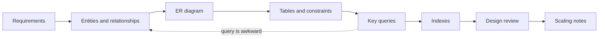

### Rules every case reuses

These mapping rules ([Chapter 10 §10.15](../10-data-modeling-and-er-diagrams/README.md)) and judgement calls come up in all thirteen designs, so the cases below only point at them.

| Situation | Rule |
|---|---|
| Total participation (every order has a customer) | The foreign key is `NOT NULL`; partial participation stays nullable |
| 1:1 relationship | Foreign key **plus `UNIQUE`** (or a shared primary key) — without it the relationship is silently 1:N |
| M:N relationship | Junction table; an attribute of the *pairing* (rate agreed, price of a seat at a show, dosage per medicine) lives there |
| Composite attribute (name = first + last) | Split into columns |
| Multivalued attribute (several phone numbers) | Its own table keyed by (owner, value) |
| Money | `numeric`/`DECIMAL`, never `float` (0.10 has no exact binary form) or `int` (no cents) |
| Times that order events | `timestamptz`, not `date` — two postings on one day still need an order |
| Codes with letters or leading zeros (policy, passport, room "204B") | `text`/`varchar`, never `int` |
| Table named `user`, `order`, `group`, `like`, `transaction`, `show` | Reserved (or keyword) in some dialects — rename (`app_user`, `customer_order`, `screening`) rather than quote forever |
| Passwords | Store a slow salted hash (a one-way scramble of the password plus a random per-user value, `password_hash`), never the password |
| One entity doing two jobs | Split **type** from **instance**: `titles`/`copies`, `room_types`/`rooms`, `seats`/`show_seats` |
| Only current state stored | Keep history rows (loans, bookings, status events, ledger) — "when did…?" needs them |
| A value that must not change later | Snapshot it (price paid, address shipped to, fine charged) |
| Designing for Instagram scale on day one | State the single-node design first, then say what changes at 100× |

### In the interview

**30-second answer:** "I'll clarify the main use cases and scale, pick the entities and relationships, sketch the ER diagram, turn it into tables with keys and constraints, check it against the top queries, add indexes for those queries, and finish with what I'd partition, cache or move to another store as it grows."

- *How do you know the design is right?* — Every core query is simple and index-friendly, every business rule that must never be broken is a **constraint** (a rule the database itself enforces) or runs inside one **transaction** (a group of statements that succeed or fail together), and no fact is stored twice without a reason.
- *When do you denormalize?* — When a measured hot read needs it (a feed, a counter), and only with a plan to keep the copy correct (same transaction, **trigger** — code the database runs automatically on insert/update/delete — or a periodic **reconciliation** job that recomputes the value and flags differences).

---

## 17.1 Hospital management system

### Requirements

- Register **patients** (name, birth date, contact, one or more phone numbers, insurance policies) and **doctors** (specialty) grouped into **departments**.
- Schedule **appointments** (each pairs one patient with one doctor at a time slot); a doctor is never in two overlapping slots.
- Record **admissions** to a **room/bed** (in-patients), with admit and discharge dates.
- Keep **medical records** (diagnosis, treatment, written by a doctor), **prescriptions** listing one or more **medicines** from a catalogue, and **lab tests** with results.
- Produce **bills** per visit/admission with line items and payments.
- Non-functional: records are legally retained for years and must be **auditable** (every change traceable to who and when); access is strictly **role-based** (permissions depend on the user's role, e.g. doctor or clerk).
- Questions to answer: a doctor's appointments tomorrow, a patient's full history, free rooms now, what a patient still owes, the medicines on a prescription.

### Entities and relationships

| Relationship | Cardinality | Note |
|---|---|---|
| Department — Doctor | 1:N | a doctor belongs to one department |
| Patient — Appointment — Doctor | M:N via `appointments` | the appointment is the junction row with its own attributes (time, status) |
| Patient — Admission — Bed | 1:N and N:1 | a bed has many admissions over time, one at a time |
| Appointment / Admission — Medical record | 1:N | a record belongs to one encounter |
| Doctor — Medical record | 1:N | the author; total participation |
| Record — Prescription, Record — Lab test | 1:N | |
| Prescription — Medicine | M:N | junction `prescription_items`; dose and frequency per medicine live there |
| Patient — Insurance policy | 1:N | partial: a patient may have none; `(provider, policy_no)` is `UNIQUE` |
| Patient — Phone | 1:N | multivalued attribute → `patient_phones (patient_id, phone)` |
| Patient — Bill — Bill items | 1:N, 1:N | |

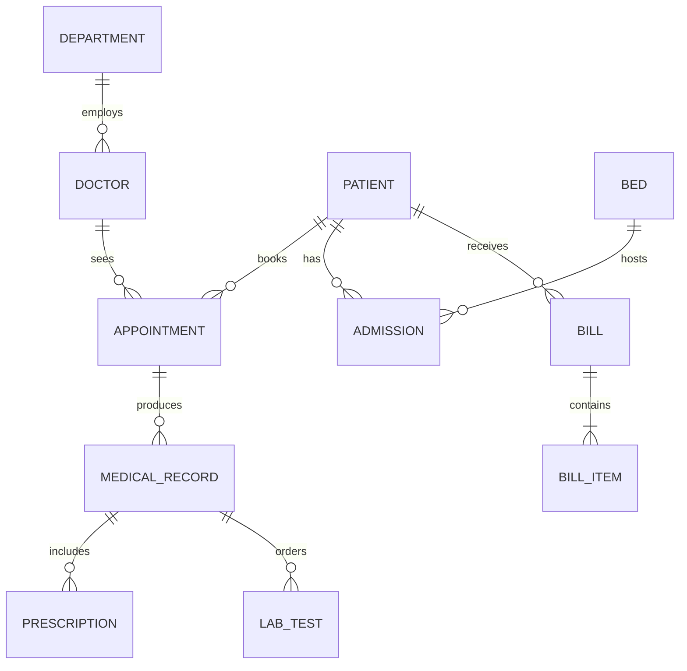

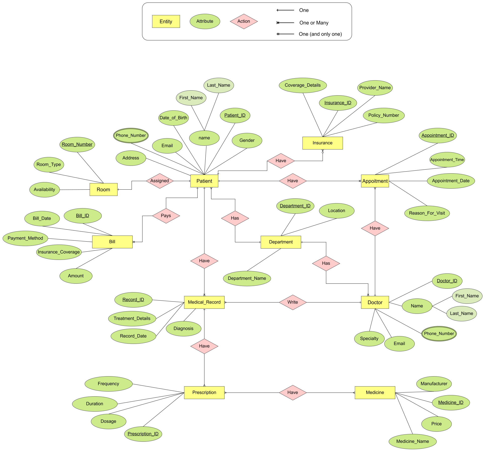

*Figure — the course's hospital ER diagram: ten entities with cardinality and participation marked (course diagram)*

### Key tables

```sql
CREATE TABLE appointments (
  appointment_id bigint GENERATED ALWAYS AS IDENTITY PRIMARY KEY,
  patient_id bigint NOT NULL REFERENCES patients,
  doctor_id  bigint NOT NULL REFERENCES doctors,
  slot       tstzrange NOT NULL,                     -- [start, end)
  status     text NOT NULL CHECK (status IN ('booked','checked_in','completed','cancelled','no_show')),
  -- no two active appointments of the same doctor may overlap (needs: CREATE EXTENSION btree_gist)
  EXCLUDE USING gist (doctor_id WITH =, slot WITH &&) WHERE (status <> 'cancelled')
);
CREATE TABLE admissions (
  admission_id bigint GENERATED ALWAYS AS IDENTITY PRIMARY KEY,
  patient_id bigint NOT NULL REFERENCES patients,
  bed_id     int    NOT NULL REFERENCES beds,
  admitted_at   timestamptz NOT NULL,
  discharged_at timestamptz CHECK (discharged_at > admitted_at)
);
CREATE UNIQUE INDEX one_patient_per_bed ON admissions (bed_id) WHERE discharged_at IS NULL;
```

(`tstzrange` is a time-range type — a start and end timestamp in one value; `&&` means "overlaps".) The **exclusion constraint** (`EXCLUDE USING gist … WITH &&`) is PostgreSQL's way of saying "no two rows may have overlapping ranges for the same doctor" — a rule a plain `UNIQUE` cannot express. MySQL and SQL Server have no equivalent; there you **lock** the doctor's row (`SELECT … FOR UPDATE` — read rows and lock them so other transactions must wait before changing them until you finish) and check for overlaps inside the booking transaction ([Chapter 13](../13-transactions-and-concurrency/README.md)).

### Key queries

1. A doctor's schedule for a day: `WHERE doctor_id = $1 AND slot && tstzrange($day, $day + interval '1 day')`.
2. Free beds per ward: beds with no open admission (`NOT EXISTS … discharged_at IS NULL`).
3. A patient's full history: records, prescriptions and lab results across all encounters, newest first.
4. Unpaid bills older than 30 days.

### Indexes

The exclusion constraint's **GiST** index (a Postgres index type that handles ranges and geometry, Chapter 12) serves schedule lookups; `admissions (patient_id)`, `medical_records (patient_id, created_at DESC)`, and the partial unique index above for bed occupancy.

### Design review

- **Normal forms.** The phone and junction tables have no non-key columns, so 2NF holds; `department_name` stays in `departments` (copying it onto patients would be a **transitive dependency** — a column depending on another non-key column rather than on the key — breaking 3NF); the extra **candidate keys** (other columns that could also uniquely identify a row) (`email`, `(provider, policy_no)`) keep BCNF.
- **Room occupancy.** The simplest model is `rooms.patient_id UNIQUE` (a 1:1 "occupies"), but it only knows who is in the room *now*. The `admissions` table with a partial unique index keeps the same rule *and* the history.
- **Dose per medicine.** If dose sat on `prescriptions`, every medicine on one prescription would share it; it belongs to the pairing.
- **Still missing:** who cancelled an appointment and when (status history), and a patient's department over time.

### Scaling notes

A hospital's volume is modest — one well-tuned PostgreSQL **primary** (the one server that accepts writes) with a **replica** (a read-only copy kept in sync) for reports is plenty. The hard requirements are **integrity and audit**: append-only record tables (corrections are new rows that reference the old one), `created_by`/`created_at` on every clinical row, **row-level security** (database rules that filter which rows each user may see) for role-based access ([Chapter 14](../14-advanced-sql-and-using-sql-from-code/README.md)), and encrypted backups with **point-in-time recovery** (restoring the database as it was at any chosen moment) ([Chapter 15 §15.9](../15-scaling-databases/README.md)). Large files (scans, X-rays) go to object storage; the table keeps only the key.

---

## 17.2 Hotel reservation system

### Requirements

- **Hotels** have **room types** (single, double, suite) with a base price, and physical **rooms** of each type.
- **Guests** search availability by city and dates, then create a **reservation** for one or more rooms; no room may be double-booked.
- Reservation life cycle: pending → confirmed → checked-in → checked-out, or cancelled. **Payments** and **reviews** attach to reservations.
- Prices vary by date (seasonal rates).
- Guests are identified by a document (passport, national ID) and may have several phone numbers; they also use **extra services** (dining, spa, laundry) charged to the stay.
- **Staff** belong to **departments** (housekeeping, front desk); a department looks after rooms.
- Questions: free rooms between two dates, what a guest paid and owes, today's check-ins, services a guest used, revenue per room type last month, who works in housekeeping.

### Entities and relationships

The central decision is **type versus instance**: guests book a *room type* for a date range; a specific *room* is assigned at or before check-in. Modeling only rooms makes search slow; modeling only types makes check-in impossible.

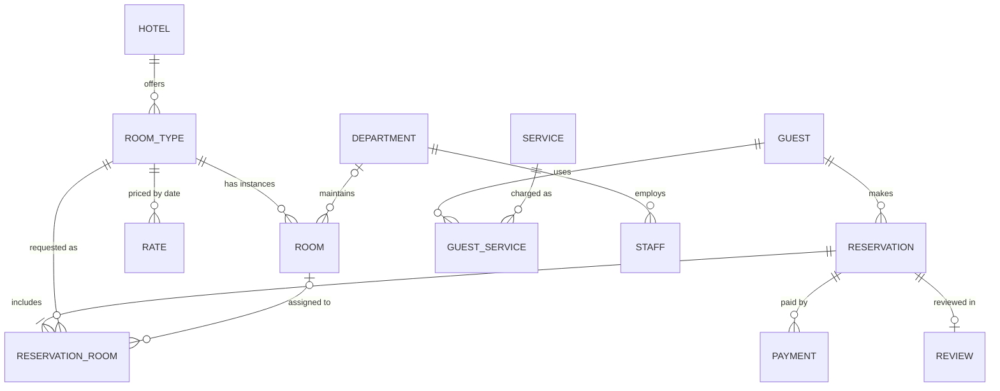

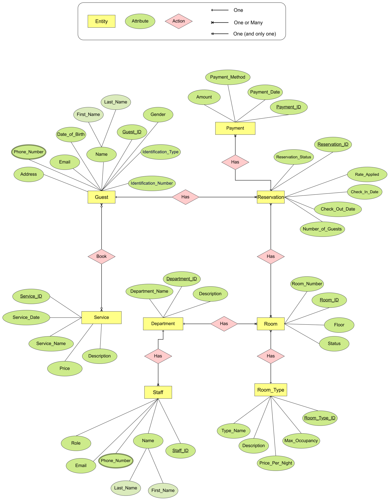

*Figure — the course's hotel ER diagram (eight entities); reservation-to-room and guest-to-service are M:N (course diagram)*

Two details from the full model: the price and maximum occupancy belong to the **room type**, not to each room (ten identical doubles share one price); and the usage of a service is a junction row `guest_services (guest_services_id, guest_id, service_id, reservation_id, used_on, quantity, price_charged)` with **its own surrogate key**, because the same guest orders dinner on several nights — a `(guest_id, service_id)` key would allow only one use ever. `guests` carries `UNIQUE (id_type, id_number)` so the same identity document can never appear on two guest rows.

### Key tables

```sql
-- reservations (guest_id NOT NULL, hotel_id, check_in, check_out CHECK (check_out > check_in), status CHECK (...))
CREATE TABLE reservation_rooms (
  reservation_id bigint REFERENCES reservations ON DELETE CASCADE,
  line_no        smallint,
  room_type_id   int NOT NULL REFERENCES room_types,
  room_id        int REFERENCES rooms,            -- NULL until assigned
  stay           daterange NOT NULL,             -- copied from the reservation for the constraint
  nightly_price  numeric(10,2) NOT NULL,         -- snapshot
  PRIMARY KEY (reservation_id, line_no),
  EXCLUDE USING gist (room_id WITH =, stay WITH &&)   -- a room is never in two overlapping stays
);
-- Inventory per type per night: the row that search reads and booking decrements.
CREATE TABLE room_inventory (
  room_type_id int REFERENCES room_types,
  night        date,
  total        smallint NOT NULL,
  reserved     smallint NOT NULL DEFAULT 0 CHECK (reserved <= total),
  PRIMARY KEY (room_type_id, night)
);
```

The exclusion constraint needs `CREATE EXTENSION btree_gist` (for the `=` on an integer inside a GiST index); rows with `room_id` still `NULL` never conflict, and cancelling a reservation must clear or delete its lines so the room is released.

`room_inventory` is a deliberate **denormalization**: counting overlapping reservations for every search is too slow, so each night keeps a counter. Booking increments `reserved` for every night of the stay in one transaction; the `CHECK` makes overbooking fail. (Hotels that *allow* a small overbooking set the check to `reserved <= total * 1.1`.)

### Key queries

```sql
-- Room types in a hotel with at least one room free on every night of 10–13 June
SELECT rt.room_type_id, rt.name
FROM room_types rt JOIN room_inventory ri USING (room_type_id)
WHERE rt.hotel_id = $1 AND ri.night >= '2026-06-10' AND ri.night < '2026-06-13'
GROUP BY rt.room_type_id
HAVING count(*) = 3 AND min(ri.total - ri.reserved) > 0;
```

Other hot queries: today's arrivals and departures per hotel, a guest's upcoming stays, average rating per hotel.

### Indexes

`reservations (hotel_id, check_in)` for arrival lists, `reservations (guest_id, check_in DESC)`, the inventory primary key for search, and the GiST index behind the exclusion constraint.

### Design review

- **Normal forms.** Price lives on `room_types`, not `rooms` (3NF); `nightly_price` on the booking line is a *snapshot*, a different fact from today's list price.
- **Double booking.** `UNIQUE` only detects identical values, never two date ranges that overlap — hence the exclusion constraint (PostgreSQL) or a check inside the booking transaction elsewhere.
- **A room status column** (free/occupied) repeats what reservations already say and can disagree with them; keep it only for things bookings cannot express, such as "under maintenance".
- **Still missing:** mid-stay room changes (the line would need its own date range, which `stay` provides here), and who cancelled a booking and when.

### Scaling notes

Search traffic is 100–1,000× booking traffic. Serve search from replicas or a search index (Elasticsearch/OpenSearch, search engines covered in Chapter 16) and a cache of inventory, but make the **booking** transaction hit the primary and re-check the inventory row under lock — search results may be a few seconds stale, bookings may not. Partition `reservations` by `check_in` month; shard by `hotel_id` if one cluster is not enough, since nearly every transaction touches a single hotel.

---

## 17.3 Banking system

### Requirements

- **Customers** own one or more **accounts** (checking, savings, loan); an account may have joint owners.
- Deposits, withdrawals and **transfers** between accounts; balances may never go below an allowed limit.
- A full, immutable history of every money movement; statements per month.
- **Branches** (each publishing several phone numbers) with their **employees**; **cards**, where one card can reach several accounts; **loans** with repayments.
- Questions: the balance now, last month's activity, a customer's accounts, what is still owed on a loan, which accounts a card reaches, who works at a branch.
- Non-functional: strict consistency (**ACID** — atomic, consistent, isolated, durable transactions, Chapter 13), auditability, regulatory retention.

### Entities and relationships

The key modeling idea is **double-entry bookkeeping**: money is never "updated", it is *moved*. A **transaction** (the business event) has two or more **entries** (ledger lines), each a signed amount on one account, and the entries of one transaction sum to zero.

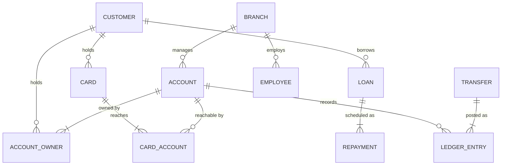

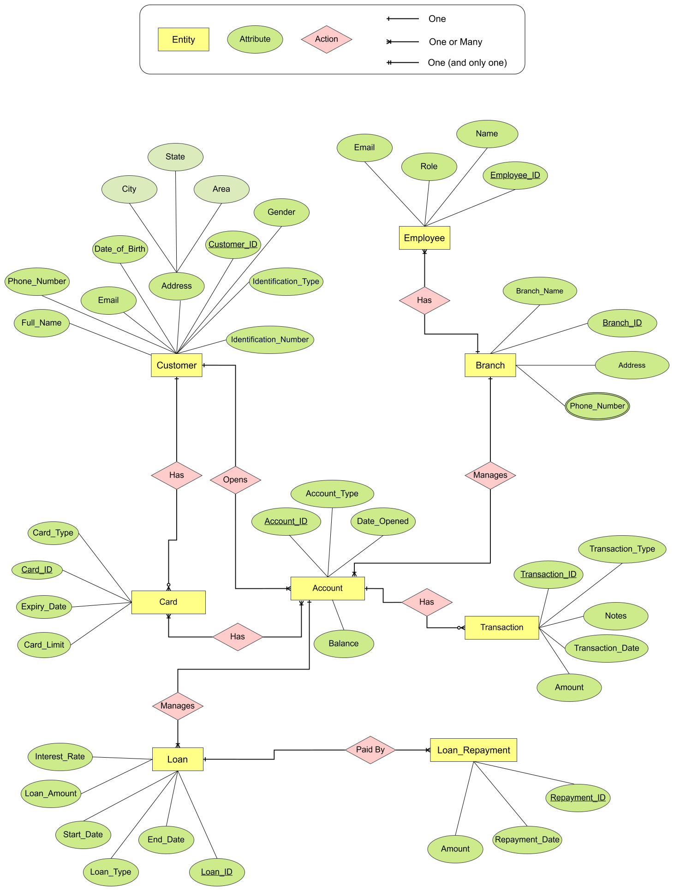

*Figure — the course's bank ER diagram (eight entities); the card-to-account link is M:N (course diagram)*

### Key tables

```sql
CREATE TABLE accounts (
  account_id  bigint GENERATED ALWAYS AS IDENTITY PRIMARY KEY,
  iban        text NOT NULL UNIQUE,
  kind        text NOT NULL CHECK (kind IN ('checking','savings','loan')),
  currency    char(3) NOT NULL,
  balance     numeric(18,2) NOT NULL DEFAULT 0,   -- cached; the ledger is the truth
  overdraft_limit numeric(18,2) NOT NULL DEFAULT 0,
  CHECK (balance >= -overdraft_limit),
  status      text NOT NULL DEFAULT 'open' CHECK (status IN ('open','frozen','closed'))
);
CREATE TABLE transfers (
  transfer_id     bigint GENERATED ALWAYS AS IDENTITY PRIMARY KEY,
  idempotency_key uuid NOT NULL UNIQUE,           -- a retried request cannot post twice
  kind            text NOT NULL,
  created_at      timestamptz NOT NULL DEFAULT now()
);
CREATE TABLE ledger_entries (
  entry_id    bigint GENERATED ALWAYS AS IDENTITY PRIMARY KEY,
  transfer_id bigint NOT NULL REFERENCES transfers,
  account_id  bigint NOT NULL REFERENCES accounts,
  amount      numeric(18,2) NOT NULL CHECK (amount <> 0),   -- + credit, - debit
  balance_after numeric(18,2) NOT NULL
);
```

Money is `numeric`, never `float` (binary floating point cannot represent 0.10 exactly). `idempotency_key` makes the transfer **idempotent** — repeating the same request (e.g. after a network timeout) has the same effect as sending it once; a `uuid` is a 128-bit random id the client generates. The ledger is **append-only** (rows are only ever added, never changed or deleted): revoke `UPDATE` and `DELETE` on it; a mistake is fixed with a reversing transfer.

### Key queries

A transfer is the textbook transaction ([Chapter 13 §13.1](../13-transactions-and-concurrency/README.md)):

```sql
BEGIN;
INSERT INTO transfers (idempotency_key, kind) VALUES ($key, 'transfer') RETURNING transfer_id;
-- lock both rows in a fixed order (lower id first) so two opposite transfers cannot deadlock
SELECT account_id FROM accounts WHERE account_id IN ($from, $to) ORDER BY account_id FOR UPDATE;
UPDATE accounts SET balance = balance - $amt WHERE account_id = $from;   -- CHECK stops overdraft
UPDATE accounts SET balance = balance + $amt WHERE account_id = $to;
INSERT INTO ledger_entries (transfer_id, account_id, amount, balance_after) VALUES (...), (...);
COMMIT;
```

Others: a monthly statement (`WHERE account_id = $1 AND created_at` in the month, ordered), a reconciliation check that every transfer's entries sum to zero (`GROUP BY transfer_id HAVING sum(amount) <> 0` must return nothing), and "balance = sum of entries" per account.

### Indexes

(A **deadlock**, mentioned in the code comment above, is two transactions each waiting for a lock the other holds, so neither can proceed; the database kills one.) `ledger_entries (account_id, entry_id DESC)` for statements, `account_owners (customer_id)`, and the unique `idempotency_key`. The junction `card_accounts` has PK `(card_id, account_id)`, which already answers "which accounts can this card reach"; the reverse question needs an extra index on `account_id`, because an index is usable only from its leading column.

### Design review

- **Transfers need a pairing key.** A simpler model with one `transactions` row per account (type = deposit/withdrawal/transfer) cannot name both sides of a transfer; the `transfer_id` shared by the debit and credit entries fixes that. Name the table `ledger_entries` or `account_transactions` — `TRANSACTION` is reserved in SQL Server and a keyword elsewhere.
- **Cached balance.** `accounts.balance` is a stored total of the entries. Normal forms don't forbid it (it isn't a dependency *inside* one row), but it can drift, so a nightly job recomputes and compares.
- **Rules a foreign key cannot express:** that a card only reaches accounts its owner holds; that each transfer's entries sum to zero. Check them in the transaction or with a periodic query.
- **Still missing:** which employee opened an account or approved a loan (audit columns), card number and status (blocked ≠ expired), and the width of `numeric` — pick it for the largest expected value, because widening later rewrites the table. Customer `city` and `state` together are a small 3NF compromise most teams accept knowingly.

### Scaling notes

Correctness beats **throughput** (work done per second): **synchronous replication** (a commit waits until a copy on another server has it) to a **standby** (a replica ready to take over) so a **failover** (switching to the standby when the primary dies) loses no committed money ([Chapter 15 §15.5](../15-scaling-databases/README.md)), `SERIALIZABLE` (the strictest isolation level: transactions behave as if run one at a time) or explicit row locks for balance checks, and range partitioning of the ledger by month for archiving. When one node is not enough, shard by account (or customer); a transfer between shards then needs a **saga** (a chain of local steps, each with a compensating "undo" step) or **two-phase commit** (a coordinator asks every server to prepare, then tells all to commit — Chapter 15 §15.9) — which is why many banks keep the core ledger on a single, very large, **vertically scaled** (made bigger rather than multiplied) database or a distributed SQL system (Spanner, CockroachDB).

---

## 17.4 Instagram-style photo sharing (runnable)

### Requirements

- **Users** have a profile, can be public or private, and **follow** other users (one-directional; "friends" = mutual follows).
- Users publish **posts** with a caption and one or more **media** items (photos/videos, a carousel keeps their order), tagged with **hashtags**.
- Other users **like** posts (at most once each) and **comment**, including replies to comments.
- Users send **direct messages** to one other user, receive **notifications** (likes, comments, follows), and create or join **groups**.
- The **home feed** shows recent posts from followed accounts, newest first, paged; profiles show like and follower counts instantly.
- Non-functional: extremely read-heavy (feeds and profiles), hundreds of millions of posts, media bytes far larger than the rows.

### Entities and relationships

`follows` is a **self-referencing M:N** relationship on `users` (both columns point to `users`). `likes` and `post_hashtags` are junction tables. `comments` references itself through `parent_id` to form reply threads.

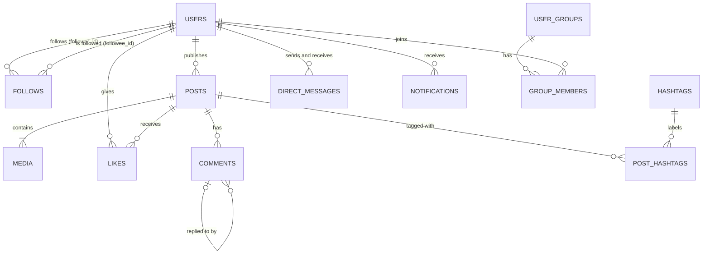

### Key tables

From [`00_schema.sql`](code/00_schema.sql) (schema `insta`):

```sql
CREATE TABLE follows (
  follower_id bigint REFERENCES users,
  followee_id bigint REFERENCES users,
  created_at  timestamptz NOT NULL,
  PRIMARY KEY (follower_id, followee_id),       -- "whom do I follow?" + no duplicate follows
  CHECK (follower_id <> followee_id)
);
CREATE INDEX ON follows (followee_id);          -- "who follows me?"
CREATE TABLE posts (
  post_id bigint PRIMARY KEY, user_id bigint NOT NULL REFERENCES users,
  caption text, created_at timestamptz NOT NULL,
  like_count int NOT NULL DEFAULT 0, comment_count int NOT NULL DEFAULT 0
);
CREATE INDEX ON posts (user_id, created_at DESC, post_id DESC);
-- media (post_id, position, url = object-store key, kind): carousel order kept by position
CREATE TABLE likes (
  user_id bigint REFERENCES users, post_id bigint REFERENCES posts ON DELETE CASCADE,
  created_at timestamptz NOT NULL,
  PRIMARY KEY (post_id, user_id)                  -- one like per user per post
);
-- comments (comment_id, post_id, user_id, parent_id REFERENCES comments, body, created_at)
```

The same file also creates `direct_messages` (two FKs to `users`, sender and recipient), `notifications` (with `actor_id` and `post_id`, so tapping one can open the post that caused it), and `user_groups` + `group_members` — a group's multivalued "members" attribute becomes a junction table that can also record `joined_at`. `user`, `group` and `like` are reserved words in PostgreSQL or MySQL, hence the plural or prefixed names.

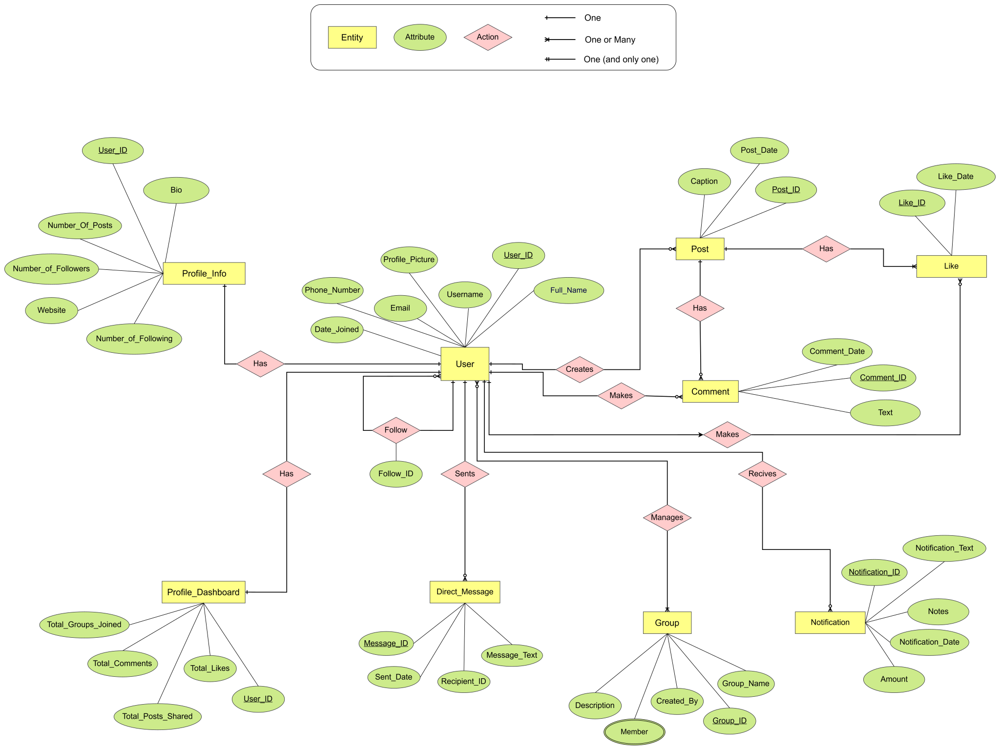

*Figure — the course's Instagram ER diagram, with Follow drawn as a relationship from User back to User and profile data as 1:1 tables (course diagram)*

The course version keeps profile numbers (posts, followers, following) in a separate **1:1 table** whose primary key is also the FK to the user — a *shared primary key*, the simplest way to guarantee one row per user. Here those counters sit on `users` directly; either way they are a speed decision the normal forms cannot see, because the redundancy spans two tables.

### Key queries

The home feed is a join from "whom I follow" to their posts. **Fan-out on read** means computing it at request time, as here:

```sql
SELECT p.post_id, u.username, p.caption, p.created_at, p.like_count
FROM follows f
JOIN posts p ON p.user_id = f.followee_id
JOIN users u ON u.user_id = p.user_id
WHERE f.follower_id = 1
ORDER BY p.created_at DESC, p.post_id DESC
LIMIT 2;
-- next page: add  AND (p.created_at, p.post_id) < ('2026-05-02 07:30+00', 1003)
```

Output:

```
 post_id | username |           caption           |       created_at       | like_count
---------+----------+-----------------------------+------------------------+------------
    1005 | cy       | Sourdough attempt 2 #baking | 2026-05-03 10:15:00+00 |          1
    1003 | bo       | Trail views #running #hills | 2026-05-02 07:30:00+00 |          2

 post_id | username |       caption        |       created_at        (page 2)
---------+----------+----------------------+------------------------
    1002 | cy       | Fresh bread #baking  | 2026-05-01 08:00:00+00
    1001 | bo       | Sunrise run #running | 2026-05-01 06:10:00+00
```

Page 2 uses **keyset pagination** (`OFFSET n` would skip the first n rows by reading and discarding them): "continue after the last `(created_at, post_id)` I showed" instead of `OFFSET`, so it stays fast on page 500 and never repeats or skips a post when new ones arrive (see [Chapter 12](../12-indexes-storage-and-query-performance/README.md)). `post_id` breaks ties between posts with the same timestamp.

A like must insert the row **and** bump the counter together, and a double tap must not count twice:

```sql
BEGIN;
WITH ins AS (
  INSERT INTO likes (user_id, post_id, created_at) VALUES (4, 1005, '2026-05-03 13:00+00')
  ON CONFLICT DO NOTHING RETURNING post_id
)
UPDATE posts SET like_count = like_count + 1 WHERE post_id IN (SELECT post_id FROM ins)
RETURNING post_id, like_count;
-- ...the same statement again a minute later...
COMMIT;
```

Output:

```
 post_id | like_count
---------+------------
    1005 |          2
(1 row)

 post_id | like_count          <- the repeat like changed nothing
---------+------------
(0 rows)
```

(`ON CONFLICT DO NOTHING` silently skips an insert that would violate a unique key; the **CTE** — `WITH ins AS (…)`, a named sub-query — returns a row only if the insert happened.) [`04_instagram.sql`](code/04_instagram.sql) also finds mutual follows (a **self-join** — a table joined to itself — of `follows` with the columns swapped), prints the comment thread under a post indented by depth with a recursive CTE over `parent_id` (the technique of [Chapter 7](../07-ctes-views-and-recursion/README.md)), and ranks hashtags by posts in the last three days. The file's last query is a **reconciliation check** that recounts likes and lists posts whose cached `like_count` disagrees (it returns 0 rows). Every denormalized counter deserves one.

### Indexes

| Access path | Index |
|---|---|
| Whom does X follow? | `follows` PK `(follower_id, followee_id)` |
| Who follows X? | `follows (followee_id)` |
| X's posts, newest first (profile grid, feed merge) | `posts (user_id, created_at DESC, post_id DESC)` |
| Has X liked this post? / who liked it | `likes` PK `(post_id, user_id)` |
| Posts with a tag | `post_hashtags` PK `(tag_id, post_id)` |

### Design review

The classic defect in a social schema is writing follow and like as 1:N: both are M:N and need a uniqueness rule on the pair (here the composite PKs), plus `CHECK (follower_id <> followee_id)`. The PK order decides which direction each index serves, so `follows (followee_id)` and `group_members (user_id)` exist for the reverse questions. Follow rows carry `created_at` ("since when?"), comments carry `parent_id` for replies, and media is a table because a post can hold several.

### Scaling notes

- **Media** lives in object storage (S3-like) behind a **CDN** (content delivery network — servers around the world that cache files close to users; see [System Design Fundamentals](../../../system-design-patterns/modules/00-system-design-fundamentals/README.md)); rows keep keys only.
- **Feed:** fan-out on read is fine for small follow counts. At scale, **fan-out on write** pushes each new post id into every follower's precomputed feed list (often Redis or a wide-column store); celebrities with millions of followers are handled by fan-out on read, merged at request time — the classic hybrid ([Chapter 16](../16-beyond-relational/README.md)).
- **Counters** are the hottest rows: a viral post turns `UPDATE posts SET like_count = …` into a lock queue (**lock contention**: many transactions waiting for the same row). Batch increments in a cache and flush periodically, or keep sharded counter rows and sum them.
- **Sharding** by `user_id` keeps a user's posts, likes-given and follows together; ids come from a generator that embeds time (Snowflake-style — Twitter's scheme of timestamp + machine id + counter) so they sort by creation without a central sequence ([Chapter 15 §15.3](../15-scaling-databases/README.md)).

---

## 17.5 E-commerce store (runnable)

### Requirements

- **Customers** register, keep several **addresses**, browse **products** (each identified by a **SKU**, stock-keeping unit — the shop's product code) organized in a **category tree**, and read/write **reviews** (one per customer per product).
- A customer places an **order** of several products; each **order item** records quantity and the price *at purchase time*.
- Stock is decremented on purchase and may never go negative. Orders move through `pending → paid → shipped → delivered` (or `cancelled`); **payments** attach to orders.
- Discontinued products disappear from the shop but old orders still show them.
- Each order has one **delivery** record (status, date, partner) and may use one **coupon** (code, discount, expiry, usage limit).
- Non-functional: browsing is read-heavy; checkout must be strictly consistent.
- Questions: a customer's orders newest first, the lines of an order and their prices, products in a category with stock, a product's average rating, undelivered orders, whether a coupon code is valid.

### Entities and relationships

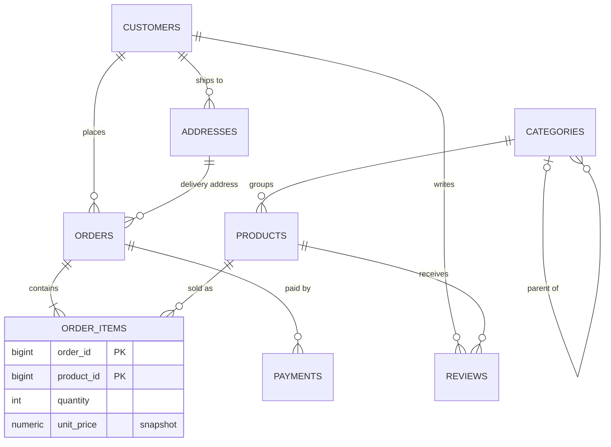

`order_items` is the junction between `orders` and `products` (M:N) carrying its own attributes. `categories.parent_id` is a self-reference that forms a tree (Electronics → Audio → Headphones).

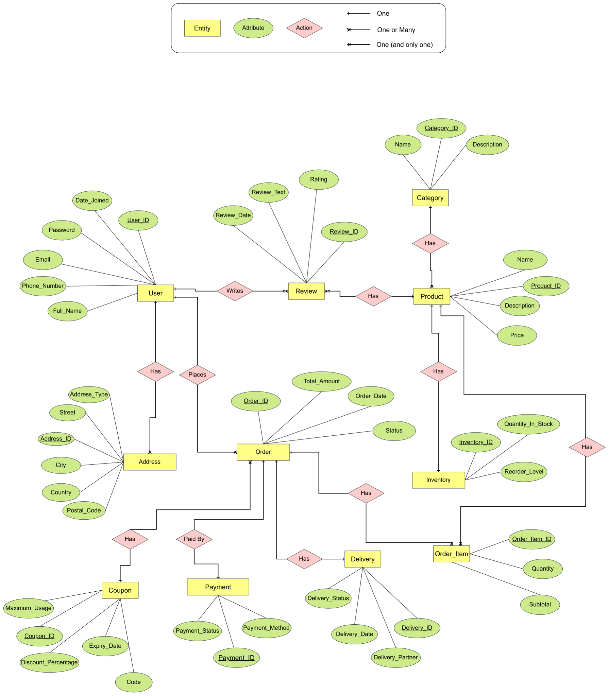

*Figure — the course's e-commerce ER diagram with eleven entities, including inventory, delivery and coupon (course diagram)*

Not in the runnable schema but part of the full design: `deliveries (order_id UNIQUE REFERENCES orders, status, delivered_on, partner)` and `payments` with `order_id UNIQUE` if exactly one payment per order is the rule — the `UNIQUE` is what makes each 1:1; `coupons (code UNIQUE, discount_pct, expires_on, max_uses)` with a **nullable** `orders.coupon_id` (partial participation); stock either on `products` (as here) or in a 1:1 `inventory` table keyed by `product_id` with a reorder level; and `password_hash` on customers.

### Key tables

```sql
CREATE TYPE order_status AS ENUM ('pending', 'paid', 'shipped', 'delivered', 'cancelled');

CREATE TABLE products (
  product_id  bigint GENERATED ALWAYS AS IDENTITY PRIMARY KEY,
  sku         text NOT NULL UNIQUE,
  name        text NOT NULL,
  category_id int NOT NULL REFERENCES categories,
  price       numeric(10,2) NOT NULL CHECK (price >= 0),
  stock       int NOT NULL CHECK (stock >= 0),     -- overselling becomes impossible
  deleted_at  timestamptz                           -- soft delete
);
CREATE TABLE orders (
  order_id    bigint GENERATED ALWAYS AS IDENTITY PRIMARY KEY,
  customer_id bigint NOT NULL REFERENCES customers,
  ship_to     bigint NOT NULL REFERENCES addresses,
  status      order_status NOT NULL DEFAULT 'pending',
  placed_at   timestamptz NOT NULL,
  total       numeric(12,2) NOT NULL DEFAULT 0      -- denormalized sum of the items
);
CREATE TABLE order_items (
  order_id   bigint REFERENCES orders ON DELETE CASCADE,
  product_id bigint REFERENCES products,
  quantity   int NOT NULL CHECK (quantity > 0),
  unit_price numeric(10,2) NOT NULL,
  PRIMARY KEY (order_id, product_id)
);
CREATE INDEX ON orders (customer_id, placed_at DESC);
CREATE INDEX ON products (category_id) WHERE deleted_at IS NULL;   -- partial: live products only
```

Three decisions worth saying out loud in an interview:

- **Price snapshot.** `order_items.unit_price` copies the price when the order is placed. It is not a normalization violation: the price *paid* is a different fact from the price *now*.
- **Soft delete.** Deleting a product row would break the foreign keys of old orders (or **cascade** — automatically delete — the history with it). `deleted_at` hides it from the shop instead; the **partial index** (an index over only the rows matching a `WHERE`) keeps the live catalogue lookups small.
- **Status enum.** A PostgreSQL `ENUM` (a custom type allowing only a fixed list of values; or a `CHECK … IN (…)`, or a **lookup table** — a small table of allowed values referenced by a foreign key) limits `status` to known values. Enums are compact but adding a value needs `ALTER TYPE`; a lookup table is the most flexible (MySQL has inline `ENUM`; SQL Server and SQLite use `CHECK`).

### Key queries

Placing an order is one transaction: create the order, decrement stock **only where enough stock exists**, copy the prices, then set the total ([`01_ecommerce.sql`](code/01_ecommerce.sql)):

```sql
BEGIN;
INSERT INTO orders (customer_id, ship_to, placed_at)
VALUES (2, 2, '2026-05-05 12:00+00') RETURNING order_id \gset
WITH cart(product_id, qty) AS (VALUES (1::bigint, 2), (3::bigint, 1)),
reserved AS (
  UPDATE products p SET stock = p.stock - c.qty
  FROM cart c
  WHERE p.product_id = c.product_id AND p.stock >= c.qty AND p.deleted_at IS NULL
  RETURNING p.product_id, c.qty, p.price
)
INSERT INTO order_items (order_id, product_id, quantity, unit_price)
SELECT :order_id, product_id, qty, price FROM reserved
RETURNING order_id, product_id, quantity, unit_price;
-- the application compares the row count with the cart size and issues ROLLBACK if short
UPDATE orders SET total = (SELECT sum(quantity * unit_price) FROM order_items WHERE order_id = :order_id)
WHERE order_id = :order_id RETURNING order_id, total;
COMMIT;
```

Output:

```
 order_id | product_id | quantity | unit_price
----------+------------+----------+------------
        5 |          1 |        2 |      89.00
        5 |          3 |        1 |      29.99
(2 rows)

 order_id | total
----------+--------
        5 | 207.99
```

(`\gset` is a psql command that stores the returned `order_id` in a variable; application code would read it from the `RETURNING` result.) Because the `UPDATE` both checks and decrements stock in one statement, two concurrent checkouts for the last unit cannot both succeed: the second one waits for the first's **row lock** (released when the first transaction commits or rolls back — `ROLLBACK` undoes everything since `BEGIN`), then re-checks `stock >= qty` on the new value ([Chapter 13 §13.7](../13-transactions-and-concurrency/README.md)). The `CHECK (stock >= 0)` is the last line of defence:

```
psql:01_ecommerce.sql:35: ERROR:  new row for relation "products" violates check constraint "products_stock_check"
DETAIL:  Failing row contains (2, SP-200, Bluetooth speaker, 2, 45.50, -1, null).
```

A best-seller report still counts the soft-deleted earbuds (2 units, 19.98), because history must not change when the catalogue does. The file also walks the category tree with a recursive CTE (all live products under Electronics at any depth) and runs a **payment reconciliation**: orders marked paid whose payments do not add up to the total. It finds order 3 (total 45.50, paid 30.00) — the kind of mismatch a nightly job should flag.

### Indexes

`orders (customer_id, placed_at DESC)` serves "my orders"; `order_items (product_id)` serves sales per product (the PK already covers lookups by `order_id`); the partial index on live products serves category pages. Product search by text belongs in full-text search ([Chapter 14](../14-advanced-sql-and-using-sql-from-code/README.md)) or a search engine.

### Design review

- **Normal forms.** `order_items` and `reviews` have two-column candidate keys and every other column depends on the whole pair, so 2NF holds. A stored line `subtotal = quantity × unit_price` would break 3NF (and BCNF) on purpose; `orders.total` is the same redundancy across two tables — kept for fast order lists and checked by a reconciliation query.
- **Freeze what the order promised.** The unit price is snapshotted; the shipping address should be too (copy it onto the order), or editing an address rewrites where old orders "went".
- **Carts** look like orders (`carts` + `cart_items`) but read the *live* price every time.
- **Still missing:** counting coupon uses against `max_uses` (per customer or overall — concurrent checkouts must lock or count atomically) and an order status history.

### Scaling notes

The catalogue is read-mostly: cache it and serve it from replicas or a search index. Carts are short-lived and **high-churn** (created and discarded constantly) — a **key-value store** (a database that just maps a key to a value, like Redis) with expiry fits them well. Orders and payments stay relational and ACID; partition `orders` by `placed_at` month for archiving and shard by `customer_id` when a single primary is saturated. For flash sales, a single **hot** (very frequently updated) `stock` row becomes the **bottleneck** (the one part that limits overall speed) — pre-split inventory into several rows (buckets) or reserve stock in a fast counter and settle in the database.

---

## 17.6 Food delivery platform

### Requirements

- **Customers** order from **restaurants**; each restaurant has a **menu** of **items** (with options such as size or toppings) and opening hours.
- An **order** contains items from one restaurant; it moves `placed → accepted → preparing → picked_up → delivered` (or `cancelled`), and every change is time-stamped.
- A **delivery partner** (courier) is assigned to each order; their location updates every few seconds while active.
- **Payments**, **ratings** for restaurant and courier, and **promotions/coupons**. Customers keep several delivery **addresses**; menu items belong to **categories**.
- Non-functional: lunch and dinner peaks, live tracking, search by distance.
- Questions: today's menu of a restaurant, a customer's orders this month, the lines of an order, where an order is and when it was picked up, a courier's deliveries today, a restaurant's reviews.

### Entities and relationships

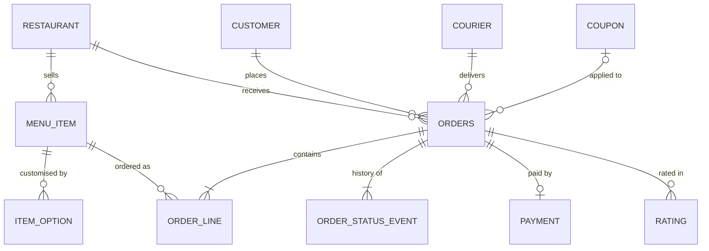

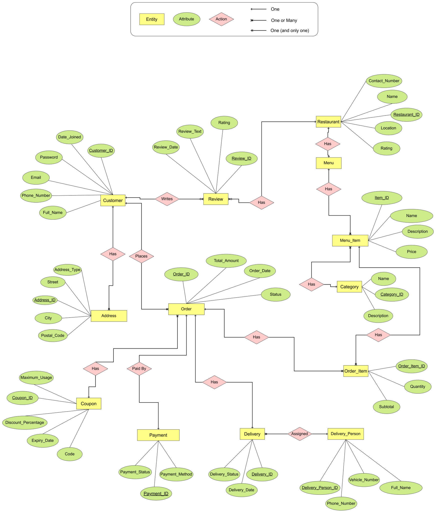

*Figure — the course's food-delivery ER diagram: thirteen entities, with restaurant–menu, order–payment and order–delivery as 1:1 relationships (course diagram)*

The course model reaches the restaurant only through order line → menu item → menu, which cannot stop one order mixing two kitchens; the `restaurant_id` on `orders` above enforces "one restaurant per order" directly. It also has a separate 1:1 `menus` table that stores nothing but a key — menu items can point at the restaurant instead. Its **delivery** is a 1:1 table (`deliveries.order_id UNIQUE`) with the current status and the courier, plus a status-history table — the same pairing as `orders.status` + `order_status_events` here.

### Key tables

```sql
CREATE TABLE orders (
  order_id      bigint GENERATED ALWAYS AS IDENTITY PRIMARY KEY,
  customer_id   bigint NOT NULL REFERENCES customers,
  restaurant_id bigint NOT NULL REFERENCES restaurants,
  courier_id    bigint REFERENCES couriers,          -- NULL until assigned
  status        text NOT NULL,                        -- current state (denormalized)
  delivery_addr jsonb NOT NULL,                       -- snapshot of the address + coordinates
  subtotal numeric(10,2) NOT NULL, delivery_fee numeric(10,2) NOT NULL,
  placed_at     timestamptz NOT NULL DEFAULT now()
);
CREATE TABLE order_status_events (                    -- append-only history
  order_id  bigint REFERENCES orders,
  status    text NOT NULL,
  at        timestamptz NOT NULL DEFAULT now(),
  actor     text NOT NULL,                            -- 'customer', 'restaurant', 'courier', 'system'
  PRIMARY KEY (order_id, at)
);
-- order_lines (order_id, line_no, item_id, quantity, unit_price snapshot, options jsonb snapshot)
```

The pairing of a **current-status column** with an **append-only event table** is a pattern worth remembering: the column answers "what state is it in?" with no join, the events answer "when did each step happen?" (for **SLAs** — service-level agreements, promised targets such as "delivered within 40 minutes" — disputes, and delivery-time analytics).

### Key queries

1. Open restaurants within 5 km that serve "pizza" — needs a **geospatial** index (one that understands map coordinates; PostGIS, Postgres's geography extension, `geography` + GiST; see [Chapter 16 §16.8](../16-beyond-relational/README.md)).
2. A restaurant's live queue: `WHERE restaurant_id = $1 AND status IN ('placed','accepted','preparing') ORDER BY placed_at`.
3. Nearest available courier for an order (geo query over the couriers' latest positions).
4. Average prep time per restaurant: time between the `accepted` and `picked_up` events.

### Indexes

`orders (restaurant_id, status)` partial `WHERE status NOT IN ('delivered','cancelled')` keeps the live-queue index tiny; `orders (customer_id, placed_at DESC)`; a GiST index on restaurant location.

### Design review

A stored line subtotal and a stored `restaurants.rating` (instead of `avg()` over reviews) are the deliberate redundancies — name both. Payments should carry their own amount (partial payments, refunds, tips); a review should reference an order, or anyone can review a restaurant they never ordered from; a coupon's usage limit needs an atomic count, because two simultaneous checks in application code both pass; and the delivery address is snapshotted (`delivery_addr jsonb`) so editing an address never moves last month's order.

### Scaling notes

Courier locations are high-frequency, short-lived writes — keep them in an **in-memory store** (a database that keeps data in RAM for speed) with geo support (Redis `GEOADD`/`GEOSEARCH`) and write only trip summaries to PostgreSQL. Shard orders by city/region: almost no order crosses a city. Menus are read-heavy and cacheable.

---

## 17.7 Library management system (runnable)

### Requirements

- The catalogue lists **titles** (identified by **ISBN**, the international book number) with one or more **authors** in a fixed order; the library owns several physical **copies** of a title across **branches**.
- **Members** borrow copies (**loans**) for a fixed period; each member has a maximum number of open loans.
- A copy can be on at most one open loan. Late returns incur a **fine** per day.
- Members place **holds** (reservations) on a title when no copy is free; holds are served first-come, first-served.
- Lost or discarded copies leave the catalogue but their loan history stays.
- Questions: can a member get this title today; which of a member's loans are late; the lending history of one physical copy; the order of the hold queue; a member's unpaid total.

### Entities and relationships

The library is the cleanest example of **type versus instance**: a *title* is the abstract book, a *copy* is the object on the shelf. Loans point at copies; holds point at titles (you want *any* copy).

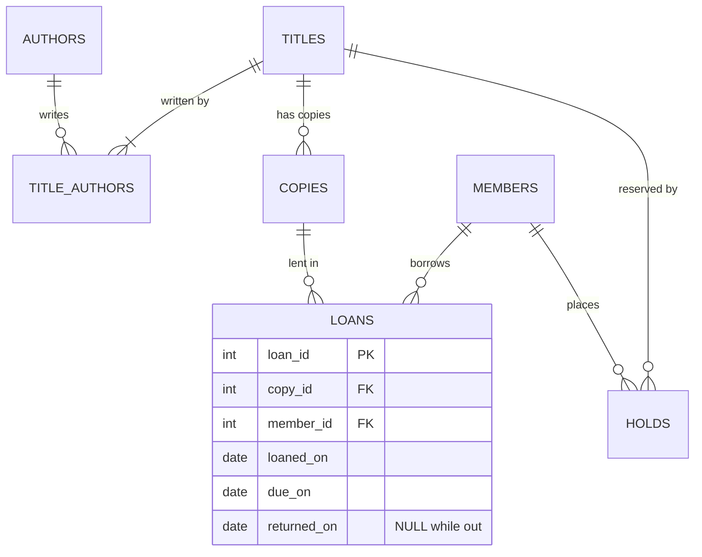

### Key tables

```sql
CREATE TABLE title_authors (                        -- M:N junction with an ordering column
  isbn char(13) REFERENCES titles, author_id int REFERENCES authors,
  position smallint NOT NULL,
  PRIMARY KEY (isbn, author_id)
);
CREATE TABLE copies (
  copy_id int PRIMARY KEY, isbn char(13) NOT NULL REFERENCES titles,
  branch text NOT NULL, condition text NOT NULL DEFAULT 'good',
  withdrawn_at date                                 -- soft delete
);
CREATE TABLE loans (
  loan_id int GENERATED ALWAYS AS IDENTITY PRIMARY KEY,
  copy_id int NOT NULL REFERENCES copies, member_id int NOT NULL REFERENCES members,
  loaned_on date NOT NULL, due_on date NOT NULL, returned_on date,
  CHECK (due_on > loaned_on),
  CHECK (returned_on IS NULL OR returned_on >= loaned_on)
);
-- At most ONE open loan per copy:
CREATE UNIQUE INDEX one_open_loan_per_copy ON loans (copy_id) WHERE returned_on IS NULL;
CREATE TABLE holds (
  isbn char(13) REFERENCES titles, member_id int REFERENCES members,
  placed_at timestamptz NOT NULL,
  PRIMARY KEY (isbn, member_id)                     -- one hold per member per title
);
```

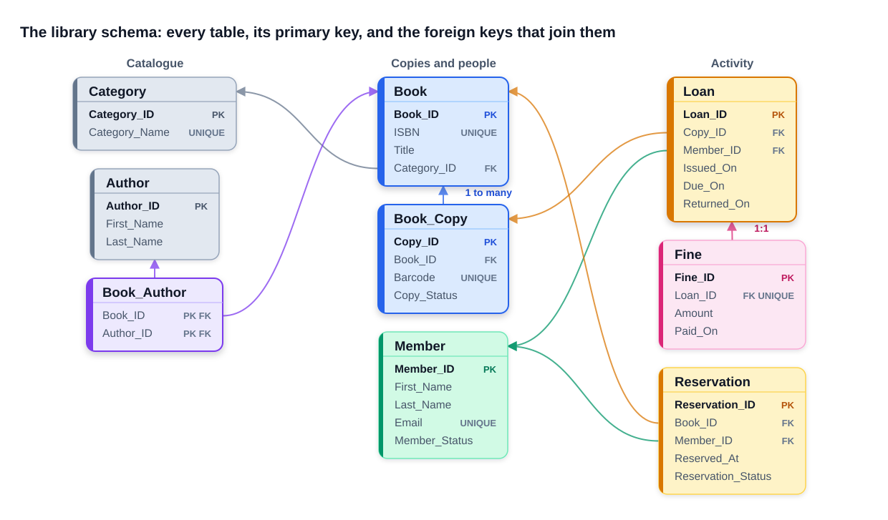

*Figure — the course's library model: Book and Book_Copy at the centre, with loans pointing at copies and reservations at books (course diagram)*

The tell-tale pair of foreign keys: **`loans.copy_id` but `holds.isbn`** — members borrow one physical object but reserve a title. A copy's `copy_id` plays the role of its barcode. The schema also has `fines (loan_id PRIMARY KEY REFERENCES loans, amount, paid_on)`: using the loan id as the key makes it 1:1 (at most one fine per loan), and the amount is **stored** although it looks derived, because a later change of the daily rate must not rewrite old fines. The course version gives books a **surrogate** `book_id` (an artificial id with no business meaning, as opposed to a **natural key** such as the ISBN) with `isbn UNIQUE` (shorter FKs, and some items have no ISBN) and a `category` table; authors live in a junction table rather than a comma-separated `authors` column, which would break 1NF and turn "books by this author" into a text search.

Note what is **not** stored: a copy's "available" flag. Availability is derived from "no open loan and not withdrawn", so it can never disagree with the loans table. The **partial unique index** is the star: it enforces a rule about *some* rows (open loans) that a plain `UNIQUE` cannot, and it doubles as the index for "is this copy out?". (SQLite and PostgreSQL support partial indexes; SQL Server calls them *filtered* indexes; MySQL has neither — there you would use a **generated column** (a column computed automatically from others) that is non-NULL only for open loans and put a unique index on it.)

### Key queries

The catalogue view — authors in order, and live availability ([`03_library.sql`](code/03_library.sql), "today" fixed at 2026-05-10):

```sql
SELECT t.title,
       string_agg(a.name, ', ' ORDER BY ta.position) AS authors,
       (SELECT count(*) FROM copies c
         WHERE c.isbn = t.isbn AND c.withdrawn_at IS NULL
           AND NOT EXISTS (SELECT 1 FROM loans l WHERE l.copy_id = c.copy_id AND l.returned_on IS NULL)
       ) AS available
FROM titles t JOIN title_authors ta USING (isbn) JOIN authors a USING (author_id)
GROUP BY t.isbn
ORDER BY t.title;
```

Output:

```
         title         |      authors       | available
-----------------------+--------------------+-----------
 Joins at Scale        | J. Ortiz, S. Novak |         0
 Query Plans Explained | R. Kumar           |         1
 Tables and Keys       | R. Kumar           |         1
```

(`Query Plans Explained` has two copies but one is withdrawn; `Tables and Keys` has two, one of them out.) Overdue loans and fines come straight from dates — `date - date` is a whole number of days in PostgreSQL:

```
 name |      title      |   due_on   | days_late | fine
------+-----------------+------------+-----------+------
 Omar | Tables and Keys | 2026-05-04 |         6 | 1.50
```

Trying to lend copy 101 while it is still out hits the partial unique index:

```
psql:03_library.sql:32: ERROR:  duplicate key value violates unique constraint "one_open_loan_per_copy"
DETAIL:  Key (copy_id)=(101) already exists.
```

Check-out with the member's limit is a conditional insert — it inserts only if the member has fewer open loans than `max_loans`:

```sql
INSERT INTO loans (copy_id, member_id, loaned_on, due_on)
SELECT 102, 2, :today, date :today + 14
WHERE (SELECT count(*) FROM loans WHERE member_id = 2 AND returned_on IS NULL)
      < (SELECT max_loans FROM members WHERE member_id = 2)
RETURNING loan_id, copy_id, member_id, due_on;
```

Output: `7 | 102 | 2 | 2026-05-24`. Under concurrency two check-outs by the same member could both see "1 open loan"; lock the member row first (`SELECT … FROM members WHERE member_id = 2 FOR UPDATE`) to serialize them (make them run one after the other; [Chapter 13 §13.8](../13-transactions-and-concurrency/README.md) explains this **write-skew** shape — two transactions each read the same state, then both write based on it). The hold queue is a **window function** (a function that computes over a set of related rows without collapsing them, Chapter 8) — `row_number() OVER (PARTITION BY isbn ORDER BY placed_at)` — giving Eva position 1 and Omar position 2 for *Joins at Scale*.

### Indexes

The partial unique index (open loan per copy), `loans (member_id) WHERE returned_on IS NULL` (a member's current loans), `copies (isbn)`, and a full-text index on titles/authors for search.

### Design review

Loans are a *history* table — a `current_member_id` column on copies would answer only "who has it now". `title_authors` has no non-key columns beyond `position`, which depends on the whole key, so 2NF holds; ISBN and copy id are candidate keys, so BCNF holds. Still missing: holds that expire (an `expires_at` plus a sweep job when a copy is set aside) and a `CHECK` on copy condition so a typo cannot become a new status.

### Scaling notes

A library is small — a single PostgreSQL instance serves a city's whole network. Historical loans can be partitioned by year. The only real concurrency hot spot is the popular new release with a long hold queue; handling "copy returned → offer to the next hold → expire after 3 days" as a small **state machine** (a fixed set of states with allowed transitions between them) in one transaction keeps it correct.

---

## 17.8 Ticket booking system (runnable, with seat-hold concurrency)

### Requirements

- **Venues** have **halls** (screens/auditoriums) with a fixed **seat** layout (row, number, tier).
- **Events** (films, concerts) run as **shows** at a hall and time. Each seat of each show has a price.
- A user selects specific seats; they are **held** for a few minutes while the user pays. If payment succeeds the seats become **sold** under a **booking**; if the hold expires they return to sale.
- **No seat may ever be sold twice**, even when thousands of people click at the same moment when sales open.
- A booking has at most one **payment**; cancelling a booking releases its seats.
- Questions: free seats for a show, a customer's bookings, what is on in a city today, how full a show was, whether a booking is paid.

### Entities and relationships

The key table is `show_seats` — one row per seat *per show*. The physical `seats` table never changes; `show_seats` is the inventory users compete for, and its row lock is the unit of concurrency.

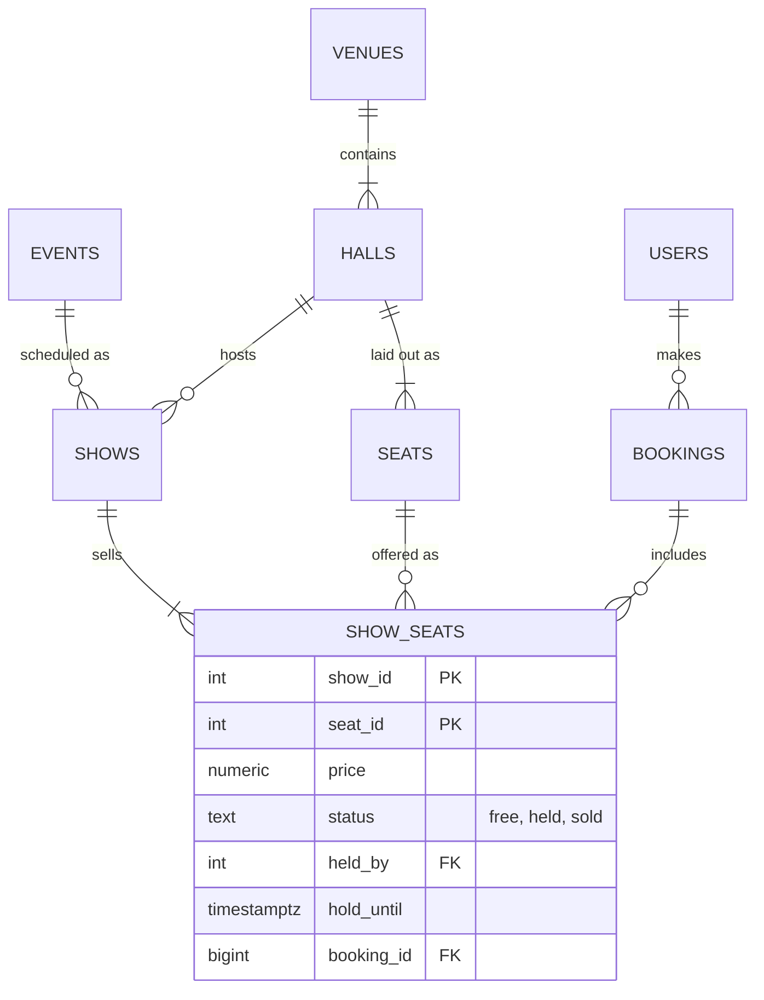

### Key tables

```sql
CREATE TABLE show_seats (
  show_id    int REFERENCES shows,
  seat_id    int REFERENCES seats,
  price      numeric(8,2) NOT NULL,
  status     text NOT NULL DEFAULT 'free' CHECK (status IN ('free', 'held', 'sold')),
  held_by    int REFERENCES users,
  hold_until timestamptz,
  booking_id bigint REFERENCES bookings,
  PRIMARY KEY (show_id, seat_id),               -- a seat appears once per show
  CONSTRAINT held_needs_owner_and_expiry
    CHECK ((status = 'held') = (hold_until IS NOT NULL AND held_by IS NOT NULL)),
  CONSTRAINT sold_needs_booking CHECK ((status = 'sold') = (booking_id IS NOT NULL))
);
CREATE INDEX ON show_seats (show_id) WHERE status = 'free';
```

The two named `CHECK`s tie the status to the columns that must accompany it: a held seat always has an owner and an expiry, a sold seat always has a booking, and a free seat has neither. Impossible states become impossible to store.

Three things all sound like "seat": the physical seat (row H, number 14), **the seat at one screening** (sold at 20:00, free at 18:00), and a claim on it. A single `is_booked` flag on `seats` fails as soon as a hall has a second show. The **price** also belongs to the seat-at-a-show pairing — neither the seat alone (weekends cost more) nor the show alone (recliners cost more) determines it.

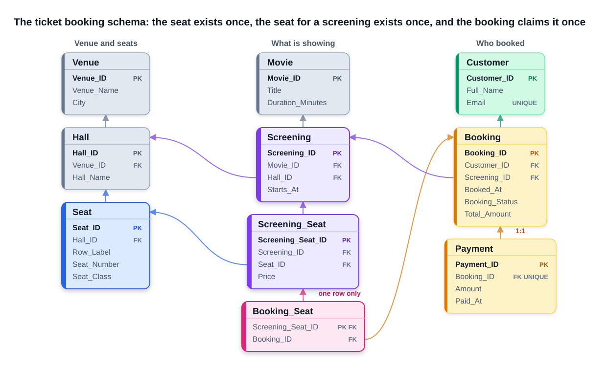

*Figure — the course's ticket model: Seat → Screening_Seat → Booking_Seat is where the correctness lives (course diagram)*

The course models the claim as a separate junction `booking_seats (screening_seat_id PRIMARY KEY, booking_id)`. The trap it highlights: a composite PK `(booking_id, screening_seat_id)` only stops *one booking* claiming a seat twice — two different bookings could still both claim H14. Making `screening_seat_id` the **whole** primary key means a seat can be claimed once, ever, and the second insert fails in the database. That design has no holds and must *delete* the claim rows when a booking is cancelled (marking the booking cancelled would block the seat forever); the `status` column used here gives the same once-only guarantee through the guarded `UPDATE` below and adds holds. The course also names the table `screening` because `SHOW` is reserved in MySQL; `shows` (plural) is safe.

### Key queries

**Hold** seats with a *guarded* update: the `WHERE` clause only matches seats that are free (or whose hold has expired), and the rows it returns tell you exactly which seats you got ([`02_ticket_booking.sql`](code/02_ticket_booking.sql), "now" fixed at 10:00):

```sql
UPDATE show_seats ss
SET status = 'held', held_by = 1, hold_until = timestamptz :now + interval '10 minutes'
FROM seats se
WHERE ss.seat_id = se.seat_id AND ss.show_id = 10
  AND se.row_label = 'B' AND se.seat_no IN (2, 3)
  AND (ss.status = 'free' OR (ss.status = 'held' AND ss.hold_until < :now))
RETURNING se.row_label || se.seat_no AS seat, ss.status, ss.hold_until;
```

Output — Asha gets B2 and B3; Ben's request a moment later for B3 and B4 returns only B4, so the app releases it and asks him to choose again:

```
 seat | status |       hold_until
------+--------+------------------------
 B2   | held   | 2026-05-20 10:10:00+00
 B3   | held   | 2026-05-20 10:10:00+00

 seat | held_by          <- Ben asked for B3 and B4
------+---------
 B4   |       2
```

**Confirm** after payment in one transaction — create the booking, then flip only this user's *unexpired* holds to sold:

```sql
BEGIN;
INSERT INTO bookings (user_id, show_id, status, created_at)
VALUES (1, 10, 'confirmed', :now) RETURNING booking_id \gset
UPDATE show_seats
SET status = 'sold', booking_id = :booking_id, held_by = NULL, hold_until = NULL
WHERE show_id = 10 AND held_by = 1 AND status = 'held' AND hold_until >= :now
RETURNING seat_id, status, booking_id;
COMMIT;
```

The file continues with "any two free premium seats" using `FOR UPDATE SKIP LOCKED` (lock matching rows but skip any another transaction already has locked) (many buyers each get *different* seats without waiting on each other — the pattern of [Chapter 13 §13.12](../13-transactions-and-concurrency/README.md)), an expiry sweep that frees stale holds, a failed attempt to mark a seat sold without a booking (`violates check constraint "sold_needs_booking"`), and occupancy per show with `count(*) FILTER (…)` (show 10: 2 sold of 12, revenue 400.00).

### Proof on two live sessions

Does the guarded update really stop two *simultaneous* buyers? [`05_seat_race.sql`](code/05_seat_race.sql) opens two real connections, A and B, with PostgreSQL's `dblink` extension (which lets one session open and run queries on another connection), and runs the same hold on seat 9 in both, at the default `READ COMMITTED` **isolation level** (each statement sees only data committed before it started):

```
--- A: holds seat 9 (C1) but has not committed yet
 seat_id | held_by
---------+---------
       9 |       1
--- B: sends the same UPDATE for user 2; it must wait for A's row lock
 b_still_running | b_waits_on
-----------------+------------
               1 | Lock
--- A commits. B wakes up, re-checks status = 'free' on the new row version, and updates nothing
 rows_b_changed
----------------
              0
--- final state of the seat: held by user 1 only
 seat_id | status | held_by
---------+--------+---------
       9 | held   |       1
```

How it works:

1. A's `UPDATE` locks the row (seat 9) until A commits.
2. B's `UPDATE` finds the same row, sees it is locked, and waits (`wait_event_type = Lock`).
3. When A commits, PostgreSQL re-evaluates B's `WHERE` clause against the **newest** version of the row. `status = 'free'` is now false, so B updates zero rows.
4. The application sees 0 rows returned and tells user 2 "seat taken".

No `SELECT` then `UPDATE` (which *would* race), no application lock, no `SERIALIZABLE` needed. The alternatives: **optimistic locking** with a `version` column (don't lock; at write time check the version is unchanged and retry if it isn't — good when contention is low), or a unique constraint on a separate `seat_holds (show_id, seat_id)` table (insert-to-claim).

### Indexes

The PK `(show_id, seat_id)` serves the seat map and every hold; the partial index on free seats serves "best available" and "how many left"; `show_seats (held_by) WHERE status = 'held'` would speed the confirm step; `shows (event_id, starts_at)` for listings.

Two rules remain outside these tables: someone must generate the `show_seats` rows for every new show (300 seats × 6 shows = 1,800 rows a day per hall — a real job), and two shows must not overlap in one hall, which needs an exclusion constraint on `(hall_id, tstzrange(starts_at, ends_at))` or a check in the scheduling transaction.

### Scaling notes

The whole problem is a **burst of contention on a small set of rows** (a big concert's on-sale minute). Rows per show are few, so the database can hold them, but connections cannot: put a **virtual waiting room / queue** in front (a holding page that admits users in batches), let only N users into seat selection at a time, and keep holds short. Shows are independent, so shard by `show_id` (or event); a hot show can even get a dedicated shard. Cache the seat map (it may be a second stale) but never the hold itself.

---

## 17.9 Warehouse inventory system

### Requirements

- **Products** (SKUs) are stored in several **warehouses**, each divided into **bin locations** (aisle-rack-shelf).
- Track **stock on hand** per SKU per location, plus **reserved** quantity for open orders.
- Goods arrive via **purchase orders** from **suppliers** (receipts), leave via **shipments** for sales orders, and move between locations (**transfers**); every movement is recorded.
- Support **batches/lots** (groups of units made together, sharing an expiry date) with expiry dates (first-expired, first-out) and reorder alerts when stock falls below a **reorder point**.
- Each supplier has its own SKU and **lead time** (days from ordering to delivery) for a product; purchase orders have numbered lines.
- Questions: total stock of a SKU and its bin locations; a bin's movements over the past week; the cause of a count mismatch; the quickest supplier for a SKU; open purchase-order quantities.

### Entities and relationships

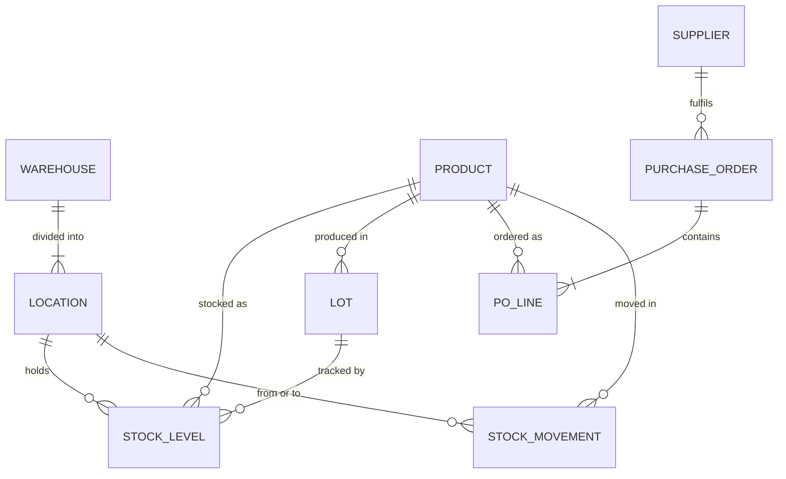

### Key tables

```sql
CREATE TABLE stock_levels (                       -- current state, one row per product-lot-location
  product_id  bigint REFERENCES products,
  location_id bigint REFERENCES locations,
  lot_id      bigint REFERENCES lots,
  on_hand     int NOT NULL CHECK (on_hand >= 0),
  reserved    int NOT NULL DEFAULT 0 CHECK (reserved BETWEEN 0 AND on_hand),
  PRIMARY KEY (product_id, location_id, lot_id)
);
CREATE TABLE stock_movements (                    -- append-only ledger of every change
  movement_id bigint GENERATED ALWAYS AS IDENTITY PRIMARY KEY,
  product_id  bigint NOT NULL REFERENCES products,
  lot_id      bigint REFERENCES lots,
  from_location bigint REFERENCES locations,      -- NULL for receipts
  to_location   bigint REFERENCES locations,      -- NULL for shipments / write-offs
  quantity    int NOT NULL CHECK (quantity > 0),
  reason      text NOT NULL CHECK (reason IN ('receipt','shipment','transfer','adjustment','return')),
  reference   text,                               -- PO number, order number ...
  moved_at    timestamptz NOT NULL DEFAULT now(),
  CHECK (from_location IS NOT NULL OR to_location IS NOT NULL)
);
```

This is the same **ledger + cached balance** design as the bank ([§17.3](#173-banking-system)): movements are the truth, `stock_levels` is the fast answer, and both change in the same transaction. A periodic query that rebuilds levels from movements and compares them catches bugs — and explains a shelf count that disagrees with the screen by replaying one product's movements in order. Two opposite reasons to store a derivable value: the library fine is kept so it **never** changes; this balance is kept because summing every movement on each read would be too slow.

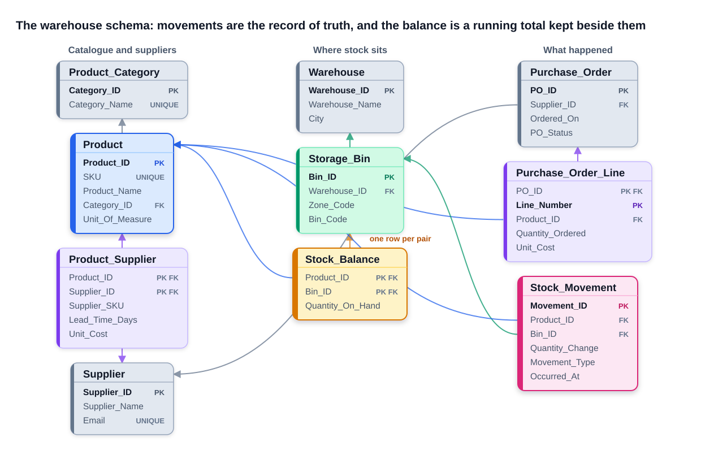

*Figure — the course's warehouse model: Stock_Movement records what happened, Stock_Balance is the running total beside it (course diagram)*

The course variant records one row per bin with a **signed** `quantity_change` (+50 received, −3 picked) instead of from/to columns — one table for every movement type, and a transfer becomes two rows. Its other tables: `product_suppliers (product_id, supplier_id, supplier_sku, lead_time_days, unit_cost)` — attributes of the *pairing*, so putting `supplier_name` there would be a 2NF **partial dependency** (a column depending on only part of a composite key); and `purchase_order_lines (po_id, line_no, …)`, a **weak entity** whose key includes its parent's, with `ON DELETE CASCADE`. `unit_cost` appears on both: the agreed price now versus the price paid on that order. A movement's cause is stored as `reference_type` + `reference_id` — a polymorphic reference no FK can check (see §17.14). Whether `on_hand` may drop below zero is a business choice — a few operations like negative stock as an alarm for an unrecorded delivery — so choose deliberately and document it.

### Key queries

1. Available to promise for a SKU across warehouses: `sum(on_hand - reserved)` grouped by warehouse.
2. Pick list for an order, first-expired-first-out: stock rows for the SKU joined to `lots`, ordered by `expires_on`, with a running total (window `sum() OVER (ORDER BY expires_on)`) until the ordered quantity is covered.
3. Reorder alerts: products whose total available is below `reorder_point`.
4. Movement history of a lot (for recalls).

### Indexes

`stock_levels` PK for picks; `stock_levels (location_id)` for bin counts; `stock_movements (product_id, moved_at DESC)` and `(reference)`; `lots (product_id, expires_on)`.

### Scaling notes

Each warehouse is mostly independent: shard or even run one database per site, with a central read model for company-wide stock. Movement tables grow forever — partition by month. Reservations for online orders are the contention point; a reservation row per order line (with expiry, like the ticket holds) is safer than decrementing a shared counter.

---

The last four cases are large consumer products. The relational core looks like the earlier designs; what changes is that **no single database fits every part**, so each design ends with a short "which store for which data" table ([Chapter 16 §16.10](../16-beyond-relational/README.md) has the general decision guide).

At this scale the template gains three steps before the tables:

1. **Non-functional targets** — **high availability** (the service is almost always up), low **latency** (the time one request takes; here a few hundred ms), **horizontal scalability** (growing by adding machines), and *where **eventual consistency** (copies may briefly disagree but converge) is acceptable* (vote and view counts) versus where it is not (money, bookings, identity).
2. **A back-of-the-envelope storage estimate** — users × bytes per row, items per day × size. Multiply carefully (1 KB × 10 million = 10 GB, not 10 TB); the usual result is that rows are small and **media dominates** by orders of magnitude, which is why media goes to object storage.
3. **A high-level architecture** — clients → **load balancer** (spreads incoming requests over many servers) → **API gateway** (the single entry point that handles routing and authentication) → a few **microservices** (small, separately deployed services: user, content, search …), each owning its data store, with a **message queue** (Kafka, RabbitMQ — a buffer where one service leaves tasks for another to process later) for **asynchronous** work (done in the background, not while the user waits) such as search indexing, notifications and video processing.

After the schema come **sharding** (pick the key that keeps a request on one shard; use **consistent hashing** (a key-to-shard mapping where adding a shard moves only a small share of keys, §15.3) so adding a shard moves little data) and **replication** (primary–replica with automatic failover for the relational part, **leaderless** multi-node replication (any replica accepts writes) for Cassandra-style stores, replicas in several regions) — the mechanics are in [Chapter 15](../15-scaling-databases/README.md).

## 17.10 Quora (questions and answers)

### Requirements

- Users ask **questions**, write **answers**, and **comment** on both; questions carry **topics**.
- Users **upvote/downvote** answers; answers are ranked by votes and quality.
- Users **follow** people, topics and questions; a personalized feed shows new questions and answers from what they follow.
- Full-text **search** over questions; suggestions of similar questions while typing.
- Scale: hundreds of millions of monthly users, far more reads than writes. Vote counts may lag (eventual consistency is fine there).
- Estimate (100 M users at 2 KB; per year 10 M questions at 1 KB, 50 M answers at 2 KB, 500 M votes at 0.5 KB, 10 M media files at 500 KB): about 200 GB of user rows, then roughly 10 GB + 100 GB + 250 GB of text and **5 TB of media** per year — the relational data fits comfortably; media and replicas drive the storage budget.

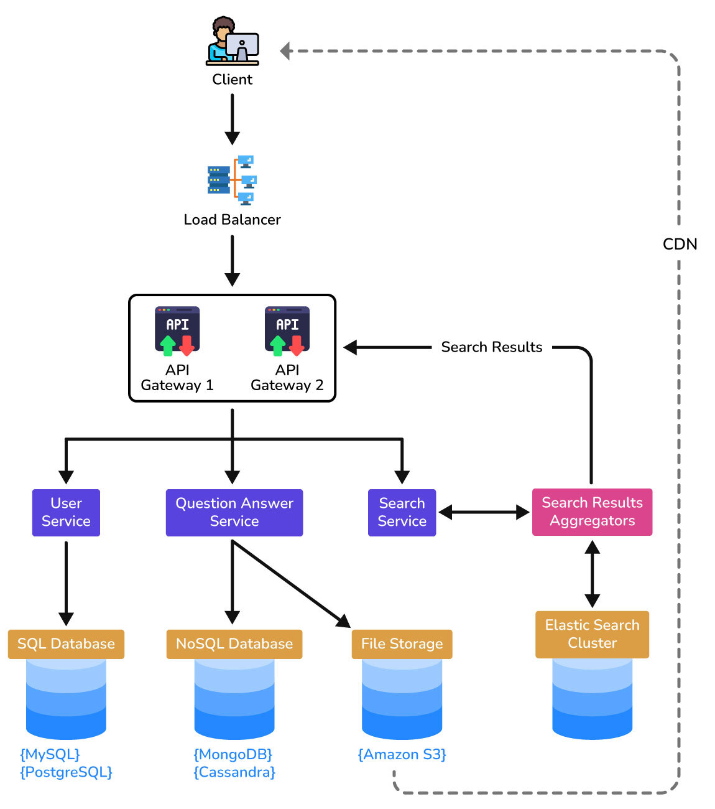

*Figure — the course's Quora high-level design: clients, load balancer, API gateway, user / question-answer / search services, a relational DB, a NoSQL store, Elasticsearch, a message queue and file storage (course diagram)*

### Entities and relationships

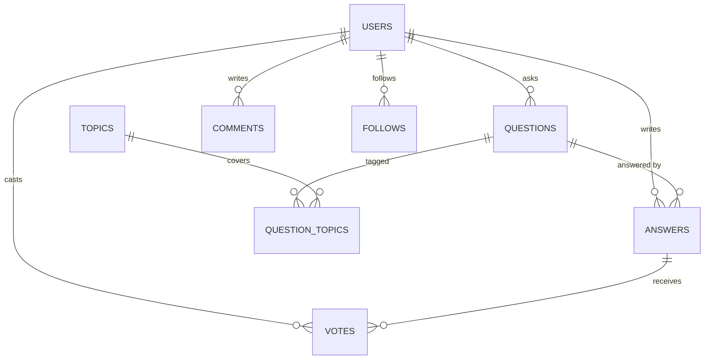

### Key tables

```sql
CREATE TABLE answers (
  answer_id   bigint PRIMARY KEY,
  question_id bigint NOT NULL REFERENCES questions,
  author_id   bigint NOT NULL REFERENCES users,
  body        text NOT NULL,
  upvotes     int NOT NULL DEFAULT 0, downvotes int NOT NULL DEFAULT 0,   -- denormalized
  created_at  timestamptz NOT NULL, updated_at timestamptz,
  UNIQUE (question_id, author_id)                 -- one answer per user per question
);
-- votes (answer_id, user_id, value CHECK (value IN (-1, 1)), PRIMARY KEY (answer_id, user_id))
CREATE TABLE comments (                           -- polymorphic target: a question OR an answer
  comment_id  bigint PRIMARY KEY,
  question_id bigint REFERENCES questions,
  answer_id   bigint REFERENCES answers,
  author_id   bigint NOT NULL REFERENCES users,
  body text NOT NULL, created_at timestamptz NOT NULL,
  CHECK (num_nonnulls(question_id, answer_id) = 1)
);
CREATE TABLE follows (                            -- polymorphic: follow a user, topic or question
  follower_id bigint REFERENCES users,
  target_type text NOT NULL CHECK (target_type IN ('user','topic','question')),
  target_id   bigint NOT NULL,                    -- no FK possible: it points at 3 tables
  PRIMARY KEY (follower_id, target_type, target_id)
);
```

These two tables show the two ways to model a **polymorphic association** (one row that may point to different parent tables). `comments` uses **one nullable FK per possible parent** plus a `CHECK` that exactly one is set — foreign keys still work. `follows` uses a **type + id pair**, which is compact and extensible but gives up referential integrity (the database cannot check that topic 42 exists). Prefer the first when the parent types are few and fixed.

### Key queries

1. Answers to a question ranked by score: `ORDER BY upvotes - downvotes DESC, created_at` (or a stored `score` that also weighs author credibility).
2. Feed: new answers in followed topics/questions/people since the last visit.
3. Casting a vote: `INSERT … ON CONFLICT (answer_id, user_id) DO UPDATE SET value = EXCLUDED.value`, adjusting the counters by the difference.

### Indexes

`answers (question_id, upvotes DESC)`, `question_topics (topic_id, question_id)`, `follows (target_type, target_id)` for "who follows this topic", full-text (`tsvector` GIN) or an external search engine for questions.

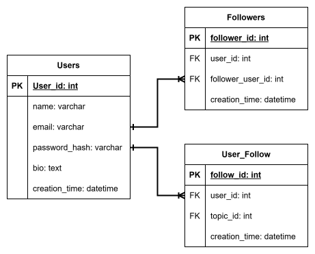

*Figure — the course's split: users, follower and topic-follow tables in the relational DB; questions with embedded answers in a document store (course diagram)*

**The document alternative.** The course stores each question as one MongoDB-style document with its answers (and their comments) **embedded**, so a question page is a single read; a mirrored user document carries follower counts and followed topics. Embedding is denormalization: great for "show this question", awkward for "all answers by this user" or for a question with 10,000 answers (MongoDB caps a document at 16 MB) — the usual compromise embeds the top answers and keeps the rest in their own collection.

**Sharding.** By `user_id`, a user's content is local but celebrity users become **hot spots** (shards overloaded by one popular key); by `question_id` (hashed), load spreads evenly but a user's timeline needs a **scatter-gather** (send the query to every shard and merge the answers) across shards. The recommended mix: question data sharded by a hash of `question_id`, user data (profiles, follows) by a hash of `user_id`, consistent hashing, and a shard-manager service that maps keys to shards.

### Which store for which data

| Data | Store |
|---|---|
| Users, questions, answers, votes | Sharded relational DB (Quora itself runs sharded MySQL — tens of terabytes and hundreds of thousands of queries per second, per its 2020 engineering blog) — or questions/answers in a document or wide-column store, as in the course design |
| Answer rankings, feed lists, counters | In-memory cache (Redis/Memcached) |
| Search and "similar question" suggestions | Search engine (Elasticsearch/OpenSearch) |
| Images in answers | Object storage + CDN |

---

## 17.11 TikTok (short-video platform)

### Requirements

- Users upload short **videos** with captions, **sounds** (music tracks reusable across videos) and **hashtags**.
- Viewers **like**, **comment**, **share**, and **follow** creators; view counts are shown on every video.
- The main surface is a recommendation-driven **"For You" feed**, fed by **watch events** (what was watched, for how long, skipped, replayed).
- Real-time **notifications** (new follower, like, comment); **trending** videos and hashtags; videos grouped into **categories** (dance, comedy).
- Scale: billions of video views per day; view and watch events vastly outnumber everything else.
- Estimate: with generous assumptions (1 B daily users each uploading 2 videos of 50 MB) raw video is 1 B × 2 × 50 MB = **100 PB a day**, against about 4 TB of metadata (2 B videos × 2 KB) and about 2 TB of comments (2 B × 1 KB). Video bytes outweigh the metadata and comments by more than 10,000 to 1, so they live in object storage with **lifecycle rules** (automatic policies that move old files to cheaper storage or delete them), never in a database.

### Entities and relationships

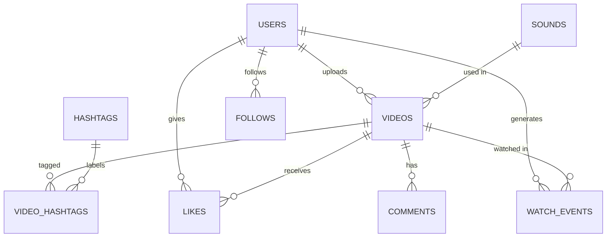

### Key tables

```sql
CREATE TABLE videos (
  video_id    bigint PRIMARY KEY,                 -- time-ordered id (Snowflake-style)
  creator_id  bigint NOT NULL REFERENCES users,
  sound_id    bigint REFERENCES sounds,
  caption     text,
  storage_key text NOT NULL,                      -- original upload in object storage
  duration_ms int NOT NULL,
  status      text NOT NULL CHECK (status IN ('processing','public','private','removed')),
  created_at  timestamptz NOT NULL
);
-- video_renditions (video_id, resolution, bitrate_kbps, storage_key): transcoded copies
CREATE TABLE video_stats (                        -- hot counters kept apart from the video row
  video_id bigint PRIMARY KEY REFERENCES videos,
  views bigint NOT NULL DEFAULT 0, likes bigint NOT NULL DEFAULT 0,
  comments bigint NOT NULL DEFAULT 0, shares bigint NOT NULL DEFAULT 0
);
```

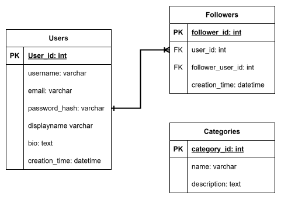

*Figure — the course's TikTok schema: users, followers and categories relational; videos, interactions and user activity in Cassandra (course diagram)*

In the course design the high-volume tables live in **Cassandra**, modeled around the query rather than the entity. A correct **CQL** (Cassandra Query Language) sketch (Cassandra has no `ENUM` type, and **counter** columns — special columns that can only be incremented or decremented — must sit in a table of their own; a `timeuuid` is a unique id that embeds a timestamp):

```sql
-- CQL (Cassandra) — not run
CREATE TABLE interactions_by_video (
  video_id uuid, created_at timeuuid, user_id bigint,
  kind text,                      -- 'like' | 'comment' | 'share'
  comment_text text, parent_id timeuuid,
  PRIMARY KEY ((video_id), created_at)          -- partition key, then clustering column
) WITH CLUSTERING ORDER BY (created_at DESC);
CREATE TABLE video_counters (
  video_id uuid PRIMARY KEY, views counter, likes counter, comments counter, shares counter
);
CREATE TABLE user_activity (
  user_id bigint, activity_time timestamp, activity_type text, details text,
  PRIMARY KEY ((user_id), activity_time)
) WITH CLUSTERING ORDER BY (activity_time DESC);
```

Relational tables keep what needs strong consistency (accounts, follows, categories); Cassandra keeps what needs write throughput and can be eventually consistent. The same idea appears relationally below.

(`video_renditions` holds **transcoded** copies — the same video re-encoded at several resolutions and **bitrates**, i.e. data per second, for different devices and connections.) Splitting `video_stats` from `videos` is a **vertical partition** (splitting a table's columns into two tables sharing a key): the counters change constantly, the video metadata almost never, so separating them keeps metadata rows and their cache entries stable. Watch events are **not** a table in the primary database at all — they are an **event stream** (an append-only, ordered flow of records, e.g. in Kafka, consumed by other systems).

### Key queries

1. A creator's profile grid: `videos WHERE creator_id = $1 AND status = 'public' ORDER BY video_id DESC` (time-ordered ids sort by upload time).
2. Videos using a sound (the "use this sound" page).
3. Trending hashtags in the last hour — computed by the **stream processor** (a system that computes results continuously as events arrive), not by SQL over billions of rows.
4. For You feed — candidate generation and ranking by a recommendation service; the database only fetches metadata for the chosen ids.

### Indexes

`videos (creator_id, video_id DESC)`, `videos (sound_id)`, `video_hashtags (hashtag_id, video_id)`, `likes (video_id, user_id)` primary key plus `likes (user_id, created_at)` for "videos I liked".

### Which store for which data

| Data | Store |
|---|---|
| Users, video metadata, follows | Sharded relational or distributed SQL |
| Video files and renditions | Object storage + CDN (edge caches near viewers) |
| Views, watch time, skips | Event log (Kafka) → stream processing → analytics warehouse / wide-column store |
| Counters | In-memory counters, flushed periodically; displayed counts may lag a little |
| Recommendation features, embeddings (lists of numbers that represent an item so similar items are close) | Feature store (a database of precomputed model inputs) + vector index (finds nearest embeddings; FAISS library, Milvus) fed by training pipelines |
| Notifications, processing jobs | Message queue → notification and transcoding **workers** (background processes that take jobs from the queue) |

---

## 17.12 Airbnb (short-term rentals)

### Requirements

- **Hosts** publish **listings** (address, geo-location, capacity, amenities, photos, house rules) with a **calendar** of availability and nightly prices.
- **Guests** search by location, dates and guests; filter by price and amenities; then **book** (instant or on host approval).
- No listing may be booked twice for overlapping nights.
- **Payments** (charge the guest, pay out the host later, refunds and deposits through an external **payment gateway** — a third-party service that processes card payments), **reviews** in both directions after a stay, and **messaging** between guest and host. Hosts accept or decline booking requests.
- Estimate (per day: 1 M listings created or updated with ~5 KB of data and 10 photos of ~1 MB; 10 M reservations and 10 M payments at 1 KB; 5 M reviews at 0.5 KB): photos ≈ **10 TB/day**, while reservations, payments and reviews together are only ≈ 22 GB/day — the transactional core is small enough for a relational cluster.

### Entities and relationships

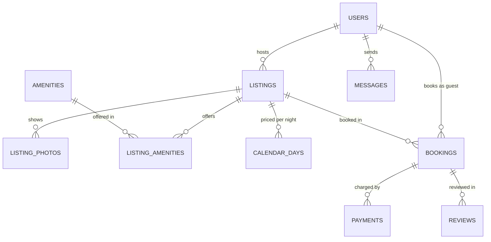

A user is both a potential **host** and a **guest**: one `users` table with two roles, not two tables.

### Key tables

```sql
-- needs the PostGIS extension for geography (not run here)
CREATE TABLE listings (
  listing_id bigint PRIMARY KEY,
  host_id    bigint NOT NULL REFERENCES users,
  title      text NOT NULL,
  location   geography(Point, 4326) NOT NULL,     -- PostGIS; lat/long for radius search
  max_guests smallint NOT NULL,
  base_price numeric(10,2) NOT NULL,
  status     text NOT NULL CHECK (status IN ('draft','active','snoozed','deleted'))
);
CREATE TABLE calendar_days (                      -- per-night availability and price overrides
  listing_id bigint REFERENCES listings,
  night      date,
  price      numeric(10,2),                        -- NULL = base price
  blocked    boolean NOT NULL DEFAULT false,       -- host blocked it
  PRIMARY KEY (listing_id, night)
);
CREATE TABLE bookings (
  booking_id bigint PRIMARY KEY,
  listing_id bigint NOT NULL REFERENCES listings,
  guest_id   bigint NOT NULL REFERENCES users,
  stay       daterange NOT NULL,
  guests     smallint NOT NULL,
  total      numeric(12,2) NOT NULL,
  status     text NOT NULL CHECK (status IN ('requested','confirmed','cancelled','completed')),
  EXCLUDE USING gist (listing_id WITH =, stay WITH &&) WHERE (status IN ('requested','confirmed'))
);
-- reviews (booking_id, author_role 'guest' | 'host', rating, body,
--          PRIMARY KEY (booking_id, author_role))  -> each side reviews once per stay
```

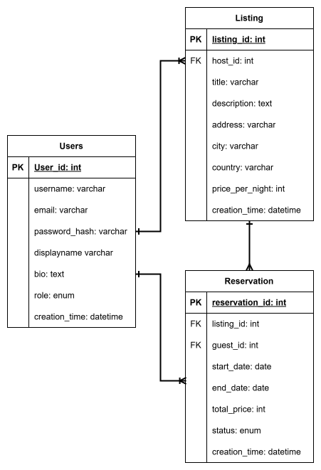

*Figure — the course's Airbnb schema: users (with a host/guest role), listings and reservations relational; reviews, user activity and property images in Cassandra (course diagram)*

The course splits the work into **user, listing, booking and payment services**. Users, listings, reservations and payments stay relational (atomic booking and money); reviews, activity logs and `property_images (listing_id, image_id, url)` — partitioned by `listing_id` so one read returns a listing's photos — go to Cassandra; photo bytes go to object storage. Its `users.role` column (host or guest) works only if a person is never both; a second listing-owner check (`listings.host_id`) is the more flexible way to express "host".

The **exclusion constraint** on `(listing_id, stay)` is the same tool as the hospital appointments: two active bookings of one listing cannot overlap. Unlike a hotel, each listing is a single unit, so no inventory counter is needed.

### Key queries

1. Search: active listings within 10 km (`ST_DWithin(location, $point, 10000)`) with enough capacity and **no** overlapping active booking and no blocked night in the range — plus price filtering.
2. Book: insert the booking; the exclusion constraint rejects a conflicting stay, even under concurrency.
3. Host dashboard: upcoming bookings per listing; payouts due.
4. Listing rating: `avg(rating)` of guest reviews, usually cached on the listing.

### Indexes

GiST on `listings.location`; the exclusion constraint's GiST index on `(listing_id, stay)`; `bookings (guest_id, lower(stay))` for "my trips"; `calendar_days` PK.

### Which store for which data

| Data | Store |
|---|---|
| Users, listings, bookings, payments | Relational (strong consistency for bookings and money) |
| Search with geo + filters + ranking | Search engine fed by change-data-capture from the DB |
| Photos | Object storage + CDN |
| Messages | Relational or wide-column, partitioned by conversation |
| Pricing suggestions, analytics | Data warehouse (replicated nodes plus regular backups) |

Replication follows the pattern above: a primary with read replicas in several regions and automatic failover for the relational core, multi-node replication with eventual consistency for Cassandra.

---

## 17.13 Snapchat (ephemeral messaging)

### Requirements

- Users add **friends** (mutual, request/accept), send **snaps** (photo/video) to one or more friends, and **chat**.
- A snap **disappears** after every recipient has opened it, or after a maximum time (e.g. 30 days unopened); a **story** is visible to friends for 24 hours.
- Senders see delivery and "opened" status per recipient; screenshots are reported.
- Snaps and stories can carry **filters/lenses**; users can be **searched** by name.
- Scale: billions of snaps a day; almost all data is short-lived.
- Estimate (500 M daily users, 10 snaps each — 80 % photos of 1 MB, 20 % videos of 5 MB — plus one 10 MB story each): 4 PB + 5 PB of snaps and 5 PB of stories, about **14 PB of new media a day**. Because snaps vanish on viewing and stories after 24 hours, what is *held* stays bounded — deletion is as important a workload as writing.

### Entities and relationships

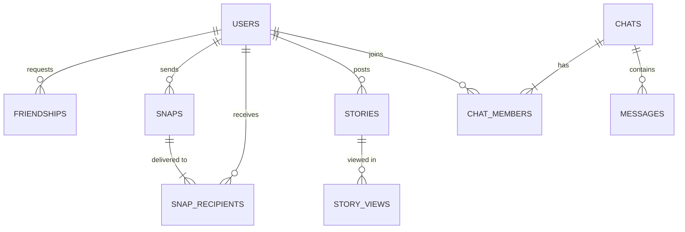

### Key tables

```sql
CREATE TABLE friendships (                        -- one row per pair, stored in canonical order
  user_low   bigint REFERENCES users,
  user_high  bigint REFERENCES users,
  status     text NOT NULL CHECK (status IN ('pending','accepted','blocked')),
  requested_by bigint NOT NULL,
  PRIMARY KEY (user_low, user_high),
  CHECK (user_low < user_high)
);
CREATE TABLE snaps (
  snap_id    bigint PRIMARY KEY,
  sender_id  bigint NOT NULL REFERENCES users,
  media_key  text NOT NULL,                        -- encrypted blob in object storage
  created_at timestamptz NOT NULL,
  expires_at timestamptz NOT NULL                  -- hard deadline even if never opened
);
CREATE TABLE snap_recipients (
  snap_id      bigint REFERENCES snaps ON DELETE CASCADE,
  recipient_id bigint REFERENCES users,
  delivered_at timestamptz, opened_at timestamptz, screenshot_at timestamptz,
  PRIMARY KEY (recipient_id, snap_id)              -- "my inbox" is a PK range scan
);
-- stories (story_id, user_id, media_key, created_at, expires_at = created_at + 24 h, set on insert)
```

(`expires_at` cannot be a `GENERATED … STORED` column: `timestamptz + interval` depends on the session time zone, so PostgreSQL rejects it as not **immutable** — a generated column's expression must always give the same output for the same input.)

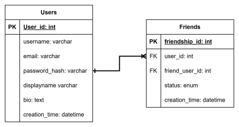

*Figure — the course's Snapchat schema: users and friends relational; snaps, stories and messages in Cassandra; users, snaps and stories indexed in Elasticsearch for search (course diagram)*

The course's Cassandra `snaps` table is keyed by `snap_id` with a secondary index on the receiver. Cassandra works best when the **partition key is what you query by**, so an inbox table partitioned by recipient (as `snap_recipients` above does relationally) avoids the secondary index. A search engine (Elasticsearch) holds a user index for "find friends", sharded automatically by the number of primary shards you configure.

The **canonical pair** trick (`user_low < user_high`) stores a symmetric relationship once, so "are A and B friends?" is one lookup with `(least(a,b), greatest(a,b))`. Compare Instagram's `follows`, which is directional and therefore needs one row per direction.

### Key queries

1. Inbox: unopened snaps for a recipient, newest first.
2. Open a snap: set `opened_at`; when every recipient row has `opened_at`, delete the media and the snap.
3. Friends' stories: stories of accepted friends where `expires_at > now()`.
4. Expiry sweep: delete snaps and stories past `expires_at` (in batches).

### Indexes

`snap_recipients` PK `(recipient_id, snap_id)`, `snaps (expires_at)` for the sweeper, `stories (user_id, created_at DESC)`, `friendships (user_high)` for the reverse lookup.

### Scaling notes and stores

**Ephemeral** (short-lived) data is a poor fit for row-by-row `DELETE` at this volume (**dead tuples** — deleted row versions still occupying space — **vacuum**, Postgres's clean-up process for them, and **index bloat**, indexes swollen with entries for dead rows). Two better tools: **time partitions** (partition `snaps` by day and `DROP` whole partitions — instant and bloat-free, [Chapter 15 §15.2](../15-scaling-databases/README.md)) or a store with native **TTL** (time-to-live), such as Cassandra/ScyllaDB or DynamoDB, where rows expire by themselves. Snap's 2017 **IPO** (initial public offering — first sale of shares on the stock market) filing disclosed five-year cloud commitments of $2 billion with Google Cloud and $1 billion with AWS — at this scale, managed cloud databases are the usual choice rather than self-run servers.

| Data | Store |
|---|---|
| Accounts, friend graph | Relational or key-value, sharded by user |
| Snaps, recipients, chat messages | Wide-column / key-value with TTL, partitioned by recipient or chat |
| Media | Encrypted object storage + CDN, lifecycle rules delete it |
| Presence ("online now" status), typing indicators | In-memory store |
| User search | Search engine index |

Partitioning happens at three levels: **horizontal** (rows split by `user_id` or `snap_id` — users by range or consistent hashing, trying to keep friend lookups on one shard; Cassandra hashes its partition keys itself), **vertical** (user data and media data in separate stores), and **functional** (each microservice — user, media, messaging, search — owns its data).

---

## 17.14 Recurring modeling patterns

Across the thirteen cases the same few patterns did most of the work. This table is the chapter in one page.

| Pattern | What it is | Seen in | Use it when | Watch out for |
|---|---|---|---|---|
| **Junction table** | A table whose PK is two FKs, resolving an M:N relationship, often with its own attributes | `order_items`, `likes`, `title_authors`, `post_hashtags`, `reservation_rooms` | Any M:N relationship; the PK doubles as the uniqueness rule ("like once") | Add an index on the *second* column for the reverse lookup |
| **Type vs instance** | Separate the kind of thing from the physical thing | `titles`/`copies`, `room_types`/`rooms`, `seats`/`show_seats` | Users choose a kind but you track individual items | Forgetting it forces one table to do two jobs |
| **Status enum + state history** | A constrained `status` column for the current state; optionally an append-only table of transitions | orders, bookings, reservations, food-delivery events | Every entity with a life cycle | Enforce allowed values (`ENUM`, `CHECK`, or lookup table); `CHECK`s can tie a status to required columns (ticket seats) |
| **Soft delete** | A `deleted_at` / `withdrawn_at` column instead of `DELETE` | products, library copies, listings | History or FKs must survive removal | Every query must filter it — use partial indexes and views; unique constraints need `WHERE deleted_at IS NULL`; privacy laws may still require a hard delete |
| **Audit columns / ledger** | `created_at`, `updated_at`, `created_by`; or a full append-only ledger of changes | hospital records, bank ledger, stock movements | Legal, financial or medical data; debugging "who changed this?" | Maintain with defaults/triggers, not by hand; ledgers need a cached balance for speed and a reconciliation query |
| **Polymorphic association** | One row points to one of several parent types | Quora comments (nullable FKs + `CHECK`), follows (`target_type` + `target_id`) | A comment/like/follow can target several entity kinds | The type+id form loses foreign keys; prefer one nullable FK per parent, or a shared supertype table |
| **Denormalized counter / copy** | Store a derived value (count, total, current status) to avoid recomputing | `like_count`, `orders.total`, `room_inventory`, `answers.upvotes`, `video_stats` | A measured hot read | Update it in the same transaction (or trigger), add a reconciliation check, and beware lock contention on hot rows |
| **Snapshot of volatile data** | Copy a value that may later change | `unit_price`, delivery address, `nightly_price` | The fact is "what it was at the time" | It is not a normalization bug — document it as intentional |
| **Self-reference** | A FK to the same table | category tree, comment replies, `follows` | Hierarchies and graphs | Query with recursive CTEs; guard against cycles |
| **Overlap prevention** | Exclusion constraint on a range, or partial unique index on "open" rows | appointments, Airbnb stays, hotel rooms, open library loans | "No two X at the same time" | PostgreSQL-specific; elsewhere lock and check in a transaction |
| **Guarded update / claim** | `UPDATE … WHERE state = 'free' RETURNING …` | seat holds, stock decrement | Many users compete for the same item | Check the returned row count; hold short; `SKIP LOCKED` for "any available" |
| **Time partitioning / TTL** | Split big tables by time; drop old partitions or let rows expire | ledgers, movements, snaps, stories | Append-heavy data with a retention rule | Queries should include the partition key in `WHERE` |

### Judgement calls — cover the answer, say it aloud

1. *`order_items.unit_price` duplicates `products.price` — a 3NF violation?* → No: price paid on that order and today's list price are different facts.
2. *Why no stored `is_available` flag on copies or seats?* → Availability is derived from loans / seat status; a second copy of the truth drifts.
3. *A foreign key that should be 1:1 — what else does it need?* → `UNIQUE` (or make it the primary key); otherwise it is 1:N.
4. *Where does the agreed rate, a seat's price, or a medicine's dose go?* → On the junction row: it describes the pairing, not either side.
5. *Hotel search counts per night; Airbnb uses an exclusion constraint. Why?* → A room type has many interchangeable units; a listing is one unit.
6. *When is `target_type + target_id` acceptable?* → When target kinds change often and you accept checking integrity outside the database.
7. *The one-sentence recipe for "no double booking"?* → Make the conflicting state impossible to store (unique / exclusion / check constraint) and claim the item with one guarded statement in a short transaction.

---

## Chapter 17 TL;DR

- Use one template every time: **requirements & questions → entities, cardinality & participation → ER diagram → tables & constraints → key queries → indexes → design review → scaling** (the review checks normal forms, names deliberate redundancy, and lists what the design cannot do).
- Put business rules **in the schema** where possible: `CHECK` for ranges and state/column consistency, partial unique indexes for "one open X", exclusion constraints for "no overlapping X", unique keys for "once per user".
- Separate **type from instance** (titles/copies, room types/rooms, seats/show seats) and **current state from history** (status column + events or ledger).
- **Snapshot** values that must not change later (prices paid, addresses shipped to); **soft-delete** rows that history still references.
- Denormalize **deliberately** (counters, totals, inventory per night) — update in the same transaction and keep a reconciliation query.
- Concurrency for scarce items: a **guarded `UPDATE … WHERE status = 'free'`** in a short transaction is enough — demonstrated on two live sessions; `SKIP LOCKED` for "any available".
- At scale, the relational core stays for money, bookings and identity; media goes to object storage + CDN, feeds and counters to caches, events to logs, search to a search engine, and short-lived data to TTL stores or dropped time partitions.

Next: [Chapter 18 — SQL interview problems, part 1](../18-sql-interview-problems-1/README.md), which practises the query skills from Chapters 2–8 on interview-style problems.
