# Chapter 17 — Schema Design Case Studies

Chapters 10–16 gave you the tools one at a time. Interviews and real projects say "design the database for a hotel booking site" and expect you to go from a vague brief to tables, keys, the queries that matter, and a view on what breaks at scale. This chapter does that thirteen times with the same template, so the method becomes a habit.

**What you'll learn:** (1) a repeatable eight-step template plus the mapping rules and judgement calls every case reuses; (2) nine classic business systems — hospital, hotel, bank, Instagram-style photo sharing, e-commerce, food delivery, library, ticket booking, warehouse; (3) four large-scale products — Quora, TikTok, Airbnb, Snapchat — where the relational core meets caches, **object storage** (services such as Amazon S3 storing whole files by key) and NoSQL (Chapter 16); (4) four designs built for real on PostgreSQL (e-commerce, ticket booking with seat-hold concurrency, library, Instagram feed) with real output; (5) the recurring patterns — junction tables, status enums, soft deletes, audit columns, polymorphic associations, denormalized counters — compared in one table at the end (§17.14).

**How to run the examples.** [`00_schema.sql`](code/00_schema.sql) creates four schemas — `shop`, `tix`, `lib`, `insta` — with small invented data; files `01`–`05` in [`code/`](code/) each run on a fresh copy:

```bash
bash tools_run_sql.sh sql '17-*'                         # run this chapter's files
bash tools_pg.sh psql -d ch_17 -f sql/chapters/17-schema-design-case-studies/code/02_ticket_booking.sql
```

Every "Output:" block is real psql output (command tags like `UPDATE 2` trimmed). This chapter **applies** earlier material: modeling and ER notation ([Chapter 10](../10-data-modeling-and-er-diagrams/README.md)), normal forms ([Chapter 11](../11-normalization/README.md)), indexes and `EXPLAIN` ([Chapter 12](../12-indexes-storage-and-query-performance/README.md)), locking and isolation ([Chapter 13](../13-transactions-and-concurrency/README.md)), partitioning/sharding/replication ([Chapter 15](../15-scaling-databases/README.md)), NoSQL families ([Chapter 16](../16-beyond-relational/README.md)).

---

## 17.0 The template

### What it is

A **schema-design case study** is a short, structured answer to "what tables would you build for X?" — the modeling process of [§10.3](../10-data-modeling-and-er-diagrams/README.md) compressed into interview-sized steps.

### How it works

1. **Requirements.** What users do (functional) and the numbers and guarantees that matter (non-functional: reads vs writes, consistency, **retention** — how long data must be kept). **Write down the 5–6 questions the system must answer** ("which rooms are free between two dates?") — they drive the tables *and* the indexes. Ask; don't assume.
2. **Entities and relationships.** Nouns you store several facts about, with several instances, become entities; verbs become relationships. Decide **cardinality** (1:1, 1:N, M:N) **and participation** (total = every row must take part; partial = optional) for each, and say it aloud as a sentence.
3. **ER diagram.** Draw it (here `erDiagram` **crow's-foot notation**: a three-pronged "foot" means "many", a bar "one") — where a reviewer spots a missing entity fastest.
4. **Key tables (DDL).** Primary keys, foreign keys, `NOT NULL`, `UNIQUE`, `CHECK`; an M:N relationship becomes a **junction table** (PK = the pair of FKs). Aim for **3NF**, then **denormalize** on purpose.
5. **Key queries.** The 3–5 queries the product runs most. They validate the schema: if a core question needs six joins and a `DISTINCT`, the model is probably wrong.
6. **Indexes.** One per hot access path, usually a **composite index** matching the query's `WHERE` + `ORDER BY` ([Chapter 12](../12-indexes-storage-and-query-performance/README.md)).
7. **Design review.** Check 1NF → BCNF ([Chapter 11](../11-normalization/README.md)), name every deliberate redundancy, and list what the design *cannot* do yet (no history, an unenforced rule). Volunteering limits reads as judgement.
8. **Scaling notes.** Which table grows fastest, what to **partition** (inside one database) or **shard** (across servers) it by, what to cache, what to move to another store, where strict consistency is required.

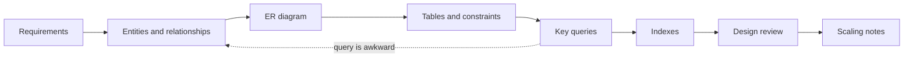

### Rules every case reuses

Mapping rules ([§10.15](../10-data-modeling-and-er-diagrams/README.md)) and judgement calls used by all thirteen designs, so the cases only point at them:

| Situation | Rule |
|---|---|
| Total participation (every order has a customer) | The foreign key is `NOT NULL`; partial participation stays nullable |
| 1:1 relationship | Foreign key **plus `UNIQUE`** (or a shared primary key) — without it the relationship is silently 1:N |
| M:N relationship | Junction table; an attribute of the *pairing* (rate agreed, price of a seat at a show, dosage per medicine) lives there |
| Composite attribute (name = first + last) | Split into columns |
| Multivalued attribute (several phone numbers) | Its own table keyed by (owner, value) |
| Money | `numeric`/`DECIMAL`, never `float` (0.10 has no exact binary form) or `int` (no cents) |
| Times that order events | `timestamptz`, not `date` — two postings on one day still need an order |
| Codes with letters or leading zeros (policy, passport, room "204B") | `text`/`varchar`, never `int` |
| Table named `user`, `order`, `group`, `like`, `transaction`, `show` | Reserved (or keyword) in some dialects — rename (`app_user`, `customer_order`, `screening`) rather than quote forever |
| Passwords | Store a slow salted hash (`password_hash`: a one-way scramble of the password plus a random per-user value), never the password |
| One entity doing two jobs | Split **type** from **instance**: `titles`/`copies`, `room_types`/`rooms`, `seats`/`show_seats` |
| Only current state stored | Keep history rows (loans, bookings, status events, ledger) — "when did…?" needs them |
| A value that must not change later | Snapshot it (price paid, address shipped to, fine charged) |
| Designing for Instagram scale on day one | State the single-node design first, then say what changes at 100× |

### In the interview

**30-second answer:** "I'll clarify the main use cases and scale, pick the entities and relationships, sketch the ER diagram, turn it into tables with keys and constraints, check it against the top queries, add indexes for those queries, and finish with what I'd partition, cache or move to another store as it grows."

- *How do you know the design is right?* — Every core query is simple and index-friendly, every never-break business rule is a **constraint** or runs inside one transaction, and no fact is stored twice without a reason.
- *When do you denormalize?* — For a measured hot read (a feed, a counter), with a plan to keep the copy correct (same transaction, a trigger, or a periodic **reconciliation** job that recomputes the value and flags differences).

---

## 17.1 Hospital management system

### Requirements

- Register **patients** (name, birth date, contact, one or more phone numbers, insurance policies) and **doctors** (specialty) grouped into **departments**.
- Schedule **appointments** (one patient, one doctor, a time slot); a doctor is never in two overlapping slots.
- Record **admissions** to a **room/bed** with admit and discharge dates.
- Keep **medical records** (diagnosis, treatment, by a doctor), **prescriptions** listing **medicines** from a catalogue, and **lab tests** with results.
- Produce **bills** per visit/admission with line items and payments.
- Non-functional: legal retention for years, **auditable** (every change traceable to who and when), strictly **role-based** access (doctor vs clerk).
- Questions: a doctor's appointments tomorrow, a patient's full history, free rooms now, what a patient still owes, the medicines on a prescription.

### Entities and relationships

| Relationship | Cardinality | Note |
|---|---|---|
| Department — Doctor | 1:N | a doctor belongs to one department |
| Patient — Appointment — Doctor | M:N via `appointments` | the appointment is the junction row with its own attributes (time, status) |
| Patient — Admission — Bed | 1:N and N:1 | a bed has many admissions over time, one at a time |
| Appointment / Admission — Medical record | 1:N | a record belongs to one encounter |
| Doctor — Medical record | 1:N | the author; total participation |
| Record — Prescription, Record — Lab test | 1:N | |
| Prescription — Medicine | M:N | junction `prescription_items`; dose and frequency per medicine live there |
| Patient — Insurance policy | 1:N | partial: a patient may have none; `(provider, policy_no)` is `UNIQUE` |
| Patient — Phone | 1:N | multivalued attribute → `patient_phones (patient_id, phone)` |
| Patient — Bill — Bill items | 1:N, 1:N | |

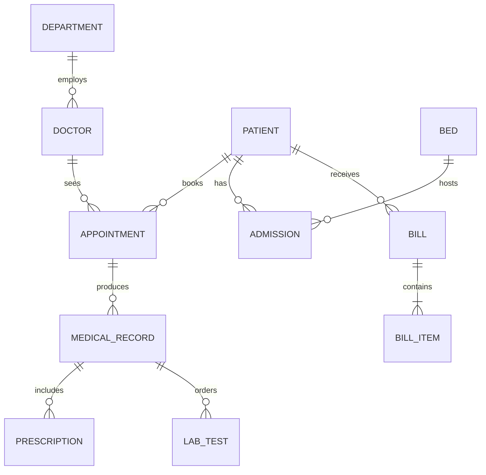


### Key tables

```sql
CREATE TABLE appointments (
  appointment_id bigint GENERATED ALWAYS AS IDENTITY PRIMARY KEY,
  patient_id bigint NOT NULL REFERENCES patients,
  doctor_id  bigint NOT NULL REFERENCES doctors,
  slot       tstzrange NOT NULL,                     -- [start, end)
  status     text NOT NULL CHECK (status IN ('booked','checked_in','completed','cancelled','no_show')),
  -- no two active appointments of the same doctor may overlap (needs: CREATE EXTENSION btree_gist)
  EXCLUDE USING gist (doctor_id WITH =, slot WITH &&) WHERE (status <> 'cancelled')
);
CREATE TABLE admissions (
  admission_id bigint GENERATED ALWAYS AS IDENTITY PRIMARY KEY,
  patient_id bigint NOT NULL REFERENCES patients,
  bed_id     int    NOT NULL REFERENCES beds,
  admitted_at   timestamptz NOT NULL,
  discharged_at timestamptz CHECK (discharged_at > admitted_at)
);
CREATE UNIQUE INDEX one_patient_per_bed ON admissions (bed_id) WHERE discharged_at IS NULL;
```

`tstzrange` holds a start and end timestamp in one value; `&&` means "overlaps". The **exclusion constraint** says "no two rows may have overlapping ranges for the same doctor" — a rule `UNIQUE` cannot express. MySQL and SQL Server have no equivalent: there you lock the doctor's row (`SELECT … FOR UPDATE`) and check for overlaps inside the booking transaction ([Chapter 13](../13-transactions-and-concurrency/README.md)).

### Key queries and indexes

1. A doctor's schedule for a day: `WHERE doctor_id = $1 AND slot && tstzrange($day, $day + interval '1 day')`.
2. Free beds per ward: beds with no open admission (`NOT EXISTS … discharged_at IS NULL`).
3. A patient's full history: records, prescriptions and lab results across all encounters, newest first.
4. Unpaid bills older than 30 days.

Indexes: the exclusion constraint's **GiST** index serves schedule lookups; `admissions (patient_id)`, `medical_records (patient_id, created_at DESC)`, and the partial unique index for bed occupancy.

### Design review

- **Normal forms.** Phone and junction tables have no non-key columns (2NF holds); `department_name` stays in `departments` (copying it onto patients would be a transitive dependency, breaking 3NF); the extra candidate keys (`email`, `(provider, policy_no)`) keep BCNF.
- **Room occupancy.** `rooms.patient_id UNIQUE` (a 1:1 "occupies") knows only who is in the room *now*; `admissions` with a partial unique index keeps the same rule *and* the history.
- **Dose per medicine.** On `prescriptions`, every medicine on one prescription would share it; it belongs to the pairing.
- **Still missing:** who cancelled an appointment and when (status history); a patient's department over time.

### Scaling notes

Volume is modest — one PostgreSQL primary with a replica for reports. The hard requirements are **integrity and audit**: append-only record tables (corrections are new rows referencing the old one), `created_by`/`created_at` on every clinical row, **row-level security** for role-based access ([§14.8](../14-advanced-sql-and-using-sql-from-code/README.md#148-security-roles-privileges-and-row-level-security)), encrypted backups with point-in-time recovery ([§15.11](../15-scaling-databases/README.md#1511-data-resilience-redundancy-mirroring-backups)). Large files (scans, X-rays) go to object storage; the table keeps only the key.

---

## 17.2 Hotel reservation system

### Requirements

- **Hotels** have **room types** (single, double, suite) with a base price, and physical **rooms** of each type.
- **Guests** search availability by city and dates, then **reserve** one or more rooms; no room may be double-booked.
- Life cycle: pending → confirmed → checked-in → checked-out, or cancelled. **Payments** and **reviews** attach to reservations. Prices vary by date (seasonal rates).
- Guests are identified by a document (passport, national ID), may have several phone numbers, and use **extra services** (dining, spa, laundry) charged to the stay.
- **Staff** belong to **departments** (housekeeping, front desk); a department looks after rooms.
- Questions: free rooms between two dates, what a guest paid and owes, today's check-ins, services a guest used, revenue per room type last month, who works in housekeeping.

### Entities and relationships

The central decision is **type versus instance**: guests book a *room type* for a date range; a specific *room* is assigned at or before check-in. Only rooms makes search slow; only types makes check-in impossible.

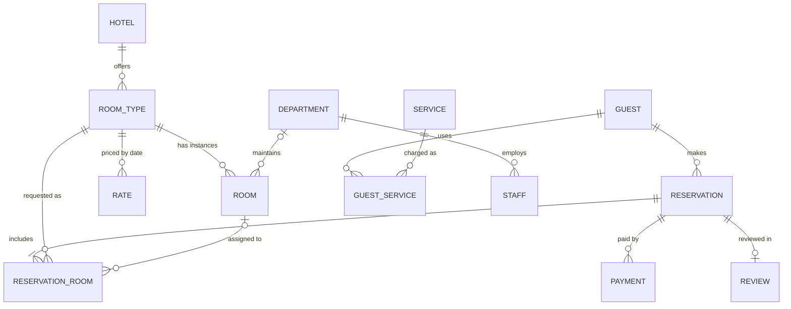


Two details from the full model: price and maximum occupancy belong to the **room type** (ten identical doubles share one price); service usage is a junction row `guest_services (guest_services_id, guest_id, service_id, reservation_id, used_on, quantity, price_charged)` with **its own surrogate key**, because a guest orders dinner on several nights — a `(guest_id, service_id)` key would allow one use ever. `guests` has `UNIQUE (id_type, id_number)` so one identity document never appears on two guest rows.

### Key tables

```sql
-- reservations (guest_id NOT NULL, hotel_id, check_in, check_out CHECK (check_out > check_in), status CHECK (...))
CREATE TABLE reservation_rooms (
  reservation_id bigint REFERENCES reservations ON DELETE CASCADE,
  line_no        smallint,
  room_type_id   int NOT NULL REFERENCES room_types,
  room_id        int REFERENCES rooms,            -- NULL until assigned
  stay           daterange NOT NULL,             -- copied from the reservation for the constraint
  nightly_price  numeric(10,2) NOT NULL,         -- snapshot
  PRIMARY KEY (reservation_id, line_no),
  EXCLUDE USING gist (room_id WITH =, stay WITH &&)   -- a room is never in two overlapping stays
);
-- Inventory per type per night: the row that search reads and booking decrements.
CREATE TABLE room_inventory (
  room_type_id int REFERENCES room_types,
  night        date,
  total        smallint NOT NULL,
  reserved     smallint NOT NULL DEFAULT 0 CHECK (reserved <= total),
  PRIMARY KEY (room_type_id, night)
);
```

The exclusion constraint needs `CREATE EXTENSION btree_gist` (for `=` on an integer inside GiST); rows with `room_id` still `NULL` never conflict, and cancelling must clear or delete the lines to release the room. `room_inventory` is a deliberate **denormalization**: counting overlapping reservations per search is too slow, so each night keeps a counter. Booking increments `reserved` for every night of the stay in one transaction; the `CHECK` makes overbooking fail (hotels allowing a little overbooking use `reserved <= total * 1.1`).

### Key queries and indexes

```sql
-- Room types in a hotel with at least one room free on every night of 10–13 June
SELECT rt.room_type_id, rt.name
FROM room_types rt JOIN room_inventory ri USING (room_type_id)
WHERE rt.hotel_id = $1 AND ri.night >= '2026-06-10' AND ri.night < '2026-06-13'
GROUP BY rt.room_type_id
HAVING count(*) = 3 AND min(ri.total - ri.reserved) > 0;
```

Other hot queries: today's arrivals and departures per hotel, a guest's upcoming stays, average rating per hotel. Indexes: `reservations (hotel_id, check_in)`, `reservations (guest_id, check_in DESC)`, the inventory PK, the GiST index behind the exclusion constraint.

### Design review

- **Normal forms.** Price on `room_types`, not `rooms` (3NF); `nightly_price` on the booking line is a *snapshot*, a different fact from today's list price.
- **Double booking.** `UNIQUE` only detects identical values, never overlapping ranges — hence the exclusion constraint (or a check inside the booking transaction elsewhere).
- **A room status column** (free/occupied) repeats what reservations say and can disagree; keep it only for what bookings can't express ("under maintenance").
- **Still missing:** mid-stay room changes (the line's own `stay` range supports them), who cancelled and when.

### Scaling notes

Search traffic is 100–1,000× booking traffic. Serve search from replicas or a search index (Elasticsearch/OpenSearch) plus an inventory cache, but make the **booking** transaction hit the primary and re-check the inventory row under lock — search may be seconds stale, bookings may not. Partition `reservations` by `check_in` month; shard by `hotel_id` if needed, since nearly every transaction touches one hotel.

---

## 17.3 Banking system

### Requirements

- **Customers** own **accounts** (checking, savings, loan); accounts may have joint owners.
- Deposits, withdrawals and **transfers**; balances never below an allowed limit.
- A full, immutable history of every money movement; monthly statements.
- **Branches** (several phone numbers each) with **employees**; **cards**, one card reaching several accounts; **loans** with repayments.
- Questions: balance now, last month's activity, a customer's accounts, what is owed on a loan, which accounts a card reaches, who works at a branch.
- Non-functional: strict consistency (ACID), auditability, regulatory retention.

### Entities and relationships

The key idea is **double-entry bookkeeping**: money is never "updated", it is *moved*. A **transfer** (the business event) has two or more **entries** (ledger lines), each a signed amount on one account, summing to zero.

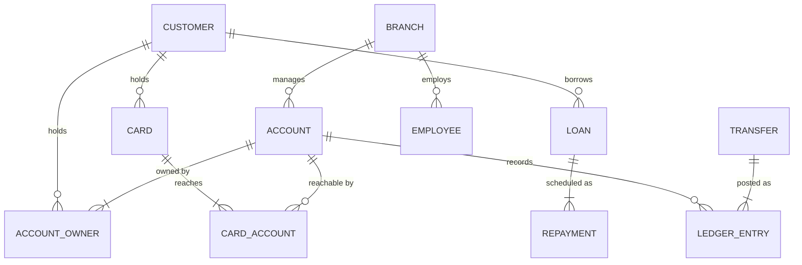


### Key tables

```sql
CREATE TABLE accounts (
  account_id  bigint GENERATED ALWAYS AS IDENTITY PRIMARY KEY,
  iban        text NOT NULL UNIQUE,
  kind        text NOT NULL CHECK (kind IN ('checking','savings','loan')),
  currency    char(3) NOT NULL,
  balance     numeric(18,2) NOT NULL DEFAULT 0,   -- cached; the ledger is the truth
  overdraft_limit numeric(18,2) NOT NULL DEFAULT 0,
  CHECK (balance >= -overdraft_limit),
  status      text NOT NULL DEFAULT 'open' CHECK (status IN ('open','frozen','closed'))
);
CREATE TABLE transfers (
  transfer_id     bigint GENERATED ALWAYS AS IDENTITY PRIMARY KEY,
  idempotency_key uuid NOT NULL UNIQUE,           -- a retried request cannot post twice
  kind            text NOT NULL,
  created_at      timestamptz NOT NULL DEFAULT now()
);
CREATE TABLE ledger_entries (
  entry_id    bigint GENERATED ALWAYS AS IDENTITY PRIMARY KEY,
  transfer_id bigint NOT NULL REFERENCES transfers,
  account_id  bigint NOT NULL REFERENCES accounts,
  amount      numeric(18,2) NOT NULL CHECK (amount <> 0),   -- + credit, - debit
  balance_after numeric(18,2) NOT NULL
);
```

`idempotency_key` makes the transfer **idempotent** — repeating the same request (e.g. after a network timeout) has the same effect as sending it once (the client generates a random 128-bit `uuid`). The ledger is **append-only**: revoke `UPDATE` and `DELETE`; fix mistakes with a reversing transfer.

### Key queries

A transfer is the textbook transaction ([§13.1](../13-transactions-and-concurrency/README.md#131-what-a-transaction-is)):

```sql
BEGIN;
INSERT INTO transfers (idempotency_key, kind) VALUES ($key, 'transfer') RETURNING transfer_id;
-- lock both rows in a fixed order (lower id first) so two opposite transfers cannot deadlock
SELECT account_id FROM accounts WHERE account_id IN ($from, $to) ORDER BY account_id FOR UPDATE;
UPDATE accounts SET balance = balance - $amt WHERE account_id = $from;   -- CHECK stops overdraft
UPDATE accounts SET balance = balance + $amt WHERE account_id = $to;
INSERT INTO ledger_entries (transfer_id, account_id, amount, balance_after) VALUES (...), (...);
COMMIT;
```

Others: a monthly statement (`WHERE account_id = $1 AND created_at` in the month, ordered), a reconciliation check that every transfer's entries sum to zero (`GROUP BY transfer_id HAVING sum(amount) <> 0` must return nothing), "balance = sum of entries" per account.

### Indexes

`ledger_entries (account_id, entry_id DESC)` for statements, `account_owners (customer_id)`, the unique `idempotency_key`. Junction `card_accounts` has PK `(card_id, account_id)`, answering "which accounts can this card reach"; the reverse needs an index on `account_id`, because an index is usable only from its leading column.

### Design review

- **Transfers need a pairing key.** One `transactions` row per account (type = deposit/withdrawal/transfer) cannot name both sides of a transfer; the shared `transfer_id` fixes that. Name the table `ledger_entries` or `account_transactions` — `TRANSACTION` is reserved in SQL Server and a keyword elsewhere.
- **Cached balance.** `accounts.balance` stores the sum of entries. Normal forms don't forbid it (it isn't a dependency *inside* one row), but it can drift, so a nightly job recomputes and compares.
- **Rules a foreign key cannot express:** a card only reaches accounts its owner holds; each transfer's entries sum to zero — check in the transaction or with a periodic query.
- **Still missing:** which employee opened an account or approved a loan (audit columns), card number and status (blocked ≠ expired), and `numeric` width chosen for the largest expected value (widening later rewrites the table). Customer `city` with `state` is a small 3NF compromise most teams accept knowingly.

### Scaling notes

Correctness beats throughput: **synchronous replication** to a standby so failover loses no committed money ([§15.5](../15-scaling-databases/README.md#155-replication)), `SERIALIZABLE` or explicit row locks for balance checks, monthly range partitions of the ledger for archiving. Sharded by account (or customer), a cross-shard transfer needs a **saga** (local steps, each with a compensating "undo") or two-phase commit ([§15.9](../15-scaling-databases/README.md#159-fault-tolerance-and-recovery)) — why many banks keep the core ledger on one very large vertically scaled database or a distributed SQL system (Spanner, CockroachDB).

---

## 17.4 Instagram-style photo sharing (runnable)

### Requirements

- **Users** have a profile (public or private) and **follow** others (one-directional; "friends" = mutual follows).
- **Posts** have a caption and one or more ordered **media** items (a carousel), tagged with **hashtags**.
- Users **like** posts (at most once) and **comment**, including replies.
- **Direct messages** to one other user, **notifications** (likes, comments, follows), **groups**.
- The **home feed** shows recent posts from followed accounts, newest first, paged; profiles show like and follower counts instantly.
- Non-functional: extremely read-heavy, hundreds of millions of posts, media bytes far larger than the rows.

### Entities and relationships

`follows` is a **self-referencing M:N** relationship on `users`; `likes` and `post_hashtags` are junction tables; `comments.parent_id` forms reply threads.

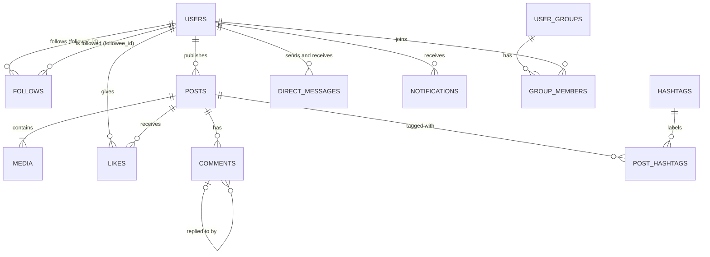

### Key tables

From [`00_schema.sql`](code/00_schema.sql) (schema `insta`):

```sql
CREATE TABLE follows (
  follower_id bigint REFERENCES users,
  followee_id bigint REFERENCES users,
  created_at  timestamptz NOT NULL,
  PRIMARY KEY (follower_id, followee_id),       -- "whom do I follow?" + no duplicate follows
  CHECK (follower_id <> followee_id)
);
CREATE INDEX ON follows (followee_id);          -- "who follows me?"
CREATE TABLE posts (
  post_id bigint PRIMARY KEY, user_id bigint NOT NULL REFERENCES users,
  caption text, created_at timestamptz NOT NULL,
  like_count int NOT NULL DEFAULT 0, comment_count int NOT NULL DEFAULT 0
);
CREATE INDEX ON posts (user_id, created_at DESC, post_id DESC);
-- media (post_id, position, url = object-store key, kind): carousel order kept by position
CREATE TABLE likes (
  user_id bigint REFERENCES users, post_id bigint REFERENCES posts ON DELETE CASCADE,
  created_at timestamptz NOT NULL,
  PRIMARY KEY (post_id, user_id)                  -- one like per user per post
);
-- comments (comment_id, post_id, user_id, parent_id REFERENCES comments, body, created_at)
```

The file also creates `direct_messages` (FKs to sender and recipient), `notifications` (with `actor_id` and `post_id`, so tapping one opens the post), and `user_groups` + `group_members` (a group's multivalued "members" becomes a junction table that can record `joined_at`). `user`, `group` and `like` are reserved in PostgreSQL or MySQL, hence the plural or prefixed names.


The course keeps profile numbers (posts, followers, following) in a **1:1 table** whose PK is also the FK to the user — a *shared primary key*, the simplest way to guarantee one row per user. Here those counters sit on `users`; either way they are a speed decision the normal forms cannot see, because the redundancy spans two tables.

### Key queries

The home feed joins "whom I follow" to their posts. **Fan-out on read** computes it at request time:

```sql
SELECT p.post_id, u.username, p.caption, p.created_at, p.like_count
FROM follows f
JOIN posts p ON p.user_id = f.followee_id
JOIN users u ON u.user_id = p.user_id
WHERE f.follower_id = 1
ORDER BY p.created_at DESC, p.post_id DESC
LIMIT 2;
-- next page: add  AND (p.created_at, p.post_id) < ('2026-05-02 07:30+00', 1003)
```

Output:

```
 post_id | username |           caption           |       created_at       | like_count
---------+----------+-----------------------------+------------------------+------------
    1005 | cy       | Sourdough attempt 2 #baking | 2026-05-03 10:15:00+00 |          1
    1003 | bo       | Trail views #running #hills | 2026-05-02 07:30:00+00 |          2

 post_id | username |       caption        |       created_at        (page 2)
---------+----------+----------------------+------------------------
    1002 | cy       | Fresh bread #baking  | 2026-05-01 08:00:00+00
    1001 | bo       | Sunrise run #running | 2026-05-01 06:10:00+00
```

Page 2 uses **keyset pagination** ([§12.14](../12-indexes-storage-and-query-performance/README.md#1214-offset-vs-keyset-pagination)): fast on page 500, never repeating or skipping a post when new ones arrive; `post_id` breaks timestamp ties. A like must insert the row **and** bump the counter together, and a double tap must not count twice:

```sql
BEGIN;
WITH ins AS (
  INSERT INTO likes (user_id, post_id, created_at) VALUES (4, 1005, '2026-05-03 13:00+00')
  ON CONFLICT DO NOTHING RETURNING post_id
)
UPDATE posts SET like_count = like_count + 1 WHERE post_id IN (SELECT post_id FROM ins)
RETURNING post_id, like_count;
-- ...the same statement again a minute later...
COMMIT;
```

Output:

```
 post_id | like_count
---------+------------
    1005 |          2
(1 row)

 post_id | like_count          <- the repeat like changed nothing
---------+------------
(0 rows)
```

`ON CONFLICT DO NOTHING` skips an insert that would violate a unique key, so the CTE returns a row only if the insert happened. [`04_instagram.sql`](code/04_instagram.sql) also finds mutual follows (a self-join of `follows` with columns swapped), prints a comment thread indented by depth with a recursive CTE over `parent_id` ([Chapter 7](../07-ctes-views-and-recursion/README.md)), ranks hashtags by posts in the last three days, and ends with a **reconciliation check** recounting likes against the cached `like_count` (0 rows). Every denormalized counter deserves one.

### Indexes

| Access path | Index |
|---|---|
| Whom does X follow? | `follows` PK `(follower_id, followee_id)` |
| Who follows X? | `follows (followee_id)` |
| X's posts, newest first (profile grid, feed merge) | `posts (user_id, created_at DESC, post_id DESC)` |
| Has X liked this post? / who liked it | `likes` PK `(post_id, user_id)` |
| Posts with a tag | `post_hashtags` PK `(tag_id, post_id)` |

### Design review

The classic defect is modeling follow and like as 1:N: both are M:N and need a uniqueness rule on the pair (the composite PKs), plus `CHECK (follower_id <> followee_id)`. PK order decides which direction each index serves, so `follows (followee_id)` and `group_members (user_id)` exist for the reverse questions. Follows carry `created_at` ("since when?"), comments `parent_id`, and media is a table because a post can hold several.

### Scaling notes

- **Media** in object storage behind a **CDN** (servers worldwide caching files near users); rows keep keys only.
- **Feed:** fan-out on read is fine for small follow counts. At scale **fan-out on write** pushes each new post id into every follower's precomputed feed (Redis or a wide-column store); celebrities with millions of followers stay fan-out on read, merged at request time — the classic hybrid ([Chapter 16](../16-beyond-relational/README.md)).
- **Counters** are the hottest rows: a viral post turns `UPDATE posts SET like_count = …` into a lock queue (**lock contention**). Batch increments in a cache and flush periodically, or keep sharded counter rows and sum them.
- **Sharding** by `user_id` keeps a user's posts, likes-given and follows together; ids come from a time-embedding generator (Snowflake-style: timestamp + machine id + counter) so they sort by creation without a central sequence ([§15.3](../15-scaling-databases/README.md#153-sharding)).

---

## 17.5 E-commerce store (runnable)

### Requirements

- **Customers** register, keep several **addresses**, browse **products** (each with a **SKU**, stock-keeping unit) in a **category tree**, and write **reviews** (one per customer per product).
- An **order** of several products; each **order item** records quantity and price *at purchase time*.
- Stock decrements on purchase and never goes negative. Orders: `pending → paid → shipped → delivered` (or `cancelled`); **payments** attach to orders.
- Discontinued products leave the shop but old orders still show them.
- Each order has one **delivery** record (status, date, partner) and may use one **coupon** (code, discount, expiry, usage limit).
- Non-functional: browsing read-heavy; checkout strictly consistent.
- Questions: a customer's orders newest first, an order's lines and prices, products in a category with stock, a product's average rating, undelivered orders, whether a coupon is valid.

### Entities and relationships

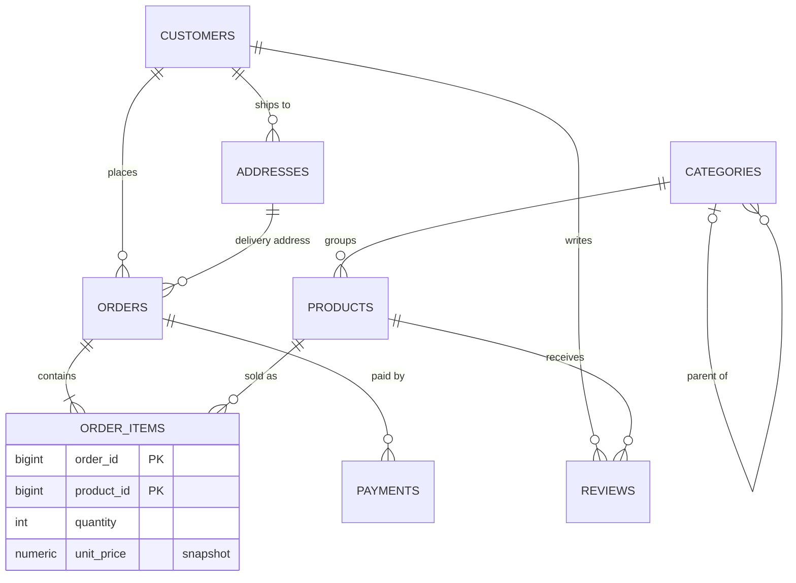

`order_items` is the M:N junction with its own attributes; `categories.parent_id` forms a tree (Electronics → Audio → Headphones).


Not in the runnable schema but part of the full design: `deliveries (order_id UNIQUE REFERENCES orders, status, delivered_on, partner)` and `payments` with `order_id UNIQUE` if exactly one payment per order is the rule — the `UNIQUE` makes each 1:1; `coupons (code UNIQUE, discount_pct, expires_on, max_uses)` with a **nullable** `orders.coupon_id` (partial participation); stock on `products` (as here) or in a 1:1 `inventory` table keyed by `product_id` with a reorder level; `password_hash` on customers.

### Key tables

```sql
CREATE TYPE order_status AS ENUM ('pending', 'paid', 'shipped', 'delivered', 'cancelled');

CREATE TABLE products (
  product_id  bigint GENERATED ALWAYS AS IDENTITY PRIMARY KEY,
  sku         text NOT NULL UNIQUE,
  name        text NOT NULL,
  category_id int NOT NULL REFERENCES categories,
  price       numeric(10,2) NOT NULL CHECK (price >= 0),
  stock       int NOT NULL CHECK (stock >= 0),     -- overselling becomes impossible
  deleted_at  timestamptz                           -- soft delete
);
CREATE TABLE orders (
  order_id    bigint GENERATED ALWAYS AS IDENTITY PRIMARY KEY,
  customer_id bigint NOT NULL REFERENCES customers,
  ship_to     bigint NOT NULL REFERENCES addresses,
  status      order_status NOT NULL DEFAULT 'pending',
  placed_at   timestamptz NOT NULL,
  total       numeric(12,2) NOT NULL DEFAULT 0      -- denormalized sum of the items
);
CREATE TABLE order_items (
  order_id   bigint REFERENCES orders ON DELETE CASCADE,
  product_id bigint REFERENCES products,
  quantity   int NOT NULL CHECK (quantity > 0),
  unit_price numeric(10,2) NOT NULL,
  PRIMARY KEY (order_id, product_id)
);
CREATE INDEX ON orders (customer_id, placed_at DESC);
CREATE INDEX ON products (category_id) WHERE deleted_at IS NULL;   -- partial: live products only
```

Three decisions to say aloud:

- **Price snapshot.** `order_items.unit_price` copies the price at order time — not a normalization violation: the price *paid* differs from the price *now*.
- **Soft delete.** Deleting a product would break old orders' foreign keys (or cascade away the history); `deleted_at` hides it instead, and the **partial index** keeps live-catalogue lookups small.
- **Status enum.** A PostgreSQL `ENUM` (or `CHECK … IN (…)`, or a **lookup table** of allowed values referenced by an FK) limits `status` to known values. Enums are compact but adding a value needs `ALTER TYPE`; a lookup table is most flexible (MySQL has inline `ENUM`; SQL Server and SQLite use `CHECK`).

### Key queries

Placing an order is one transaction: create the order, decrement stock **only where enough exists**, copy the prices, set the total ([`01_ecommerce.sql`](code/01_ecommerce.sql)):

```sql
BEGIN;
INSERT INTO orders (customer_id, ship_to, placed_at)
VALUES (2, 2, '2026-05-05 12:00+00') RETURNING order_id \gset
WITH cart(product_id, qty) AS (VALUES (1::bigint, 2), (3::bigint, 1)),
reserved AS (
  UPDATE products p SET stock = p.stock - c.qty
  FROM cart c
  WHERE p.product_id = c.product_id AND p.stock >= c.qty AND p.deleted_at IS NULL
  RETURNING p.product_id, c.qty, p.price
)
INSERT INTO order_items (order_id, product_id, quantity, unit_price)
SELECT :order_id, product_id, qty, price FROM reserved
RETURNING order_id, product_id, quantity, unit_price;
-- the application compares the row count with the cart size and issues ROLLBACK if short
UPDATE orders SET total = (SELECT sum(quantity * unit_price) FROM order_items WHERE order_id = :order_id)
WHERE order_id = :order_id RETURNING order_id, total;
COMMIT;
```

Output:

```
 order_id | product_id | quantity | unit_price
----------+------------+----------+------------
        5 |          1 |        2 |      89.00
        5 |          3 |        1 |      29.99
(2 rows)

 order_id | total
----------+--------
        5 | 207.99
```

(`\gset` stores the returned `order_id` in a psql variable; application code reads it from `RETURNING`.) Because one `UPDATE` both checks and decrements stock, two concurrent checkouts for the last unit cannot both succeed: the second waits for the first's row lock, then re-checks `stock >= qty` on the new value ([§13.7](../13-transactions-and-concurrency/README.md#137-lost-updates-and-how-to-prevent-them)). `CHECK (stock >= 0)` is the last line of defence:

```
psql:01_ecommerce.sql:35: ERROR:  new row for relation "products" violates check constraint "products_stock_check"
DETAIL:  Failing row contains (2, SP-200, Bluetooth speaker, 2, 45.50, -1, null).
```

A best-seller report still counts the soft-deleted earbuds (2 units, 19.98) — history must not change with the catalogue. The file also walks the category tree with a recursive CTE (all live products under Electronics at any depth) and runs a **payment reconciliation** (orders marked paid whose payments don't add up), finding order 3 (total 45.50, paid 30.00) — the mismatch a nightly job should flag.

### Indexes

`orders (customer_id, placed_at DESC)` for "my orders"; `order_items (product_id)` for sales per product (the PK covers lookups by `order_id`); the partial index for category pages. Text search belongs in full-text search ([§14.6](../14-advanced-sql-and-using-sql-from-code/README.md#146-full-text-search)) or a search engine.

### Design review

- **Normal forms.** `order_items` and `reviews` have two-column candidate keys with every other column depending on the whole pair (2NF). A stored line `subtotal = quantity × unit_price` would break 3NF (and BCNF) on purpose; `orders.total` is the same redundancy across two tables — kept for fast order lists, checked by reconciliation.
- **Freeze what the order promised.** Snapshot the shipping address too (copy it onto the order), or editing an address rewrites where old orders "went".
- **Carts** look like orders (`carts` + `cart_items`) but read the *live* price every time.
- **Still missing:** counting coupon uses against `max_uses` (concurrent checkouts must lock or count atomically) and an order status history.

### Scaling notes

The catalogue is read-mostly: cache it, serve from replicas or a search index. Carts are short-lived and high-churn — a key-value store with expiry (Redis) fits. Orders and payments stay relational and ACID; partition `orders` by `placed_at` month for archiving, shard by `customer_id` when one primary saturates. In flash sales a single hot `stock` row becomes the bottleneck — pre-split inventory into several bucket rows, or reserve stock in a fast counter and settle in the database.

---

## 17.6 Food delivery platform

### Requirements

- **Customers** order from **restaurants**; each has a **menu** of **items** (options such as size or toppings) and opening hours; items belong to **categories**.
- An **order** holds items from one restaurant and moves `placed → accepted → preparing → picked_up → delivered` (or `cancelled`), every change time-stamped.
- A **courier** is assigned per order; their location updates every few seconds while active.
- **Payments**, **ratings** for restaurant and courier, **promotions/coupons**; customers keep several delivery **addresses**.
- Non-functional: lunch and dinner peaks, live tracking, search by distance.
- Questions: today's menu, a customer's orders this month, an order's lines, where an order is and when it was picked up, a courier's deliveries today, a restaurant's reviews.

### Entities and relationships

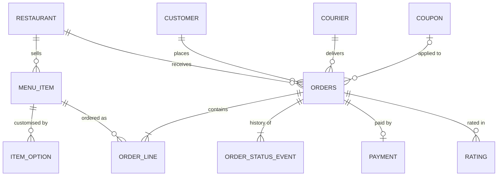


The course model (thirteen entities; restaurant–menu, order–payment and order–delivery 1:1) reaches the restaurant only through order line → menu item → menu, which cannot stop one order mixing two kitchens; `restaurant_id` on `orders` enforces "one restaurant per order" directly. Its separate 1:1 `menus` table stores nothing but a key — items can point at the restaurant instead. Its **delivery** is a 1:1 table (`deliveries.order_id UNIQUE`) with current status and courier plus a status history — the same pairing as `orders.status` + `order_status_events` here.

### Key tables

```sql
CREATE TABLE orders (
  order_id      bigint GENERATED ALWAYS AS IDENTITY PRIMARY KEY,
  customer_id   bigint NOT NULL REFERENCES customers,
  restaurant_id bigint NOT NULL REFERENCES restaurants,
  courier_id    bigint REFERENCES couriers,          -- NULL until assigned
  status        text NOT NULL,                        -- current state (denormalized)
  delivery_addr jsonb NOT NULL,                       -- snapshot of the address + coordinates
  subtotal numeric(10,2) NOT NULL, delivery_fee numeric(10,2) NOT NULL,
  placed_at     timestamptz NOT NULL DEFAULT now()
);
CREATE TABLE order_status_events (                    -- append-only history
  order_id  bigint REFERENCES orders,
  status    text NOT NULL,
  at        timestamptz NOT NULL DEFAULT now(),
  actor     text NOT NULL,                            -- 'customer', 'restaurant', 'courier', 'system'
  PRIMARY KEY (order_id, at)
);
-- order_lines (order_id, line_no, item_id, quantity, unit_price snapshot, options jsonb snapshot)
```

A **current-status column** plus an **append-only event table** is worth remembering: the column answers "what state is it in?" with no join; the events answer "when did each step happen?" (for **SLAs** — promised targets such as "delivered within 40 minutes" — disputes and delivery-time analytics).

### Key queries and indexes

1. Open restaurants within 5 km serving "pizza" — a geospatial index (PostGIS `geography` + GiST, [§16.8](../16-beyond-relational/README.md#168-time-series-and-spatial-databases)).
2. A restaurant's live queue: `WHERE restaurant_id = $1 AND status IN ('placed','accepted','preparing') ORDER BY placed_at`.
3. Nearest available courier (geo query over latest positions).
4. Average prep time per restaurant: time between the `accepted` and `picked_up` events.

Indexes: `orders (restaurant_id, status)` partial `WHERE status NOT IN ('delivered','cancelled')` keeps the live-queue index tiny; `orders (customer_id, placed_at DESC)`; GiST on restaurant location.

### Design review

A stored line subtotal and a stored `restaurants.rating` (instead of `avg()` over reviews) are the deliberate redundancies — name both. Payments carry their own amount (partial payments, refunds, tips); a review should reference an order (or anyone can review a restaurant they never ordered from); a coupon's usage limit needs an atomic count (two simultaneous checks in application code both pass); the delivery address is snapshotted (`delivery_addr jsonb`) so editing an address never moves last month's order.

### Scaling notes

Courier locations are high-frequency, short-lived writes — keep them in an in-memory store with geo support (Redis `GEOADD`/`GEOSEARCH`) and write only trip summaries to PostgreSQL. Shard orders by city/region (almost no order crosses a city). Menus are read-heavy and cacheable.

---

## 17.7 Library management system (runnable)

### Requirements

- The catalogue lists **titles** (by **ISBN**, the international book number) with one or more **authors** in a fixed order; the library owns several physical **copies** per title across **branches**.
- **Members** borrow copies (**loans**) for a fixed period, up to a maximum number of open loans.
- A copy is on at most one open loan. Late returns incur a daily **fine**.
- **Holds** on a title when no copy is free, served first-come, first-served.
- Lost or discarded copies leave the catalogue but keep their loan history.
- Questions: can a member get this title today; which of a member's loans are late; one copy's lending history; the hold queue order; a member's unpaid total.

### Entities and relationships

The cleanest **type versus instance** example: a *title* is the abstract book, a *copy* the object on the shelf. Loans point at copies; holds point at titles (you want *any* copy).

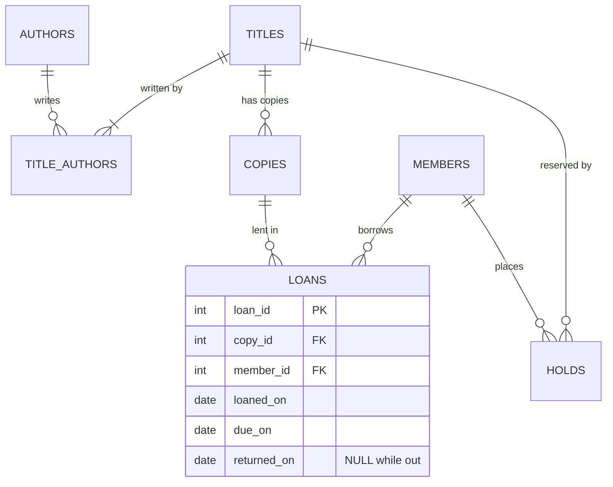

### Key tables

```sql
CREATE TABLE title_authors (                        -- M:N junction with an ordering column
  isbn char(13) REFERENCES titles, author_id int REFERENCES authors,
  position smallint NOT NULL,
  PRIMARY KEY (isbn, author_id)
);
CREATE TABLE copies (
  copy_id int PRIMARY KEY, isbn char(13) NOT NULL REFERENCES titles,
  branch text NOT NULL, condition text NOT NULL DEFAULT 'good',
  withdrawn_at date                                 -- soft delete
);
CREATE TABLE loans (
  loan_id int GENERATED ALWAYS AS IDENTITY PRIMARY KEY,
  copy_id int NOT NULL REFERENCES copies, member_id int NOT NULL REFERENCES members,
  loaned_on date NOT NULL, due_on date NOT NULL, returned_on date,
  CHECK (due_on > loaned_on),
  CHECK (returned_on IS NULL OR returned_on >= loaned_on)
);
-- At most ONE open loan per copy:
CREATE UNIQUE INDEX one_open_loan_per_copy ON loans (copy_id) WHERE returned_on IS NULL;
CREATE TABLE holds (
  isbn char(13) REFERENCES titles, member_id int REFERENCES members,
  placed_at timestamptz NOT NULL,
  PRIMARY KEY (isbn, member_id)                     -- one hold per member per title
);
```


The tell-tale FK pair: **`loans.copy_id` but `holds.isbn`** — borrow one object, reserve a title; `copy_id` plays the barcode. `fines (loan_id PRIMARY KEY REFERENCES loans, amount, paid_on)` uses the loan id as key (1:1, at most one fine per loan), and **stores** the amount although it looks derived, because a later change of the daily rate must not rewrite old fines. The course gives books a **surrogate** `book_id` (no business meaning, unlike the **natural key** ISBN) with `isbn UNIQUE` (shorter FKs; some items lack an ISBN) and a `category` table; authors are a junction table, not a comma-separated `authors` column (which breaks 1NF and makes "books by this author" a text search).

**Not stored:** a copy's "available" flag — it derives from "no open loan and not withdrawn", so it never disagrees with loans. The **partial unique index** is the star: it enforces a rule about *some* rows (open loans) that a plain `UNIQUE` can't, and doubles as the "is this copy out?" index. (PostgreSQL and SQLite have partial indexes; SQL Server *filtered* indexes; MySQL neither — use a **generated column** that is non-NULL only for open loans, with a unique index on it.)

### Key queries

Catalogue view with authors in order and live availability ([`03_library.sql`](code/03_library.sql), "today" = 2026-05-10):

```sql
SELECT t.title,
       string_agg(a.name, ', ' ORDER BY ta.position) AS authors,
       (SELECT count(*) FROM copies c
         WHERE c.isbn = t.isbn AND c.withdrawn_at IS NULL
           AND NOT EXISTS (SELECT 1 FROM loans l WHERE l.copy_id = c.copy_id AND l.returned_on IS NULL)
       ) AS available
FROM titles t JOIN title_authors ta USING (isbn) JOIN authors a USING (author_id)
GROUP BY t.isbn
ORDER BY t.title;
```

Output:

```
         title         |      authors       | available
-----------------------+--------------------+-----------
 Joins at Scale        | J. Ortiz, S. Novak |         0
 Query Plans Explained | R. Kumar           |         1
 Tables and Keys       | R. Kumar           |         1
```

(`Query Plans Explained` has two copies, one withdrawn; `Tables and Keys` two, one out.) Overdue loans and fines come from dates (`date - date` = whole days in PostgreSQL):

```
 name |      title      |   due_on   | days_late | fine
------+-----------------+------------+-----------+------
 Omar | Tables and Keys | 2026-05-04 |         6 | 1.50
```

Lending copy 101 while it's still out hits the partial unique index:

```
psql:03_library.sql:32: ERROR:  duplicate key value violates unique constraint "one_open_loan_per_copy"
DETAIL:  Key (copy_id)=(101) already exists.
```

Check-out under the member's limit is a conditional insert:

```sql
INSERT INTO loans (copy_id, member_id, loaned_on, due_on)
SELECT 102, 2, :today, date :today + 14
WHERE (SELECT count(*) FROM loans WHERE member_id = 2 AND returned_on IS NULL)
      < (SELECT max_loans FROM members WHERE member_id = 2)
RETURNING loan_id, copy_id, member_id, due_on;
```

Output: `7 | 102 | 2 | 2026-05-24`. Two concurrent check-outs by one member could both see "1 open loan" — the **write-skew** shape of [§13.8](../13-transactions-and-concurrency/README.md#138-write-skew-and-serializable-isolation) — so lock the member row first (`SELECT … FROM members WHERE member_id = 2 FOR UPDATE`) to serialize them. The hold queue is a window function, `row_number() OVER (PARTITION BY isbn ORDER BY placed_at)`: Eva 1, Omar 2 for *Joins at Scale*.

### Indexes and review

Indexes: the partial unique index; `loans (member_id) WHERE returned_on IS NULL` (current loans); `copies (isbn)`; a full-text index on titles/authors. Loans are a *history* table — a `current_member_id` on copies would answer only "who has it now". `title_authors`'s only non-key column `position` depends on the whole key (2NF); ISBN and copy id are candidate keys (BCNF). Still missing: holds that expire (`expires_at` plus a sweep job when a copy is set aside) and a `CHECK` on copy condition so a typo can't become a new status.

### Scaling notes

Small — one PostgreSQL instance serves a city's network; partition historical loans by year. The only hot spot is a popular new release with a long hold queue: handle "copy returned → offer to next hold → expire after 3 days" as a small **state machine** (fixed states with allowed transitions) in one transaction.

---

## 17.8 Ticket booking system (runnable, with seat-hold concurrency)

### Requirements

- **Venues** have **halls** with a fixed **seat** layout (row, number, tier).
- **Events** (films, concerts) run as **shows** at a hall and time; each seat of each show has a price.
- A user selects seats; they are **held** for a few minutes during payment. Success → **sold** under a **booking**; expired hold → back on sale.
- **No seat may ever be sold twice**, even with thousands clicking as sales open.
- A booking has at most one **payment**; cancelling releases its seats.
- Questions: free seats for a show, a customer's bookings, what's on in a city today, how full a show was, whether a booking is paid.

### Entities and relationships

The key table is `show_seats` — one row per seat *per show*. Physical `seats` never change; `show_seats` is the inventory users compete for, and its row lock is the unit of concurrency.

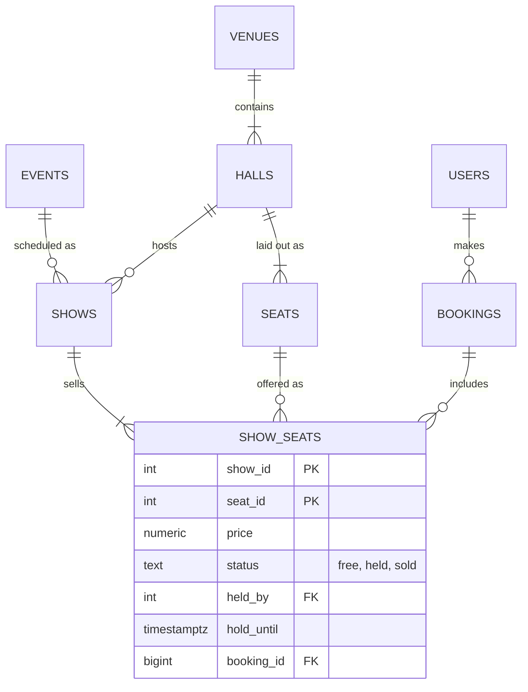

### Key tables

```sql
CREATE TABLE show_seats (
  show_id    int REFERENCES shows,
  seat_id    int REFERENCES seats,
  price      numeric(8,2) NOT NULL,
  status     text NOT NULL DEFAULT 'free' CHECK (status IN ('free', 'held', 'sold')),
  held_by    int REFERENCES users,
  hold_until timestamptz,
  booking_id bigint REFERENCES bookings,
  PRIMARY KEY (show_id, seat_id),               -- a seat appears once per show
  CONSTRAINT held_needs_owner_and_expiry
    CHECK ((status = 'held') = (hold_until IS NOT NULL AND held_by IS NOT NULL)),
  CONSTRAINT sold_needs_booking CHECK ((status = 'sold') = (booking_id IS NOT NULL))
);
CREATE INDEX ON show_seats (show_id) WHERE status = 'free';
```

The named `CHECK`s tie status to its required columns (held → owner and expiry; sold → booking; free → neither): impossible states can't be stored. Three things sound like "seat": the physical seat (row H, number 14), **the seat at one screening** (sold at 20:00, free at 18:00), and a claim on it. An `is_booked` flag on `seats` fails at a hall's second show; the **price** belongs to the seat-at-a-show pairing (weekends cost more; recliners cost more).


The course models the claim as a junction `booking_seats (screening_seat_id PRIMARY KEY, booking_id)`. The trap: a composite PK `(booking_id, screening_seat_id)` only stops *one booking* claiming a seat twice — two bookings could both claim H14. Making `screening_seat_id` the **whole** PK means a seat can be claimed once, ever. That design has no holds and must *delete* claim rows on cancellation (marking the booking cancelled would block the seat forever); the `status` column here gives the same once-only guarantee via the guarded `UPDATE` below and adds holds. The course names the table `screening` because `SHOW` is reserved in MySQL; plural `shows` is safe.

### Key queries

**Hold** seats with a *guarded* update — the `WHERE` matches only free (or expired-hold) seats, and the returned rows say exactly which seats you got ([`02_ticket_booking.sql`](code/02_ticket_booking.sql), "now" = 10:00):

```sql
UPDATE show_seats ss
SET status = 'held', held_by = 1, hold_until = timestamptz :now + interval '10 minutes'
FROM seats se
WHERE ss.seat_id = se.seat_id AND ss.show_id = 10
  AND se.row_label = 'B' AND se.seat_no IN (2, 3)
  AND (ss.status = 'free' OR (ss.status = 'held' AND ss.hold_until < :now))
RETURNING se.row_label || se.seat_no AS seat, ss.status, ss.hold_until;
```

Output — Asha gets B2 and B3; Ben's request a moment later for B3 and B4 returns only B4, so the app releases it and asks him to choose again:

```
 seat | status |       hold_until
------+--------+------------------------
 B2   | held   | 2026-05-20 10:10:00+00
 B3   | held   | 2026-05-20 10:10:00+00

 seat | held_by          <- Ben asked for B3 and B4
------+---------
 B4   |       2
```

**Confirm** after payment in one transaction — create the booking, flip only this user's *unexpired* holds to sold:

```sql
BEGIN;
INSERT INTO bookings (user_id, show_id, status, created_at)
VALUES (1, 10, 'confirmed', :now) RETURNING booking_id \gset
UPDATE show_seats
SET status = 'sold', booking_id = :booking_id, held_by = NULL, hold_until = NULL
WHERE show_id = 10 AND held_by = 1 AND status = 'held' AND hold_until >= :now
RETURNING seat_id, status, booking_id;
COMMIT;
```

The file continues with "any two free premium seats" via `FOR UPDATE SKIP LOCKED` (many buyers get *different* seats without waiting — [§13.12](../13-transactions-and-concurrency/README.md#1312-row-locks-for-work-queues-for-update-nowait-skip-locked)), an expiry sweep freeing stale holds, a failed attempt to mark a seat sold without a booking (`violates check constraint "sold_needs_booking"`), and occupancy per show with `count(*) FILTER (…)` (show 10: 2 sold of 12, revenue 400.00).

### Proof on two live sessions

[`05_seat_race.sql`](code/05_seat_race.sql) opens two real connections, A and B, with the `dblink` extension (one session running queries on another connection), and runs the same hold on seat 9 in both at the default `READ COMMITTED`:

```
--- A: holds seat 9 (C1) but has not committed yet
 seat_id | held_by
---------+---------
       9 |       1
--- B: sends the same UPDATE for user 2; it must wait for A's row lock
 b_still_running | b_waits_on
-----------------+------------
               1 | Lock
--- A commits. B wakes up, re-checks status = 'free' on the new row version, and updates nothing
 rows_b_changed
----------------
              0
--- final state of the seat: held by user 1 only
 seat_id | status | held_by
---------+--------+---------
       9 | held   |       1
```

1. A's `UPDATE` locks seat 9's row until A commits.
2. B's `UPDATE` finds the locked row and waits (`wait_event_type = Lock`).
3. On A's commit, PostgreSQL re-evaluates B's `WHERE` against the **newest** row version; `status = 'free'` is now false, so B updates zero rows.
4. The application sees 0 rows and tells user 2 "seat taken".

No `SELECT`-then-`UPDATE` (which *would* race), no application lock, no `SERIALIZABLE`. Alternatives: **optimistic locking** with a `version` column (check unchanged at write time, retry otherwise — good at low contention), or insert-to-claim with a unique constraint on a separate `seat_holds (show_id, seat_id)`.

### Indexes and remaining rules

The PK `(show_id, seat_id)` serves the seat map and every hold; the partial index on free seats serves "best available" and "how many left"; `show_seats (held_by) WHERE status = 'held'` would speed confirmation; `shows (event_id, starts_at)` serves listings. Outside these tables: a job must generate `show_seats` for every new show (300 seats × 6 shows = 1,800 rows a day per hall), and two shows mustn't overlap in one hall (an exclusion constraint on `(hall_id, tstzrange(starts_at, ends_at))` or a check in the scheduling transaction).

### Scaling notes

The problem is a **burst of contention on a few rows** (a concert's on-sale minute). The database can hold the rows but not the connections: put a **virtual waiting room / queue** in front (admitting users in batches), let only N users into seat selection at once, keep holds short. Shows are independent, so shard by `show_id` (or event); a hot show can get a dedicated shard. Cache the seat map (a second stale is fine) but never the hold.

---

## 17.9 Warehouse inventory system

### Requirements

- **Products** (SKUs) stored in several **warehouses**, each divided into **bin locations** (aisle-rack-shelf).
- **Stock on hand** per SKU per location, plus **reserved** quantity for open orders.
- Goods arrive via **purchase orders** from **suppliers** (receipts), leave via **shipments**, move between locations (**transfers**); every movement is recorded.
- **Batches/lots** (units made together, sharing an expiry date) with first-expired-first-out picking; reorder alerts below a **reorder point**.
- Each supplier has its own SKU and **lead time** (days from order to delivery) per product; purchase orders have numbered lines.
- Questions: total stock of a SKU and its bins; a bin's movements this week; the cause of a count mismatch; the quickest supplier for a SKU; open purchase-order quantities.

### Entities and relationships

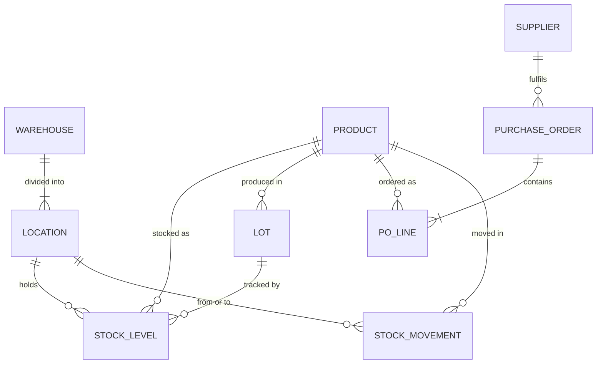

### Key tables

```sql
CREATE TABLE stock_levels (                       -- current state, one row per product-lot-location
  product_id  bigint REFERENCES products,
  location_id bigint REFERENCES locations,
  lot_id      bigint REFERENCES lots,
  on_hand     int NOT NULL CHECK (on_hand >= 0),
  reserved    int NOT NULL DEFAULT 0 CHECK (reserved BETWEEN 0 AND on_hand),
  PRIMARY KEY (product_id, location_id, lot_id)
);
CREATE TABLE stock_movements (                    -- append-only ledger of every change
  movement_id bigint GENERATED ALWAYS AS IDENTITY PRIMARY KEY,
  product_id  bigint NOT NULL REFERENCES products,
  lot_id      bigint REFERENCES lots,
  from_location bigint REFERENCES locations,      -- NULL for receipts
  to_location   bigint REFERENCES locations,      -- NULL for shipments / write-offs
  quantity    int NOT NULL CHECK (quantity > 0),
  reason      text NOT NULL CHECK (reason IN ('receipt','shipment','transfer','adjustment','return')),
  reference   text,                               -- PO number, order number ...
  moved_at    timestamptz NOT NULL DEFAULT now(),
  CHECK (from_location IS NOT NULL OR to_location IS NOT NULL)
);
```

The bank's **ledger + cached balance** design again ([§17.3](#173-banking-system)): movements are the truth, `stock_levels` the fast answer, both changed in one transaction. A periodic rebuild-and-compare catches bugs — and explains a shelf count that disagrees with the screen by replaying one product's movements in order. Two opposite reasons to store a derivable value: the library fine is kept so it **never** changes; this balance is kept because summing every movement per read is too slow.


The course variant records one row per bin with a **signed** `quantity_change` (+50 received, −3 picked) instead of from/to columns — one table for every movement type; a transfer becomes two rows. Its other tables: `product_suppliers (product_id, supplier_id, supplier_sku, lead_time_days, unit_cost)` — attributes of the *pairing*, so `supplier_name` there would be a 2NF partial dependency; and `purchase_order_lines (po_id, line_no, …)`, a **weak entity** whose key includes its parent's, with `ON DELETE CASCADE`. `unit_cost` appears on both: the agreed price now vs the price paid on that order. A movement's cause is `reference_type` + `reference_id` — a polymorphic reference no FK can check (§17.14). Whether `on_hand` may go negative is a business choice (some like negative stock as an alarm for an unrecorded delivery) — decide and document it.

### Key queries and indexes

1. Available to promise per warehouse: `sum(on_hand - reserved)` grouped by warehouse.
2. FEFO pick list: stock rows for the SKU joined to `lots`, ordered by `expires_on`, with a running `sum() OVER (ORDER BY expires_on)` until the ordered quantity is covered.
3. Reorder alerts: products whose total available is below `reorder_point`.
4. Movement history of a lot (for recalls).

Indexes: `stock_levels` PK for picks; `stock_levels (location_id)` for bin counts; `stock_movements (product_id, moved_at DESC)` and `(reference)`; `lots (product_id, expires_on)`.

### Scaling notes

Warehouses are mostly independent: shard or run one database per site with a central read model for company-wide stock. Movements grow forever — partition by month. Online-order reservations are the contention point; a reservation row per order line (with expiry, like ticket holds) is safer than decrementing a shared counter.

---

The last four cases are large consumer products. The relational core resembles the earlier designs, but **no single database fits every part**, so each ends with a "which store for which data" table ([§16.10](../16-beyond-relational/README.md#1610-choosing-a-database)). At this scale the template gains three steps before the tables:

1. **Non-functional targets** — high availability, low latency (a few hundred ms), horizontal scalability, and *where eventual consistency is acceptable* (vote and view counts) versus not (money, bookings, identity).
2. **A back-of-the-envelope storage estimate** — users × bytes per row, items per day × size. Multiply carefully (1 KB × 10 million = 10 GB, not 10 TB); usually rows are small and **media dominates** by orders of magnitude — why media goes to object storage.
3. **A high-level architecture** — clients → **load balancer** (spreads requests over servers) → **API gateway** (single entry point for routing and authentication) → a few **microservices** (small, separately deployed services: user, content, search …), each owning its data store, with a **message queue** (Kafka, RabbitMQ) for **asynchronous** work (search indexing, notifications, video processing).

After the schema come **sharding** (a key keeping each request on one shard, with consistent hashing so adding a shard moves little data) and **replication** (primary–replica with automatic failover for the relational part, leaderless replication for Cassandra-style stores, replicas in several regions) — mechanics in [Chapter 15](../15-scaling-databases/README.md).

## 17.10 Quora (questions and answers)

### Requirements

- Users ask **questions**, write **answers**, **comment** on both; questions carry **topics**.
- **Upvote/downvote** answers; answers ranked by votes and quality.
- **Follow** people, topics and questions; a personalized feed of new questions and answers.
- Full-text **search** over questions; similar-question suggestions while typing.
- Scale: hundreds of millions of monthly users, reads ≫ writes; vote counts may lag (eventual consistency fine).
- Estimate (100 M users at 2 KB; per year 10 M questions at 1 KB, 50 M answers at 2 KB, 500 M votes at 0.5 KB, 10 M media files at 500 KB): ~200 GB of user rows, then ~10 GB + 100 GB + 250 GB of text and **5 TB of media** per year — relational data fits comfortably; media and replicas drive storage.


*The course's Quora HLD: clients, load balancer, API gateway, user / question-answer / search services, a relational DB, a NoSQL store, Elasticsearch, a message queue and file storage.*

### Entities and relationships

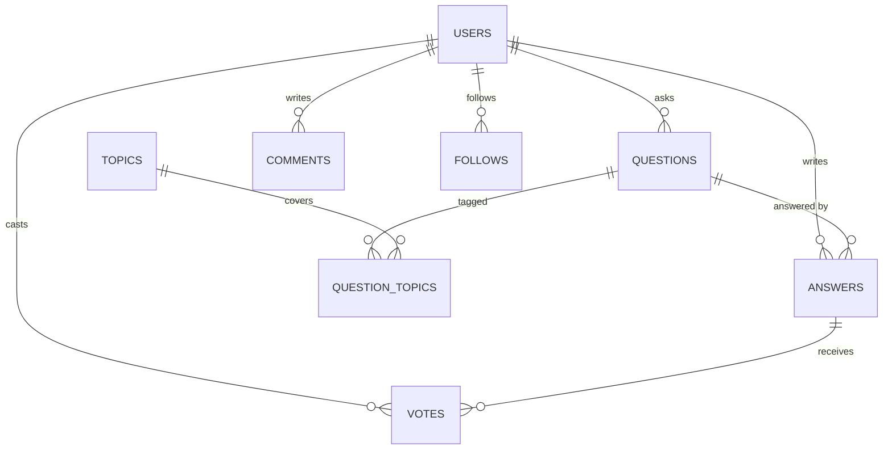

### Key tables

```sql
CREATE TABLE answers (
  answer_id   bigint PRIMARY KEY,
  question_id bigint NOT NULL REFERENCES questions,
  author_id   bigint NOT NULL REFERENCES users,
  body        text NOT NULL,
  upvotes     int NOT NULL DEFAULT 0, downvotes int NOT NULL DEFAULT 0,   -- denormalized
  created_at  timestamptz NOT NULL, updated_at timestamptz,
  UNIQUE (question_id, author_id)                 -- one answer per user per question
);
-- votes (answer_id, user_id, value CHECK (value IN (-1, 1)), PRIMARY KEY (answer_id, user_id))
CREATE TABLE comments (                           -- polymorphic target: a question OR an answer
  comment_id  bigint PRIMARY KEY,
  question_id bigint REFERENCES questions,
  answer_id   bigint REFERENCES answers,
  author_id   bigint NOT NULL REFERENCES users,
  body text NOT NULL, created_at timestamptz NOT NULL,
  CHECK (num_nonnulls(question_id, answer_id) = 1)
);
CREATE TABLE follows (                            -- polymorphic: follow a user, topic or question
  follower_id bigint REFERENCES users,
  target_type text NOT NULL CHECK (target_type IN ('user','topic','question')),
  target_id   bigint NOT NULL,                    -- no FK possible: it points at 3 tables
  PRIMARY KEY (follower_id, target_type, target_id)
);
```

The two ways to model a **polymorphic association** (one row pointing to different parent tables): `comments` uses **one nullable FK per possible parent** plus a `CHECK` that exactly one is set — FKs still work; `follows` uses a **type + id pair** — compact and extensible but without referential integrity (nothing checks topic 42 exists). Prefer the first when parent types are few and fixed.

### Key queries and indexes

1. Answers ranked: `ORDER BY upvotes - downvotes DESC, created_at` (or a stored `score` also weighing author credibility).
2. Feed: new answers in followed topics/questions/people since the last visit.
3. Voting: `INSERT … ON CONFLICT (answer_id, user_id) DO UPDATE SET value = EXCLUDED.value`, adjusting counters by the difference.

Indexes: `answers (question_id, upvotes DESC)`, `question_topics (topic_id, question_id)`, `follows (target_type, target_id)` ("who follows this topic"), full-text (`tsvector` GIN) or an external search engine.


**The document alternative.** The course stores each question as one MongoDB-style document with answers (and their comments) **embedded**, so a question page is one read; a mirrored user document carries follower counts and followed topics. Embedding is denormalization: great for "show this question", awkward for "all answers by this user" or a 10,000-answer question (MongoDB caps documents at 16 MB) — the usual compromise embeds the top answers and keeps the rest in their own collection.

**Sharding.** By `user_id`, a user's content is local but celebrities become **hot spots**; by hashed `question_id`, load spreads but a user's timeline needs **scatter-gather** across shards. Recommended mix: question data by a hash of `question_id`, user data (profiles, follows) by a hash of `user_id`, consistent hashing, and a shard-manager service mapping keys to shards.

### Which store for which data

| Data | Store |
|---|---|
| Users, questions, answers, votes | Sharded relational DB (Quora itself runs sharded MySQL — tens of terabytes and hundreds of thousands of queries per second, per its 2020 engineering blog) — or questions/answers in a document or wide-column store, as in the course design |
| Answer rankings, feed lists, counters | In-memory cache (Redis/Memcached) |
| Search and "similar question" suggestions | Search engine (Elasticsearch/OpenSearch) |
| Images in answers | Object storage + CDN |

---

## 17.11 TikTok (short-video platform)

### Requirements

- Users upload short **videos** with captions, **sounds** (music reusable across videos) and **hashtags**.
- Viewers **like**, **comment**, **share**, **follow**; view counts on every video.
- The main surface is a recommendation-driven **"For You" feed**, fed by **watch events** (what was watched, how long, skipped, replayed).
- Real-time **notifications**; **trending** videos and hashtags; **categories** (dance, comedy).
- Scale: billions of views per day; view/watch events vastly outnumber everything else.
- Estimate (1 B daily users each uploading 2 videos of 50 MB): **100 PB of video a day**, against ~4 TB of metadata (2 B videos × 2 KB) and ~2 TB of comments (2 B × 1 KB). Video outweighs the rest by more than 10,000 to 1, so it lives in object storage with **lifecycle rules** (policies moving old files to cheaper storage or deleting them), never in a database.

### Entities and relationships

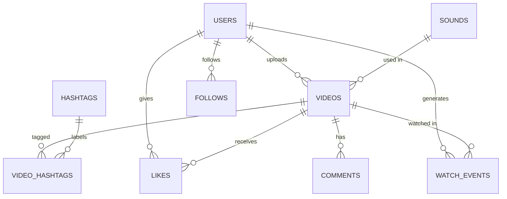

### Key tables

```sql
CREATE TABLE videos (
  video_id    bigint PRIMARY KEY,                 -- time-ordered id (Snowflake-style)
  creator_id  bigint NOT NULL REFERENCES users,
  sound_id    bigint REFERENCES sounds,
  caption     text,
  storage_key text NOT NULL,                      -- original upload in object storage
  duration_ms int NOT NULL,
  status      text NOT NULL CHECK (status IN ('processing','public','private','removed')),
  created_at  timestamptz NOT NULL
);
-- video_renditions (video_id, resolution, bitrate_kbps, storage_key): transcoded copies
CREATE TABLE video_stats (                        -- hot counters kept apart from the video row
  video_id bigint PRIMARY KEY REFERENCES videos,
  views bigint NOT NULL DEFAULT 0, likes bigint NOT NULL DEFAULT 0,
  comments bigint NOT NULL DEFAULT 0, shares bigint NOT NULL DEFAULT 0
);
```


The course puts high-volume tables in **Cassandra**, modeled around the query rather than the entity. A correct CQL sketch (Cassandra has no `ENUM`; **counter** columns — increment/decrement only — need a table of their own; a `timeuuid` is a unique id embedding a timestamp):

```sql
-- CQL (Cassandra) — not run
CREATE TABLE interactions_by_video (
  video_id uuid, created_at timeuuid, user_id bigint,
  kind text,                      -- 'like' | 'comment' | 'share'
  comment_text text, parent_id timeuuid,
  PRIMARY KEY ((video_id), created_at)          -- partition key, then clustering column
) WITH CLUSTERING ORDER BY (created_at DESC);
CREATE TABLE video_counters (
  video_id uuid PRIMARY KEY, views counter, likes counter, comments counter, shares counter
);
CREATE TABLE user_activity (
  user_id bigint, activity_time timestamp, activity_type text, details text,
  PRIMARY KEY ((user_id), activity_time)
) WITH CLUSTERING ORDER BY (activity_time DESC);
```

Relational tables keep what needs strong consistency (accounts, follows, categories); Cassandra keeps what needs write throughput and tolerates eventual consistency. `video_renditions` holds **transcoded** copies (re-encoded at several resolutions and bitrates for different devices). Splitting `video_stats` from `videos` is a **vertical partition** ([§15.2](../15-scaling-databases/README.md#152-partitioning)): counters change constantly, metadata almost never, so metadata rows and their cache entries stay stable. Watch events aren't a primary-database table at all but an **event stream** (an append-only ordered flow, e.g. Kafka) consumed by other systems.

### Key queries and indexes

1. Profile grid: `videos WHERE creator_id = $1 AND status = 'public' ORDER BY video_id DESC` (time-ordered ids sort by upload time).
2. Videos using a sound ("use this sound" page).
3. Trending hashtags in the last hour — computed by a **stream processor**, not SQL over billions of rows.
4. For You feed — candidates generated and ranked by a recommendation service; the database only fetches metadata for chosen ids.

Indexes: `videos (creator_id, video_id DESC)`, `videos (sound_id)`, `video_hashtags (hashtag_id, video_id)`, `likes (video_id, user_id)` PK plus `likes (user_id, created_at)` for "videos I liked".

### Which store for which data

| Data | Store |
|---|---|
| Users, video metadata, follows | Sharded relational or distributed SQL |
| Video files and renditions | Object storage + CDN (edge caches near viewers) |
| Views, watch time, skips | Event log (Kafka) → stream processing → analytics warehouse / wide-column store |
| Counters | In-memory counters, flushed periodically; displayed counts may lag a little |
| Recommendation features, embeddings (number vectors placing similar items close together) | Feature store (a database of precomputed model inputs) + vector index (finds nearest embeddings; FAISS library, Milvus) fed by training pipelines |
| Notifications, processing jobs | Message queue → notification and transcoding workers |

---

## 17.12 Airbnb (short-term rentals)

### Requirements

- **Hosts** publish **listings** (address, geo-location, capacity, amenities, photos, house rules) with a **calendar** of availability and nightly prices.
- **Guests** search by location, dates and guest count, filter by price and amenities, then **book** (instant or on host approval).
- No listing booked twice for overlapping nights.
- **Payments** via an external **payment gateway** (charge the guest, pay out the host later, refunds, deposits), **reviews** in both directions after a stay, guest–host **messaging**; hosts accept or decline requests.
- Estimate (per day: 1 M listings created/updated at ~5 KB with 10 photos of ~1 MB; 10 M reservations and 10 M payments at 1 KB; 5 M reviews at 0.5 KB): photos ≈ **10 TB/day**, reservations + payments + reviews only ≈ 22 GB/day — the transactional core fits a relational cluster.

### Entities and relationships

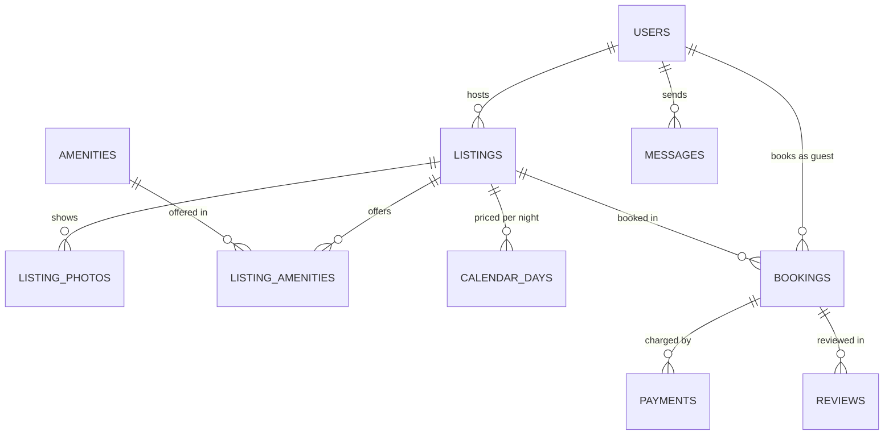

A user can be both **host** and **guest**: one `users` table with two roles, not two tables.

### Key tables

```sql
-- needs the PostGIS extension for geography (not run here)
CREATE TABLE listings (
  listing_id bigint PRIMARY KEY,
  host_id    bigint NOT NULL REFERENCES users,
  title      text NOT NULL,
  location   geography(Point, 4326) NOT NULL,     -- PostGIS; lat/long for radius search
  max_guests smallint NOT NULL,
  base_price numeric(10,2) NOT NULL,
  status     text NOT NULL CHECK (status IN ('draft','active','snoozed','deleted'))
);
CREATE TABLE calendar_days (                      -- per-night availability and price overrides
  listing_id bigint REFERENCES listings,
  night      date,
  price      numeric(10,2),                        -- NULL = base price
  blocked    boolean NOT NULL DEFAULT false,       -- host blocked it
  PRIMARY KEY (listing_id, night)
);
CREATE TABLE bookings (
  booking_id bigint PRIMARY KEY,
  listing_id bigint NOT NULL REFERENCES listings,
  guest_id   bigint NOT NULL REFERENCES users,
  stay       daterange NOT NULL,
  guests     smallint NOT NULL,
  total      numeric(12,2) NOT NULL,
  status     text NOT NULL CHECK (status IN ('requested','confirmed','cancelled','completed')),
  EXCLUDE USING gist (listing_id WITH =, stay WITH &&) WHERE (status IN ('requested','confirmed'))
);
-- reviews (booking_id, author_role 'guest' | 'host', rating, body,
--          PRIMARY KEY (booking_id, author_role))  -> each side reviews once per stay
```


The course splits the work into **user, listing, booking and payment services**: users, listings, reservations and payments relational (atomic booking and money); reviews, activity logs and `property_images (listing_id, image_id, url)` — partitioned by `listing_id` so one read returns a listing's photos — in Cassandra; photo bytes in object storage. Its `users.role` column (host or guest) works only if nobody is both; `listings.host_id` is the more flexible way to express "host". The exclusion constraint on `(listing_id, stay)` is the hospital-appointment tool again; unlike a hotel, each listing is a single unit, so no inventory counter is needed.

### Key queries and indexes

1. Search: active listings within 10 km (`ST_DWithin(location, $point, 10000)`) with enough capacity, **no** overlapping active booking and no blocked night in range, plus price filtering.
2. Book: insert; the exclusion constraint rejects a conflicting stay, even under concurrency.
3. Host dashboard: upcoming bookings per listing; payouts due.
4. Listing rating: `avg(rating)` of guest reviews, usually cached on the listing.

Indexes: GiST on `listings.location`; the exclusion constraint's GiST on `(listing_id, stay)`; `bookings (guest_id, lower(stay))` for "my trips"; `calendar_days` PK.

### Which store for which data

| Data | Store |
|---|---|
| Users, listings, bookings, payments | Relational (strong consistency for bookings and money) |
| Search with geo + filters + ranking | Search engine fed by change-data-capture from the DB |
| Photos | Object storage + CDN |
| Messages | Relational or wide-column, partitioned by conversation |
| Pricing suggestions, analytics | Data warehouse (replicated nodes plus regular backups) |

Replication: a primary with read replicas in several regions and automatic failover for the relational core; multi-node eventually consistent replication for Cassandra.

---

## 17.13 Snapchat (ephemeral messaging)

### Requirements

- Users add **friends** (mutual, request/accept), send **snaps** (photo/video) to one or more friends, and **chat**.
- A snap **disappears** after every recipient opened it, or after a maximum time (e.g. 30 days unopened); a **story** is visible to friends for 24 hours.
- Senders see delivery and "opened" status per recipient; screenshots are reported.
- **Filters/lenses** on snaps and stories; users **searched** by name.
- Scale: billions of snaps a day; almost all data short-lived.
- Estimate (500 M daily users, 10 snaps each — 80 % photos of 1 MB, 20 % videos of 5 MB — plus one 10 MB story each): 4 PB + 5 PB of snaps and 5 PB of stories, **~14 PB of new media a day**. Since snaps vanish on viewing and stories after 24 hours, what is *held* stays bounded — deletion is as important a workload as writing.

### Entities and relationships

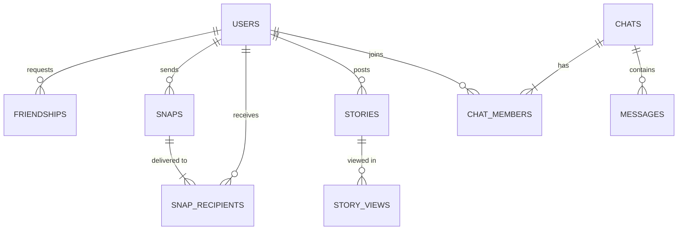

### Key tables

```sql
CREATE TABLE friendships (                        -- one row per pair, stored in canonical order
  user_low   bigint REFERENCES users,
  user_high  bigint REFERENCES users,
  status     text NOT NULL CHECK (status IN ('pending','accepted','blocked')),
  requested_by bigint NOT NULL,
  PRIMARY KEY (user_low, user_high),
  CHECK (user_low < user_high)
);
CREATE TABLE snaps (
  snap_id    bigint PRIMARY KEY,
  sender_id  bigint NOT NULL REFERENCES users,
  media_key  text NOT NULL,                        -- encrypted blob in object storage
  created_at timestamptz NOT NULL,
  expires_at timestamptz NOT NULL                  -- hard deadline even if never opened
);
CREATE TABLE snap_recipients (
  snap_id      bigint REFERENCES snaps ON DELETE CASCADE,
  recipient_id bigint REFERENCES users,
  delivered_at timestamptz, opened_at timestamptz, screenshot_at timestamptz,
  PRIMARY KEY (recipient_id, snap_id)              -- "my inbox" is a PK range scan
);
-- stories (story_id, user_id, media_key, created_at, expires_at = created_at + 24 h, set on insert)
```

(`expires_at` can't be `GENERATED … STORED`: `timestamptz + interval` depends on the session time zone, so PostgreSQL rejects it as not **immutable** — a generated column's expression must always give the same output for the same input.)


The course's Cassandra `snaps` table is keyed by `snap_id` with a secondary index on the receiver; Cassandra works best when the **partition key is what you query by**, so an inbox partitioned by recipient (as `snap_recipients` does relationally) avoids the secondary index. Elasticsearch holds a user index for "find friends", sharded by the configured number of primary shards. The **canonical pair** trick (`user_low < user_high`) stores a symmetric relationship once, so "are A and B friends?" is one lookup on `(least(a,b), greatest(a,b))` — unlike Instagram's directional `follows`, one row per direction.

### Key queries and indexes

1. Inbox: unopened snaps for a recipient, newest first.
2. Open a snap: set `opened_at`; when every recipient row has it, delete the media and the snap.
3. Friends' stories: stories of accepted friends where `expires_at > now()`.
4. Expiry sweep: delete snaps and stories past `expires_at`, in batches.

Indexes: `snap_recipients` PK `(recipient_id, snap_id)`, `snaps (expires_at)` for the sweeper, `stories (user_id, created_at DESC)`, `friendships (user_high)` for the reverse lookup.

### Scaling notes and stores

**Ephemeral** data suits row-by-row `DELETE` poorly at this volume (dead tuples, vacuum work, index bloat — [§13.14](../13-transactions-and-concurrency/README.md#1314-multiversion-concurrency-control-mvcc)). Better: **time partitions** (partition `snaps` by day and `DROP` whole partitions — instant and bloat-free, [§15.2](../15-scaling-databases/README.md#152-partitioning)) or a store with native **TTL** (Cassandra/ScyllaDB, DynamoDB) where rows expire by themselves. Snap's 2017 IPO filing disclosed five-year cloud commitments of $2 billion with Google Cloud and $1 billion with AWS — at this scale managed cloud databases are the usual choice over self-run servers.

| Data | Store |
|---|---|
| Accounts, friend graph | Relational or key-value, sharded by user |
| Snaps, recipients, chat messages | Wide-column / key-value with TTL, partitioned by recipient or chat |
| Media | Encrypted object storage + CDN, lifecycle rules delete it |
| Presence ("online now"), typing indicators | In-memory store |
| User search | Search engine index |

Partitioning at three levels: **horizontal** (rows by `user_id` or `snap_id` — users by range or consistent hashing, keeping friend lookups on one shard; Cassandra hashes partition keys itself), **vertical** (user data and media in separate stores), **functional** (each microservice — user, media, messaging, search — owns its data).

---

## 17.14 Recurring modeling patterns

Across the thirteen cases the same few patterns did most of the work — the chapter in one page:

| Pattern | What it is | Seen in | Use it when | Watch out for |
|---|---|---|---|---|
| **Junction table** | A table whose PK is two FKs, resolving an M:N relationship, often with its own attributes | `order_items`, `likes`, `title_authors`, `post_hashtags`, `reservation_rooms` | Any M:N relationship; the PK doubles as the uniqueness rule ("like once") | Add an index on the *second* column for the reverse lookup |
| **Type vs instance** | Separate the kind of thing from the physical thing | `titles`/`copies`, `room_types`/`rooms`, `seats`/`show_seats` | Users choose a kind but you track individual items | Forgetting it forces one table to do two jobs |
| **Status enum + state history** | A constrained `status` column for the current state; optionally an append-only table of transitions | orders, bookings, reservations, food-delivery events | Every entity with a life cycle | Enforce allowed values (`ENUM`, `CHECK`, or lookup table); `CHECK`s can tie a status to required columns (ticket seats) |
| **Soft delete** | A `deleted_at` / `withdrawn_at` column instead of `DELETE` | products, library copies, listings | History or FKs must survive removal | Every query must filter it — use partial indexes and views; unique constraints need `WHERE deleted_at IS NULL`; privacy laws may still require a hard delete |
| **Audit columns / ledger** | `created_at`, `updated_at`, `created_by`; or a full append-only ledger of changes | hospital records, bank ledger, stock movements | Legal, financial or medical data; debugging "who changed this?" | Maintain with defaults/triggers, not by hand; ledgers need a cached balance for speed and a reconciliation query |
| **Polymorphic association** | One row points to one of several parent types | Quora comments (nullable FKs + `CHECK`), follows (`target_type` + `target_id`) | A comment/like/follow can target several entity kinds | The type+id form loses foreign keys; prefer one nullable FK per parent, or a shared supertype table |
| **Denormalized counter / copy** | Store a derived value (count, total, current status) to avoid recomputing | `like_count`, `orders.total`, `room_inventory`, `answers.upvotes`, `video_stats` | A measured hot read | Update it in the same transaction (or trigger), add a reconciliation check, and beware lock contention on hot rows |
| **Snapshot of volatile data** | Copy a value that may later change | `unit_price`, delivery address, `nightly_price` | The fact is "what it was at the time" | It is not a normalization bug — document it as intentional |
| **Self-reference** | A FK to the same table | category tree, comment replies, `follows` | Hierarchies and graphs | Query with recursive CTEs; guard against cycles |
| **Overlap prevention** | Exclusion constraint on a range, or partial unique index on "open" rows | appointments, Airbnb stays, hotel rooms, open library loans | "No two X at the same time" | PostgreSQL-specific; elsewhere lock and check in a transaction |
| **Guarded update / claim** | `UPDATE … WHERE state = 'free' RETURNING …` | seat holds, stock decrement | Many users compete for the same item | Check the returned row count; hold short; `SKIP LOCKED` for "any available" |
| **Time partitioning / TTL** | Split big tables by time; drop old partitions or let rows expire | ledgers, movements, snaps, stories | Append-heavy data with a retention rule | Queries should include the partition key in `WHERE` |

### Judgement calls — cover the answer, say it aloud

1. *`order_items.unit_price` duplicates `products.price` — a 3NF violation?* → No: price paid on that order and today's list price are different facts.
2. *Why no stored `is_available` flag on copies or seats?* → Availability is derived from loans / seat status; a second copy of the truth drifts.
3. *A foreign key that should be 1:1 — what else does it need?* → `UNIQUE` (or make it the primary key); otherwise it is 1:N.
4. *Where does the agreed rate, a seat's price, or a medicine's dose go?* → On the junction row: it describes the pairing, not either side.
5. *Hotel search counts per night; Airbnb uses an exclusion constraint. Why?* → A room type has many interchangeable units; a listing is one unit.
6. *When is `target_type + target_id` acceptable?* → When target kinds change often and you accept checking integrity outside the database.
7. *The one-sentence recipe for "no double booking"?* → Make the conflicting state impossible to store (unique / exclusion / check constraint) and claim the item with one guarded statement in a short transaction.

---

## Chapter 17 TL;DR

- Use one template every time: **requirements & questions → entities, cardinality & participation → ER diagram → tables & constraints → key queries → indexes → design review → scaling** (the review checks normal forms, names deliberate redundancy, and lists what the design cannot do).
- Put business rules **in the schema** where possible: `CHECK` for ranges and state/column consistency, partial unique indexes for "one open X", exclusion constraints for "no overlapping X", unique keys for "once per user".
- Separate **type from instance** (titles/copies, room types/rooms, seats/show seats) and **current state from history** (status column + events or ledger).
- **Snapshot** values that must not change later (prices paid, addresses shipped to); **soft-delete** rows that history still references.
- Denormalize **deliberately** (counters, totals, inventory per night) — update in the same transaction and keep a reconciliation query.
- Concurrency for scarce items: a **guarded `UPDATE … WHERE status = 'free'`** in a short transaction is enough — demonstrated on two live sessions; `SKIP LOCKED` for "any available".
- At scale, the relational core stays for money, bookings and identity; media goes to object storage + CDN, feeds and counters to caches, events to logs, search to a search engine, and short-lived data to TTL stores or dropped time partitions.

Next: [Chapter 18 — SQL interview problems, part 1](../18-sql-interview-problems-1/README.md), which practises the query skills from Chapters 2–8 on interview-style problems.
