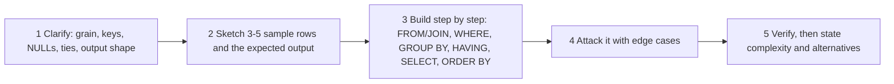
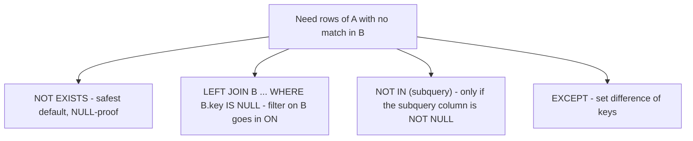

# Chapter 18 — SQL Interview Problems I: Method and 42 Warm-Up to Medium Problems

Chapters 2–8 taught the tools one at a time. Interviews mix them. You get a short business question and a schema, and you have to decide what to filter, what to group, what to join and what could go wrong, then say it all out loud while you type. This chapter covers the method first and then works through 42 practice problems (easy up to lower-medium). They are grouped by the **pattern** they train, so you learn to spot the pattern rather than memorise answers.

**What you'll learn**

| # | Section | Patterns |
|---|---|---|
| 18.1 | How to approach a SQL interview question | clarify → sample → build → edge cases → verify |
| 18.2 | Filtering (P1–P8) | `WHERE`, `AND`/`OR`, `%`, `IS DISTINCT FROM`, `char_length`, regex, row-level `CASE` |
| 18.3 | Aggregation (P9–P16) | `GROUP BY`, `HAVING`, `MIN`/`MAX`/`COUNT`, `string_agg` |
| 18.4 | Joins (P17–P22) | inner, self, cross + left, "top 1 with ties" |
| 18.5 | Anti-joins (P23–P26) | `NOT EXISTS`, `LEFT JOIN … IS NULL`, the `NOT IN` + NULL trap |
| 18.6 | Conditional aggregation (P27–P28) | `FILTER`, `SUM(CASE …)`, `UNION ALL` then pivot |
| 18.7 | Date logic (P29–P33) | half-open month ranges, date arithmetic, gaps and islands, "value as of a date" |
| 18.8 | Ratios and percentages (P34–P38) | integer division, `NULLIF`, weighted averages, retention |
| 18.9 | Window and ranking basics (P39–P42) | second highest, first row per group, running total, compare to group average |
| 18.10 | Pattern table | every problem → pattern → key SQL feature |

The harder problems (Nth highest, top-N per group, streaks, pivots, trips and users) are in [Chapter 19](../19-sql-interview-problems-2/README.md).

**How to run the examples.** Every problem has its own file in [`code/`](code/). Each file creates its own small tables, fills them with invented data, and runs the solution plus an edge case or alternative. The runner gives each file a fresh PostgreSQL 14 database. The output under each query is real `psql` output, and `(null)` is how we display `NULL`.

```bash
bash tools_run_sql.sh sql '18-*'                     # all 42 files, fresh DB each
bash tools_pg.sh psql -d postgres -c 'CREATE DATABASE scratch'
bash tools_pg.sh psql -d scratch -f sql/chapters/18-sql-interview-problems-1/code/26_reps_without_red.sql
```

Every problem statement, dataset and explanation below is written for this book. The problems are classic interview-style exercises; many also appear on public practice sites under similar names.

---

## 18.1 How to approach a SQL interview question

### What it is

A repeatable routine for turning a vague question ("which sellers were idle last year?") into a correct query while the interviewer watches. Think of it as a pilot's checklist: the steps are dull, but they catch the mistakes that nerves cause.

### Why it matters

Most wrong answers in SQL interviews come from **misreading the question** or **missing an edge case**, not from syntax: counting rows instead of distinct users, losing people with zero activity, integer division turning 0.67 into 0, `NOT IN` silently returning nothing. Interviewers also score your *process*: do you ask questions, test your idea on a few rows, and explain your trade-offs?

### How it works — the five steps



1. **Clarify.** Repeat the question in your own words, then ask:
   - What is one **row** of each table (the *grain*)? What is the **primary key**? Can there be **duplicate rows**?
   - Which columns can be **NULL**? What should happen to rows with NULLs?
   - Should entities with **no activity** appear (with 0) or be left out?
   - How should **ties** be handled: return all of them, or any one?
   - Output: which columns, what names, what **order**, how much **rounding**?
   - Are dates **inclusive**? Which time zone? Is "consecutive" by calendar day or by record?
2. **Sketch sample data.** Write 3–5 rows, including one awkward row (a NULL, a duplicate, a tie), plus the output you expect. This settles misunderstandings before you write code.
3. **Build in the logical order.** Write the query in the order the database evaluates it (see [Chapter 4, logical query order](../04-aggregation/README.md)): `FROM`/`JOIN` → `WHERE` → `GROUP BY` → `HAVING` → `SELECT` → `ORDER BY` → `LIMIT`. Use CTEs (`WITH step1 AS (…)`) so each step can be checked on its own ([Chapter 7](../07-ctes-views-and-recursion/README.md)).
4. **Attack it with edge cases**, using the checklist below.
5. **Verify and discuss.** Run the query against your sample in your head (or for real). Then mention what index would help and give one alternative formulation.

### The edge-case checklist

| Risk | Typical symptom | Usual fix |
|---|---|---|
| NULL in a comparison | rows vanish from `<>`, `NOT IN` returns nothing | `IS DISTINCT FROM`, `NOT EXISTS`, `COALESCE` |
| Entities with no rows | people with zero orders missing | `LEFT JOIN` from the entity table, `count(col)` not `count(*)` |
| Duplicates | counts too high, repeated ids | `DISTINCT`, `count(DISTINCT …)`, check the join's grain |
| Join fan-out | sums doubled after joining two child tables | aggregate before joining, or `count(DISTINCT)` |
| Ties | "the winner" is really two people | `RANK`/`DENSE_RANK`, `FETCH FIRST … WITH TIES` |
| Integer division | `1/3 = 0` | multiply by `100.0` or cast to `numeric` first |
| Division by zero | runtime error | `NULLIF(denominator, 0)` |
| Empty result vs NULL | "return NULL if none" gives zero rows | wrap in an aggregate or a scalar subquery |
| Date boundaries | last day of the month (or 29 Feb) lost | half-open ranges: `>= start AND < next_start` |

### Common mistakes

- Starting to type before knowing the grain of each table.
- `SELECT`ing a column that is neither grouped nor aggregated (PostgreSQL rejects it; MySQL with `ONLY_FULL_GROUP_BY` off returns an arbitrary value).
- Filtering the right-hand table of a `LEFT JOIN` in `WHERE`, which turns it back into an inner join ([Chapter 5](../05-joins/README.md)).
- Leaving `ORDER BY` out when the question asks for an order. Without it, SQL guarantees **no** order.

### In the interview

**30-second answer to "how do you approach a SQL problem?"** "I first pin down the grain and keys of each table, what NULLs and duplicates mean, and whether zero-activity rows and ties should appear. I sketch a few rows with the expected output, then build the query in evaluation order (joins, filters, grouping, having, select, sort) using CTEs so I can check each step. Finally I test NULLs, duplicates, ties, empty groups and date boundaries, and mention an index or an alternative."

- *"Your query returns nothing for a new customer — is that right?"* It depends on the spec. If they should appear with 0, start from the customer table with a `LEFT JOIN` and `COALESCE` the aggregate.
- *"Would this be fast on 100 M rows?"* Talk about the filter/join columns and a matching index, sargable predicates (no function on the indexed column), and pre-aggregation. See [Chapter 12](../12-indexes-storage-and-query-performance/README.md).

### Self-check

1. Why ask about the grain first? → It tells you what one row means, so you know whether to count rows or distinct ids, and whether a join can multiply rows.
2. What's wrong with `WHERE year(d) = 2020`? → It works, but wrapping the column in a function prevents an ordinary index on `d` from being used. Use `d >= '2020-01-01' AND d < '2021-01-01'`.
3. `count(*)` vs `count(col)` after a `LEFT JOIN`? → `count(*)` counts the NULL-padded row as 1; `count(col)` counts it as 0.

### TL;DR

Clarify (grain, NULLs, zeros, ties, output), sketch sample rows, build in evaluation order with CTEs, attack with the edge-case checklist, then verify and discuss performance.

---

## 18.2 Filtering problems (P1–P8)

The simplest pattern: keep or drop **individual rows** with `WHERE`. The traps are `NULL` (three-valued logic), boundaries (`>` vs `>=`) and string rules. Background: [Chapter 2](../02-select-basics/README.md) and [Chapter 3](../03-functions-and-expressions/README.md).

### P1 · Big cities — `OR` filter

**Problem.** A `city` table stores name, country, area in km² and population. List the cities that are *either* larger than 3,000 km² *or* home to more than 5 million people.

**Data** ([`01_big_cities.sql`](code/01_big_cities.sql)): six invented towns. Coralbay sits exactly on both limits (3000 km², 5,000,000). Eastvale and Fernhill have an unknown (NULL) area.

```sql
SELECT name FROM city
WHERE area_km2 > 3000 OR population > 5000000
ORDER BY name;
```

Output:
```
   name    
-----------
 Aldport
 Brimstead
 Eastvale
(3 rows)
```

**Why it works.** Each row is tested on its own. Coralbay fails because "more than" is strict. Eastvale's area test gives `UNKNOWN`, but `UNKNOWN OR TRUE` is `TRUE`, so its population is enough. Fernhill gives `UNKNOWN OR FALSE` = `UNKNOWN`, and `WHERE` keeps only `TRUE`.

**Alternative.** `SELECT … WHERE area_km2 > 3000 UNION SELECT … WHERE population > 5000000` returns the same set. On some engines (notably older MySQL) this lets each branch use its own index. PostgreSQL can instead combine two indexes with a *BitmapOr* for the plain `OR`.

### P2 · Odd-numbered, not-boring movies — modulo and `<>`

**Problem.** From `movie(id, title, description, rating)`, return movies whose id is odd and whose description isn't `'boring'`, highest rating first.

**Data** ([`02_odd_movies.sql`](code/02_odd_movies.sql)): ids 1–5 and 7, one of them described as boring, one with a NULL description, plus id −3.

```sql
SELECT * FROM movie
WHERE id % 2 = 1 AND description <> 'boring'
ORDER BY rating DESC;
```

Output:
```
 id |    title    | description | rating 
----+-------------+-------------+--------
  5 | Deep Blue   | documentary |   8.90
  1 | Night Train | thriller    |   8.10
(2 rows)
```

**Why it works.** `%` is the remainder. Odd ids leave remainder 1. The `<>` drops the boring one.

**Edge cases.** Two rows went missing silently. In PostgreSQL, `-3 % 2` is `-1` (the result takes the sign of the dividend), so `= 1` misses negative odd ids. And `NULL <> 'boring'` is `UNKNOWN`. If an unknown description should count as "not boring", say so explicitly:

```sql
SELECT * FROM movie
WHERE id % 2 <> 0 AND description IS DISTINCT FROM 'boring'
ORDER BY rating DESC;
```
```
 id |    title    | description | rating 
----+-------------+-------------+--------
  5 | Deep Blue   | documentary |   8.90
  1 | Night Train | thriller    |   8.10
 -3 | Rewind      | comedy      |   6.00
  7 | Untitled    | (null)      |   5.00
(4 rows)
```

MySQL has `MOD(id, 2)` as well as `%`. Its NULL-safe equality is `<=>`, so "is distinct from" is written `NOT (a <=> b)`.

### P3 · Green products — `AND` on flag columns

**Problem.** `inventory(product_id, organic, compostable)` holds `'Y'`/`'N'` flags. Return the products that have both flags set.

```sql
SELECT product_id FROM inventory
WHERE organic = 'Y' AND compostable = 'Y'
ORDER BY product_id;
```
```
 product_id 
------------
         10
         13
(2 rows)
```

**Why it works.** Both conditions must be `TRUE` for the same row.

**Edge case / design note.** Flags stored as text invite dirty values such as `'y'` or `' Y'`. The file puts a `CHECK (organic IN ('Y','N'))` on each column, and inserting `'y'` fails with *violates check constraint "inventory_organic_check"*. In PostgreSQL a `boolean NOT NULL` column is cleaner still: `WHERE organic AND compostable`. MySQL's source table often uses `ENUM('Y','N')`.

### P4 · Everyone outside department 3 — NULL-safe "not equal"

**Problem.** From `staff(id, name, dept_id)`, list people who are not in department 3. One person has no department yet.

```sql
SELECT name FROM staff WHERE dept_id <> 3 ORDER BY name;               -- naive
```
```
 name 
------
 Ana
 Chen
(2 rows)
```
```sql
SELECT name FROM staff WHERE dept_id IS DISTINCT FROM 3 ORDER BY name; -- NULL-safe
```
```
 name 
------
 Ana
 Chen
 Dara
(3 rows)
```

**Why it matters.** `NULL <> 3` is `UNKNOWN`, so Dara disappears from the naive version. Whether Dara *should* appear is a clarifying question. Most people would say "not in department 3" includes "in no department". `IS DISTINCT FROM` treats NULL as an ordinary comparable value. The portable spelling is `dept_id <> 3 OR dept_id IS NULL`.

### P5 · Self-assigned tasks — comparing two columns, removing duplicates

**Problem.** `task_log(task_id, assigner_id, assignee_id, done_on)` may contain duplicate rows. Return, in ascending order, each person who completed at least one task they had given to themselves.

```sql
SELECT DISTINCT assigner_id AS employee_id
FROM task_log
WHERE assigner_id = assignee_id
ORDER BY employee_id;
```
```
 employee_id 
-------------
           7
           9
(2 rows)
```

**Why it works.** The `WHERE` compares two columns of the same row. `DISTINCT` collapses repeats: without it the output is `7, 7, 9, 9` (one duplicate row for person 7, and two self-assigned tasks for person 9). `GROUP BY assigner_id` gives the same result. "At least one" nearly always means you need `DISTINCT`, `GROUP BY` or `EXISTS`.

### P6 · Long comments — length in characters

**Problem.** `comment(id, body)`: return ids of comments longer than 100 characters (spaces and punctuation count).

```sql
SELECT id FROM comment WHERE char_length(body) > 100 ORDER BY id;
```
```
 id 
----
  2
(1 row)
```

**Why it works / edge cases.** Comment 3 is exactly 100 characters, so it is not "more than" 100. Comment 4 is 60 copies of `é`: 60 **characters** but 120 **bytes** in UTF-8.

```sql
SELECT id, char_length(body) AS chars, octet_length(body) AS bytes FROM comment ORDER BY id;
```
```
 id | chars | bytes 
----+-------+-------
  1 |    10 |    10
  2 |   102 |   102
  3 |   100 |   100
  4 |    60 |   120
(4 rows)
```

| Engine | Characters | Bytes |
|---|---|---|
| PostgreSQL | `char_length(s)`, `length(s)` | `octet_length(s)` |
| MySQL | `CHAR_LENGTH(s)` | `LENGTH(s)` (a classic trap) |
| SQL Server | `LEN(s)` (ignores trailing spaces) | `DATALENGTH(s)` |
| SQLite | `length(s)` | `length(CAST(s AS BLOB))` |

### P7 · Valid company e-mails — regular expressions

**Problem.** `employee(id, name, email)`. An address is valid when the part before `@` starts with a letter and continues with letters, digits, `_`, `.` or `-`, and the domain is exactly `northwind.dev`. Return the valid rows.

**Data** ([`07_valid_emails.sql`](code/07_valid_emails.sql)): eight addresses. They include one starting with `_`, one starting with a digit, `northwindXdev`, `northwind.dev.evil.com`, an upper-case domain and one containing `#`.

```sql
SELECT id, name, email FROM employee
WHERE email ~ '^[A-Za-z][A-Za-z0-9_.-]*@northwind\.dev$'
ORDER BY id;
```
```
 id | name |        email        
----+------+---------------------
  1 | Ana  | ana.k@northwind.dev
  5 | Eve  | Eve-2@northwind.dev
(2 rows)
```

**Why it works.** `^` and `$` anchor the pattern to the whole string. `[A-Za-z]` forces a letter first, and the class after it allows the other characters (inside `[...]` a `.` is literal, and a `-` placed last is literal). `\.` is a literal dot.

**Edge cases.** Remove the anchors and the backslash, and six rows match. That includes `dee@northwindXdev`, because an unescaped `.` matches any character, and `fay@northwind.dev.evil.com`, because the end is not anchored. `~` is case-sensitive, so `gus@NORTHWIND.DEV` fails. Use `~*` if the domain should be case-insensitive (it then matches ids 1, 5, 7). Dialects: MySQL `REGEXP` / `REGEXP_LIKE()`, Oracle `REGEXP_LIKE()`. SQL Server gained `REGEXP_LIKE()` only in SQL Server 2025 (database compatibility level 170) and Azure SQL; older versions fall back to `LIKE` patterns. In MySQL string literals the backslash itself must be doubled (`'\\.'`).

### P8 · Triangle test — a `CASE` per row

**Problem.** `segment(a, b, c)` holds three lengths per row. Add a column saying `'Yes'` if they can form a triangle and `'No'` otherwise.

```sql
SELECT a, b, c,
       CASE WHEN a + b > c AND a + c > b AND b + c > a THEN 'Yes' ELSE 'No' END AS triangle
FROM segment;
```
```
 a  |   b    | c | triangle 
----+--------+---+----------
  3 |      4 | 5 | Yes
 10 |      2 | 3 | No
  5 |      5 | 5 | Yes
  1 |      2 | 3 | No
  7 | (null) | 4 | No
(5 rows)
```

**Why it works.** The triangle inequality says every pair of sides must be longer than the third side. `(1,2,3)` is *degenerate*: it is flat, because 1 + 2 is not *greater* than 3.

**Alternative / edge case.** It is enough to check the longest side: `2 * greatest(a,b,c) < a + b + c`. A missing side makes the condition `UNKNOWN`, and `CASE` falls through to `ELSE 'No'`, which quietly claims something we don't know. Adding `WHEN a IS NULL OR b IS NULL OR c IS NULL THEN 'Unknown'` makes that row say `Unknown` (see the file). PostgreSQL's `greatest()` ignores NULLs, whereas MySQL's returns NULL if any argument is NULL.

---

## 18.3 Aggregation problems (P9–P16)

Collapse many rows into one per group. The traps: which rows exist before grouping, how aggregates treat NULLs, and what an **empty** input returns. Background: [Chapter 4](../04-aggregation/README.md).

### P9 · Largest number that appears once — `HAVING` then `MAX`

**Problem.** `nums(n)` has no key and contains repeats. Return the biggest value that occurs exactly once, or NULL if no value is unique.

```sql
SELECT max(n) AS num
FROM (SELECT n FROM nums GROUP BY n HAVING count(*) = 1) AS singles;
```
```
 num 
-----
   5
(1 row)
```

**Why it works.** The inner query groups equal values and keeps groups of size 1: {1, 4, 5}. The outer `max` picks 5.

**Edge case — empty input.** After inserting 1, 4, 5 again, no value is unique. An aggregate over zero rows still returns **one row** (`max` → NULL), which is exactly what "report NULL" asks for:
```
  num   
--------
 (null)
(1 row)
```
The tempting `… HAVING count(*) = 1 ORDER BY n DESC LIMIT 1` returns **0 rows** in the same situation. That is a different answer, and graders that expect a NULL row mark it wrong.

### P10 · Units sold per product — `SUM` with `GROUP BY`

**Problem.** `sale(sale_id, product_id, yr, qty, unit_price)` references `product`. Report total quantity per product.

```sql
SELECT product_id, sum(qty) AS total_quantity
FROM sale
GROUP BY product_id
ORDER BY product_id;
```
```
 product_id | total_quantity 
------------+----------------
        100 |             25
        200 |             15
(2 rows)
```

**Edge case — zero sellers.** Product 300 never sold, so it has no group. If the business wants it listed, start from `product`:

```sql
SELECT p.product_id, COALESCE(sum(s.qty), 0) AS total_quantity
FROM product p LEFT JOIN sale s USING (product_id)
GROUP BY p.product_id ORDER BY p.product_id;
```
```
 product_id | total_quantity 
------------+----------------
        100 |             25
        200 |             15
        300 |              0
(3 rows)
```
`sum` over only NULLs is NULL, not 0, which is why the `COALESCE` is needed.

### P11 · First login per player — `MIN` on dates

**Problem.** `activity(player_id, device_id, played_on, games)` has one row per player per day. Give each player's first login date.

```sql
SELECT player_id, min(played_on) AS first_login
FROM activity GROUP BY player_id ORDER BY player_id;
```
```
 player_id | first_login 
-----------+-------------
         1 | 2024-02-27
         2 | 2024-06-25
         3 | 2024-03-02
(3 rows)
```

**Why it works.** `min` works on anything sortable. Dates sort chronologically, and player 1's earliest row was inserted last, which makes no difference. **Follow-up trap:** "and the device used that day?" cannot be answered by adding `device_id` to this query, because it is neither grouped nor aggregated. That is P40.

### P12 · Follower count — `COUNT(*)` vs `COUNT(col)`

**Problem.** `follows(user_id, follower_id)` has one row per "follower follows user". Count followers per user, ordered by user id.

```sql
SELECT user_id, count(*) AS followers_count
FROM follows GROUP BY user_id ORDER BY user_id;
```
```
 user_id | followers_count 
---------+-----------------
       1 |               2
       2 |               1
       3 |               3
(3 rows)
```

**Edge case — users with zero followers.** User 4 exists in `app_user` but nobody follows them. Joining from the user table fixes the missing row, but only if you count a column from the right-hand side:

```sql
SELECT u.user_id, count(f.follower_id) AS good, count(*) AS wrong
FROM app_user u LEFT JOIN follows f USING (user_id)
GROUP BY u.user_id ORDER BY u.user_id;
```
```
 user_id | good | wrong 
---------+------+-------
       1 |    2 |     2
       2 |    1 |     1
       3 |    3 |     3
       4 |    0 |     1
(4 rows)
```
The LEFT JOIN produces one NULL-padded row for user 4. `count(*)` counts it, while `count(f.follower_id)` skips the NULL.

### P13 · When was each bike last used — `MAX` and sorting by an aggregate

**Problem.** `ride(ride_id, bike_no, started_at, ended_at)`. Report the latest end time per bike, with the most recently used bike first.

```sql
SELECT bike_no, max(ended_at) AS last_used
FROM ride GROUP BY bike_no ORDER BY last_used DESC;
```
```
 bike_no |      last_used      
---------+---------------------
 B-10    | 2024-05-03 17:45:00
 B-20    | 2024-05-01 09:50:00
 B-30    | 2024-04-28 12:20:00
(3 rows)
```

**Edge case.** Bike B-20 is out on a ride right now (`ended_at` is NULL). `max` skips NULLs, so B-20 reports its previous ride. Ask whether "in use now" should count as most recent. The file adds `bool_or(ended_at IS NULL) AS out_now` to flag it (`t` for B-20). Also note that in PostgreSQL `ORDER BY … DESC` puts NULLs **first**. Add `NULLS LAST` if some bike could have only unfinished rides.

### P14 · Missed appointments — filter, then group

**Problem.** `appointment(id, patient_id, doctor_id, appt_date, status)` with status Completed / Cancelled / No-Show. Count no-shows per patient and leave out patients who never missed one.

```sql
SELECT patient_id, count(*) AS no_shows
FROM appointment
WHERE status = 'No-Show'
GROUP BY patient_id
ORDER BY patient_id;
```
```
 patient_id | no_shows 
------------+----------
         11 |        2
         12 |        2
(2 rows)
```

**Why it works.** `WHERE` removes the other statuses *before* grouping, so patient 13 (only a cancellation) never forms a group. This matches the spec that such patients are left out.

**Alternative.** When you need several counts at once, keep all rows and count conditionally: `count(*) FILTER (WHERE status = 'No-Show')`, with `HAVING` that count `> 0`. In the same pass it can also report `count(*) AS booked` (patient 11: 2 of 3). That idea is developed in 18.6.

### P15 · Products sold per day — `COUNT(DISTINCT)` and `string_agg`

**Problem.** `sales_log(sold_on, product)` has no key and contains duplicates. For each date, return how many *different* products were sold and a comma-separated, alphabetical list of them, ordered by date.

```sql
SELECT sold_on,
       count(DISTINCT product)                            AS num_sold,
       string_agg(DISTINCT product, ',' ORDER BY product) AS products
FROM sales_log
GROUP BY sold_on
ORDER BY sold_on;
```
```
  sold_on   | num_sold |   products   
------------+----------+--------------
 2024-06-01 |        2 | Ink,Pen
 2024-06-02 |        1 | Stapler
 2024-06-03 |        3 | Clip,Ink,Pen
(3 rows)
```

**Why it works / edge cases.** `DISTINCT` inside both aggregates removes the second "Pen" on 1 June. A NULL product on 3 June is ignored by both aggregates. With `DISTINCT`, PostgreSQL requires the `ORDER BY` inside `string_agg` to use the aggregated expression itself.

| Engine | Ordered, de-duplicated list |
|---|---|
| PostgreSQL | `string_agg(DISTINCT p, ',' ORDER BY p)` |
| MySQL | `GROUP_CONCAT(DISTINCT p ORDER BY p SEPARATOR ',')` (output capped by `group_concat_max_len`, default 1024 bytes) |
| SQL Server 2017+ | `STRING_AGG(p, ',') WITHIN GROUP (ORDER BY p)`: no `DISTINCT`, so de-duplicate in a subquery first |
| SQLite | `group_concat(DISTINCT p)`: order not guaranteed before 3.44 |

### P16 · Customer basket summary — the same pattern, per customer

**Problem.** `purchase(bought_on, customer_id, product)` may repeat. For each customer, show the number of distinct products and their alphabetical list.

```sql
SELECT customer_id,
       count(DISTINCT product) AS num_products,
       string_agg(DISTINCT product, ',' ORDER BY product) AS products
FROM purchase GROUP BY customer_id ORDER BY customer_id;
```
```
 customer_id | num_products |    products    
-------------+--------------+----------------
           1 |            2 | Mug,Tea
           2 |            1 | Coffee
           3 |            3 | Coffee,Mug,Tea
(3 rows)
```

**Alternative.** If the result goes to application code, return a real array rather than a string you'll have to split again: `array_agg(DISTINCT product ORDER BY product)` → `{Mug,Tea}`. The lesson of P15 and P16 is that "one row per X with a list of Y" is a `GROUP BY X` plus a string or array aggregate.

---

## 18.4 Join problems (P17–P22)

Combine rows from two tables, or from one table with itself. The traps: rows that have no partner, rows that get multiplied, and ties. Background: [Chapter 5](../05-joins/README.md).

### P17 · Product name for every sale — basic inner join

**Problem.** `sale(sale_id, product_id, yr, qty, unit_price)` and `product(product_id, name)`. For every sale, show the product name, year and unit price, ordered by year.

```sql
SELECT p.name AS product_name, s.yr AS year, s.unit_price AS price
FROM sale s
JOIN product p ON p.product_id = s.product_id
ORDER BY s.yr, s.sale_id;
```
```
 product_name | year | price 
--------------+------+-------
 Kettle       | 2022 |    27
 Kettle       | 2023 |    25
 Toaster      | 2023 |    40
(3 rows)
```

**Why it works.** Each sale finds its single matching product (`product_id` is the product table's primary key), so the join neither loses nor duplicates sales. **Edge case:** with a foreign key, every sale has a product. Without one, an orphan sale would vanish from an inner join, so switch to `LEFT JOIN` and show a NULL name. Break ties in the sort (`, s.sale_id`) so the order is deterministic.

### P18 · Average process time per machine — self-join start to end

**Problem.** `machine_event(machine_id, process_id, kind, ts)` logs a `'start'` row and an `'end'` row per process. For each machine, report the average of (end − start), rounded to 3 decimals.

**Data** ([`18_process_time.sql`](code/18_process_time.sql)): three machines with two finished processes each; machine 2 also has a third process that never ended.

```sql
SELECT s.machine_id, round(avg(e.ts - s.ts), 3) AS processing_time
FROM machine_event s
JOIN machine_event e
  ON e.machine_id = s.machine_id AND e.process_id = s.process_id
 AND s.kind = 'start' AND e.kind = 'end'
GROUP BY s.machine_id
ORDER BY s.machine_id;
```
```
 machine_id | processing_time 
------------+-----------------
          0 |           0.894
          1 |           0.995
          2 |           1.456
(3 rows)
```

**Why it works.** Aliases `s` and `e` give two views of the same table. The join puts each process's start and end on one row, and `avg` then averages the differences. The unfinished process has no `end` row, so the inner join drops it.

**Alternative / edge case.** You can pivot each process to one row with `max(ts) FILTER (WHERE kind = 'start')` and `… 'end'`, and then average the differences. That gives the same numbers, because the unfinished process's difference is NULL and `avg` skips it. A tempting shortcut is `(sum of end ts − sum of start ts) / count(DISTINCT process_id)`, and it would be wrong here, because it adds the unfinished start into the sum. **PostgreSQL note:** `round(x, 3)` exists only for `numeric`. Here `ts` is `numeric`. If it were `double precision` (a `float`), write `round((…)::numeric, 3)`.

### P19 · Fiction books per author — join, filter, group, two-key sort

**Problem.** `book(book_id, title, genre)` and `book_author(author_id, book_id, author_name)`. Count each author's Fiction titles, leave out authors with none, and sort by count (highest first) and then by name.

```sql
SELECT a.author_id, a.author_name, count(*) AS fiction_books_count
FROM book_author a
JOIN book b ON b.book_id = a.book_id
WHERE b.genre = 'Fiction'
GROUP BY a.author_id, a.author_name
ORDER BY fiction_books_count DESC, a.author_name, a.author_id;
```
```
 author_id | author_name | fiction_books_count 
-----------+-------------+---------------------
        10 | Iris Vale   |                   2
        13 | Iris Vale   |                   1
        11 | Omar Reyes  |                   1
(3 rows)
```

**Why it works.** The inner join plus `WHERE` keeps only fiction rows, so authors with zero fiction form no group, which is what the spec wants. **Edge case — duplicate names:** two different people are called Iris Vale. Grouping by `author_name` alone merges them into one row showing `3`, which is wrong. Always group by the **key** and add the name for display.

### P20 · Exam sittings per student and subject — CROSS JOIN + LEFT JOIN

**Problem.** `student`, `subject`, and `exam_sitting(student_id, subject_name)` (duplicates allowed, one row per sitting). For every student × subject pair, report how many times the student sat that exam (0 included), ordered by student id and subject.

```sql
SELECT st.student_id, st.student_name, su.subject_name,
       count(e.subject_name) AS attended_exams
FROM student st
CROSS JOIN subject su
LEFT JOIN exam_sitting e
       ON e.student_id = st.student_id AND e.subject_name = su.subject_name
GROUP BY st.student_id, st.student_name, su.subject_name
ORDER BY st.student_id, su.subject_name;
```
```
 student_id | student_name | subject_name | attended_exams 
------------+--------------+--------------+----------------
          1 | Noor         | Art          |              0
          1 | Noor         | Math         |              3
          1 | Noor         | Physics      |              1
          2 | Kofi         | Art          |              1
          2 | Kofi         | Math         |              1
          2 | Kofi         | Physics      |              0
          6 | Lin          | Art          |              0
          6 | Lin          | Math         |              0
          6 | Lin          | Physics      |              0
(9 rows)
```

**Why it works.** "Every pair, including zeros" means you must *create* the pairs, because the fact table only has pairs that happened. `CROSS JOIN` builds the full 3 × 3 grid. The `LEFT JOIN` attaches matching sittings (both columns in `ON`), and `count(e.subject_name)` turns missing matches into 0. This **grid + left join** pattern also fills in missing days in time series (with `generate_series`).

### P21 · Election winner — ORDER BY an aggregate, and ties

**Problem.** `candidate(id, name)` and `vote(id, candidate_id)` (one row per ballot). Return the name of the candidate with the most votes (the data guarantees a single winner).

```sql
SELECT c.name
FROM candidate c
JOIN vote v ON v.candidate_id = c.id
GROUP BY c.id, c.name
ORDER BY count(*) DESC
LIMIT 1;
```
```
 name  
-------
 Tariq
(1 row)
```

**Why it works.** Group ballots per candidate, sort by the count, and keep the top row. Grouping by `c.id` (not just name) keeps namesakes apart.

**Edge case — ties.** The guarantee rarely holds in real life. After one more vote for Victor, both have 3 and `LIMIT 1` would pick one arbitrarily. The standard `FETCH FIRST 1 ROWS WITH TIES` (PostgreSQL 13+, Oracle 12c+; SQL Server uses `TOP 1 WITH TIES`) returns every row tied with the last one kept:
```
  name  | votes 
--------+-------
 Tariq  |     3
 Victor |     3
(2 rows)
```
MySQL has no `WITH TIES`. Use `RANK() OVER (ORDER BY count(*) DESC)` in a subquery and keep rank 1 ([Chapter 8](../08-window-functions/README.md)).

### P22 · "Middle" users in a follow graph — self-join or EXISTS

**Problem.** `follow(followee, follower)`: the follower follows the followee, and nobody follows themselves. Find users who follow at least one person *and* have at least one follower. Report each one's follower count, alphabetically.

**Data:** amy←bo, bo←cy, bo←dee, cy←eve, cy←bo, dee←amy (read "amy is followed by bo").

```sql
SELECT f.followee AS follower, count(*) AS num
FROM follow f
WHERE EXISTS (SELECT 1 FROM follow g WHERE g.follower = f.followee)
GROUP BY f.followee
ORDER BY f.followee;
```
```
 follower | num 
----------+-----
 amy      |   1
 bo       |   2
 cy       |   2
 dee      |   1
(4 rows)
```

**Why it works.** Each row of `f` is one follower of `f.followee`. `EXISTS` keeps the row only if that same user also appears as somebody's *follower*. Eve is followed by no one, so she is excluded.

**Alternative — and the fan-out trap.** The self-join `follow a JOIN follow b ON b.followee = a.follower` also works. However, each of bo's followers pairs with each person bo follows, so the rows multiply:
```
 follower | num | inflated 
----------+-----+----------
 amy      |   1 |        1
 bo       |   2 |        4
 cy       |   2 |        2
 dee      |   1 |        1
(4 rows)
```
Only `count(DISTINCT b.follower)` is correct there. When a join can match many rows on **both** sides, either de-duplicate or use `EXISTS` (a *semi-join*, which never multiplies).

---

## 18.5 Anti-join problems (P23–P26)

"Find X that has **no** Y" is an **anti-join**. There are three common spellings. They behave identically, except that `NOT IN` breaks when the subquery contains a NULL. Background: [Chapter 5 §5.8](../05-joins/README.md) and [Chapter 6 §6.4](../06-subqueries-and-set-operations/README.md).



### P23 · Sellers with no 2020 sales — NOT EXISTS with a date range

**Problem.** `seller(seller_id, seller_name)` and `orders(order_id, sold_on, cost, customer_id, seller_id)`. List sellers who made no sale at all in 2020, by name.

```sql
SELECT s.seller_name
FROM seller s
WHERE NOT EXISTS (
  SELECT 1 FROM orders o
  WHERE o.seller_id = s.seller_id
    AND o.sold_on >= DATE '2020-01-01' AND o.sold_on < DATE '2021-01-01')
ORDER BY s.seller_name;
```
```
 seller_name 
-------------
 Reed Ltd
 Tern LLC
(2 rows)
```

**Why it works.** For each seller, the subquery asks "is there any 2020 order?". `NOT EXISTS` keeps sellers where the answer is no: Reed sold only in 2019, and Tern never sold. Quill's 31 December order counts, and Sable's 1 January 2021 order doesn't. The **half-open** range `>= 1 Jan AND < next 1 Jan` is safe for `date` and `timestamp` alike. `BETWEEN '2020-01-01' AND '2020-12-31'` would miss 31 December after midnight if the column were a timestamp. PostgreSQL executes `NOT EXISTS` as a hash or merge **anti-join**, and an index on `orders(seller_id, sold_on)` makes each probe cheap.

### P24 · Dormant accounts — LEFT JOIN … IS NULL

**Problem.** `account(account_id, account_name)` and `txn(txn_id, account_id, txn_date)`. Return accounts that made no transaction in 2020, by name.

```sql
SELECT a.account_name
FROM account a
LEFT JOIN txn t
       ON t.account_id = a.account_id
      AND t.txn_date >= DATE '2020-01-01' AND t.txn_date < DATE '2021-01-01'
WHERE t.txn_id IS NULL
ORDER BY a.account_name;
```
```
 account_name 
--------------
 Juniper
 Kestrel
(2 rows)
```

**Why it works.** The LEFT JOIN attaches only *2020* transactions. Accounts with none get a NULL-padded row, and `WHERE t.txn_id IS NULL` keeps exactly those. Test a column that can't be NULL in a real match, such as the primary key.

**The classic bug.** Move the date test into `WHERE` and you ask for rows where `t` is NULL **and** `t.txn_date` is in 2020. No row can be both, so the result is `(0 rows)`. **Alternative:** a set difference of ids, `SELECT account_id FROM account EXCEPT SELECT account_id FROM txn WHERE …2020…`, which returns the same Juniper and Kestrel.

### P25 · Sessions with no ads — anti-join on a range condition

**Problem.** `playback(session_id, customer_id, start_t, end_t)` and `ad(ad_id, customer_id, shown_at)`. A session is ad-free if that customer was shown no ad between `start_t` and `end_t` (inclusive). List ad-free sessions.

**Data:** customer 1 has sessions [1,5] and [15,23] and ads at 5 and 9. Customer 2 has [10,12] and [17,28] and ads at 17 and 20. Customer 3 has [2,8] and an ad at 30.

```sql
SELECT p.session_id
FROM playback p
WHERE NOT EXISTS (
  SELECT 1 FROM ad a
  WHERE a.customer_id = p.customer_id
    AND a.shown_at BETWEEN p.start_t AND p.end_t)
ORDER BY p.session_id;
```
```
 session_id 
------------
          2
          3
          5
(3 rows)
```

**Why it works / edge cases.** The match condition is not plain equality. It is "same customer **and** timestamp inside the interval". Session 1 is excluded because the ad at 5 sits exactly on its (inclusive) end, and session 4 because of the ad at 17. The ad at 9 falls between customer 1's sessions, so it affects neither. Forgetting `a.customer_id = p.customer_id` would let another viewer's ads disqualify a session.

### P26 · Reps who never sold to RED — NOT EXISTS vs NOT IN

**Problem.** `sales_rep(rep_id, name)`, `company(com_id, name, city)`, `orders(order_id, order_date, com_id, rep_id, amount)`. Return the reps with no order from the company named `'RED'`.

```sql
SELECT r.name
FROM sales_rep r
WHERE NOT EXISTS (
  SELECT 1 FROM orders o JOIN company c ON c.com_id = o.com_id
  WHERE o.rep_id = r.rep_id AND c.name = 'RED')
ORDER BY r.name;
```
```
 name 
------
 Kai
 Lu
 Ned
(3 rows)
```

**Why it works.** The subquery joins orders to companies so it can filter by company *name*, and it is correlated on the rep.

**Edge case — the NOT IN trap.** `WHERE r.rep_id NOT IN (SELECT o.rep_id FROM … WHERE c.name = 'RED')` returns the same three names. Then we insert one RED order with no rep (`rep_id` NULL), and the `NOT IN` version returns:
```
 name 
------
(0 rows)
```
`x NOT IN (1, 4, NULL)` means `x <> 1 AND x <> 4 AND x <> NULL`. The last test is `UNKNOWN` for every `x`, so no row qualifies. `NOT EXISTS` still returns Kai, Lu, Ned. Default to `NOT EXISTS`. If you must use `NOT IN`, add `WHERE o.rep_id IS NOT NULL` inside.

---

## 18.6 Conditional aggregation (P27–P28)

**Conditional aggregation** computes several filtered aggregates over the same groups in one pass. It is SQL's way to turn row values (statuses, types) into columns, a simple **pivot**. PostgreSQL and standard SQL spell it `agg(...) FILTER (WHERE cond)`. Every engine accepts `SUM(CASE WHEN cond THEN x ELSE 0 END)`. See [Chapter 4 §4.4](../04-aggregation/README.md).

### P27 · Attendance summary — one column per status

**Problem.** `employee(employee_id, employee_name)` and `attendance(employee_id, att_date, status)` with statuses Present / Absent / Late (duplicates possible). Show, for every employee, the number of rows of each status, ordered by id.

```sql
SELECT e.employee_id, e.employee_name,
       count(*) FILTER (WHERE a.status = 'Present') AS days_present,
       count(*) FILTER (WHERE a.status = 'Absent')  AS days_absent,
       count(*) FILTER (WHERE a.status = 'Late')    AS days_late
FROM employee e
LEFT JOIN attendance a ON a.employee_id = e.employee_id
GROUP BY e.employee_id, e.employee_name
ORDER BY e.employee_id;
```
```
 employee_id | employee_name | days_present | days_absent | days_late 
-------------+---------------+--------------+-------------+-----------
           1 | Aiko          |            2 |           0 |         1
           2 | Bram          |            2 |           1 |         0
           3 | Cleo          |            0 |           0 |         0
(3 rows)
```

**Why it works.** The LEFT JOIN keeps Cleo, who has no records. Each `count(*) FILTER` counts only the rows passing its condition, and `count` never returns NULL. Bram's duplicated "Present" row counts twice, as the spec says to count *rows*. If it meant *days*, use `count(DISTINCT a.att_date) FILTER (…)`.

**Portable form and a trap.** The `sum(CASE …)` spelling with `THEN 1 ELSE 0` also gives Cleo 0 (column `present_else0`). Drop the `ELSE 0` and the `CASE` yields NULL for her one padded row, so `sum` returns **NULL**:
```
 employee_id | present_else0 | present_no_else 
-------------+---------------+-----------------
           1 |             2 |               2
           2 |             2 |               2
           3 |             0 |          (null)
(3 rows)
```

### P28 · Monthly approvals and chargebacks — UNION ALL, then pivot

**Problem.** `txn(id, country, state, amount, trans_date)` with state approved/declined, and `chargeback(trans_id, cb_date)`. For each month and country, report the approved count and amount, and the chargeback count and amount. A chargeback belongs to the month it **arrived** and carries the original transaction's amount. Leave out month/country pairs where everything is zero.

```sql
WITH events AS (
  SELECT to_char(trans_date, 'YYYY-MM') AS month, country, 'approved' AS kind, amount
  FROM txn WHERE state = 'approved'
  UNION ALL
  SELECT to_char(c.cb_date, 'YYYY-MM'), t.country, 'chargeback', t.amount
  FROM chargeback c JOIN txn t ON t.id = c.trans_id
)
SELECT month, country,
       count(*) FILTER (WHERE kind = 'approved')                   AS approved_count,
       COALESCE(sum(amount) FILTER (WHERE kind = 'approved'), 0)   AS approved_amount,
       count(*) FILTER (WHERE kind = 'chargeback')                 AS chargeback_count,
       COALESCE(sum(amount) FILTER (WHERE kind = 'chargeback'), 0) AS chargeback_amount
FROM events
GROUP BY month, country
ORDER BY month, country;
```
```
  month  | country | approved_count | approved_amount | chargeback_count | chargeback_amount 
---------+---------+----------------+-----------------+------------------+-------------------
 2024-05 | US      |              1 |            1000 |                1 |              2000
 2024-06 | US      |              2 |            8000 |                1 |              1000
 2024-09 | US      |              0 |               0 |                1 |              5000
(3 rows)
```

**Why it works.** The two event kinds have **different dates**, so a single join can't bucket them. The trick is to stack them into one long list of `(month, country, kind, amount)` with `UNION ALL`, which keeps duplicates, unlike `UNION`. After that, one `GROUP BY` plus four `FILTER`s pivots the list. Notice what this data exercises. The declined May transaction still produces a May chargeback. Chargebacks land in later months (June, September). The DE row, which is only a declined transaction, produces no event, so the all-zero rows disappear with no `HAVING` needed. `sum … FILTER` over no rows is NULL, hence the `COALESCE`. The `to_char(d, 'YYYY-MM')` month label is `DATE_FORMAT(d, '%Y-%m')` in MySQL and `FORMAT(d, 'yyyy-MM')` in SQL Server.

---

## 18.7 Date-logic problems (P29–P33)

Date questions test ranges, arithmetic and "what was true on day X". Useful PostgreSQL facts: `date - date` is an **integer** number of days; `date + 1` is the next day; `date_trunc('month', ts)` gives the first instant of the month. Background: [Chapter 3](../03-functions-and-expressions/README.md).

### P29 · Weather class per country in November 2019 — month range + CASE on an average

**Problem.** `country(country_id, country_name)` and `weather(country_id, weather_state, day)`. Using only November 2019 readings, label each country Cold if its average is ≤ 15, Hot if ≥ 25, and Warm otherwise.

```sql
SELECT c.country_name,
       CASE WHEN avg(w.weather_state) <= 15 THEN 'Cold'
            WHEN avg(w.weather_state) >= 25 THEN 'Hot'
            ELSE 'Warm' END AS weather_type
FROM weather w
JOIN country c ON c.country_id = w.country_id
WHERE w.day >= DATE '2019-11-01' AND w.day < DATE '2019-12-01'
GROUP BY c.country_id, c.country_name
ORDER BY c.country_name;
```
```
 country_name | weather_type 
--------------+--------------
 Arland       | Cold
 Borea        | Cold
 Calidra      | Warm
 Dune         | Hot
(4 rows)
```

**Why it works.** `WHERE` keeps November rows. Arland's October readings and Dune's December readings are ignored, so Dune's single November reading of 25 makes it Hot. `CASE` can test an aggregate because it runs after grouping. `CASE` stops at the first true branch, so order the thresholds carefully. PostgreSQL's `avg(int)` returns `numeric`, so there is no truncation. **Edge case:** a country with no November data simply doesn't appear. If it must appear, `LEFT JOIN` from `country` with the date filter in `ON`, and decide what label an unknown average gets.

### P30 · Engagement level for February 2020 — leap-year boundary

**Problem.** `app_user(user_id, user_name)` and `engagement(user_id, score, day)`. For February 2020, classify each user's average score: below 20 Low, 20–60 inclusive Medium, above 60 High.

```sql
SELECT u.user_name,
       CASE WHEN avg(e.score) < 20  THEN 'Low'
            WHEN avg(e.score) <= 60 THEN 'Medium'
            ELSE 'High' END AS engagement_level
FROM app_user u
JOIN engagement e ON e.user_id = u.user_id
WHERE e.day >= DATE '2020-02-01' AND e.day < DATE '2020-03-01'
GROUP BY u.user_id, u.user_name
ORDER BY u.user_name;
```
```
 user_name | engagement_level 
-----------+------------------
 Ravi      | Medium
 Sofia     | Medium
 Theo      | High
(3 rows)
```

**Why it works / edge case.** Same shape as P29, but this data hits a boundary. 2020 is a leap year, and Ravi's 90 was recorded on **29 February**. A hand-written `BETWEEN '2020-02-01' AND '2020-02-28'` drops it, and Ravi's average falls from 50 (Medium) to 10 (Low). The half-open `< DATE '2020-03-01'` never needs to know how long the month is. Sofia's 1 March reading is correctly excluded. (A MySQL-style `YEAR(d) = 2020 AND MONTH(d) = 2` is also correct but can't use a plain index on `d`.)

### P31 · Absences longer than three days — date subtraction, inclusive counting

**Problem.** `absence(employee_id, employee_name, start_date, end_date)` with start ≤ end. Return absences that last more than three days, where both the first and the last day count as days off.

```sql
SELECT employee_name, start_date, end_date, end_date - start_date + 1 AS days_off
FROM absence
WHERE end_date - start_date + 1 > 3
ORDER BY employee_name;
```
```
 employee_name | start_date |  end_date  | days_off 
---------------+------------+------------+----------
 Hana          | 2024-03-01 | 2024-03-05 |        5
 Jade          | 2024-02-27 | 2024-03-01 |        4
(2 rows)
```

**Why it works / edge cases.** `end - start` counts the *gaps* between days, and `+ 1` counts the *days*. Ivo (10–12 March) is exactly 3 days, so it is not "more than three". Jade's absence crosses 29 February 2024 and is still counted correctly as 4 days. **Clarify** whether "more than three days" means calendar or working days. For working days, count `generate_series(start, end, '1 day')` rows whose `extract(isodow …) < 6`. Dialects: MySQL `DATEDIFF(end, start)` (days), SQL Server `DATEDIFF(day, start, end)`, SQLite `julianday(end) - julianday(start)`.

### P32 · Absence streaks of 3+ days — gaps and islands (first taste)

**Problem.** `attendance(student_id, att_date, status)` with one row per student per day, status Present/Absent. Find every run of **three or more consecutive calendar days** of absence, and report the student and the run's first day.

**Data:** student 1 is absent 1–3 Jan, present 4 Jan, then absent 5–8 Jan. Student 2 is absent 1–2 and 4–5 Jan (no run of 3). Student 3 is absent 30 Jan – 1 Feb, across a month boundary.

The trick: within a run of consecutive dates, `date − row_number()` is constant.

```sql
SELECT student_id, att_date,
       row_number() OVER w AS rn,
       att_date - (row_number() OVER w)::int AS grp
FROM attendance
WHERE status = 'Absent' AND student_id = 1
WINDOW w AS (PARTITION BY student_id ORDER BY att_date)
ORDER BY att_date;
```
```
 student_id |  att_date  | rn |    grp     
------------+------------+----+------------
          1 | 2024-01-01 |  1 | 2023-12-31
          1 | 2024-01-02 |  2 | 2023-12-31
          1 | 2024-01-03 |  3 | 2023-12-31
          1 | 2024-01-05 |  4 | 2024-01-01
          1 | 2024-01-06 |  5 | 2024-01-01
          1 | 2024-01-07 |  6 | 2024-01-01
          1 | 2024-01-08 |  7 | 2024-01-01
(7 rows)
```

```sql
WITH absent AS (
  SELECT student_id, att_date,
         att_date - (row_number() OVER (PARTITION BY student_id ORDER BY att_date))::int AS grp
  FROM attendance
  WHERE status = 'Absent'
)
SELECT student_id, min(att_date) AS start_date, count(*) AS days
FROM absent
GROUP BY student_id, grp
HAVING count(*) >= 3
ORDER BY student_id, start_date;
```
```
 student_id | start_date | days 
------------+------------+------
          1 | 2024-01-01 |    3
          1 | 2024-01-05 |    4
          3 | 2024-01-30 |    3
(3 rows)
```

**Why it works.** When the date goes up by 1 and the row number also goes up by 1, their difference stays the same. A gap in the dates bumps the difference, which starts a new group (an *island*). Grouping by `(student, grp)` then yields one row per run. `min` gives its start and `count` its length.

**Common mistake.** Subtracting two `row_number()`s that use the **same** partition and order always gives 0, so every absence lands in one group. The "two row numbers" variant only works when the two numberings differ: one over *all* rows and one over *absent* rows. That variant is what you want when "consecutive" means consecutive **records** (for example school days, skipping weekends) rather than calendar days. Full treatment: [Chapter 8 §8.9](../08-window-functions/README.md) and [Chapter 19](../19-sql-interview-problems-2/README.md).

### P33 · Price on a given date — latest row on or before a date

**Problem.** `price_change(product_id, new_price, effective_on)`. Each product costs 10 until its first change. Report every product's price on 15 March 2024.

```sql
WITH latest AS (
  SELECT DISTINCT ON (product_id) product_id, new_price
  FROM price_change
  WHERE effective_on <= DATE '2024-03-15'
  ORDER BY product_id, effective_on DESC
)
SELECT p.product_id, COALESCE(l.new_price, 10) AS price
FROM (SELECT DISTINCT product_id FROM price_change) AS p
LEFT JOIN latest l USING (product_id)
ORDER BY p.product_id;
```
```
 product_id | price 
------------+-------
          1 |    30
          2 |    50
          3 |    10
(3 rows)
```

**Why it works.** The CTE throws away future changes and then keeps, per product, the row with the newest `effective_on` (`DISTINCT ON` keeps the first row of each group in the `ORDER BY`). Product 1 changed on the 14th and again **on** the 15th, and `<=` picks the 15th (30). Product 3's first change is on the 18th, so it has no row in `latest`, and the LEFT JOIN plus `COALESCE` gives the default 10.

**Alternatives.** A correlated scalar subquery, `COALESCE((SELECT new_price … ORDER BY effective_on DESC LIMIT 1), 10)`, gives the same result and is fast with an index on `(product_id, effective_on)`. `ROW_NUMBER() … = 1` works in every engine. In a real schema, the list of products should come from a `product` table, because products that never changed price would be missing from `price_change`.

---

## 18.8 Ratios and percentages (P34–P38)

Ratio questions are mostly about **arithmetic types**. In PostgreSQL, SQL Server and SQLite, `int / int` is integer division (`2/3 = 0`), whereas MySQL's `/` returns a decimal. Guard every denominator that can be 0 with `NULLIF(den, 0)`, and round at the end, not in the middle.

### P34 · Search query quality — averaging a ratio, share of "poor" rows

**Problem.** `search_log(query_name, result, position, rating)` (duplicates allowed). Per query name: *quality* is the average of `rating / position`, and *poor %* is the percentage of rows with rating below 3. Round both to 2 decimals.

```sql
SELECT query_name,
       round(avg(rating::numeric / position), 2)                       AS quality,
       round(100.0 * count(*) FILTER (WHERE rating < 3) / count(*), 2) AS poor_query_percentage
FROM search_log
GROUP BY query_name
ORDER BY query_name;
```
```
 query_name | quality | poor_query_percentage 
------------+---------+-----------------------
 Cat        |    0.66 |                 33.33
 Dog        |    2.50 |                 33.33
(2 rows)
```

**Why it works.** The cast makes each ratio exact (Dog: 5, 2.5, 0.005 → average 2.50). `100.0 * …` forces decimal arithmetic before the division.

**The bug to mention.** Without the casts, every `rating / position` truncates (5/2 → 2, 1/200 → 0) and the poor share becomes `1 / 3 * 100 = 0`:
```
 query_name |      int_quality       | int_poor_pct 
------------+------------------------+--------------
 Cat        | 0.33333333333333333333 |            0
 Dog        |     2.3333333333333333 |            0
(2 rows)
```
MySQL gets these right without casts (its `/` is decimal), which is why solutions ported from MySQL often break on PostgreSQL. Also note that `round(double precision, int)` doesn't exist in PostgreSQL. Keep the arithmetic in `numeric`.

### P35 · Ad click-through rate — divide by a possibly-zero count

**Problem.** `ad_action(ad_id, user_id, action)` with actions Clicked / Viewed / Ignored. CTR = clicks × 100 / (clicks + views), or 0 when an ad has neither. Round to 2 decimals and sort by CTR (highest first), then by ad id.

```sql
SELECT ad_id,
       round(COALESCE(100.0 * count(*) FILTER (WHERE action = 'Clicked')
                      / NULLIF(count(*) FILTER (WHERE action IN ('Clicked','Viewed')), 0), 0), 2) AS ctr
FROM ad_action
GROUP BY ad_id
ORDER BY ctr DESC, ad_id;
```
```
 ad_id |  ctr  
-------+-------
     1 | 66.67
     3 | 50.00
     2 | 33.33
     5 |  0.00
(4 rows)
```

**Why it works.** Two conditional counts give clicks and clicks + views. Ad 5 was only ignored, so its denominator is 0. `NULLIF(0, 0)` turns it into NULL, the division yields NULL instead of an error, and `COALESCE(…, 0)` applies the spec's rule. "Ignored" rows are in the group but excluded from both counts. The secondary sort key `ad_id` makes ties deterministic.

### P36 · Each book's share of all loans — ratio against a grand total

**Problem.** `book(book_id, title)` and `loan(loan_id, book_id, user_id, loan_date)`. A book's loan share is (its loans) / (all loans). Show every book's share rounded to 2 decimals, highest first, ties by id.

```sql
SELECT b.book_id,
       round(count(l.loan_id)::numeric / NULLIF((SELECT count(*) FROM loan), 0), 2) AS lf
FROM book b
LEFT JOIN loan l ON l.book_id = b.book_id
GROUP BY b.book_id
ORDER BY lf DESC, b.book_id;
```
```
 book_id |  lf  
---------+------
       1 | 0.50
       2 | 0.33
       3 | 0.17
       4 | 0.00
(4 rows)
```

**Why it works.** The numerator is per group. The denominator is the whole-table count from an uncorrelated scalar subquery, which runs once. Book 4 was never lent, so the LEFT JOIN keeps it and `count(l.loan_id)` is 0. Without `::numeric`, 3/6 would be 0 in PostgreSQL.

**Alternative.** A window over the grouped result avoids the second scan: `count(l.loan_id)::numeric / NULLIF(sum(count(l.loan_id)) OVER (), 0)`. Window functions run after `GROUP BY`, so they can aggregate the aggregates. This gives the same output here. Keep the `NULLIF`: with an empty `loan` table the window sum is 0 and the division would fail. The two denominators differ only if `loan` could hold book ids missing from `book`, which the foreign key rules out.

### P37 · Average selling price — weighted average with a range join

**Problem.** `price(product_id, start_d, end_d, price)` holds non-overlapping price periods. `units_sold(product_id, bought_on, units)` holds sales. For each product, the average selling price is total revenue / total units, using the price valid on each sale's date. Products that never sold show 0. Round to 2 decimals.

```sql
SELECT p.product_id,
       round(COALESCE(sum(u.units * p.price)::numeric / sum(u.units), 0), 2) AS average_price
FROM price p
LEFT JOIN units_sold u
       ON u.product_id = p.product_id
      AND u.bought_on BETWEEN p.start_d AND p.end_d
GROUP BY p.product_id
ORDER BY p.product_id;
```
```
 product_id | average_price 
------------+---------------
          1 |          6.96
          2 |         16.96
          3 |          0.00
(3 rows)
```

**Why it works.** The join matches each sale to exactly one price period (same product, date inside the period). Product 1 sold 100 units at 5 and 15 at 20: (500 + 300) / 115 = 6.96. Product 3 has a price but no sales. Its sums are NULL, NULL/NULL is NULL (not an error), and `COALESCE` makes it 0.

**The bug.** `avg(p.price)` averages the *price rows* (5 and 20 → 12.50) and ignores that most units sold at 5. Whenever rows carry a quantity, use a **weighted** average: `sum(value × weight) / sum(weight)`. If a sale could fall outside every period, it would silently vanish, so check with an anti-join.

### P38 · Came back the next day — retention fraction

**Problem.** `activity(player_id, device_id, played_on, games)`. What share of players showed up again exactly one day after their first-ever login? Round to 2 decimals.

```sql
WITH first_day AS (
  SELECT player_id, min(played_on) AS first_on FROM activity GROUP BY player_id
)
SELECT round(count(a.player_id)::numeric / count(*), 2) AS fraction
FROM first_day f
LEFT JOIN activity a ON a.player_id = f.player_id AND a.played_on = f.first_on + 1;
```
```
 fraction 
----------
     0.50
(1 row)
```

**Why it works.** The CTE gives one row per player (the denominator). The LEFT JOIN looks for a row exactly one day later (`date + 1`). `count(a.player_id)` counts only players who matched (the numerator). Players 1 and 4 returned (player 4 on 29 February 2024, which `+ 1` handles). Player 3 came back two days later, which doesn't count, and player 2 never came back. The result is 2/4. Without the cast, `count / count` is `0`. This "day-1 retention" metric is a staple of product-analytics interviews. Variants ask for the fraction *per install date* (group by `first_on`) or for day-7 retention (`+ 7`).

---

## 18.9 Window and ranking basics (P39–P42)

A first look at problems that are easiest with **window functions**: functions that compute over related rows without collapsing them. Full coverage is in [Chapter 8](../08-window-functions/README.md), and the harder variants are in [Chapter 19](../19-sql-interview-problems-2/README.md).

### P39 · Second-highest salary — and "return NULL if none"

**Problem.** `emp(id, salary)`. Return the second-highest **distinct** salary, or NULL when there isn't one.

**Data:** salaries 300, 300, 200, 100 (a tie at the top).

```sql
SELECT (SELECT DISTINCT salary FROM emp ORDER BY salary DESC OFFSET 1 LIMIT 1)
       AS second_highest_salary;
```
```
 second_highest_salary 
-----------------------
                   200
(1 row)
```

**Why it works.** `DISTINCT` collapses the two 300s, so `OFFSET 1` skips exactly one value. Wrapping the query in an outer `SELECT (…)` makes it a **scalar subquery**, which yields NULL when the inner query finds nothing. After deleting all but the 300s, the wrapped query returns `(null)` in one row, while an unwrapped query (the file shows the bare `dense_rank` version) returns 0 rows.

**Alternative.** `dense_rank() OVER (ORDER BY salary DESC)` numbers distinct values 1, 1, 2, 3. Keep `dr = 2`, and wrap the result in `max(salary)` so an empty result still becomes one NULL row. Without `DISTINCT`, `OFFSET 1` would return the duplicate 300, the most common wrong answer. Another classic is `SELECT max(salary) FROM emp WHERE salary < (SELECT max(salary) FROM emp)`. The general N-th version is in Chapter 19.

### P40 · Device used at first login — first row per group

**Problem.** Using `activity(player_id, device_id, played_on, games)`, report the device each player used on their earliest day.

```sql
SELECT DISTINCT ON (player_id) player_id, device_id
FROM activity
ORDER BY player_id, played_on;
```
```
 player_id | device_id 
-----------+-----------
         1 |         2
         2 |         3
         3 |         1
(3 rows)
```

**Why it works.** `DISTINCT ON (player_id)` (PostgreSQL only) keeps the first row per player in `ORDER BY` order, so the earliest day wins, and `device_id` comes along with it. That's exactly what `min(played_on)` alone (P11) could not give.

**Portable alternatives** (same output in the file):
- `row_number() OVER (PARTITION BY player_id ORDER BY played_on) = 1` in a subquery. Use `rank()` if two rows could share the first date and you want both.
- `WHERE (player_id, played_on) IN (SELECT player_id, min(played_on) … GROUP BY player_id)`, a row-value `IN`. SQL Server doesn't support row-value `IN`, so there you'd join to the grouped subquery instead.

### P41 · Games played so far — running total

**Problem.** For every `(player, day)` in `activity`, show the total games that player has played up to and including that day.

```sql
SELECT player_id, played_on,
       sum(games) OVER (PARTITION BY player_id ORDER BY played_on) AS games_played_so_far
FROM activity
ORDER BY player_id, played_on;
```
```
 player_id | played_on  | games_played_so_far 
-----------+------------+---------------------
         1 | 2024-03-01 |                   5
         1 | 2024-05-02 |                  11
         1 | 2024-06-25 |                  12
         3 | 2024-03-02 |                   0
         3 | 2024-07-03 |                   5
(5 rows)
```

**Why it works.** `PARTITION BY` restarts the sum per player. `ORDER BY` inside `OVER` makes the default frame "from the first row up to the current row, including rows that tie on the sort key" (`RANGE UNBOUNDED PRECEDING`). Here `(player_id, played_on)` is unique, so there are no ties. If two rows could share a date and you want a strict row-by-row total, write `ROWS BETWEEN UNBOUNDED PRECEDING AND CURRENT ROW`.

**Alternative.** Before window functions (MySQL < 8.0), you'd self-join each row to all earlier-or-same rows of the same player and `sum`. It gives the same output but does O(n²) work per player.

### P42 · Active businesses — compare each row to its group's average

**Problem.** `event(business_id, event_type, occurrences)`. The average for an event type is the mean of `occurrences` over the businesses that have it. A business is **active** if, on *more than one* event type, its occurrences are strictly above that type's average. List active businesses.

First attach each type's average to every row:
```
 business_id | event_type | occurrences | type_avg 
-------------+------------+-------------+----------
           1 | ads        |          11 |     8.00
           2 | ads        |           7 |     8.00
           3 | ads        |           6 |     8.00
           4 | coupons    |           9 |     9.00
           1 | page views |           3 |     7.50
           2 | page views |          12 |     7.50
           1 | reviews    |           7 |     5.00
           3 | reviews    |           3 |     5.00
(8 rows)
```

```sql
SELECT business_id
FROM (SELECT business_id, occurrences,
             avg(occurrences) OVER (PARTITION BY event_type) AS type_avg
      FROM event) AS e
WHERE occurrences > type_avg
GROUP BY business_id
HAVING count(*) > 1
ORDER BY business_id;
```
```
 business_id 
-------------
           1
(1 row)
```

**Why it works.** The window `avg` keeps every row and adds the type average next to it. You can't write `WHERE occurrences > avg(...)`, because windows are evaluated after `WHERE`, hence the subquery. Business 1 beats the average on ads and reviews (2 types), and business 2 only on page views. Business 4 is alone in "coupons", so it equals the average and never beats it. **Alternative without windows:** join `event` to `SELECT event_type, avg(occurrences) … GROUP BY event_type` on `event_type`. **Edge case:** "more than one" means `> 1`, not `>= 1`, and "strictly greater" means `>`. Read comparison words carefully.

---

## 18.10 Pattern table

| # | Problem | Pattern | Key SQL feature |
|---|---|---|---|
| P1 | Big cities | Filtering | `OR`, three-valued logic with NULL |
| P2 | Odd non-boring movies | Filtering | `%`, `<>`, `IS DISTINCT FROM`, `ORDER BY DESC` |
| P3 | Green products | Filtering | `AND`, `CHECK` constraint |
| P4 | Outside department 3 | Filtering | NULL-safe `IS DISTINCT FROM` |
| P5 | Self-assigned tasks | Filtering | column-to-column compare, `DISTINCT` |
| P6 | Long comments | Filtering | `char_length` vs `octet_length` |
| P7 | Valid e-mails | Filtering | regex `~`, anchors, escaping |
| P8 | Triangle test | Row-level logic | `CASE`, `greatest` |
| P9 | Largest unique number | Aggregation | `HAVING count(*) = 1`, aggregate over empty set → NULL |
| P10 | Units per product | Aggregation | `SUM` + `GROUP BY`, `LEFT JOIN` + `COALESCE` |
| P11 | First login | Aggregation | `MIN` on dates |
| P12 | Follower count | Aggregation | `count(*)` vs `count(col)` |
| P13 | Bike last used | Aggregation | `MAX`, sort by aggregate, NULL handling |
| P14 | Missed appointments | Aggregation | `WHERE` before `GROUP BY`; `FILTER` + `HAVING` |
| P15 | Products per day | Aggregation | `count(DISTINCT)`, `string_agg(DISTINCT … ORDER BY)` |
| P16 | Customer basket | Aggregation | `string_agg` / `array_agg` |
| P17 | Sale product names | Joins | `INNER JOIN` on a key |
| P18 | Process time | Joins | self-join; `FILTER` pivot alternative |
| P19 | Fiction per author | Joins | join + filter + group by key, two-key sort |
| P20 | Exam sittings | Joins | `CROSS JOIN` grid + `LEFT JOIN` + `count(col)` |
| P21 | Election winner | Joins / top-1 | `ORDER BY count(*) DESC LIMIT 1`, `WITH TIES` |
| P22 | Middle followers | Joins / semi-join | `EXISTS`; self-join needs `count(DISTINCT)` |
| P23 | Idle sellers | Anti-join | `NOT EXISTS`, half-open date range |
| P24 | Dormant accounts | Anti-join | `LEFT JOIN … IS NULL`, filter in `ON`; `EXCEPT` |
| P25 | Ad-free sessions | Anti-join | `NOT EXISTS` with `BETWEEN` range condition |
| P26 | Reps without RED | Anti-join | `NOT EXISTS` vs `NOT IN` + NULL |
| P27 | Attendance summary | Conditional aggregation | `count(*) FILTER`, `SUM(CASE … ELSE 0)` |
| P28 | Monthly chargebacks | Conditional aggregation | `UNION ALL` then `FILTER`, `to_char` month |
| P29 | Weather class | Date logic | month range + `CASE` on `avg` |
| P30 | Engagement level | Date logic | half-open range (leap day), `CASE` buckets |
| P31 | Long absences | Date logic | `date - date`, inclusive counting |
| P32 | Absence streaks | Date logic / gaps & islands | `date - row_number()` grouping |
| P33 | Price on a date | Date logic / as-of | `DISTINCT ON` or `LIMIT 1` subquery + `COALESCE` default |
| P34 | Query quality | Ratios | cast before dividing, `FILTER` share |
| P35 | Ad CTR | Ratios | `NULLIF` + `COALESCE` for zero denominators |
| P36 | Loan share | Ratios | ratio to grand total (scalar subquery or `sum() OVER ()`) |
| P37 | Average selling price | Ratios | range join, weighted average |
| P38 | Next-day return | Ratios / retention | `min` CTE + `LEFT JOIN` on `date + 1` |
| P39 | Second-highest salary | Ranking | `DISTINCT … OFFSET 1` in scalar subquery, `dense_rank` |
| P40 | First-login device | Ranking / first per group | `DISTINCT ON`, `row_number() = 1` |
| P41 | Games so far | Window | running `sum() OVER (PARTITION BY … ORDER BY …)` |
| P42 | Active businesses | Window | `avg() OVER (PARTITION BY)` then `HAVING count(*) > 1` |

---

## Chapter 18 TL;DR

- **Method:** clarify grain, keys, NULLs, zero rows, ties and output. Sketch rows, build in evaluation order with CTEs, attack edge cases, then verify and discuss indexes.
- **Filtering:** `WHERE` keeps only `TRUE`. `NULL` comparisons give `UNKNOWN`, so use `IS DISTINCT FROM` when NULLs must count. Anchor and escape regexes. Count characters, not bytes.
- **Aggregation:** filter before grouping. `count(col)` skips NULLs, which is what makes zero-counts work after a LEFT JOIN. An aggregate over nothing returns one NULL row, while `LIMIT 1` over nothing returns no row.
- **Joins:** group by keys, not names. Build "every pair" grids with `CROSS JOIN` + `LEFT JOIN`. Watch for fan-out and prefer `EXISTS` for "has at least one". Use `WITH TIES` or `RANK` for fair top-1 answers.
- **Anti-joins:** `NOT EXISTS` is the safe default. With `LEFT JOIN … IS NULL`, the right-table filters belong in `ON`. `NOT IN` returns nothing if the subquery holds a NULL.
- **Conditional aggregation:** `agg(...) FILTER (WHERE …)` or `SUM(CASE … ELSE 0)` pivots values into columns. Stack differently-dated events with `UNION ALL` first.
- **Dates:** half-open ranges (`>= start AND < next_start`); `date - date` is days; `+ 1` for "inclusive" counts; `date - row_number()` finds consecutive runs; "as of a date" = latest row `<=` the date + a default.
- **Ratios:** cast to `numeric` (or `* 100.0`) before dividing, `NULLIF` the denominator, round last, and use weighted averages when rows carry quantities.
- **Windows:** `dense_rank`/`DISTINCT … OFFSET` for N-th highest (wrap for NULL), `DISTINCT ON`/`row_number` for the first row per group, `sum() OVER (… ORDER BY …)` for running totals, `avg() OVER (PARTITION BY …)` to compare a row with its group.

Next: [Chapter 19 — SQL interview problems, part 2](../19-sql-interview-problems-2/README.md), with harder problems: top-N per group, streaks, pivots and relational division.
