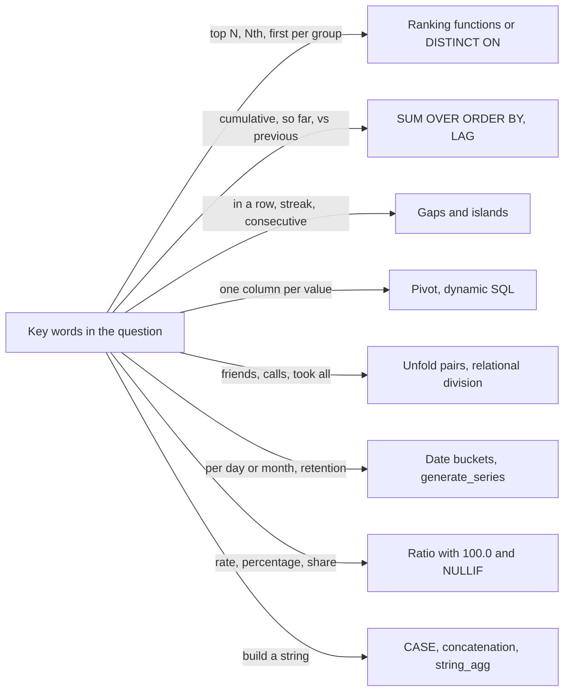

# Chapter 19 — SQL Interview Problems 2: Medium and Hard Patterns

The previous chapter practised the basics (filters, grouping, joins, anti-joins, simple ratios). This chapter covers the medium and hard problems: ranking inside groups, running sums, streaks in ordered data, rows into columns (even when the columns are unknown), tables as small graphs, date buckets, and strings built from rows.

Each problem has a statement in our own words, a self-contained file in [`code/`](code/) (tables, a tiny invented sample, the solution and often an alternative), the real `psql` (PostgreSQL's command-line client) output (`(null)` marks NULL, SQL's "missing/unknown" value), why it works, and the trap or alternative worth mentioning. All 41 files run on PostgreSQL 14 with `bash tools_run_sql.sh sql '19-*'`.

**What you'll learn**

- The patterns behind most medium/hard questions, with a template for each (19.11).
- `ROW_NUMBER` vs `RANK` vs `DENSE_RANK` (**window functions** — functions that compute over a set of related rows without collapsing them — that number rows), and why ties change the answer.
- The *gaps-and-islands* trick (`value - ROW_NUMBER()`) for streaks and "N in a row".
- Static pivots (rows turned into columns) with `FILTER`, dynamic pivots with **PL/pgSQL** (PostgreSQL's built-in procedural language, with variables and loops) + `format()` (builds a string from a template), and unpivot (columns turned back into rows) via **JSON** (a text format of nested key/value objects).
- PostgreSQL traps: **integer division** (`int / int` drops the fraction, so `1/3 = 0`), division by zero, `NOT IN` with NULLs, `COUNT(*)` after a `LEFT JOIN`.

Background you may want open: [window functions](../08-window-functions/README.md) (ranking, frames, gaps and islands), [subqueries and set operations](../06-subqueries-and-set-operations/README.md), [CTEs](../07-ctes-views-and-recursion/README.md), and the interview method in [Chapter 18](../18-sql-interview-problems-1/README.md).



*Figure — typical wording in a question and the pattern it usually points to.*

## 19.1 How to attack a medium or hard problem

The Chapter 18 method still applies; three habits matter most here:

| Habit | What it means in practice |
|---|---|
| Build in layers | One **CTE** (common table expression — a named sub-query in a `WITH` clause) per idea ("one row per user-day", then "rank within the day", then "keep rank 1"); run each layer before adding the next. |
| Say the tie rule out loud | "If two invoices have the same total, which one wins?" decides between `ROW_NUMBER`, `RANK` and `DENSE_RANK`. |
| Hunt the empty case | Players with no wins, orders with no deliveries, days with no visits: decide whether they appear with 0, with NULL, or not at all. |

Run any file on its own with `bash tools_pg.sh psql -d <empty_db> -f code/NN_name.sql`.

## 19.2 Warm-ups: joins, counts and grids

Three short problems that hide a classic trap each: NULL in a comparison, `COUNT(*)` after an outer join, and "every combination" questions.

### 19.2.1 Staff rated above 8

**Problem.** Two tables: `staff` (id, name, team) and `reviews` (one score per staff member). List the names of people whose score is strictly greater than 8.

[`code/01_high_rated_staff.sql`](code/01_high_rated_staff.sql)

```sql
CREATE TABLE staff   (staff_id int PRIMARY KEY, full_name text, team text);
CREATE TABLE reviews (staff_id int PRIMARY KEY REFERENCES staff, score int);
INSERT INTO staff VALUES (1,'Asha','Web'),(2,'Bruno','Web'),(3,'Chen','Data'),(4,'Dana','Data');
INSERT INTO reviews VALUES (1,9),(2,8),(3,10),(4,NULL);

SELECT s.full_name
FROM   staff s
JOIN   reviews r ON r.staff_id = s.staff_id
WHERE  r.score > 8
ORDER  BY s.full_name;

-- Edge case: NULL score is neither > 8 nor <= 8
SELECT count(*) FILTER (WHERE score > 8)      AS above,
       count(*) FILTER (WHERE NOT score > 8)  AS not_above,
       count(*)                               AS all_rows
FROM   reviews;
```

Output:

```text
 full_name 
-----------
 Asha
 Chen
(2 rows)

 above | not_above | all_rows 
-------+-----------+----------
     2 |         1 |        4
(1 row)
```

**Why it works.** The **inner join** (keeps only rows that have a match on both sides) pairs each person with their review; `WHERE r.score > 8` keeps the high ones. Anyone without a review row disappears in the join, which is what "has a rating above 8" means.

**Edge case.** Dana's score is NULL: `NULL > 8` and `NOT (NULL > 8)` are both *unknown*, so she lands in neither bucket (2 + 1 ≠ 4). "Everyone not above 8" needs `OR score IS NULL`.

### 19.2.2 Likes per post

**Problem.** `posts` lists posts; `post_likes` has one row per (post, user who liked it). Show every post with its number of likes, including posts nobody liked, in post order.

[`code/02_likes_per_post.sql`](code/02_likes_per_post.sql)

```sql
CREATE TABLE posts      (post_id int PRIMARY KEY, author text);
CREATE TABLE post_likes (post_id int REFERENCES posts, liker_id int, PRIMARY KEY (post_id, liker_id));
INSERT INTO posts VALUES (10,'ana'),(11,'ben'),(12,'cy');
INSERT INTO post_likes VALUES (10,1),(10,2),(10,3),(11,1);

SELECT p.post_id, count(l.liker_id) AS likes
FROM   posts p
LEFT   JOIN post_likes l ON l.post_id = p.post_id
GROUP  BY p.post_id
ORDER  BY p.post_id;
```

Output:

```text
 post_id | likes 
---------+-------
      10 |     3
      11 |     1
      12 |     0
(3 rows)
```

**Why it works.** The `LEFT JOIN` (an **outer join**: keeps every row of the left table, matched or not) keeps post 12 even though it has no likes; its join columns come back as NULL (a **NULL-padded** row). `count(l.liker_id)` counts only non-NULL values, so the padded row contributes 0.

**Common mistake.** `count(*)` counts the NULL-padded row too, so post 12 would show 1 (the file runs it; the same trap as [Chapter 18, P12](../18-sql-interview-problems-1/README.md)). After an outer join, count a column from the *optional* side.

### 19.2.3 Average mark for every learner × module

**Problem.** For every learner and every module in the catalogue (even ones the learner has no marks in), show the learner's average mark in that module, rounded to 2 decimals; NULL when there are no marks. Sort by learner, then module.

[`code/03_course_grid_averages.sql`](code/03_course_grid_averages.sql)

```sql
CREATE TABLE learners (learner_id int PRIMARY KEY, name text);
CREATE TABLE modules  (module text PRIMARY KEY);
CREATE TABLE marks    (learner_id int, module text, mark int);
INSERT INTO learners VALUES (1,'Ivy'),(2,'Omar');
INSERT INTO modules  VALUES ('SQL'),('Stats');
INSERT INTO marks    VALUES (1,'SQL',70),(1,'SQL',85),(1,'Stats',60),(2,'SQL',90);

SELECT l.learner_id, l.name, m.module,
       round(avg(k.mark), 2) AS avg_mark
FROM   learners l
CROSS  JOIN modules m
LEFT   JOIN marks k ON k.learner_id = l.learner_id AND k.module = m.module
GROUP  BY l.learner_id, l.name, m.module
ORDER  BY l.learner_id, m.module;
```

Output:

```text
 learner_id | name | module | avg_mark 
------------+------+--------+----------
          1 | Ivy  | SQL    |    77.50
          1 | Ivy  | Stats  |    60.00
          2 | Omar | SQL    |    90.00
          2 | Omar | Stats  |   (null)
(4 rows)
```

**Why it works.** "Every A with every B" is a `CROSS JOIN` (every row of one table paired with every row of the other) — it builds the full grid of 2 × 2 pairs first. The `LEFT JOIN` then attaches marks where they exist, and `avg()` of only NULLs is NULL, which is exactly the "no marks" answer (Omar/Stats).

**Alternative.** If the question only wants modules the learner actually took, drop the cross join and group the `marks` table directly. Always ask which one is meant.

## 19.3 Nth highest, top-N per group and "first row per group"

The ranking family. The three ranking functions differ only on ties:

| Scores | `ROW_NUMBER` | `RANK` | `DENSE_RANK` |
|---|---|---|---|
| 95, 95, 90 | 1, 2, 3 | 1, 1, 3 | 1, 1, 2 |

Use `ROW_NUMBER` when exactly one row must win, `RANK` when "all tied for first" should be kept, and `DENSE_RANK` when the question says "top N *distinct* values". PostgreSQL's `DISTINCT ON (cols)` is a compact shortcut for "first row per group": it keeps the first row of each group of equal `cols` values, in `ORDER BY` order.

### 19.3.1 Second-fastest lap time

**Problem.** Each runner has one lap time, in seconds. Return the second-smallest *distinct* time as one row, or a single NULL row when there is no second value.

[`code/04_second_fastest.sql`](code/04_second_fastest.sql)

```sql
CREATE TABLE laps (runner_id int PRIMARY KEY, seconds int NOT NULL);
INSERT INTO laps VALUES (1,62),(2,58),(3,58),(4,65),(5,61);

-- Solution: scalar subquery -> NULL when OFFSET skips past the end
SELECT (SELECT DISTINCT seconds FROM laps
        ORDER  BY seconds
        OFFSET 1 LIMIT 1) AS second_fastest;

-- Alternative: DENSE_RANK generalises to the N-th
SELECT max(seconds) FILTER (WHERE dr = 2) AS second_fastest
FROM  (SELECT seconds, dense_rank() OVER (ORDER BY seconds) AS dr FROM laps) t;

-- Edge case: only one distinct time left
DELETE FROM laps WHERE seconds <> 58;
SELECT (SELECT DISTINCT seconds FROM laps ORDER BY seconds OFFSET 1 LIMIT 1) AS second_fastest;
```

Output (both formulations give 61; after the `DELETE` the answer is a NULL row):

```text
 second_fastest 
----------------
             61
(1 row)
...
 second_fastest 
----------------
         (null)
(1 row)
```

**Why it works.** Same idea as [Chapter 18, P39](../18-sql-interview-problems-1/README.md): `DISTINCT` collapses the two 58s, `OFFSET 1 LIMIT 1` takes the next value, and the **scalar-subquery** wrapper (a sub-query used as a single value) turns "no row" into one NULL row.

**Alternatives.** `min(seconds) WHERE seconds > (SELECT min(seconds) …)` (also in the file) works only for N = 2. `DENSE_RANK` handles any N (`dr = N`), and wrapping it in `max(...) FILTER (...)` again turns "no row" into NULL.

### 19.3.2 Top three distinct scores per subject

**Problem.** Pupils' scores per subject. For each subject, list every pupil whose score is one of the three highest *different* scores in that subject (ties included).

[`code/05_top3_per_subject.sql`](code/05_top3_per_subject.sql)

```sql
CREATE TABLE subjects (subject_id int PRIMARY KEY, title text);
CREATE TABLE results  (result_id int PRIMARY KEY, pupil text, score int,
                       subject_id int REFERENCES subjects);
INSERT INTO subjects VALUES (1,'Maths'),(2,'History');
INSERT INTO results VALUES
 (1,'Ann',95,1),(2,'Bob',95,1),(3,'Cal',90,1),(4,'Dee',82,1),(5,'Eve',70,1),
 (6,'Fay',88,2),(7,'Gus',75,2);

WITH ranked AS (
  SELECT s.title, r.pupil, r.score,
         dense_rank() OVER (PARTITION BY r.subject_id ORDER BY r.score DESC) AS dr
  FROM   results r
  JOIN   subjects s USING (subject_id)
)
SELECT title AS subject, pupil, score
FROM   ranked
WHERE  dr <= 3
ORDER  BY subject, score DESC, pupil;

-- Alternative: correlated subquery "fewer than 3 distinct higher scores"
SELECT s.title AS subject, r.pupil, r.score
FROM   results r
JOIN   subjects s USING (subject_id)
WHERE  (SELECT count(DISTINCT r2.score) FROM results r2
        WHERE r2.subject_id = r.subject_id AND r2.score > r.score) < 3
ORDER  BY subject, score DESC, pupil;
```

Output (all queries return these rows):

```text
 subject | pupil | score 
---------+-------+-------
 History | Fay   |    88
 History | Gus   |    75
 Maths   | Ann   |    95
 Maths   | Bob   |    95
 Maths   | Cal   |    90
 Maths   | Dee   |    82
(6 rows)
```

**Why it works.** `DENSE_RANK` gives Ann and Bob rank 1, Cal rank 2, Dee rank 3, so four pupils appear for Maths — ties don't use up places. History has only two pupils, so both appear.

**Alternative.** The **correlated** version (its sub-query refers to the outer row, so it re-runs for each row) keeps a row if fewer than three distinct scores in its subject beat it: **portable** (works on any SQL database), but O(n²) per group (work grows with the square of the row count). With `RANK`, Dee would get rank 4 and vanish — a common wrong answer.

### 19.3.3 One home office per employee

**Problem.** Employees can be assigned to several offices; exactly one of them is flagged `'Y'` as the home office. Someone with only one office has that office as home, whatever the flag says. Return each employee with their home office.

[`code/06_home_office.sql`](code/06_home_office.sql)

```sql
CREATE TABLE desk_assignments (emp_id int, office_id int, is_home char(1) NOT NULL CHECK (is_home IN ('Y','N')),
                               PRIMARY KEY (emp_id, office_id));
INSERT INTO desk_assignments VALUES
 (1,100,'N'),(1,200,'Y'),(1,300,'N'),   -- several offices, one flagged
 (2,100,'N'),                            -- single office, flag ignored
 (3,300,'Y');

-- Solution: DISTINCT ON keeps the first row of each emp_id in ORDER BY order
SELECT DISTINCT ON (emp_id) emp_id, office_id
FROM   desk_assignments
ORDER  BY emp_id, is_home DESC;      -- 'Y' sorts after 'N', so DESC puts it first

-- Alternative: the rule written out literally
SELECT emp_id, office_id FROM desk_assignments WHERE is_home = 'Y'
UNION
SELECT emp_id, min(office_id) FROM desk_assignments
GROUP  BY emp_id HAVING count(*) = 1
ORDER  BY emp_id;
```

Output (all queries return these rows):

```text
 emp_id | office_id 
--------+-----------
      1 |       200
      2 |       100
      3 |       300
(3 rows)
```

**Why it works.** `DISTINCT ON (emp_id)` keeps each employee's first row under `ORDER BY emp_id, is_home DESC`; `'Y' > 'N'`, so a flagged office sorts first, and a single office is kept as is. The flag is `NOT NULL` on purpose: PostgreSQL sorts NULLs *first* under `DESC`, so a NULL flag would beat `'Y'` (add `NULLS LAST` if NULLs are possible). Portable form: `ROW_NUMBER() OVER (PARTITION BY emp_id ORDER BY is_home DESC) = 1`.

**Alternative / edge case.** The `UNION` version states the rule literally. If the data breaks the rule (several offices, none flagged), the ranking version silently picks *some* office and the `UNION` version returns nothing for that person — choose your failure.

### 19.3.4 The most expensive invoice's lines

**Problem.** `items` holds unit prices; `line_items` holds (invoice, item, quantity). Find the invoice with the largest total — smallest invoice id wins a tie — and list its lines with quantity and line price.

[`code/07_largest_invoice.sql`](code/07_largest_invoice.sql)

```sql
CREATE TABLE items      (item_id int PRIMARY KEY, unit_price int);
CREATE TABLE line_items (invoice_id int, item_id int REFERENCES items, qty int,
                         PRIMARY KEY (invoice_id, item_id));
INSERT INTO items VALUES (1,10),(2,25),(3,4);
INSERT INTO line_items VALUES
 (501,1,3),(501,3,5),        -- 30 + 20 = 50
 (502,2,2),                  -- 50  (tie with 501)
 (503,1,1),(503,3,2);        -- 18

WITH priced AS (
  SELECT l.invoice_id, l.item_id, l.qty, l.qty * i.unit_price AS line_total,
         sum(l.qty * i.unit_price) OVER (PARTITION BY l.invoice_id) AS invoice_total
  FROM   line_items l JOIN items i USING (item_id)
), winner AS (
  SELECT invoice_id FROM priced
  ORDER  BY invoice_total DESC, invoice_id
  LIMIT  1
)
SELECT item_id, qty, line_total
FROM   priced
WHERE  invoice_id = (SELECT invoice_id FROM winner)
ORDER  BY item_id;
```

Output:

```text
 item_id | qty | line_total 
---------+-----+------------
       1 |   3 |         30
       3 |   5 |         20
(2 rows)
```

**Why it works.** A window `sum(...) OVER (PARTITION BY invoice_id)` puts each invoice's total next to each of its lines without collapsing them. The `winner` CTE sorts by total descending, then id ascending, and keeps one row. Invoices 501 and 502 both total 50, so 501 wins on id.

**Alternative.** Group `line_items` by invoice to get totals, pick the winner with `ORDER BY ... LIMIT 1`, then join back — the same logic with one more pass. `FETCH FIRST 1 ROW WITH TIES` is the tool if the question instead wanted *all* tied invoices.

### 19.3.5 Confirmed or waitlisted

**Problem.** Flights have a seat count; bookings have a passenger, a flight and a unique booking time. A booking is confirmed if, in booking-time order, it is within the flight's seat count; otherwise it is waitlisted.

[`code/08_seat_status.sql`](code/08_seat_status.sql)

```sql
CREATE TABLE flights  (flight_id int PRIMARY KEY, seats int);
CREATE TABLE bookings (passenger_id int PRIMARY KEY, flight_id int, booked_at timestamp UNIQUE);
INSERT INTO flights VALUES (7,2),(8,1),(9,0);
INSERT INTO bookings VALUES
 (1,7,'2026-03-01 09:00'),(2,7,'2026-03-01 08:00'),(3,7,'2026-03-02 10:00'),
 (4,8,'2026-03-03 12:00'),(5,8,'2026-03-01 12:00'),
 (6,9,'2026-03-01 07:00');

SELECT b.passenger_id,
       CASE WHEN row_number() OVER (PARTITION BY b.flight_id ORDER BY b.booked_at) <= f.seats
            THEN 'Confirmed' ELSE 'Waitlist' END AS status
FROM   bookings b
JOIN   flights f USING (flight_id)
ORDER  BY b.passenger_id;
```

Output:

```text
 passenger_id |  status   
--------------+-----------
            1 | Confirmed
            2 | Confirmed
            3 | Waitlist
            4 | Waitlist
            5 | Confirmed
            6 | Waitlist
(6 rows)
```

**Why it works.** `row_number()` numbers the bookings of each flight in time order; comparing that number with `seats` gives the status in one pass. On flight 7, passenger 2 booked first, then 1, then 3 (waitlisted). Flight 9 has zero seats, so even the first booking waits.

**Edge case.** Booking times are unique here, so `RANK` and `ROW_NUMBER` agree. If two bookings could share a timestamp, `RANK` would confirm both (possibly overbooking); `ROW_NUMBER` with a tie-breaker such as `passenger_id` keeps the count exact.

### 19.3.6 Pupils who are never top or bottom

**Problem.** A "middle-of-the-pack" pupil sat at least one test and never had the highest or the lowest score in any test they sat (ties for top or bottom count as top or bottom). List them by id.

[`code/09_middle_of_the_pack.sql`](code/09_middle_of_the_pack.sql)

```sql
CREATE TABLE pupils (pupil_id int PRIMARY KEY, name text);
CREATE TABLE tests  (test_id int, pupil_id int, score int, PRIMARY KEY (test_id, pupil_id));
INSERT INTO pupils VALUES (1,'Ada'),(2,'Ben'),(3,'Cleo'),(4,'Dev'),(5,'Eli'),(6,'Fin');
INSERT INTO tests VALUES
 (10,1,60),(10,2,75),(10,3,90),(10,5,70),
 (20,1,55),(20,2,80),(20,4,80),(20,5,62);   -- Ben and Dev tie for top of test 20; Fin sat nothing

WITH marked AS (
  SELECT pupil_id,
         score = max(score) OVER (PARTITION BY test_id)
      OR score = min(score) OVER (PARTITION BY test_id) AS at_extreme
  FROM   tests
)
SELECT p.pupil_id, p.name
FROM   pupils p
JOIN   marked m USING (pupil_id)
GROUP  BY p.pupil_id, p.name
HAVING NOT bool_or(m.at_extreme)
ORDER  BY p.pupil_id;
```

Output:

```text
 pupil_id | name 
----------+------
        5 | Eli
(1 row)
```

**Why it works.** Two window aggregates put each test's max and min on every row, so `at_extreme` is true when a pupil matches either. Grouping per pupil and keeping `NOT bool_or(at_extreme)` (`bool_or` is true if any value in the group is true) means "no test where they were extreme". The inner join to `marked` drops Fin, who sat nothing.

**Alternative.** Mark extremes with `RANK() ... DESC = 1 OR RANK() ... ASC = 1` and exclude those pupils — with `NOT EXISTS`, not `NOT IN`, which returns nothing if the subquery yields a NULL.

### 19.3.7 Viewers who became streamers

**Problem.** A sessions table records each user's sessions as `viewer` or `streamer`. For users whose earliest session was as a viewer and who streamed at least once, return how many streaming sessions they have. Sort by that count, then user id, both descending.

[`code/10_viewers_then_streamers.sql`](code/10_viewers_then_streamers.sql)

```sql
CREATE TABLE sessions (session_id int PRIMARY KEY, user_id int, started_at timestamp,
                       kind text CHECK (kind IN ('viewer','streamer')));
INSERT INTO sessions VALUES
 (1,101,'2026-01-01 10:00','viewer'),(2,101,'2026-01-02 10:00','streamer'),(3,101,'2026-01-05 10:00','streamer'),
 (4,102,'2026-01-01 09:00','streamer'),(5,102,'2026-01-03 09:00','viewer'),
 (6,103,'2026-01-02 08:00','viewer'),(7,103,'2026-01-04 08:00','streamer'),
 (8,104,'2026-01-02 08:00','viewer');                                  -- never streamed

WITH firsts AS (
  SELECT DISTINCT ON (user_id) user_id, kind AS first_kind
  FROM   sessions
  ORDER  BY user_id, started_at
)
SELECT s.user_id, count(*) FILTER (WHERE s.kind = 'streamer') AS streams
FROM   sessions s
JOIN   firsts f USING (user_id)
WHERE  f.first_kind = 'viewer'
GROUP  BY s.user_id
HAVING count(*) FILTER (WHERE s.kind = 'streamer') > 0
ORDER  BY streams DESC, s.user_id DESC;
```

Output:

```text
 user_id | streams 
---------+---------
     101 |       2
     103 |       1
(2 rows)
```

**Why it works.** `DISTINCT ON` finds each user's first session kind (user 102 started as a streamer, so is out). Joining back and counting with `FILTER (WHERE kind = 'streamer')` gives the streams; `HAVING ... > 0` drops user 104, who never streamed.

**Alternative.** `first_value(kind) OVER (PARTITION BY user_id ORDER BY started_at)` (the value from the first row of the window) puts the first kind on every row (the file prints it: viewer, streamer, viewer, viewer).

### 19.3.8 First year on loan (keep the ties)

**Problem.** A library keeps yearly loan statistics per branch and book: number of loans and fee per loan. For each book, report its first year on loan with the loans and fee from that year — if the first year has several rows, report all of them.

[`code/11_first_year_loans.sql`](code/11_first_year_loans.sql)

```sql
CREATE TABLE loan_stats (branch_id int, book_id int, yr int, loans int, fee int,
                         PRIMARY KEY (branch_id, book_id, yr));
INSERT INTO loan_stats VALUES
 (1,100,2023,12,2),(1,100,2024,20,2),
 (2,100,2023, 5,3),                     -- second row for book 100 in its first year
 (1,200,2025, 7,1);

-- Solution: RANK keeps every row tied for the earliest year
SELECT book_id, yr AS first_year, loans, fee
FROM  (SELECT *, rank() OVER (PARTITION BY book_id ORDER BY yr) AS rk FROM loan_stats) t
WHERE  rk = 1
ORDER  BY book_id, loans DESC;

-- Pitfall: ROW_NUMBER (or DISTINCT ON) silently drops one of the 2023 rows of book 100
SELECT DISTINCT ON (book_id) book_id, yr AS first_year, loans, fee
FROM   loan_stats
ORDER  BY book_id, yr;
```

Output:

```text
 book_id | first_year | loans | fee 
---------+------------+-------+-----
     100 |       2023 |    12 |   2
     100 |       2023 |     5 |   3
     200 |       2025 |     7 |   1
(3 rows)

 book_id | first_year | loans | fee 
---------+------------+-------+-----
     100 |       2023 |    12 |   2
     200 |       2025 |     7 |   1
(2 rows)
```

**Why it works.** `rank() OVER (PARTITION BY book_id ORDER BY yr)` gives rank 1 to *every* row in the earliest year, so both 2023 rows of book 100 survive. The classic equivalent is "find `min(yr)` per book, then join back on (book, year)".

**Edge case.** The second query is the tempting shortcut and it is wrong for this data: `DISTINCT ON` (like `ROW_NUMBER`) keeps exactly one row per book, losing branch 2's 2023 figures. Whenever "first" can tie, prefer `RANK` or the join-back.

### 19.3.9 Busiest collaborators (all ties)

**Problem.** Each row says one person invited another to a project and it was accepted. Count, for every person, the distinct projects they were part of (as inviter *or* invitee) and return everyone tied for the highest count.

[`code/12_busiest_collaborators.sql`](code/12_busiest_collaborators.sql)

```sql
CREATE TABLE collabs (inviter int, invitee int, project_id int, accepted_on date,
                      PRIMARY KEY (inviter, invitee, project_id));
INSERT INTO collabs VALUES
 (1,2,900,'2026-02-01'),(1,3,900,'2026-02-02'),(2,3,901,'2026-02-03'),
 (4,1,902,'2026-02-04'),(3,4,903,'2026-02-05'),(1,4,903,'2026-02-06');

WITH involvement AS (
  SELECT inviter AS person, project_id FROM collabs
  UNION                                     -- UNION also removes duplicate (person, project)
  SELECT invitee, project_id FROM collabs
), counts AS (
  SELECT person, count(*) AS projects,
         rank() OVER (ORDER BY count(*) DESC) AS rk
  FROM   involvement
  GROUP  BY person
)
SELECT person, projects FROM counts WHERE rk = 1 ORDER BY person;
```

Output:

```text
 person | projects 
--------+----------
      1 |        3
      3 |        3
(2 rows)
```

**Why it works.** Two `SELECT`s turn each row into two "person took part in project" facts; `UNION` removes repeats (person 1 twice in project 900). A window `rank()` over the grouped counts marks every top scorer with 1 — persons 1 and 3, three projects each.

**Alternative.** `WHERE projects = (SELECT max(projects) FROM counts)` is equally correct and reads well; `ORDER BY ... LIMIT 1` would be wrong because it drops ties.

## 19.4 Running totals and row-to-row comparisons

A running total is `SUM(...) OVER (PARTITION BY group ORDER BY time)`; "compared with last time" is `LAG` (a window function returning a value from the previous row; `LEAD` returns the next row's). Chapter 8 explains **frames** (the range of rows a window function looks at for each row) in depth ([§8.7](../08-window-functions/README.md)).

### 19.4.1 Running total per team

**Problem.** Each row is one player's points for a team on a day ((team, day) is unique). Show, for each team and day, the team's cumulative points up to and including that day.

[`code/13_running_total_by_team.sql`](code/13_running_total_by_team.sql)

```sql
CREATE TABLE team_points (player text, team char(1), day date, points int, PRIMARY KEY (team, day));
INSERT INTO team_points VALUES
 ('Lia','A','2026-05-01',10),('Max','B','2026-05-01',7),
 ('Noa','A','2026-05-03',4), ('Oli','B','2026-05-02',9),
 ('Pia','A','2026-05-06',6);

SELECT team, day,
       sum(points) OVER (PARTITION BY team ORDER BY day) AS running_total
FROM   team_points
ORDER  BY team, day;
```

Output (the file's alternative returns the same rows):

```text
 team |    day     | running_total 
------+------------+---------------
 A    | 2026-05-01 |            10
 A    | 2026-05-03 |            14
 A    | 2026-05-06 |            20
 B    | 2026-05-01 |             7
 B    | 2026-05-02 |            16
(5 rows)
```

**Why it works.** `PARTITION BY team` restarts the sum per team; `ORDER BY day` makes it cumulative. With an `ORDER BY` and no explicit frame the default is `RANGE BETWEEN UNBOUNDED PRECEDING AND CURRENT ROW`.

**Alternative / edge case.** A self-join summing rows of the same team with `day <=` this day (in the file) works on old databases but is O(n²). If days could repeat, the default `RANGE` frame adds all same-day peers at once; use `ROWS BETWEEN UNBOUNDED PRECEDING AND CURRENT ROW` for row-by-row totals.

### 19.4.2 Last person who fits in the lift

**Problem.** People queue for a lift with a 500 kg limit; each has a weight and a queue position (`turn`). People board strictly in order. Return the last person who can board without the total exceeding the limit (assume the first person always fits).

[`code/14_lift_capacity.sql`](code/14_lift_capacity.sql)

```sql
CREATE TABLE lift_queue (person_id int PRIMARY KEY, name text, kg int, turn int UNIQUE);
INSERT INTO lift_queue VALUES
 (1,'Rae',90,3),(2,'Sid',120,1),(3,'Tom',200,2),(4,'Uma',60,5),(5,'Vik',85,4);

WITH boarding AS (
  SELECT name, turn, sum(kg) OVER (ORDER BY turn) AS load_kg
  FROM   lift_queue
)
SELECT name, load_kg
FROM   boarding
WHERE  load_kg <= 500
ORDER  BY turn DESC
LIMIT  1;
```

Output:

```text
 name | load_kg 
------+---------
 Vik  |     495
(1 row)
```

**Why it works.** The running sum in queue order gives the load after each person boards: 120, 320, 410, 495, 555. Keep loads ≤ 500 and take the latest in the queue — Vik. Weights are positive, so the sum only grows and "latest turn" equals "largest load".

**Alternative.** A correlated subquery (in the file) recomputes each prefix sum — correct, O(n²), and the answer to "how would you do this without window functions?".

### 19.4.3 Performance and improvement rate

**Problem.** Review rounds per person (round number, score 1–100). Report, per person, (a) *performance* = average of score ÷ round, and (b) *improvement rate* = percentage of that person's reviews where the score beat the previous round's score **and** is above 50. Round both to 2 decimals.

[`code/15_review_trends.sql`](code/15_review_trends.sql)

```sql
CREATE TABLE review_rounds (person text, rnd int, score int);
INSERT INTO review_rounds VALUES
 ('Kim',1,40),('Kim',2,55),('Kim',3,70),('Kim',4,65),
 ('Lou',1,80),('Lou',2,45);

WITH prev AS (
  SELECT person, rnd, score,
         lag(score) OVER (PARTITION BY person ORDER BY rnd) AS prev_score
  FROM   review_rounds
)
SELECT person,
       round(avg(score::numeric / rnd), 2)                                AS performance,
       round(100.0 * count(*) FILTER (WHERE score > 50 AND score > prev_score)
             / count(*), 2)                                               AS improvement_pct
FROM   prev
GROUP  BY person
ORDER  BY person;
```

Output:

```text
 person | performance | improvement_pct 
--------+-------------+-----------------
 Kim    |       26.77 |           50.00
 Lou    |       51.25 |            0.00
(2 rows)
```

**Why it works.** `lag(score)` puts the previous round's score on each row (NULL for round 1, and `score > NULL` is not true, so round 1 never counts). `count(*) FILTER (...)` counts qualifying rows; multiplying by `100.0` first keeps the maths in `numeric`.

**Common mistake.** In PostgreSQL `55 / 2` is `27`: integer division truncates, and `avg(score / rnd)` gives Kim 26.50 instead of 26.77 (shown in the file). Cast one side first, as in [Chapter 18, P34](../18-sql-interview-problems-1/README.md).

## 19.5 Gaps and islands: consecutive rows and streaks

An *island* is a maximal run of rows that belong together in order (consecutive ids, days or wins); the *gaps* are the breaks. If values rise by exactly 1 inside a run, `value - ROW_NUMBER()` is **constant** inside it and jumps at every gap, so grouping by it gives one group per island.

| id | visitors ≥ 100? | row_number among busy rows | id − row_number |
|---|---|---|---|
| 1 | yes | 1 | 0 |
| 3 | yes | 2 | 1 |
| 4 | yes | 3 | 1 |
| 5 | yes | 4 | 1 |
| 7 | yes | 5 | 2 |

### 19.5.1 Runs of busy days at the gate

**Problem.** Daily visitor counts with an increasing id. Return every row that belongs to a run of three or more *consecutive ids* where each row has at least 100 visitors, ordered by date.

[`code/16_busy_gate_runs.sql`](code/16_busy_gate_runs.sql)

```sql
CREATE TABLE gate_counts (id int PRIMARY KEY, visit_day date UNIQUE, visitors int);
INSERT INTO gate_counts VALUES
 (1,'2026-07-01',150),(2,'2026-07-02', 90),(3,'2026-07-03',120),(4,'2026-07-04',130),
 (5,'2026-07-05',101),(6,'2026-07-06', 20),(7,'2026-07-07',300),(8,'2026-07-08',310);

WITH busy AS (
  SELECT id, visit_day, visitors,
         id - row_number() OVER (ORDER BY id) AS island
  FROM   gate_counts
  WHERE  visitors >= 100
), sized AS (
  SELECT *, count(*) OVER (PARTITION BY island) AS run_len FROM busy
)
SELECT id, visit_day, visitors, island, run_len
FROM   sized
WHERE  run_len >= 3
ORDER  BY visit_day;
```

Output:

```text
 id | visit_day  | visitors | island | run_len 
----+------------+----------+--------+---------
  3 | 2026-07-03 |      120 |      1 |       3
  4 | 2026-07-04 |      130 |      1 |       3
  5 | 2026-07-05 |      101 |      1 |       3
(3 rows)
```

**Why it works.** Filtering first leaves only busy rows; `id - row_number()` labels ids 3, 4, 5 with island 1, while id 1 (island 0) and ids 7–8 (island 2) are too short. `count(*) OVER (PARTITION BY island)` attaches each island's length to its rows, so no join-back is needed.

**Alternative.** Group by `island` with `HAVING count(*) >= 3` and join those islands back to the rows — the same idea in two steps. A `LAG`/`LEAD` solution needs three cases (row is first, middle or last of a run) and gets messy.

### 19.5.2 Values repeated three times in a row

**Problem.** A sequence of readings ordered by id (ids may have gaps). Return every value that occurs at least three times consecutively.

[`code/17_triple_repeats.sql`](code/17_triple_repeats.sql)

```sql
CREATE TABLE readings (id int PRIMARY KEY, val int);
INSERT INTO readings VALUES (1,5),(2,5),(3,5),(4,2),(5,7),(7,7),(9,7),(10,5),(11,5);

-- Solution: compare each row with its neighbours (ids have gaps, order still defines "in a row")
SELECT DISTINCT val
FROM  (SELECT val,
              lag(val)  OVER (ORDER BY id) AS before,
              lead(val) OVER (ORDER BY id) AS after
       FROM   readings) t
WHERE  val = before AND val = after
ORDER  BY val;

-- Alternative: islands via the difference of two ROW_NUMBERs, works for any run length k
SELECT DISTINCT val
FROM  (SELECT val,
              row_number() OVER (ORDER BY id)
            - row_number() OVER (PARTITION BY val ORDER BY id) AS island
       FROM   readings) t
GROUP  BY val, island
HAVING count(*) >= 3
ORDER  BY val;
```

Output (all queries return these rows):

```text
 val 
-----
   5
   7
(2 rows)
```

**Why it works.** `lag` and `lead` expose each row's neighbours in id order; a row equal to both is the middle of a run of three or more. The 7s sit at ids 5, 7, 9 — id gaps don't matter, because "consecutive" means consecutive *in the ordering*.

**Alternative.** Overall position minus position among equal values is constant within each run; `GROUP BY` it with `HAVING count(*) >= k` works for any k. The two versions disagree on NULLs: three NULLs in a row fail `val = before` but form one island (`PARTITION BY val` groups NULLs), so decide whether a missing reading can repeat.

### 19.5.3 Members active five days in a row

**Problem.** A login log (duplicates possible, several logins per day) and a members table. Return members who logged in on five or more consecutive calendar days, ordered by id.

[`code/18_five_day_streaks.sql`](code/18_five_day_streaks.sql)

```sql
CREATE TABLE members (member_id int PRIMARY KEY, name text);
CREATE TABLE logins  (member_id int, login_day date);          -- duplicates allowed
INSERT INTO members VALUES (1,'Ana'),(2,'Bo'),(3,'Cy');
INSERT INTO logins VALUES
 (1,'2026-06-01'),(1,'2026-06-02'),(1,'2026-06-02'),(1,'2026-06-03'),(1,'2026-06-04'),(1,'2026-06-05'),
 (2,'2026-06-01'),(2,'2026-06-02'),(2,'2026-06-04'),(2,'2026-06-05'),(2,'2026-06-06'),
 (3,'2026-06-28'),(3,'2026-06-29'),(3,'2026-06-30'),(3,'2026-07-01'),(3,'2026-07-02');

WITH days AS (SELECT DISTINCT member_id, login_day FROM logins),
islands AS (
  SELECT member_id, login_day,
         login_day - (row_number() OVER (PARTITION BY member_id ORDER BY login_day))::int AS anchor
  FROM   days
)
SELECT m.member_id, m.name
FROM   islands i JOIN members m USING (member_id)
GROUP  BY m.member_id, m.name, i.anchor
HAVING count(*) >= 5
ORDER  BY m.member_id;

-- Alternative: the 5th distinct day after this one is exactly 4 days later
SELECT DISTINCT member_id
FROM  (SELECT member_id, login_day,
              lead(login_day, 4) OVER (PARTITION BY member_id ORDER BY login_day) AS day5
       FROM  (SELECT DISTINCT member_id, login_day FROM logins) d) t
WHERE  day5 = login_day + 4
ORDER  BY member_id;
```

Output:

```text
 member_id | name 
-----------+------
         1 | Ana
         3 | Cy
(2 rows)

 member_id 
-----------
         1
         3
(2 rows)
```

**Why it works.** First reduce to *distinct* days — duplicates would break the numbering. Then `login_day - row_number` (a date minus an integer is a date in PostgreSQL) gives the same "anchor" date for every day in a streak. Cy's streak crosses June → July and still works, because date arithmetic knows month lengths.

**Alternative.** `lead(login_day, 4)` looks four distinct days ahead; if that day is exactly `login_day + 4`, the five days in between must all be present. It only handles a fixed length; islands also give each streak's length.

### 19.5.4 Interview candidates from contest medals

**Problem.** Each contest row stores the gold, silver and bronze winners; contest ids are consecutive. A coder qualifies if they reached the podium (any colour) in at least three back-to-back contests, **or** took gold at least three times overall, in any contests. Return candidates' names and emails.

[`code/19_medal_candidates.sql`](code/19_medal_candidates.sql)

```sql
CREATE TABLE contests (contest_id int PRIMARY KEY, gold int, silver int, bronze int);
CREATE TABLE coders   (coder_id int PRIMARY KEY, name text, email text);
INSERT INTO coders VALUES (1,'Mia','mia@example.com'),(2,'Ned','ned@example.com'),
                          (3,'Oz','oz@example.com'),(4,'Pat','pat@example.com');
INSERT INTO contests VALUES
 (51,1,2,3),(52,2,1,4),(53,3,4,1),   -- Mia medals in 51,52,53
 (54,4,3,2),(55,4,2,3),(56,4,3,1);   -- Pat wins gold 3 times

WITH medals AS (
  SELECT contest_id, m.coder_id, m.kind
  FROM   contests c
  CROSS  JOIN LATERAL (VALUES (c.gold,'gold'),(c.silver,'silver'),(c.bronze,'bronze')) AS m(coder_id, kind)
), runs AS (
  SELECT coder_id
  FROM  (SELECT coder_id, contest_id - row_number() OVER (PARTITION BY coder_id ORDER BY contest_id) AS island
         FROM medals) t
  GROUP  BY coder_id, island
  HAVING count(*) >= 3
), golds AS (
  SELECT coder_id FROM medals WHERE kind = 'gold'
  GROUP  BY coder_id HAVING count(*) >= 3
)
SELECT name, email
FROM   coders
WHERE  coder_id IN (SELECT coder_id FROM runs UNION SELECT coder_id FROM golds)
ORDER  BY name;
```

Output:

```text
 name |      email      
------+-----------------
 Mia  | mia@example.com
 Oz   | oz@example.com
 Pat  | pat@example.com
(3 rows)
```

**Why it works.** `CROSS JOIN LATERAL (VALUES ...)` (`VALUES` builds a small inline table; `LATERAL` lets it refer to columns of the current row `c`) unpivots the medal columns into one row per (contest, coder, kind). Rule 1 is an island on `contest_id - row_number()` per coder; rule 2 is `GROUP BY ... HAVING count(*) >= 3` on golds; `IN (... UNION ...)` combines them. Mia medals in 51–53, Oz in 53–56, Pat has three golds; Ned's medals (51, 52, 54, 55) break at 53.

**Edge case.** A coder cannot win two medals in the same contest here; if they could, deduplicate `(coder_id, contest_id)` before numbering, or the island arithmetic breaks.

### 19.5.5 Longest winning streak

**Problem.** Match results per player (`win`, `draw`, `loss`) by date. For every player, return the length of their longest run of consecutive wins — 0 for a player who never won.

[`code/20_longest_win_streak.sql`](code/20_longest_win_streak.sql)

```sql
CREATE TABLE games (player_id int, played_on date, outcome text CHECK (outcome IN ('win','draw','loss')),
                    PRIMARY KEY (player_id, played_on));
INSERT INTO games VALUES
 (1,'2026-01-01','win'),(1,'2026-01-02','win'),(1,'2026-01-03','loss'),
 (1,'2026-01-04','win'),(1,'2026-01-05','win'),(1,'2026-01-06','win'),
 (2,'2026-01-01','draw'),(2,'2026-01-02','win'),
 (3,'2026-01-01','loss');

WITH tagged AS (
  SELECT player_id, outcome,
         row_number() OVER (PARTITION BY player_id ORDER BY played_on)
       - row_number() OVER (PARTITION BY player_id, outcome ORDER BY played_on) AS island
  FROM   games
), win_runs AS (
  SELECT player_id, count(*) AS run_len
  FROM   tagged
  WHERE  outcome = 'win'
  GROUP  BY player_id, island
)
SELECT p.player_id, coalesce(max(w.run_len), 0) AS longest_streak
FROM  (SELECT DISTINCT player_id FROM games) p
LEFT  JOIN win_runs w USING (player_id)
GROUP  BY p.player_id
ORDER  BY p.player_id;

-- Alternative: a running count of non-wins gives every streak its own label
SELECT player_id, max(len) AS longest_streak
FROM  (SELECT player_id, breaks, count(*) FILTER (WHERE outcome = 'win') AS len
       FROM  (SELECT player_id, outcome,
                     count(*) FILTER (WHERE outcome <> 'win')
                       OVER (PARTITION BY player_id ORDER BY played_on) AS breaks
              FROM games) g
       GROUP  BY player_id, breaks) s
GROUP  BY player_id
ORDER  BY player_id;
```

Output (all queries return these rows):

```text
 player_id | longest_streak 
-----------+----------------
         1 |              3
         2 |              1
         3 |              0
(3 rows)
```

**Why it works.** Row number over all games minus row number within the same outcome is constant inside each run of equal outcomes. Counting `win` rows per (player, island) gives each streak's length and `max` the longest; the `LEFT JOIN` from all players plus `coalesce(..., 0)` keeps player 3, who never won.

**Alternative.** A running count of non-wins (`count(*) FILTER (WHERE outcome <> 'win') OVER (...)`) stays the same across a winning streak and bumps at each draw or loss, so it also labels streaks. Grouping by it and counting wins returns 0 naturally for groups without wins.

### 19.5.6 Deposits over the limit two months running

**Problem.** Accounts have a monthly income limit. A movements table holds deposits (`in`) and withdrawals (`out`). Flag accounts whose total deposits in a calendar month exceed the limit in at least two consecutive months.

[`code/21_income_over_limit.sql`](code/21_income_over_limit.sql)

```sql
CREATE TABLE accounts  (account_id int PRIMARY KEY, monthly_limit int);
CREATE TABLE movements (movement_id int PRIMARY KEY, account_id int, direction text, amount int, at timestamp);
INSERT INTO accounts VALUES (1,1000),(2,500),(3,800);
INSERT INTO movements VALUES
 (1,1,'in', 700,'2026-01-05'),(2,1,'in', 400,'2026-01-20'),   -- Jan 1100 > 1000
 (3,1,'in',1200,'2026-02-11'),                                -- Feb 1200 > 1000 -> flagged
 (4,2,'in', 600,'2026-01-03'),(5,2,'in', 700,'2026-03-03'),   -- Jan, Mar: not consecutive
 (6,2,'out',900,'2026-02-03'),                                -- withdrawals don't count
 (7,3,'in', 900,'2025-12-30'),(8,3,'in', 950,'2026-01-02');   -- Dec -> Jan crosses a year

WITH monthly AS (
  SELECT m.account_id, date_trunc('month', m.at)::date AS mon
  FROM   movements m JOIN accounts a USING (account_id)
  WHERE  m.direction = 'in'
  GROUP  BY m.account_id, date_trunc('month', m.at), a.monthly_limit
  HAVING sum(m.amount) > a.monthly_limit
)
SELECT DISTINCT account_id
FROM  (SELECT account_id, mon,
              lag(mon) OVER (PARTITION BY account_id ORDER BY mon) AS prev_mon
       FROM monthly) t
WHERE  prev_mon = mon - interval '1 month'
ORDER  BY account_id;
```

Output:

```text
 account_id 
------------
          1
          3
(2 rows)
```

**Why it works.** `date_trunc('month', at)` buckets movements by month and `HAVING` keeps over-limit months. `lag(mon)` brings the previous over-limit month alongside, so "consecutive" is `prev_mon = mon - interval '1 month'`. Account 3 is caught across December → January, which a naive "month number minus one" would miss.

**Edge case.** Account 2 is over in January and March but not February, so it is not flagged; its February withdrawal is ignored by `direction = 'in'`. For "N consecutive months" use the island trick on month numbers (`year * 12 + month`).

## 19.6 Pivot and unpivot (static and dynamic)

*Pivot* = turn distinct values of a column into separate columns; *unpivot* = the reverse. SQL needs the output columns fixed when a query is planned, so a pivot whose columns depend on the data requires **dynamic SQL**: a query that writes another query, which is then executed.

### 19.6.1 Names by region, side by side

**Problem.** A list of attendees (name, region; duplicates possible) from America, Asia and Europe. Produce three columns, `america`, `asia`, `europe`, each listing that region's names alphabetically from the top, with NULL where a column runs out.

[`code/22_names_by_region.sql`](code/22_names_by_region.sql)

```sql
CREATE TABLE attendees (name text, region text);
INSERT INTO attendees VALUES
 ('Zoe','Europe'),('Ali','Asia'),('Ben','America'),('Kai','Asia'),
 ('Ada','Europe'),('Liv','Europe'),('Ben','America');     -- duplicate row kept

WITH numbered AS (
  SELECT name, region,
         row_number() OVER (PARTITION BY region ORDER BY name) AS rn
  FROM   attendees
)
SELECT max(name) FILTER (WHERE region = 'America') AS america,
       max(name) FILTER (WHERE region = 'Asia')    AS asia,
       max(name) FILTER (WHERE region = 'Europe')  AS europe
FROM   numbered
GROUP  BY rn
ORDER  BY rn;
```

Output:

```text
 america |  asia  | europe 
---------+--------+--------
 Ben     | Ali    | Ada
 Ben     | Kai    | Liv
 (null)  | (null) | Zoe
(3 rows)
```

**Why it works.** `row_number()` per region gives each name its line in its column. Grouping by that number puts every region's 1st name on row 1, 2nd names on row 2, and so on; `max(name) FILTER (...)` picks the single name per region on that line.

**Alternative.** `max(CASE WHEN region = 'Asia' THEN name END)` is the portable form of `FILTER` (MySQL and SQL Server lack `FILTER`). Duplicate rows stay duplicates (Ben twice); add `DISTINCT` in the inner query if the question wants unique names.

### 19.6.2 Dynamic pivot: one column per store

**Problem.** `shelf_prices(product_id, store, price)`. Produce one row per product with one column per store — columns sorted by store name, NULL where the product isn't sold — for whatever stores exist when the code runs.

[`code/23_dynamic_pivot.sql`](code/23_dynamic_pivot.sql)

```sql
SET client_min_messages = warning;   -- hide "view does not exist, skipping" notices
CREATE TABLE shelf_prices (product_id int, store text, price int, PRIMARY KEY (product_id, store));
INSERT INTO shelf_prices VALUES
 (1,'north',10),(1,'west',12),
 (2,'east', 7),(2,'north',8),(2,'west',9),
 (3,'west', 30);

-- Approach A: a procedure writes the SELECT with format() and (re)creates a view
CREATE PROCEDURE pivot_shelf_prices()
LANGUAGE plpgsql AS $$
DECLARE
  col_list text;
BEGIN
  SELECT string_agg(format('max(price) FILTER (WHERE store = %L) AS %I', store, store),
                    ', ' ORDER BY store)
  INTO   col_list
  FROM  (SELECT DISTINCT store FROM shelf_prices) s;

  DROP VIEW IF EXISTS shelf_prices_wide;       -- column set may change, so rebuild
  EXECUTE format('CREATE VIEW shelf_prices_wide AS
                  SELECT product_id, %s FROM shelf_prices GROUP BY product_id', col_list);
END $$;

CALL pivot_shelf_prices();
SELECT * FROM shelf_prices_wide ORDER BY product_id;

-- A new store appears: re-run the procedure and the view grows a column
INSERT INTO shelf_prices VALUES (3,'central',28);
CALL pivot_shelf_prices();
SELECT * FROM shelf_prices_wide ORDER BY product_id;

-- Approach B (psql only): build the query text, then \gexec runs it
SELECT format('SELECT product_id, %s FROM shelf_prices GROUP BY product_id ORDER BY product_id',
              string_agg(format('max(price) FILTER (WHERE store = %L) AS %I', store, store),
                         ', ' ORDER BY store))
FROM  (SELECT DISTINCT store FROM shelf_prices) s
\gexec
```

Output (first call, then after `central` appears; Approach B and the `crosstab` version in the file print the same four-store table):

```text
 product_id |  east  | north  | west 
------------+--------+--------+------
          1 | (null) |     10 |   12
          2 |      7 |      8 |    9
          3 | (null) | (null) |   30
(3 rows)

 product_id | central |  east  | north  | west 
------------+---------+--------+--------+------
          1 |  (null) | (null) |     10 |   12
          2 |  (null) |      7 |      8 |    9
          3 |      28 | (null) | (null) |   30
(3 rows)
```

**Why it works.**

1. (A **procedure** is a named block of code stored in the database and run with `CALL`; a **view** is a saved query you can `SELECT` from like a table.) `string_agg(format(...), ', ' ORDER BY store)` builds the column list, e.g. `max(price) FILTER (WHERE store = 'east') AS east, ...`. `%L` quotes a **literal** (a data value such as `'east'`) and `%I` quotes an **identifier** (a name such as a column), so a store named `O'Neil's` or `Store 1` cannot break the SQL or inject code (**SQL injection**: data that sneaks extra SQL commands into a query).
2. `EXECUTE` runs the generated `CREATE VIEW`. A PL/pgSQL function must declare its result columns in advance — exactly what we don't know — so the procedure publishes a view that a plain `SELECT *` reads.
3. When `central` appears, calling the procedure again rebuilds the view with a new column. `DROP VIEW` first, because `CREATE OR REPLACE VIEW` can only *append* columns, not insert one in the middle. On an empty table `string_agg` returns NULL and the generated `SELECT product_id,  FROM …` is invalid, so real code should check for that first.

**Alternatives.** In `psql`, `\gexec` runs each value the previous query returns as SQL — the quickest ad-hoc dynamic pivot. `crosstab()` (from the `tablefunc` **extension** — an optional add-on package for PostgreSQL — in the file) still needs the output columns spelled out in `AS ct(...)`. In MySQL the equivalent is `GROUP_CONCAT` to build the column list plus `PREPARE`/`EXECUTE` (watch `group_concat_max_len`); SQL Server has `PIVOT` plus `sp_executesql`.

### 19.6.3 Dynamic unpivot: store columns back to rows

**Problem.** `price_grid(product_id, <one int column per store>)`, where the store columns can change and NULL means "not sold". Produce rows `(product_id, store, price)` with no rows for NULL prices.

[`code/24_dynamic_unpivot.sql`](code/24_dynamic_unpivot.sql)

```sql
SET client_min_messages = warning;   -- hide "view does not exist, skipping" notices
CREATE TABLE price_grid (product_id int PRIMARY KEY, east int, north int, west int);
INSERT INTO price_grid VALUES (1,NULL,10,12),(2,7,8,9),(3,NULL,NULL,30);

-- Approach A: no dynamic SQL at all -- turn each row into JSON and explode its keys
SELECT g.product_id, kv.key AS store, kv.value::int AS price
FROM   price_grid g
CROSS  JOIN LATERAL jsonb_each_text(to_jsonb(g) - 'product_id') AS kv
WHERE  kv.value IS NOT NULL
ORDER  BY g.product_id, store;

-- Approach B: read the column names from the catalog and generate UNION ALL branches
CREATE PROCEDURE unpivot_price_grid()
LANGUAGE plpgsql AS $$
DECLARE
  branches text;
BEGIN
  SELECT string_agg(format('SELECT product_id, %L AS store, %I AS price FROM price_grid WHERE %I IS NOT NULL',
                           column_name, column_name, column_name),
                    ' UNION ALL ' ORDER BY column_name)
  INTO   branches
  FROM   information_schema.columns
  WHERE  table_schema = current_schema()
    AND  table_name   = 'price_grid'
    AND  column_name <> 'product_id';

  DROP VIEW IF EXISTS price_grid_long;
  EXECUTE 'CREATE VIEW price_grid_long AS ' || branches;
END $$;

CALL unpivot_price_grid();
SELECT * FROM price_grid_long ORDER BY product_id, store;
```

Output (all queries return these rows):

```text
 product_id | store | price 
------------+-------+-------
          1 | north |    10
          1 | west  |    12
          2 | east  |     7
          2 | north |     8
          2 | west  |     9
          3 | west  |    30
(6 rows)
```

**Why it works.**

- **Approach A** needs no dynamic SQL: `to_jsonb(g)` turns the row into `{"product_id":1,"east":null,...}`, `- 'product_id'` drops that key, and `jsonb_each_text` explodes the rest into (key, value) text pairs (hence `::int`). New columns are picked up automatically.
- **Approach B** reads column names from `information_schema.columns` (the standard **catalog** views where a database describes its own tables and columns), generates one `SELECT ... WHERE col IS NOT NULL` per column, joins them with `UNION ALL`, and `EXECUTE`s the result.

**Edge case.** With a fixed, known set of columns, the simplest unpivot is `CROSS JOIN LATERAL (VALUES ('east', east), ('north', north), ('west', west)) AS v(store, price)` — as used for medals in 19.5.4. Use `UNION ALL` (stack results, keeping duplicates), not `UNION` (stack and remove duplicates): `UNION` would wrongly merge identical rows and costs a sort.

## 19.7 Self-joins, "both directions" and graph-like questions

Friendship, calls and matches store a *pair* in one row, but the question asks about *each person*. The standard move is to "unfold" the pair with `UNION ALL` (or `UNION`) so each participant gets their own row, then aggregate normally. Relational division ("took *all* courses"; defined in 19.7.6) also lives here.

### 19.7.1 Page suggestions from friends' likes

**Problem.** `friendships(a, b)` stores each friendship once, in either column order. `page_likes(user_id, page_id)`. Suggest to user 1 every page liked by at least one friend and not already liked by user 1, without duplicates.

[`code/25_page_suggestions.sql`](code/25_page_suggestions.sql)

```sql
CREATE TABLE friendships (a int, b int, PRIMARY KEY (a, b));      -- stored once, either direction
CREATE TABLE page_likes  (user_id int, page_id int, PRIMARY KEY (user_id, page_id));
INSERT INTO friendships VALUES (1,2),(3,1),(1,4),(5,6);
INSERT INTO page_likes VALUES
 (1,77),(2,77),(2,88),(3,88),(3,99),(4,55),(5,66),(6,11);

WITH my_friends AS (
  SELECT b AS friend FROM friendships WHERE a = 1
  UNION
  SELECT a FROM friendships WHERE b = 1
)
SELECT DISTINCT l.page_id
FROM   page_likes l
JOIN   my_friends f ON f.friend = l.user_id
WHERE  NOT EXISTS (SELECT 1 FROM page_likes me
                   WHERE me.user_id = 1 AND me.page_id = l.page_id)
ORDER  BY l.page_id;

-- Alternative: set difference
SELECT page_id FROM page_likes
WHERE  user_id IN (SELECT b FROM friendships WHERE a = 1 UNION SELECT a FROM friendships WHERE b = 1)
EXCEPT
SELECT page_id FROM page_likes WHERE user_id = 1
ORDER  BY page_id;
```

Output (all queries return these rows):

```text
 page_id 
---------
      55
      88
      99
(3 rows)
```

**Why it works.** A friendship may be stored as (1, x) or (x, 1), so `my_friends` looks both ways (2, 3, 4). Joining likes to friends gives candidates; `NOT EXISTS` drops page 77, which user 1 already likes, and `DISTINCT` collapses page 88 (liked by two friends).

**Alternative.** `EXCEPT` (set difference: rows in the first result that are not in the second) expresses "their pages minus my pages" directly and also removes duplicates. Avoid `page_id NOT IN (SELECT ...)` if the subquery column can be NULL — one NULL makes the whole condition unknown and returns nothing.

### 19.7.2 Popularity percentage

**Problem.** Friend pairs, stored once each. For every user, popularity = number of friends ÷ number of distinct users on the platform × 100, rounded to 2 decimals. Order by user.

[`code/26_friend_share.sql`](code/26_friend_share.sql)

```sql
CREATE TABLE friend_pairs (u1 int, u2 int, PRIMARY KEY (u1, u2));
INSERT INTO friend_pairs VALUES (1,2),(1,3),(2,3),(4,1),(5,6);

WITH both_ways AS (
  SELECT u1 AS person, u2 AS friend FROM friend_pairs
  UNION
  SELECT u2, u1 FROM friend_pairs
)
SELECT person,
       round(100.0 * count(*) / (SELECT count(DISTINCT person) FROM both_ways), 2) AS popularity_pct
FROM   both_ways
GROUP  BY person
ORDER  BY person;
```

Output:

```text
 person | popularity_pct 
--------+----------------
      1 |          50.00
      2 |          33.33
      3 |          33.33
      4 |          16.67
      5 |          16.67
      6 |          16.67
(6 rows)
```

**Why it works.** Unfolding each pair both ways makes "my friends" a simple `GROUP BY person` count. The denominator is the count of distinct people in the unfolded set (users 1–6). `100.0 *` at the front keeps everything numeric.

**Common mistake.** `3 / 6 * 100` is `0` in PostgreSQL (the file shows it), because `3 / 6` truncates first; put `100.0` first. If some users have no friends, take the denominator from a `users` table instead.

### 19.7.3 Same person first and last in the day

**Problem.** Calls store caller, callee and time. For each user and each day, look at the first and last call they took part in (as caller *or* callee). Return users for whom, on at least one day, both of those calls were with the same other person.

[`code/27_same_first_last_contact.sql`](code/27_same_first_last_contact.sql)

```sql
CREATE TABLE phone_calls (caller int, callee int, called_at timestamp, PRIMARY KEY (caller, callee, called_at));
INSERT INTO phone_calls VALUES
 (1,2,'2026-04-01 08:00'),(3,1,'2026-04-01 12:00'),(2,1,'2026-04-01 20:00'),  -- user 1: 2 ... 2
 (4,5,'2026-04-02 09:00'),(4,6,'2026-04-02 18:00'),                          -- user 4: 5 ... 6
 (7,8,'2026-04-03 10:00');                                                    -- one call: first = last

WITH legs AS (                         -- every call seen from both participants
  SELECT caller AS person, callee AS other, called_at FROM phone_calls
  UNION ALL
  SELECT callee, caller, called_at FROM phone_calls
), ends AS (
  SELECT person, called_at::date AS day, other,
         row_number() OVER (PARTITION BY person, called_at::date ORDER BY called_at)      AS from_start,
         row_number() OVER (PARTITION BY person, called_at::date ORDER BY called_at DESC) AS from_end
  FROM   legs
)
SELECT DISTINCT person
FROM   ends
GROUP  BY person, day
HAVING max(other) FILTER (WHERE from_start = 1) = max(other) FILTER (WHERE from_end = 1)
ORDER  BY person;
```

Output:

```text
 person 
--------
      1
      2
      3
      5
      6
      7
      8
(7 rows)
```

**Why it works.** `legs` shows every call from both sides, so `other` is always the other party. Ascending and descending `row_number()`s per (person, day) tag the first and last call; the two `max(other) FILTER (...)` extract those partners and `HAVING` compares them. User 1 talked to 2 first and last on 1 April (with 3 in between), and so did user 2 (both calls with 1); user 4 did not.

**Edge case.** A person with a single call that day has the same call as first and last, so they qualify — that is why 3, 5, 6, 7 and 8 appear. Confirm with the interviewer whether that counts; if not, add `HAVING count(*) > 1`.

### 19.7.4 League table

**Problem.** Clubs, plus fixtures with home/away clubs and goals. Award 3 points for a win, 1 for a draw, 0 for a loss. List every club with its points, highest first, ties by club id.

[`code/28_league_table.sql`](code/28_league_table.sql)

```sql
CREATE TABLE clubs    (club_id int PRIMARY KEY, club text);
CREATE TABLE fixtures (fixture_id int PRIMARY KEY, home int, away int, home_goals int, away_goals int);
INSERT INTO clubs VALUES (1,'Rovers'),(2,'United'),(3,'Athletic'),(4,'Wanderers');
INSERT INTO fixtures VALUES (1,1,2,2,0),(2,3,1,1,1),(3,2,3,3,1),(4,1,3,0,1);

WITH per_club AS (                    -- one row per (club, match), from that club's side
  SELECT home AS club_id, home_goals AS gf, away_goals AS ga FROM fixtures
  UNION ALL
  SELECT away, away_goals, home_goals FROM fixtures
)
SELECT c.club_id, c.club,
       coalesce(sum(CASE WHEN p.gf > p.ga THEN 3 WHEN p.gf = p.ga THEN 1 ELSE 0 END), 0) AS points
FROM   clubs c
LEFT   JOIN per_club p USING (club_id)
GROUP  BY c.club_id, c.club
ORDER  BY points DESC, c.club_id;
```

Output:

```text
 club_id |   club    | points 
---------+-----------+--------
       1 | Rovers    |      4
       3 | Athletic  |      4
       2 | United    |      3
       4 | Wanderers |      0
(4 rows)
```

**Why it works.** `per_club` rewrites each match twice, once from each club's point of view (goals for, goals against), so one `CASE` scores every row. `LEFT JOIN` from `clubs` plus `coalesce(..., 0)` keeps Wanderers, who played nothing.

**Alternative.** Joining with `ON club_id = home OR club_id = away` and a bigger `CASE` (which side is the club?) also works, but `OR` joins use **indexes** (sorted lookup structures for finding rows fast) poorly. Unfolding first is cleaner and extends to goal difference.

### 19.7.5 Departments with two above-average earners

**Problem.** Payroll rows (id, name, department, salary). Return each department that has two or more people paid above that department's mean salary.

[`code/29_depts_with_high_earners.sql`](code/29_depts_with_high_earners.sql)

```sql
CREATE TABLE payroll (emp_id int PRIMARY KEY, name text, dept text, salary int);
INSERT INTO payroll VALUES
 (1,'A','Ops',50),(2,'B','Ops',60),(3,'C','Ops',70),(4,'D','Ops',80),   -- avg 65: C, D above
 (5,'E','Law',90),(6,'F','Law',40),(7,'G','Law',41),                     -- avg 57: only E
 (8,'H','Art',30);

SELECT dept
FROM  (SELECT dept, salary, avg(salary) OVER (PARTITION BY dept) AS dept_avg FROM payroll) t
WHERE  salary > dept_avg
GROUP  BY dept
HAVING count(*) >= 2
ORDER  BY dept;
```

Output (the file's alternative returns the same rows):

```text
 dept 
------
 Ops
(1 row)
```

**Why it works.** `avg(salary) OVER (PARTITION BY dept)` attaches each department's average to every employee without grouping them away. Filter rows above that average, then group by department and keep those with two or more. Ops (avg 65) has C and D; Law (avg 57) only has E.

**Alternative.** A correlated subquery (in the file) computes the department average per row; a third route joins `payroll` to itself on department, groups by employee and keeps `HAVING p.salary > avg(q.salary)`. The window version reads the table once.

### 19.7.6 Students enrolled in every course

**Problem.** A course catalogue and an enrolment log (duplicates possible). Return students enrolled in every course in the catalogue. This is *relational division*: "which X are related to **all** Y?".

[`code/30_took_every_course.sql`](code/30_took_every_course.sql)

```sql
CREATE TABLE catalogue   (course_id int PRIMARY KEY);
CREATE TABLE enrolments  (student_id int NOT NULL, course_id int REFERENCES catalogue);   -- duplicates possible
INSERT INTO catalogue VALUES (1),(2),(3);
INSERT INTO enrolments VALUES (10,1),(10,2),(10,3),(11,1),(11,1),(11,2),(12,3),(12,2),(12,1),(12,1);

SELECT student_id
FROM   enrolments
GROUP  BY student_id
HAVING count(DISTINCT course_id) = (SELECT count(*) FROM catalogue)
ORDER  BY student_id;

-- Alternative: "no course exists that this student did not take" (double NOT EXISTS)
SELECT DISTINCT e.student_id
FROM   enrolments e
WHERE  NOT EXISTS (SELECT 1 FROM catalogue c
                   WHERE NOT EXISTS (SELECT 1 FROM enrolments x
                                     WHERE x.student_id = e.student_id AND x.course_id = c.course_id))
ORDER  BY e.student_id;
```

Output (all queries return these rows):

```text
 student_id 
------------
         10
         12
(2 rows)
```

**Why it works.** Count each student's *distinct* courses and compare with the catalogue size. `DISTINCT` matters: student 11 has three enrolment rows but only two courses. The foreign key guarantees no course outside the catalogue can inflate the count.

**Alternative.** The double `NOT EXISTS` is the textbook formulation: "there is no course that this student has not taken". It does not depend on counting, so it stays correct even without the foreign key (enrolments in unknown courses would break the count version).

### 19.7.7 Shop revenue under two uniqueness rules

**Problem.** Shops with 2024 revenue, 2025 revenue and coordinates. Total the 2025 revenue of shops whose 2024 revenue equals at least one *other* shop's 2024 revenue **and** whose (lat, lon) is shared with *no* other shop. Round to 2 decimals.

[`code/31_shop_revenue_filter.sql`](code/31_shop_revenue_filter.sql)

```sql
CREATE TABLE shops (shop_id int PRIMARY KEY, rev_2024 numeric(10,2), rev_2025 numeric(10,2),
                    lat numeric(8,5), lon numeric(8,5));
INSERT INTO shops VALUES
 (1,100.00,120.50,51.50000,-0.12000),
 (2,100.00,140.25,48.85000, 2.35000),
 (3,200.00,210.00,40.71000,-74.00000),
 (4,100.00,  90.00,40.71000,-74.00000),   -- same place as shop 3
 (5,300.00,330.00,35.68000,139.69000);

SELECT round(sum(rev_2025), 2) AS total_2025
FROM  (SELECT rev_2025,
              count(*) OVER (PARTITION BY rev_2024) AS same_rev,
              count(*) OVER (PARTITION BY lat, lon) AS same_spot
       FROM   shops) t
WHERE  same_rev > 1 AND same_spot = 1;
```

Output:

```text
 total_2025 
------------
     260.75
(1 row)
```

**Why it works.** Two window counts label each shop at once: how many shops share its 2024 revenue, and how many share its location. Keep `same_rev > 1 AND same_spot = 1`: shops 1 and 2 (shop 4 shares revenue but also shares a location with shop 3). 120.50 + 140.25 = 260.75.

**Edge case.** Equality on **floating-point** columns (approximate binary number types such as `float`) is fragile (0.1 + 0.2 ≠ 0.3 in binary floats), so values compared for equality belong in `numeric`. Grouping twice with `HAVING` and joining back gives the same answer in more steps.

## 19.8 Date bucketing and retention

Group by a *derived* date — the first day a user appeared, the calendar month, the booking day — and measure what happens inside each bucket. `generate_series` (produces a sequence of numbers or dates) fills missing buckets. A **cohort** is a group of users who started in the same period; **retention** is the share of a cohort that comes back later.

### 19.8.1 Day-1 retention

**Problem.** Game plays per player per day. A player's *install day* is their first play day. For each install day, report the number of installs and *day-1 retention* = share of those players who also played the next day, rounded to 2 decimals.

[`code/32_day1_retention.sql`](code/32_day1_retention.sql)

```sql
CREATE TABLE plays (player_id int, device_id int, play_day date, games int, PRIMARY KEY (player_id, play_day));
INSERT INTO plays VALUES
 (1,9,'2026-03-01',3),(1,9,'2026-03-02',1),
 (2,8,'2026-03-01',0),(2,8,'2026-03-04',2),
 (3,7,'2026-03-02',5),(3,7,'2026-03-03',1),
 (4,6,'2026-03-02',1);

WITH firsts AS (
  SELECT player_id, min(play_day) AS install_day FROM plays GROUP BY player_id
)
SELECT f.install_day,
       count(*) AS installs,
       round(avg((EXISTS (SELECT 1 FROM plays p
                          WHERE p.player_id = f.player_id
                            AND p.play_day = f.install_day + 1))::int), 2) AS day1_retention
FROM   firsts f
GROUP  BY f.install_day
ORDER  BY f.install_day;

-- Alternative: LEFT JOIN to the next day's row
SELECT f.install_day, count(*) AS installs,
       round(count(p.player_id)::numeric / count(*), 2) AS day1_retention
FROM  (SELECT player_id, min(play_day) AS install_day FROM plays GROUP BY player_id) f
LEFT  JOIN plays p ON p.player_id = f.player_id AND p.play_day = f.install_day + 1
GROUP  BY f.install_day
ORDER  BY f.install_day;
```

Output (all queries return these rows):

```text
 install_day | installs | day1_retention 
-------------+----------+----------------
 2026-03-01  |        2 |           0.50
 2026-03-02  |        2 |           0.50
(2 rows)
```

**Why it works.** `firsts` gives each player one install day. `EXISTS` is true when a play exists on `install_day + 1`; averaging the boolean **cast** (type conversion, written `::int`) to int gives the fraction retained (true → 1, false → 0). Player 2 returned on 4 March, not the next day, so does not count.

**Alternative.** A `LEFT JOIN` to the next-day row and `count(p.player_id) / count(*)` does the same (the primary key on (player, day) guarantees at most one match). Note the `::numeric` cast — without it the integer division returns 0.

### 19.8.2 Transactions per visit histogram

**Problem.** Bank visits (customer, day) and transactions (customer, day, amount; duplicates allowed; every transaction happens on a visit day). Build a **histogram** (a count of how many items fall into each value or range): for each number k from 0 up to the largest per-visit count, how many visits had exactly k transactions. Include k values with zero visits.

[`code/33_transactions_per_visit.sql`](code/33_transactions_per_visit.sql)

```sql
CREATE TABLE branch_visits (customer_id int, visit_day date, PRIMARY KEY (customer_id, visit_day));
CREATE TABLE branch_txns   (customer_id int, txn_day date, amount int);   -- duplicates possible
INSERT INTO branch_visits VALUES (1,'2026-02-01'),(1,'2026-02-05'),(2,'2026-02-01'),(3,'2026-02-02'),(4,'2026-02-03');
INSERT INTO branch_txns VALUES
 (1,'2026-02-01',50),(1,'2026-02-01',50),(1,'2026-02-01',20),   -- 3 in one visit
 (2,'2026-02-01',10),                                           -- 1
 (3,'2026-02-02',99);                                           -- 1

WITH per_visit AS (
  SELECT v.customer_id, v.visit_day, count(t.txn_day) AS txns
  FROM   branch_visits v
  LEFT   JOIN branch_txns t ON t.customer_id = v.customer_id AND t.txn_day = v.visit_day
  GROUP  BY v.customer_id, v.visit_day
)
SELECT n AS transactions_count, count(p.txns) AS visits_count
FROM   generate_series(0, (SELECT max(txns) FROM per_visit)) AS n
LEFT   JOIN per_visit p ON p.txns = n
GROUP  BY n
ORDER  BY n;
```

Output:

```text
 transactions_count | visits_count 
--------------------+--------------
                  0 |            2
                  1 |            2
                  2 |            0
                  3 |            1
(4 rows)
```

**Why it works.** `per_visit` counts each visit's transactions (`count(t.txn_day)` makes visits with none count 0 after the `LEFT JOIN`). `generate_series(0, max)` produces every k, including 2, which no visit has; a `LEFT JOIN` then counts matching visits, giving 0 for the empty bucket.

**Alternative.** Without `generate_series` (e.g. MySQL), use a **recursive CTE** (one that repeatedly feeds its own output back in) counting from 0 to the max, or `ROW_NUMBER()` over any big-enough table.

### 19.8.3 Titles borrowed per day

**Problem.** A borrowing log (date, title; duplicates possible). For each date, report how many distinct titles were borrowed and a comma-separated list of them in alphabetical order.

[`code/34_titles_per_day.sql`](code/34_titles_per_day.sql)

```sql
CREATE TABLE borrow_log (borrowed_on date, title text);          -- no key, duplicates allowed
INSERT INTO borrow_log VALUES
 ('2026-08-01','Dune'),('2026-08-01','Emma'),('2026-08-01','Dune'),
 ('2026-08-02','Ulysses'),('2026-08-02','Beloved'),('2026-08-03','Emma');

SELECT borrowed_on,
       count(DISTINCT title)                             AS titles,
       string_agg(DISTINCT title, ',' ORDER BY title)    AS title_list
FROM   borrow_log
GROUP  BY borrowed_on
ORDER  BY borrowed_on;
```

Output:

```text
 borrowed_on | titles |   title_list    
-------------+--------+-----------------
 2026-08-01  |      2 | Dune,Emma
 2026-08-02  |      2 | Beloved,Ulysses
 2026-08-03  |      1 | Emma
(3 rows)
```

**Why it works.** `count(DISTINCT title)` ignores the second "Dune". `string_agg(DISTINCT title, ',' ORDER BY title)` concatenates unique titles in sorted order; PostgreSQL allows `DISTINCT` together with `ORDER BY` only when the ordering expression is the aggregated one, which it is here.

**Dialect note.** MySQL: `GROUP_CONCAT(DISTINCT title ORDER BY title SEPARATOR ',')` (limited by `group_concat_max_len`, default 1024 bytes). SQL Server: `STRING_AGG(title, ',') WITHIN GROUP (ORDER BY title)`, with no `DISTINCT` — deduplicate in a subquery first.

### 19.8.4 Same-day first bookings

**Problem.** Clinic bookings record when a booking was made and the day the patient wanted. A booking is *same-day* when those dates match. Considering only each patient's first booking (earliest booking date), what percentage were same-day? Round to 2 decimals.

[`code/35_first_booking_same_day.sql`](code/35_first_booking_same_day.sql)

```sql
CREATE TABLE bookings_clinic (booking_id int PRIMARY KEY, patient_id int, booked_on date, wanted_on date);
INSERT INTO bookings_clinic VALUES
 (1,1,'2026-09-01','2026-09-01'),(2,1,'2026-09-05','2026-09-09'),
 (3,2,'2026-09-02','2026-09-04'),
 (4,3,'2026-09-03','2026-09-03'),
 (5,4,'2026-09-10','2026-09-12'),(6,4,'2026-09-01','2026-09-01');

SELECT round(100.0 * avg((booked_on = wanted_on)::int), 2) AS same_day_pct
FROM  (SELECT DISTINCT ON (patient_id) booked_on, wanted_on
       FROM   bookings_clinic
       ORDER  BY patient_id, booked_on) first_bookings;
```

Output:

```text
 same_day_pct 
--------------
        75.00
(1 row)
```

**Why it works.** `DISTINCT ON (patient_id) ... ORDER BY patient_id, booked_on` keeps each patient's earliest booking (patient 4's is 1 September, although inserted last). `(booked_on = wanted_on)::int` is 1 or 0, so 100 × its average is the same-day share: 75.00.

**Alternative.** The "min then join back" version (`min(booked_on)` per patient, join on patient and date) works everywhere; if a patient could have two bookings on their first day it would count both, whereas `DISTINCT ON` picks one — know which the question wants.

## 19.9 Ratios and cancellation rates

Rates are `count(condition) / count(all)`. The details that go wrong: filtering *which rows are in the denominator*, integer division, and division by zero. `avg(boolean::int)` is a compact way to compute a share.

### 19.9.1 Ride cancellation rate (the "trips and users" classic)

**Problem.** Rides (rider, driver, status, request date) and users (with a `banned` flag). For each day from 1 to 3 October 2026, compute the share of requests that were cancelled (by rider or driver), counting only rides where **both** the rider and the driver are not banned. Round to 2 decimals.

[`code/36_ride_cancellation_rate.sql`](code/36_ride_cancellation_rate.sql)

```sql
CREATE TABLE app_users (user_id int PRIMARY KEY, banned boolean, role text);
CREATE TABLE rides     (ride_id int PRIMARY KEY, rider_id int, driver_id int, city_id int,
                        status text CHECK (status IN ('completed','cancelled_by_driver','cancelled_by_rider')),
                        requested_on date);
INSERT INTO app_users VALUES
 (1,false,'rider'),(2,true,'rider'),(3,false,'rider'),
 (10,false,'driver'),(11,false,'driver'),(12,true,'driver');
INSERT INTO rides VALUES
 (1,1,10,1,'completed',          '2026-10-01'),
 (2,2,10,1,'cancelled_by_driver','2026-10-01'),   -- banned rider: ignored
 (3,3,11,1,'cancelled_by_rider', '2026-10-01'),
 (4,1,12,1,'completed',          '2026-10-02'),   -- banned driver: ignored
 (5,3,10,1,'cancelled_by_driver','2026-10-02'),
 (6,1,11,1,'completed',          '2026-10-03'),
 (7,3,11,1,'cancelled_by_rider', '2026-10-04');   -- outside the window

SELECT r.requested_on AS day,
       round(avg((r.status <> 'completed')::int), 2) AS cancellation_rate
FROM   rides r
JOIN   app_users ru ON ru.user_id = r.rider_id  AND NOT ru.banned
JOIN   app_users du ON du.user_id = r.driver_id AND NOT du.banned
WHERE  r.requested_on BETWEEN '2026-10-01' AND '2026-10-03'
GROUP  BY r.requested_on
ORDER  BY day;
```

Output (the file's alternative returns the same rows):

```text
    day     | cancellation_rate 
------------+-------------------
 2026-10-01 |              0.50
 2026-10-02 |              1.00
 2026-10-03 |              0.00
(3 rows)
```

**Why it works.** Joining `app_users` once as rider and once as driver, with `NOT banned` in each `ON`, removes rides with any banned party from numerator and denominator alike. `avg((status <> 'completed')::int)` is the cancelled share. Ride 2 (banned rider) and ride 4 (banned driver) disappear, so 1 October is 1 of 2 cancelled.

**Alternative / edge cases.** The file's `NOT IN` + `FILTER` version is safe because `user_id` is a non-NULL primary key. Days with no eligible rides produce no row; drive the query from `generate_series` if they must appear. On a `timestamp` column `BETWEEN` would miss most of the last day — use `>= start AND < end + 1 day`.

### 19.9.2 Delivery fulfilment rate

**Problem.** Orders (order, customer) and delivery attempts (order, time, `delivered` or `failed`). An order's rate is delivered attempts ÷ all attempts; an order with no attempts has rate 0. Report each customer's average order rate, rounded to 2 decimals.

[`code/37_delivery_success_rate.sql`](code/37_delivery_success_rate.sql)

```sql
CREATE TABLE shop_orders (order_id int PRIMARY KEY, customer_id int, placed_at timestamp);
CREATE TABLE attempts    (order_id int REFERENCES shop_orders, tried_at timestamp,
                          outcome text CHECK (outcome IN ('delivered','failed')), PRIMARY KEY (order_id, tried_at));
INSERT INTO shop_orders VALUES (1,100,'2026-05-01'),(2,100,'2026-05-02'),(3,200,'2026-05-03'),(4,200,'2026-05-04');
INSERT INTO attempts VALUES
 (1,'2026-05-02 10:00','failed'),(1,'2026-05-03 10:00','delivered'),   -- order 1: 0.5
 (2,'2026-05-03 11:00','delivered'),                                  -- order 2: 1.0
 (3,'2026-05-04 09:00','failed');                                     -- order 3: 0.0, order 4: no attempts

WITH per_order AS (
  SELECT o.order_id, o.customer_id,
         coalesce(count(*) FILTER (WHERE a.outcome = 'delivered')::numeric
                  / nullif(count(a.order_id), 0), 0) AS rate
  FROM   shop_orders o
  LEFT   JOIN attempts a USING (order_id)
  GROUP  BY o.order_id, o.customer_id
)
SELECT customer_id, round(avg(rate), 2) AS fulfilment_rate
FROM   per_order
GROUP  BY customer_id
ORDER  BY customer_id;
```

Output:

```text
 customer_id | fulfilment_rate 
-------------+-----------------
         100 |            0.75
         200 |            0.00
(2 rows)
```

**Why it works.** `LEFT JOIN` keeps order 4, which has no attempts. For it, `count(a.order_id)` is 0; `nullif(0, 0)` turns the divisor into NULL, the division yields NULL instead of an error, and `coalesce(..., 0)` applies the "no attempts = 0" rule. Customer 100 averages (0.5 + 1.0) / 2 = 0.75.

**Dialect trap.** In a MySQL `SELECT`, `x / 0` yields NULL (plus a warning under the default **SQL mode** — MySQL's setting for how strictly it treats questionable data; strict mode turns it into an error only inside `INSERT`/`UPDATE`), so `IFNULL(x / 0, 0)` "works" there. PostgreSQL raises `division by zero` and aborts the query — `NULLIF(divisor, 0)` is the portable guard.

### 19.9.3 Share of members who borrowed each book

**Problem.** Library members and a borrowings table ((book, member) unique). For each book, the percentage of all members who borrowed it, rounded to 2 decimals; order by percentage descending, then book id.

[`code/38_borrow_share_per_book.sql`](code/38_borrow_share_per_book.sql)

```sql
CREATE TABLE members_lib (member_id int PRIMARY KEY, name text);
CREATE TABLE borrowings  (book_id int, member_id int, PRIMARY KEY (book_id, member_id));
INSERT INTO members_lib VALUES (1,'Al'),(2,'Bea'),(3,'Cas');
INSERT INTO borrowings VALUES (500,1),(500,2),(500,3),(501,2),(502,1),(502,3);

SELECT book_id,
       round(100.0 * count(DISTINCT member_id) / (SELECT count(*) FROM members_lib), 2) AS pct_of_members
FROM   borrowings
GROUP  BY book_id
ORDER  BY pct_of_members DESC, book_id;
```

Output:

```text
 book_id | pct_of_members 
---------+----------------
     500 |         100.00
     502 |          66.67
     501 |          33.33
(3 rows)
```

**Why it works.** The numerator counts distinct borrowers per book; the denominator is a scalar subquery over *all* members, including non-borrowers. `100.0 *` first avoids truncation, and `ORDER BY` can use the alias because it runs after `SELECT`.

**Edge case.** If there were no members, the denominator would be 0 and PostgreSQL would raise an error; `nullif(..., 0)` makes the result NULL instead.

## 19.10 String building and expression evaluation

Some questions treat SQL as a small **interpreter** (a program that reads and evaluates expressions): evaluate stored comparisons, render a formula, or validate shapes. The tools are `CASE`, `||` **concatenation** (joining strings end to end), `format()` and `string_agg` (an aggregate that joins a group's values into one string).

### 19.10.1 Evaluate stored comparisons

**Problem.** `vars(name, val)` holds integer variables; `exprs(lhs, op, rhs)` holds comparisons such as `x < y`, with `op` in `<`, `>`, `=`. Return every expression with its truth value.

[`code/39_compare_variables.sql`](code/39_compare_variables.sql)

```sql
CREATE TABLE vars  (name text PRIMARY KEY, val int);
CREATE TABLE exprs (lhs text REFERENCES vars, op text CHECK (op IN ('<','>','=')), rhs text REFERENCES vars,
                    PRIMARY KEY (lhs, op, rhs));
INSERT INTO vars  VALUES ('x',4),('y',9),('z',4);
INSERT INTO exprs VALUES ('x','<','y'),('x','>','y'),('x','=','z'),('y','=','z');

SELECT e.lhs, e.op, e.rhs,
       CASE e.op WHEN '<' THEN l.val < r.val
                 WHEN '>' THEN l.val > r.val
                 WHEN '=' THEN l.val = r.val END AS result
FROM   exprs e
JOIN   vars l ON l.name = e.lhs
JOIN   vars r ON r.name = e.rhs
ORDER  BY e.lhs, e.op, e.rhs;
```

Output:

```text
 lhs | op | rhs | result 
-----+----+-----+--------
 x   | <  | y   | t
 x   | =  | z   | t
 x   | >  | y   | f
 y   | =  | z   | f
(4 rows)
```

**Why it works.** Joining `vars` twice puts both operand values on one row, and `CASE e.op WHEN ...` maps the symbol to the real comparison. The `boolean` result prints as `t`/`f`; add `::text` if the answer must read `true`/`false`.

**Alternative.** Dynamic SQL (`EXECUTE format(...)`) could evaluate any operator, but it lets data inject code and is overkill for three operators.

### 19.10.2 Build a polynomial equation string

**Problem.** Terms of a polynomial: `power` (0–100, unique) and non-zero integer `coef` (−100…100). Render the left-hand side as one string, highest power first, each term as sign + absolute coefficient + `X^power` (just `X` for power 1, nothing for power 0), followed by `=0`.

[`code/40_polynomial_string.sql`](code/40_polynomial_string.sql)

```sql
CREATE TABLE poly_terms (power int PRIMARY KEY CHECK (power BETWEEN 0 AND 100),
                         coef int CHECK (coef BETWEEN -100 AND 100 AND coef <> 0));
INSERT INTO poly_terms VALUES (0,-6),(1,5),(3,2),(2,-1);

SELECT string_agg(
         CASE WHEN coef > 0 THEN '+' ELSE '-' END
         || abs(coef)
         || CASE WHEN power = 0 THEN ''
                 WHEN power = 1 THEN 'X'
                 ELSE 'X^' || power END,
         '' ORDER BY power DESC) || '=0' AS equation
FROM   poly_terms;
```

Output:

```text
     equation      
-------------------
 +2X^3-1X^2+5X-6=0
(1 row)
```

**Why it works.** Each term is sign `||` `abs(coef)` `||` power suffix. `string_agg(..., '' ORDER BY power DESC)` joins them with no separator; the `ORDER BY` inside the aggregate sets the order, not the table.

**Edge case.** `||` accepts an integer when the other side is text (it is cast); a NULL piece would make the whole term NULL, whereas `concat()` treats NULL as empty. MySQL: `GROUP_CONCAT(... ORDER BY power DESC SEPARATOR '')`.

### 19.10.3 Can four sides form a rectangle?

**Problem.** Rows of four side lengths `a, b, c, d`, taken in order around the shape. Report `Yes` if opposite sides are equal (a = c and b = d), otherwise `No`.

[`code/41_rectangle_check.sql`](code/41_rectangle_check.sql)

```sql
CREATE TABLE side_sets (a int, b int, c int, d int, PRIMARY KEY (a, b, c, d));
INSERT INTO side_sets VALUES (3,5,3,5),(4,4,4,4),(3,3,5,5),(2,7,2,8);

SELECT a, b, c, d,
       CASE WHEN a = c AND b = d THEN 'Yes' ELSE 'No' END AS rectangle
FROM   side_sets;
```

Output:

```text
 a | b | c | d | rectangle 
---+---+---+---+-----------
 3 | 5 | 3 | 5 | Yes
 4 | 4 | 4 | 4 | Yes
 3 | 3 | 5 | 5 | No
 2 | 7 | 2 | 8 | No
(4 rows)
```

**Why it works.** A row-level `CASE` needs no grouping. Order matters: 3, 3, 5, 5 has equal sides but *adjacent* ones, so it fails (if sides could be rearranged, sort the four values and compare the two smallest and the two largest).

**Edge case.** If any side could be NULL, `a = c` is unknown and the `CASE` falls to `ELSE 'No'`; mention that choice to the interviewer.

## 19.11 Pattern catalogue

| Pattern | Recognise it by | Template query (PostgreSQL) |
|---|---|---|
| Nth highest value | "second highest", "Nth largest", "NULL if none" | `SELECT (SELECT DISTINCT v FROM t ORDER BY v DESC OFFSET n-1 LIMIT 1)` |
| Top-N per group | "top 3 in each", "highest per department" | `WHERE dense_rank() OVER (PARTITION BY g ORDER BY v DESC) <= n` (in a CTE) |
| First/last row per group | "first session", "latest status", "earliest booking" | `SELECT DISTINCT ON (g) * FROM t ORDER BY g, ts` |
| All tied for the max | "most ... include ties" | `WHERE cnt = (SELECT max(cnt) FROM c)` or `rank() = 1` |
| Capacity cut-off | "confirmed vs waitlist", "fits in the lift" | `row_number()` or `sum(w) OVER (ORDER BY pos)` compared with the limit |
| Running total | "cumulative", "so far", "to date" | `sum(v) OVER (PARTITION BY g ORDER BY ts)` |
| Compare with previous row | "improved over last", "change since" | `v - lag(v) OVER (PARTITION BY g ORDER BY ts)` |
| Consecutive ids/days (islands) | "N days in a row", "3+ consecutive" | `GROUP BY g, day - row_number() OVER (PARTITION BY g ORDER BY day)::int HAVING count(*) >= n` |
| Runs of equal values / streaks | "longest winning streak", "repeated 3 times in a row" | `row_number() OVER (PARTITION BY g ORDER BY ts) - row_number() OVER (PARTITION BY g, val ORDER BY ts)` as island id |
| Static pivot | fixed list of output columns | `max(v) FILTER (WHERE k = 'a') AS a, ...  GROUP BY id` |
| Pivot of lists | "names under each continent" | `row_number() OVER (PARTITION BY k ORDER BY v)` then `GROUP BY rn` with `FILTER` |
| Dynamic pivot | "one column per store", columns unknown | `string_agg(format('... %L ... %I', k, k))` then `EXECUTE` (procedure + view) or `\gexec` |
| Unpivot | wide columns to rows | `CROSS JOIN LATERAL (VALUES ('a', a), ('b', b))` or `jsonb_each_text(to_jsonb(t) - 'id')` |
| Pair stored once | friendships, calls, matches | `SELECT a AS p, b AS o FROM t UNION ALL SELECT b, a FROM t` |
| Relational division | "took all", "bought every" | `HAVING count(DISTINCT y) = (SELECT count(*) FROM all_y)` |
| Compare with group average | "above department average" | `v > avg(v) OVER (PARTITION BY g)` |
| Uniqueness checks | "shared with another", "unique location" | `count(*) OVER (PARTITION BY k) > 1` / `= 1` |
| Cohort / retention | "install date", "came back next day" | `min(day)` per user, then `avg((EXISTS (... day = first + 1))::int)` |
| Histogram with empty buckets | "from 0 to max", "include zero" | `generate_series(0, max) n LEFT JOIN counts ON c = n` |
| Ratio / rate | "rate", "percentage", "share" | `round(100.0 * count(*) FILTER (WHERE cond) / nullif(count(*), 0), 2)` |
| String from rows | "list of titles", "build the equation" | `string_agg(expr, sep ORDER BY k)` |

## Chapter 19 TL;DR

- **Ranking**: `ROW_NUMBER` = exactly one winner, `RANK` = keep ties, `DENSE_RANK` = top N *distinct* values. `DISTINCT ON` is PostgreSQL's shortcut for "first row per group". Use a scalar subquery or aggregate when "no answer" must be a NULL row.
- **Running windows**: `SUM(...) OVER (PARTITION BY ... ORDER BY ...)` for totals so far, `LAG` for "vs previous"; mind the `RANGE` default when the order key ties.
- **Gaps and islands**: `value - ROW_NUMBER()` (or the difference of two row numbers) is constant inside a run; group by it. Deduplicate first.
- **Pivots**: `MAX(...) FILTER (WHERE ...)` per column; for data-driven columns generate SQL with `format()` (`%I`/`%L`) and `EXECUTE` it into a view, or `\gexec`. Unpivot with `LATERAL VALUES` or `jsonb_each_text`.
- **Pairs**: unfold a pair stored in one row with `UNION ALL` so each side gets a row; "all of them" is relational division.
- **Dates**: bucket with `date_trunc` or `min()` per user; fill empty buckets with `generate_series`.
- **Ratios**: `100.0` first, `NULLIF(x, 0)` on the divisor, and a deliberate choice of which rows form the denominator.
- **PostgreSQL traps**: integer division truncates, division by zero is an error, `NOT IN` with a NULL returns nothing, `COUNT(*)` after a `LEFT JOIN` counts the padding row, and `DESC` sorts NULLs first.

Next: [Chapter 20 — Cheat sheets and glossary](../20-cheatsheet-and-glossary/README.md), which condenses the whole book into quick-reference tables, a pattern catalogue and an A–Z glossary.
