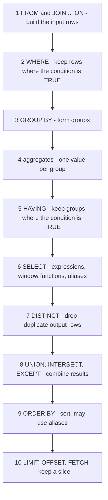
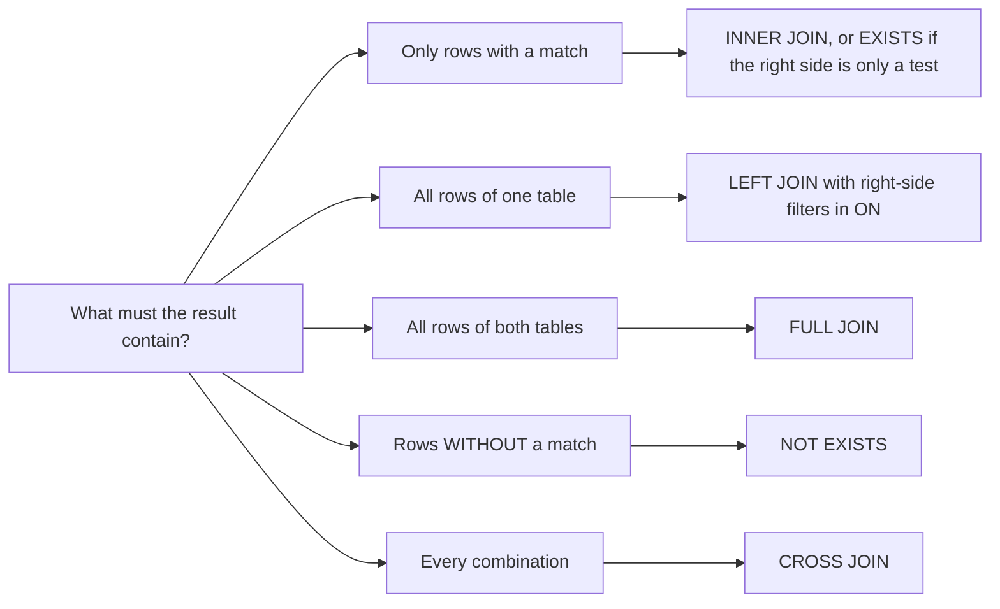
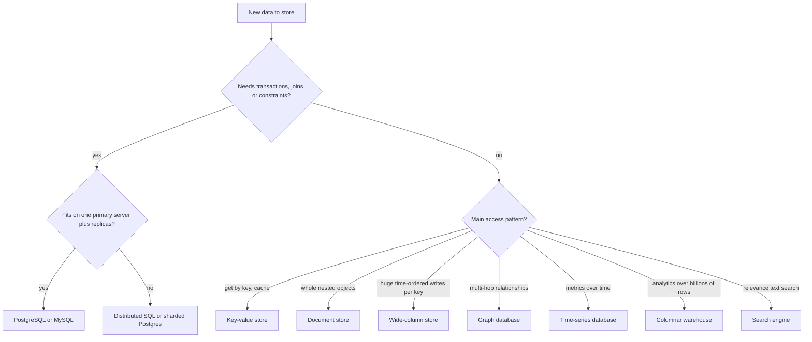

# Chapter 20 — Cheat Sheets, Interview Q&A and Glossary

The book on a few pages: no new topics, just the syntax, rules, decision tables and vocabulary of Chapters 1–19 in one place for quick revision or lookup. Every entry links to the section that explains it with examples and real output.

- **Syntax cheat sheets** per area (20.2–20.14), most ending with the traps that matter most; **the logical query-processing order** (20.1), which answers most "why does this error happen" questions.
- **Decision tables**: which join (20.5), subquery form (20.6), window function (20.8), index (20.11), isolation level (20.12), scaling tool (20.14), database (20.15).
- **A dialect table** for PostgreSQL, MySQL, SQL Server, SQLite and Oracle (20.16).
- **Verified behaviours** (20.17): about a hundred claims from these sheets (`7/2 = 3`, `NULL` logic, rank ties, frame defaults…) asserted by a runnable script on PostgreSQL 14, plus a script checking the SQLite column of the dialect table.
- **The interview pattern catalogue** (20.18), linking every pattern to solved problems in Chapters 18–19, and an **index of concept questions** (20.19) answered in the [Chapter 21 question bank](../21-interview-question-bank/README.md).
- **A glossary** (20.20), from *1NF* to *ZooKeeper*: every technical term, acronym and product name the book uses, each defined once in plain English — look a word up there the first time you meet it.

How to use it: read a sheet, cover the right-hand column and say the answer aloud; follow the link when it doesn't come easily. All SQL is PostgreSQL unless a row says otherwise; other databases' syntax in 20.16 comes from their documentation and was not run, except the SQLite column.

---

## 20.1 The logical query-processing order

You **write** `SELECT … FROM … WHERE … GROUP BY … HAVING … ORDER BY … LIMIT`, but the database **evaluates** it (logically) starting from `FROM`, each step receiving the previous step's table. The optimizer may physically reorder the work, but the result is always as if these steps ran in this order.



*Figure 20.1 — Logical query-processing order (full explanation in [§4.5](../04-aggregation/README.md#45-the-logical-order-of-query-processing) and [§2.9](../02-select-basics/README.md#29-how-a-select-is-evaluated-logical-processing-order)).*

| Consequence | Because |
|---|---|
| `WHERE` cannot use a `SELECT` alias | aliases are created at step 6, `WHERE` is step 2 |
| `WHERE` cannot contain `count(*)`, use `HAVING` | groups do not exist before step 3 |
| A window function cannot appear in `WHERE` or `HAVING` | windows are computed at step 6. Filter them in an outer query or CTE ([§8.10](../08-window-functions/README.md#810-named-windows-filter-evaluation-order-and-performance)) |
| `ORDER BY` can use aliases and column positions | it runs after `SELECT` |
| `LIMIT` without `ORDER BY` returns arbitrary rows | only step 9 gives order |
| A filter in `WHERE` on the right table of a `LEFT JOIN` removes the padded rows | `WHERE` runs after the join has built them ([§5.9](../05-joins/README.md#59-join-pitfalls)) |
| With `SELECT DISTINCT`, `ORDER BY` may only use output columns | sorting happens after de-duplication |

Two PostgreSQL relaxations: `GROUP BY` may refer to output aliases and positions (`GROUP BY 1`), and grouping by a table's primary key lets you select that table's other columns without listing them.

---

## 20.2 SELECT, filtering, NULL, sorting and paging

Covers [Chapter 2](../02-select-basics/README.md).

```sql
SELECT DISTINCT e.dept_id, e.salary * 12 AS yearly     -- expressions + aliases
FROM   employees AS e                                   -- table alias
WHERE  e.salary BETWEEN 1000 AND 5000                   -- inclusive on both ends
  AND  e.dept_id IN (1, 2, 3)                           -- same as a chain of ORs
  AND  e.name ILIKE 'a%'                                -- LIKE is case-sensitive, ILIKE is not
  AND  e.manager_id IS NOT NULL                         -- never "= NULL"
ORDER  BY yearly DESC NULLS LAST, e.dept_id             -- add a tie-breaker
LIMIT  10 OFFSET 20;                                    -- or OFFSET 20 ROWS FETCH FIRST 10 ROWS ONLY
```

| Need | Syntax | Remember |
|---|---|---|
| Rename a column | `expr AS name` | double-quote a name with spaces or capitals: `AS "Total"` |
| Pattern match | `LIKE 'a_%'` | `%` = any run of characters, `_` = exactly one. `ESCAPE` for literal `%`. `~` / `~*` for regular expressions |
| Range | `x BETWEEN a AND b` | inclusive. For timestamps use half-open `x >= a AND x < b` |
| NULL test | `IS NULL`, `IS NOT NULL` | `x = NULL` is never TRUE |
| NULL-safe compare | `a IS [NOT] DISTINCT FROM b` | treats two NULLs as equal |
| Default for NULL | `COALESCE(x, 0)` | returns the first non-NULL argument |
| Unique rows | `SELECT DISTINCT a, b` | applies to the whole output row, and NULLs count as equal |
| First row per group | `SELECT DISTINCT ON (g) … ORDER BY g, ts` | PostgreSQL only. The leading `ORDER BY` keys must match `g` |
| Sort | `ORDER BY a DESC NULLS LAST, b` | PostgreSQL puts NULLs **last** in ascending order and **first** in descending order |
| Page | `LIMIT n OFFSET k` / `OFFSET k ROWS FETCH FIRST n ROWS ONLY` | always with `ORDER BY`. Deep pages → keyset pagination ([§12.14](../12-indexes-storage-and-query-performance/README.md#1214-offset-vs-keyset-pagination)) |
| Keep ties at the cut-off | `FETCH FIRST n ROWS WITH TIES` | needs `ORDER BY` (PostgreSQL 13+) |

**Three-valued logic.** A comparison with `NULL` gives `UNKNOWN` (shown as NULL). `WHERE` and `HAVING` keep only rows where the condition is TRUE; `CHECK` constraints reject only FALSE.

| `AND` | TRUE | FALSE | UNKNOWN |
|---|---|---|---|
| **TRUE** | TRUE | FALSE | UNKNOWN |
| **FALSE** | FALSE | FALSE | FALSE |
| **UNKNOWN** | UNKNOWN | FALSE | UNKNOWN |

| `OR` | TRUE | FALSE | UNKNOWN |
|---|---|---|---|
| **TRUE** | TRUE | TRUE | TRUE |
| **FALSE** | TRUE | FALSE | UNKNOWN |
| **UNKNOWN** | TRUE | UNKNOWN | UNKNOWN |

`NOT UNKNOWN` is UNKNOWN. Precedence is `NOT` > `AND` > `OR`, so parenthesise whenever you mix `AND` and `OR`.

**Traps:** `x <> 5` silently drops rows where `x` is NULL. `NOT IN (list containing NULL)` returns no rows ([§2.5](../02-select-basics/README.md#25-null-and-three-valued-logic), [§6.2](../06-subqueries-and-set-operations/README.md#62-multi-row-subqueries-in-and-not-in)). `BETWEEN '2024-01-01' AND '2024-01-31'` on a timestamp misses everything after midnight on the 31st. `OFFSET 100000` still reads and throws away 100,000 rows.

---

## 20.3 Functions and expressions

Covers [Chapter 3](../03-functions-and-expressions/README.md).

| Area | PostgreSQL | Notes |
|---|---|---|
| Cast | `CAST(x AS numeric(10,2))`, `x::int` | `::` is PostgreSQL-only. Bad input raises an error instead of guessing |
| Division | `7 / 2` → `3`, `7 / 2.0` → `3.5`, `7::numeric / 2` → `3.5` | integer ÷ integer truncates toward zero (`-7 / 2` → `-3`) |
| Remainder | `7 % 3`, `mod(7, 3)` | takes the sign of the dividend (`-7 % 2` → `-1`) |
| Rounding | `round(x, 2)`, `trunc(x)`, `ceil`, `floor` | `round(2.5)` → 3 on `numeric` (half away from zero), `round(2.5::float8)` → 2 (half to even) |
| Logs and powers | `ln(x)`, `log(x)` (base 10), `log(b, x)`, `power(a, b)`, `sqrt` | MySQL's `LOG(x)` is the natural log |
| Safe divide | `a / NULLIF(b, 0)` | `1 / 0` is an error (SQLSTATE 22012); the `NULLIF` version returns NULL. MySQL and SQLite return NULL for `x / 0` instead of failing (20.16) |
| Concatenate | `a \|\| b`, `concat(a, b)`, `concat_ws(', ', a, b)` | `\|\|` with a NULL gives NULL. `concat` skips NULLs |
| Length | `length(s)` / `char_length(s)` = characters, `octet_length(s)` = bytes | `'é'` is 1 character, 2 bytes in UTF-8 |
| Pieces | `substring(s FROM 2 FOR 3)`, `left`, `right`, `split_part(s, ',', 2)` | positions are 1-based |
| Clean up | `trim`, `lower`, `upper`, `initcap`, `replace`, `translate`, `lpad`, `regexp_replace` | |
| Search | `position('x' IN s)`, `strpos(s, 'x')` | 0 means "not found" |
| Now | `now()` = `current_timestamp` (fixed for the transaction), `clock_timestamp()` (real time) | `current_date` for today |
| Date arithmetic | `d + 7`, `ts + interval '2 hours'`, `date '2024-03-01' - date '2024-02-01'` → `29` | `date - date` is an integer number of days. Month addition clamps (Jan 31 + 1 month = Feb 29 in 2024) |
| Parts | `extract(year FROM ts)`, `date_part('dow', d)` (Sunday = 0), `date_trunc('month', ts)`, `age(a, b)` | |
| Format and parse | `to_char(ts, 'YYYY-MM')`, `to_date('03/05/2024', 'DD/MM/YYYY')` | |
| Time zones | `timestamptz` stores an instant. `ts AT TIME ZONE 'Europe/Paris'` converts | store `timestamptz`, not `timestamp` |
| Conditionals | `CASE WHEN … THEN … ELSE … END`, `COALESCE`, `NULLIF`, `GREATEST`, `LEAST` | no `ELSE` → NULL. PostgreSQL's `GREATEST`/`LEAST` ignore NULLs |

**Traps:** integer averages and percentages (`100 * a / b` with integers truncates — write `100.0 * a / b`), `float` for money (use `numeric`), `timestamp` without time zone for events in several regions, and assuming `LOG` means the same everywhere.

---

## 20.4 Aggregation

Covers [Chapter 4](../04-aggregation/README.md).

```sql
SELECT   dept_id,
         count(*)                                  AS staff,        -- rows
         count(manager_id)                         AS with_manager, -- non-NULL values
         count(DISTINCT job)                       AS jobs,
         round(avg(salary), 2)                     AS avg_salary,   -- NULLs ignored
         count(*) FILTER (WHERE salary > 5000)     AS high_paid,    -- conditional aggregate
         sum(CASE WHEN remote THEN 1 ELSE 0 END)   AS remote_staff, -- portable version
         string_agg(name, ', ' ORDER BY name)      AS names
FROM     employees
WHERE    hired >= date '2020-01-01'                -- filters rows before grouping
GROUP BY dept_id
HAVING   count(*) >= 3                             -- filters groups after aggregation
ORDER BY staff DESC;
```

| Function | Returns | NULL behaviour / empty input |
|---|---|---|
| `count(*)` | number of rows | 0 for no rows |
| `count(x)`, `count(DISTINCT x)` | non-NULL values (distinct) | 0 for no rows |
| `sum`, `avg`, `min`, `max` | as named | skip NULLs. **NULL** for no rows (use `COALESCE(sum(x), 0)`) |
| `avg(int_col)` | `numeric` in PostgreSQL | SQL Server returns an integer |
| `string_agg(x, sep ORDER BY …)`, `array_agg`, `json_agg` | concatenated value | `string_agg` skips NULLs |
| `bool_and`, `bool_or` | boolean | |
| `percentile_cont(0.5) WITHIN GROUP (ORDER BY x)` | median (interpolated) | `percentile_disc` returns an actual value; `mode()` the most common |
| `GROUPING SETS ((a), (b), ())`, `ROLLUP (a, b)`, `CUBE (a, b)` | subtotals in one query | `grouping(a)` = 1 marks a rolled-up row. `ROLLUP (a, b)` = (a,b), (a), () |

**Rules:** every selected column must be grouped or aggregated (or depend functionally on a grouped primary key). NULLs form **one** group. `GROUP BY` does not sort. An aggregate query without `GROUP BY` always returns exactly one row, even over zero rows — why "return NULL if there is no answer" questions use an aggregate or scalar subquery ([P39](../18-sql-interview-problems-1/README.md#p39--second-highest-salary--and-return-null-if-none)).

**Traps:** `WHERE count(*) > 1` (use `HAVING`). `count(*)` after a `LEFT JOIN` counts the padding row — use `count(right_table.id)` to get zero ([§5.9](../05-joins/README.md#59-join-pitfalls)). Averages of averages. Joining two child tables before aggregating multiplies the rows (fan-out).

---

## 20.5 Joins

Covers [Chapter 5](../05-joins/README.md).

```sql
SELECT c.name, o.id, o.total
FROM   customers c
LEFT   JOIN orders o
       ON  o.customer_id = c.id
       AND o.placed_at >= date '2024-01-01';   -- right-table filter belongs in ON
```

| Join | Returns | Typical question |
|---|---|---|
| `CROSS JOIN` | every pair, m × n rows | "every student × every subject" grid |
| `[INNER] JOIN … ON` | only pairs that match | "orders with their customer" |
| `LEFT [OUTER] JOIN` | every left row, with matches or NULL padding | "all customers, with their orders if any" |
| `RIGHT [OUTER] JOIN` | mirror of `LEFT` | rewrite as `LEFT` for readability |
| `FULL [OUTER] JOIN` | all rows of both sides | reconciling two lists |
| Self join | a table joined to itself under two aliases | employee → manager, pairs, previous row |
| Semi-join: `EXISTS`, `IN` | left rows that have at least one match, each once | "customers who ordered" |
| Anti-join: `NOT EXISTS`, `LEFT JOIN … WHERE r.id IS NULL`, `EXCEPT` | left rows with no match | "customers who never ordered" |
| `JOIN … USING (col)` | equality on same-named columns, one output column | fine. `NATURAL JOIN` is not (it silently joins on every shared name) |
| `JOIN LATERAL (subquery) ON true` | per-row subquery that may reference the left row | "top 3 orders per customer" ([§6.7](../06-subqueries-and-set-operations/README.md#67-lateral-subqueries)) |



*Figure 20.2 — Choosing a join.*

**Pitfalls ([§5.9](../05-joins/README.md#59-join-pitfalls)):** fan-out when joining two one-to-many children, right-table conditions in `WHERE` after a `LEFT JOIN`, NULL join keys (never match), `count(*)` of padded rows, joining on names instead of keys, `NOT IN` with NULLs. **How joins run:** nested loop (few outer rows, indexed inner key), hash join (large, equality only), merge join (both inputs sorted) ([§12.15](../12-indexes-storage-and-query-performance/README.md#1215-join-algorithms)).

---

## 20.6 Subqueries and set operations

Covers [Chapter 6](../06-subqueries-and-set-operations/README.md).

| Form | Example | Watch out for |
|---|---|---|
| Scalar subquery | `SELECT name, (SELECT max(total) FROM orders o WHERE o.cid = c.id) FROM customers c` | 0 rows → NULL. 2+ rows → error |
| `IN` / `NOT IN` | `WHERE id IN (SELECT cid FROM orders)` | `NOT IN` returns nothing if the subquery yields a NULL |
| Correlated | inner query uses a column of the outer row | conceptually runs once per outer row. Qualify every column |
| `EXISTS` / `NOT EXISTS` | `WHERE NOT EXISTS (SELECT 1 FROM orders o WHERE o.cid = c.id)` | the safe anti-join. The select list inside does not matter |
| `ANY` / `ALL` | `salary > ALL (SELECT …)` | `> ALL (empty)` is TRUE. `> ANY (empty)` is FALSE. `= ANY` = `IN`, `<> ALL` = `NOT IN` |
| Derived table | `FROM (SELECT …) AS t` | alias required before PostgreSQL 16 |
| Row subquery | `WHERE (a, b) = (SELECT x, y …)` | also `(a, b) IN (…)` |
| `LATERAL` | `CROSS JOIN LATERAL (SELECT … WHERE o.cid = c.id LIMIT 3) t` | `LEFT JOIN LATERAL … ON true` keeps rows with no match |

| Set operator | Result | Notes |
|---|---|---|
| `UNION` | rows in either query, duplicates removed | costs a sort or hash |
| `UNION ALL` | everything, duplicates kept | the default choice when duplicates are impossible or wanted |
| `INTERSECT [ALL]` | rows in both | NULLs compare as equal here |
| `EXCEPT [ALL]` | rows in the first but not the second | not commutative. Oracle calls it `MINUS` |

Rules: same number of columns, compatible types, column names from the first query, `INTERSECT` binds tighter than `UNION`/`EXCEPT`, and `ORDER BY`/`LIMIT` apply to the whole combined result ([§6.11](../06-subqueries-and-set-operations/README.md#611-precedence-sorting-and-choosing-the-right-tool)).

---

## 20.7 CTEs, recursion and views

Covers [Chapter 7](../07-ctes-views-and-recursion/README.md).

```sql
WITH RECURSIVE chain AS (
    SELECT id, manager_id, name, 1 AS depth, ARRAY[id] AS path   -- anchor: the start rows
    FROM   employees WHERE manager_id IS NULL
  UNION ALL
    SELECT e.id, e.manager_id, e.name, c.depth + 1, c.path || e.id   -- recursive term
    FROM   employees e JOIN chain c ON e.manager_id = c.id
    WHERE  NOT e.id = ANY (c.path)                                    -- cycle guard
)
SELECT repeat('  ', depth - 1) || name AS org_chart FROM chain ORDER BY path;
```

| Tool | What it is | Use it for | Remember |
|---|---|---|---|
| CTE `WITH x AS (…)` | a named subquery for one statement | readable step-by-step queries, reuse by name | PostgreSQL 12+ inlines single-use CTEs. `AS MATERIALIZED` / `NOT MATERIALIZED` override |
| Data-modifying CTE | `WITH moved AS (DELETE … RETURNING *) INSERT … SELECT * FROM moved` | several changes in one atomic statement | PostgreSQL only. Every part sees the same snapshot |
| Recursive CTE | anchor `UNION [ALL]` recursive term | trees, graphs, number and date series | the recursive term sees only the previous round. Stops when a round adds no rows. Needs a stop condition |
| `CYCLE` / `SEARCH` clauses | built-in cycle detection and ordering | graphs | PostgreSQL 14+ |
| `generate_series(a, b, step)` | a set-returning function | calendars, filling gaps with zeros | inclusive of both ends. With `date` arguments and an `interval` step it returns `timestamptz`, so cast with `::date` |
| View | a stored query, no data | simplicity, security, stable interfaces | always current. Simple one-table views are updatable. `WITH CHECK OPTION` |
| Materialized view | a stored result | expensive reports | stale until `REFRESH MATERIALIZED VIEW [CONCURRENTLY]` (needs a unique index) |

---

## 20.8 Window functions and frames

Covers [Chapter 8](../08-window-functions/README.md).

```sql
function(args) OVER (
    PARTITION BY dept_id                  -- independent groups; rows are NOT collapsed
    ORDER BY     hired, id                -- order inside each partition
    ROWS BETWEEN 2 PRECEDING AND CURRENT ROW   -- frame: which rows the function sees
)
```

| Function | Result on scores 30, 20, 20, 10 (descending) | Uses the frame? |
|---|---|---|
| `row_number()` | 1, 2, 3, 4 (ties broken arbitrarily unless you add a tie-breaker) | no |
| `rank()` | 1, 2, 2, 4 (gaps after ties) | no |
| `dense_rank()` | 1, 2, 2, 3 (no gaps) | no |
| `ntile(n)` | bucket numbers 1..n. Larger buckets first (7 rows into 3 → 3, 2, 2) | no |
| `percent_rank()` / `cume_dist()` | (rank − 1)/(n − 1) / (rows sorted before the current row + its peers)/n | no |
| `lag(x, k, default)` / `lead(…)` | value k rows before / after (NULL or `default` past the edge) | no |
| `first_value`, `last_value`, `nth_value` | value at a position **in the frame** | **yes** |
| `sum`, `avg`, `count`, `min`, `max` … `OVER` | aggregate over the frame | **yes** |

| Frame | Meaning |
|---|---|
| no `ORDER BY` in `OVER` | frame = whole partition (`sum(x) OVER ()` = grand total on every row) |
| `ORDER BY` without a frame clause | **`RANGE BETWEEN UNBOUNDED PRECEDING AND CURRENT ROW`**, which includes all peers (ties) of the current row |
| `ROWS BETWEEN n PRECEDING AND CURRENT ROW` | physical rows. Use for moving averages and strict running totals |
| `RANGE BETWEEN interval '7 days' PRECEDING AND CURRENT ROW` | by value distance on the single `ORDER BY` key. Ties included |
| `GROUPS BETWEEN 1 PRECEDING AND CURRENT ROW` | by peer groups (PostgreSQL 11+) |
| `EXCLUDE CURRENT ROW / GROUP / TIES` | remove rows from the frame (PostgreSQL 11+) |

**Patterns:** running total `sum(x) OVER (PARTITION BY g ORDER BY t)`, share of total `x / sum(x) OVER ()`, change vs previous `x - lag(x) OVER (…)`, 7-row moving average with `ROWS 6 PRECEDING`, top-N per group (rank in a CTE, filter outside), de-duplication (`row_number() = 1`), gaps and islands (`value − row_number()` is constant inside a run) ([§8.7](../08-window-functions/README.md#87-running-totals-moving-averages-and-growth)–[§8.9](../08-window-functions/README.md#89-gaps-and-islands)).

**Traps:** `last_value` with the default frame returns the current row (give it `ROWS BETWEEN UNBOUNDED PRECEDING AND UNBOUNDED FOLLOWING`). The default `RANGE` frame gives tied rows the same running total. Windows cannot be used in `WHERE`, and PostgreSQL has no `QUALIFY`. `IGNORE NULLS` arrives only in PostgreSQL 19 (in beta as of September 2026), so on 14–18 emulate it ([§8.6](../08-window-functions/README.md#86-value-offset-functions-lag-lead-first_value-last_value-nth_value)). Each distinct window specification may need its own sort ([§8.10](../08-window-functions/README.md#810-named-windows-filter-evaluation-order-and-performance)).

---
## 20.9 DDL, DML, constraints and upsert

Covers [Chapter 9](../09-ddl-dml-and-constraints/README.md).

```sql
CREATE TABLE orders (
    id           bigint GENERATED ALWAYS AS IDENTITY PRIMARY KEY,
    customer_id  bigint NOT NULL REFERENCES customers (id) ON DELETE RESTRICT,
    status       text   NOT NULL DEFAULT 'new'
                 CONSTRAINT orders_status_ck CHECK (status IN ('new', 'paid', 'shipped')),
    total        numeric(12, 2) NOT NULL CHECK (total >= 0),
    placed_at    timestamptz NOT NULL DEFAULT now(),
    UNIQUE (customer_id, placed_at)
);
CREATE INDEX ON orders (customer_id);                 -- FKs are not indexed automatically

INSERT INTO orders (customer_id, total) VALUES (1, 20), (2, 35) RETURNING id;
UPDATE orders SET status = 'paid' WHERE id = 1 RETURNING *;
DELETE FROM orders o USING customers c WHERE o.customer_id = c.id AND c.banned;

INSERT INTO stock (sku, qty) VALUES ('A-1', 5)
ON CONFLICT (sku) DO UPDATE SET qty = stock.qty + EXCLUDED.qty;   -- upsert
```

| Statement | Does | Remember |
|---|---|---|
| `CREATE TABLE [IF NOT EXISTS]` | defines a table | `CREATE TABLE t AS SELECT …` copies data but no constraints. `LIKE src INCLUDING ALL` copies structure |
| `ALTER TABLE … ADD / DROP / RENAME COLUMN`, `ALTER COLUMN … TYPE t USING expr`, `SET NOT NULL`, `ADD CONSTRAINT … NOT VALID` + `VALIDATE CONSTRAINT` | changes a table | many forms take an exclusive lock on the whole table. Backfill before `SET NOT NULL` |
| `DROP TABLE [IF EXISTS] … [CASCADE]` | removes the table itself | `CASCADE` also drops dependent views and FKs |
| `TRUNCATE t [RESTART IDENTITY] [CASCADE]` | empties the table fast | no per-row triggers. Transactional in PostgreSQL |
| `DELETE FROM t WHERE …` | removes chosen rows | fires triggers, logs every row. Forget `WHERE` and every row goes |
| `INSERT … SELECT` | copies rows | list the target columns explicitly |
| `UPDATE … SET a = b, b = a` | swaps values | every `SET` expression sees the **old** row |
| `… RETURNING` | returns affected rows | PostgreSQL, SQLite 3.35+. SQL Server uses `OUTPUT` |
| `INSERT … ON CONFLICT (key) DO NOTHING / DO UPDATE SET c = EXCLUDED.c` | upsert | needs a unique index or constraint on the conflict target |
| `MERGE INTO t USING s ON … WHEN MATCHED … WHEN NOT MATCHED …` | standard upsert and sync | PostgreSQL 15+ (not on the book's server, 14) |

| Constraint | Rejects | Notes |
|---|---|---|
| `NOT NULL` | NULL | the most useful constraint |
| `PRIMARY KEY` | duplicates and NULLs | one per table. Creates a unique index |
| `UNIQUE` | duplicate non-NULL values | several NULLs allowed (SQL Server: one). `NULLS NOT DISTINCT` in PostgreSQL 15+ |
| `CHECK (expr)` | rows where `expr` is FALSE | NULL passes. Cannot look at other rows |
| `FOREIGN KEY … REFERENCES` | child values with no parent | `ON DELETE CASCADE / SET NULL / SET DEFAULT / RESTRICT / NO ACTION` (default). NO ACTION can be deferred, RESTRICT cannot |
| `DEFAULT` | — | used when the column is omitted |
| `EXCLUDE USING gist (…)` | overlapping values | "no two bookings of one room overlap" ([§17.2](../17-schema-design-case-studies/README.md#172-hotel-reservation-system)) |

| Key generation | Use |
|---|---|
| `GENERATED ALWAYS AS IDENTITY` | the standard choice. `serial` is the legacy form |
| Sequence (`nextval`) | shared or custom counters. Gaps are normal (rollbacks, caching) |
| `uuid` (`gen_random_uuid()`, PostgreSQL 13+) | ids made on many machines. Random UUIDs scatter B-tree inserts |
| `GENERATED ALWAYS AS (expr) STORED` | derived columns kept in sync automatically. PostgreSQL 18 adds `VIRTUAL` (computed on read), which becomes the default when neither keyword is given |

**Backups ([§9.12](../09-ddl-dml-and-constraints/README.md#912-backup-and-restore)):** `pg_dump` makes a logical copy (plain SQL, or `-Fc` custom / `-Fd` directory formats for `pg_restore`, which can restore selected objects in parallel). Physical base backups + archived WAL allow point-in-time recovery (PITR). Plan by RPO (data you may lose) and RTO (time to recover), keep 3 copies on 2 media with 1 off-site, and test restores.

---

## 20.10 Data modeling and normalization quick rules

Covers [Chapter 10](../10-data-modeling-and-er-diagrams/README.md), [Chapter 11](../11-normalization/README.md) and [Chapter 17](../17-schema-design-case-studies/README.md).

**Why databases exist ([§1.1](../01-databases-and-the-relational-model/README.md#11-before-databases-the-file-processing-era)).** File-based systems suffered redundancy and inconsistency (one fact in several files, drifting apart), isolated data in different formats, no general way to ask a new question, integrity rules buried in program code, lost updates when two users wrote at once, no atomic recovery after a crash, and all-or-nothing security. A DBMS answers each by mediating every access.

**The three levels of a model ([§10.2](../10-data-modeling-and-er-diagrams/README.md#102-the-three-levels-of-a-data-model)).**

| Level | Audience | Contains | Does not contain |
|---|---|---|---|
| Conceptual | business people | entities and relationships | data types, keys, DBMS details |
| Logical | designers | attributes, keys, cardinalities, normalized tables | a particular product's types or indexes |
| Physical | the DBMS | exact types, indexes, partitions, storage | — |

**ER notation ([§10.5](../10-data-modeling-and-er-diagrams/README.md#105-the-entity-relationship-er-model-and-its-notations)).**

| Concept | Chen notation | Crow's foot |
|---|---|---|
| Entity / weak entity | rectangle / double rectangle | box |
| Attribute | ellipse (underlined = key, double = multivalued, dashed = derived) | listed inside the box |
| Relationship / identifying relationship | diamond / double diamond | a line / a solid line to a weak entity |
| Cardinality | `1`, `N`, `M` on the lines | line ends: `\|\|` exactly one, `o\|` zero or one, `\|{` one or many, `o{` zero or many |
| Participation | double line = total (mandatory) | inner mark: `\|` mandatory, `o` optional |

**Mapping ER → tables ([§10.15](../10-data-modeling-and-er-diagrams/README.md#1015-converting-an-er-diagram-to-tables)).** Entity → table. Composite attribute → its parts. Multivalued attribute → its own table. Derived attribute → a view or generated column. 1:N → FK on the "many" side. M:N → junction table with a composite PK. 1:1 → FK + `UNIQUE`. Weak entity → owner's key + partial key as a composite PK, with `ON DELETE CASCADE`. Total participation → `NOT NULL` on the FK.

**Keys ([§10.13](../10-data-modeling-and-er-diagrams/README.md#1013-keys-in-relational-databases)).** Superkey ⊇ candidate key ⊇ the chosen **primary key**; other candidates are **alternate keys** (enforce with `UNIQUE`). **Natural key** (from the data: email, ISBN) vs **surrogate key** (made up: identity, UUID). A good default: surrogate PK + `UNIQUE` on the natural key.

**Functional dependencies ([§11.1](../11-normalization/README.md#111-functional-dependencies)–[§11.5](../11-normalization/README.md#115-minimal-canonical-cover)).** `X → Y` is a business rule: data can disprove it but never prove it. **Closure X⁺**: start with X, fire every FD whose left side is fully inside the set, repeat until nothing changes; X is a superkey when X⁺ contains every attribute. **Candidate keys**: attributes never on a right side must be in every key, so start from them. **Armstrong's axioms**: reflexivity, augmentation, transitivity (plus derived union, decomposition, pseudotransitivity). **Minimal cover**: single-attribute right sides, no extraneous left-side attributes, no redundant FDs.

**Normal forms ([§11.6](../11-normalization/README.md#116-anomalies--why-normalization-exists)–[§11.13](../11-normalization/README.md#1113-fifth-normal-form-5nf--facts-that-need-three-tables)).**

| Form | Rule (informal) | Removes |
|---|---|---|
| 1NF | every cell holds one atomic value, no repeating groups | lists in a column, `phone1, phone2, phone3` |
| 2NF | 1NF + no non-prime attribute depends on **part** of a composite key | partial dependencies |
| 3NF | 2NF + no non-prime attribute depends on another non-key attribute. Formally: for each FD X → A, X is a superkey or A is prime | transitive dependencies |
| BCNF | for every non-trivial FD X → Y, X is a superkey | the remaining FD redundancy |
| 4NF | BCNF + no non-trivial multivalued dependency unless its left side is a superkey | independent lists stored together |
| 5NF (project-join NF) | every join dependency follows from the keys | facts that only make sense as three-way combinations |

Two 1NF misunderstandings: atomicity depends on how data is **used** (a full name is atomic if you never query first names separately), and one string per cell is not enough — a comma-separated list in one string still breaks 1NF.

**Anomalies** (insertion, update, deletion) come from storing one fact in several rows. **Every decomposition must be lossless** (shared columns are a key of at least one piece) and ideally **dependency-preserving**; 3NF can always have both, BCNF sometimes loses an FD, so most designs stop at 3NF ([§11.10](../11-normalization/README.md#1110-decomposition-done-right-lossless-joins-and-dependency-preservation)).

**Design judgement calls ([§17.14](../17-schema-design-case-studies/README.md#1714-recurring-modeling-patterns)).**

| Decision | Rule of thumb |
|---|---|
| Type vs instance | separate the catalogue row from the physical item (title vs copy, room type vs room, seat vs seat-for-a-show) |
| Current state vs history | a status column for "now" plus an append-only events or ledger table for "what happened" |
| Snapshot vs reference | copy values that must not change later (price paid, shipping address) into the order row. That is a separate fact, not redundancy |
| Delete vs soft-delete | soft-delete (`deleted_at`) rows that history still references |
| Enforce where | rules in the schema (`CHECK`, `UNIQUE`, partial unique index, `EXCLUDE`) rather than only in application code |
| Denormalize when | only for a measured read problem, updated in the same transaction, with a reconciliation query ([§11.16](../11-normalization/README.md#1116-denormalization--when-and-how-to-break-the-rules)) |
| Scarce items | a guarded `UPDATE … WHERE status = 'free'` in a short transaction, or `FOR UPDATE SKIP LOCKED` |

---

## 20.11 Indexes and reading EXPLAIN

Covers [Chapter 12](../12-indexes-storage-and-query-performance/README.md).

```sql
CREATE INDEX CONCURRENTLY orders_cust_date_ix ON orders (customer_id, placed_at DESC); -- composite
CREATE INDEX ON orders (customer_id) INCLUDE (total);               -- covering (index-only scans)
CREATE INDEX ON orders (placed_at) WHERE status = 'new';            -- partial
CREATE INDEX ON users (lower(email));                               -- expression
CREATE INDEX ON docs USING gin (body_tsv);                          -- full-text / jsonb / arrays
CREATE INDEX ON readings USING brin (taken_at);                     -- huge, append-only, time-ordered
EXPLAIN (ANALYZE, BUFFERS) SELECT … ;                               -- runs the query and shows the plan
```

**Which index?**

| Query shape | Index | Why |
|---|---|---|
| `=`, `<`, `>`, `BETWEEN`, `ORDER BY`, `LIKE 'abc%'` (with `text_pattern_ops` or C collation) | **B-tree** (default) | sorted, supports ranges and order |
| `WHERE a = ? AND b > ?` | composite B-tree `(a, b)` | equality columns first, range column last |
| `WHERE a = ?` returning only a few columns | `(a) INCLUDE (x, y)` | index-only scan, no table visits |
| Only a small hot subset is queried (`status = 'new'`) | partial index `WHERE status = 'new'` | smaller, cheaper to maintain |
| `WHERE lower(email) = ?` | expression index on `lower(email)` | the index must match the expression |
| Equality only, very large keys | hash | cannot do ranges or ordering |
| JSONB `@>`, arrays `&&` / `@>`, full-text `@@`, trigram `LIKE '%x%'` | **GIN** (`pg_trgm` for trigrams) | inverted index: value → rows |
| Ranges overlapping, geometry, nearest neighbour, `EXCLUDE` constraints | **GiST** | tree of bounding boxes |
| Billions of rows physically ordered by time | **BRIN** | a few bytes per block range |
| Low-selectivity column (`is_active` true for 90 %) | usually **none** | a sequential scan is cheaper |

**Reading a plan ([§12.10](../12-indexes-storage-and-query-performance/README.md#1210-reading-explain-the-four-ways-to-read-a-table)).** Read from the innermost node outward. Each node shows `cost=startup..total` (planner units), estimated `rows`, and with `ANALYZE` `actual time`, actual `rows` and `loops` (multiply per-loop numbers by loops). `BUFFERS` shows pages hit in memory vs read.

| Node | Means | Chosen when |
|---|---|---|
| Seq Scan | reads every page | a large fraction of the table is needed, or no usable index |
| Index Scan | walks the index, then fetches each row | few rows, or rows needed in index order |
| Index Only Scan | answers from the index alone | all needed columns are in the index and pages are all-visible (vacuumed) |
| Bitmap Index Scan + Bitmap Heap Scan | collects row locations, then reads pages in order | a medium number of scattered rows. Can combine indexes with AND/OR |
| Nested Loop | for each outer row, probe the inner | small outer side + index on the inner join key |
| Hash Join | builds a hash table on the smaller input | large inputs, equality joins |
| Merge Join | merges two sorted inputs | both sides already sorted (or cheap to sort) |
| Sort / Incremental Sort, HashAggregate / GroupAggregate | sorting and grouping | watch `Sort Method: external merge` (spilled to disk) |

**The big warning sign:** estimated rows far from actual rows. Refresh statistics with `ANALYZE`; consider extended statistics for correlated columns ([§12.16](../12-indexes-storage-and-query-performance/README.md#1216-statistics-how-the-planner-estimates)).

**Anti-patterns that disable an index ([§12.13](../12-indexes-storage-and-query-performance/README.md#1213-anti-patterns-that-disable-indexes)):** a function or arithmetic on the indexed column (`WHERE date(ts) = …`, `WHERE price * 1.2 > …`), a leading wildcard (`LIKE '%x'`), implicit casts, `OR` across different columns (sometimes fixable with `UNION` or a bitmap), a composite index whose leading column is not filtered (PostgreSQL 18+, like Oracle and MySQL 8.0.13+, can sometimes skip-scan it when that column has few distinct values, but don't design around it), deep `OFFSET` paging (keyset: `WHERE (ts, id) < (:last_ts, :last_id) ORDER BY ts DESC, id DESC LIMIT 20`), and N+1 query loops in application code. Every index slows writes and uses space, so index real query patterns, not columns.

---

## 20.12 Transactions, isolation and concurrency

Covers [Chapter 13](../13-transactions-and-concurrency/README.md).

```sql
BEGIN ISOLATION LEVEL REPEATABLE READ;
  SELECT balance FROM accounts WHERE id = 1 FOR UPDATE;   -- lock the row you will change
  UPDATE accounts SET balance = balance - 100 WHERE id = 1;
  SAVEPOINT s1;
  UPDATE accounts SET balance = balance + 100 WHERE id = 2;
  -- ROLLBACK TO SAVEPOINT s1;   -- undo only the part after s1
COMMIT;                          -- or ROLLBACK
```

**ACID.** *Atomicity*: all or nothing (undo via log or, in PostgreSQL, marking the transaction aborted). *Consistency*: constraints and application rules hold before and after. *Isolation*: concurrent transactions don't see each other's partial work (locks, MVCC, SSI). *Durability*: a committed change survives a crash (WAL flushed at commit, checkpoints, replicas).

**Anomalies ([§13.4](../13-transactions-and-concurrency/README.md#134-isolation--anomalies-and-isolation-levels)).**

| Anomaly | What happens | Example |
|---|---|---|
| Dirty write | overwrite another transaction's uncommitted change | two uncommitted updates on one row |
| Dirty read | read another transaction's uncommitted change | see a balance that is later rolled back |
| Non-repeatable read (read skew) | the same row read twice gives different values. Read skew: different rows seen at different moments | a report sees an account before a transfer and the other account after it |
| Phantom read | the same query returns a different **set** of rows | a count rises because someone inserted a matching row |
| Lost update | two read-modify-write cycles, the second overwrites the first | two sales both set stock 10 → 9 |
| Write skew | two transactions read the same rows, then each updates a **different** row, breaking a rule both checked | two doctors both go off call, leaving nobody on call |

**Isolation levels — standard minimum vs PostgreSQL.**

| Level | Standard forbids | PostgreSQL actually prevents | Still possible in PostgreSQL |
|---|---|---|---|
| Read Uncommitted | — | dirty reads (it behaves as Read Committed) | as Read Committed |
| **Read Committed** (PostgreSQL default) | dirty read | dirty read and write | non-repeatable read, phantom, lost update, write skew |
| Repeatable Read (snapshot isolation) | + non-repeatable read | + phantoms. Lost updates abort with SQLSTATE 40001 | write skew |
| Serializable (SSI) | + phantom | everything. One transaction aborts with 40001 | nothing, but you must retry |

**Which isolation level (and lock)?**

| Situation | Choose |
|---|---|
| Ordinary OLTP, single-statement changes (`SET qty = qty - 1`) | Read Committed |
| A consistent multi-query report or export | Repeatable Read, `READ ONLY` |
| Read a row, decide, write it back | `SELECT … FOR UPDATE` at Read Committed, or an atomic `UPDATE … WHERE`, or Repeatable Read + retry |
| Optimistic editing across user think-time | a `version` column: `UPDATE … SET version = version + 1 WHERE id = ? AND version = ?` |
| A rule spanning several rows (no double booking, one on call) | Serializable + retry, an `EXCLUDE`/unique constraint, or explicit locks |
| Many workers taking jobs from a queue | `SELECT … FOR UPDATE SKIP LOCKED LIMIT 1` |
| Must not wait at all | `FOR UPDATE NOWAIT` (errors immediately if locked) |

**Concurrency control families ([§13.9](../13-transactions-and-concurrency/README.md#139-concurrency-control--the-big-picture)).** Pessimistic locking (shared/exclusive locks; two-phase locking: grow then shrink; strict 2PL holds write locks to commit). Optimistic (work freely, validate at commit, abort on conflict). Timestamp ordering (operations out of timestamp order are rejected). **MVCC** (writers create new row versions, readers see a snapshot, so readers never block writers; PostgreSQL marks versions with `xmin`/`xmax` and cleans dead ones with VACUUM).

**Deadlocks ([§13.11](../13-transactions-and-concurrency/README.md#1311-deadlocks)):** two transactions each wait for a lock the other holds. PostgreSQL detects it after `deadlock_timeout` and aborts one (SQLSTATE 40P01). Prevent by locking rows in a consistent order and keeping transactions short. Application code should **retry on 40001 and 40P01**.

---

## 20.13 Advanced PostgreSQL: PL/pgSQL, JSONB, full-text search, security

Covers [Chapter 14](../14-advanced-sql-and-using-sql-from-code/README.md).

```sql
CREATE FUNCTION order_total(p_id bigint) RETURNS numeric
LANGUAGE sql STABLE AS $$ SELECT sum(qty * price) FROM order_lines WHERE order_id = p_id $$;

CREATE PROCEDURE archive_old() LANGUAGE plpgsql AS $$
BEGIN
  LOOP
    DELETE FROM events WHERE id IN (SELECT id FROM events WHERE ts < now() - interval '1 year' LIMIT 10000);
    EXIT WHEN NOT FOUND;
    COMMIT;                                  -- procedures may commit (when CALLed outside a transaction)
  END LOOP;
END $$;
CALL archive_old();

CREATE FUNCTION touch() RETURNS trigger LANGUAGE plpgsql AS $$
BEGIN NEW.updated_at := now(); RETURN NEW; END $$;
CREATE TRIGGER t_touch BEFORE UPDATE ON products FOR EACH ROW EXECUTE FUNCTION touch();
```

| Feature | Syntax | Remember |
|---|---|---|
| Function | `CREATE FUNCTION f(args) RETURNS t LANGUAGE sql / plpgsql` | declare volatility honestly: `IMMUTABLE`, `STABLE`, `VOLATILE` (default) |
| Procedure | `CREATE PROCEDURE`, `CALL p()` | can `COMMIT` / `ROLLBACK` inside. `INOUT` parameters |
| Trigger | `BEFORE` / `AFTER` / `INSTEAD OF`, `FOR EACH ROW` / `STATEMENT` | BEFORE can modify `NEW` or reject (return NULL). AFTER reacts. Keep them fast |
| JSONB | `->` (jsonb), `->>` (text), `#>> '{a,b}'`, `@>` (contains), `?` (key exists), `jsonb_set`, `jsonb_each`, `jsonb_array_elements` | binary, keys de-duplicated (last wins) and reordered. GIN index for `@>` and `?`. In a quick demo, `VACUUM` after bulk updates before building the index, or older snapshots may ignore it |
| Arrays | `ARRAY[1,2]`, `a[1]` (1-based), `= ANY(a)`, `@>`, `&&`, `unnest`, `array_agg` | out-of-range subscript returns NULL |
| Full-text search | `to_tsvector('english', body) @@ websearch_to_tsquery('english', 'fast db')`, `ts_rank` | stemming and stop words. Store a generated `tsvector` column with a GIN index |
| Pivot | `max(v) FILTER (WHERE k = 'a') AS a … GROUP BY id`, or `crosstab` (tablefunc) | unpivot with `CROSS JOIN LATERAL (VALUES ('a', a), ('b', b))` |
| Roles and privileges | `CREATE ROLE app LOGIN`, `GRANT SELECT, INSERT ON t TO app`, `REVOKE` | group roles, least privilege |
| Row-level security | `ALTER TABLE t ENABLE ROW LEVEL SECURITY`, `CREATE POLICY p ON t USING (tenant_id = current_setting('app.tenant')::int)` | `USING` filters reads, `WITH CHECK` filters writes. Superusers and `BYPASSRLS` roles always bypass it; the table owner does too unless `FORCE ROW LEVEL SECURITY` |
| SQL injection defence | bind parameters: psycopg `%s`, sqlite3 `?`, JDBC `PreparedStatement` `?` | never concatenate user input. Identifiers: allow-list or `format('%I', …)` |
| From code | explicit transactions, `Decimal`/`BigDecimal` for money, batching or `COPY` for bulk loads, stream large results | a small, reused connection pool, or PgBouncer in front of many clients |
| ORMs | fast for CRUD | watch for N+1 queries. Hand-write complex and hot queries ([§14.13](../14-advanced-sql-and-using-sql-from-code/README.md#1413-orms-vs-raw-sql)) |

---

## 20.14 Scaling: partitioning, sharding, replication

Covers [Chapter 15](../15-scaling-databases/README.md).

```sql
CREATE TABLE events (id bigint, ts timestamptz NOT NULL, payload jsonb)
PARTITION BY RANGE (ts);
CREATE TABLE events_2024_06 PARTITION OF events
  FOR VALUES FROM ('2024-06-01') TO ('2024-07-01');       -- upper bound is exclusive
-- also PARTITION BY LIST (region) and PARTITION BY HASH (id) … FOR VALUES WITH (MODULUS 4, REMAINDER 0)
```

| Tool | What it does | Choose it when | Cost |
|---|---|---|---|
| Scale up | a bigger server | first, almost always | a ceiling, one failure domain |
| Read replicas | copies that serve reads | read-heavy workloads, reporting | replication lag, stale reads |
| Partitioning (one server) | split a table by range, list or hash | huge tables, time-based retention (drop a partition), pruning | unique keys must include the partition key |
| Sharding (many servers) | partitions on different machines | writes or data exceed one server | cross-shard joins and transactions, rebalancing, operations |
| Caching | keep hot results in memory | repeated reads of the same data | invalidation |
| Denormalized / summary tables | precomputed answers | expensive repeated aggregates | keeping copies correct |

| Concept | One-line rule |
|---|---|
| Shard key | high cardinality, spreads load evenly, matches the most common query filter |
| Consistent hashing | only about 1/n of keys move when a node joins. Virtual nodes smooth the load |
| Synchronous vs asynchronous replication | sync = no committed data lost but slower writes. Async = fast, with lag and possible loss on failover |
| Single-leader / multi-leader / leaderless | one writer (simple) / several writers (conflicts to resolve) / quorums with R + W > N |
| Consistency models | strong (linearizable) > sequential > causal > session (read-your-writes) > eventual |
| CAP | during a network partition choose consistency or availability |
| PACELC | if Partitioned choose A or C, Else choose Latency or Consistency |
| Consensus (Raft, Paxos) | a majority of 2f + 1 nodes tolerates f crashes. Byzantine faults (PBFT) need 3f + 1 |
| Two-phase commit | prepare, then commit. Blocks if the coordinator dies after prepare |
| Recovery | WAL first, checkpoints bound replay, redo committed work, undo uncommitted work |
| High availability | heartbeat → quorum decides → promote a replica → fence the old leader → redirect clients |
| Backups vs replicas | a replica copies your mistakes too. Only backups (with PITR) undo a bad `DELETE` |

---

## 20.15 Which database?

Covers [Chapter 16](../16-beyond-relational/README.md). Default to PostgreSQL for transactional data and add a specialised store only when a requirement clearly exceeds it ([§16.10](../16-beyond-relational/README.md#1610-choosing-a-database)).

| Family | Data shape | Strength | Weakness | Examples |
|---|---|---|---|---|
| Relational (OLTP) | tables, keys, constraints | joins, ACID, ad-hoc SQL | scaling writes beyond one node takes work | PostgreSQL, MySQL, SQL Server, Oracle |
| Key-value | key → opaque value | fastest get/put, TTL, simple scale-out | no queries by value | Redis, DynamoDB (also document-like), Memcached |
| Document | nested JSON per record | flexible schema, whole-object reads | cross-document joins and transactions are limited or costly | MongoDB, Couchbase, Firestore |
| Wide-column | partition key + sorted clustering columns | huge write rates, time-ordered data per key | must model around queries, no joins | Cassandra, ScyllaDB, HBase, Bigtable |
| Graph | nodes and edges | multi-hop traversals, paths | bulk analytics over all data, sharding | Neo4j, Amazon Neptune |
| Time-series | timestamped measurements | compression, retention, downsampling | general-purpose queries | TimescaleDB, InfluxDB, Prometheus |
| Search engine | inverted index of documents | relevance ranking, facets, fuzzy text | not a system of record | Elasticsearch, OpenSearch |
| Columnar warehouse | column-oriented tables | scans and aggregates over billions of rows | slow single-row writes | BigQuery, Snowflake, Redshift, ClickHouse |
| NewSQL / distributed SQL | SQL tables on consensus-replicated shards | SQL + ACID across nodes and regions | latency of consensus, operational complexity | Spanner, CockroachDB, YugabyteDB, TiDB |
| In-memory | data kept in RAM, persisted by snapshot + log | microsecond latency | cost per GB, durability settings | Redis, SAP HANA, VoltDB |



*Figure 20.3 — A first-pass database choice. Real systems often combine several (polyglot persistence), fed from one source of truth by change data capture.*

**ACID vs BASE.** BASE = *Basically Available, Soft state, Eventually consistent*: stay up and accept writes, let replicas converge later. A spectrum, not a switch: many NoSQL stores offer tunable or per-operation consistency.

---
## 20.16 Dialect differences

The differences you are most likely to hit when moving a query off PostgreSQL 14. Versions in brackets are the first release with the feature; "—" means no built-in equivalent; Oracle means 19c, with 21c or 23ai (renamed 26ai) features marked. The SQLite column was checked on SQLite 3.43 by `code/02_sqlite_dialect.sqlite.sql` (20.17); the other columns come from vendor documentation and were not run.

**Syntax and basics**

| Feature | PostgreSQL | MySQL 8 | SQL Server | SQLite | Oracle |
|---|---|---|---|---|---|
| First n rows | `LIMIT n` / `FETCH FIRST n ROWS ONLY` | `LIMIT n` | `TOP (n)` / `OFFSET 0 ROWS FETCH NEXT n ROWS ONLY` (2012, needs `ORDER BY`) | `LIMIT n` | `FETCH FIRST n ROWS ONLY` (12c). Older: `ROWNUM` |
| Quote an identifier | `"Name"` | backticks around the name (`"` only in ANSI_QUOTES mode) | `[Name]` or `"Name"` | `"Name"` (backticks and `[Name]` also accepted) | `"Name"` |
| Unquoted names are folded to | lower case | case of table names depends on the OS. Column names are case-insensitive | kept. Case-sensitivity follows the collation (insensitive by default) | kept, compared case-insensitively | UPPER case |
| String concatenation | `a \|\| b` (NULL if either is NULL), `concat()` | `CONCAT(a, b)` (NULL if any is NULL). `\|\|` means OR by default | `a + b`, `CONCAT()` (NULL treated as '') | `a \|\| b` | `a \|\| b` (NULL treated as '') |
| Empty string `''` | a value, not NULL | a value | a value | a value | **is NULL** |
| `7 / 2` | `3` | `3.5000` (`7 DIV 2` = 3) | `3` | `3` | `3.5` |
| `1 / 0` in a `SELECT` | error (22012) | NULL + warning (strict mode errors only in `INSERT`/`UPDATE`) | error (8134) | NULL | error (ORA-01476) |
| Cast | `CAST(x AS t)`, `x::t` | `CAST`, `CONVERT(x, t)` | `CAST`, `CONVERT(t, x)`, `TRY_CAST` | `CAST` | `CAST`, `TO_NUMBER`, `TO_DATE` |
| Boolean type | `boolean` | `BOOLEAN` = `TINYINT(1)` | `BIT` | integers 0/1 (keywords `TRUE`/`FALSE` accepted) | `BOOLEAN` (23ai). Before: none in SQL |
| `SELECT` without `FROM` | yes | yes (or `FROM DUAL`) | yes | yes | `FROM DUAL` required before 23ai |
| Type checking | strict | lenient unless strict SQL mode (the default in 8.0) | strict | dynamic typing (type affinity). `STRICT` tables (3.37) | strict |
| Auto-increment | `GENERATED … AS IDENTITY`, `serial` | `AUTO_INCREMENT` | `IDENTITY(1,1)` | `INTEGER PRIMARY KEY` (optionally `AUTOINCREMENT`) | `GENERATED … AS IDENTITY` (12c), sequences |
| Sequences | yes | — | yes (2012) | — | yes |
| `DROP TABLE IF EXISTS` | yes | yes | yes (2016) | yes | 23ai |

**NULLs, comparison and sorting**

| Feature | PostgreSQL | MySQL 8 | SQL Server | SQLite | Oracle |
|---|---|---|---|---|---|
| NULL-safe equality | `IS NOT DISTINCT FROM` | `<=>` | `IS NOT DISTINCT FROM` (2022) | `IS` (and `IS NOT DISTINCT FROM`, 3.39) | — (use `DECODE(a, b, 1, 0) = 1`) |
| NULLs in `ORDER BY … ASC` | last | first | first | first | last |
| `NULLS FIRST / LAST` | yes | — (sort by `x IS NULL` first) | — (sort by a `CASE` first) | yes (3.30) | yes |
| First non-NULL | `COALESCE` | `COALESCE`, `IFNULL` | `COALESCE`, `ISNULL` | `COALESCE`, `IFNULL` | `COALESCE`, `NVL` |
| `GREATEST(1, NULL)` | 1 (NULLs ignored) | NULL | 1 (2022) | use `max(a, b)` (NULL if any NULL) | NULL |
| `UNIQUE` column with several NULLs | allowed (`NULLS NOT DISTINCT` 15+) | allowed | **one** NULL only (use a filtered index) | allowed | allowed (all-NULL keys are not indexed) |
| `LIKE` case-sensitive? | yes (`ILIKE` for no) | no with the default collation | no with the default collation | no for ASCII | yes |
| Regular expressions | `~`, `~*`, `regexp_replace` | `REGEXP`, `REGEXP_LIKE` (8.0) | `REGEXP_LIKE`, `REGEXP_REPLACE` (2025). Before: `LIKE` patterns only | `REGEXP` only if a function is loaded (the shell has one) | `REGEXP_LIKE`, `REGEXP_REPLACE` |

**Joins, subqueries and set operations**

| Feature | PostgreSQL | MySQL 8 | SQL Server | SQLite | Oracle |
|---|---|---|---|---|---|
| `FULL OUTER JOIN` | yes | — (emulate with `UNION`) | yes | yes (3.39) | yes |
| `RIGHT JOIN` | yes | yes | yes | yes (3.39) | yes |
| `USING`, `NATURAL JOIN` | yes | yes | — | yes | yes |
| `LATERAL` | yes | yes (8.0.14) | `CROSS APPLY` / `OUTER APPLY` | — | `LATERAL`, `CROSS/OUTER APPLY` (12c) |
| `INTERSECT`, `EXCEPT` | yes | yes (8.0.31) | yes | yes | `INTERSECT`, `MINUS` (`EXCEPT` 21c) |
| Row values `(a, b) IN (SELECT …)` | yes | yes | — (use `EXISTS`) | yes (3.15) | yes |
| `UPDATE` with a join | `UPDATE t SET … FROM s WHERE …` | `UPDATE t JOIN s ON … SET …` | `UPDATE t SET … FROM t JOIN s ON …` | `UPDATE … FROM` (3.33) | `MERGE`, or a correlated subquery (direct joins 23ai) |

**Aggregation, CTEs and windows**

| Feature | PostgreSQL | MySQL 8 | SQL Server | SQLite | Oracle |
|---|---|---|---|---|---|
| String aggregation | `string_agg(x, ',' ORDER BY x)` | `GROUP_CONCAT(x ORDER BY x SEPARATOR ',')` | `STRING_AGG(x, ',') WITHIN GROUP (ORDER BY x)` (2017) | `group_concat(x, ',')` (`string_agg` 3.44) | `LISTAGG(x, ',') WITHIN GROUP (ORDER BY x)` |
| `FILTER (WHERE …)` on aggregates | yes | — (use `CASE`) | — (use `CASE`) | yes (3.30) | — (use `CASE`) |
| `avg()` of an integer column | exact `numeric` | decimal | **integer** (truncated) | floating point | exact `NUMBER` |
| Median | `percentile_cont(0.5) WITHIN GROUP (ORDER BY x)` | — | `PERCENTILE_CONT` as a window function only | — | `MEDIAN(x)`, `PERCENTILE_CONT` |
| `ROLLUP` / `CUBE` / `GROUPING SETS` | all three | `WITH ROLLUP` only | all three | — | all three |
| Recursive CTE keyword | `WITH RECURSIVE` | `WITH RECURSIVE` | plain `WITH` | `WITH RECURSIVE` | plain `WITH` (column list required) |
| Window functions | yes (8.4) | yes (8.0) | ranking 2005, frames 2012 | yes (3.25) | yes (8i) |
| `GROUPS` frames, `EXCLUDE` | yes (11) | — | — | yes (3.28) | yes (21c) |
| `WINDOW w AS (…)` clause | yes | yes | yes (2022) | yes | yes (21c) |
| `IGNORE NULLS` in `lag`/`first_value` | — (19, in beta as of September 2026) | — | yes (2022) | — | yes |
| `QUALIFY` | — | — | — | — | 26ai |
| `DISTINCT ON` | yes | — | — | — | — |

**DDL, DML and transactions**

| Feature | PostgreSQL | MySQL 8 | SQL Server | SQLite | Oracle |
|---|---|---|---|---|---|
| Upsert | `INSERT … ON CONFLICT`, `MERGE` (15) | `INSERT … ON DUPLICATE KEY UPDATE`, `REPLACE`, `INSERT IGNORE` | `MERGE` | `INSERT … ON CONFLICT` (3.24), `INSERT OR REPLACE` | `MERGE` |
| Return changed rows | `RETURNING` | — | `OUTPUT inserted.*` | `RETURNING` (3.35) | `RETURNING … INTO` (PL/SQL) |
| DDL inside a transaction | yes, can be rolled back | no, causes an implicit commit | mostly yes | yes | no, DDL commits |
| `CHECK` enforced | yes | yes (8.0.16; parsed but ignored before) | yes | yes | yes |
| Default isolation level | Read Committed | Repeatable Read | Read Committed (locking) | Serializable | Read Committed |
| "Serializable" means | SSI (true serializability) | 2PL: plain reads become locking reads | 2PL (or `SNAPSHOT` level) | one writer at a time | snapshot isolation (write skew possible) |
| Stored-procedure language | PL/pgSQL (and others) | SQL/PSM-style | T-SQL | — (host language) | PL/SQL |
| Materialized views | yes, manual `REFRESH` | — | indexed views | — | yes, with incremental (fast) refresh |

**Indexes and plans**

| Feature | PostgreSQL | MySQL 8 (InnoDB) | SQL Server | SQLite | Oracle |
|---|---|---|---|---|---|
| Table storage | heap + separate indexes | clustered on the primary key | heap or clustered index | B-tree keyed by rowid | heap (index-organized tables optional) |
| Page size | 8 KB | 16 KB | 8 KB | 4 KB default | (not covered) |
| Partial index | yes | — | filtered index | yes | — (function-based index returning NULL) |
| Covering `INCLUDE` | yes (11) | — (add to the key) | yes | — | — |
| Expression index | yes | functional key parts (8.0.13) | index a computed column | yes | function-based index |
| Hash index | yes (crash-safe since 10) | MEMORY engine only; InnoDB builds an adaptive hash index itself | memory-optimized tables | — | hash clusters |
| Show the plan | `EXPLAIN (ANALYZE, BUFFERS)` | `EXPLAIN ANALYZE` (8.0.18), `EXPLAIN FORMAT=TREE` | actual execution plan, `SET STATISTICS IO ON` | `EXPLAIN QUERY PLAN` | `EXPLAIN PLAN FOR` + `DBMS_XPLAN.DISPLAY` |

**Dates and functions**

| Task | PostgreSQL | MySQL 8 | SQL Server | SQLite | Oracle |
|---|---|---|---|---|---|
| Now | `now()` | `NOW()` | `SYSDATETIME()`, `GETDATE()` | `datetime('now')` | `SYSTIMESTAMP`, `SYSDATE` |
| Add 3 days | `d + 3`, `ts + interval '3 days'` | `DATE_ADD(d, INTERVAL 3 DAY)` | `DATEADD(day, 3, d)` | `date(d, '+3 days')` | `d + 3`, `d + INTERVAL '3' DAY` |
| Days between | `d2 - d1` | `DATEDIFF(d2, d1)` | `DATEDIFF(day, d1, d2)` | `julianday(d2) - julianday(d1)` | `d2 - d1` |
| Truncate to month | `date_trunc('month', d)` | `DATE_FORMAT(d, '%Y-%m-01')` | `DATETRUNC(month, d)` (2022) | `date(d, 'start of month')` | `TRUNC(d, 'MM')` |
| Year of a date | `extract(year FROM d)` | `YEAR(d)` | `YEAR(d)` | `strftime('%Y', d)` | `EXTRACT(YEAR FROM d)` |
| Characters / bytes | `length` / `octet_length` | `CHAR_LENGTH` / `LENGTH` | `LEN` (ignores trailing spaces) / `DATALENGTH` | `length` / `length(CAST(s AS BLOB))` | `LENGTH` / `LENGTHB` |
| If-then-else shortcut | `CASE` | `IF(c, a, b)` | `IIF(c, a, b)` | `iif(c, a, b)` (3.32) | `DECODE`, `CASE` |
| Random number 0–1 | `random()` | `RAND()` | `RAND()` | `random() / 18446744073709551616.0 + 0.5` | `DBMS_RANDOM.VALUE` |
| JSON | `json`, `jsonb` (+ GIN) | `JSON` (binary) | `nvarchar` + `JSON_VALUE` etc. (native `json` type 2025) | JSON functions on text (built in since 3.38) | `JSON` type (21c) |
| Arrays | yes | — | — | — | collection types (`VARRAY`) in PL/SQL |

---

## 20.17 Verified behaviours

Every concrete behaviour quoted on these sheets — `7 / 2 = 3`, `NULL = NULL` being unknown, rank ties, the default window frame, `NOT IN` with a NULL, upsert, `->>` returning text — is asserted by `code/01_cheatsheet_checks.sql`. Fixtures and a small checker live in `code/00_schema.sql`:

```sql
CREATE FUNCTION chk(p_area text, p_claim text, p_got text, p_expected text)
RETURNS void LANGUAGE plpgsql AS $$
BEGIN
  IF p_got IS DISTINCT FROM p_expected THEN
    RAISE EXCEPTION 'cheat-sheet claim FAILED [%] %: got %, expected %',
      p_area, p_claim, coalesce(p_got, 'NULL'), coalesce(p_expected, 'NULL');
  END IF;
  INSERT INTO check_log (area, claim, got, expected)
  VALUES (p_area, p_claim, coalesce(p_got, 'NULL'), coalesce(p_expected, 'NULL'));
END $$;
```

`chk` compares with `IS DISTINCT FROM`, so an expected NULL is checked properly (a plain `<>` would let a NULL result slip through — the trap of 20.2). Checks are grouped into `DO` blocks by area, for example:

```sql
DO $$ BEGIN
  PERFORM chk('NULL', '2 NOT IN (1, NULL) is NULL, not TRUE',     (2 NOT IN (1, NULL))::text, NULL);
  -- ...
END $$;

DO $$ BEGIN
  PERFORM chk('Windows', 'default frame with ORDER BY is RANGE: peers share the running total',
              (SELECT string_agg(s::text, ',' ORDER BY day, amount)
                 FROM (SELECT day, amount, sum(amount) OVER (ORDER BY day) AS s FROM sales) t),
              '10,40,40,45');
  -- ... (rank ties; later blocks: transactional TRUNCATE, JSONB, arrays, FTS — see the file)
END $$;
```

A wrong claim stops the file with, e.g., `ERROR: cheat-sheet claim FAILED [Functions] …: got 2/2, expected 1/2` — that exact message appeared once while writing this chapter, when the scratch database was accidentally created with `SQL_ASCII` encoding, where `length('é')` counts bytes (the runner always creates UTF-8 databases). Output (`bash tools_run_sql.sh sql '20-*'` → `OK`): claims per area — NULL 18, Functions 18, Aggregation 12, Joins 5, Subqueries 3, Set ops 5, DISTINCT 1, ORDER BY 4, WHERE 4, Windows 12, CTEs 3, Constraints 3, Upsert 2, DML 1, DDL 1, Transactions 2, JSONB 5, Arrays 3, FTS 2 — **`total_claims_verified` 104**.

The SQLite column of the dialect table is checked by `code/02_sqlite_dialect.sqlite.sql`. SQLite has no `DO` blocks, so each claim is inserted into a table whose `CHECK (ok = 1)` fails the script when a claim is false:

```sql
CREATE TABLE claim (what TEXT, ok INTEGER CHECK (ok = 1));
INSERT INTO claim VALUES
 ('7/2 = 3 (integer division)',               7 / 2 = 3),
 ('a || NULL is NULL',                        ('a' || NULL) IS NULL),
 -- ...
 ('UNIQUE allows several NULLs',              (SELECT count(*) FROM u) = 2);
BEGIN; CREATE TABLE gone (x); ROLLBACK;        -- DDL is transactional in SQLite too
INSERT INTO claim SELECT 'DDL rolls back', (SELECT count(*) FROM sqlite_master WHERE name = 'gone') = 0;
```

Output: `28 SQLite claims verified`.

---

## 20.18 Interview pattern catalogue

Most SQL interview questions are one of about twenty patterns. Recognise the pattern from the wording, write the template, then adapt it. Method and edge-case checklist: [§18.1](../18-sql-interview-problems-1/README.md#181-how-to-approach-a-sql-interview-question) and [§19.1](../19-sql-interview-problems-2/README.md#191-how-to-attack-a-medium-or-hard-problem). Full catalogues: [§18.10](../18-sql-interview-problems-1/README.md#1810-pattern-table) and [§19.11](../19-sql-interview-problems-2/README.md#1911-pattern-catalogue).

| Pattern | Wording that gives it away | Core technique | Solved examples |
|---|---|---|---|
| Plain filter | "find rows where …", "not equal to" | `WHERE` with NULL-aware logic (`IS DISTINCT FROM`) | [P1](../18-sql-interview-problems-1/README.md#p1--big-cities--or-filter), [P2](../18-sql-interview-problems-1/README.md#p2--odd-numbered-not-boring-movies--modulo-and-), [P4](../18-sql-interview-problems-1/README.md#p4--everyone-outside-department-3--null-safe-not-equal), [19.2.1](../19-sql-interview-problems-2/README.md#1921-staff-rated-above-8) |
| String and regex filter | "valid e-mail", "longer than N characters" | `~` with anchors, `char_length` | [P6](../18-sql-interview-problems-1/README.md#p6--long-comments--length-in-characters), [P7](../18-sql-interview-problems-1/README.md#p7--valid-company-e-mails--regular-expressions) |
| Row-level classification | "label each row", "is it a triangle" | `CASE` | [P8](../18-sql-interview-problems-1/README.md#p8--triangle-test--a-case-per-row), [19.10.3](../19-sql-interview-problems-2/README.md#19103-can-four-sides-form-a-rectangle) |
| Group and count | "per", "for each", "how many" | `GROUP BY` + aggregate, `HAVING` | [P10](../18-sql-interview-problems-1/README.md#p10--units-sold-per-product--sum-with-group-by), [P12](../18-sql-interview-problems-1/README.md#p12--follower-count--count-vs-countcol), [P14](../18-sql-interview-problems-1/README.md#p14--missed-appointments--filter-then-group), [19.2.2](../19-sql-interview-problems-2/README.md#1922-likes-per-post) |
| Zero counts included | "including those with none" | `LEFT JOIN` + `count(right.col)` or `CROSS JOIN` grid | [P20](../18-sql-interview-problems-1/README.md#p20--exam-sittings-per-student-and-subject--cross-join--left-join), [19.2.3](../19-sql-interview-problems-2/README.md#1923-average-mark-for-every-learner--module) |
| Distinct lists per group | "list the products sold each day" | `count(DISTINCT)`, `string_agg(DISTINCT … ORDER BY …)` | [P15](../18-sql-interview-problems-1/README.md#p15--products-sold-per-day--countdistinct-and-string_agg), [P16](../18-sql-interview-problems-1/README.md#p16--customer-basket-summary--the-same-pattern-per-customer), [19.10.2](../19-sql-interview-problems-2/README.md#19102-build-a-polynomial-equation-string) |
| Semi-join | "who has at least one" | `EXISTS` | [P22](../18-sql-interview-problems-1/README.md#p22--middle-users-in-a-follow-graph--self-join-or-exists) |
| Anti-join | "never", "without", "no sales" | `NOT EXISTS` (not `NOT IN`) | [P23](../18-sql-interview-problems-1/README.md#p23--sellers-with-no-2020-sales--not-exists-with-a-date-range), [P24](../18-sql-interview-problems-1/README.md#p24--dormant-accounts--left-join--is-null), [P25](../18-sql-interview-problems-1/README.md#p25--sessions-with-no-ads--anti-join-on-a-range-condition), [P26](../18-sql-interview-problems-1/README.md#p26--reps-who-never-sold-to-red--not-exists-vs-not-in) |
| Conditional aggregation / static pivot | "one column per status" | `count(*) FILTER (WHERE …)`, `SUM(CASE …)` | [P27](../18-sql-interview-problems-1/README.md#p27--attendance-summary--one-column-per-status), [P28](../18-sql-interview-problems-1/README.md#p28--monthly-approvals-and-chargebacks--union-all-then-pivot), [19.6.1](../19-sql-interview-problems-2/README.md#1961-names-by-region-side-by-side) |
| Dynamic pivot / unpivot | "one column per store", columns unknown | `format('%I')` + `EXECUTE`, `LATERAL (VALUES …)`, `jsonb_each_text` | [19.6.2](../19-sql-interview-problems-2/README.md#1962-dynamic-pivot-one-column-per-store), [19.6.3](../19-sql-interview-problems-2/README.md#1963-dynamic-unpivot-store-columns-back-to-rows) |
| Date ranges | "in February 2020", "last 30 days" | half-open `>= start AND < next_start` | [P23](../18-sql-interview-problems-1/README.md#p23--sellers-with-no-2020-sales--not-exists-with-a-date-range), [P29](../18-sql-interview-problems-1/README.md#p29--weather-class-per-country-in-november-2019--month-range--case-on-an-average), [P30](../18-sql-interview-problems-1/README.md#p30--engagement-level-for-february-2020--leap-year-boundary), [P31](../18-sql-interview-problems-1/README.md#p31--absences-longer-than-three-days--date-subtraction-inclusive-counting) |
| As-of value | "price on that date" | latest row `<=` the date (`DISTINCT ON` or `LIMIT 1`) + default | [P33](../18-sql-interview-problems-1/README.md#p33--price-on-a-given-date--latest-row-on-or-before-a-date) |
| Ratio / rate | "percentage", "rate", "share" | `100.0 * …`, `NULLIF(denominator, 0)`, round last | [P34](../18-sql-interview-problems-1/README.md#p34--search-query-quality--averaging-a-ratio-share-of-poor-rows), [P35](../18-sql-interview-problems-1/README.md#p35--ad-click-through-rate--divide-by-a-possibly-zero-count), [P36](../18-sql-interview-problems-1/README.md#p36--each-books-share-of-all-loans--ratio-against-a-grand-total), [P37](../18-sql-interview-problems-1/README.md#p37--average-selling-price--weighted-average-with-a-range-join), [19.9.1](../19-sql-interview-problems-2/README.md#1991-ride-cancellation-rate-the-trips-and-users-classic), [19.9.2](../19-sql-interview-problems-2/README.md#1992-delivery-fulfilment-rate), [19.9.3](../19-sql-interview-problems-2/README.md#1993-share-of-members-who-borrowed-each-book) |
| Nth highest | "second highest", "NULL if none" | `DISTINCT … OFFSET n-1 LIMIT 1` in a scalar subquery, or `dense_rank` | [P39](../18-sql-interview-problems-1/README.md#p39--second-highest-salary--and-return-null-if-none), [19.3.1](../19-sql-interview-problems-2/README.md#1931-second-fastest-lap-time) |
| Top-N per group | "top 3 in each department" | `dense_rank() OVER (PARTITION BY …)` in a CTE, filter outside | [19.3.2](../19-sql-interview-problems-2/README.md#1932-top-three-distinct-scores-per-subject) |
| First / last row per group | "first login device", "latest status" | `DISTINCT ON`, `row_number() = 1` | [P40](../18-sql-interview-problems-1/README.md#p40--device-used-at-first-login--first-row-per-group), [19.3.3](../19-sql-interview-problems-2/README.md#1933-one-home-office-per-employee) |
| Ties must be kept | "all winners", "include ties" | `rank() = 1`, `WITH TIES`, `= (SELECT max …)` | [P21](../18-sql-interview-problems-1/README.md#p21--election-winner--order-by-an-aggregate-and-ties), [19.3.8](../19-sql-interview-problems-2/README.md#1938-first-year-on-loan-keep-the-ties), [19.3.9](../19-sql-interview-problems-2/README.md#1939-busiest-collaborators-all-ties) |
| Running total / cut-off | "so far", "cumulative", "who fits" | `sum() OVER (ORDER BY …)` | [P41](../18-sql-interview-problems-1/README.md#p41--games-played-so-far--running-total), [19.4.1](../19-sql-interview-problems-2/README.md#1941-running-total-per-team), [19.4.2](../19-sql-interview-problems-2/README.md#1942-last-person-who-fits-in-the-lift) |
| Compare with previous row | "improved", "change since last" | `lag()` | [19.4.3](../19-sql-interview-problems-2/README.md#1943-performance-and-improvement-rate), [19.5.6](../19-sql-interview-problems-2/README.md#1956-deposits-over-the-limit-two-months-running) |
| Compare with group | "above the department average" | `avg() OVER (PARTITION BY …)` | [P42](../18-sql-interview-problems-1/README.md#p42--active-businesses--compare-each-row-to-its-groups-average), [19.7.5](../19-sql-interview-problems-2/README.md#1975-departments-with-two-above-average-earners) |
| Gaps and islands / streaks | "N in a row", "consecutive", "longest streak" | `value − row_number()`, or difference of two row numbers | [P32](../18-sql-interview-problems-1/README.md#p32--absence-streaks-of-3-days--gaps-and-islands-first-taste), [19.5.1](../19-sql-interview-problems-2/README.md#1951-runs-of-busy-days-at-the-gate), [19.5.2](../19-sql-interview-problems-2/README.md#1952-values-repeated-three-times-in-a-row), [19.5.3](../19-sql-interview-problems-2/README.md#1953-members-active-five-days-in-a-row), [19.5.5](../19-sql-interview-problems-2/README.md#1955-longest-winning-streak) |
| Pairs stored once | friends, calls, matches | `UNION ALL` both directions | [19.7.1](../19-sql-interview-problems-2/README.md#1971-page-suggestions-from-friends-likes), [19.7.2](../19-sql-interview-problems-2/README.md#1972-popularity-percentage), [19.7.4](../19-sql-interview-problems-2/README.md#1974-league-table) |
| Relational division | "took every course" | `HAVING count(DISTINCT x) = (SELECT count(*) …)` | [19.7.6](../19-sql-interview-problems-2/README.md#1976-students-enrolled-in-every-course) |
| Retention / cohorts | "came back the next day" | first date per user, then join on `first + 1` | [P38](../18-sql-interview-problems-1/README.md#p38--came-back-the-next-day--retention-fraction), [19.8.1](../19-sql-interview-problems-2/README.md#1981-day-1-retention) |
| Histogram with empty buckets | "include zero" | `generate_series` + `LEFT JOIN` | [19.8.2](../19-sql-interview-problems-2/README.md#1982-transactions-per-visit-histogram) |
| Largest unique value | "largest number that appears once" | `HAVING count(*) = 1`, then `max` (NULL when none) | [P9](../18-sql-interview-problems-1/README.md#p9--largest-number-that-appears-once--having-then-max) |

---

## 20.19 Interview questions and answers

The concept questions that used to be answered here are answered once, in 30–60-second form with a link to the full explanation, in [Chapter 21 Part A](../21-interview-question-bank/README.md#part-a--concept-questions). Index by topic (Q-numbers are Chapter 21's):

| Topic | Question → Chapter 21 |
|---|---|
| [Fundamentals and keys](../21-interview-question-bank/README.md#fundamentals-and-keys) | database vs DBMS vs SQL → Q1 · DDL/DML/DQL/DCL/TCL → Q2 · PK vs unique vs FK → Q4 · superkey vs candidate key → Q5 · natural vs surrogate key → Q6 · `DELETE` vs `TRUNCATE` vs `DROP` → Q9 |
| [SELECT, NULL logic and query order](../21-interview-question-bank/README.md#select-null-logic-and-query-order) | evaluation order of a `SELECT` → Q13 · NULL and `x = NULL` → Q14 · why `NOT IN` returns nothing → Q16 · `WHERE` vs `HAVING` → Q18 · `count(*)` vs `count(col)` vs `count(DISTINCT col)` → Q19 · why `OFFSET` paging is slow → Q22 |
| [Joins, subqueries and set operations](../21-interview-question-bank/README.md#joins-subqueries-and-set-operations) | join types → Q25 · `LEFT JOIN` behaving like inner → Q27 · anti-join → Q28 (semi-join: Q31) · correlated subquery → Q30 · `EXISTS` vs `IN` → Q31 · `UNION` vs `UNION ALL` → Q32 |
| [Aggregation, CTEs, views and window functions](../21-interview-question-bank/README.md#aggregation-ctes-views-and-window-functions) | CTE vs subquery → Q36 · recursive CTE → Q37 · view vs materialized view → Q38 · window vs `GROUP BY` → Q40 · `ROW_NUMBER` / `RANK` / `DENSE_RANK` → Q41 · frames, repeated running totals, `LAST_VALUE` → Q43 · gaps and islands → Q45 · Nth highest salary → Q172 |
| [Normalization and data modeling](../21-interview-question-bank/README.md#normalization-and-data-modeling) | anomalies / why normalize → Q49 · 1NF–BCNF → Q50 · denormalization → Q53 · many-to-many → Q54 |
| [Indexes, EXPLAIN and query optimization](../21-interview-question-bank/README.md#indexes-explain-and-query-optimization) | B-tree → Q60 · clustered vs non-clustered → Q61 · composite column order → Q63 · covering index → Q64 · index not used → Q65 · reading `EXPLAIN ANALYZE` → Q67 · join algorithms → Q69 · N+1 → Q71 |
| [Transactions, isolation and locking](../21-interview-question-bank/README.md#transactions-isolation-and-locking) | ACID → Q74 · anomalies → Q75 · isolation levels → Q76 · PostgreSQL's Repeatable Read → Q77 · lost updates → Q78 · write skew → Q79 · optimistic vs pessimistic → Q80 · deadlocks → Q82 · job queue → Q84 · MVCC → Q85 |
| [Procedures, security, scaling, NoSQL](../21-interview-question-bank/README.md#stored-procedures-triggers-security-and-sql-injection) | SQL injection → Q93 · partitioning vs sharding vs replication → Q99 · sync vs async replication → Q101 · CAP and PACELC → Q104 · relational vs NoSQL → Q106 · backup vs replica (PITR) → Q109 |

One design question not in the bank:

- **What is a weak entity?** An entity that cannot be identified without its owner, such as an order line within an order. Its key is the owner's key + a partial key. → [§10.9](../10-data-modeling-and-er-diagrams/README.md#109-weak-entities)

---
## 20.20 Glossary (A–Z)

Every term the book uses, defined once in plain words; the last column links to the section that explains it with examples. Terms defined in a table on the cheat sheets above (join types, normal forms, isolation anomalies, plan nodes…) point there instead of repeating it. The course's key-term review cards (problems that made databases necessary, ER notation, keys, FDs, normal forms, modeling levels, case-study judgement calls) are included; the judgement calls are the 20.10 table.

**601 terms.** Jump to: 0–9 · A · B · C · D · E · F · G · H · I · J · K · L · M · N · O · P · Q · R · S · T · U · V · W · X · Y · Z

### 0–9

| Term | Meaning | See |
|---|---|---|
| **1NF (first normal form)** | Defined in the 20.10 sheet. | [§11.7](../11-normalization/README.md#117-first-normal-form-1nf) |
| **2NF (second normal form)** | Defined in the 20.10 sheet. | [§11.8](../11-normalization/README.md#118-second-normal-form-2nf) |
| **2PC (two-phase commit)** | Distributed commit protocol: the coordinator asks every participant to prepare, then tells all to commit or all to abort. Blocks if the coordinator fails after prepare. | [§15.9](../15-scaling-databases/README.md#159-fault-tolerance-and-recovery) |
| **2PL (two-phase locking)** | A transaction acquires locks in a growing phase and releases them in a shrinking phase, never acquiring after releasing. Guarantees serializable schedules. | [§13.10](../13-transactions-and-concurrency/README.md#1310-lock-based-concurrency-control) |
| **3-2-1 backup rule** | Keep three copies of the data on two different kinds of storage, with one copy off-site. | [§9.12](../09-ddl-dml-and-constraints/README.md#912-backup-and-restore) |
| **3NF synthesis / BCNF decomposition** | The two standard normalization algorithms: synthesis builds 3NF tables from a minimal cover (always lossless and dependency-preserving); BCNF decomposition splits on violating FDs (lossless, may lose an FD). | [§11.14](../11-normalization/README.md#1114-putting-it-together--a-normalization-procedure) |
| **3NF (third normal form)** | Defined in the 20.10 sheet. | [§11.9](../11-normalization/README.md#119-third-normal-form-3nf) |
| **4NF (fourth normal form)** | Defined in the 20.10 sheet. | [§11.12](../11-normalization/README.md#1112-fourth-normal-form-4nf--independent-multivalued-facts) |
| **5NF (fifth normal form)** | Defined in the 20.10 sheet. | [§11.13](../11-normalization/README.md#1113-fifth-normal-form-5nf--facts-that-need-three-tables) |

### A

| Term | Meaning | See |
|---|---|---|
| **ACID** | Atomicity, consistency, isolation, durability: the four guarantees of a database transaction. | [§13.1](../13-transactions-and-concurrency/README.md#131-what-a-transaction-is) |
| **Adjacency list** | Storing a tree or graph as rows that each point to their parent (a `parent_id` column). | [§7.4](../07-ctes-views-and-recursion/README.md#74-hierarchies-trees-stored-as-parent-pointers) |
| **Advisory lock** | A PostgreSQL lock on a number the application chooses (`pg_advisory_lock`), not tied to any row or table. | [§13.10](../13-transactions-and-concurrency/README.md#1310-lock-based-concurrency-control) |
| **Aggregate function** | A function that turns many input rows into one value, such as `count`, `sum`, `avg`, `min`, `max`. | [§4.1](../04-aggregation/README.md#41-aggregate-functions) |
| **Aggregate push-down** | Computing partial aggregates close to the data (on each shard, or before a join) so that fewer rows travel. | [§15.4](../15-scaling-databases/README.md#154-distributed-query-processing) |
| **Alias** | A temporary name for a column (`AS total`) or a table (`FROM orders o`) within one query. | [§2.1](../02-select-basics/README.md#21-select-choosing-what-comes-back) |
| **Alternate key** | Any candidate key other than the one picked as primary key. Enforced with `UNIQUE`. | [§10.13](../10-data-modeling-and-er-diagrams/README.md#1013-keys-in-relational-databases) |
| **ALTER TABLE** | DDL statement that changes an existing table: add, drop, rename or retype columns, add constraints. | [§9.5](../09-ddl-dml-and-constraints/README.md#95-alter-changing-existing-tables) |
| **Analytic function** | Another name for a window function (common in Oracle documentation). | [§8.1](../08-window-functions/README.md#81-what-a-window-function-is) |
| **ANALYZE** | Command that samples a table and refreshes the planner's statistics. | [§12.16](../12-indexes-storage-and-query-performance/README.md#1216-statistics-how-the-planner-estimates) |
| **Anchor (recursive CTE)** | The non-recursive first part of a recursive CTE, which produces the starting rows. | [§7.3](../07-ctes-views-and-recursion/README.md#73-recursive-ctes-the-mechanics) |
| **Anomaly (data)** | An insertion, update or deletion problem caused by storing the same fact in more than one row. | [§11.6](../11-normalization/README.md#116-anomalies--why-normalization-exists) |
| **Anomaly (isolation)** | A result that could not happen if transactions ran one at a time, such as a dirty read or write skew. | [§13.4](../13-transactions-and-concurrency/README.md#134-isolation--anomalies-and-isolation-levels) |
| **ANSI / ISO SQL standard** | The official SQL specification that every vendor implements, each with its own extensions and gaps. | [§1.9](../01-databases-and-the-relational-model/README.md#19-what-sql-is) |
| **Anti-join** | Defined in the 20.5 sheet. | [§5.8](../05-joins/README.md#58-semi-joins-and-anti-joins) |
| **ANY / SOME / ALL** | Defined in the 20.6 sheet. | [§6.5](../06-subqueries-and-set-operations/README.md#65-any-some-and-all) |
| **AOF (append-only file)** | Redis persistence mode that logs every write command so the data can be rebuilt after a restart. | [§16.11](../16-beyond-relational/README.md#1611-inside-two-workhorses-elasticsearch-and-the-elk-stack-and-redis) |
| **API** | Application programming interface: the set of calls one program offers to others. | [§1.8](../01-databases-and-the-relational-model/README.md#18-relational-vs-non-relational-databases) |
| **Append-only table** | A table that only ever gets new rows, never updates in place, such as an event log or a ledger. | [§17.14](../17-schema-design-case-studies/README.md#1714-recurring-modeling-patterns) |
| **ARIES** | A classic crash-recovery algorithm: analyse the log, redo all logged history, then undo transactions that never committed. | [§15.9](../15-scaling-databases/README.md#159-fault-tolerance-and-recovery) |
| **Armstrong's axioms** | Reflexivity, augmentation and transitivity: sound and complete rules for deriving functional dependencies. | [§11.3](../11-normalization/README.md#113-armstrongs-inference-rules) |
| **Array (PostgreSQL)** | A column type holding an ordered list of values of one type, indexed from 1. | [§14.5](../14-advanced-sql-and-using-sql-from-code/README.md#145-arrays) |
| **Asynchronous replication** | The primary commits without waiting for replicas. Fast, but a failover can lose the newest writes. | [§15.5](../15-scaling-databases/README.md#155-replication) |
| **Atomicity** | A transaction's changes happen completely or not at all. | [§13.2](../13-transactions-and-concurrency/README.md#132-atomicity) |
| **Attribute** | A named property of an entity or a column of a relation. | [§10.6](../10-data-modeling-and-er-diagrams/README.md#106-entities-and-the-five-kinds-of-attribute) |
| **Attribute closure (X⁺)** | Every attribute functionally determined by the set X under a given set of FDs. | [§11.4](../11-normalization/README.md#114-attribute-closure-and-finding-candidate-keys) |
| **Audit columns** | Columns such as `created_at`, `updated_at` and `created_by` that record when and by whom a row was changed. | [§17.14](../17-schema-design-case-studies/README.md#1714-recurring-modeling-patterns) |
| **Augmentation (FD rule)** | Armstrong's rule: if X → Y, then XZ → YZ for any attributes Z. | [§11.3](../11-normalization/README.md#113-armstrongs-inference-rules) |
| **Autocommit** | Mode in which every statement is its own transaction and commits immediately. | [§13.1](../13-transactions-and-concurrency/README.md#131-what-a-transaction-is) |
| **Autovacuum** | PostgreSQL's background worker that runs VACUUM and ANALYZE automatically as tables change. | [§12.16](../12-indexes-storage-and-query-performance/README.md#1216-statistics-how-the-planner-estimates) |
| **Availability** | The share of time a system answers requests. In CAP: every request to a working node gets an answer, possibly stale. | [§15.1](../15-scaling-databases/README.md#151-distributed-databases-the-big-picture) |

### B

| Term | Meaning | See |
|---|---|---|
| **Backfill** | Filling in values for existing rows after adding a new column or rule. | [§9.5](../09-ddl-dml-and-constraints/README.md#95-alter-changing-existing-tables) |
| **BASE** | Defined in the 20.15 sheet. | [§16.1](../16-beyond-relational/README.md#161-why-nosql) |
| **Base backup** | A physical copy of a PostgreSQL server's whole data directory: the starting point for PITR or a new replica. | [§9.12](../09-ddl-dml-and-constraints/README.md#912-backup-and-restore) |
| **BCNF (Boyce–Codd normal form)** | Defined in the 20.10 sheet. | [§11.11](../11-normalization/README.md#1111-boycecodd-normal-form-bcnf) |
| **BEGIN / COMMIT / ROLLBACK** | Start a transaction, make its changes permanent, or discard them. | [§13.1](../13-transactions-and-concurrency/README.md#131-what-a-transaction-is) |
| **BETWEEN** | Inclusive range test: `x BETWEEN a AND b` means `x >= a AND x <= b`. | [§2.4](../02-select-basics/README.md#24-ranges-lists-and-patterns-between-in-likeilike-regex) |
| **Big data** | Data too large, too fast or too varied for one ordinary database server (volume, velocity, variety). | [§16.9](../16-beyond-relational/README.md#169-big-data-and-distributed-processing-frameworks) |
| **BigQuery / Snowflake / Redshift** | Managed cloud columnar data warehouses for analytical SQL over very large tables. | [§16.8](../16-beyond-relational/README.md#168-time-series-and-spatial-databases) |
| **Binary search** | Finding a value in sorted data by repeatedly halving the search range: about log₂ n steps. | [§12.5](../12-indexes-storage-and-query-performance/README.md#125-single-level-indexing-with-numbers) |
| **Bind parameter (placeholder)** | A marker such as `$1`, `%s` or `?` in the SQL text whose value the driver sends separately. | [§14.9](../14-advanced-sql-and-using-sql-from-code/README.md#149-sql-injection-and-parameterized-queries) |
| **BitmapAnd / BitmapOr** | Plan nodes that combine the row bitmaps of several indexes with AND or OR before reading the table. | [§12.10](../12-indexes-storage-and-query-performance/README.md#1210-reading-explain-the-four-ways-to-read-a-table) |
| **Bitmap scan** | Defined in the 20.11 sheet. | [§12.10](../12-indexes-storage-and-query-performance/README.md#1210-reading-explain-the-four-ways-to-read-a-table) |
| **Bloat** | Space wasted in a table or index by dead row versions and half-empty pages. | [§13.14](../13-transactions-and-concurrency/README.md#1314-multiversion-concurrency-control-mvcc) |
| **Block** | Another word for page: the fixed-size unit in which the disk and the DBMS read and write data. | [§12.1](../12-indexes-storage-and-query-performance/README.md#121-how-a-database-stores-data) |
| **Blocking factor** | How many records fit in one disk block (block size ÷ record size). | [§12.5](../12-indexes-storage-and-query-performance/README.md#125-single-level-indexing-with-numbers) |
| **Bloom filter** | Compact probabilistic set that answers "definitely not present" or "probably present". | [§12.8](../12-indexes-storage-and-query-performance/README.md#128-bloom-filters) |
| **BM25** | The standard relevance score used by search engines such as Elasticsearch: rewards rare query words that appear often in a short document. | [§16.11](../16-beyond-relational/README.md#1611-inside-two-workhorses-elasticsearch-and-the-elk-stack-and-redis) |
| **BRIN index** | Defined in the 20.11 sheet. | [§12.9](../12-indexes-storage-and-query-performance/README.md#129-postgresqls-other-index-types-gin-gist-brin) |
| **BSON** | MongoDB's binary form of JSON, with extra types such as dates and 64-bit integers. | [§16.3](../16-beyond-relational/README.md#163-document-databases) |
| **B-tree / B+ tree** | Balanced, shallow, sorted tree index. In a B+ tree all keys live in linked leaf pages, which makes range scans cheap. PostgreSQL's default index. | [§12.6](../12-indexes-storage-and-query-performance/README.md#126-tree-based-indexes-b-trees-and-b-trees) |
| **Bucket (hashing)** | A slot, usually a page, that a hash function sends keys to. | [§12.3](../12-indexes-storage-and-query-performance/README.md#123-file-organization) |
| **Buffer pool (shared buffers)** | Memory area where the DBMS caches data pages read from disk. | [§1.4](../01-databases-and-the-relational-model/README.md#14-inside-a-dbms-the-core-components) |
| **Bully algorithm** | A leader-election method in which the live node with the highest id takes over. | [§15.8](../15-scaling-databases/README.md#158-consensus-and-leader-election) |
| **Byzantine fault** | A failure in which a node keeps running but sends wrong or malicious messages, rather than simply stopping. | [§15.8](../15-scaling-databases/README.md#158-consensus-and-leader-election) |

### C

| Term | Meaning | See |
|---|---|---|
| **Cache** | A fast store, usually memory, that holds copies of often-read data so the slower source is asked less often. | [§1.4](../01-databases-and-the-relational-model/README.md#14-inside-a-dbms-the-core-components) |
| **Cache invalidation** | Removing or refreshing cached copies when the underlying data changes. | [§7.8](../07-ctes-views-and-recursion/README.md#78-materialized-views) |
| **Calendar table** | A table (or `generate_series`) with one row per day, joined to data so that days with no activity still appear. | [§7.6](../07-ctes-views-and-recursion/README.md#76-generate_series-making-rows-postgresql) |
| **Candidate key** | A minimal set of attributes that uniquely identifies every row. | [§10.13](../10-data-modeling-and-er-diagrams/README.md#1013-keys-in-relational-databases) |
| **Canonical pair** | Storing an undirected pair (two friends) once in a fixed order, such as `user_a < user_b`. | [§17.13](../17-schema-design-case-studies/README.md#1713-snapchat-ephemeral-messaging) |
| **CAP theorem** | Defined in the 20.14 sheet. | [§15.7](../15-scaling-databases/README.md#157-the-cap-theorem-and-pacelc) |
| **Cardinality (ER)** | The maximum number of instances on each side of a relationship: 1:1, 1:N or M:N. | [§10.7](../10-data-modeling-and-er-diagrams/README.md#107-relationships-degree-cardinality-and-participation) |
| **Cardinality estimate** | The planner's guess of how many rows a plan node will produce. | [§12.16](../12-indexes-storage-and-query-performance/README.md#1216-statistics-how-the-planner-estimates) |
| **Cardinality (relation)** | The number of rows in a relation. | [§10.12](../10-data-modeling-and-er-diagrams/README.md#1012-relations-tuples-attributes--the-precise-vocabulary) |
| **Cartesian product** | Every row of one table paired with every row of another. | [§5.1](../05-joins/README.md#51-join-theory-the-cartesian-product-and-cross-join) |
| **CASCADE** | Referential action: deleting or updating a parent row does the same to its child rows. | [§9.3](../09-ddl-dml-and-constraints/README.md#93-keys-and-constraints) |
| **CASE** | Conditional expression returning the first `THEN` value whose `WHEN` is true, else the `ELSE` value (or NULL). | [§3.5](../03-functions-and-expressions/README.md#35-conditional-expressions-case-coalesce-nullif-greatest-least) |
| **Cassandra / ScyllaDB** | Leaderless wide-column databases built for very high write rates spread over many nodes. | [§16.4](../16-beyond-relational/README.md#164-column-family-and-wide-column-stores) |
| **Cast** | Converting a value to another type: `CAST(x AS int)` or, in PostgreSQL, `x::int`. | [§3.1](../03-functions-and-expressions/README.md#31-data-types-and-conversions) |
| **Catalog (data dictionary)** | System tables describing all database objects: tables, columns, types, indexes, privileges. | [§1.2](../01-databases-and-the-relational-model/README.md#12-what-a-database-is) |
| **Causal consistency** | Reads respect cause and effect: nobody sees a reply before the message it answers. | [§15.6](../15-scaling-databases/README.md#156-consistency-models) |
| **CDC (change data capture)** | Streaming committed row changes out of a database, usually by reading its log, into other systems. | [§16.10](../16-beyond-relational/README.md#1610-choosing-a-database) |
| **CHECK constraint** | A row-level rule that rejects any row for which the expression is FALSE. | [§9.3](../09-ddl-dml-and-constraints/README.md#93-keys-and-constraints) |
| **CHECK OPTION (views)** | `WITH CHECK OPTION` makes an updatable view reject inserts and updates whose rows the view would not show. | [§7.7](../07-ctes-views-and-recursion/README.md#77-views) |
| **Checkpoint** | Point at which all dirty pages are flushed to disk, bounding how much log must be replayed after a crash. | [§15.9](../15-scaling-databases/README.md#159-fault-tolerance-and-recovery) |
| **Chen notation** | ER notation that draws entities as rectangles, attributes as ellipses and relationships as diamonds. | [§10.5](../10-data-modeling-and-er-diagrams/README.md#105-the-entity-relationship-er-model-and-its-notations) |
| **Citus** | A PostgreSQL extension that shards tables across several PostgreSQL servers and runs queries on them in parallel. | [§15.3](../15-scaling-databases/README.md#153-sharding) |
| **ClickHouse** | An open-source columnar database for fast analytical queries. | [§12.1](../12-indexes-storage-and-query-performance/README.md#121-how-a-database-stores-data) |
| **Click-through rate (CTR)** | Clicks divided by impressions (times the ad was shown), usually as a percentage. | [§18.8](../18-sql-interview-problems-1/README.md#188-ratios-and-percentages-p34p38) |
| **Closure of an FD set (F⁺)** | All functional dependencies implied by a given set F. | [§11.3](../11-normalization/README.md#113-armstrongs-inference-rules) |
| **Closure table** | A tree-storage pattern with one row for every ancestor–descendant pair, so subtree queries need no recursion. | [§7.4](../07-ctes-views-and-recursion/README.md#74-hierarchies-trees-stored-as-parent-pointers) |
| **Clustered index** | An index whose order is the physical order of the table rows (InnoDB primary key, SQL Server clustered index). | [§12.4](../12-indexes-storage-and-query-performance/README.md#124-what-an-index-is) |
| **Clustering column** | In a wide-column store, the column that sorts the rows inside one partition. | [§16.4](../16-beyond-relational/README.md#164-column-family-and-wide-column-stores) |
| **Clustering index** | An index on a non-key field by which the data file is physically sorted. | [§12.4](../12-indexes-storage-and-query-performance/README.md#124-what-an-index-is) |
| **COALESCE** | Returns the first non-NULL argument. | [§3.5](../03-functions-and-expressions/README.md#35-conditional-expressions-case-coalesce-nullif-greatest-least) |
| **CockroachDB** | A distributed SQL database that speaks the PostgreSQL protocol and replicates data ranges with Raft. | [§16.7](../16-beyond-relational/README.md#167-newsql--distributed-sql) |
| **Cohort** | A group of users who started in the same period, followed over time to measure retention. | [§19.8](../19-sql-interview-problems-2/README.md#198-date-bucketing-and-retention) |
| **Collation** | Rules that decide how text is compared and sorted, including case sensitivity. | [§2.7](../02-select-basics/README.md#27-order-by-sorting-results) |
| **Co-location** | Keeping related rows (one customer's orders and items) on the same shard so joins stay on one node. | [§15.3](../15-scaling-databases/README.md#153-sharding) |
| **Column family** | A group of columns stored together in wide-column stores such as HBase and Cassandra. | [§16.4](../16-beyond-relational/README.md#164-column-family-and-wide-column-stores) |
| **Column store (columnar)** | Storage that keeps each column's values together, making scans and compression of a few columns efficient. | [§12.2](../12-indexes-storage-and-query-performance/README.md#122-data-compression-and-encoding) |
| **Compaction** | Background merging of sorted files in an LSM-tree store, which throws away overwritten and deleted values. | [§16.4](../16-beyond-relational/README.md#164-column-family-and-wide-column-stores) |
| **Compare-and-set (CAS)** | An atomic "change it only if it still has the value I read" operation. | [§13.1](../13-transactions-and-concurrency/README.md#131-what-a-transaction-is) |
| **Composite attribute** | An attribute made of parts, such as an address made of street, city and postcode. | [§10.6](../10-data-modeling-and-er-diagrams/README.md#106-entities-and-the-five-kinds-of-attribute) |
| **Composite index** | An index on several columns. Usable for filters on a leftmost prefix of its columns. | [§12.11](../12-indexes-storage-and-query-performance/README.md#1211-composite-indexes-and-column-order) |
| **Composite key** | A key made of two or more columns. | [§10.13](../10-data-modeling-and-er-diagrams/README.md#1013-keys-in-relational-databases) |
| **Compression** | Storing data in fewer bytes. Column stores compress well because one column's values are alike. | [§12.2](../12-indexes-storage-and-query-performance/README.md#122-data-compression-and-encoding) |
| **Conceptual model** | Defined in the 20.10 sheet. | [§10.2](../10-data-modeling-and-er-diagrams/README.md#102-the-three-levels-of-a-data-model) |
| **Concurrency control** | The mechanisms (locking, timestamps, MVCC, validation) that keep concurrent transactions correct. | [§13.9](../13-transactions-and-concurrency/README.md#139-concurrency-control--the-big-picture) |
| **Conditional aggregation** | Aggregating only the rows that meet a condition, with `FILTER (WHERE …)` or `sum(CASE …)`. | [§4.4](../04-aggregation/README.md#44-conditional-aggregation-filter-and-case) |
| **Connection pool** | A set of reusable open database connections shared by application threads. | [§14.12](../14-advanced-sql-and-using-sql-from-code/README.md#1412-connection-pooling) |
| **Consensus** | Agreement of a group of nodes on one value or log order despite failures, as in Raft and Paxos. | [§15.8](../15-scaling-databases/README.md#158-consensus-and-leader-election) |
| **Conservative 2PL** | A two-phase-locking variant that takes every lock a transaction needs before it starts, so it cannot deadlock. | [§13.11](../13-transactions-and-concurrency/README.md#1311-deadlocks) |
| **Consistency (ACID)** | Every committed transaction leaves all constraints and business rules satisfied. | [§13.3](../13-transactions-and-concurrency/README.md#133-consistency) |
| **Consistency (CAP)** | In CAP: every read sees the most recent write, as if there were a single copy. Not the same as the C in ACID. | [§15.7](../15-scaling-databases/README.md#157-the-cap-theorem-and-pacelc) |
| **Consistency model** | The guarantee a distributed store gives about what reads can see: strong, causal, eventual and others. | [§15.6](../15-scaling-databases/README.md#156-consistency-models) |
| **Consistent hashing** | Defined in the 20.14 sheet. | [§15.3](../15-scaling-databases/README.md#153-sharding) |
| **Constraint** | A rule enforced by the DBMS on the data: NOT NULL, UNIQUE, PRIMARY KEY, FOREIGN KEY, CHECK, EXCLUDE. | [§9.3](../09-ddl-dml-and-constraints/README.md#93-keys-and-constraints) |
| **COPY** | PostgreSQL's bulk command for loading or exporting many rows at once, far faster than row-by-row `INSERT`s. | [§14.10](../14-advanced-sql-and-using-sql-from-code/README.md#1410-using-sql-from-python) |
| **Correlated subquery** | Defined in the 20.6 sheet. | [§6.3](../06-subqueries-and-set-operations/README.md#63-correlated-subqueries) |
| **Cost (planner)** | The planner's estimate of the work of a plan, in arbitrary units based on page reads and CPU. | [§12.10](../12-indexes-storage-and-query-performance/README.md#1210-reading-explain-the-four-ways-to-read-a-table) |
| **Covering index** | An index containing every column a query needs, allowing an index-only scan. | [§12.12](../12-indexes-storage-and-query-performance/README.md#1212-covering-partial-and-expression-indexes) |
| **CPU** | The processor that executes instructions. Sorting, hashing and expression evaluation cost CPU time. | [§12.1](../12-indexes-storage-and-query-performance/README.md#121-how-a-database-stores-data) |
| **CRDT** | Conflict-free replicated data type: a structure (counter, set) whose replicas can always be merged without conflicts. | [§15.5](../15-scaling-databases/README.md#155-replication) |
| **CROSS JOIN** | Defined in the 20.5 sheet. | [§5.1](../05-joins/README.md#51-join-theory-the-cartesian-product-and-cross-join) |
| **Crosstab** | A function from PostgreSQL's `tablefunc` extension that pivots rows into columns. | [§14.7](../14-advanced-sql-and-using-sql-from-code/README.md#147-pivot-and-unpivot) |
| **Crow's foot notation** | ER notation that draws cardinality and optionality with symbols at the ends of relationship lines. | [§10.5](../10-data-modeling-and-er-diagrams/README.md#105-the-entity-relationship-er-model-and-its-notations) |
| **CRUD** | Create, read, update, delete: the four basic operations on stored data. | [§14.13](../14-advanced-sql-and-using-sql-from-code/README.md#1413-orms-vs-raw-sql) |
| **CSV** | Comma-separated values: a plain-text table format with one row per line. | [§1.1](../01-databases-and-the-relational-model/README.md#11-before-databases-the-file-processing-era) |
| **CTE (common table expression)** | Defined in the 20.7 sheet. | [§7.1](../07-ctes-views-and-recursion/README.md#71-common-table-expressions-with) |
| **CUBE** | Grouping extension that produces subtotals for every combination of the listed columns. | [§4.6](../04-aggregation/README.md#46-subtotals-grouping-sets-rollup-and-cube) |
| **Cursor** | A pointer for fetching a query result a batch of rows at a time. | [§14.10](../14-advanced-sql-and-using-sql-from-code/README.md#1410-using-sql-from-python) |
| **Cypher** | Neo4j's graph query language, which writes patterns like `(a)-[:FOLLOWS]->(b)`. | [§16.5](../16-beyond-relational/README.md#165-graph-databases) |

### D

| Term | Meaning | See |
|---|---|---|
| **Database** | An organised, persistent, self-describing collection of related data. | [§1.2](../01-databases-and-the-relational-model/README.md#12-what-a-database-is) |
| **Data independence** | Changing how data is stored (physical) or parts of the schema (logical) without changing applications. | [§1.3](../01-databases-and-the-relational-model/README.md#13-what-a-dbms-does) |
| **Data integrity** | The data is accurate and obeys its rules (types, keys, constraints). | [§1.3](../01-databases-and-the-relational-model/README.md#13-what-a-dbms-does) |
| **Data model** | A description of the data's entities, attributes, relationships and rules. | [§10.1](../10-data-modeling-and-er-diagrams/README.md#101-what-data-modeling-is) |
| **Data-modifying CTE** | Defined in the 20.7 sheet. | [§7.2](../07-ctes-views-and-recursion/README.md#72-data-modifying-ctes-postgresql) |
| **Data type** | The kind of value a column holds (integer, text, date …), which decides what operations are allowed. | [§3.1](../03-functions-and-expressions/README.md#31-data-types-and-conversions) |
| **Data warehouse** | A database built for analysis, loaded from operational systems and tuned for large scans and aggregates. | [§11.16](../11-normalization/README.md#1116-denormalization--when-and-how-to-break-the-rules) |
| **DBMS** | Software that defines, stores, queries, protects and shares a database. | [§1.3](../01-databases-and-the-relational-model/README.md#13-what-a-dbms-does) |
| **DCL** | Data control language: `GRANT` and `REVOKE`. | [§1.9](../01-databases-and-the-relational-model/README.md#19-what-sql-is) |
| **DDL** | Data definition language: `CREATE`, `ALTER`, `DROP`, `TRUNCATE`. | [§1.9](../01-databases-and-the-relational-model/README.md#19-what-sql-is) |
| **Deadlock** | Two or more transactions each waiting for a lock held by another, so none can proceed. | [§13.11](../13-transactions-and-concurrency/README.md#1311-deadlocks) |
| **Dead tuple** | An old row version that no transaction can see any more, waiting to be removed by VACUUM. | [§13.14](../13-transactions-and-concurrency/README.md#1314-multiversion-concurrency-control-mvcc) |
| **Declarative** | Saying what result you want and letting the system decide how to compute it. SQL is declarative. | [§1.4](../01-databases-and-the-relational-model/README.md#14-inside-a-dbms-the-core-components) |
| **Decomposition** | Splitting a relation into smaller ones during normalization. | [§11.10](../11-normalization/README.md#1110-decomposition-done-right-lossless-joins-and-dependency-preservation) |
| **Deduplication** | Keeping one row per group of duplicates, often with `row_number() = 1` or `DISTINCT ON`. | [§8.8](../08-window-functions/README.md#88-top-n-per-group-and-de-duplication) |
| **Deferrable constraint** | A constraint whose check can wait until `COMMIT` (`DEFERRABLE INITIALLY DEFERRED`). | [§9.3](../09-ddl-dml-and-constraints/README.md#93-keys-and-constraints) |
| **Degree (ER)** | The number of entity types taking part in a relationship: unary, binary, ternary. | [§10.7](../10-data-modeling-and-er-diagrams/README.md#107-relationships-degree-cardinality-and-participation) |
| **Degree (relation)** | The number of attributes (columns) of a relation. | [§10.12](../10-data-modeling-and-er-diagrams/README.md#1012-relations-tuples-attributes--the-precise-vocabulary) |
| **DELETE** | DML statement that removes the rows matching its `WHERE` clause. | [§9.10](../09-ddl-dml-and-constraints/README.md#910-delete) |
| **Delta encoding** | Storing each value as the difference from the previous one, giving small numbers for sorted ids or timestamps. | [§12.2](../12-indexes-storage-and-query-performance/README.md#122-data-compression-and-encoding) |
| **Denormalization** | Deliberately storing redundant data to speed up reads, with a mechanism to keep it correct. | [§11.16](../11-normalization/README.md#1116-denormalization--when-and-how-to-break-the-rules) |
| **Dense index** | An index with one entry for every record or key value. | [§12.4](../12-indexes-storage-and-query-performance/README.md#124-what-an-index-is) |
| **DENSE_RANK** | Defined in the 20.8 sheet. | [§8.5](../08-window-functions/README.md#85-ranking-functions) |
| **Dependency preservation** | Every functional dependency can be checked within a single table after decomposition. | [§11.10](../11-normalization/README.md#1110-decomposition-done-right-lossless-joins-and-dependency-preservation) |
| **Dependent (FD)** | The right side of a functional dependency. | [§11.1](../11-normalization/README.md#111-functional-dependencies) |
| **Derived attribute** | An attribute that can be computed from others, such as age from birth date. | [§10.6](../10-data-modeling-and-er-diagrams/README.md#106-entities-and-the-five-kinds-of-attribute) |
| **Derived table** | Defined in the 20.6 sheet. | [§6.6](../06-subqueries-and-set-operations/README.md#66-table-subqueries-derived-tables-and-row-subqueries) |
| **Determinant** | The left side of a functional dependency. | [§11.1](../11-normalization/README.md#111-functional-dependencies) |
| **Dialect** | One vendor's version of SQL, with its own syntax and functions. | [§1.9](../01-databases-and-the-relational-model/README.md#19-what-sql-is) |
| **Dictionary encoding** | Replacing repeated values with small integer codes plus one lookup table of the distinct values. | [§12.2](../12-indexes-storage-and-query-performance/README.md#122-data-compression-and-encoding) |
| **Differential / incremental backup** | A differential backup copies everything changed since the last full backup. An incremental copies changes since the last backup of any kind. | [§9.12](../09-ddl-dml-and-constraints/README.md#912-backup-and-restore) |
| **Dirty page** | A page changed in memory but not yet written to disk. | [§15.9](../15-scaling-databases/README.md#159-fault-tolerance-and-recovery) |
| **Dirty read** | Defined in the 20.12 sheet. | [§13.4](../13-transactions-and-concurrency/README.md#134-isolation--anomalies-and-isolation-levels) |
| **Dirty write** | Defined in the 20.12 sheet. | [§13.4](../13-transactions-and-concurrency/README.md#134-isolation--anomalies-and-isolation-levels) |
| **Disaster recovery** | The plans and off-site copies that let you restore service after losing a whole server, site or data set. | [§15.11](../15-scaling-databases/README.md#1511-data-resilience-redundancy-mirroring-backups) |
| **DISTINCT** | Removes duplicate rows from a result. `DISTINCT ON (cols)` keeps the first row per group (PostgreSQL). | [§2.6](../02-select-basics/README.md#26-distinct-removing-duplicate-rows) |
| **Distributed SQL** | Another name for NewSQL: SQL and ACID transactions over data sharded and replicated across many nodes. | [§16.7](../16-beyond-relational/README.md#167-newsql--distributed-sql) |
| **Distributed transaction** | A transaction that changes data on more than one node, so it needs a protocol such as two-phase commit. | [§15.9](../15-scaling-databases/README.md#159-fault-tolerance-and-recovery) |
| **DML** | Data manipulation language: `INSERT`, `UPDATE`, `DELETE`, `MERGE`. | [§1.9](../01-databases-and-the-relational-model/README.md#19-what-sql-is) |
| **Document database** | Defined in the 20.15 sheet. | [§16.3](../16-beyond-relational/README.md#163-document-databases) |
| **Dollar quoting** | PostgreSQL's `$$ … $$` string syntax, used for function bodies so inner quotes need no escaping. | [§14.1](../14-advanced-sql-and-using-sql-from-code/README.md#141-user-defined-functions) |
| **Domain** | The set of allowed values for an attribute. | [§10.12](../10-data-modeling-and-er-diagrams/README.md#1012-relations-tuples-attributes--the-precise-vocabulary) |
| **Double-entry bookkeeping** | Recording each money movement as a debit and an equal credit, so all entries always sum to zero. | [§17.3](../17-schema-design-case-studies/README.md#173-banking-system) |
| **Downsampling** | Replacing old detailed measurements with coarser summaries, such as hourly averages. | [§16.8](../16-beyond-relational/README.md#168-time-series-and-spatial-databases) |
| **DQL** | Data query language: `SELECT`. | [§1.9](../01-databases-and-the-relational-model/README.md#19-what-sql-is) |
| **Driver** | The library a program uses to talk to a particular database, such as psycopg or a JDBC driver. | [§14.10](../14-advanced-sql-and-using-sql-from-code/README.md#1410-using-sql-from-python) |
| **DROP** | DDL statement that removes a database object entirely. | [§9.6](../09-ddl-dml-and-constraints/README.md#96-drop-and-truncate-vs-delete) |
| **Dual writes** | An application writing the same change separately to two systems, which drift apart if one write fails. | [§16.11](../16-beyond-relational/README.md#1611-inside-two-workhorses-elasticsearch-and-the-elk-stack-and-redis) |
| **Durability** | Once committed, a transaction's changes survive crashes. | [§13.5](../13-transactions-and-concurrency/README.md#135-durability) |
| **Dynamic SQL** | SQL text built at run time and executed with `EXECUTE`. Identifiers must be quoted safely with `format('%I', …)`. | [§19.6](../19-sql-interview-problems-2/README.md#196-pivot-and-unpivot-static-and-dynamic) |
| **DynamoDB** | Amazon's managed key-value and document database. | [§16.2](../16-beyond-relational/README.md#162-key-value-stores) |

### E

| Term | Meaning | See |
|---|---|---|
| **Elasticsearch / OpenSearch** | Distributed search engines built on Lucene that index JSON documents for full-text search and log analytics. | [§16.10](../16-beyond-relational/README.md#1610-choosing-a-database) |
| **ELK stack** | Elasticsearch, Logstash and Kibana: a common set of tools to collect, search and chart logs. | [§16.11](../16-beyond-relational/README.md#1611-inside-two-workhorses-elasticsearch-and-the-elk-stack-and-redis) |
| **Embedded database** | A database library that runs inside the application process, with no separate server. SQLite is the usual example. | [§1.7](../01-databases-and-the-relational-model/README.md#17-rdbms--relational-database-management-systems) |
| **Entity** | A distinguishable thing the database stores facts about, such as a customer or an order. | [§10.6](../10-data-modeling-and-er-diagrams/README.md#106-entities-and-the-five-kinds-of-attribute) |
| **Entity integrity** | No primary-key value may be NULL. | [§10.14](../10-data-modeling-and-er-diagrams/README.md#1014-relational-integrity-constraints) |
| **Entity set / entity type** | The entity type is the kind of thing (Employee). The entity set is all its instances stored right now. | [§10.6](../10-data-modeling-and-er-diagrams/README.md#106-entities-and-the-five-kinds-of-attribute) |
| **Enum type** | A type whose values must come from a fixed list, such as `'new', 'paid', 'shipped'`. | [§3.1](../03-functions-and-expressions/README.md#31-data-types-and-conversions) |
| **Equi-join** | A join whose condition is equality between columns. | [§5.3](../05-joins/README.md#53-inner-join) |
| **Erasure coding** | Storing data plus computed parity pieces so lost pieces can be rebuilt, using less space than full copies. | [§15.11](../15-scaling-databases/README.md#1511-data-resilience-redundancy-mirroring-backups) |
| **ER diagram** | A diagram of entities, attributes and relationships. | [§10.5](../10-data-modeling-and-er-diagrams/README.md#105-the-entity-relationship-er-model-and-its-notations) |
| **ETL** | Extract, transform, load: copying data from source systems, reshaping it, and loading it into a warehouse. | [§11.16](../11-normalization/README.md#1116-denormalization--when-and-how-to-break-the-rules) |
| **Eventual consistency** | If writes stop, all replicas eventually return the same value. | [§15.6](../15-scaling-databases/README.md#156-consistency-models) |
| **Eviction policy** | The rule a cache uses to decide what to drop when it is full, such as LRU or LFU. | [§16.2](../16-beyond-relational/README.md#162-key-value-stores) |
| **Exactly-once** | A processing guarantee that each message affects the result exactly one time, even when it is retried. | [§16.9](../16-beyond-relational/README.md#169-big-data-and-distributed-processing-frameworks) |
| **EXCEPT** | Defined in the 20.6 sheet. | [§6.10](../06-subqueries-and-set-operations/README.md#610-except) |
| **EXCLUDE constraint** | PostgreSQL constraint that forbids two rows whose values conflict under given operators, such as overlapping ranges. | [§17.2](../17-schema-design-case-studies/README.md#172-hotel-reservation-system) |
| **EXCLUDED (ON CONFLICT)** | In `INSERT … ON CONFLICT DO UPDATE`, the pseudo-row holding the values that were proposed for insertion. | [§9.11](../09-ddl-dml-and-constraints/README.md#911-upsert-insert--on-conflict-and-merge) |
| **Exclusive lock (X)** | A lock that only one transaction can hold. It blocks every other lock on the same item. | [§13.10](../13-transactions-and-concurrency/README.md#1310-lock-based-concurrency-control) |
| **Executor** | The DBMS component that runs the chosen plan and produces the result rows. | [§1.4](../01-databases-and-the-relational-model/README.md#14-inside-a-dbms-the-core-components) |
| **Existence dependency** | An entity that cannot exist without another one, such as an order line without its order. | [§10.9](../10-data-modeling-and-er-diagrams/README.md#109-weak-entities) |
| **EXISTS** | True if the subquery returns at least one row. | [§6.4](../06-subqueries-and-set-operations/README.md#64-exists-and-not-exists) |
| **EXPLAIN / EXPLAIN ANALYZE** | Show the chosen query plan, and with `ANALYZE` run it and report actual rows and times. | [§12.10](../12-indexes-storage-and-query-performance/README.md#1210-reading-explain-the-four-ways-to-read-a-table) |
| **Expression index** | An index on the result of an expression, such as `lower(email)`. | [§12.12](../12-indexes-storage-and-query-performance/README.md#1212-covering-partial-and-expression-indexes) |
| **Extended statistics** | PostgreSQL statistics on combinations of columns (`CREATE STATISTICS`), which help estimates for correlated columns. | [§12.16](../12-indexes-storage-and-query-performance/README.md#1216-statistics-how-the-planner-estimates) |
| **Extendible hashing** | A dynamic hashing scheme that grows by doubling a directory of pointers and splitting only the bucket that overflowed. | [§12.7](../12-indexes-storage-and-query-performance/README.md#127-hash-based-indexing) |
| **Extension (PostgreSQL)** | An add-on package installed with `CREATE EXTENSION`, such as PostGIS or pg_trgm. | [§15.2](../15-scaling-databases/README.md#152-partitioning) |

### F

| Term | Meaning | See |
|---|---|---|
| **Failover** | Promoting a replica to primary when the primary fails. | [§15.10](../15-scaling-databases/README.md#1510-high-availability-replication-plus-failover) |
| **False positive** | A "yes" that is actually wrong. A Bloom filter can give false positives but never false negatives. | [§12.8](../12-indexes-storage-and-query-performance/README.md#128-bloom-filters) |
| **Fan-out** | Row multiplication when a row joins to several matching rows, often inflating sums. | [§5.9](../05-joins/README.md#59-join-pitfalls) |
| **Fan-out on write / on read** | Two feed designs: push each new post into every follower's feed when it is written, or build the feed when it is read. | [§17.4](../17-schema-design-case-studies/README.md#174-instagram-style-photo-sharing-runnable) |
| **Fault tolerance** | Continuing to work correctly when some parts fail. | [§15.1](../15-scaling-databases/README.md#151-distributed-databases-the-big-picture) |
| **Fencing** | Preventing a deposed leader from continuing to write after failover. | [§15.8](../15-scaling-databases/README.md#158-consensus-and-leader-election) |
| **FETCH FIRST** | Standard syntax for limiting rows: `FETCH FIRST n ROWS ONLY` or `WITH TIES`. | [§2.8](../02-select-basics/README.md#28-limit-offset-and-fetch-returning-a-page) |
| **File organization** | How records are arranged in a file: heap, sorted, hashed or clustered. | [§12.3](../12-indexes-storage-and-query-performance/README.md#123-file-organization) |
| **Fillfactor** | How full PostgreSQL packs table or index pages, leaving the rest free for later updates. | [§12.3](../12-indexes-storage-and-query-performance/README.md#123-file-organization) |
| **FILTER clause** | Restricts the rows fed to one aggregate: `count(*) FILTER (WHERE …)`. | [§4.4](../04-aggregation/README.md#44-conditional-aggregation-filter-and-case) |
| **Floating-point number** | An approximate binary number (`real`, `double precision`) that cannot hold most decimal fractions exactly. Avoid it for money. | [§3.1](../03-functions-and-expressions/README.md#31-data-types-and-conversions) |
| **Foreign data wrapper** | A PostgreSQL extension that lets you query another database or a file as if it were a local table. | [§15.4](../15-scaling-databases/README.md#154-distributed-query-processing) |
| **Foreign key** | Columns whose values must match a key in a referenced table (or be NULL). | [§9.3](../09-ddl-dml-and-constraints/README.md#93-keys-and-constraints) |
| **Frame (window frame)** | The subset of the partition that an aggregate or value window function sees for the current row. | [§8.4](../08-window-functions/README.md#84-frames-rows-range-groups-and-exclude) |
| **fsync** | The operating-system call that forces written data out of caches onto durable storage. | [§15.9](../15-scaling-databases/README.md#159-fault-tolerance-and-recovery) |
| **Full functional dependency** | An FD that needs its whole composite determinant: remove any column and it no longer holds. | [§11.2](../11-normalization/README.md#112-types-of-functional-dependencies) |
| **FULL OUTER JOIN** | Defined in the 20.5 sheet. | [§5.6](../05-joins/README.md#56-full-outer-join) |
| **Full-text search** | Searching documents by words with stemming and ranking. `tsvector @@ tsquery` in PostgreSQL. | [§14.6](../14-advanced-sql-and-using-sql-from-code/README.md#146-full-text-search) |
| **Functional dependency** | `X → Y`: any two rows with equal X values have equal Y values. | [§11.1](../11-normalization/README.md#111-functional-dependencies) |
| **Fuzzy checkpoint** | A checkpoint that writes dirty pages out gradually while transactions keep running, instead of pausing all work. | [§15.9](../15-scaling-databases/README.md#159-fault-tolerance-and-recovery) |

### G

| Term | Meaning | See |
|---|---|---|
| **Gaps and islands** | Problems about runs of consecutive values or dates, solved by grouping on `value − row_number()`. | [§8.9](../08-window-functions/README.md#89-gaps-and-islands) |
| **Generated column** | A column computed from other columns of the same row (`GENERATED ALWAYS AS (expr) STORED`). | [§9.4](../09-ddl-dml-and-constraints/README.md#94-generated-keys-identity-sequences-serial-uuid-generated-columns) |
| **generate_series** | PostgreSQL function that returns a series of numbers or timestamps as rows. | [§7.6](../07-ctes-views-and-recursion/README.md#76-generate_series-making-rows-postgresql) |
| **Geohash** | A short string that encodes a map cell from latitude and longitude. Nearby places share a prefix. | [§16.8](../16-beyond-relational/README.md#168-time-series-and-spatial-databases) |
| **GIN index** | Defined in the 20.11 sheet. | [§12.9](../12-indexes-storage-and-query-performance/README.md#129-postgresqls-other-index-types-gin-gist-brin) |
| **GiST index** | Defined in the 20.11 sheet. | [§12.9](../12-indexes-storage-and-query-performance/README.md#129-postgresqls-other-index-types-gin-gist-brin) |
| **Gossip protocol** | Nodes spread cluster state by repeatedly swapping what they know with random peers. | [§16.11](../16-beyond-relational/README.md#1611-inside-two-workhorses-elasticsearch-and-the-elk-stack-and-redis) |
| **GQL** | The ISO-standard graph query language (2024), close to Cypher. | [§16.5](../16-beyond-relational/README.md#165-graph-databases) |
| **Graph database** | Defined in the 20.15 sheet. | [§16.5](../16-beyond-relational/README.md#165-graph-databases) |
| **Gremlin** | A step-by-step graph traversal language used by Apache TinkerPop databases such as Amazon Neptune. | [§16.5](../16-beyond-relational/README.md#165-graph-databases) |
| **GROUP BY** | Groups rows that share values so aggregates are computed per group. | [§4.2](../04-aggregation/README.md#42-group-by) |
| **GROUPING()** | A function that returns 1 on a subtotal row where the column was rolled up, and 0 otherwise. | [§4.6](../04-aggregation/README.md#46-subtotals-grouping-sets-rollup-and-cube) |
| **GROUPING SETS** | Computes several groupings in one query, such as per region, per product and a grand total. | [§4.6](../04-aggregation/README.md#46-subtotals-grouping-sets-rollup-and-cube) |
| **GROUPS frame** | Defined in the 20.8 sheet. | [§8.4](../08-window-functions/README.md#84-frames-rows-range-groups-and-exclude) |

### H

| Term | Meaning | See |
|---|---|---|
| **Half-open interval** | A range that includes its start but not its end (`>= start AND < end`), so neighbouring ranges never overlap. | [§2.4](../02-select-basics/README.md#24-ranges-lists-and-patterns-between-in-likeilike-regex) |
| **HashAggregate / GroupAggregate** | Plan nodes that group rows, either with an in-memory hash table or by reading input already sorted on the group key. | [§12.15](../12-indexes-storage-and-query-performance/README.md#1215-join-algorithms) |
| **Hash function** | A function that turns a key into a fixed-size number. The same key always gives the same number. | [§12.3](../12-indexes-storage-and-query-performance/README.md#123-file-organization) |
| **Hash index** | Index that hashes keys into buckets. Supports equality lookups only. | [§12.7](../12-indexes-storage-and-query-performance/README.md#127-hash-based-indexing) |
| **Hash join** | Defined in the 20.11 sheet. | [§12.15](../12-indexes-storage-and-query-performance/README.md#1215-join-algorithms) |
| **Hash partitioning** | Assigning rows to partitions by a hash of the key, spreading them evenly. | [§15.2](../15-scaling-databases/README.md#152-partitioning) |
| **Hash table** | A structure that stores items in buckets chosen by a hash of the key, giving lookups in about constant time. | [§12.7](../12-indexes-storage-and-query-performance/README.md#127-hash-based-indexing) |
| **HAVING** | Filters groups after aggregation. | [§4.3](../04-aggregation/README.md#43-having) |
| **HBase** | A wide-column store on top of Hadoop's HDFS, modelled on Google's Bigtable. | [§16.1](../16-beyond-relational/README.md#161-why-nosql) |
| **HDFS** | Hadoop Distributed File System: stores huge files as large blocks copied to several machines. | [§16.4](../16-beyond-relational/README.md#164-column-family-and-wide-column-stores) |
| **Heap** | Unordered table storage: new rows go wherever there is space. | [§12.1](../12-indexes-storage-and-query-performance/README.md#121-how-a-database-stores-data) |
| **Heartbeat** | A periodic "I am alive" message. Missing heartbeats suggest that a node has failed. | [§15.8](../15-scaling-databases/README.md#158-consensus-and-leader-election) |
| **High availability** | Keeping a service running through failures, usually with replicas and automatic failover. | [§15.10](../15-scaling-databases/README.md#1510-high-availability-replication-plus-failover) |
| **Hinted handoff** | A node temporarily keeps writes meant for an unreachable replica and hands them over when it comes back. | [§15.5](../15-scaling-databases/README.md#155-replication) |
| **Histogram (statistics)** | Buckets of a column's value distribution that the planner uses to estimate how many rows a condition keeps. | [§12.16](../12-indexes-storage-and-query-performance/README.md#1216-statistics-how-the-planner-estimates) |
| **Horizontal scaling** | Adding more machines (scale out) rather than a bigger one. | [§15.1](../15-scaling-databases/README.md#151-distributed-databases-the-big-picture) |
| **Hot partition (hotspot)** | A partition or shard that receives far more traffic than the others and becomes the bottleneck. | [§15.2](../15-scaling-databases/README.md#152-partitioning) |
| **HTAP** | Hybrid transactional/analytical processing: one system that serves OLTP and analytics together. | [§16.6](../16-beyond-relational/README.md#166-in-memory-databases) |
| **Hybrid logical clock** | A timestamp made of physical time plus a logical counter, used to order events across machines. | [§16.7](../16-beyond-relational/README.md#167-newsql--distributed-sql) |

### I

| Term | Meaning | See |
|---|---|---|
| **IaaS / PaaS / SaaS** | Cloud service models: rent machines (infrastructure), a managed platform, or finished software. | [§1.5](../01-databases-and-the-relational-model/README.md#15-database-architectures) |
| **Idempotent** | Having the same effect whether it runs once or several times, which makes retries safe. | [§17.3](../17-schema-design-case-studies/README.md#173-banking-system) |
| **Identifier** | The name of a table, column or other object. Double quotes make it case-sensitive (`"Name"`). | [§2.1](../02-select-basics/README.md#21-select-choosing-what-comes-back) |
| **Identifying relationship** | The relationship that connects a weak entity to its owner and supplies part of its key. | [§10.9](../10-data-modeling-and-er-diagrams/README.md#109-weak-entities) |
| **Identity column** | A column whose values are generated automatically: `GENERATED ALWAYS AS IDENTITY`. | [§9.4](../09-ddl-dml-and-constraints/README.md#94-generated-keys-identity-sequences-serial-uuid-generated-columns) |
| **Impedance mismatch** | The friction between objects in code (nested, linked by references) and flat relational tables. | [§14.13](../14-advanced-sql-and-using-sql-from-code/README.md#1413-orms-vs-raw-sql) |
| **IN** | True if a value equals any element of a list or subquery result. | [§6.2](../06-subqueries-and-set-operations/README.md#62-multi-row-subqueries-in-and-not-in) |
| **Index** | An auxiliary structure that finds rows by key without scanning the whole table. | [§12.4](../12-indexes-storage-and-query-performance/README.md#124-what-an-index-is) |
| **Index-only scan** | Defined in the 20.11 sheet. | [§12.10](../12-indexes-storage-and-query-performance/README.md#1210-reading-explain-the-four-ways-to-read-a-table) |
| **Index scan** | Defined in the 20.11 sheet. | [§12.10](../12-indexes-storage-and-query-performance/README.md#1210-reading-explain-the-four-ways-to-read-a-table) |
| **InfluxDB** | A time-series database for metrics and sensor data. | [§16.8](../16-beyond-relational/README.md#168-time-series-and-spatial-databases) |
| **information_schema** | The SQL-standard set of views that describe the database's tables, columns and constraints. | [§1.2](../01-databases-and-the-relational-model/README.md#12-what-a-database-is) |
| **Inlining (CTE)** | The planner folding a CTE into the main query so it can be optimised together with it (PostgreSQL 12+). | [§7.1](../07-ctes-views-and-recursion/README.md#71-common-table-expressions-with) |
| **In-memory database** | Defined in the 20.15 sheet. | [§16.6](../16-beyond-relational/README.md#166-in-memory-databases) |
| **INNER JOIN** | Defined in the 20.5 sheet. | [§5.3](../05-joins/README.md#53-inner-join) |
| **InnoDB** | MySQL's default storage engine: transactional, with each table stored clustered on its primary key. | [§1.4](../01-databases-and-the-relational-model/README.md#14-inside-a-dbms-the-core-components) |
| **INSERT** | DML statement that adds rows. | [§9.8](../09-ddl-dml-and-constraints/README.md#98-insert) |
| **Integer division** | Dividing two integers drops the fraction: in PostgreSQL `7 / 2` is `3`. | [§2.3](../02-select-basics/README.md#23-operators) |
| **Intention lock (IS, IX)** | A table-level lock announcing that the transaction will lock rows inside the table, so table and row locks can be checked quickly. | [§13.10](../13-transactions-and-concurrency/README.md#1310-lock-based-concurrency-control) |
| **INTERSECT** | Defined in the 20.6 sheet. | [§6.9](../06-subqueries-and-set-operations/README.md#69-intersect) |
| **Interval** | A PostgreSQL type for a length of time, such as `interval '2 hours'`. | [§3.4](../03-functions-and-expressions/README.md#34-date-and-time-functions) |
| **Inverted index** | An index that maps each word or element to the list of rows or documents that contain it. | [§12.9](../12-indexes-storage-and-query-performance/README.md#129-postgresqls-other-index-types-gin-gist-brin) |
| **I/O** | Input/output: reading from or writing to disk or the network, usually the slowest part of running a query. | [§12.1](../12-indexes-storage-and-query-performance/README.md#121-how-a-database-stores-data) |
| **IoT** | Internet of Things: networked sensors and devices that send streams of measurements. | [§16.4](../16-beyond-relational/README.md#164-column-family-and-wide-column-stores) |
| **ISAM** | Indexed sequential access method: an older file organization of sorted records with a static multilevel index. | [§12.3](../12-indexes-storage-and-query-performance/README.md#123-file-organization) |
| **Isolation** | Concurrent transactions do not observe each other's intermediate states. | [§13.4](../13-transactions-and-concurrency/README.md#134-isolation--anomalies-and-isolation-levels) |
| **Isolation level** | How strongly a transaction is isolated: Read Uncommitted, Read Committed, Repeatable Read or Serializable. | [§13.4](../13-transactions-and-concurrency/README.md#134-isolation--anomalies-and-isolation-levels) |

### J

| Term | Meaning | See |
|---|---|---|
| **JDBC** | Java Database Connectivity: Java's standard API for running SQL through a database driver. | [§14.11](../14-advanced-sql-and-using-sql-from-code/README.md#1411-using-sql-from-java-jdbc) |
| **Join** | Combining rows of two tables according to a condition. | [§5.2](../05-joins/README.md#52-the-four-main-join-types-at-a-glance) |
| **Join dependency** | A relation equals the join of some of its projections. | [§11.13](../11-normalization/README.md#1113-fifth-normal-form-5nf--facts-that-need-three-tables) |
| **JPA / Hibernate** | Java's standard ORM interface and its most common implementation. | [§12.13](../12-indexes-storage-and-query-performance/README.md#1213-anti-patterns-that-disable-indexes) |
| **JSON** | JavaScript Object Notation: a text format of nested objects, arrays, strings, numbers, booleans and null. | [§14.4](../14-advanced-sql-and-using-sql-from-code/README.md#144-json-and-jsonb) |
| **JSONB** | PostgreSQL's binary JSON type, which supports indexing and containment queries. | [§14.4](../14-advanced-sql-and-using-sql-from-code/README.md#144-json-and-jsonb) |
| **Junction table** | A table that implements a many-to-many relationship with foreign keys to both sides. | [§10.15](../10-data-modeling-and-er-diagrams/README.md#1015-converting-an-er-diagram-to-tables) |

### K

| Term | Meaning | See |
|---|---|---|
| **Kafka** | Apache Kafka: a distributed, replicated log used to stream events between systems. | [§16.9](../16-beyond-relational/README.md#169-big-data-and-distributed-processing-frameworks) |
| **Keyset pagination** | Paging by remembering the last key seen (`WHERE key > :last`) instead of using `OFFSET`. | [§12.14](../12-indexes-storage-and-query-performance/README.md#1214-offset-vs-keyset-pagination) |
| **Key-value store** | Defined in the 20.15 sheet. | [§16.2](../16-beyond-relational/README.md#162-key-value-stores) |

### L

| Term | Meaning | See |
|---|---|---|
| **LAG / LEAD** | Defined in the 20.8 sheet. | [§8.6](../08-window-functions/README.md#86-value-offset-functions-lag-lead-first_value-last_value-nth_value) |
| **Last-write-wins (LWW)** | A conflict rule that keeps the value with the latest timestamp and silently drops the others. | [§15.5](../15-scaling-databases/README.md#155-replication) |
| **Latency** | The time a single operation takes, from request to response. | [§1.5](../01-databases-and-the-relational-model/README.md#15-database-architectures) |
| **LATERAL** | Defined in the 20.5 sheet. | [§6.7](../06-subqueries-and-set-operations/README.md#67-lateral-subqueries) |
| **Lazy / eager loading** | ORM strategies: fetch related objects only when they are first used (lazy, which risks N+1) or up front with a join (eager). | [§12.13](../12-indexes-storage-and-query-performance/README.md#1213-anti-patterns-that-disable-indexes) |
| **Leader election** | Choosing one node to coordinate writes, typically via a consensus system. | [§15.8](../15-scaling-databases/README.md#158-consensus-and-leader-election) |
| **Leader / follower** | In replication, the leader (primary) accepts writes and the followers (replicas, standbys) copy its changes. | [§15.5](../15-scaling-databases/README.md#155-replication) |
| **Leaderless replication** | Any replica accepts writes. Clients write to and read from several replicas and rely on quorums. | [§15.5](../15-scaling-databases/README.md#155-replication) |
| **Lease** | A lock or leadership right that expires automatically after a set time unless renewed. | [§15.8](../15-scaling-databases/README.md#158-consensus-and-leader-election) |
| **Ledger** | An append-only table of money or stock movements. Balances are sums over it. | [§17.3](../17-schema-design-case-studies/README.md#173-banking-system) |
| **Leftmost prefix rule** | A composite index on (a, b, c) helps filters on a, (a, b) or (a, b, c), not on b alone. | [§12.11](../12-indexes-storage-and-query-performance/README.md#1211-composite-indexes-and-column-order) |
| **LEFT OUTER JOIN** | Defined in the 20.5 sheet. | [§5.4](../05-joins/README.md#54-left-outer-join) |
| **Lexeme** | A normalised word (after stemming) stored in a `tsvector`. | [§14.6](../14-advanced-sql-and-using-sql-from-code/README.md#146-full-text-search) |
| **LIKE / ILIKE** | Pattern matching with `%` and `_`. `ILIKE` is case-insensitive (PostgreSQL). | [§2.4](../02-select-basics/README.md#24-ranges-lists-and-patterns-between-in-likeilike-regex) |
| **LIMIT / OFFSET** | Return at most n rows, after skipping k rows. | [§2.8](../02-select-basics/README.md#28-limit-offset-and-fetch-returning-a-page) |
| **Linear hashing** | A dynamic hashing scheme that splits buckets one at a time in a fixed order as the file grows. | [§12.7](../12-indexes-storage-and-query-performance/README.md#127-hash-based-indexing) |
| **Linearizability** | The strongest consistency model: each operation appears to take effect at one instant, in real-time order. Also called strong consistency. | [§15.6](../15-scaling-databases/README.md#156-consistency-models) |
| **List partitioning** | Assigning rows to partitions by a list of discrete values, such as region codes. | [§15.2](../15-scaling-databases/README.md#152-partitioning) |
| **Lock** | A marker that restricts other transactions' access to a row or table until released. | [§13.10](../13-transactions-and-concurrency/README.md#1310-lock-based-concurrency-control) |
| **Lock manager** | The DBMS component that grants, queues and releases locks. | [§1.4](../01-databases-and-the-relational-model/README.md#14-inside-a-dbms-the-core-components) |
| **Logical model** | Defined in the 20.10 sheet. | [§10.2](../10-data-modeling-and-er-diagrams/README.md#102-the-three-levels-of-a-data-model) |
| **Logical query processing order** | The conceptual order in which the clauses of a SELECT are evaluated, starting with FROM. | [§4.5](../04-aggregation/README.md#45-the-logical-order-of-query-processing) |
| **Logical replication** | Replicating row changes (insert, update, delete) for chosen tables, rather than copying raw WAL bytes. | [§15.5](../15-scaling-databases/README.md#155-replication) |
| **Lossless join** | A decomposition whose pieces join back to exactly the original rows. | [§11.10](../11-normalization/README.md#1110-decomposition-done-right-lossless-joins-and-dependency-preservation) |
| **Lost update** | Defined in the 20.12 sheet. | [§13.7](../13-transactions-and-concurrency/README.md#137-lost-updates-and-how-to-prevent-them) |
| **LRU / LFU** | Cache eviction policies: drop the least recently used, or the least frequently used, item first. | [§16.2](../16-beyond-relational/README.md#162-key-value-stores) |
| **LSM tree** | Log-structured merge tree: writes go to memory and sorted files that are merged in the background. | [§16.4](../16-beyond-relational/README.md#164-column-family-and-wide-column-stores) |
| **LSN (log sequence number)** | A position in the write-ahead log, used to order changes and to track recovery and replication progress. | [§13.5](../13-transactions-and-concurrency/README.md#135-durability) |
| **Lucene** | The Java search library inside Elasticsearch and OpenSearch. | [§16.11](../16-beyond-relational/README.md#1611-inside-two-workhorses-elasticsearch-and-the-elk-stack-and-redis) |

### M

| Term | Meaning | See |
|---|---|---|
| **MapReduce** | A batch-processing model: map each record to key-value pairs, group them by key, then reduce each group to a result. | [§16.9](../16-beyond-relational/README.md#169-big-data-and-distributed-processing-frameworks) |
| **MariaDB** | An open-source fork of MySQL. | [§1.7](../01-databases-and-the-relational-model/README.md#17-rdbms--relational-database-management-systems) |
| **Materialized path** | Storing each tree node's full ancestor path, such as `/1/4/9/`, in a column. | [§7.4](../07-ctes-views-and-recursion/README.md#74-hierarchies-trees-stored-as-parent-pointers) |
| **Materialized view** | Defined in the 20.7 sheet. | [§7.8](../07-ctes-views-and-recursion/README.md#78-materialized-views) |
| **Memcached** | A simple distributed in-memory key-value cache. | [§16.6](../16-beyond-relational/README.md#166-in-memory-databases) |
| **MERGE** | Standard statement that inserts, updates or deletes target rows based on a source (PostgreSQL 15+). | [§9.11](../09-ddl-dml-and-constraints/README.md#911-upsert-insert--on-conflict-and-merge) |
| **Merge join** | Defined in the 20.11 sheet. | [§12.15](../12-indexes-storage-and-query-performance/README.md#1215-join-algorithms) |
| **Merkle tree** | A tree of hashes in which each parent hashes its children, so two replicas can find differences by comparing a few hashes. | [§15.5](../15-scaling-databases/README.md#155-replication) |
| **Metadata** | Data about data, such as table and column definitions. | [§1.2](../01-databases-and-the-relational-model/README.md#12-what-a-database-is) |
| **Minimal cover** | An equivalent set of FDs with single-attribute right sides, no extraneous attributes and no redundant FDs. | [§11.5](../11-normalization/README.md#115-minimal-canonical-cover) |
| **Mirroring** | Keeping an exact, continuously updated copy of a disk or database on another device. | [§15.11](../15-scaling-databases/README.md#1511-data-resilience-redundancy-mirroring-backups) |
| **MongoDB** | A widely used document database that stores BSON documents in collections. | [§16.3](../16-beyond-relational/README.md#163-document-databases) |
| **Monotonic reads** | Once you have seen a value, later reads never show you an older one. | [§15.6](../15-scaling-databases/README.md#156-consistency-models) |
| **Moving average** | The average of the last n values, recomputed for every row. | [§8.7](../08-window-functions/README.md#87-running-totals-moving-averages-and-growth) |
| **Multi-leader replication** | Several nodes accept writes and replicate to each other, so conflicting writes must be resolved. | [§15.5](../15-scaling-databases/README.md#155-replication) |
| **Multivalued attribute** | An attribute that can hold several values for one entity, such as phone numbers. | [§10.6](../10-data-modeling-and-er-diagrams/README.md#106-entities-and-the-five-kinds-of-attribute) |
| **Multivalued dependency** | `X →→ Y`: for each X, the set of Y values is independent of the other attributes. | [§11.12](../11-normalization/README.md#1112-fourth-normal-form-4nf--independent-multivalued-facts) |
| **MVCC** | Multiversion concurrency control: keep several row versions so readers see a snapshot and do not block writers. | [§13.14](../13-transactions-and-concurrency/README.md#1314-multiversion-concurrency-control-mvcc) |
| **MySQL** | A widely used open-source relational database. | [§1.7](../01-databases-and-the-relational-model/README.md#17-rdbms--relational-database-management-systems) |

### N

| Term | Meaning | See |
|---|---|---|
| **N+1 query problem** | Running one query for a list, then one more per item, instead of a single set-based query. | [§12.13](../12-indexes-storage-and-query-performance/README.md#1213-anti-patterns-that-disable-indexes) |
| **Natural join** | Defined in the 20.5 sheet. | [§5.10](../05-joins/README.md#510-using-natural-join-multi-table-joins-and-how-joins-are-executed) |
| **Natural key** | A key taken from real-world data, such as an ISBN or email. | [§10.13](../10-data-modeling-and-er-diagrams/README.md#1013-keys-in-relational-databases) |
| **Neo4j** | A widely used graph database, queried with Cypher. | [§16.10](../16-beyond-relational/README.md#1610-choosing-a-database) |
| **Nested loop join** | Defined in the 20.11 sheet. | [§12.15](../12-indexes-storage-and-query-performance/README.md#1215-join-algorithms) |
| **Network partition** | A network failure that splits the nodes into groups that cannot reach each other. | [§15.1](../15-scaling-databases/README.md#151-distributed-databases-the-big-picture) |
| **NewSQL** | Distributed databases that keep SQL and ACID while scaling out, such as Spanner and CockroachDB. | [§16.7](../16-beyond-relational/README.md#167-newsql--distributed-sql) |
| **Non-equi join** | A join whose condition is not plain equality, such as `BETWEEN` or `<`. | [§5.1](../05-joins/README.md#51-join-theory-the-cartesian-product-and-cross-join) |
| **Non-repeatable read** | Defined in the 20.12 sheet. | [§13.4](../13-transactions-and-concurrency/README.md#134-isolation--anomalies-and-isolation-levels) |
| **Normal form** | A level of design quality (1NF, 2NF, 3NF, BCNF …) defined by which dependencies a table may contain. | [§11.6](../11-normalization/README.md#116-anomalies--why-normalization-exists) |
| **Normalization** | Organising tables so each fact is stored once, guided by functional dependencies and normal forms. | [§11.6](../11-normalization/README.md#116-anomalies--why-normalization-exists) |
| **NoSQL** | Non-relational databases: key-value, document, wide-column and graph stores. | [§16.1](../16-beyond-relational/README.md#161-why-nosql) |
| **NOT NULL** | Constraint forbidding NULL in a column. | [§9.3](../09-ddl-dml-and-constraints/README.md#93-keys-and-constraints) |
| **NOWAIT** | A locking option that raises an error at once instead of waiting for a locked row. | [§13.12](../13-transactions-and-concurrency/README.md#1312-row-locks-for-work-queues-for-update-nowait-skip-locked) |
| **NTILE** | Defined in the 20.8 sheet. | [§8.5](../08-window-functions/README.md#85-ranking-functions) |
| **NULL** | A marker for a missing or unknown value. Comparisons with it yield UNKNOWN. | [§2.5](../02-select-basics/README.md#25-null-and-three-valued-logic) |
| **NULLIF** | Returns NULL if its two arguments are equal, otherwise the first. | [§3.5](../03-functions-and-expressions/README.md#35-conditional-expressions-case-coalesce-nullif-greatest-least) |
| **NULL padding** | The NULLs an outer join fills into the columns of the side that had no match. | [§5.4](../05-joins/README.md#54-left-outer-join) |
| **numeric (decimal)** | An exact decimal type with a chosen precision and scale, such as `numeric(12, 2)`. The right choice for money. | [§3.1](../03-functions-and-expressions/README.md#31-data-types-and-conversions) |

### O

| Term | Meaning | See |
|---|---|---|
| **OLAP** | Online analytical processing: large scans and aggregates over historical data. | [§11.16](../11-normalization/README.md#1116-denormalization--when-and-how-to-break-the-rules) |
| **OLTP** | Online transaction processing: many small reads and writes of current data. | [§11.16](../11-normalization/README.md#1116-denormalization--when-and-how-to-break-the-rules) |
| **ON CONFLICT** | PostgreSQL clause that turns an `INSERT` into an upsert or skips conflicting rows. | [§9.11](../09-ddl-dml-and-constraints/README.md#911-upsert-insert--on-conflict-and-merge) |
| **ON DELETE action** | What happens to child rows when a parent is deleted: CASCADE, SET NULL, SET DEFAULT, RESTRICT, NO ACTION. | [§9.3](../09-ddl-dml-and-constraints/README.md#93-keys-and-constraints) |
| **Operator precedence** | The order in which operators bind: `NOT` before `AND` before `OR`, so add parentheses when you mix them. | [§2.2](../02-select-basics/README.md#22-where-filtering-rows) |
| **Optimistic concurrency control** | Proceed without locks, validate at commit, and abort or retry on conflict. | [§13.9](../13-transactions-and-concurrency/README.md#139-concurrency-control--the-big-picture) |
| **Optimizer (planner)** | The DBMS component that chooses an efficient execution plan for a query. | [§1.4](../01-databases-and-the-relational-model/README.md#14-inside-a-dbms-the-core-components) |
| **Oracle Database** | A commercial relational database. Its procedural language is PL/SQL. | [§1.7](../01-databases-and-the-relational-model/README.md#17-rdbms--relational-database-management-systems) |
| **ORDER BY** | Sorts the result. The only way to guarantee row order. | [§2.7](../02-select-basics/README.md#27-order-by-sorting-results) |
| **Ordered-set aggregate** | An aggregate that needs sorted input, given with `WITHIN GROUP (ORDER BY …)`, such as `percentile_cont`. | [§4.1](../04-aggregation/README.md#41-aggregate-functions) |
| **ORM** | Object-relational mapper: a library that maps classes to tables and generates SQL. | [§14.13](../14-advanced-sql-and-using-sql-from-code/README.md#1413-orms-vs-raw-sql) |
| **Orphan row** | A child row whose foreign key points to a parent that does not exist. | [§10.14](../10-data-modeling-and-er-diagrams/README.md#1014-relational-integrity-constraints) |
| **Outbox pattern** | Writing an event row to an outbox table in the same transaction as the data change, then publishing it from there. Avoids dual writes. | [§14.3](../14-advanced-sql-and-using-sql-from-code/README.md#143-triggers) |
| **OUTER JOIN** | LEFT, RIGHT or FULL join, which keeps unmatched rows padded with NULLs. | [§5.2](../05-joins/README.md#52-the-four-main-join-types-at-a-glance) |
| **Overflow page** | An extra page chained to a full bucket or page. | [§12.7](../12-indexes-storage-and-query-performance/README.md#127-hash-based-indexing) |

### P

| Term | Meaning | See |
|---|---|---|
| **PACELC** | Defined in the 20.14 sheet. | [§15.7](../15-scaling-databases/README.md#157-the-cap-theorem-and-pacelc) |
| **Page** | Fixed-size unit of storage and I/O (8 KB in PostgreSQL). | [§12.1](../12-indexes-storage-and-query-performance/README.md#121-how-a-database-stores-data) |
| **Pagination** | Returning a result one page at a time, with `LIMIT`/`OFFSET` or keyset paging. | [§12.14](../12-indexes-storage-and-query-performance/README.md#1214-offset-vs-keyset-pagination) |
| **Parameterized query** | A query whose values are sent separately from the SQL text as bind parameters, preventing injection. | [§14.9](../14-advanced-sql-and-using-sql-from-code/README.md#149-sql-injection-and-parameterized-queries) |
| **Parser** | The DBMS component that checks a statement's syntax and turns it into an internal tree for the planner. | [§1.4](../01-databases-and-the-relational-model/README.md#14-inside-a-dbms-the-core-components) |
| **Partial dependency** | A non-prime attribute determined by a proper subset of a composite key. | [§11.8](../11-normalization/README.md#118-second-normal-form-2nf) |
| **Partial index** | An index that covers only rows matching a `WHERE` condition. | [§12.12](../12-indexes-storage-and-query-performance/README.md#1212-covering-partial-and-expression-indexes) |
| **Partial key (discriminator)** | The attribute that identifies a weak entity among the other entities of the same owner. | [§10.9](../10-data-modeling-and-er-diagrams/README.md#109-weak-entities) |
| **Participation** | Whether every entity instance must take part in a relationship (total) or may not (partial). | [§10.7](../10-data-modeling-and-er-diagrams/README.md#107-relationships-degree-cardinality-and-participation) |
| **PARTITION BY (window)** | Splits rows into independent groups for a window function without collapsing them. | [§8.2](../08-window-functions/README.md#82-partition-by-per-group-values-next-to-each-row) |
| **Partitioning** | Splitting one table into smaller physical pieces by range, list or hash. | [§15.2](../15-scaling-databases/README.md#152-partitioning) |
| **Partition key** | The column whose value decides which partition, shard or node stores a row. | [§15.2](../15-scaling-databases/README.md#152-partitioning) |
| **Partition pruning** | Skipping partitions that cannot contain matching rows. | [§15.2](../15-scaling-databases/README.md#152-partitioning) |
| **Partition tolerance** | In CAP: the system keeps working even when messages between nodes are lost. | [§15.7](../15-scaling-databases/README.md#157-the-cap-theorem-and-pacelc) |
| **Patroni** | A tool that runs PostgreSQL high availability: it watches the primary and performs automatic failover using a consensus store. | [§15.10](../15-scaling-databases/README.md#1510-high-availability-replication-plus-failover) |
| **Paxos** | A classic consensus algorithm in which proposers get a majority of acceptors to agree on a single value. | [§15.8](../15-scaling-databases/README.md#158-consensus-and-leader-election) |
| **PBFT** | Practical Byzantine Fault Tolerance: consensus that survives f lying nodes using 3f + 1 nodes. | [§15.8](../15-scaling-databases/README.md#158-consensus-and-leader-election) |
| **Peer rows** | Rows with equal values of the window `ORDER BY` key. | [§8.3](../08-window-functions/README.md#83-order-by-inside-over-running-calculations-and-the-default-frame) |
| **Percentile / median** | The value below which a given share of the data falls. The median is the 50th percentile. | [§4.1](../04-aggregation/README.md#41-aggregate-functions) |
| **Pessimistic concurrency control** | Lock data before using it so conflicting transactions wait. | [§13.9](../13-transactions-and-concurrency/README.md#139-concurrency-control--the-big-picture) |
| **PgBouncer** | A lightweight connection pooler placed between applications and PostgreSQL. | [§14.12](../14-advanced-sql-and-using-sql-from-code/README.md#1412-connection-pooling) |
| **pg_dump / pg_restore** | PostgreSQL's tools to export a logical backup and to load it back. | [§9.12](../09-ddl-dml-and-constraints/README.md#912-backup-and-restore) |
| **pg_trgm (trigrams)** | A PostgreSQL extension that splits text into three-character pieces so indexes can speed up `LIKE '%x%'` and similarity search. | [§12.13](../12-indexes-storage-and-query-performance/README.md#1213-anti-patterns-that-disable-indexes) |
| **Phantom read** | Defined in the 20.12 sheet. | [§13.4](../13-transactions-and-concurrency/README.md#134-isolation--anomalies-and-isolation-levels) |
| **Physical model** | Defined in the 20.10 sheet. | [§10.2](../10-data-modeling-and-er-diagrams/README.md#102-the-three-levels-of-a-data-model) |
| **PITR (point-in-time recovery)** | Restoring a base backup and replaying archived WAL up to a chosen moment. | [§9.12](../09-ddl-dml-and-constraints/README.md#912-backup-and-restore) |
| **Pivot** | Turning row values into columns, usually with conditional aggregation. | [§14.7](../14-advanced-sql-and-using-sql-from-code/README.md#147-pivot-and-unpivot) |
| **PL/pgSQL** | PostgreSQL's procedural language for functions, procedures and triggers. | [§14.1](../14-advanced-sql-and-using-sql-from-code/README.md#141-user-defined-functions) |
| **Polyglot persistence** | Using several kinds of database in one system, each for what it does best. | [§16.10](../16-beyond-relational/README.md#1610-choosing-a-database) |
| **Polymorphic association** | One column that may point to rows of several different tables (a type + id pair). No foreign key can enforce it. | [§17.10](../17-schema-design-case-studies/README.md#1710-quora-questions-and-answers) |
| **PostGIS** | A PostgreSQL extension that adds geometry and geography types, spatial functions and spatial indexes. | [§16.8](../16-beyond-relational/README.md#168-time-series-and-spatial-databases) |
| **PostgreSQL** | The open-source object-relational database used throughout this book (version 14). | [§1.7](../01-databases-and-the-relational-model/README.md#17-rdbms--relational-database-management-systems) |
| **Posting list** | In an inverted index, the list of rows or documents that contain one term. | [§16.11](../16-beyond-relational/README.md#1611-inside-two-workhorses-elasticsearch-and-the-elk-stack-and-redis) |
| **Predicate lock** | A lock on a condition rather than on existing rows, used to prevent phantoms. | [§13.10](../13-transactions-and-concurrency/README.md#1310-lock-based-concurrency-control) |
| **Predicate push-down** | Applying filters as early as possible (inside a scan, a subquery or a remote shard) so fewer rows flow on. | [§15.4](../15-scaling-databases/README.md#154-distributed-query-processing) |
| **Prepared statement** | A statement parsed once and executed many times with different parameters. | [§14.9](../14-advanced-sql-and-using-sql-from-code/README.md#149-sql-injection-and-parameterized-queries) |
| **Primary index** | An index on the field by which a sorted file is ordered, usually with one entry per block (sparse). | [§12.4](../12-indexes-storage-and-query-performance/README.md#124-what-an-index-is) |
| **Primary key** | The chosen candidate key: unique and not NULL, one per table. | [§9.3](../09-ddl-dml-and-constraints/README.md#93-keys-and-constraints) |
| **Prime attribute** | An attribute appearing in some candidate key. | [§10.13](../10-data-modeling-and-er-diagrams/README.md#1013-keys-in-relational-databases) |
| **Principle of least privilege** | Give each user or program only the rights it needs, and nothing more. | [§14.8](../14-advanced-sql-and-using-sql-from-code/README.md#148-security-roles-privileges-and-row-level-security) |
| **Privilege** | A permission such as SELECT or INSERT on an object, granted to a role. | [§14.8](../14-advanced-sql-and-using-sql-from-code/README.md#148-security-roles-privileges-and-row-level-security) |
| **Procedure (stored)** | Named server-side routine called with `CALL`. Can control transactions. | [§14.2](../14-advanced-sql-and-using-sql-from-code/README.md#142-stored-procedures) |
| **Prometheus** | A monitoring system with a built-in time-series database for metrics. | [§16.8](../16-beyond-relational/README.md#168-time-series-and-spatial-databases) |
| **Pseudotransitivity** | A derived FD rule: if X → Y and WY → Z, then WX → Z. | [§11.3](../11-normalization/README.md#113-armstrongs-inference-rules) |
| **psql** | PostgreSQL's command-line client. | [§1.10](../01-databases-and-the-relational-model/README.md#110-your-private-postgresql-server-and-psql) |

### Q

| Term | Meaning | See |
|---|---|---|
| **Quadtree** | A spatial index that recursively divides an area into four squares. | [§16.8](../16-beyond-relational/README.md#168-time-series-and-spatial-databases) |
| **Query builder** | A library that builds SQL from code calls, without the full object mapping of an ORM. | [§14.13](../14-advanced-sql-and-using-sql-from-code/README.md#1413-orms-vs-raw-sql) |
| **Query plan** | The tree of operations (scans, joins, sorts) the executor runs for a query. | [§12.10](../12-indexes-storage-and-query-performance/README.md#1210-reading-explain-the-four-ways-to-read-a-table) |
| **Quorum** | The number of replicas that must acknowledge an operation. `R + W > N` makes reads see the latest write. | [§15.5](../15-scaling-databases/README.md#155-replication) |

### R

| Term | Meaning | See |
|---|---|---|
| **Raft** | A consensus algorithm with an elected leader that replicates a log to a majority. | [§15.8](../15-scaling-databases/README.md#158-consensus-and-leader-election) |
| **RAID** | Combining several disks for safety or speed: RAID 1 mirrors, RAID 5 and 6 add parity, RAID 10 mirrors and stripes. | [§15.11](../15-scaling-databases/README.md#1511-data-resilience-redundancy-mirroring-backups) |
| **RAM** | The computer's main memory: much faster than disk, but its contents are lost when the power goes. | [§12.1](../12-indexes-storage-and-query-performance/README.md#121-how-a-database-stores-data) |
| **RANGE frame** | Defined in the 20.8 sheet. | [§8.4](../08-window-functions/README.md#84-frames-rows-range-groups-and-exclude) |
| **Range partitioning** | Assigning rows to partitions by ranges of a key, usually dates. | [§15.2](../15-scaling-databases/README.md#152-partitioning) |
| **Range type** | A PostgreSQL type holding an interval of values, such as `daterange` or `tstzrange`, with operators like `&&` (overlaps). | [§17.1](../17-schema-design-case-studies/README.md#171-hospital-management-system) |
| **RANK** | Defined in the 20.8 sheet. | [§8.5](../08-window-functions/README.md#85-ranking-functions) |
| **RDBMS** | Relational database management system: a DBMS based on the relational model, such as PostgreSQL. | [§1.7](../01-databases-and-the-relational-model/README.md#17-rdbms--relational-database-management-systems) |
| **RDB snapshot** | Redis's point-in-time dump of its whole data set to a file. | [§16.11](../16-beyond-relational/README.md#1611-inside-two-workhorses-elasticsearch-and-the-elk-stack-and-redis) |
| **Read Committed** | Isolation level where each statement sees only data committed before it began. PostgreSQL's default. | [§13.4](../13-transactions-and-concurrency/README.md#134-isolation--anomalies-and-isolation-levels) |
| **Read replica** | A copy of the database that serves read queries. | [§15.5](../15-scaling-databases/README.md#155-replication) |
| **Read skew** | Defined in the 20.12 sheet. | [§13.4](../13-transactions-and-concurrency/README.md#134-isolation--anomalies-and-isolation-levels) |
| **Read-your-writes** | A guarantee that a user always sees their own earlier writes. | [§15.6](../15-scaling-databases/README.md#156-consistency-models) |
| **Rebalancing** | Moving data between nodes when nodes are added or removed, to keep the load even. | [§15.3](../15-scaling-databases/README.md#153-sharding) |
| **Recovery** | Restoring a consistent state after a crash, using the log to redo committed and undo uncommitted work. | [§15.9](../15-scaling-databases/README.md#159-fault-tolerance-and-recovery) |
| **Recursive CTE** | Defined in the 20.7 sheet. | [§7.3](../07-ctes-views-and-recursion/README.md#73-recursive-ctes-the-mechanics) |
| **Redis** | An in-memory data-structure store (strings, hashes, lists, sets, sorted sets, streams) used as a cache, queue or database. | [§16.2](../16-beyond-relational/README.md#162-key-value-stores) |
| **Redo / undo** | Redo re-applies committed changes from the log. Undo reverses changes made by transactions that did not commit. | [§15.9](../15-scaling-databases/README.md#159-fault-tolerance-and-recovery) |
| **Redundancy** | The same fact stored more than once. | [§11.6](../11-normalization/README.md#116-anomalies--why-normalization-exists) |
| **Referential integrity** | Every foreign-key value matches an existing referenced key (or is NULL). | [§10.14](../10-data-modeling-and-er-diagrams/README.md#1014-relational-integrity-constraints) |
| **Reflexivity (FD rule)** | Armstrong's rule: if Y is a subset of X, then X → Y. | [§11.3](../11-normalization/README.md#113-armstrongs-inference-rules) |
| **Regular expression** | A pattern language for text, such as `^[a-z]+@`. PostgreSQL matches with `~` and `~*`. | [§2.4](../02-select-basics/README.md#24-ranges-lists-and-patterns-between-in-likeilike-regex) |
| **Relation** | The formal name for a table: a set of tuples over a set of attributes. | [§10.12](../10-data-modeling-and-er-diagrams/README.md#1012-relations-tuples-attributes--the-precise-vocabulary) |
| **Relational algebra** | The formal operations on relations (selection, projection, join, union, difference) that SQL is built on. | [§10.11](../10-data-modeling-and-er-diagrams/README.md#1011-the-relational-model) |
| **Relational division** | Finding rows related to every member of another set, such as students who took all courses. | [§19.7](../19-sql-interview-problems-2/README.md#197-self-joins-both-directions-and-graph-like-questions) |
| **Relational model** | Data as relations of atomic values, linked by values and queried declaratively (Codd, 1970). | [§1.6](../01-databases-and-the-relational-model/README.md#16-the-relational-model) |
| **Relation schema / relation instance** | The schema is a relation's name and attributes. The instance is the set of tuples it holds at a moment. | [§10.12](../10-data-modeling-and-er-diagrams/README.md#1012-relations-tuples-attributes--the-precise-vocabulary) |
| **Repeatable Read** | Isolation level where rows read once keep their values. In PostgreSQL, snapshot isolation. | [§13.4](../13-transactions-and-concurrency/README.md#134-isolation--anomalies-and-isolation-levels) |
| **Replication** | Keeping copies of the same data on several servers. | [§15.5](../15-scaling-databases/README.md#155-replication) |
| **Replication lag** | The delay before a change made on the primary appears on a replica. | [§15.5](../15-scaling-databases/README.md#155-replication) |
| **Result set** | The rows a query returns. | [§2.1](../02-select-basics/README.md#21-select-choosing-what-comes-back) |
| **Retention policy** | A rule for how long data is kept before it is deleted or summarised. | [§16.8](../16-beyond-relational/README.md#168-time-series-and-spatial-databases) |
| **RETURNING** | Clause that returns the rows affected by `INSERT`, `UPDATE` or `DELETE`. | [§9.8](../09-ddl-dml-and-constraints/README.md#98-insert) |
| **RIGHT OUTER JOIN** | Defined in the 20.5 sheet. | [§5.5](../05-joins/README.md#55-right-outer-join) |
| **Rigorous 2PL** | Two-phase locking that holds every lock, read and write, until the transaction ends. | [§13.10](../13-transactions-and-concurrency/README.md#1310-lock-based-concurrency-control) |
| **Role** | A PostgreSQL user or group that owns objects and holds privileges. | [§14.8](../14-advanced-sql-and-using-sql-from-code/README.md#148-security-roles-privileges-and-row-level-security) |
| **ROLLUP** | Grouping extension that adds hierarchical subtotals and a grand total. | [§4.6](../04-aggregation/README.md#46-subtotals-grouping-sets-rollup-and-cube) |
| **Round-robin** | Handing items to nodes in turn: 1, 2, 3, 1, 2, 3 … | [§15.2](../15-scaling-databases/README.md#152-partitioning) |
| **Row-level security** | Policies that filter which rows a role may read or write. | [§14.8](../14-advanced-sql-and-using-sql-from-code/README.md#148-security-roles-privileges-and-row-level-security) |
| **ROW_NUMBER** | Defined in the 20.8 sheet. | [§8.5](../08-window-functions/README.md#85-ranking-functions) |
| **Row-oriented storage** | Storage that keeps all the columns of a row together. Good for OLTP reads and writes of whole rows. | [§12.1](../12-indexes-storage-and-query-performance/README.md#121-how-a-database-stores-data) |
| **ROWS frame** | Defined in the 20.8 sheet. | [§8.4](../08-window-functions/README.md#84-frames-rows-range-groups-and-exclude) |
| **Row value (row constructor)** | Several values written as one, `(a, b)`, compared left to right: `(ts, id) < (:ts, :id)`. | [§6.6](../06-subqueries-and-set-operations/README.md#66-table-subqueries-derived-tables-and-row-subqueries) |
| **RPO / RTO** | Recovery point objective (data you may lose) and recovery time objective (downtime you may have). | [§9.12](../09-ddl-dml-and-constraints/README.md#912-backup-and-restore) |
| **R-tree** | A spatial index that groups nearby objects into nested bounding rectangles. | [§16.8](../16-beyond-relational/README.md#168-time-series-and-spatial-databases) |
| **Run-length encoding (RLE)** | Compressing runs of a repeated value as (value, count) pairs. | [§12.2](../12-indexes-storage-and-query-performance/README.md#122-data-compression-and-encoding) |
| **Running total** | A cumulative sum from the first row up to the current row. | [§8.3](../08-window-functions/README.md#83-order-by-inside-over-running-calculations-and-the-default-frame) |

### S

| Term | Meaning | See |
|---|---|---|
| **Saga** | A long business process split into local transactions, each with a compensating step that undoes it if a later step fails. | [§15.9](../15-scaling-databases/README.md#159-fault-tolerance-and-recovery) |
| **Sargable** | A predicate the database can answer with an index seek, such as `col >= value` with no function on `col`. | [§12.13](../12-indexes-storage-and-query-performance/README.md#1213-anti-patterns-that-disable-indexes) |
| **Savepoint** | A marker inside a transaction you can roll back to without abandoning the whole transaction. | [§13.2](../13-transactions-and-concurrency/README.md#132-atomicity) |
| **Scalar function** | A function that returns one value per input row, such as `upper` or `round`. | [§4.1](../04-aggregation/README.md#41-aggregate-functions) |
| **Scalar subquery** | Defined in the 20.6 sheet. | [§6.1](../06-subqueries-and-set-operations/README.md#61-subqueries-queries-inside-queries) |
| **Scatter-gather** | Sending a query to every shard and merging their partial results. | [§15.4](../15-scaling-databases/README.md#154-distributed-query-processing) |
| **Schema** | The structure of a database (tables, columns, constraints), or a PostgreSQL namespace that groups objects. | [§9.2](../09-ddl-dml-and-constraints/README.md#92-create-databases-schemas-and-tables) |
| **Schema-on-read / on-write** | Structure checked when data is read (typical of NoSQL) or when it is written (relational). | [§1.8](../01-databases-and-the-relational-model/README.md#18-relational-vs-non-relational-databases) |
| **Secondary index** | An index on columns other than the file's ordering key, with one entry per record (dense). | [§12.4](../12-indexes-storage-and-query-performance/README.md#124-what-an-index-is) |
| **Selectivity** | The fraction of rows a predicate keeps. Low fractions favour index scans. | [§12.16](../12-indexes-storage-and-query-performance/README.md#1216-statistics-how-the-planner-estimates) |
| **SELF JOIN** | Defined in the 20.5 sheet. | [§5.7](../05-joins/README.md#57-self-join) |
| **Semi-join** | Defined in the 20.5 sheet. | [§5.8](../05-joins/README.md#58-semi-joins-and-anti-joins) |
| **Semi-structured data** | Data that carries its own flexible structure, such as JSON or XML. | [§14.4](../14-advanced-sql-and-using-sql-from-code/README.md#144-json-and-jsonb) |
| **Semi-synchronous replication** | The primary waits until at least one replica has received the change before confirming the commit. | [§15.5](../15-scaling-databases/README.md#155-replication) |
| **Sequence** | A database object that hands out increasing numbers. | [§9.4](../09-ddl-dml-and-constraints/README.md#94-generated-keys-identity-sequences-serial-uuid-generated-columns) |
| **Sequential scan** | Defined in the 20.11 sheet. | [§12.10](../12-indexes-storage-and-query-performance/README.md#1210-reading-explain-the-four-ways-to-read-a-table) |
| **serial / bigserial** | PostgreSQL's older auto-increment shorthand: an integer column with a sequence as its default. | [§9.4](../09-ddl-dml-and-constraints/README.md#94-generated-keys-identity-sequences-serial-uuid-generated-columns) |
| **Serializable** | The strongest isolation level: the outcome equals some serial order of the transactions. | [§13.8](../13-transactions-and-concurrency/README.md#138-write-skew-and-serializable-isolation) |
| **Serialization failure** | Error 40001: the database aborted a transaction to preserve isolation. Retry it. | [§13.7](../13-transactions-and-concurrency/README.md#137-lost-updates-and-how-to-prevent-them) |
| **Session consistency** | Guarantees such as read-your-writes and monotonic reads that hold within one client session. | [§15.6](../15-scaling-databases/README.md#156-consistency-models) |
| **Sessionization** | Grouping a user's events into sessions separated by gaps of inactivity. | [§8.9](../08-window-functions/README.md#89-gaps-and-islands) |
| **Set operation** | UNION, INTERSECT or EXCEPT, which combine the results of two queries. | [§6.8](../06-subqueries-and-set-operations/README.md#68-set-operations-and-union) |
| **Set-returning function** | A function that returns many rows, such as `generate_series` or `unnest`, used in `FROM`. | [§7.6](../07-ctes-views-and-recursion/README.md#76-generate_series-making-rows-postgresql) |
| **Sharding** | Placing partitions of the data on different servers. | [§15.3](../15-scaling-databases/README.md#153-sharding) |
| **Shard key** | The column that decides which shard stores a row. | [§15.3](../15-scaling-databases/README.md#153-sharding) |
| **Shared lock (S)** | A lock several transactions can hold at once for reading. It blocks exclusive locks. | [§13.10](../13-transactions-and-concurrency/README.md#1310-lock-based-concurrency-control) |
| **Single-leader replication** | One node takes all the writes and streams them to its followers. | [§15.5](../15-scaling-databases/README.md#155-replication) |
| **SKIP LOCKED** | A locking option that skips rows other transactions have locked, so many workers can take different jobs from one queue. | [§13.12](../13-transactions-and-concurrency/README.md#1312-row-locks-for-work-queues-for-update-nowait-skip-locked) |
| **Slotted page** | A page layout with an array of line pointers in the header pointing to variable-length rows stored from the end of the page. | [§12.1](../12-indexes-storage-and-query-performance/README.md#121-how-a-database-stores-data) |
| **Snapshot** | The set of committed data a transaction or statement is allowed to see. | [§13.4](../13-transactions-and-concurrency/README.md#134-isolation--anomalies-and-isolation-levels) |
| **Snapshot isolation** | Each transaction reads from a consistent snapshot taken at its start. Allows write skew. | [§13.4](../13-transactions-and-concurrency/README.md#134-isolation--anomalies-and-isolation-levels) |
| **Soft delete** | Marking a row as deleted (`deleted_at`) instead of removing it. | [§17.14](../17-schema-design-case-studies/README.md#1714-recurring-modeling-patterns) |
| **Spanner** | Google's globally distributed SQL database, which uses TrueTime clocks to order transactions. | [§16.7](../16-beyond-relational/README.md#167-newsql--distributed-sql) |
| **Spark** | Apache Spark: distributed in-memory processing of large data sets, with SQL and DataFrame APIs. | [§16.9](../16-beyond-relational/README.md#169-big-data-and-distributed-processing-frameworks) |
| **Sparse index** | An index with entries for only some records, typically one per block. | [§12.4](../12-indexes-storage-and-query-performance/README.md#124-what-an-index-is) |
| **Split brain** | Two nodes both believe they are the leader and accept writes, so the data diverges. | [§15.8](../15-scaling-databases/README.md#158-consensus-and-leader-election) |
| **Spurious tuple** | A row invented by joining the pieces of a lossy decomposition. | [§11.10](../11-normalization/README.md#1110-decomposition-done-right-lossless-joins-and-dependency-preservation) |
| **SQL** | Structured Query Language: the declarative standard language of relational databases. | [§1.9](../01-databases-and-the-relational-model/README.md#19-what-sql-is) |
| **SQLAlchemy** | Python's widely used SQL toolkit and ORM. | [§14.12](../14-advanced-sql-and-using-sql-from-code/README.md#1412-connection-pooling) |
| **SQL injection** | An attack that smuggles SQL into a query through unescaped input. | [§14.9](../14-advanced-sql-and-using-sql-from-code/README.md#149-sql-injection-and-parameterized-queries) |
| **SQLite** | An embedded relational database stored in a single file and run inside the application. | [§1.7](../01-databases-and-the-relational-model/README.md#17-rdbms--relational-database-management-systems) |
| **SQL Server** | Microsoft's relational database. Its dialect and procedural language is T-SQL. | [§1.7](../01-databases-and-the-relational-model/README.md#17-rdbms--relational-database-management-systems) |
| **SQLSTATE** | The standard five-character error code, such as `23505` (unique violation) or `40001` (serialization failure). | [§13.6](../13-transactions-and-concurrency/README.md#136-watching-isolation-anomalies-on-a-real-server) |
| **SSI** | Serializable snapshot isolation: snapshot isolation plus tracking of read-write conflicts, aborting when a cycle is possible. | [§13.8](../13-transactions-and-concurrency/README.md#138-write-skew-and-serializable-isolation) |
| **SSTable** | Sorted string table: an immutable file of sorted key-value pairs, written by LSM-tree stores. | [§12.3](../12-indexes-storage-and-query-performance/README.md#123-file-organization) |
| **Star schema** | A warehouse design: one central fact table of events joined to surrounding dimension tables (date, product, store). | [§11.16](../11-normalization/README.md#1116-denormalization--when-and-how-to-break-the-rules) |
| **Starvation** | A transaction waits forever because others keep getting the resource first. | [§13.13](../13-transactions-and-concurrency/README.md#1313-timestamp-based-concurrency-control) |
| **Statistics** | Per-column summaries (distinct counts, common values, histograms) used by the planner. | [§12.16](../12-indexes-storage-and-query-performance/README.md#1216-statistics-how-the-planner-estimates) |
| **Stemming** | Reducing words to a common root (running → run) so a search matches every form. | [§14.6](../14-advanced-sql-and-using-sql-from-code/README.md#146-full-text-search) |
| **Stop word** | A very common word, such as "the" or "and", that full-text search ignores. | [§14.6](../14-advanced-sql-and-using-sql-from-code/README.md#146-full-text-search) |
| **Storage engine** | The DBMS layer that stores pages and rows on disk. | [§1.4](../01-databases-and-the-relational-model/README.md#14-inside-a-dbms-the-core-components) |
| **Streaming replication** | PostgreSQL's physical replication: replicas receive WAL records continuously and replay them. | [§15.5](../15-scaling-databases/README.md#155-replication) |
| **Strict 2PL** | Two-phase locking that holds write locks until commit or abort, so no one reads uncommitted data. | [§13.10](../13-transactions-and-concurrency/README.md#1310-lock-based-concurrency-control) |
| **Subquery** | A query nested inside another statement. | [§6.1](../06-subqueries-and-set-operations/README.md#61-subqueries-queries-inside-queries) |
| **Superkey** | Any set of attributes that uniquely identifies rows. | [§10.13](../10-data-modeling-and-er-diagrams/README.md#1013-keys-in-relational-databases) |
| **Superuser** | A role that bypasses all permission checks. | [§14.8](../14-advanced-sql-and-using-sql-from-code/README.md#148-security-roles-privileges-and-row-level-security) |
| **Surrogate key** | An artificial key with no business meaning, such as an identity number or UUID. | [§10.13](../10-data-modeling-and-er-diagrams/README.md#1013-keys-in-relational-databases) |
| **Synchronous replication** | The primary waits for a replica to confirm before reporting commit. | [§15.5](../15-scaling-databases/README.md#155-replication) |

### T

| Term | Meaning | See |
|---|---|---|
| **Table** | The SQL form of a relation: rows and named, typed columns. | [§1.6](../01-databases-and-the-relational-model/README.md#16-the-relational-model) |
| **Tablespace** | A directory on disk where PostgreSQL stores chosen tables and indexes. | [§9.12](../09-ddl-dml-and-constraints/README.md#912-backup-and-restore) |
| **TCL** | Transaction control language: `BEGIN`, `COMMIT`, `ROLLBACK`, `SAVEPOINT`. | [§1.9](../01-databases-and-the-relational-model/README.md#19-what-sql-is) |
| **Temporary table** | A table that exists only for the session (or transaction) that created it. | [§7.1](../07-ctes-views-and-recursion/README.md#71-common-table-expressions-with) |
| **Thomas write rule** | In timestamp ordering, a write that is already outdated is skipped instead of aborting the transaction. | [§13.13](../13-transactions-and-concurrency/README.md#1313-timestamp-based-concurrency-control) |
| **Three-valued logic** | SQL logic with TRUE, FALSE and UNKNOWN. | [§2.5](../02-select-basics/README.md#25-null-and-three-valued-logic) |
| **Throughput** | How much work a system completes per unit of time, such as transactions per second. | [§16.2](../16-beyond-relational/README.md#162-key-value-stores) |
| **TiDB** | A MySQL-compatible distributed SQL database built on the TiKV key-value store. | [§16.7](../16-beyond-relational/README.md#167-newsql--distributed-sql) |
| **TimescaleDB** | A PostgreSQL extension for time-series data that partitions tables by time automatically. | [§16.8](../16-beyond-relational/README.md#168-time-series-and-spatial-databases) |
| **Time-series database** | Defined in the 20.15 sheet. | [§16.8](../16-beyond-relational/README.md#168-time-series-and-spatial-databases) |
| **Timestamp ordering** | Concurrency control that orders conflicting operations by transaction timestamps. | [§13.13](../13-transactions-and-concurrency/README.md#1313-timestamp-based-concurrency-control) |
| **timestamptz vs timestamp** | `timestamptz` stores an exact instant, shown in the session's time zone. `timestamp` stores a wall-clock reading with no zone. | [§3.1](../03-functions-and-expressions/README.md#31-data-types-and-conversions) |
| **TOAST** | PostgreSQL's mechanism for compressing or moving large values out of the main table page. | [§12.1](../12-indexes-storage-and-query-performance/README.md#121-how-a-database-stores-data) |
| **Tombstone** | A marker saying a key was deleted, so the deletion reaches every replica and survives compaction. | [§16.4](../16-beyond-relational/README.md#164-column-family-and-wide-column-stores) |
| **Top-N per group** | Returning the N best rows inside each group, usually by ranking in a CTE and filtering outside. | [§8.8](../08-window-functions/README.md#88-top-n-per-group-and-de-duplication) |
| **Transaction** | A unit of work of one or more statements that succeeds or fails as a whole. | [§13.1](../13-transactions-and-concurrency/README.md#131-what-a-transaction-is) |
| **Transaction manager** | The DBMS component that starts, commits and aborts transactions and coordinates locks and logging. | [§1.4](../01-databases-and-the-relational-model/README.md#14-inside-a-dbms-the-core-components) |
| **Transitive dependency** | A → B and B → C where B is not a key, so C depends on the key only through B. | [§11.9](../11-normalization/README.md#119-third-normal-form-3nf) |
| **Transitivity (FD rule)** | Armstrong's rule: if X → Y and Y → Z, then X → Z. | [§11.3](../11-normalization/README.md#113-armstrongs-inference-rules) |
| **Trigger** | A function run automatically before or after changes to a table. | [§14.3](../14-advanced-sql-and-using-sql-from-code/README.md#143-triggers) |
| **Trivial FD** | An FD whose right side is contained in its left side. | [§11.2](../11-normalization/README.md#112-types-of-functional-dependencies) |
| **TrueTime** | Google's clock service that returns the current time as an interval with bounded uncertainty, used by Spanner. | [§16.7](../16-beyond-relational/README.md#167-newsql--distributed-sql) |
| **TRUNCATE** | Quickly removes all rows from a table. | [§9.6](../09-ddl-dml-and-constraints/README.md#96-drop-and-truncate-vs-delete) |
| **T-SQL** | Transact-SQL: SQL Server's dialect and procedural language. | [§1.7](../01-databases-and-the-relational-model/README.md#17-rdbms--relational-database-management-systems) |
| **tsvector / tsquery** | PostgreSQL full-text types: a document as a list of lexemes, and a search condition matched against it with `@@`. | [§14.6](../14-advanced-sql-and-using-sql-from-code/README.md#146-full-text-search) |
| **TTL (time to live)** | An expiry time after which a key or row is deleted automatically. | [§16.2](../16-beyond-relational/README.md#162-key-value-stores) |
| **Tuple** | The formal name for a row. | [§10.12](../10-data-modeling-and-er-diagrams/README.md#1012-relations-tuples-attributes--the-precise-vocabulary) |
| **Type vs instance** | Keeping the catalogue description (room type, book title) separate from the physical item (room, copy). | [§17.14](../17-schema-design-case-studies/README.md#1714-recurring-modeling-patterns) |

### U

| Term | Meaning | See |
|---|---|---|
| **Undo log** | A log of old values used to roll back the changes of transactions that do not commit. | [§13.14](../13-transactions-and-concurrency/README.md#1314-multiversion-concurrency-control-mvcc) |
| **Union / decomposition (FD rules)** | Derived Armstrong rules: X → Y and X → Z give X → YZ; X → YZ gives X → Y and X → Z. | [§11.3](../11-normalization/README.md#113-armstrongs-inference-rules) |
| **UNION / UNION ALL** | Defined in the 20.6 sheet. | [§6.8](../06-subqueries-and-set-operations/README.md#68-set-operations-and-union) |
| **UNIQUE constraint** | Forbids duplicate non-NULL values in a column or column set. | [§9.3](../09-ddl-dml-and-constraints/README.md#93-keys-and-constraints) |
| **Unique index** | An index that also rejects duplicate keys. It is how UNIQUE and PRIMARY KEY are enforced. | [§9.3](../09-ddl-dml-and-constraints/README.md#93-keys-and-constraints) |
| **unnest** | A function that expands an array into a set of rows. | [§14.5](../14-advanced-sql-and-using-sql-from-code/README.md#145-arrays) |
| **Unpivot** | Turning columns into rows. | [§14.7](../14-advanced-sql-and-using-sql-from-code/README.md#147-pivot-and-unpivot) |
| **Updatable view** | A simple view that accepts `INSERT`, `UPDATE` and `DELETE`, passing them to the underlying table. | [§7.7](../07-ctes-views-and-recursion/README.md#77-views) |
| **UPDATE** | DML statement that changes column values in matching rows. | [§9.9](../09-ddl-dml-and-constraints/README.md#99-update) |
| **Update anomaly** | A change to a fact must be repeated in many rows, and missing one leaves the data inconsistent. | [§11.6](../11-normalization/README.md#116-anomalies--why-normalization-exists) |
| **Upsert** | Insert a row, or update it if it already exists. | [§9.11](../09-ddl-dml-and-constraints/README.md#911-upsert-insert--on-conflict-and-merge) |
| **UTC** | Coordinated Universal Time: the zone-free reference clock that servers usually store times in. | [§3.4](../03-functions-and-expressions/README.md#34-date-and-time-functions) |
| **UTF-8** | The common text encoding that stores each character in 1 to 4 bytes. | [§1.10](../01-databases-and-the-relational-model/README.md#110-your-private-postgresql-server-and-psql) |
| **UUID** | 128-bit identifier that can be generated anywhere without coordination. | [§9.4](../09-ddl-dml-and-constraints/README.md#94-generated-keys-identity-sequences-serial-uuid-generated-columns) |
| **UUIDv7** | A UUID version that starts with a timestamp, so new ids are roughly in order and kinder to B-tree indexes. | [§9.4](../09-ddl-dml-and-constraints/README.md#94-generated-keys-identity-sequences-serial-uuid-generated-columns) |

### V

| Term | Meaning | See |
|---|---|---|
| **VACUUM** | PostgreSQL maintenance that reclaims dead row versions and updates the visibility map. | [§13.14](../13-transactions-and-concurrency/README.md#1314-multiversion-concurrency-control-mvcc) |
| **Vector clock** | A list of per-node counters attached to a value, used to tell whether two versions are ordered or concurrent. | [§15.5](../15-scaling-databases/README.md#155-replication) |
| **Version column** | A counter increased on every update and checked in the `WHERE` clause, which implements optimistic locking. | [§13.7](../13-transactions-and-concurrency/README.md#137-lost-updates-and-how-to-prevent-them) |
| **Vertical scaling** | Moving to a bigger machine (scale up). | [§15.1](../15-scaling-databases/README.md#151-distributed-databases-the-big-picture) |
| **View** | Defined in the 20.7 sheet. | [§7.7](../07-ctes-views-and-recursion/README.md#77-views) |
| **Virtual node** | One of many small positions a physical node owns on a hash ring, so load spreads evenly. | [§15.3](../15-scaling-databases/README.md#153-sharding) |
| **Visibility map** | A PostgreSQL bitmap marking pages whose rows are visible to every transaction, which makes index-only scans possible. | [§12.10](../12-indexes-storage-and-query-performance/README.md#1210-reading-explain-the-four-ways-to-read-a-table) |
| **Volatility (function)** | How stable a function's result is: `IMMUTABLE` (never changes), `STABLE` (fixed within a statement) or `VOLATILE` (may change on every call). | [§14.1](../14-advanced-sql-and-using-sql-from-code/README.md#141-user-defined-functions) |

### W

| Term | Meaning | See |
|---|---|---|
| **Wait-die / wound-wait** | Deadlock-prevention schemes that use transaction age to decide whether a transaction waits for a lock or is aborted. | [§13.11](../13-transactions-and-concurrency/README.md#1311-deadlocks) |
| **WAL (write-ahead log)** | A log of changes written and flushed before the data pages, used for durability, recovery and replication. | [§13.5](../13-transactions-and-concurrency/README.md#135-durability) |
| **Weak entity** | An entity identified only together with its owner entity. | [§10.9](../10-data-modeling-and-er-diagrams/README.md#109-weak-entities) |
| **Weighted average** | An average in which each value counts in proportion to a weight, such as units sold. | [§18.8](../18-sql-interview-problems-1/README.md#188-ratios-and-percentages-p34p38) |
| **WHERE** | Filters rows before grouping. Keeps only rows where the condition is TRUE. | [§2.2](../02-select-basics/README.md#22-where-filtering-rows) |
| **Wide-column store** | Defined in the 20.15 sheet. | [§16.4](../16-beyond-relational/README.md#164-column-family-and-wide-column-stores) |
| **Wildcard** | A pattern character: in `LIKE`, `%` matches any run of characters and `_` exactly one. | [§2.4](../02-select-basics/README.md#24-ranges-lists-and-patterns-between-in-likeilike-regex) |
| **Window function** | A function computed over a set of rows related to the current row, without collapsing them. | [§8.1](../08-window-functions/README.md#81-what-a-window-function-is) |
| **WITH TIES** | Extends `FETCH FIRST n` to include rows tied with the last one. | [§2.8](../02-select-basics/README.md#28-limit-offset-and-fetch-returning-a-page) |
| **work_mem** | PostgreSQL setting for the memory one sort or hash may use before it spills to disk. | [§12.15](../12-indexes-storage-and-query-performance/README.md#1215-join-algorithms) |
| **Write amplification** | One logical write causing several physical writes (log, page, index, compaction). | [§12.4](../12-indexes-storage-and-query-performance/README.md#124-what-an-index-is) |
| **Write skew** | Defined in the 20.12 sheet. | [§13.8](../13-transactions-and-concurrency/README.md#138-write-skew-and-serializable-isolation) |

### X

| Term | Meaning | See |
|---|---|---|
| **xmin / xmax** | Hidden PostgreSQL row columns that hold the ids of the transactions that created and deleted that row version. | [§13.14](../13-transactions-and-concurrency/README.md#1314-multiversion-concurrency-control-mvcc) |

### Y

| Term | Meaning | See |
|---|---|---|
| **YugabyteDB** | A distributed SQL database with a PostgreSQL-compatible interface. | [§16.7](../16-beyond-relational/README.md#167-newsql--distributed-sql) |

### Z

| Term | Meaning | See |
|---|---|---|
| **ZooKeeper** | Apache ZooKeeper: a replicated coordination service (using the ZAB protocol) for configuration, locks and leader election. | [§15.8](../15-scaling-databases/README.md#158-consensus-and-leader-election) |


---

## Chapter 20 TL;DR

- **Evaluation order** explains most errors: FROM → WHERE → GROUP BY → HAVING → SELECT (windows) → DISTINCT → set operations → ORDER BY → LIMIT (20.1).
- **NULL** is unknown: `WHERE` keeps only TRUE, `NOT IN` with a NULL returns nothing, `count(col)` and other aggregates skip NULLs, and `sum` over no rows is NULL (20.2, 20.4).
- **PostgreSQL arithmetic**: `7 / 2 = 3`, so write `100.0 *` before dividing and guard with `NULLIF(x, 0)` (20.3).
- **Joins**: right-table filters of a `LEFT JOIN` go in `ON`. `NOT EXISTS` is the safe anti-join. Watch fan-out (20.5, 20.6).
- **Windows**: `row_number` / `rank` / `dense_rank` differ only on ties. The default frame with `ORDER BY` is `RANGE … CURRENT ROW`, so give `last_value` a full frame (20.8).
- **Design**: model entities, keys and relationships first, normalize to 3NF/BCNF, denormalize only with a reason and a way to keep copies right (20.10).
- **Indexes**: B-tree by default, equality columns before range columns, no functions on indexed columns, keyset instead of deep `OFFSET`, and compare estimated with actual rows in `EXPLAIN ANALYZE` (20.11).
- **Transactions**: PostgreSQL defaults to Read Committed. Repeatable Read is snapshot isolation (write skew still possible). Serializable (SSI) prevents everything but needs retries on 40001 (20.12).
- **Dialects** differ most on paging, concatenation, NULL sorting, upsert, `RETURNING`, integer division and transactional DDL (20.16).
- About 100 PostgreSQL claims and 28 SQLite claims on these sheets are checked by runnable scripts (20.17). The pattern catalogue (20.18) and the question index (20.19) link to the full solutions and answers.

This is the end of the SQL Handbook. For more on the design side of data systems, see the [DDIA notes](../../../ddia/README.md), and for how databases fit into whole systems, the case studies in [Chapter 17](../17-schema-design-case-studies/README.md).

