# Module 0 — System Design Fundamentals

## Module Introduction

**What this module is.** Every other module assumes the basic vocabulary of system design: what *latency* means, what a *load balancer* does, why a *cache* helps, what *sharding* or *eventual consistency* are. This module teaches all of it from zero. If you have only written programs that run on one computer, start here.

**How it is organised.** Six parts, each building on the one before:

| Part | What you learn |
|---|---|
| 1 — Foundations and performance | Clients and servers, latency, throughput, percentiles, estimation, availability and the nines, SLAs, scaling up vs out, stateless services, bottlenecks, how a design interview runs, non-functional requirements and their design levers |
| 2 — Networking and communication | IP, ports, DNS, TCP/UDP/QUIC, HTTP versions, TLS, REST/gRPC/GraphQL and RPC internals, WebSockets and friends, proxies, API gateways, load balancers (every type and algorithm), CDNs |
| 3 — Data storage | Relational databases, ACID, isolation levels, NoSQL families, indexes, replication, partitioning and sharding, consistent hashing, block/file/object storage, OLTP vs OLAP, durability |
| 4 — Caching, async and consistency | Cache strategies and eviction, queues and streams, delivery guarantees, idempotency, consistency models, CAP/PACELC, quorums, consensus, clocks, 2PC and sagas, Bloom filters, ID generation |
| 5 — Architecture, operations and security | Monolith vs microservices vs serverless, resilience patterns, rate limiting, autoscaling, containers and Kubernetes, CI/CD and deployments, observability, disaster recovery, auth, encryption, web security |
| 6 — Putting it together | A request's journey end to end, a worked design, a decision cheat sheet, 60 interview questions and a master A–Z glossary |

**How to read it.** Each concept follows the same rhythm: *What it is → Why it matters → How it works → Types → Trade-offs → Common mistakes → Real-world examples → In the interview → TL;DR*. Read Parts 1–5 in order the first time; afterwards use the Part 6 cheat sheet and the master A–Z glossary (which holds every part's terms) as a reference.

> These notes are written in my own words from official documentation, papers and engineering blogs; specific numbers were checked against their sources.

## Part 1 — Foundations and performance

The ground floor: what "system design" means, the basic pieces every web application is built from, and the vocabulary for speed (latency, throughput, percentiles), size (estimation, units), staying up (availability, reliability, durability) and growing (scalability). It ends with a step-by-step method for a system design interview. It assumes only that a website runs on a computer called a **server**, which you reach over the internet.

---

## What system design is

### What it is
**System design** is deciding which parts a piece of software needs, what each part does, how the parts talk to each other, and where data lives, so that the whole meets its goals: serving a certain number of users, responding within a certain time, staying available when machines break, and costing an acceptable amount.

Writing code answers "how does this function work?". System design answers "how do these twenty programs, on two hundred machines in three countries, work together without losing anyone's data?" Like an architect who decides floors, lifts and fire exits but lays no bricks, the designer shapes the system and programmers fill in each room.

### Why it matters
A program that works for 10 users can collapse at 10 million because the *shape* of the system is wrong: one database every request queues for, one machine whose failure takes the site down, data so far from users that every page takes seconds. These are fixed by design decisions, not better loops. Design also drives cost: two working designs can differ tenfold in their cloud bill.

### How it works
Most system design follows the same loop:

1. **Understand the goal.** What must the system do (features), and how well (speed, size, uptime)?
2. **Estimate the load.** Users, requests per second, gigabytes per day.
3. **Sketch the parts.** Clients, servers, databases, caches, queues and how requests flow between them.
4. **Find the weak spots.** Which part runs out of capacity first? Which part, if it dies, takes everything with it?
5. **Fix and justify.** Add or change parts, and state what each change costs.

You repeat the loop as the system grows; a design is right for a given load and set of goals, never "finished".

**Abstraction is the main tool.** An **abstraction** hides how a part works behind a simple contract, so you can reason about the whole system without holding every detail in your head. Distributed systems lean on a few standard ones: a remote call that looks like a local function (*RPC internals*, Part 2), a database that looks like one reliable table although it is many replicated machines (Part 3), a **consistency model** that states what readers may see (Part 4), and a **failure model** that states how parts may break (*Faults, failures and fault tolerance*, this part). Abstractions **leak**: the network is slow and fails partially, replicas lag, clocks drift. Good design uses the contract and names the leaks it must handle.

### Trade-offs
Almost every choice gives something up: faster reads may mean slower writes; more copies of data mean better safety but more cost and more chance copies disagree; simpler systems are easier to run but may not scale. Name the trade-off out loud instead of pretending a choice is free.

### Common mistakes
- Designing for Google-scale traffic when the product has 1,000 users. Extra parts add cost and failure points.
- Jumping to product names ("use Kafka") before stating the problem the product solves.
- Ignoring failure. Every machine, disk and network link eventually breaks.

### In the interview
**Q:** What is the interviewer testing in a system design round?

**A:** Turning a vague product idea into a reasoned architecture: asking the right questions, estimating scale, choosing components, explaining trade-offs. There is rarely one correct answer; the reasoning is graded.

**Q:** How is system design different from coding?

**A:** Coding is correctness inside one program. System design is how many programs and machines cooperate, how they behave under load and failure, and what that costs.

### TL;DR
System design is choosing the parts of a software system and how they fit together so it is fast, big, reliable and cheap enough. Every choice is a trade-off you should be able to explain.

---

## Clients, servers and the request/response cycle

### What it is
A **client** is any program that asks for something: a browser, a phone app, or another server. A **server** is a program (and, loosely, the machine it runs on) that waits for requests and answers them.

They follow the **request/response** pattern: the client sends a **request** ("give me the home page", "save this photo"), the server does some work and sends back a **response** (the page, or "saved, here is its ID"). On the web these messages usually use **HTTP** (HyperText Transfer Protocol), a standard format for requests and responses (Part 2). Like a diner ordering from a waiter, the client only needs to know how to order, not how the kitchen works.

### How it works
Opening `https://example.com/profile` in a browser, at the simplest level:

1. The browser finds the server's address (using **DNS**, the internet's phone book, Part 2).
2. It opens a network connection to that server.
3. It sends an HTTP request such as:

```
GET /profile HTTP/1.1
Host: example.com
```

4. The server reads the request, looks up your profile (perhaps in a database), and builds a response.
5. It sends back something like:

```
HTTP/1.1 200 OK
Content-Type: text/html

<html> ... your profile ... </html>
```

6. The browser draws the page.

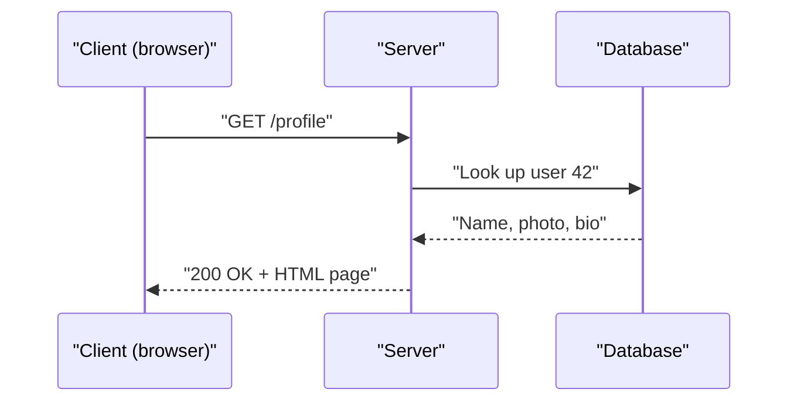

### Types
- **Thin vs thick client.** A thin client (a basic web page) relies on the server; a thick client (a mobile game, a desktop app) does a lot locally and talks to the server only for shared data.
- **Server-to-server.** Inside a large system servers are constantly clients of other servers (the "profile service" calls the "photo service"). The same request/response idea applies.
- **Push instead of pull.** Normally the client asks (pulls). Some features need the server to send data unasked (a chat message arriving); techniques for this (WebSockets, Server-Sent Events) are in Part 2.

### Common mistakes
- Thinking "server" means one physical box. A server is a role: one machine can run many server programs, and one logical server (`api.example.com`) is often hundreds of machines behind a load balancer.
- Forgetting that the network between client and server is slow and unreliable compared with work inside one machine.

### In the interview
**Q:** Can a server also be a client?

**A:** Yes. Any program sending a request is a client for that request; in a microservice system almost every service is both.

### TL;DR
A client asks, a server answers. Almost everything on the web is a chain of request/response conversations, often with servers acting as clients of other servers.

---

## The building blocks of a web application

### What it is
Nearly every web application, from a blog to a bank, is built from the same handful of parts:

| Part | What it does | Examples (covered in) |
|---|---|---|
| Client (browser/app) | Renders the interface and calls the backend over HTTP | Browser, mobile app |
| Load balancer | Sits in front of the app servers and forwards each request to one of them, so none is overloaded and dead ones are skipped | NGINX, AWS ALB (Part 2) |
| **App server (application server)** | Receives requests, applies business rules ("only friends may see this post"), reads and writes data, returns a response; run several identical copies so one crash doesn't stop the site | Java, Python, Go, Node.js programs |
| Database | Stores data durably (survives power loss) and lets you search it; usually the hardest part to scale because it holds **state** (data that must be remembered) | PostgreSQL, MySQL, MongoDB, DynamoDB (Part 3) |
| Cache | Small, fast store (usually RAM) holding copies of frequently read data so the app skips the slower database: a RAM read takes well under a millisecond, a database query several ms or more | Redis, Memcached (Part 4) |
| Message queue | Buffer where one part drops a job ("send a welcome email to user 42") and another picks it up later, so the web request returns at once while slow work runs in the background | RabbitMQ, Amazon SQS, Apache Kafka (Part 4) |
| **Workers** | Background programs that take jobs from the queue and do them | — |
| Object storage | Stores big files ("objects") cheaply by key, e.g. `photos/42/avatar.jpg`; databases are bad at large files | Amazon S3 (Part 3) |
| CDN (Content Delivery Network) | Servers around the world keeping copies of static files (images, JavaScript, video) near users, so Sydney doesn't fetch every image from Virginia | Cloudflare, CloudFront (Part 2) |

### How it works
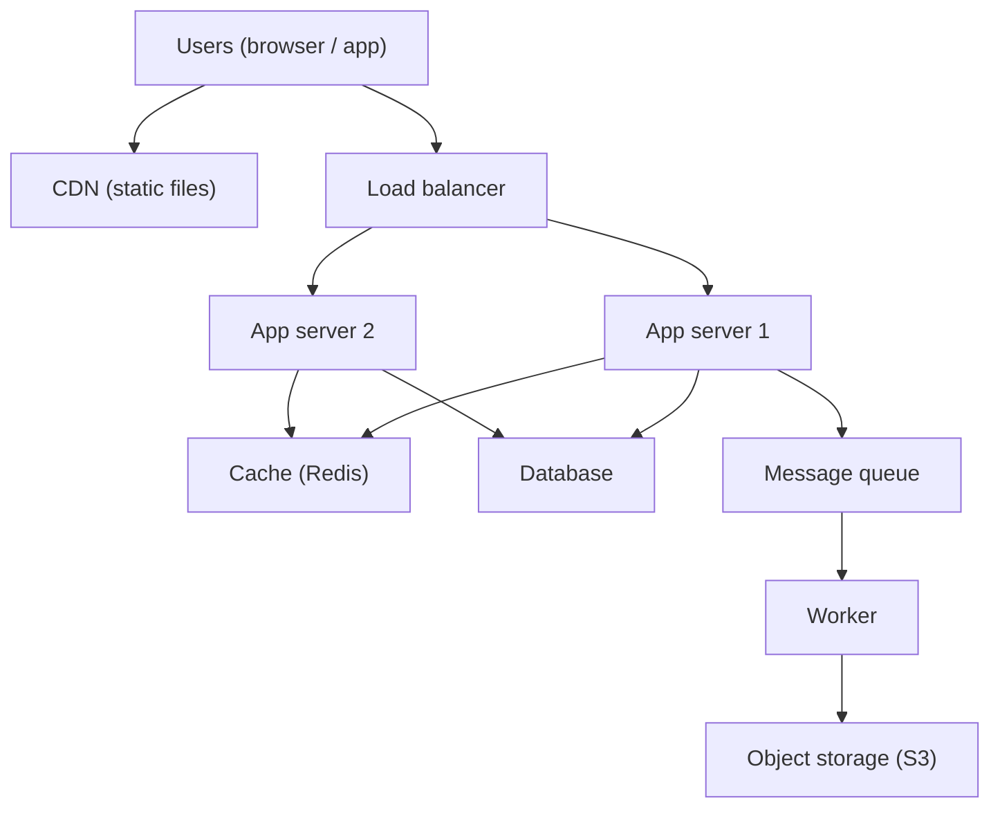

### Why it matters
In an interview you draw some version of this diagram within fifteen minutes. Knowing what each box is for lets you justify it ("we add a cache because reads outnumber writes 100 to 1") instead of adding boxes because "big systems have them".

### Common mistakes
- Adding every component by default. A small internal tool may need one app server and one database.
- Storing images inside the database. Put files in object storage and keep only their key in the database.
- Doing slow work (emails, video encoding) inside the web request. Put it on a queue.

### Real-world examples
- Instagram's early stack (2011–2012) was Django app servers, PostgreSQL, Redis and Memcached, with photos in Amazon S3 — almost exactly the diagram above.
- Cloud tutorials (AWS, Google Cloud, Azure) describe a "three-tier" app: presentation (client), logic (app servers), data (database), with caches and queues added as it grows.

### In the interview
**Q:** Why not keep everything on one server?

**A:** One server is a single point of failure and has a hard capacity limit. Stateless app servers behind a load balancer, plus a separate database, let you add servers and survive crashes.

**Q:** When do you add a queue?

**A:** When work is slow, can be done later, or arrives in bursts. The user gets a fast response and the queue smooths spikes for the workers.

### TL;DR
Client, load balancer, app servers, database, cache, queue with workers, object storage and CDN are the standard building blocks. Each solves one problem; add it only when you can name that problem.

---

## Latency, throughput and bandwidth

### What it is
Three different kinds of speed:

- **Latency** is how long one thing takes: the delay between asking and getting the answer, in milliseconds (ms, thousandths of a second) or microseconds (µs, millionths; written "us" in plain text).
- **Throughput** is how many things get done per unit of time: requests, messages or megabytes per second.
- **Bandwidth** is the maximum data a network link (or disk, or memory bus) can carry per second — a capacity, like the width of a pipe, in bits per second (Mbps, Gbps).

On a motorway, latency is how long one car takes from London to Birmingham, bandwidth is the number of lanes, and throughput is how many cars actually arrive per hour (lower than the lanes allow if there is a crash or toll booth).

### Response time vs latency
Often used as synonyms, but strictly:

- **Response time** is what the client experiences: the full time from sending a request to receiving the complete answer, including network travel both ways, queueing and processing.
- **Latency**, used strictly, covers only delay: the stretch before a server starts on the request (sitting in a queue, travelling a network hop), not the work itself.
- **Service time** is the time the server spends actually working on it.

So: response time = network delay + queueing delay + service time. In interviews "latency" almost always means response time; be clear which you mean when it matters.

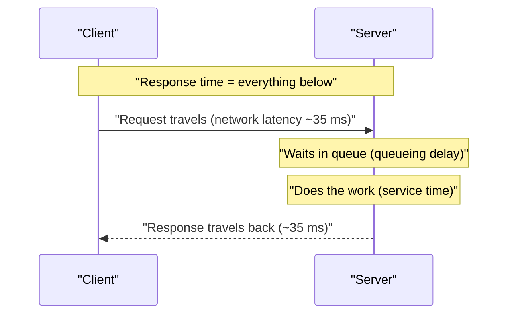

### Why it matters
- Users feel latency. Under about 100 ms feels instant; over a second breaks concentration. Google and Amazon have both reported that small added delays measurably reduce searches and sales.
- Throughput decides how many machines you need: at 1,000 requests per second per server and 50,000 expected, you need at least 50 (more for headroom).
- Bandwidth decides whether large transfers (video, backups) are possible in time.

### How it works
**Where latency comes from.** A request picks up delay at every step:

1. **Propagation delay:** signals in fibre travel at about two thirds the speed of light, ~200 km per millisecond. London–New York is ~5,600 km, so one way takes at least 28 ms; a real **round trip** (RTT) is typically ~70 ms because cables don't run straight and routers add delay.
2. **Transmission delay:** time to push the bits onto the wire. 1 MB (8 megabits) takes 80 ms at 100 Mbps, 8 ms at 1 Gbps. This is where bandwidth matters.
3. **Queueing delay:** waiting behind other requests at routers, load balancers, thread pools, database locks.
4. **Processing delay:** the actual work: parsing, running code, reading disk.

**Latency and bandwidth are independent.** A geostationary satellite link may have huge bandwidth and ~600 ms round trips. A small request is limited by latency, a large download by bandwidth; more bandwidth does not make a small API call faster.

**Throughput and latency are linked through load.** At low load throughput rises with offered load and latency stays flat. Near full use, requests wait for each other: latency shoots up while throughput levels off. A server with its CPU (central processing unit) 95% busy usually has terrible latency.

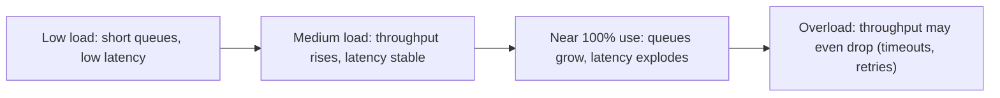

### Low-latency checklist
Every latency fix attacks one of the four delays above. Start with a **latency budget**: split the target (say p99 < 200 ms for an API call) across the hops, for example 60 ms of network, 20 ms at the gateway, 80 ms in the service and its database, and 40 ms of slack. Any hop that overspends its share is where you work first. Then go down the list, roughly in order of payoff:

| # | Lever | What to do | Which delay it cuts | Explained in |
|---|---|---|---|---|
| 1 | Remove round trips | Batch many small calls into one; run independent calls in parallel, not one after another; avoid N+1 query loops | Propagation × number of trips | *Connection pooling, ORMs and N+1 queries* (Part 3) |
| 2 | Reuse connections | Connection pools and keep-alive; HTTP/2 or HTTP/3 multiplexing; TLS 1.3 and session resumption, so a request does not pay 2–3 handshake RTTs | Propagation | *TCP, UDP and QUIC*, *HTTPS and TLS* (Part 2) |
| 3 | Move bytes closer | CDN for static and cacheable content; edge termination of TLS; regional deployments or read replicas near users | Propagation | *CDNs and anycast* (Part 2), *Replication* (Part 3) |
| 4 | Serve from memory | In-process or distributed cache for hot reads; precompute results (feeds, counts, materialised views) at write time | Processing | *Caching basics* (Part 4) |
| 5 | Do less while the user waits | Move anything the user doesn't need in the response (emails, analytics, thumbnails) onto a queue | Processing | *Message queues* (Part 4) |
| 6 | Shrink payloads | Compress (gzip, Brotli); compact binary formats (Protobuf); paginate; return only the fields the screen needs | Transmission | *API styles* (Part 2) |
| 7 | Make each query cheap | Index the access path; denormalise the hot read; keep data in a store whose layout matches the query | Processing | *Indexes*, *Normalization and denormalization* (Part 3) |
| 8 | Keep headroom | Run at 50–70% peak utilisation; autoscale before saturation; shed load rather than queue forever | Queueing | *Autoscaling*, *Load shedding* (Part 5) |
| 9 | Cut the tail | Deadlines on every call; hedged requests to a second replica; limit fan-out width; avoid long garbage-collection pauses and shared locks | Queueing and processing at p99 | *Percentiles, tail latency* (this part) |
| 10 | Measure the right thing | Track p50/p95/p99 per hop with histograms and distributed tracing; load-test with open-loop tools that don't hide slow responses | All of them (you can't fix what you can't see) | *Observability* (Part 5) |

Two rules keep the list honest. **Fix the biggest term first:** a trans-Atlantic round trip (70 ms) dwarfs a 2 ms JSON parse, so moving the data closer beats micro-optimising code. **Every lever has a price:** caches can serve stale data, replicas cost money and add consistency questions, hedging adds load, and async work means the user doesn't see the result right away. Say which price you're paying.

### Trade-offs
- **Batching** improves throughput but hurts latency: collecting 100 writes to send together is efficient, but the first write waits for the other 99.
- **Spare capacity** keeps latency low but costs money; many teams target 50–70% peak utilisation so bursts don't create queues.

### Common mistakes
- Mixing bits and bytes. Network speeds are in bits (Mbps), file sizes in bytes (MB); 1 byte = 8 bits, so 100 Mbps moves at most 12.5 MB per second.
- Assuming more bandwidth fixes slowness. If the problem is round trips (a page making 40 sequential API calls), only fewer trips or shorter distances help.
- Measuring throughput without latency (or the reverse). "10,000 requests per second" means nothing if each takes 5 seconds.

### Real-world examples
- Video streaming (Netflix, YouTube) is bandwidth-bound: a 4K stream needs roughly 15–25 Mbps.
- High-frequency trading firms pay for microwave links between Chicago and New York to shave a few milliseconds of propagation delay compared with fibre.
- Online games are latency-bound: players feel the difference between 20 ms and 120 ms "ping" (round-trip time).

### In the interview
**Q:** What is the difference between latency and throughput?

**A:** Latency is how long one request takes; throughput is how many complete per second. You can have high throughput with high latency (a cargo ship) or low latency with low throughput (a motorbike courier).

**Q:** A user in Australia complains the site is slow; servers are in Virginia. What helps?

**A:** The round trip is ~200 ms, so cut round trips: CDN for static files near them, fewer sequential calls, reused connections, perhaps a regional deployment. More bandwidth won't help much.

### TL;DR
Latency is time per request, throughput is requests per time, bandwidth is the pipe's maximum capacity. Push a system near its limit and latency rises sharply.

---

## Percentiles, tail latency and why averages lie

### What it is
A **percentile** is the value below which a given percentage of measurements fall. If **p95** (95th percentile) latency is 300 ms, 95% of requests finished in 300 ms or less and 5% took longer.

| Name | Meaning | 1 in N requests slower |
|---|---|---|
| p50 (median) | Half are faster, half slower | 1 in 2 |
| p90 | 90% are faster | 1 in 10 |
| p95 | 95% are faster | 1 in 20 |
| p99 | 99% are faster | 1 in 100 |
| p999 (p99.9) | 99.9% are faster | 1 in 1,000 |

**Tail latency** is the slow end of the distribution: p99, p999 and the maximum — on a latency graph the slow requests form a long thin tail to the right. (If one bus trip in ten takes 90 minutes, a twice-a-day rider is stuck several times a month; "the average trip is 20 minutes" hides that.)

### Why averages lie
The **mean** (average) mixes fast and slow requests into one number that may match no real request. Ten requests:

```
10, 10, 10, 10, 10, 10, 10, 10, 10, 1000   (milliseconds)
```

- Mean = 1090 / 10 = 109 ms. No request took 109 ms.
- Median (p50) = 10 ms. The typical user is happy.
- p95 and p99 = 1000 ms (they land on the slowest request). One user in ten waits a full second.

Real latency is almost never a bell curve; it is skewed, with a long tail from garbage collection pauses, cache misses, slow disks, retries and queueing. Percentiles show the shape; averages flatten it.

### Why the tail matters more than you think
1. **Heavy users hit the tail most.** A user loading 100 pages a day hits your p99 about once a day — often your most valuable customers (most data, biggest carts).
2. **Fan-out amplifies the tail.** If one user request calls 100 backend servers in parallel and waits for all, it is as slow as the slowest. If each server is slow (1 second) just 1% of the time, the chance that *at least one* of 100 is slow is 1 − 0.99^100 ≈ 63%: a 1-in-100 problem per server becomes a nearly 2-in-3 problem for the user (Google's "The Tail at Scale", Dean and Barroso, 2013).

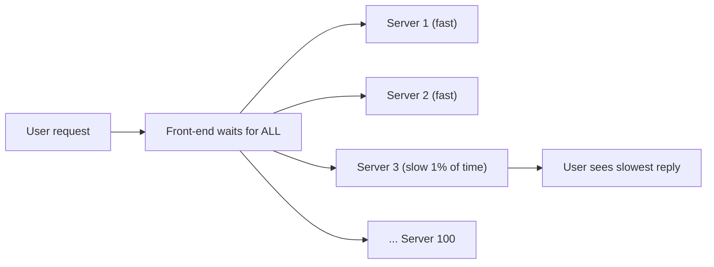

### How it works
**Measuring percentiles.** Record each latency, sort, and pick the value at the required position (the 990th of 1,000 sorted values ≈ p99). Monitoring systems can't store every value, so they use **histograms** (counts per latency bucket, e.g. 0–10 ms, 10–25 ms…) or sketches such as HDRHistogram or t-digest, which estimate percentiles with small error.

**Do not average percentiles.** The mean of server A's p99 and server B's p99 is not the p99 of the combined traffic. Merge the histograms and compute from the merged data.

**Reducing tail latency:**
- **Hedged requests:** if no reply within (say) the p95 time, send the same request to a second replica and use whichever answers first.
- **Timeouts and fewer fan-out calls.**
- Removing sources of pauses: tune garbage collection, avoid shared locks, keep spare capacity so queues stay short.

### Common mistakes
- Reporting only the average in dashboards or SLOs.
- Measuring latency only on the server. The client also sees network time, DNS lookups and connection setup.
- **Coordinated omission:** a load-test tool that waits for each slow response before sending the next sends fewer requests during slow periods, so it under-reports the tail.

### Real-world examples
- Amazon has long described setting internal service targets at p99.9 rather than averages, so even its heaviest customers get good performance.
- Prometheus, Datadog and Grafana show latency as p50/p95/p99 lines by default.

### In the interview
**Q:** Why use p99 instead of the average for an SLO?

**A:** The average hides slow outliers and describes no real user. p99 says "99% of requests are at least this fast", capturing the unlucky but common slow cases.

**Q:** Your service's p99 is fine but users still complain. Why?

**A:** Each page may call many services or make many requests, so the chance of at least one slow call per page is much higher than 1%. Look at end-to-end page latency and fan-out, not each service in isolation.

### TL;DR
Describe latency with percentiles (p50, p95, p99, p999), not averages. Heavy users and fan-out make rare slowness common.

---

## Little's law

### What it is
**Little's law** holds for any stable system where items arrive, wait or get served, and leave:

> **L = λ × W**

- **L** = average number of items inside the system at once (requests in flight, people in a shop).
- **λ** (lambda) = average arrival rate (requests per second); in a stable system this equals throughput.
- **W** = average time each item spends inside (latency).

If 2 customers arrive per minute and each stays 10 minutes, on average 20 are in the shop — whatever the barista does.

### Why it matters
It gives any one of the three numbers from the other two, which is handy for sizing:

- **Concurrent connections or threads needed:** 1,000 requests/s × 0.2 s each = **200 requests in flight**, so at least 200 worker threads or connections (plus headroom), or requests queue.
- **Maximum throughput:** a pool of 20 database connections with 5 ms queries serves at most 20 / 0.005 = **4,000 queries per second**.
- **Why latency hurts throughput:** with fixed concurrency limits, if latency doubles (a slow dependency), maximum throughput halves.

### How it works
1. Pick the boundary of your "system": one server, one thread pool, one queue, the whole service.
2. Measure or assume two of the numbers over a period long enough for the system to be stable (arrivals ≈ departures).
3. Compute the third: W = L / λ (latency from in-flight count and rate); λ = L / W (throughput from concurrency limit and latency).

### Common mistakes
- Applying it to an unstable system where the queue keeps growing (arrival rate above capacity): there is no steady state and L grows without limit.
- Forgetting units. Convert milliseconds to seconds before multiplying by "per second".

### In the interview
**Q:** A service handles 5,000 requests/s with 40 ms average latency. How many requests are in progress at any moment?

**A:** L = 5,000 × 0.04 = 200 in flight on average; with 50 instances, about 4 per instance.

**Q:** A thread pool has 100 threads and each request holds a thread for 250 ms. Max throughput?

**A:** λ = 100 / 0.25 = 400 requests/s. Beyond that requests queue and latency rises.

### TL;DR
Items in the system = arrival rate × time in system. Use it to size thread pools, connection pools and fleets, and to explain why slower dependencies cut throughput.

---

## Latency numbers every engineer should know

### What it is
Rough costs of common operations, popularised by Google's Jeff Dean and Peter Norvig. Exact numbers change with hardware (the table uses rounded figures for current machines; the original list gave, for example, 150 us for an SSD random read); what matters is the **order of magnitude** (nanoseconds, microseconds or milliseconds) and the ratios.

Units: 1 ns (nanosecond) = one billionth of a second; 1 µs (microsecond) = 1,000 ns; 1 ms (millisecond) = 1,000 µs.

| Operation | Approximate time | Scaled: if 1 ns were 1 second |
|---|---|---|
| CPU L1 cache read | 1 ns | 1 second |
| CPU L2 cache read | 4 ns | 4 seconds |
| Main memory (RAM) read | 100 ns | about 2 minutes |
| Compress 1 KB (fast algorithm) | 2 us | about half an hour |
| Send 1 KB over 1 Gbps network | 10 us | about 3 hours |
| Read 4 KB at random from NVMe SSD | 20-100 us | 6 hours to a day |
| Read 1 MB sequentially from RAM | 50-250 us | 14 hours to 3 days |
| Round trip inside one data centre | 0.5 ms (500 us) | about 6 days |
| Read 1 MB sequentially from SSD | 0.2-1 ms | 2 to 12 days |
| Hard disk (HDD) seek | 10 ms | about 4 months |
| Read 1 MB sequentially from HDD | 5-20 ms | 2 to 8 months |
| Round trip London to New York | 70 ms | about 2 years |
| Round trip California to Europe | 150 ms | about 5 years |

(A **CPU cache** is tiny, very fast memory inside the processor. **RAM** is the main working memory, lost on power-off. An **SSD** is a solid-state drive with no moving parts; an **HDD** is a spinning magnetic disk with a moving arm, which is why "seeking" to a new position is slow.)

### Why it matters
- **RAM is about 100–1,000× faster than SSD for random reads**, and SSD about 100× faster than spinning disk. That's why caches live in RAM.
- **A data-centre round trip (0.5 ms) costs as much as thousands of memory reads.** A loop making 1,000 small database calls spends at least half a second on round trips. Batch them.
- **Crossing an ocean costs 70–150 ms per round trip**, and light is not getting faster. Only moving data closer to users (CDNs, regional servers) fixes it.
- **Sequential reads are far faster than random reads**, especially on HDD, so many storage engines (append-only logs, the log-structured merge trees or LSM-trees of Part 3) write sequentially.

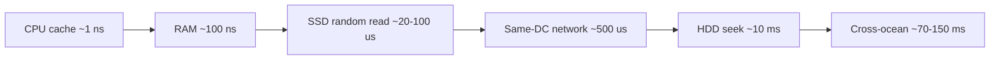

### Common mistakes
- Memorising exact numbers. Interviewers want orders of magnitude: "RAM is nanoseconds, SSD microseconds, network and disk milliseconds".
- Treating a remote cache (Redis over the network) as "as fast as memory". The RAM read is 100 ns but the round trip is ~0.5 ms — still far faster than a typical database query, but not free.

### In the interview
**Q:** Why is a cache faster than a database?

**A:** A cache serves from RAM (nanoseconds plus one network hop); a database may read disk, parse a query, take locks and do more work. Cache hits take well under 1 ms; database queries often several ms or more.

**Q:** Why does a service that calls another 50 times per request feel slow though each call is "fast"?

**A:** Each call costs at least a round trip (~0.5 ms in one data centre, more across zones), and sequential calls add up: 50 × 1 ms = 50 ms before real work. Batch or parallelise.

### TL;DR
Memory is nanoseconds, SSD tens of microseconds, data-centre network half a millisecond, spinning disks and cross-continent trips tens to hundreds of milliseconds. Keep the hot path at the fast end.

---

## Units, powers of two and data sizes

### What it is
Data is measured in **bits** (a single 0 or 1) and **bytes** (8 bits, enough for one English letter).

| Unit | Bytes (decimal, used in estimates) | Power of two (exact) | Roughly holds |
|---|---|---|---|
| KB (kilobyte) | 1,000 | 2^10 = 1,024 | A short text message or tweet with metadata |
| MB (megabyte) | 1,000,000 (10^6) | 2^20 ≈ 1.05 million | A high-quality photo, a minute of MP3 |
| GB (gigabyte) | 10^9 | 2^30 ≈ 1.07 billion | An hour of streamed HD video (a few GB) |
| TB (terabyte) | 10^12 | 2^40 ≈ 1.1 trillion | A typical laptop drive |
| PB (petabyte) | 10^15 | 2^50 | A large company's data warehouse |

Above PB come EB (exabyte, 10^18) and ZB (zettabyte, 10^21). Strictly the power-of-two units have their own names (KiB, MiB, GiB), but estimates round 2^10 to 1,000; the 2–10% error doesn't matter.

### How it works
**Powers of two to remember:**
- 2^10 ≈ 1 thousand (10^3); 2^20 ≈ 1 million (10^6); 2^30 ≈ 1 billion (10^9); 2^40 ≈ 1 trillion (10^12)
- 2^32 ≈ 4.3 billion (the number of IPv4 addresses and the limit of an unsigned 32-bit integer; a 32-bit ID column runs out at about 2 billion signed or 4 billion unsigned)
- 2^64 ≈ 1.8 × 10^19 (plenty for any ID)

**Typical sizes:**

| Item | Rough size |
|---|---|
| A number (integer) | 4 or 8 bytes |
| A timestamp | 8 bytes |
| A UUID (random unique ID) | 16 bytes (36 characters as text) |
| A short text post with metadata | 0.5-1 KB |
| A web page's HTML | 50-100 KB |
| A compressed photo | 200 KB - 2 MB |
| One minute of HD video | roughly 25-60 MB |

**Time conversions:** 1 day = 86,400 s ≈ **10^5 seconds** (round it); 1 month ≈ 2.6 × 10^6 s; 1 year ≈ 3 × 10^7 s (31.5 million).

**Shortcut:** 1 million requests per day ≈ 12 per second (10^6 / 86,400 ≈ 11.6), so "X million per day" ≈ "12 × X per second".

### Common mistakes
- Mixing bits and bytes: a "1 Gbps" network card moves 125 MB per second at best.
- Carrying too many digits. Round to one or two significant figures and say so.

### TL;DR
KB, MB, GB, TB, PB each step up by about 1,000 (2^10). A day is about 10^5 seconds, so 1 million per day is about 12 per second.

---

## Back-of-the-envelope estimation

### What it is
A **back-of-the-envelope estimate** is a quick, rough calculation that sizes a problem — requests per second, storage, bandwidth, servers. The goal is the right **order of magnitude** (10, 1,000 or 1,000,000?), not precision.

### Why it matters
The estimate decides the architecture. 100 requests per second fits on one server with one database; 100,000 needs many servers, caching, and probably sharded data (split across many databases). 10 GB fits in memory on one machine; 10 PB needs distributed storage.

### How it works
The key terms:

- **DAU (Daily Active Users):** distinct users on a given day; **MAU** the same per month. DAU is usually 20–50% of MAU for social apps.
- **QPS (Queries Per Second)** or **RPS (Requests Per Second):** requests reaching the system each second. **Average QPS** = requests per day / 86,400.
- **Peak factor:** traffic is not flat (evenings, weekends, a sale, a football final). Peak QPS is commonly **2–3×** average, sometimes 5–10× for spiky products.
- **Read/write ratio:** reads per write. Social feeds might be 100:1; logging is almost all writes.
- **Storage per day** = new items per day × item size. **Bandwidth** = QPS × response (or request) size.

**Worked example — a photo-sharing app.** Assumptions (state them out loud): 10 million DAU; each user views 50 photos and uploads 0.2 per day; average photo 500 KB, metadata 1 KB; keep data 5 years.

1. **Read QPS:** 10M × 50 = 500M views/day; 500M / 10^5 ≈ **5,000 QPS** average, ≈ **15,000** at peak (×3).
2. **Write QPS:** 10M × 0.2 = 2M uploads/day ≈ **20/s** average, ~60 at peak. Read:write ≈ 250:1 — read-heavy, so caching and a CDN matter a lot.
3. **Storage per day:** 2M × 500 KB = **1 TB/day** of photos, plus 2M × 1 KB = 2 GB/day of metadata.
4. **5 years:** 1 TB × 365 × 5 ≈ **1.8 PB** of photos (typically × 3 with replicas); metadata ≈ 3.6 TB. Photos go in object storage; metadata fits in a (sharded) database.
5. **Outgoing bandwidth:** 5,000 views/s × 500 KB = 2.5 GB/s ≈ **20 Gbps** average — a strong argument for a CDN.
6. **Servers:** 15,000 peak QPS at ~1,000 simple requests/s per server is ~15 servers before headroom and redundancy; the worked example below does this step properly.

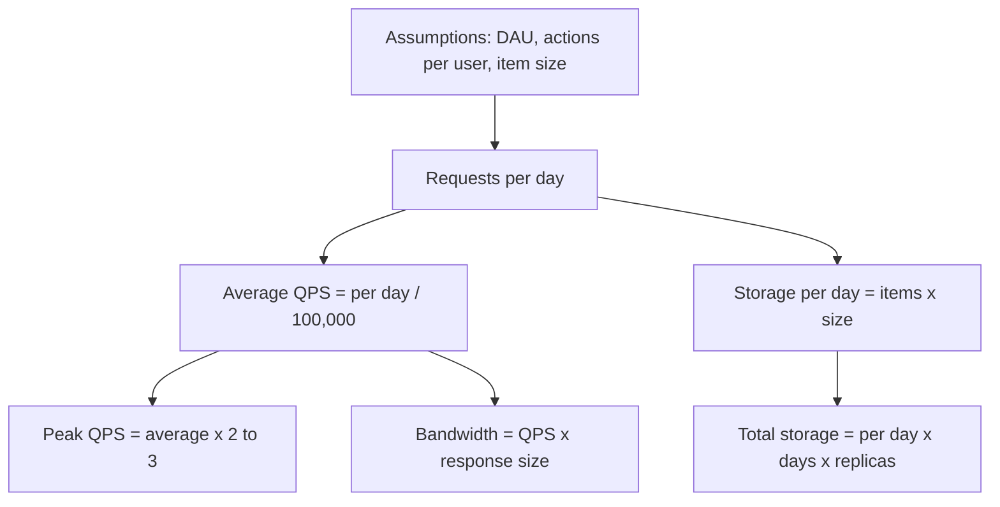

**Rules of thumb for capacity (very rough, simple workloads on modern hardware):**

| Component | Rough capacity per machine |
|---|---|
| Web/app server (simple API) | 1,000-10,000 requests/s |
| Relational database (simple indexed queries) | 1,000-10,000 queries/s, more for cached reads |
| Redis/Memcached cache | 100,000+ operations/s |
| Kafka broker | hundreds of MB/s |

### Worked example: how many servers do we need?
"Divide peak QPS by a rule-of-thumb capacity" is a start, but interviewers like to see the four corrections that turn it into a real number: **measured cost per request, a utilisation ceiling, a concurrency check, and failure headroom**.

**Assumptions** (say them out loud): an API tier with **30,000 requests/s at peak**. Load testing shows each request uses **4 ms of CPU time** (time the processor actually spends on it) and takes **50 ms end to end** (mostly waiting on the cache and database). Machines have **16 cores**. Responses average **20 KB**. We run in **3 availability zones** and must survive losing one.

| Step | Calculation | Result |
|---|---|---|
| 1. Capacity of one core | 1,000 ms ÷ 4 ms CPU per request | 250 requests/s per core |
| 2. Capacity of one server at 100% | 250 × 16 cores | 4,000 requests/s |
| 3. Apply a utilisation ceiling | Keep CPU ≤ 60% so queues stay short (see *Latency, throughput and bandwidth*): 4,000 × 0.6 | **2,400 requests/s per server** |
| 4. Servers for peak | 30,000 ÷ 2,400 = 12.5, round up | **13 servers** |
| 5. Concurrency check (*Little's law*) | In flight = arrival rate × time in system = 30,000 × 0.05 s = 1,500 requests; ÷ 13 servers | ~115 in flight per server: fine for an async server; with one thread per request, that means ~115 threads and a database pool sized to match |
| 6. Survive a zone loss | 13 servers must remain after one of 3 zones dies, so each of the 2 survivors needs ⌈13 ÷ 2⌉ = 7 | 7 per zone × 3 zones = **21 servers** |
| 7. Deployment surge | Rolling deploys take ~10% out of service at a time: 21 × 1.1 | **~23 servers** |
| 8. Network check | 30,000 × 20 KB = 600 MB/s ≈ 4.8 Gbps in total; ÷ 21 servers | ~0.23 Gbps each: far below a 10 Gbps network card, so CPU, not network, is the limit |

**Reading the answer.** The naive "30,000 ÷ 4,000 = 8 servers" was off by about 3×; the utilisation ceiling and the zone-loss rule, both deliberate and defensible, explain nearly all of it. CPU per request decided the number: halving it halves the fleet, which is why profiling is a cost lever.

**Repeat per tier.** Do the same for each layer with its own bottleneck resource: the cache tier is usually limited by **memory** (working set ÷ usable RAM per node, times replicas), the database by **IOPS or write throughput** per primary (which is what forces sharding), and a streaming tier by **network and disk bandwidth** per broker. The tier whose count grows fastest as traffic grows is the one to design around.

**In one sentence for the interview:** "At 4 ms of CPU per request a 16-core box does 4,000 requests/s, I keep it at 60%, so 2,400; 30,000 at peak needs 13, and to survive a zone loss across three zones I deploy 7 per zone, 21 total, plus a little for rolling deploys."

### Trade-offs
More precise estimates take longer and rarely change the design. Spend 3–5 minutes in an interview, write numbers down, and move on.

### Common mistakes
- Forgetting the peak. Systems fall over at peak, not at average.
- Forgetting replication (3 copies triple storage) and metadata, indexes and logs (often +20–50%).
- False precision ("11,574.07 QPS"). Say "about 12,000".
- Doing maths silently. Say each assumption so the interviewer can correct it.

### Real-world examples
- WhatsApp said in late 2020 it delivers about 100 billion messages per day: 10^11 / 10^5 ≈ 1 million messages per second on average, an anchor for "very large" chat scale.
- YouTube said in 2019 that more than 500 hours of video are uploaded every minute — about 720,000 hours a day.

### In the interview
**Q:** 100 million DAU, each making 20 requests per day. What QPS should you plan for?

**A:** 2 billion requests/day ÷ 10^5 = 20,000 QPS average; with a peak factor of 3, plan for about 60,000.

**Q:** Why bother estimating if the numbers are guesses?

**A:** The order of magnitude decides the architecture: whether one database is enough, whether data fits in memory, whether you need a CDN. Rough numbers still rule designs in or out.

### TL;DR
From DAU and per-user actions, divide per-day counts by about 10^5 for per second, multiply by 2–3 for peak, and compute storage and bandwidth from item sizes. Round aggressively and state every assumption.

---

## Availability and the nines

### What it is
**Availability** is the fraction of time a system is up and doing its job (answering requests correctly), usually written with many 9s: "three nines" (99.9%), "four nines" (99.99%).

Availability = uptime / (uptime + downtime), or, measured by requests, successful requests / total valid requests. A 24-hour shop closed by surprise for 9 hours in a year was available about 99.9% of the time.

### The nines table
(Year = 365 days, month = 30 days.)

| Availability | Name | Downtime per year | Downtime per month | Downtime per day |
|---|---|---|---|---|
| 99% | two nines | 3.65 days | 7.2 hours | 14.4 minutes |
| 99.9% | three nines | 8.76 hours | 43.2 minutes | 1.44 minutes |
| 99.95% | three and a half | 4.38 hours | 21.6 minutes | 43 seconds |
| 99.99% | four nines | 52.6 minutes | 4.32 minutes | 8.6 seconds |
| 99.999% | five nines | 5.26 minutes | 26 seconds | 0.86 seconds |

Each extra nine cuts allowed downtime by 10× and usually costs much more than 10× the engineering effort.

### Why it matters
- Downtime costs money and trust: a shop down for an hour on Black Friday loses that hour's sales permanently.
- The target decides the design. 99% survives manual recovery ("someone restarts the server in the morning"). 99.99% leaves 4 minutes a month — less than a human needs to wake up and log in — so recovery must be **automatic**.

### How it works
**Parts in series (all must work).** A request through a load balancer (99.99%), an app server (99.9%) and a database (99.9%): 0.9999 × 0.999 × 0.999 ≈ **99.79%**. The chain is weaker than its weakest link; every dependency added in series lowers availability.

**Parts in parallel (any one is enough).** Two independent servers, each 99%, are down only when both are: 1 − (0.01 × 0.01) = **99.99%**. Redundancy turns two "two nines" machines into a "four nines" pair — if failures are independent (often not fully: both in one rack lose power together).

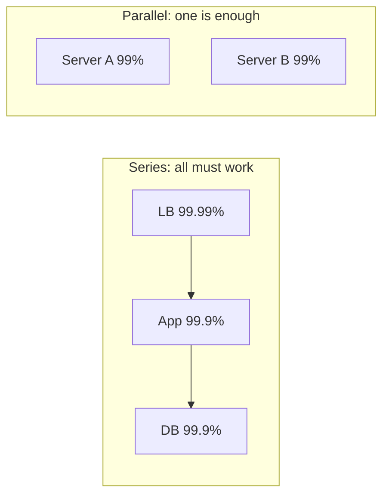

### Trade-offs
Higher availability needs redundancy (more machines, more data centres), automation, testing and on-call staff. 99.9% → 99.99% might mean multiple data centres with automatic failover, roughly doubling infrastructure and adding complexity. Many internal tools are fine at 99.5%.

### Common mistakes
- Promising five nines without the budget. Even big cloud providers' SLAs for single services are usually 99.9%–99.99%.
- Forgetting dependencies. You can't be more available than what you need in series (unless you design fallbacks).
- Counting planned maintenance as "not downtime". Users don't care why it's down.

### Real-world examples
- Amazon S3 Standard is designed for 99.99% availability; its SLA promises 99.9% per month (service credits below that).
- Telephone networks were historically engineered for five nines.

### In the interview
**Q:** How much downtime per month does 99.9% allow?

**A:** About 43 minutes; 99.99% about 4.3 minutes.

**Q:** How do you get higher availability than any single machine provides?

**A:** Redundant copies in parallel with automatic failover, no single points of failure, copies spread across separate failure domains (racks, zones, regions).

### TL;DR
Availability is the share of time a system works. Each extra nine is ten times less downtime: 99.9% ≈ 43 minutes a month, 99.99% ≈ 4. Series dependencies multiply down; parallel redundancy multiplies up.

---

## SLA, SLO, SLI and error budgets

### What it is
From most technical to most legal:

- **SLI (Service Level Indicator):** a *measurement* of how the service is doing, e.g. "percentage of HTTP requests that succeeded in under 300 ms over the last 30 days."
- **SLO (Service Level Objective):** an internal *target* for an SLI, e.g. "99.9% of requests succeed in under 300 ms, measured over 30 days."
- **SLA (Service Level Agreement):** a *contract* with customers saying what happens if a target is missed, usually refunds or service credits, e.g. "below 99.9% monthly availability, customers get 10% of their bill back."

(Pizza shop: the SLI is how long deliveries actually take, the SLO the manager's "95% within 30 minutes", the SLA the printed "over 45 minutes and it's free".) The SLA is normally looser than the SLO, so the team gets warning (missing the SLO) before the company has to pay (missing the SLA).

### Error budgets
An **error budget** is the unreliability the SLO allows: with a 99.9% SLO it is 0.1% — in a month with 100 million requests up to 100,000 may fail (or about 43 minutes of full outage).

The budget turns reliability into a shared decision: while budget remains, the team ships fast and takes risks; when it is spent, releases slow and reliability work takes priority until it recovers. The idea comes from Google's **Site Reliability Engineering (SRE)**, the discipline of running production systems with software engineering methods.

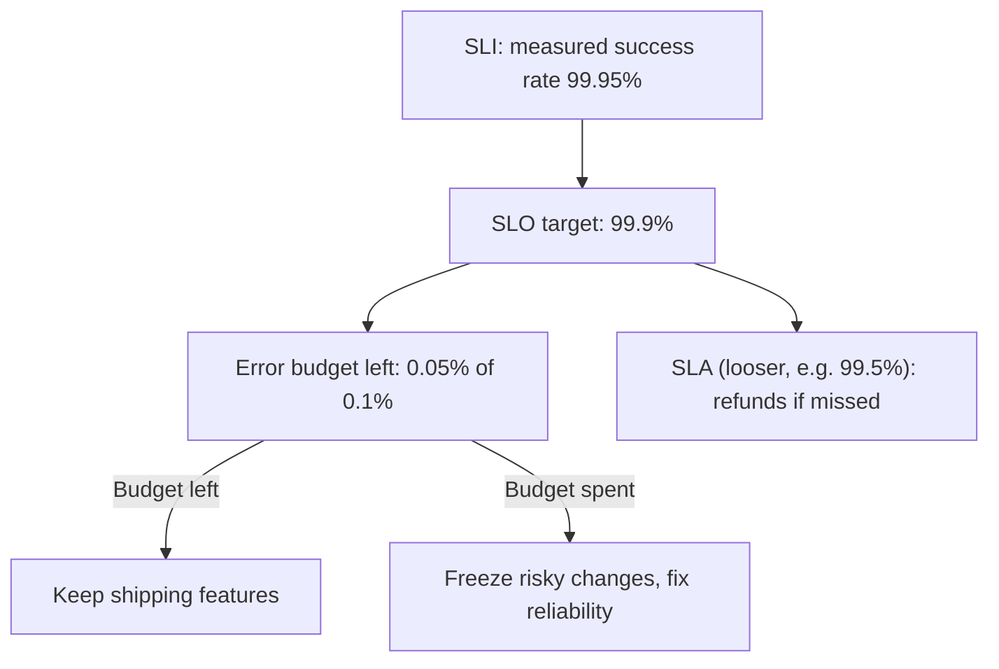

### How it works
1. Choose SLIs users feel: availability (success rate), latency (p99 under X ms), freshness (data no older than Y), durability.
2. Set the SLO slightly below what users actually need, never "100%" (impossible, and leaves no room to change anything).
3. Measure over a window (often 28 or 30 days, rolling).
4. Alert when the budget burns too fast (burn-rate alerts, Part 5).

### Common mistakes
- Setting the SLO to 100%: any deployment risk then "violates" it.
- Choosing SLIs users don't feel (CPU usage) instead of ones they do (failed checkouts).
- Making the SLA as tight as the SLO, leaving no warning margin.

### In the interview
**Q:** What's the difference between an SLO and an SLA?

**A:** An SLO is an internal target for a measured indicator; an SLA is an external contract with penalties, usually looser.

**Q:** What is an error budget used for?

**A:** It quantifies acceptable failure (1 − SLO). Teams spend it on releases and experiments; when it's gone, they prioritise reliability.

### TL;DR
SLI is the measurement, SLO the target, SLA the contract with penalties. The error budget (1 − SLO) is how much failure you can "spend" before you must slow down and fix reliability.

---

## MTBF, MTTR and measuring failure

### What it is
- **MTBF (Mean Time Between Failures):** average time a system runs before it fails. Higher is better.
- **MTTR (Mean Time To Repair / Recover):** average time from a failure until service is restored. Lower is better.
- **MTTD (Mean Time To Detect):** how long before anyone notices. **MTTF (Mean Time To Failure):** used for parts that are replaced rather than repaired (like disks).

### How it works
> Availability = MTBF / (MTBF + MTTR)

A server failing every 1,000 hours on average and taking 1 hour to recover: 1,000 / 1,001 ≈ 99.9%.

Two levers: **increase MTBF** (better hardware, testing, careful deployments) or **decrease MTTR** (fast detection by monitoring and alerts, automatic failover, quick rollback, runbooks). In large distributed systems failures are constant, so cutting MTTR is usually cheaper: automatic 10-second recovery instead of 1 hour gives the same failure rate about 99.9997% availability.

### Common mistakes
- Only trying to prevent failures. You can't prevent them all; plan to recover fast.
- Ignoring detection time. An outage nobody notices for 30 minutes has at least 30 minutes of MTTR.

### In the interview
**Q:** Which is easier to improve at scale, MTBF or MTTR?

**A:** Usually MTTR. With thousands of machines something always fails, so automatic detection and failover (seconds) buy more availability than making each machine fail less often.

### TL;DR
MTBF is time between failures, MTTR time to recover. Availability ≈ MTBF / (MTBF + MTTR); in practice, shrink MTTR with monitoring and automation.

---

## Reliability, availability and durability

### What it is
- **Reliability:** the system keeps doing the *right thing* over time, even when things go wrong — correct results, no corrupted data.
- **Availability:** the system is *up and responding* when you ask. It can be available but unreliable (answers quickly, with wrong data).
- **Durability:** saved data *stays saved*, even if machines crash or disks die. A system can be unavailable but durable (down for an hour, no data lost).

(At a bank: the cash machine works when you walk up; it gives the right amount and debits the right account; your balance survives a flood.)

| Property | Question it answers | Typical measure |
|---|---|---|
| Availability | Can I use it right now? | % uptime, % successful requests |
| Reliability | Does it work correctly over time? | Failure rate, MTBF, correctness |
| Durability | Will my saved data still exist later? | Probability of losing an object per year |

### How it works
- Availability: redundancy and failover (below).
- Durability: multiple copies on separate disks, machines and locations; writing to disk before confirming (write-ahead logs, Part 3); backups.
- Reliability is the umbrella: testing, validation, handling faults gracefully, and both of the above.

### Real-world examples
- Amazon S3 Standard is designed for 99.999999999% ("eleven nines") yearly durability per object — store ten million objects and on average one goes missing roughly once in ten thousand years — but only 99.99% availability (SLA credits below 99.9%). Durability and availability are separate promises.

### Common mistakes
- Saying "highly available" when you mean "doesn't lose data". Say durable.
- Assuming replication equals backup. A bug that deletes data is faithfully replicated to every copy; backups protect against that.

### In the interview
**Q:** Can a system be durable but not available?

**A:** Yes. A database cluster down for maintenance can't be read (unavailable), but all data is safely on disk (durable).

### TL;DR
Availability = can I use it now; reliability = does it work correctly over time; durability = will saved data survive. Different techniques improve each, and they are promised separately.

---

## Faults, failures and fault tolerance

### What it is
- A **fault** is one part going wrong: a disk dies, a process crashes, a cable is cut, a bug returns a wrong value.
- A **failure** is the *whole system* no longer providing its service to users.

Faults are inevitable; failures are what we prevent. **Fault tolerance** (resilience) is continuing to work, perhaps in a reduced way, when some parts have faults — like a twin-engine plane landing on one engine.

### Types
| Fault type | Example | Typical defence |
|---|---|---|
| Hardware | Disk dies, power supply fails | Redundant machines, replicated data |
| Software | Bug, memory leak, crash on bad input | Testing, gradual rollouts, restarts |
| Network | Packets lost, link cut, partition | Timeouts, retries, replicas in other zones |
| Human | Wrong config pushed, table deleted | Reviews, automation, backups, rollback |
| Dependency | Third-party API is slow or down | Timeouts, fallbacks, circuit breakers |

**Failure models.** Faults also differ by *how the broken part behaves*. Distributed-systems research names a spectrum of **failure models** (formal assumptions about what a faulty part may do); roughly, each row below permits more misbehaviour than the one above, so it is harder to tolerate:

| Model | What the faulty part does | Can the others tell? | Typical defence and cost | Example |
|---|---|---|---|---|
| **Fail-stop** | Halts, and every other part reliably learns that it halted | Yes, by definition | Simplest: with guaranteed detection, f+1 copies can tolerate f failures | An idealisation; approximated by fencing or "shoot the other node" power switches |
| **Crash (crash-stop)** | Halts and sends nothing more, but nobody is told | No: on a network, a crashed node looks exactly like a slow one | Timeouts plus majority quorums: consensus needs 2f+1 nodes to tolerate f crashes | Process killed, kernel panic |
| **Crash-recovery** | Crashes, later restarts with only what it saved to disk | Not reliably | Write state durably before acknowledging (write-ahead log), rejoin and catch up | Server reboot, container restart |
| **Omission** | Keeps running but drops some messages it should send or receive | Only through missing acknowledgements | Acknowledgements, retries, idempotent handlers | Full network buffer, lossy link |
| **Timing (performance)** | Gives correct answers but outside the expected time bound, or its clock drifts | Indistinguishable from omission until the answer arrives | Timeouts, deadlines, leases with clock-error margins, hedged requests | Long garbage-collection pause, overloaded disk |
| **Byzantine (arbitrary)** | Anything at all: wrong, contradictory or deliberately malicious answers | No | 3f+1 replicas to agree despite f liars; signatures and checksums | Memory corruption, a compromised node, a buggy replica |

Most systems inside one company's data centres assume **crash-recovery plus omission plus timing faults**, and add checksums to catch the one Byzantine-like fault that really happens: corrupted data. Blockchains and some aerospace systems design for full Byzantine faults. The model you assume decides how many replicas you need and which algorithms are correct, so state it out loud.

### How it works
**Detect** the fault (health checks, timeouts, heartbeats), **isolate** it so it doesn't spread (timeouts, bulkheads), **recover** (route around it, restart, fail over to a copy). Parts 4 and 5 cover the tools: retries, circuit breakers, replication, consensus.

### Common mistakes
- Treating "slow" as fine. A dependency taking 30 seconds to fail can tie up all your threads; a fast error is often better.
- Assuming faults are independent. A bad deployment or shared power supply can break many "redundant" copies at once (**correlated failure**).

### Real-world examples
- Netflix's Chaos Monkey randomly shuts down production servers so engineers must build services that tolerate instance faults.
- Large cloud outages are often a configuration change pushed everywhere at once: human and software faults matter as much as hardware.

### In the interview
**Q:** What is the difference between a fault and a failure?

**A:** A fault is a component misbehaving; a failure is the system as a whole not serving users. Fault tolerance stops faults becoming failures.

**Q:** Why does Raft need 3 nodes to survive 1 failure, while a Byzantine-tolerant protocol needs 4?

**A:** Raft assumes crash faults: a live majority (2 of 3) always overlaps any other majority, so 2f+1 suffices. With Byzantine faults a node can lie, so honest nodes must outnumber liars inside every quorum, which takes 3f+1 nodes (Lamport, Shostak and Pease, 1982).

### TL;DR
Faults happen to parts; failures happen to the system. Name your failure model (crash, omission, timing, Byzantine), because it sets how many replicas you need; then detect, isolate and recover so faults don't become user-visible failures.

*Sources:* R. Schlichting and F. Schneider, "Fail-stop processors", *ACM TOCS* 1(3), 1983; V. Hadzilacos and S. Toueg, "A modular approach to fault-tolerant broadcasts and related problems", Cornell TR 94-1425, 1994; L. Lamport, R. Shostak, M. Pease, "The Byzantine Generals Problem", *ACM TOPLAS* 4(3), 1982; D. Ongaro and J. Ousterhout, "In Search of an Understandable Consensus Algorithm (Raft)", USENIX ATC 2014.

---

## Redundancy, single points of failure and failover

### What it is
- **Redundancy:** more than one of something (servers, data copies, network links, power supplies), so a spare can take over.
- A **single point of failure (SPOF)** is any part whose failure alone brings down the whole system: one database, one load balancer, one DNS provider, one data centre, even one engineer who knows the password.
- **Failover** is switching work from a failed component to a standby (as a hospital switches to its backup generators within seconds of a blackout).

### How it works
**Finding SPOFs:** ask of every box and arrow, "if this disappears, what happens?" If "everything stops", it's a SPOF.

**Removing them:**
1. Run at least two of every critical component in separate **failure domains**: different racks, **availability zones** (separate data centres in one region, with their own power and networking), or regions.
2. Put something in front that routes around dead copies (a load balancer, DNS, a client library).
3. Add **health checks** — periodic "are you alive?" tests — so dead copies are detected.
4. Automate failover so it happens in seconds, not when a human notices.

### Types
**Active-passive (primary-standby):** one copy handles all traffic; an up-to-date standby takes over when the primary fails. Simple, but the standby is idle capacity and failover takes seconds to minutes.

**Active-active:** all copies serve traffic at once; if one fails the others absorb its share. Better hardware use and faster recovery, but harder for stateful parts like databases (two copies accepting writes can conflict).

**Cold, warm and hot standby:** **cold** — exists but must be started and loaded with data (minutes to hours); **warm** — running and partially up to date (minutes); **hot** — running, fully in sync, ready immediately (seconds).

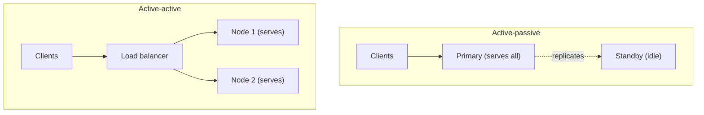

**N+1 and N+2:** if N servers handle peak load, run N+1 (survive one failure) or N+2 (survive one failure during maintenance of another).

### Trade-offs
- Redundancy costs money: standby machines, extra copies of data.
- Failover is risky. If the system wrongly decides a slow or cut-off primary is dead, two primaries may both accept writes: **split brain**. Parts 3 and 4 cover prevention (quorums, fencing).
- Failover must be tested regularly; untested failover often fails when needed.

### Common mistakes
- Making app servers redundant but leaving one database or one load balancer.
- Putting all "redundant" copies in the same rack or zone.
- Forgetting the standby needs capacity for the full load.

### Real-world examples
- AWS recommends spreading instances across at least two availability zones; Amazon RDS Multi-AZ keeps a synchronous standby in another zone and fails over automatically, typically within a minute or two.
- Load balancers are deployed in pairs (or as a managed, internally redundant service) so they are not the SPOF.

### In the interview
**Q:** How do you find single points of failure in a design?

**A:** Go component by component (including DNS, load balancers, databases, config stores, third-party APIs) and ask what happens if it disappears. Anything that stops the whole service needs a redundant copy in a separate failure domain and automatic failover.

**Q:** Active-passive or active-active?

**A:** Active-passive is simpler and common for single-writer databases. Active-active uses capacity better, recovers faster and suits stateless services, but needs conflict handling for stateful data.

### TL;DR
Redundancy means spares; a SPOF is any part with no spare; failover moves work to the spare. Duplicate critical parts across failure domains and automate failover, while guarding against split brain.

---

## Scalability

### What it is
**Scalability** is handling more load (users, requests, data) by adding resources, without a redesign and without performance collapsing: cost and effort grow roughly in proportion to load instead of hitting a wall.

Load is described by **load parameters**: requests per second, concurrent users, read/write ratio, data size, followers per user, and so on. "Scalable" only makes sense relative to one of them: "we can scale to 10× the requests per second by adding servers". (A restaurant that serves more diners by adding tables and cooks scales; one whose tiny kitchen tops out at 50 meals an hour does not.)

### Why it matters
Successful products grow, sometimes overnight. A system needing a rewrite at each 10× step slows the business at exactly the wrong moment.

### How it works
Dimensions to scale along:

- **Load scalability:** more requests per second.
- **Data scalability:** more stored data.
- **Geographic scalability:** users worldwide needing low latency everywhere.
- **Organisational scalability:** more engineers working without stepping on each other (one reason teams split into microservices, Part 5).

Core techniques, explained later:
1. Scale out stateless app servers behind a load balancer (next section).
2. Cache hot data (Part 4).
3. Copy data to read replicas for read-heavy loads (Part 3).
4. Split data across shards for write-heavy or huge data (Part 3).
5. Move slow work to queues and workers (Part 4).
6. Put static content on a CDN (Part 2).

### Common mistakes
- Calling a system "scalable" without saying which load parameter and by how much.
- Scaling the wrong part: more app servers do nothing if the database is the bottleneck.
- Building for 1,000× growth on day one. Make the next 10× easy, then re-evaluate.

### In the interview
**Q:** What does it mean for a system to be scalable?

**A:** It handles growing load, stated in concrete numbers, by adding resources roughly in proportion, while staying within performance targets.

### TL;DR
Scalability is handling more load by adding resources without a redesign. Always say what load (QPS, data size, users) and by how much.

---

## Vertical and horizontal scaling

### What it is
- **Vertical scaling (scale up):** make one machine bigger: more CPU cores, RAM, faster disks (a bigger bus).
- **Horizontal scaling (scale out):** add more machines and spread the work across them (more buses).

### How it works
**Vertical scaling** is usually a configuration change in the cloud: stop the machine, pick a larger size, start it; no code changes. Cloud machines go very large: AWS offers instances with hundreds of cores and multiple terabytes of RAM.

**Horizontal scaling** needs divisible work: stateless app servers are easy (add copies behind a load balancer); databases are harder — reads can go to replicas, but spreading writes needs sharding (each machine holds part of the data).

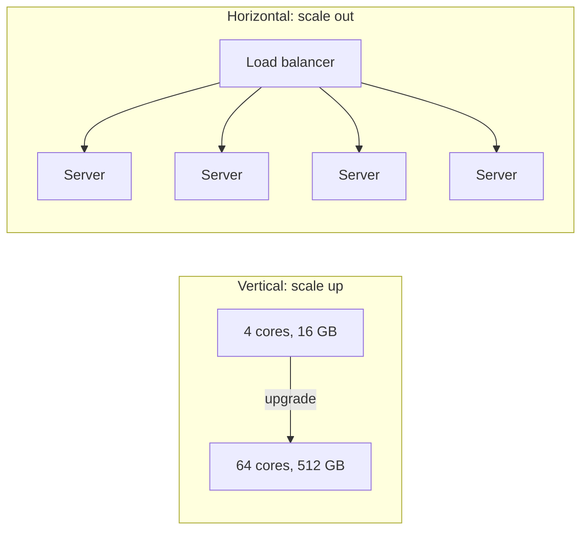

### Trade-offs

| | Vertical (up) | Horizontal (out) |
|---|---|---|
| Simplicity | Very simple, no code change | Needs load balancing, stateless design or sharding |
| Limit | Hard ceiling: the biggest machine | Practically unlimited |
| Fault tolerance | One machine is still a SPOF | Losing one node loses only a fraction |
| Cost curve | Big machines cost disproportionately more | Many cheap commodity machines |
| Downtime to resize | Often needs a restart | Add or remove nodes live |
| Consistency | Easy (one copy of data) | Harder (data spread across machines) |

### Common mistakes
- Dismissing vertical scaling. One large database server handles a lot; scaling up first is often the right, cheap answer.
- Scaling out a stateful service without dealing with its state (next sections).

### Real-world examples
- Stack Overflow famously served a very large site from a few powerful servers (in 2016: 11 web servers and 4 SQL Server machines, plus a few Redis, search and tag-engine boxes) — vertical scaling done well.
- Google, Meta and Amazon are each estimated to run millions of commodity servers: horizontal scaling at the extreme.

### In the interview
**Q:** When would you choose vertical scaling?

**A:** Early on, or for components hard to distribute (a relational database's primary). It's simple and buys time. Go horizontal when nearing the largest machine, needing fault tolerance, or when costs climb steeply.

**Q:** What makes horizontal scaling hard?

**A:** State. Stateless servers scale out trivially; anything storing data must be replicated or partitioned, bringing consistency and coordination problems.

### TL;DR
Scale up = bigger machine (simple, limited, still a SPOF). Scale out = more machines (unlimited and fault tolerant, but needs stateless design or data partitioning). Most real systems do both.

---

## Elasticity

### What it is
**Elasticity** is adding and removing resources *automatically and quickly* as load changes, so you pay for roughly what you use. Scalability says "we *can* grow"; elasticity says "we grow and shrink by ourselves, in minutes" — like a supermarket opening checkouts when queues lengthen.

### How it works
Watch a metric (CPU, requests per second, queue length); past a threshold (CPU above 70% for 5 minutes) launch servers, below another (30%) remove some, while the load balancer starts and stops sending them traffic. This is **autoscaling** (*Autoscaling*, Part 5: reactive, scheduled, predictive), provided by cloud platforms (AWS Auto Scaling groups, Kubernetes Horizontal Pod Autoscaler) and **serverless** platforms (AWS Lambda, which runs your code per request and scales to zero).

### Trade-offs
- New servers take time to start (seconds for containers, minutes for virtual machines); a sudden spike can outrun capacity.
- Only stateless parts are easily elastic; databases scale much more slowly.
- Scaling down too eagerly causes "flapping" (adding and removing repeatedly).

### In the interview
**Q:** What's the difference between scalability and elasticity?

**A:** Scalability is the capability to handle more load by adding resources; elasticity is doing it automatically, in both directions, as demand changes.

### TL;DR
Elasticity is automatic, fast scaling up and down with demand, mostly for stateless parts, so you pay only for what you need.

---

## Stateless and stateful services

### What it is
**State** is data a program remembers between requests: who is logged in, a shopping cart, the contents of a database.

- A **stateless service** keeps no client-specific data in its own memory between requests. Every request carries (or points to) everything needed, so any copy can handle any request — like a call centre where any agent can pull up your file.
- A **stateful service** remembers data locally between requests, so a client or piece of data is tied to a particular server — like a family doctor who keeps your history in their head: great until they're on holiday.

### Why it matters
Stateless services are easy to scale out, load balance, restart and replace: kill any copy and nothing is lost. Hence the standard advice: "**make app servers stateless and push state into dedicated stores**" (databases, caches, object storage) designed for replication.

### How it works
To make a web app stateless:
1. Store login sessions in a shared store (Redis) or a signed token the client sends with each request (a JWT, JSON Web Token, Part 5), not in server memory.
2. Store uploaded files in object storage, not the server's local disk.
3. Keep shopping carts and similar data in a database or cache.

Then the load balancer can send each request to any server.

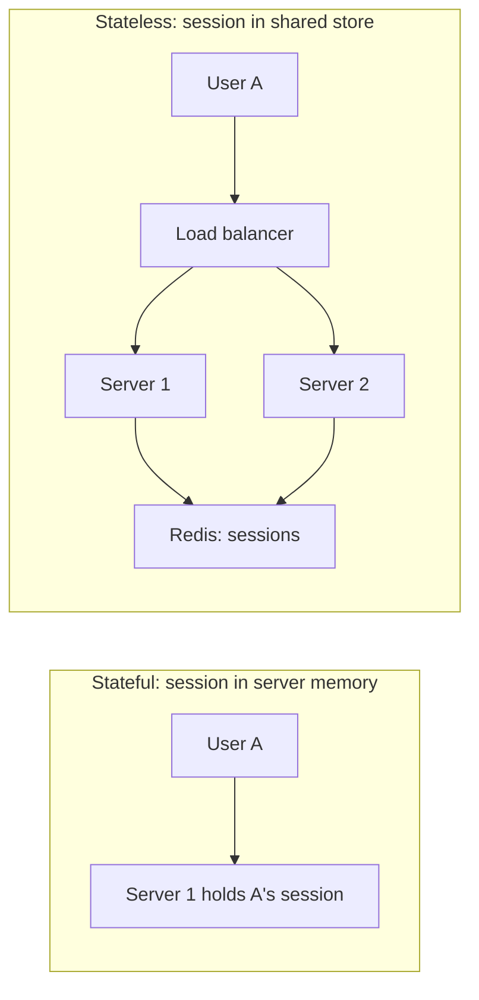

If a service stays stateful (a game server holding a live match, a chat server holding open connections), the load balancer must send each client to the same server — **sticky sessions** (Part 2) — and you must plan for that server dying.

### Trade-offs
- Stateless servers need an extra network hop to fetch state (usually under a millisecond to a cache).
- Stateful designs can be faster (data already in memory) and are sometimes necessary (databases, real-time games, WebSocket servers), but are harder to scale and recover.

### Common mistakes
- Keeping sessions in local memory, then adding a second server and finding users randomly logged out.
- Writing uploaded files to one server's local disk.
- Calling a system stateless when state just moved elsewhere; the state store now needs scaling and redundancy too.

### In the interview
**Q:** Why should application servers be stateless?

**A:** So any instance can handle any request: add or remove instances freely, balance evenly, and lose one without losing user data. State lives in stores built for durability and replication.

### TL;DR
Stateless services remember nothing between requests and scale easily; stateful ones hold data and are harder to scale and recover. Keep app servers stateless and put state in databases and caches.

---

## Performance vs scalability

### What it is
- **Performance** is how fast the system is for *one* request or user at the current load: low latency, efficient resource use.
- **Scalability** is how well performance holds up as load *grows*.

Diagnostic: send one request to an otherwise idle system. If even that is slow, it's **performance**; if it's quick but things drag as traffic piles up, it's **scalability**. (A sports car is fast for one person but seats two; a train is slower off the mark but carries a thousand.)

### Trade-offs
Some changes help one and hurt the other: a network hop to a shared cache slightly hurts single-request performance but lets you scale out; keeping everything in one process's memory is fast but caps you at one machine.

### In the interview
**Q:** The site is slow even at 3 am with almost no traffic. Performance or scalability?

**A:** Performance: something is slow per request (an unindexed query, a slow external call, a big page). Adding servers won't help; profile the request.

### TL;DR
Performance = fast for one; scalability = stays fast for many. Diagnose which before fixing.

---

## Concurrency vs parallelism

### What it is
- **Concurrency:** several tasks in progress during the same period, the program switching between them whenever one waits. It describes how work is *organised*.
- **Parallelism:** several tasks running at the same instant on multiple CPU cores or machines. It describes how work is *executed*.

Rob Pike (Go co-creator): concurrency is *dealing with* lots of things at once, parallelism is *doing* lots of things at once. One barista interleaving orders while the milk steams is concurrent; three baristas each making a drink at once is parallel. Concurrency works on a single core (by switching); parallelism needs multiple cores.

### Why it matters
Most web servers spend their time **waiting** (network, database, disk), not computing. Concurrency lets one server keep thousands of requests in progress while each waits. Parallelism speeds up **CPU-heavy** work (image processing, encryption, analytics) by splitting it across cores.

### How it works
Ways to achieve concurrency:
- **Processes:** separate programs with their own memory. Heavy but isolated.
- **Threads:** multiple flows of execution inside one process sharing memory. Lighter, but shared memory needs locks.
- **Event loop / async I/O:** one thread handles many requests by never blocking: start an I/O operation, handle something else, return when the result is ready (Node.js, NGINX, Python's asyncio).
- **Lightweight threads / coroutines:** cheap tasks scheduled by the language runtime (Go's goroutines, Java's virtual threads): simple blocking-style code with event-loop efficiency.

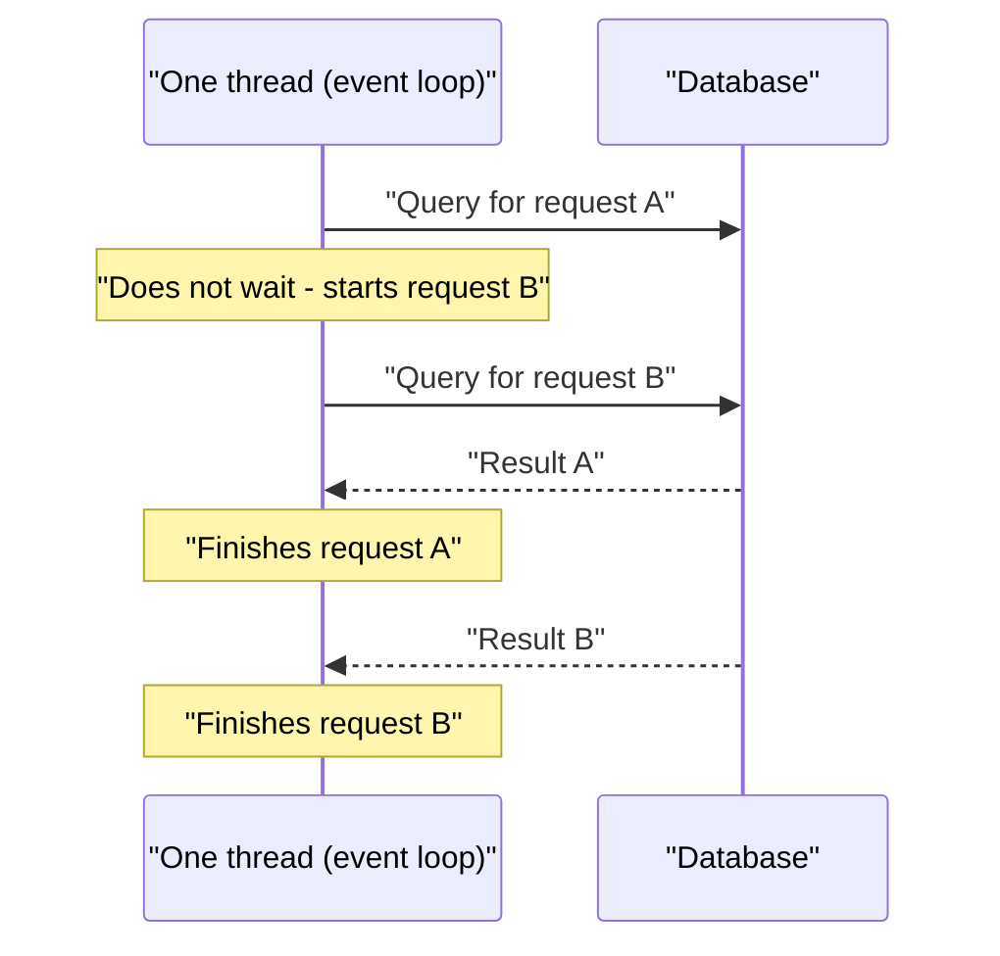

**Concurrency hazards** when tasks share data: a **race condition** (the result depends on timing — two requests both read a balance of 100 and both write 90 after a withdrawal of 10, losing one withdrawal), **deadlock** (two tasks each wait forever for a lock the other holds) and contention (tasks queue for the same lock). Locks, atomic operations and database transactions (Part 3) address them.

**Amdahl's law:** the speed-up from parallelism is limited by the part that must run serially. If 10% of a job is serial, even infinite cores give at most 10×.

### Common mistakes
- Adding threads to a CPU-bound task beyond the number of cores: just switching overhead.
- Assuming parallel code is automatically faster; coordination and locking can make it slower.

### In the interview
**Q:** Is a single-threaded Node.js server concurrent?

**A:** Yes: an event loop and non-blocking I/O handle many requests concurrently. It isn't parallel for JavaScript on one core; run several processes to use multiple cores.

### TL;DR
Concurrency is juggling many tasks (great for waiting on I/O); parallelism is doing several at the same instant on multiple cores (great for CPU-heavy work). Shared data under concurrency needs care to avoid races and deadlocks.

---

## Bottlenecks: CPU, memory, disk and network

### What it is
A **bottleneck** is the part that limits overall capacity, like a bottle's narrow neck; improving anything else won't help until it is fixed. Every machine has four basic resources that can become one:

| Resource | What it limits | Signs it's the bottleneck | Usual fixes |
|---|---|---|---|
| CPU | Computation (encryption, parsing, compression) | CPU near 100%, latency rises with load | Optimise code, cache results, add cores or servers |
| Memory (RAM) | How much data fits in fast storage | Swapping to disk, out-of-memory crashes, cache misses | More RAM, smaller data, evict wisely |
| Disk | Reading and writing stored data | High disk wait time, IOPS or MB/s at limit | SSDs, caching, sequential writes, sharding |
| Network | Moving data between machines | Link saturated, packet loss, high RTT | Compression, CDNs, fewer calls, closer servers |

### How it works
**Finding the bottleneck:**
1. Measure each resource under load (dashboards, `top`, `iostat`, cloud metrics).
2. Look for the one at or near its limit, or queues building in front of something (full thread pools, exhausted database connections, lock waits).
3. Fix it and measure again. The bottleneck moves: fix the database and the network may be next.

Non-hardware bottlenecks are just as common: a single lock everybody waits for, a too-small connection pool, one "hot" row every request updates, an external API's rate limit.

A task is **CPU-bound** when limited by computation and **I/O-bound** when limited by waiting for disk or network. Most web services are I/O-bound.

### IOPS and disk performance
**IOPS (Input/Output Operations Per Second)** is how many separate read or write operations a storage device performs per second; it matters most for **random** access (many small reads at different locations), such as database lookups. Disks have two separate limits: **IOPS** (small random reads/writes) and **throughput** in MB/s (large sequential transfers such as streaming a video or a backup). A disk can hit one limit without the other.

| Device | Rough random IOPS | Rough sequential throughput |
|---|---|---|
| Spinning HDD (7,200 rpm) | about 75-150 | 100-250 MB/s |
| SATA SSD | tens of thousands | about 500 MB/s |
| NVMe SSD | hundreds of thousands to about 1 million | several GB/s |
| Cloud block disk (e.g. AWS gp3 baseline) | 3,000 (can buy more) | 125 MB/s (can buy more) |

An HDD's IOPS is low because each random read must physically move the arm and wait for the platter (roughly 5–10 ms); hence databases moved to SSDs, and HDD systems favour sequential writes. Example: 20,000 random cache-missing reads per second would need over 100 HDDs (~150 IOPS each); one NVMe SSD handles it comfortably.

### Common mistakes
- Guessing the bottleneck instead of measuring.
- Looking only at averages: a resource at 50% average can be at 100% for the busy minute that matters.
- Forgetting cloud disks have provisioned IOPS limits: a database can be throttled by its disk while CPU looks idle.

### In the interview
**Q:** Latency rises under load but CPU is only at 30%. Where would you look?

**A:** Another bottleneck: disk IOPS, network, a full connection pool, a lock, or a slow dependency. Look for where requests queue.

**Q:** What's the difference between IOPS and disk throughput?

**A:** IOPS counts operations per second (key for small random reads like database lookups); throughput counts bytes per second (key for large sequential transfers).

### TL;DR
The bottleneck is whichever resource (CPU, memory, disk, network, or a lock or pool) runs out first. Measure to find it; disks are limited separately by IOPS and by MB/s.

---

## How to approach a system design interview

### What it is
A 45–60 minute, deliberately open-ended conversation: "design a URL shortener / a chat app / a news feed". A repeatable structure helps you cover everything and shows how you think.

### How it works
A widely used sequence, with rough timings for a 45-minute interview:

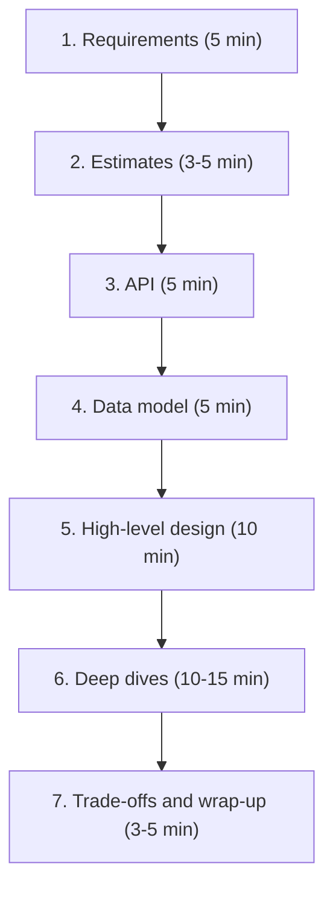

**1. Clarify requirements.** Never start drawing straight away. Ask questions and write two lists:
- **Functional requirements:** *what* the system does, the features. Example for a URL shortener: "create a short link from a long URL", "redirect a short link to the original", "optional custom aliases", "links expire after a year".
- **Non-functional requirements:** *how well* it does it, the qualities. Scale (100M new links per month), latency (redirect in under 50 ms at p99), availability (99.99% for redirects), durability (never lose a link), consistency (is a newly created link visible everywhere immediately?), security, maintainability, cost. The table after step 7 lists each one with the design levers that meet it.
- Also agree what's **out of scope** (analytics dashboards, user accounts).

**2. Estimate scale.** Back-of-the-envelope: QPS (average and peak), read/write ratio, storage over time, bandwidth. Keep it quick and say how the numbers affect the design ("100:1 reads, so caching matters").

**3. Define the API.** The main endpoints with inputs and outputs; this pins down exactly what the system must do:

```
POST /links        body: {long_url, custom_alias?}  -> {short_code}
GET  /{short_code}                                  -> 301 redirect to long_url
```

**4. Sketch the data model.** Entities, key fields and access patterns, e.g. a `links` table: `short_code` (primary key), `long_url`, `created_at`, `expires_at`. Mention which kind of database fits the access pattern (Part 3).

**5. Draw the high-level design.** Boxes and arrows (clients, load balancer, app servers, cache, database, queue…). Walk one write and one read end to end. Keep it simple; it must meet the functional requirements.

**6. Deep dives.** Go deeper on the hardest parts, often steered by the interviewer: how to generate unique short codes without collisions, how to shard the database, how to cache hot links, what happens when a data centre fails, how to handle a celebrity's viral link. Use your estimates to justify choices.

**7. Discuss trade-offs and wrap up.** Name weaknesses and next steps: bottlenecks, single points of failure, monitoring, what changes at 10× scale.

### Non-functional requirements and the levers that meet them
A non-functional requirement only helps if it is **measurable** ("p99 < 200 ms", not "fast") and if you can name the **design lever** that delivers it. Use this table twice: in step 1 to make sure you asked about each row, and in step 7 to check that every number you agreed has a mechanism behind it.

| Requirement | Make it measurable as | Main design levers | What the lever costs | Explained in |
|---|---|---|---|---|
| **Availability** | % of successful requests per month (SLO); allowed downtime | Redundancy in several zones, health checks and failover, no single point of failure, graceful degradation | More machines; consistency questions between copies | *Availability and the nines*, *Redundancy* (Part 1) |
| **Latency** | p50/p95/p99 per endpoint | Caching, CDNs, fewer round trips, async work, headroom | Staleness, money, complexity (see *Low-latency checklist*) | *Latency, throughput and bandwidth* (Part 1) |
| **Scalability / throughput** | Peak QPS, data size and growth per year | Stateless services behind load balancers, sharding, queues to absorb bursts | Cross-shard queries and transactions get hard | *Scalability*, *Partitioning and sharding* (Parts 1, 3) |
| **Consistency** | "After a write, who must see it, and how soon?" | Single leader with synchronous replicas, quorums, consensus; or eventual consistency with conflict handling | Higher write latency and lower availability during partitions (CAP/PACELC) | *Consistency models*, *CAP theorem* (Part 4) |
| **Durability** | "Never lose an acknowledged write"; RPO (how much data may be lost) | Write-ahead log, replication before acknowledging, backups, cross-region copies | Write latency, storage cost | *Durability* (Part 3), *Disaster recovery* (Part 5) |
| **Reliability / fault tolerance** | Error rate, MTTR | Timeouts, retries with backoff, idempotency, circuit breakers, bulkheads | Extra load from retries; code complexity | Part 5 resilience sections |
| **Security and privacy** | Who may do what; which data is sensitive; compliance rules | Authentication and authorisation at the edge, encryption in transit and at rest, least privilege, audit logs | Latency of checks, operational overhead | Part 5 security sections |
| **Maintainability** | Time to diagnose an incident; time to ship a typical change; deploys per day | See the three parts below | Up-front engineering time | This section |
| **Cost** | Cost per request, per user or per GB stored | Right-size machines, autoscale, tier storage (hot/cold), cache to avoid expensive reads | Less headroom; slower cold data | *Cost awareness* (Part 5) |

**Maintainability** is the requirement candidates forget, yet most of a system's lifetime cost is spent operating and changing it after launch. Break it into three parts:

| Part | Meaning | What it looks like in a design |
|---|---|---|
| **Operability** | How easy it is for the people running the system to keep it healthy | Metrics, logs and traces on every component; dashboards and alerts tied to SLOs; runbooks; safe, automated deploys and rollbacks; sensible defaults; no manual steps that only one person knows |
| **Simplicity** | How easy it is for a new engineer to understand the system | Few component types; clear boundaries with one owner each; well-named APIs that hide internals; avoiding accidental complexity (complexity that comes from the implementation, not from the problem itself) |
| **Evolvability** | How easy it is to change the system as requirements change | Versioned APIs and backward-compatible schemas; loose coupling through queues or well-defined interfaces; feature flags; data migrations that can run online; tests that make refactoring safe |

In an interview, maintainability is usually one or two sentences at the wrap-up: "each service has one owning team and its own SLO dashboard, schemas are versioned so producers and consumers deploy independently, and every deployment is a canary with automatic rollback". That sentence shows you have run systems, not just drawn them.

*Sources:* ISO/IEC 25010:2023 product quality model (maintainability and its sub-characteristics); M. Kleppmann, *Designing Data-Intensive Applications*, ch. 1 (O'Reilly, 2017), for the operability/simplicity/evolvability split; B. Beyer et al., *Site Reliability Engineering* (Google, 2016), chapters on SLOs and monitoring.

### Trade-offs
Breadth vs depth: covering every box shallowly looks junior; going deep on one box and never finishing the design is worse. Aim for a complete simple design first, then depth.

### Common mistakes
- Jumping into detailed design before clarifying requirements, or staying silent — think out loud.
- Naming technologies without reasons ("use Cassandra"). Always say why ("write-heavy, simple key lookups, needs multi-region").
- Ignoring the non-functional requirements, which usually decide the design.
- Over-engineering: microservices, Kafka and five databases for a system with 100 QPS.
- Not checking the design against the original requirements and numbers at the end.

### In the interview
**Q:** What is the difference between functional and non-functional requirements?

**A:** Functional = features, what it does (post a photo, follow a user). Non-functional = qualities, how well (latency, availability, scale, consistency, durability, cost); these usually drive the architecture.

**Q:** The interviewer says "design Twitter". What do you do first?

**A:** Narrow scope with clarifying questions: which features (post, follow, home timeline, search?), how many users, read/write mix, latency and consistency expectations. Write the agreed requirements down before estimating or drawing.

**Q:** How do you choose what to deep-dive into?

**A:** The hardest parts given the requirements and estimates (usually the biggest scale or consistency challenge), or wherever the interviewer steers. Ask if unsure.

### TL;DR
Requirements (functional and non-functional), estimates, API, data model, high-level design, deep dives, trade-offs. Think out loud, justify every component with a requirement or a number, and finish with weaknesses and next steps.

---

## Part 1 glossary

Every Part 1 term is defined in one line in the [Master A–Z glossary](#master-az-glossary), which merges the glossaries of all six parts into a single alphabetical list.

## Part 2 — Networking and communication

Part 1 was about the boxes of a design diagram; this part is about the arrows: how one computer finds another, how bytes travel, which protocols they speak, and which helpers sit in the middle (proxies, load balancers, CDNs). You need not be a network engineer, but you do need to know what happens when a browser opens `www.example.com`, why HTTP/2 beats HTTP/1.1, and what an L7 load balancer can do that an L4 one cannot.

A **protocol** is an agreed set of rules for how two programs talk ("say hello, wait for a reply, then speak"). Networking is a stack of protocols, each solving one problem and handing the rest to the layer above or below.

## IP addresses, NAT, ports and sockets

### What it is

An **IP address** (Internet Protocol address) identifies a machine's network connection, like a street address. **Routers** forward traffic across the internet reading only this address on each **packet** (a small chunk of data, usually up to about 1,500 bytes on Ethernet).

- **IPv4**: 32 bits, four numbers 0–255 (`93.184.215.14`); about 4.3 billion addresses (2^32), which ran out in the 2010s.
- **IPv6**: 128 bits, eight groups of hex digits (`2606:2800:21f:cb07:6820:80da:af6b:8b2c`, runs of zeros shortened with `::`); about 3.4 × 10^38 addresses — effectively unlimited.

A **port** (0–65535) picks which program on the machine gets the data — the apartment number in the building. Well-known: 22 (SSH), 53 (DNS), 80 (HTTP), 443 (HTTPS), 5432 (PostgreSQL), 6379 (Redis).

A **socket** is one end of a conversation: IP address plus port. A TCP connection is uniquely identified by a **5-tuple**: protocol, source IP, source port, destination IP, destination port — which is why one server on port 443 can hold hundreds of thousands of connections (each client brings a different source IP or port).

**Public vs private IP.** A **public IP** is unique worldwide and reachable from anywhere. A **private IP** is meaningful only inside one local network and reused by millions of networks; the reserved IPv4 ranges are `10.0.0.0/8`, `172.16.0.0/12` and `192.168.0.0/16`. (`/8` is **CIDR notation**: the number of fixed leading bits; `10.0.0.0/8` is every address starting with 10, about 16.7 million.) Your home laptop is probably something like `192.168.1.23`.

**NAT (Network Address Translation)** lets many private machines share one public IP: the home router rewrites each outgoing packet's source from `192.168.1.23:51000` to its public IP and a free port (`81.2.69.160:40001`), records the mapping, and reverses it on replies. In the cloud a **NAT gateway** does this so servers in a private subnet can download updates without being reachable from outside.

### Why it matters

- Your servers live mostly on private IPs inside a **VPC** (Virtual Private Cloud — your own isolated network in a cloud provider); only the load balancer or gateway gets a public address. This is the first layer of security.
- NAT is why a server cannot simply "call" a phone or browser: the client has no stable public address, so push systems keep a long-lived connection open *from* the client (WebSockets, below).
- The 5-tuple sets connection limits: a proxy opening connections from one IP to one backend IP and port has at most about 64,000 source ports (about 28,000 with Linux's default range) — **ephemeral port exhaustion** on busy proxies.

### How it works

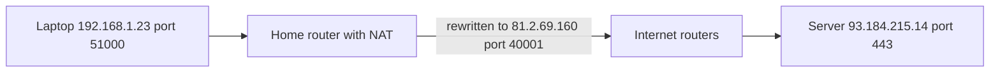

1. The browser asks the OS for a socket to `93.184.215.14:443`; the OS picks a random **ephemeral port** (temporary source port, typically 32768–60999 on Linux) such as 51000.
2. The router's NAT swaps the private source for its public one and records the mapping.
3. Internet routers forward the packet hop by hop on the destination IP alone; a typical path crosses 10–20 routers.
4. The server replies to `81.2.69.160:40001`; the router looks up its table and forwards to `192.168.1.23:51000`.

### Common mistakes

- Thinking an IP identifies a person or device. Behind **carrier-grade NAT** (NAT run by a mobile operator or ISP) thousands of users share one public IP, so rate limiting by IP alone can block a whole office or mobile network.
- Forgetting that IPs change. Cloud instances get new private IPs on restart, so systems use DNS names and service discovery, not hard-coded addresses.

### TL;DR

An IP address finds the machine, a port finds the program, the 5-tuple identifies one connection. Private IPs hide behind NAT; only a few edge components should have public IPs.

## DNS — the internet's phone book

### What it is

**DNS (Domain Name System)** turns names like `www.example.com` into IP addresses, like a phone's contacts list. Without it you would type `93.184.215.14`, and a company could never move servers without telling every user.

A **domain name** reads right to left as a hierarchy: `.` (the root, usually invisible) → `com` (the **top-level domain**, TLD) → `example` (the registered domain) → `www` (a **subdomain**). Each level is managed by a different organisation, which lets DNS scale to hundreds of millions of domains.

### Why it matters

- DNS is the first step of almost every request, so its speed adds directly to page load (a cold lookup can cost 20–120 ms).
- It is a cheap, global traffic-steering tool: answering with different IPs spreads users across data centres or sends them to the closest.
- When DNS breaks, everything looks down though servers are healthy — the 2016 Dyn attack, and Facebook's 2021 outage, when its DNS servers became unreachable after a routing change.

### How it works

The players:

- **Stub resolver** — the tiny DNS client in your OS; it just asks someone else.
- **Recursive resolver** — does the legwork for you and caches answers; run by your ISP (internet service provider), your company, or public services like Google `8.8.8.8` or Cloudflare `1.1.1.1`.
- **Root name servers** — the top of the tree: 13 named identities (`a.root-servers.net` to `m.root-servers.net`), each copied worldwide using anycast (CDN section), so close to 2,000 physical instances.
- **TLD name servers** — know who is in charge of each domain under `.com`, `.org`, `.uk`…
- **Authoritative name server** — holds the real records for a domain (Route 53, Cloudflare DNS, or your own); its answer is the final truth.

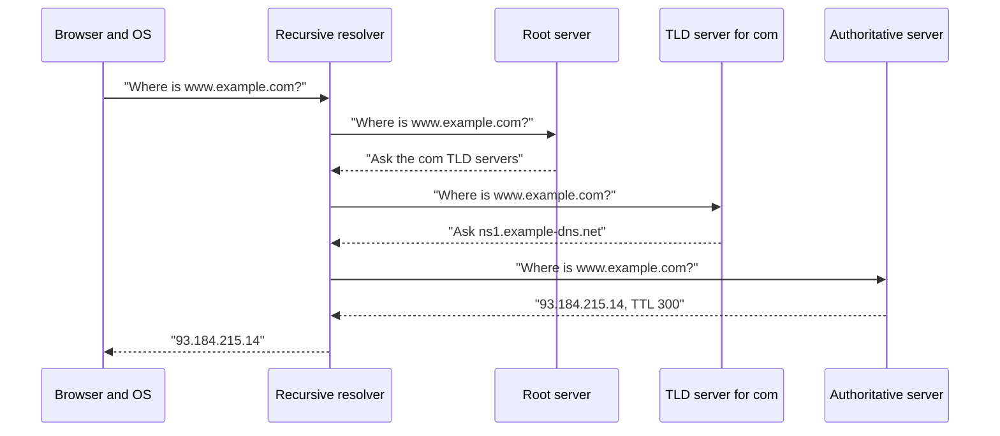

1. The browser checks its own cache, then the OS cache (and the `hosts` file).
2. On a miss, the stub resolver sends a **recursive query** ("give me the final answer") to the recursive resolver.
3. With nothing cached, the resolver asks a root server, which replies with a **referral** ("here are the `.com` servers"). These follow-ups are **iterative queries** — each server just points to the next.
4. The `.com` TLD server refers it to the domain's authoritative servers (its **NS records**).
5. The authoritative server returns the answer.
6. The resolver caches every step (root and TLD referrals for days), so the next `.com` lookup skips steps 3–4.

In practice a busy resolver has root and TLD answers cached, so most lookups are one hop to the authoritative server or a pure cache hit (under 1 ms on the same machine, ~10–30 ms to a public resolver).

### Types

**DNS record types:**

| Record | Maps | Example |
|---|---|---|
| A | name → IPv4 address | `www → 93.184.215.14` |
| AAAA | name → IPv6 address | `www → 2606:2800::1` |
| CNAME | name → another name (alias) | `shop → shops.myplatform.com` |
| MX | domain → mail servers, with priority | `10 mail1.example.com` |
| NS | domain → its authoritative name servers | `ns1.example-dns.net` |
| TXT | name → free text | domain-ownership proofs, SPF rules listing which servers may send a domain's email |

Others: **SOA** (start of authority — admin data for a zone), **SRV** (service location with port), **PTR** (reverse lookup, IP → name), **CAA** (which certificate authorities may issue certificates for the domain). A **zone** is the set of records one authoritative server is responsible for.

A CNAME cannot sit at the bare domain (`example.com`, the **apex**) because the apex must also hold NS and SOA records; providers work around this with non-standard "ALIAS"/"ANAME" records or Cloudflare's "CNAME flattening".

```text
$ dig www.example.com A +noall +answer
www.example.com.   300   IN   A   93.184.215.14
```

`300` is the **TTL**, `IN` means internet class, `A` is the record type.

**TTL and DNS caching.** Every record carries a **TTL (time to live)** in seconds: how long any resolver or browser may cache it (300 = reuse for 5 minutes). Long TTLs (hours, a day) mean fewer lookups and faster pages but slow changes — "propagation" is not a push; resolvers keep the old answer until their copy times out. Short TTLs (30–60 s) allow quick failover but cause more queries. Common trick: lower the TTL a day before a planned migration, switch the record, raise it again. Some clients and resolvers ignore TTLs and cache longer, so never rely on DNS alone for instant failover.

**DNS-based load balancing.** The authoritative server returns several A records and rotates their order per query — **round-robin DNS**. Clients usually try the first, so load spreads roughly evenly. Free and simple but blind: DNS doesn't know if a server is busy or dead unless the provider runs health checks and removes bad IPs.

**GeoDNS** answers by where the query comes from: Paris gets the Frankfurt data centre, Tokyo the Tokyo one. The location is guessed from the resolver's IP or from the **EDNS Client Subnet** extension, which passes part of the user's own IP. **Latency-based routing** (AWS Route 53) picks the region with the lowest measured latency rather than the nearest on a map.

### Trade-offs

| Choice | Benefit | Cost |
|---|---|---|
| Long TTL | Fewer lookups, resilient if DNS provider has a blip | Slow to change or fail over |
| Short TTL | Fast failover and traffic shifts | More DNS traffic and lookup latency |
| DNS load balancing | Global, cheap, no extra hop | Coarse, cached, no knowledge of server load |

### Common mistakes

- Expecting a DNS change to take effect instantly; cached answers live until their TTL expires, sometimes longer.
- One DNS provider with no redundancy. Many large sites now use two.
- Treating DNS round robin as a real load balancer; it cannot react to a slow server.

### Real-world examples

Amazon Route 53, Cloudflare DNS, Google Cloud DNS and NS1 are authoritative DNS services with health checks, GeoDNS and latency routing. Netflix and many others use DNS to steer users between AWS regions during regional failures.

### In the interview

**Q:** What happens when you type a URL in the browser, up to the IP address?

**A:** Browser cache, OS cache, then a recursive resolver, which (if nothing is cached) walks root → TLD → authoritative server, caches each answer for its TTL, and returns the IP. The browser then opens a TCP (or QUIC) connection to it.

**Q:** How would you move traffic away from a failed region using DNS?

**A:** Health-checked records with a short TTL (say 60 s) so the provider stops returning the failed region's IP. Some clients will still hit the old IP for a while, so the failed region's load balancer should also redirect or fail fast.

### TL;DR

DNS maps names to IPs through a cached hierarchy of root, TLD and authoritative servers. TTL trades speed against how quickly changes spread; DNS can do coarse global load balancing (round robin, GeoDNS, latency-based).

## Network layers — OSI and TCP/IP models

### What it is

Networking is split into **layers**, each solving one job and relying on the layer below — like a parcel: letter (application), apartment number (transport), street address (network), the van (link and physical). Each layer only reads its own label.

The **OSI model** has seven layers and is mainly a teaching vocabulary; the **TCP/IP model** has four and describes what the internet runs. "L4" or "L7" always means OSI layer numbers.

| OSI layer | Name | What it handles | Examples |
|---|---|---|---|
| 7 | Application | Meaning of messages | HTTP, DNS, gRPC, SMTP |
| 6 | Presentation | Encoding, encryption | TLS (roughly), JSON (a text data format) |
| 5 | Session | Conversations | (rarely discussed) |
| 4 | Transport | Process-to-process delivery, ports | TCP, UDP, QUIC |
| 3 | Network | Machine-to-machine routing | IP, ICMP |
| 2 | Data link | One hop on a local network | Ethernet, Wi-Fi, MAC addresses |
| 1 | Physical | Bits on wire, light or radio | Copper, fibre, radio |

TCP/IP merges 5–7 into "application" and 1–2 into "link": Application, Transport, Internet, Link.

### Why it matters

A component's layer decides what it can see and do:

- **L3** (router, firewall rule on IPs): only source and destination IPs.
- **L4** (L4 load balancer): also ports and TCP/UDP state, not content — "send port 443 traffic to these servers", but not "send `/api/` to these".
- **L7** (L7 load balancer, API gateway): reads the HTTP request — path, headers, cookies — so it can route by path, rewrite headers and block bad requests, at the cost of more CPU and decrypting TLS (the encryption behind HTTPS, below).

### How it works

Each layer wraps the data with its own header — **encapsulation**: HTTP request → TCP segment (ports, sequence numbers) → IP packet (IPs) → Ethernet frame (**MAC addresses**, the hardware address of a network card). The receiver unwraps in reverse.

### TL;DR

L3 is IP addresses, L4 ports and connections (TCP/UDP), L7 application content (HTTP). "L4 vs L7" means "can it read the request or only the connection?"

## TCP, UDP and QUIC

### What it is

The **transport-layer** protocols that carry data between two programs:

- **TCP (Transmission Control Protocol)**: a phone call with a careful note-taker — connect first; everything arrives, in order; lost words are repeated.
- **UDP (User Datagram Protocol)**: postcards shouted across a room — no setup, independent messages, some lost or out of order, nothing repeated.
- **QUIC**: a newer protocol over UDP with TCP-like reliability plus built-in encryption, minus some of TCP's weaknesses. HTTP/3 runs on it.

### Why it matters

The choice shapes latency and behaviour under packet loss. Web pages, APIs and databases need every byte correct, so they use TCP (or QUIC). Voice, video calls, games and DNS lookups prefer UDP: a late packet is useless, better skipped than waited for.

### How it works

**TCP three-way handshake.** Before any data, the two sides agree starting sequence numbers:

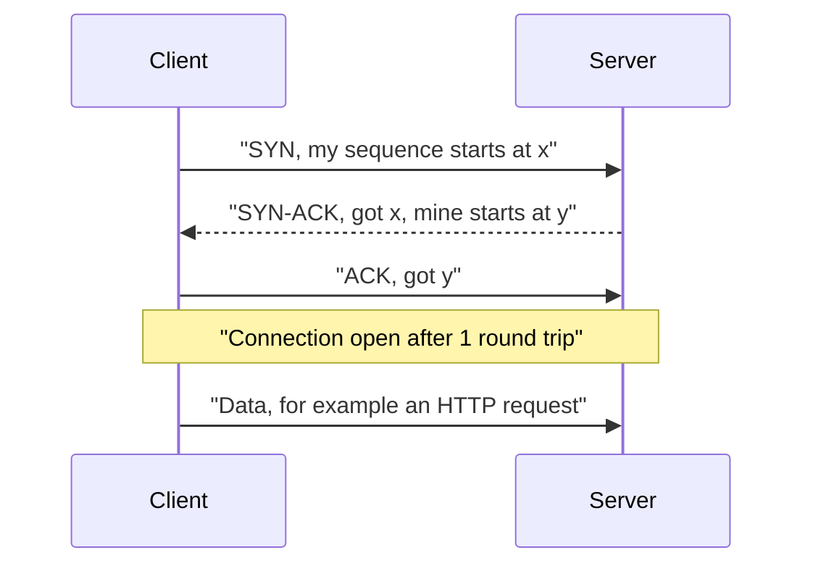

This costs one **round trip (RTT)** before the first request byte — 70 ms London–New York — and TLS adds more (HTTPS). Hence reusing connections matters.

**Reliability and ordering.** TCP numbers every byte (**sequence numbers**); the receiver sends **acknowledgements (ACKs)**; if an ACK is late the sender **retransmits**. The receiver reorders segments and hands the application a clean, ordered byte stream.

**Flow control.** The receiver advertises a **receive window** (its free buffer space) so a fast sender cannot overwhelm a slow receiver.

**Congestion control.** To avoid overwhelming the network in between, TCP starts slowly (**slow start**: a few packets, roughly doubling each round trip while ACKs return) and backs off on loss. Algorithms: Reno, CUBIC (Linux default) and Google's BBR, which models bandwidth and RTT instead of waiting for loss. A new connection cannot use full bandwidth immediately — another reason to keep connections warm.

**Closing.** Either side sends **FIN**; the other acknowledges. The side closing first keeps the socket in **TIME_WAIT** briefly (60 s on Linux) to catch stray packets — a source of port exhaustion on clients that open and close many connections.

**Head-of-line (HOL) blocking.** TCP delivers bytes strictly in order, so one lost packet holds up everything behind it until retransmitted, even data already arrived. If several independent requests share one TCP connection (HTTP/2), one loss stalls them all.

**UDP** has no handshake, ACKs, ordering or congestion control; each **datagram** is sent and forgotten. Its header is 8 bytes versus TCP's 20+. Apps needing some reliability add it themselves.

**QUIC** (standardised by the IETF, the Internet Engineering Task Force, in 2021; originally developed at Google) runs over UDP and merges what took TCP + TLS:

1. **Faster setup** — transport and TLS 1.3 handshakes combined: 1 RTT for a new connection; a returning client can send data in its first packet (**0-RTT**).
2. **Independent streams** — a lost packet stalls only its own stream; no transport-level HOL blocking between streams.
3. **Connection migration** — a connection is identified by a **connection ID**, not the 5-tuple, so a phone moving from Wi-Fi to 4G keeps it.
4. **Always encrypted** — even most transport headers.
5. **Lives in user space** — evolves without OS upgrades. Downsides: more CPU per byte than kernel TCP, and some corporate firewalls block UDP, so clients fall back to TCP.

### Types

| | TCP | UDP | QUIC |
|---|---|---|---|
| Connection setup | 1 RTT (plus TLS) | none | 1 RTT incl. TLS, 0-RTT on resume |
| Reliable, ordered | Yes, one stream | No | Yes, per stream |
| HOL blocking | Yes | No | Only within a stream |
| Encryption | Separate (TLS) | None built in | Built in |
| Typical use | Web, APIs, databases | DNS, video calls, games | HTTP/3 |

### Trade-offs

TCP: correctness, at the cost of setup latency and stalls under loss. UDP: speed and control, but you build any reliability yourself. QUIC fixes TCP's main web pains but costs more CPU and is sometimes blocked.

### Common mistakes

- "UDP is faster" without context. On a clean network a long-lived TCP connection is as fast for bulk data; UDP wins on setup and on not waiting for retransmissions.
- Forgetting that every new TCP + TLS connection costs 2–3 RTTs before the first byte. Use connection pooling and keep-alive.

### Real-world examples

Zoom, WebRTC (browser video calls) and most online games use UDP. DNS uses UDP for normal queries and TCP for large responses. Google, YouTube, Meta and Cloudflare serve a large share of traffic over QUIC / HTTP/3.

### In the interview

**Q:** Why would a video-calling app use UDP instead of TCP?

**A:** A frame 300 ms late is worthless. TCP would pause all later frames while retransmitting the lost one (HOL blocking); with UDP the app skips it and stays real-time.

**Q:** What problem does QUIC solve?

**A:** TCP's head-of-line blocking across multiplexed streams and the slow combined TCP + TLS handshake. QUIC gives independent streams, a 1-RTT (or 0-RTT) encrypted handshake, and survives network changes.

### TL;DR

TCP = connected, reliable, ordered, congestion-controlled, with handshake cost and head-of-line blocking. UDP = fire-and-forget datagrams. QUIC = reliable, encrypted, multi-stream transport over UDP that powers HTTP/3.

## HTTP — the language of the web

### What it is

**HTTP (HyperText Transfer Protocol)** is the request–response protocol of browsers and APIs. The client sends a **request** (method, path, headers, optional body); the server sends a **response** (status code, headers, optional body).

```http
GET /users/42 HTTP/1.1
Host: api.example.com
Accept: application/json
Authorization: Bearer eyJhbGciOi...

HTTP/1.1 200 OK
Content-Type: application/json
Cache-Control: max-age=60

{"id": 42, "name": "Asha"}
```

### Why it matters

Almost every API you design in an interview is HTTP. The right method and status code make APIs predictable, cache-friendly and safe to retry; the HTTP version decides how many connections you need and how much latency you pay.

### How it works

**Methods (verbs).**

| Method | Meaning | Safe? | Idempotent? |
|---|---|---|---|
| GET | Read a resource | Yes | Yes |
| HEAD | Like GET, headers only | Yes | Yes |
| POST | Create, or run an action | No | No |
| PUT | Replace a resource fully | No | Yes |
| PATCH | Change part of a resource | No | Not guaranteed |
| DELETE | Remove a resource | No | Yes |
| OPTIONS | Ask what is allowed (used by CORS, the browser's cross-origin permission check) | Yes | Yes |

**Safe** = changes nothing on the server. **Idempotent** = doing it once or ten times leaves the same server state, so a client can retry after a timeout: `DELETE /orders/7` twice still leaves order 7 deleted (the second may return 404). `POST /orders` twice creates two orders, which is why payment APIs add an **idempotency key** header so the server recognises a retry.

**Status codes** — the first digit is the category:

| Range | Meaning | Common codes |
|---|---|---|
| 1xx | Informational | 101 Switching Protocols (WebSocket upgrade) |
| 2xx | Success | 200 OK, 201 Created, 202 Accepted, 204 No Content |
| 3xx | Redirect | 301 Moved Permanently, 302 Found, 304 Not Modified |
| 4xx | Client's fault | 400 Bad Request, 401 Unauthorized, 403 Forbidden, 404 Not Found, 409 Conflict, 429 Too Many Requests |
| 5xx | Server's fault | 500 Internal Server Error, 502 Bad Gateway, 503 Service Unavailable, 504 Gateway Timeout |

401 = "we don't know who you are" (not logged in); 403 = "we know who you are and you may not do this". 502 and 504 usually come from a proxy or load balancer: the backend gave a bad answer (502) or none in time (504). 202 Accepted = "queued, will be processed later".

**Headers** are key–value metadata: `Host` (which site — many share one IP), `Content-Type` (body format), `Authorization` (credentials), `Cache-Control` (who may cache and how long), `ETag` and `If-None-Match` (server replies 304 Not Modified if the client's copy is current), `User-Agent`, `Accept-Encoding: gzip, br` (compression), `X-Forwarded-For` (original client IP, added by proxies).

**Statelessness and cookies.** HTTP is **stateless**: each request carries everything needed and the server doesn't remember the previous one, so many identical servers can sit behind a load balancer. Logins and carts use **cookies**: the server sends `Set-Cookie: session=abc123; HttpOnly; Secure; SameSite=Lax` and the browser returns `Cookie: session=abc123` on every later request; the session lives in a shared store (Redis) or a signed token (flags and tokens: *Sessions, cookies, tokens and JWT*, Part 5).

**Keep-alive (persistent connections).** HTTP/1.0 opened a TCP connection per request; HTTP/1.1 keeps it open by default for reuse, saving the handshake each time.

### Types

**HTTP/1.1 (1997).** Text-based; one request at a time per connection, the next waiting for the previous response (**HTTP-level HOL blocking**). "Pipelining" was specified but never worked reliably, so browsers open about 6 connections per host and sites used tricks like domain sharding and sprite images.

**HTTP/2 (2015).** Binary framing. **Multiplexing**: many requests and responses interleave as **streams** over one TCP connection, so one slow response no longer blocks others at the HTTP level. **Header compression** (HPACK) shrinks repetitive headers. Server push was little used and has been removed from Chrome. Weakness: one TCP connection, so one lost packet stalls every stream (TCP-level HOL blocking) — on lossy mobile networks sometimes worse than six HTTP/1.1 connections.

**HTTP/3 (2022).** HTTP/2's semantics on QUIC over UDP: independent streams remove TCP HOL blocking, setup is faster, connections survive network switches. Header compression is QPACK. Browsers discover HTTP/3 through an `Alt-Svc` header or a DNS **HTTPS record**, falling back to HTTP/2 if UDP is blocked.

| | HTTP/1.1 | HTTP/2 | HTTP/3 |
|---|---|---|---|
| Transport | TCP | TCP | QUIC (UDP) |
| Format | Text | Binary frames | Binary frames |
| Parallel requests | ~6 connections | Many streams, 1 connection | Many streams, 1 connection |
| HOL blocking | HTTP and TCP level | TCP level | Per stream only |
| Encryption | Optional | Required by browsers | Always |

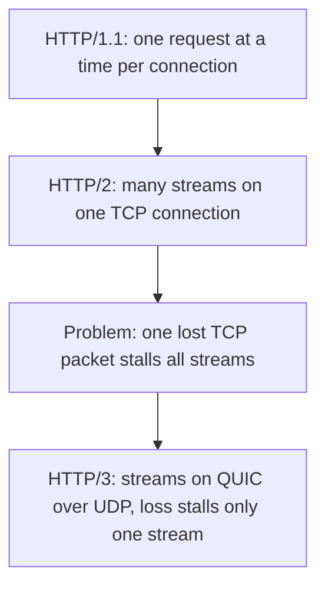

### Common mistakes

- GET for actions that change data (a crawler or prefetcher may trigger them).
- Returning 200 with `{"error": ...}` in the body; proxies, caches, monitoring and retries rely on real status codes.
- Retrying non-idempotent POSTs blindly. Use idempotency keys.
- Session state in one server's memory, which breaks with two servers.

### In the interview

**Q:** Which HTTP methods are idempotent and why does it matter?

**A:** GET, HEAD, PUT, DELETE, OPTIONS. Networks time out; if the client doesn't know whether a request succeeded, it can safely retry an idempotent one. POST needs an idempotency key.

**Q:** What did HTTP/2 improve and what did HTTP/3 fix on top?

**A:** HTTP/2 multiplexed many requests over one connection with header compression, removing HTTP-level head-of-line blocking. HTTP/3 moved to QUIC to remove the remaining TCP-level blocking and speed up connection setup.

### TL;DR

HTTP is a stateless request–response protocol of methods, status codes and headers. Cookies add sessions, keep-alive reuses connections, HTTP/2 multiplexes streams over TCP, HTTP/3 over QUIC.

## HTTPS and TLS

### What it is

**HTTPS** is HTTP inside a **TLS (Transport Layer Security)** encrypted tunnel. TLS gives **confidentiality** (eavesdroppers see gibberish), **integrity** (bytes can't be changed undetected) and **authentication** (you really are talking to `bank.com`) — a sealed, tamper-evident envelope plus a passport check. Its older name is **SSL**, hence "SSL certificate" and "SSL termination". Current version TLS 1.3 (2018); TLS 1.2 still common; anything older deprecated.

### Why it matters

Browsers mark plain HTTP "Not secure", HTTP/2 in browsers and HTTP/3 always require TLS, and passwords, tokens and personal data on the wire must be encrypted. This is **encryption in transit** (vs **encryption at rest**, protecting stored data on disk). TLS costs latency and CPU, which affects where you decrypt (TLS termination, load balancer section).

### How it works

**Certificates.** A server proves its identity with a **certificate**: domain name, the server's **public key**, an expiry date, and a digital signature from a **Certificate Authority (CA)** trusted by browsers and operating systems (Let's Encrypt, DigiCert). The browser follows the **chain of trust**: server certificate → intermediate CA → **root CA** pre-installed in the browser; if the chain is valid, the name matches and it hasn't expired, the server is trusted. Let's Encrypt issues free certificates renewed automatically with the ACME protocol. They have been valid for 90 days, and lifetimes are shrinking (Let's Encrypt plans 64 days in 2027 and 45 in 2028), so automated renewal is mandatory.

**Public-key vs symmetric encryption.** **Asymmetric (public-key) cryptography** uses a key pair: anything signed with the private key can be verified with the public key. It is slow, so TLS uses it only in the handshake to authenticate the server and agree a shared secret; data is then encrypted with fast **symmetric** encryption (one shared key, e.g. AES-GCM or ChaCha20).

**TLS 1.3 handshake (simplified):**

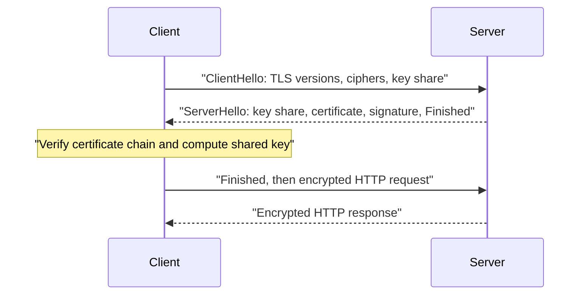

1. The client sends supported versions, cipher suites and a **key share** (its half of a **Diffie–Hellman** exchange, where two sides each mix in a secret and arrive at the same key without ever sending it).
2. The server answers with its key share, certificate, and a signature proving it owns the certificate's private key.
3. Both derive the same symmetric keys; the client sends Finished and immediately the encrypted request.

TLS 1.3 needs **1 RTT** (TLS 1.2 needed 2). Plus TCP's 1 RTT, a fresh HTTPS connection costs about 2 RTTs before the request goes out — 140 ms London–New York. **Session resumption** and **0-RTT** let returning clients skip work (0-RTT data can be replayed by an attacker, so use it only for idempotent requests). Fresh Diffie–Hellman keys per session give **forward secrecy**: stealing the server's private key later doesn't decrypt old recorded traffic.

**SNI (Server Name Indication).** The ClientHello carries the hostname so one IP can serve certificates for many domains — essential for load balancers and CDNs.

**mTLS (mutual TLS)** — both sides present certificates; used between internal services (service meshes) so each proves its identity.

### Common mistakes

- Letting certificates expire — it has caused outages at large companies. Automate renewal and alert on expiry.
- Terminating TLS at the edge and sending plaintext across untrusted networks. Inside one VPC it may be acceptable; across data centres, re-encrypt.

### In the interview

**Q:** Why does HTTPS use both asymmetric and symmetric encryption?

**A:** Asymmetric crypto handles authentication and key agreement without a shared secret but is slow; once a key is shared, symmetric encryption is fast enough for bulk data.

**Q:** How many round trips does a new HTTPS request cost?

**A:** 1 RTT for TCP, 1 for TLS 1.3, 1 for request and response — 3 in total. HTTP/3 over QUIC merges the first two, and resumed connections can send data immediately.

### TL;DR

TLS encrypts and authenticates connections with certificates signed by trusted CAs; the handshake uses public-key crypto to agree a symmetric key in 1 RTT (TLS 1.3). HTTPS is HTTP inside TLS.

## API styles — REST, RPC and gRPC, GraphQL

### What it is

An **API (Application Programming Interface)** is the menu a service offers other programs: which operations exist, their inputs and outputs. Three styles dominate:

- **REST (Representational State Transfer)** models everything as **resources** (nouns) with URLs, manipulated with standard HTTP methods: `GET /users/42`, `POST /users/42/orders`.
- **RPC (Remote Procedure Call)** models the API as functions called on a remote machine as if local: `getUser(42)`, `chargeCard(order, amount)`.
- **GraphQL** gives clients one endpoint and a query language to ask for exactly the fields they want, across related objects, in one round trip.

### Why it matters

The API is the contract between teams and with users. A poor style causes chatty clients, **over-fetching** (downloading data you don't need) or **under-fetching** (many calls to build one screen).

### How it works

**REST in practice.**

1. Name resources with plural nouns: `/users`, `/users/42`, `/users/42/orders`.
2. Use methods for actions: GET reads, POST creates, PUT replaces, PATCH updates part, DELETE removes.
3. Return proper status codes (201 Created with a `Location` header, 404, 409 Conflict).
4. Keep requests stateless, so any server can answer and GET responses can be cached by browsers and CDNs.
5. Usually JSON over HTTP/1.1 or HTTP/2.

Idempotent methods (GET, PUT, DELETE) are safe to retry — a big reason to prefer `PUT /users/42/avatar` over `POST /changeAvatar`.

**gRPC.** Google's open-source RPC framework on HTTP/2. Services and messages are defined in a `.proto` file using **Protocol Buffers (Protobuf)**, a compact binary format with a schema:

```protobuf
service UserService {
  rpc GetUser (GetUserRequest) returns (User) {}
}
message GetUserRequest { int64 id = 1; }
message User { int64 id = 1; string name = 2; }
```

The numbers (`= 1`, `= 2`) are field tags identifying each field on the wire. A code generator produces client and server code in many languages, so calling another service looks like a local, compile-time type-checked function call. Protobuf messages are typically several times smaller and faster to parse than JSON, and numbered fields allow **backward-compatible** schema changes (add new numbers, never reuse old ones). Four call shapes: unary (one request, one response), server streaming, client streaming, bidirectional streaming. Browsers can't speak native gRPC, so it is mostly **service-to-service**, with gRPC-Web or a REST gateway for browsers.

**GraphQL.** Created at Facebook (open-sourced 2015). The server publishes a typed **schema**; the client sends a query:

```graphql
query {
  user(id: 42) {
    name
    orders(last: 3) { id total }
  }
}
```

and gets back exactly that shape. Writes are **mutations**, live updates **subscriptions**; each field is filled by a **resolver** function. Ideal when many clients (web, iOS, Android) need different slices of the same data. Downsides: usually one POST endpoint, so ordinary HTTP caching doesn't work; a careless query can be very expensive, so servers limit query depth and cost; naive resolvers cause the **N+1 query problem** (one query for the list, then one per item), fixed with batching (the DataLoader pattern).

### Types

| | REST | gRPC | GraphQL |
|---|---|---|---|
| Model | Resources + HTTP verbs | Functions | Typed graph, client picks fields |
| Format | Usually JSON | Protobuf (binary) | JSON |
| Transport | HTTP/1.1 or 2 | HTTP/2 | HTTP, one endpoint |
| Best for | Public APIs, CRUD (create/read/update/delete), caching | Internal service calls, streaming | Many client types, complex screens |
| Weak spot | Over/under-fetching | Browser support, readability | Caching, query cost control |

### RPC internals: stubs, marshalling, binding and call semantics

RPC's promise is that `getUser(42)` on another machine looks like a local call. The idea was set out by Birrell and Nelson (Xerox PARC, 1984), and every RPC system since, from Sun's ONC RPC (used by NFS) to Java RMI, Thrift and gRPC, has the same five parts:

| Part | What it does | In gRPC |
|---|---|---|
| **Interface definition (IDL)** | A language-neutral file listing the procedures and their argument and result types; both sides compile against it | The `.proto` file |
| **Client stub** | Generated code with the same signature as the remote procedure. It packs the arguments, hands them to the runtime, waits, and unpacks the result, so the caller never sees the network | The generated client class |
| **Server stub (skeleton)** | Generated code on the server that unpacks the request, calls the real procedure and packs the result | The generated service base class you implement |
| **Marshalling** | Turning in-memory arguments into a byte sequence (and back: **unmarshalling**). It must fix byte order, sizes and character encoding, and it cannot send pointers: a linked structure is copied by value | Protobuf encoding |
| **RPC runtime** | Opens and reuses connections, matches each reply to its call by a **call ID**, applies timeouts and retransmissions | HTTP/2 streams, deadlines, retry policy |

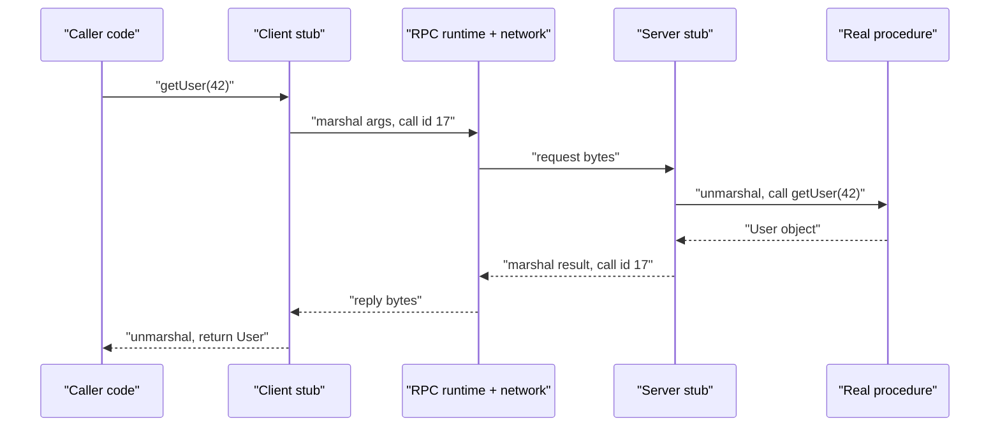

**Binding** is how the client finds a server for the interface. It can be static (an address in config), through a directory (Birrell and Nelson used the Grapevine name database; ONC RPC uses the `rpcbind` service, which maps program numbers to ports), or, today, through DNS or a service-discovery registry feeding a client-side load balancer (gRPC's name resolver and balancing policies; see *Load balancers* and Part 5's *Service discovery*).

**Why a remote call is not a local call.** It is thousands of times slower (half a millisecond inside a data centre versus nanoseconds), it can't share memory, and above all it can **fail partially**: the request may be lost, the server may crash halfway through, or the reply may be lost. When no reply arrives, the caller **cannot know** whether the procedure ran. That uncertainty is why each RPC system states its **call semantics**:

| Semantics | Guarantee | How it is built | Safe for |
|---|---|---|---|
| **Maybe** | Ran once or not at all; no retry | Send once, give up on timeout | Hints, metrics |
| **At-least-once** | Ran one or more times if a reply comes back | Retry until a reply arrives | Idempotent operations only (reads, `PUT`, "set X to 5") |
| **At-most-once** | Never runs twice; may not run at all | Server remembers recent call IDs and returns the saved reply to a duplicate instead of re-executing | Non-idempotent operations, with the caller told "unknown outcome" on failure |
| **Exactly-once** | Ran exactly once | Not achievable in general across crashes; approximated by at-least-once retries **plus** at-most-once deduplication with durable call IDs (idempotency keys) | Payments, orders |

Real systems show the spectrum. Birrell and Nelson's RPC promised that a normal return meant the procedure ran exactly once, while an exception meant it ran at most once. ONC RPC (RFC 5531) leaves reliability to the transport: over UDP a reply proves only that the call ran at least once, and servers may use the call's transaction ID (`xid`) to drop duplicates. gRPC sets **no deadline by default** (always set one); it retries automatically only when it is certain the server application never saw the call, and otherwise retries only by an explicit per-method policy listing retryable status codes, which you should enable only for idempotent methods. The same ideas reappear for message queues in Part 4's *Delivery guarantees, idempotency and retries*.

*Sources:* A. Birrell and B. Nelson, "Implementing Remote Procedure Calls", *ACM TOCS* 2(1), 1984; RFC 5531 (ONC RPC v2) and RFC 1833 (rpcbind); gRPC documentation, "Deadlines" and "Retry" guides (grpc.io); J. Waldo et al., "A Note on Distributed Computing", Sun Labs TR-94-29, 1994.

### Trade-offs

REST is universally understood and cache-friendly but may need many calls per screen. gRPC is fast, strongly typed and streams well, but binary (hard to debug with `curl`) and needs a proxy for browsers. GraphQL gives clients flexibility but moves complexity and performance risk to the server.

### Common mistakes

- Verbs in REST URLs (`/getUser?id=42`) instead of methods on resources.
- GraphQL "because it is modern" for a simple public API where cached REST is cheaper.
- Changing Protobuf field numbers, which silently breaks old clients.

### Real-world examples

Stripe and GitHub's v3 API are classic REST; GitHub also offers GraphQL (v4), and Shopify's storefront API is GraphQL. Google, Netflix and many others use gRPC between internal microservices; Kubernetes uses gRPC for plug-in interfaces such as kubelet ↔ container runtime.

### In the interview

**Q:** You are designing a mobile app's backend and an internal ranking service. Which API styles?

**A:** REST (or GraphQL if screens need many related objects) for the public mobile API — easy to consume, cache and debug. gRPC between backend and ranking service for compact binary messages, typed contracts and streaming.

**Q:** What makes a REST call safe to retry?

**A:** An idempotent method (GET, PUT, DELETE), or an idempotency key on a POST so the server returns the original result instead of repeating the action.

**Q:** An RPC to `chargeCard` times out. What do you tell the caller, and how do you make a retry safe?

**A:** The outcome is unknown: the charge may or may not have happened. Make the call at-most-once on the server with a client-generated idempotency key stored with the result; the client can then retry (at-least-once) and the combination behaves like exactly-once.

### TL;DR

REST = resources and HTTP verbs, simple and cacheable. gRPC = typed remote functions over HTTP/2 with Protobuf, great inside the data centre. GraphQL = clients query exactly the fields they need from a typed schema. Under every RPC: stubs and marshalling hide the network, binding finds the server, and the call semantics (at-least-once, at-most-once, exactly-once via idempotency keys) say what a timeout means.

## Real-time communication — polling, long polling, WebSockets, SSE, webhooks

### What it is

Plain HTTP only lets the client ask, but many features need the server to *tell* the client as soon as something happens: a chat message, a notification, a stock price, a driver's location. The client is usually behind NAT and cannot be dialled, so every solution keeps a channel open from the client side — or, between servers, calls back a public URL.

- **Short polling** — the client asks "anything new?" every few seconds ("are we there yet?").
- **Long polling** — the client asks and the server holds the request open until there is news or a timeout (say 30 s); the client then immediately asks again.
- **WebSockets** — one long-lived, two-way connection over which both sides send messages any time (an open phone line).
- **Server-Sent Events (SSE)** — one long-lived HTTP response the server keeps writing events into; one-way, server to client (a radio broadcast).
- **Webhooks** — server-to-server: when an event happens, service A sends an HTTP POST to a URL service B registered (leaving your number so the shop calls you).

### Why it matters

The wrong choice wastes resources (polling a million clients every second is a million requests per second, mostly "nothing new") or adds needless complexity. Long-lived connections change capacity planning: a chat server's limit is often open connections (memory per connection, file descriptors), not requests per second.

### How it works

**WebSocket upgrade.** Starts as an ordinary HTTP/1.1 request, so it passes through normal ports and proxies:

```mermaid
sequenceDiagram
    participant C as Browser
    participant S as Server
    C->>S: "GET /chat with Upgrade: websocket"
    S-->>C: "101 Switching Protocols"
    Note over C,S: "Same TCP connection is now a two-way message channel"
    S-->>C: "New message from Bob"
    C->>S: "Typing indicator"
    S-->>C: "New message from Carol"
```

1. The client sends `GET` with `Upgrade: websocket` and `Connection: Upgrade` headers (scheme `ws://` or encrypted `wss://`).
2. The server answers `101 Switching Protocols`.
3. Both sides then exchange small **frames** (a few bytes of overhead each) until either closes.
4. Applications send **heartbeats** (ping/pong) every 20–60 s so NAT routers or load balancers don't silently cut idle connections; clients reconnect with backoff if the link drops.

**SSE.** The client opens `GET /events` with `Accept: text/event-stream`; the server never finishes the response, writing `data: {"price": 101.5}` plus a blank line per event. The browser's built-in `EventSource` reconnects automatically and sends `Last-Event-ID` so the server can resume. Plain HTTP, so it works with HTTP/2 and existing infrastructure; large language model chat interfaces commonly stream tokens this way.

**Webhooks.** The receiver registers `https://myapp.com/hooks/payments`; when a payment succeeds the provider POSTs a JSON event there. Good practice: sign each request (an HMAC header — a hash of the body computed with a shared secret key) so the receiver can verify the sender; retry with backoff on failure; make the receiver idempotent because an event may arrive twice.

### Types

| Technique | Direction | Latency | Cost / complexity | Use when |
|---|---|---|---|---|
| Short polling | Client pulls | Up to the interval | Many wasted requests | Rare updates, simplicity first |
| Long polling | Server push (emulated) | Low | Held requests, reconnect loops | Fallback where WebSockets are blocked |
| WebSocket | Two-way | Lowest | Stateful connections, sticky routing | Chat, games, collaboration |
| SSE | Server to client | Low | Simple, auto-reconnect | Feeds, notifications, live scores, token streaming |
| Webhook | Server to server | Low | Receiver needs public URL | Payment and Git events |

### Trade-offs

Persistent connections deliver instantly but make servers **stateful**: each user is attached to one server, so messages must be routed to the right server (often via a pub/sub layer such as Redis Pub/Sub or Kafka between servers), and deployments must drain connections gracefully. Polling is stateless and trivially scalable but wasteful and slower.

### Common mistakes

- WebSockets for a one-way feed where SSE is simpler.
- Forgetting a load balancer's idle timeout (60 s by default on AWS ALB) closes quiet WebSockets unless you send heartbeats.
- Assuming webhooks arrive exactly once and in order. They do not.

### Real-world examples

Slack and Discord use WebSockets for their real-time clients; GitHub, Stripe and Shopify deliver events by webhooks; many dashboards and AI chat apps stream with SSE.

### In the interview

**Q:** How would you push new chat messages to 10 million online users?

**A:** WebSockets terminated on a fleet of connection servers (perhaps 50,000–100,000 connections each). A registry maps user → connection server, and a pub/sub layer delivers each message to the right server, which writes it to the socket. Clients reconnect with backoff and fetch missed messages by last seen ID.

**Q:** When would you choose SSE over WebSockets?

**A:** When only the server pushes (notifications, live scores, streaming text): SSE is plain HTTP, reconnects automatically, needs no protocol upgrade.

### TL;DR

Polling asks repeatedly, long polling waits for news, WebSockets keep a two-way channel, SSE streams one-way from server to client, webhooks are server-to-server callbacks. Persistent connections are fast but make servers stateful.

## API design basics

### What it is

The practical rules that make an API pleasant and safe to evolve: versioning, paging through big lists, telling clients about limits and errors.

### Why it matters

Once thousands of clients use a public API you cannot change it freely; pagination and rate limits protect servers from clients asking for too much at once.

### How it works

**Versioning.** For a breaking change (removing or renaming a field, changing meaning), publish a new version and keep the old one running for a deprecation period.

- **URL versioning**: `/v1/orders`, `/v2/orders`. Most common, very visible.
- **Header versioning**: `Accept: application/vnd.example.v2+json` or a custom header. Cleaner URLs, harder to test in a browser.
- **Date-based versions**: Stripe pins each account to a dated version and lets clients opt in to newer ones.

Prefer **additive** changes (new optional fields) that need no new version, and tell clients to ignore unknown fields.

**Pagination.** Never return an unbounded list.

- **Offset pagination**: `GET /posts?limit=20&offset=40`. Simple, allows "jump to page 5", but the database still reads and skips the first 40 rows (slow at offset 1,000,000), and inserts while paging shift items, causing duplicates or misses.
- **Cursor (keyset) pagination**: `GET /posts?limit=20&after=eyJpZCI6MTIzNH0`. The cursor is an opaque token encoding the last item's sort key (`id=1234`); the server runs `WHERE id < 1234 ORDER BY id DESC LIMIT 20`, which uses an index, is equally fast on page 1 and page 50,000, and stays stable as new items arrive. No jumping to an arbitrary page. Feeds and timelines (Twitter/X, Facebook, Slack) use cursors.

| | Offset | Cursor |
|---|---|---|
| Jump to page N | Yes | No |
| Speed deep into list | Gets slower | Constant |
| Stable under inserts | No | Yes |
| Best for | Admin tables, small data | Feeds, large or changing data |

**Rate-limit headers.** Tell limited clients (say 5,000 requests per hour) where they stand with `X-RateLimit-Limit` (quota), `X-RateLimit-Remaining` and `X-RateLimit-Reset` (GitHub's headers; the IETF is standardising unprefixed `RateLimit` headers), and answer excess with **429 Too Many Requests** plus `Retry-After` (seconds to wait). Example response and algorithms: *Rate limiting and throttling* (Part 5).

**Other basics.** Consistent error bodies (machine-readable code plus human message), idempotency keys on POST, filtering and sorting via query parameters (`?status=paid&sort=-created_at`), and documentation as an **OpenAPI** (formerly Swagger) specification.

### Common mistakes

- Breaking changes without a version bump.
- Offset pagination on an infinite-scroll feed with millions of rows.
- Returning 500 for bad input (that is a 400) or hiding rate limiting behind 503.

### TL;DR

Version only for breaking changes, prefer cursor pagination for big or changing lists, and communicate limits with rate-limit headers and 429 + Retry-After.

## Proxies and API gateways

### What it is

A **proxy** is a middleman that receives a request and forwards it on someone else's behalf.

- A **forward proxy** acts for **clients**: they send all traffic through it and the internet sees the proxy, not the client. Used to filter and log employee browsing, by VPN-like services (virtual private networks tunnelling your traffic through another machine) to hide the user's IP, and to cache outbound downloads.
- A **reverse proxy** acts for **servers**: clients think they talk to the website, but the proxy receives the request and forwards it to one of the hidden servers behind it. Used for load balancing, TLS termination, caching, compression and hiding internal structure.

```mermaid
flowchart LR
    C1["Clients"] --> FP["Forward proxy, acts for clients"]
    FP --> NET["Internet"]
    NET --> RP["Reverse proxy, acts for servers"]
    RP --> S1["App server 1"]
    RP --> S2["App server 2"]
```

An **API gateway** is a reverse proxy specialised for APIs: the single front door to many backend services (often microservices), handling cross-cutting concerns once instead of in every service.

### Why it matters

Reverse proxies and gateways hold shared concerns — authentication, rate limiting, TLS, logging, routing by path — and let you change the backend (split a monolith, move a service) without clients noticing.

### How it works

An API gateway receiving `GET /orders/7` typically:

1. Terminates TLS.
2. Authenticates the caller (API key, a JWT — JSON Web Token, a signed token carrying the user's identity — or an OAuth access token from a login service).
3. Applies per-client rate limits and quotas.
4. Routes by path, host or header: `/orders/*` → order service, `/users/*` → user service.
5. Optionally transforms the request (REST to gRPC, adds a request ID header) or **aggregates** several backend calls into one response.
6. Records logs, metrics and traces, then returns the response.

A variant is **BFF (Backend for Frontend)**: a separate gateway per client type (web, mobile) that shapes responses for that client.

### Types

| Component | Main job | Examples |
|---|---|---|
| Forward proxy | Act for clients, filter, hide identity | Squid, corporate proxies |
| Reverse proxy | Act for servers, TLS, caching, routing | NGINX, HAProxy, Envoy |
| Load balancer | Spread traffic over healthy servers | AWS ALB/NLB, HAProxy |
| API gateway | Auth, rate limits, routing for APIs | AWS API Gateway, Kong, Apigee |

The lines blur: NGINX is a reverse proxy, load balancer and basic gateway at once. A load balancer is a reverse proxy whose main job is distribution; an API gateway one whose main job is API policy.

### Trade-offs

Every proxy adds a network hop (well under 1 ms inside a data centre, more with heavy logic) and is a potential bottleneck and single point of failure, so it must be redundant and scaled. A gateway that accumulates business logic becomes a hard-to-change "god service".

### Common mistakes

- Confusing forward and reverse proxies. Ask: does it represent the client or the server?
- Putting business rules in the gateway. Keep it to cross-cutting policy.
- Losing the client's real IP: proxies must pass it in `X-Forwarded-For` (or the PROXY protocol for L4), and backends must trust that header only from known proxies.

### In the interview

**Q:** What is the difference between a reverse proxy, a load balancer and an API gateway?

**A:** All sit in front of servers. A reverse proxy is the general idea (forwarding on behalf of servers); a load balancer focuses on spreading traffic across healthy instances; an API gateway on API concerns — auth, rate limits, routing to many services, transformation. One product often plays all three roles.

### TL;DR

A forward proxy represents clients, a reverse proxy represents servers, and an API gateway is a reverse proxy enforcing API policy (auth, rate limits, routing) at the front door.

## Load balancers

### What it is

A **load balancer (LB)** receives incoming traffic and spreads it across a group of servers (a **pool**, **backend set** or **target group**), sending each request or connection only to healthy servers. Clients see one address; behind it may be 3 or 3,000 servers — like a restaurant host who seats each party with a free waiter and skips the one who went home sick.

### Why it matters

The load balancer makes **horizontal scaling** (Part 1) work:

- **Scalability** — add servers to the pool; capacity grows with no change for clients.
- **Availability** — health checks notice a dead server and traffic flows to the rest; a pool behind an LB is not a single point of failure.
- **Zero-downtime deployments** — take servers out one by one, update, put back.
- **Central place for shared work** — TLS termination, compression, request logging, basic security.
- **Hiding the backend** — servers keep private IPs; only the LB is public.

Almost every design has an LB in front of each tier of stateless servers, and often internal ones between services.

### How it works

```mermaid
flowchart LR
    U["Users"] --> LB["Load balancer, public IP, TLS"]
    LB --> A["Server A, healthy"]
    LB --> B["Server B, healthy"]
    LB -.->|"no traffic, failed health check"| C["Server C, down"]
    A --> DB["Shared database and cache"]
    B --> DB
```

1. DNS resolves `api.example.com` to the LB's address (a **virtual IP**, VIP — an address belonging to the service, not one machine).
2. The client connects to the LB. An L7 LB terminates TLS and reads the HTTP request; an L4 LB sees only the TCP or UDP connection.
3. The LB picks a backend with its **algorithm** (below), among servers currently passing **health checks**.
4. It forwards the request (L7, over its own new or reused backend connection) or the connection's packets (L4).
5. The response flows back through the LB (in most designs; see "direct server return").
6. The LB records metrics: requests per second, errors, latency per backend.

Since any server may receive any request, servers behind an LB should be **stateless**, with sessions and data in a shared cache or database.

### Types

#### By network layer: L4 vs L7

**Layer 4 (transport) LB.** Works on TCP/UDP connections by IP and port. It picks a backend when a connection opens, then shuttles that connection's packets (rewriting addresses NAT-style, or proxying the TCP stream) without looking inside — no URLs, headers or cookies; with TLS only encrypted bytes (unless it terminates TLS itself, which some L4 products can).

- Pros: very fast (microseconds of overhead), millions of connections, any protocol (databases, MQTT messaging for IoT devices, game servers, raw TCP), cheap.
- Cons: no content-based routing; balancing is per connection, so one long-lived connection carrying many requests (HTTP/2, gRPC) is stuck on one backend.

**Layer 7 (application) LB.** Terminates the client connection, parses the HTTP request, then makes a separate request to the chosen backend. It can:

- Route by path (`/api` → API servers, `/images` → image servers), host (`shop.example.com` vs `blog.example.com`), headers, cookies or query string.
- Balance **per request**, spreading many HTTP/2 or gRPC requests on one client connection across backends.
- Terminate TLS, compress, cache, retry, redirect (HTTP → HTTPS), add headers like `X-Forwarded-For` and request IDs, enforce auth and rate limits, block malicious patterns (web application firewall, WAF, features).
- Pros: smart routing and rich features. Cons: more CPU and latency per request (typically still around a millisecond), must hold TLS keys, HTTP-family protocols only.

| | L4 load balancer | L7 load balancer |
|---|---|---|
| Sees | IPs, ports, TCP/UDP | Full HTTP request |
| Decides per | Connection | Request |
| Routing by URL, header, cookie | No | Yes |
| Speed and cost | Faster, cheaper | More CPU per request |
| Protocols | Any TCP/UDP | HTTP, HTTP/2, gRPC, WebSocket |
| AWS example | NLB | ALB |

A common layered setup: an L4 balancer in front (cheap, huge scale, static IPs) feeding a fleet of L7 proxies (smart routing), which feed the app servers.

#### By form: hardware, software, cloud, DNS, global

- **Hardware LBs** — dedicated appliances with specialised chips (F5 BIG-IP, Citrix NetScaler, now NetScaler ADC). Very high throughput and vendor support, but expensive (tens of thousands of dollars each), scaled by buying boxes, slow to change. Common in traditional enterprises and banks.
- **Software LBs** — programs on ordinary servers: **NGINX**, **HAProxy**, **Envoy**, Traefik. Cheap, flexible, configurable as code, scale by adding instances. Hyperscalers built software L4 balancers too: Google's **Maglev** and Meta's **Katran**, on commodity Linux servers.
- **Cloud (managed) LBs** — the provider runs and scales the fleet: AWS **ALB** (L7), **NLB** (L4) and **Gateway Load Balancer** (routing through firewalls and appliances); Google Cloud Load Balancing; Azure Load Balancer (L4) and Application Gateway (L7). Pay per hour plus traffic; automatic scaling and high availability across zones.
- **DNS load balancing** — returning different IPs (round robin, weighted, GeoDNS, latency-based; DNS section). Coarse and cached, but global with no extra hop.
- **Global server load balancing (GSLB)** — distributing users across **data centres or regions** by geography, latency, region health and capacity, failing over whole regions. Built from DNS-based steering (Route 53, Cloudflare Load Balancing, NS1, F5 DNS) and/or **anycast** (one IP announced from many locations; CDN section), as in Google Cloud's global LB and Cloudflare. Regular L4/L7 balancers take over inside each region.

```mermaid
flowchart TD
    U["User in Europe"] --> G["GSLB: GeoDNS or anycast picks a region"]
    G --> EU["EU region: L4 then L7 load balancers"]
    G -.->|"failover if EU is unhealthy"| US["US region: L4 then L7 load balancers"]
    EU --> S1["EU app servers"]
    US --> S2["US app servers"]
```

#### Where it runs: client-side vs server-side

Most LBs are **server-side** (a separate box or service in the middle). In **client-side load balancing** each client gets the healthy-instance list from a service registry and picks one itself (gRPC clients, Netflix's Ribbon library, service-mesh sidecars like Envoy). This removes a hop and a bottleneck but puts logic in every client. Service discovery is in Part 5.

### Load-balancing algorithms

The **algorithm** picks which healthy backend gets the next request or connection: **static** algorithms follow a fixed rule; **dynamic** ones use live load signals.

**Round robin.** Servers in turn: A, B, C, A, B, C… Simple and fair when servers are identical and requests cost about the same; blind to load, so a server stuck with heavy requests (a 10-second report) still gets its "turn".

**Weighted round robin.** Weights proportional to capacity: with A=3, B=1, A gets 3 of every 4 requests. For mixed server sizes (16-core next to 8-core) and for sending a small share to a new version (**canary release**: weight 1 new, 99 old).

**Least connections.** The server with the fewest active connections now. Good when request durations vary a lot or connections are long-lived (WebSockets, database proxies). **Weighted least connections** divides the count by each server's weight.

**Least response time (least latency).** Prefer the lowest recent response time, often combined with fewest active connections; routes around a server slowed by a noisy neighbour, garbage collection or a bad disk. Needs latency measurement and can over-react — everyone rushes to the fastest server, which then slows (**herding**) — so implementations smooth measurements: Envoy's and NGINX Plus's "least time"-style policies, and the **EWMA** (exponentially weighted moving average) balancer of some proxies.

**IP hash (source hash).** `hash(client IP) mod N` picks the server, so the same client always lands on the same server — stickiness without cookies. Problems: many users behind one NAT hit one server, and when N changes almost every client is remapped.

**Consistent hashing.** Fixes the remapping: servers sit at several points (**virtual nodes**) on a hash ring; a key (client IP, user ID, URL) goes to the next server clockwise, so adding or removing a server moves only about 1/N of keys. Used when the *same key should reach the same server* so its local cache stays useful (caching proxies, sharded caches, chat servers). Google's Maglev uses its own variant; HAProxy and Envoy offer **ring hash** and **Maglev** policies. Full explanation: *Consistent hashing and virtual nodes* (Part 3).

**Random.** Evens out statistically over many requests, needs no state shared between LB instances, and is surprisingly good; weakness is short-term imbalance.

**Power of two choices (P2C).** Pick **two** servers at random and send to the less loaded (fewest active requests or lowest latency). Mitzenmacher's "two choices" analysis shows this sharply reduces worst-case load versus pure random, while avoiding herding: many independent LB instances with slightly stale data won't all pick the same "best" server. Envoy's least-request policy uses P2C by default (Envoy's overall default is round robin); NGINX supports `random two least_conn`.

**Others:** **least bandwidth** (fewest bytes per second), **resource-based / adaptive** (backends report CPU or load via an agent), **URL hash** (same URL to the same cache server), **locality-aware** (prefer same-zone backends to save cross-zone latency and cost).

```mermaid
flowchart TD
    Q["Next request arrives"] --> H["Keep only healthy backends"]
    H --> P["Pick two at random: B and E"]
    P --> CMP["Compare active requests: B has 12, E has 4"]
    CMP --> S["Send to E"]
```

| Algorithm | Uses live load? | Sticky by key? | Best for |
|---|---|---|---|
| Round robin | No | No | Identical servers, similar requests |
| Weighted round robin | No | No | Mixed server sizes, canaries |
| Least connections | Yes | No | Long or uneven requests, WebSockets |
| Least response time | Yes | No | Avoiding slow servers |
| IP hash | No | Yes, by client IP | Simple stickiness, fixed pool |
| Consistent hashing | No | Yes, by any key | Cache affinity, changing pool |
| Random | No | No | Many LB instances, simplicity |
| Power of two choices | Yes, sampled | No | Large fleets, distributed LBs |

### Health checks

- **Active health checks** — the LB probes each backend on a schedule: a TCP connect (L4) or HTTP `GET /health` expecting 200 (L7). Typical: every 10 s, timeout 5 s, **unhealthy after 2–3 consecutive failures**, **healthy again after 2–5 consecutive successes**, so one blip doesn't flap a server in and out.
- **Passive health checks (outlier detection)** — the LB watches real traffic; a backend returning several 5xx errors in a row or timing out is ejected for a while (say 30 s), then retried. Envoy calls this outlier detection; NGINX uses `max_fails` and `fail_timeout`.

Combine both, and make the health endpoint meaningful but cheap. A **liveness** check says "the process is running"; a **readiness** check says "I can serve traffic now" (caches warm, database reachable). Don't make health checks depend deeply on shared dependencies: if the database blips and every check fails, the LB removes all servers and turns a partial problem into a total outage. So many LBs **fail open** — if every backend looks unhealthy they send traffic to all of them (AWS target groups, Envoy's "panic threshold").

### Sticky sessions (session affinity)

**Sticky sessions** send all of one user's requests to the same backend, via a **cookie** (the LB's own, such as AWS ALB's `AWSALB`, or the app's session cookie) or by **hashing the client IP** (L4 or L7).

Use it when the server holds in-memory state (an old app storing sessions locally, a WebSocket connection, an in-memory cart) or a warm per-user cache. Costs: uneven load (heavy users stuck on one server), lost sessions when a server fails or scales in, harder deployments. Better: stateless servers with session data in a shared store like Redis or a signed client token. Use stickiness only where state is unavoidable (WebSockets) — and even then design for reconnecting elsewhere.

### SSL/TLS termination

**TLS termination**: the LB decrypts HTTPS and forwards plain HTTP to backends inside the private network.

- **Benefits**: certificates live and renew in one place; backends save handshake CPU; the LB can read requests for L7 routing, caching and WAF rules.
- **Risk**: LB-to-server traffic is unencrypted — acceptable inside a trusted private network for many companies, not for regulated data or zero-trust designs.

Variants: **TLS re-encryption (bridging)** — decrypt, inspect, open a new TLS connection to the backend (secure end to end, more CPU). **TLS passthrough** — the LB (typically L4) doesn't decrypt; the backend terminates TLS and keys stay on the servers. No content routing, but it can still route by the SNI host name visible in the ClientHello.

### Connection draining (deregistration delay)

Removing a server (deployment, scale-in, maintenance) instantly would break in-flight requests. **Connection draining** stops **new** requests to it but lets **existing** ones finish, up to a timeout — AWS's **deregistration delay** (default 300 s, often lowered to 30–60 s for short API requests). Long-lived WebSockets may never finish, so the server should also tell clients to reconnect elsewhere. Draining plus health checks make **rolling deployments** invisible to users.

### Making the load balancer itself highly available

A single LB is a single point of failure. Options:

- **Active–passive** — two LB nodes share one virtual IP; the passive one watches the active via heartbeats and takes over the VIP if it dies (commonly **VRRP**, the Virtual Router Redundancy Protocol, via `keepalived`). Simple, but half the hardware idles and failover takes a second or more.
- **Active–active** — all nodes serve at once, traffic spread by DNS (multiple IPs), anycast, or **ECMP** (equal-cost multi-path routing: routers spread flows across several LB machines announcing the same IP). No idle standby; each node must absorb the others' load if they fail. This is how Maglev, Katran and cloud LBs work.
- **Managed cloud LBs** do it for you: AWS ALB and NLB run nodes in every enabled Availability Zone, and NLB offers one static IP per zone.

```mermaid
flowchart TD
    VIP["Virtual IP 203.0.113.10"] --> LB1["LB node 1, active"]
    VIP -.->|"takes over on heartbeat loss"| LB2["LB node 2, standby"]
    LB1 --> P["Server pool"]
    LB2 -.-> P
```

### Direct server return (bonus detail)

Responses are usually much larger than requests. In **direct server return (DSR)** an L4 LB forwards incoming packets to the server, which replies **straight to the client**, bypassing the LB; handling only the small inbound half, one LB fronts far more traffic. Used by Maglev, Katran and some LVS (Linux Virtual Server) setups.

### Trade-offs

| Decision | Option A | Option B |
|---|---|---|
| Layer | L4: fast, any protocol, blind to content | L7: smart routing, per-request, more CPU |
| Form | Managed cloud LB: no operations, pay per use | Self-run NGINX/HAProxy/Envoy: full control, you operate it |
| TLS | Terminate at LB: simpler, inspectable | Passthrough or re-encrypt: end-to-end encryption |
| Algorithm | Static (round robin): predictable, simple | Dynamic (least conn, P2C): adapts to load |
| Sessions | Sticky: supports local state | Stateless: even load, easy failover |

### Common mistakes

- Drawing a single LB box and forgetting it needs redundancy.
- Round robin for long-lived WebSocket connections; least connections is usually better.
- Sticky sessions as a substitute for a shared session store.
- Health checks that only test "process is up" (it may be unable to reach its database) — or, the opposite, deep checks that fail the whole fleet at once.
- An L4 LB in front of gRPC, leaving one backend overloaded: gRPC multiplexes many requests on one long connection, so you need per-request (L7 or client-side) balancing.
- Forgetting backends see the LB's IP, not the client's, unless `X-Forwarded-For` or the PROXY protocol is used.

### Real-world examples

- **NGINX** — web server and L7 reverse proxy/LB; round robin by default, also least connections, IP hash, generic hash with consistent option, random with two choices.
- **HAProxy** — very fast L4/L7 LB; round robin, static round robin, least connections, source hash, URI hash, consistent hashing; used at GitHub, Stack Overflow and many others.
- **Envoy** — L7 proxy created at Lyft, the data plane of service meshes like Istio; round robin, least request (P2C), ring hash, Maglev, random, plus outlier detection and automatic retries.
- **AWS Application Load Balancer (ALB)** — L7; routes by path, host, headers and query; HTTP/2, gRPC and WebSockets; round robin, least outstanding requests or weighted random; cookie stickiness.
- **AWS Network Load Balancer (NLB)** — L4 TCP/UDP/TLS; millions of requests per second; static IP per zone; preserves the client source IP.
- **Google Maglev** and **Meta Katran** — software L4 balancers on commodity servers, using consistent hashing and ECMP to scale out.

### In the interview

**Q:** What is the difference between an L4 and an L7 load balancer, and when would you pick each?

**A:** L4 balances TCP/UDP connections by IP and port without reading content: fast, cheap, any protocol. L7 parses HTTP: routes by path or header, balances per request, terminates TLS, applies policies. L7 in front of HTTP services and gRPC; L4 for non-HTTP protocols, extreme throughput, or as the first tier in front of L7 proxies.

**Q:** Which algorithm for identical stateless API servers? For a cache tier?

**A:** API servers: least outstanding requests or power of two choices, adapting to uneven request cost and slow servers. Cache tier: consistent hashing on the cache key, so each key hits the same node and adding a node moves only ~1/N of keys.

**Q:** How do you deploy a new version without dropping requests?

**A:** Rolling deployment: per server, deregister with connection draining, update, wait for readiness checks, re-register. For extra safety, canary the new version on a small weighted share of traffic first.

**Q:** Isn't the load balancer a single point of failure?

**A:** Only if there is one. Run LB nodes active–passive with a floating virtual IP, or active–active behind DNS, anycast or ECMP, across availability zones. Managed cloud LBs already do this.

### TL;DR

A load balancer spreads traffic across healthy servers so you can scale out and survive failures. Know L4 vs L7, the main forms, the algorithms (round robin to power of two choices), health checks, stickiness, TLS termination, draining, and how to make the LB itself redundant.

## CDNs and anycast

### What it is

A **CDN (Content Delivery Network)** is a worldwide network of caching servers that keep copies of your content close to users: a user in Sydney fetches an image from a Sydney CDN server (a few milliseconds) instead of your server in Virginia (~200 ms round trip).

Key terms:

- **Origin** — your real server (or storage like Amazon S3) holding the master copy.
- **Edge server** — a CDN cache server near users.
- **PoP (Point of Presence)** — a CDN site in a city containing many edge servers; large CDNs have hundreds.
- **Cache hit** — the edge has a fresh copy and answers directly. **Cache miss** — it must fetch from the origin (or an upper tier) first.
- **Cache hit ratio** — hits ÷ total requests; 95% means only 1 in 20 requests reaches the origin.

### Why it matters

- **Lower latency** — static files (images, JavaScript, CSS, video) come from nearby, and TLS handshakes finish against a nearby edge, shortening every round trip.
- **Origin offload** — at 95% hit ratio the origin handles 20× less traffic: far fewer servers and less egress bandwidth.
- **Absorbing spikes and attacks** — the CDN's huge capacity soaks up surges and DDoS (distributed denial-of-service) attacks, where many machines flood a site with junk traffic.
- **Video and large downloads** at global scale would be impossible from one origin.

### How it works

```mermaid
sequenceDiagram
    participant U as User in Sydney
    participant E as Sydney edge PoP
    participant SH as Origin shield
    participant O as Origin in Virginia
    U->>E: "GET /img/logo.png"
    alt "cached and fresh"
        E-->>U: "200 from cache in about 5 ms"
    else "miss"
        E->>SH: "GET /img/logo.png"
        SH->>O: "GET /img/logo.png, only if shield also misses"
        O-->>SH: "200 with Cache-Control max-age=86400"
        SH-->>E: "200"
        E-->>U: "200 and keep a copy"
    end
```

1. DNS for `cdn.example.com` returns a nearby edge (via GeoDNS or anycast).
2. The edge looks up the URL in its cache (the **cache key**: usually host + path + some query parameters and headers).
3. On a fresh hit, it answers immediately.
4. On a miss, it fetches from the origin, stores the copy for as long as the **TTL** allows, and returns it.
5. The origin controls caching with HTTP headers: `Cache-Control: public, max-age=86400` (one day), `s-maxage` (TTL for shared caches like CDNs only), `no-store` (never cache), and validators (`ETag`, `Last-Modified`) so an expired copy can be re-checked cheaply with a 304 Not Modified.

### Types

**Pull CDN vs push CDN.**

- **Pull (origin pull)** — the CDN fetches from the origin lazily on the first request; zero upload effort, only requested content cached. The first requester at each PoP waits for the origin trip. Most websites use pull.
- **Push** — you upload content to the CDN's storage ahead of time; good for large files you know will be requested (game patches, video libraries) and rarely-changing content. You manage what is stored and pay for storage.

| | Pull CDN | Push CDN |
|---|---|---|
| How content arrives | Fetched on first miss | Uploaded in advance |
| Effort | Low | You manage uploads |
| First request | Slower (miss) | Fast |
| Best for | Websites, mixed traffic | Big known files, video |

**Invalidation (purging).** When content changes before its TTL expires:

1. **Purge** — ask the CDN to delete a URL, prefix or tag from all edges (seconds to minutes).
2. **Versioned file names (cache busting)** — publish `app.3f9a1c.js` instead of overwriting `app.js`; the HTML references the new name, so nothing needs invalidating. Standard for static assets, and allows very long TTLs (a year) safely.
3. **Short TTLs** for often-changing content, accepting more origin traffic.

**Origin shield (tiered caching).** An extra cache layer between edges and origin. Without it, a new globally popular file misses at each of hundreds of PoPs, each hitting the origin; with it, edges miss to the shield and the origin sees roughly one request per object — higher hit ratio, protected origin.

**Static vs dynamic content.** CDNs mostly cache static, shared content. For personalised or dynamic responses they still help by terminating TLS near the user over optimised, warm connections back to the origin, and some run code at the edge (Cloudflare Workers, Lambda@Edge, Fastly Compute).

**Anycast.** Normally one IP belongs to one location (**unicast**). With **anycast** the same IP is announced from many locations via **BGP** (Border Gateway Protocol — how internet networks tell each other which IP ranges they can reach), and routers send each user to the "nearest" location in network terms. Benefits: automatic proximity routing without DNS tricks, DDoS traffic naturally spread across all sites, and fast failover (a site that stops announcing has its routes shift to the next). Cloudflare's network, Google's `8.8.8.8`, Cloudflare's `1.1.1.1` and the DNS root servers all use anycast. "Nearest" means the best BGP path by routing policy (often fewest networks crossed) — usually, not always, the lowest-latency site.

### Trade-offs

Long TTLs: high hit ratio but stale content; short TTLs: freshness but more origin load. CDNs cost money per GB served, and caching anything personalised under a wrong cache key risks leaking one user's data to another.

### Common mistakes

- Caching user-specific responses under a shared key (use `Cache-Control: private` or vary the key).
- Overwriting files in place with long TTLs, then being unable to update them. Use versioned file names.
- Forgetting the origin must survive a full cache flush (a "cold" CDN); the origin shield and gradual warm-up help.

### Real-world examples

Akamai, Cloudflare, Fastly, Amazon CloudFront, Google Cloud CDN. Netflix runs its own CDN, **Open Connect**, placing caching appliances inside internet providers' networks so most video bytes never cross the wider internet; YouTube uses Google's global cache network similarly.

### In the interview

**Q:** How does a CDN reduce latency and origin load?

**A:** It serves cached copies from PoPs near users, cutting round-trip time; at a high hit ratio most requests never reach the origin, and an origin shield collapses many edge misses into one origin request.

**Q:** You deploy new JavaScript and some users still get the old one. Why, and the fix?

**A:** Edges and browsers serve the cached file until its TTL expires. Use content-hashed file names so each version has a new URL, keep long TTLs, and purge only in emergencies.

### TL;DR

A CDN caches content at edge PoPs near users to cut latency and offload the origin. Pull fetches on demand, push uploads ahead; manage freshness with TTLs, versioned names and purges; an origin shield protects the origin; anycast routes users to the nearest site using one IP.

## Bandwidth vs latency, and network partitions

### What it is

From Part 1: **bandwidth** is how much data a link carries per second (1 Gbps ≈ 125 MB/s); **latency** is how long one piece of data takes from A to B. A wider road does not make the trip shorter.

A **network partition** is when the network splits so some machines cannot reach others, though all are still running — like a jammed corridor door: both sides keep working but can't talk.

### Why it matters

- Many designs are latency-bound: 10 sequential trans-Atlantic round trips take at least 700 ms however fast the connection. Fix with fewer round trips (batching, HTTP/2, connection reuse) and moving data closer (CDN, regional replicas).
- Large transfers are bandwidth-bound: 10 TB over 1 Gbps takes about 22 hours (10 × 8 × 10^12 bits ÷ 10^9 bits/s ≈ 80,000 s) — why cloud providers offer physical transfer devices (AWS Snowball).
- Latency has a physical floor, the speed of light in fibre (~200 km per millisecond, Part 1); no protocol trick removes it.
- **Bandwidth-delay product** (bandwidth × RTT) is the data that must be "in flight" to fill a link: 1 Gbps at 100 ms RTT needs 12.5 MB, which is why TCP window sizes and congestion control matter on long links.
- Partitions are not rare — a failed switch, a misconfigured firewall, a cut cable between data centres — and every distributed system must decide what to do during one (the CAP theorem, Part 4).

### How it works

During a partition a node cannot tell "the other node crashed" from "it's fine but unreachable" — both are silence. Systems detect trouble with **timeouts** and **heartbeats**, then choose:

1. **Stay consistent** — refuse writes (or reads) on the side that can't reach a majority, so data never diverges; the minority side becomes unavailable.
2. **Stay available** — keep serving on both sides and reconcile after the network heals, accepting temporary inconsistency.

```mermaid
flowchart LR
    subgraph DC1["Data centre 1"]
        A["Node A"]
        B["Node B"]
    end
    subgraph DC2["Data centre 2"]
        C["Node C"]
    end
    A --- B
    B -.-x|"link cut, partition"| C
```

Nodes on both sides each believing they are leader cause **split brain** (two leaders accepting conflicting writes); quorum-based systems prevent it by requiring a majority (Parts 3 and 4).

### Common mistakes

- Assuming "the network is reliable" — the first of the classic **fallacies of distributed computing** (others: latency is zero, bandwidth is infinite, the network is secure, topology does not change).
- Treating a timeout as proof the remote operation failed; it may have succeeded with only the reply lost — hence idempotent retries.
- Buying more bandwidth to fix a latency problem.

### In the interview

**Q:** Our API is slow for users in Asia but fine in the US. More bandwidth?

**A:** Probably not — it's latency from distance multiplied by round trips. Cut round trips (keep-alive, HTTP/2 or HTTP/3, batching) and move things closer: CDN for static content and edge TLS termination, then regional deployments or read replicas.

**Q:** What is a network partition and why can't you just avoid it?

**A:** A break in communication between groups of healthy nodes. Hardware and configuration failures make it unavoidable at scale, so the design must choose between consistency and availability while it lasts.

### TL;DR

Bandwidth is capacity, latency is delay — round trips usually dominate. Partitions split healthy nodes, can't be avoided, and force a choice between consistency and availability.

## Part 2 glossary

Every Part 2 term is defined in one line in the [Master A–Z glossary](#master-az-glossary), which merges the glossaries of all six parts into a single alphabetical list.

## Part 3 — Data storage

Almost every system exists to remember things: users, purchases, messages, photos. Code can be thrown away and redeployed in minutes; data cannot, and losing it may end the business. This part explains, from zero, where data lives, how it is organised, how it is kept safe when machines crash, and how it is spread over many machines once one is not enough. Read it in order: each section uses words defined before it (all collected in the master A–Z glossary).

## What a database is

### What it is

A **database** is a program that stores data, keeps it safe, and lets other programs find it again quickly. Properly the program is a **database management system (DBMS)**; "database" is used for both the program and its data. (Like a library: books shelved in agreed places, a catalogue — an index — to find one without walking every aisle, and a librarian making sure two people can't check out the same copy and nothing is lost if the lights go out mid-shelving.)

Plain files work for a tiny program, but with many concurrent users they give you none of these:

- **Fast lookup.** Finding one customer among 50 million by reading the whole file takes seconds; an index takes well under a millisecond.
- **Safe concurrent access.** Two servers writing the same file at once can corrupt it; a database coordinates them.
- **Crash safety.** If power fails mid-write, the write either fully happened or not at all.
- **A query language.** Ask "all orders over $100 from last week" and the database works out how.

### Why it matters

App servers are **stateless**: they keep nothing important between requests, so you can add or remove them freely. All the important **state** (stored facts that must survive) lives in the database — the hardest part to scale, the slowest to change and the most expensive to get wrong. Interviews' deep questions usually land on the data model and database choice.

### How it works

For each request a database:

1. **Parses** it (e.g. a SQL statement) and checks it is valid.
2. **Plans** the cheapest way to answer ("use the index on `email`", not "read every row"); this is the **query planner** (optimizer).
3. **Executes** the plan, reading data pages from memory if present (the **buffer cache**) or from disk.
4. For writes, **logs** the change to a durable file first, then applies it (Durability section).
5. **Returns** the result over the network.

A **read** fetches data without changing it; a **write** inserts, updates or deletes. Most consumer apps read far more than they write: 10:1 or even 100:1 is common for social feeds and product catalogues.

### TL;DR

A database stores data safely, finds it quickly, and coordinates many users at once. It holds the state the rest of the system can afford to forget.

## Relational databases and SQL

### What it is

A **relational database** stores data in **tables**, like spreadsheets:

- Each **row** (record, tuple) is one thing, such as one user.
- Each **column** (field, attribute) is one property, such as `email`.
- The **schema** formally describes the tables: names, columns, and each column's **data type** (integer, text, date…). Data that doesn't fit is refused.

"Relational" comes from mathematics (a table is a "relation"), not from "relationships", though tables do relate through keys.

You talk to it in **SQL (Structured Query Language)**, which describes *what* data you want, not *how* to fetch it. Examples: PostgreSQL, MySQL, MariaDB, Oracle Database, Microsoft SQL Server, SQLite; in the cloud Amazon RDS and Aurora, Google Cloud SQL, Azure SQL Database.

### How it works

**Keys** tie tables together (like an enrolment card that stores only the student's ID, not their address):

- A **primary key** is a column (or set) whose value is unique and never empty for every row — the row's identity (`users.id`).
- A **foreign key** holds the primary key of a row in another table (`orders.user_id` → `users.id`). The database can enforce that the referenced row exists — **referential integrity** — so you can't create an order for a non-existent user.
- A **unique constraint** says no two rows may share a value (no two users with the same `email`).

```mermaid
flowchart LR
    U["users: id (PK), name, email"]
    O["orders: id (PK), user_id (FK), total, created_at"]
    I["order_items: order_id (FK), product_id (FK), qty"]
    P["products: id (PK), title, price"]
    O -- "user_id points to users.id" --> U
    I -- "order_id points to orders.id" --> O
    I -- "product_id points to products.id" --> P
```

A **join** combines rows from two tables that match on a key. Each order with the buyer's name:

```sql
SELECT o.id, u.name, o.total
FROM orders o
JOIN users u ON u.id = o.user_id
WHERE o.created_at > '2026-01-01'
ORDER BY o.total DESC
LIMIT 10;
```

Join kinds: **inner** (only rows matching on both sides), **left** (every left row, empty values where the right has no match), **right** (the mirror) and **full outer** (every row from both sides).

`SELECT` reads; `INSERT`, `UPDATE` and `DELETE` change rows; `CREATE TABLE`, `ALTER TABLE` and `DROP TABLE` change the schema — **DDL (data definition language)**.

### Why it matters

Relational databases have been the default for about 50 years because they give:

- A **flexible query language**: ask questions you didn't plan for when designing the tables.
- **Strong guarantees** (transactions and ACID, next) protecting money, inventory and anything that must add up.
- **Enforced structure**: bad data is rejected at the door.
- **Mature tools**: backups, monitoring, replication, decades of operational knowledge.

### Trade-offs

- **Schema changes take care.** Adding a column to a 2-billion-row table can lock it or take hours without online migration tools (`gh-ost`, `pt-online-schema-change` for MySQL).
- **Scaling writes past one machine is hard.** Classic relational databases centre on one main server; sharding (later) loses cross-machine joins and transactions unless you use a distributed SQL database (Google Spanner, CockroachDB, YugabyteDB, TiDB).
- **Joins get expensive** on huge tables when they can't use an index.

### Common mistakes

- Choosing NoSQL "for scale" when the data is a few hundred gigabytes that fit one PostgreSQL server. One modern server (64 cores, 512 GB memory, fast SSDs) handles tens of thousands of simple transactions per second.
- Storing a list as a comma-separated string in one column; it can't be indexed or joined. Use a separate table.
- A natural value such as an email as primary key. Emails change; IDs should not.

### Real-world examples

Shopify, GitHub and Basecamp run large parts of their products on MySQL. Instagram began on PostgreSQL and sharded it as it grew. Stack Overflow runs one of the web's busiest sites on a handful of SQL Server machines.

### TL;DR

A relational database stores data in tables with a fixed schema, links them with primary and foreign keys, and combines them with joins in SQL. It is the safe default for most systems.

## Transactions and ACID

### What it is

A **transaction** is a group of reads and writes treated as one unit: all take effect, or none do. Start with `BEGIN`, finish with `COMMIT` (make permanent) or `ROLLBACK` (discard everything).

Moving money is two steps — take $100 from Alice, add $100 to Bob; a crash in between makes $100 vanish. A transaction is a sealed envelope acted on only when both instructions are inside:

```sql
BEGIN;
UPDATE accounts SET balance = balance - 100 WHERE id = 'alice';
UPDATE accounts SET balance = balance + 100 WHERE id = 'bob';
COMMIT;
```

**ACID** names the four promises:

- **A — Atomicity.** All or nothing: if any step fails or the server crashes before `COMMIT`, every change is undone. "Atomic" means "cannot be split", nothing to do with speed or concurrency.
- **C — Consistency.** The transaction moves data between valid states, "valid" meaning the rules you declared: constraints, foreign keys, "balance must not go below zero" checks. Mostly the application's job (you define the rules; the database enforces only the ones you tell it). A different meaning from the "C" in CAP (Part 4).
- **I — Isolation.** Concurrent transactions don't see each other's half-finished work — ideally as if they ran one after another. In practice databases offer weaker **isolation levels** for speed (next section).
- **D — Durability.** Once "committed", data survives a crash or power cut: the change is written to a log on disk and forced to the physical device before replying (Durability section).

```mermaid
sequenceDiagram
    participant App as "App server"
    participant DB as "Database"
    App->>DB: "BEGIN"
    App->>DB: "UPDATE alice -100"
    App->>DB: "UPDATE bob +100"
    App->>DB: "COMMIT"
    DB->>DB: "Write commit record to log and flush to disk"
    DB-->>App: "OK, committed"
    Note over App,DB: "If a crash happens before the flush, both updates are undone on restart"
```

### Why it matters

Without transactions every piece of code must handle "what if we crash halfway?" and "what if someone changed this row while I read it?" — rare, hard-to-reproduce bugs that cost real money: double charges, oversold tickets, negative stock.

### Trade-offs

Stronger guarantees cost speed: isolation needs locks or version tracking, durability a disk flush per commit (often 0.1–2 ms on SSD, more on spinning or network disks). A transaction across several machines (a **distributed transaction**, Part 4) is far slower again, as the machines must agree over the network.

### Common mistakes

- Holding a transaction open while calling a slow external service (a payment API): it keeps its locks and blocks others. Call outside the transaction.
- Assuming an "ACID" database gives full isolation by default. Most don't (next section).

### In the interview

**Q:** What does ACID stand for, and which letters are the database's job versus the application's?

**A:** Atomicity, Consistency, Isolation, Durability. A, I and D are database mechanisms; consistency is mostly the application's rules, which the database helps enforce as declared constraints.

**Q:** Why not use transactions for everything across services?

**A:** Spanning several databases needs a coordination protocol such as two-phase commit, which is slow and blocks if the coordinator fails. Across services, use sagas and idempotent operations (Part 4).

### TL;DR

A transaction groups operations so they all succeed or all fail. ACID: all-or-nothing, rules respected, no interference, nothing lost after commit.

## Isolation levels and anomalies

### What it is

**Concurrency** means transactions running at overlapping times. When they touch the same data, wrong results called **anomalies** (race conditions) can appear. An **isolation level** chooses which anomalies the database prevents; stronger levels prevent more but run slower or abort more transactions.

### Types

**The anomalies, simplest to subtlest:**

- **Dirty read.** A reads a value B wrote but hasn't committed; if B rolls back, A acted on data that never officially existed.
- **Dirty write.** A overwrites B's uncommitted write. Almost every database prevents this at every level.
- **Non-repeatable read (read skew).** A reads a row, B updates and commits it, A re-reads and gets a different value in the same transaction.
- **Phantom read.** A queries "all bookings for room 7 on Friday" (2 rows); B inserts a matching booking and commits; A's same query now returns 3. The new row is the "phantom".
- **Lost update.** A and B both read a counter as 10, both add 1, both write 11; one increment is lost (should be 12).
- **Write skew.** A and B read the same rows, each decides something is safe, and each writes a *different* row. A hospital requires at least one doctor on call; two on-call doctors click "go off call" at once, each sees "two on call, fine for me to leave" and updates only its own row — zero on call. No row was written twice, so row locks don't catch it.

**SQL-standard isolation levels, weakest to strongest:**

| Level | Dirty read | Non-repeatable read | Phantom read |
|---|---|---|---|
| Read uncommitted | Possible | Possible | Possible |
| Read committed | Prevented | Possible | Possible |
| Repeatable read | Prevented | Prevented | Possible (per standard) |
| Serializable | Prevented | Prevented | Prevented |

**Snapshot isolation** (widely used, not in the original standard): each transaction reads from a consistent **snapshot**, a frozen picture of the database as of its start. It prevents dirty reads, non-repeatable reads and most phantoms, but still allows write skew. It is usually built with **MVCC (multi-version concurrency control)**: rows aren't overwritten; several versions are kept, each stamped with its creating transaction, so readers see the old version while a writer prepares a new one. Pay-off: a long report and a busy update stream run side by side without waiting on each other's locks.

**Serializable**: the result equals some one-at-a-time order of the transactions, preventing every anomaly above including write skew. Achieved by literally running one at a time (Redis, VoltDB), by **two-phase locking** (readers and writers take locks and hold them until commit), or by **serializable snapshot isolation (SSI)**, which runs optimistically and aborts a transaction when a dangerous pattern is detected (PostgreSQL).

### How it works

Defaults that surprise people:

- **PostgreSQL**: *read committed*; its *repeatable read* is really snapshot isolation; *serializable* uses SSI.
- **MySQL (InnoDB)**: *repeatable read*, via MVCC snapshots plus some locking.
- **Oracle**: *read committed*; its "serializable" is really snapshot isolation.

Preventing lost updates and write skew without full serializability:

1. **Atomic operations**: `UPDATE counters SET n = n + 1 WHERE id = 7` does the read-modify-write in one step.
2. **Explicit locks**: `SELECT ... FOR UPDATE` locks the rows you read until you commit.
3. **Optimistic concurrency control**: keep a `version` column and write `UPDATE ... SET ..., version = 6 WHERE id = 7 AND version = 5`; zero rows updated means someone got there first, so retry. Also called **compare-and-set**.
4. **Constraints**: a unique index on `(room_id, date)` rejects the second double-booking.

### Trade-offs

Higher isolation means more aborted transactions (to retry) or more lock waiting, so lower throughput. Most web apps run read committed or snapshot isolation and add explicit locks or constraints only where money or inventory is involved.

### Common mistakes

- "Read the balance in the app, check it, write the new balance" with no lock or version check — a lost-update bug waiting to happen.
- Believing "repeatable read" means the same in every database.

### In the interview

**Q:** Two users try to buy the last ticket at once. How do you stop overselling?

**A:** Make check and decrement one atomic step — `UPDATE tickets SET left = left - 1 WHERE id = 9 AND left > 0` and verify one row was affected — or use `SELECT ... FOR UPDATE`, or an optimistic version column with retry.

**Q:** What is write skew?

**A:** Two transactions read overlapping data, each decides based on it and writes a different row, so together they break a rule each alone respects. Snapshot isolation allows it; serializable prevents it.

### TL;DR

Isolation levels decide which concurrency bugs the database blocks. Know the anomalies (dirty read, non-repeatable read, phantom, lost update, write skew) and that most databases default to something weaker than serializable.

## NoSQL database families

### What it is

**NoSQL** ("not only SQL") covers databases that don't use the relational table model as their main storage. The term spread around 2009, when Google (Bigtable), Amazon (Dynamo) and Facebook (Cassandra) published or open-sourced systems spreading huge data across hundreds of cheap machines.

There is no single "NoSQL design": each family is shaped around one access pattern and gives up something (often joins, flexible queries or strong transactions) to excel at it — specialist tools (pizza oven, espresso machine) versus the general-purpose kitchen.

### Types

**Key-value stores.** A giant dictionary: `put(key, value)`, `get(key)`; the database never looks inside the value. Extremely fast (often well under 1 ms) and easy to spread across machines, since each key can live anywhere; weak at "find all items where X". Examples: Redis (in memory; also lists, sets, sorted sets), Memcached (cache only), Amazon DynamoDB (key-value plus document features), etcd (small, strongly consistent configuration data), Riak. Uses: sessions, caches, carts, feature flags, rate-limit counters.

**Document stores.** Each record is a **document** (usually JSON or a binary form) with nested fields and arrays; documents in one **collection** needn't share a schema, and fields inside them can be queried and indexed. Examples: MongoDB (max document 16 MB), Couchbase, Amazon DocumentDB, Google Firestore. Good when each item is a self-contained tree (a product with its variants, a post with its tags) usually read whole.

```json
{ "_id": "p42", "title": "Trail shoe", "price": 89.0,
  "sizes": [40, 41, 42], "seller": { "id": "s7", "name": "RunCo" } }
```

**Wide-column stores** (column-family stores). Data is grouped by a **partition key**; within a partition rows are sorted by a **clustering key**, and rows can have many, differing columns. You design one table per query; built to absorb huge write volumes across many machines. Examples: Apache Cassandra, ScyllaDB, Apache HBase, Google Bigtable. Uses: message histories, activity logs, IoT readings — "write a lot, read by key and time range". "Wide-column" ≠ "columnar" (column-oriented analytics storage, later).

**Graph databases.** **Nodes** (things, such as people) and **edges** (relationships, such as "follows"), both with properties. Following edges is cheap however big the graph, so "friends of friends in Paris" is natural. Examples: Neo4j (query language Cypher), Amazon Neptune, JanusGraph. Uses: social graphs, fraud rings, recommendations, knowledge graphs.

**Time-series databases.** For time-stamped points arriving in time order ("CPU 73% at 10:00:05 on host 12"): heavy compression, fast "average per minute over the last 6 hours", automatic expiry of old data. Examples: InfluxDB, TimescaleDB (a PostgreSQL extension), Prometheus (monitoring), QuestDB. Uses: metrics, sensor data, stock ticks.

**Search engines.** Built on an **inverted index**: for each word, the list of documents containing it (like a book's index), so "red" AND "shoe" intersects two lists instead of scanning. They also do **tokenising** (splitting text into words), stemming ("running" matches "run"), typo tolerance and **relevance ranking** (e.g. the BM25 scoring formula). Examples: Elasticsearch and OpenSearch (both on the Apache Lucene library), Apache Solr. Usually a *secondary* store, copied from the source-of-truth database.

**Vector databases.** Store **embeddings**: vectors of numbers (often hundreds or thousands long) produced by a machine-learning model so similar items (images, sentences) are close. The key query is **nearest-neighbour search** ("the 10 vectors closest to this one"); exact search over millions is slow, so they use **approximate nearest neighbour (ANN)** indexes such as HNSW (a layered graph walked towards the target). Examples: Pinecone, Milvus, Weaviate, Qdrant, pgvector for PostgreSQL. Uses: semantic search, recommendations, retrieval-augmented generation (feeding relevant documents to a large language model).

```mermaid
flowchart TD
    Q["What does your main query look like?"]
    Q --> K["Get one item by its key: Key-value (Redis, DynamoDB)"]
    Q --> D["Get a whole nested record: Document (MongoDB)"]
    Q --> W["Huge write volume, read by key and time: Wide-column (Cassandra)"]
    Q --> G["Follow relationships many hops: Graph (Neo4j)"]
    Q --> T["Metrics over time windows: Time-series (InfluxDB)"]
    Q --> S["Full-text search or similarity: Search engine or vector DB"]
```

### Trade-offs

NoSQL usually gives up some of: joins, ad hoc queries, multi-record transactions, enforced schemas — gaining easy horizontal scaling, high write throughput, flexible shapes, or a very fast specialised query. The lines have blurred: MongoDB added multi-document transactions in 4.0, DynamoDB has transactions, PostgreSQL stores and indexes JSON with `jsonb`.

### Real-world examples

Discord stores trillions of messages in a wide-column store (moved from Cassandra to ScyllaDB around 2022–2023). Amazon's shopping cart motivated the 2007 Dynamo paper. LinkedIn and Uber have published on their graph and time-series systems. Most large sites run Elasticsearch or OpenSearch beside their main database.

### TL;DR

NoSQL is a family of specialist databases — key-value, document, wide-column, graph, time-series, search, vector — each trading general querying for speed or scale on one access pattern.

## SQL vs NoSQL and BASE

### What it is

SQL vs NoSQL is one of the most common interview decisions; there is no universal winner, only "which access patterns and guarantees does this data need?"

**BASE**, a tongue-in-cheek opposite of ACID describing many early NoSQL systems:

- **Basically Available**: keeps answering when some machines fail, even if some answers are a bit old.
- **Soft state**: copies may change without new writes, as they catch up with each other.
- **Eventually consistent**: if writes stop, all copies eventually agree; until then two readers may see different values.

(ACID is a bank teller who won't hand over cash until the ledger is checked; BASE is a coffee shop that takes your order at once and fixes the odd mix-up later.)

### Trade-offs

| Need | Lean towards |
|---|---|
| Money, inventory, bookings, strong correctness | SQL (or distributed SQL) |
| Complex queries, reporting, joins across many entities | SQL |
| Data shape changes often, nested records read whole | Document store |
| Massive write volume, simple key lookups, many regions | Wide-column or key-value |
| Relationship-heavy queries many hops deep | Graph |
| Team already knows PostgreSQL and data fits on one machine | SQL, almost always |

Name the access pattern first: "Users are read by ID and email, orders need transactions with payments: PostgreSQL. The activity feed is append-heavy and read by user and time: Cassandra." Several database types in one system is normal — **polyglot persistence**.

### Common mistakes

- "NoSQL is faster." Only for the pattern it was designed for; often slower or impossible for others.
- "NoSQL has no schema." It lives in the application instead (**schema-on-read**, vs SQL's **schema-on-write**).
- Eventual consistency for data users would notice, such as an account balance.

### In the interview

**Q:** When would you choose NoSQL over SQL?

**A:** When access is simple (mostly by key), data or write volume exceeds one machine, the schema varies a lot, or you need multi-region writes with high availability — and you can live without joins and multi-row transactions.

### TL;DR

Pick from access pattern and correctness needs, not fashion. SQL is the default; reach for NoSQL when scale, shape or availability justify the lost features.

## Indexes

### What it is

An **index** is an extra structure kept beside a table to find rows by a column's value without reading the whole table. Without one, `email = 'a@b.com'` needs a **full table scan** of every row — many seconds at 100 million rows; with one, a few page reads, well under a millisecond if cached. (Like a textbook's index: look up "photosynthesis", jump to page 212.)

### How it works

The index stores the column's values in a fast-to-search structure, each paired with a pointer to the full row (or its primary key), and is updated on every insert, update and delete.

```sql
CREATE INDEX idx_orders_user_created ON orders (user_id, created_at);
```

`EXPLAIN` (PostgreSQL, MySQL) shows the plan the query planner chose, including whether an index is used.

### Types

**B-tree index.** The default in almost every relational database: a balanced tree of fixed-size **pages** (storage blocks, typically 4–16 KB: PostgreSQL 8 KB, MySQL InnoDB 16 KB), each holding hundreds of sorted keys and child pointers. This high **branching factor** keeps the tree shallow: about 4 levels cover billions of rows. A lookup walks root to **leaf**, one page per level. Sorted keys support exact matches (`=`) and **range queries** (`BETWEEN`, `>`, `ORDER BY`). Updates are in place — random disk writes.

```mermaid
flowchart TD
    R["Root page: keys 100 | 200"]
    A["Inner page: keys 20 | 50 | 80"]
    B["Inner page: keys 120 | 150 | 180"]
    C["Inner page: keys 220 | 260 | 300"]
    L["Leaf page: keys 120 to 149 with row pointers"]
    R -- "key below 100" --> A
    R -- "100 to 199" --> B
    R -- "200 and above" --> C
    B -- "120 to 149" --> L
```

**LSM-tree (log-structured merge tree).** Used by write-heavy stores (Cassandra, ScyllaDB, HBase, RocksDB, LevelDB). Writes never modify data in place:

1. A write is appended to an on-disk log (crash safety) and inserted into an in-memory sorted **memtable**.
2. At a size limit (say 64 MB) the memtable is written out as an immutable sorted **SSTable (sorted string table)** — a fast **sequential write**.
3. Background **compaction** merges SSTables, keeping the newest version of each key and dropping deleted ones (a deletion is first recorded as a **tombstone** marker).
4. A read checks the memtable, then SSTables newest to oldest; each SSTable's **Bloom filter** ("definitely not here", Part 4) and sparse index avoid opening every file.

LSM-trees: very high write throughput, slower reads, background compaction cost. B-trees: predictable reads, slower writes. This is the **read amplification versus write amplification** trade-off: extra disk reads per lookup versus how often each byte is rewritten.

```mermaid
flowchart LR
    W["Write"] --> M["Memtable in memory (sorted)"]
    W --> L["Commit log on disk"]
    M -- "full, flush" --> S1["SSTable 3 (newest)"]
    S1 --> C["Compaction merges files"]
    S2["SSTable 1 and 2 (older)"] --> C
    C --> S3["One larger merged SSTable"]
```

**Hash index.** A hash map from key to value location: O(1) (constant-time) exact lookups, but no range queries or sorting, since hashing scatters neighbouring keys. Bitcask (Riak's storage engine) keeps every key in an in-memory hash map pointing into append-only files; PostgreSQL offers a `HASH` index type.

**Composite (multi-column) index.** One index on `(user_id, created_at)`, sorted by the first column then the second (a phone book by last then first name). It helps queries on the **leftmost prefix** — `user_id`, or `user_id` plus `created_at` — but *not* `created_at` alone. Put the equality-filter column first, the range or sort column after.

**Covering index.** Contains every column a query needs, so it is answered from the index alone (an **index-only scan**). PostgreSQL and SQL Server add non-key columns with `INCLUDE`.

**Clustered vs non-clustered (secondary) index.** In a **clustered index** the rows themselves are stored in index order (one per table; MySQL InnoDB always clusters by primary key). A **secondary index** is any other; it points back to the row (in InnoDB, via the primary key).

**Others:** **unique index** (also enforces uniqueness), **partial index** (only rows matching a condition, such as `WHERE deleted = false`), **full-text index** (an inverted index inside a relational database), PostgreSQL **GIN/GiST** indexes for JSON, arrays and geometry, **geospatial indexes** (R-trees, geohashes).

### Trade-offs

- **Every write gets slower**: an insert into a table with 6 indexes updates 7 structures.
- **Space**: sometimes as much as the table.
- **Memory**: fast only when hot pages fit in the buffer cache.
- **Low-selectivity columns** (few distinct values, like boolean `is_active`) rarely benefit — the database would read most of the table anyway.

Index the columns your frequent queries filter, join and sort on, and nothing else; read-heavy tables can afford more indexes than write-heavy ones.

### Common mistakes

- Wrapping an indexed column in a function (`WHERE LOWER(email) = ...`), which stops the plain index being used (index the expression instead).
- Leading-wildcard `LIKE '%shoe'` can't use a B-tree; use full-text search.
- Building an index on a big production table in a way that locks writes (PostgreSQL offers `CREATE INDEX CONCURRENTLY`).

### In the interview

**Q:** Why do LSM-tree databases handle writes better than B-tree databases?

**A:** LSM-trees buffer writes in memory and flush large sequential files, never updating in place; B-trees do random in-place page updates. The cost: slower reads and background compaction.

**Q:** You have an index on `(country, city)`. Does `WHERE city = 'Lyon'` use it?

**A:** Generally no — it is sorted by country first. It helps queries on `country`, or `country` and `city` together.

### TL;DR

An index is a sorted (or hashed) lookup structure turning a full scan into a few page reads. B-trees suit reads and ranges, LSM-trees heavy writes; every index slows writes.

## Normalization and denormalization

### What it is

**Normalization** organises tables so each fact is stored in exactly one place. **Denormalization** deliberately stores the same fact in several places so reads are faster — like writing the customer's address on every invoice: quick to read, but every copy must change when they move.

### How it works

Normalization is described by **normal forms**; beginners need three:

1. **First normal form (1NF)**: each cell holds one value, not a list (no `tags = "red,blue,green"`).
2. **Second normal form (2NF)**: every non-key column depends on the *whole* primary key. In `order_items(order_id, product_id, qty, product_title)`, `product_title` depends only on `product_id`, so it belongs in `products`.
3. **Third normal form (3NF)**: non-key columns depend only on the key, not other non-key columns. If `users` has `zip_code` and `city` and the city follows from the zip, the city belongs in a zip-code table.

The mnemonic usually credited to William Kent (1983): every column describes "the key, the whole key, and nothing but the key".

Normalization prevents **update anomalies**: a product title stored in 10,000 order rows must be updated 10,000 times on rename, and partial failure leaves them disagreeing.

Denormalization techniques: copying a column (`author_name` on each post), storing a precomputed total (`comment_count` instead of counting each time), nesting children in a document (a document database's natural style), and **materialized views** (a stored, periodically refreshed query result).

### Trade-offs

| | Normalized | Denormalized |
|---|---|---|
| Storage | Smaller | Larger (duplicates) |
| Reads | May need joins | Fewer or no joins, faster |
| Writes | One place to update | Many places to update |
| Risk | Slow joins at scale | Copies drift out of sync |

Start normalized; denormalize specific hot read paths once measured, and decide how copies stay in sync (same transaction, background job, or events). At large scale and in NoSQL stores without joins denormalization is the norm: in Cassandra you often keep one table per query, each holding a copy arranged for that query.

### Common mistakes

- Denormalizing before there is a performance problem, then spending months fixing drift bugs.
- Forgetting a counter like `like_count` updated by many users at once needs an atomic increment.

### TL;DR

Normalize so each fact lives once; denormalize selected data for fast hot reads, accepting extra write work and the risk of stale copies.

## Replication

### What it is

**Replication** keeps copies of the same data on several machines, each a **replica** (node), kept in sync by sending every change from one machine to the others — like head office sending updated price lists to every branch, any of which could become the new master if head office burns down.

### Why it matters

1. **Availability and fault tolerance.** If one machine dies, another copy serves requests.
2. **Read scaling.** Ten replicas serve roughly ten times the reads.
3. **Lower latency.** A Frankfurt replica answers European readers in ~10–20 ms instead of an ~80–100 ms round trip to Virginia.

Replication does *not* help write throughput: every copy must still apply every write. To scale writes, split the data (partitioning, next). Rule: **copy for reads, split for writes**.

### Types

**Leader-follower (primary-replica, master-slave, active-passive replication).** One **leader** (primary) accepts all writes, records each change in its replication log and streams it to **followers** (replicas, secondaries), which apply changes in the same order. Clients read from leader or followers. Default in PostgreSQL, MySQL, MongoDB replica sets, SQL Server and Redis.

```mermaid
flowchart LR
    C1["App: writes"] --> L["Leader (primary)"]
    L -- "replication stream" --> F1["Follower 1"]
    L -- "replication stream" --> F2["Follower 2"]
    C2["App: reads"] --> F1
    C2 --> F2
```

**Read replicas** are followers used mainly for reads (e.g. Amazon RDS read replicas) — ideal for product pages, reports, search indexing.

**Multi-leader (multi-primary, active-active).** Several nodes accept writes, usually one per data centre or region, replicating to each other: fast local writes, and a region keeps working if cut off. The hard part is **write conflicts** (two leaders change the same record at once). Resolutions:

- **Last write wins (LWW)**: keep the latest-timestamped write, silently dropping the other. Simple but loses data, and clocks disagree (Part 4).
- **Merge** values with application logic, or ask the user.
- **CRDTs (conflict-free replicated data types)**: data types (counters, sets) whose concurrent changes always merge to the same result.

Examples: MySQL and PostgreSQL with multi-primary tools, CouchDB, collaborative editors and offline-first mobile apps (each device effectively a leader).

**Leaderless.** Any replica accepts reads and writes. A client (or coordinator node) sends each write to several replicas and succeeds when enough confirm; reads query several and take the newest value. With N copies, writing W and reading R, **R + W > N** guarantees every read overlaps an up-to-date copy (a **quorum**, Part 4); commonly N=3, W=2, R=2. Stale copies are fixed by **read repair** (the reader writes the newest value back to replicas that returned old ones), **anti-entropy** (background comparison of replicas, often with Merkle trees) and **hinted handoff** (a healthy node holds writes meant for a down node and passes them on later). Examples: Amazon's original Dynamo, Apache Cassandra, ScyllaDB, Riak.

**Synchronous vs asynchronous replication** — *when* the leader tells the client "done":

- **Synchronous**: wait until a follower confirms. No committed data lost if the leader then dies, but every write waits a round trip, and a down or slow follower stalls writes.
- **Asynchronous**: reply once the leader's own write is durable and ship changes in the background. Fast and unaffected by slow followers, but a dying leader loses the last changes no follower had.
- **Semi-synchronous**: wait for *one* follower (or a quorum), the rest asynchronous. MySQL has a semi-synchronous mode; PostgreSQL lets you list synchronous standbys.

```mermaid
sequenceDiagram
    participant C as "Client"
    participant L as "Leader"
    participant S as "Sync follower"
    participant A as "Async follower"
    C->>L: "write x = 5"
    L->>S: "replicate x = 5"
    S-->>L: "ack"
    L-->>C: "committed"
    L->>A: "replicate x = 5 (later)"
```

### How it works

**Replication lag** is how far a follower trails the leader — usually milliseconds, sometimes seconds or minutes when a follower is overloaded or applying a huge transaction. It causes visible bugs:

- **Read-your-own-writes violation**: a user edits their profile, the reload hits a lagging replica, and the change seems gone. Fix: read the user's own data from the leader for a short time after they write, or track the write's log position and read only from a replica that has caught up.
- **Monotonic reads violation**: two refreshes hit different replicas and the second shows *older* data, as if time went backwards. Fix: pin each user to one replica.

**Failover** promotes a follower when the leader fails:

1. **Detect**: the leader misses **heartbeats** (regular "I am alive" messages) for a timeout such as 10–30 seconds.
2. **Choose** a new leader, ideally the most up-to-date follower, by election among replicas or an external coordinator.
3. **Reconfigure**: point clients and other followers at it (DNS, a proxy, or service discovery).

Failover is **automatic** (Patroni for PostgreSQL, Orchestrator for MySQL, managed cloud databases failing over in under a minute or two) or **manual**.

**Split brain**: two nodes both believe they lead and accept writes, so data diverges — typically an old leader that was only cut off, not dead, returning still in charge. Defences: a **majority (quorum)** must agree on the leader, so an isolated minority can't elect one; **fencing**, forcibly stopping or blocking the old leader (STONITH, "shoot the other node in the head"); **fencing tokens**, increasing numbers that let storage reject writes from a stale leader (Part 4).

### Trade-offs

| Style | Writes go to | Strength | Weakness |
|---|---|---|---|
| Leader-follower | One leader | Simple, no write conflicts | Leader limits writes, failover needed |
| Multi-leader | Several leaders | Local writes per region, survives region loss | Conflicts must be resolved |
| Leaderless | Any W replicas | No failover, high availability | Weaker consistency, more complex reads |

### Common mistakes

- Treating a replica as a backup: an accidental `DELETE FROM users` replicates to every copy within milliseconds. You need real backups (Durability).
- Sending all reads to replicas without thinking about read-your-own-writes.
- A failover timeout so short that a network hiccup triggers a needless, risky failover.

### Real-world examples

GitHub's October 2018 incident: a ~43-second network interruption between its US East Coast hub and data centre triggered automatic MySQL failover to the West Coast; some writes had reached only the old primary, and untangling the two data sets left the site degraded for just over 24 hours. Amazon Aurora keeps six copies of each piece of data across three **availability zones** (separate data centres in one region, two copies each) and treats a write as durable after four of six confirm; reads and repairs need three of six.

### In the interview

**Q:** Synchronous or asynchronous replication for a payments database?

**A:** At least one synchronous (or quorum) copy so a committed payment survives losing the leader, plus asynchronous replicas for reads and other regions. Fully synchronous to all copies makes every write as slow as the slowest replica.

**Q:** A user updates their bio and immediately sees the old one. Why, and the fix?

**A:** The read hit a lagging replica. Route that user's reads of their own data to the leader for a short window after a write, or read from a replica only once it has applied the write's log position.

### TL;DR

Replication keeps copies for availability, read scaling and locality. Know leader-follower, multi-leader and leaderless; sync vs async; replication lag; failover; split brain.

## Partitioning and sharding

### What it is

**Partitioning** splits a large dataset into smaller **partitions**; **sharding** is partitioning where the pieces (**shards**) live on *different machines*. The words are often used interchangeably, but strictly you can partition inside one server (PostgreSQL's declarative partitioning by month), whereas sharding always spreads data across servers — like a library opening branches (A–F north, G–M east) with a catalogue saying which branch to visit.

### Why it matters

Replication copies everything to every node, so it can't help when the data is too big for one machine (say 50 TB) or the *writes* per second exceed one machine (say 200,000). Sharding divides both: with 10 shards each holds ~a tenth of the data and takes ~a tenth of the writes. Each shard is usually also replicated: split for writes, copy for reads and safety.

### Types

**Horizontal vs vertical partitioning.**

- **Horizontal partitioning** splits *rows* (users 1–1,000,000 in one partition, the next million in another), every partition with the same columns. Sharding is horizontal partitioning across machines.
- **Vertical partitioning** splits *columns*: small, frequently read ones (`id`, `name`, `avatar_url`) in one table, large rarely read ones (`bio`, `settings_json`) in another, joined by ID — keeping hot data compact. Splitting whole tables or features onto different databases is federation (below).

**Strategies for choosing a row's shard**, by the **shard key** (partition key):

- **Range-based.** Each shard owns a continuous key range (A–F, G–M; January, February). Range queries hit one or a few shards. Danger: uneven load — with a timestamp key *all* new writes hit the newest shard. Used by HBase, Bigtable, MongoDB (ranged sharding) and CockroachDB, which split ranges automatically as they grow.
- **Hash-based.** A **hash function** (any input → random-looking number) picks the shard: `shard = hash(user_id) mod 8`. Even spread and balanced load, but neighbouring keys scatter, so range queries ask every shard; and with plain `mod N`, going from 8 to 9 shards moves almost every key — hence consistent hashing (next section).
- **Directory-based (lookup table).** A separate service maps key (or range) → shard. Fully flexible (move one big customer to its own shard), but an extra lookup per request, and the directory must be highly available and cached.
- **Geo-based (geographic).** Shard by user region (EU users on EU shards). Lower latency and helps data-residency laws such as the EU's GDPR; uneven if regions differ in size.

```mermaid
flowchart TD
    R["Request for user_id 4821"] --> RT["Router: hash(4821) mod 4 = 1"]
    RT --> S0["Shard 0"]
    RT --> S1["Shard 1 (owns this user)"]
    RT --> S2["Shard 2"]
    RT --> S3["Shard 3"]
```

**Where routing happens.** In the application; in a proxy or **router** (Vitess for MySQL, `mongos` for MongoDB, Citus for PostgreSQL); or any node accepts and forwards (Cassandra).

**Federation (functional partitioning).** Split the database *by feature* — users, products, orders databases on their own servers. Each is smaller with its own traffic share, but you lose joins and transactions between them, and it scales only as far as the number of features. Often a first step before true sharding; maps naturally onto microservices each owning its database.

### How it works

**Choosing a shard key** is the most important sharding decision; changing it later is very expensive. A good shard key:

1. **Has high cardinality** (many distinct values): `country` is poor (~200 values, very uneven); `user_id` is good.
2. **Spreads load evenly**, both data size and traffic.
3. **Matches the main query**, so most requests touch one shard: if you look up "orders for a user", shard orders by `user_id`.
4. **Doesn't grow in one direction** under range sharding (avoid auto-increment IDs and timestamps as the range key).

Queries including the shard key are **single-shard** and fast; others go to every shard and merge results (**scatter-gather**), slower and worse as shards are added.

**Hot spots and hot keys.** A **hot spot** is a shard with far more load than others; a **hot key** is a single key causing it (a celebrity account with 300 million followers, one viral flash-sale product). Even perfect hashing can't split one key. Fixes:

- **Key salting**: append a small random number (`celebrity_42#0` … `#9`) to spread its writes over 10 shards; read all 10 and combine.
- **Caching** the hot item's reads in front of the database.
- **Dedicated shards** for known whales (big customers), via a directory.
- **Write buffering**: collect increments in memory and apply in batches.

**Rebalancing (resharding).** Shards must be added as data grows, or data moved off hot shards:

- **Fixed number of logical partitions**: create far more partitions than machines from day one (1,024 on 8 machines, 128 each); adding a machine moves whole partitions and keys never change partition. Elasticsearch, Couchbase, Riak, and many hand-rolled systems.
- **Dynamic splitting**: split a range partition past a size limit (by default 512 MB per range in CockroachDB, 128 MB per chunk in recent MongoDB, 10 GB per region in HBase) and move one half.
- **Consistent hashing** (next section).

Rebalancing moves data while serving traffic: copy in the background, catch up on new writes, switch routing. Automatic rebalancing is convenient but risky; many teams keep a human in the loop.

### Trade-offs

Sharding costs:

- **Cross-shard joins** become application code or scatter-gather.
- **Cross-shard transactions** need distributed transactions or sagas (Part 4).
- **Globally unique IDs** can't come from one auto-increment counter: UUIDs or Snowflake-style IDs (Part 4).
- **Secondary indexes** get harder: per-shard **local index** (queries hit all shards) or a **global index** sharded by the indexed value (fast reads, writes update another shard).
- **Operations** (backups, schema changes, monitoring) multiply by shard count.

So shard late: first optimise queries, add indexes, caching, read replicas, scale up. Shard when one primary truly can't handle the writes or data size.

### Common mistakes

- Range-sharding by timestamp, so today's shard takes every write.
- A shard key absent from the main queries, making most reads scatter-gather.
- `hash mod N`, then adding one server moves nearly all data.
- Forgetting a single hot key can't be fixed by adding shards.

### Real-world examples

Instagram sharded PostgreSQL into thousands of logical shards on fewer physical servers, so shards move without changing keys. Notion split its single PostgreSQL database into 480 logical shards on 32 physical databases in 2021, and in 2023 spread the same 480 over 96 machines without changing keys. YouTube created Vitess to shard MySQL (now used by Slack, GitHub and others). Pinterest puts a shard ID inside every object ID.

### In the interview

**Q:** How would you shard a chat application's messages table?

**A:** By hashed `conversation_id`, since messages are read per conversation (one shard per read), ordered by time inside the shard. Watch for hot conversations such as huge group channels.

**Q:** What makes a good shard key?

**A:** High cardinality, even spread of data and traffic, present in most queries, and not monotonically increasing when range-sharded.

### TL;DR

Sharding splits rows across machines so data and writes scale. The shard key decides everything: many values, even load, aligned with the main queries; plan for hot keys and rebalancing.

## Consistent hashing and virtual nodes

### What it is

**Consistent hashing** assigns keys to servers so adding or removing a server moves only about 1/N of the keys (N servers), instead of almost all.

**Why plain modulo fails.** With `server = hash(key) mod 4`, hash 10 goes to server 2; add a fifth server and `10 mod 5 = 0`. About 80% of keys move going from 4 to 5 — a flood of cache misses, or a huge database migration.

### How it works

1. Bend the hash output range (e.g. 0 to 2^32 − 1) into a circle: the **hash ring**.
2. Hash each server's name to a position on the ring.
3. Hash each key to a position and walk clockwise to the first server, which stores it.
4. **Adding a server**: it takes over only the keys between its predecessor and itself — on average 1/N of keys move.
5. **Removing a server**: its keys move to the next server clockwise; nothing else changes.
6. **Replication**: store each key on its first server plus the next 2 distinct servers clockwise for 3 copies (Cassandra, Dynamo).

```mermaid
flowchart LR
    K1["key 'alice' at position 15"] --> A["Server A at position 20"]
    K2["key 'bob' at position 47"] --> B["Server B at position 55"]
    K3["key 'carol' at position 80"] --> C["Server C at position 90"]
    K4["key 'dave' at position 95"] -- "wraps around past the top" --> A
```

**Virtual nodes (vnodes).** With few servers, random positions give some big arcs and some small (uneven load), and a departing server dumps *all* its load on one neighbour. Fix: give each physical server many ring positions — 100–256 **virtual nodes**, hashing "A-1", "A-2", … "A-256" — so each owns many small scattered arcs:

- Load evens out statistically.
- A departing server's arcs are picked up by many servers, spreading the extra load.
- A more powerful machine gets more virtual nodes for a bigger share.

Cassandra defaulted to 256 vnodes per node for years, lowering it to 16 in 4.0 with a smarter token-allocation algorithm.

### Types

Alternatives: **rendezvous hashing** (highest random weight: score each key-server pair, pick the highest), **jump consistent hash** (Google; very fast and memory-free, but servers can only be added or removed at the end), and **Maglev hashing** (Google's load balancer; a lookup table for even spread).

### Trade-offs

Minimal data movement and no central directory, but plain consistent hashing balances poorly without virtual nodes, and like any hashing it destroys key order, so range queries become scatter-gather.

### Real-world examples

Amazon Dynamo (2007 paper), Apache Cassandra, ScyllaDB, Riak, Memcached client libraries (ketama), Discord's routing of users and guilds to servers, and many load balancers (sticky routing, Part 2).

### In the interview

**Q:** Why consistent hashing instead of `hash mod N`?

**A:** `mod N` remaps almost every key when N changes; consistent hashing moves only ~1/N of keys when one of N servers is added or removed.

**Q:** What problem do virtual nodes solve?

**A:** Uneven arcs and load. Many positions per server spread ownership in small pieces, smooth load, and let a departing server's keys spread across many others.

### TL;DR

Consistent hashing puts servers and keys on a ring so a membership change moves only ~1/N of keys; virtual nodes make the spread even.

## Storage types: block, file and object

### What it is

Beneath every database and uploaded photo is raw storage, sold by cloud providers in three shapes. (Block storage is an empty plot you build on; file storage a shared office building with labelled cabinets; object storage a coat check — hand over an item, get a ticket (the key), and you can only check in, retrieve or discard whole items.)

### Types

**Block storage.** A raw disk of fixed-size, addressed **blocks**. The OS puts a **file system** (ext4, NTFS) on top, or a database manages blocks directly. Usually attached to one server at a time; low latency (well under a millisecond for local NVMe SSDs, roughly one to a few milliseconds for network block storage); you can change a few bytes mid-file. Measured in **IOPS** and throughput. Examples: a laptop SSD, Amazon EBS, Google Persistent Disk, Azure Managed Disks. Use for database data files and VM boot disks.

**File storage.** A shared file system of folders and files, accessed over the network by many servers at once via **NFS** (Network File System, common on Linux) or **SMB** (Windows). Examples: Amazon EFS, Azure Files, Google Filestore, a NAS (network-attached storage) box. Use for content shared between servers, home directories, legacy apps expecting paths.

**Object storage.** **Objects** (a blob of bytes plus metadata) addressed by a unique key inside a **bucket** (top-level container). No real folders (`photos/2026/cat.jpg` only looks like a path), and no partial edits — replace the whole object. Accessed over HTTP (`PUT`, `GET`, `DELETE`). Practically unlimited size, cheapest per gigabyte, extremely durable; higher latency (often tens of milliseconds to first byte). Examples: Amazon S3, Google Cloud Storage, Azure Blob Storage, Cloudflare R2, open-source MinIO and Ceph.

A **blob** (binary large object) is any large chunk of unstructured binary data — image, video, PDF, backup. "Blob storage" is another name for object storage (Azure's service is literally Blob Storage).

| | Block | File | Object |
|---|---|---|---|
| Unit | Fixed-size block | File in folders | Whole object with key |
| Access | Attached disk | Network file protocol | HTTP API |
| Shared by many servers | Usually no | Yes | Yes |
| Edit part in place | Yes | Yes | No, replace whole |
| Typical use | Databases, VM disks | Shared files | Media, backups, data lakes |

### How it works

The standard upload pattern (photos, videos, documents):

1. The client asks the app server for permission to upload.
2. The app server returns a **pre-signed URL**: a time-limited link allowing one upload to one key.
3. The client uploads straight to object storage, so gigabytes never pass through app servers.
4. The app server stores only the key and metadata (owner, size, type) in the database.
5. Downloads go through a CDN (Part 2) in front of the bucket.

```mermaid
sequenceDiagram
    participant C as "Client"
    participant A as "App server"
    participant S as "Object storage"
    participant D as "Database"
    C->>A: "I want to upload cat.jpg"
    A-->>C: "Pre-signed upload URL"
    C->>S: "PUT file using the URL"
    S-->>C: "200 OK"
    C->>A: "Upload done"
    A->>D: "Save key, owner, size"
```

### Trade-offs

Never store large files in the relational database: it bloats backups, wastes the buffer cache and slows replication. File in object storage, pointer in the database.

### Real-world examples

Amazon S3 is designed for 99.999999999% ("eleven nines") object durability, stores each object across at least three availability zones in its standard classes, allows single objects up to 50 TB (raised from 5 TB in December 2025), and has offered strong read-after-write consistency since December 2020. Netflix, Dropbox (which later moved much of its data to its own Magic Pocket system) and almost every photo app store media in object storage.

### TL;DR

Block storage is a raw fast disk for one server, file storage a shared folder tree, object storage cheap, huge, durable key-to-blob storage over HTTP. Media goes in object storage; only its key in the database.

## OLTP vs OLAP, row vs column storage, lakes and warehouses

### What it is

Two very different workloads:

- **OLTP (online transaction processing)**: the app's everyday work — many small, fast reads and writes touching a few rows ("load user 42", "insert this order"), millisecond latency, thousands per second. PostgreSQL, MySQL, DynamoDB.
- **OLAP (online analytical processing)**: analysis and reporting — few big queries scanning millions or billions of rows but few columns ("revenue per country per month for three years"), seconds each, run by analysts and dashboards.

(The supermarket checkout vs the accountant combing a year of receipts.) Running heavy OLAP queries on the OLTP database is a classic mistake — one big report slows every checkout — so data is copied into separate analytical systems.

### Types

**Row-oriented vs column-oriented storage.**

- A **row store** keeps all columns of a row together: "fetch user 42" reads one place. Great for OLTP.
- A **column store** (columnar storage) keeps each column's values together (all `country` values in one file, all `amount` in another): "sum of `amount` by `country`" reads two columns and skips 50 others. Similar values compress very well (often several times smaller), and the CPU processes them in batches. Great for OLAP.

```mermaid
flowchart TD
    T["Table: id, country, amount"]
    T --> R["Row store on disk: (1, FR, 20) (2, US, 35) (3, FR, 12)"]
    T --> C["Column store on disk: ids 1,2,3 | countries FR,US,FR | amounts 20,35,12"]
    R --> RU["Good for: fetch one whole row (OLTP)"]
    C --> CU["Good for: aggregate one column over many rows (OLAP)"]
```

Columnar databases and formats: ClickHouse, Apache Druid, Apache Pinot, Amazon Redshift, Google BigQuery, Snowflake, DuckDB; file formats **Apache Parquet** and **ORC**.

**Data warehouse.** A central analytical database of cleaned, structured data from many sources (orders, payments, marketing), loaded on a schedule with a schema defined in advance (schema-on-write). Often a **star schema**: a big **fact table** of events (each sale) surrounded by **dimension tables** (product, customer, date). Examples: Snowflake, BigQuery, Amazon Redshift, Azure Synapse.

**Data lake.** A huge, cheap store of raw data in any format (logs, JSON, CSV, images, Parquet), usually in object storage such as S3: store first, decide structure on read (schema-on-read). Flexible and cheap, but without discipline a "data swamp". Query engines such as Apache Spark, Trino/Presto and Amazon Athena read it directly.

**Lakehouse.** Lake files plus a table format adding transactions, schemas and versioning: Delta Lake, Apache Iceberg, Apache Hudi.

**ETL vs ELT.** A **pipeline** moves data from OLTP systems into analytics. **ETL (extract, transform, load)** cleans and reshapes before loading; **ELT (extract, load, transform)** loads raw data and transforms inside the warehouse, popular since cloud warehouses became cheap and powerful. **Change data capture (CDC)** streams every change from the OLTP database's log (e.g. Debezium into Kafka) so analytics lag minutes or seconds, not a day.

### Trade-offs

| | OLTP | OLAP |
|---|---|---|
| Query shape | Few rows, by key | Many rows, few columns |
| Users | Customers via the app | Analysts, dashboards |
| Storage layout | Row-oriented | Column-oriented |
| Latency target | Milliseconds | Seconds to minutes |
| Examples | PostgreSQL, MySQL | Snowflake, BigQuery, ClickHouse |

### In the interview

**Q:** Why are column stores faster for analytics?

**A:** Analytic queries read a few columns across many rows; a column store reads only those columns, compresses them well and processes them in tight batches, moving far less data than a row store.

**Q:** Data lake or data warehouse?

**A:** A warehouse holds curated, structured data with a fixed schema for reliable reporting; a lake holds raw data of any type cheaply for exploration and machine learning. Many companies have both, or a lakehouse.

### TL;DR

OLTP is many small transactional queries on row stores; OLAP big analytical scans on column stores. Warehouses hold curated structured data, lakes raw data cheaply, and pipelines (ETL, ELT, CDC) move data between them.

## Durability: WAL, fsync, backups and recovery

### What it is

**Durability** means committed data stays saved through crashes, power cuts, disk failures and human mistakes. Different tools cover different threats:

| Threat | Protection |
|---|---|
| Process crash or power cut | Write-ahead log plus fsync |
| One disk or machine dies | Replication, RAID |
| Whole data centre lost | Copies in another zone or region |
| Bug or human deletes data | Backups and point-in-time recovery |
| Ransomware or account takeover | Immutable, separate-account backups |

(Like an accountant who writes each transaction in an ink journal *before* updating the ledger, and photocopies the books nightly to another building.)

### How it works

**Write-ahead log (WAL).** Updating data files in place is slow (random writes) and dangerous (a crash leaves a half-written page). So the database first appends each change to a sequential **write-ahead log** (redo log in MySQL InnoDB, commit log in Cassandra). Rule: *log first, then data*.

1. A transaction changes rows in memory.
2. On `COMMIT`, the changes and a commit record are appended to the WAL.
3. The WAL is forced to physical storage with **fsync**, the system call meaning "really write this to the device now, not just your memory buffer".
4. Only then is the client told "committed".
5. A background process later writes changed pages to the data files; a **checkpoint** records how far the files are up to date, so old WAL can be recycled.
6. After a crash, the WAL is replayed from the last checkpoint, redoing committed changes and discarding uncommitted ones.

```mermaid
sequenceDiagram
    participant App as "App"
    participant DB as "Database memory"
    participant W as "WAL file"
    participant F as "Data files"
    App->>DB: "COMMIT"
    DB->>W: "Append change and commit record"
    W->>W: "fsync to disk"
    DB-->>App: "Committed"
    DB->>F: "Write pages later (checkpoint)"
    Note over W,F: "After a crash: replay WAL since last checkpoint"
```

The same log feeds replication (followers replay the leader's WAL stream) and change data capture.

**Why fsync matters.** The OS keeps written data in its memory **page cache** and flushes later; without fsync a power cut can lose writes the program thought were saved. fsync is slow-ish (tens of microseconds on enterprise SSDs with power-loss protection to several milliseconds on cheaper or network disks), so databases batch many commits into one fsync (**group commit**). Some systems trade safety for speed: PostgreSQL's `synchronous_commit = off` and MySQL's `innodb_flush_log_at_trx_commit = 2` can lose the last moment of commits on a crash; Redis's append-only file defaults to fsync once per second (up to ~1 second of writes lost).

**RAID** (redundant array of independent disks) combines disks so one failure loses no data: RAID 1 mirrors two disks, RAID 5/6 store parity, RAID 10 stripes across mirrored pairs. It protects against disk failure only.

**Backups.** A **backup** is a separately stored copy kept for days or months, recovering from things replication happily copies, such as an accidental `DROP TABLE`.

- **Full backup**: complete copy. Simple, slow, large.
- **Incremental backup**: only changes since the last backup. Small and fast, but restore needs the chain.
- **Logical backup**: data exported as SQL or rows (`pg_dump`, `mysqldump`). Portable, slow for big databases.
- **Physical backup**: copy of raw data files (`pg_basebackup`, Percona XtraBackup).
- **Snapshot**: point-in-time image of a disk or volume (an EBS snapshot), taken in seconds with copy-on-write — only blocks changed afterwards need extra space.

**Point-in-time recovery (PITR)** restores to any moment (say 14:31:07, just before a bad deploy deleted data) by restoring the last full backup and replaying archived WAL up to that moment. Managed databases such as Amazon RDS offer it with retention up to 35 days.

The **3-2-1** rule: 3 copies, on 2 kinds of media, 1 off-site (today often another region or cloud account).

**Test your restores.** A backup is unproven until you've rebuilt from it. Measure restore time; it feeds your recovery time objective (RTO, Part 5).

### Common mistakes

- Backups in the same account or region as production: one compromised credential or regional outage takes both.
- Never testing restores. In January 2017 GitLab accidentally deleted a production database directory and found several backup and replication mechanisms hadn't been working; it restored a copy about six hours old and lost roughly six hours of changes.
- Disabling fsync for benchmarks and forgetting to re-enable it.

### In the interview

**Q:** How does a database guarantee durability without writing every change to the data files immediately?

**A:** It appends each change to a sequential write-ahead log and fsyncs the log before acknowledging; data files are updated later, and the log is replayed after a crash.

**Q:** You have three replicas. Do you still need backups?

**A:** Yes. Replicas cover hardware failure, but a bad deploy, bug or human error reaches every replica in milliseconds. Backups with point-in-time recovery go back to before the mistake.

### TL;DR

Durability is layered: WAL and fsync survive crashes, replication survives machine loss, cross-region copies survive site loss, tested backups with point-in-time recovery survive mistakes.

## Connection pooling, ORMs and N+1 queries

### What it is

How application code talks to the database — the source of a surprising share of real-world performance problems.

**Connection pooling.** Opening a database connection is expensive — TCP handshake, often TLS, authentication, session memory — several milliseconds, sometimes tens. PostgreSQL starts a whole OS process per connection (several megabytes each) and defaults to `max_connections` = 100. A **connection pool** keeps open connections ready; a request borrows one and returns it (a taxi rank, rather than building a car per passenger).

### How it works

A pool lives in one of two places:

1. **In the application** (client-side): a library in each app process, such as HikariCP for Java or the pools built into most drivers, with min and max size and a wait timeout when all are busy.
2. **As a separate proxy** (server-side): between all app servers and the database — **PgBouncer** or Pgpool-II for PostgreSQL, ProxySQL for MySQL, Amazon RDS Proxy. Useful with hundreds of app instances or serverless functions that would otherwise open thousands of connections. PgBouncer's **transaction pooling** lends a server connection only for one transaction, so a few dozen real connections serve thousands of clients.

Bigger is not better: a 16-core database can't run 500 queries at once; extra connections wait and compete for memory. Pools of a few times the core count often perform best. Mind the multiplication: 50 app servers × 20 connections = 1,000 at the database.

**ORMs.** An **ORM (object-relational mapper)** maps rows to objects so you write `user.orders` instead of SQL: Hibernate (Java), Django ORM and SQLAlchemy (Python), ActiveRecord (Rails), Entity Framework (.NET), Prisma and Sequelize (JavaScript/TypeScript). They speed development, prevent SQL injection by using parameters, and handle schema **migrations** (versioned scripts that change the schema). The cost: they hide the queries actually run, making slow code easy to write unnoticed. Use the ORM for everyday work, read the generated SQL on hot paths, and hand-write SQL where needed.

**The N+1 query problem.** The most famous ORM trap: 1 query loads N items, then the loop quietly runs 1 more query per item for a related object — N+1 queries.

```python
posts = Post.objects.all()[:50]       # 1 query
for p in posts:
    print(p.author.name)               # 50 more queries, one per post
```

At 1 ms per round trip that's ~51 ms instead of 2 ms; with 1,000 items, a full second. Fixes:

- **Eager loading**: fetch related data up front in a join or one extra query (`select_related` / `prefetch_related` in Django, `includes` in Rails, `JOIN FETCH` in Hibernate).
- **Batching**: collect IDs and fetch them in one `WHERE id IN (...)`; the **DataLoader** pattern does this automatically in GraphQL servers.
- **Detect it**: log query counts per request in development; tools such as Bullet (Rails) flag N+1 patterns.

```mermaid
flowchart LR
    A["Bad: 1 query for 50 posts"] --> B["then 50 separate author queries"]
    B --> C["51 round trips"]
    D["Good: 1 query for 50 posts"] --> E["1 query: authors WHERE id IN (...)"]
    E --> F["2 round trips"]
```

### Common mistakes

- A new connection per request with no pool, then "too many connections" at peak.
- Pool size × instance count exceeding the database limit after autoscaling adds servers.
- Serverless functions each holding connections without a proxy such as RDS Proxy or PgBouncer.
- Trusting the ORM blindly and shipping N+1 queries on a list page.

### In the interview

**Q:** A list page slows as the list grows, and the database shows thousands of tiny identical queries. What's happening?

**A:** N+1: one query for the list and one per item for related data. Eager-load or batch the lookups into one `IN` query.

**Q:** Why put PgBouncer in front of PostgreSQL?

**A:** PostgreSQL connections are heavy (one process each) and limited; PgBouncer lets thousands of client connections share a few real ones.

### TL;DR

Reuse connections through a pool sized to what the database can actually run in parallel. Use ORMs for productivity but watch their SQL, especially for N+1 queries.

## Choosing a database

### What it is

A decision aid for this part. Justify the choice from the **access pattern** (how data is read and written), the **consistency** needed, and the **scale** (data size, requests per second) — not brand names.

### How it works

Ask, in order:

1. **What are the main queries?** By key, by range, full-text, joins, aggregations, graph traversal, similarity?
2. **How much data, growing how fast?** Gigabytes fit anywhere; tens of terabytes push towards sharding or a distributed store.
3. **Read-to-write ratio and peak writes per second?** Read-heavy suggests replicas and caches; write-heavy suggests LSM-based or sharded stores.
4. **How strong must consistency be?** Money and inventory need transactions; likes and view counts can be eventual.
5. **Across regions?** Multi-region writes push towards multi-leader, leaderless or globally distributed databases.
6. **What can the team run?** Operating a database well is a major cost; a managed service often wins.

### Real-world examples

| Need | Good choice | Examples |
|---|---|---|
| General app data, transactions | Relational | PostgreSQL, MySQL, Aurora |
| Relational at global scale | Distributed SQL | Spanner, CockroachDB, YugabyteDB |
| Cache, sessions, counters | In-memory key-value | Redis, Memcached |
| Simple key access at huge scale | Managed key-value | DynamoDB, Bigtable |
| Flexible nested records | Document | MongoDB, Firestore, Couchbase |
| Heavy writes by key and time | Wide-column | Cassandra, ScyllaDB, HBase |
| Relationships many hops deep | Graph | Neo4j, Neptune |
| Metrics and sensor data | Time-series | Prometheus, InfluxDB, TimescaleDB |
| Full-text search, logs | Search engine | Elasticsearch, OpenSearch |
| Semantic or image similarity | Vector | pgvector, Pinecone, Milvus |
| Analytics and reporting | Columnar warehouse | Snowflake, BigQuery, ClickHouse |
| Photos, videos, backups | Object storage | S3, GCS, Azure Blob |
| Small strongly consistent config | Coordination store | etcd, ZooKeeper |

### Common mistakes

- Naming a database without saying why.
- One database type for everything, or a different exotic one for every table.
- Forgetting operational cost: backups, upgrades, monitoring, on-call.

### In the interview

**Q:** Which database would you use for a Twitter-like timeline?

**A:** Users, follows and tweets as source of truth in a relational database or a wide-column store sharded by user ID; precomputed home timelines in Redis for fast reads; media in object storage behind a CDN; a search engine for tweet search. Each choice follows the access pattern.

### TL;DR

Start with PostgreSQL or MySQL unless the access pattern or scale clearly needs otherwise, and add specialist stores (cache, search, object storage, analytics) beside it as needs appear.

## Part 3 glossary

Every Part 3 term is defined in one line in the [Master A–Z glossary](#master-az-glossary), which merges the glossaries of all six parts into a single alphabetical list.

## Part 4 — Caching, async processing and consistency

Parts 1 to 3 built a working system. This part covers the three ideas that keep it fast and correct once it grows past one machine:

1. **Caching**: keep a copy of popular data somewhere quicker to reach, to do less slow work.
2. **Asynchronous processing**: hand slow work to a queue and answer the user straight away.
3. **Consistency in distributed systems**: once data lives on many machines, decide what "the current value" means and how machines agree on it.

Most of the vocabulary that makes system design sound hard (CAP, quorum, Raft, idempotency, saga, vector clock, Bloom filter, Snowflake ID) is here, each explained from zero.

## Caching basics

### What it is

A **cache** is a small, fast store keeping copies of data that is slow or expensive to get from its real home, the **source of truth** or **origin** (usually a database or another service) — like a chef's bowl of chopped onions by the stove instead of trips to the cold room: within reach, small, and slowly going stale.

- **Cache hit**: the data was in the cache (fast path). **Cache miss**: it wasn't, so you go to the source of truth (slow path) and usually store the answer for next time.
- **Hit ratio** (hit rate): hits ÷ total lookups; 0.95 means 95 of 100 requests never touch the database.
- **TTL (time to live)**: how long an entry may stay before it is treated as expired and dropped or refreshed.
- **Stale data**: a cached copy that no longer matches the source of truth because the source changed afterwards.
- **Warm / cold cache**: a warm cache already holds the popular data; a cold one (just started or emptied) misses on almost everything until it fills.

### Why it matters

Memory is many times faster than a database across the network:

| Where the data is | Typical time to read a small item |
|---|---|
| CPU cache / process memory | well under 1 microsecond |
| Redis or Memcached on the same data-centre network | about 0.2–1 ms |
| Database query hitting an index on SSD | about 1–10 ms |
| Database query doing a big join or scan | 50 ms to seconds |
| Call to a service in another continent | 70–200 ms |

Three wins: **lower latency** (a 1 ms cache read instead of a 30 ms query); **less database load** (at 95% hits the database sees 5% of reads — the difference between one database and twenty); **lower cost** (memory reads are cheaper than recomputing or buying database capacity).

Hit-ratio maths: average read time = hit ratio × cache time + miss ratio × (cache time + database time). With a 1 ms cache, 20 ms database and 90% hits: 0.9 × 1 + 0.1 × 21 ≈ 3 ms; at 99%, ≈ 1.2 ms. Watch the miss ratio — that's what the database feels: 90% → 99% hits cuts misses from 10 per 100 reads to 1, a tenfold drop in database reads.

### How it works

A cache is usually a **key-value store**: look up `user:42`, get back user 42's profile JSON. Read path:

1. Build a key from the request (`product:1001`).
2. Ask the cache.
3. On a hit, return the value.
4. On a miss, read the database, store the result with a TTL (say 5 minutes), return it.

```mermaid
flowchart LR
    A["App server"] -->|"1. GET product:1001"| C["Cache"]
    C -->|"2a. hit - return value"| A
    A -->|"2b. miss - query"| D["Database"]
    D -->|"3. row"| A
    A -->|"4. SET with TTL"| C
```

Caches work because real traffic is **skewed**: a small fraction of items gets most requests (the top 20% of products might get 80% of views), so caching that hot fraction gives a high hit ratio.

### Trade-offs

- **Speed vs freshness**: longer caching is faster and cheaper but more likely stale.
- **Memory cost**: RAM costs far more per gigabyte than disk; you can't cache everything.
- **Extra moving part**: the cache can fail, fill up, or disagree with the database — two copies of the truth to keep in line.
- **Cold-start risk**: a wiped cache sends every request to a database sized for 5% of traffic.

### Common mistakes

- Caching data rarely read twice (low hit ratio, wasted memory).
- Forgetting a TTL, so a wrong value lives forever.
- Treating the cache as the source of truth; it may lose data at any time.
- Sizing the database only for miss traffic, then crashing when the cache restarts.

### TL;DR

A cache is a fast copy of slow data: it wins on latency and database load, at the price of memory and the risk of stale data.

## Where caches live

### What it is

Copies of data can be kept at every hop between user and database. The closer to the user, the faster the hit but the harder to update or delete.

```mermaid
flowchart LR
    B["Browser cache"] --> CDN["CDN edge"]
    CDN --> RP["Reverse proxy cache"]
    RP --> APP["App server with in-process cache"]
    APP --> DC["Distributed cache - Redis or Memcached"]
    DC --> DB["Database with buffer cache"]
```

### Types

**Client or browser cache.** Copies of files (images, CSS, JavaScript, sometimes API responses) on the user's device, controlled by HTTP headers: `Cache-Control: max-age=86400` ("reuse for one day without asking"); an `ETag` version fingerprint lets the browser ask "changed?" and get a tiny `304 Not Modified`. Mobile apps do the same with local storage. Fastest hit (no network), but you can't delete a stale copy on a user's device, so rely on TTLs and changing the file name when content changes (`app.3f9a1c.js` — **cache busting**).

**CDN cache.** Edge servers in many cities (Part 2) cache responses near users — great for static files and public pages identical for everyone.

**Reverse proxy cache.** NGINX, Varnish and similar proxies in front of app servers (Part 2) store whole HTTP responses and serve repeats without touching the app.

**Application or in-process cache.** An in-memory map inside the app process (Java Caffeine, Python `functools.lru_cache`): nanosecond reads, no network hop. But each server has its own copy (ten servers, ten copies that can disagree), memory is limited to the process, and it's lost on every restart or deploy.

**Distributed cache.** A separate cluster shared by all app servers over the network:

- **Memcached**: simple, very fast, multi-threaded key-value cache of plain strings/bytes; no persistence or built-in replication. Facebook ran one of the world's largest deployments.
- **Redis**: key-value server with rich data types (strings, lists, hashes, sets, sorted sets, streams, HyperLogLog), optional persistence, replication and a cluster mode splitting keys across nodes. Also used for leaderboards, rate limiters, session stores, simple queues. (Valkey is a community fork created in 2024 when Redis changed its licence.)

Shared by all servers, survives app restarts, holds hundreds of gigabytes across nodes — at the cost of a network hop (well under a millisecond in a data centre) and another system to run.

**Database buffer cache.** Databases keep recently used pages in RAM — PostgreSQL's **shared buffers**, MySQL InnoDB's **buffer pool** — for free; why a query's second run is often much faster.

Others: **DNS caches** (laptop and resolver cache lookups for their TTL, Part 2), CPU caches (L1/L2/L3), and the OS **page cache** of recently read file data.

### Trade-offs

| Layer | Speed of hit | Shared by all users? | Easy to invalidate? |
|---|---|---|---|
| Browser | fastest (no network) | no, one user | no |
| CDN | very fast (nearby city) | yes, per region | yes, with purge API, takes seconds |
| In-process | nanoseconds | no, one server | hard across many servers |
| Distributed (Redis) | under 1 ms | yes | yes, delete the key |
| DB buffer cache | fast inside DB | yes | automatic |

### Real-world examples

- Facebook's 2013 paper "Scaling Memcache at Facebook" describes a Memcached layer handling billions of requests per second in front of MySQL.
- Twitter (X) and GitHub use Redis and Memcached heavily for timelines, sessions and counters.
- Netflix runs EVCache, its own Memcached-based distributed cache replicated across AWS regions.

### In the interview

**Q:** Where would you put a cache in this design?

**A:** Outside in: browser and CDN for static assets and public pages, a distributed cache like Redis in front of the database for hot reads such as profiles, and the database's own buffer cache. State what you cache, the key format and the TTL.

**Q:** In-process cache or Redis?

**A:** In-process is fastest but per-server, so it suits small, rarely changing data (config, feature flags). Redis is shared, larger and survives deploys, so it suits user data and anything that must look the same from every server.

### TL;DR

Caches exist at every hop: browser, CDN, reverse proxy, app memory, a shared cache like Redis, the database. Closer to the user is faster but harder to invalidate.

## Caching strategies

### What it is

A **caching strategy** (pattern) is the rule for who reads and writes the cache, and in what order relative to the database. It decides how stale data can get and what happens on a half-way failure.

### Types

**Cache-aside (lazy loading).** The app talks to both cache and database. Read: check the cache; on a miss read the database and fill the cache. Write: update the database, then **delete** (invalidate) the key so the next read reloads it. The most common pattern: only requested data is cached, and if the cache dies the app still works (slower).

```mermaid
sequenceDiagram
    participant App
    participant Cache
    participant DB
    App->>Cache: GET user:42
    Cache-->>App: miss
    App->>DB: SELECT user 42
    DB-->>App: row
    App->>Cache: SET user:42 TTL 300s
    Note over App,DB: On update - write DB first, then DELETE user:42
```

Why delete rather than update the cache on writes? Racing writers can leave the older value cached last with "update cache"; deleting makes the next reader fetch the fresh row. A small race remains (a slow reader can put an old value back just after the delete), so keep a TTL as a safety net.

**Read-through.** Like cache-aside, but the cache itself loads from the database on a miss; the app only talks to the cache. Simpler app code, but needs a cache library or product that can call your database (a loader function in Caffeine; Amazon DynamoDB Accelerator, DAX, in front of DynamoDB).

**Write-through.** Every write goes to the cache, which synchronously writes the database before confirming. Cache and database stay in step and reads after a write hit; but every write pays twice, and the cache fills with data that may never be read.

**Write-behind (write-back).** The write goes only to the cache, the user gets "done" immediately, and the cache flushes to the database later, often in batches (say every second). Very fast, fewer database writes (ten updates to one counter become one) — but a cache crash before flushing loses those writes. For view counters and the like, where losing a few is acceptable. CPUs and disk controllers use write-back caches internally too.

**Write-around.** Writes go straight to the database, skipping the cache, which is filled only by reads (usually with cache-aside). Good when written data is rarely read soon after (logs, bulk imports), so the cache isn't flooded with cold data.

**Refresh-ahead.** The cache reloads popular entries **before** they expire: an item with a 60-second TTL read at second 50 is returned and refreshed in the background, so users never wait on a hot-key miss. Cost: refreshing items nobody asks for again.

| Strategy | Who writes the DB | Read after write | Main risk |
|---|---|---|---|
| Cache-aside | App | miss, then reload | brief stale window |
| Read-through | App (cache loads reads) | miss, then reload | same as cache-aside |
| Write-through | Cache, synchronously | hit, fresh | slower writes |
| Write-behind | Cache, later | hit, fresh | data loss on crash |
| Write-around | App, cache skipped | miss | first reads slow |
| Refresh-ahead | n/a (read side) | depends | wasted refreshes |

### Trade-offs

Read-heavy and tolerant of seconds of staleness (product pages, profiles): cache-aside with TTL. Must read your own write immediately: write-through. Extremely write-heavy and loss-tolerant (likes, view counts): write-behind. Written once, rarely read: write-around.

### Common mistakes

- Updating cache and database in two steps with no TTL, so a failure between them leaves them different forever.
- Write-behind for money or orders, where a lost write is unacceptable.
- Never caching `null` results, so lookups for non-existent things always hit the database (exploitable with random IDs). Caching a short-lived "not found" marker — **negative caching** — fixes it.

### In the interview

**Q:** Which caching pattern for user profiles?

**A:** Cache-aside: read Redis, on miss load from the database and set a TTL of a few minutes; on update write the database then delete the key. Simple, survives cache failure, caches only what's read.

**Q:** When is write-behind acceptable?

**A:** When speed matters more than losing a few recent writes (counters, analytics events). Never for payments or anything a user was told is saved.

### TL;DR

Cache-aside is the default: read the cache, fall back to the database, delete the key on writes. Write-through trades write speed for freshness; write-behind trades safety for speed.

## Eviction policies

### What it is

When a full cache gets a new item it must throw one out; the **eviction policy** picks the victim. Eviction (removal because the cache is full) differs from **expiration** (removal because the TTL ran out); many caches do both.

### Types

- **LRU (least recently used)**: evict the item longest without a read. A hash map plus doubly linked list moves each read item to the front in O(1). The default almost everywhere, since recent use predicts near-future use.
- **LFU (least frequently used)**: evict the item with fewest reads; better for steadily popular items. Weakness: yesterday's hit keeps a high count and squats, so real LFU decays counts over time.
- **FIFO (first in, first out)**: evict the oldest inserted item regardless of use; simple, but can evict a hot item that arrived early.
- **TTL-based**: items leave when their TTL expires — not strictly "who to evict when full", but bounds staleness and frees memory.
- **Random**: surprisingly decent and very cheap.
- Others: **MRU** (most recently used, useful for some scan patterns) and modern designs like **W-TinyLFU** (Java Caffeine), combining recency and frequency.

Redis's `maxmemory-policy` chooses, e.g. `allkeys-lru`, `allkeys-lfu`, `volatile-ttl` or `noeviction` (refuse new writes when full). Redis uses approximate LRU: it samples a handful of keys and evicts the best candidate, saving the memory of a full linked list.

### Common mistakes

- `noeviction` on a cache, so it rejects writes when full.
- One huge scan (a nightly report reading every row) flushing all hot items out of an LRU cache; LFU or scan-resistant policies avoid this.

### TL;DR

A full cache evicts by rule: LRU is the safe default, LFU for steady favourites, FIFO and random for simplicity, TTL to bound staleness.

## Cache invalidation, stale data and stampedes

### What it is

**Cache invalidation** is removing or updating a cached copy when the source of truth changes. Phil Karlton's joke: "there are only two hard things in computer science: cache invalidation and naming things". It is hard because cache and database are separate systems with no single moment where both change.

### How it works

From simplest to most precise:

1. **TTL only.** Accept data up to TTL seconds old (a 60-second TTL on a price means a change may take a minute to show).
2. **Delete on write.** After writing the database, delete the key (cache-aside).
3. **Event-driven invalidation.** The database publishes change events (e.g. **change data capture, CDC**, reading the database's own change log) and a consumer deletes or updates affected keys — works even when many services write.
4. **Versioned keys.** Put a version in the key (`user:42:v7`); a write bumps it to `v8`, readers look for the new key and the old one ages out. No delete needed.
5. **CDN purge.** An API purges a URL or tag, usually worldwide in seconds.

### Stale data

Stale reads come from TTLs, lost delete messages, reader/writer races, and replication lag (the cache filled from a lagging replica). Decide per feature how stale is acceptable: a follower count can be minutes old; a bank balance on the transfer screen cannot.

### The thundering herd / cache stampede

A **cache stampede** (**thundering herd**, **dog-piling**): a very popular key expires or is deleted and thousands of requests miss at once, all querying the database for the same value; the database slows or falls over, nothing refills the cache, and more requests pile in. E.g. a home-page key read 10,000 times per second expires; in the 200 ms rebuild, 2,000 requests hit the database with the same expensive query.

```mermaid
flowchart LR
    K["Hot key expires"] --> M["Thousands of requests miss at once"]
    M --> Q["All run the same DB query"]
    Q --> O["DB overloaded, slower responses"]
    O --> M
```

### Fixes for stampedes

- **Request coalescing / single flight**: only one request per key rebuilds; others wait for its result (in one process) or briefly retry the cache. CDNs such as Fastly and Cloudflare call it **request collapsing**.
- **Lock or lease**: the first miss takes a short lock (Redis `SET key:lock 1 NX PX 5000` — set only if absent, expire in 5 s); the winner rebuilds, others serve the old value or wait. Facebook's Memcache paper calls it a **lease**.
- **Serve stale while revalidating**: return the expired value while one background job refreshes it; HTTP has `Cache-Control: stale-while-revalidate=30`.
- **Early or probabilistic refresh**: as expiry approaches each reader has a small, growing chance to refresh early, so one request refreshes before the deadline instead of everyone at it.
- **TTL jitter**: randomise TTLs (300 s ± 30 s) so keys written together don't expire together. Also prevents a **cache avalanche**, where a mass expiry or cache restart sends everything to the database at once.
- **Warm-up**: pre-load hot keys after a restart or deploy before real traffic.

Related: **cache penetration** (requests for keys that exist nowhere, each hitting the database; fixed by negative caching or a Bloom filter, later) and **hot key** (one key overloading the single cache node holding it; fixed by replicating it to several nodes or caching it in-process too).

### Common mistakes

- The same fixed TTL on millions of keys loaded at the same moment.
- Every miss rebuilding independently with no coalescing.
- Assuming "delete after write" is atomic: if the delete fails, the stale value lives until TTL — so always have a TTL.

### In the interview

**Q:** A celebrity's profile key expires and the database spikes. What happened, and the fix?

**A:** A cache stampede: thousands of concurrent misses on one hot key all query the database. Use single-flight or a short lock so one request rebuilds, serve the stale value meanwhile, refresh hot keys early, and jitter TTLs.

**Q:** How do you keep a cache consistent with the database?

**A:** Not perfectly, cheaply. Cache-aside with delete-on-write plus a TTL safety net; if many services write, invalidate from a CDC stream; choose the TTL per data type by how much staleness users tolerate.

### TL;DR

Invalidation is the hard part of caching: delete-on-write plus TTLs, and protect hot keys from stampedes with locks, stale-while-revalidate, early refresh and TTL jitter.

## Message queues

### What it is

A **message queue** is a middleman that holds messages (small pieces of data describing work or an event) until another program is ready to handle them. Three roles:

- **Producer** (publisher): sends a message ("send welcome email to user 42").
- **Broker**: the queue server storing messages safely until taken — RabbitMQ, Amazon SQS, Apache Kafka.
- **Consumer** (worker, subscriber): takes messages and does the work (an email worker).

Like a restaurant's order rail: the waiter clips a ticket and returns to customers; cooks take tickets when free; tickets queue up when the kitchen is busy.

### Why it matters

Without a queue the user waits for the email to send. Queues give:

1. **Faster responses**: "signed up!" in 50 ms while slow work (email, photo resizing, card charging, PDF generation) runs in the background — **asynchronous** processing, the caller not waiting for the result.
2. **Decoupling**: the producer needn't know who consumes, how many, or whether they're up; add a consumer (analytics) without touching the producer.
3. **Absorbing spikes (load levelling)**: 10,000 orders in a minute with capacity for 2,000 a minute — the queue holds the backlog and workers catch up in five minutes instead of falling over.
4. **Reliability**: if a worker crashes mid-task, the message is still in the broker for another worker.
5. **Independent scaling**: add workers as the queue grows, remove them as it shrinks.

### How it works

A work-queue lifecycle (SQS, RabbitMQ):

1. The producer sends; the broker writes to disk (often to replicas) and replies "accepted".
2. A consumer receives a message, which the broker hides from others for a while (SQS's **visibility timeout**, 30 s by default).
3. The consumer does the work.
4. It sends an **acknowledgement (ack)**: "done, delete it".
5. With no ack in time (crash or too slow), the message becomes visible again for another consumer — why messages can be delivered more than once (below).

```mermaid
flowchart LR
    P["Producer - web server"] -->|"send"| Q["Queue - broker"]
    Q -->|"receive"| W1["Worker 1"]
    Q -->|"receive"| W2["Worker 2"]
    W1 -->|"ack"| Q
    W2 -->|"ack"| Q
```

### Types

**Point-to-point (work queue).** Each message goes to exactly one of many consumers, which compete for messages (**competing consumers** pattern) — for jobs like "resize this image" that must happen once.

**Publish/subscribe (pub/sub).** A message published to a **topic** (a named channel, like "order-placed") gives **every** subscriber its own copy: "order 9 placed" reaches email, warehouse and analytics services. For events many parts of the system care about.

```mermaid
flowchart LR
    P["Order service"] -->|"publish order-placed"| T["Topic"]
    T --> E["Email service"]
    T --> W["Warehouse service"]
    T --> A["Analytics service"]
```

Often combined: a topic fans out to several queues, each with competing workers (an Amazon SNS topic feeding several SQS queues; a RabbitMQ fanout exchange feeding several queues).

### Trade-offs

- Resilience and speed, but no immediate answer: "email will be sent", not "email sent".
- Harder debugging, as work happens later elsewhere: you need tracing and monitoring of **queue depth** (messages waiting) and **consumer lag** (how far behind consumers are).
- Messages may arrive twice or out of order (delivery guarantees), so consumers need care.
- The broker is another system to run and size.

### Common mistakes

- A queue for something the user must see immediately ("is my password correct?").
- Not monitoring queue depth, so a dead worker goes unnoticed while millions of messages pile up.
- Huge payloads (videos) in messages. Store the file in object storage and send its URL — the **claim check** pattern.

### TL;DR

A message queue lets producers hand work to consumers through a broker: slow tasks run in the background, spikes are absorbed, services decoupled. Point-to-point gives each message to one worker; pub/sub gives every subscriber a copy.

## Event streaming: topics, partitions, consumer groups and offsets

### What it is

Classic queues delete a message once acknowledged. An **event streaming platform** (**log-based broker**) such as **Apache Kafka** keeps every message in an append-only **log** for a retention period (Kafka's default 7 days), read or not. Consumers just remember how far they've read, so many independent consumers can read the same log and any can rewind and re-read history — a newspaper archive with a bookmark per reader, rather than a to-do pile thrown away as you go.

### How it works

Kafka vocabulary:

- **Topic**: a named stream of events, such as `payments`.
- **Partition**: a topic is split into partitions, each an ordered log on one broker (copied to others for safety). Partitions are how Kafka scales: 12 partitions can be written and read by 12 machines in parallel.
- **Key**: a message's key (such as a user ID) is hashed to choose the partition, so all of user 42's events land in one partition, in order.
- **Offset**: a message's fixed position number within a partition: 0, 1, 2… Ordering is guaranteed only **within** a partition, not across the topic.
- **Consumer group**: consumers sharing the work for one application; each partition goes to exactly one consumer in the group (12 partitions, 4 consumers → 3 each). Another group (analytics) independently gets its own full copy of the stream.
- **Committed offset**: each group periodically records "partition 3 processed up to offset 1,500"; after a crash, the replacement resumes from there.
- **Rebalance**: partitions are reassigned when a consumer joins or leaves.
- **Consumer lag**: newest offset minus committed offset — the main health metric.

```mermaid
flowchart LR
    P["Producers"] --> P0["Partition 0"]
    P --> P1["Partition 1"]
    P --> P2["Partition 2"]
    P0 --> C1["Group A - consumer 1"]
    P1 --> C2["Group A - consumer 2"]
    P2 --> C2
    P0 --> D1["Group B - one consumer reads all"]
```

More consumers than partitions doesn't help — extras sit idle — so choose the partition count with future parallelism in mind.

### Types

| | Classic queue (RabbitMQ, SQS) | Event stream (Kafka, Kinesis, Pulsar) |
|---|---|---|
| After consumption | message deleted | message kept until retention ends |
| Re-reading history | no | yes, reset the offset |
| Many independent readers | needs one queue per reader | natural, one group per reader |
| Ordering | weak (FIFO queues exist) | strict per partition |
| Best for | background jobs, task distribution | event pipelines, analytics, CDC, replay |

**RabbitMQ**: a traditional broker with flexible routing — producers send to an **exchange**, which routes to queues by rules (direct, fanout, topic patterns). **Amazon SQS**: fully managed; standard queues give at-least-once delivery and best-effort ordering, FIFO queues add strict ordering and de-duplication. **Kafka**: created at LinkedIn, now Apache; runs its own Raft-based metadata quorum (KRaft) instead of ZooKeeper, and Kafka 4.0 (2025) removed ZooKeeper support entirely. **Amazon Kinesis**, **Apache Pulsar** and **Redpanda** are similar streaming systems.

### In the interview

**Q:** Kafka or RabbitMQ/SQS?

**A:** Background jobs that run once and are forgotten: a queue like SQS or RabbitMQ is simpler. A high-volume event stream that several services read independently, replay, or need ordered per key: Kafka.

**Q:** How do you keep all events for one order in order?

**A:** Use the order ID as the message key, so they share a strictly ordered partition, with one consumer per partition.

### TL;DR

Kafka-style streams keep an ordered, replayable log split into partitions; consumer groups share partitions and track position with offsets. Ordering holds only within a partition.

## Delivery guarantees, idempotency and retries

### What it is

Networks drop packets and machines crash, so a broker can never be sure a message was processed exactly once. A **delivery guarantee** states the promise:

- **At-most-once**: delivered zero or one times — lost on failure, never repeated. Acknowledge (or commit the offset) **before** processing. Fine for metrics where a lost point doesn't matter.
- **At-least-once**: delivered one or more times — never lost, maybe repeated. Acknowledge **after** processing: a crash after the work but before the ack brings the message back. The default for most systems.
- **Exactly-once**: each message affects the result exactly once. True exactly-once **delivery** over an unreliable network is impossible in general; systems offer **exactly-once processing** (**effectively-once**): duplicates may be delivered but are detected and ignored.

### How it works

Why at-least-once means duplicates:

```mermaid
sequenceDiagram
    participant Broker
    participant Worker
    participant DB
    Broker->>Worker: message charge order 9
    Worker->>DB: charge 20 dollars
    DB-->>Worker: ok
    Note over Worker: crashes before ack
    Broker->>Worker: redelivers charge order 9
    Worker->>DB: charge 20 dollars again
```

The fix is an **idempotent** consumer. **Idempotency**: doing an operation twice has the same effect as once. "Set balance to 100" is idempotent, "add 20" is not; "delete order 9" is, "create a new order" is not.

Making non-idempotent work idempotent:

1. Give each operation a unique **idempotency key** (a UUID the client generates once for "pay for order 9" and reuses on every retry).
2. Before working, check a table of processed keys.
3. If new, do the work **and** record the key in the same database transaction.
4. If seen, skip the work and return the saved result.

Payment APIs such as Stripe accept an `Idempotency-Key` HTTP header so a phone that loses signal and retries "pay $20" isn't charged twice. Other techniques: **upserts** (insert or overwrite by unique ID), database unique constraints, conditional updates ("set SHIPPED only if PAID").

Kafka provides exactly-once semantics inside Kafka (since 0.11, 2017) by combining an **idempotent producer** (the broker drops duplicate sends by producer ID and sequence number) with **transactions** writing output messages and the consumer's offset atomically. Once a side effect leaves Kafka (an email, a bank call), you need idempotency in that system again. SQS FIFO queues de-duplicate messages with the same deduplication ID within a 5-minute window.

### Ordering

Strict global order costs throughput (one line of processing), so practical systems order **per key** (per user, per order) by routing a key to one partition or FIFO group. Retries can break order too (message 5 retried after 6 succeeds); consumers that care carry a version number and ignore an older version arriving after a newer one.

### Retries, dead-letter queues and backpressure

**Retries.** For temporary failures (a timeout, a database briefly down), try again with **exponential backoff** (1 s, 2 s, 4 s, 8 s) so a struggling dependency isn't hammered, plus **jitter** (random variation) so thousands of clients don't retry in sync, and a cap on attempts. Depth in Part 5.

**Dead-letter queue (DLQ).** A message that keeps failing — a **poison message** (malformed JSON, an order for a deleted product) — would be retried forever, blocking or wasting workers. After N attempts (say 5) the broker moves it to a separate dead-letter queue; engineers are alerted, fix the bug, and **redrive** (replay) the messages to the main queue. SQS, RabbitMQ and most Kafka frameworks support DLQs.

```mermaid
flowchart LR
    Q["Main queue"] --> W["Worker"]
    W -->|"success"| D["Done"]
    W -->|"fail, retry with backoff"| Q
    W -->|"failed 5 times"| DLQ["Dead-letter queue"]
    DLQ -->|"alert, fix, redrive"| Q
```

**Backpressure.** Any way for a slow downstream part to signal "slow down" upstream instead of silently drowning:

- **Buffer**: let the queue grow (fine for spikes, dangerous if it never drains).
- **Block or throttle the producer**: refuse or delay new messages (HTTP `429 Too Many Requests` or `503 Service Unavailable`).
- **Drop**: discard low-priority messages (load shedding).
- **Scale out consumers**: autoscale workers on queue depth.

TCP flow control (Part 2) and reactive-streams libraries are low-level forms of backpressure.

### Common mistakes

- Assuming a vendor's "exactly-once" covers your email sends and database writes. It rarely does; design idempotent consumers anyway.
- Retrying instantly in a tight loop, worsening an outage.
- No DLQ, so one poison message blocks a partition (Kafka processes a partition in order, so a stuck message stalls everything behind it).
- Unbounded in-memory queues growing until out of memory.

### Real-world examples

- Stripe's API idempotency keys, described in its public docs.
- Uber and LinkedIn run Kafka at trillions of messages per day, relying on per-key partitioning for ordering.
- AWS SQS redrive policies send messages to a DLQ after a configured `maxReceiveCount`.

### In the interview

**Q:** How do you guarantee a payment isn't charged twice when the queue is at-least-once?

**A:** An idempotent consumer: each payment carries an idempotency key, recorded in the same transaction as the charge; any seen key is skipped, so duplicates are harmless.

**Q:** What is a dead-letter queue?

**A:** A side queue for messages that failed a set number of times, so a poison message doesn't block or waste workers; it is monitored and replayed after the fix.

### TL;DR

Assume at-least-once delivery: idempotent consumers with idempotency keys, retries with backoff and jitter, a dead-letter queue for repeated failures, backpressure when consumers fall behind.

## Batch vs stream processing

### What it is

Computing things from flowing data — daily revenue, recommendations, fraud scores, search indexes:

- **Batch processing** handles a large, bounded, already-collected pile (yesterday's 2 TB of logs) in one job, usually scheduled (nightly, hourly) — baking the day's bread before opening.
- **Stream processing** handles each event (or small window) continuously as it arrives, within milliseconds or seconds — a barista making each coffee as ordered.

### How it works

**MapReduce** (Google, 2004; copied by Apache Hadoop) is the classic batch model. Input files are split across machines. **Map**: each machine reads its chunk and emits key-value pairs (word count: `("cat", 1)` per "cat"). **Shuffle**: the framework sends all pairs with the same key to the same machine. **Reduce**: each machine combines its keys' values (`("cat", 1+1+1) = ("cat", 3)`). A dead machine's piece is simply re-run. **Apache Spark** keeps the idea but holds intermediate data in memory, far faster; SQL warehouses (BigQuery, Snowflake, Redshift) run batch-style queries over huge tables.

**Stream processors** — **Apache Flink**, **Kafka Streams**, **Spark Structured Streaming** — read a stream (usually Kafka), keep state (running counts per user), and group events into **windows**: "orders per minute" (a tumbling one-minute window) or "logins in the last 5 minutes, updated every 10 seconds" (a sliding window). Events can arrive late or out of order, so engines separate **event time** (when it happened) from **processing time** (when it arrived) and use **watermarks** — estimates that all events up to a time have arrived — to decide when a window is complete.

```mermaid
flowchart LR
    S["Event sources"] --> K["Kafka stream"]
    K --> SP["Stream processor - Flink"]
    SP --> RT["Real-time dashboard or alert"]
    K --> L["Data lake - files on S3"]
    L --> B["Nightly batch job - Spark"]
    B --> W["Warehouse reports"]
```

### Trade-offs

| | Batch | Stream |
|---|---|---|
| Latency of results | minutes to hours | milliseconds to seconds |
| Input | bounded, complete | unbounded, arriving |
| Complexity | simpler, easy to re-run | harder: state, late events, failures |
| Typical uses | reports, billing, ML training, backfills | fraud detection, live metrics, alerts |

**Lambda architecture** runs a batch layer (accurate, slow) and a speed layer (fast, approximate) and merges them. **Kappa architecture** uses only a stream, reprocessing by replaying the log from the start; many companies now prefer it to avoid writing logic twice.

### In the interview

**Q:** Should "trending hashtags" use batch or streaming?

**A:** Streaming — users expect the last few minutes. Count hashtags in sliding windows with a stream processor reading Kafka, perhaps with a count-min sketch, and recompute exact daily numbers in batch.

### TL;DR

Batch processes a complete pile on a schedule (MapReduce, Spark); streaming processes events continuously (Flink, Kafka Streams). Choose by how fresh the result must be.

## Event-driven architecture, event sourcing and CQRS

### What it is

**Event-driven architecture (EDA)**: services communicate by publishing **events** — facts about something already done ("OrderPlaced", "PaymentFailed") — rather than calling each other with commands ("ship this now"). The publisher doesn't know or care who listens, like a town crier.

An **event** reports something done, so a listener can ignore it but not refuse it; a **command** is a request the receiver may reject. Name events in the past tense (`OrderPlaced`), commands as orders (`ShipOrder`).

### How it works

The order service saves an order and publishes `OrderPlaced`; payment, inventory, email and analytics each subscribe and react. A later loyalty-points service needs no change to the order service.

A service must both update its database and publish the event; crashing between the two leaves them disagreeing — the **dual write** problem. Standard fix, the **transactional outbox**: insert the event into an `outbox` table in the same transaction as the business change; a separate relay (or a CDC tool like Debezium) reads the outbox and publishes, retrying until it succeeds. With idempotent consumers nothing is lost.

**Event sourcing.** Store not just the current state (balance = 70) but the sequence of events that led there (Deposited 100, Withdrew 50, Deposited 20) as the source of truth; state is computed by replay, with periodic **snapshots** to avoid replaying millions each time. Benefits: complete audit trail, rebuild state or answer "what was the balance last Tuesday?", easy new projections. Costs: complexity, immutable events make schema evolution harder, queries need separate read models. Bank ledgers and accounting books have always worked this way.

**CQRS (Command Query Responsibility Segregation).** One model (often one database) for writes (commands), another for reads (queries). Writes go to a normalized database; events or CDC update read-optimised views — a denormalized table, an Elasticsearch index, a cache. Reads scale independently and each screen gets exactly the shape it needs. Cost: the read side lags slightly (eventual consistency), and more moving parts. Pairs naturally with event sourcing but doesn't require it.

```mermaid
flowchart LR
    U["User"] -->|"command"| WS["Write model"]
    WS --> WDB["Write DB or event store"]
    WDB -->|"events"| PR["Projector"]
    PR --> RDB["Read model - search index or view"]
    U -->|"query"| RDB
```

### Trade-offs

EDA gives loose coupling and easy extension, but flows are harder to follow (no single place shows the whole order process), with eventual consistency, duplicates and ordering issues. Use it where many services react to the same facts; keep request-response for immediate answers.

### In the interview

**Q:** How do you reliably update the database and publish an event?

**A:** Transactional outbox: the event goes into an outbox table in the same transaction as the change; a relay publishes with retries; consumers are idempotent because it may publish twice.

**Q:** What is CQRS and when would you use it?

**A:** Separate write and read models, for when reads and writes differ greatly in shape or scale — e.g. writes to a relational DB, searches served from Elasticsearch kept current by events.

### TL;DR

Event-driven systems react to published facts instead of direct calls. Event sourcing stores the events as the truth; CQRS splits the write model from read-optimised views. Both add flexibility at the cost of eventual consistency and complexity.

## Consistency models

### What it is

With replication (Part 3) a read may hit a copy that hasn't received the latest write. A **consistency model** is the system's promise about what a read can return after a write — a contract: "if you do X, you will never see Y". This is not the C in ACID (transactions keep data valid by your rules): same word, different idea.

(A shopping list copied on three family fridges: strong consistency means everyone's fridge shows "milk" the instant it's added; eventual consistency means phone calls update the copies over minutes — they differ for a while, but converge once editing stops.)

### Types

Strongest (easiest to reason about, most expensive) to weakest:

**Linearizability (strong consistency).** The system behaves as if there is one copy and every operation happens at a single instant between its start and end: once any read returns the new value, no later read anywhere returns the old one — "it looks like one machine". Needed for username uniqueness checks, locks, balance checks before withdrawal. Cost: every write must reach a majority or a leader before confirmation (latency, especially across regions), and requests may be refused during a partition.

**Sequential consistency.** All clients see all operations in the same order, each client's own in issue order, but that order needn't match real time. Mostly met in theory and CPU memory models.

**Causal consistency.** If one operation could have caused another, everyone sees them in that order: nobody sees Bob's "Congratulations!" without Alice's "I'm engaged!". Unrelated operations (Carol's post elsewhere) may appear in different orders to different people. Research shows causal consistency (slightly strengthened) is about the strongest model that stays available during a partition, so it's attractive for global systems.

**Session guarantees** (client-centric consistency): cheap promises to a single user, often enough:

- **Read-your-writes** (read-your-own-writes): after changing your profile photo you always see the new one, even if others see the old for a few seconds. Read your own data from the leader briefly after writing, or track the write's position and read only from caught-up replicas.
- **Monotonic reads**: once you've seen a value you never see an older one (no comment appearing, vanishing, reappearing across refreshes hitting different replicas). Stick each user to one replica.
- **Monotonic writes**: your writes apply in the order you made them.
- **Writes-follow-reads**: a write based on something you read is ordered after it.

**Eventual consistency.** If writes stop, all replicas eventually return the same value — no promise how long (usually milliseconds to seconds) or what you see meanwhile. DNS is the classic example: resolvers return old or new answers until TTLs expire. Cheap, fast, highly available.

```mermaid
sequenceDiagram
    participant Alice
    participant Leader
    participant Replica
    Alice->>Leader: write photo v2
    Leader-->>Alice: ok
    Leader-)Replica: replicate v2 - arrives after 500 ms
    Alice->>Replica: read photo after 100 ms
    Replica-->>Alice: photo v1 - stale
    Note over Alice,Replica: Breaks read-your-writes
```

**Choosing per request.** DynamoDB reads are eventually consistent by default; a strongly consistent read costs double. Cassandra sets a consistency level per query (ONE, QUORUM, ALL). Google Spanner offers externally consistent (linearizable) transactions globally.

### Trade-offs

| Model | Promise | Cost | Good for |
|---|---|---|---|
| Linearizable | looks like one copy | high latency, less available | locks, balances, unique names |
| Causal | cause before effect | moderate | comments, chat, social feeds |
| Read-your-writes | you see your own changes | low | profiles, settings |
| Eventual | converges eventually | lowest | likes, view counts, DNS |

### Common mistakes

- Reading "eventually consistent" as "consistent after a short fixed time". There is no bound.
- Reading from replicas in "save, then redirect to the page showing it" flows: users see their change missing. Use read-your-writes.
- Confusing CAP's consistency (linearizability) with ACID's (valid data).

### In the interview

**Q:** Where is eventual consistency acceptable?

**A:** Where brief staleness is harmless: like, follower and view counts, recommendations, search indexes. Not balances, inventory at checkout, or uniqueness checks.

### TL;DR

Consistency models describe what reads may return after writes: linearizable (acts like one copy), causal, session guarantees, eventual (converges sometime). Stronger means simpler reasoning but slower and less available.

## CAP theorem and PACELC

### What it is

The **CAP theorem** (Eric Brewer, 2000; proved by Gilbert and Lynch, 2002): a distributed data store facing a **network partition** must choose between consistency and availability.

- **C, consistency**: linearizability — every read sees the latest write, as if one copy.
- **A, availability**: every request to a working (non-crashed) node gets a non-error answer, without waiting forever.
- **P, partition tolerance**: the system keeps operating when the network between nodes drops or delays messages.

A **network partition** splits nodes into groups that can't talk, though each still runs — e.g. the US–EU link fails; both sides are healthy and serving users, but neither knows what the other is doing.

### How it works

Two replicas, US and EU, link cut. An EU user writes `x = 2`; a US user reads `x`. The US replica can:

1. **Refuse or wait** (error or block) since it can't confirm the latest value: **consistent** but not **available** — **CP**.
2. **Answer with what it has** (`x = 1`, old): **available** but not **consistent** — **AP**.

There's no third option: it can't know a write it can't hear about. Since real partitions aren't optional (cut cables, failed switches, cloud zones losing connectivity), the real choice is C or A **during a partition**; with a healthy network a system can provide both.

```mermaid
flowchart TD
    P["Network partition happens"] --> Q{"Node cannot reach the others"}
    Q -->|"refuse until healed"| CP["CP - consistent, some requests fail"]
    Q -->|"answer with local data"| AP["AP - available, may be stale"]
```

### Types

**CP examples**: consensus or single-leader systems — ZooKeeper, etcd, Consul, Google Spanner, HBase, MongoDB with majority reads and writes. The minority side stops accepting writes.

**AP examples**: Cassandra, Riak, DynamoDB-style leaderless stores at low consistency levels, CouchDB, DNS. Both sides keep serving and reconcile later (timestamps, version vectors, merge rules).

Many systems are tunable: "Cassandra is AP" really means "Cassandra at consistency level ONE behaves AP".

### PACELC

CAP covers only the rare partition case. **PACELC** (Daniel Abadi, 2010) adds the everyday case: **if P**artition, choose **A** or **C**; **E**lse, choose **L**atency or **C**onsistency — even on a perfect network, strongly consistent replicas mean waiting for other machines.

- **PA/EL**: Cassandra, DynamoDB (defaults): available in partitions, low latency normally, consistency relaxed both times.
- **PC/EC**: Spanner, single-leader setups with synchronous replication: always consistent, paying in availability and latency.
- **PA/EC** and **PC/EL** exist too (MongoDB is often described as PA/EC under some settings; descriptions vary with configuration).

### Common mistakes (misreadings of CAP)

- **"Pick any two of three."** You can't opt out of partitions, so CA isn't available to a distributed system; a single-node database is "CA" only because it isn't distributed.
- **"AP means no consistency ever."** It may return stale data during a partition; normally it's consistent within milliseconds.
- **"CP means the system goes down."** Only requests that can't be safely served fail, typically on the minority side.
- **Mixing CAP's C with ACID's C.** CAP's C is linearizability.
- **Treating CAP as a whole-system label.** Features of one product can choose differently (cart AP, checkout CP).

### In the interview

**Q:** Explain CAP in one breath.

**A:** When the network splits, a replicated system must either refuse some requests to stay consistent (CP) or keep answering with possibly stale data (AP); partitions are a fact of life, so the real choice is C or A during them.

**Q:** Is your design CP or AP?

**A:** Per component: payment and inventory reservation are CP (better to fail than double-sell); catalogue, likes and feeds AP (stale is fine, downtime isn't). Then PACELC: even without partitions we accept slightly stale reads for lower latency on the AP parts.

### TL;DR

CAP: during a network partition, choose consistency (refuse) or availability (answer, maybe stale). PACELC adds: otherwise, choose latency or consistency.

## Quorums

### What it is

A **quorum** is the minimum number of replicas that must take part in an operation for it to count. In **leaderless replication** (Part 3: Dynamo, Cassandra, Riak), clients read and write several replicas at once, and quorums decide how many must answer:

- **N**: replicas storing each piece of data (often 3).
- **W**: replicas that must confirm a write.
- **R**: replicas that must answer a read.

### How it works

If **R + W > N**, every read set overlaps every write set in at least one replica, so a read reaches at least one replica with the latest successful write; the reader keeps the newest version (by version number or timestamp). With N = 3, W = 2, R = 2: a write reaches A and B; a read asks B and C; B has it (2 + 2 = 4 > 3).

```mermaid
flowchart LR
    C["Client"] -->|"write v2"| A["Replica A - v2"]
    C -->|"write v2"| B["Replica B - v2"]
    C -.->|"write lost"| X["Replica C - v1"]
    R["Reader - R=2"] --> B
    R --> X
```

The reader gets v2 from B and v1 from C and keeps v2, possibly fixing C on the spot (**read repair**); background **anti-entropy** compares replicas (often with Merkle trees, below) to fix the rest.

Common settings for N = 3:

| W | R | Effect |
|---|---|---|
| 2 | 2 | balanced, tolerates 1 replica down for both reads and writes |
| 3 | 1 | fast reads, any replica down blocks writes |
| 1 | 3 | fast writes, any replica down blocks reads |
| 1 | 1 | fastest, R + W = 2 is not > 3, so reads may be stale |

A **majority quorum** is more than half (2 of 3, 3 of 5). Two majorities always overlap, which is why consensus uses them. N nodes tolerate `floor((N - 1) / 2)` failures — 1 with 3 nodes, 2 with 5 — hence odd cluster sizes: 4 nodes tolerate only 1 failure, like 3.

**Sloppy quorum and hinted handoff.** When home replicas are unreachable, Dynamo-style systems may write temporarily to other nodes that hand the data back later — more available, but R + W > N doesn't hold meanwhile.

### Trade-offs and caveats

Quorums give tunable consistency, but R + W > N alone isn't full linearizability: concurrent writes, sloppy quorums and failed partial writes can still produce odd results. Larger W makes writes slower and less available; larger R the same for reads.

### In the interview

**Q:** With 3 replicas, how do you make sure reads see the latest write?

**A:** Quorums with R + W > N, e.g. W = 2 and R = 2, so read and write sets always overlap — also tolerating one replica down.

### TL;DR

Write to W and read from R of N replicas. When R + W > N, reads overlap writes and see the latest value; tune R and W to trade read speed, write speed and availability.

## Consensus, leader election and distributed locks

### What it is

**Consensus** is getting several machines to agree on one value (or sequence of values) even when some crash or messages are lost. "Who is leader?", "Was this transaction committed?", "Who holds the lock?", "What is the next log entry?" are all consensus problems — like friends choosing a restaurant over unreliable texts so nobody ends up elsewhere, even if a phone or two dies.

### Why it matters

Without consensus you get **split brain** (Part 3): two self-declared leaders accept writes and data diverges. Consensus is the backbone of coordination services — **etcd** (all Kubernetes cluster state), **ZooKeeper** (Hadoop, older Kafka), **Consul** — and of CockroachDB, TiDB, YugabyteDB and Spanner.

### How it works

- **Paxos**, Leslie Lamport (written up around 1989–1990, published 1998): the first widely known proven solution; correct but famously hard to understand and implement.
- **Raft**, Diego Ongaro and John Ousterhout (2014), designed to be understandable; used by most new systems (etcd, Consul, CockroachDB, Kafka's KRaft).

Raft intuition:

1. Each node is a **follower**, **candidate** or **leader**. Time is divided into numbered **terms** (**epochs** or generations elsewhere), each with at most one leader.
2. The leader sends regular **heartbeats**. A follower hearing nothing for its **election timeout** (randomised, e.g. 150–300 ms, so nodes don't all time out together) assumes the leader is dead.
3. It becomes a candidate, increments the term (4 → 5), votes for itself and requests votes.
4. Each node votes for at most one candidate per term, and only one whose log is at least as up-to-date as its own. A **majority** makes the candidate leader for term 5.
5. Clients write to the leader, which appends to its log and sends to followers; once a majority store it, the entry is **committed**, applied, and the client gets "ok".
6. A returning term-4 leader's messages are rejected by nodes that have seen term 5, and it steps down. Terms detect stale leaders.

```mermaid
stateDiagram-v2
    [*] --> Follower
    Follower --> Candidate: election timeout, no heartbeat
    Candidate --> Leader: wins majority of votes
    Candidate --> Follower: sees higher term or other leader
    Candidate --> Candidate: split vote, new term
    Leader --> Follower: sees higher term
```

Needing a majority, a 5-node Raft cluster works with 2 nodes down; with 3 down it stops accepting writes (it chooses consistency: CP). Clusters are usually 3 or 5 nodes: more nodes, more fault tolerance but slower writes.

**Leader election** is the commonest use: many replicas, but only one should run the nightly billing job or act as database primary. Use a coordination service (etcd, ZooKeeper, Consul) rather than writing your own consensus.

### Distributed locks and fencing tokens

A **distributed lock** ensures only one process across many machines does something at a time (only one worker processes refund 77) — usually a key in a coordination service or Redis with a **lease** (expiry time) so a crashed holder doesn't block everyone forever.

The danger: a process takes a 10-second lease, then pauses (a long garbage-collection pause, a slow disk, its VM being migrated) for 15 seconds. The lease expires, another process takes the lock and writes; the first wakes, still believes it holds the lock, and writes too — two "holders".

The fix is a **fencing token**: each grant comes with an ever-increasing number (33, then 34). The holder sends its token with every write, and storage rejects any token lower than one already seen, so the paused holder's 33 is rejected after 34 has written.

```mermaid
sequenceDiagram
    participant A as Client A
    participant L as Lock service
    participant B as Client B
    participant S as Storage
    A->>L: acquire lock
    L-->>A: granted, token 33
    Note over A: long pause, lease expires
    B->>L: acquire lock
    L-->>B: granted, token 34
    B->>S: write with token 34
    S-->>B: ok
    A->>S: write with token 33
    S-->>A: rejected, token too old
```

ZooKeeper's zxid and etcd's revision numbers can serve as fencing tokens. A simple Redis `SET lock NX PX` lock is fine for efficiency (avoiding duplicate work) but not alone for correctness, since it gives no fencing token.

### Common mistakes

- Home-made consensus or leader election with timestamps and hope. Use etcd, ZooKeeper or Consul.
- Consensus on 2 or 4 nodes (no extra fault tolerance over 1 or 3).
- Trusting a lease-based lock without fencing for data correctness.
- A consensus cluster across continents, so every write waits an intercontinental round trip (70+ ms).

### In the interview

**Q:** How do you ensure only one instance runs a scheduled job?

**A:** Leader election via etcd or ZooKeeper, or a lock with a lease. Make the job idempotent and, if it writes shared data, pass a fencing token so a stale leader's writes are rejected.

**Q:** Why are consensus clusters 3 or 5 nodes?

**A:** A majority is needed to make progress: 3 tolerate 1 failure, 5 tolerate 2. Even numbers add cost without tolerance, and more nodes slow every write.

### TL;DR

Consensus (Raft, Paxos) lets machines agree on a leader or log despite failures by requiring a majority and numbering leadership terms. Use a coordination service for leader election and locks, and protect locks with fencing tokens.

## Clocks and ordering

### What it is

Comparing timestamps to find "which write happened last?" is tempting, but each machine's clock differs:

- **Clock skew**: the difference between two machines' clocks at the same moment (A says 12:00:00.000, B 12:00:00.150).
- **Clock drift**: a clock running slightly fast or slow; quartz can drift tens of microseconds per second — seconds per day if uncorrected.
- **NTP (Network Time Protocol)**: machines periodically ask time servers and adjust — typically within a few to tens of milliseconds over the internet, better than a millisecond in a good data centre. Clocks can still jump backwards after a correction.

Every machine has a **wall clock** (time of day, can jump) and a **monotonic clock** (only moves forward; for durations like timeouts, meaningless across machines).

### Why it matters

**Last-write-wins (LWW)** keeps the highest-timestamped write. If B's clock is 150 ms fast, B's write can "win" over a later write on A, which silently disappears. Ordering cross-machine events by wall-clock timestamps is unsafe.

### How it works

**Logical clocks** order events without real time.

**Lamport clock** (Leslie Lamport, 1978). Each process keeps a counter:

1. Increment it before each local event.
2. Attach it to each message sent.
3. On receiving counter `c`, set yours to `max(yours, c) + 1`.

If X caused Y (directly or via a chain of messages), X's Lamport time is smaller than Y's; ties broken by process ID give a total order. But a smaller number doesn't prove causation, so Lamport clocks can't detect concurrent events.

**Vector clock.** Each process keeps one counter per process, e.g. `[A:2, B:0, C:1]`: increment your own entry per event; on receiving, take the element-wise maximum then increment your own. Comparing vectors gives one of three answers: X before Y (every entry of X ≤ Y's, at least one smaller), Y before X, or **concurrent** (each has some larger entry). Detecting concurrency is exactly what spotting conflicting writes needs (two people editing one cart offline). Dynamo-style stores use similar **version vectors** to keep both conflicting versions ("siblings") for the application to merge. Cost: the vector grows with the number of participants.

| Clock | Detects causality? | Detects concurrency? | Size |
|---|---|---|---|
| Wall clock | no (skew) | no | one number |
| Lamport | if X caused Y, then L(X) < L(Y) | no | one number |
| Vector | yes | yes | one number per node |

**Hybrid logical clocks (HLC)** combine wall time with a logical counter: timestamps close to real time that still respect causality (CockroachDB, YugabyteDB). **Google TrueTime** (Spanner) uses GPS receivers and atomic clocks in every data centre and returns an interval "now is between T1 and T2" with typically a few milliseconds of uncertainty; Spanner waits out the uncertainty before committing, so timestamps are globally ordered.

### Common mistakes

- Using `System.currentTimeMillis()` from different servers to decide which update wins.
- Measuring timeouts with the wall clock (an NTP jump can make a duration negative). Use a monotonic clock.

### In the interview

**Q:** Two replicas accepted conflicting writes. How do you tell which came first?

**A:** Not by wall clocks across machines. Vector clocks (version vectors) say whether one write happened before the other or they were concurrent — concurrent writes need a merge rule or a user choice. Lamport clocks give a consistent total order but can't detect concurrency.

### TL;DR

Machine clocks disagree (skew) and drift even with NTP, so don't order cross-machine events by timestamps. Lamport clocks give a causality-consistent order; vector clocks also detect concurrent, conflicting updates.

## Distributed transactions: two-phase commit and sagas

### What it is

A **distributed transaction** is a change across several databases or services that must happen as one unit, all or nothing. Booking a trip charges the card (payment service), reserves a seat (flight service) and books a room (hotel service); charging without the seat costs real money. Inside one database ACID transactions (Part 3) handle this; across several there are two main approaches.

### Types

**Two-phase commit (2PC).** A **coordinator** (transaction manager) runs the transaction across **participants** (the databases):

1. **Prepare phase**: "can you commit?" Each participant does the work, writes it durably, locks the rows, and votes **yes** (promising it can commit even after a crash) or **no**.
2. **Commit phase**: if all voted yes, the coordinator logs "commit" and tells everyone to commit; if any voted no or didn't answer, everyone aborts.

```mermaid
sequenceDiagram
    participant C as Coordinator
    participant P1 as Payments DB
    participant P2 as Orders DB
    C->>P1: prepare
    C->>P2: prepare
    P1-->>C: yes
    P2-->>C: yes
    C->>P1: commit
    C->>P2: commit
    P1-->>C: done
    P2-->>C: done
```

Strength: real atomicity and isolation across databases. Weakness: it's **blocking** — if the coordinator crashes after yes votes, participants keep rows locked and wait, possibly long, since they promised to obey its decision. Several round trips with locks held hurt throughput and availability. Used inside some distributed databases (Spanner runs 2PC over Paxos-replicated groups, so the coordinator is itself replicated and can't simply vanish) and via the XA standard (a common interface letting one transaction manager drive several databases), but rarely across microservices. (Three-phase commit was proposed to reduce blocking but is little used.)

**Saga.** Split the big transaction into a sequence of **local transactions**, one per service, each committed on its own; if a later step fails, run **compensating transactions** that semantically undo earlier steps in reverse order. Trip example:

1. Payment charges the card. (Compensation: refund.)
2. Flight reserves a seat. (Compensation: release.)
3. Hotel booking fails — no rooms.
4. Compensate: release the seat, refund the card.

Two ways to coordinate:

- **Choreography**: no central controller; services react to events ("PaymentCompleted" → flight reserves; "HotelFailed" → flight releases). Simple for 2–3 steps, hard to follow with many.
- **Orchestration**: a central **orchestrator** (a workflow engine such as Temporal, AWS Step Functions or Camunda, or your own service) tells each service what to do next and triggers compensations on failure; the whole flow is easier to see and change.

```mermaid
flowchart LR
    O["Saga orchestrator"] -->|"1 charge"| PAY["Payment"]
    O -->|"2 reserve seat"| FL["Flight"]
    O -->|"3 book room - fails"| HO["Hotel"]
    O -->|"4 release seat"| FL
    O -->|"5 refund"| PAY
```

### Trade-offs

| | 2PC | Saga |
|---|---|---|
| Atomicity | true all-or-nothing | eventual, via compensations |
| Isolation | yes, locks held | no, others can see partial results |
| Availability | blocks if coordinator fails | each step independent |
| Fits | few databases, short transactions | microservices, long business flows |

Sagas give up isolation (someone may see "card charged, no seat yet"); designs use states like `PENDING`, and compensations must be idempotent and retryable since they may run more than once. Some actions can't be undone (a sent email), so put them last or compensate with another action (a "sorry" email).

### In the interview

**Q:** How do you keep data consistent across order, payment and inventory microservices?

**A:** A saga: each service does a local transaction and publishes an event (via outbox), with compensations on failure, coordinated by an orchestrator for visibility. Avoid 2PC across services: it blocks and couples availability.

**Q:** What's the main weakness of 2PC?

**A:** Blocking: if the coordinator fails after yes votes, participants hold locks and wait. It also needs every participant up for every transaction.

### TL;DR

2PC gives true atomic commits across databases but blocks on coordinator failure; sagas chain local transactions with compensating undo steps, trading isolation for availability — the norm in microservices.

## Heartbeats, gossip and failure detection

### What it is

Nodes need to know which others are alive, but over a network a dead node, a slow node and a lossy network look the same. **Failure detection** is making a good guess.

- **Heartbeat**: a small regular "I'm alive" message (say every second). Missing several (nothing for 5 seconds) marks the node **suspected dead**. Load balancer health checks (Part 2) and Raft leader heartbeats are the same idea.
- **Timeout choice**: short timeouts detect failures fast but cause **false positives** (declaring a slow-but-alive node dead, triggering needless failovers); long ones are safe but slow.

### How it works

**Centralised monitoring** (every node heartbeats to one coordinator, e.g. ZooKeeper sessions) is simple, but the monitor must itself be highly available.

**Gossip protocol.** Large clusters with no central monitor spread information like office rumours:

1. Every second each node picks one or a few random peers.
2. It sends its membership list with a heartbeat counter for every node it knows.
3. The receiver merges, keeping the higher counter per node.
4. A node whose counter hasn't risen for a while is suspected dead, and the suspicion spreads too.

Information reaches all N nodes in about log(N) rounds (~10 for 1,000 nodes), with no single point of failure and constant per-node load. Cassandra, DynamoDB's original design, Consul (via memberlist, a library based on SWIM, below) and Redis Cluster use gossip for membership and failure detection.

```mermaid
flowchart LR
    A["Node A"] -->|"gossip round 1"| B["Node B"]
    A -->|"gossip round 1"| C["Node C"]
    B -->|"round 2"| D["Node D"]
    C -->|"round 2"| E["Node E"]
    D -->|"round 3"| F["Node F"]
```

**Smarter detectors.** The **phi accrual failure detector** (Cassandra, Akka) outputs a suspicion level from the history of heartbeat arrival times instead of a fixed yes/no timeout, adapting to normally slow networks. **SWIM** asks a few other nodes to ping a suspect indirectly before declaring it dead, cutting false positives from one bad link.

### Common mistakes

- Very short timeouts causing **flapping**: nodes marked dead and alive repeatedly, triggering repeated failovers.
- Assuming a node declared dead has stopped; it may still be running and writing (the paused lock holder). Use fencing.

### TL;DR

Missing heartbeats mean "suspected dead". Gossip spreads membership and liveness through random peer-to-peer exchanges, reaching everyone in about log N rounds with no central monitor.

## Probabilistic data structures and Merkle trees

Structures that answer questions in far less memory than an exact answer needs, for a small, controlled error. Each appears often in interviews.

### Bloom filter

**What it is.** A compact structure answering "is X in the set?" with **"definitely not"** or **"probably yes"**: never a false negative, but possibly a **false positive**.

**How it works.**

1. An array of m bits, all 0 (say 10 million bits, about 1.2 MB).
2. k hash functions (say 7), each mapping an item to a bit position.
3. To add "alice", set her 7 positions to 1.
4. To check "bob": any of his 7 bits 0 → **definitely never added**; all 1 → **probably** present (other items may have set them).

About 10 bits per item with 7 hash functions gives ~1% false positives. A basic Bloom filter can't delete items (a **counting Bloom filter** variant can).

**Uses.** LSM-tree databases (Cassandra, RocksDB, HBase) keep one per data file so a read for a missing key skips files without disk access. Caches block lookups for non-existent keys (cache penetration). Web crawlers skip visited URLs. Chrome once used one to check URLs against a malicious-site list before a slower exact check.

### HyperLogLog

**What it is.** Estimates the **number of distinct items** (cardinality), such as unique visitors today, in a tiny fixed amount of memory.

**How it works (intuition).** Hash each item to a random-looking binary number. Rare patterns such as a long run of leading zeros appear only after many distinct items: a hash starting with 20 zeros suggests roughly 2^20 (~a million) distinct items. HyperLogLog splits items into many buckets, records the longest run in each, and averages to reduce luck. Duplicates hash the same, so they don't change the estimate.

**Numbers.** Redis's HyperLogLog uses at most 12 KB per counter with 0.81% standard error and counts billions of distinct items (an exact set of a billion IDs needs gigabytes). Sketches from different servers merge (`PFMERGE`). Used for unique visitors, distinct search queries, and approximate `COUNT(DISTINCT ...)` in BigQuery and other warehouses.

### Count-min sketch

**What it is.** Estimates **how many times** each item appeared in a stream (frequency) in fixed memory ("how often was #worldcup posted in the last hour?").

**How it works.** A table of counters, d rows × w columns, one hash function per row. To add, hash the item in each row and increment that counter; to query, take the **minimum** of its d counters. Collisions only add counts, so estimates may be too high, never too low; the minimum picks the least-polluted counter.

**Uses.** Heavy hitters and trending topics, detecting hot cache keys, network traffic monitoring, approximate top-K lists.

### Merkle tree

**What it is.** A tree of hashes: each leaf hashes a data block, each parent hashes its children's hashes, and the top is the **root hash**. Changing any byte changes its leaf hash and every hash up to the root.

**How it works for comparing replicas.** Each replica builds a Merkle tree over its data ranges:

1. Compare root hashes; equal means identical data — done with one tiny message.
2. If different, compare children and descend only into halves whose hashes differ.
3. At the bottom, copy exactly the differing ranges.

```mermaid
flowchart TD
    R["Root hash = H of H12 and H34"] --> H12["H12 = H of H1 and H2"]
    R --> H34["H34 = H of H3 and H4"]
    H12 --> H1["H1 - block 1"]
    H12 --> H2["H2 - block 2"]
    H34 --> H3["H3 - block 3"]
    H34 --> H4["H4 - block 4"]
```

A few differences among billions of records cost about log(number of blocks) comparisons instead of shipping everything. **Uses**: anti-entropy repair in Cassandra and Dynamo-style stores, Git (commit and tree objects are built from hashes), Bitcoin and other blockchains (proving a transaction is in a block), certificate transparency logs, file sync tools.

### Summary table

| Structure | Answers | Error | Memory |
|---|---|---|---|
| Bloom filter | is X in the set? | false positives only | ~10 bits per item for 1% |
| HyperLogLog | how many distinct items? | ~0.81% in Redis | 12 KB per counter |
| Count-min sketch | how often has X appeared? | overestimates only | fixed table |
| Merkle tree | do two datasets differ, and where? | none (exact) | one hash per block |

### In the interview

**Q:** How would you count unique daily visitors for a site with 500 million users?

**A:** A HyperLogLog per day (Redis `PFADD`, `PFCOUNT`): ~12 KB per day, under 1% error, mergeable into weekly counts. An exact set would take gigabytes.

**Q:** How can a database avoid disk reads for keys that don't exist?

**A:** A Bloom filter per data file: "definitely not here" skips the file; only "probably yes" costs a disk read.

### TL;DR

Bloom filter: set membership, false positives only. HyperLogLog: distinct counts in kilobytes. Count-min sketch: approximate frequencies. Merkle tree: find differences between large datasets by comparing hashes top-down.

## Unique ID generation

### What it is

Every order, user, message and photo needs a unique **ID**. Easy on one database; across many servers generating IDs without consulting each other, a design problem. Nice extras: IDs roughly sorted by creation time (good for indexes and "newest first"), short (64 bits fits a standard integer column), and not leaking business information.

### Types

**Auto-increment (database sequence).** 1, 2, 3… — simple, short, ordered. But one database becomes a bottleneck and single point of failure; after sharding two shards would both issue ID 1000 (workarounds: each shard steps by the shard count — shard 1 issues 1, 3, 5, shard 2 issues 2, 4, 6 — or a central **ticket server**, as Flickr used); and sequential IDs reveal volume (500 orders today) and let attackers guess other users' URLs.

**UUID (universally unique identifier).** 128 bits, usually 36 characters like `550e8400-e29b-41d4-a716-446655440000`, generated by any machine with no coordination.

- **UUIDv4**: 122 random bits; collisions negligible (billions of IDs per second for decades). But random order scatters inserts across a B-tree index (more page splits, cache misses), and it's twice a 64-bit integer.
- **UUIDv7** (RFC 9562, 2024): a millisecond timestamp in the first 48 bits, randomness after — unique **and** time-sorted, fixing the index problem. A good modern default. (**ULID** is a similar earlier format.)

**Snowflake ID.** Twitter's 2010 design: 64-bit, time-sortable IDs generated independently by many machines:

| Bits | Field | Meaning |
|---|---|---|
| 1 | sign | always 0 |
| 41 | timestamp | milliseconds since a custom epoch, lasts about 69 years |
| 10 | machine ID | up to 1,024 generators |
| 12 | sequence | up to 4,096 IDs per machine per millisecond |

About 4 million IDs per second per machine with no coordination, sorted by time. Each machine needs a unique machine ID (config or a coordination service like ZooKeeper), and clocks must not go backwards (if they do, the generator waits or refuses). Discord, Instagram (a variant generated inside PostgreSQL shards) and many others use Snowflake-style IDs; Sonyflake and others change the bit split.

```mermaid
flowchart LR
    S["0 - sign bit"] --> T["41 bits - ms timestamp"]
    T --> M["10 bits - machine ID"]
    M --> Q["12 bits - sequence"]
```

**Other approaches.** **Segment / range allocation**: a central service hands each server a block of 1,000 IDs at a time, so servers rarely contact it. **Hashing** (e.g. URL shorteners, Part 6) derives a short ID from content, with collision checks.

### In the interview

**Q:** How would you generate unique IDs for a sharded system with high write volume?

**A:** Snowflake-style 64-bit IDs (timestamp, machine ID, per-millisecond sequence): no per-ID coordination, roughly time-ordered, fits a BIGINT (64-bit integer) column. If 128 bits is fine, UUIDv7 gives the same ordering with no machine IDs to manage.

**Q:** Why not just use UUIDv4?

**A:** It works without coordination, but random IDs fragment B-tree indexes and are larger; time-ordered IDs (UUIDv7, Snowflake) insert at the end of the index.

### TL;DR

Auto-increment is simple but centralised and guessable; UUIDs need no coordination (v7 also sorts by time); Snowflake packs time, machine and sequence into 64 sortable bits.

## Geospatial indexing: geohash and quadtree

### What it is

"Restaurants within 2 km" or "drivers near me" can't use a normal latitude/longitude index efficiently, because a B-tree sorts by one value at a time. **Geospatial indexes** turn 2D locations into something quickly searchable.

### Types

**Geohash.** Halve the world map by longitude, then latitude, repeatedly, writing a bit for which half you're in each step; encode the bits as base-32 letters and digits. Longer strings are smaller boxes: 5 characters ≈ 5 km × 5 km, 6 ≈ 1.2 km × 0.6 km. A shared prefix means nearby (`gcpvj` and `gcpvm` are adjacent cells in central London), so "nearby" becomes a **prefix search** on an ordinary string index. To catch places just over a cell edge, search the cell plus its 8 neighbours. Redis's `GEOADD`/`GEOSEARCH` and Elasticsearch support geohash-style indexing.

**Quadtree.** Each node covers a map rectangle; a node with too many points (say over 100 businesses) splits into four children (NW, NE, SW, SE). Dense cities get small, deep cells; empty oceans stay one big cell. To find nearby places, walk down to the user's leaf and check it and its neighbours. Adapts to uneven density better than fixed-size geohash cells; typically kept in memory.

```mermaid
flowchart TD
    W["World"] --> NW["NW quadrant"]
    W --> NE["NE quadrant - dense, split again"]
    W --> SW["SW quadrant"]
    W --> SE["SE quadrant"]
    NE --> A["NE-NW"]
    NE --> B["NE-NE"]
    NE --> C["NE-SW"]
    NE --> D["NE-SE"]
```

Others: **R-tree** (bounding-box tree used by PostGIS), Google's **S2** (cells on a sphere; Google Maps, MongoDB) and Uber's **H3** (hexagon grid, good for ride-demand heatmaps since every neighbour is equidistant).

### In the interview

**Q:** How do you find drivers near a rider?

**A:** Drivers send locations every few seconds into an in-memory geo index (geohash cells in Redis, or a quadtree) keyed by cell. Query the rider's cell and neighbours, then compute exact distances for the few candidates.

### TL;DR

Geohash turns locations into strings where a shared prefix means nearby; a quadtree recursively splits dense areas into four. Both make "what's near me?" a fast lookup.

## Part 4 glossary

Every Part 4 term is defined in one line in the [Master A–Z glossary](#master-az-glossary), which merges the glossaries of all six parts into a single alphabetical list.

## Part 5 — Architecture, reliability, operations and security

Parts 1 to 4 covered the building blocks. This part is about arranging them into a whole system, keeping it running when pieces break, shipping changes safely, seeing what it is doing, and keeping the wrong people out — what separates "it works on my laptop" from "it served a billion requests this month and nobody noticed when a data centre lost power".

## Architectural styles: monolith, modular monolith, SOA, microservices and serverless

### What it is

An **architectural style** answers "how is our code split into running programs, and how do they talk?" (One chef in one kitchen; one kitchen divided into stations; a food court of independent stalls; a catering agency sending a cook per order and billing per dish.)

- **Monolith**: the whole application (accounts, catalogue, checkout, emails) is one codebase built into one deployable program, usually sharing one database; scaled by running identical copies behind a load balancer.
- **Modular monolith**: still one deployable program, but split into modules with strict boundaries (checkout may call the catalogue only through a defined interface, never reach into its tables) — most of the tidiness of microservices without the network.
- **Service-oriented architecture (SOA)**: a 2000s-era style splitting enterprise systems into services that talked through a central **enterprise service bus (ESB)**, middleware that routed, transformed and orchestrated messages. Services were often coarse (a whole "billing system") and shared data models.
- **Microservices**: many small services, each owning one business capability ("payments", "search") and its **own database**, deployed independently, talking over HTTP/REST, gRPC or messages. "Smart endpoints, dumb pipes": logic lives in the services, not a central bus.
- **Serverless / Function as a Service (FaaS)**: upload individual functions; the provider runs them only when an event arrives (HTTP request, file upload, queue message), scales automatically from zero to thousands of copies, and bills per invocation and millisecond of run time. You never manage a server: AWS Lambda, Google Cloud Functions, Azure Functions, Cloudflare Workers. "Serverless" also loosely covers managed services you never size, such as DynamoDB or S3.

### Why it matters

The style decides how fast teams move, how failures spread, cost, and debuggability; a five-person startup and a 2,000-engineer company need different answers. **Conway's law**: a system's structure mirrors the communication structure of the organisation that builds it, so architecture is partly a decision about teams.

### How it works

In a monolith a request is in-process calls — `checkout()` → `reserveStock()` → `chargeCard()` — nanoseconds to microseconds each, inside one database transaction. In microservices they become network calls (about 0.5–2 ms each inside one data centre) to inventory and payment services, with no single transaction covering both, so you need patterns like sagas (Part 4) to undo work when a later step fails.

```mermaid
flowchart TD
    subgraph M["Monolith"]
        A["One process: users, catalogue, checkout, email"] --> DB1[("One database")]
    end
    subgraph MS["Microservices"]
        G["API gateway"] --> U["User service"]
        G --> C["Checkout service"]
        C --> P["Payment service"]
        U --> DB2[("Users DB")]
        P --> DB3[("Payments DB")]
    end
```

### Types

| Style | Deploy unit | Data | Best for |
|---|---|---|---|
| Monolith | One app | One shared DB | Small teams, new products |
| Modular monolith | One app, strict modules | One DB, owned schemas | Growing teams wanting order |
| SOA | Coarse services + ESB | Often shared | Legacy enterprise integration |
| Microservices | Many small services | DB per service | Many teams, independent scaling |
| Serverless (FaaS) | Single functions | Managed stores | Spiky or event-driven work |

### Trade-offs

- **Monolith**: simple to build, test, deploy and debug; one stack trace shows everything; transactions are easy. Past a few hundred thousand lines and dozens of developers, builds slow, one bad change takes everything down, and you scale the whole thing even if only search is busy.
- **Microservices**: teams deploy independently many times a day; each service scales and fails on its own and may choose its own language or database. The price is the **distributed systems tax**: network calls fail and add latency, data spread across databases makes consistency harder, and you need service discovery, tracing, per-service CI/CD and on-call — one user action may touch 20 services.
- **Serverless**: no servers to manage, scales to zero (idle costs nothing) and up in seconds. Downsides: **cold starts** (the first call to a fresh copy waits for the runtime to load, ~100 ms to a few seconds), execution limits (AWS Lambda caps a run at 15 minutes), harder local testing, vendor lock-in, and often pricier than always-on servers at steady high load.

### Common mistakes

- Starting a new product with 30 microservices: boundaries aren't known yet and you pay the tax from day one. Common advice: "monolith first", split later.
- A **distributed monolith**: services that must deploy together, share one database, or call each other synchronously in long chains — the network and operations bill of microservices while still moving in lockstep.
- Splitting by technical layer ("database service", "UI service") instead of business capability.
- Thinking microservices are faster; a network hop is thousands of times slower than a function call.

### Real-world examples

- **Shopify** runs one of the largest Ruby on Rails monoliths and deliberately chose a modular monolith, enforcing component boundaries with tooling, over microservices.
- **Netflix** and **Amazon** are the classic microservices stories; Uber has written about running around 2,200 critical microservices, then grouping them into "domains" to tame complexity.
- In 2023 **Amazon Prime Video** moved an audio/video quality-monitoring tool from a distributed serverless design (Step Functions plus Lambda) into a single process running as one container task, cutting its infrastructure cost by more than 90%. Pick the style per workload.
- The **strangler fig pattern** is how most companies migrate: a proxy in front of the monolith, moving one feature at a time into new services until the old code can be deleted.

### In the interview

**Q:** Would you start this design with microservices?

**A:** Usually no: a well-modularised monolith first, extracting a service when there's a clear reason — a part needing independent scaling, a team needing its own deploy schedule, a component with very different reliability needs.

**Q:** What does "database per service" buy and cost?

**A:** Each team changes its schema and scales its store without coordinating, and one service's bad query can't hurt another. It costs cross-service joins and transactions: APIs, events and sagas instead, with eventual consistency between services.

**Q:** When is serverless a good fit?

**A:** Spiky, unpredictable, event-driven work (thumbnails on upload, webhooks, nightly jobs) where scaling to zero saves money. Poor for long-running jobs, latency-critical paths that can't tolerate cold starts, or steady high traffic.

### TL;DR

Monoliths are simple and fast to start; microservices trade simplicity for team independence and independent scaling; serverless trades control for zero operations. Choose by team size and workload, not fashion.

## Synchronous vs asynchronous communication

### What it is

When one service needs another it can **wait for the answer** (a phone call) or **leave a message and carry on** (a text).

- **Synchronous**: A calls B (REST, gRPC) and blocks until B responds or a timeout fires; A needs the answer to continue.
- **Asynchronous**: A puts a message on a queue or event stream (Part 4) and returns at once; B processes it later. A may learn the result via a callback, a webhook or a status endpoint.

### Why it matters

A synchronous chain ties the caller's fate to the callee: if B is slow or down, so is A. Availability multiplies too: five services each 99.9% available give at best 0.999^5 ≈ 99.5% — about 44 hours of downtime a year instead of 9. Async messaging breaks the chain: if the email service is down, orders still succeed and emails go out on recovery.

### How it works

1. "Place order": the order service checks the card synchronously, because the user is waiting for "approved" or "declined".
2. Once saved, it publishes `OrderPlaced` to a queue and replies in, say, 200 ms.
3. Email, analytics and warehouse services consume the event at their own pace; if the warehouse is down for ten minutes, events wait in the queue.

```mermaid
sequenceDiagram
    participant U as User
    participant O as Order service
    participant P as Payment service
    participant Q as Queue
    participant E as Email service
    U->>O: Place order
    O->>P: Charge card (sync)
    P-->>O: Approved
    O->>Q: Publish OrderPlaced
    O-->>U: Order confirmed
    Q->>E: Deliver event later (async)
```

### Trade-offs

| | Synchronous | Asynchronous |
|---|---|---|
| Simplicity | Easy to reason about | Harder: eventual results |
| Coupling | Tight in time | Loose |
| Latency for user | Sum of all calls | Only the critical path |
| Failure spread | Cascades | Absorbed by the queue |
| Debugging | One request, one trace | Needs correlation IDs |

### Common mistakes

- Making every call synchronous "because it's simpler", building deep call chains.
- Async for something the user must see immediately ("is my payment approved?"), then awkward polling.
- Forgetting async consumers must be idempotent, since queues usually deliver at least once.

### In the interview

**Q:** How do you decide sync vs async between two services?

**A:** Does the caller need the result to answer the user right now? If yes, call synchronously with a timeout. If the work can finish later (notifications, analytics, search indexing), publish an event so failures and slowness don't reach the user.

**Q:** How do you tell the user an async job's result?

**A:** Return a job ID immediately (HTTP 202 Accepted), then the client polls a status endpoint, or push the result via WebSockets, server-sent events or a webhook.

### TL;DR

Synchronous calls are simple but chain failures and latency together; asynchronous messages decouple services in time at the cost of eventual results and harder debugging.

## Service discovery, sidecars and service mesh

### What it is

With many services, each running many copies that start and stop constantly, a caller must learn "which IPs currently run the payment service?" — **service discovery**, a switchboard where you ask for "cardiology" rather than memorising who is on shift.

- **Service registry**: a database of live instances and addresses. Instances **register** on start, send **heartbeats**, and are removed when they stop or miss heartbeats. Examples: Consul, etcd, ZooKeeper, Netflix Eureka, the registry built into Kubernetes.
- **Sidecar**: a helper process deployed beside each service instance (same pod or host) handling cross-cutting jobs — networking, TLS, retries, logging — riding along everywhere the main process goes.
- **Service mesh**: a fleet of sidecar proxies, one per instance, intercepting all service-to-service traffic (the **data plane**), plus a **control plane** configuring them all. Examples: Istio, Linkerd; Envoy is the commonest sidecar proxy.

### Why it matters

Hard-coded IPs break as soon as autoscaling adds a machine or a container is rescheduled. And every service needs the same plumbing (timeouts, retries, encryption between services, metrics); writing it into every codebase in every language is slow and inconsistent. A mesh moves that plumbing out of application code.

### How it works

1. A new payment instance starts on `10.0.3.17:8080` and registers.
2. The registry health-checks it every few seconds.
3. Checkout asks the registry itself, or goes through a router that does.
4. The call goes to a healthy instance; a dead instance misses heartbeats and is removed, usually within seconds.

### Types

- **Client-side discovery**: the caller queries the registry and picks an instance with its own load-balancing logic. Fewer hops, but every client needs a discovery library (Netflix Eureka with the Ribbon library).
- **Server-side discovery**: the caller sends to a fixed address (load balancer or router) that consults the registry and forwards. Clients stay simple (AWS load balancers with target groups, Kubernetes Services).
- **DNS-based discovery**: the registry publishes instances as DNS records (Consul, Kubernetes), so any program finds a service by name, e.g. `payments.default.svc.cluster.local`. Simple, but DNS caching can leave stale addresses.

```mermaid
flowchart LR
    subgraph PodA["Checkout pod"]
        A["Checkout app"] --> SA["Sidecar proxy"]
    end
    subgraph PodB["Payment pod"]
        SB["Sidecar proxy"] --> B["Payment app"]
    end
    SA -- "mTLS, retries, metrics" --> SB
    CP["Mesh control plane"] -.-> SA
    CP -.-> SB
```

### Trade-offs

A mesh gives, without code changes, mutual TLS (both sides prove identity with certificates) between all services, uniform retries and timeouts, traffic splitting for canaries, and per-call metrics and traces. It costs an extra proxy hop on each side of every call (usually well under a millisecond, not zero), extra memory and CPU per pod, and a complex control plane to understand when things go wrong. For ten services it's often overkill.

### Common mistakes

- A registry without health checks, so dead instances keep receiving traffic.
- Adopting a full mesh before having the operational skills to debug it.
- Retries both in application code and in the mesh, multiplying them (next section).

### In the interview

**Q:** Client-side or server-side discovery?

**A:** Server-side keeps clients thin and language-neutral — the usual default, especially on Kubernetes. Client-side saves a hop and gives the caller load-balancing control, which matters at very high call rates.

**Q:** What is a service mesh in one sentence?

**A:** A sidecar proxy beside every service instance handling service-to-service networking (discovery, load balancing, mTLS, retries, metrics), configured centrally by a control plane.

### TL;DR

Service discovery is a live phone book of instances; a sidecar is a helper process beside each instance; a service mesh is a centrally managed fleet of sidecars handling networking for you.

## Timeouts, retries, exponential backoff and jitter

### What it is

- A **timeout** is the maximum time a caller waits for a response before giving up.
- A **retry** repeats a failed request in case the failure was temporary (a **transient fault**, such as a dropped packet or a restarting server).
- **Exponential backoff** doubles the wait after each failed attempt: 100 ms, 200 ms, 400 ms, 800 ms, up to a cap.
- **Jitter** adds randomness to that wait so thousands of clients don't retry at exactly the same moment.

### Why it matters

Without a timeout, a caller waiting on a dead service holds a thread, connection and memory forever, soon runs out and dies too — how one slow service takes down everything upstream: a **cascading failure**. Retries turn transient failures into successes, but carelessly: if a struggling service gets every request three times, its load triples exactly when it's weakest — a **retry storm**.

### How it works

**Setting a timeout.** Base it on the callee's measured latency: with a p99 of 300 ms, around 500 ms to 1 s. Use a **deadline** across the whole request: with a 2 s user-facing budget and 1.5 s spent, the next call gets at most 0.5 s. gRPC propagates deadlines between services for this reason.

**Retrying safely.**

1. Retry only possibly-temporary errors: timeouts, connection resets, HTTP 502/503/504, HTTP 429 (after the `Retry-After` delay). Never 400 Bad Request or 403 Forbidden — they'll fail again.
2. Retry only **idempotent** operations, or make them idempotent with an idempotency key (Part 4); retrying "charge card $50" without one can charge twice.
3. Limit attempts, typically 2–3 retries in total.
4. Wait with exponential backoff and jitter between attempts.
5. Retry at one layer only: if browser, gateway, service A and service B each make up to 3 attempts, one click can become 3 × 3 × 3 × 3 = 81 database calls.

**Backoff with jitter.** With "full jitter", the wait before attempt n is random between 0 and `min(cap, base * 2^n)`:

```text
base = 100 ms, cap = 10 s
attempt 1: wait random(0, 200 ms)
attempt 2: wait random(0, 400 ms)
attempt 3: wait random(0, 800 ms)
```

Without jitter, 10,000 clients failing in the same second all retry at exactly +100 ms, +200 ms… in synchronised waves; with jitter the server sees a smooth trickle.

A **retry budget** adds a guard: retries may add at most, say, 10% extra load; beyond that, stop retrying and fail fast.

### Trade-offs

Short timeouts free resources quickly but may cut off requests that would have succeeded; long ones risk resource exhaustion. More retries help with rare blips but amplify load during real outages. **Hedged requests** (a second copy to another replica if the first hasn't answered by the p95 time, taking whichever answers first) cut tail latency for a few percent extra load.

### Common mistakes

- No timeout at all; many HTTP client libraries default to waiting forever or for minutes.
- A caller timeout shorter than the callee's, so the callee keeps working on an answer nobody will read.
- Retrying non-idempotent writes.
- Retrying immediately in a tight loop.

### Real-world examples

AWS SDKs retry throttled and transient errors with exponential backoff and jitter by default; the AWS Architecture Blog popularised the "full jitter" formula. Google's **Site Reliability Engineering (SRE)** book describes per-client retry budgets to prevent retry storms.

### In the interview

**Q:** Why add jitter to backoff?

**A:** To break synchronisation: clients that fail together would otherwise retry together in waves that knock the service over again.

**Q:** Where should retries live in a deep call chain?

**A:** At one layer — ideally near the user or at each service boundary's edge — with a small attempt limit, so retries don't multiply across layers.

### TL;DR

Always set timeouts; retry only transient failures on idempotent operations, a few times, with exponential backoff plus random jitter, at a single layer.

## Circuit breakers, bulkheads and fallbacks

### What it is

- A **circuit breaker** wraps calls to a dependency, "trips" after too many failures, then fails calls instantly for a while instead of waiting on a broken service — like the household breaker that cuts an overloaded wire to protect the rest.
- A **bulkhead** isolates resources so one failing part can't consume everything — like a ship's watertight compartments.
- A **fallback** is what you do instead when a call fails: cached data, a default, or a reduced answer.

### Why it matters

A recommendation service hangs: every product page waits 2 s for its timeout, web threads pile up, the pool fills, and product pages — which could render without recommendations — fail too. A circuit breaker stops calling the broken service; a bulkhead limits recommendation calls to, say, 20 of 200 threads; a fallback shows "popular items".

### How it works

A circuit breaker has three states:

1. **Closed** (normal): calls pass; failures are counted over a rolling window (last 100 calls or 10 seconds).
2. Past a threshold (say 50% of at least 20 calls) it goes **Open**: every call fails immediately or goes straight to the fallback, giving the dependency time to recover and freeing the caller's threads.
3. After a cool-down (say 30 s) it goes **Half-open**: a few trial calls pass. Success → Closed; failure → Open for another cool-down. This is how it discovers recovery without flooding the dependency.

```mermaid
stateDiagram-v2
    [*] --> Closed
    Closed --> Open: failure rate over threshold
    Open --> HalfOpen: cool-down timer expires
    HalfOpen --> Closed: trial calls succeed
    HalfOpen --> Open: trial call fails
```

**Bulkheads** in practice: separate thread or connection pools per dependency, separate queues per customer tier, separate clusters for internal batch jobs and user traffic, or **cell-based architecture** — users split across independent copies of the whole stack ("cells"), so a bad deploy or poison request affects only one cell's users.

**Fallback options**: a cached last-known value, a static default ("free shipping info unavailable"), a simpler algorithm, an empty page section, or queueing the work to finish later.

### Trade-offs

Breakers add state and configuration per dependency; badly tuned thresholds trip on noise or never trip. Bulkheads waste capacity (a reserved pool idles while another is overloaded). Fallbacks give stale or partial data — fine for recommendations, not a bank balance.

### Common mistakes

- A fallback that calls another fragile service, which fails too.
- One global breaker for a dependency with many endpoints, so one bad endpoint blocks healthy ones.
- Never testing the open state, so the fallback path hides an unseen bug.

### Real-world examples

Netflix popularised circuit breakers with Hystrix (now in maintenance mode); Resilience4j is the common Java successor, and meshes such as Istio offer breakers and outlier ejection at the proxy. Amazon describes cell-based architectures to limit the "blast radius" of failures.

### In the interview

**Q:** Explain the half-open state.

**A:** After the open cool-down, the breaker lets a few test requests through: success closes it and resumes normal traffic, failure re-opens it — discovering recovery without flooding the dependency.

**Q:** How would you stop a slow non-critical service taking down your homepage?

**A:** Tight timeout, a circuit breaker, a small separate thread pool (bulkhead), and a fallback such as cached or default content, so the page renders without that section.

### TL;DR

A circuit breaker stops calling a failing dependency (Closed, Open, Half-open); a bulkhead caps the resources any one dependency can consume; a fallback gives a degraded answer instead of an error.

## Rate limiting and throttling

### What it is

**Rate limiting** caps how many requests a client may make per time window (say 100 per minute per user). **Throttling** is often a synonym; strictly, throttling slows requests (delays or queues them) while rate limiting rejects the excess — a bouncer admitting 50 per hour versus one making people wait in line.

### Why it matters

- **Protection**: one buggy script or abusive client can't overwhelm the service for everyone.
- **Fairness**: each customer gets a fair share.
- **Cost control**: expensive operations (sending SMS, calling a paid AI model) can't run away.
- **Security**: slows brute-force password guessing and scraping.
- **Business tiers**: free plan 1,000 calls per day, paid 100,000.

### How it works

Over the limit, the server returns **HTTP 429 Too Many Requests**, ideally with `Retry-After` (seconds to wait), plus headers so clients can pace themselves:

```http
HTTP/1.1 429 Too Many Requests
Retry-After: 30
X-RateLimit-Limit: 5000
X-RateLimit-Remaining: 0
X-RateLimit-Reset: 1767225600
```

Limits apply per **key**: user ID, API key, IP address, or a combination such as (user, endpoint).

### Types

**Algorithms.**

- **Token bucket**: a bucket holds up to B tokens, refilled at R per second; each request takes one, and an empty bucket rejects. Allows **bursts** up to B, then steady rate R (B = 10, R = 1/s: 10 at once, then one per second). Only two numbers per key (token count, last refill time), so cheap. The most widely used.
- **Leaky bucket**: requests enter a queue (the bucket) and leave at a fixed rate, like water dripping from a hole; a full bucket drops new ones. Smooths bursts into a perfectly steady outflow, protecting a downstream that can't handle bursts, but adds queueing delay.
- **Fixed window counter**: count requests per calendar window (12:00:00–12:00:59), reset at the boundary. One counter per key, very simple — but a client can send the full limit at 12:00:59 and again at 12:01:00, doubling the rate across the boundary.
- **Sliding window log**: store every request timestamp, drop those older than the window, count the rest. Exact, but one entry per request — memory-hungry at high limits.
- **Sliding window counter**: counters for the current and previous fixed windows, estimating `current + previous x (fraction of previous window still inside the sliding window)`. Limit 100/minute, 15 s into the minute with 30 requests, previous minute 80: 30 + 80 × 0.75 = 90 → allowed. Nearly the log's accuracy with fixed windows' memory.

| Algorithm | Allows bursts | Memory per key | Accuracy |
|---|---|---|---|
| Token bucket | Yes, up to B | Tiny | Good |
| Leaky bucket | No, smooths | Queue size | Good |
| Fixed window | Yes, 2x at edges | Tiny | Rough |
| Sliding log | No | One entry per request | Exact |
| Sliding counter | Little | Two counters | Very good |

**Where to rate limit.**

- **Client side**: polite clients self-limit, but can't be trusted.
- **Edge / CDN / WAF**: block floods by IP before they reach you (Cloudflare, AWS WAF rate rules).
- **API gateway or load balancer**: the usual place for per-API-key limits.
- **Inside each service**: protects the service itself, e.g. an expensive endpoint.
- **In front of a fragile dependency**: an outbound limiter so you never exceed a partner API's quota.

**Distributed rate limiting.** With 20 gateway servers, all must see the same count: a shared fast store such as Redis with an atomic increment-and-check (often a small Lua script so read and write happen in one step). To avoid a Redis call per request, some systems give each node a local share of the limit and sync periodically, accepting slight inaccuracy.

```mermaid
flowchart LR
    C["Client"] --> GW["API gateway"]
    GW -- "check and decrement tokens" --> R[("Redis counters")]
    GW -- "allowed" --> S["Backend service"]
    GW -- "over limit" --> X["429 Too Many Requests"]
```

### Trade-offs

Strict, globally exact limits put a central store on the hot path (latency, a dependency that can fail); local per-node limits are fast but approximate. If the limiter's store is down, choose **fail open** (allow traffic, risk overload) or **fail closed** (reject traffic, guaranteed outage); most fail open for user traffic.

### Common mistakes

- Limiting only by IP, punishing many users behind one corporate NAT while attackers with many IPs dodge it.
- Returning 500 or 503 instead of 429, so clients don't know to back off.
- Not telling clients their remaining quota.

### Real-world examples

GitHub's REST API allows 5,000 requests per hour authenticated and 60 unauthenticated, reporting usage in `x-ratelimit-*` headers. Stripe has written about token buckets for its API limiters. NGINX's `limit_req` module is a leaky bucket. Cloudflare has described the sliding window counter approximation at its edge.

### In the interview

**Q:** Design a rate limiter for an API used by millions of users.

**A:** Token bucket per API key in Redis with an atomic script, enforced at the API gateway; 429 with `Retry-After` and rate-limit headers. Shard Redis by key, keep limits in config so they change without deploys, fail open if Redis is unavailable.

**Q:** Token bucket vs leaky bucket?

**A:** Token bucket allows bursts up to the bucket size while enforcing an average rate — suits APIs. Leaky bucket outputs a constant rate — suits protecting a downstream that can't absorb bursts.

### TL;DR

Rate limiting caps requests per client per window and answers excess with 429; token bucket is the default; enforce at the edge or gateway with a shared counter store.

## Load shedding and graceful degradation

### What it is

- **Load shedding**: deliberately rejecting some requests when overloaded so the rest still succeed — like rolling blackouts that save the grid.
- **Graceful degradation**: turning off non-essential features under stress so the core keeps working (a shop at peak hides recommendations and reviews but keeps search and checkout).

### Why it matters

Overload doesn't just slow things a bit: queues grow, every request waits longer, many time out after the server has already done the work, clients retry, and the server spends all its effort on requests nobody awaits. Throughput can collapse to near zero — **congestion collapse**. Shedding the excess early keeps **goodput** (useful completed work) high.

### How it works

1. Measure an overload signal: CPU above 90%, in-flight requests above a limit, queue wait above, say, 100 ms.
2. When overloaded, reject new low-priority requests immediately and cheaply with 503 Service Unavailable (with `Retry-After`) rather than queueing them.
3. Prioritise: shed background jobs and bots first, then logged-out traffic; keep checkout and login last.
4. Drop requests that have already waited longer than the client's timeout; working on them is wasted.
5. Combine with degradation flags: a **kill switch** turns off expensive features during an incident.

**Backpressure** (Part 4) is the cooperative cousin: a consumer signals producers to slow down instead of silently dropping.

### Trade-offs

Some users see errors on purpose, but controlled partial failure beats total failure. The hard parts: the right overload signal, and a cheap rejection path — if rejecting costs as much as serving, shedding doesn't help.

### Common mistakes

- Unbounded queues hiding overload until latency is minutes long.
- Shedding at random, dropping a checkout while serving a crawler.
- No degradation switches, leaving "add servers and hope" as the only incident lever.

### Real-world examples

Google's SRE book describes per-request criticality levels so overloaded servers shed the least important traffic first. Amazon has written about in-flight request limits and dropping requests whose callers already timed out. Netflix serves a generic, non-personalised home-page row when personalisation services are degraded.

### In the interview

**Q:** Traffic is 3x your capacity and autoscaling takes 5 minutes. What happens?

**A:** Unprotected, queues grow and the service collapses. Shed load at the edge by priority with fast 503s, rate limit heavy clients, switch off non-essential features, and serve cached content until new capacity arrives.

### TL;DR

When overloaded, reject some work early and cheaply (load shedding) and switch off extras (graceful degradation) so the core stays up.

## Autoscaling

### What it is

**Autoscaling** automatically adds servers (containers, function copies) when load rises — **scaling out** — and removes them when it falls — **scaling in** — like opening tills as queues lengthen. It is the practical form of Part 1's **elasticity**.

### Why it matters

Traffic is rarely flat: a food-delivery app may see 5× more orders at 7 pm than at 3 pm. Without autoscaling you buy for the peak (idle machines most of the day) or the average (falling over at dinner). Cloud billing by the second or hour makes matching capacity to demand real savings.

### How it works

1. Choose a **metric** tracking load: average CPU, requests per second per instance, queue length, p95 latency, or a business metric.
2. Choose a **target**, e.g. "average CPU 60%"; the 40% headroom absorbs spikes while instances boot.
3. A controller checks periodically (Kubernetes' Horizontal Pod Autoscaler every 15 seconds by default) and computes `desired = current x (current metric / target)`: 10 instances at 90% CPU with a 60% target → 10 × 90/60 = 15.
4. It launches 5 more, which boot, pass health checks and join the load balancer — seconds for containers, roughly 1–5 minutes for VMs.
5. It scales in slowly after a **cool-down** (often 5–10 minutes) to avoid flapping, **draining** connections before terminating instances.
6. **Minimum and maximum** bounds prevent scaling to zero by mistake or to 10,000 machines during an attack.

### Types

- **Reactive (dynamic) scaling**: responds to current metrics as above. Simple, but always slightly late — capacity arrives minutes after the spike begins.
- **Scheduled scaling**: by the clock ("weekdays at 08:30 set minimum to 40"), for known patterns: business hours, a TV ad slot, a ticket sale opening at 10:00.
- **Predictive scaling**: a model learns daily and weekly patterns and adds capacity before the forecast rise (AWS Auto Scaling offers it).
- **Horizontal vs vertical autoscaling**: horizontal adds instances (the common case); vertical gives an instance more CPU or memory (Kubernetes' Vertical Pod Autoscaler), usually needing a restart.
- **Cluster autoscaling**: Kubernetes adds whole machines (nodes) when pods can't fit.

### Trade-offs

Reactive scaling is cheap but lags; keep headroom or combine with scheduled or predictive. CPU is easy but misleading for I/O-waiting services; requests per instance or queue depth is often better. The stateless web tier autoscales easily; databases and other stateful systems scale far more slowly because data must be copied.

### Common mistakes

- Scaling the web tier to 200 instances that exhaust the database's connection limit — moving the bottleneck, not fixing it.
- Targets too high (90% CPU), leaving no buffer for boot time.
- Slow startup (large images, long cache warm-up) making autoscaling useless for sudden spikes.
- No maximum, so a bug or DDoS produces a huge bill.

### Real-world examples

AWS EC2 Auto Scaling groups, Google Cloud managed instance groups, Kubernetes Horizontal Pod Autoscaler, and KEDA (Kubernetes Event-driven Autoscaling, scaling on event sources such as Kafka consumer lag). Netflix built a predictive autoscaler, Scryer, to pre-provision capacity before its evening peak.

### In the interview

**Q:** Your service gets a 10x spike every evening at 8 pm. How do you scale?

**A:** Scheduled or predictive scaling to raise capacity before 8 pm, reactive scaling on requests per instance for surprises, and check the database, caches and connection pools can take the higher instance count.

**Q:** Which metric would you autoscale a queue worker on?

**A:** Queue depth or consumer lag divided by one worker's processing rate; CPU doesn't say how far behind you are.

### TL;DR

Autoscaling adds and removes capacity based on a metric and target; reactive is late, scheduled and predictive are early; set min and max bounds and keep headroom.

## Virtual machines, containers and Docker

### What it is

- A **virtual machine (VM)** is a software-emulated computer. A **hypervisor** (KVM, Xen, VMware ESXi, AWS Nitro) splits one physical server into several VMs, each with its own complete operating system and kernel — flats in a house, each with its own kitchen and plumbing.
- A **container** is an isolated process (or group) sharing the host's OS kernel but with its own view of files, network and process list, and its own CPU and memory limits — private rooms with a shared kitchen. Linux implements it with **namespaces** (what a process can see) and **cgroups** (how much it can use).
- A **container image** is a packaged, read-only snapshot of an application and everything it needs (runtime, libraries, config defaults); running it gives a container.
- **Docker** made containers popular from 2013: a simple file format (the `Dockerfile`) to build images, a way to run them, and **registries** (Docker Hub, Amazon ECR) to share them.

### Why it matters

"It works on my machine" disappears: the same image runs on a laptop, in testing and in production. Containers start in under a second to a few seconds with megabytes (not gigabytes) of overhead, so dozens pack onto a server and scale quickly. They are the unit platforms like Kubernetes schedule.

### How it works

A tiny Dockerfile for a web service:

```dockerfile
FROM python:3.12-slim
WORKDIR /app
COPY requirements.txt .
RUN pip install -r requirements.txt
COPY . .
CMD ["gunicorn", "-b", "0.0.0.0:8080", "app:server"]
```

1. `docker build` produces an image of stacked **layers** (base OS files, installed libraries, your code); unchanged layers are cached, so rebuilding after a code change takes seconds.
2. The image is pushed to a registry with a tag such as `shop-api:1.4.2`.
3. Any server pulls and runs it as a container with its own isolated filesystem and network interface.

```mermaid
flowchart TD
    subgraph VMs["Virtual machines"]
        H1["Physical server"] --> HV["Hypervisor"]
        HV --> G1["Guest OS + App A"]
        HV --> G2["Guest OS + App B"]
    end
    subgraph CT["Containers"]
        H2["Physical server + one OS kernel"] --> CR["Container runtime"]
        CR --> C1["App A + libs"]
        CR --> C2["App B + libs"]
    end
```

### Trade-offs

| | Virtual machine | Container |
|---|---|---|
| Isolation | Strong: separate kernel | Weaker: shared kernel |
| Start time | Tens of seconds to minutes | Milliseconds to seconds |
| Size | Gigabytes | Megabytes |
| Density per host | Few to tens | Tens to hundreds |
| Typical use | Multi-tenant clouds, different OSes | Packaging and running apps |

In practice they combine: clouds give you VMs and you run containers inside. "Micro-VMs" such as AWS Firecracker (used by Lambda and Fargate) blend the two, booting a minimal VM in around 125 ms.

### Common mistakes

- Important data in the container's filesystem; it vanishes when the container is replaced. Use volumes or external storage.
- Huge images (several GB) slowing every deploy and scale-out.
- Running containers as root and baking secrets into images.

### In the interview

**Q:** Container vs VM in one line?

**A:** A VM virtualises hardware and runs its own OS kernel; a container virtualises the OS, sharing the host kernel — lighter and faster to start but less isolated.

### TL;DR

VMs are full emulated computers with their own OS; containers are isolated processes sharing one kernel; Docker packages apps as portable container images.

## Kubernetes basics

### What it is

**Kubernetes** (**K8s**) is a **container orchestrator**: it runs and manages containers across a fleet of machines. You declare *what* you want ("5 copies of `shop-api:1.4.2`, each with 1 CPU and 512 MB, reachable at `shop-api`") and it continuously works to make reality match — a harbour master assigning containers to berths and replacing any that fall in the water. Google open-sourced it in 2014, based on its internal Borg; it is now run by the Cloud Native Computing Foundation (CNCF).

### Why it matters

Nobody can place, restart and wire up 300 containers on 40 machines by hand. Kubernetes automates scheduling, self-healing, scaling, rolling updates, service discovery and configuration, the same way on every major cloud (Amazon EKS, Google GKE, Azure AKS) and on your own servers.

### How it works

Key words:

- **Cluster**: the whole installation — machines plus the brain controlling them.
- **Node**: one machine (physical or VM) running containers, each with an agent called the **kubelet**.
- **Control plane**: the brain. The **API server** receives instructions, **etcd** stores desired and current state, the **scheduler** picks each pod's node, and **controllers** keep fixing differences.
- **Pod**: the smallest unit Kubernetes runs — one or more tightly coupled containers sharing a network address and storage (your app plus its sidecar). Pods are replaced, not repaired.
- **Deployment**: describes a stateless app ("5 replicas of this pod template"); creates and replaces pods and performs rolling updates when the image changes.
- **Service**: a stable name and virtual IP load-balancing across the current matching pods as they come and go — Kubernetes' built-in server-side service discovery.
- **Ingress** (or the newer **Gateway API**): rules routing outside HTTP traffic (`shop.com/api`) to Services.
- **ConfigMap** and **Secret**: configuration and sensitive values injected into pods.
- **Namespace**: folder-like grouping separating teams or environments.
- **StatefulSet**: a Deployment for stateful apps (databases), giving each pod a stable name and its own persistent storage.
- **Probes**: a **liveness probe** tells Kubernetes to restart a stuck container; a **readiness probe** whether to send the pod traffic yet.

At its heart is the **reconciliation loop**: controllers repeatedly compare desired with actual state and act on differences. If a node dies taking 2 of 5 pods, the Deployment controller sees "3, want 5" and creates 2 on healthy nodes.

```mermaid
flowchart TD
    U["You: kubectl apply deployment.yaml"] --> API["API server"]
    API --> ETCD[("etcd: desired state")]
    API --> SCH["Scheduler: pick nodes"]
    SCH --> N1["Node 1: kubelet runs pods"]
    SCH --> N2["Node 2: kubelet runs pods"]
    SVC["Service: stable name shop-api"] --> N1
    SVC --> N2
```

### Trade-offs

Powerful but complex: networking, storage, security policies and upgrades need expertise, and a small team can spend more time running the platform than building the product. Managed offerings (EKS, GKE, AKS) and simpler platforms (AWS ECS, Google Cloud Run, Fly.io, or a Heroku-style **platform as a service (PaaS)**, where you hand over code and the provider runs it) are often the better first choice.

### Common mistakes

- No resource requests and limits, so one pod hogs a node's memory and others get killed.
- Missing readiness probes, so traffic arrives before the app has started.
- A production database on Kubernetes without understanding StatefulSets, persistent volumes and backups.

### In the interview

**Q:** What happens if a node crashes?

**A:** The control plane sees it stop reporting and marks its pods lost; the Deployment controller creates replacements on healthy nodes, and the Service stops routing to the dead pods.

**Q:** Pod vs container?

**A:** A container is one isolated process image; a pod wraps one or more containers that share an IP and volumes and are scheduled together.

### TL;DR

Kubernetes runs containers across many machines, keeping actual state equal to the declared desired state: pods run on nodes, Deployments manage replicas and rollouts, Services give a stable address.

## Infrastructure as code

### What it is

**Infrastructure as code (IaC)**: servers, networks, load balancers, databases and permissions described in version-controlled text files applied by a tool, instead of clicks in a cloud console — a recipe anyone can reproduce, with a visible diff between versions.

### Why it matters

Hand-built environments drift apart ("staging has a setting production doesn't"), can't be rebuilt quickly after a disaster and have no review trail. With IaC a new region or test environment is one command, every change is code-reviewed, and the files document the system.

### How it works

1. Write a **declarative** description of the desired resources, e.g. Terraform:

```hcl
resource "aws_s3_bucket" "images" {
  bucket = "shop-product-images"
}
```

2. Run a **plan**: the tool compares the files with what exists and shows the diff ("will create 1 bucket").
3. A teammate reviews the plan in a pull request.
4. **Apply**: the tool calls cloud APIs to create or change resources and records what it built in a **state file**.

**Declarative** tools describe the end state (Terraform, AWS CloudFormation, Kubernetes YAML, Pulumi); **imperative** scripts describe steps. **Configuration management** tools (Ansible, Chef, Puppet) configure software on existing servers. **Immutable infrastructure**: never patch a running server; build a new image and replace it.

### Trade-offs and common mistakes

A learning curve, and state files must be stored and locked carefully (two people applying at once can corrupt them). The classic mistake is mixing IaC with manual console edits, creating **drift** (**configuration drift**) the next apply may silently undo.

### TL;DR

Infrastructure as code keeps cloud setup in reviewed, versioned files a tool applies, so environments are reproducible and changes auditable.

## CI/CD

### What it is

- **Continuous integration (CI)**: developers merge small changes into the main branch frequently (at least daily), each automatically triggering a build and test run, catching conflicts and bugs within minutes.
- **Continuous delivery (CD)**: every change that passes the pipeline is automatically packaged and ready to release to production at the push of a button.
- **Continuous deployment**: one step further — every passing change goes to production automatically, no button.

A **pipeline** is the automated sequence of steps, like a factory line pulling faulty cars before the showroom.

### Why it matters

Small, frequent releases are less risky than big, rare ones: a release with one change that breaks something tells you exactly what to roll back. The research behind the **DORA metrics** (deployment frequency, lead time for changes, change failure rate, time to restore service) found high performers deploy more often *and* fail less.

### How it works

```mermaid
flowchart LR
    A["Push commit"] --> B["Build and unit tests"]
    B --> C["Package image"]
    C --> D["Deploy to staging"]
    D --> E["Integration tests"]
    E --> F["Deploy to production"]
```

1. A developer pushes a commit or opens a pull request.
2. The CI server (GitHub Actions, GitLab CI, Jenkins, CircleCI) compiles, runs linters, unit tests and security scans, typically in under 10 minutes.
3. It builds one versioned artifact (a container image); the **same artifact** is promoted through every environment, never rebuilt.
4. It deploys to staging and runs integration or end-to-end tests.
5. It deploys to production with a safe strategy (next section), watches health metrics and rolls back automatically if they worsen.

### Common mistakes

- Flaky tests that fail randomly, teaching people to ignore red builds.
- Rebuilding separately for production, so what you tested isn't what you ship.
- Long-lived feature branches merged monthly, defeating integration.
- Schema changes that aren't backward compatible, so old and new code can't run side by side during a rollout. Use **expand and contract**: add the new column, deploy code writing both, migrate, remove the old column in a later release.

### TL;DR

CI builds and tests every change automatically; CD keeps every passing build releasable (or releases it automatically); small frequent releases are safer.

## Deployment strategies and rollback

### What it is

A **deployment strategy** is how you replace a running service's old version with a new one without downtime, limiting damage if the new version is bad. The **blast radius** is how many users a bad change can hurt; good strategies keep it small.

### Why it matters

Most outages are caused by changes — code releases, config edits, schema migrations. How you release decides whether a bug hits 1% of users for two minutes or 100% for an hour.

### Types

- **Recreate (big bang)**: stop all old instances, start new ones. Simple, with downtime; only for internal tools or maintenance windows.
- **Rolling deployment**: replace instances a few at a time (2 of 20), each batch passing health checks before the next. No extra servers or downtime, but both versions serve side by side for a while, and rollback means rolling back through batches. Kubernetes Deployments' default.
- **Blue-green deployment**: two full environments; **blue** serves live traffic on the old version, **green** gets the new one and is tested privately, then the load balancer (or DNS) switches all traffic to green at once. Instant rollback (switch back), but double capacity during the release, and the shared database means schema changes must work for both.
- **Canary release**: send a small slice of real traffic (1%) to the new version, compare its error rate and latency with the old, step up (1%, 5%, 25%, 50%, 100%) while healthy or pull back automatically. Named after miners' gas-detecting canaries. Smallest blast radius, but needs good metrics and automation.
- **Shadow (dark) launch**: copy real traffic to the new version and discard its responses — real-load testing with zero user impact, provided it writes no data and sends no emails.
- **Feature flags (feature toggles)**: ship code turned off, then enable it at runtime via configuration — internal users, then 5% of customers, then everyone. Separates **deploy** (code on servers) from **release** (users see it); a flag is also a **kill switch** (off in seconds without a deploy). Tools: LaunchDarkly, Unleash, Flagsmith, in-house systems.

```mermaid
flowchart LR
    LB["Load balancer"] -- "99% of traffic" --> V1["Version 1 (stable)"]
    LB -- "1% canary" --> V2["Version 2 (new)"]
    V2 --> M["Compare errors and latency"]
    M -- "healthy: increase share" --> LB
```

**Rollback** returns to the last known-good version. During an incident going back beats going forward: restore, then investigate calmly. Make it boring: keep the previous artifact, automate the button, practise it. Easy for stateless code; hard when the release changed data or schema non-backward-compatibly — then **roll forward** (ship a quick fix).

### Trade-offs

| Strategy | Downtime | Extra capacity | Rollback speed | Blast radius |
|---|---|---|---|---|
| Recreate | Yes | None | Slow | Everyone |
| Rolling | No | Small | Medium | Grows per batch |
| Blue-green | No | 2x briefly | Instant | Everyone at switch |
| Canary | No | Small | Fast | Tiny at first |
| Feature flag | No | None | Seconds | Chosen users |

### Common mistakes

- Canary without automated metric comparison, so nobody notices the 1% failing.
- Old feature flags never cleaned up, leaving confusing dead code paths.
- Treating config changes as safe and pushing them globally at once.

### Real-world examples

In 2012 **Knight Capital** deployed new trading code to only 7 of 8 servers; a reused flag activated dormant old code on the eighth, which sent more than 4 million orders and lost about $440 million in roughly 45 minutes (the SEC later put the loss above $460 million). In July 2024 a faulty **CrowdStrike** content update pushed to all customers at once crashed about 8.5 million Windows machines (Microsoft's estimate); the main lesson was staged, canary-style rollout. Google and Meta release most changes through progressive rollouts with automatic rollback.

### In the interview

**Q:** Blue-green or canary?

**A:** Blue-green: instant switch and rollback, but everyone exposed at once and double capacity. Canary exposes a small percentage first and grows only while metrics stay healthy, so a bad release hurts far fewer users. For high-traffic user-facing services, canary, ideally with feature flags.

**Q:** How do you deploy a database schema change safely?

**A:** Expand and contract: add new columns or tables first, deploy code that works with both shapes, backfill, switch reads, and drop the old structure in a later release once unused.

### TL;DR

Release gradually (rolling, canary, feature flags) or switch whole environments (blue-green), watch metrics, and keep rollback one fast, practised step.

## Observability: logs, metrics and traces

### What it is

**Monitoring** watches known numbers to check health. **Observability** is the broader ability to understand *why* a system behaves as it does — including unpredicted problems — purely from the data it emits (a car's dashboard versus a mechanic's diagnostic computer). The data has three main kinds, the **three pillars**:

- **Logs**: timestamped records of individual events: `2026-10-07T09:14:03Z ERROR order=8812 payment declined: card expired`. Best as **structured logs** (JSON with named fields) so tools can search and filter.
- **Metrics**: numbers over time, cheap to store and fast to graph: requests per second, error count, p99 latency, CPU %, queue depth. Shapes: **counters** (only rise, e.g. total requests), **gauges** (up and down, e.g. memory in use), **histograms** (distributions, e.g. latency buckets for percentiles).
- **Traces**: one request's path through many services — a tree of **spans**, each one operation (a service handling it, a database query) with start time and duration, all sharing a **trace ID** passed in request headers, so you see that a 2.1 s checkout spent 1.8 s waiting on the tax service.

### Why it matters

A monolith has one log file; in microservices one click touches 15 services on 200 machines. Without metrics you don't know something is wrong; without traces, where; without logs, why. Observability also drives capacity planning, SLOs and canary decisions.

### How it works

1. **Instrument** code, usually with **OpenTelemetry**, the vendor-neutral standard for logs, metrics and traces.
2. Each incoming request gets a **correlation ID** or trace ID, logged and forwarded to every downstream call (the W3C `traceparent` header is the standard).
3. **Collect and ship**: logs to a store (Elasticsearch/OpenSearch, Loki, Splunk), metrics to a time-series database (Prometheus, Datadog, CloudWatch), traces to a tracing backend (Jaeger, Zipkin, Tempo, Honeycomb).
4. **Visualise**: dashboards (Grafana, Datadog, Kibana).
5. **Alert**: rules on metrics notify a human.

```mermaid
flowchart LR
    S1["Service A"] --> COL["OpenTelemetry collector"]
    S2["Service B"] --> COL
    COL --> LOGS[("Log store")]
    COL --> MET[("Metrics database")]
    COL --> TR[("Trace store")]
    MET --> DASH["Dashboards and alerts"]
```

**Sampling.** Storing every trace at 100,000 requests per second is too expensive, so keep a sample — e.g. 1% of normal requests but 100% of errors and slow requests (**tail-based sampling**, deciding after seeing the whole trace).

**Cardinality.** Each unique combination of metric labels is a separate time series; a `user_id` label with 10 million values creates 10 million series and can crash a metrics system. Put high-cardinality details in logs and traces, not metric labels.

### Types: what to measure

- **Four golden signals** (Google's SRE book), for any user-facing service:
  - **Latency**: request duration, successful and failed tracked separately (a fast error isn't a success).
  - **Traffic**: demand, e.g. requests per second.
  - **Errors**: rate of failed requests (explicit 5xx, wrong answers, too slow).
  - **Saturation**: how full the most constrained resource is (CPU, memory, connection pool, queue).
- **RED method** (Tom Wilkie), for request-driven services: **Rate** (requests/s), **Errors** (failed requests/s), **Duration** (latency distribution).
- **USE method** (Brendan Gregg), for resources (CPU, disks, network): **Utilisation** (% time busy), **Saturation** (extra work queued), **Errors** (error events).

RED views a service from outside (what users feel); USE the machines underneath (why it might be happening).

### Trade-offs

Observability can cost a lot — large companies spend a noticeable share of their infrastructure bill on it. Logs are rich but expensive per event; metrics cheap but aggregated (they say *that* p99 rose, not *which* request); traces precise but sampled. Use all three, linked by trace ID.

### Common mistakes

- Debug-level logging of everything in production, storing terabytes nobody reads.
- Logging secrets, passwords or personal data.
- Averages instead of percentiles on latency dashboards (Part 1).
- No correlation ID, so logs from different services can't be stitched together.

### Real-world examples

Google's **Dapper** paper (2010) introduced large-scale distributed tracing and inspired Zipkin (Twitter) and Jaeger (Uber). Prometheus, created at SoundCloud, is the standard open-source metrics system in the Kubernetes world, usually with Grafana.

### In the interview

**Q:** A user says checkout is slow. How do you find out why?

**A:** Check checkout's RED metrics to confirm and size it (which percentile, since when, which regions), correlate with recent deploys, open slow traces to find the slow span, read that service's logs for those trace IDs, then USE metrics on the slow component's machines or database.

**Q:** Logs vs metrics vs traces?

**A:** Metrics are the cheap early warning (a number moved, by how much); a trace pinpoints which hop was slow or failed; logs tell the detailed story of what one component did then.

### TL;DR

Emit metrics (cheap numbers), logs (detailed events) and traces (one request across services), tied together by a trace ID; watch the golden signals, RED for services and USE for resources.

## Dashboards, alerting, on-call and SLO-based alerts

### What it is

- A **dashboard** is a page of graphs showing key metrics at a glance.
- An **alert** is an automated notification when a metric rule breaks ("error rate above 2% for 5 minutes").
- **On-call** is the rota of engineers responding to alerts, including at night. A **page** is an urgent alert that wakes someone (PagerDuty, Opsgenie); a **ticket** is non-urgent, handled in working hours.
- A **runbook** (playbook) is a written guide for a specific alert.
- A **postmortem** (incident review) analyses an incident afterwards — timeline, impact, root causes, follow-ups — written **blameless**: how the system allowed the mistake, not who made it.

### Why it matters

Alerts tell humans something is broken before customers flood support. Too many cause **alert fatigue**: paged 30 times a night for self-healing blips, on-call starts ignoring pages and misses the real one.

### How it works

**Good alerting rules:**

1. Page on **symptoms users feel** (high error rate, latency, checkout failures), not causes (one server at 90% CPU, which may be fine).
2. Every page must be urgent, actionable and need human judgement; otherwise make it a ticket or automate the fix.
3. Attach a runbook link and a dashboard to every alert.

**SLO-based alerting.** From Part 1: the **SLI** is the measured indicator (fraction of successful requests), the **SLO** the target (99.9% over 30 days), the **error budget** the allowed failure (0.1%, ~43 minutes of full downtime per 30 days). Alert not on any blip but on the **burn rate** — how fast the budget is being spent. Burn rate 1 spends exactly the whole budget in 30 days; 14.4 sustained for an hour spends 2% of the monthly budget in that hour and would exhaust it in about two days.

A common scheme from Google's SRE workbook:

| Window | Burn rate | Budget used | Action |
|---|---|---|---|
| 1 hour | 14.4 | 2% | Page now |
| 6 hours | 6 | 5% | Page |
| 3 days | 1 | 10% | Ticket |

Pairing each long window with a short one (1 hour and 5 minutes) makes the alert fire fast and stop quickly once fixed.

**Incident response roles.** An **incident commander** coordinates, others investigate, one person communicates with stakeholders and customers. The first goal is **mitigation** (stop the bleeding: roll back, fail over, shed load), not root cause.

### Common mistakes

- Alerting on every metric someone thought of, never deleting noisy alerts.
- Dashboards with 80 graphs and no "is it healthy?" panel at the top.
- Debugging the root cause during an outage instead of rolling back first.
- Postmortems that blame a person, teaching people to hide mistakes.

### In the interview

**Q:** What would you alert on for this service?

**A:** SLO burn rate for availability and latency of the main user journeys, plus a few saturation signals predicting imminent failure (disk nearly full, queue lag growing). Everything else on dashboards or tickets, not pages.

### TL;DR

Page on user-facing symptoms and fast error-budget burn, keep every page actionable with a runbook, mitigate first, write blameless postmortems.

## Disaster recovery

### What it is

**Disaster recovery (DR)** is the plan for getting service and data back after a large failure: a data-centre fire, a whole cloud region down, ransomware, an engineer deleting the production database. **Business continuity** is the wider plan for keeping the business running. Two numbers define a DR target:

- **RPO (recovery point objective)**: how much data, measured in time, you can afford to lose ("how far back is my last save point?"). RPO 1 hour: at most the last hour of writes missing.
- **RTO (recovery time objective)**: how long the service may be down before restoration ("how long until I'm playing again?"). RTO 4 hours: running again within 4 hours.

### Why it matters

Redundancy within one site (Part 1) survives a disk or server failing, not losing the whole site, nor a bug or human corruption faithfully replicated to every copy — only backups and DR plans cover those. Lower RPO and RTO cost more, so agree them with the business: a bank's payment ledger may need RPO near zero and RTO of minutes; an internal wiki can accept a day.

### How it works

**Backups.** The kinds — full, incremental, snapshot, continuous WAL archiving for **point-in-time recovery**, and the **3-2-1 rule** (3 copies, 2 media or services, 1 off-site) — are in *Durability: WAL, fsync, backups and recovery* (Part 3). For DR add **immutable / air-gapped backups**, which can't be deleted or altered for a set period, protecting against ransomware and rogue deletes. A backup is unproven until restored: rehearse and time restores on a schedule, since restore time is part of your RTO.

**Availability zones and regions.** A cloud **region** is a geographic area (AWS `eu-west-1`, Ireland) containing several **availability zones (AZs)**: separate data centres with independent power, cooling and networking, a few to tens of kilometres apart, with ~1–2 ms round trips. AZs fail independently; regions are hundreds or thousands of kilometres apart.

- **Multi-AZ**: copies in 2–3 AZs of one region. Survives a data-centre failure, and AZs are close enough for synchronous database replication. The normal production baseline.
- **Multi-region**: two or more regions. Survives a whole-region outage and serves users nearer home, but cross-region round trips are 50–150 ms or more, so replication is usually asynchronous (RPO > 0), and it costs much more and is far more complex.

### Types: DR strategies

Cheapest and slowest to most expensive and fastest:

| Strategy | What runs in the DR site | Typical RTO | Typical RPO |
|---|---|---|---|
| Backup and restore | Nothing, only backups | Hours to a day | Hours |
| Pilot light | Data replicated, servers off | Tens of minutes | Minutes |
| Warm standby | Scaled-down full copy | Minutes | Seconds to minutes |
| Active-active | Full copy serving traffic | Near zero | Near zero to seconds |

- **Active-passive**: one site serves; the other (pilot light or warm) takes over on **failover**. Simpler, but standby capacity idles and failover is a risky, rarely exercised moment.
- **Active-active**: all sites serve live traffic and absorb a failed site's share. Fast recovery, no idle capacity, but each site needs headroom, and writes in several places raise hard consistency problems (Part 3 multi-leader replication, Part 4 conflict resolution).

```mermaid
flowchart TD
    DNS["Global DNS / load balancer"] --> R1["Region A: active"]
    DNS -. "failover only" .-> R2["Region B: standby"]
    R1 --> DB1[("Primary database")]
    DB1 -- "async replication" --> DB2[("Replica database")]
    R2 --> DB2
```

**Chaos engineering** deliberately injects failures (killing servers, adding latency, blocking a dependency, even removing a whole AZ) in a controlled way to prove redundancy, failover and alerting work and find weaknesses before real outages do. Start small: a hypothesis ("if one cache node dies, p99 stays under 300 ms"), a limited blast radius, an abort button. **Game days** are scheduled team exercises of this kind, including full regional failover.

### Common mistakes

- Backups in the same account and region as the data, so one disaster or attacker removes both.
- Never testing restores, discovering mid-disaster that backups were silently failing.
- Assuming replication is a backup; a `DELETE` replicates too.
- A DR region that depends on a service in the failed region (shared DNS, auth, deployment tooling).

### Real-world examples

**GitLab**'s 2017 database deletion (Part 3, *Durability*): none of its five backup and replication methods was working reliably, and about six hours of data were lost. Netflix created **Chaos Monkey** (open-sourced 2012) to randomly terminate production instances, later adding tools simulating whole-region outages; it runs active-active across several AWS regions. In October 2021 a mistaken maintenance command cut **Facebook**'s backbone, its DNS servers then withdrew their **BGP** routes (the announcements telling the internet how to reach them), and the ~six-hour outage also locked engineers out of internal tools needed for the fix — recovery tooling must not depend on the thing that failed.

### In the interview

**Q:** Explain RPO and RTO with an example.

**A:** Backups every 6 hours and a 2-hour restore: worst-case RPO 6 hours of lost data, RTO at least 2 hours down. Continuous log shipping to another region could bring RPO to seconds; a warm standby, RTO to minutes.

**Q:** Multi-AZ or multi-region?

**A:** Multi-AZ is the baseline: survives a data-centre failure with low latency and synchronous replication. Multi-region adds regional-outage protection and lower latency for global users but costs much more and usually means asynchronous replication — only when the SLA or user geography demands it.

### TL;DR

RPO is how much data you can lose, RTO how long you can be down; tested backups and multi-AZ are the baseline, multi-region active-passive or active-active buys more at a higher price, and chaos engineering proves it works.

## Authentication and authorization

### What it is

- **Authentication (AuthN)** answers "who are you?" — proving identity with something you know (password), have (phone, security key) or are (fingerprint). Two or more of these is **multi-factor authentication (MFA)**.
- **Authorization (AuthZ)** answers "what may you do?" — checking permissions once identity is known.

At an airport, the passport is authentication; the boarding pass deciding your plane and seat is authorization. Failed authentication returns **401 Unauthorized** (confusingly named; it means "unauthenticated"); known but not permitted returns **403 Forbidden**.

### Why it matters

Nearly every system has users, and nearly every breach involves stolen identities or missing permission checks. The vocabulary is also a common interview probe.

### How it works

**Authorization models:**

- **Access control list (ACL)**: each resource lists who may do what ("doc 42: Alice can edit, Bob can read"). Fine-grained but hard to manage at scale.
- **Role-based access control (RBAC)**: permissions attach to roles (admin, editor, viewer) given to users. Simple, auditable; most business software.
- **Attribute-based access control (ABAC)**: rules over attributes of user, resource and context ("a doctor may read a patient record if in the same department and on shift"). Very flexible, harder to reason about.
- **Relationship-based access control (ReBAC)**: permissions follow relationships in a graph ("can view if member of a group that owns the folder containing the file"). Google's Zanzibar, powering sharing in Drive and other products, is the famous example.

Check authorization on the server for every request — never only by hiding buttons in the UI.

### In the interview

**Q:** Authentication vs authorization?

**A:** Authentication proves who the caller is (login, token validation; 401 on failure); authorization decides whether that identity may do this action on this resource (roles, policies; 403 on failure).

### TL;DR

AuthN is who you are; AuthZ is what you may do; RBAC grants permissions through roles, ABAC through attribute rules.

## Sessions, cookies, tokens and JWT

### What it is

HTTP is stateless (Part 2), so after login the server needs a way to recognise you on the next request.

- **Session-based authentication**: the server creates a **session** record (user ID, expiry) in memory, a database or Redis, and gives the browser a random **session ID** in a **cookie** (small data the browser stores and automatically sends back to the same site on every request) — a cloakroom ticket the server looks up.
- **Token-based authentication**: the server gives the client a **token**, sent with each request, usually as `Authorization: Bearer <token>` (a **bearer token**: whoever holds it gets access). An **opaque token** is a random string the server must look up; a **self-contained token** carries the user's details, signed so it can't be forged.
- **JWT (JSON Web Token)**, pronounced "jot", is the commonest self-contained format: three Base64URL-encoded parts, `header.payload.signature`.

```text
header:    {"alg":"RS256","typ":"JWT"}
payload:   {"sub":"user_8812","role":"editor","exp":1767225600}
signature: RSA signature over header + payload, made with the server's private key
```

### How it works

**JWT verification**: any service with the issuer's key (a shared secret for HS256, an HMAC-based signature; the public key for RS256, an RSA signature) checks the signature and the `exp` (expiry) claim, then trusts the claims without a database call — why JWTs suit microservices, each verifying locally.

A JWT is **signed, not encrypted**: anyone can Base64-decode and read the payload, so never put secrets in it. With no lookup, a stolen JWT works until expiry and can't easily be revoked. The usual answer: short-lived **access tokens** (5–15 minutes) plus a long-lived **refresh token**, stored more carefully and checked against a database, used to get new access tokens; revoking it logs the user out within minutes.

**Cookie safety flags**: `HttpOnly` (JavaScript can't read it, protecting against XSS theft), `Secure` (HTTPS only), `SameSite=Lax` or `Strict` (not sent on most cross-site requests, protecting against CSRF), plus an expiry.

### Trade-offs

| | Server sessions | JWT access tokens |
|---|---|---|
| Server state | Session store needed | None for verification |
| Revocation | Instant: delete session | Hard until expiry |
| Per-request cost | Store lookup | Signature check only |
| Size | Small ID | Hundreds of bytes or more |
| Best fit | Classic web apps | APIs, microservices, mobile |

### Common mistakes

- Accepting JWTs with `alg: none`, or not checking signature and expiry.
- Tokens in browser `localStorage`, where any XSS script can steal them; an `HttpOnly` cookie is safer for browser apps.
- Very long-lived access tokens.

### TL;DR

Sessions keep login state on the server with an ID in a cookie; tokens like JWT carry signed claims presented on each request — easy to verify anywhere, hard to revoke, so keep them short-lived.

## OAuth 2.0, OpenID Connect, SSO and API keys

### What it is

- **OAuth 2.0** is a standard for **delegated authorization**: letting one app access your data in another *without your password* ("Allow PhotoPrinter to read your Google Photos?") — a hotel key card for one room that expires at checkout, not the master key.
- **OpenID Connect (OIDC)** is a thin identity layer on OAuth 2.0 adding **authentication**: it returns an **ID token** (a JWT) saying who the user is. "Sign in with Google/Apple" is OIDC.
- **Single sign-on (SSO)**: log in once with one identity provider to reach many applications (sign in to Okta or Microsoft Entra ID once for email, chat, dashboards). Enterprise SSO uses OIDC or the older XML-based **SAML**.
- **API key**: a long random secret identifying a calling program (not a person), sent in a header such as `X-API-Key`. Simple for server-to-server use, metering and rate limiting, but a bearer secret with no built-in expiry or user identity.

### How it works

**The four OAuth roles:**

- **Resource owner**: the user who owns the data.
- **Client**: the app wanting access (PhotoPrinter).
- **Authorization server**: issues tokens after the user consents (Google's login and consent service).
- **Resource server**: the API holding the data (Google Photos API), accepting the access token.

**Authorization code flow (with PKCE)**, recommended for web and mobile apps:

1. The user clicks "Connect Google Photos"; the client redirects the browser to the authorization server with its client ID, the **scopes** wanted (e.g. `photos.read`, each a named permission) and a redirect URL. With **PKCE** (Proof Key for Code Exchange) it also sends a hash of a one-time random secret.
2. The user logs in at Google (the client never sees the password) and approves the scopes.
3. The authorization server redirects back with a short-lived, single-use **authorization code**.
4. The client exchanges the code (plus the PKCE secret, and for server apps its client secret) at the token endpoint, server to server.
5. It receives an **access token** (often a refresh token; with OIDC an ID token too).
6. It calls the Photos API with `Authorization: Bearer <access token>`; the resource server validates it and checks scopes.

```mermaid
sequenceDiagram
    participant U as User browser
    participant C as Client app
    participant A as Authorization server
    participant R as Resource server
    U->>C: Click connect
    C->>U: Redirect to authorization server
    U->>A: Log in and approve scopes
    A->>U: Redirect back with code
    U->>C: Deliver code
    C->>A: Exchange code plus PKCE secret
    A->>C: Access token (and ID token with OIDC)
    C->>R: API call with Bearer token
    R->>C: Protected data
```

Other flows: **client credentials** for machine-to-machine calls with no user; **device code** for TVs and keyboardless devices. The old "implicit" and "password" flows are discouraged.

### Common mistakes

- Using OAuth access tokens as proof of identity: OAuth says what a client may access; OIDC's ID token says who logged in.
- Requesting far broader scopes than needed.
- Committing API keys to Git; automated scanners find leaked keys within minutes.

### In the interview

**Q:** OAuth vs OpenID Connect?

**A:** OAuth 2.0 is authorization: a scoped access token to call an API on the user's behalf. OIDC adds authentication: a signed ID token saying who the user is — what "Sign in with Google" uses.

**Q:** When an API key instead of OAuth?

**A:** Simple server-to-server access by a known customer's backend, needing mainly identification, metering and rate limiting. Acting for users, or needing scopes and expiry: OAuth.

### TL;DR

OAuth 2.0 delegates scoped access without sharing passwords (owner, client, authorization server, resource server; authorization code flow with PKCE); OIDC adds an ID token for login; SSO reuses one login across apps; API keys identify programs.

## Encryption, hashing, passwords and secrets

### What it is

- **Encryption** scrambles data with a **key** so only the right key can **decrypt** it — two-way. **Symmetric** (same key both ways, AES; fast, for bulk data) and **asymmetric / public-key** (public key to encrypt or verify, private key to decrypt or sign; RSA, elliptic-curve; slower, for key exchange and signatures, as in TLS) are explained in *HTTPS and TLS* (Part 2).
- **Encryption in transit**: protecting data moving over a network, almost always **TLS** (the "S" in HTTPS); between services, **mutual TLS (mTLS)** with certificates on both sides.
- **Encryption at rest**: protecting stored data on disks, databases, backups and object storage so a stolen disk or backup is unreadable — in the cloud typically AES-256 with keys from a **key management service (KMS)**.
- **Hashing** turns any input into an irreversible fixed-size **fingerprint** (**hash**, **digest**); SHA-256 of any file is 256 bits. Same input, same hash; a tiny change, a completely different one. One-way, like grinding coffee beans.

### How it works

**Hashing vs encryption.** Encrypt when you need the original back (a card number to charge later); hash when you only need to check a match (passwords, file integrity, deduplication).

**Password hashing.** Never store passwords in plain text or encrypted (a leaked key leaks all). Store a **slow, salted hash**:

1. Generate a random per-user **salt** (e.g. 16 bytes), so identical passwords get different hashes and precomputed "rainbow tables" are useless.
2. Hash password + salt with a deliberately slow algorithm — **bcrypt** (with a cost factor), **scrypt**, or **Argon2id** (a variant of Argon2, winner of the 2015 Password Hashing Competition; current first choice of OWASP, the Open Worldwide Application Security Project) — tuned so one hash takes tens to hundreds of milliseconds and, for scrypt and Argon2, lots of memory.
3. Store algorithm, parameters, salt and hash together.
4. At login, recompute with the stored salt and compare.

Fast hashes (SHA-256, MD5) are wrong for passwords: one modern GPU tries billions of SHA-256 guesses per second, but only thousands to tens of thousands of bcrypt guesses at typical cost.

**Envelope encryption.** A KMS holds a master key that never leaves it. Each piece of data is encrypted with its own **data key**, which is itself encrypted by the master key and stored beside the data; rotating or revoking the master key controls access to everything.

**Secrets management.** Secrets — passwords, API keys, database credentials, private keys, tokens — stay out of source code, container images and logs. Store them in a secrets manager (HashiCorp Vault, AWS Secrets Manager, Google Secret Manager, Kubernetes Secrets backed by a KMS), give each service only its own, **rotate** them automatically, and prefer short-lived dynamically issued credentials.

### Common mistakes

- Inventing your own cryptography; use well-known libraries.
- Confusing encoding (Base64, reversible by anyone) with encryption.
- Encrypting at rest but keeping the key on the same disk.
- Passwords hashed with plain SHA-256 and no salt.

### In the interview

**Q:** How should you store user passwords?

**A:** Hash each with a unique random salt using a deliberately slow algorithm — Argon2id (also memory-hard) or bcrypt with tuned cost — store only hash and parameters, and compare by re-hashing at login. Never plain or reversibly encrypted.

**Q:** Encryption in transit vs at rest?

**A:** In transit protects data on networks with TLS (mTLS between services); at rest protects stored data on disks, databases and backups, usually AES with KMS-managed keys. You need both.

### TL;DR

Encryption is reversible with a key (in transit via TLS, at rest via AES and a KMS); hashing is one-way; passwords get a unique salt and a slow hash like Argon2id or bcrypt; secrets live in a secrets manager and rotate.

## Network security: firewalls, WAF and DDoS

### What it is

- A **firewall** filters traffic by rules on IPs, ports and protocols (layers 3 and 4): "allow TCP 443 from anywhere, TCP 5432 only from the app subnet, deny everything else". Cloud **security groups** and network ACLs are firewalls.
- A **web application firewall (WAF)** inspects HTTP requests (layer 7) and blocks attack-like ones: SQL injection patterns, cross-site scripting payloads, known bad bots, too many requests from one source. AWS WAF, Cloudflare WAF, ModSecurity, often with the OWASP Core Rule Set.
- A **DDoS (distributed denial-of-service) attack** floods a service from many machines at once (often a **botnet** of hijacked devices) to make it unavailable.
- **Network segmentation**: databases and internal services in **private subnets** with no route from the internet, reachable only via load balancers or a **bastion host** (hardened jump server).

### How it works

**Kinds of DDoS:**

- **Volumetric** (layer 3/4): saturate the pipe — UDP floods, or **amplification** attacks sending small spoofed requests to open DNS or memcached servers that reply with much larger responses to the victim.
- **Protocol**: exhaust connection state — a **SYN flood** of millions of half-open TCP handshakes.
- **Application layer** (layer 7): many legitimate-looking HTTP requests to expensive pages such as search.

**Mitigation:**

1. Absorb with scale: a CDN or DDoS-protection network, often using anycast (Part 2) to spread the attack over hundreds of data centres (Cloudflare, AWS Shield, Google Cloud Armor, Akamai).
2. Filter at the edge: drop malformed packets, use SYN cookies, block known bad sources.
3. Rate limit and challenge suspicious clients (CAPTCHAs, JavaScript challenges).
4. Cache aggressively so most requests never reach the origin, and hide origin IPs so attackers can't bypass the CDN.
5. Autoscale with a cost ceiling, and keep graceful degradation switches ready.

```mermaid
flowchart LR
    I["Internet traffic incl. attack"] --> E["CDN and DDoS scrubbing"]
    E --> W["WAF rules"]
    W --> LB["Load balancer (public subnet)"]
    LB --> APP["App servers (private subnet)"]
    APP --> DB[("Database (private subnet)")]
```

### Real-world examples

In October 2023 Google disclosed that in August it had mitigated an attack peaking at about 398 million HTTP requests per second, exploiting an HTTP/2 weakness called "Rapid Reset"; Cloudflare and AWS reported record attacks from the same technique. The 2016 **Mirai** botnet of hacked cameras and routers took down DNS provider Dyn and, with it, many major websites for hours.

### TL;DR

Firewalls filter by IP and port, WAFs filter malicious HTTP, private subnets hide internal systems, and DDoS is absorbed by large edge networks, filtering, rate limiting and caching.

## Common web vulnerabilities: CORS, CSRF, XSS and SQL injection

Four that come up constantly — the idea plus the fix.

**Same-origin policy and CORS.** Browsers stop a page from one **origin** (scheme + domain + port, e.g. `https://shop.com`) reading responses from another. **CORS (Cross-Origin Resource Sharing)** is how a server opts in, replying with headers such as `Access-Control-Allow-Origin: https://shop.com`; for non-simple requests the browser first sends an `OPTIONS` **preflight** request. CORS relaxes browser safety; it doesn't protect servers (`curl` ignores it). Mistake: `Access-Control-Allow-Origin: *` on APIs using cookies or private data.

**CSRF (cross-site request forgery).** An evil site tricks your logged-in browser into sending a request to another site with your cookies attached (a hidden form posting "transfer $1,000" to your bank). Fixes: `SameSite` cookies, anti-CSRF tokens (a random value the real page includes and the server checks), and never changing state on GET.

**XSS (cross-site scripting).** An attacker's JavaScript runs inside your site in other users' browsers (a comment containing `<script>`), stealing data or acting as the user. Fixes: escape all user content when rendering (React and other modern frameworks do by default), a **Content Security Policy (CSP)** header restricting which scripts may run, and `HttpOnly` cookies scripts can't read.

**SQL injection.** User input glued into a SQL string lets input like `' OR '1'='1` change the query's meaning and read or delete data. Fix: **parameterised queries** (prepared statements), where input is always data, never SQL.

```text
Unsafe: "SELECT * FROM users WHERE email = '" + input + "'"
Safe:   "SELECT * FROM users WHERE email = ?"   with parameter [input]
```

The **OWASP Top 10** is the widely used list of the most critical web application risks; broken access control tops its recent editions.

### In the interview

**Q:** What is the difference between XSS and CSRF?

**A:** XSS runs the attacker's script inside your site, so it can do anything the user can; CSRF runs no code in your site but makes the victim's browser send a forged request with their cookies. XSS: output escaping and CSP; CSRF: SameSite cookies and CSRF tokens.

### TL;DR

CORS lets servers allow cross-origin browser reads; CSRF forges requests with the victim's cookies; XSS injects scripts; SQL injection injects query text. Use SameSite cookies, CSRF tokens, escaping, CSP and parameterised queries.

## Least privilege and zero trust

### What it is

- **Principle of least privilege**: every user, service and process gets only the permissions its job needs, only for as long as needed (a cleaner gets office keys, not the safe). A hacked image-resizing service should read one bucket, not delete the customer database.
- **Defence in depth**: several independent layers (firewall, WAF, authentication, authorization, encryption, monitoring), so one failed layer isn't fatal.
- **Zero trust**: never trust a request for coming from "inside". The old **perimeter model** was a castle and moat: inside the office network or **VPN** (virtual private network, an encrypted tunnel into it), everything trusted you. Zero trust verifies every request wherever it comes from: authenticate user and device, check authorization, encrypt the connection (often mTLS between services), log it.

### Why it matters

Attackers with one foothold (a phished laptop, a vulnerable server) move sideways — **lateral movement** — through a flat, trusting network. Least privilege and zero trust shrink what that foothold can reach.

### How it works

Separate **IAM** (identity and access management) roles per service with narrowly scoped policies; no shared admin accounts; just-in-time engineer access that expires; private subnets; mTLS through a service mesh; device health checks; audit logs reviewed for unusual access. Google's **BeyondCorp** (described publicly from 2014) moved employees off a privileged corporate network, so access to internal apps depends on user and device identity, not network location.

### Common mistakes

- An all-powerful cloud role for every service "to get it working", never narrowed.
- Long-lived engineer credentials on laptops.
- Treating the VPN as the only security boundary.

### TL;DR

Grant the minimum access needed, layer defences, and verify every request regardless of network location.

## Cost awareness

Interviewers increasingly ask "and what would this cost?":

- **Big cost drivers**: compute (servers, containers, functions), storage (per GB-month, with cheaper "cold" tiers for rarely read data), managed databases, and **data transfer**. Data in is usually free; data out to the internet (**egress**) costs roughly $0.05–0.09 per GB on AWS depending on volume, and even cross-AZ traffic costs about $0.01 per GB each way. Heavy video or download traffic is mostly a bandwidth bill — one reason CDNs matter.
- **Pricing models**: **on-demand** (per second or hour, flexible), **reserved instances or savings plans** (1–3 year commitment for large discounts), **spot or preemptible instances** (spare capacity at up to ~90% off, reclaimable at short notice; fine for batch jobs).
- **Levers**: autoscale and switch off idle environments at night; right-size oversized instances; cache to cut database and egress costs; tier old data with lifecycle rules; sample logs and traces; compare serverless vs always-on at your real traffic level.
- **Trade-off to mention**: every extra nine, extra region and lower RPO costs real money; engineering time is a cost too, so a pricier managed service may be cheaper overall.
- **FinOps**: making teams see and own their cloud spend, with per-team and per-service tags and regular reviews.

**In the interview:** name your design's expensive component (egress for a video site, storage for a logging system) and one way to reduce it.

## Part 5 glossary

Every Part 5 term is defined in one line in the [Master A–Z glossary](#master-az-glossary), which merges the glossaries of all six parts into a single alphabetical list.

## Part 6 — Putting it together

Parts 1 to 5 took the system apart; this part puts it back together in five self-contained sections:

1. **A request's journey** follows one click from browser to database and back, naming every concept on the way. If you can tell this story without notes, you understand the fundamentals.
2. **Worked example: a URL shortener** designs a small real system step by step with real numbers — the Part 1 interview method in action.
3. **Decision cheat sheet**: "if you need X, reach for Y".
4. **Top 60 interview questions**: the beginner questions asked most, with short model answers.
5. **Master A–Z glossary**: every term in the module, one line each.

"See *Load balancers* in Part 2" means the section of that name in Part 2; go back to it whenever a one-line reminder isn't enough.

---

## A request's journey

### What it is
A **request's journey** is the full path one user action takes through a system. You click "Like" and a tenth of a second later the heart turns red; in that time the request may touch fifteen machines and use almost every concept in this module. Following the path is the best way to see how the pieces fit.

### Why it matters
- **It is the most common warm-up question**: "What happens when you type a URL into the browser and press Enter?" — asked from internships to senior roles.
- **It shows where time goes**: every hop adds latency, so knowing the hops tells you which to remove (caches, CDNs, connection reuse) when a page is slow.
- **It shows where things break**: asking "what if this hop is down?" one hop at a time is how you find single points of failure.

### The map
A user in London opens `https://photos.example.com/feed`, the latest photos from people they follow. Read top to bottom:

```mermaid
sequenceDiagram
    participant B as Browser
    participant R as DNS resolver
    participant E as CDN edge
    participant L as Load balancer
    participant G as API gateway
    participant A as App server
    participant C as Cache
    participant DB as Database
    B->>R: Where is photos.example.com
    R-->>B: IP address of nearest edge
    B->>E: TCP and TLS handshakes
    B->>E: GET /feed
    E->>L: Forward, page is not cacheable
    L->>G: Pick a healthy gateway
    G->>A: Request plus user id after auth
    A->>C: GET feed for user 42
    C-->>A: Miss
    A->>DB: SELECT latest posts
    DB-->>A: Rows
    A->>C: SET feed for user 42 with TTL
    A-->>G: JSON response
    G-->>L: Response
    L-->>E: Response
    E-->>B: 200 OK with JSON
```

### How it works
Times are typical for a London user and a well-run site; the order of magnitude is what matters. Each step names the section that explains it.

**Step 1 — The browser checks what it already knows (0 ms).** It splits the URL into **scheme** (`https`, HTTP over TLS), **host** (`photos.example.com`) and **path** (`/feed`), then checks its **browser cache** for a fresh copy of the page or a remembered IP — the cheapest cache, no network at all. (*Where caches live*, Part 4; *Clients, servers and the request/response cycle*, Part 1.)

**Step 2 — DNS turns the name into an IP address (0–50 ms).** The OS asks a **recursive resolver** (your ISP's, or 1.1.1.1 / 8.8.8.8); a cached answer within its **TTL** returns in milliseconds, otherwise it asks a **root server**, the `.com` **TLD server** and the **authoritative server**. Since the site uses a CDN, the answer is often a **CNAME** pointing at the CDN, whose DNS returns a nearby edge's IP (**GeoDNS** or **anycast**). (*DNS*, *CDNs and anycast*, Part 2.)

**Step 3 — TCP opens a connection (about 1 round trip).** A **three-way handshake** (SYN, SYN-ACK, ACK) to the edge on **port** 443: 5–10 ms to a London edge versus ~70 ms to New York — the reason CDNs exist. (*TCP, UDP and QUIC*, Part 2.)

**Step 4 — TLS sets up encryption (about 1 more round trip).** The edge presents a **certificate** proving it is `photos.example.com` and both sides agree keys: one extra round trip with TLS 1.3 (zero on a repeat visit with **0-RTT** resumption). **HTTP/3** over **QUIC** merges the transport and TLS handshakes into one round trip. (*HTTPS and TLS*, Part 2.)

**Step 5 — The browser sends the HTTP request:**

```http
GET /feed HTTP/2
Host: photos.example.com
Cookie: session=7f3a9c...
Accept: application/json
```

`GET` is the **HTTP method** (read only), **headers** carry metadata, and the **cookie** carries the session token saying who you are — needed because HTTP is **stateless**. (*HTTP*, Part 2.)

**Step 6 — The CDN edge serves or forwards (1–5 ms at the edge).** At this **point of presence (PoP)**, static files (images, JavaScript, CSS) are almost always a **cache hit** served from London. `/feed` is personal, so it is marked uncacheable and forwarded to the **origin**, often over a fast, already-open connection. Many CDNs also absorb **DDoS** attacks and run a **WAF** here. (*CDNs and anycast*, Part 2; *Network security*, Part 5.)

**Step 7 — The load balancer picks a server (under 1 ms).** A **layer 7** load balancer reads path and headers, often does **TLS termination**, sends only to targets passing **health checks**, choosing by **round robin** or **least connections**. It runs as a redundant pair or managed service, so it isn't a **single point of failure**. (*Load balancers*, Part 2; *Redundancy, single points of failure and failover*, Part 1.)

**Step 8 — The API gateway checks the request (1–5 ms).** It **authenticates** (the session or **JWT** says you are user 42), applies **rate limiting** (**429 Too Many Requests** if exceeded) and **routes** `/feed` to the feed service. In smaller systems load balancer and gateway are one product. (*Proxies and API gateways*, Part 2; *Authentication and authorization*, *Rate limiting and throttling*, Part 5.)

**Step 9 — An app server runs the business logic.** The feed service runs on many **stateless** app servers, usually **containers** on **Kubernetes**: any server can handle any request, so the system **scales horizontally**, with **autoscaling** adding and removing servers. It finds other services via **service discovery**, and every outgoing call has a **timeout**. (*Stateless and stateful services*, *Vertical and horizontal scaling*, Part 1; *Service discovery*, *Autoscaling*, Part 5.)

**Step 10 — Check the cache first (about 0.5 ms).** **Cache-aside**: ask a **distributed cache** such as **Redis** for user 42's feed. A **cache hit** returns in well under a millisecond and skips steps 11–12; a well-tuned cache serves 90–99% of reads, the main reason big sites are fast and their databases survive. (*Caching strategies*, Part 4.)

**Step 11 — On a miss, query the database (2–20 ms).** Reads usually go to a **read replica** (kept in sync from the **primary**, leaving it free for writes), using an **index** rather than scanning every row. If the data is **sharded**, the **shard key** (user ID) picks the shard. A **connection pool** avoids paying for a new connection each time. (*Indexes*, *Replication*, *Partitioning and sharding*, Part 3.)

**Step 12 — Fill the cache.** Store the result with a **TTL** (say 60 s) so the next request hits. With **replication lag** and a cache up to 60 s old, the user sees **eventual consistency**: new posts within a minute — fine for a feed, not for a bank balance. (*Consistency models*, Part 4.)

**Step 13 — The response travels back** as **JSON** through gateway, load balancer and edge (which may **compress** it). The browser gets `200 OK`, renders, then fetches the photos — almost all CDN cache hits.

**Step 14 — Asynchronous work happens later.** Clicking "Like" is a **write** (`POST /photos/991/likes`) to the **primary**, answered at once. Notifying the owner, updating the counter and feeding recommendations needn't finish first, so the service publishes an event to a **message queue** or **event stream** (**Kafka**) for background **workers**. Queues usually give **at-least-once delivery**, so workers must be **idempotent** (no duplicate notifications). (*Message queues*, *Delivery guarantees, idempotency and retries*, Part 4.)

**Step 15 — Everything is watched.** Every hop writes **logs**, emits **metrics** (rate, errors, duration) and forwards a **trace ID** so engineers can follow this exact request later; an error rate threatening the **SLO** fires an **alert** to the **on-call** engineer. (*Observability*, Part 5.)

### Where the time goes
Rough budget for the feed request, first visit, London user, origin in the same region:

| Step | Typical time | How to shrink it |
|---|---|---|
| DNS lookup | 0–50 ms | DNS caching, long TTL |
| TCP + TLS handshakes | 10–20 ms to a nearby edge | CDN edge nearby, HTTP/3, keep-alive |
| Edge to origin | 5–80 ms | Origin in the user's region |
| Gateway + app logic | 5–20 ms | Fewer service hops, parallel calls |
| Cache hit / DB query | 0.5 ms / 5–20 ms | Higher cache hit ratio, indexes |
| Browser rendering | 50–200 ms | Smaller pages, fewer scripts |

On a first visit **network round trips** often cost more than server work; repeat visits feel faster because the DNS answer is cached, the connection reused (**keep-alive**), and static files come from the browser cache.

### What can go wrong at each hop

| Hop | Failure | Usual protection |
|---|---|---|
| DNS | Provider outage, wrong record | Two DNS providers, sensible TTLs |
| CDN | Edge outage, stale content | Multi-CDN, cache invalidation |
| Load balancer | LB node dies | Redundant pair or managed LB |
| App server | Crash, bad deploy | Health checks, canary deploys, rollback |
| Cache | Cache node dies, stampede | Replicas, request coalescing |
| Database | Primary dies | Replica failover, backups |
| Queue/worker | Worker crashes mid-job | At-least-once delivery, retries, DLQ |
| Any call | Slow dependency | Timeouts, circuit breaker, fallback |

### Common mistakes
- **Forgetting DNS and TLS**, jumping from "browser" to "server"; handshakes are often the slowest part of a first visit.
- **Making everything synchronous**: if a like waits for the notification email, a slow email provider makes liking slow. Push side effects to a queue.
- **Treating the cache as the source of truth**: the database is the truth; the cache can be lost or stale any moment.
- **Forgetting every box is redundant**: one "load balancer" box means at least two machines.

### In the interview
**Q:** What happens when you type a URL and press Enter?

**A:** Browser cache; DNS (resolver, root, TLD, authoritative) gives an IP, usually a nearby CDN edge; TCP connection and TLS handshake; HTTP GET. The edge serves cached static content or forwards to the origin, where a load balancer picks a healthy server, a gateway authenticates and rate-limits, and the app checks a cache before the database. The response returns the same way; the browser renders and fetches images and scripts, mostly from the CDN.

**Q:** Where would you put a cache in this path?

**A:** Wherever it pays: browser cache for static files, CDN for public content, Redis in front of the database for hot data, plus the database's buffer cache. Closer to the user saves more latency but is harder to invalidate (*Where caches live*, Part 4).

**Q:** Which of these steps would you make asynchronous?

**A:** Anything the user needn't see before the response: notifications, emails, counters, analytics, search indexing, thumbnails. Write the essential data, publish an event, return; workers do the rest with retries.

### TL;DR
One click goes browser cache → DNS → TCP/TLS → CDN → load balancer → API gateway → stateless app server → cache → database, and back; side effects go through a queue to workers. Each hop costs time and can break, so good designs cache it, duplicate it or take it off the user's critical path.

---

## Worked example: designing a URL shortener

### What it is
A **URL shortener** turns `https://www.example.com/blog/2026/10/a-very-long-article-title?ref=newsletter` into `https://sho.rt/aZ3kQ9b`; opening the short link **redirects** the browser to the long one (Bitly, TinyURL). A favourite first problem: finishable in 45 minutes, yet it needs estimates, an API, a data model, ID generation, caching, sharding and a read-heavy design. We follow the method of *How to approach a system design interview* (Part 1).

### Step 1 — Requirements
**Functional requirements:**
- Given a long URL, create a short URL.
- Opening the short URL redirects to the long URL.
- Optional: a user-chosen **custom alias** (`sho.rt/my-party`).
- Optional: links **expire** after a date.
- Optional: **click counts** for the link's owner.

**Non-functional requirements:**
- **Very high availability** for redirects — if they fail, every link ever shared is broken. Target 99.99% (~52 minutes of downtime a year; *Availability and the nines*, Part 1).
- **Low latency** for redirects: p99 under 50 ms at the server.
- **Short links not guessable in order**, so nobody can walk everyone's links by counting.
- **Durability**: a created link is never lost.
- **Read-heavy**: assume 100 redirects per creation.

**Out of scope**: user accounts, a full analytics dashboard, link previews.

### Step 2 — Estimates (back of the envelope)
Assume **100 million new links per month**; a month ≈ 2.6 million seconds (30 × 86,400 = 2,592,000).

| Quantity | Calculation | Result |
|---|---|---|
| Writes per second (average) | 100 M ÷ 2.6 M s | about 40 /s |
| Reads per second (average) | 40 × 100 | about 4,000 /s |
| Peak reads (3× average) | 4,000 × 3 | about 12,000 /s |
| Links over 5 years | 100 M × 12 × 5 | 6 billion |
| Storage per link | URL + code + metadata | about 500 bytes |
| Total storage over 5 years | 6 B × 500 B | about 3 TB |
| Read bandwidth | 4,000 × 500 B | about 2 MB/s |

What they tell us:
- **40 writes/s is tiny** — one ordinary database handles it.
- **12,000 peak reads/s is moderate** — one database might cope with no headroom; a cache will take most of it.
- **3 TB** exceeds one cheap machine's memory but suits a few database machines; sharding is a "later" concern.
- **Code length**: with 62 symbols per character (a–z, A–Z, 0–9: **base62**), 6 characters give 62⁶ ≈ 56.8 billion codes, 7 give 62⁷ ≈ 3.5 trillion. We need 6 billion, so 7 gives over 500× headroom.

**Cache sizing:** clicks are very uneven — a small minority of links gets most traffic (often quoted as the **80/20 rule**). A day brings ~350 million redirects (4,000 × 86,400) over far fewer distinct links, say 50 million; caching the busiest fifth, 10 million entries × ~500 bytes ≈ 5 GB, fits one cache node's memory (run a few for redundancy).

### Step 3 — API
Two endpoints (*API styles*, *API design basics*, Part 2):

```http
POST /api/v1/links
Content-Type: application/json
Idempotency-Key: 5d1c...

{"long_url": "https://www.example.com/blog/...", "custom_alias": null, "expires_at": null}

-> 201 Created
{"short_url": "https://sho.rt/aZ3kQ9b", "code": "aZ3kQ9b"}
```

```http
GET /aZ3kQ9b

-> 302 Found
Location: https://www.example.com/blog/...
```

- `v1` in the path is **API versioning**, so the API can change without breaking old clients.
- The **idempotency key** makes a timed-out, retried create return the same link instead of two (*Delivery guarantees*, Part 4).
- Creation is **rate limited** per API key or IP (say 100 per hour) against spammers, replying `429` over the limit (*Rate limiting*, Part 5).
- A missing code returns `404 Not Found`; an expired one `410 Gone` (or 404).

**301 or 302?** Both are **redirect** status codes. **301 Moved Permanently** lets the browser remember the redirect and skip our server next time: less load, but repeat clicks go uncounted and we can't change or expire the link for browsers that cached it. **302 Found** (temporary) makes the browser ask every time. 302 if analytics or expiry matter, 301 if pure speed and cost do — say this trade-off out loud.

### Step 4 — Data model
One main table. PostgreSQL works; so does a key-value store like DynamoDB or Cassandra, since every read is "one row by code" (*SQL vs NoSQL and BASE*, Part 3).

| Column | Type | Notes |
|---|---|---|
| `code` | varchar(16) | Primary key, e.g. `aZ3kQ9b` |
| `long_url` | text | Up to about 2 KB |
| `owner_id` | bigint | Nullable for anonymous links |
| `created_at` | timestamp | |
| `expires_at` | timestamp | Nullable |

The primary key on `code` gives an **index** for free: a redirect is one index lookup. Clicks are **not** counted by updating this row per redirect (that turns every read into a write); they go to a separate analytics pipeline (deep dives).

### Step 5 — Generating the short code
The heart of the problem:

| Approach | How | Pros | Cons |
|---|---|---|---|
| Hash the URL | MD5/SHA-256 of the long URL, take 7 base62 chars | Same URL gets same code | Collisions, must check and retry |
| Random code | 7 random base62 chars | Simple, not guessable | Must check for collisions |
| Counter + base62 | Global counter 1, 2, 3 … encoded in base62 | No collisions | Counter is a bottleneck, guessable |
| Key generation service | Pre-make unused codes, hand out in batches | Fast, no collisions | One more service to run |

(A **hash collision** is two inputs producing the same short hash; a **key generation service (KGS)** pre-creates unused keys.) A good beginner answer is **counter ranges plus base62, with shuffling**:

1. A small coordination store (a database row, or ZooKeeper/etcd) hands each app server a **counter range** (A: 1,000,000–1,999,999; B: 2,000,000–2,999,999).
2. Each server counts through its range in memory, with no network call per link, requesting a new range when exhausted. A crashed server's leftover range is simply skipped — trillions to spare.
3. The number is **scrambled** with a reversible mixing function (or a block cipher) so consecutive links don't get consecutive codes — meeting "not guessable in order".
4. The scrambled number is written in **base62**: a 7-character code.

A **Snowflake-style ID** (64 bits from timestamp + machine ID + sequence) needs no coordination at all, but encodes to 11 base62 characters — longer than we want (*Unique ID generation*, Part 4).

**Custom aliases** skip the generator: insert the alias as primary key; if it exists, reply `409 Conflict`. The database's uniqueness check makes two people racing for one alias safe.

### Step 6 — High-level design

```mermaid
flowchart TD
    C["Client"] --> CDN["CDN and DNS"]
    CDN --> LB["Load balancer"]
    LB --> W["Link service, stateless, many copies"]
    W --> R["Redis cache"]
    W --> DB["Database, primary plus replicas"]
    W --> Q["Click events queue"]
    Q --> AN["Analytics workers and store"]
```

**Redirect path (read, 99% of traffic):**
1. `GET /aZ3kQ9b` arrives via DNS, CDN and load balancer at any link-service instance.
2. It looks up `aZ3kQ9b` in **Redis** (cache-aside); a hit (most of the time) yields the long URL in under a millisecond.
3. On a miss it reads a **database replica** and writes the result to Redis with a TTL of, say, 24 hours.
4. It checks `expires_at`, publishes a small "click" event to the queue without waiting, and returns `302` with `Location`.

**Create path (write, 1% of traffic):**
1. `POST /api/v1/links` passes the gateway's authentication and rate limiter.
2. The service validates the URL (well-formed, not on a malware blocklist), takes the next number from its range, scrambles and encodes it.
3. It inserts into the **primary** and returns `201`. No cache write; the first redirect fills the cache.

### Step 7 — Deep dives

**Caching.** At 90%+ hit ratio the 12,000 peak reads/s become ~1,200 database reads/s — easy for two read replicas. Links almost never change, so invalidation is rare: delete the key when a link is deleted or expires. Stop a viral link's **cache stampede** on expiry by letting one request refill it (**request coalescing**) (*Cache invalidation, stale data and stampedes*, Part 4).

**Even faster: cache at the edge.** For links without analytics, let the CDN cache the redirect response itself for a few minutes, so most clicks never reach our servers.

**Scaling the database.** 3 TB over five years fits a primary with a few replicas at first. Later, **shard by hash of `code`**: every redirect knows its code, so every query hits exactly one shard — the ideal shard key. **Consistent hashing** makes adding shards move only a small share of keys (*Partitioning and sharding*, Part 3).

**Availability.** Every tier runs at least two copies across **availability zones**. The stateless link service loses dead instances via load-balancer health checks; the database fails over to a replica. The redirect path needs only reads, so it keeps working from replicas and cache while the primary is replaced — **graceful degradation**: creation pauses for a minute, existing links keep working.

**Analytics.** A counter per click would put 12,000 writes/s on the database. Instead each click is a **Kafka** event; workers batch them and update counts once a minute in an analytics store (a column store such as ClickHouse). Counts lag slightly — **eventual consistency**, acceptable to owners. A crashed worker's events are re-read (**at-least-once**); de-duplicating by event ID keeps counts honest.

**Abuse.** Spammers love short links: rate-limit creation, check long URLs against malware lists, allow links to be disabled.

### Trade-offs we made
- **302 over 301:** more load, but accurate analytics and expirable links.
- **Counter ranges over hashing:** no collision checks, for a small coordination store.
- **Eventual consistency for click counts:** much cheaper writes, slightly stale numbers.
- **Cache with long TTL:** fast and cheap, safe because links are effectively immutable.

### Common mistakes
- **Skipping the estimates**, leaving 7 characters, cache size and sharding unjustified.
- **One auto-increment column in one database as the generator**, called scalable. Fine at 40 writes/s, but say it is a bottleneck and single point of failure, and how you'd fix it.
- **First 7 characters of an MD5 hash, ignoring collisions** — with billions of links collisions are certain; detect and retry.
- **Updating a click counter on the redirect path**, making the cheapest, commonest operation expensive.
- **Over-engineering**: no 50 shards and three regions for 40 writes/s. Start simple, then show how it grows.

### In the interview
**Q:** How long should the short code be?

**A:** Depends on the link count: base62 7 characters ≈ 3.5 trillion codes for ~6 billion links in five years — plenty of headroom. 6 characters (~57 billion) would work with less margin.

**Q:** How would you handle one link going viral with millions of clicks a minute?

**A:** A hot but read-only key, so caching solves it: Redis, a small in-process cache on each app server for the very hottest keys, and briefly CDN-cached redirects. Request coalescing prevents a stampede on expiry.

**Q:** SQL or NoSQL?

**A:** Either — access is a simple key lookup at a low write rate. Start with PostgreSQL for familiarity and strong uniqueness guarantees; a key-value store like DynamoDB scales out more simply at many terabytes.

### TL;DR
The service maps a code to a URL and is read ~100 times per write: generate a unique 7-character base62 code (counter ranges plus scrambling), store code → URL in a database, put Redis and optionally the CDN in front for the 100:1 reads, return a 302, and push click analytics through a queue.

---

## Decision cheat sheet

### What it is
Common design needs and the tool or pattern usually reached for — a starting point, not a rule. Name the tool, then say **why** and **what it costs**; the "Watch out for" column earns the marks.

### How to use it
Read the left column as "the interviewer just told me…" ("read-heavy" → cache and read replicas), then check the right column before committing.

```mermaid
flowchart TD
    N["New requirement"] --> Q1{"Is someone waiting for the result?"}
    Q1 -->|"Yes"| S["Synchronous call with timeout"]
    Q1 -->|"No"| A["Queue or event stream"]
    S --> Q2{"Read-heavy?"}
    Q2 -->|"Yes"| C["Cache plus read replicas"]
    Q2 -->|"No, write-heavy"| W["Sharding or LSM-based store"]
```

### The table

| If you need… | Reach for… | Watch out for… |
|---|---|---|
| Faster reads of the same data | Cache (Redis, Memcached), cache-aside | Stale data, invalidation, stampedes |
| Fast static files worldwide | CDN | Invalidation delay, cost per GB |
| Lower latency for far-away users | CDN, edge, multi-region deployment | Data consistency across regions |
| More capacity for stateless servers | Horizontal scaling behind a load balancer | Must move session state out of servers |
| A quick capacity bump, small system | Vertical scaling (bigger machine) | Hard ceiling, still one machine |
| To spread traffic across servers | Load balancer (L7 for HTTP, L4 for raw TCP) | LB must be redundant itself |
| Traffic that grows and shrinks daily | Autoscaling | Slow start-up, scale on the right metric |
| One public entry point for many services | API gateway | Can become a bottleneck or a "god" layer |
| Strong consistency and transactions | Relational database (PostgreSQL, MySQL) | Harder to scale writes beyond one primary |
| Flexible, nested records | Document store (MongoDB) | Joins and multi-document transactions are weaker |
| Simple lookups by key at huge scale | Key-value store (DynamoDB, Redis) | Few query patterns besides by key |
| Very high write rate, time-ordered data | Wide-column or LSM-based store (Cassandra) | Design tables around queries, eventual consistency |
| Metrics and sensor readings over time | Time-series database (Prometheus, InfluxDB) | Retention and downsampling planning |
| Relationship queries (friends of friends) | Graph database (Neo4j) | Harder to shard |
| Full-text search, fuzzy matching | Search engine (Elasticsearch, OpenSearch) | It is a copy: keep it in sync, not the source of truth |
| Similarity search on embeddings | Vector database or vector index (pgvector) | Approximate results, memory hungry |
| Store large files (images, video, backups) | Object storage (Amazon S3) | Not for frequent small updates |
| More read capacity on the database | Read replicas | Replication lag, read-your-writes issues |
| More write capacity or data than one machine | Sharding with a good shard key | Hot spots, cross-shard queries, resharding |
| Add or remove nodes without moving most data | Consistent hashing with virtual nodes | Still some data movement, needs balancing |
| Fast queries on a column | Index (B-tree) | Slower writes, extra storage |
| Do slow work without making the user wait | Message queue + workers (SQS, RabbitMQ) | Duplicates, need idempotency and a DLQ |
| Many services react to one event | Pub/sub or event stream (Kafka, SNS) | Ordering, schema changes |
| Replay past events, high-throughput logs | Event streaming (Kafka) | Partitions limit parallelism, ops effort |
| Safe retries of a payment or order | Idempotency key | Storing keys, choosing an expiry |
| Absorb traffic spikes | Queue as a buffer, backpressure | Queue growth hides overload |
| Protect a service from abusive clients | Rate limiting (token bucket) returning 429 | Fair limits per user, distributed counters |
| Stop a failing dependency dragging you down | Timeouts + circuit breaker + fallback | Picking thresholds, testing the open state |
| Retry transient failures | Retries with exponential backoff and jitter | Retry storms, only retry idempotent calls |
| Keep one failure from sinking everything | Bulkheads (separate pools) | Unused reserved capacity |
| Survive a whole data-centre outage | Multi-AZ, then multi-region, failover | Cost, replication lag, split brain |
| A consistent operation across services | Saga with compensating actions | Complex failure handling, interim states |
| Atomic commit across two databases | Two-phase commit (2PC) | Blocking if the coordinator fails, slow |
| Only one worker doing a job at a time | Distributed lock (with fencing tokens) or leader election | Lock expiry while still working |
| Nodes agreeing on a value or leader | Consensus (Raft via etcd/ZooKeeper) | Needs a majority, latency of writes |
| Unique IDs without coordination | UUID or Snowflake-style IDs | UUIDv4 is random (poor index locality), clock issues |
| "Have we seen this before?" with little memory | Bloom filter | False positives possible |
| Count distinct users cheaply | HyperLogLog | Approximate (about 1% error) |
| Find nearby places | Geohash or quadtree, geo index | Edge cases at cell borders |
| Real-time updates to the browser, server to client | Server-Sent Events | One direction only |
| Two-way real-time (chat, games) | WebSockets | Stateful connections, harder load balancing |
| Notify another company's system | Webhooks | Retries, signatures, duplicates |
| Fast internal service-to-service calls | gRPC with Protobuf | Browser support needs a proxy |
| Clients choosing exactly which fields they get | GraphQL | Caching, expensive queries |
| Large data analysis overnight | Batch processing (Spark), data warehouse | Results are hours old |
| Results within seconds of events | Stream processing (Flink, Kafka Streams) | Harder to get right, state management |
| Know what is happening in production | Metrics, logs, traces, alerts on SLOs | Alert fatigue, cost of logs |
| Release safely | Canary or blue-green deploys, feature flags | Database changes still need care |
| Users log in once for many apps | SSO with OpenID Connect | Central identity provider is critical |
| Let an app act for a user on another service | OAuth 2.0 | Token storage and scopes |
| Stateless auth across services | Signed tokens (JWT) | Hard to revoke before expiry |
| Store passwords | bcrypt, scrypt or Argon2 (slow, salted hashing) | Never encrypt or plain-hash passwords |
| Protect secrets like API keys | Secrets manager (Vault, AWS Secrets Manager) | Rotation, access audit |

### TL;DR
Every "reach for" brings a "watch out for". Naming both in one sentence — "I'd add read replicas, accepting some replication lag" — is the habit that interviewers look for.

---

## Top 60 interview questions

### What it is
The beginner questions asked most in design interviews and phone screens, each with a short model answer — what you'd say before the follow-up. The bracket names the section with the full explanation; use the list as a self-test.

### Foundations and performance

**Q1: What is system design?**

**A:** Deciding how the parts — servers, databases, caches, queues, networks — fit together to meet requirements for features, scale, speed and reliability; trade-offs, not one right answer. (*What system design is*, Part 1.)

**Q2: Latency vs throughput?**

**A:** Latency is how long one request takes (120 ms); throughput is how many complete per unit time (5,000/s). They can diverge: a cargo ship has huge throughput and high latency. (*Latency, throughput and bandwidth*, Part 1.)

**Q3: Why measure p99 latency instead of the average?**

**A:** The average hides the slow few; p99 is what the unluckiest 1% feel. A page making 100 backend calls almost always hits one p99-slow call, so the tail matters at scale. (*Percentiles, tail latency and why averages lie*, Part 1.)

**Q4: What is Little's law and why is it useful?**

**A:** L = λ × W: requests in the system = arrival rate × time inside. 1,000 requests/s at 0.2 s each means ~200 in flight — the threads or connections you need. (*Little's law*, Part 1.)

**Q5: How do you estimate QPS?**

**A:** DAU × actions per user (10 M × 10 = 100 M/day), ÷ ~10^5 seconds ≈ 1,000 QPS average, × 2–3 for peak. (*Back-of-the-envelope estimation*, Part 1.)

**Q6: What does "four nines" mean?**

**A:** 99.99%: about 52.6 minutes down a year, ~4.4 a month. Each extra nine is 10× less downtime and usually far more cost. (*Availability and the nines*, Part 1.)

**Q7: SLA vs SLO vs SLI?**

**A:** SLI: a measurement (% successful requests). SLO: the internal target (99.9% over 30 days). SLA: the customer contract, usually looser, with refunds or penalties. (*SLA, SLO, SLI and error budgets*, Part 1.)

**Q8: What is an error budget?**

**A:** The failure the SLO allows — 0.1% of requests (~43 minutes a month) for 99.9%. Ship fast while it lasts; focus on reliability once spent. (*SLA, SLO, SLI and error budgets*, Part 1.)

**Q9: Vertical vs horizontal scaling?**

**A:** Vertical: a bigger machine — simple, but a ceiling and still a single point of failure. Horizontal: more machines — grows further with redundancy, but needs load balancing and stateless services. (*Vertical and horizontal scaling*, Part 1.)

**Q10: What is a stateless service and why does it help scaling?**

**A:** It keeps no per-user data in memory between requests (sessions in Redis, a database, or a client token), so any instance serves any request and instances can be added or replaced freely. (*Stateless and stateful services*, Part 1.)

**Q11: What is a single point of failure and how do you remove one?**

**A:** A component whose failure takes everything down (one database, one load balancer). Add redundant copies with health checks and automatic failover. (*Redundancy, single points of failure and failover*, Part 1.)

**Q12: Reliability vs availability vs durability?**

**A:** Availability: answers now. Reliability: keeps doing the right thing over time. Durability: saved data survives (S3 is designed for eleven nines annual object durability). (*Reliability, availability and durability*, Part 1.)

**Q13: How do you approach a design question?**

**A:** Requirements (functional and non-functional), estimates, API and data model, a simple high-level design, then deep dives, trade-offs and failures — thinking aloud, simple first. (*How to approach a system design interview*, Part 1.)

### Networking and communication

**Q14: How does DNS work?**

**A:** A recursive resolver walks root → TLD → authoritative server to get the IP, caching every answer for its TTL, so most lookups take milliseconds. (*DNS — the internet's phone book*, Part 2.)

**Q15: TCP vs UDP?**

**A:** TCP: handshake, complete in-order delivery, congestion control — web, APIs, databases. UDP: independent packets, no guarantees, no waiting for losses — video calls, games, DNS, and the base of QUIC. (*TCP, UDP and QUIC*, Part 2.)

**Q16: HTTP/1.1 vs HTTP/2 vs HTTP/3?**

**A:** 1.1: one request at a time per connection. 2: many multiplexed requests on one TCP connection with compressed headers, but a lost packet stalls all (head-of-line blocking). 3: over QUIC/UDP, independent streams and faster setup. (*HTTP — the language of the web*, Part 2.)

**Q17: What does HTTPS add to HTTP?**

**A:** TLS encryption so nobody on the network can read or change traffic, plus a CA-signed certificate proving you reached the real site. (*HTTPS and TLS*, Part 2.)

**Q18: Which HTTP methods are idempotent and why does it matter?**

**A:** GET, PUT, DELETE, HEAD, OPTIONS; not POST (usually not PATCH). Clients retry after network failures, and only idempotent requests are safe to repeat — others need an idempotency key. (*HTTP — the language of the web*, Part 2.)

**Q19: REST vs gRPC vs GraphQL?**

**A:** REST/JSON: the simple default for public APIs. gRPC (Protobuf over HTTP/2): fast, typed, for internal service calls. GraphQL: clients request exactly the fields they need in one call, for mobile and complex UIs. (*API styles — REST, RPC and gRPC, GraphQL*, Part 2.)

**Q20: How do you push real-time updates to a browser?**

**A:** Short polling, long polling, Server-Sent Events (one-way stream: live scores, feeds) or WebSockets (two-way: chat, games). (*Real-time communication*, Part 2.)

**Q21: What is a load balancer and why?**

**A:** It spreads requests across a server pool, enabling horizontal scaling, sending traffic only to healthy servers, and allowing invisible deploys. (*Load balancers*, Part 2.)

**Q22: L4 vs L7 load balancer?**

**A:** L4 routes by IP and port without reading content — fast, any protocol (AWS NLB). L7 understands HTTP — routes by path, header or cookie, terminates TLS, retries — at higher cost (AWS ALB, NGINX, Envoy). (*Load balancers*, Part 2.)

**Q23: Name some load-balancing algorithms.**

**A:** Round robin, weighted round robin, least connections, IP hash or consistent hashing (same key → same server), power of two choices. (*Load balancers*, Part 2.)

**Q24: What are sticky sessions and why avoid them?**

**A:** The LB sends a user to the same server (usually by cookie) so in-memory sessions work — but load gets uneven and sessions die with the server. Prefer stateless servers with a shared session store. (*Load balancers*, Part 2.)

**Q25: What is a CDN and how does it help?**

**A:** Servers in many cities caching content near users: milliseconds instead of cross-ocean round trips, origin offload, DDoS absorption. (*CDNs and anycast*, Part 2.)

**Q26: Forward vs reverse proxy?**

**A:** A forward proxy acts for clients (a company web filter); a reverse proxy acts for servers — load balancing, TLS termination, caching, protection (NGINX). (*Proxies and API gateways*, Part 2.)

**Q27: What is an API gateway?**

**A:** A reverse proxy as the single entry point to many services, handling authentication, rate limiting, routing, transformation and logging once. (*Proxies and API gateways*, Part 2.)

**Q28: Offset or cursor pagination?**

**A:** Offset (`?page=5` or `OFFSET 100`) is simple but slow on deep pages and skips or repeats items as data changes; cursor (`?after=abc`) stays fast and stable — use it for feeds and big lists. (*API design basics*, Part 2.)

### Data storage

**Q29: SQL or NoSQL?**

**A:** SQL for transactions, joins and a defined schema (orders, payments); a NoSQL family for a specific shape at scale — key-value, document, wide-column, graph. Many systems use both. (*SQL vs NoSQL and BASE*, Part 3.)

**Q30: What does ACID mean?**

**A:** Atomicity (all or nothing), Consistency (valid state to valid state), Isolation (no half-finished work visible), Durability (committed data survives crashes). (*Transactions and ACID*, Part 3.)

**Q31: What is an index and what does it cost?**

**A:** A structure, usually a B-tree, that finds rows without scanning the table; faster reads, but slower writes and extra storage. (*Indexes*, Part 3.)

**Q32: Replication vs sharding?**

**A:** Replication copies all data to several machines (availability, read capacity); sharding splits data so each machine holds a part (write capacity, storage). Large systems replicate each shard. (*Replication*, *Partitioning and sharding*, Part 3.)

**Q33: Synchronous vs asynchronous replication?**

**A:** Synchronous waits for a replica's confirmation — no loss on failover, slower writes. Asynchronous confirms at once — faster, but recent writes can be lost and replicas lag. (*Replication*, Part 3.)

**Q34: What is replication lag and how does it affect users?**

**A:** The delay before a primary's write reaches a replica (milliseconds, sometimes seconds); a user may not see their own comment. Read own recent writes from the primary or track the write position. (*Replication*, Part 3; *Consistency models*, Part 4.)

**Q35: How do you choose a shard key?**

**A:** One that spreads data and traffic evenly and appears in most queries (user ID); not a timestamp, which sends all new writes to one hot shard. (*Partitioning and sharding*, Part 3.)

**Q36: What is consistent hashing?**

**A:** Servers and keys on one hash ring, each key owned by the next server clockwise, so adding or removing a server moves ~1/N of keys instead of almost all; virtual nodes even the spread. (*Consistent hashing and virtual nodes*, Part 3.)

**Q37: Normalization or denormalization?**

**A:** Normalized: each fact once, joined by keys — consistent but needs joins. Denormalized: data copied into its read shape — fast reads, more storage and sync work. Read-heavy systems denormalize hot paths. (*Normalization and denormalization*, Part 3.)

**Q38: When would you use object storage?**

**A:** Large, unstructured, write-once read-many files (images, video, backups, logs, data-lake files): cheap, extremely durable, unlimited; keep only the URL and metadata in the database. (*Storage types: block, file and object*, Part 3.)

**Q39: OLTP vs OLAP?**

**A:** OLTP: many small fast reads and writes for the live app (placing an order). OLAP: big analytical queries over history, usually in a column-oriented warehouse. (*OLTP vs OLAP*, Part 3.)

**Q40: What is the N+1 query problem?**

**A:** One query for a list, then one per item for related data — often hidden by an ORM. Fix with a join, an `IN (...)` batch or eager loading. (*Connection pooling, ORMs and N+1 queries*, Part 3.)

### Caching, async and consistency

**Q41: Explain cache-aside.**

**A:** Check the cache; on a miss read the database, store with a TTL, return. On writes update the database and delete the key. The most common pattern. (*Caching strategies*, Part 4.)

**Q42: Write-through vs write-back?**

**A:** Write-through writes cache and database together — always fresh, both costs per write. Write-back (write-behind) writes the cache and flushes later in batches — fast, but data lost if the cache fails first. (*Caching strategies*, Part 4.)

**Q43: What is LRU eviction?**

**A:** Least Recently Used: when full, evict the item longest unread, since recent use predicts reuse. Alternatives: LFU, TTL expiry. (*Eviction policies*, Part 4.)

**Q44: What is a cache stampede and how do you prevent it?**

**A:** A hot entry expires and thousands of simultaneous misses hit the database. Use request coalescing, a refill lock, TTL jitter, or early refresh of hot entries. (*Cache invalidation, stale data and stampedes*, Part 4.)

**Q45: Why use a message queue?**

**A:** The sender drops a message and returns; workers process at their own pace — smoothing spikes, surviving worker downtime, scaling producers and consumers separately. (*Message queues*, Part 4.)

**Q46: Queue vs publish/subscribe?**

**A:** Queue: each message to exactly one consumer (jobs). Pub/sub: every subscriber gets a copy (events many services care about). Kafka does both via consumer groups. (*Message queues*, Part 4.)

**Q47: At-most-once, at-least-once, exactly-once?**

**A:** At-most-once may lose, never duplicates; at-least-once never loses, may duplicate (the default); exactly-once in practice means at-least-once plus idempotent processing ("effectively-once"). (*Delivery guarantees, idempotency and retries*, Part 4.)

**Q48: What is idempotency and how do you implement it?**

**A:** Doing it twice equals doing it once. Give each request a unique idempotency key, record processed keys, and return the stored result on repeats. (*Delivery guarantees, idempotency and retries*, Part 4.)

**Q49: What is a dead-letter queue?**

**A:** Where messages go after failing a set number of times, so one bad message doesn't block or retry forever and can be inspected and replayed. (*Delivery guarantees, idempotency and retries*, Part 4.)

**Q50: Strong vs eventual consistency?**

**A:** Strong: every read sees the latest write, as if one copy — simpler, but costs latency and availability. Eventual: replicas briefly disagree but converge — faster, more available. (*Consistency models*, Part 4.)

**Q51: Explain the CAP theorem.**

**A:** During a network partition a system must refuse some requests to stay consistent (CP) or answer with possibly stale data (AP); without a partition it can have both. (*CAP theorem and PACELC*, Part 4.)

**Q52: What is a quorum?**

**A:** Write to W and read from R of N replicas; R + W > N guarantees reads overlap the latest write (commonly N = 3, W = 2, R = 2). (*Quorums*, Part 4.)

**Q53: Why do distributed systems need consensus like Raft?**

**A:** Nodes must agree on one value (the leader, the log order) despite crashes and delays; Raft and Paxos do it safely while a majority is reachable, and etcd or ZooKeeper provide it ready-made. (*Consensus, leader election and distributed locks*, Part 4.)

**Q54: 2PC or saga across services?**

**A:** 2PC (prepare, then commit) gives atomicity but blocks if the coordinator fails and couples services. A saga chains local transactions with compensating actions — the usual microservices choice, accepting temporary inconsistency. (*Distributed transactions*, Part 4.)

### Architecture, reliability and security

**Q55: Monolith or microservices?**

**A:** A monolith is simple to build, test and deploy — the default for small teams. Microservices let many teams deploy independently, at the cost of network calls, distributed failures and operations. Many start with a modular monolith. (*Architectural styles*, Part 5.)

**Q56: What is a circuit breaker?**

**A:** It counts failures to a dependency; past a threshold it opens and fails fast, after a pause goes half-open to test a few calls, closing if they succeed — so one slow service can't tie up all threads. (*Circuit breakers, bulkheads and fallbacks*, Part 5.)

**Q57: Why add jitter to exponential backoff?**

**A:** Backoff (1, 2, 4, 8 s) gives a struggling service room; without jitter, clients that failed together retry together in waves. Randomness spreads them. (*Timeouts, retries, exponential backoff and jitter*, Part 5.)

**Q58: How does a token bucket rate limiter work?**

**A:** Up to B tokens, refilled at R per second; each request takes one, an empty bucket returns 429 — bursts up to B, average rate R. (*Rate limiting and throttling*, Part 5.)

**Q59: Authentication vs authorization?**

**A:** Authentication: who are you (password, token check) — always first. Authorization: what may you do (may user 42 delete this post?). (*Authentication and authorization*, Part 5.)

**Q60: What are RPO and RTO?**

**A:** RPO: how much data (in time) you can lose — RPO 5 minutes means backups or replication at most 5 minutes behind. RTO: how long you can be down. Lower values cost more. (*Disaster recovery*, Part 5.)

### TL;DR
If you can answer these 60 in your own words, each with a number or an example, you have the fundamentals an interviewer expects from a beginner.

---

## Master A–Z glossary

### What it is
Every term defined in Parts 1 to 6, in one alphabetical list with a one-line meaning (the part glossaries point here). Closely related terms share a row (for example "LRU / LFU / FIFO"); the parts themselves have the full explanations. Terms starting with a digit come first.

| Term | Meaning in one line |
|---|---|
| 0-RTT (resumption) | TLS 1.3 / QUIC feature letting a returning client send data in its very first message |
| 301 Moved Permanently | Redirect the browser may cache forever |
| 302 Found | Temporary redirect the browser re-checks each time |
| 3-2-1 rule | Three copies, two media types, one off-site |
| 401 / 403 | Not authenticated / authenticated but not permitted |
| 409 Conflict | Status code for a request that clashes with existing data |
| 410 Gone | Status code for a resource that existed but was removed |
| 429 Too Many Requests | Status code for a client that exceeded its rate limit |
| 5-tuple | Protocol, source IP/port, destination IP/port — identifies a connection |
| 80/20 rule | Rough rule that 20% of items get 80% of the traffic |

### A

| Term | Meaning in one line |
|---|---|
| A / AAAA record | DNS records that map a name to an IPv4 / IPv6 address |
| ABAC | Attribute-based access control: permissions decided by attributes of user, resource and context |
| Access pattern | How an application reads and writes its data |
| Access token / refresh token | Short-lived API credential / long-lived credential to get new access tokens |
| ACID | Transaction guarantees: atomicity (all or nothing), consistency (rules kept), isolation (no interference), durability (survives crashes) |
| ACK | Acknowledgement that data was received |
| Acknowledgement (ack) | Consumer's signal that a message is done and can be removed |
| ACL | List of who may access a specific resource |
| Active-active | All redundant copies serve traffic at once and absorb a failed copy's share |
| Active-passive | One copy serves traffic while a standby waits to take over |
| Active / passive health check | Load balancer probes backends on a schedule / ejects them after errors in real traffic (outlier detection) |
| Alert fatigue | Ignoring alerts because there are too many noisy ones |
| Alt-Svc | Header advertising that a server also speaks HTTP/3 |
| Amdahl's law | Parallel speed-up is limited by the part of the work that must run serially |
| Amplification attack | Spoofed small requests causing large replies to hit a victim |
| ANN / HNSW | Approximate nearest-neighbour search / a popular graph-based ANN index |
| Anomaly | An incorrect result caused by concurrent transactions |
| Anti-entropy | Background process comparing and syncing replicas |
| Anycast | Many servers announce the same IP address and the network routes each user to the nearest one |
| Apex domain | The bare registered domain without a subdomain, such as `example.com` |
| API | Application programming interface: the defined way one program asks another to do something |
| API gateway | Single entry point for APIs that handles auth, rate limits and routing |
| API key | Secret string that identifies a calling application |
| API versioning | Running old and new API contracts side by side for breaking changes |
| App server (application server) | Program that runs business logic and answers client requests |
| Architectural style | The overall way code is split into running programs and how they communicate |
| Asynchronous processing | Doing work later without the caller waiting for it |
| Asynchronous replication | Leader confirms before followers have the write |
| At-least-once / at-most-once delivery | Messages never lost but maybe duplicated / never duplicated but maybe lost |
| Atomicity | All-or-nothing execution of a transaction |
| Authentication (AuthN) | Proving who someone is |
| Authoritative name server | DNS server that holds the real records for a domain |
| Authorization (AuthZ) | Deciding what an identified user may do |
| Authorization code flow | OAuth flow exchanging a one-time code for tokens |
| Auto-increment / sequence | Database-generated increasing integer IDs |
| Autoscaling | Automatically adding or removing capacity based on load |
| Availability | Fraction of time (or requests) the system is up and working |
| Availability zone (AZ) | One or more isolated data centres with independent power and networking inside a cloud region |

### B

| Term | Meaning in one line |
|---|---|
| Back-of-the-envelope estimate | Quick rough calculation to find the order of magnitude of load or storage |
| Backpressure | A slow consumer signalling producers to slow down |
| Backup | A separate copy kept to recover from loss or mistakes |
| Backup and restore / pilot light / warm standby | DR strategies from cheapest and slowest to faster and costlier |
| Bandwidth | Maximum data a link or device can carry per second |
| Bandwidth-delay product | Bandwidth times RTT, the data in flight needed to fill a link |
| BASE | Basically available, soft state, eventually consistent: the NoSQL alternative to ACID |
| Base62 | Writing numbers using 62 symbols (a–z, A–Z, 0–9) to make short codes |
| Bastion host | Hardened server used as the only entry point to private machines |
| Batching | Grouping many small operations into one to raise throughput at some latency cost |
| Batch processing | Processing a large set of stored data in one job, often on a schedule |
| bcrypt / scrypt / Argon2id | Deliberately slow, salted password-hashing algorithms |
| Bearer token | Token that grants access to whoever holds it |
| BFF | Backend for Frontend, a gateway tailored to one client type |
| BGP | Protocol networks use to announce which IP ranges they can reach |
| Binding (RPC) | How a client finds the server address for an interface: config, directory or service discovery |
| Bit / byte | A bit is a single 0 or 1; a byte is 8 bits |
| Blast radius | How much of the system or user base a failure can affect |
| Blob | A large chunk of unstructured binary data |
| Block storage | Raw fixed-size disk blocks attached to one machine, like a virtual hard drive |
| Bloom filter | Compact structure that says "definitely not present" or "probably present" |
| Blue-green deployment | Run old (blue) and new (green) versions side by side and switch traffic at once |
| Botnet | Network of hijacked devices controlled by an attacker |
| Bottleneck | The resource or component that limits overall capacity |
| Branching factor | Number of children per B-tree page |
| Browser cache | Copies of pages, files and DNS answers kept by the browser |
| B-tree | A shallow balanced tree of sorted pages, the default index |
| Bucket | A top-level container in object storage |
| Buffer cache / buffer pool | Database's own in-memory copy of recently used disk pages |
| Bulkhead | Separate resource pools so one failing part cannot exhaust everything |
| Burn rate | How fast the error budget is being spent; 1 means exactly on budget for the SLO window |

### C

| Term | Meaning in one line |
|---|---|
| Cache | Fast, usually in-memory store holding copies of frequently used data |
| Cache-aside (lazy loading) | App checks cache, on miss loads from the database and fills the cache; on write deletes the key |
| Cache avalanche | Mass expiry or cache loss sending all traffic to the DB |
| Cache busting | Changing a file name or URL when content changes so old copies aren't used |
| Cache-Control | Header telling caches whether and how long to store a response |
| Cache hit / miss | Requested data was / was not found in the cache; hits ÷ all requests is the hit ratio |
| Cache invalidation | Removing or updating cached copies when the source changes |
| Cache key | Values (host, path, some headers) identifying a cached object |
| Cache penetration | Requests for non-existent keys always hitting the DB |
| Cache stampede / thundering herd | Many requests miss the same expired key at once and overload the database |
| Call semantics | What a reply or timeout guarantees: maybe, at-least-once, at-most-once, exactly-once |
| Canary deployment (release) | Sending a small share of traffic to a new version first |
| CAP theorem | During a network partition a system must choose consistency or availability |
| Cardinality | Number of distinct label combinations in metrics |
| Carrier-grade NAT | NAT run by an ISP, so many customers share one public IP |
| Cascading failure | One component's failure spreading to the components that depend on it |
| Causal consistency | Causes are always seen before their effects |
| CDN | Content Delivery Network; servers worldwide that serve static files close to users |
| Cell-based architecture | Splitting users across independent copies of the stack to limit blast radius |
| Certificate Authority | Trusted organisation that signs certificates |
| Certificate (TLS) | Document signed by a trusted certificate authority (CA) proving a server owns a domain name |
| Chain of trust | Certificate signed by intermediate, signed by a root the browser trusts |
| Change data capture (CDC) | Streaming a database's changes from its log to other systems |
| Chaos engineering | Deliberately injecting failures to prove resilience |
| Checkpoint | A point up to which data files reflect the log |
| Choreography / orchestration | Saga steps triggered by events / by a central controller |
| CI/CD | Continuous integration and continuous delivery/deployment: automated build, test and release |
| CIDR | Notation like `10.0.0.0/8` giving an address range by its fixed leading bits |
| Circuit breaker | Stops calling a failing dependency for a while so it can recover |
| Claim check | Store a big payload elsewhere and send only its reference |
| Client | Program that sends requests (browser, app, or another server) |
| Client credentials flow | OAuth flow for machine-to-machine access |
| Client-side load balancing | Each client picks a backend from a list of healthy instances |
| Client-side / server-side discovery | Caller queries the registry itself / a router or load balancer does it for the caller |
| Clock drift | A clock gradually running fast or slow |
| Clock skew | Difference between two machines' clocks |
| Closed / Open / Half-open | Circuit breaker states: normal, failing fast, testing recovery |
| Cloud load balancer | Provider-managed LB service such as AWS ALB or NLB |
| Cluster | The set of machines and control plane managed by Kubernetes |
| Cluster autoscaler | Adds or removes Kubernetes nodes as pods need room |
| Clustered index | An index whose order is the physical order of the rows |
| Clustering key | The key that sorts rows inside one partition in a wide-column store |
| CNAME record | DNS record that makes one name an alias of another |
| Cold start | Extra delay when a serverless function runs on a freshly created instance |
| Cold / warm / hot standby | Spares that need starting, are partly ready, or are ready instantly |
| Collection | A group of documents in a document store |
| Column-oriented storage (column store) | Stores each column's values together, great for analytics scans |
| Commit / rollback | Make a transaction permanent / discard all its changes |
| Committed offset | Saved position a consumer group has processed up to |
| Compaction | Merging SSTables and dropping old versions |
| Compare-and-set | Writing only if the current value still equals what was read |
| Compensating transaction (action) | Saga step that semantically undoes an earlier step |
| Composite index | An index over several columns in order |
| Concurrency | Making progress on many tasks by interleaving them |
| ConfigMap / Secret | Kubernetes objects for configuration and sensitive values |
| Configuration drift | Real infrastructure diverging from its definition |
| Congestion collapse | Overload where throughput falls towards zero due to wasted work |
| Congestion control | Sender slowing down to avoid overloading the network |
| Connection draining | Letting a server finish in-flight requests before removing it |
| Connection ID | QUIC identifier for a connection independent of IPs and ports |
| Connection migration | QUIC keeping a connection alive across network changes |
| Connection pool | A set of reusable open database connections |
| Consensus | Getting nodes to agree on a value despite failures |
| Consistency (ACID) | A transaction leaves data obeying all declared rules |
| Consistency (distributed) | Whether all readers see the same, latest data |
| Consistency model | Promise about what reads can return after writes |
| Consistent hashing | Hash ring where adding or removing a node moves only about 1/N of keys |
| Consumer | Program that reads messages from a queue or stream |
| Consumer group | Consumers sharing a topic's partitions for one application |
| Consumer lag | How far a consumer is behind the newest message |
| Container | Lightweight packaged app with its dependencies, sharing the host OS kernel |
| Container image | Read-only package of an app and its dependencies |
| Container registry | Storage service for container images |
| Content Security Policy (CSP) | Header restricting which scripts and resources a page may load |
| Continuous delivery | Keeping every passing build releasable on demand |
| Continuous deployment | Automatically releasing every passing build to production |
| Continuous integration (CI) | Automatically building and testing every merged change |
| Conway's law | Systems mirror the communication structure of the teams that build them |
| Cookie | Small piece of data a site stores in the browser and receives with each request |
| Cool-down period | Wait after a scaling action before another, to avoid flapping |
| Coordinated omission | Load-test flaw that under-reports slow responses |
| Coordination service | System like etcd, ZooKeeper or Consul for consensus-backed coordination |
| Coordinator / participant | Runner of 2PC / database taking part in it |
| Correlated failure | Several "independent" parts failing together from a shared cause |
| CORS | Cross-origin resource sharing: headers by which a server lets pages from other origins read its responses |
| Counter / gauge / histogram | Metric that only rises / goes up and down / records a distribution |
| Counter range | Block of numbers handed to one server for ID generation |
| Count-min sketch | Compact structure that estimates how often items appear |
| Covering index | An index containing every column a query needs |
| CP / AP | Refuses requests to stay consistent / answers with maybe-stale data |
| CPU-bound | Limited by computation speed |
| CPU cache | Tiny, very fast memory inside the processor |
| CQRS | Command query responsibility segregation: separate models for writes and reads |
| CRDT | A data type whose concurrent updates always merge to the same result |
| CSRF | Cross-site request forgery: tricking a logged-in browser into sending a request |
| CUBIC / BBR | Common TCP congestion-control algorithms |
| Cursor pagination | Paging from an opaque marker of the last item seen, fast and stable |
| Custom alias | User-chosen short code |

### D

| Term | Meaning in one line |
|---|---|
| Dashboard / alert | Page of graphs showing key metrics / automated notification when a metric rule breaks |
| Database / DBMS | A program that stores data safely, finds it quickly and coordinates concurrent users |
| Database per service | Each microservice owns its private data store |
| Datagram | Self-contained UDP message |
| Data lake | Cheap storage of raw data in many formats for later analysis |
| DataLoader | A pattern that batches per-item lookups into one query |
| Data plane / control plane | The proxies that carry traffic / the component that configures them |
| Data warehouse | Structured store optimized for analytical queries |
| DAU / MAU | Daily / Monthly Active Users |
| DDL | SQL statements that change the schema, such as CREATE TABLE |
| DDoS | Distributed denial of service: flooding a system from many machines |
| Dead-letter queue (DLQ) | Side queue for messages that failed too many times |
| Deadline propagation | Passing the remaining time budget along to downstream calls |
| Deadlock | Tasks waiting forever for locks held by each other |
| Decision cheat sheet | Table mapping common needs to standard tools and their costs |
| Decoupling | Letting components work without knowing about each other directly |
| Defence in depth | Multiple independent layers of security |
| Denormalization | Duplicating data deliberately to speed up reads |
| Deployment (Kubernetes) | Object managing replicas and rolling updates of stateless pods |
| Deployment strategy | Method for replacing a running version with a new one |
| Deregistration delay | AWS name for the connection-draining timeout |
| Diffie–Hellman | Method for two sides to agree on a secret key without sending it |
| Directory-based sharding | A lookup service maps keys to shards |
| Direct server return | Backend replies straight to the client, bypassing the LB |
| Dirty read | Reading another transaction's uncommitted data |
| Dirty write | Overwriting another transaction's uncommitted data |
| Disaster recovery (DR) | Plan for restoring service and data after a major failure |
| Distributed cache | Shared cache cluster reached over the network (Redis, Memcached) |
| Distributed lock | Lock that coordinates processes across machines |
| Distributed monolith | Microservices so coupled they must change and deploy together |
| Distributed SQL | Relational databases spread over many machines, such as Spanner or CockroachDB |
| Distributed system | Many computers working together over a network as one system |
| Distributed transaction | Change spanning several databases or services, all or nothing |
| DNS | System that translates domain names into IP addresses |
| Docker | Popular tool for building, sharing and running container images |
| Dockerfile | Text recipe for building a container image |
| Document database (store) | NoSQL store of self-contained JSON-like documents (e.g. MongoDB) |
| Domain name | Human-readable hierarchical name such as `www.example.com` |
| DORA metrics | Deployment frequency, lead time, change failure rate, time to restore |
| Dual write problem | Updating DB and broker separately, risking disagreement |
| Durability | Saved data is not lost, even after crashes or disk failures |

### E

| Term | Meaning in one line |
|---|---|
| Eager loading | Fetching related data up front in few queries |
| ECMP | Routers spreading flows across several equal-cost paths or machines |
| Edge computing | Running code on CDN edge servers |
| Edge server | CDN cache server close to users |
| EDNS Client Subnet | DNS extension passing part of the user's IP for better geo answers |
| Egress | Data leaving a cloud network, usually billed |
| Elasticity | Automatically adding and removing resources to match demand |
| Election timeout | Time without heartbeats before a follower starts an election |
| Embedding | A list of numbers representing an item so similar items are close |
| Encapsulation | Each layer wrapping data with its own header |
| Encryption | Reversible scrambling of data with a key |
| Encryption in transit / at rest | Protecting data moving over a network (TLS) / stored on disks and backups |
| Enterprise service bus (ESB) | Middleware that routes and transforms messages between SOA services |
| Envelope encryption | Encrypting data keys with a master key held in a KMS |
| Ephemeral port | Temporary source port the OS assigns to an outgoing connection |
| Error budget | Amount of failure an SLO allows (1 minus the SLO) |
| ETag | Version tag of a resource, used to answer 304 Not Modified |
| etcd | Consistent key-value store holding Kubernetes cluster state |
| ETL / ELT | Transform before loading / load then transform |
| Event-driven architecture | Services reacting to published events instead of direct calls |
| Event loop | Single thread handling many requests by never blocking on I/O |
| Event sourcing | Storing every change as an event and rebuilding state from them |
| Event streaming / log-based broker | Broker keeping an ordered, replayable log of events (Kafka) |
| Event time / processing time | When an event happened / when it was processed |
| Eventual consistency | Replicas may differ briefly but converge if writes stop |
| Event vs command | Fact that happened vs request that something happen |
| Eviction policy | Rule for what to remove when the cache is full |
| EWMA | Exponentially weighted moving average, a smoothed recent value |
| Exactly-once / effectively-once | Each message affects the result once; in practice at-least-once delivery plus idempotency / de-duplication |
| Exchange | RabbitMQ component that routes messages to queues |
| Expand and contract | Backward-compatible schema change done in several releases |
| EXPLAIN | A command showing the plan the database will use |
| Exponential backoff | Doubling the wait after each failed retry (100, 200, 400 ms …), up to a cap |

### F

| Term | Meaning in one line |
|---|---|
| FaaS | Function as a Service: upload functions, provider runs them per event |
| Fail open / fail closed | Allowing / denying traffic when a safety component itself fails; an LB fails open by sending to all backends when all look unhealthy |
| Failover | Switching to a standby when the active component fails |
| Failure | The whole system stops providing its service |
| Failure detection | Deciding whether a node is probably dead |
| Failure domain | A group of parts that can fail together (rack, zone, region) |
| Failure model | Assumption about how a faulty part behaves: fail-stop, crash, crash-recovery, omission, timing, Byzantine |
| Fallacies of distributed computing | False assumptions such as "the network is reliable" and "latency is zero" |
| Fallback | Alternative response used when the normal path fails |
| False positive (failure) | Declaring a slow but alive node dead |
| Fan-out | One request triggering many parallel downstream requests |
| Fault | One component misbehaving (crash, slowness, wrong output) |
| Fault tolerance | Continuing to work despite faults in some components |
| Feature flag | Runtime switch that turns code paths on or off for chosen users |
| Federation | Splitting databases by function (users DB, orders DB) |
| Fencing | Forcibly stopping an old leader from acting |
| Fencing token | Increasing number that lets storage reject requests from a stale lock holder |
| File storage | Shared files and folders over the network (e.g. NFS) |
| FinOps | Practice of making teams see and manage their cloud costs |
| Firewall | Filter that allows or blocks network traffic by rules |
| Fixed window counter | Rate limiter counting requests per calendar time window |
| Flapping | Node repeatedly marked dead and alive |
| Flow control | Receiver limiting how fast the sender sends (receive window) |
| Foreign key | A column holding another table's primary key, linking the two |
| Forward proxy | Proxy acting for clients toward the internet |
| Forward secrecy | Stolen long-term keys cannot decrypt past sessions |
| Four golden signals | Latency, traffic, errors and saturation |
| fsync | A system call forcing written data onto the physical device |
| Full / incremental backup | Copy of everything / only changes since the last backup |
| Full table scan | Reading every row to answer a query |
| Functional requirement | A feature the system must provide |

### G

| Term | Meaning in one line |
|---|---|
| Game day | Planned exercise practising failures and recovery |
| GeoDNS | DNS that answers differently depending on the user's location |
| Geohash | Encoding of a location as a short string where shared prefixes mean nearby |
| Geo sharding | Sharding by user location |
| Geospatial index | Index for searching by location |
| Goodput | Useful work completed, as opposed to raw throughput |
| Gossip protocol | Nodes spreading state to random peers each round |
| Graceful degradation | Turning off non-essential features under stress to keep the core working |
| Graph database | Store of nodes and edges for relationship queries (e.g. Neo4j) |
| GraphQL | Query language letting clients request exactly the fields they need |
| Group commit | Flushing many commits with one fsync |
| gRPC | High-performance RPC framework using Protobuf over HTTP/2 |
| GSLB (global server load balancing) | Spreading traffic across regions or data centres |

### H

| Term | Meaning in one line |
|---|---|
| Hardware load balancer | Dedicated appliance such as F5 BIG-IP |
| Hash collision | Two different inputs producing the same short hash |
| Hash function | A function turning any input into a fixed-size, random-looking number |
| Hash index | An index mapping keys to locations via a hash map |
| Hashing | One-way function that turns data into a fixed-size fingerprint |
| Hash ring | The hash output range arranged as a circle |
| Hash sharding | The shard is chosen from a hash of the key |
| HDD | Hard disk drive; spinning magnetic disk with slow seeks |
| Header | Key–value metadata on a request or response |
| Head-of-line blocking | One delayed item holding up everything queued behind it |
| Health check | Test that decides whether a backend should receive traffic |
| Heartbeat (ping/pong) | Periodic small "I am alive" message keeping a connection alive and detecting failure |
| Heavy hitters | The most frequent items in a stream |
| Hedged request | Sending a duplicate request to another replica if the first is slow |
| Herding | Many balancers sending traffic to the same seemingly best server at once |
| Hinted handoff | Holding writes for a down node and delivering them later |
| Histogram | Counts of measurements per value bucket, used to compute percentiles |
| Horizontal scaling (scale out) | Adding more machines to share the load |
| Horizontal / vertical partitioning | Splitting a table by rows / by columns |
| Host | The domain-name part of a URL, such as photos.example.com |
| Hot key | One key so popular it overloads the node that holds it |
| Hot spot | A shard receiving far more load than others |
| HPACK / QPACK | Header compression for HTTP/2 / HTTP/3 |
| HTTP | Hypertext transfer protocol: request/response protocol of the web |
| HTTP/1.1 | Text protocol, one request at a time per connection |
| HTTP/2 | Binary protocol multiplexing many streams over one TCP connection |
| HTTP/3 | HTTP over QUIC, removing TCP head-of-line blocking |
| HTTP method | Verb such as GET, POST, PUT, PATCH, DELETE |
| HttpOnly / Secure / SameSite | Cookie flags: no script access / HTTPS only / limit cross-site sending |
| HTTPS | HTTP inside a TLS-encrypted connection |
| Hybrid logical clock | Timestamp mixing wall time with a logical counter |
| HyperLogLog | Distinct-count estimator using kilobytes of memory |
| Hypervisor | Software that runs and isolates virtual machines on a physical host |

### I

| Term | Meaning in one line |
|---|---|
| Idempotency (idempotent) | Doing an operation twice has the same effect as doing it once |
| Idempotency key | Client-supplied ID letting a server detect and ignore retries |
| Idempotent producer | Producer whose duplicate sends the broker discards |
| ID token | JWT stating who the user is |
| Immutable backup | Backup that cannot be altered or deleted for a set period |
| Immutable infrastructure | Replacing servers with new images instead of modifying them |
| Incident commander | Person coordinating the response to an incident |
| Index | An extra structure that finds rows by value without a full scan |
| Index-only scan | Answering a query from the index without touching the table |
| Infrastructure as code (IaC) | Defining servers and networks in versioned files (e.g. Terraform) |
| Ingress | Kubernetes rules routing external HTTP traffic to services |
| In-process cache | Cache inside the application's own memory |
| Inverted index | Map from each word to the documents containing it, used by search engines |
| I/O-bound | Limited by waiting for disk or network |
| IOPS | Input/output operations per second a storage device can perform |
| IP address | Numeric address of a device on a network: 32-bit IPv4 or 128-bit IPv6 |
| IP hash | Load-balancing by hashing the client IP to pick a server |
| IPv4 / IPv6 | 32-bit addresses (~4.3 billion) / 128-bit addresses (practically unlimited) |
| Isolation | Concurrent transactions do not see each other's unfinished work |
| Isolation level | How strictly a database isolates transactions (read committed, serializable …) |

### J

| Term | Meaning in one line |
|---|---|
| Jitter | Random variation, added to retry delays or TTLs to avoid synchronized spikes |
| Join | Combining rows from two tables that match on a key |
| JWT | Signed, self-contained JSON token: header.payload.signature |

### K

| Term | Meaning in one line |
|---|---|
| Kafka | Distributed event streaming platform built on a partitioned log |
| KB / MB / GB / TB / PB | Data sizes, each about 1,000 times the previous |
| Keep-alive | Reusing one TCP connection for many HTTP requests |
| Key generation service (KGS) | Service that pre-creates unused unique keys |
| Key salting | Adding a suffix to spread one hot key over several shards |
| Key-value store | Database that stores values looked up by a key |
| Kill switch | Flag that instantly disables a feature |
| KMS | Key management service that stores and uses encryption keys |
| Kubelet | Agent on each node that runs its pods |
| Kubernetes (K8s) | Container orchestrator that keeps declared state running across machines |

### L

| Term | Meaning in one line |
|---|---|
| L3 / L4 / L7 | Network (IP), transport (TCP/UDP, ports), application (HTTP) layers |
| L4 load balancer | Balances TCP/UDP connections without reading content |
| L7 load balancer | Parses HTTP and routes or balances per request |
| Lakehouse | A data lake with transactional table formats on top |
| Lambda / Kappa architecture | Batch plus speed layer / stream-only with replay |
| Lamport clock | Logical counter that orders events without real time |
| Last-write-wins (LWW) | Conflict rule keeping the write with the highest timestamp |
| Latency | Time for one operation or message to complete or arrive |
| Latency-based routing | DNS steering to the region with the lowest measured latency |
| Latency budget | A latency target split into allowances for each hop of a request |
| Lateral movement | Attacker spreading from one compromised system to others |
| Leader election | Choosing one node to coordinate the others |
| Leader / follower / candidate | Raft node roles |
| Leader / follower (leader-follower replication) | One node (leader, or primary) accepts writes and copies them to followers (replicas) |
| Leaderless replication | Any replica accepts writes, with quorums for reads and writes |
| Leaky bucket | Rate limiter that processes requests at a fixed outflow rate |
| Lease | Lock or role that automatically expires after a time |
| Lease (cache) | Token granting one client the right to refill a key |
| Least connections | Send each request to the server with the fewest active connections |
| Least privilege | Give each user or service only the access it needs |
| Least response time | Send to the server answering fastest recently |
| Leftmost prefix | The rule that a composite index helps queries on its leading columns |
| Linearizability / strong consistency | System behaves as if there were one copy, in real-time order |
| Linearizability / strong consistency | Strongest single-object consistency: every read sees the latest write, as if there were one copy with instant operations in real-time order |
| Little's law | Items in system = arrival rate x time in system (L = lambda x W) |
| Liveness / readiness probe | Checks whether the process is running (else restart it) / ready to serve traffic (else send it none) |
| Load balancer | Component that spreads requests across servers and skips dead ones |
| Load levelling | Using a queue to smooth spikes into a steady processing rate |
| Load parameters | The numbers that describe load (QPS, data size, users) |
| Load shedding | Rejecting some requests on purpose to protect the system under overload |
| Local vs global index | Index per shard / index sharded by the indexed value |
| Log | Timestamped record of a single event |
| Logical clock | Counter-based ordering of events without real time |
| Logical / physical backup | Exported rows or SQL / copied raw data files |
| Long polling | Server holding a request open until data is available |
| Lost update | Two read-modify-write cycles overwrite each other, losing one change |
| LRU / LFU / FIFO | Evict least recently used / least frequently used / oldest inserted |
| LSM-tree | A write-optimised structure of memtable plus merged sorted files |

### M

| Term | Meaning in one line |
|---|---|
| MAC address | Hardware address of a network card used on the local link |
| Maintainability | How easily a system is operated, understood and changed (operability, simplicity, evolvability) |
| Majority quorum | More than half the nodes |
| MapReduce | Batch model: map data into key-value pairs, then reduce each key's values |
| Marshalling | Converting call arguments and results to bytes for the network, and back |
| Materialized view | A stored, refreshed result of a query |
| Mean (average) | Sum divided by count; hides outliers in skewed data |
| Median (p50) | Middle value: half are faster, half slower |
| Memcached | Simple, fast, multi-threaded in-memory key-value cache |
| Memtable | The in-memory sorted buffer of an LSM-tree |
| Merkle tree | Tree of hashes used to find differences between data sets quickly |
| Message key | Value hashed to pick a partition, keeping related events ordered |
| Message queue | Buffer where jobs wait to be processed later by workers |
| Metric | Numeric measurement tracked over time |
| MFA | Multi-factor authentication using two or more kinds of proof |
| Microservices | Many small, independently deployed services, each owning one capability and its data |
| Migration | A versioned script that changes the schema |
| Mitigation | Action that stops user impact before the root cause is fixed |
| Modular monolith | One deployable program with strictly separated internal modules |
| Monitoring | Watching known metrics to check health |
| Monolith | Whole application built and deployed as one program |
| Monotonic reads | A user never sees data go backwards in time |
| Monotonic writes | A user's writes apply in the order made |
| MTBF | Mean time between failures |
| mTLS | Mutual TLS: both client and server prove identity with certificates |
| MTTD | Mean time to detect a failure |
| MTTF | Mean time to failure for parts that are replaced, not repaired |
| MTTR | Mean time to recovery (or repair) |
| Multi-AZ | Running across several zones in one region |
| Multi-leader replication | Several nodes accept writes and replicate to each other |
| Multiplexing | Interleaving many independent streams over one connection |
| Multi-region | Running in several geographic cloud regions |
| Mutation / subscription | GraphQL write / live-update operation |
| MVCC | Keeping multiple row versions so readers and writers do not block each other |
| MX record | Mail servers for a domain, with priorities |

### N

| Term | Meaning in one line |
|---|---|
| N+1 query problem | One query for a list plus one per item for related data |
| N+1 redundancy | Running one more unit than peak load needs |
| Namespaces and cgroups | Linux features that isolate what a process sees and limit what it uses |
| NAT | Network address translation: many private IPs share one public IP |
| NAT gateway | Cloud service giving private servers outbound internet access |
| Negative caching | Caching "not found" results for a short time |
| Network partition | Network failure splitting healthy nodes into groups that cannot talk |
| NFS / SMB | Network file-sharing protocols for Linux / Windows |
| Nines | Shorthand for availability levels (three nines = 99.9%) |
| Node | One machine (or process) in a cluster or distributed system |
| Non-functional requirement | A quality the system must have (latency, availability, scale) |
| Non-repeatable read | Re-reading a row in one transaction and getting a different value |
| Normal forms (1NF, 2NF, 3NF) | Progressive rules removing repeated and misplaced data |
| Normalization | Organizing tables so each fact is stored once |
| NoSQL | Non-relational databases: key-value, document, wide-column, graph … |
| N, R, W | Replica count, read quorum, write quorum |
| NS record | DNS record naming a domain's authoritative servers |
| NTP | Protocol for synchronising clocks with time servers |
| NVMe | Fast interface for SSDs with very high IOPS |

### O

| Term | Meaning in one line |
|---|---|
| OAuth 2.0 | Standard for granting an app limited access to a user's resources |
| Object storage | Service storing large files as objects under keys (e.g. Amazon S3) |
| Observability | Ability to understand a system's internal state from its outputs |
| Offset (messaging) | Position number of a message in a partition; a consumer's position in it |
| Offset pagination | Paging with limit and offset, simple but slow and unstable deep in a list |
| OLAP | Online analytical processing: large queries for analysis |
| OLTP | Online transaction processing: many small live reads and writes |
| On-call | Engineer responsible for responding to alerts in a given period |
| On-demand / reserved / spot instances | Pay as you go / committed discount / cheap but reclaimable |
| OpenAPI | Standard format for describing HTTP APIs |
| OpenID Connect (OIDC) | Identity layer on OAuth that adds an ID token for login |
| OpenTelemetry | Vendor-neutral standard and libraries for telemetry |
| Optimistic concurrency control | Detecting conflicting writes with a version check and retrying |
| Order of magnitude | Rough size as a power of ten |
| Origin | Your own servers or storage holding the master copy of content behind a CDN |
| Origin shield | Middle cache tier that collapses edge misses before the origin |
| ORM | Object-relational mapper: library mapping objects to database rows |
| OSI model | Seven-layer reference model for networking |
| Over-fetching / under-fetching | Getting more data than needed / needing several calls for one screen |
| OWASP Top 10 | Widely used list of top web application security risks |

### P

| Term | Meaning in one line |
|---|---|
| p50 / p95 / p99 / p999 | Latency below which 50 / 95 / 99 / 99.9% of requests fall |
| PACELC | Extends CAP: else (no partition), choose latency or consistency |
| Packet | A small chunk of data (about 1,500 bytes max on Ethernet) routed independently |
| Page | A fixed-size block of storage, typically 4 to 16 KB |
| Page cache | Operating system's RAM cache of recently read file data |
| Page / ticket | Urgent alert waking someone / non-urgent work item |
| Pagination | Returning large results in pages, by offset (skip N rows) or by cursor (after the last item seen) |
| Parallelism | Executing several tasks at the same instant on multiple cores or machines |
| Parameterised query | Query where inputs are passed separately as data |
| Parquet / ORC | Columnar file formats for analytics |
| Partial index | An index over only rows matching a condition |
| Partitioning | Splitting a dataset into smaller pieces |
| Partition (stream) | A subset of data stored separately; in Kafka, an ordered sub-log of a topic and the unit of parallelism |
| Path | The part of a URL after the host, such as /feed |
| Paxos | First widely known proven consensus algorithm |
| Peak factor | Ratio of peak traffic to average traffic |
| Percentile | Value below which a given percentage of measurements fall |
| Performance | How fast the system is for a single request at current load |
| Perimeter security | Trusting everything inside the network boundary |
| PgBouncer | A popular connection-pooling proxy for PostgreSQL |
| Phantom read | A repeated query returning new rows inserted by another transaction |
| Phi accrual detector | Failure detector giving a suspicion level, not yes/no |
| Pipeline | Automated sequence of build, test and deploy steps |
| PKCE | Proof Key for Code Exchange: one-time secret proving the app that started an OAuth flow is the one finishing it |
| Pod | Smallest Kubernetes unit: one or more containers sharing network and storage |
| Point-in-time recovery | Restoring to any moment by replaying logs over a backup |
| Point-to-point / competing consumers | Each message processed by one of many workers |
| Poison message | A message that fails every time it's processed |
| Polyglot persistence | Using several database types in one system |
| Pool / target group | The set of backend servers behind a load balancer |
| PoP (point of presence) | CDN or network site in a city containing many edge servers |
| Port | Number (0–65535) selecting which program on a machine receives data |
| Port exhaustion | Running out of source ports for new outgoing connections |
| Postmortem | Blameless written review of an incident |
| Power of two choices | Pick two random backends and use the less loaded one |
| Preflight request | Browser OPTIONS request checking CORS permission first |
| Pre-signed URL | A time-limited link allowing one direct upload or download |
| Primary key | A column whose unique value identifies each row |
| Private IP | Address valid only inside a local network (10/8, 172.16/12, 192.168/16) |
| Private subnet | Network segment with no direct route from the internet |
| Producer / consumer / broker | Sender / processor / storage middleman of messages |
| Projection / read model | Read-optimised view built from events |
| Propagation delay | Time for a signal to travel the physical distance |
| Protocol | Agreed rules for how two programs exchange messages |
| Protocol Buffers (Protobuf) | Compact binary serialisation format with a schema |
| Proxy | Middleman that forwards requests on someone's behalf |
| PROXY protocol | Header an L4 proxy prepends to pass the original client address |
| Public IP | Globally unique address reachable from the internet |
| Public-key cryptography | Key pair where the public key verifies or encrypts for the private key |
| Publish/subscribe (pub/sub) | Each message delivered to every subscriber of a topic |
| Pull CDN | CDN fetching content from origin on first request |
| Purge / invalidation | Removing content from CDN caches before its TTL ends |
| Push CDN | You upload content to the CDN in advance |

### Q

| Term | Meaning in one line |
|---|---|
| QPS / RPS | Queries / requests per second |
| Quadtree | Tree splitting map regions into four as density grows |
| Query planner (optimizer) | The part of a database that picks the cheapest way to run a query |
| Queue depth | Number of messages waiting in a queue |
| Queueing delay | Time spent waiting behind other work |
| QUIC | UDP-based transport with built-in TLS, used by HTTP/3 |
| Quorum | Minimum number of replicas that must take part in an operation |

### R

| Term | Meaning in one line |
|---|---|
| Race condition | Bug where the result depends on the timing of concurrent tasks |
| Raft | Understandable consensus algorithm with leaders and terms |
| RAID | Combining disks so one failure loses no data |
| RAM | Main working memory of a computer; fast but volatile |
| Random (LB) | Pick a backend at random |
| Range query | A query for values between two bounds |
| Range sharding | Each shard owns a continuous range of keys |
| Rate-limit headers | Headers telling clients their quota, remaining calls and reset time |
| Rate limiting | Capping how many requests a client may make per time window, rejecting the excess (HTTP 429) |
| RBAC | Role-based access control: permissions attached to roles |
| Reactive / scheduled / predictive scaling | Scaling on current metrics / at preset times / ahead of forecast demand |
| Read committed | Isolation level preventing dirty reads only |
| Read repair | Fixing stale replicas noticed during a read |
| Read replica | Copy of a database used to serve reads |
| Read-through | Cache loads from the DB itself on a miss |
| Read / write | Fetching data without changing it / inserting, updating or deleting data |
| Read / write amplification | Extra disk reads per lookup / extra rewrites per byte written |
| Read/write ratio | How many reads happen per write |
| Read-your-writes (read-your-own-writes) | A user always sees their own recent writes |
| ReBAC | Permissions derived from relationships between users and objects |
| Rebalance | Reassigning partitions when group membership changes |
| Rebalancing / resharding | Moving data between shards as the cluster changes |
| Reconciliation loop | Controllers continually driving actual state towards desired state |
| Recreate deployment | Stop old version, start new, with downtime |
| Recursive resolver | DNS server that finds the full answer for clients and caches it |
| Recursive vs iterative query | "Give me the final answer" vs "point me to who knows" |
| Redirect | HTTP response telling the browser to go to another URL |
| Redis | In-memory key-value server with rich data types, often used as a cache |
| RED method | Rate, errors, duration: metrics for each service |
| Redrive | Moving DLQ messages back to the main queue |
| Redundancy | Extra copies of components so one failure is survivable |
| Referential integrity | The guarantee that foreign keys point to rows that exist |
| Refresh-ahead | Cache reloads hot entries before they expire |
| Region | Geographic cloud area containing several availability zones |
| Relational database | A database storing data in tables of rows and columns with a fixed schema |
| Relevance ranking | Ordering search results by how well they match |
| Reliability | Working correctly over time, even when things go wrong |
| Rendezvous hashing | Picking the server with the highest score for each key |
| Repeatable read | Isolation level also preventing non-repeatable reads |
| Replica | One copy of the data |
| Replication | Keeping copies of data on several machines |
| Replication lag | How far a follower is behind the leader |
| Request coalescing | Letting one request refill a cache entry while others wait for it |
| Request coalescing / single flight | Letting only one request rebuild a missing key |
| Request / response | A client's message asking for something and the server's reply |
| Request's journey | The full path one user action takes through every component and back |
| Resharding | Changing the number of shards and moving data |
| Resolver | Server function that fetches one GraphQL field |
| Resource | A noun the API exposes, addressed by a URL |
| Resource owner / client / authorization server / resource server | The four OAuth roles |
| Response time | Total time the client waits, including network, queueing and service |
| REST | API style of resources (URLs) manipulated with HTTP verbs |
| Retention | How long a log keeps messages |
| Retransmission | Resending data whose acknowledgement did not arrive |
| Retry | Repeating a failed request in case the fault was temporary |
| Retry-After | Header telling the client how long to wait before retrying |
| Retry budget | Cap on the share of traffic that may be retries |
| Retry storm | Retries multiplying load on an already struggling service |
| Reverse proxy | Proxy acting for servers, receiving client traffic in front of them |
| Rollback | Returning to the previous version after a bad deploy |
| Roll forward | Fixing a bad release by shipping a new fix instead of reverting |
| Rolling deployment | Replacing instances in small batches |
| Root hash | Top hash of a Merkle tree, summarising all data |
| Root name server | Top of the DNS tree, refers resolvers to TLD servers |
| Round robin | Send requests to each server in turn |
| Round-robin DNS | Returning several IPs in rotating order to spread load |
| Round trip time (RTT) | Time for a message to go to a destination and back |
| Router | Device that forwards packets toward their destination IP |
| Row store | Storage keeping each row's columns together |
| RPC | Remote procedure call: calling a function on another machine |
| RPO | Recovery point objective: maximum acceptable data loss |
| RTO | Recovery time objective: maximum acceptable downtime |
| R-tree / S2 / H3 | Bounding-box tree / sphere cells / hexagon grid geo indexes |
| Runbook | Step-by-step guide for handling a specific alert |
| R + W > N | Condition for read and write sets to overlap |

### S

| Term | Meaning in one line |
|---|---|
| Safe method | Method that does not change server state |
| Saga | Sequence of local transactions with compensations on failure |
| Salt | Random per-user value mixed into a password before hashing |
| Same-origin policy | Browser rule blocking pages from reading other origins' responses |
| SAML | Older XML-based standard for enterprise SSO |
| Sampling | Keeping only a fraction of traces or logs to control cost |
| Saturation | How full a resource is (CPU, queue length) |
| Scalability | Handling more load by adding resources without redesign |
| Scale out / scale in | Adding or removing instances |
| Scatter-gather | Sending a query to all shards and merging results |
| Schema | The declared structure of tables, columns and data types |
| Schema (GraphQL) | Typed description of all data and operations an API offers |
| Schema-on-read / on-write | Structure applied when reading / enforced when writing |
| Scheme | First part of a URL, such as `https`, saying which protocol to use |
| Scope | Named permission an OAuth token grants |
| Search engine | A store built on an inverted index for full-text queries |
| Secondary index | Any index other than the clustered or primary one |
| Secrets management | Storing, distributing and regularly rotating (replacing) credentials securely |
| Security group | Cloud firewall attached to instances |
| SELECT FOR UPDATE | Locking rows that were read until the transaction ends |
| Selectivity | How few rows a filter value matches |
| Semi-synchronous replication | Leader waits for one follower, the rest are asynchronous |
| Sequence number | Counter TCP uses to order bytes and detect loss |
| Sequential consistency | Everyone sees the same order, not necessarily real time |
| Serializable | Result equals some one-at-a-time order of the transactions |
| Server | Program (or machine) that waits for and answers requests |
| Serverless | Running code or using services without managing servers, billed per use |
| Server-Sent Events (SSE) | One-way stream of events from server to browser over HTTP |
| Service discovery | Finding the current network addresses of a service's instances |
| Service (Kubernetes) | Stable name and virtual IP load-balancing to matching pods |
| Service mesh | Centrally configured sidecar proxies handling all service-to-service traffic |
| Service registry | Live database of service instances and their addresses |
| Service time | Time the server spends actually working on a request |
| Session | Server-side record of a logged-in user, referenced by a cookie or token |
| Session resumption | Reusing earlier TLS secrets to skip handshake work |
| Shadow launch | Copying real traffic to a new version and discarding its responses |
| Sharding | Splitting data across machines by a shard key |
| Shard key | The column that decides which shard a row goes to |
| Shard / partition | One piece of the split data |
| Short code | The few characters (e.g. aZ3kQ9b) that identify a short link |
| Short polling | Client repeatedly asking the server for updates on a timer |
| Sidecar | Helper process deployed next to each service instance |
| Single point of failure (SPOF) | A part whose failure alone brings the whole system down |
| SLA | Service Level Agreement; contract with penalties for missed targets |
| SLI | Service Level Indicator; a measurement of service health |
| Sliding window counter | Rate limiter estimating a sliding count from two fixed windows |
| Sliding window log | Rate limiter storing each request timestamp for an exact count |
| SLO | Service Level Objective; internal target for an SLI |
| Sloppy quorum / hinted handoff | Temporarily writing to stand-in nodes that hand data back later |
| Slow start | TCP ramp-up that grows the sending rate each round trip |
| Snapshot | Point-in-time image of a disk, volume or database |
| Snapshot (event sourcing) | Saved state to avoid replaying every event |
| Snapshot isolation | Each transaction reads a frozen consistent picture of the data |
| SNI | Host name sent in the TLS ClientHello so one IP can serve many sites |
| Snowflake ID | 64-bit, roughly time-ordered ID made from timestamp, machine ID and sequence |
| SOA | Older style of coarse services connected through a central service bus |
| SOA, SRV, PTR, CAA | Zone admin data, service location, reverse lookup, allowed certificate issuers |
| Socket | One endpoint of a connection: IP address plus port |
| Software load balancer | LB program on ordinary servers such as NGINX, HAProxy, Envoy |
| Source of truth / origin | The authoritative home of the data, usually a database |
| Span | One timed operation inside a trace |
| Split brain | Two nodes both acting as leader and accepting writes |
| SQL | The standard language for querying relational databases |
| SQL injection | Attack that smuggles SQL commands into input |
| SRE | Site Reliability Engineering; running production with engineering methods |
| SSD | Solid-state drive; flash storage with no moving parts |
| SSI | Serializable snapshot isolation, which aborts transactions on dangerous patterns |
| SSO | Single sign-on: one login for many applications |
| SSTable | An immutable sorted file written by an LSM-tree |
| Stale data | A cached or replicated copy older than the latest write |
| Stale-while-revalidate | Serve the expired value while refreshing in the background |
| Star schema | A fact table surrounded by dimension tables |
| State | Stored facts that must survive between requests |
| Stateful service | Service that keeps client or data state locally |
| StatefulSet | Kubernetes object for stateful pods with stable identity and storage |
| Stateless service | Each request carries all needed context; the server keeps no per-client memory between requests |
| Status code | Three-digit result code (2xx success, 4xx client error, 5xx server error) |
| Sticky sessions | Load balancer sending a client to the same server every time |
| Strangler fig pattern | Migrating a monolith piece by piece behind a routing layer |
| Streaming RPC | gRPC call where client, server or both send a stream of messages |
| Stream processing | Processing events continuously as they arrive |
| Structured logging | Logs written as fields (such as JSON) for easy querying |
| Stub resolver | Minimal DNS client in the OS that asks a recursive resolver |
| Stub / skeleton | Generated client / server code that hides the network behind an ordinary function call |
| Subdomain | A name under a domain, such as `api.example.com` |
| SWIM | Gossip membership protocol with indirect pings |
| Symmetric / asymmetric encryption | One shared key encrypts and decrypts, fast / public and private key pair |
| Synchronous / asynchronous call | Caller waits for the response / sends a message and carries on |
| Synchronous replication | Leader waits for a follower before confirming a write |
| SYN flood | Attack exhausting servers with half-open TCP connections |
| System design | Choosing a system's parts and how they interact to meet its goals |

### T

| Term | Meaning in one line |
|---|---|
| Table, row, column | A set of records, one record, one property of a record |
| Tail latency | Latency of the slowest requests (p99, p999, max) |
| TCP | Connection-based, reliable, ordered byte-stream transport |
| TCP/IP model | Four-layer model the internet actually uses |
| Term / epoch | Number that increases with each new leader |
| Terraform | Popular declarative infrastructure-as-code tool |
| Thread | Independent flow of execution inside a process |
| Three-way handshake | SYN, SYN-ACK, ACK exchange that opens a TCP connection |
| Throttling | Slowing or queuing requests that exceed a rate instead of rejecting them |
| Throughput | Amount of work completed per unit of time |
| Thundering herd | Many clients waking or retrying at the same moment |
| Ticket server | Central service issuing unique IDs |
| Timeout | Maximum time a caller waits before giving up on a call |
| Time-series database | A database optimised for timestamped measurements |
| TIME_WAIT | Short wait state after closing a TCP connection |
| TLD | Top-level domain such as `.com` or `.uk` |
| TLD name server | Refers resolvers to a domain's authoritative servers |
| TLS passthrough | LB forwards encrypted traffic, backend decrypts |
| TLS re-encryption | LB decrypts, inspects, then encrypts again to the backend |
| TLS / SSL | Protocol for encrypted, authenticated connections (SSL is the old name) |
| TLS termination | Decrypting HTTPS at the load balancer or proxy |
| Token | String a client presents to prove identity or access |
| Token bucket | Rate limiter with refilling tokens that allows bursts up to bucket size |
| Tokenising | Splitting text into searchable words |
| Tombstone | A marker recording that a key was deleted |
| Topic | Named stream of messages in pub/sub or Kafka |
| Trace | Record of one request's path across services |
| Trace ID / correlation ID | Identifier passed along to link all data for one request |
| Transaction | A group of operations that all succeed or all fail |
| Transactional outbox | Writing events to an outbox table in the same DB transaction |
| Transaction pooling | Lending a database connection only for one transaction |
| Transient fault | A short-lived failure likely to succeed on retry |
| Transmission delay | Time to push the bits of a message onto a link |
| TrueTime | Spanner's clock API returning a bounded time interval |
| TTL jitter | Randomising TTLs so keys don't expire together |
| TTL (time to live) | How long cached data, a cache entry or a DNS answer (in seconds) stays valid before it expires |
| Two-phase commit (2PC) | Prepare then commit protocol for atomic distributed transactions |
| Two-phase locking | Taking locks and holding them until commit to get serializability |
| TXT record | Free-text record used for verification and email policy |

### U

| Term | Meaning in one line |
|---|---|
| UDP | Connectionless transport without delivery or ordering guarantees |
| ULID | Time-sortable 128-bit ID format |
| Unicast | One IP address belongs to one location |
| Unique constraint | A rule that no two rows share a value in a column |
| Update anomaly | Inconsistency caused by a fact stored in many places |
| Upsert | Insert a row or update it if it already exists |
| URL shortener | Service that maps a short code to a long URL and redirects |
| USE method | Utilization, saturation, errors: metrics for each resource |
| UUID | 128-bit identifier generated without coordination |
| UUIDv4 / UUIDv7 | Random UUID / time-ordered UUID |

### V

| Term | Meaning in one line |
|---|---|
| Vector clock / version vector | Per-node counters that also detect concurrent events |
| Vector database | A store for embeddings supporting nearest-neighbour search |
| Versioned keys | Putting a version in the cache key so new writes use new keys |
| Vertical scaling (scale up) | Making one machine bigger (scale up) |
| Virtual IP (VIP) | Address owned by a service rather than one machine |
| Virtual machine (VM) | Emulated computer with its own operating system |
| Virtual node | One of many ring positions owned by a single physical server |
| Visibility timeout | Time a received message is hidden before being redelivered (SQS) |
| VPC | Your own isolated private network inside a cloud provider |
| VRRP / keepalived | Protocol and tool that move a virtual IP to a standby node |

### W

| Term | Meaning in one line |
|---|---|
| WAF | Web application firewall filtering malicious HTTP requests |
| Wall clock / monotonic clock | Time of day (can jump) / always-forward timer for durations |
| WAL (write-ahead log) | Sequential log of changes written (and fsynced) before the data files, for crash recovery |
| Warm / cold cache | Cache already full of hot data / empty and missing a lot |
| Watermark | Stream engine's estimate that all events up to a time have arrived |
| Webhook | HTTP callback a service sends to your URL when an event occurs |
| WebSocket | Persistent two-way connection between browser and server |
| Weighted round robin | Round robin where bigger servers get proportionally more |
| Wide-column store | NoSQL store that groups rows by a partition key and sorts them within it (e.g. Cassandra) |
| Window (streaming) | Time range grouping events, e.g. tumbling or sliding |
| Worker | Background program that processes jobs from a queue |
| Write-around | Writes skip the cache and go only to the DB |
| Write-behind / write-back | Writes go to cache, flushed to DB later |
| Write conflict | Two concurrent writes to the same record on different leaders |
| Write skew | Two transactions each write different rows based on a shared read and together break a rule |
| Write-through | Writes go to cache and DB synchronously |

### X, Y, Z

| Term | Meaning in one line |
|---|---|
| X-Forwarded-For | Header carrying the original client IP through proxies |
| XSS | Cross-site scripting: injecting malicious script into pages others view |
| Zero trust | Security model that verifies every request, inside the network or not |
| Zone | Set of DNS records one authoritative server is responsible for |
| ZooKeeper | Coordination service for config, locks and leader election |

---

## Part 6 glossary

Every Part 6 term is defined in one line in the [Master A–Z glossary](#master-az-glossary), which merges the glossaries of all six parts into a single alphabetical list.
