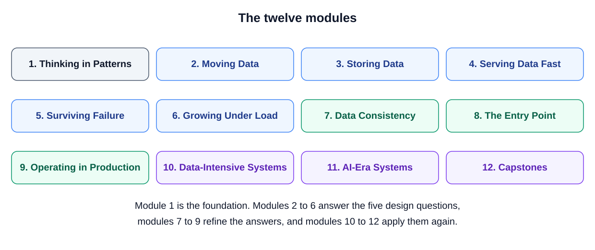
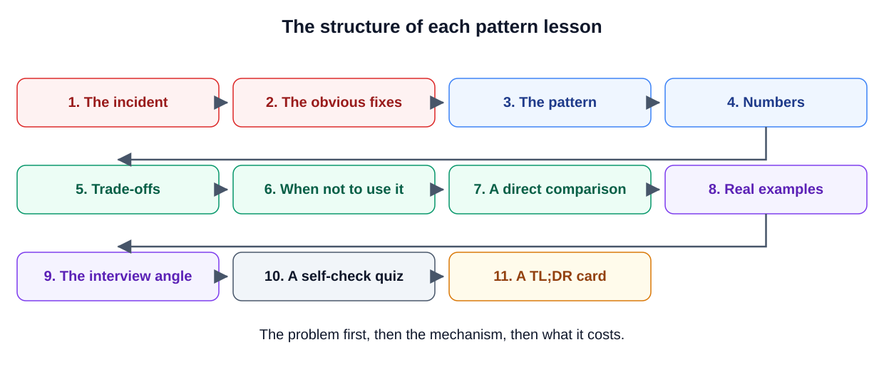
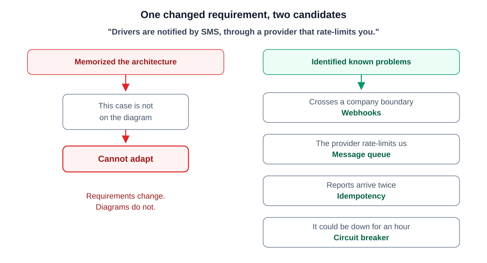
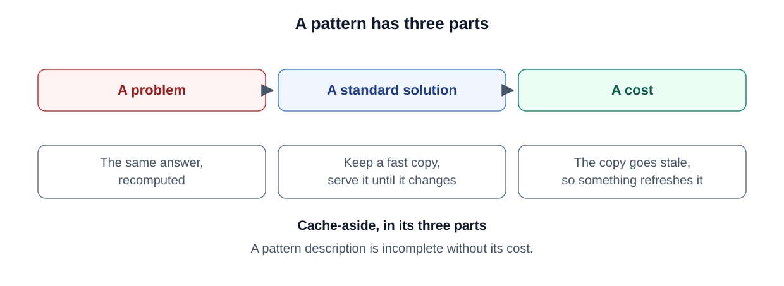
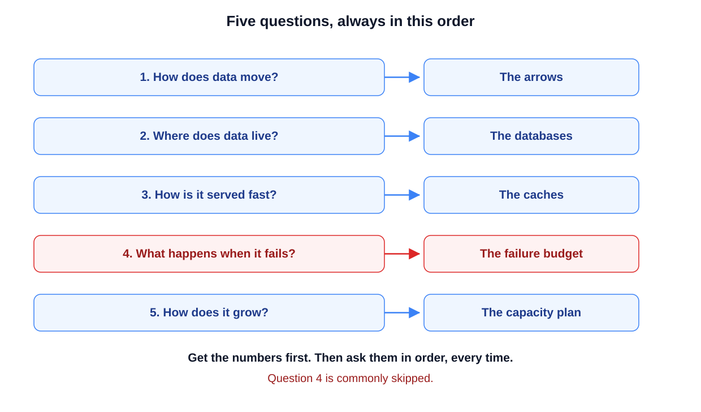
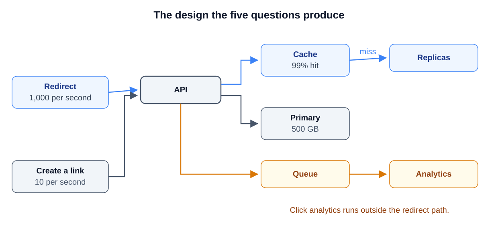
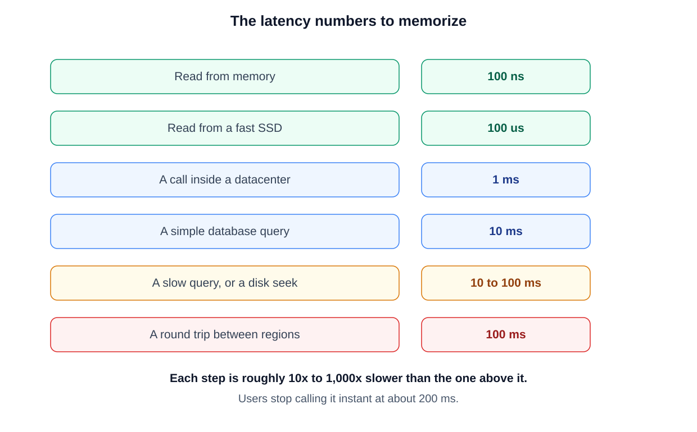
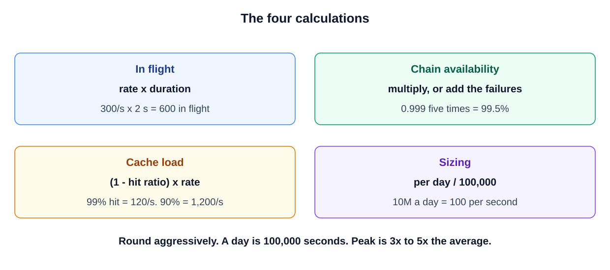

# Module 1 — Thinking in Patterns (Foundations)

Before we meet any single pattern, this module sets up the *method* that every later module relies on. It covers three things. First, what a pattern actually is. Second, a fixed list of five questions you can use on any design problem. Third, four quick calculations that tell you whether a design is big enough, or bigger than it needs to be. One example runs through the whole course: an online store. It begins on a single database and grows until it serves 100 million users. Every module tackles the next problem that store hits.

---

## Course Introduction
*Original lesson: [Course Introduction on DesignGurus ↗](https://www.designgurus.io/course-play/system-design-patterns/doc/6a5352c95a38214864ffb985)*

### What it is
Here is the big idea behind the course. Most large software systems are assembled from the same small collection of solutions that show up again and again. These are called **system design patterns**, and the course covers more than 60 of them. After you learn them, a strange architecture diagram no longer looks like a random pile of boxes. You can point at each part and name it ("this one is a cache, that one is a queue"). You can also build new systems by snapping together pieces you already understand, rather than memorizing entire diagrams.

**Analogy:** strong chess players don't memorize every game in history. Instead, they learn tactics and positions that keep coming back (forks, pins), and they spot them in games they've never seen. Patterns play the role of forks and pins in system design.

### Key terms
- **System design pattern:** a solution you can reuse for a problem that shows up over and over, bundled with the price you pay for using it.
- **Pattern vs technology:** a technology is one particular product, while a pattern is the idea that product carries out. *Redis* is a technology: a data store that keeps its data in memory. *Cache-aside* is a pattern. You hold a quick, temporary copy of data you use often (that copy is a **cache**). You look there first. You only go to the slower database when the copy doesn't have what you need (that situation is a **cache miss**). Products rise and fall over the years, but the pattern keeps its value.
- **Server / database / HTTP request:** these are all you need to know going in. A server is a program that answers requests arriving over the network. A database keeps data safely so it survives restarts. An HTTP request is the usual message a client sends to a web server. (HTTP is the standard language browsers and apps use to talk to web servers, and a **client** is whatever program sends the request: a browser, a phone app, or another server.) If any of these feel shaky, the [System Design Fundamentals](../00-system-design-fundamentals/README.md) primer walks through them from scratch.

### Who it's for
The course targets software engineers in the early or middle part of their careers. Engineers who build data or AI systems benefit as well: their work is spread over many machines, so they run into the same problems. You don't need any background in **distributed systems** (systems made of many computers that cooperate over a network and must keep working when some of them fail). Each term gets explained the first time it shows up.

### The twelve modules

*Figure — The twelve modules (course diagram)*

The figure above is a map of the course. Module 1 lays the groundwork. Modules 2–6 each tackle one of the five design questions (you'll meet them below). Modules 7–9 sharpen those answers. Modules 10–12 put everything to work again on larger systems.

| Module | What it covers |
|---|---|
| 1. Thinking in Patterns | The meaning of a pattern, plus the simple math that shows up everywhere |
| 2. Moving Data | The ways services talk to each other: request-response, queues, pub/sub, streams |
| 3. Storing Data | Replication (keeping copies of data on several machines), sharding (splitting data across machines) and logs: making a database bigger and keeping it running |
| 4. Serving Data Fast | Caching, and the price you pay for it |
| 5. Surviving Failure | Dealing with calls that hang, fail, or arrive two times |
| 6. Growing Under Load | Scaling, load balancing, connection pooling |
| 7. Keeping Data Consistent | How machines reach agreement: transactions (all-or-nothing groups of changes), sagas (multi-step workflows with undo steps), quorums (majority votes) |
| 8. The Entry Point | How traffic gets in: gateways (the front door for all requests), rate limits (caps on requests per second), CDNs (servers near users that hold copies of content), proxies (middlemen that forward requests) |
| 9. Operating in Production | Shipping, watching, and safely undoing changes (deploying, monitoring, rolling back) |
| 10. Data-Intensive Systems | Processing big volumes of events in batches (large chunks at a time) and in streams (one by one as they arrive) |
| 11. AI-Era Systems | The very same patterns, used again inside LLM (large language model, like ChatGPT) and ML (machine learning) systems |
| 12. Capstones | Four full designs that pull everything together |

*Added in these notes (not part of the course):* five extra lessons in modules 6, 8, 9 and 10, and six case-study modules — [13 Building Blocks](../13-case-studies-building-blocks/README.md), [14 Messaging and Media](../14-case-studies-messaging-and-media/README.md), [15 Location and Real-Time](../15-case-studies-location-and-realtime/README.md), [16 Infrastructure](../16-case-studies-infrastructure/README.md), [17 Money and Reservations](../17-case-studies-money-and-reservations/README.md) and [18 Client and Mobile](../18-client-and-mobile-system-design/README.md) — that apply the same patterns to the classic "design X" prompts.

### How each lesson works

*Figure — The structure of each pattern lesson (course diagram)*

Every pattern lesson uses the same 11-step layout shown in the figure. The order is always: the problem, then how the fix works, then what it costs.
1. **The incident:** a believable failure in **production** (the live system that real users are using, as opposed to a test setup), with real numbers, so you sense *why* the pattern matters.
2. **The obvious fixes:** the things engineers tend to try first, and the reason they fall short.
3. **The pattern:** the solution, laid out one step at a time.
4. **Walkthrough with numbers:** the pattern applied to that same incident, with the gain worked out.
5. **Trade-offs:** the extra cost, delay or complexity the pattern brings.
6. **When not to use it:** situations where it brings more complexity than benefit.
7. **Direct comparison** against the alternative it's most often confused with.
8. **Real-world examples** taken from systems running in production.
9. **Interview angle:** how interviewers probe it, along with a rehearsed 30-second answer.
10. **Self-check quiz.**
11. **TL;DR card** ("too long; didn't read"): a brief summary. Put all the cards together and you get a review deck for the evening before an interview.

Lessons come in two sizes, full and compact. A simpler pattern just has fewer decisions to cover. At the end of each module there's a **mini-capstone**: a small system design that uses that module's patterns together.

### This module
Before any pattern shows up, three short lessons build the method. **Thinking in Patterns** explains what a pattern is and why patterns work better than memorized architectures. **The Five Questions** shows how to turn a fuzzy prompt into a plan. **Back-of-the-Envelope Math** teaches four calculations you'll use again and again. The first place you actually apply the method is the Request-Response lesson that comes next.

---

## Thinking in Patterns
*Original lesson: [Thinking in Patterns on DesignGurus ↗](https://www.designgurus.io/course-play/system-design-patterns/doc/6a535332ba41b5b74696144f)*

### What it is
This is a style of reasoning about design. You don't try to recall entire architectures. Instead, you split a system into *problems you already know*, choose the usual solution for each one, and say out loud what each solution costs. **Analogy:** a doctor doesn't remember every single patient. They notice symptoms, link them to known conditions, and know the side effects of each treatment.

### The problem: two candidates, one question

*Figure — One changed requirement, two candidates (course diagram)*

Picture two candidates who both get the prompt "design a ride-sharing service." The first one has memorized the architecture Uber published and draws it back faithfully. Then the interviewer tweaks a single requirement: *alerts to drivers are now sent as SMS through an outside provider, and that provider limits how fast you can send.* Nothing on the memorized diagram covers this, so the first candidate is stuck.

The second candidate splits the change into four problems they've seen before, just as the figure above shows:
- **The work crosses into another company** (a third party is now involved). The provider will send delivery reports back as **webhooks**, which are HTTP requests the provider makes into *your* server.
- **The provider rate-limits you**, meaning it caps the number of requests you may send each second. So messages should be placed on a **message queue** and sent out at a steady, controlled speed.
- **A report might show up twice**, so the handling has to be **idempotent**. That word means doing the same thing twice leaves the same result as doing it once.
- **The provider might be offline for an hour**, so a **circuit breaker** should pause calls to it for a while, and the app should alert users inside the app instead.

The second candidate puts four patterns together and states the cost of each one. When another requirement changes, they just run the same reasoning again. The figure sums it up: *requirements change; diagrams do not.* This matters on the job as well, since requirements keep shifting after a product launches.

### What a pattern is

*Figure — A pattern has three parts (course diagram)*

The figure uses cache-aside to show that every pattern needs three parts. If any one is missing, the description isn't complete:
1. **A problem, described in general terms.** "Instagram is slow" talks about a single product. Put in general terms, it becomes "the same unchanged answer is being worked out again thousands of times." Any product can have that problem.
2. **A standard solution.** This is what seasoned engineers normally do. Here: hold a quick copy of the answer and hand it out until the answer changes.
3. **A cost.** The copy can go **stale**, meaning out of date, so something has to refresh it. This cost belongs to the pattern itself. It isn't a detail you leave for later.

Tools like Redis, Kafka (a popular message-log product) or Postgres (a popular relational database) are not part of what defines a pattern. They are simply products that happen to carry out patterns well right now.

**Patterns existed long before software.** Banks kept paper ledgers, which is event sourcing: you record every change and work out the balance from them. Ships have bulkheads, walls that keep one flooded compartment from sinking the whole ship. Post offices had a way of handling mail that couldn't be delivered, which is a dead letter queue. Roughly sixty patterns cover so much because every system runs into the same limits. Networks break. Every machine has a maximum capacity. Copies of data slowly stop matching. Load shows up unevenly. Since the problems keep repeating, the solutions keep repeating too.

### Patterns combine into architectures
An architecture is just several patterns working together. Take Netflix: it's roughly fifteen patterns cooperating. Caches reduce repeated reads. Queues keep one **service's** work separate from another's (a service is a separately running program that owns one job, such as payments or search). Circuit breakers guard calls to the services Netflix depends on (its **dependencies**: the other systems it needs in order to do its job). Replicas keep extra copies of the data. That means a "design X" question breaks down into three smaller steps:
1. **Find the problems.** A news feed has a **fan-out** problem, where one post must reach many followers. It also has a **hot-key** problem, where a single item draws an enormous share of the traffic. Checkout, on the other hand, has problems around payments and calls to third parties.
2. **Choose a pattern for each problem, then check how the patterns affect each other.** **Retries** (automatically sending a failed request again) need idempotency, or else a retried payment bills the customer twice. Caches need a rule for when entries expire. **Shards** are pieces of a database spread across machines, and they need a **shard key**: the field that decides which piece stores each row.
3. **Name every cost**, and say no to a pattern when the problem isn't big enough to deserve it.

Each module finishes with a capstone that runs these steps on a small system. The last module runs them on four full designs and names every pattern involved.

### Every pattern is a trade
If you keep one habit from this course, make it this one. No pattern makes everything better:

| Pattern | What it gives | What it costs |
|---|---|---|
| Queue | Soaks up bursts of traffic | Adds waiting time; a message might arrive twice |
| Cache | Quick reads | Might hand out out-of-date data |
| Sharding | Room for more writes | Queries that span several shards become difficult |
| Circuit breaker | Gives up quickly instead of hanging | Might "trip" even though the dependency could still have replied |

This is the reason each lesson includes a "When Not to Use It" section. Look at two interview answers side by side. The weak one: "We'll use Kafka here." The strong one: "A queue is a good fit, because no one is waiting on this work. Queues can deliver the same message twice, so the **consumer** (the program that reads messages off the queue) filters out duplicates. They can also change message order, and this operation is fine with that." The strong answer covers the **problem, pattern and cost**. Junior engineers know what patterns do. Senior engineers also know the price of each one and when to turn it down.

### How interviews test patterns
Interviewers seldom ask you to define a pattern. They check three things instead:
- **Spotting problems from their symptoms.** For example: every **health check** (an automatic "are you alive?" probe a system sends to each server) is green, but one feature is starved of resources. You should think "bulkhead" (give each feature its own separate pool of resources) before the interviewer says the word. This is why lessons open with an incident.
- **Interactions between patterns.** "Could a retry charge someone twice?" "What happens right when your busiest cache key expires?"
- **Defending your choices.** When they ask "Why not use X everywhere?", they really mean "what does X cost?" Answers that skip the trade-offs sound memorized.

### How to study
- **Train yourself to recognize, not recite:** when you hit a lesson's incident, stop and work out the diagnosis before you read the fix.
- **Pair every pattern with its cost** in a single sentence. The TL;DR cards help with this.
- **Practice on systems you know:** run the five questions (coming in the next lesson) on apps you use every day.
- **Say the cost out loud** in the same breath every time you name a pattern.

### Interview one-liner
"I don't recall architectures. I split the system into problems I already know, choose one pattern per problem, look at how those patterns affect each other, and name the cost of each. A changed requirement just means rerunning the same reasoning."

### TL;DR
- **The claim:** roughly sixty patterns keep showing up under every system design. Knowing them works better than memorizing architectures, because requirements move while a memorized diagram can't.
- **A pattern is:** a problem + a standard solution + a cost. Without all three, it's incomplete. Technologies carry out patterns; they don't take their place.
- **Designing means:** find the problems, pair each with a pattern, check how they interact, and say every cost aloud.
- **The senior habit:** every pattern is a trade-off. Interviews reward you for knowing the price and knowing when to decline.
- **Study by:** diagnosing incidents before you read the fixes, learning costs from the TL;DR cards, and never naming a pattern without naming its cost.

---

## The Five Questions
*Original lesson: [The Five Questions on DesignGurus ↗](https://www.designgurus.io/course-play/system-design-patterns/doc/6a535381da90fe9bceb2c8b2)*

### What it is
This is a checklist of five questions, always asked in the same order, that you can point at any system. Each question brings problems to light, and each problem leads you to patterns. **Analogy:** think of a pilot's checklist before takeoff. The pilot already knows how to fly. The checklist just makes sure nothing is forgotten when things get stressful.

### The problem
The interviewer says "Design a URL shortener" (a service like bit.ly that turns a long web address into a short code and redirects people who visit it), passes you the marker, and goes quiet. Most candidates freeze here. It's not that they don't know enough; it's that they have no procedure to follow. When your questions come in a fixed order, you always know what to do next. The first lesson was about reasoning with patterns. This one shows *where to look* to find them.

**Step 0 — get the numbers first.** Before starting the questions, pin down a few numbers: how many users there are, the **RPS** (requests per second), how much data there is, the **read:write ratio** (how many reads happen for every write), and how much an outage costs. A design that suits 100 users won't suit 100 million. (The next lesson teaches you to estimate these quickly.)

*Figure — Five questions, in order (course diagram)*

The figure above lists the five questions and which part of the diagram each one fills in: the arrows, the databases, the caches, the failure budget, and the capacity plan. Pay attention to its warning: people skip question 4 more than any other.

### The five questions, one by one

**1. How does data move? → the arrows.** Figure out who talks to whom, and whether the caller needs to wait for an answer. Does the work have to happen exactly once? Do several services care about the same fact? Does the call go outside your company? Does data need to flow without stopping? Your choices (all covered in Module 2):
- **Request-response** (the default): the caller sends a request and waits until the reply comes back.
- **Message queue**: work that isn't urgent is held until a worker picks it up.
- **Pub/sub** (publish-subscribe): a single event is sent to several services that care about it.
- **Webhooks**: one company's system makes HTTP calls into a different company's system.
- **Streams**: the server keeps pushing data without stopping.

*Example:* "The order confirmation has to be immediate, so it's a direct call. Fulfillment can start a bit later, so it goes through a queue. Five teams care about every order event, so we publish it to all of them."

**2. Where does data live? → the databases.** Figure out which store holds the **source of truth** (the official copy everyone trusts), how large the data will get and how quickly, what the read:write ratio is, and whether you need the full history or only the current state. Your choices (Module 3):
- **Replicas**: extra copies of a database, which you add once reads are too much for one machine.
- **Sharding**: splitting the rows over several machines, which you do once writes or total size are too much for one machine.
- **Consistent hashing**: a technique that lets you change how many shards you have without moving most of the data.
- When history matters, you use log-based patterns. A **write-ahead log (WAL)** records each change first and applies it after. **Event sourcing** stores the complete list of events instead of just the final result. **CQRS** keeps one model for writes and a different one for reads.

*Example:* "Order history matters, since customers dispute charges. So we keep the events, not only the current state."

**3. How is it served fast? → the caches.** Figure out which reads happen again and again, how out of date each kind of data is allowed to be, what the **hit ratio** is (the share of reads the cache answers), and what breaks when a heavily used entry expires. Begin with **cache-aside**. Switch to write-based variants for data that changes often. Add **stampede prevention** for when many requests miss the same hot entry at the same moment. The key decision in the caching module is this: give each type of data a **staleness budget** (how old it may be), then choose a mechanism that keeps to it.

*Example:* "Product descriptions are fine if they're an hour old. Prices can be a few seconds old, as long as updates **invalidate** the cache (delete or mark the old cached copy so the next read fetches the new value). At checkout the price must be exact, so that step always reads from the database."

**4. What happens when it fails? → the failure budget.** Go through *every arrow* from question 1. For each one, ask: what if the other side never answers, fails once, or stays down for ten minutes? Could a retry cause an effect to happen twice, such as a charge? What will the user see? Your toolbox (Module 5):
- **Timeout**: give up waiting once a deadline passes.
- **Retry with backoff**: try again, waiting a bit longer before each new attempt.
- **Idempotency**: sending the same request again can't cause the effect again.
- **Circuit breaker**: stop calling a service while it's down for a long stretch.
- **Bulkhead**: stop one broken feature from eating all the shared resources.
- **Graceful degradation**: send back a smaller result rather than an error.

*Example:* "If the payment provider slows down, we cut off the call once it takes twice its usual worst-case **latency** (the time one call takes from start to finish). Retries include **idempotency keys** (a unique ID attached to a request so the receiver can spot and ignore a repeat), so a customer can't be charged twice. If failures keep happening, the breaker stops the calls, and we save the cart and email the customer."

**5. How does it grow? → the capacity plan.** If traffic grows 10x, which part breaks first: reads, writes, storage, or a single hot key? Which parts grow just by adding machines, and which need a redesign? Module 6 covers **load balancing** (spreading incoming requests across many servers), **autoscaling** (adding or removing servers automatically as traffic changes), and **horizontal scaling** (growing by adding machines).

*Example:* "Replicas and caching take care of reads, but the single **primary** (the one database server that accepts writes; replicas only copy from it) caps how many writes we can do. The next step is sharding by customer ID, and we plan it before the primary hits its limit."

The five questions line up with Modules 2–6 in the same order. Later modules add consistency, the entry point, and operations. The data and AI modules run the same questions on **pipelines** (chains of steps that move and transform data) and ML systems.

### Walkthrough: the URL shortener in about three minutes

*Figure — The design the five questions produce (course diagram)*

The figure above shows where the walkthrough ends up. Redirects arrive at 1,000/s and hit a cache with a 99% hit ratio. Misses fall through to replicas that sit behind a 500 GB primary. Creating links (~10/s) goes to the primary. Click analytics travels through a queue that sits *outside* the redirect path.
- **Move:** there's one write path (send a long URL, receive a short code) and one redirect path that's mostly reads, at roughly 100 reads for every write. Both use direct calls. Click analytics is extra work nobody waits on, so it goes onto a queue and never slows a redirect down.
- **Live:** each row is tiny (two URLs and a counter), but there could be billions of them. For now, a primary with replicas is enough. Once rows reach the billions, shard by short code, since every redirect lookup already includes it. There's no need to keep history.
- **Fast:** a given short code always points to the same URL, so use cache-aside with a long **TTL** (time-to-live: how long an entry stays in the cache). A small number of links get most of the clicks, so those hot links get stampede prevention and shouldn't expire during normal operation.
- **Fail:** redirects need very high **availability** (the share of time a service is up and answering correctly), so a cache miss reads from a replica. Link creation can reply "try again shortly," because a short outage there does less harm. Each path gets its own reliability target.
- **Grow:** replicas and cache nodes handle more reads, and there aren't many writes. The real risk is **key generation**. Random codes need a check for **collisions** (two links accidentally getting the same code). Codes based on a counter need coordination so that two servers never hand out the same code. Mark it as future work and offer both options.

After three minutes you've got: separate read and write paths, storage with a shard key picked out, a caching plan, a reliability target for each path, and one growth risk flagged. If a requirement changes, just run the questions again.

### Usage tips
- **Announce the questions as your agenda** at the start: "First how data moves, then storage, then caching, then failures, then growth." That way the interviewer knows your plan.
- **Treat them as a checklist** when you're stuck or when you finish with time left.
- **Question 4 gets skipped the most**, and it triggers the most follow-up questions. Ask it for every arrow.
- **Bring them to design reviews** at work too. "What if the other service never answers?" ranks among the most useful questions in distributed systems.

### Interview one-liner
"After getting the numbers, I go through five questions in order: how data moves, where it lives, how it's served fast, what happens when it fails, and how it grows. Each surfaces problems that map to patterns, and the fixed order means nothing gets skipped."

### TL;DR
- **Procedure:** get the numbers first, then ask five fixed questions (move, live, fast, fail, grow).
- **Why it works:** the questions uncover problems, the problems lead to patterns, and the fixed order makes sure you cover everything.
- **Structure:** the questions line up with Modules 2–6; later modules polish the answers.
- **Most-skipped:** Q4, handling failure. It's where designs become dependable, and where interviewers push hardest.
- **Use it as:** the agenda you say out loud, your checklist when stuck, and your go-to question in reviews at work.

---

## Back-of-Envelope Math
*Original lesson: [Back-of-Envelope Math on DesignGurus ↗](https://www.designgurus.io/course-play/system-design-patterns/doc/6a5353ee5a38214864ffda91)*

### What it is
These are fast, intentionally rough calculations (the kind you could scribble "on the back of an envelope"). They tell you the *order of magnitude* a system needs. Is it one machine or ten? Are 600 requests in progress at once, or 60,000? Can the data fit in memory? **Analogy:** before a road trip you guess "around 5 hours and two tanks of gas." You don't work out the arrival time to the minute. That rough guess is enough to choose between driving and flying.

### Why engineers estimate
A rough answer you get in 30 seconds can still shape the design today. A precise answer that arrives next week can't. Without numbers, you can't really answer the five questions, and interviewers often ask things like "how much storage does this need?" They expect you to state your assumptions, round the numbers, and show each step.

**Round hard.** There are 86,400 seconds in a day; call it **100,000**. There are about 2.5 million seconds in a month; call it **3 million**. You're estimating **orders of magnitude** (powers of ten), not decimal places. When the direction of rounding matters, round demand up and capacity down. That gives you some spare room (headroom).

### Numbers to memorize

*Figure — The latency numbers to memorize (course diagram)*

**Latency** means how long an operation takes. The figure above gives the standard values. Each row is roughly 10x to 1,000x slower than the row above it:

| Operation | Time |
|---|---|
| Reading from memory (RAM, the computer's fast working memory) | ~100 ns (nanoseconds) |
| Reading from a fast SSD (solid-state drive, flash storage) | ~100 µs (microseconds) |
| A network call within one datacenter (a building full of servers), e.g. a cache read | ~0.5–1 ms (milliseconds) |
| A simple database query | ~5–15 ms |
| A seek on a spinning disk, or a slow query | ~10–100 ms |
| A round trip (request there, reply back) from one region (a geographic area with its own datacenters) to another | ~100 ms |
| The longest delay that still feels "instant" to users | ~100–200 ms |

This table leads to three design facts:
- A cache hit (~1 ms) runs ~10–15x faster than a DB query (~10–15 ms). This is why caching helps.
- Writing to disk in order (sequentially) is much faster than writing to scattered spots on the disk. This is why the write-ahead log pattern works.
- Every *sequential* round trip between regions adds ~100 ms, so just a few of them use up the whole response-time budget.

**Sizes:** one character ≈ 1 byte; an ID ≈ 16–36 bytes; a typical DB row ≈ 1 KB; an image ≈ 100 KB–1 MB. Each unit is 1,000x bigger than the one before (KB → MB → GB → TB). So 1 million rows of 1 KB ≈ 1 GB, and 1 billion of them ≈ 1 TB.

### The four calculations

*Figure — The four calculations (course diagram)*

The figure above sums up the four formulas, with one example for each. Here they are in more detail:

**1. Rate × duration = work in progress (Little's law).**
`things in flight = arrival rate × duration`. Say 300 requests come in every second and each one takes 2 seconds. Then 300 × 2 = **600 requests are active at any moment**, and each one is holding a **thread** (one independent line of execution inside a program; a server runs many at once) or a database connection. A **connection pool** is a fixed set of open DB connections that get reused; one with 200 slots would be too small here. The same formula gives you a queue's **drain time**, meaning how long it takes to clear a backlog. With 552,000 messages processed at 400/s: 552,000 / 400 ≈ 1,400 s ≈ **23 minutes**. You'll use this calculation more than any other in the course. It sizes thread pools, connection pools, bulkhead limits and backlog drain. Its official name, **Little's law**, is a good term to drop in interviews.

**2. Availability drops along a chain.**
**Availability** is the share of time a service answers correctly. When one request depends on several parts in a row, you multiply their availabilities together. The answer always ends up lower than the weakest part. With five dependencies at 99.9% each: 0.999⁵ ≈ **99.5%**. A shortcut when failure rates are small: just *add* them (5 × 0.1% ≈ 0.5% failure). Turning these into time makes them easier to picture:

| Availability | Downtime per year | Per month |
|---|---|---|
| 99% | ~3.7 days | ~7 hours |
| 99.9% | ~9 hours | ~43 minutes |
| 99.99% | ~53 minutes | ~4 minutes |
| 99.999% | ~5 minutes | ~26 seconds |

Two takeaways. First, every extra "nine" takes about **10x** the engineering work of the one before it. Second, every dependency you require can only *pull the total down*. So the practical fix is to have **fewer required dependencies**, not to make each one perfect. The graceful degradation lesson builds on this idea: when an optional dependency fails, you still return an answer that's smaller but useful.

**3. Cache hit ratio.**
Let *h* be the hit ratio (the share of requests the cache answers). Then:
- `average latency = h × fast + (1 − h) × (fast + slow)` (a miss pays for checking the cache *and* for the DB)
- `load on the database = (1 − h) × request rate`

Example: 12,000 RPS, a 1 ms cache hit, and a 15 ms DB read.
- h = 99% → ~1.15 ms on average, and the DB receives 1% × 12,000 = **120 QPS** (queries per second).
- h = 90% → ~2.5 ms on average, and the DB receives **1,200 QPS**, which is ten times the load.

Dropping from 99% to 90% doesn't mean "9% worse." The *miss* rate jumps from 1% to 10%, so the database gets 10x the traffic. Always judge a cache by its misses. This also explains a **cache stampede**. When a hot entry expires, its hit ratio briefly drops to about zero, and almost every request hits the database at the same moment.

**4. Sizing.**
- `per second = per day / 100,000`. So 10M orders/day ≈ **100/s average**.
- Traffic isn't steady, so plan for a **peak of 3–5x average**. Here that's 300–500/s.
- `storage = records × size × retention`. 10M/day × 1 KB × 365 days ≈ **3.7 TB/year**. That fits on a single ordinary database server, so this estimate *keeps* you from sharding when you don't need to.

### Walkthrough: sizing the URL shortener (~60 seconds, five numbers)
Speak each assumption out loud as you work:
- "Let's assume **100M redirects/day**. Divide by 100,000 and you get **1,000/s** on average, so plan for about **4,000/s** at peak."
- "Each mapping holds two URLs plus some **metadata** (descriptive extras such as creation date and owner); let's say **1 KB**. With **500M links**, that comes to roughly **500 GB**. A single database can handle that today, so sharding can wait."
- "There are roughly 100:1 more reads than writes, and a handful of links get most of the traffic. If we cache the top 1%, that's **5M rows ≈ 5 GB**. At a 99% hit ratio, only around **10 queries/s** make it to the DB."
- "At peak, 4,000/s × 2 ms = **8 requests in flight**. So we need one strong database, one replica, a cache, and careful failure handling."

Now every component has a capacity-based reason to exist, and nothing is built for demand that hasn't shown up yet.

### Traps
- **90% is not close to 99%:** it means 10x as many misses.
- **Each extra nine costs ~10x.** Long chains of dependencies can only reduce availability, so keep them short.

### Using estimation in interviews
- **Say your assumptions before you calculate** ("assuming 1 KB per record and 10M records a day"). An interviewer can fix an assumption you say aloud, but not one that stays in your head.
- **Round first, then multiply, and check the units at the end.** A rate × seconds gives a count; bytes × rows gives storage. If the units come out wrong, so does the math.
- **Let the numbers remove components.** Saying "At this scale we don't need that yet" is a strong answer. It shows you care about cost, and the arithmetic backs you up.

### Interview one-liner
"I round hard (100k seconds per day, a gigabyte per million 1 KB rows, peak at 3–5x average) and use four formulas: rate × duration for concurrency, multiplied availabilities for chains, hit ratio for cache latency and DB load, and records × size × retention for storage. That tells me what the design needs and what it doesn't need yet."

### TL;DR
- **Rule:** round hard; a day = 100,000 s; 1M × 1 KB = 1 GB; peak = 3–5x average.
- **Table:** RAM ~100 ns, SSD ~100 µs, a hop within the same datacenter ~1 ms, a database query ~10 ms, across regions ~100 ms, "instant" stops at ~100–200 ms.
- **Four calculations:** in flight = rate × duration; availability of a chain = multiply (or add the failure rates); cache latency and DB load come from the hit ratio; per second = per day / 100,000 and storage = rows × bytes × retention.
- **Traps:** 90% ≠ 99% (10x the misses); each nine ~10x the cost; chains can only lower availability.
- **In interviews:** state your assumptions, check your units, and let the arithmetic rule out over-engineering.
