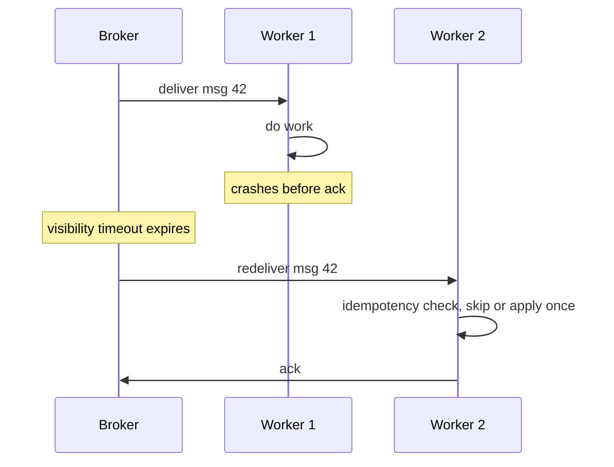
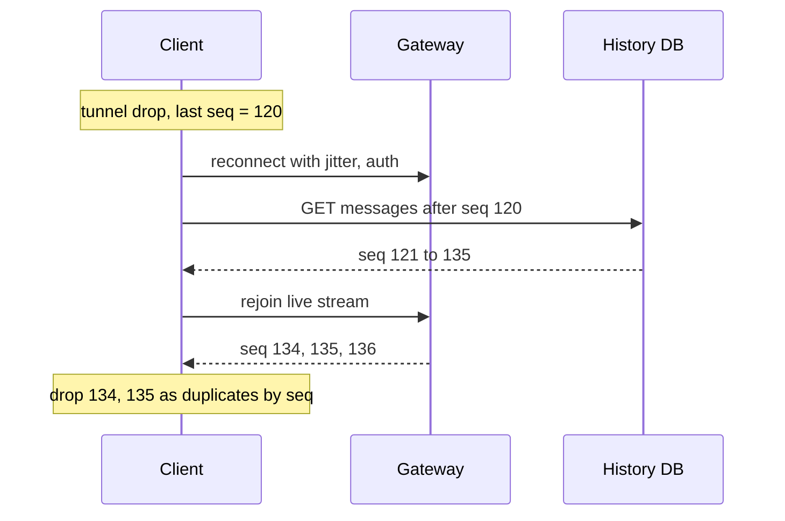

# Module 2 — Moving Data (Communication)

## Module Introduction
*Original lesson: [Module introduction on DesignGurus ↗](https://www.designgurus.io/course-play/system-design-patterns/doc/6a51dcf45fbac9ebdf719ae0)*


### What this module covers
A design diagram is boxes (services such as an **API** — application programming interface, the set of requests a program accepts — a database, an email sender) and arrows (data moving between them). This module is about the **arrows**: each one hides a choice of *how* A reaches B, and that choice decides three behaviors:
- **Waiting:** must someone wait for the answer?
- **Downtime:** what happens if B is offline?
- **Duplicates:** what happens if the message arrives twice?

Wrong choices cause real outages. Two from the coming lessons: a **flash sale** (a short, heavily advertised sale that brings huge simultaneous crowds) took down a store that had enough total capacity, and a "real-time" dashboard spent most of its budget asking "anything new?" to hear "no."

### The seven patterns

| Situation | Pattern |
|---|---|
| The caller can't go on until it has the answer | Request-Response |
| The work can be done later, and no one is waiting on it | Message Queue |
| Something happened, and more than one service needs to hear about it | Publish-Subscribe |
| Pack the details into the event so no one needs to call back for them | Event-Driven Architecture |
| A system at another company needs to be told about something | Webhooks |
| A steady flow of updates going one way | Server-Sent Events |
| Both sides keep sending messages to each other | Bidirectional Streaming |

### Two rules for the whole module
- **Rule 1: request-response is the default.** If someone waits for the answer, make a direct call. The other six patterns are for when waiting is pointless or impossible, and each has costs; switching isn't automatically an improvement. Less experienced engineers often reach for a fancy pattern where a direct call is clearer and safer.
- **Rule 2: anything that retries can deliver twice.** Queues, events and webhooks resend whenever unsure a message got through — deliberately, so nothing is lost. Your code must therefore receive a message twice without applying its effect twice: **idempotency** (running an operation twice gives the same result as once; full lesson in [Module 5](../05-reliability/README.md#idempotency)). Plan for duplicates from day one.

### Four terms used throughout
- **Job vs fact.** A *job* is work to do once ("resize this image"); a *fact* records that something happened ("an order was placed"). Jobs go on **queues**; facts get **published**. Mixing them up is the most common communication mistake.
- **At-least-once delivery.** A message is never lost but may be delivered more than once (Rule 2).
- **Push vs pull.** *Pull*: the client keeps asking "anything new?" *Push*: the server sends updates as they happen. Pull costs requests; push costs open connections.
- **Synchronous vs asynchronous.** *Synchronous*: the caller waits for the answer. *Asynchronous*: the caller hands off the message and continues.

### How to read this module
One online store drives the story: a flash sale breaks its synchronous design (**queue**); more teams want the data (**pub/sub**); thin events cause callbacks (**event-driven architecture**); a payment provider sends data in (**webhooks**). Read those five in order; **SSE** and **Bidirectional Streaming** cover live streams, and the **capstone** combines all seven.

Short on time? The four most asked: request-response, message queue, pub/sub, webhooks.

### Before you start
For a system you've worked on ("I don't know" is a fine first answer):
- Which API call is slowest, and is a person waiting for its result?
- If a queued message is delivered twice, what happens?
- What refreshes on a timer, and out of 100 refreshes, how many find something new?

---

## Request-Response
*Original lesson: [Request-Response on DesignGurus ↗](https://www.designgurus.io/course-play/system-design-patterns/doc/6a51d92f58730bac88271436)*


### What it is
The caller sends a request and **waits**, doing nothing else, until a result or error returns. It's the normal way services communicate; the other six patterns are deliberate alternatives. **Analogy:** asking a shop assistant at the counter — you stay put, and can't finish buying without the answer.


*Figure — Request-Response (course diagram)*

The caller (which "needs the answer to proceed") sends (1) a request; (2) a response or error returns. The clock between them marks the key property: the call is **synchronous**, so the caller is blocked for the whole round trip.

### Why it needs a lesson
Engineers new to queues and events overuse them. A plain synchronous call is right for most traffic — page loads, searches, password checks, price lookups, payment authorization. When a user waits, a queue doesn't remove the wait; it hides it behind machinery.

### What it gives you
- **The answer immediately.** The next line of code uses it; no "received, come back later" state to design.
- **Errors where you can handle them.** The caller can retry, show a message or fall back. A failed background job is far harder to trace, since it fails apart from the request that caused it.
- **Easy debugging.** One request, one path, one **trace** (record of the path through services).

**Reusing connections matters a lot.** A new connection starts with **TCP and TLS handshakes** (TCP gives a reliable, ordered connection; TLS adds the encryption behind `https`; see [Module 0](../00-system-design-fundamentals/README.md#https-and-tls)), costing 1–3 round trips — ~100 ms between regions. **Connection pooling** (**keep-alive**) keeps connections open for reuse; every production HTTP client supports it, so verify it's on.

### What it costs
Each cost is small alone, but a *chain* of calls compounds them:
- **Both sides must be up at once.** If the receiver is down, the call fails immediately: **temporal coupling**.
- **Availability multiplies along a chain.** An **endpoint** (one operation a service exposes, e.g. `POST /checkout`) calling 5 services in series at 99.9% each works only when all do: 0.999⁵ ≈ **99.5%**, roughly **44 hours of failures a year**, and every added dependency lowers it.
- **Latency adds up.** Five sequential 80 ms calls take **400 ms**. Independent calls made **in parallel** cost only the slowest (~80 ms); turning accidental sequencing into parallelism is often the quickest speed-up.
- **Waiting ties up resources.** Each waiting caller holds a thread or connection: 300 requests/s × 2 s = 600 in flight (Little's law, [Module 1](../01-thinking-in-patterns/README.md#back-of-envelope-math)).

So request-response at scale needs three safeguards, each with its own lesson: a **timeout** (stop waiting after a deadline), **retries** (repeat after a transient failure), and a **circuit breaker** (stop calling an obviously down service).

### One question per arrow
Before drawing an arrow, ask: **does the caller's next step need the answer, *and* is someone waiting for it?** Both yes → direct call. Otherwise pick from [the seven patterns](#the-seven-patterns) table. Each alternative has its own cost: a **pending state** (accepted but unfinished work), possible duplicates, or a connection to manage. Switch because an instant answer *isn't needed*, not because the alternative sounds fancier.

### When not to use it
- **Long-running work** (more than a few seconds): accept the job, reply "started" immediately, deliver the result later via queue, status endpoint or webhook.
- **Telling many services about one event:** calling five services separately couples them all; publish the event (Pub/Sub).
- **Bursty work** (arriving in spikes) **with loose deadlines:** if no one waits, queue it.
- **Chains that are too long:** by six synchronous hops, availability has dropped and latency climbed. Shorten, parallelize, cache, or queue what can wait.
- **The opposite mistake, async by habit:** search behind Kafka (a high-throughput message log) or event-driven login. The user still waits, now via a **message broker** (a server that holds and forwards messages), adding latency and duplicate risk to a ~200 ms path. Async is right when waiting is optional, not better across the board.

### In the interview
Rarely asked by name; more often the interviewer points at a sync arrow: "why is this synchronous?" Name the dependency: "Checkout can't proceed without the payment result and the user is waiting, so it stays synchronous, protected by a timeout, bounded retries and a circuit breaker."

**30-second answer:** "Request-response is my default whenever the caller's next step needs the answer: auth (authentication, checking who the user is), pricing, payment authorization, interactive reads. Immediate answers, local error handling, simple tracing. Costs: both sides up at once, availability multiplying down a chain, latency adding up. So I parallelize independent calls, pool connections, and wrap every call in timeout, retry and circuit breaker. Anything nobody waits on goes to a queue or an event."

**Likely follow-ups:**
- *"Your endpoint calls five services and is slow. Fix it without going async."* Parallelize independent calls (latency drops from *sum* to *slowest*), cache rarely changing answers, drop unneeded calls, confirm connection reuse.
- *"When do you switch a call to async?"* When nothing needs the answer to proceed, or the work outlasts a reasonable open connection. Async adds resilience but also pending states, duplicates and ordering questions: a trade-off, not an upgrade.

**Mistake that fails candidates:** making a user-facing path async (search through Kafka), or drawing six unprotected synchronous calls. Both show you don't understand what sync calls cost or when their instant answer is worth it.

### Self-check
- **Q1: Which two questions decide sync vs async, and what costs does each sync call add to a chain?** → Does the next step need the answer, and is someone waiting? Costs: temporal coupling, multiplying availability, added latency, and a thread held per waiting caller — hence timeout, retry and breaker at scale.
- **Q2: Checkout makes five sequential 80 ms calls to services at 99.9% each. Latency, availability, and how to improve both without async?** → 400 ms and ~99.5% (~44 h/year of failed checkouts). Parallelize independent calls (~80–120 ms), cache rarely changing answers like pricing rules, drop unneeded calls. For availability, let optional page parts degrade instead of failing the page (graceful degradation).
- **Q3: A teammate wants payment authorization async "for resilience" via a `payment.requested` event. Assess it.** → Wrong: checkout needs the result and the user is waiting. It creates a pending state the product must design for, and duplicate delivery could authorize twice. Protect the sync call instead: timeout, retries with an **idempotency key** (unique ID so the provider can ignore a repeat), a circuit breaker, and an outage plan (save the cart, email once payment succeeds). The *receipt email* is what should be async.

### Related patterns
Timeout, Retry and Circuit Breaker (the mandatory safeguards) · Message Queue (for work no one waits on) · Load Balancing (one logical service, many servers) · API Gateway (where external calls are authenticated and rate-limited).

### TL;DR
- **Problem:** every arrow needs a default; teams err both ways — async where someone waits, or sync chains until latency and fragility snowball.
- **Mechanism:** the caller waits for result or error. Pool connections, parallelize independent calls, wrap every call in timeout, retry and breaker.
- **Costs:** both sides up together, availability multiplies down, sequential latency adds, each waiting caller holds a thread.
- **Skip it when:** no one waits, the work outlasts a connection, many services care about one event, or the chain is too long.

---

## Message Queue
*Original lesson: [Message Queue on DesignGurus ↗](https://www.designgurus.io/course-play/system-design-patterns/doc/6a51d49858730bac882704fb)*


### What it is
A **message queue** is a durable to-do list between the service that creates work (the **producer**) and the one that does it (the **consumer** or **worker**). *Durable* means saved to disk, surviving crashes. The producer drops a task in and moves on; workers take tasks at their own pace; the queue keeps each task until a worker says it's done. **Analogy:** a kitchen ticket rail — waiters clip tickets as fast as customers order, cooks take them as fast as they can cook, and a rush just lengthens the rail.

### The problem: the flash sale
The store sells 10,000 signed editions at 10:00 AM. Normal traffic is 200 orders/s; at 10:00:01 it jumps to **5,000 orders/s for two minutes**. The pipeline is synchronous: while the buyer waits, the API takes the order, reserves stock, writes the database and schedules fulfillment before saying "success." Its capacity is **400 orders/s**, plenty for years.

5,000 in, 400 done per second leaves **4,600/s** waiting, timing out or failing: **92% of buyers see an error**, and their refreshes add load.

The postmortem (post-incident review) finds the real cause. The pipeline could have processed those 600,000 orders well within a day; buyers needed a *confirmation* immediately, not fulfillment within two minutes. Fusing confirmation and fulfillment into one synchronous call forced all fulfillment work to beat the confirmation deadline. **That coupling caused the outage.**

### Why the obvious fixes fail
- **"Scale up for the peak."** **12x** the servers all year for a two-minute event, and the database has its own ceiling, so traffic fails there instead. The **bottleneck** (the slowest part, limiting throughput) moves rather than disappears.
- **"Buffer orders in memory."** An unsafe queue: a crash loses paid orders, other API servers can't see it, and monitoring can't see its size until memory runs out.
- **"Reject the excess."** Fine for unimportant traffic, but here it turns away **9 of 10 customers** in the biggest sale of the quarter, for work that could safely run an hour later.

All three treat it as a capacity problem. It's a **coupling** problem: arrivals and processing, which should run on separate schedules, were forced to the same rate every second.

### How it works
Four mechanics, each answering a "what if it fails?":

1. **Save before confirming.** The **broker** (the software running the queue) writes each message to disk and *only then* acknowledges the producer. A worker crash, a **deploy** (rolling out a new version, restarting servers) or an hour of downtime can't lose the work.
2. **Workers confirm on finish, not on start.** A worker takes a message, does the job, then sends an **ack** (acknowledgment). If it crashes mid-job, no ack arrives, and after a **visibility timeout** the broker hands the message to another worker. *Consequence:* a worker that finishes but crashes just before acking looks identical to a mid-job crash, so the job runs twice. That's **at-least-once delivery** (one or more times, never zero), so every consumer must be **idempotent**.
3. **Competing consumers.** Many workers pull from one queue; each message goes to exactly one. More **throughput** (messages per second)? Add workers; no coordination code needed.
4. **Queue depth is the health signal.** **Depth** is tasks waiting (arrivals minus completions). Rising during a brief spike: buffering is working. Rising for a *week*: a capacity problem.


*Figure — Message Queue (course diagram)*

Producers drop messages into the broker, which stores them until consumed and releases them at the consumers' pace. The figure's three properties — **durable, ordered (per queue), decouples producers and consumers** — are the point of the pattern.

Together these separate three concerns the synchronous design fused:
- **Rate:** producers burst to 5,000/s while workers hold 400/s.
- **Time:** workers can be down, mid-deploy, or not yet built; the work waits.
- **Failure:** a worker crash means redelivery, not loss, invisible to the producer.

Where the duplicate comes from:

*Ack and redelivery producing at-least-once delivery*


### Walkthrough with numbers
The flash sale with a queue between API and pipeline:
- **10:00–10:02.** 5,000 orders/s arrive. The API validates, enqueues and replies "Order confirmed" in **~50 ms**. The queue grows 4,600/s; over 120 s that's a **backlog** (accepted, not yet done) of ~**552,000 messages**, cheap on disk.
- **10:02–10:25.** Workers continue at 400/s: 552,000 / 400 = **1,380 s ≈ 23 minutes** to drain. Some orders start fulfillment 20 minutes after purchase, but the confirmation promised "ships today" — a delay the business approved in advance, so a design choice, not a failure.
- **10:07, failure drill.** A worker dies mid-message; after the visibility timeout another takes it, and the idempotency check prevents double application. No order lost.
- **The bill.** A queue service costing pennies per million messages replaces a 12x fleet.

Key point: the queue added **no** processing power. It removed the requirement that processing keep pace with arrivals second by second, which the business never needed.

### Trade-offs
**You gain:**
- Spikes become backlog, not errors; the limit becomes disk space, not your slowest service.
- A worker outage becomes a longer list, not an outage; deploys stop being scary.
- Producers and workers scale independently, and depth is a ready-made **autoscaling** signal (adding/removing workers automatically).
- Redelivery provides retries with no retry code.

**You pay:**
- **Latency, deliberately.** Work finishes seconds or minutes later, so nothing a user actively waits on belongs here.
- **Duplicates.** Idempotent workers are mandatory.
- **Lost ordering.** With 20 workers, messages can finish out of arrival order; ordering by key (below) helps at some throughput cost.
- **A gap between "accepted" and "done"** that the product must design for.
- **More to run:** a broker, monitoring of depth and message age, a **dead letter queue (DLQ)** for repeatedly failing messages ([its own lesson](../05-reliability/README.md#dead-letter-queue)), and debugging across systems instead of one **stack trace** (the call list printed on an error).

**Ordering by key:** Kafka's **partition key** or SQS FIFO's **message group** (SQS is Amazon's managed queue; FIFO = first in, first out) sends all of one customer's messages to the same **partition** (an independently ordered slice of the queue). Each customer stays in order while customers process in parallel. Costs: one very busy customer is capped at one partition's speed, a stuck message blocks its partition, and moving a failed message to the DLQ can break strict order.

**Depth growing for days** means arrivals permanently exceed processing (self-check Q2); alert on **oldest-message age**, the delay users actually feel.

### When not to use it
1. **The caller needs the answer:** login, price lookups, search. No one wants search results by email.
2. **Tight end-to-end deadlines:** within ~200 ms, a broker hop plus worker wait adds risk with no useful decoupling.
3. **Small, simple systems:** at ~10 requests/s, call the function until scale, spikes or failure boundaries justify a broker.
4. **As a database:** queues move work; data you need to search, modify or keep forever belongs in a database.
5. **Masking a permanent capacity shortfall:** queues absorb bursts; they don't create capacity.

### Message Queue vs Publish-Subscribe
Both use a broker and asynchronous delivery, but they answer different questions:

| | Message Queue | Publish-Subscribe |
|---|---|---|
| A message is | A job: work that should happen once | A fact: something that happened |
| Delivered to | Exactly one worker | Every subscriber, each on its own |
| Adding a consumer | Adds more workers for the same job | Adds another use for the same fact |
| Question it answers | "Who does this task?" | "Who cares that this happened?" |

"Resize this image" is one job for one worker: queue. "An order was placed" is a fact that fulfillment, email, analytics and fraud each need: pub/sub. They combine well — publish the fact once and feed a separate work queue per team (AWS **SNS → SQS**, SNS being Amazon's managed pub/sub; or Kafka **consumer groups**, each a named set of readers that together receive one full copy of the stream).

### Real-world examples
- **AWS SQS:** the pattern in simplest form — visibility timeouts, dead-letter support, near-unlimited depth, pennies per million messages.
- **RabbitMQ:** the classic self-hosted broker, adding rich routing on the same ack-and-redeliver core.
- **Kafka:** strictly a **replicated log** (an append-only record copied across machines), but consumer groups behave like a queue, and **replay** of old messages powers event-driven architecture and stream processing later in the course.
- **Celery, Sidekiq, BullMQ:** the pattern as application libraries; most engineers meet it here.
- **For AI engineers:** GPU work (on the graphics chips that run models) is costly, bursty and rarely urgent — ideal for queues: embedding pipelines (turning text into number lists called **embeddings** that capture meaning), **batch inference** (running a model over many inputs at once), **fine-tuning** (further training a model on your data) and evaluation runs. Depth, or better **oldest-message age**, drives GPU autoscaling. **RAG** (retrieval-augmented generation: fetching relevant documents to give the model with the question) ingestion uses a queue plus DLQ. Anthropic's and OpenAI's **batch APIs** sell exactly this trade: cheaper if it can finish later.

### In the interview
Appears in "handle a 10x traffic spike" or "design an order pipeline," or when the interviewer points at a sync arrow: "does the user need to wait for this?" If not, it may belong on a queue.

**30-second answer:** "A durable queue between API and pipeline: the API validates, enqueues and confirms in milliseconds; workers process at a sustainable rate, so a 5,000/s spike becomes backlog, not errors. The broker persists before confirming and redelivers if a worker dies — at-least-once, so consumers are idempotent and repeated failures go to a monitored DLQ. Depth drives autoscaling and alerts. The trade is latency, acceptable only because the business agreed fulfillment can take minutes; anything the user waits for stays synchronous."

**Likely follow-ups:**
- *"A worker crashes halfway through a message. Walk me through it."* Visibility timeout expires, another worker gets it, idempotency prevents a double effect; repeated failures go to the DLQ with an alert.
- *"Orders for the same customer must be processed in order. Now what?"* Partition by customer ID (ordering by key, above); a very busy customer is then capped at one partition.

**Mistake that fails candidates:** a queue on a path the user waits on (search through Kafka), or a queue with no plan for duplicates. The first misses *why* queues exist; the second ignores at-least-once delivery.

### Self-check
- **Q1: Name the three ways a queue decouples producer and consumer, and explain step by step where at-least-once delivery comes from.** → Rate (bursts in, steady out), time (work waits while workers are down), failure (crash means redelivery, not loss). Workers ack only after finishing, so the broker must redeliver both an interrupted job and a finished job whose worker died before acking — the latter is the duplicate.
- **Q2: Depth has grown steadily for six days; a teammate proposes raising the storage limit. What is depth telling you, and why is that a trap?** → Arrivals permanently exceed processing; the oldest message is six days late. A bigger limit only delays failure. Add workers or fix the bottleneck, shed or reprioritize work, route some elsewhere, alert on oldest-message age.
- **Q3: Charges and refunds for a customer share a queue with 20 workers; a refund got processed before its charge, leaving a negative balance. Explain and fix without losing parallelism.** → Two workers took the two messages and the refund finished first (many workers lose global order). Partition by customer ID: each customer's messages run in sequence, customers in parallel. Costs: a hot customer is capped at one partition, a stuck message blocks its partition, and DLQ moves can break strict order, so some streams must pause and be repaired instead.

### Related patterns
Idempotency (mandatory for every consumer) · Dead Letter Queue (where redelivery gives up) · Retry with Exponential Backoff (redelivery *is* broker-driven retrying; tune attempts and delays there) · Publish-Subscribe (the counterpart for facts) · Auto-Scaling (depth and backlog age are its clearest signals).

### TL;DR
- **Problem:** a synchronous pipeline must process work as fast as it arrives, so a spike becomes an outage despite ample total capacity.
- **Mechanism:** a durable task list between producer and consumer: save before confirming, one worker per message, redeliver after a crash, drain at worker pace.
- **Costs:** latency by design, duplicates (idempotency required), no global ordering, an accepted-vs-done gap to own, a broker to run.
- **Skip it when:** the caller needs the answer now, end-to-end deadlines are tight, scale doesn't justify a broker, or it would mask a permanent shortfall.

---

## Publish-Subscribe
*Original lesson: [Publish-Subscribe on DesignGurus ↗](https://www.designgurus.io/course-play/system-design-patterns/doc/6a51d4d85fbac9ebdf715829)*


### What it is
With **publish-subscribe (pub/sub)**, a producer announces a fact once to a named channel (a **topic**) without knowing who listens. The broker gives every **subscription** its own copy, which each subscriber processes at its own pace with its own failure handling. **Analogy:** a newspaper prints once, every subscriber gets a copy, and a new reader subscribes without changing anything in the newsroom.

### The problem: checkout delivering to five teams
After the queue fixed the flash sale, email wanted order data for receipts, then analytics, fraud and loyalty. Each request added a "send to this team's queue" call inside checkout. Eighteen months later checkout writes to **five queues** in sequence, causing three ongoing problems:
1. **Every new consumer needs a checkout deploy.** The company's most important revenue service must change for each team's data request, so its release schedule blocks everyone.
2. **A crash leaves teams with mismatched data.** Checkout crashed after writing 3 of 5 queues: fulfillment shipped, fraud never saw it. Five separate writes can't succeed or fail as one unit.
3. **Other teams' problems become checkout's.** When loyalty's queue was slow for an hour, checkout's sequential writes slowed too.

Then data science wanted *historical* order events for training and had to open a **pull request** (a proposed code change) against checkout and wait for a release. When the producer hand-delivers to every consumer, each new one adds work, risk and coordination; it doesn't scale across teams.

### Why the obvious fixes fail
- **"Keep adding queues."** It runs, but checkout owns every connection, retry policy and delivery guarantee, and each extra write raises the odds of a partial crash.
- **"Let teams read the orders database."** Five teams now depend on the table's exact shape; a **schema migration** (changing table structure, e.g. renaming columns) silently breaks dashboards and models checkout doesn't know about, and their constant **polling** (repeatedly asking "anything changed?") loads production. **Change data capture (CDC)**, which turns the database's change log into an event stream, is the controlled way to do this; raw table access has none of its safety.
- **"One shared queue everyone reads."** A queue gives each message to **one** worker, so fraud, email and analytics each get a random slice of orders, with no error anywhere.

The teams don't need five jobs; each needs its own access to one *fact*. Publish it once.

### How it works
1. **The topic** is a named stream of facts, e.g. `order.placed`. Checkout publishes once and moves on; the broker makes **one durable write** regardless of listener count, so a crash can't deliver to some and not others.
2. **A subscription** is one team's independent copy — effectively its private queue, with its own backlog, position in the stream (the **offset**), acks, redeliveries and DLQ. If fraud is down an hour, only fraud's backlog grows.
3. **Joining is configuration, not code.** Data science subscribes without touching checkout. Brokers that keep history (e.g. Kafka) let new subscribers **replay** old events — train on months of data, then switch to live.
4. **The event format becomes a public contract** that unknown consumers treat like an API. Publish **facts, not commands** ("order placed, here are the details," not "send a receipt"): the publisher says what happened, each consumer decides what it means. Keep changes **additive** (new optional fields are safe; renames and removals break invisible subscribers). A **schema registry** validates event formats before publishing.

The producer states *what happened*; each consumer decides *what it means*. Checkout needn't know receipts exist.


*Figure — Publish-Subscribe (course diagram)*

Checkout publishes `order.placed` **once**; the broker fans it out to five subscriptions (fulfillment, email, fraud, analytics, loyalty). A sixth team adds one subscription on the right; nothing on the left changes.

### Walkthrough with numbers (200 orders/s)
- **Publish cost:** before, five sequential queue writes ≈ **25 ms**, growing per team; after, one durable write ≈ **5 ms**, flat regardless of subscribers.
- **Data science:** subscribed in an afternoon with no checkout change; **30 days** of retained history lets them replay ~**500 million** events before going live. Previously: a PR, a release cycle, and *no* history.
- **Failure drill:** fraud down **40 minutes** → its subscription accumulates 200 × 2,400 s = **480,000 events**, processed on return. Email and checkout unaffected; before, fraud's outage would have slowed checkout or lost 40 minutes of events.
- **Audits pass:** each subscription can say whether order X was processed, is in backlog, or went to the DLQ.

### Trade-offs
**You gain:**
- Producer cost and risk independent of consumer count.
- Teams release independently — the biggest practical benefit.
- Failures contained per subscription; with retained history, new consumers start with the full past.

**You pay:**
- **The event format is a public API.** A renamed field breaks consumers you've never heard of. Deploy-time coupling becomes *contract discipline*: registry, additive changes, **deprecation windows** (a period when the old version still works).
- **Duplicates, times N.** Each subscription is at-least-once, so every subscriber must be idempotent.
- **Hidden coupling.** Dependencies still exist but vanish from the producer's code. Mature organizations keep a **subscriber catalog** listing each topic's owner, **schema** (agreed field shape), **retention period** (how long events are kept) and **data classification** (sensitivity), plus every subscription's owner — making schema changes, incidents and deletion requests manageable and exposing unmaintained consumers.
- **No "all done" signal.** Each subscription only knows its own progress, so pub/sub can't say "order X is fully processed." When inventory, payment and shipping must all succeed, a coordinator must track them (orchestration, below).
- **Slow consumers can lose data.** Brokers keep history only for a **retention window**; a subscriber further behind loses events permanently. Alert on backlog age well before retention runs out.

Rule of thumb: **broadcast across services, compete within a service.** For a truly breaking schema change, publish v2 alongside v1 for a deprecation window.

### When not to use it
1. **It's a job, not a fact:** "resize this image" → queue.
2. **The producer needs the result:** checkout must know if payment was authorized; publishing `payment.requested` doesn't change that. Use request-response or an orchestrated workflow.
3. **Two services, low traffic:** one producer and one consumer just need a queue.
4. **Request-response rebuilt from events:** `user.lookup.requested` + `user.lookup.completed` recreates a sync call with more latency and harder debugging. "Request" in an event name is a warning sign.

Unmanaged pub/sub in a big organization becomes **topic sprawl**: hundreds of topics without owners, schema rules or visible consumers. Removing required coordination means explicit contracts and a catalog must replace it.

### Choreography vs Orchestration
Pub/sub enables **choreography**: each service reacts to events independently and the overall process *emerges*. **Orchestration** uses one coordinator that runs the workflow step by step.

| | Choreography (pub/sub) | Orchestration (coordinator) |
|---|---|---|
| Who's in control | No one in the middle; the behavior emerges | The coordinator, openly |
| Adding a step | A new subscription, no coordination needed | Change the coordinator's workflow |
| "Is order X fully processed?" | No single place has the answer | The coordinator knows, by design |
| Failure handling | Each consumer deals with its own | The coordinator retries, undoes, or escalates |
| Best for | Reactions that don't depend on each other (analytics, email, indexing) | Steps that depend on each other (inventory → payment → shipping) |

Ask whether the steps are truly independent. Email and analytics are: choreography. Reserve inventory → charge → ship → undo on failure is a dependent workflow; the **Saga** lesson covers orchestrating it. Many systems do both: orchestrate the workflow and publish facts from each stage.

### Real-world examples
- **AWS SNS → SQS:** SNS is the topic, each team's SQS queue its subscription: broadcast first, then per-team task lists.
- **Kafka:** each consumer group is an independent subscription over a stored log — broadcast, replay and per-team queueing in one system, hence its dominance.
- **Google Cloud Pub/Sub:** the same model, fully managed, with subscriptions as first-class objects.
- **Redis Pub/Sub, the warning:** fire-and-forget; an offline subscriber loses the message forever. Without durable subscriptions, "pub/sub" is a much weaker promise under the same name.
- **For AI engineers:** a `user.interacted` topic often feeds a whole ML platform — the analytics warehouse, a **feature store** (service holding model input features), embedding refresh jobs and real-time recommender features — with replayable history for future models. Agent platforms publish each tool call and decision once so observability, evaluation and audit read them without slowing the agent.

### In the interview
Asked directly ("how should five teams get order data?") or sideways ("a sixth service needs this too"). Drawing yet another arrow out of the producer each time signals growing coupling. Interviewers also check you don't choreograph a dependent order→payment→shipping flow that needs orchestration.

**30-second answer:** "Checkout publishes `order.placed` once to a topic. Each team has its own subscription with its own backlog, retries and DLQ, so a slow or crashed consumer affects nobody else; adding one is configuration, not a checkout deploy, and with Kafka it can replay history. I manage the costs: the schema is a public API (additive, registry-checked), every subscription is idempotent, and I alert on backlog age before retention. A workflow needing completion tracking gets orchestrated instead."

**Likely follow-ups:**
- *"One subscriber runs at half the speed of the others. What happens?"* Only its backlog grows; past retention, events are lost. Watch backlog age and scale that subscription with competing consumers.
- *"How do you change a schema without breaking consumers you don't know about?"* Additive optional fields only, registry-enforced; for a truly breaking change, v2 beside v1 for a deprecation window; the catalog shows who depends on what.

**Mistake that fails candidates:** wiring several services to one shared queue and calling it broadcast (each gets a sample), or rebuilding request-response from paired events. Both confuse jobs and facts.

### Self-check
- **Q1: Topic vs subscription, and what does adding a sixth consumer cost the producer?** → A topic is one durable stream of facts; a subscription is one consumer's feed with its own position, backlog, acks and DLQ. Cost to the producer: nothing — no code, deploy, latency or awareness. The newcomer owns idempotency and backlog monitoring, and the system gains one more dependency on the schema.
- **Q2: Argue against "pub/sub decouples services."** → Consumers stay coupled to the event schema, so a field change can break systems the producer can't see. Pub/sub moves coupling from the release schedule into a data contract, which needs a registry, additive changes, deprecation windows, a consumer catalog and named subscription owners.
- **Q3: Fraud scores ~20% of orders and email sends ~30% of receipts, yet nothing was lost and publish counts match orders. Diagnose.** → The services share one subscription/queue and have become *competing* consumers, so each event reaches only one. Give each service its own subscription; compete only among one service's workers. *Broadcast across services, compete within a service.*

### Related patterns
Message Queue (each subscription essentially is one) · Idempotency (N subscribers, N chances of double application) · Event-Driven Architecture (decides what goes in the events) · Change Data Capture (the controlled "just read my tables") · Webhooks (the same idea between companies over HTTP).

### TL;DR
- **Problem:** a producer delivering to each consumer itself means a deploy per new team, slower fan-out, and partial crashes where some teams get the event and some don't.
- **Mechanism:** publish each fact once to a topic; each subscription gets its own copy, backlog, retries and DLQ. Subscribing is configuration; log-based brokers add replay.
- **Costs:** schema becomes a public API, duplicates per subscription, invisible coupling without a catalog, no "done" signal, retention as a hard limit.
- **Skip it when:** it's a job (queue), the producer needs the result (request-response/orchestration), or it's a step-by-step workflow (saga).

---

## Event-Driven Architecture
*Original lesson: [Event-Driven Architecture on DesignGurus ↗](https://www.designgurus.io/course-play/system-design-patterns/doc/6a51d7d370ea832bea95b157)*


### What it is
**Event-driven architecture (EDA)** means services communicate mainly through events. Its core question: **how much should each event carry** — enough for consumers to act without calling the producer back? **Analogy:** a ticket saying "Order #7f3a" sends the cook to the front desk to ask what was ordered; "3 items, $142, ships to Austin" lets them start cooking. Pub/sub settled *how* events travel; this lesson settles *what goes inside*.

### The problem: the callback storm
Checkout publishes `order.placed` once to five subscribers, but each event is only `{event: "order.placed", order_id: "ord_7f3a"}` — a **notification** that an order exists. Fraud then calls `GET /orders/ord_7f3a` for amount and items, as do email, analytics, loyalty and fulfillment (twice, by accident). **Every published event bounced back as five API calls.**

At the next flash sale, 5,000 orders/s became 5,000 events/s became **25,000 GET requests/s** on checkout's API — during the very spike the queue was meant to absorb. Checkout's read service fell over, consumer calls timed out, retries added load, and fraud scoring fell minutes behind in peak fraud season.

Events said *that* something happened, not *what*: **asynchronous delivery wrapped around a synchronous dependency**, not real event-driven design.

### Why the obvious fixes fail
- **"Cache the lookups."** Every consumer asks about a brand-new order that didn't exist a second ago, so all five miss and hit the API anyway — and still need checkout up.
- **"Slow the consumers down."** Rate-limiting protects checkout, but caps every downstream team at checkout's capacity, growing backlogs in exactly the bursts that matter. The dependency is postponed, not removed.
- **"Put the details in the event?"** Yes — that's the pattern. Copying data has real costs (below), but the first two ideas make callbacks cheaper while complete events make them unnecessary.

### How it works: three levels of event content
```
  Level 1: Event Notification     "Order ord_7f3a was placed." → consumers call back
  Level 2: Event-Carried State    "Order ord_7f3a: 3 items, $142, customer c_91,
           Transfer                ships to Austin." → consumers act without calling
  Level 3: Event Sourcing         The events ARE the data; state is rebuilt by replay
```
- **Level 1, notification.** Says something happened and points elsewhere for details. Small events, no copied data — and exactly what caused the callback storm.
- **Level 2, event-carried state transfer.** The event includes the facts consumers need. Each consumer keeps a **local view** (a small table of just the fields it uses, updated from events). Fraud reads its order fields locally in **under a millisecond**, even with checkout down. Consumers stop being callers and own *disposable copies*. **This is the sensible default.**
- **Level 3, event sourcing.** The event log *is* the **system of record** (the official data) and tables are rebuilt from it — a storage decision with its own [lesson](../03-storing-data/README.md#event-sourcing), not needed to fix a callback storm.

**Three rules for Level 2:**
1. **Events are facts, never commands.** "Order placed," not "send a receipt"; a command ties the publisher to one consumer's job, defeating the topic.
2. **Local views are copies, never the truth.** Any view can be wiped and rebuilt by replay; checkout remains the owner. **Each fact belongs to exactly one owning service.** A consumer that spots a wrong value must not patch its copy (creating a rival truth); it sends a command to the owner, which validates and publishes a new fact so every view corrects the same way.
3. **Freshness is about "when," not "if."** Views always lag the source — milliseconds normally, minutes during a backlog. This is **eventual consistency**: copies agree *once* updates finish propagating. Make the lag visible: store the source version or event timestamp in each view, publish view age as a metric, show "as of" times on screens like support dashboards, and alert when a view exceeds its **freshness SLO** (SLO = service-level objective).


*Figure — Event-Driven Architecture (course diagram)*

Producers (web, mobile, a **legacy system** — an older system still in use — and an **IoT** device, "Internet of Things" gadgets like sensors) publish to an event bus; consumers subscribe and react asynchronously. With Level 2 events, none calls a producer back.

The two levels you'll actually use:

*Callback storm vs local views*


### Walkthrough with numbers
- **Events grow** from ~100 bytes to ~**2 KB**: at 5,000 events/s the broker moves **10 MB/s**, a small load. In exchange the **25,000 GET/s vanish** — a little bandwidth for independence.
- **Checkout's read traffic stays flat** during the sale, serving real users.
- **Fraud reads locally in ~1 ms** instead of a 50 ms network call with timeout and retry; its speed and availability no longer depend on checkout at peak.
- **A new consumer replays history:** 30 days ≈ **500 million events**, replayed in hours to build its view. Without replay it would **backfill** (load all past data at once) through checkout's API.

### Trade-offs
**You gain:**
- Independence: consumers read locally, survive producer outages, never flood anyone with callbacks.
- Producer load independent of how many consumers there are or what data they want.
- Rebuildable views: recovering a view and onboarding a new one are the same replay.

**You pay:**
- **Copies everywhere.** Six services may hold order data in six shapes; storage is cheap, but everyone must remember copies are disposable and the owner is authoritative.
- **Constant eventual consistency.** Products must cope with, e.g., a support dashboard 40 seconds behind.
- **Personal data spreads.** A customer email in an event is copied into every subscriber and the retained topic, so deletion touches **N+1** places. Decide *before* publishing: include only widely needed facts, label sensitive fields, record every subscription owner. Encryption protects **data at rest** (stored, not in transit) but doesn't remove the duty to delete or minimize copies. A convenience field can become a lasting legal obligation.
- **Schema matters more:** bigger events expose more public fields, so registry, additive-only changes and a consumer catalog become mandatory.
- **Harder debugging.** Each service has its own timestamped version of order X, so **correlation IDs** (one ID tagging a business request across events and logs) and **distributed tracing** (recording a request's path and timing across services) are essential.
- **Replay must be safe to rerun.** Rebuilding a view must never resend emails or recharge cards: separate *state-building* consumers from *side-effecting* ones, and test replay on production-sized history before relying on it in an incident.

### When not to use it
- **Inside one service:** a **monolith** (one application deployed as a unit) already shares **transactions** (changes that succeed or fail together) and consistency. EDA is for service and team boundaries.
- **When a read must be exactly current:** selling the last item or approving a withdrawal needs the latest value; read synchronously from the owner, and use views for lag-tolerant data.
- **Request-response rebuilt from events:** state-rich events don't help a flow that is still a sync dependency underneath.
- **Before the team is ready:** without schema enforcement, tracing and backlog alerts, EDA is hard to run; fewer services with direct calls may be safer for now.
- **To dodge ownership decisions:** six views with no owner of the fact drift apart with no official answer.

### Notification events vs Full-state events

| | Notification (Level 1) | State transfer (Level 2) |
|---|---|---|
| Event contains | Only an ID ("go look it up") | The facts themselves |
| When a consumer needs data | It calls the producer | It reads its own local view |
| Producer read load | Rises with how much consumers ask | Zero |
| Copies / privacy exposure | Minimal | Every subscriber + the retained history |
| Freshness | The lookup is always current | Views run slightly behind |
| Best when | Only a few consumers need details; the data is sensitive | Many consumers need the same data; independence matters |

A sensible middle path: decide **field by field**. Widely needed fields go in the event; sensitive or rarely used ones stay with the owner behind an ID lookup.

### Real-world examples
- **LinkedIn** built Kafka for this: activity events formed one stream every team read into its own view — the origin of Kafka's "central nervous system" nickname.
- **Uber:** a trip exists as an event stream before it's a database row; pricing, ETA (estimated time of arrival) prediction, fraud and driver payments each consume it independently.
- **Bank ledgers:** an ancient form — immutable transaction facts, with your balance a derived view.
- **Netflix:** viewing events flow through a central stream into recommendations, artwork personalization and capacity planning.
- **For AI engineers:** full-state events keep model features fresh without callbacks. A feature store's online values update from interaction events; a **vector index** (search index over embeddings finding similar meaning) re-embeds content when a `content.updated` event carries it; training pipelines use retained history as a dataset (the same replay that bootstraps a **microservice**, a small service owning one narrow job); a recommender sees a purchase within **200 ms** without calling checkout.

### In the interview
"How does B get A's data without calling A?" — or, once you draw a topic, **"what's in the event?"** That choice decides callback load, consumer independence and how far personal data spreads.

**30-second answer:** "What's in the event is the main decision. Thin notifications make consumers call back, so coupling and load return. For widely consumed facts I carry state in the event and each consumer keeps a local view — replay-rebuildable, fast, available when the producer is down, but eventually consistent, so exactly-current reads go synchronously to the owner. Sensitive fields stay out or are encrypted, the schema is a registry-governed public API, and one service owns each fact."

**Likely follow-ups:**
- *"A support agent updates an order but doesn't see the change on their dashboard. Why, and what do you do?"* The dashboard's view hasn't caught up with the write. Options: show "as of 12:04:31"; give the writer **read-your-writes** (route their next read to the source); or wait until the view reaches that write's version. Choose per screen.
- *"A user invokes their right to be deleted; their data is in a 30-day retained topic and six local views."* Delete from the owning store and publish a **tombstone** (an event telling every view to wipe that user). If retained history must disappear before natural expiry, use **crypto-shredding**: encrypt personal fields with a per-user key, then destroy the key, making every retained copy, replay and backup unreadable.

**Mistake that fails candidates:** calling notification events "decoupled" while every consumer calls back, or proposing full-state events without addressing staleness, deletion or ownership.

### Self-check
- **Q1: Name the three levels and where the truth lives in each.** → Notification: all truth with the producer. State transfer: producer still authoritative; consumers hold disposable copies. Event sourcing: the log is the truth; tables are rebuilt from it.
- **Q2: Fraud wants `customer.lifetime_value` added to `order.placed` "since it's already flowing." Argue both sides, then decide.** → For: fraud needs it, it's non-breaking, saves a callback. Against: it describes the *customer*, not the order, goes stale fast, and exposes a sensitive business number to every subscriber. Decision: keep `order.placed` about the order; publish lifetime value separately or have fraud read it from the feature store, and join them in fraud's own view.
- **Q3: Eight months in, legal forwards a deletion request. The email exists in checkout's DB, the 30-day topic, and six local views, two with no listed owner. Design the deletion and name the process failure.** → Delete in checkout, publish a tombstone, verify every consumer wipes it; if 30-day expiry misses the legal deadline, crypto-shred. The ownerless views reveal the real failure: subscribing to personal data didn't require a named owner, catalog entry and data-handling approval. Long term, consider removing the email from the event.

### Related patterns
Publish-Subscribe (how events travel) · Event Sourcing (Level 3) · Change Data Capture (produces full-state events from a DB change log when the producer can't or won't) · Saga (for multi-step workflows events shouldn't imitate) · Idempotency (view updates arrive at-least-once).

### TL;DR
- **Problem:** notification-only events send every consumer back to the producer's API, so coupling and load return, just asynchronously.
- **Mechanism:** put the facts in the event; each consumer keeps a replay-rebuildable local view; one owner per fact, views never the truth.
- **Costs:** data copied to every subscriber, always-lagging views, personal data spread so widely deletion becomes a project, a bigger public schema.
- **Skip it when:** inside one service, the read must be exactly current, it's a sync call or workflow in disguise, or the team lacks schema rules, tracing and alerts.

---

## Webhooks
*Original lesson: [Webhooks on DesignGurus ↗](https://www.designgurus.io/course-play/system-design-patterns/doc/6a51d8ae5fbac9ebdf718696)*


### What it is
A **webhook** is an event that arrives as an **HTTP POST from another organization's system** (POST sends data to a server; GET reads). E.g. your payment provider calls a URL on your server to say "payment succeeded." It's pub/sub across a company boundary over plain HTTP. The receiving rule: **verify it's genuine, save it, answer "received" within milliseconds, and do the real work later behind your own queue.** **Analogy:** sign for the courier's parcel in seconds and unpack later; keep the courier waiting while you assemble everything and they mark it "failed" and come back with a second copy.

### The problem: the handler that did everything
The provider POSTs `payment.succeeded` to `https://api.yourstore.com/webhooks/payments`. The handler marked the order paid, reserved stock, notified the warehouse, sent a receipt, and only *then* returned 200 (HTTP "OK"; status codes are the 3-digit numbers on every HTTP reply, e.g. 401 = "not authenticated", 202 = "accepted, will process later"). Under load that took **~7.5 s**; the provider waits only **5 s**.

So the provider saw **40%** of deliveries fail and **retried** them — but your handler usually finished anyway after the provider hung up, so each retry repeated everything: **two shipments** for real payments. The failure rate crossed the provider's health threshold and, per its published policy, it **disabled your endpoint**.

The failure was silent (no requests, no errors): for **three hours** customers paid while orders stayed "pending," and support tickets found it before monitoring. Unlike earlier lessons, the other side is **another company** whose timeout, retry schedule and disable policy are fixed; you work within them.

### Why the obvious fixes fail
- **"Make the handler faster."** 4 s works today, but one slow warehouse call, DB hiccup or spike breaks it again. Business work inside the request still allows delay → retry → duplicate → disable.
- **"Ask for a longer timeout or fewer retries."** Their short timeout protects *them* from your slowness; their retries protect *you* from losing financial events. Removing either shifts risk onto both companies.
- **"Poll their API instead."** Polling every minute burns your **rate limit** (the provider's cap on your API calls), adds up to a minute of delay, and mostly finds nothing. But polling *guarantees* eventual completeness while webhooks give speed — the right answer uses both.

### How it works: five receiver rules, in the order a request hits them


*Figure — Webhooks (course diagram)*

The figure traces a request through your edge (target under 500 ms): signature check (invalid → 401), raw store, enqueue, 200; workers behind the queue **dedupe** (detect and discard duplicates) and process; an hourly reconciliation poller catches anything missed. The five rules:

1. **Verify before you believe.** The URL is public; anyone can POST `{"type": "payment.succeeded"}`. Providers attach an **HMAC** (a hash of the message keyed with a secret only you and they know). Recompute it over the **raw body** and compare with a **constant-time comparison** (same duration however close the guess, leaking nothing). Check the provider's **timestamp** against an allowed window to block **replay** of old validly signed messages. Reject before parsing. Skip this and anyone can mark unpaid orders paid. (An **IP allowlist** — accepting only the provider's known addresses — is a useful extra layer, not authentication.)
2. **Save and acknowledge; nothing else.** Store the raw event, enqueue it, return 200 in **~15 ms**. **200 means "safely received," never "fully processed."** Inventory, warehouse and receipts happen behind your queue under your own retry and failure rules, so the provider's 5 s deadline no longer touches business processing.
3. **Deduplicate on event ID.** Every provider documents at-least-once delivery. Use each event's unique ID as an idempotency key so repeats take effect once. This prevents double shipments.
4. **Don't trust order or freshness.** "Refund updated" can arrive before "charge succeeded"; a retried payload can be hours old. For state-dependent decisions, treat the webhook as a *heads-up* and **fetch current state from the provider's API**, the source of truth (Stripe's own advice). Skip the fetch for self-contained append-only events, when it would exceed the API rate limit, or when the action is cheap, idempotent and easily corrected.
5. **Reconcile, because silence isn't success.** Events can simply never arrive: endpoint disabled, outage longer than the retry window, a silently broken network path. Periodically ask the provider for "everything changed since my **watermark**" (a saved bookmark of how far you've checked). Webhooks give speed; reconciliation gives completeness. Advance the watermark only *after* recovered events are safely queued (crashing in between creates a new silent gap), record each run's covered time range for audits, and dedupe by event ID across both paths so replaying from an older watermark is harmless.

**Also:** validate event type and object before enqueueing, and have the worker check each state transition is allowed. A valid signature proves *who* sent it, not that the requested change is permitted.

**If you're the sender**, these become your duties: sign with **rotatable secrets** (swappable keys), give every event a unique ID, publish your retry/backoff schedule, keep delivery timeouts short, use a durable queue per endpoint, auto-disable persistently failing endpoints, and provide a dashboard with a **delivery log** (event ID, destination, attempt number, response code, latency, next retry; no secrets) plus a **redeliver** button, so customers can tell "never attempted" from "your server rejected it."

### Walkthrough with numbers
- **Handler time ~15 ms:** ~1 ms signature check, ~10 ms store and enqueue, then 200. No slow dependency in the request, so the provider sees **100% success** through spikes and deploys.
- **The real work** runs behind the queue as in the queue lesson: spikes become backlog, crashes become redeliveries, persistent failures go to the DLQ.
- **A duplicate** arrives 90 s later because the first 200 was lost in transit. The worker sees the event ID already handled and stops: **one shipment** — idempotency across a company boundary.
- **Hourly reconciliation** normally finds nothing; during one provider delivery incident it found **217** missing confirmations and quietly queued them.
- **A silence alarm:** if a normally busy endpoint is quiet for **15 minutes**, **page** someone (urgent alert to the on-call engineer). It catches failures that produce no local errors.

### Trade-offs
**You gain:**
- Near-real-time updates from other companies without constant polling.
- The provider's retry machinery working *for* you, now that you ack fast.
- One consistent entry for external events, feeding your existing queue-and-worker setup.

**You pay:**
- **You inherit their rules:** each provider's delivery guarantees, ordering, retry schedule, disable policy and payload versioning — a separate contract per integration.
- **A public endpoint to defend.** Signature checks, timestamp windows and secret rotation join your security boundary; a leaked signing secret lets anyone fake "payment succeeded."
- **Cross-company debugging.** "They never sent it" vs "we dropped it" needs their dashboard, your raw-event store and alignable timestamps; keep one **correlation record per event ID** spanning receipt, queue processing, business effects and reconciliation.
- **The polling loop is permanent.** Both run forever in production; monitor reconciliation lag too.

### When not to use it
- **Between your own services:** a webhook imitates a broker over HTTP without durable subscriptions, replay or managed redelivery. Use pub/sub when you own both ends.
- **When completeness beats speed:** billing reconciliation, financial close and compliance exports start from polling or bulk-export APIs, with webhooks adding freshness.
- **Very high-frequency streams:** thousands of POSTs per second is wasteful; use the provider's streaming or bulk interface.
- **When someone waits for the answer:** interactive questions need request-response.

The incident's root mistake was using the webhook request to *do* the business work instead of just *accepting* the notification.

### Webhooks vs Polling

| | Webhooks (push) | Polling (pull) |
|---|---|---|
| Freshness | Seconds | As often as you poll |
| Cost when idle | Close to zero | A steady stream of "anything new?" requests |
| Completeness | Best effort; gaps can happen | Guaranteed, in the end |
| Who controls delivery | The sender | You |
| Worst failure looks like | A quiet day | Stale (but visible) data |

The danger is the last row: a failed delivery looks *exactly* like no activity. Hence **webhooks for speed, polling for truth**, with a bookmark so polling catches what push missed. (For continuous streams to browsers or apps you control, persistent connections such as Server-Sent Events replace separate POSTs; webhooks are specifically server-to-server push across company boundaries.)

### Real-world examples
- **Stripe:** the model — signed payloads with timestamp checks, event IDs for dedupe, retries spread over days, automatic disabling, and official advice to fetch current state rather than trust payload freshness.
- **GitHub:** signs every delivery with the `X-Hub-Signature-256` header and offers a delivery log with a redeliver button — sender duties done well.
- **Slack:** demands a 200 within **3 seconds**; no business logic fits, deliberately forcing accept-now, work-later.
- **Twilio, Shopify, PayPal:** every integration platform converges on the same terms because they face the same failures.
- **For AI engineers:** async AI services report completion by webhook (batch inference, long fine-tuning jobs); receivers still verify, store, ack fast and queue. Agent products receive webhook triggers from email, calendars and CRMs (customer relationship management tools such as Salesforce), where dedupe matters doubly: a repeated event can rerun an expensive agent.

### In the interview
Asked directly ("integrate Stripe") or indirectly ("how does payment settlement reach your system?"). Expect probes on work done before the 200, duplicates, and detecting events that never arrive — the completeness question reveals the most.

**30-second answer:** "The handler verifies signature and timestamp, saves the raw event, enqueues it, and returns 200 in ~15 ms — 200 means received, not processed. Workers dedupe on event ID (delivery is at-least-once) and fetch current state from the provider before state-dependent decisions. Because webhooks are best-effort and the worst failure is silence, I add hourly reconciliation from a bookmark and an alarm when a busy endpoint goes quiet. Speed from push, truth from poll."

**Likely follow-ups:**
- *"How do you know you missed one?"* The webhook path alone can't tell — a missing event leaves no trace. Reconciliation eventually fills every gap and the silence alarm catches large gaps fast. Treat "no traffic" as a monitored state.
- *"Secure the endpoint."* Receiver rule 1: HMAC over the raw body, constant-time compare, timestamp window against replays, safe secret rotation, reject before parsing. IP allowlists add a layer; signatures authenticate.

**Mistake that fails candidates:** processing business logic before replying, or ignoring duplicate delivery. Either design works only while every dependency behaves.

### Self-check
- **Q1: List the five receiver rules in order and say exactly what 200 means.** → Verify signature + timestamp; durably save the raw event; ack 200 within milliseconds; process later via a queue with event-ID dedupe (fetching current state where needed); reconcile from a bookmark. 200 means the event is safely yours, *not* that its effects are done.
- **Q2: The payload already has everything; why still fetch current state, and when would you skip it?** → The payload reflects state when that delivery attempt was created; after retries it can be stale or out of order, while the API holds current official state. Skip for self-contained append-only events, when volume would exceed the rate limit, or when the action is idempotent and cheap to fix.
- **Q3: Confirmations quietly stopped; no handler errors for 3 weeks; the dashboard shows the endpoint was auto-disabled 20 days ago after a failure spike during a deploy. Reconstruct and redesign.** → The deploy caused slow responses or errors, retries hit the same problem, the failure rate triggered auto-disable, and deliveries stopped with no local error. Redesign: a 15 ms save-and-ack handler (no business work inline), a silence alarm catching a disable within minutes, hourly reconciliation bounding any gap, and deploy checks confirming endpoint health. Never let completeness depend solely on another company's retry window.

### Related patterns
Message Queue (the handler only feeds it) · Idempotency (event-ID dedupe is its cross-company form) · Publish-Subscribe (what a webhook structurally is, with guarantees renegotiated as contract terms) · Retry with Exponential Backoff (runs on the sender's side, for or against you).

### TL;DR
- **Problem:** external events arrive as POSTs under the sender's timeout, retry and disable rules; working inline leads to duplicates, a disabled endpoint, and a silent 3-hour gap found by support tickets.
- **Mechanism:** verify signature + timestamp, save raw, 200 within ms, process behind your queue with event-ID dedupe, fetch current state for decisions, reconcile by polling from a bookmark.
- **Costs:** inherited sender rules, a public endpoint to defend, cross-company debugging, a permanent polling check.
- **Skip it when:** you own both ends (pub/sub), completeness is the requirement (poll first), or volume calls for a stream.

---

## Server-Sent Events
*Original lesson: [Server-Sent Events on DesignGurus ↗](https://www.designgurus.io/course-play/system-design-patterns/doc/6a51da9058730bac882716cd)*


### What it is
**Server-Sent Events (SSE)** is one HTTP response that never finishes: the client connects once, and the server keeps the connection open, sending a small text message whenever there's news. **Analogy:** instead of phoning the pizza place every 3 minutes (polling), you stay on the line and they tell you the moment anything changes.

### The problem: polling that mostly says "nothing"
A food-delivery page shows driver location, order status and ETA by **polling** `GET /orders/{id}/status` every 3 seconds — simple, reliable, in production.

On a rainy Friday, **200,000** customers have it open: one request per 3 s each = **~66,000 requests/s**, each a full round trip with TLS, authentication, a DB read and a response, and **99 in 100 say "no change."**

Users still find updates slow: a new status waits **1.5 s on average** for the next poll. Polling every 1 s would mean **200,000 req/s** — for an order that changes maybe **12 times in 40 minutes**. The lesson's key line: **with polling, cost grows with the audience; it should grow with the news.**

### Why the obvious fixes fail
- **"Tune the interval."** Shorter is fresher but costlier, longer cheaper but staler — the same trade-off curve. The server *knows* when data changes; it has no way to say so.
- **"Long polling."** The server holds each request until data changes or a timer expires, and the client immediately asks again. That removes most empty responses and staleness (an older form of push), but every update still costs a disconnect and new request, so bursts of updates mean bursts of reconnections, and proxy timeouts need care. Push faked through repeated pulls.
- **"Just use WebSockets."** Works, but gives *two-way* communication to a page that only listens; the unused direction still costs a protocol upgrade, special load-balancer handling and your own reconnect logic (see the table below).

### How it works


*Figure — Server-Sent Events (course diagram)*

The whole protocol: `EventSource` opens `GET /orders/ord_7f3a/stream`; the server replies `200` with `Content-Type: text/event-stream`, keeps it open and pushes numbered events (`id: 41`, `id: 42`); after a drop the browser reconnects **automatically** with `Last-Event-ID: 42` and the server replays what was missed (`id: 43`). Four properties make it work:

1. **It's just HTTP.** A normal response held open with content type `text/event-stream` — no upgrade or special handshake — so existing load balancers (servers spreading requests across backends), TLS, authentication **middleware** (shared code running on every request before your handler) and proxies all handle it. Most of its operational simplicity comes from this.
2. **The browser reconnects.** Deploys, tunnels and closed laptops break connections constantly; `EventSource` reconnects on its own with a **`Last-Event-ID`** header naming the last message received. The server keeps a short **replay buffer** of recent events and resends everything after that ID. A reconnect can deliver a message twice, so **event IDs double as dedupe keys** and the client skips IDs already handled.
3. **One direction, by design.** The server talks, the client listens; client actions (e.g. cancelling an order) go via ordinary request-response. Many real-time UIs have exactly this shape.
4. **Held-open connections change the server math.** 200,000 connections can't each hold a thread. **Async I/O** (Node, Go, Nginx; I/O = input/output such as network reads; *async* = the thread doesn't block waiting) lets one **event-loop** thread watch thousands of idle connections, working only when data arrives. At a few tens of KB of memory per connection, one server holds **tens of thousands of connections**.

The SSE server usually gets updates by **subscribing to internal pub/sub** and forwarding each event to the right open streams. **Keep streams tightly scoped:** each carries only events the logged-in user may see, with routing rechecked after account or membership changes. Piping a broad internal topic to browsers turns a routing bug into a data leak.

**Infrastructure gotchas.** Some load balancers, **reverse proxies** (servers in front of your app forwarding requests to it) and corporate networks **buffer** responses (collect output before passing it on) — harmless normally, fatal for streams: events arrive in 30–60 s batches. So:
- Disable buffering on stream routes (e.g. header `X-Accel-Buffering: no`, plus `Cache-Control: no-cache`).
- Raise idle timeouts and send a **heartbeat** comment every ~**15 s** so middleboxes don't close a seemingly idle connection.
- Use **HTTP/2** (newer HTTP carrying many requests over one connection) at the **edge** (internet-facing servers) so streams share connections, avoiding browsers' old **6 connections per domain** limit.

**Authentication must outlast a normal request.** Check the session when the stream opens and close it when credentials expire or are revoked, since one connection may stay open for hours; the reconnect re-authenticates normally.

### Walkthrough with numbers
- **Nothing happens, nothing is sent** (except heartbeats): 200,000 open connections, almost no requests, so the **66,000 req/s** of "nothing yet" disappear. Work follows events, not audience.
- **News arrives in under a second**, versus up to 3 s staleness with polling.
- **Capacity:** ~**50,000** connections per async server → **4 machines** for a rainy Friday. Cost shifts from CPU (66k req/s) to memory (held connections).
- **Deploy drill:** restarting a server drops 50,000 connections that all reconnect; arriving at the same instant, that **reconnect stampede** can overwhelm the fleet. The SSE **`retry:`** field lets the server set the reconnect delay; randomize it (**jitter**) to spread load. Returning clients send `Last-Event-ID` and the buffer fills gaps, so keep **several minutes** of events — longer than a typical deploy.

### Trade-offs
**You gain:**
- Push over plain HTTP: middleware, proxies and tooling work unchanged.
- A built-in browser client with reconnect-and-resume you didn't write.
- Cost that tracks events, not audience size or poll frequency.

**You pay:**
- **One direction only.** Once the client must stream typing, cursors or voice back, use Bidirectional Streaming.
- **Long-lived connection operations.** Plan capacity by *connections*, not requests. **Drain** servers before deploys (stop accepting new connections; let existing ones move). Use **least-connections** balancing, since similar request rates can hide very different stream and memory counts. Treat active connections, memory per connection, disconnect/reconnect rates and replay-buffer misses as top-level metrics; load-test idle connections and simultaneous broadcasts separately, as they strain different resources.
- **A resume window, not a history.** The buffer covers short disconnects, not yesterday. A client returning after its ID has aged out must detect the gap and refetch current state through the normal API. Make it explicit in the protocol: the server sends a named reset event (or closes with a "refetch" status), and the client replaces local state with refetched data *before* reopening, so old and new never mix. **The stream is for delivery, never for storage.**
- **Text only.** Text and **JSON** (common structured text format) are fine; binary audio/video needs a media protocol.

### When not to use it
- **The client talks too** (typing indicators, collaborative editing, multiplayer): Bidirectional Streaming.
- **Rare updates, many viewers:** a once-a-day price doesn't justify a million idle connections; relaxed polling plus a cache is simpler.
- **Latency-critical binary media** (voice, video): **WebRTC**, built for media.
- **Between your own backends:** pub/sub or **gRPC** streams (typed server-to-server streaming).

Anti-patterns: homemade chat from SSE down plus constant POSTs up (a two-way protocol in disguise), and using the stream as storage with no recovery once a client falls outside the replay window.

### Four levels of push
Pick the lightest method that meets your direction and freshness needs:

| | Polling | Long polling | SSE | WebSocket |
|---|---|---|---|---|
| Staleness | ~Half the interval | ~Zero | ~Zero | ~Zero |
| Cost when idle | A constant flow of requests | One held request per client | One held connection per client | A held connection + the protocol |
| Direction | Pull | Pull pretending to be push | Server → client | Both ways |
| Works with existing proxies/infra | Perfectly | Timeout problems | Yes, it's plain HTTP | Needs special handling |
| Reconnect handling | Not needed | You write it | Built into the browser | You write it |
| Best for | Rare changes, relaxed deadlines | Old infrastructure limits | Feeds, tickers, progress, LLM (AI chat model) tokens | Conversations |

Ask **who has data to send**: poll when the server speaks occasionally, SSE when it speaks constantly, WebSocket when *both* do. Long polling survives mainly where old infrastructure can't carry SSE reliably.

### Real-world examples
- **Every LLM chat app streams over SSE.** An **LLM** (large language model) produces text in small pieces called **tokens** (roughly word fragments); Anthropic's and OpenAI's APIs send them as SSE events, which is why words appear one at a time. A perfect fit: one-way, text, plain HTTP every proxy and **SDK** (software development kit: a ready-made client library) understands.
- **Live dashboards and tickers:** log tails, stock and sports feeds, live news.
- **Build and deploy logs:** **CI** (continuous integration: servers that build and test every change) output streaming into your browser is nearly always SSE.
- **Notification feeds:** one SSE stream per session for all in-app events (the capstone builds this).
- **For AI engineers:** token streaming makes latency *feel* shorter: a 30 s answer feels snappy if the first token arrives in **300 ms**, so **time-to-first-token** is the metric that matters. A buffering proxy ruins it. Agent UIs send **named event types** (tool started, result arrived, thinking), and an LLM gateway must pass streams through rather than collecting whole responses.

### In the interview
Live order tracking, notification feeds and token-by-token AI output all test the same skill: choosing among the four push levels instead of defaulting to WebSockets or sticking with expensive polling.

**30-second answer:** "For one-way live updates, SSE: one long-lived HTTP response per client, server pushes as things happen, so cost tracks news, not audience — polling here would be hundreds of thousands of mostly empty requests a second. It's plain HTTP, so auth, load balancers and proxies just work. EventSource reconnects with Last-Event-ID against a replay buffer sized to cover a deploy; async I/O holds tens of thousands of connections per server; jittered reconnects prevent stampedes. WebSockets only once the client must stream back."

**Likely follow-ups:**
- *"A server holding 50,000 streams restarts. Walk me through it."* Drain, then jittered reconnects with `Last-Event-ID` against a buffer sized to the deploy (the deploy drill above).
- *"Why not WebSockets for everything?"* Two-way needs a protocol upgrade, special infrastructure handling and your own resume logic — all wasted when the client only listens. Move up only when you need upstream streaming.

**Mistake that fails candidates:** defaulting to WebSockets for a read-only feed; dismissing per-user polling as "cacheable" (each user's status differs); or treating the stream as storage with no refetch path past the replay window.

### Self-check
- **Q1: What single transport fact explains most of SSE's operational advantages, and which two mechanisms make a dropped connection invisible?** → It's plain HTTP with no upgrade, so existing TLS, auth, load balancers, HTTP/2 and proxies carry it. Invisible drops come from EventSource's automatic, jittered reconnect plus `Last-Event-ID` against a server replay buffer (event IDs also dedupe).
- **Q2: The replay buffer holds 60 s; deploys take 4 minutes. What happens, to whom, and what are your three options?** → Clients disconnected early in the deploy return after their last event aged out and silently miss events unless the server detects it. Options: enlarge the buffer; have clients refetch current state before reopening (needed regardless); drain servers so disconnections are shorter.
- **Q3: Corporate-network users get "live" updates in 30–60 s bursts; home users are smooth; server logs show immediate writes. Diagnose and fix.** → A corporate proxy is buffering. Disable buffering on the route (`X-Accel-Buffering: no` or equivalent), set `Cache-Control: no-cache`, send heartbeats, prefer end-to-end HTTP/2; where you can't change their infrastructure, detect the batching and fall back to long polling. The SSE path includes *every* proxy between server and browser.

### Related patterns
Publish-Subscribe (the news source) · Request-Response (client actions upward; refetch after a resume gap) · Bidirectional Streaming (once the client talks) · Load Balancing (least-connections and draining for held connections).

### TL;DR
- **Problem:** polling makes cost grow with audience and staleness with interval; heavy infrastructure mostly answers "nothing yet."
- **Mechanism:** one never-ending HTTP response per client; server pushes text events; EventSource auto-reconnects with Last-Event-ID against a replay buffer; async I/O holds connections; jittered reconnects prevent stampedes.
- **Costs:** one direction, long-lived connection operations (draining, heartbeats, proxy buffering), a resume window not a history, text only.
- **Skip it when:** the client streams too (WebSockets), changes are rare (polling), the payload is media (WebRTC), or both ends are your servers (pub/sub).

---

## Bidirectional Streaming
*Original lesson: [Bidirectional Streaming on DesignGurus ↗](https://www.designgurus.io/course-play/system-design-patterns/doc/6a51db49ce06a759857ca5a4)*


### What it is
**Bidirectional streaming** keeps one connection open over which *both* sides send whenever they like: chat, collaborative editing, multiplayer games, live voice. In browsers it's usually a **WebSocket** (an HTTP connection "upgraded" to a two-way channel); between backends, a **gRPC** bidirectional stream. The lesson's insight: opening the socket is easy; the hard part is that a conversation is **shared state spread across many machines**. **Analogy:** placing a call is simple; running a conference call where participants dialed into *different* switchboards means someone must relay each speaker to every switchboard with a listener.

### The problem: messages that silently vanish
A team launches WebSocket chat; it works in the demo and in **staging** (a test copy of production). Production has **three gateway servers** (a **gateway** holds client connections) behind a load balancer. Alice connects to server A, Bob joins the same room via server B. Alice sends "hey"; server A checks its local list for the room, sees only Alice, and Bob gets nothing.

No errors anywhere: same-server users chat fine, cross-server messages vanish or flow one way. Room membership lived only in each server's memory, and staging's single server hid it.

**The socket was never the hard part.** SSE usually sends outward from one central source; in two-way chat a *client-created* message must reach recipients connected to other machines.

### Why the obvious fixes fail
- **"Sticky sessions"** (the load balancer keeps sending a client to the same server). Needed, since a live connection can't move, but it pins *clients*, not *rooms*: Alice and Bob can still land on different servers. Necessary, not sufficient.
- **"Route each room to one server."** Works while a room fits one machine, but big all-hands rooms outgrow it, one server failure takes down all its rooms, and rebalancing busy rooms means moving state. You've accidentally built a stateful, sharded, failover-capable distributed system without designing one.
- **"One big server."** Vertical scaling delays the limit but doesn't remove it, and its failure disconnects everyone.

All three try to solve **message routing** by controlling **where connections land**. The scalable design separates the two.

### How it works: two tiers


*Figure — Bidirectional Streaming (course diagram)*

Alice's socket is on Gateway A ("holds sockets only"); Bob and Carol are on Gateway B. Both connect to a **backplane** (pub/sub, one topic per room), alongside a **presence and session store** (who's online) and a **message history store** (the durable record of every message).

The reasoning:
1. A connection is physical: it exists on exactly one machine.
2. A room is people whose connections are on different machines.
3. So machines must relay messages, but having them track "who is on which machine" is fragile.
4. Reuse pub/sub instead: **each room is a topic.** Every gateway subscribes to the topics of rooms its users are in; sending to a room means publishing to its topic; each gateway forwards to its local sockets. **No gateway needs to know any other exists.**

Alice's "hey" goes socket → Gateway A → room topic → every subscribed gateway (A and B) → local sockets, fixing the launch bug by design. **Presence** lives in a shared store and **messages** in a history database: **the stream carries data; the history database holds the truth.**

**You now own a protocol.** WebSocket or gRPC gives raw transport only; everything `EventSource` gave SSE for free you must design:
1. **Framing and message types, with versioning.** Separate **durable messages** from **ephemeral signals**. A chat message needs ID, sender, room, sequence number, timestamp and version because it's stored and may be replayed; a typing indicator is overwritten by the next, expires on its own and is never stored. The split keeps cheap signals from getting costly durability guarantees.
2. **Sequence numbers** assigned at publish per room, so clients detect duplicates and gaps.
3. **Heartbeats:** regular ping/pong so both ends detect a dead connection instead of sending into the void.
4. **Auth and acks.** Authenticate on socket open and recheck periodically in long sessions (room access or account status can change). Where delivery matters, add application-level **acks**: a successful socket write does *not* mean the client received it.
5. **Reconnect and resume.** The client stores its last sequence number per room; after reconnecting it fetches missed messages from history (request-response), rejoins the live stream and drops overlap by sequence number. Resume makes delivery at-least-once, so sequence numbers are dedupe keys. **History must be written before publishing to the backplane, or in the same atomic step** (*atomic* = fully happens or not at all), or the gap query can miss messages.
6. **Backpressure.** If a client receives slower than the system sends, an unbounded buffer for one weak mobile connection can exhaust gateway memory and take down everyone on it (the shared-resource risk the [**bulkhead**](../05-reliability/README.md#bulkhead) pattern addresses). So cap each connection's outbound buffer, **coalesce** superseding updates (typing and cursors need only the latest), and at the cap **disconnect with a "please resync" hint**; normal reconnect-and-resume then restores durable messages safely.

Resume after a dropped connection:

*Reconnect and resume via history*


The overlap (134, 135) is dropped by sequence number, leaving a gap-free conversation.

### Walkthrough with numbers
- **One million connected users** at ~**50,000 sockets per async gateway** → **20 gateways**; adding gateways adds connection capacity without changing where rooms live.
- **Message path:** two internal hops (gateway → backplane → gateway), a few tens of ms end to end. A 50-member room costs **one publish**, not 50 sends from Alice's server.
- **Typing indicators** can generate **50x** the traffic of real messages if every keystroke goes to every member. Throttle to **at most 2 updates/s per typer**, latest wins, in the gateway, never stored.
- **Deploy drill:** stop new connections to the gateway (load balancer routes elsewhere), send clients a "going away" notice, let them reconnect elsewhere with jittered delays (avoiding a stampede), resuming by sequence number from history.
- **Slow consumer:** a subway rider's buffer hits its **1 MB cap**; the gateway disconnects with a resync hint instead of hoarding. ~**30 s** later the client reconnects and fetches missed messages from history. The stream never served as storage.

### Trade-offs
**You gain:**
- A real conversation: both sides send any time over one connection with minimal per-message overhead.
- The lowest interactive latency in the HTTP family.
- One channel per session for messages, **presence** (who's online) and signals.

**You pay:**
- **You own the protocol:** framing, sequencing, heartbeats, resume, versioning — including failures HTTP and SSE handled for you.
- **A stateful edge:** gateways need socket limits, planned draining, and connection-aware balancing (least-connections *and* stickiness).
- **HTTP tooling goes blind:** after the upgrade, auth, rate-limiting and tracing middleware can't see individual messages, so you need socket-aware versions.
- **Backpressure must be designed**, since any unbounded buffer eventually eats all memory.
- **The backplane is another system** whose throughput limits **fan-out** (recipients one message can reach). Load-test big rooms (one message to 100,000) separately from total volume (100,000 private messages), and measure backplane delay, gateway write queues and history writes separately to locate the bottleneck.

### When not to use it
- **The client rarely sends:** SSE down plus ordinary POSTs up. Sockets pay off for *frequent, latency-sensitive* two-way data (typing, cursors), not a Like button.
- **Request-response over a socket:** `{"method": "getUser"}` and wait rebuilds HTTP without status codes, caching or standard tools. Calls with responses stay calls.
- **Between your own backends:** native gRPC streams bring typing, **multiplexing** (many streams over one connection) and service-mesh support; use a queue when work must survive restarts.
- **Media:** WebRTC is built for low-latency, loss-tolerant audio/video (its setup may use a WebSocket).

Once a socket exists, teams are tempted to route forms, uploads and fetches through it, creating a private protocol without HTTP's tools. Keep the socket for continuous two-way traffic.

### WebSocket vs gRPC bidirectional stream
Same communication shape, different homes:

| | WebSocket | gRPC bidirectional stream |
|---|---|---|
| Natural home | Browsers, mobile apps, the public internet | One backend service talking to another |
| Message format | You define it (raw frames) | Typed **protobuf** (Google's compact binary message format) messages, with generated code |
| Through proxies/firewalls | Excellent (it looks like normal HTTPS) | Unreliable on the public internet |
| Tooling | Needs special handling everywhere | Fully supported in gRPC and service meshes |
| Best for | Chat, collaboration, multiplayer | Internal control planes, live links between services |

Rule: **WebSocket faces users; gRPC streams face services.** **Envoy's xDS** is a typical gRPC stream, pushing configuration over long-lived typed connections to proxies in a **service mesh** (small proxies beside every service handling networking, retries and security). **WebRTC** is a third option for peer-to-peer media, using these transports only for setup. Failure handling differs: mobile and browser clients switch networks, sleep and sit behind infrastructure you don't control, so WebSocket designs need explicit reconnect and history recovery; backend gRPC clients run on networks you control but still need deadlines, **flow control** (stream-level backpressure) and a clear resume policy after service restarts.

### Real-world examples
- **Slack:** this exact two-tier design (WebSocket gateways plus backplane); its write-ups on draining and reconnect stampedes mirror this lesson's walkthrough.
- **Figma:** multiplayer editing is WebSocket transport with **CRDTs** on top (conflict-free replicated data types: structures that merge concurrent edits deterministically). Interview line: *the transport delivers; the data structure resolves concurrent edits.*
- **Discord:** millions of concurrent sockets on a small, fully disposable gateway tier.
- **Envoy xDS and Kubernetes watch APIs:** long-lived machine-to-machine streams pushing **control-plane** updates (configuration and coordination, not user data; Kubernetes is the dominant system for running containers across machines).
- **For AI engineers:** realtime voice sends audio both ways over one WebSocket, enabling **barge-in** (interrupting the model mid-speech), impossible on a one-way channel since the client must send while the server streams. Same concerns apply: number audio frames, apply backpressure when generation outruns playback, resume when a phone switches networks. Token-only output stays on SSE; interactive conversation justifies the socket.

### In the interview
Slack, collaborative editor and multiplayer questions often start with "use WebSockets" and then probe topology: **"how does Alice on server A reach Bob on server B?"** and **"what happens to a slow consumer?"** (unbounded buffers can kill a gateway).

**30-second answer:** "Two layers. Gateways hold WebSocket connections and nothing authoritative; a pub/sub backplane, one topic per room, routes each message to the gateways holding recipients. Presence is in a shared store and history in a database, so the stream is never the source of truth. My protocol on the socket: sequence numbers, heartbeats, and resume from history with dedupe by sequence. Send buffers are capped, ephemeral signals merged latest-wins, and past the cap I disconnect with a resync hint. Gateways are disposable: drain, deploy, reconnect with jitter."

**Likely follow-ups:**
- *"Walk Alice's message to Bob on a different server."* Gateway A publishes to the room topic; Gateway B (subscribed because it holds Bob) writes to Bob's socket; A serves its local members. History is written at publish, giving resume one source.
- *"A client receives at 1 KB/s in a room producing 50 KB/s. What happens?"* Coalesce ephemeral updates; if the capped buffer still fills, disconnect with a resync signal and let resume restore history. Gateway memory stays safe.

**Mistake that fails candidates:** room membership only in gateway memory, no reconnect-and-resume, or WebSockets for a stream where the client never sends.

### Self-check
- **Q1: What must you build above a raw socket that SSE's EventSource gave you free, and where does truth live?** → Jittered reconnect, sequence-based resume, framing and versioning, acks where needed, heartbeats, auth at open plus rechecks, and a backpressure policy. The history store owns messages and a shared store owns presence; sockets and backplane only move data.
- **Q2: Why gateways plus a backplane rather than gateways messaging each other directly? Which state lives where?** → Direct routing needs every server to keep an always-correct global table of room members' locations through connects, disconnects and failures — the same fragility as the queue lesson's in-memory buffer. The backplane centralizes subscriptions; each gateway knows only its sockets and topics. Gateways: sockets + capped buffers. Backplane: routing subscriptions. Shared store: presence and sessions. History DB: messages.
- **Q3: Mobile users lose messages after elevators and tunnels; connections do come back, but conversations have gaps. Design the fix end to end.** → Reconnect without resume skips everything published during the outage. Number messages at publish, store them in history (before publishing or atomically with it), have clients save the last sequence per room, and after reconnecting fetch newer messages via request-response, apply them, rejoin live and drop overlapping sequences. It's SSE's `Last-Event-ID` rebuilt for a two-way protocol.

### Related patterns
Publish-Subscribe (the backplane is one) · Server-Sent Events (the simpler one-way option whose resume design this borrows) · Load Balancing (stickiness, least-connections, draining) · Idempotency (sequence numbers are the dedupe key).

### TL;DR
- **Problem:** a conversation is shared state across connections on different machines; past one server, "send to the room" becomes routing. The socket was never the hard part.
- **Mechanism:** gateways hold only sockets; a pub/sub backplane routes by room; presence in a shared store; truth in a history DB; your own protocol of sequences, heartbeats, resume and capped-buffer backpressure.
- **Costs:** you own the protocol, a stateful edge with draining and stampedes, HTTP middleware blind after upgrade, a backplane limiting fan-out.
- **Skip it when:** the client rarely sends (SSE + POST), it's request-response in disguise, it's service-to-service (gRPC), or it's media (WebRTC).

---

## Capstone - Designing a Notification System
*Original lesson: [Capstone - Designing a Notification System on DesignGurus ↗](https://www.designgurus.io/course-play/system-design-patterns/doc/6a51dc75e8ddc24d79013f27)*


### How this capstone works
You **pick one pattern per arrow**, and a notification system uses every direction in this module. At each decision ask: **who has the information, is anyone waiting, is this a job or a fact, and who controls the destination?**

### The brief
The store now has **5 million registered users** and needs one notification platform.
- **Triggers:** order updates, shipping events, security alerts, marketing campaigns, and whatever future teams invent.
- **Channels:** in-app feed with unread badge, mobile push, email, SMS, and for enterprise customers, delivery into their own systems.
- **Scale:** a flash sale creates **600,000 order events in 2 minutes**; a campaign sends one message to **5 million** users; ~**300,000** users are online at any moment.
- **Constraints:** the email provider allows **10,000 sends/s**; users have preferences and **quiet hours** (times not to be disturbed); regulators have rules on all of it.

### Decision 1 — Getting events in: pub/sub + full-state events
**The tempting design:** a `POST /notifications/send` API that six product teams call inline, e.g. checkout per order.

**Why not:** the pub/sub incident in reverse — every producer coupled to the service, its latency inside checkout, its API changes forcing producer redeploys.

**Chosen design:** flip it. The platform is **another subscriber** to existing topics (`order.placed`, `shipment.updated`, `login.suspicious`) carrying **full-state events**, so each event has everything needed to render a notification without a producer callback. The platform reads additive schemas and ignores irrelevant fields, and benefits from sensitive data staying out of general events (fewer stores and queues to clean after a deletion request).

**A direct API only for intentions without an event:** marketing campaigns and support messages aren't domain events. The API validates and stores the request, then returns **`202 Accepted`** in milliseconds — request-response confirming *acceptance*, not delivery, since no caller should wait for 5 million emails.

**Rule:** subscribe where facts already exist; offer an API only for intentions with no event.

### Decision 2 — The pipeline: message queue
**The work:** load preferences and quiet hours, choose channels, render templates, **deduplicate** (three events about one order mustn't become three notifications), optionally group into digests. Arrivals burst (600k in 2 min); workers sustain ~**2,000/s**; nobody waits.

**Chosen design:** an ordinary message queue, one job per notification. The flash sale becomes a **~5-minute backlog** (600,000 / 2,000 = 300 s), not an outage. The queue's rules come along:
- **Dedupe on (event ID, user) before any side effect** (at-least-once delivery).
- **A monitored DLQ** so persistently failing messages don't block healthy ones.
- **Alert on backlog *age*, not only depth:** a notification three hours late can do harm ("your table is ready").
- **Dedupe and preference checks happen once, centrally**, not per channel; separate decisions cause inconsistencies like sending the email but not the push, or contacting a user who opted out of both.
- **Quiet hours are a scheduled state, not retries:** store the rendered notification with its **earliest allowed send time** and enqueue it on the channel queue then.
- **Recheck preferences right before the final send**, since the user may unsubscribe while work waits.

### Decision 3 — Delivering out (SES, Twilio, APNs): one queue per channel
**The problem:** three providers (AWS SES email, Twilio SMS, Apple APNs push) with different speeds, limits and failure modes, fed by one pipeline. How does a Twilio outage not delay email?

**Chosen design:** **each channel gets its own queue and worker pool**, so an SMS backlog affects only SMS while email flows at its 10,000/s limit. That isolation is the **bulkhead** pattern, falling out of one queue per dependency. Each provider call is cross-network request-response, wrapped in a **timeout**, **retries** of transient failures carrying a **unique message key** (for provider dedupe), and a **circuit breaker** (stop calling an unavailable provider).
- **Rate limits apply per channel as a whole**, enforced across all workers rather than per process (all email workers together under 10,000/s; SMS and push follow their providers' limits).
- **Per-channel backlog-age thresholds:** a late security alert is urgent; a late marketing message isn't.

### Decision 4 — Provider status back in: webhooks (receiver side)
Delivery receipts, bounces, complaints and unsubscribes return as webhooks. Apply the receiver rules: verify signature, save raw, ack in milliseconds, process behind a queue, dedupe by event ID, reconcile via the provider's API. **Hard bounces** (addresses that permanently reject mail) must **update the preference store**; continuing to send damages your **sender reputation** (how mail providers decide whether to trust your email).

**Rule:** protect outgoing request-response calls and apply all five receiver rules to incoming webhooks; one integration contains both directions.

### Decision 5 — In-app feed and badge: SSE over a database of record
**The problem:** ~300,000 online users whose feed and badge should update without refresh. The server has the news; this part of the client only *reads*.

**Why not polling:** 300,000 users every 5 s = **60,000 requests/s**, nearly all "no change." **Why not WebSocket:** a two-way protocol for a client with nothing to send.

**Chosen design: SSE.** One `EventSource` per session; events update the badge within milliseconds.
- **The database is the truth.** Page load fetches the current feed via request-response; SSE carries only live updates. Short disconnects replay via `Last-Event-ID`; longer gaps trigger a full refetch.
- **Multiple devices** hold separate streams for the same user.
- **Mark-as-read** is an ordinary POST that publishes an event updating badges on the user's other devices — still no WebSocket.
- **The badge count comes from the database**, not from summing stream events, or one missed event leaves it wrong forever. Any reconnect or detected replay gap refetches the official unread count.

### Decision 6 — Enterprise delivery: webhooks (sender side)
Enterprise customers want order and security events POSTed into their infrastructure, so **you're the provider** with the sender duties: sign with **rotatable secrets**, include unique event IDs for their dedupe, retry from a **durable queue per endpoint** on a published backoff schedule (one dead customer can't block others), keep timeouts short, auto-disable persistently failing endpoints, and offer a delivery-status dashboard with redeliver. The checklists mirror each other: what you expect from providers in Decision 4, you provide here.

### Decision 7 — The escalation question: decline the WebSocket
**The request:** product wants users to reply to support notifications from the feed and suggests replacing SSE with WebSockets.

**Why decline:** the client sends only *occasionally*, so each reply is an ordinary POST and SSE updates the user's other devices. Bidirectional streaming is for **frequent, latency-sensitive two-way traffic** (typing, cursors, voice); a reply box needs no sequencing, resume, backpressure (slowing a fast sender to a slow receiver) or stateful gateway tier. If it becomes **live support chat**, give *only that feature* its own gateway-and-backplane system.

### The final architecture


*Figure — Notification System Architecture (course diagram)*

Subscribed topics and `POST /send → 202` feed the central **preference + routing + dedupe workers**, which fan out to per-channel lanes (**email queue → SES**, **SMS queue → Twilio**, **push queue → APNs**, each protected), a **feed writer → Feed DB (the truth) → SSE fan-out** (300k streams), and **partner queues per endpoint → enterprise endpoints**. Provider **status webhooks** return through a **webhook receiver** into the workers (e.g. hard bounces updating preferences).

### Debrief: one question per arrow

| Arrow | The routing question answered | Pattern |
|---|---|---|
| Product events → platform | Facts that many parties care about; don't make producers call you | Pub/sub + full-state events |
| Ad-hoc sends → platform | The caller needs acceptance now and delivery later | Request-response (202) into a queue |
| Events → rendered notifications | Jobs that come in bursts, done once, with nobody waiting | Message queue + dedupe + monitored DLQ |
| Platform → SES / Twilio / APNs | A call into infrastructure someone else owns | Protected request-response, one queue per channel |
| Providers → platform (status) | Another company's events arriving at your public URL | Webhooks, receiver rules |
| Platform → browsers | The server has news; the client only reads | SSE over a database of record |
| Platform → enterprise systems | Push across the company boundary; your duties | Webhooks, sender rules |
| "Make it conversational" | The client sends, but rarely | Declined the socket: POST + SSE |

The middle column is the module's opening question asked eight times. Result: **no WebSocket, one API, seven asynchronous relationships**, each with a stated reason, none chosen for novelty.

**Two sources of truth:** the **notification database** owns feed entries, unread state, preferences and delivery status; **external providers** own their delivery records, brought in by reconciliation. Queues, topics, SSE streams and webhook attempts only *carry* information and never replace these records.

**Left for later (Module 5):** the defensive controls around every arrow — timeouts, bounded retries, idempotent operations, monitored DLQs, per-dependency lanes (bulkheads). This capstone decides *where data moves*; those make each path survive failure.

### Extend it yourself
- **Digests** ("bundle my marketing notifications into one daily email"): where does batching sit relative to dedupe? What data model holds a pending digest? What happens to it when a user changes timezone?
- **Multi-region:** users and SSE connections span two continents, but the feed database and topics are in one region. Which arrows change? Which replication patterns (primary-replica, to start) do you need?
- **For AI engineers:** add an **LLM** stage summarizing each user's unread notifications into a morning brief. Route its arrows: batch inference via your own queue, or a provider batch API reporting completion by webhook? Stream the brief token by token in-app with which transport (SSE)? And the **semantic cache** question (reusing an answer when a new request *means* nearly the same thing, not just when identical): should two users with near-identical unread lists share one generation?

### Interview one-liner
"I route each arrow on its own. Producers publish facts the platform subscribes to; ad-hoc sends get a 202 into a queue. A deduping queue pipeline feeds per-channel, bulkheaded queues calling providers with timeout, retry and breaker. Provider status returns as verified, reconciled webhooks. Browsers get SSE over a database of record, and enterprises get signed, retried webhooks. There's no WebSocket anywhere, because nothing here streams both ways."
