# Module 2 — Moving Data (Communication)

## Module Introduction
*Original lesson: [Module introduction on DesignGurus ↗](https://www.designgurus.io/course-play/system-design-patterns/doc/6a51dcf45fbac9ebdf719ae0)*


### What this module covers
Any system design diagram is made of boxes and arrows. The boxes are services, such as an **API** (application programming interface: the set of requests a program accepts from other programs), a database, or an email sender. The arrows show data traveling between them. Most engineers pay attention to the boxes. This module is about the **arrows**, because each arrow hides a design decision. Any time service A sends something to service B, you pick *how* it gets there. That pick decides three behaviors:
- **Waiting:** does someone have to sit and wait for the answer?
- **Downtime:** what happens if B is offline?
- **Duplicates:** what happens if the message shows up two times?

Getting these choices wrong leads to real outages. Here are two from the lessons coming up. A **flash sale** (a short, heavily advertised sale that makes huge crowds arrive at the same moment) took down a store even though the store had enough capacity overall. And a "real-time" dashboard burned most of its budget asking "anything new?" only to be told "no."

### The seven patterns

| Situation | Pattern |
|---|---|
| The caller can't go on until it has the answer | Request-Response |
| The work can be done later, and no one is waiting on it | Message Queue |
| Something happened, and more than one service needs to hear about it | Publish-Subscribe |
| Pack the details into the event so no one needs to call back for them | Event-Driven Architecture |
| A system at another company needs to be told about something | Webhooks |
| A steady flow of updates going one way | Server-Sent Events |
| Both sides keep sending messages to each other | Bidirectional Streaming |

### Two rules for the whole module
- **Rule 1: request-response is the default.** When someone has to wait for the answer, make a direct call. The other six patterns are for situations where waiting is pointless or can't work. Every alternative comes with costs, so switching to one isn't automatically an improvement. Less experienced engineers often grab a fancy pattern when a direct call would be clearer and safer.
- **Rule 2: anything that retries can deliver twice.** Queues, events and webhooks send a message again whenever they can't be sure it got through. This is on purpose, because it stops data from being lost. But it means your code has to handle receiving the same message twice without doing its effect twice. That property is called **idempotency**: running an operation two times gives the same result as running it once. A later lesson covers it in full. For now, assume duplicates will happen and plan for them from the very first day.

### Four terms used throughout
- **Job vs fact.** A *job* is a piece of work that should be done one time ("resize this image"). A *fact* is a record that something happened ("an order was placed"). Jobs go onto **queues**, and facts get **published**. Confusing the two is the most frequent mistake people make with communication.
- **At-least-once delivery.** The system guarantees your message will never be lost, but it might hand it over more than once (this is Rule 2).
- **Push vs pull.** With *pull*, the client keeps asking "anything new?" With *push*, the server sends updates as soon as they happen. Pull costs you requests; push costs you connections that stay open. Neither one is free.
- **Synchronous vs asynchronous.** *Synchronous* means the caller pauses and waits for the answer. *Asynchronous* means the caller passes the message along and carries on with other work.

### How to read this module
The lessons track a single online store as it makes one decision after another. At first, everything is synchronous: every step waits for the one before it. A flash sale breaks that setup, which is why we bring in the **queue**. The queue does its job, but then five more teams want its data, which is why we bring in **pub/sub**. The published events hold too little information, though, so every consumer has to call back for the details. That leads to **event-driven architecture**. Next, an outside payment provider needs to send data *into* the store, which brings in **webhooks**. Read those five lessons in order. After that, **Server-Sent Events** and **Bidirectional Streaming** deal with live streams, and the **capstone** uses all seven together in a notification system.

Not much time before an interview? The four that come up most are request-response, message queue, pub/sub and webhooks.

### Before you start
Pick a system you've worked on and think about these ("I don't know" is a perfectly good first answer; this module shows you how to find out):
- Which of your API calls is slowest? Is a real person waiting for what it returns?
- Suppose your code puts a message on a queue and it gets delivered twice. What happens?
- Is anything refreshed on a timer? Out of 100 refreshes, how many actually find something new?

---

## Request-Response
*Original lesson: [Request-Response on DesignGurus ↗](https://www.designgurus.io/course-play/system-design-patterns/doc/6a51d92f58730bac88271436)*


### What it is
The caller sends a request and then **waits**. It does nothing else until the answer comes back, either as a result or as an error. This is the normal way services communicate, and the other six patterns are intentional alternatives to it. **Analogy:** you ask a shop assistant something at the counter. You stay put until they reply, and you can't complete your purchase without their answer.

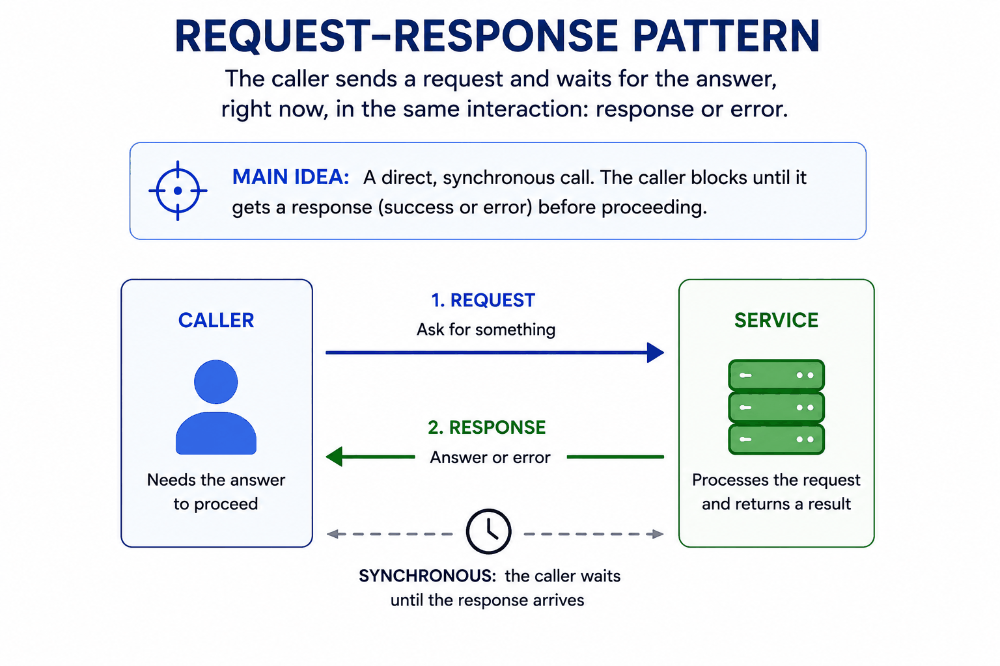
*Figure — Request-Response (course diagram)*

In the figure above, the caller (the one that "needs the answer to proceed") sends (1) a request. The service works on it, and then (2) a response or an error travels back. The clock drawn between them shows the most important property. The call is **synchronous**, so the caller is stuck for the entire round trip.

### Why it needs a lesson
Engineers who have recently discovered queues and events often use them in places that don't need them. In most systems, a plain synchronous call is the right choice for most of the traffic. Think of loading a page, running a search, checking a password, looking up a price, or authorizing a payment. When a user is sitting there waiting for the result, adding a queue doesn't make the wait go away. It only hides the wait behind extra machinery.

### What it gives you
- **You get the answer right away.** The very next line of code can use the result. You don't have to design a "we received your request, come back later" state.
- **Errors show up where you can deal with them.** If the call fails, the code that made it can retry, show a message, or fall back to something else. A background job that fails is far harder to track down, because it fails apart from the request that started it.
- **Debugging is easy.** One request travels one path and leaves one **trace** (a record of the path that request took through the services).

**One small detail with a big effect on speed: reusing connections.** Setting up a new connection is costly. It begins with **TCP and TLS handshakes**, which are setup messages that create the link and encrypt it (TCP is the protocol that gives a reliable, ordered connection between two machines; TLS is the encryption layer behind the padlock in `https`). The [System Design Fundamentals](../00-system-design-fundamentals/README.md) primer covers these building blocks in more depth. They take 1–3 network round trips, which is around 100 ms between regions. **Connection pooling** (also known as **keep-alive**) leaves connections open so that later calls can reuse them. Every HTTP client used in production supports this; make sure it's really switched on.

### What it costs
Each cost seems minor by itself, but a *chain* of calls piles them up:
- **Both sides have to be running at the same time.** If the receiver is down, the call fails straight away. This is known as **temporal coupling** (being tied together in time).
- **Availability multiplies along a chain.** Availability is the fraction of time a service answers correctly. Say an **endpoint** (one URL/operation a service exposes, such as `POST /checkout`) calls 5 services one after another, and each is 99.9% available. The endpoint only works when all five work: 0.999⁵ ≈ **99.5%**. That looks high, but it adds up to roughly **44 hours of failures a year**, and every extra dependency drags it lower.
- **Latency adds up.** **Latency** is the time one call takes from start to finish. Five 80 ms calls made one after another take **400 ms**. If the calls don't rely on each other, make them **in parallel**. Then the endpoint only waits for the slowest one (~80 ms). Turning accidental one-after-another work into parallel work is often the quickest way to speed up a slow endpoint.
- **Waiting ties up resources.** A caller that's waiting takes up a thread or a connection. At 300 requests/s, with each taking 2 s, there are 600 requests in progress at the same time, and each one holds a thread (this is Little's law from Module 1).

That's why request-response at scale needs three safeguards, each covered in its own later lesson. A **timeout** stops waiting after a deadline. **Retries** repeat a call after a short-lived failure. A **circuit breaker** stops calling a service that is obviously down.

### One question per arrow
Before you draw any arrow, ask: **does the caller's next step need the answer, *and* is someone waiting for it?** If both answers are yes, make a direct call. If not:

| Situation | Use |
|---|---|
| The next step needs the answer, and someone is waiting | Request-response |
| The work can be done later | Message Queue |
| Several services need to hear that something happened | Publish-Subscribe |
| A system at another company needs to be told | Webhooks |
| A steady flow of updates going one way | Server-Sent Events |
| Both sides keep sending | Bidirectional Streaming |

Each alternative brings its own cost. It might be a **pending state** (work that's been accepted but isn't finished yet), the chance of duplicate delivery, or a connection you have to manage. Change patterns because an instant answer *isn't needed*, not because the other option sounds fancier.

### When not to use it
- **Work that runs a long time** (longer than a few seconds). Don't make the caller wait. Accept the job, answer "job started" right away, and hand over the result later through a queue, a status endpoint, or a webhook.
- **Telling many services about one event.** If five services each need the same order update and you call each one separately, you tie them all together. Publish the event instead (see the Pub/Sub lesson).
- **Bursty work that has loose deadlines.** Bursty means it shows up in sudden spikes. If no one is waiting, handle it later through a queue (see the Message Queue lesson).
- **Chains that have become too long.** Once you have six synchronous calls in a row, availability has already fallen and latency has already climbed. Make the chain shorter, run calls in parallel, cache, or move work that can wait onto a queue.
- **The opposite mistake: going async out of habit.** Examples are putting search behind Kafka (a popular high-throughput message log), or making login event-driven. The user still waits, but now the wait goes through a **message broker** (a server that holds messages and passes them on). That adds latency and the risk of duplicates to a path that needs an answer in ~200 ms. Async is the right call when waiting is optional. It isn't "better" across the board.

### In the interview
Interviewers seldom ask about it by name. More often they point at a synchronous arrow and ask "why is this synchronous?" A full answer names what depends on it: "Checkout can't move on without the payment result, and the user is waiting. So it stays synchronous, protected by a timeout, a limited number of retries, and a circuit breaker."

**30-second answer:** "Request-response is my default for anything the caller's next step depends on: auth (authentication, checking who the user is), pricing, payment authorization, interactive reads. I get the answer immediately, errors come back where I can handle them, and tracing is simple. The costs are that both sides must be up at once, availability multiplies down a chain, and latency adds up. So I run independent calls in parallel, reuse pooled connections, and wrap every call in timeout, retry and circuit breaker. Anything nobody waits on moves to a queue or an event."

**Likely follow-ups:**
- *"Your endpoint calls five services and is slow. Fix it without going async."* Make the independent calls in parallel, so total latency drops from the *sum* of all calls to just the *slowest* one. Cache answers that hardly ever change, check that every call is truly needed, and make sure connections get reused.
- *"When do you switch a call to async?"* When no person or service needs the answer to keep going, or when the work takes longer than a connection should be held open. Going async makes the system tougher, but it also brings pending states, duplicates and questions about order. So it's a trade-off, not an upgrade.

**Mistake that fails candidates:** turning a user-facing path async (like search through Kafka), or drawing six synchronous calls with nothing protecting them. Both show you don't grasp what synchronous calls cost, or when their instant answer is worth having.

### Self-check
- **Q1: Which two questions decide sync vs async, and what costs does each sync call add to a chain?** → Does the next step need the answer, and is someone waiting for it? The costs are temporal coupling, availability that multiplies down, extra latency, and one thread held for each waiting caller. That's why timeout, retry and breaker are a must at scale.
- **Q2: Checkout makes five sequential 80 ms calls to services at 99.9% each. Latency, availability, and how to improve both without async?** → 400 ms and ~99.5% (~44 h/year of failed checkouts). Run the independent calls in parallel (~80–120 ms), cache answers that rarely change such as pricing rules, and drop calls you don't need. For availability, let optional parts of the page show less instead of breaking the whole page (this is graceful degradation).
- **Q3: A teammate wants payment authorization async "for resilience" via a `payment.requested` event. Assess it.** → It breaks the rule, because checkout needs the result and the user is waiting. It creates a pending state the product has to design for, and duplicate delivery could authorize a payment more than once. Protect the sync call instead: a timeout, retries that carry an **idempotency key** (a unique ID that lets the provider spot a repeat so it doesn't charge twice), a circuit breaker, and a plan for outages (save the cart, send an email once payment goes through). The part that should be async is the *receipt email*.

### Related patterns
- **Timeout, Retry, Circuit Breaker:** the three safeguards. Request-response at scale isn't safe unless you have all three.
- **Message Queue:** the first alternative, used for work no one is waiting on.
- **Load Balancing:** how one logical service turns into many physical servers behind a single call.
- **API Gateway:** the place where request-response traffic from outside gets authenticated and rate-limited.

### TL;DR
- **Problem:** every arrow needs a default. Teams go wrong in both directions: making things async when someone is waiting, or piling up sync calls until latency and fragility snowball.
- **Mechanism:** the caller waits for a result or an error. Pool your connections, run independent calls in parallel, and wrap every call in a timeout, retry and breaker.
- **Costs:** both sides must be up together, availability multiplies down, latency adds up (when calls run in sequence), and every waiting caller holds a thread.
- **Skip it when:** no one is waiting, the work takes too long to hold a connection open, many services care about the same event, or the chain has grown too long.

---

## Message Queue
*Original lesson: [Message Queue on DesignGurus ↗](https://www.designgurus.io/course-play/system-design-patterns/doc/6a51d49858730bac882704fb)*


### What it is
A **message queue** is a durable to-do list placed between the service that creates work (the **producer**) and the service that carries it out (the **consumer**, also called the **worker**). *Durable* means the list is saved to disk, so a crash won't wipe it out. The producer drops in a task and immediately moves on. Workers pick up tasks at whatever speed they can manage. The queue keeps each task safe until a worker says it's finished. **Analogy:** picture the ticket rail in a restaurant kitchen. Waiters clip up tickets as quickly as customers order. Cooks take them down one by one, as fast as they can cook. When there's a rush, the rail just gets longer; the kitchen doesn't blow up.

### The problem: the flash sale
The store puts 10,000 signed editions on sale at 10:00 AM. Usual traffic is 200 orders/s. At 10:00:01 it jumps to **5,000 orders/s for two minutes**. The order pipeline is synchronous. While the buyer waits, the API takes the order, reserves the stock, writes to the database, and schedules fulfillment, and only then says "success." The pipeline can handle **400 orders/s**, and that was plenty for years.

Do the math. Every second, 5,000 orders come in and 400 get finished, so **4,600 per second** are left waiting, timing out, or failing. **92% of buyers get an error page**, and when they hit refresh they pile on even more load.

The postmortem (the review after an incident) uncovers the actual problem. The pipeline could have worked through 600,000 orders from those two minutes in far less than a day. Buyers didn't need their orders fulfilled within two minutes. They needed a *confirmation* right away. But confirmation and fulfillment were fused into a single synchronous call, so every bit of fulfillment work had to beat the confirmation deadline. **That tight coupling is what caused the outage.**

### Why the obvious fixes fail
- **"Scale up for the peak."** Handling 5,000/s would mean running **12x** the usual number of servers all year long for an event lasting two minutes. On top of that, the database has its own ceiling, so the extra traffic would simply fail there instead. This shifts the **bottleneck** (the slowest part, which limits how much gets through) rather than getting rid of it.
- **"Buffer orders in memory."** The API holds a list and slowly works through it. That's an unsafe queue, though. If the process crashes, paid orders vanish. Other API servers can't see the list. And monitoring can't see how big it is until memory runs out.
- **"Reject the extra traffic."** Anything above 400/s gets "too busy, try later." That's okay for traffic that doesn't matter much. Here, though, it sends away **9 of 10 customers** during the quarter's biggest sale, for work the pipeline could safely have done an hour later.

All three fixes assume this is a capacity problem. It's really a **coupling** problem. Two things that should run on their own schedules (orders coming in, orders being processed) were forced to go at the same speed every single second.

### How it works
There are four mechanics, and each one answers a "what if it fails?" question:

1. **The queue saves the message before it confirms.** The **broker** (the software that runs the queue) writes every message to disk, and *only after that* tells the producer it got it. From then on, a crashed worker, a **deploy** (rolling out a new version of the software, which restarts its servers), or an hour of downtime can't make the work disappear.
2. **Workers confirm when they finish, not when they start.** A worker grabs a message, does the job, and then sends an **ack** (acknowledgment). If the worker crashes in the middle of the job, no ack comes. Once a set **visibility timeout** passes, the broker gives the message to another worker. *Consequence:* a worker could finish the job and then crash right before sending the ack. The broker can't distinguish that from a crash halfway through, so it sends the message again and the job runs twice. That's **at-least-once delivery**: each message shows up one or more times, but never zero times. Protecting against lost work leads to the occasional repeated job, so every consumer needs to be **idempotent**.
3. **Many workers pull from the same queue (competing consumers).** Each message goes to just one worker. Want more **throughput** (messages finished per second)? Add more workers. You don't need to write any special coordination code.
4. **Queue depth tells you how healthy things are.** **Depth** is the number of tasks waiting (what's arrived minus what's been finished over time). If depth climbs during a brief spike, the buffering is doing its job. If depth climbs for a *week*, you have a capacity problem.

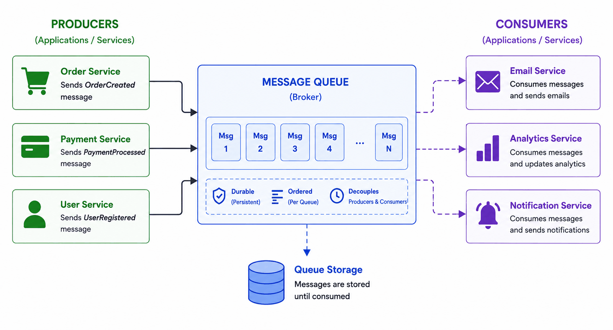
*Figure — Message Queue (course diagram)*

In the figure above, several producers (the order, payment and user services) drop messages into the broker. The broker stores them durably ("Queue Storage: messages are stored until consumed") and passes them out to consumers at whatever pace the consumers can handle. The three properties in the dashed box, **durable, ordered (per queue), decouples producers and consumers**, are the whole reason for the pattern.

Taken together, these mechanics pull apart three concerns that the synchronous design had stuck together:
- **Rate:** producers can burst up to 5,000/s while workers keep a steady 400/s.
- **Time:** workers can be down, in the middle of a deploy, or not built yet; the work just waits.
- **Failure:** when a worker crashes, the message is redelivered rather than lost, and the producer never even knows.

The sequence below shows exactly where the duplicate comes from:

*Ack and redelivery producing at-least-once delivery*
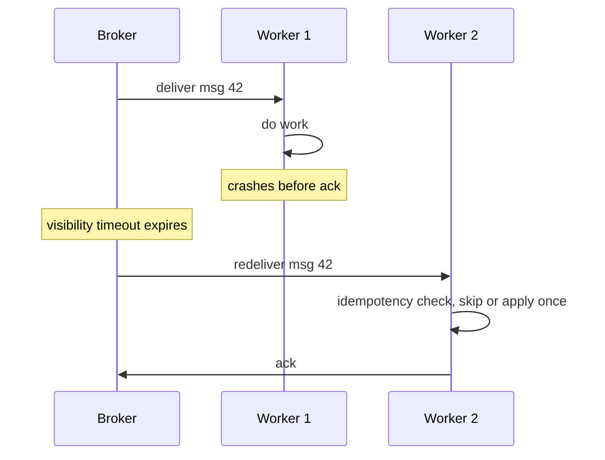

Worker 1 finished the work but died before it could ack. The broker gets no ack before the visibility timeout runs out, so it sends message 42 again, this time to Worker 2. Worker 2's idempotency check makes sure the work only takes effect once.

### Walkthrough with numbers
Run the flash sale again, this time with a queue between the API and the pipeline:
- **10:00–10:02.** 5,000 orders/s come in. For each one, the API checks it, puts it on the queue, and answers "Order confirmed" in **~50 ms**. The queue grows by 4,600/s. Over 120 s, that builds a **backlog** (work that's accepted but not done yet) of ~**552,000 messages**, which sit cheaply on disk.
- **10:02–10:25.** The workers keep going at 400/s. Time to clear it: 552,000 / 400 = **1,380 s ≈ 23 minutes**. Some orders start fulfillment 20 minutes after they were bought, but the confirmation only promised "ships today." The business signed off on this delay ahead of time, so it's a design choice, not a failure.
- **10:07, the failure drill.** A worker dies partway through a message. Its visibility timeout runs out, another worker picks the message up, and the idempotency check keeps the half-finished work from being applied twice. Not a single order is lost.
- **The bill.** A queue service that costs pennies per million messages takes the place of a 12x server fleet.

The big takeaway: the queue added **no** processing power at all. What it did was remove the rule that processing had to keep up with arrivals second by second. The business never actually needed that rule.

### Trade-offs
**You gain:**
- Spikes turn into a backlog instead of errors. The limit becomes disk space, not your slowest service.
- A worker outage turns into a longer to-do list, not an outage. Deploys stop being scary.
- Producers and workers can scale on their own, and queue depth is a ready-made signal for **autoscaling** (adding or removing workers automatically).
- Redelivery gives you retries without writing any retry code.

**You pay:**
- **Latency, on purpose.** Work gets done seconds or minutes later, so anything a user is actively waiting on shouldn't go on a queue.
- **Duplicates.** Idempotent workers are required, not optional.
- **Lost ordering.** With 20 workers, messages can finish in a different order from how they came in. Ordering by key (explained below) helps, at some cost to throughput.
- **A gap between "accepted" and "done."** The order is confirmed before fulfillment begins, so the product team has to decide what users see in the meantime.
- **More to run.** You need a broker, monitoring of depth and message age, a **dead letter queue (DLQ)** for messages that keep failing (it has its own lesson), and debugging that jumps across systems instead of following one **stack trace** (the list of function calls a program prints when it errors).

**Ordering, in more detail:** split the work up by a key. Kafka's **partition key** or SQS FIFO's **message group** (SQS is Amazon's managed queue service; FIFO means "first in, first out," i.e. it keeps order) sends all of one customer's messages to the same **partition** (a slice of the queue that keeps its own order). Each customer's messages stay in order, while different customers are still processed in parallel. The costs: one very busy customer can go no faster than a single partition allows, a stuck message blocks everything in its partition, and moving a failed message to the DLQ can break strict order.

**Depth that keeps growing for days** means more work arrives than you can ever handle. Raising the storage limit only pushes the failure back. Add capacity or fix the bottleneck, drop or reprioritize work, and alert on the **oldest message's age**, because that's the delay users actually experience.

### When not to use it
1. **The caller needs the answer.** Login, price lookups, search results: the user is sitting there waiting. No one wants their search results sent by email.
2. **Tight deadlines from start to finish.** If the whole operation has to be done within ~200 ms, a trip through the broker plus a wait for a worker adds risk without any useful separation.
3. **Small, simple systems.** At ~10 requests/s, don't put a broker between two functions. Just call the function until scale, spikes or failure boundaries give you a real reason.
4. **As a database.** A queue moves work around; it isn't a place to store data you can query. If messages need to be searched, changed, or kept forever, use a database.
5. **Covering up a permanent lack of capacity.** Queues soak up short bursts. They don't create capacity.

### Message Queue vs Publish-Subscribe
Both rely on a broker and deliver asynchronously, so people mix them up. But they answer different questions:

| | Message Queue | Publish-Subscribe |
|---|---|---|
| A message is | A job: work that should happen once | A fact: something that happened |
| Delivered to | Exactly one worker | Every subscriber, each on its own |
| Adding a consumer | Adds more workers for the same job | Adds another use for the same fact |
| Question it answers | "Who does this task?" | "Who cares that this happened?" |

"Resize this image" is a single job for a single worker, so it goes on a queue. "An order was placed" is a fact that fulfillment, email, analytics and fraud each need on their own, so it's pub/sub. The two fit together nicely: publish the fact once, and feed it into a separate work queue for each team (AWS **SNS → SQS**, where SNS is Amazon's managed pub/sub service; Kafka **consumer groups**, where each group is a named set of readers that together get one full copy of the stream).

### Real-world examples
- **AWS SQS:** the pattern in its simplest form. It has visibility timeouts, dead-letter support, almost unlimited depth, and costs pennies per million messages.
- **RabbitMQ:** the classic broker you run yourself. It adds rich routing options on top of the same ack-and-redeliver core.
- **Kafka:** strictly speaking it's a **replicated log** (a record you can only add to, copied across machines), not a queue, but its consumer groups act like a queue. Because it can **replay** old messages, it drives event-driven architecture and stream processing later in the course.
- **Celery, Sidekiq, BullMQ:** the pattern wrapped up as libraries for applications. This is where most engineers first run into it.
- **For AI engineers:** GPU work (on the graphics chips that run AI models) is costly, comes in bursts, and is seldom urgent, which makes it perfect for queues. Examples include embedding pipelines (turning text into lists of numbers called **embeddings** that capture meaning), **batch inference** (running a model over many inputs at once), **fine-tuning** (further training an existing model on your own data), and evaluation runs. Queue depth, or even better **oldest-message age**, is the usual signal for autoscaling GPUs. **RAG** (retrieval-augmented generation: fetching relevant documents and handing them to the model with the question) ingestion pipelines use a queue with a DLQ to catch failures. The **batch APIs** from Anthropic and OpenAI sell exactly this trade-off: it's cheaper if the work is allowed to finish later.

### In the interview
It comes up in prompts like "handle a 10x traffic spike" or "design an order pipeline." It also comes up when the interviewer points to a sync arrow and asks "does the user need to wait for this?" If the answer is no, that work might belong on a queue.

**30-second answer:** "I put a durable queue between the API and the pipeline. The API validates, enqueues, and confirms in milliseconds. Workers process at a sustainable rate, so a 5,000/s spike becomes backlog instead of errors. The broker saves each message before confirming and redelivers if a worker dies. That's at-least-once, so consumers are idempotent and repeatedly failing messages go to a monitored DLQ. Depth drives autoscaling and alerts. The trade is latency, which works only because the business agreed fulfillment can take minutes. Anything the user waits for stays synchronous."

**Likely follow-ups:**
- *"A worker crashes halfway through a message. Walk me through it."* The visibility timeout runs out, the broker gives the message to a different worker, and idempotency stops the effect from happening twice. If the message fails several times in a row, it gets moved to a DLQ and an alert goes off.
- *"Orders for the same customer must be processed in order. Now what?"* Partition by customer ID (a Kafka partition key or an SQS FIFO message group). Each customer's order is kept, while different customers are handled in parallel. One catch: a single very busy customer is held to the capacity of one partition.

**Mistake that fails candidates:** putting a queue on a path the user is waiting on (like search through Kafka), or suggesting a queue without saying how duplicates are handled. The first shows you don't get *why* queues exist. The second ignores at-least-once delivery.

### Self-check
- **Q1: Name the three ways a queue decouples producer and consumer, and explain step by step where at-least-once delivery comes from.** → Rate (bursts in, steady processing out), time (work waits while workers are down), and failure (a crash leads to redelivery, not loss). Workers only ack once they've finished. So the broker has to redeliver in two cases: a job that got interrupted, and a job that finished but whose worker died before acking. That second case is what creates the duplicate.
- **Q2: Depth has grown steadily for six days; a teammate proposes raising the storage limit. What is depth telling you, and why is that a trap?** → More work is coming in than you can ever process; the oldest message is already six days late. A larger limit just delays the failure. Add worker capacity or fix the bottleneck, cut down or reprioritize incoming work, send some work elsewhere, and alert on oldest-message age.
- **Q3: Charges and refunds for a customer share a queue with 20 workers; a refund got processed before its charge, leaving a negative balance. Explain and fix without losing parallelism.** → Two different workers picked up the two messages, and the refund happened to finish first (with many workers, overall order is lost). Partition by customer ID so each customer's messages run one after another while different customers still run in parallel. The costs: a hot customer is limited to one partition, a stuck message blocks its partition, and moving messages to the DLQ can break strict order, so some streams need to pause and be repaired instead.

### Related patterns
- **Idempotency:** the one thing a queue can't do without, since every consumer can receive a retry.
- **Dead Letter Queue:** where messages end up once redelivery gives up.
- **Retry with Exponential Backoff:** redelivery *is* retrying, just done by the broker. Use that lesson to tune how many attempts and how long the delays are.
- **Publish-Subscribe:** the matching pattern for facts. It's often combined with queues by copying one event into a queue for each team.
- **Auto-Scaling:** queue depth and backlog age are about the clearest scaling signals you can get.

### TL;DR
- **Problem:** a synchronous pipeline makes work happen as fast as it arrives, so a spike turns into an outage even when there's plenty of capacity overall.
- **Mechanism:** a durable task list between producer and consumer. Save before confirming, give each message to one worker, redeliver after a crash, and drain at whatever pace the workers can manage.
- **Costs:** latency by design, duplicates (so idempotency is required), no overall ordering, a gap between accepted and done that you have to own, and a broker to run.
- **Skip it when:** the caller needs the answer right now, the deadline from start to finish is tight, the scale doesn't justify a broker, or you'd be covering up a permanent shortage.

---

## Publish-Subscribe
*Original lesson: [Publish-Subscribe on DesignGurus ↗](https://www.designgurus.io/course-play/system-design-patterns/doc/6a51d4d85fbac9ebdf715829)*


### What it is
With **publish-subscribe (pub/sub)**, a producer announces a fact one time to a named channel, called a **topic**. It doesn't know or care who is listening. The broker hands a separate copy to every **subscription**. Each subscriber works through its own copy at its own speed and deals with its own failures. **Analogy:** think of a newspaper. It prints each edition once. Every subscriber gets a personal copy delivered and reads it whenever they want. The paper has no need to know what each reader does with it. When a new reader wants in, they just subscribe, and nothing changes in the newsroom.

### The problem: checkout delivering to five teams
Once the queue solved the flash sale, other teams started asking for order data. Email wanted it for receipts. Then analytics, fraud and loyalty asked too. Each request added one more "send to this team's queue" call inside checkout. After eighteen months, checkout writes to **five queues** one after another, and this causes three ongoing problems:
1. **Each new consumer requires a checkout deploy.** Checkout is the company's most important money-making service. Yet every team's request for data now means changing it and redeploying it, so its release schedule holds everyone up.
2. **A crash leaves teams with mismatched data.** Last Tuesday, checkout crashed after writing to 3 of 5 queues. Fulfillment shipped the order, but fraud never saw it. Five separate writes can't all succeed or all fail together as one unit. So a crash can leave any mix of teams without the event.
3. **Other teams' troubles turn into checkout's troubles.** When loyalty's queue was slow for an hour, checkout's five back-to-back writes got slow as well.

Next, data science wanted *historical* order events to train models. They had to open a **pull request** (a proposed code change submitted for review) against checkout and wait for a release. When the producer has to hand-deliver to every consumer, each new consumer brings extra work, risk and coordination. That approach doesn't scale across many teams.

### Why the obvious fixes fail
- **"It works; keep adding queues."** It does run. But checkout ends up owning every connection, every retry policy and every delivery guarantee. And each extra write raises the odds that a crash leaves consumers out of sync.
- **"Let teams read the orders database directly."** Now five teams rely on the exact shape of the table. A future **schema migration** (changing the table's structure, e.g. renaming or removing columns) could quietly break dashboards and models that checkout doesn't even know about. Their constant **polling** (asking "did anything change?" over and over) also puts load on the production DB. **Change data capture (CDC)** turns the database's change log into a stream of events; it's the careful, controlled way to do this. Uncontrolled table access has none of CDC's safety.
- **"One shared queue that everyone reads."** A queue hands each message to just **one** worker. If fraud, email and analytics all share it, each one gets a random slice of the orders, and no error shows up anywhere. Every team quietly works with incomplete data.

The teams don't need five jobs. They each need their own access to a single *fact*: an order was placed. So publish it once.

### How it works
1. **The topic** is a named stream of facts, for example `order.placed`. Checkout publishes one time and moves on. The broker makes **one durable write** (saved to disk before it confirms), no matter how many teams are listening. Since there's just one write, a crash can't leave some destinations with the event and others without it.
2. **A subscription** is one team's own separate copy of the stream. It acts like that team's private queue. It has its own backlog, its own spot in the stream (the **offset**), and its own acks, redeliveries and DLQ. If fraud is offline for an hour, only fraud's backlog grows. Email and checkout keep going.
3. **Joining takes configuration, not code.** Data science sets up a subscription without touching checkout at all. Brokers that keep history (such as Kafka) let a new subscriber **replay** old events. For example, they can train on months of data and then switch over to live traffic.
4. **The event format turns into a public contract.** Consumers you don't know about will treat its fields like an API. So publish **facts, not commands**: "an order was placed, here are the details," not "send a receipt." The publisher says what happened, and each consumer decides what that means for it. Keep changes **additive**. Adding new optional fields is safe. Renaming or removing fields breaks subscribers you can't see. A **schema registry** checks event formats before they go out.

The main idea: the producer states *what happened*, and each consumer decides *what it means*. Checkout doesn't even have to know that receipts exist.

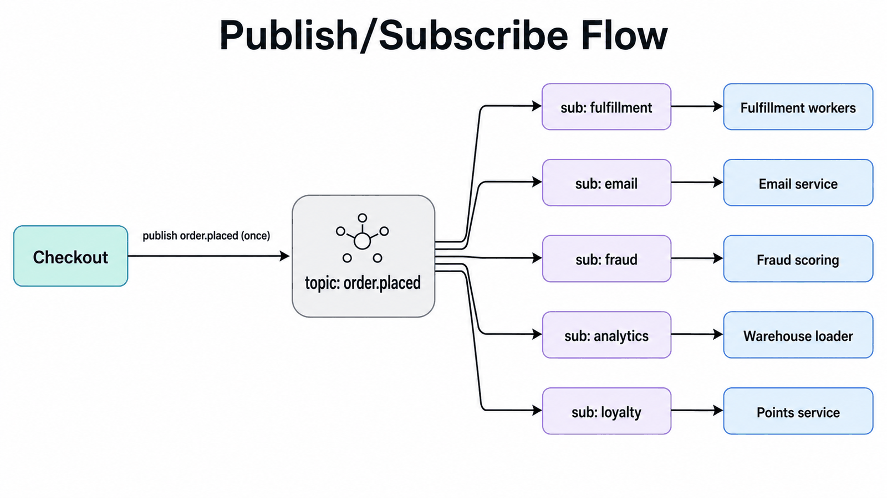
*Figure — Publish-Subscribe (course diagram)*

In the figure above, checkout publishes `order.placed` **once** to the topic. The broker then fans it out to five separate subscriptions (fulfillment, email, fraud, analytics, loyalty), and each one feeds its own service. To add a sixth team, you add one more subscription box on the right. Nothing on the left has to change.

### Walkthrough with numbers (200 orders/s)
- **Cost of publishing:** before, there were five queue writes one after another, taking ≈ **25 ms** and getting longer with every new team. After, there's one durable write taking ≈ **5 ms**, and it stays flat however many subscribers there are.
- **The data-science request:** the subscription is set up in an afternoon with no change to checkout. The topic holds **30 days** of history, so they replay ~**500 million** old events for training before going live. Before, the same request needed a PR plus a release cycle, and came with *no* history at all.
- **Failure drill:** fraud is offline for **40 minutes**. Its subscription piles up 200 × 2,400 s = **480,000 events**, which get processed once it's back. Email sends every receipt on time, and checkout isn't affected. In the old design, fraud's outage would have either slowed down checkout or lost 40 minutes of events.
- **The audit passes now:** each subscription can report whether it processed order X, still has it waiting in the backlog, or sent it to the dead letter queue.

### Trade-offs
**You gain:**
- The producer's cost and risk stay the same no matter how many consumers there are.
- Teams release on their own schedules. This separation between teams is the biggest benefit in practice.
- Failures stay inside one subscription. With history kept around, new consumers can start with the whole past.

**You pay:**
- **The event format has become a public API.** Renaming a field can break consumers you've never heard of. Instead of being tied together at deploy time, teams now need *contract discipline*: a schema registry, changes that only add, and **deprecation windows** (a fixed period during which the old version still works).
- **Duplicates, times N.** Each subscription is at-least-once on its own, so five subscribers means five places that all have to be idempotent.
- **Hidden coupling.** The dependencies are still there, but they no longer show up in the producer's code, so teams lose track of who uses what. Mature organizations keep a **subscriber catalog**. It lists each topic's owner, **schema** (the agreed shape of the event's fields), **retention period** (how long old events are kept), and **data classification** (how sensitive the data is), plus the owner of every subscription. This makes schema changes, incidents and deletion requests manageable, and it reveals consumers nobody is maintaining anymore.
- **No "all done" signal.** Each subscription only knows how far it has gotten. So pub/sub can't tell you "order X is fully processed." When inventory, payment and shipping must all finish before you can call it a success, something has to act as a coordinator and track them (see orchestration below).
- **Slow consumers can lose data.** Brokers only keep history for a **retention window**. A subscriber that falls further behind than that window loses events forever. Alert on backlog age long before retention runs out, so there's time to add capacity or rebuild from another trusted copy.

Rule of thumb: **broadcast across services, compete within a service.** When a schema change truly has to break things, publish v2 next to v1 for a deprecation window.

### When not to use it
1. **It's a job, not a fact.** "Resize this image" is one task for one worker, so use a queue.
2. **The producer needs the result.** Checkout can't move on without knowing if the payment was authorized, and publishing `payment.requested` doesn't fix that. Use request-response or an orchestrated workflow.
3. **Two services and little traffic.** One producer and one consumer only need a plain queue between them, which is simpler.
4. **Request-response rebuilt out of events.** Pairing `user.lookup.requested` with `user.lookup.completed` just recreates a synchronous call, but with more latency and harder debugging. Seeing the word "request" in an event name is a warning sign.

Across a big organization, pub/sub without management turns into **topic sprawl**: hundreds of topics with no owners, no schema rules and no visible consumers. If you take away the required coordination between teams, you have to put explicit contracts and a catalog in its place.

### Choreography vs Orchestration
Pub/sub makes **choreography** possible. Each service reacts to events on its own, and the overall process *emerges* from how they all behave together. **Orchestration** instead uses a single coordinator that runs the workflow one step at a time.

| | Choreography (pub/sub) | Orchestration (coordinator) |
|---|---|---|
| Who's in control | No one in the middle; the behavior emerges | The coordinator, openly |
| Adding a step | A new subscription, no coordination needed | Change the coordinator's workflow |
| "Is order X fully processed?" | No single place has the answer | The coordinator knows, by design |
| Failure handling | Each consumer deals with its own | The coordinator retries, undoes, or escalates |
| Best for | Reactions that don't depend on each other (analytics, email, indexing) | Steps that depend on each other (inventory → payment → shipping) |

Decide by asking if the steps are really independent. Email and analytics don't care what order the other runs in, so choreography fits them. Reserving inventory, charging the payment, shipping, and undoing earlier steps when something fails make up a dependent workflow. The **Saga** lesson covers how to orchestrate that. Lots of systems use both: they orchestrate the order workflow and publish facts from each stage for independent consumers.

### Real-world examples
- **AWS SNS → SQS:** the pattern built from managed pieces. SNS is the topic, and each team's SQS queue is its subscription. It broadcasts first, and then each team has its own task list.
- **Kafka:** every consumer group is a separate subscription reading a stored log. That gives you broadcast, replay and per-team queue behavior in a single system, which is why Kafka dominates.
- **Google Cloud Pub/Sub:** the same model, fully managed. Subscriptions are objects you create and manage yourself.
- **Redis Pub/Sub, the warning story:** it's fire-and-forget. If a subscriber is offline, the message is lost forever. "Pub/sub" without durable subscriptions is a much weaker promise wearing the same name, so always check which kind you're getting.
- **For AI engineers:** a `user.interacted` topic often powers an entire ML platform. It feeds the analytics warehouse, a **feature store** (a service that holds the input features for models), jobs that refresh embeddings, and real-time features for a recommender. It also keeps replayable history for future models. Agent platforms publish each tool call and decision once, so observability, evaluation and audit systems can read them without slowing the agent down.

### In the interview
It can be asked straight out ("how should five teams get order data?") or sideways ("a sixth service needs this too"). If you keep drawing yet another arrow out of the producer each time, that signals coupling that keeps growing. Interviewers may also check whether you wrongly use choreography for a dependent order→payment→shipping flow that really needs orchestration.

**30-second answer:** "Checkout publishes an `order.placed` fact to a topic, once. Each team gets its own subscription with its own backlog, retries and DLQ, so a slow or crashed consumer affects nobody else. Adding a consumer is configuration, not a checkout deploy, and with Kafka the newcomer can replay history. What I manage: the schema is now a public API, so changes are additive and registry-checked; every subscription is idempotent; and I alert on backlog age so no one falls past retention. If the steps are really a workflow needing completion tracking, I orchestrate that part."

**Likely follow-ups:**
- *"One subscriber runs at half the speed of the others. What happens?"* Only that subscriber's backlog grows; the rest aren't affected. If its backlog goes beyond retention, events are lost for good. Watch backlog age and scale that subscription with competing consumers (which is the queue pattern used inside a single subscription).
- *"How do you change a schema without breaking consumers you don't know about?"* Only ever add optional fields; never rename or remove anything. A schema registry blocks builds that would break things. For a change that truly breaks compatibility, publish v2 next to v1 for a deprecation window. Keep a consumer catalog so you know who depends on what.

**Mistake that fails candidates:** hooking several services up to one shared queue and calling that broadcast (each one only gets a sample), or rebuilding request-response out of paired events. Both mix up jobs and facts.

### Self-check
- **Q1: Topic vs subscription, and what does adding a sixth consumer cost the producer?** → A topic is a single durable stream of facts. A subscription is one consumer's own feed, with its own position, backlog, acks and DLQ. The cost to the producer is nothing: no code, no deploy, no added latency, and it doesn't even need to know. The new consumer is responsible for idempotency and for watching its backlog, and the system now has one more dependency on the schema.
- **Q2: Argue against "pub/sub decouples services."** → Consumers are still tied to the event schema, so changing a field can break systems the producer can't see. Pub/sub shifts the coupling out of the release schedule and into a data contract. That contract has to be governed with a registry, additive changes, deprecation windows, a consumer catalog, and named owners for subscriptions.
- **Q3: Fraud scores ~20% of orders and email sends ~30% of receipts, yet nothing was lost and publish counts match orders. Diagnose.** → The services are sharing one subscription/queue, which turns them into *competing* consumers, so each event reaches only one of them. Give every service its own subscription, and only use competing consumers among the workers of a single service. *Broadcast across services, compete within a service.*

### Related patterns
- **Message Queue:** each subscription basically is one; SNS → SQS puts the two together directly.
- **Idempotency:** N subscribers means N chances to apply something twice.
- **Event-Driven Architecture:** the next lesson. Pub/sub is how events travel; EDA decides what goes inside them.
- **Change Data Capture:** turns a DB's change log into events. It's the careful version of "just read my tables."
- **Webhooks:** the same idea, but between companies, over plain HTTP, with the guarantees worked out again.

### TL;DR
- **Problem:** when the producer delivers to every consumer on its own, each new team means producer deploys, slower fan-out, and partial crashes where some teams get the event and some don't.
- **Mechanism:** publish each fact once to a topic. Every subscription gets its own full copy, backlog, retries and DLQ. Subscribing is just configuration, and log-based brokers add replay.
- **Costs:** the schema turns into a public API, duplicates in every subscription, coupling that becomes invisible without a catalog, no signal for "done," and retention as a hard limit.
- **Skip it when:** it's a job (use a queue), the producer needs the result (use request-response/orchestration), or it's really a step-by-step workflow (use a saga).

---

## Event-Driven Architecture
*Original lesson: [Event-Driven Architecture on DesignGurus ↗](https://www.designgurus.io/course-play/system-design-patterns/doc/6a51d7d370ea832bea95b157)*


### What it is
**Event-driven architecture (EDA)** means services talk to each other mostly through events. Its core design question is: **how much information should each event hold?** Should it hold enough that consumers can act by themselves, without calling the producer back? **Analogy:** an order ticket that only says "Order #7f3a" makes the cook walk out to the front desk to ask what was ordered. A ticket that says "3 items, $142, ships to Austin" lets the cook get straight to cooking. Pub/sub settled *how* events get delivered. This lesson settles *what goes inside them*.

### The problem: the callback storm
Pub/sub did its job: checkout publishes `order.placed` one time, and five teams subscribe. But every event held only `{event: "order.placed", order_id: "ord_7f3a"}`. That's a **notification**. It says an order exists and nothing else. So fraud got the event and then called `GET /orders/ord_7f3a` to find the amount and items. Email, analytics, loyalty and fulfillment did the same (and fulfillment did it twice by accident). **Every event checkout published bounced back at it as five API calls.**

At the next flash sale, 5,000 orders/s turned into 5,000 events/s, which turned into **25,000 GET requests/s** against checkout's API. That happened right during the spike the queue was supposed to soak up. Checkout's read service went down, consumer calls timed out, retries added even more load, and fraud scoring fell minutes behind during the time of year with the most fraud.

The communication was asynchronous now, yet the old load came right back. The reason: events said *that* something happened but not *what* happened. This is **asynchronous delivery wrapped around a synchronous dependency**, not true event-driven design.

### Why the obvious fixes fail
- **"Cache the lookups."** Every consumer asks about each new order right away, and that order didn't exist a second before. So all five miss the cache at the same moment and hit the API anyway. They also still need checkout to be up.
- **"Slow the consumers down."** Rate-limiting consumers shields checkout. But then every team downstream can only work as fast as checkout allows. Backlogs grow during the bursts that matter most, and fraud detection becomes limited by checkout's capacity. The dependency is only postponed, not removed.
- **"Could we just put the details in the event?"** Yes, and that's exactly the pattern. Copying data does have real costs (covered below). But the first two ideas only make callbacks cheaper, while complete events make callbacks unnecessary.

### How it works: three levels of event content
```
  Level 1: Event Notification     "Order ord_7f3a was placed." → consumers call back
  Level 2: Event-Carried State    "Order ord_7f3a: 3 items, $142, customer c_91,
           Transfer                ships to Austin." → consumers act without calling
  Level 3: Event Sourcing         The events ARE the data; state is rebuilt by replay
```
- **Level 1, notification.** The event says something happened and sends consumers somewhere else for the details. Events stay small and no data gets copied. But this is precisely what caused the callback storm.
- **Level 2, event-carried state transfer.** The event includes the facts that consumers need. Each consumer keeps a **local view**, which is a small table with just the fields it cares about, kept up to date from events. Fraud stores the order fields it uses for scoring and reads them locally in **under a millisecond**, even while checkout is down. Consumers are no longer callers; they own *copies they can throw away*. **This is the sensible default in practice.**
- **Level 3, event sourcing.** The event log *is* the **system of record** (the official data), and tables are rebuilt from it. That's a decision about storage, it has its own lesson, and you don't need it to fix a callback storm.

**Three rules for Level 2:**
1. **Events are facts, never commands.** Publish "order placed," not "send a receipt." A command ties the publisher back to one particular consumer's job, which defeats the whole point of a topic.
2. **Local views are copies, never the truth.** Any view can be wiped and rebuilt by replaying the topic's history, and checkout stays the official owner. **Each fact belongs to exactly one owning service.** If a consumer spots a wrong value, it must not fix it in its own copy, because that creates a rival version of the truth. Instead, it sends a command to the owner. The owner checks the change and publishes a new fact, so every view gets corrected the same way.
3. **Freshness is about "when," not "if."** A local view is always a little behind the source. Usually that's milliseconds, but during a backlog it can be minutes. This is called **eventual consistency**: all the copies agree *once* the updates finish spreading. Make the delay visible. Store the source version or event timestamp in each view, publish view age as a metric, show an "as of" time on screens like support dashboards, and alert when a view goes past its agreed freshness limit (its **freshness SLO**, where SLO means service-level objective).

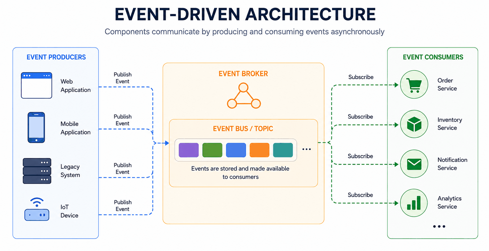
*Figure — Event-Driven Architecture (course diagram)*

The figure above shows the overall shape. Many producers (a web app, a mobile app, a **legacy system** (an older system still in use), an **IoT** device ("Internet of Things": a small networked gadget such as a sensor)) publish events into a broker's event bus/topic, where they're stored and made available. Consumers (the order, inventory, notification and analytics services) subscribe and react asynchronously. With Level 2 events, no consumer on the right ever has to call back to a producer on the left.

The mermaid diagram below compares the two levels you'll actually use:

*Callback storm vs local views*
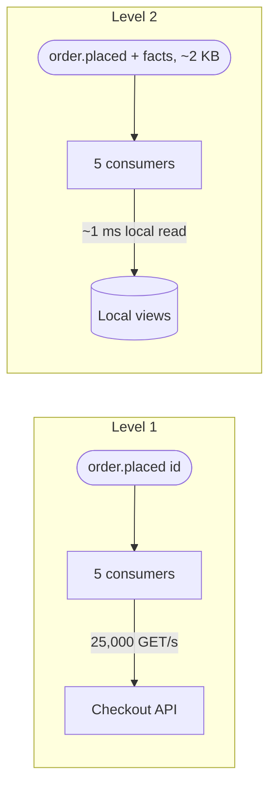

At Level 1, an event with only an ID becomes 25,000 GET/s hitting checkout. At Level 2, a ~2 KB event carrying the facts lets those same five consumers read from their own local views in about 1 ms.

### Walkthrough with numbers
- **The event gets bigger**, from ~100 bytes to ~**2 KB**. At 5,000 events/s, the broker moves **10 MB/s**, which is a small load for a production broker. In return, the **25,000 GET/s vanish**. You trade a bit of bandwidth for independence.
- **Checkout's read traffic stays flat during the sale.** With no callbacks, its API can serve real users.
- **Fraud reads locally in ~1 ms** rather than making a 50 ms network call wrapped in a timeout and retry. During the busiest hour, its speed and availability no longer rely on checkout.
- **A new consumer replays the history.** With 30 days of retention, that's ≈ **500 million events**, replayed in a few hours to build its view before it goes live. Without replay, it would have to **backfill** (load all the past data in one go) through checkout's API and add a lot of load.

### Trade-offs
**You gain:**
- Independence. Consumers read locally, keep running when the producer is down, and never flood anyone with callbacks.
- Load on the producer that doesn't depend on how many consumers there are or what data they want.
- Views you can rebuild from history, so recovering a view and onboarding a new one are the same thing: a replay.

**You pay:**
- **Copies all over the place.** Six services might each hold order data in six different shapes. Storage is cheap, but everyone has to remember the copies can be thrown away and the owner is the authority.
- **Eventual consistency, all the time.** Products have to cope with things like a support dashboard showing data that's 40 seconds old.
- **Personal data spreads out.** If a customer's email goes into an event, it gets copied into every subscriber and into the retained topic. A deletion request then has to clean up **N+1** places. Decide this *before* you publish: include only facts that many consumers need, label sensitive fields, and record the owner of every subscription. Encryption protects **data at rest** (data sitting in storage, as opposed to travelling over the network), but it doesn't remove the need to delete or limit copies you don't need. A field added for convenience can turn into a long-term legal obligation.
- **The schema matters even more.** Bigger events expose more public fields, so a registry, additive-only changes and a consumer catalog become a must.
- **Debugging gets harder.** Every service has its own timestamped version of order X. **Correlation IDs** (one ID that tags the same business request across events and logs) and **distributed tracing** (recording a request's path and timing across every service it touches) become essential.
- **Replay has to be safe to run again.** Rebuilding a view must never resend emails or charge cards again. Keep *state-building* consumers separate from consumers that *cause side effects*, and test replay against production-sized history before you count on it during an incident.

### When not to use it
- **Inside a single service.** The functions in a **monolith** (one big application deployed as a single unit) already share **transactions** (groups of changes that succeed or fail together) and consistency. EDA is for the boundaries between services and teams.
- **When a read has to be exactly up to date.** Selling the very last item in stock or approving a withdrawal needs the latest value. Send those reads synchronously to the owning service, and use local views for data that's allowed to lag.
- **Request-response rebuilt from events.** Events full of state don't help a flow that is still a synchronous dependency underneath.
- **Before the team is ready for it.** Without schema enforcement, tracing and backlog alerts, EDA is hard to run. Until those exist, fewer services with direct calls may be the safer choice.
- **As a way to dodge deciding who owns what.** If six services keep views but nobody owns the fact, the copies drift apart and there's no official answer.

### Notification events vs Full-state events

| | Notification (Level 1) | State transfer (Level 2) |
|---|---|---|
| Event contains | Only an ID ("go look it up") | The facts themselves |
| When a consumer needs data | It calls the producer | It reads its own local view |
| Producer read load | Rises with how much consumers ask | Zero |
| Copies / privacy exposure | Minimal | Every subscriber + the retained history |
| Freshness | The lookup is always current | Views run slightly behind |
| Best when | Only a few consumers need details; the data is sensitive | Many consumers need the same data; independence matters |

A sensible middle path is to decide **one field at a time**. Put fields that many consumers need into the event, and leave sensitive or rarely used fields with the owner, reachable through an ID lookup.

### Real-world examples
- **LinkedIn** created Kafka for exactly this. Activity events formed one big stream, and every team read it to keep its own view. Kafka's nickname, "central nervous system," began there.
- **Uber:** a trip exists as a stream of events well before it becomes a database row. Pricing, ETA (estimated time of arrival) prediction, fraud and driver payments each read that stream on their own.
- **Bank ledgers:** a very old form of this pattern. Transactions are facts that never change, and your balance is a view calculated from them.
- **Netflix:** viewing events travel through a central stream into recommendations, artwork personalization and capacity planning.
- **For AI engineers:** full-state events keep model features up to date without API callbacks. A feature store's online values get updated from interaction events. A **vector index** (a search index over embeddings that finds items with similar meaning) re-embeds content when a `content.updated` event arrives carrying that content. Training pipelines use the retained history as a dataset (it's the same replay that sets up a **microservice**, a small service that owns one narrow job). A recommender can see a purchase within **200 ms** without ever calling checkout.

### In the interview
They might ask "how does service B get A's data without calling A?" More often, once you draw a topic, they'll ask **"what's in the event?"** That choice decides how much callback load there is, how independent consumers are, and how far personal data spreads.

**30-second answer:** "The event's contents are the main design decision. Thin notifications make every consumer call back, so coupling and load return. For widely consumed facts I put the state in the event, and each consumer keeps a local view: updated from the stream, rebuildable by replay, fast to read, available when the producer is down. Every view is eventually consistent, so exactly-current reads go synchronously to the owner. Sensitive fields stay out or get encrypted. The larger schema is a registry-governed public API. And one service owns each fact; views are copies, never the truth."

**Likely follow-ups:**
- *"A support agent updates an order but doesn't see the change on their dashboard. Why, and what do you do?"* The dashboard reads from a local view that hasn't caught up with the write yet. You have options. Show an "as of 12:04:31" timestamp. Give the writer **read-your-writes** behavior, which means sending their next read to the source. Or wait until the view reaches the version of that write. Choose the guarantee screen by screen.
- *"A user invokes their right to be deleted; their data is in a 30-day retained topic and six local views."* Delete it from the owning store and publish a **tombstone**, which is a special event telling every view to wipe that user. If the retained history has to be gone before it would expire naturally, use **crypto-shredding**. You encrypt personal fields with a key unique to each user and then destroy the key. That makes every retained copy, replay and backup unreadable.

**Mistake that fails candidates:** calling notification events "decoupled" while every consumer still calls the producer, or suggesting full-state events without dealing with staleness, deletion or ownership.

### Self-check
- **Q1: Name the three levels and where the truth lives in each.** → Notification: the producer holds all of the truth. State transfer: the producer is still the authority, and consumers hold copies they can throw away. Event sourcing: the log itself is the truth, and tables are rebuilt from it.
- **Q2: Fraud wants `customer.lifetime_value` added to `order.placed` "since it's already flowing." Argue both sides, then decide.** → For it: fraud needs the value, adding it doesn't break anything, and it saves a callback. Against it: the value describes the *customer*, not the order. It goes out of date fast, and it shows a sensitive business number to every subscriber. Decision: keep `order.placed` focused on facts about the order. Publish lifetime value on its own, or have fraud read it from the feature store, and then combine the two inside fraud's own view.
- **Q3: Eight months in, legal forwards a deletion request. The email exists in checkout's DB, the 30-day topic, and six local views, two with no listed owner. Design the deletion and name the process failure.** → Delete it in checkout, publish a tombstone, and confirm that every consumer wipes it. Check whether the 30-day expiry meets the legal deadline; if it doesn't, crypto-shred. The two views without owners point to the real failure: subscribing to personal data didn't require a named owner, a catalog entry and approval for handling the data. The long-term fix might be taking the email out of the event completely.

### Related patterns
- **Publish-Subscribe:** how events travel; this lesson decides what goes inside them.
- **Event Sourcing:** Level 3, where the log *is* the truth.
- **Change Data Capture:** creates full-state events from a DB change log when the producer can't or won't publish them itself.
- **Saga:** for workflows with several steps, which events shouldn't try to mimic.
- **Idempotency:** view updates arrive at-least-once, so applying one twice must still leave the view correct.

### TL;DR
- **Problem:** events that are only notifications send every consumer back to the producer's API, so the coupling and load come back, just asynchronously.
- **Mechanism:** put the facts inside the event. Each consumer keeps a local view it can rebuild by replay. Each fact has one owner, and views are copies, never the truth.
- **Costs:** data copied into every subscriber, views that always lag, personal data spread so widely that deletion becomes a project, and a bigger public schema.
- **Skip it when:** you're inside one service, the read has to be exactly current, it's really a sync call or a workflow in disguise, or the team can't yet support schema rules, tracing and alerts.

---

## Webhooks
*Original lesson: [Webhooks on DesignGurus ↗](https://www.designgurus.io/course-play/system-design-patterns/doc/6a51d8ae5fbac9ebdf718696)*


### What it is
A **webhook** is an event that reaches you as an **HTTP POST sent by another organization's system** (POST is the HTTP method for sending data to a server; GET is the one for reading). For example, your payment provider calls a URL on your server to tell you "payment succeeded." Think of it as pub/sub that crosses a company boundary, using plain HTTP. The rule for receiving one: **confirm it's genuine, save it, answer "received" within milliseconds, and do the actual work later behind your own queue.** **Analogy:** a courier brings a parcel to your door. You sign for it in a few seconds and open it later. You don't keep the courier standing there while you unpack, put together and test everything. If you do, they give up, mark the delivery "failed," and return later with a second copy.

### The problem: the handler that did everything
The payment provider POSTs `payment.succeeded` to `https://api.yourstore.com/webhooks/payments`. The handler marked the order as paid, reserved stock, told the warehouse, sent a receipt, and only *after all that* returned 200 (the HTTP status code for "OK"; status codes are the 3-digit numbers every HTTP reply carries, e.g. 401 = "not authenticated", 202 = "accepted, will process later"). When things got busy, that took **~7.5 s**. The provider only waits **5 s** before it hangs up.

So as far as the provider could tell, **40%** of deliveries failed, and it **retried** them. But your handler usually finished its work anyway, after the provider had stopped listening. So each retry did every action again, leading to **two shipments** for payments that had really gone through. The failure rate kept climbing until it passed the provider's health threshold. Following its published policy, the provider then **disabled your endpoint**.

That failure made no noise. No requests came in, so your logs showed no errors. For **three hours**, customers kept paying while their orders stayed "pending," and support tickets spotted the problem before monitoring did.

Here is the key difference from the earlier lessons: the other side is run by **another company**. Its timeout, retry schedule and disable policy are set in stone, and your system has to work inside them.

### Why the obvious fixes fail
- **"Make the handler faster."** Getting it down to 4 s gets you through today. But one slow warehouse call, database hiccup or traffic spike breaks it again. The structure (doing business work inside the request) still allows the same chain: delay → retry → duplicate → disable.
- **"Ask the provider for a longer timeout or fewer retries."** Their short timeout shields *their* service from your slowness. Their retries shield *you* from losing financial events during short failures. Taking either one away pushes risk onto both companies.
- **"Forget webhooks; poll their API."** Polling every minute burns through your **rate limit** (the cap the provider puts on your API calls), adds up to a minute of delay, and usually finds nothing. Still, polling *does* guarantee you'll eventually see everything, while webhooks give you speed. The right answer uses both.

### How it works: five receiver rules, in the order a request hits them

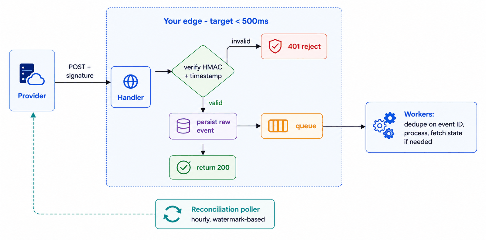
*Figure — Webhooks (course diagram)*

The figure above follows a request through your edge, with a target of under 500 ms. The provider POSTs with a signature. The handler checks the HMAC and the timestamp; if either is invalid, it sends back 401 and rejects the request. Valid events are saved in raw form, put on a queue, and then 200 is returned. Behind the queue, workers **dedupe** (detect and discard duplicates) by event ID, do the processing, and fetch state when needed. Separately, a reconciliation poller runs every hour, uses a watermark, and asks the provider for anything that was missed. Here are the five rules in detail:

1. **Verify before you believe.** The webhook URL is public, so anyone can POST `{"type": "payment.succeeded"}` to it. Providers attach an **HMAC**: a hash of the message made with a secret key that only you and the provider know. Compute it again over the **raw body** and compare the two. Use a **constant-time comparison**, which takes the same time no matter how close a guess is, so it gives nothing away. Also check the provider's **timestamp** against an allowed time window. That stops an attacker from **replaying** an old message that was validly signed. Reject bad requests *before* you parse them. Skip this step, and anyone could mark unpaid orders as paid. (An **IP allowlist**, accepting requests only from the provider's known network addresses, is a nice extra layer, but it isn't authentication.)
2. **Save it and acknowledge. Do nothing else.** Store the raw event, put it on your message queue, and return 200 in **~15 ms**. **200 means "safely received," never "fully processed."** Inventory, the warehouse and receipts all happen later behind your queue, under your own retry and failure rules. The provider's 5 s deadline no longer has anything to do with business processing.
3. **Deduplicate on the event ID.** Every provider says in its docs that delivery is at-least-once: they send again whenever they're unsure it worked. Use each event's unique ID as an idempotency key so repeats only take effect once. This is what prevents double shipments.
4. **Don't trust the order, or how fresh the payload is.** A "refund updated" event might show up before its "charge succeeded." A retried payload could be hours old. For decisions that depend on the current state, treat the webhook as a *heads-up* and **fetch the current state from the provider's API**, which is the source of truth (this is Stripe's own advice). You can skip that fetch for self-contained events that only ever add records, when fetching would go over the API rate limit, or when the action is cheap, idempotent and easy to fix.
5. **Reconcile, because silence doesn't mean success.** Sometimes events just never show up: the endpoint got disabled, an outage lasted longer than the retry window, or a network path broke without anyone noticing. So every so often, ask the provider for "everything that changed since my **watermark**" (a saved bookmark of how far you've already checked). Webhooks give you quick notice; reconciliation makes sure nothing is missing. Only move the watermark forward *after* the recovered events are safely on the queue (if you crash in between, you'd create a new silent gap). Record which time range each run covered, for audits. And dedupe by event ID across both paths, so replaying from an older watermark does no harm.

**Also:** check the event type and object before you enqueue it, and have the worker confirm that each state change is allowed. A valid signature proves *who* sent the message. It doesn't prove the change it asks for is permitted in your system.

**If you're the sender** (your product sends webhooks to customers), these rules turn into your duties. Sign payloads using **rotatable secrets** (keys you can swap out). Give every event a unique ID. Publish your retry/backoff schedule. Keep delivery timeouts short. Use a durable queue for each endpoint. Automatically disable endpoints that keep failing. And offer a dashboard with a **delivery log** (event ID, destination, attempt number, response code, latency, next retry, with no secrets shown) plus a **redeliver** button. That way customers can tell "never attempted" apart from "your server rejected it."

### Walkthrough with numbers
- **Handler time ~15 ms:** ~1 ms to check the signature, ~10 ms to save and enqueue, then 200. With no slow dependency inside the request, the provider sees a **100% success rate** through spikes and deploys.
- **The actual work** happens behind the queue, just as in the queue lesson. Spikes turn into backlog, crashes turn into redeliveries, and messages that keep failing go to the DLQ.
- **A duplicate** shows up 90 s later because the first 200 was lost on the way back. The worker sees that event ID was already handled and stops. Result: **one shipment**. That's idempotency working across a company boundary.
- **Hourly reconciliation** normally finds nothing. During one delivery incident at the provider, it found **217** missing confirmations and quietly queued them, with no emergency needed.
- **A new alarm for silence:** if an endpoint that's usually busy goes quiet for **15 minutes**, **page** someone (send an urgent alert to the on-call engineer's phone). This catches failures that don't produce any errors on your side.

### Trade-offs
**You gain:**
- Almost real-time updates from other companies without constantly polling them.
- The provider's retry system working *on your behalf*, now that you acknowledge quickly.
- A single, consistent way in for outside events, which feeds the queue-and-worker setup you already run.

**You pay:**
- **You take on their rules.** Every provider has its own delivery guarantees, ordering, retry schedule, disable policy and payload versioning. Each integration is its own separate contract.
- **A public endpoint to protect.** Signature checks, timestamp windows and secret rotation are now part of your security boundary. If a signing secret leaks, anyone can fake "payment succeeded."
- **Debugging across company lines.** Figuring out whether they never sent it or you dropped it requires their dashboard, your raw-event store, and timestamps you can line up. Keep one **correlation record per event ID** that covers receipt, queue processing, business effects and reconciliation.
- **The polling loop stays forever.** In production, both run permanently. Monitor how far behind reconciliation is, too.

### When not to use it
- **Between your own services.** A webhook mimics a broker over HTTP, but without durable subscriptions, replay or managed redelivery. When you own both ends, use pub/sub.
- **When being complete matters more than being fast.** Billing reconciliation, financial close and compliance exports should begin from polling or bulk-export APIs. Webhooks can add freshness on top.
- **Very high-frequency streams.** Thousands of separate POSTs every second is wasteful. Use the provider's streaming or bulk interface.
- **When someone is waiting for the answer.** An interactive question needs request-response. A webhook round trip only adds latency and new ways to fail.

The root mistake in the incident was using the webhook request to *do* the business work, rather than just *accepting* the notification.

### Webhooks vs Polling

| | Webhooks (push) | Polling (pull) |
|---|---|---|
| Freshness | Seconds | As often as you poll |
| Cost when idle | Close to zero | A steady stream of "anything new?" requests |
| Completeness | Best effort; gaps can happen | Guaranteed, in the end |
| Who controls delivery | The sender | You |
| Worst failure looks like | A quiet day | Stale (but visible) data |

The sneaky danger of webhooks sits in that last row: a failed delivery looks *exactly the same* as no activity. That's why the motto is **webhooks for speed, polling for truth**, with a bookmark that lets polling pick up whatever push missed. (For continuous streams to browsers or apps you control, persistent connections such as Server-Sent Events take the place of separate POSTs. Webhooks are specifically server-to-server push across company boundaries.)

### Real-world examples
- **Stripe:** the model example. It has signed payloads with timestamp checks, event IDs for dedupe, retries spread out over days, automatic disabling, and official advice to fetch the current state instead of trusting how fresh the payload is.
- **GitHub:** signs every delivery with the `X-Hub-Signature-256` header and provides a delivery log with a redeliver button. In other words, it does the sender's duties well.
- **Slack:** demands a 200 within **3 seconds**. No business logic can fit into 3 s, and that's intentional: the contract forces you to accept first and work later.
- **Twilio, Shopify, PayPal:** every platform built around integrations ends up with the same terms, because they all face the same ways of failing.
- **For AI engineers:** async AI services use webhooks to report when work finishes (batch inference, long fine-tuning jobs). Receivers still verify, store, ack quickly and queue. Agent products get webhook triggers from email, calendars and CRMs (customer relationship management tools such as Salesforce). There, deduplication matters twice as much, because a repeated event can kick off an expensive agent run a second time.

### In the interview
It can be asked straight out ("integrate Stripe") or indirectly ("how does payment settlement reach your system?"). Expect questions about work done before returning 200, about duplicates, and about spotting events that never arrive. The completeness question usually reveals the most.

**30-second answer:** "My webhook handler does three things: verify the signature and timestamp, save the raw event, enqueue it. It returns 200 in about 15 ms, because 200 means received, not processed. Workers dedupe on event ID, since delivery is at-least-once, and fetch current state from the provider's API before state-dependent decisions. Then two protections: an hourly reconciliation poll from a bookmark, because webhooks are best-effort and the worst failure is silence, and an alarm if a normally busy endpoint goes quiet. Speed from push, truth from poll."

**Likely follow-ups:**
- *"How do you know you missed one?"* The webhook path can't tell you by itself, because a missing event leaves no trace. Reconciliation eventually fills in every gap, and the silence alarm catches big gaps fast. Treat "no traffic" as a state you monitor.
- *"Secure the endpoint."* Check the HMAC over the raw body using the shared secret and a constant-time comparison. Check the timestamp to block replays. Rotate secrets safely. Reject invalid requests before parsing them. IP allowlists can add a layer, but the signatures are what authenticate.

**Mistake that fails candidates:** doing business processing before replying, or ignoring duplicate delivery. Either design only works as long as every dependency behaves.

### Self-check
- **Q1: List the five receiver rules in order and say exactly what 200 means.** → Verify the signature + timestamp; save the raw event durably; ack with 200 within milliseconds; process later through a queue with event-ID dedupe (fetching the current state where needed); reconcile from a bookmark. 200 means the event is safely in your hands, *not* that its effects are finished.
- **Q2: The payload already has everything; why still fetch current state, and when would you skip it?** → The payload shows things as they were when that delivery attempt was created. After retries it can be out of date, or it can arrive out of order, while the API holds the current official state. Skip the fetch for self-contained events that only add records, when the volume would go over the API rate limit, or when the action is idempotent and cheap to fix.
- **Q3: Confirmations quietly stopped; no handler errors for 3 weeks; the dashboard shows the endpoint was auto-disabled 20 days ago after a failure spike during a deploy. Reconstruct and redesign.** → The deploy caused slow responses or errors. Retries ran into the same problem. The failure rate triggered the auto-disable, and deliveries stopped without any local error. Redesign: a 15 ms save-and-ack handler (no business work inside the request), a silence alarm that catches a disable within minutes, hourly reconciliation to limit any gap, and deploy checks that confirm the endpoint is healthy. Never let completeness rest only on another company's retry window.

### Related patterns
- **Message Queue:** keeps accepting the news separate from doing the work; the handler's only job is to feed it.
- **Idempotency:** dedupe by event ID is the cross-company version of idempotency keys.
- **Publish-Subscribe:** structurally, this is what a webhook is, carried over HTTP across a company boundary, with the guarantees worked out again as contract terms.
- **Retry with Exponential Backoff:** runs on the sender's side, and can work both for you and against you.

### TL;DR
- **Problem:** outside events arrive as POSTs under the sender's timeout, retry and disable rules. Doing the work inline leads to duplicates, a disabled endpoint, and a silent 3-hour gap that support tickets uncover.
- **Mechanism:** verify the signature + timestamp, save the raw event, return 200 within ms, process behind your queue with event-ID dedupe, fetch current state when deciding, and reconcile by polling from a bookmark.
- **Costs:** you take on the sender's rules, defend a public endpoint, debug across companies, and run the polling check forever.
- **Skip it when:** you own both ends (use pub/sub), completeness is the requirement (poll first), or the volume calls for a stream.

---

## Server-Sent Events
*Original lesson: [Server-Sent Events on DesignGurus ↗](https://www.designgurus.io/course-play/system-design-patterns/doc/6a51da9058730bac882716cd)*


### What it is
**Server-Sent Events (SSE)** is a single HTTP response that never finishes. The client connects one time. The server keeps that connection open and sends a small text message down it whenever there's something new. **Analogy:** rather than phoning the pizza place every 3 minutes to ask "is it ready yet?" (that's polling), you stay on the line, and they tell you the second anything changes.

### The problem: polling that mostly says "nothing"
A food-delivery app shows the driver's location, the order status and the ETA. The page **polls**: it calls `GET /orders/{id}/status` every 3 seconds. It's simple, it's reliable, and it's in production.

On a rainy Friday evening, **200,000** customers have that page open. One request every 3 s from each of them = **~66,000 requests/s**. Each is a full round trip with TLS, authentication, a DB read and a response. And **99 of every 100 responses say "no change."** Most of the capacity and cost is spent answering "nothing yet."

Users still grumble that updates feel slow. With a 3 s interval, a new status waits **1.5 s on average** until the next poll picks it up. Polling every 1 s would shrink that, but it would push traffic up to **200,000 req/s**. Meanwhile, an order changes status maybe **12 times in 40 minutes**. The key line of this lesson: **with polling, cost grows with the audience; it should grow with the news.**

### Why the obvious fixes fail
- **"Tune the polling interval."** Shorter means fresher but more expensive; longer means cheaper but staler. You're only sliding along the same trade-off curve. The server already *knows* when the data changes; it just has no way to say so.
- **"Long polling."** The server holds each request open until the data changes or a timer runs out, and then the client immediately asks again. That gets rid of most empty responses and nearly all the staleness; it's an older kind of push. But each update still costs a disconnect and a fresh request. So a burst of updates means a burst of reconnections, and proxy timeouts need extra care. It's push faked through repeated pulls.
- **"Just use WebSockets."** That does work, but it gives you *two-way* communication for a page that only listens. The direction you don't use still costs a protocol upgrade, special load-balancer handling, and your own reconnect logic (see the comparison table below).

### How it works

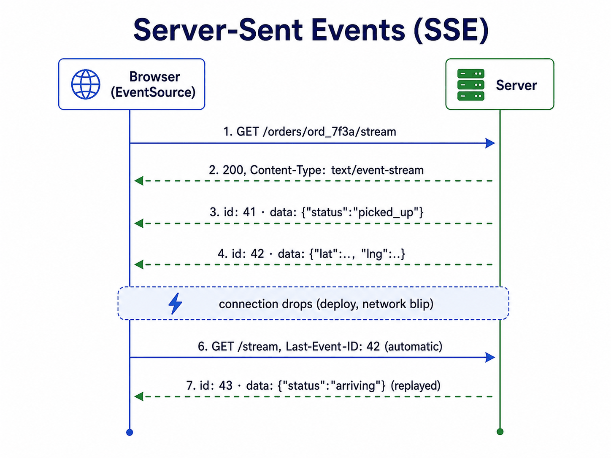
*Figure — Server-Sent Events (course diagram)*

The figure above shows the entire protocol in seven steps. The browser's `EventSource` opens `GET /orders/ord_7f3a/stream`. The server answers `200` with `Content-Type: text/event-stream` and leaves the response open. It pushes numbered events (`id: 41` status picked_up, `id: 42` a location). The connection drops (because of a deploy or a network blip). The browser reconnects **automatically** and sends `Last-Event-ID: 42`. And the server replays what was missed (`id: 43` "arriving"). Four properties make this work:

1. **It's just HTTP.** An SSE stream is a normal HTTP response that stays open, with the content type `text/event-stream`. There's no protocol upgrade and no special handshake, so your existing load balancers (servers that spread requests across many backends), TLS, authentication **middleware** (shared code that runs on every request before your handler, e.g. to check logins) and proxies all handle it. Most of its operational simplicity comes from this.
2. **The browser handles reconnecting.** Deploys, tunnels and closed laptops break connections constantly. The browser's `EventSource` API reconnects by itself and sends a **`Last-Event-ID`** header naming the last message it received. The server keeps a short **replay buffer** of recent events and resends everything after that ID. A reconnect could deliver a message twice, so **event IDs also serve as dedupe keys**, and the client skips IDs it has already handled.
3. **Only one direction, on purpose.** The server talks and the client listens. A client action, like cancelling an order, goes through an ordinary request-response call. A lot of real-time UIs have exactly this shape.
4. **Held-open connections change the server math.** 200,000 connections can't each tie up a thread. **Async I/O** (Node, Go, Nginx; I/O means input/output such as network reads, and *async* means the thread doesn't sit blocked waiting for it) lets a single **event-loop** thread keep watch over thousands of idle connections and only do work when data shows up. Each connection costs a few tens of KB of memory, so one server can hold **tens of thousands of connections**.

The SSE server normally gets its updates by **subscribing to internal pub/sub** and passing each event on to the right open streams. **Keep streams tightly scoped:** each stream should only carry events the logged-in user is allowed to see, and routing has to be checked again after account or membership changes. Piping a wide internal topic straight to browsers turns a routing bug into a data leak.

**Infrastructure gotchas.** Some load balancers, **reverse proxies** (servers that sit in front of your app and forward requests to it) and corporate networks **buffer** responses, meaning they collect the output before passing it on. That's harmless for normal responses but deadly for streams: events show up in batches every 30–60 s. So:
- Turn off buffering on stream routes (for example, the header `X-Accel-Buffering: no`, plus `Cache-Control: no-cache`).
- Raise idle timeouts, and send a **heartbeat** comment roughly every **15 s** so equipment in the middle doesn't close what looks like an idle connection.
- Use **HTTP/2** (the newer version of HTTP that can carry many requests over one connection) at the **edge** (the servers that face the internet) so many streams can share one connection. This gets around browsers' old limit of **6 connections per domain**.

**Authentication has to last longer than a normal request.** Check the session when the stream opens. Close the stream when the credentials expire or get revoked, because a single connection may stay open for hours. The reconnect then re-authenticates the usual way.

### Walkthrough with numbers
- **When nothing happens, nothing gets sent** (except heartbeats). There are 200,000 open connections and almost no requests, so the **66,000 req/s** of "nothing yet" disappear. Work now follows events, not audience size.
- **When there's news,** the customer sees it in **under a second**, compared with up to 3 s of staleness when polling.
- **Capacity:** one async server holds ~**50,000** connections, so **4 machines** handle a rainy Friday. The cost moves from CPU (for 66k req/s) to memory (for the held connections).
- **Deploy drill:** restarting a server drops 50,000 connections, and all of them reconnect automatically. If they all come back at the same instant, that burst (a **reconnect stampede**) can overwhelm the fleet. The SSE **`retry:`** field lets the server set the reconnect delay. Randomize that delay (this is called **jitter**) to spread the load out. Returning clients send `Last-Event-ID`, and the buffer fills in what they missed. So keep **several minutes** of events, which is longer than a typical deploy.

### Trade-offs
**You gain:**
- Push over plain HTTP: middleware, proxies and tools keep working with no changes.
- A client built into the browser, with reconnect-and-resume you didn't have to write.
- Cost that tracks events, not audience size or polling frequency.

**You pay:**
- **Only one direction.** As soon as the client has to stream typing, cursors or voice back, SSE isn't enough (see Bidirectional Streaming).
- **Running long-lived connections.** Plan capacity by *connections*, not requests. **Drain** servers before deploys: stop taking new connections and let the existing ones move elsewhere. Use **least-connections** load balancing, because two servers can have similar request rates while one holds far more streams and memory. Treat active connections, memory per connection, disconnect and reconnect rates, and replay-buffer misses as top-level metrics. Load-test idle connections and simultaneous broadcasts separately, since they strain different resources.
- **A window for resuming, not a history.** The replay buffer covers short disconnects, not yesterday. If a client comes back after its ID has aged out of the buffer, it has to notice the gap and refetch the current state through the normal API. Spell this out in the protocol. The server sends a named reset event (or closes with a status that means "refetch"). The client replaces its local state with the refetched data *before* reopening the stream, so old and new data never get mixed together. **The stream is for delivery, never for storage.**
- **Text only.** Text and **JSON** (a common text format for structured data) work fine; binary audio/video needs a media protocol.

### When not to use it
- **The client talks as well** (typing indicators, collaborative editing, multiplayer games): use Bidirectional Streaming.
- **Updates are rare and viewers are many.** A price that changes once a day doesn't justify a million idle connections; relaxed polling plus a cache is simpler.
- **Binary media where latency is critical** (voice, video): use **WebRTC**, which is designed for media.
- **Between your own backend services:** use pub/sub or **gRPC** streams (typed streaming from server to server).

Anti-patterns: a homemade chat built from SSE going down plus constant POSTs going up (that's a two-way protocol in disguise), and treating the stream as storage with no way to recover once a client falls outside the replay window.

### Four levels of push
Choose the lightest method that meets the direction and freshness you need:

| | Polling | Long polling | SSE | WebSocket |
|---|---|---|---|---|
| Staleness | ~Half the interval | ~Zero | ~Zero | ~Zero |
| Cost when idle | A constant flow of requests | One held request per client | One held connection per client | A held connection + the protocol |
| Direction | Pull | Pull pretending to be push | Server → client | Both ways |
| Works with existing proxies/infra | Perfectly | Timeout problems | Yes, it's plain HTTP | Needs special handling |
| Reconnect handling | Not needed | You write it | Built into the browser | You write it |
| Best for | Rare changes, relaxed deadlines | Old infrastructure limits | Feeds, tickers, progress, LLM (AI chat model) tokens | Conversations |

Ask **who has data to send**. Poll when the server speaks now and then, use SSE when it speaks constantly, and use WebSocket when *both* sides speak constantly. Long polling mostly survives in places where old infrastructure can't carry SSE reliably.

### Real-world examples
- **Every LLM chat app streams over SSE.** (An **LLM**, large language model, is the kind of AI model behind chat assistants; it produces text in small pieces called **tokens**, roughly word fragments.) Anthropic's and OpenAI's APIs send tokens as SSE events, which is why the words appear one at a time. It's a perfect match: strictly one-way, text, and plain HTTP that every proxy and **SDK** (software development kit: a ready-made client library) understands.
- **Live dashboards and tickers:** log tails, stock and sports feeds, live news.
- **Build and deploy logs:** **CI** (continuous integration: servers that automatically build and test every code change) output that streams into your browser is nearly always SSE.
- **Notification feeds:** one SSE stream per session that carries all in-app events (the capstone builds this).
- **For AI engineers:** streaming tokens makes latency *feel* shorter even when generation takes just as long. A 30 s answer feels snappy if the first token shows up in **300 ms**, so **time-to-first-token** is the metric that counts. A buffering proxy ruins this by holding tokens back. Agent UIs send **named event types** (tool started, result arrived, thinking), and an LLM gateway has to pass streams straight through rather than collecting whole responses first.

### In the interview
Live order tracking, notification feeds and token-by-token AI output all check the same skill: can you choose among the four push levels instead of reaching for WebSockets by default or sticking with expensive polling?

**30-second answer:** "For one-way live updates I use SSE. Each client holds one long-lived HTTP response, and the server pushes events as they happen, so cost tracks news, not audience. Polling here would be hundreds of thousands of requests a second, mostly 'nothing yet.' SSE is plain HTTP, so auth, load balancers and proxies just work. EventSource reconnects automatically with Last-Event-ID, and the server replays from a buffer sized to cover a deploy. Async I/O servers hold tens of thousands of connections each, and randomized reconnect delays prevent stampedes. When the client needs to stream back, for chat or collaboration, I move to WebSockets, not before."

**Likely follow-ups:**
- *"A server holding 50,000 streams restarts. Walk me through it."* Drain it first: refuse new streams so the load balancer sends them to other servers. Clients that got dropped reconnect after randomized delays, carrying `Last-Event-ID`, and the replay buffer restores the events they missed. Size the buffer to match how long a deploy takes.
- *"Why not WebSockets for everything?"* Two-way communication needs a protocol upgrade, special handling in the infrastructure, and your own resume logic. All of that is wasted when the client only listens. Switch to WebSockets only when you actually need to stream upward.

**Mistake that fails candidates:** using WebSockets by default for a feed that's read-only; brushing off per-user polling traffic as "cacheable" (it isn't, because each user's status is different); or treating the stream as storage with no refetch path once a client is past the replay window.

### Self-check
- **Q1: What single transport fact explains most of SSE's operational advantages, and which two mechanisms make a dropped connection invisible?** → It's plain HTTP with no upgrade, so the TLS, auth, load balancers, HTTP/2 and proxies you already have can carry it. What makes drops invisible: EventSource's automatic, jittered reconnect, plus `Last-Event-ID` checked against a server replay buffer (with event IDs also acting as dedupe keys).
- **Q2: The replay buffer holds 60 s; deploys take 4 minutes. What happens, to whom, and what are your three options?** → Clients that got disconnected early in the deploy come back after their last event has already aged out. They'd quietly miss events unless the server notices. Options: make the buffer bigger; have clients refetch the current state before reopening (you need this no matter what); drain servers so disconnections are shorter.
- **Q3: Corporate-network users get "live" updates in 30–60 s bursts; home users are smooth; server logs show immediate writes. Diagnose and fix.** → A corporate proxy is buffering the response. Turn off buffering on the route (`X-Accel-Buffering: no` or the equivalent), set `Cache-Control: no-cache`, send heartbeats, and prefer end-to-end HTTP/2. Where you can't change their infrastructure, detect the batching and fall back to long polling. The SSE path includes *every* proxy sitting between the server and the browser.

### Related patterns
- **Publish-Subscribe:** where the news comes from; the SSE server is a subscriber that forwards events to open streams.
- **Request-Response:** carries the client's actions upward, and is the refetch path after a gap in resuming.
- **Bidirectional Streaming:** the next step up once the client starts talking.
- **Load Balancing:** held connections need least-connections balancing and planned draining.

### TL;DR
- **Problem:** polling makes cost grow with the audience and staleness grow with the interval; lots of heavy infrastructure mostly answers "nothing yet."
- **Mechanism:** one HTTP response per client that never ends; the server pushes text events; EventSource reconnects on its own with Last-Event-ID against a replay buffer; async I/O holds the connections; randomized reconnect delays prevent stampedes.
- **Costs:** only one direction, the work of running long-lived connections (draining, heartbeats, proxy buffering), a window for resuming rather than a history, and text only.
- **Skip it when:** the client streams too (WebSockets), changes are rare (polling), the payload is media (WebRTC), or both ends are your own servers (pub/sub).

---

## Bidirectional Streaming
*Original lesson: [Bidirectional Streaming on DesignGurus ↗](https://www.designgurus.io/course-play/system-design-patterns/doc/6a51db49ce06a759857ca5a4)*


### What it is
**Bidirectional streaming** keeps a single connection open, and *both* sides can send messages over it whenever they want. Think chat, collaborative editing, multiplayer games, or live voice. In browsers this is normally a **WebSocket**, which is an ordinary HTTP connection that gets "upgraded" into an open channel that works both ways. Between backend services it's normally a **gRPC** bidirectional stream. The big insight of this lesson: opening the socket is the easy bit. The hard bit is that a conversation is **shared state spread over many machines**. **Analogy:** placing a phone call is simple. The real challenge is running a conference call where the people dialed into *different* switchboards. Someone has to pass along what each person says to every switchboard that has a listener on it.

### The problem: messages that silently vanish
A team launches WebSocket chat. It works flawlessly in the demo and in **staging** (a test copy of the production environment). Production, though, has **three gateway servers** behind a load balancer (a **gateway** is a server that holds client connections). Alice connects to server A. Bob joins the same room through server B. Alice sends "hey." Server A looks at its own local list of connections in that room, sees only Alice, and so Bob gets nothing.

Nothing shows up in the error logs. People on the same server chat just fine. People on different servers miss messages, or see them only one way. Room membership was stored only in each server's own memory. Staging had just one server, which saw everyone, and that hid the flaw.

**The socket was never the hard part.** SSE usually sends outward from a single central source. With two-way chat, a message *that a client creates* has to reach recipients who are connected to other machines.

### Why the obvious fixes fail
- **"Sticky sessions."** (Sticky means the load balancer keeps sending a client to the same server.) A load balancer should keep each client on the same server, because a live connection can't be moved. But stickiness pins *clients*, not *rooms*, so Alice and Bob can still end up on different servers. You need it, but it isn't enough.
- **"Route each room to one server."** This works as long as a room fits on one machine. But large all-hands rooms outgrow it, one server failing takes down every room on it, and moving busy rooms means transferring state. You've accidentally built a stateful, sharded distributed system that can fail over, without ever designing one.
- **"One big server."** Scaling up one machine (vertical scaling) pushes the limit back but can't get rid of it. The biggest machine still has a ceiling, and when it fails, everyone gets disconnected.

All three try to solve **message routing** by controlling **where connections land**. The design that scales keeps those two things separate.

### How it works: two tiers

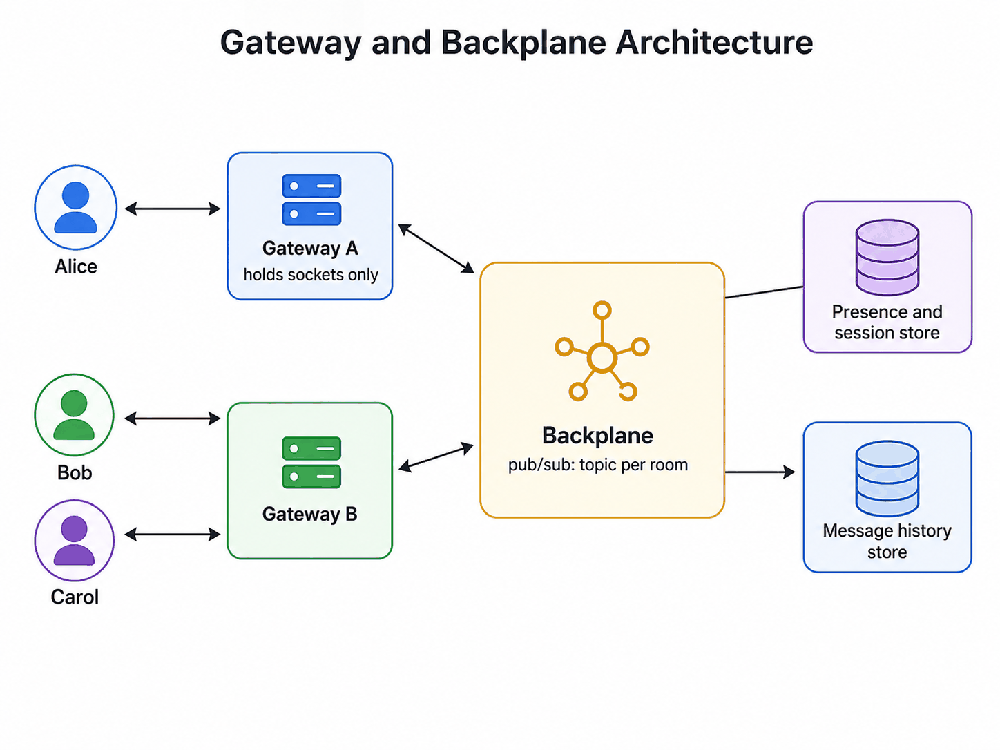
*Figure — Bidirectional Streaming (course diagram)*

The figure above shows the gateway-and-backplane design. Alice's socket sits on Gateway A ("holds sockets only"), and Bob and Carol are on Gateway B. Both gateways connect to a **backplane** (pub/sub, with one topic per room). Next to it are a **presence and session store** (who's online) and a **message history store** (the durable record of every message).

Here is the reasoning, one step at a time:
1. A connection is a physical fact: it exists on exactly one machine.
2. A room is a group of people whose connections exist on different machines.
3. So machines have to pass messages to each other. But making machines keep track of "who is on which machine" is fragile.
4. Instead, reuse pub/sub. **Each room is a topic.** Every gateway subscribes to the topics of the rooms its connected users are in. To send to a room, you publish to its topic. Each gateway passes what it receives on to its own local sockets. **No gateway ever has to know that any other gateway exists.**

So Alice's "hey" travels socket → Gateway A → room topic → every gateway subscribed to that room (A and B) → local sockets. That removes the launch bug by design. **Presence** is kept in a shared store and **messages** in a history database: **the stream carries data; the history database holds the truth.**

**You now own a protocol.** A WebSocket or gRPC stream gives you raw transport and nothing else. Everything that SSE's `EventSource` handed you for free, you now have to design yourself:
1. **Message framing and types, with versioning.** Define how each message is structured and how that structure changes over time. Keep **durable messages** apart from **ephemeral signals** (short-lived ones). A chat message needs an ID, sender, room, sequence number, timestamp and version, because it gets stored and may be replayed. A typing indicator is overwritten by the next one, expires by itself, and is never stored. Keeping these two classes clearly separate stops cheap signals from getting costly durability guarantees.
2. **Sequence numbers.** Give each room message a number when it's published, so clients can spot duplicates and gaps.
3. **Heartbeats.** A regular ping/pong lets both ends notice a dead connection instead of sending into nothing.
4. **Auth and acks.** Check the user when the socket opens, and check again from time to time during long sessions (room access or account status can change). Where delivery matters, add **acks** at the application level: a successful write to the socket does *not* mean the client got the message.
5. **Reconnect and resume.** The client saves its last sequence number for each room. After reconnecting, it fetches the messages it missed from the history store (using request-response), then rejoins the live stream and throws away any overlap by sequence number. Resuming makes delivery at-least-once, so sequence numbers act as dedupe keys. **History has to be written before publishing to the backplane, or in the same atomic step** (*atomic* = it either fully happens or doesn't happen at all); otherwise the query for the gap can miss messages.
6. **Backpressure.** What happens when a client receives more slowly than the system sends? With no limit, one weak mobile connection can pile up enough buffered data to use up the gateway's memory. That takes down everyone on that gateway (this is the shared-resource risk that the **bulkhead** pattern deals with). So: put a cap on each connection's outgoing buffer. **Coalesce** updates that replace each other (typing and cursors only need the newest value). And once the cap is hit, **disconnect with a "please resync" hint**. The normal reconnect-and-resume path then brings back the durable messages safely.

The sequence below shows how resuming works after a dropped connection:

*Reconnect and resume via history*
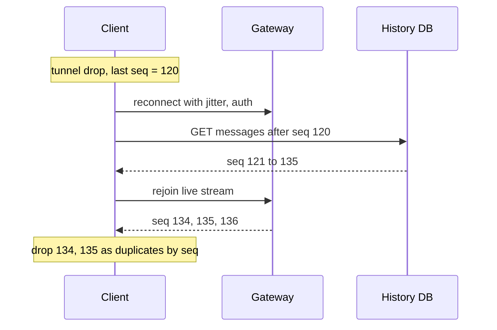

The last sequence the client saw was 120. After it reconnects (with jitter, and logging in again), it asks history for everything after 120, and it gets back 121–135. Then it rejoins the live stream and receives 134, 135, 136. It throws out 134 and 135 as duplicates, and ends up with a complete conversation with no gaps.

### Walkthrough with numbers
- **One million connected users** at ~**50,000 sockets per async gateway** → **20 gateways**. Adding more gateways adds connection capacity without changing where rooms live.
- **Message path:** two internal hops (gateway → backplane → gateway), which is a few tens of ms from end to end. A 50-member room costs **one publish** (delivered to whichever gateways hold members), rather than 50 separate sends from Alice's server.
- **Typing indicators** can create **50x** more traffic than real messages if every keystroke goes out to every member. Throttle them to **at most 2 updates/s per typer**, with the newest one winning. The gateway handles this, and they're never stored.
- **Deploy drill:** stop the gateway from taking new connections (the load balancer sends them elsewhere), send current clients a "going away" notice, and let them reconnect somewhere else after randomized delays (jitter prevents a reconnect stampede). They resume by sequence number from history.
- **Slow consumer:** a subway rider's buffer reaches its **1 MB cap**. The gateway disconnects them with a resync hint instead of hoarding data. Roughly **30 s** later, the client reconnects and fetches the messages it missed from history. The stream never served as storage.

### Trade-offs
**You gain:**
- A real conversation: both sides can send at any moment over one connection, with almost no overhead per message.
- The lowest interactive latency anywhere in the HTTP family.
- A single channel for an entire session: messages, **presence** (who's online), and signals.

**You pay:**
- **You own the protocol:** framing, sequencing, heartbeats, resume and versioning, including the failures HTTP and SSE already took care of.
- **A stateful edge.** Gateways hold connection state, so they need socket limits, planned draining, and load balancing that respects held connections (least-connections *and* stickiness).
- **Your HTTP tools can't see messages anymore.** After the upgrade, your usual auth, rate-limiting and tracing middleware can't see individual messages, so you need versions of them that understand sockets.
- **You must design backpressure**, because any buffer without a limit will eventually eat all the memory.
- **The backplane is yet another system**, and its throughput limits **fan-out** (how many recipients one message can reach). Load-test big rooms (one message to 100,000 recipients) apart from total volume (100,000 private messages). Measure backplane delay, gateway write queues and history writes separately, so you can see which stage is the bottleneck.

### When not to use it
- **The client hardly ever sends.** Use SSE going down plus ordinary POSTs going up. Sockets are worth it for *frequent, latency-sensitive* two-way data (typing, cursors), not for a Like button.
- **Request-response over a socket.** Sending `{"method": "getUser"}` and waiting for a reply rebuilds HTTP, but without status codes, caching or standard tools. Calls that have responses should stay calls.
- **Between your own backend services.** Native gRPC streams give you typing, **multiplexing** (many streams sharing one connection) and service-mesh support. Use a queue when work has to survive restarts.
- **Media.** WebRTC is designed for low-latency audio/video that can tolerate some loss (its setup may use a WebSocket).

Once a socket is in place, teams get tempted to send forms, uploads and fetches through it too. That creates a private protocol that lacks HTTP's tools. Save the socket for continuous two-way traffic only.

### WebSocket vs gRPC bidirectional stream
They have the same communication shape but live in different places:

| | WebSocket | gRPC bidirectional stream |
|---|---|---|
| Natural home | Browsers, mobile apps, the public internet | One backend service talking to another |
| Message format | You define it (raw frames) | Typed **protobuf** (Google's compact binary message format) messages, with generated code |
| Through proxies/firewalls | Excellent (it looks like normal HTTPS) | Unreliable on the public internet |
| Tooling | Needs special handling everywhere | Fully supported in gRPC and service meshes |
| Best for | Chat, collaboration, multiplayer | Internal control planes, live links between services |

A simple rule: **WebSocket faces users; gRPC streams face services.** **Envoy's xDS** is a typical gRPC stream. It pushes configuration to proxies in a **service mesh** (a layer of small proxies next to every service that handles networking, retries and security for them) over long-lived, typed connections. **WebRTC** is a third option, used for peer-to-peer media, and it only uses these transports for setup. Failure handling is different too. Mobile and browser clients switch networks, go to sleep, and sit behind infrastructure you don't control, so WebSocket designs need explicit reconnect and history recovery. Backend gRPC clients run on networks you control, but they still need deadlines, **flow control** (the stream-level version of backpressure), and a clear policy for resuming after a service restarts.

### Real-world examples
- **Slack:** uses exactly this two-tier design, with WebSocket gateways plus a backplane. Its write-ups on draining and reconnect stampedes read much like this lesson's walkthrough.
- **Figma:** multiplayer editing is WebSocket transport with **CRDTs** on top (conflict-free replicated data types, which are structures that merge edits made at the same time in a predictable way). A line worth using in interviews: *the transport delivers; the data structure resolves concurrent edits.*
- **Discord:** millions of sockets open at once on a small gateway tier, where gateways are treated as completely disposable.
- **Envoy xDS and Kubernetes watch APIs:** long-lived streams used to push **control-plane** updates (configuration and coordination messages, as opposed to user data; Kubernetes is the most common system for running containers across many machines), entirely machine to machine.
- **For AI engineers:** realtime voice sends audio in both directions over a single WebSocket. That makes **barge-in** possible (cutting the model off while it's speaking). Barge-in can't work on a one-way channel, because the client has to send while the server is still streaming. The same concerns apply: number the audio frames, apply backpressure when generation runs ahead of playback, and resume when a phone switches networks. Output that's only tokens stays on SSE; an interactive conversation is what justifies the socket.

### In the interview
Questions about Slack, collaborative editors and multiplayer games often begin with "use WebSockets" and then dig into the topology. The key question: **"how does Alice on server A reach Bob on server B?"** Another one: **"what happens to a slow consumer?"** (buffers without limits can take a gateway down).

**30-second answer:** "Two-way needs two layers. Gateways hold WebSocket connections and nothing authoritative. Behind them a pub/sub backplane, one topic per room, routes each message to whichever gateways hold recipients. Presence is in a shared store and history in a database, so the stream is transport, never the source of truth. On top of the socket I own a small protocol: sequence numbers, heartbeats, and reconnect-and-resume that fetches missed messages from history and dedupes by sequence. Each connection's send buffer is capped, ephemeral signals like typing are merged latest-wins, and past the cap I disconnect with a resync hint rather than burn memory. So gateways are disposable: drain, deploy, reconnect with jitter."

**Likely follow-ups:**
- *"Walk Alice's message to Bob on a different server."* Alice sends through Gateway A, which publishes to the room's topic. Gateway B is subscribed (because it holds Bob), so it gets the event and writes it to Bob's socket. Gateway A also delivers to its own local members. The message is saved to history at publish time, so resuming has one official source.
- *"A client receives at 1 KB/s in a room producing 50 KB/s. What happens?"* First, coalesce the ephemeral updates. If the capped buffer still fills up, disconnect the client with a resync signal. When the client reconnects, it fetches the durable history and rejoins. The gateway's memory stays safe instead of buffering with no limit.

**Mistake that fails candidates:** storing room membership only in gateway memory, skipping reconnect-and-resume, or using WebSockets for a stream where the client never sends anything.

### Self-check
- **Q1: What must you build above a raw socket that SSE's EventSource gave you free, and where does truth live?** → Randomized reconnect, resume based on sequence numbers, framing and versioning, acks where you need them, heartbeats, auth when the socket opens plus later re-checks, and a backpressure policy. The history store owns the truth about messages, and a shared store owns presence. Sockets and the backplane only move data around.
- **Q2: Why gateways plus a backplane rather than gateways messaging each other directly? Which state lives where?** → Direct routing would need every server to keep a global table, always correct, of where each room's members are, through connects, disconnects and failures. That's the same fragility as the in-memory buffer from the queue lesson. The backplane handles subscriptions in one place, and each gateway knows only its own sockets and topics. Gateways: sockets + capped buffers. Backplane: routing subscriptions. Shared store: presence and sessions. History DB: messages.
- **Q3: Mobile users lose messages after elevators and tunnels; connections do come back, but conversations have gaps. Design the fix end to end.** → Reconnecting without resuming skips everything published during the outage. Number messages when they're published. Store them in history (before publishing, or atomically with it). Have clients save the last sequence number for each room. After reconnecting, fetch everything newer through request-response, apply it, then rejoin live and drop any overlapping sequence numbers. It's SSE's `Last-Event-ID`, rebuilt for a two-way protocol.

### Related patterns
- **Publish-Subscribe:** the backplane is one; rooms are topics and gateways are subscribers.
- **Server-Sent Events:** the simpler one-way choice. Only move up from it when the client streams, and borrow its resume design.
- **Load Balancing:** stickiness, least-connections and draining are what make a stateful edge possible to deploy.
- **Idempotency:** resuming makes delivery at-least-once, and sequence numbers are the dedupe key.

### TL;DR
- **Problem:** a conversation is shared state across connections sitting on different machines. Once you have more than one server, "send to the room" turns into a routing problem. The socket was never the hard part.
- **Mechanism:** gateways hold only sockets; a pub/sub backplane routes by room; presence lives in a shared store; the truth lives in a history DB; and you write your own protocol of sequences, heartbeats, resume, and backpressure with capped buffers.
- **Costs:** you own the protocol, a stateful edge with draining and stampedes, HTTP middleware that can't see anything after the upgrade, and a backplane that limits fan-out.
- **Skip it when:** the client seldom sends (SSE + POST), it's request-response in disguise, it's service-to-service (gRPC), or it's media (WebRTC).

---

## Capstone - Designing a Notification System
*Original lesson: [Capstone - Designing a Notification System on DesignGurus ↗](https://www.designgurus.io/course-play/system-design-patterns/doc/6a51dc75e8ddc24d79013f27)*


### How this capstone works
The last seven lessons gave you seven ways to move data, and this capstone puts them together. The main idea: communication patterns aren't a list of steps to follow in order. Instead, you **pick one for each arrow**. A notification system uses every direction covered in this module. Facts flow in, jobs travel through queues, calls go out to outside providers, webhooks bring delivery status back, streams update browsers, and enterprise deliveries cross company boundaries. At every decision, ask four questions: **who has the information, is anyone waiting, is this a job or a fact, and who controls the destination?**

### The brief
The same store has grown to **5 million registered users** and needs a single notification platform.
- **Triggers:** order updates, shipping events, security alerts, marketing campaigns, and anything future teams come up with.
- **Channels:** an in-app feed with an unread badge, mobile push, email, SMS, and, for enterprise customers, delivery directly into their own systems.
- **Scale:** a flash sale creates **600,000 order events in 2 minutes**; a marketing campaign sends one message to **5 million** users; roughly **300,000** users are online at any given moment.
- **Constraints:** the email provider limits you to **10,000 sends/s**; users have preferences and **quiet hours** (times they don't want to be disturbed); and regulators have rules covering all of it.

### Decision 1 — Getting events in: pub/sub + full-state events
**The tempting design:** a `POST /notifications/send` API that each of six product teams calls whenever something happens. For example, checkout would call it inline for every order.

**Why not:** that's the pub/sub incident all over again, just seen from the consumer's side. Every producer gets tied to the notification service. Its latency ends up inside critical paths like checkout. And changes to its API could force producers to redeploy.

**Chosen design:** flip the direction. The notification platform becomes just **another subscriber** to topics that already exist: `order.placed`, `shipment.updated`, `login.suspicious`. Those topics carry **full-state events** (event-carried state transfer), so each event already contains everything needed to render a notification, with no callback to the producer. The platform reads additive schemas and ignores fields that don't matter for rendering. It also benefits from sensitive data being kept out of general events, since that means fewer stores and queues to clean up after a deletion request.

**A direct API only for intentions that have no event:** marketing campaigns and support messages aren't domain events. For these, the API checks and stores the request, then returns **`202 Accepted`** within milliseconds. That's request-response confirming *acceptance*, not delivery, because no caller should sit waiting for 5 million emails.

**Rule:** subscribe wherever facts already exist; only offer an API for intentions that have no event.

### Decision 2 — The pipeline: message queue
**The work:** load preferences and quiet hours, pick channels, render templates, **deduplicate** (three events about one order must not turn into three notifications), and optionally group them into digests. Arrivals come in bursts (600k in 2 min). Workers keep up ~**2,000/s**. Nobody is waiting for the result.

**Chosen design:** an ordinary message queue. Each notification is one job, which may finish minutes later. The flash sale turns into a **~5-minute backlog** (600,000 / 2,000 = 300 s) rather than an outage. The queue's must-follow rules come along with it:
- **Dedupe on (event ID, user) before causing any side effect**, because delivery is at-least-once.
- **A monitored DLQ**, so messages that keep failing don't hold up healthy ones.
- **Alert on how *old* the backlog is, not only how deep**, because a notification that's three hours late can do harm ("your table is ready").
- **Dedupe and preference checks happen once, in one central place**, not separately for each channel. Separate decisions lead to inconsistencies, like sending the email but not the push, or contacting a user who turned both off.
- **Quiet hours are a scheduled state, not retries.** Save the rendered notification along with its **earliest allowed send time**, and put it on the channel queue when that time comes.
- **Check preferences again right before the final send**, because the user might unsubscribe while the work is waiting.

### Decision 3 — Delivering out (SES, Twilio, APNs): one queue per channel
**The problem:** there are three outside providers (AWS SES for email, Twilio for SMS, Apple's APNs for push). They have different speeds, limits and ways of failing, and all of them are fed from the same pipeline. How do you keep a Twilio outage from delaying email?

**Chosen design:** give **every channel its own queue and its own pool of workers**. Then an SMS backlog only affects SMS, while email keeps flowing at its 10,000/s limit. This isolation is the **bulkhead** pattern, and it falls out naturally from having one queue per dependency. Every call to a provider is request-response across a network, so it's wrapped in protections: a **timeout** (a deadline), **retries** of temporary failures that carry a **unique message key** (so the provider can dedupe), and a **circuit breaker** (stop calling a provider that's unavailable).
- **Rate limits apply per channel as a whole**, enforced across all the workers together rather than per process (all the email workers combined stay under 10,000/s; SMS and push follow their own providers' limits).
- **Each channel gets its own backlog-age threshold:** a late security alert is urgent, but a late marketing message isn't.

### Decision 4 — Provider status back in: webhooks (receiver side)
Delivery receipts, bounces, complaints and unsubscribes come back from the providers as webhooks. Follow the receiver rules: verify the signature, save the raw event, ack within milliseconds, process behind a queue, dedupe by event ID, and reconcile through the provider's API to catch any that went missing. **Hard bounces** (addresses that reject mail permanently) have to **update the preference store**. If you keep sending to them, you hurt your **sender reputation**, which is how mail providers decide whether to trust your email.

**Rule:** protect outgoing request-response calls, and apply all five receiver rules to incoming webhooks. A single integration has both directions in it.

### Decision 5 — In-app feed and badge: SSE over a database of record
**The problem:** ~300,000 users are online, and their feed and badge should update without a refresh. The server has the news, and this part of the client only *reads*.

**Why not polling:** 300,000 users every 5 s = **60,000 requests/s**, almost all of them "no change." **Why not WebSocket:** it's a two-way protocol for a client that has nothing to send upstream.

**Chosen design: SSE.** Each session opens one `EventSource`, and events update the badge within milliseconds.
- **The database is the truth.** Loading the page fetches the current feed through request-response, and SSE only carries live updates. After a short disconnect, `Last-Event-ID` replays the missed events; longer gaps cause a full refetch.
- **Multiple devices** just hold separate streams for the same user.
- **Mark-as-read** is an ordinary POST. It publishes an event that updates the badges on the user's other devices. Still no WebSocket required.
- **The badge count comes from the database**, not from adding up stream events. Otherwise, a single missed event would leave the number wrong forever. Any reconnect, or any detected gap in the replay, refetches the official unread count.

### Decision 6 — Enterprise delivery: webhooks (sender side)
Enterprise customers want order and security events POSTed to URLs inside their own infrastructure. Now **you're the provider**, and you owe them the sender duties. Sign every payload with **rotatable secrets**. Include unique event IDs so they can dedupe. Retry from a **durable queue per endpoint** on a published backoff schedule (so one dead customer can't hold up the others). Keep timeouts short. Automatically disable endpoints that keep failing. And give them a dashboard showing delivery status, with a redeliver button. The receiver and sender checklists are mirror images: whatever you expect from providers in Decision 4, you should provide to customers here.

### Decision 7 — The escalation question: decline the WebSocket
**The request:** the product team wants users to reply to support notifications right from the feed, and suggests swapping SSE for WebSockets.

**Why decline:** yes, the client would now send, but only *once in a while*. Send each reply as an ordinary POST, and use SSE to update the user's other devices (just the shape the SSE lesson recommends). Bidirectional streaming is meant for **frequent, latency-sensitive traffic in both directions** (typing, live cursors, voice). A reply box doesn't need sequencing, resume, backpressure (slowing a fast sender down to match a slow receiver), or a stateful gateway tier. If the product later turns into **live support chat** with nonstop activity on both sides, give *just that feature* its own gateway-and-backplane system. Only add complex transport to the feature that actually needs it.

### The final architecture

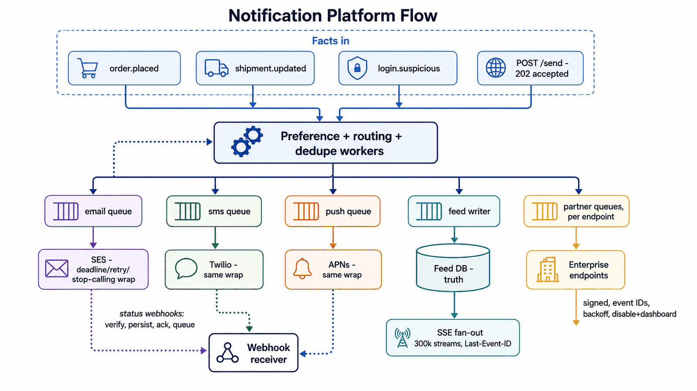
*Figure — Notification System Architecture (course diagram)*

The figure above shows every arrow with its route. Across the top are the **facts coming in**: `order.placed`, `shipment.updated`, `login.suspicious` (the subscribed topics), plus `POST /send → 202 accepted` for one-off sends. All of them feed the central **preference + routing + dedupe workers**. Those workers fan out into lanes for each channel. There's the **email queue → SES**, the **SMS queue → Twilio** and the **push queue → APNs**, each wrapped in deadline/retry/stop-calling protection. There's a **feed writer → Feed DB (the truth) → SSE fan-out** (300k streams, Last-Event-ID). And there are **partner queues per endpoint → enterprise endpoints** (signed, event IDs, backoff, disable + dashboard). Provider **status webhooks** come back into a **webhook receiver** (verify, persist, ack, queue), which loops back into the workers (for example, hard bounces updating preferences).

### Debrief: one question per arrow

| Arrow | The routing question answered | Pattern |
|---|---|---|
| Product events → platform | Facts that many parties care about; don't make producers call you | Pub/sub + full-state events |
| Ad-hoc sends → platform | The caller needs acceptance now and delivery later | Request-response (202) into a queue |
| Events → rendered notifications | Jobs that come in bursts, done once, with nobody waiting | Message queue + dedupe + monitored DLQ |
| Platform → SES / Twilio / APNs | A call into infrastructure someone else owns | Protected request-response, one queue per channel |
| Providers → platform (status) | Another company's events arriving at your public URL | Webhooks, receiver rules |
| Platform → browsers | The server has news; the client only reads | SSE over a database of record |
| Platform → enterprise systems | Push across the company boundary; your duties | Webhooks, sender rules |
| "Make it conversational" | The client sends, but rarely | Declined the socket: POST + SSE |

If you read the middle column from top to bottom, it's the module's opening question asked eight times over. The result: **no WebSocket, one API, and seven asynchronous relationships**. Each one has a stated reason, and none was picked just for being new.

**Two sources of truth:** the **notification database** owns feed entries, unread state, preferences and delivery status. The **external providers** own their own delivery records, which are brought in through reconciliation. Queues, topics, SSE streams and webhook attempts only *carry* information; they never take the place of these durable records.

**Left for later (Module 5):** the defensive controls wrapped around every arrow: timeouts, limited retries, idempotent operations, monitored DLQs, and separate lanes for each dependency (bulkheads). This capstone decides *where data moves*; those patterns make sure each path survives failure.

### Extend it yourself
- **Digests** ("bundle my marketing notifications into one daily email"): where does batching go relative to dedupe? What data model holds a digest that's still pending? What happens to digest state when a user changes timezone?
- **Multi-region:** users and their SSE connections now stretch across two continents, but the feed database and topics exist in one region only. Which arrows change? Which replication patterns (primary-replica, to begin with) do you need?
- **For AI engineers:** add an **LLM** stage that sums up each user's unread notifications into a morning brief. Route its arrows: batch inference through your own queue, or a provider batch API that reports completion with webhooks? If you stream the brief token by token in the app, which transport do you use (SSE)? And there's the **semantic cache** question (a cache that reuses an answer when a new request *means* nearly the same thing, not just when it's identical): should two users with almost the same unread lists share one generation?

### Interview one-liner
"I route each arrow on its own. Producers publish facts the platform subscribes to; ad-hoc sends get a 202 into a queue. A deduping queue pipeline feeds per-channel, bulkheaded queues calling providers with timeout, retry and breaker. Provider status returns as verified, reconciled webhooks. Browsers get SSE over a database of record, and enterprises get signed, retried webhooks. There's no WebSocket anywhere, because nothing here streams both ways."
