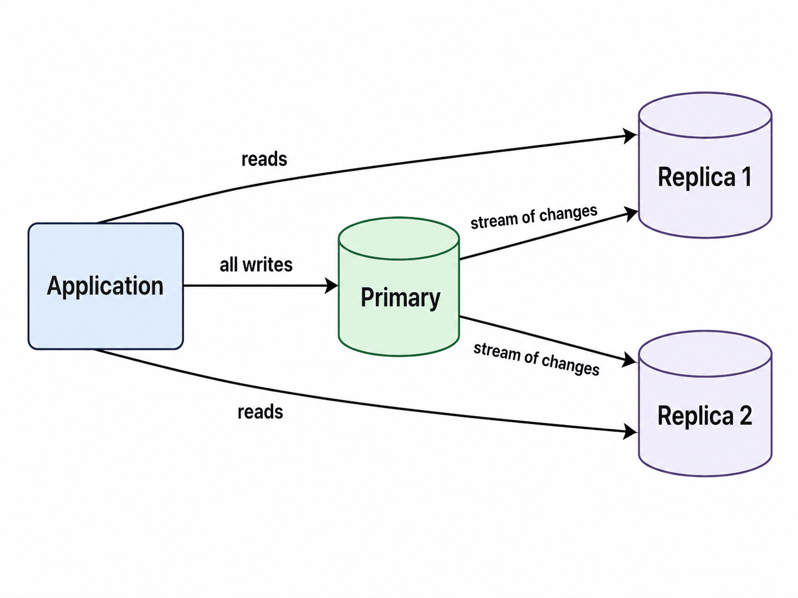
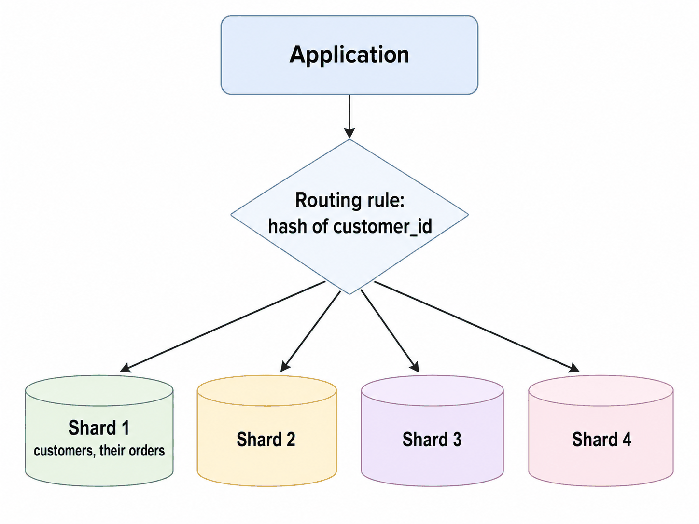
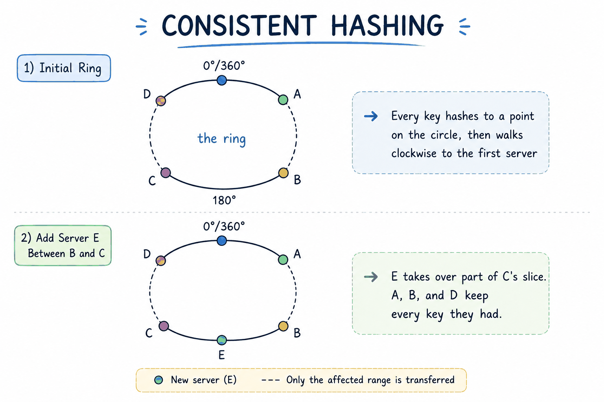
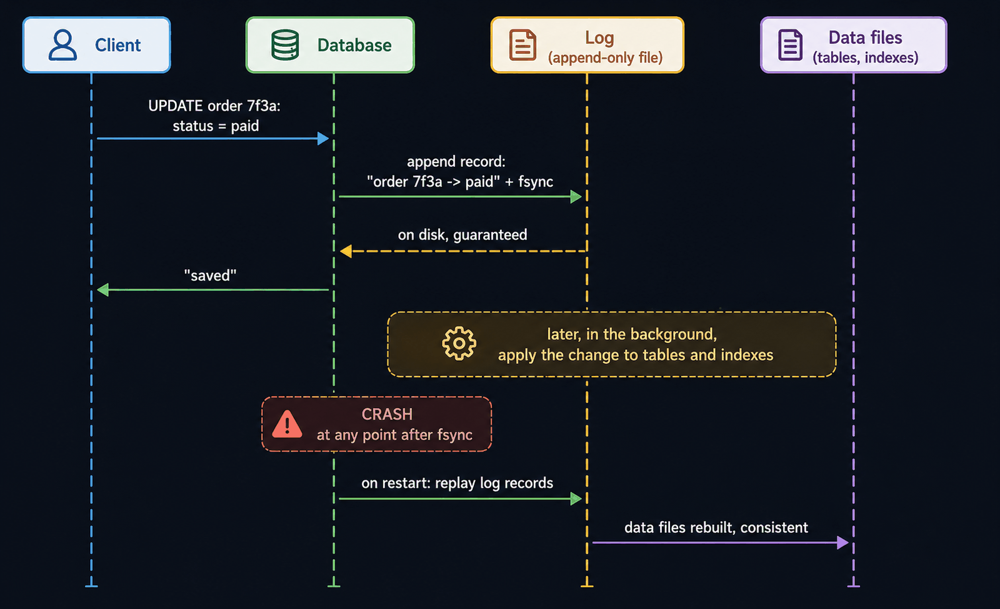
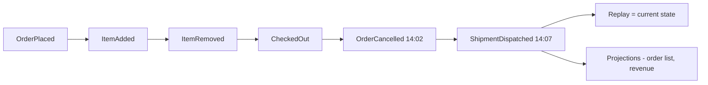
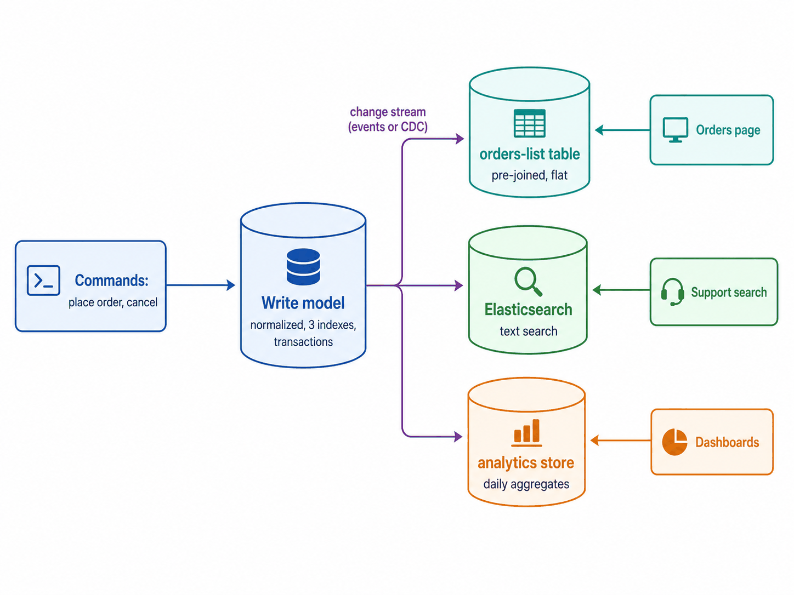
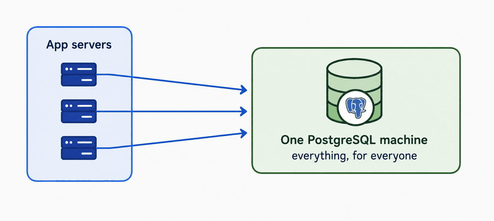
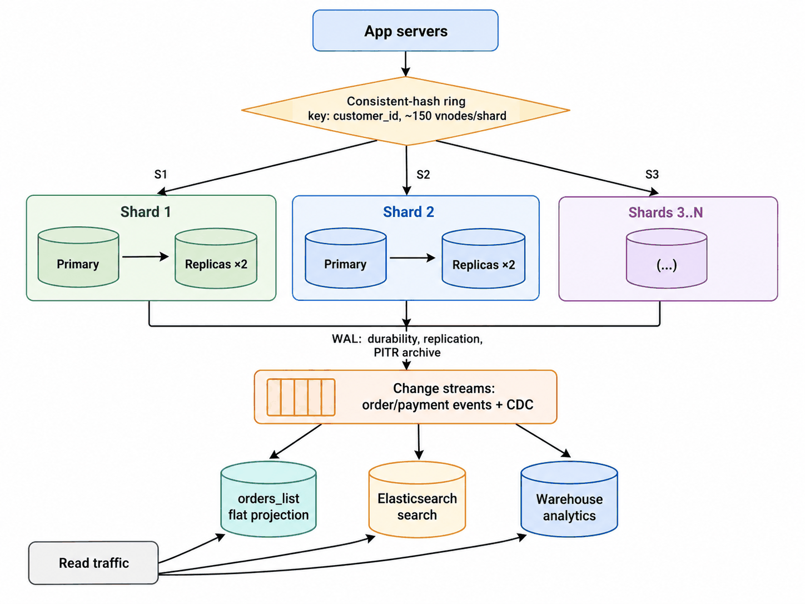

# Module 3 — Storing Data (Storage and Replication)

## Module Introduction
*Original lesson: [Module introduction on DesignGurus ↗](https://www.designgurus.io/course-play/system-design-patterns/doc/6a5346f301e8e02a37d09f39)*

**What this module is about.** In Module 2 we looked at the *arrows* in an architecture diagram, meaning how the parts talk to each other. Now we focus on the most important box of all: the database. Most other parts of a system are easy to replace at any moment. API servers hold no lasting state. You can add ten of them or lose three, and users won't notice. The database is different. It holds the system's **facts**: payments, who owns what, and the record of what happened. You can't just start a second, independent database next to it. Two separate copies of the truth slowly stop matching. So as a product grows, the database is usually the first part to hit its limit. It is also the most dangerous part to change.

**Analogy.** Picture the database as a company's official ledger book. Hiring more clerks (app servers) is easy. But you can't buy a second ledger and let each clerk write in whichever book is nearer. Before long, the two books would disagree.

**The six patterns and when each applies**

| The situation | The pattern |
|---|---|
| Reads are too many for one machine, but every write still has to land in one place | Primary-Replica |
| There is more data, or more writes per second, than one machine can handle | Sharding |
| Adding a single extra machine should not make most of the data move | Consistent Hashing |
| A crash in the middle of a write must never lose or damage data | Write-Ahead Log |
| You need every change that ever happened, not just today's value | Event Sourcing |
| Reads and writes each need the data arranged in a different shape | CQRS |

**Two facts that organize the whole module**

1. **Reads and writes scale differently.** You scale reads by *copying*. Place the data on several machines and point each reader at one of them. Now thousands of readers can work at once. Copying does nothing for writes, because every copy must eventually apply every write. You scale writes by *dividing*. Cut the data into pieces and make each machine own one piece. Remember the rule "copy for reads, split for writes". It tells you when the first three patterns fit, and it answers a big share of most database design questions.
2. **An append-only log sits underneath everything.** An append-only log is a file you only add to at the end. Nothing already in it is ever edited. The second half of the module grows out of this one idea. The Write-Ahead Log is how a database recovers from a crash, and it also powers replication. Event Sourcing makes that log the app's own data model. CQRS then separates the read model and the write model that grow out of that log. Module 2 explained *why* services announce facts as events. This module explains *where those facts live*: in an ordered log from which every other view is built.

**How the module is told.** We stay with the same online store the whole way. It starts with one database box doing every job, which is how most real companies start. Reads overload it first (→ Primary-Replica). Then the number of writes and the size of the data become too much (→ Sharding). Changing the number of shards turns out to hurt (→ Consistent Hashing). Next we ask how a database survives a sudden power cut (→ Write-Ahead Log). Last, we rebuild the order system on top of the log (→ Event Sourcing, CQRS). The capstone replays the whole journey at 100 million users. **Only a little time before an interview?** Focus on Primary-Replica, Sharding and Consistent Hashing. Nearly every "design X at scale" question relies on them.

**Four terms used throughout**
- **Read path vs. write path** — a query that *gets* data travels the read path. A request that *changes* data travels the write path. The two paths need different scaling tools and carry different risks. They may even end up on different databases.
- **Replication lag** — a copy stays current by receiving changes from the original. Sending them takes time. So a copy is behind the original by milliseconds, and sometimes by more. This is the database version of **eventual consistency** from the Event-Driven Architecture lesson: the copies match *in the end*, not right away.
- **Shard key** — the one field that decides which machine owns a row. This choice decides how evenly the work is spread. A poor shard key causes the main failure in the capstone.
- **Durability** — the promise that once the database says "saved", the data survives a crash, a reboot or a power cut. The write-ahead log is what keeps that promise.

**Before you start — three questions about a system you know** (this module shows how to answer each one, and the capstone asks them again):
- If your database server died right now, how much data would you lose? How long would it take to recover? Has anyone ever practiced that recovery for real?
- How much of your database traffic is reads, and how much is writes? (Measure it instead of guessing. The answer decides which patterns fit.)
- If you had twice as many users tomorrow, what would run out first: write capacity, read capacity, or disk space?

---

## Primary-Replica
*Original lesson: [Primary-Replica on DesignGurus ↗](https://www.designgurus.io/course-play/system-design-patterns/doc/6a534757d69c6e1df6958c69)*

**What it is.** A single database machine, called the **primary**, takes every write. It keeps sending a stream of its changes to one or more other machines, called **replicas**. Each replica holds a live copy of the data and answers read queries. If the primary dies, a replica can be *promoted* to become the new primary.

**Analogy.** Imagine a teacher (the primary) who is the only person allowed to write on the main whiteboard. Several assistants (the replicas) copy each change onto their own boards as it happens. Students read from whichever board is nearest. If the teacher gets sick, the assistant whose board is most up to date takes over.

### The problem

For years, the store has run on a single PostgreSQL machine. One Tuesday, a look at the traffic shows **8,000 reads per second** (product pages, search, order history) and **300 writes per second** (orders, cart changes). The machine can only handle **5,000 queries per second** in total. Product pages need **4 seconds** to load. Checkout gets slow as well, because reads and writes compete for the same CPU, memory and disk. Look at the split: **96%** of the traffic is reads. That split *is* the problem.

A second problem hides behind the first. This overloaded machine is also the **only copy** of the company's data. It has one disk and one power supply. That makes it a **single point of failure**: one part that stops everything when it breaks. Last night's backup can't restore today's orders. If the machine failed at 4 PM, the whole day's orders would be gone. A single pattern solves both problems.

### Why the obvious fixes fail

- **"Buy a bigger machine."** This might hold for about a year. But hardware only gets so big, prices rise sharply at the high end, and the upgrade itself means downtime. Worst of all, you still have just one copy. The single point of failure is still there.
- **"Put a cache in front."** A cache does help (Module 4). But a cache is a *performance layer*. It is not a second trusted copy of the data. Cache misses still reach the database, cached data gets out of date, and if the database dies, cached product pages can't rebuild the orders table.
- **"We already copy the database nightly."** A backup and a replica are different things. A backup may be hours old. It serves no traffic. Restoring it takes more hours. It stops you losing everything, but it doesn't protect today's data and doesn't lower today's load.

What you really need: extra copies that stay *current*, *handle traffic*, and are *ready to take over*.

### How it works

*Figure — Primary-Replica (course diagram)*

The figure above shows the application sending **all writes** to the green primary. It sends **reads** to Replica 1 and Replica 2. The primary pushes a **stream of changes** out to each replica.

1. **Every write goes to the primary.** If two machines both took writes, they could change the same row in two different ways. Then the copies would disagree. Having one writer and many readers rules out that conflict *by design*. (The next lesson looks at the price of this choice.)
2. **The primary writes each change into an ordered log and sends that log to the replicas.** It is the same log the database uses to survive crashes. (The Write-Ahead Log lesson opens it up.) For now, remember: *replication means shipping the log*.
3. **Every replica replays the changes in exactly the same order.** So its copy ends up the same as the primary's.
4. **Reads are shared out across the replicas.** This is where the extra capacity comes from.
5. **Replication lag is expected and handled.** Sending and replaying changes usually takes milliseconds. Under heavy load it can take seconds. So each replica is a little behind. The most visible symptom is the **read-your-writes problem**. A user saves a change, which goes to the primary. They reload the page, and that read goes to a replica that hasn't caught up. Their edit looks like it disappeared.
6. **Failover when the primary dies.** *Failover* means switching over to a backup. The system notices the failure when **heartbeats** stop arriving. (Heartbeats are small, regular "I'm alive" messages.) It chooses the replica that is most up to date and **promotes** it. Promoting means setting it up to accept writes and sending the application's traffic to it.
7. **Fencing stops split brain.** **Split brain** happens when the old primary comes back, doesn't know it was replaced, and keeps taking writes. Now two machines each believe they are the primary, and the data splits in two directions. So a safe failover **fences** the old primary first. Fencing forcibly blocks it from taking writes before the new primary is promoted.

### Walkthrough with numbers

- **Add two replicas and split the reads between them.** Each replica handles roughly **4,000 reads/s**, which fits its capacity. The primary handles the 300 writes/s, plus the small number of reads that must be completely up to date. Its load drops from **8,300 queries/s to a few hundred**. Product pages go from **4 s to 80 ms**.
- **Measure the lag.** Most of the time, replicas are **10–50 ms** behind, and nobody notices. During a bulk import, lag jumps to **8 seconds** for a while, and read-your-writes complaints start. The lesson: lag is a *number you monitor*. It is not a fixed value you can assume.
- **The 2 AM failover drill.** The primary's hardware fails. Spotting the failure takes about **15 s** of missed heartbeats. Promotion takes another **30 s**. During those **45 seconds** writes fail, so checkout is down. Reads still work, because the replicas keep answering.
- **The hidden cost of asynchronous replication.** In async replication the primary says "saved" *before* the change reaches any replica. So a failover can lose the last **~200 ms** of writes that were already confirmed. The comparison below helps you decide when that is acceptable.
- **Bonus.** Backups and heavy analytics can now run at full speed on a replica, without touching production traffic.

### Async vs. sync replication (the comparison)

Every replicated setup must answer one key question: *at what moment does the primary tell the client "saved"?*

| | Asynchronous | Synchronous |
|---|---|---|
| Primary says "saved"... | Right away, and sends the change afterward | Only once a replica confirms it has the change |
| Write latency | Fast (only local work) | Slower (one network round trip at minimum) |
| If the primary dies | The most recent confirmed writes might be lost | No confirmed write is lost |
| If a replica dies or slows | No one notices | Writes stall or fail, because the replica now sits on the critical path |
| Fits | Most workloads: feeds, catalogs, profiles | Moving money, committing inventory |

- **Async is the usual default nearly everywhere.** Its failure (losing ~200 ms of writes during a rare failover) usually costs less than sync's price. With sync, every single write pays for a network round trip, and writes stall whenever a replica struggles.
- **Semi-synchronous sits in between.** The primary waits for exactly *one* replica to confirm. You get failover with zero loss for a modest latency cost. This is what serious systems that handle money usually run.
- **A strong answer picks a mode per table or per operation.** It doesn't force one mode on everything.

### Trade-offs

**You gain:**
- Read capacity that grows as you add machines. This is the standard answer to a workload that is 96% reads.
- Survival: a promoted replica brings service back in under a minute, instead of a half-day restore from a backup.
- A safe spot for backups, analytics and experiments, away from production.

**You pay:**
- **Lag and the odd behavior it causes.** Every read from a replica is a bit out of date. That is usually harmless. But it shows up as read-your-writes problems. So the application must send reads that *need fresh data* to the primary, and all other reads to replicas.
- **Writes don't scale at all.** Each replica has to apply each write to stay current. So adding replicas adds *zero* write capacity. It even adds work, because the primary now has one more follower to feed. When writes outgrow one machine, the data has to be *divided* (the next lesson).
- **Untested failover is dangerous.** Split brain, data lost to async replication, and promotion scripts that were never run can each break recovery. A failover plan nobody has practiced doesn't really exist.
- **More to run:** extra machines, lag dashboards, heartbeats, runbooks.

### When not to use it

- **Workloads heavy on writes** (logging, telemetry, very frequent updates). When writes are the bottleneck, replicas multiply the work and add no capacity. That problem belongs to sharding.
- **Small scale with good backups.** One properly sized machine, backups you've tested, and an hour of acceptable recovery time is a fully professional setup for a small product. Don't take on distributed-systems problems until scale makes you.
- **When every read must be completely fresh** (uncommon, but it does happen in trading and some inventory cases). Sending every read to the primary cancels the benefit of the pattern. Either pay for synchronous replication, or challenge the requirement.
- **As a promise that writes are always available.** Failover takes seconds to minutes. If writes must *never* pause, this pattern alone can't give you that.
- **Classic misuse:** reacting to a *write* overload by adding three more read replicas. That only gives the primary more work. Always ask "reads or writes?" first.

### Real-world examples

- **PostgreSQL streaming replication** and **MySQL replication** — the textbook form of the pattern. For most companies, the first scaling step looks just like the walkthrough.
- **MongoDB replica sets** — come with automatic failover. The replicas run an *election* and promote a new primary by themselves, usually within seconds.
- **AWS RDS and Aurora** — offer the pattern as checkboxes: "add read replica" and "enable Multi-AZ" (a standby, replicated synchronously, kept ready for failover). **Aurora** goes a step further and allows up to **15 replicas** that share one storage layer.
- **For AI engineers:** vector databases use a single writer for embeddings and replicas for similarity search. The online reads of a feature store are exactly the read-heavy traffic replicas are good at. Training and evaluation jobs should read from a replica, so a data scientist's 2-hour scan never slows production. Read-your-writes hits ML as well: right after a fresh feature write, a prediction served from a lagging replica may use yesterday's feature value.

### In the interview

Common prompts: "Your database is overloaded — what do you do?" (the interviewer wants you to ask first, *"overloaded by reads or by writes?"*), "What happens when the database dies?", and "A user can't see their new comment right away."

> **30-second answer:** A single primary receives every write and streams its change log to replicas, which serve the reads. This scales reads sideways by adding machines, which matters because most workloads are read-heavy. It also gives failover: if the primary dies, the replica that is most caught up gets promoted, and fencing keeps the old primary from coming back and causing split brain. I manage two costs. The first is replication lag: reads that must be fresh, such as a user reading their own write, go to the primary. The second is that it adds zero write capacity, because every replica applies every write. When writes are the bottleneck, the answer is sharding, not more replicas.

**Likely follow-ups (with answers):**
- *"A user edits their profile and the edit isn't there after reload. Fix it."* — This is read-your-writes. The write went to the primary; the read went to a replica that was behind. Fixes, from cheapest up: (1) for a short window after a user writes (say ~10 s), send that user's reads to the primary; (2) record the log position of their latest write, and read only from replicas that have reached it; (3) show the change in the UI right away (an optimistic update) while storage catches up.
- *"How automatic should failover be?"* — Detection and promotion should be automatic, because at 2 AM seconds count. But fencing must be in place first. Promoting without fencing risks split brain, and two primaries make for a much worse day than one dead one. Whatever the mechanism, the team must practice it on purpose.

**Mistake that fails candidates:** suggesting read replicas for a write bottleneck. Or describing failover as instant and free, with no mention of lag, the window for data loss, or split brain. Either one shows you know the name but have never run the pattern.

### Self-check

- **Q1. What scales when you add replicas, what doesn't, and why?** → Read capacity scales, since each replica serves more reads. Write capacity doesn't, since every replica must apply every write: a write costs work once *per copy*, and the primary gets one more follower to send to. You also gain failover and a place for backups/analytics.
- **Q2. A platform stores social-feed posts and account balance transfers. Which replication mode for each?** → Feed posts: asynchronous. Users feel write latency on every post, while data is lost only during rare failovers. Balance transfers: synchronous, or at least semi-synchronous. A bank can't lose the last ~200 ms of transfers it already confirmed. Pick per table/operation.
- **Q3. After adding two replicas: "I updated my shipping address, refreshed, the old one was back; a minute later it was fine." Diagnose and give two fixes with costs.** → This is read-your-writes, caused by replication lag. The refresh read from a replica that hadn't yet replayed the update, and it "fixed itself" when the replica caught up. Fix 1: send the user's reads to the primary for ~10 s after a write. It costs session state, and those reads lose the replica benefit. Fix 2: note the log position of the user's write and read only from replicas past it. The data layer needs extra plumbing for this, but in return those reads keep using the replicas. (For purely cosmetic cases: optimistic UI.) The *wrong* fix is sending every read to the primary. That throws away the reason replicas exist.

### Related patterns

- **Sharding** — the next lesson. It covers what to do when *writes* outgrow one machine.
- **Write-Ahead Log** — the stream the primary sends to replicas *is* this log.
- **Load Balancing** — how read traffic is actually spread over the replicas.
- **Cache-Aside** — the other tool for scaling reads. A cache catches the hottest reads before they ever reach a replica.

### TL;DR

- **Problem:** one database machine is a read bottleneck (reads are usually ~95% of traffic) and also the company's only copy, which makes it a single point of failure.
- **Mechanism:** every write goes to one primary, which streams its change log to replicas. Replicas serve reads and wait ready for promotion. Fencing prevents split brain.
- **Costs:** replication lag and read-your-writes surprises, zero extra write capacity, and a failover procedure that only counts if it's practiced.
- **Skip it when:** writes are the bottleneck (shard instead), one machine plus tested backups fits your scale, or every read everywhere must be completely fresh.

---

## Sharding
*Original lesson: [Sharding on DesignGurus ↗](https://www.designgurus.io/course-play/system-design-patterns/doc/6a53480cd69c6e1df6959557)*

**What it is.** Sharding divides *the rows of one table* across many machines. Each machine is called a **shard**. A rule based on one field, the **shard key**, decides where each row goes. Every shard completely owns its piece, including its own writes, reads and indexes. No single machine holds all the data.

**Analogy.** Think of a phone book that is too big for one volume. You split it into A–F, G–M, N–S and T–Z. Everyone knows the rule, so any name takes one step to find. And four printers can update the four volumes at the same time.

### The problem

The replicas did their job. Reads are fast, and the site got through its first failover. But eighteen months on, the *primary* is struggling in a way replicas can't fix. Writes have climbed from **300 to 2,500 per second** (orders, carts, inventory, reviews). Recall the trap: each replica must apply each write. So this volume overloads the primary *and every replica*. Their lag grows from milliseconds to **minutes**. Adding a fourth replica would make things worse, since that is one more follower to feed.

The data has also grown too large. The orders table is **4 TB**. Its **indexes** (sorted lookup structures that make queries fast) don't fit in memory anymore, so every lookup has to read the disk. Backups run all night. A **schema migration** (a change to the table's structure) becomes a weekend project with a rollback plan. And you are already renting the largest machine the cloud provider offers. The two problems, write volume and data volume, look the same: *too much for one machine, however many copies you make*.

### Why the obvious fixes fail

- **"More replicas."** Copies help reads. This is a write problem, and copies make write problems worse.
- **"An even bigger machine."** You already have the biggest one. Even if a bigger one existed, prices at the top are steep, upgrading means downtime, and within a year you'd hit the same wall with less money in the bank.
- **"Archive old data."** Moving orders older than two years into **cold storage** (cheap, slow storage for data that is rarely read) is worth doing. It might shrink 4 TB down to 1.5 TB. But it buys quarters, not years. The *write rate* doesn't fall at all, and analytics will soon ask where their history went.
- **"Split by table"** (a **functional or vertical split**: orders on one machine, users on a second, inventory on a third). This is often a sensible first move. But the orders table alone holds most of the writes and bytes. Sooner or later, one table outgrows one machine.

Each of these *moves* the load around. What you need is to *divide* it.

### How it works

*Figure — Sharding (course diagram)*

In the figure above, each request from the application goes through a **routing rule** (a hash of `customer_id`). The rule sends it to exactly one of four shards. Shard 1 holds a group of customers *together with their orders*.

Whether sharding works comes down to three decisions:

1. **Pick the shard key. This is the most important decision in the whole module.** A good key has three qualities:
   - It **shows up in almost every query**, so each query can go to a single shard. (If you shard by product, every "my orders" query has to search every shard.)
   - It **spreads the load evenly**, so no single shard becomes the busy one.
   - It **keeps related rows side by side.** With `customer_id`, a customer's orders, addresses and cart all sit on one shard, so checkout never has to cross machines.
2. **Pick the routing rule: how a key turns into a shard number.**
   - **Hash sharding:** pass the key through a **hash function** (something that turns any value into an evenly spread number), then take the remainder: `hash(customer_id) % 4`. This spreads the load well and is the default choice.
   - **Range sharding:** give each shard a range (A–F, G–M, or a date range). Neighboring values stay together, which is great for range queries. It's also risky: if you shard by date, today's shard gets 100% of the writes while the others do nothing.
3. **Decide who does the routing.** It can be the application applying the rule, a proxy sitting in the middle, or the database itself (MongoDB, Vitess, Citus). All three work at scale, as long as every caller applies the exact same rule.

**The price, stated honestly.** Any question that crosses shards gets harder. "This customer's orders" touches a single shard and is fast. "Top 10 products sold today, across everyone" has to ask every shard and combine the results. That is called **scatter-gather**. Joins across shards stop being something the database does for you. They become your application's job. In the same way, a **transaction** that touches two shards (say, two customers on different shards swapping money) can't be a single **atomic** database transaction (all-or-nothing) anymore. Patterns such as the **saga** (later in the course) exist for exactly this case. Sharding gives you write capacity, and you pay for it with query flexibility.

### Walkthrough with numbers

Four shards, routed by `hash(customer_id)`:
- **Writes:** 2,500/s ÷ 4 comes to roughly **625/s per shard**. That's comfortable and leaves room to grow. Each shard is a primary-replica cluster of its own, so the two patterns *stack*. Sharding doesn't replace replication; it multiplies it.
- **Data:** 4 TB ÷ 4 = **1 TB per shard**. Indexes fit in memory once more, backups finish in hours, and migrations become manageable.
- **Queries, from easy to hard:** "Show customer 8412's orders" → hash the ID and ask one shard. It's as quick as the old single machine. "Top sellers today" → scatter-gather over all four shards and merge in the app. That's slower and clumsy. This is why heavy analytics usually moves into a separate system fed by events (see the change data capture lesson).
- **The problem still waiting:** two years later you need 8 shards. `hash(id) % 4` turns into `hash(id) % 8`. The remainder (what `%`, or **modulo**, keeps) changes for nearly every customer. So almost all the data has to physically move. The next lesson solves this.

### Hash vs. range sharding (the comparison)

| | Hash sharding | Range sharding |
|---|---|---|
| How it routes | `hash(key) % N` | By range: A–F on one shard, G–M on another; Jan on one, Feb on another |
| Load spread | Excellent, and happens automatically | Only as good as the ranges you pick; time ranges send every new write to one shard |
| Range queries (dates, prefixes) | Bad: one range ends up spread over every shard | Excellent: neighboring values sit together |
| Hot key risk | A single huge key still overloads its shard | The same, and hot ranges too |
| Resharding | Painful with plain modulo (the next lesson fixes this) | You can split a busy range where it sits, which is gentler |

Choose **hash** by default. For transactional work, an even spread matters more than range queries. Choose **range** when data really is accessed by range (time series, leaderboards, browsing alphabetically). Then manage the ranges with care, so the current month doesn't turn into one overloaded shard.

### Trade-offs

**You gain:**
- Write capacity that finally grows with the number of machines. Replication could never give you this.
- Data size that grows the same way. No table ever has to fit on one machine again.
- A smaller **blast radius** (the share of users one failure affects). If shard 3 dies, only a quarter of customers are hit, and that shard's own replica failover fixes even that.

**You pay:**
- **Query flexibility:** queries on one shard stay fast. Queries across shards turn into scatter-gather. Joins and transactions across shards become your problem.
- **Hot shard risk:** a **hot shard** gets much more load than the rest. Hashing spreads *keys* evenly, not *load*. A single huge key lands entirely on one shard. It might be a celebrity, or a giant **tenant** (one customer company on a shared product). Adding more shards does nothing for it.
- **Resharding pain:** changing the number of shards means moving a lot of data while the system is live. Plain modulo turns this into a disaster.
- **More to operate:** 4 shards × (primary + 2 replicas) = **12 databases**. That means twelve failovers, twelve backup schedules, and a routing layer every engineer has to understand.

### When not to use it

Sharding is a **last resort**. Reach for it only once the cheaper options are used up:
- **Vertical scaling still has room.** A bigger machine brings no new ways to fail.
- **The real problem is reads.** Replication handles that with about a tenth of the complexity.
- **The data can get smaller.** Archiving or expiring rows can delay sharding by years.
- **A functional split is enough.** If no single table outgrows a machine, don't split rows.
- **Your queries don't match the split.** A workload full of joins and transactions across many entities will slow down. Think about changing the data model first.

**Misuses:** *sharding for prestige*. That means four shards at a scale one Postgres handles easily, paying for the complexity for years before the scale shows up, if it ever does. And the classic key mistake: **auto-incrementing ID with range routing**. Every new row goes to the newest shard, so one machine does all the writing.

### Real-world examples

- **Instagram** sharded Postgres by user ID and stored the shard information inside the IDs themselves. Thanks to a well-chosen key, billions of photos ran on ordinary databases.
- **Slack** shards by workspace. That is a natural tenant key, because nearly every query is "inside this workspace". Its hot shards from giant workspaces are the self-check scenario at huge scale.
- **Vitess** (created at YouTube, now open source) and **Citus** add sharding to MySQL and Postgres. **MongoDB** has it built in: you pick a shard key, and routing and rebalancing are handled for you.
- **DynamoDB and Cassandra** are built around sharding from the start. The *partition key* in your table design *is* the shard key. That's why their docs teach how to choose it first.
- **For AI engineers:** feature stores shard by entity ID (user, item). Training datasets shard by ranges of examples so they can load in parallel. When a vector index grows past one machine, you shard it and scatter-gather every similarity query (covered in the later vector-database sharding lesson).

### In the interview

Any "design Twitter / Instagram / Uber at scale" question arrives here within minutes. The interviewer is waiting for your **shard key choice, with reasons**. The follow-ups are easy to predict: the celebrity, resharding, and the cross-shard transaction.

> **30-second answer:** Once writes or data size grow past one machine, I shard. I split the table's rows across machines using a shard key that appears in almost every query, spreads load evenly, and keeps related rows together. For commerce that's customer ID, so checkout never crosses machines. I route by hash by default, and each shard runs as its own primary-replica cluster. The prices I accept: queries across shards become scatter-gather, transactions across shards need patterns at the application level, a single hot key can still overload its shard, and resharding needs a smarter rule than modulo, namely consistent hashing.

**Likely follow-ups (with answers):**
- *"You sharded by user ID. A celebrity with 40 million followers goes live."* — Their shard is overloaded while the others sit idle, because hashing spreads keys, not load. Fixes, in rising order: (1) cache reads of the hot entity, so the shard hardly sees them; (2) send the few extreme keys to shards of their own; (3) split that entity's data even further (for example, shard their followers list again by follower ID). Naming the problem before the interviewer does counts for more than any one fix.
- *"Two users on different shards send each other money."* — First, try to avoid it: a good key keeps most transactions on a single shard. When you can't avoid it, it can't be one database transaction. It turns into a coordinated series of steps with failure handling, which is the saga pattern. Seeing the key choice as the first line of defense is what marks a senior candidate.

**Mistake that fails candidates:** saying "we'll shard from day one" without mentioning cost. Picking a shard key without giving reasons. Or having no answer for what happens when the number of shards has to change.

### Self-check

- **Q1. What does sharding scale that replication can't, and what are the three properties of a good shard key?** → Write capacity and total data size. Replication copies *everything* onto every machine, and every copy applies every write. Sharding hands each machine its own slice. A good key shows up in nearly every query, spreads load evenly, and keeps related rows together.
- **Q2. Multi-tenant SaaS (companies sign up, employees use it): shard by `company_id`, `user_id`, or the row's random ID?** → `company_id`. Nearly every B2B query is "inside this company", so queries stay on one shard, and a company's data stays together for exports and deletion. Known risk: tenant sizes can be very unequal, so plan dedicated shards for giant tenants. `user_id` breaks queries across the whole company ("all documents in this workspace" becomes scatter-gather). A random row ID spreads data perfectly but ruins every real query, because no lookup knows where anything is stored.
- **Q3. Hashed `user_id` across 8 shards; an influencer's live shopping event (40M followers) overloads shard 5 while the others sit at 15%. Diagnose and give three fixes.** → It's a hot key. Hashing spreads keys evenly, but this single key carries the load of 40M users. (1) Cache the storefront reads. They're almost the same for every viewer, so this may be enough by itself. (2) Send celebrity accounts to dedicated shards. (3) Split the influencer's own data by a second key, such as follower ID. The bigger lesson: monitor load per shard, because the business keeps creating unequal keys.

### Related patterns

- **Primary-Replica** — every shard is a replicated cluster of its own. Sharding multiplies replication instead of replacing it.
- **Consistent Hashing** — the next lesson. It shows how to change the number of shards without moving almost everything.
- **Saga** — what a transaction across shards turns into once a single atomic transaction can't be used.
- **Cache-Aside** — the first defense against hot keys.

### TL;DR

- **Problem:** writes and data size grow past one machine, and replication can't help (every copy applies every write, and no copy makes the table smaller).
- **Mechanism:** split rows across shards using a well-chosen key (present in nearly every query, evenly spread, keeps related rows together). Route by hash by default. Run each shard as a primary-replica cluster.
- **Costs:** scatter-gather queries, cross-shard transactions handled by the application, hot keys, data movement when resharding, and operations work multiplied by the number of shards.
- **Skip it when:** you can still go further with a larger server, more replicas, moving old data out, or splitting tables by feature, or the workload is joins and transactions across everything. Sharding is a last resort.

---

## Consistent Hashing
*Original lesson: [Consistent Hashing on DesignGurus ↗](https://www.designgurus.io/course-play/system-design-patterns/doc/6a5348ca01e8e02a37d0af1b)*

**What it is.** It's a routing rule for spreading keys over servers. With it, adding or removing one server moves only a small slice of the data (about 1/N) instead of nearly all of it. Both servers and keys are placed on a circle by hashing them. Each key belongs to the first server you reach by walking clockwise.

**Analogy.** Imagine houses (keys) along a circular road. Each house is covered by the next fire station (server) going clockwise. If a new station is built, only the houses between it and the station before it switch over. Every other house keeps its old station.

### The problem

The sharded setup has four shards routed by `hash(customer_id) % 4`, and each one handles 625 writes/s. Two years on, growth calls for a **fifth shard**, so `% 4` becomes `% 5`. Before rolling it out, someone runs the numbers. A key stays on its current shard only if `hash % 4` equals `hash % 5`. That's true for only **20%** of random hashes. So one extra shard leaves **80% of the data on the wrong machine**. Around **3.2 of 4 TB** would have to move.

That kind of migration means copying terabytes over a weekend while new orders keep coming in. You'd write to both the old and new locations, keep a tested rollback plan, and live through a slow week. Then it would happen again at the sixth shard and the seventh. Sharding isn't the problem. The `% N` rule is. The shard count N is built into every key's address, so changing N breaks nearly every address. A better rule would move only the data that the new machine is supposed to own.

### Why the obvious fixes fail

- **"Accept it: migrate over a weekend."** 3.2 TB has to move while 2,500 writes/s keep changing the source. That needs double-writes and consistency checks. And every later resize repeats it. Teams end up putting it off and running too few, overloaded shards for years.
- **"Only ever double: 4 → 8."** With doubling, each key either stays put or moves to one particular new shard. Still, **50%** of the data moves. A need for 25% more capacity turns into buying 100% more capacity, plus a **2 TB** migration. The move is a bit smaller, but far more expensive.
- **"Skip the formula; keep a lookup table."** A **directory** that notes "customer 8412 lives on shard 3" is a valid design (compared below). But a simple table with one row per key has a hundred million rows and must answer every query. That makes it the part of the system whose availability matters most. Grouping keys into ranges lightens this load.

### How it works

*Figure — Consistent Hashing (course diagram)*

In the figure above, panel 1 shows servers A–D placed around the ring. Each key hashes to a point, then walks clockwise to the first server. Panel 2 adds server E between B and C. E takes over part of C's slice. A, B and D keep every key they had before. Only the dashed range that is affected gets transferred.

1. **Think of the hash space as a circle.** Hash values go from 0 up to a large maximum, then wrap around to 0.
2. **Hash every server name and every key onto that circle.**
3. **Each key belongs to the first server clockwise from it.** Keeping the server positions in a sorted list lets you find that server in microseconds.
4. **Adding a server moves just one slice.** When E lands between B and C, only the keys in E's new slice get a different "next server". All of them used to belong to C. So E copies that slice from C, and nothing else changes. With N servers, adding one moves about **1/(N+1)** of the data: **20%** from 4→5, and about **2%** from 50→51.
5. **Removing a server works the other way round.** The next server clockwise takes over its slice, along with all of its load. This reveals two weak spots. With only a few servers, random placement makes slices very uneven. And a failure dumps everything onto a single neighbor.
6. **Virtual nodes solve both.** Put each server at **100–200 points** on the ring instead of just one. Each point is called a **virtual node (vnode)**. Now every server owns many small, scattered slices, and the random differences even out. When a server dies, its ~150 slices go to ~150 different neighbors, so the load is shared. You can also give a stronger server more vnodes, which weights placement by capacity.

**What it does *not* fix.** Consistent hashing handles **membership churn** (servers joining and leaving). It does *not* handle **hot keys** (a single key with unusually heavy load). The celebrity from the sharding lesson still hashes to one point, and so to one server. Hot keys still need caching and special placement.

### Walkthrough with numbers

- **The resize, done again.** 4 TB across 4 shards, and a fifth is added. Modulo moves 3.2 TB and touches every shard. The ring moves about **0.8 TB (20%)**, and only from the new shard's neighbors. The copying happens in the background over several days. Each old owner keeps serving its slice until the handoff.
- **The failure, done again.** Without vnodes, if shard 3 dies, shard 4 takes all of its load and may fall over as well. That chain reaction is a **cascade**. With **150 vnodes** per server, every surviving shard picks up a small piece and handles a manageable ~25% increase.
- **Where it started: caches.** Take a 50-node cache cluster (see Cache-Aside). With modulo routing, adding or removing one node changes N and remaps roughly **98%** of keys. So ~98% of lookups suddenly miss and fall through to the database. That's a **miss storm**. A ring remaps only **~2%**. This is why cache clients have used consistent hashing since the late 1990s: cache clusters change size all the time.

### The ring vs. the directory (the comparison)

The simple lookup table from earlier, when built properly, is the ring's real rival. It becomes a **directory service** that maps *ranges* of data (not single keys) to servers. Clients ask it and cache the answers.

| | Consistent hashing (ring) | Directory (range-to-server map) |
|---|---|---|
| Data moved on resize | About 1/N, with no manual work | Whatever you decide; completely flexible |
| Placement control | None: the hash decides | Complete: you pin, split and move ranges yourself |
| Hot range/tenant | Can't be treated as a special case | Split the hot range, move it, finished |
| Extra infrastructure | None: it's just math inside the client | A metadata service that has to stay highly available |
| Range queries | Spread around | Natural: ranges stay together |
| Typical home | Caches, clusters that change size, peer-to-peer | Databases that want operational control |

**The modern hybrid** combines the best of each. Hash keys into many small, fixed **buckets**. Then keep a small directory that maps buckets to servers. **Redis Cluster** does exactly this with **16,384 "hash slots"**. The hash spreads keys evenly, which is the ring's strength. Moving a slot is a one-row change in the directory, which is the directory's strength. If an interviewer asks "what comes after the ring?", this hybrid is the answer.

### Trade-offs

**You gain:**
- Changes in membership that move as little data as possible: about 1/N for each server added or removed.
- The freedom to grow by exactly one machine, instead of doubling just to be safe.
- Failures that spread out thinly (with vnodes) instead of cascading.
- No central directory: every client that has the server list works out the same answer.

**You pay:**
- **Virtual nodes are required.** Without them, slices are uneven and a failure overloads a single neighbor. Mature libraries turn them on by default. Home-made versions often leave them out.
- **Routing is a little more complex:** a sorted lookup instead of one modulo. It takes microseconds, but every client must implement it identically and correctly.
- **It's still hashing:** range queries ("all orders from March") stay spread across servers.
- **Moving less data still means moving data.** A cache can shrug off a miss. Storage handoffs, though, need a careful order: stream the slice → keep serving it from the old owner → switch ownership → delete the old copy.

### When not to use it

- **The cluster size really never changes.** A fixed 4-shard setup that will still have 4 shards in five years can keep the simplicity of modulo. (But be honest about "never".)
- **Range queries dominate.** "Scan March's orders" calls for range sharding with a directory. No kind of hashing suits it.
- **You want to place data by hand.** "Pin this giant tenant to a shard of its own" is clumsy on a ring and easy in a directory.
- **A tiny, fixed system.** Two cache nodes behind one app don't need ring math.
- **Common misuse:** using the ring for database shards but plain modulo for the cache layer. Caches change membership *more* often, and every change can trigger a miss storm. So the cache may need this pattern first.

### Real-world examples

- **Akamai** — consistent hashing was invented there (Karger et al., **1997**) to route web requests over cache fleets that kept changing.
- **Amazon's Dynamo paper (2007)** made "ring plus virtual nodes" the trademark technique of distributed databases. **Cassandra** and **Riak** took it over directly, and **DynamoDB** is descended from it.
- **Memcached clients** have included it for two decades, and the miss-storm math is the reason.
- **Redis Cluster** uses the hybrid: 16,384 hash slots, mapped to nodes through a directory.
- **For AI engineers:** in LLM inference, a conversation's attention cache (the **KV cache**) stays on the GPU that last served it. Routing by conversation ID with consistent hashing preserves that match even as autoscaling changes the number of workers. Each scaling event moves only ~1/N of conversations, and the rest keep their warm caches. The same approach assigns partitions of the embedding space to workers in a sharded vector index.

### In the interview

Typical ways in: "design a distributed cache", then "now add a node". Or the interviewer lets you shard with modulo and then asks what happens going from 4→5 shards. Be ready to work out the 80%.

> **30-second answer:** Modulo routing builds the number of servers into every key's address. So changing that number remaps nearly everything: going 4→5 shards moves 80% of the data. Consistent hashing places servers and keys on a ring. Each key belongs to the next server clockwise. Adding a server takes over one slice, about 1/N, and nothing else moves. Each server shows up as 100+ virtual nodes, so slices stay even and a dead server's load is spread over the cluster. It solves churn, not hot keys. When I need to place data by hand or run range queries, I'd use the hybrid: hash slots plus a small directory, as Redis Cluster does.

**Likely follow-ups (with answers):**
- *"Why virtual nodes?"* — Give both reasons. With one point per server, random placement makes slices very uneven. And a failed server dumps its entire load on one neighbor. 100+ points per server even out the slices and spread the load of a failure across the cluster.
- *"Does the ring fix your celebrity problem?"* — No, and saying that plainly earns points. A single key still hashes to a single point and overloads a single server. The ring fixes *churn*. *Skew* (keys with unequal load) still needs caching and special handling.

**Mistake that fails candidates:** using modulo routing in any design that autoscales. Or saying "consistent hashing" without being able to explain what moves when a node joins. The entire pattern is the answer to that one question.

### Self-check

- **Q1. Going from N to N+1 servers, what fraction of keys move under modulo vs. consistent hashing, and why?** → Modulo: about N/(N+1) (80% for 4→5), because the divisor is part of every key's address. Ring: about 1/(N+1) (20% for 4→5), because only the new server's slice changes hands. For every other key, the "next server clockwise" stays the same.
- **Q2. A teammate places each server at exactly one point "to keep it simple". What two problems arrive, and when?** → Uneven load, with some slices several times larger than others. That shows up immediately. And when a server fails, its whole slice lands on one neighbor, which may then fail as well. That shows up at the first failure. Virtual nodes fix both.
- **Q3. The cache cluster autoscales up every evening; ten minutes later the database spikes and alerts, though nothing is failing. Connect them, fix it, and quantify for 20 nodes.** → The cache client routes with modulo. Every scale-up changes N and remaps most keys. The cluster then misses on almost everything, and all those misses reach the database together. It's a stampede the team caused itself, and it appears only as database load (no error alert). Fix: use consistent hashing with vnodes in the cache client. At 20 nodes, adding one remaps ~1/21 ≈ **5%** instead of ~**95%**, so the spike gets about **19×** smaller. For caches, resizing is the normal case.

### Related patterns

- **Sharding** — the ring is sharding's routing layer done properly. All the advice about shard keys still holds.
- **Cache-Aside** — where the pattern was born. Cache clusters change membership all the time, and without the ring each change is a miss storm.
- **Load Balancing** — sticky routing (the same session always goes to the same server) that survives autoscaling is this pattern doing a different job.

### TL;DR

- **Problem:** modulo routing builds the server count into every address. So adding one shard moves ~80% of the data, and every resize is a painful migration.
- **Mechanism:** hash servers and keys onto a ring. Each key goes to the next server clockwise. Each server appears as 100+ virtual nodes, so slices stay even and failures spread thinly. A resize moves only ~1/N.
- **Costs:** virtual nodes are a must, routing code has to match everywhere, range queries stay spread out, and storage handoffs still need careful orchestration.
- **Skip it when:** the cluster size truly never changes, range queries dominate (use a directory), or you need to place data by hand (use the slot-directory hybrid).

---

## Write-Ahead Log
*Original lesson: [Write-Ahead Log on DesignGurus ↗](https://www.designgurus.io/course-play/system-design-patterns/doc/6a53499012f9060ee9e54b9d)*

**What it is.** Before the database changes any of its real data files, it adds one record to the end of an append-only log file. That record describes the entire change. The database forces the record onto the physical disk, and only after that does it tell the client "saved". The actual tables and indexes get updated later, in the background. If the machine crashes, the database replays the log to rebuild them.

**Analogy.** A careful cook writes every order on a ticket and pins it up *before* cooking anything. If the kitchen loses power halfway through a dish, the tickets show exactly what was promised and what is left to finish.

### The problem

It's Tuesday, 3:07 AM. A power failure knocks out the rack that holds shard 2. The machine reboots 90 seconds later, and one of two bad mornings follows:

- **Bad morning A — corruption.** The database won't start. It reports "data files corrupted". How? A single `UPDATE` isn't a single disk operation. Changing an order's status touches the table row *and* two indexes: three separate spots on disk. The power died after the first write but before the other two. Now an index points at a row that says something different, and the database is right to trust none of it.
- **Bad morning B — lost writes.** The database starts, but the last two seconds have vanished. **40 orders** that customers were told were "saved" never happened. The database confirmed them from memory before writing them to disk.

The physics seem impossible to beat. A disk can lose power partway through a write, even partway through a single **4 KB page** (this is a **torn write**). And your data is spread across thousands of pages that can't all change in one atomic instant. So how can any database promise "once I say saved, it's saved"? Every serious database gives the same answer: *don't do the work first. First write down what you're about to do, in one safe place. Then do it.*

### Why the obvious fixes fail

- **"Write everything to disk immediately, no memory buffering."** This is very slow. A single `UPDATE` hits three scattered locations. **Random writes** (jumping from place to place on the disk) cost much more than one continuous stream; on spinning disks, about **100×** more. And it still doesn't stop corruption, because the power can fail between the first location and the second.
- **"Keep everything in memory and snapshot to disk every few minutes."** It's fast. But now a crash loses *minutes* instead of seconds. And copying a dataset while it is changing is a hard problem of its own. Still, snapshots end up being half of the real answer (see the comparison).
- **"Buy batteries."** A **UPS** (battery backup) makes the window smaller but doesn't close it. Kernels panic, hardware fails, someone unplugs the wrong cable. A durability plan that relies on nothing going wrong isn't a durability plan.

All three miss the same need: to record one *logical* change (the whole `UPDATE`) as a single cheap, atomic disk operation. Scattered data pages can't do that. A log can.

### How it works

*Figure — Write-Ahead Log (course diagram)*

In the figure above, the client sends "UPDATE order 7f3a: status = paid". The database appends a record to the log and runs **fsync** on it. It gets back "on disk, guaranteed", and only then answers "saved". Applying the change to the tables and indexes happens later, in the background. If a crash happens at any moment after the fsync, the database replays the log when it restarts, and the data files are rebuilt in a consistent state.

1. **Append one record that describes the whole change** (the row plus both indexes) to the end of the log. Writing to one file in one continuous stream is the *easiest* job a disk can do, so this is cheap. The record includes a **checksum**: a small number calculated from the record's bytes that exposes any damage.
2. **Run `fsync` on the log.** Normally, operating systems hold writes in memory and flush them when it suits them. `fsync` is the system call that means "don't come back until this is physically on disk". This step is what makes the promise real.
3. **Tell the client it's done.** **The one rule the whole pattern depends on: never acknowledge before the log record has been fsynced.** Everything the client was told is safely written down. Anything not yet written down was never confirmed to anyone.
4. **Apply the change to the tables and indexes later**, in background batches. This keeps it off the **critical path** (the work a client has to wait for).
5. **After a crash, replay the log on restart.** The database goes through the log and re-applies each change. This rebuilds the data files to match every promise it made. Both bad mornings go away. A half-written, torn record at the very end (the **tail**) fails its checksum and gets thrown away. That's safe: a record that never finished its fsync was never confirmed to anyone.
6. **Checkpoints keep replay short.** Replaying a month of log would take hours. So every so often, the database flushes all pending changes into the data files and writes down a marker: "everything before this point is applied". That marker is a **checkpoint**. Recovery replays only what comes after it, and the older log can be archived or deleted.

**The connection to replication.** In the Primary-Replica lesson, the primary shipped a "stream of changes, replayed in order" to its replicas. That stream *is* the write-ahead log. A replica is simply a machine doing crash recovery nonstop, using another machine's log. One mechanism does two jobs: durability and replication. The log is turning into the most important structure in the database, and the next lesson pushes that idea as far as it goes.

### Walkthrough with numbers

- **Timing the write path.** Appending an order's ~**100-byte** record and running fsync takes about **1 ms**. Updating the row and two indexes in place while the client waits would take several times longer, because of the scattered writes. And it still wouldn't be atomic. With a log, the fast path and the safe path are the same path.
- **Group commit multiplies throughput** (*throughput* = the number of writes finished per second). Say **50 writes** arrive in the same millisecond. The database appends all 50 records and runs fsync *once*. That's 50 durable commits for the cost of a single disk flush. It's how databases handle thousands of durable writes per second on ordinary disks.
- **The crash drill, done again.** The power fails at 3:07 AM. Since the last checkpoint (30 s ago), the log has collected about **75,000 records**. Replaying them takes a few seconds. Every confirmed order is there, including all 40 from the incident. The single torn record at the tail fails its checksum and is dropped. Its client was never told "saved", so it retried. The retry carried an **idempotency key** (a unique request ID), so it was applied only once.
- **The knob behind the drill.** A checkpoint every 30 s means fast recovery but frequent flushing. A checkpoint every hour means less overhead but minutes of replay. You make that choice (see the self-check).

### The log vs. the snapshot (the comparison)

Redis makes this easy to see. It offers **RDB** (snapshots taken periodically) and **AOF** (an append-only log), and lets you pick.

| | Snapshot (RDB-style) | Write-ahead log (AOF-style) |
|---|---|---|
| Cost per write | Nothing | One append to the log (plus whatever fsync policy you set) |
| Crash loses | Everything since the most recent snapshot (minutes) | At most the final moment not yet fsynced (~zero to seconds) |
| Recovery speed | Fast: load a single compact file | Slower: every change must be replayed, unless a recent snapshot gives you a starting point |
| Disk footprint | Small and compact | Keeps growing, unless history that's already absorbed can be thrown away |

Each one is strong exactly where the other is weak. So real systems **use both together** through checkpointing: a snapshot, plus the log written after it. Production Redis turns on both. PostgreSQL does the same thing with a **base backup + WAL archive**. The practical answer to "snapshot or log?" is "both, working together".

### Trade-offs

**You gain:**
- A durability promise that actually holds: "acknowledged" always means "on disk".
- Fast writes all the same, because one sequential append replaces many scattered in-place updates.
- Replication nearly for free: just ship the log you're already writing.
- **Point-in-time recovery (PITR):** keep the old logs plus regular snapshots, and you can restore the database to *any moment you choose*. Every serious operation runs this backup strategy.

**You pay:**
- **Everything gets written twice**: once into the log, and later into the data files. This **write amplification** is the pattern's honest cost. It's disk bandwidth spent on safety.
- **A minimum latency for every commit.** You can't confirm a write faster than the disk can confirm an fsync. Group commit gives up a little latency to gain a lot of throughput, but the minimum is still there.
- **Log housekeeping.** Checkpoints and retention need tuning. Old dependencies can also stop the log from being deleted. A dead replica that is still "subscribed", or an archive job that is stuck, can slowly fill the disk without any immediate error.
- **Recovery time is a setting you have to choose on purpose.** The checkpoint interval sets the upper limit on how long a restart takes.

### When not to use it (really: when to turn it down)

You almost never *pick* a WAL. Your database picked it long ago. What you do pick is when to *weaken* it:
- **Data that truly doesn't matter.** A pure cache can do without durability. If it dies, it fills up again from the source. That's why Memcached has no persistence at all and Redis lets you switch it off. This is correct, not careless.
- **Bulk loads you can run again.** Reloading **500 million rows** from a file you still have? Relax durability during the load, then turn it back on. This is a normal, honest technique.
- **Learn the polite phrasings.** `fsync = off` or "asynchronous commit" both mean the database might say "saved" before that's true. That can be fine, for example for a metrics store that can afford to lose a second. But make that decision deliberately and write it down. Don't just copy a config from a blog post.
- **Don't build your own.** If your app needs a durable append-only log, use a database or a message queue. **Kafka** is this very pattern packaged as a product. Almost everyone gets hand-written fsync handling wrong at least once.
- **Benchmark trap:** a storage engine that says it's "10× faster than Postgres" often has durability turned off. Take away the persistence guarantee and any database gets a lot faster.

### Real-world examples

- **PostgreSQL's WAL** — the reference implementation. It does three jobs at the same time: crash recovery, replication (streaming the WAL to replicas), and point-in-time recovery (archived WAL + base backups).
- **MySQL/InnoDB** keeps a *redo log* for exactly this pattern. **SQLite's WAL mode** means most phones use it too.
- **Kafka** — the pattern turned into a product. It is a system that is *nothing but* the log, with consumers doing the replaying. That's why it kept showing up in Module 2.
- **DynamoDB, Aurora, Spanner** — every cloud database has this at the base of its stack.
- **For AI engineers:** vector databases (**Qdrant, Milvus, Weaviate**) put their ingestion through a WAL, so an embedding they confirmed is never lost. Long training runs use the same checkpoint-plus-log thinking: regular snapshots of the model's state let a crash resume the run instead of restarting it. An agent can durably record the action it intends *before* it performs a side effect. Then a crashed agent can recover and reconcile, as long as the action is also idempotent.

### In the interview

The direct version: "How does a database survive a power cut without losing acknowledged writes?" Related ones: design a key-value store, explain why sequential writes are fast, or describe what a restarted database does before it accepts queries.

> **30-second answer:** Before it touches any data structure, the database appends one record describing the whole change to an append-only log and fsyncs it. Only after that does it acknowledge the client. Tables and indexes are updated later, in the background. On restart it replays from the last checkpoint and uses the checksum to throw away a torn record at the tail, so every acknowledged write survives. The append is sequential, so the safe path is also the fast path, and group commit packs many commits into each fsync. The same log provides replication (send it to replicas) and point-in-time recovery (archive it along with snapshots).

**Likely follow-ups (with answers):**
- *"Why is the log faster than just updating the data files?"* — It's one sequential append to one file, compared with scattered writes to many pages. Disks, SSDs included, strongly prefer streams. Also, one log record can stand for a change that touches many pages. That gives you atomicity, which in-place writes physically can't provide.
- *"What bounds recovery time, and what if the crash tore the last record in half?"* — The checkpoint interval limits replay, since only what's newer than the last checkpoint gets replayed. The torn tail record fails its checksum and is discarded. That's safe by design: it can't have been fsynced, so its client never heard "saved". Linking this back to the acknowledgment rule is what makes the answer complete.

**Mistake that fails candidates:** saying "the database writes it to disk" without explaining the order of steps. Or quoting benchmark numbers that turn out to have durability switched off.

### Self-check

- **Q1. Put these in order — apply to tables, fsync, acknowledge client, append to log — and state the rule that makes it safe.** → Append to log → fsync → acknowledge → apply to tables (later, in the background). The rule: never acknowledge before the log record is fsynced. Then no promise that was acknowledged can be lost, whenever the crash happens.
- **Q2. One team checkpoints every 15 s, another every 2 h. Describe their good and bad mornings.** → The 15-second team pays all the time: frequent page flushing, more background I/O, and a little less spare throughput. But they recover in seconds. The 2-hour team has little overhead day to day. But after a crash they may have to replay up to two hours of log, which means minutes to tens of minutes of downtime once the machine is back up. Neither choice is wrong. Pick based on the **recovery-time objective** (how long a restart is allowed to take), not on the defaults.
- **Q3. A teammate says a new engine is "11× faster on writes" than Postgres; its config says `durability: relaxed`. Explain the 11× and make it fair.** → Most of the 11× is the cost of the durability promise, handed back. The engine acknowledges before the data is on disk. So you're comparing the speed of memory with the speed of a disk promise: "saved means saved" versus "saved means probably". For a fair test, set `synchronous_commit = off` in Postgres, or make the new engine fsync on every commit, and run it again. Relaxed durability is fine if the workload can afford to lose a second. The mistake is not knowing you chose it.

### Related patterns

- **Primary-Replica** — the replication stream *is* this log. A replica is crash recovery that never stops.
- **Event Sourcing** — the next lesson. The log stops being a hidden internal technique and becomes the application's data model.
- **Change Data Capture** — tools that read the WAL directly and turn database changes into an event stream.
- **Message Queue** — Kafka is this pattern as a product of its own.

### TL;DR

- **Problem:** one logical write touches many scattered spots on disk, and the power can fail between any two of them. So writing in place can't deliver "saved means saved" at any speed.
- **Mechanism:** append one checksummed record for the whole change, fsync it, then acknowledge. Apply it to the real structures later. After a crash, replay from the last checkpoint. Use group commit to cover many writes with one fsync.
- **Costs:** every change is written twice, fsync sets a minimum latency, the log needs housekeeping, and recovery time is capped by your checkpoint interval.
- **Skip/relax it when:** the data is truly disposable (caches), or a bulk load you can redo justifies it for a while. Always do it on purpose, never by config accident.

---

## Event Sourcing
*Original lesson: [Event Sourcing on DesignGurus ↗](https://www.designgurus.io/course-play/system-design-patterns/doc/6a534aa50f692c80bb59beaf)*

**What it is.** Normally you store the *current state* of things and overwrite it whenever something changes. Event sourcing flips that: you store *what happened*. Each change is appended as an immutable event with a business meaning (`OrderPlaced`, `ItemRemoved`, `OrderCancelled`). **Immutable** means it never changes once written. The current state is simply the result of replaying an entity's events from the start. The log isn't a record of the truth. The log *is* the truth.

**Analogy.** Your bank doesn't keep your balance and overwrite it. It keeps your transactions, and your balance is their running total. Ask "why is my balance $412?" and the bank can explain it line by line, forever. A mistake gets fixed by adding a correcting entry, never by erasing an old one. Accountants have worked this way for about five hundred years.

### The problem

In one week, the team gets three questions. The database can't answer any of them:
- **Monday, a dispute.** A customer says they cancelled order 7f3a before it shipped, and they want their return postage refunded. Support sees `status = shipped`. Was the order ever `cancelled`, maybe for a few minutes at 14:02 before the shipping job overwrote it? The row has a single status column, and each `UPDATE` replaced the value before it. The history isn't hidden. It's **destroyed**.
- **Wednesday, a bug.** A pricing bug went out two weeks ago, got some totals wrong, and was later fixed. Finance wants to know which of the roughly **90,000** orders from that period were affected. But the wrong totals were updated in place, some were fixed by hand, and the fix wiped out the evidence.
- **Friday, product.** "How often do customers add an item and then remove it before checkout?" Nobody ever stored cart removals. The data wasn't lost. It was simply never kept.

There's one root cause. The database keeps only the present, and `UPDATE` destroys what came before. Think back to the last lesson. Beneath its tables, the database *already* keeps an append-only log of every change. But it keeps that log privately, for its own survival, and in **row-diffs** ("column X changed to value Y"), not in business terms. What if the application kept a similar log, in language the business understands, and treated that log as the truth?

### Why the obvious fixes fail

- **"Add an audit table"** (triggers or app code copy every change into `order_history`). It half works. But it's a copy added as an afterthought. Some code path always forgets to write to it, backfills skip it, and on the day it disagrees with the orders table, which one is right? An audit log that sits beside the truth is only as reliable as its sloppiest writer. It also still records diffs ("status: shipped") rather than intent ("customer clicked cancel").
- **"Add columns: `updated_at`, `previous_status`…"** This clutters the schema and captures just one step of history. It answers Monday's question only if you're lucky, and can't answer Wednesday's or Friday's at all.
- **"We have point-in-time backups."** That's true (from the WAL lesson). But restoring a database from two weeks ago just to answer one question is slow and clumsy. And a backup shows *that* a row changed, never *why*. No backup contains the fact "the customer cancelled".

All three attach history to a design whose source of truth forgets. Event sourcing turns that relationship around.

### How it works

*Order 7f3a's stream: replay reveals the cancel-then-ship race the old design overwrote.*

The diagram above shows order 7f3a as a chain of six events. It was placed ($49, item A, 13:41). Item B was added ($89). Item A was removed ($40). It was checked out ($40, 13:51). The customer cancelled it at 14:02. UPS dispatched it at 14:07. Replaying all six gives the current state: "shipped but cancelled". The old design quietly overwrote that conflict. Now it's out in the open. The same stream also feeds projections, such as an order list and revenue totals.

1. **The event store.** This is an append-only home for events. It is organized as **one stream per entity** (for example, all of order 7f3a's events, in order). Appending is the *only* kind of write. It's the write-ahead log again, one level higher, using business verbs instead of row-diffs.
2. **Current state = replay.** Load 7f3a's six events and apply them in order, starting from nothing: place, add, remove, check out, cancel, ship. What you end up with is the state. For long streams, a **snapshot** taken every N events saves the computed state, so replay only has to cover the tail. That's the checkpoint idea, showing up for the third time in this module.
3. **Projections handle queries separately.** You can't ask an event log for "all orders over $100 this month" without replaying everything. So you keep **projections**. These are ordinary tables optimized for reading, such as a `current_orders` table or a daily-revenue table. Each one is built by reading the event stream and updating itself. This is the same mechanism as the local views in the Event-Driven Architecture lesson. Projections are **derived, disposable, and rebuildable** from the log.
4. **Mistakes are corrected, never erased.** The fix for the pricing bug isn't an `UPDATE`. It's a new `OrderTotalCorrected` event with a reason attached. The error and the correction both stay visible forever, which is exactly what finance and auditors want. Immutability isn't a limitation you work around. It's the feature.

### Walkthrough with numbers

Here are the week's three questions, answered from the event store:
- **The dispute.** Load stream 7f3a. Event 5 is `OrderCancelled` at **14:02**, and event 6 is `ShipmentDispatched` at **14:07**. The customer is right, and the refund goes out within minutes. As a bonus, you've found a real **race condition** (two steps running without checking on each other): the shipping job doesn't look for cancellations. The evidence of the bug *is* the data.
- **The pricing bug.** Scan two weeks of `CheckedOut` events and pick the ones whose replayed total matches what the buggy formula produced. One query gives you an exact list of affected orders. Then append a traceable series of `OrderTotalCorrected` events. Finance gets a spreadsheet plus a complete record.
- **The product question.** Across all streams, count the `ItemRemoved` events that come after an `ItemAdded` for the same item. Nobody set out to track this question, yet it gets answered after the fact, because everything was kept. This is the pattern's most underrated strength: *history answers questions you haven't asked yet.*
- **The bill.** A typical order stream is ~**12 events × 300 bytes ≈ 4 KB**, compared with a single **400-byte** row. That's about **10–15× the storage**. It's a real cost, but small next to what you get. Replaying one order takes microseconds. But **rebuilding a projection over 100 million orders takes hours**. That's the number that actually limits you, and it's why projections are kept up to date continuously instead of being computed on demand.

### Event sourcing vs. change data capture (the comparison)

If what you need is history, there's a cheaper option that leaves the application's structure alone. **Change data capture (CDC)** reads the database's own WAL and publishes every row change as an event (a full lesson comes later).

| | Event sourcing | CDC-based history |
|---|---|---|
| Source of truth | The event log | Your current tables (left as they are) |
| What is captured | What the business meant: `OrderCancelled`, by customer | Row diffs: status 'active' → 'cancelled' |
| Adoption cost | You rebuild the write path | You add a connector; the app doesn't change |
| Can it miss changes? | No, because events *are* the writes | No, because the WAL sees every change (audit tables can miss some) |
| Answers "why?" | Yes, since intent is stored | Partly: you see what changed and guess why |

**Routing rule:** use CDC when you need *history*. Use event sourcing when the *events are the product*. CDC gives you a complete change history that can't miss anything, for the cost of a connector. It's the mainstream choice for analytics, caches and search indexes. Event sourcing is worth its cost only where the business meaning of every change has to be stored as well: money, disputes, audits.

### Trade-offs

**You gain:**
- A complete, trustworthy history *by design*, not by discipline. Audit is the storage model itself, not an add-on.
- Debugging with the full history: the state of anything at any moment, plus the exact steps that led there.
- Analytics after the fact: new questions answered from old data.
- A natural match with Module 2. The events you'd want to publish already exist, so the log also serves as the **outbox** (the store of events waiting to be sent).

**You pay:**
- **Queries need projections.** The log answers "what happened to this order?" perfectly and "which orders exceed $100?" very badly. So you'll maintain read models. (The next lesson, CQRS, is all about this tension.)
- **Events last forever, and so do their old formats.** Code written years from now may replay today's `OrderPlaced`. So event schemas need **versioning from day one**: only additive changes, plus "upcast-on-read" logic that upgrades old formats as they are read.
- **Eventual consistency, once more.** Projections trail the log by a moment. Everything about reading your own writes applies here too.
- **The cost of the model itself.** Uniqueness rules ("this email can register only once") are awkward across append-only streams. Teams new to the approach move slowly at first. And data-deletion laws clash with an immutable log. The answer for deletion is **crypto-shredding**: encrypt each person's personal fields with a key of their own, and destroy that key to make the data unreadable everywhere.

### When not to use it

This is the course's clearest "when not": **the default answer is no.** Most applications manage current state (profiles, settings, content pages), where history really doesn't matter. A plain table plus an audit log covers the occasional "who changed this?". Use event sourcing where the domain is a **ledger**:
- **Money** — balances, payments, wallets. The bank statement isn't just an analogy here; it's the requirement.
- **Inventory and orders** — contested, audited and prone to disputes, which is exactly the world of the incident.
- **Anything audited for compliance**, where "show me the complete, provably untampered history" is required by law.

Skip it for high-volume data where only the current value matters (sensor readings where only the latest counts), for CRUD-style admin tools (**CRUD** = create, read, update, delete), and for any team whose unfamiliarity would cost more than the history is worth. Watch for two misuses. **Ideological event sourcing** means converting the whole company because the payments team loved it. **CRUD disguised as events** is a log full of `OrderUpdated {field: status, new_value: shipped}`. That's just row-diffs with event names. Real events are business verbs (`OrderCancelled`, `PaymentCaptured`).

### Real-world examples

- **Banking and accounting** — the oldest example, roughly 500 years old. A double-entry ledger is really an event log kept by hand.
- **Git** — commits are immutable events, your working directory is a projection, and `git log` is the audit trail.
- **Kafka-centric architectures** — the topic is the durable log, and every database is a projection of it. This is event sourcing at the scale of a whole company.
- **EventStoreDB, Axon, Marten** — event stores built for the purpose.
- **For AI engineers:** agents are event-sourced whether you planned it or not. A conversation is an append-only stream of messages, tool calls and results, and the agent's state is a replay of that stream. That's why you can re-run an eval from history, debug by replaying a session, and audit what an agent did and why. So store agent traces as real event streams. Feature stores need the same idea for **point-in-time correctness**. Training a model "as of March 1st" means replaying feature history up to that moment, and that only works if the history was stored as events.

### In the interview

The classic prompt: "Design a banking ledger or digital wallet". Say that the transactions are the authority and balances are derived from them. Other prompts: "we need a complete audit history", "how would you find out what happened to one order?"

> **30-second answer:** For domains that truly are ledgers, like money, orders and inventory, I store events rather than state. Each entity has an append-only stream of business facts such as OrderPlaced and OrderCancelled. Current state comes from replaying that stream, with snapshots to keep replays short. Queries run against projections: read tables built from the events, which can be thrown away and rebuilt. Mistakes get compensating events, never edits, so the audit trail is the storage model. The costs I manage are eventually consistent projections, event schemas that can only evolve additively forever, and crypto-shredding for deletion. I pay this price only where history is the product. For plain history, CDC on a normal database is cheaper.

**Likely follow-ups (with answers):**
- *"An account has 2 million events — do you replay them all for the balance?"* — No. Snapshots save the state every N events, and only the tail since the last snapshot gets replayed. It's the same idea as database checkpoints. For accounts read often, a projection that is kept continuously up to date means no replay at all at request time.
- *"Legal says delete this user, but your log is immutable."* — Crypto-shredding. From day one, personal fields in events are encrypted with a key per user. Destroying that key makes every copy unreadable: the log, snapshots, projections *and backups*. The structure is immutable, but the content can be erased. Mentioning backups without being asked is a sign of a senior candidate.

**Mistake that fails candidates:** using event sourcing for everything. Writing row-diff events with event names (`OrderUpdated`). Or having no plan for projections ("we'll replay on every request" falls apart at the first entity with a long history).

### Self-check

- **Q1. Where does truth live, how is current state obtained, and what happens when a past event was wrong?** → The truth is the append-only event log. Everything else (tables, dashboards, caches) is a projection. Current state = replaying the entity's events in order, made shorter with snapshots. A wrong event is never edited or deleted. Instead a compensating event is appended (for example `OrderTotalCorrected`, with a reason), so both the mistake and its fix stay visible.
- **Q2. A digital wallet, user profile settings, warehouse inventory, a marketing CMS — which two deserve event sourcing?** → The wallet and the inventory. Both are ledgers: contested, audited, and "how did we reach this number?" is critical to the business. Profile settings and the CMS are current-state domains. Use plain tables, plus an audit log or CDC if "who changed this?" matters now and then.
- **Q3. The revenue dashboard (a projection) disagrees with the event store's total. Which is right, what happened, what's the fix?** → The event store is right: it's the authority, and the projection is derived from it. Most likely the projection's consumer crashed and missed events, applied a redelivered event twice without **idempotency** (handling repeats safely), or has a bug. Fix the consumer. Then rebuild the dashboard table by replaying the log. That may take hours for a big store, but derived data can always be regenerated instead of staying corrupted.

### Related patterns

- **Write-Ahead Log** — the same technique, one level lower. Event sourcing is the WAL promoted into your data model, with business verbs.
- **Publish-Subscribe** — the events you'd announce already exist, so the log also acts as the outbox.
- **CQRS** — the next lesson. Keep the write side shaped as events, and give the read side completely different storage.
- **Change Data Capture** — the cheaper choice when you only need plain history.

### TL;DR

- **Problem:** `UPDATE` wipes out history. So disputes can't be settled, the reach of a bug can't be reconstructed, and questions nobody asked yet can't be answered later.
- **Mechanism:** append immutable business events (one stream per entity) and treat them as the source of truth. Get state by replaying them (with snapshots). Serve queries from projections you can rebuild. Fix mistakes with compensating events.
- **Costs:** projections and their lag, ~10–15× the storage, schemas that can only grow additively forever, crypto-shredding for deletion, awkward uniqueness rules, and a learning curve.
- **Skip it when:** the domain is current-state CRUD, which covers most domains. Default to no. Use CDC or an audit log for plain history. Save event sourcing for ledgers: money, orders, inventory, compliance.

---

## CQRS
*Original lesson: [CQRS on DesignGurus ↗](https://www.designgurus.io/course-play/system-design-patterns/doc/6a534afead69318077d5683e)*

**What it is.** CQRS (Command Query Responsibility Segregation) breaks one data model into two. **Commands** are writes, such as "place order 7f3a". They go to a **write model** designed for correctness: normalized, validated and transactional. **Queries** are reads, such as "orders for customer 8412". They go to one or more **read models**, and each one is shaped to fit its question exactly: pre-joined tables, search indexes, aggregates. A stream of changes from the write side keeps every read model current.

**Analogy.** At a bank, one desk takes deposits, and a separate system prints statements and reports. Each is fast because it only has one job.

### The problem

The orders database serves every team, and every team wants something different:
- **Checkout** writes orders. It wants a **normalized** schema (each fact stored in exactly one place), strict validation and transactions, so nothing invalid slips in.
- **The orders page** has to join six tables (order, items, customer, addresses, shipments, payments) to draw a single screen. That takes **300 ms**.
- **Support** wants to search orders by customer name and by product. That's text search, and the database is bad at it.
- **Analytics** wants daily **aggregates** (totals and counts across many rows).

Each read problem was "fixed" by adding another **index**. But an index is really a copy of part of the table, sorted a different way, and it has to be updated on *every* insert. The orders table now carries **14 indexes**, so each new order does **15 writes**. Write latency has slowly risen from **5 ms to 40 ms**. Last month, one extra index (for support search) made checkout a measured **15%** slower. The write side wants a lean schema. The read side wants it pre-joined, duplicated and indexed sixteen different ways. Because both sides share **one model**, every improvement for one side hurts the other. Replicas fixed reads and writes that differed in *volume*. Here they differ in **shape**, and adding more copies of the same shape can't fix a shape problem.

### Why the obvious fixes fail

- **"Add the index anyway."** Each index speeds up one query and slows down every write, permanently. At 14 indexes, this approach has run out of road.
- **"Denormalize the main table."** **Denormalizing** means copying one fact into several places, so a query can avoid a join. Here, that means flattening everything into one wide orders table. Reads get faster. But every write now has to keep all the duplicates in step. If a customer changes their name, you either update a million old rows or live with wrong data. You've blended the read model into the write model and made both worse.
- **"Read replicas."** Replicas deal with volume, not shape. A replica has the same schema, so the six-way join takes 300 ms there as well.
- **"Cache the hot queries."** This helps (Module 4). But the shape mismatch is still there, and now cache invalidation is your problem too. It's a workaround, not a fix.

The real fix: stop asking one model to do two jobs.

### How it works

*Figure — CQRS (course diagram)*

In the figure above, commands (place order, cancel) go into a write model. It is normalized, has only 3 indexes and uses transactions. A **change stream** (events or CDC) flows out of it into three read models. A flat, pre-joined `orders-list` table serves the orders page. Elasticsearch serves support search. An analytics store of daily aggregates serves dashboards.

1. **Commands and queries travel separate routes.** A command goes to the write model, which checks it and commits it. A query goes to whichever read model has the right shape for it, and it **never touches the write model**.
2. **Read models are projections.** They're the same derived, disposable, rebuildable copies from the Event Sourcing lesson (and the local views from the EDA lesson). CQRS is the name for splitting the model. The machinery behind it is something you already know.
3. **Sync from the log, never with dual writes.** This is the first thing everyone gets wrong. The tempting approach has app code write to Postgres and *then* write to **Elasticsearch** (a search engine) as well. That's a **dual write**, and it's a trap. The two writes aren't one transaction. The app can crash in between. Then the two models disagree forever, and nobody knows. The safe approach reads one stream of truth. Either consume the write model's **domain events**, or tap the database's own change log using **change data capture (CDC)**, which reads each committed change out of the WAL and passes it along. Projection updates must be **idempotent**: applying one twice has the same result as applying it once. That makes redeliveries harmless. If you use event sourcing, your projections are already CQRS: one writer, one log, many followers.
4. **CQRS is a spectrum, not a single step.** The second thing everyone gets wrong is assuming it always means "two databases". It has three levels:
   - **Level 1:** the same database, but separate code paths and query models for reads and for writes. It's cheap, and it's often enough.
   - **Level 2:** read models as separate tables or replicas with a different shape (for example, a flat orders-list table).
   - **Level 3:** separate systems, such as Elasticsearch for search and a **data warehouse** (a database for analytics) for reports.
   Move along the spectrum only as far as your measured shape conflict forces you to.

**CQRS and event sourcing are related, but they aren't the same thing.** Event sourcing can exist without CQRS (a log with a single state view). CQRS without event sourcing is everywhere (read models fed by CDC over a plain relational write model). You can adopt either one by itself.

### Walkthrough with numbers

- **The write model drops 11 of its 14 indexes.** It keeps the 3 that support writing and validation. Insert latency drops from **40 ms to 8 ms**, and checkout feels it right away.
- **The orders page** reads from a flat, pre-joined `orders_list` projection. The **300 ms** six-way join turns into an **8 ms** read from one table. The join now happens once, at write time, inside the projection updater, rather than on every page view.
- **Support search** uses Elasticsearch, fed from the same stream. Full-text queries take about **40 ms**. **Analytics** reads from a warehouse fed the same way, so its heavy queries no longer touch production.
- **The lag.** Read models trail by about **200 ms**. A user places an order, and their orders page (a projection) hasn't caught up, so the order "isn't there". This is read-your-writes for the third time (after replica lag and EDA view lag), and the remedies are the same. Send that one read to the write side for a short time, or show the new order in the UI optimistically.
- **Adding features.** Six months later, the mobile team wants a compact order summary. It's simply another projection on the same stream. The write side sees no changes and no risk, much like adding a subscriber in pub/sub.

### CQRS vs. read replicas (the comparison)

| | Read replicas | CQRS read models |
|---|---|---|
| Solves | How *many* reads | What *shape* reads need |
| The copy is | The same schema, identical byte for byte | Shaped around each query: flattened, indexed and pre-summed |
| A 300 ms six-way join becomes | Still 300 ms, just on another machine | 8 ms, because it was pre-joined at write time |
| Cost | Low: one checkbox on managed databases | A pipeline, projections, and managing lag |
| Lags the primary? | Yes | Yes; this trade-off never goes away |

**Diagnostic question: would more copies of the same shape help?** If there are simply too many reads, use replicas (cheaper and quicker to set up). If reads have the wrong shape (joins at read time, text search, aggregates), no number of same-shaped copies will help. Reshape the data with CQRS. Real systems combine the two: a CQRS read model that is itself replicated to handle volume.

### Trade-offs

**You gain:**
- Each side tuned without slowing down the other: lean, fast writes and reads shaped for their purpose.
- Read scaling per model: each read model can be cached, replicated or sharded to fit its own load.
- New read needs handled by adding projections, not by risky edits to the core schema.
- The right tool for each question: full-text search in a search engine, aggregates in a warehouse, all from one source of truth.

**You pay:**
- **Eventual consistency between the two sides.** The read side catches up after a delay, and read-your-writes has to be handled. This can't be negotiated away, so plan for it.
- **A pipeline to run.** The change stream, the consumers, the lag metrics and the alerts are real infrastructure. That's the price of avoiding the dual-write trap.
- **Duplicated data.** It costs storage, and you need the discipline to remember which copy is the truth (always the write model).
- **Complexity that has to be justified.** CQRS is one of the most over-used patterns in the industry. Whole CRUD apps get split in two because a conference talk sounded exciting. It's only worth it for a real shape conflict you have actually measured.

### When not to use it

1. **Most applications, to be honest.** A CRUD app at moderate scale, where one schema serves reads and writes well enough, needs indexes and maybe a replica. It doesn't need two models and a pipeline. The incident's 14-index conflict was *measured*. Wait until you have one of your own.
2. **Reads must always be instantly consistent.** If every read everywhere has to see the latest write, the lag rules out the split. Otherwise you end up sending so many reads to the write side that the split achieves nothing.
3. **The team can't operate the pipeline.** Without lag monitoring, backfills and projection rebuilds, read models can drift apart without anyone noticing. Users trusting stale results is worse than users getting correct results slowly.
4. **Level 1 is enough.** Often, "CQRS done right" simply means this: stop letting the **ORM**'s single model (the library that maps tables to code objects) shape both paths, and write focused query code. If that fixes it, you never needed an architecture change.

**Misuses:** turning on CQRS by default in every microservice template. And the dual-write implementation (app code writing to both models separately), which gives you all of the pattern's operating cost and none of its correctness.

### Real-world examples

- **Every large e-commerce product page** — a normalized write side for catalog and inventory, plus a denormalized, pre-joined, heavily cached product-view read model, with a search index next to it.
- **Twitter timelines** — the famous extreme case. The write side stores tweets. The read side builds each user's home timeline in advance at tweet time (**fan-out**), so reading is just fetching a list. The "tweets from everyone I follow" join runs once at write time instead of billions of times at read time.
- **YouTube, LinkedIn, Uber** — view counts, profiles and trip histories are read from projections shaped for the purpose, not from the transactional core.
- **For AI engineers:** a **feature store** is CQRS. A compute/write path builds features, and a separate low-latency online path serves them, with pipelines keeping the two in sync. Every **RAG** system (retrieval-augmented generation: a model answers using documents fetched for the question) is CQRS as well. Documents live in a source-of-truth store (the write model). The **vector index is a read model** shaped for "what is similar to this?". It's fed by the document change stream and rebuilt when the embedding model changes, which is the projection-rebuild property from Event Sourcing.

### In the interview

The everyday version: "this page joins six tables and it's slow — fix it". The famous version: "design Twitter's timeline" (precomputing at write time is a CQRS read model, whether or not anyone uses the acronym). Another: "add full-text search over orders" (CQRS, with Elasticsearch as the projection).

> **30-second answer:** Reads and writes want different shapes. Writes want normalized, validated data. Reads want data pre-joined and indexed for each question. One model slows both down. So I split them. Commands go to a lean write model. Queries go to read models shaped for each question: a flat orders table, a search index, an aggregates store. Every read model stays in sync by consuming the write side's change stream, either events or CDC. Never dual writes from app code, because two unsynchronized writes drift apart. Read models lag slightly, so a read that must show the user's own write goes to the write side or updates optimistically. And it's a spectrum: separate query code, then reshaped tables, then separate systems. I only go as far as the measured conflict forces me.

**Likely follow-ups (with answers):**
- *"How exactly do the read models stay in sync?"* — They consume one authoritative change stream. That's the event log if you use event sourcing, and otherwise CDC reading the database's WAL. Bring up the dual-write trap without being asked: app code writing to two stores can crash in between, and log-based sync exists to make that impossible. Projection updates are idempotent, so redeliveries are safe.
- *"A user places an order and their order list doesn't show it."* — Read-your-writes, the third time it appears in the course. The list is a projection that lags. For a few seconds after the write, send that user's list read to the write side, or show the new order optimistically. What the interviewer is scoring is whether you see this as the same problem as replica lag, with the same remedies.

**Mistake that fails candidates:** separate read and write stores kept in sync by dual writes from the application. CQRS for a settings page. Or claiming that CQRS requires event sourcing.

### Self-check

- **Q1. What does the write model optimize for, what do read models optimize for, and what single rule governs sync?** → The write model optimizes for correctness: normalized, validated, transactional, with as few indexes as possible. Each read model optimizes for the shape of one question: pre-joined, aggregated, or text-indexed. The rule: every read model is fed from **one authoritative change stream** (events or CDC). Never have app code write to several stores, because dual writes can partly fail and drift apart silently.
- **Q2. Team A: checkout and orders page are fine, but the new free-form order search is painfully slow. Team B: dashboards are fast but write latency tripled as indexes piled up. Prescribe a level for each.** → Team A has a shape problem limited to one feature (full-text search is poor in a relational store no matter how many indexes you add). Give them **Level 3 for that one path only**: an Elasticsearch projection fed by CDC, with everything else left as is. Team B has the incident's problem (read indexes slowing down writes). Give them **Level 2**: move dashboard queries to a reshaped read table (or a replica + projection) and drop the extra indexes on the write side. Neither team needs event sourcing or a rewrite. The spectrum exists so you can stop early.
- **Q3. After a deploy, some orders in Postgres are missing from search. The app writes to Postgres, then calls Elasticsearch, and some ES calls timed out during the deploy. Root flaw, immediate remediation, permanent fix?** → The root flaw is the **dual write**: two separate calls with no shared transaction. A failure between them leaves the models different permanently and invisibly. Immediate step: backfill. Compare recent Postgres orders with the index and re-index the missing ones. Permanent fix: remove the second write. Feed Elasticsearch from the change stream (CDC, or the outbox/event stream), applying updates idempotently. After that, a sync failure turns into *lag* (visible, monitored, heals itself) instead of *loss* (silent, permanent). Read models have to follow the log, not the application.

### Related patterns

- **Event Sourcing** — the natural partner. Its projections are ready-made read models, and its log is the ideal change stream (though each works on its own).
- **Change Data Capture** — how plain relational write models feed read models without dual writes. It's the mainstream route to CQRS.
- **Primary-Replica** — handles read volume, while CQRS handles read shape. The two are often stacked as replicated projections.
- **Cache-Aside** — a cache is a small read model that doesn't live long. The next module turns that idea into five patterns.

### TL;DR

- **Problem:** one model serving both sides makes both worse. Every index added for reads slows every write, while reads still pay for joins and searches the write schema was never designed for.
- **Mechanism:** commands go to a lean, validated write model. Queries go to read models shaped for their purpose, all fed from one change stream (events or CDC), never from dual writes in the app.
- **Costs:** eventual consistency and handling read-your-writes, a sync pipeline to run, duplicated data, and complexity that only a measured shape conflict can justify.
- **Skip it when:** one model serves both sides well enough (most apps), reads must always be instantly consistent, or the team can't run the pipeline. Move along the spectrum only as far as you need.

---

## Capstone - Scaling a Database to 100 Million Users
*Original lesson: [Capstone - Scaling a Database to 100 Million Users on DesignGurus ↗](https://www.designgurus.io/course-play/system-design-patterns/doc/6a534bcc7ac569adf75d7e16)*

**What this capstone is.** This is the story the module introduction promised: **one database machine grown to 100 million users, adding one pattern at a time.** The first half is a *scaling* story: each stage is a volume limit that a pattern removes. The second half is a *quality* story: limits around trust, history and shape. At every stage, the course stops and asks you to name the pattern and its key decision before you read on. Do it. The order matters. Real companies often run into exactly this sequence, and interviewers love to ask "which limit comes next?".

### The brief

*Figure — Scaling the DB: the brief (course diagram)*

In the figure above, a few app servers all point to **one PostgreSQL machine** that does "everything, for everyone". That's where we start: a commerce startup with **50,000 users** and a few hundred queries per second. A single machine handles orders, customers, inventory, search and dashboards. Life is easy. Transactions cost nothing, and any query can join any table. It won't stay that way.

### Stage 1 — Running out of read capacity (500,000 users)

**Incident.** The company has grown 10×. There are **8,000 reads/s + 300 writes/s**, but the machine can handle only **5,000 queries/s**, and product pages take four seconds. During the incident review, someone points out a second problem. This machine is also the company's *only copy* of the data, and last night's backup is the whole disaster plan.

**Pause and decide:** 96% of traffic is reads. Which pattern fits? Where are writes allowed to go? And what new problem do copies bring?

**Decision: Primary-Replica.** Every write goes to the primary. Two replicas receive its change stream and serve the reads (~**4,000 reads/s each**, which is comfortable). Why this instead of a bigger machine or a cache? Because it fixes read capacity and the single point of failure at the same time. Failover is **rehearsed**, not just configured. The team runs a practice promotion and learns its **fencing** procedure (blocking the old primary from taking writes) before a real 2 AM failure forces the lesson.

**New problem, just as predicted: replication lag.** A user edits their address, the next page reads from a replica, and the old address reappears. **Reads that need fresh data are sent to the primary.** Everything else can live with a few milliseconds of delay.

**What this sets up:** reads are handled, the business keeps growing, and writes become the problem. Every replica applies every write, so copies can't help.

### Stage 2 — Running out of write capacity (5 million users)

**Incident.** Writes hit **2,500/s**. The primary is maxed out, and so is every replica, since they all apply the same stream. Lag stretches to **minutes**. The orders table is **4 TB**. Its indexes don't fit in memory anymore, backups run all night, and there's no bigger machine left to rent.

**Pause and decide:** copies can't help, so the data has to be divided. Which pattern is it, and what is its single most important decision?

**Decision: Sharding on `customer_id`.** Split the rows over **4 shards**. The shard key matters more than any other decision. `customer_id` wins for three reasons. It appears in almost every query. It spreads load evenly. And it keeps each customer's orders, cart and addresses on one shard, so checkout never crosses machines. **Hash routing** provides the even spread. Every shard is its own primary-replica cluster, and the operations bill is stated plainly: **4 shards × 3 machines = 12 databases**. The costs are accepted openly. "Top products today" turns into **scatter-gather** across 4 shards. Transactions across shards are *avoided through the key choice*. And when one influencer's storefront goes viral (hashing spreads keys, not load), **a cache takes that hot key's reads**.

**What this sets up:** the routing rule is `hash(customer_id) % 4`, and that `% 4` is a problem that will show up two years later.

### Stage 3 — Changing the shard count (20 million users)

**Incident.** Four shards need to become five. Someone checks the math first. Changing `% 4` → `% 5` gives about **80% of all rows** a new address, because a key keeps its home only when both remainders match, which happens **one time in five**. Terabytes would have to move during business hours while 2,500 writes/s keep arriving. It would be a weekend-long migration, repeated at every future resize.

**Pause and decide:** the formula is the problem, not sharding. What replaces modulo, and what share of the data *should* a resize move?

**Decision: Consistent Hashing.** Shards and keys are hashed onto a ring. Each key belongs to the next shard clockwise. Each shard shows up as about **150 virtual nodes**, so slices stay even and a dead shard's load gets spread around. Adding shard five now moves about **1/5** of the data, which is only the slice the new shard takes over. It streams in the background over several days, and the old owner keeps serving until the handoff. **Bonus fix:** the same math also cures the cache layer. Its nightly autoscaling had been causing **miss storms** (bursts of cache misses that all hit the database together), and nobody had linked them to routing.

**What this sets up:** for the first time, volume is handled (shards for writes, replicas per shard for reads, the ring for growth). The next limits are about **trust**.

### Stage 4 — Crash and corruption (a bad Tuesday)

**Incident — two scares in one quarter, taken step by step:**
1. *Power loss.* A rack loses power in the middle of a write, and shard 2 restarts. The team waits, not sure what "recovery" means or whether the **40 orders** confirmed in the last seconds made it. They did, but nobody can explain why.
2. *Bad deploy.* A buggy deploy writes corrupted totals into thousands of orders for **two hours** before anyone spots it. The corruption is committed and **replicated**: the replicas faithfully copied the bad data. Restoring last night's backup would throw away a whole day.

**Pause and decide:** a single mechanism explains both the survival and the rescue. What is it, and which two abilities does it give you besides crash safety?

**Decision: understand (and use) the Write-Ahead Log.**
- *Why the 40 orders survived:* the database **fsyncs** a log record (forces it onto the disk) *before* confirming anything. Replay after the crash rebuilt every promise.
- *How the corruption gets fixed:* the log's third job, **point-in-time recovery**. Restore the most recent base backup, replay the archived WAL up to **13:59** (one minute before the bad deploy), and get back the clean state. Then re-apply the legitimate orders from the corrupted window. Replicas couldn't help, because they copy bad writes as well. Only history can.
- *Operational follow-up:* checkpoint intervals are set from recovery-time targets, WAL archiving is checked, and there's a new rule: durability settings (for example, for benchmarks) are decided in writing.

**What this sets up:** all along, the database has kept a perfect history for its own use, in row-diffs. Meanwhile, support handles disputes with a table that only stores the present.

### Stage 5 — History destroyed by UPDATE (60 million users)

**Incident.** A customer says "I cancelled before it shipped", but the table only shows `status = shipped`. Finance asks which orders a pricing bug from two weeks ago affected. There's no way to know, because the fix overwrote the error. Compliance wants an audit trail for payments that can be proven. Three questions, one cause: **`UPDATE` destroys history.**

**Pause and decide:** why not an audit table? Which pattern fits, where should it be used, and where shouldn't it?

**Decision: Event Sourcing, applied selectively.** **Orders and payments** are the ledger-shaped domains (contested, audited, prone to disputes). They move to append-only event streams (`OrderPlaced`, `ItemRemoved`, `OrderCancelled`). State comes from replay, with **snapshots** for long streams. The dispute is settled in minutes (`OrderCancelled` 14:02, then `ShipmentDispatched` 14:07 — so the customer was right), and a race-condition bug turns up as a bonus. Corrections turn into **compensating events** with reasons attached, just what finance asked for. **Where not:** profiles, sessions and the product catalog stay as plain tables. Current-state domains shouldn't pay the cost. **Why not an audit table:** a copy kept next to the truth drifts, because some code path forgets to write to it. Here the log *is* the truth, so it can't miss anything.

**What this sets up:** the orders write side is now shaped as events. That's great for history and useless for "all orders over $100". Queries need projections, and the rest of the system has a related problem anyway.

### Stage 6 — One model, two jobs (100 million users)

**Incident.** Loading the orders page takes **300 ms**, because it joins six tables. Support wants full-text search, which the database handles badly. Dashboards run heavy aggregates against production. At the same time, the write path carries **14 indexes**, so every insert does fifteen writes, and support's newest index measurably slowed checkout. Every fix for reads slows down writes.

**Pause and decide:** why won't replicas help? Which pattern fits, what feeds it, and which implementation trap must you refuse?

**Decision: CQRS.** Replicas won't help, because they're copies with the same shape: the 300 ms join costs 300 ms on each one. So the model is split. The write side keeps **3 indexes** and its validation. Reads move to projections shaped for their purpose: a flat `orders_list` table (**300 ms → 8 ms**), Elasticsearch for search, and a warehouse for analytics. All of it is fed from **one change stream**: the event streams where they exist, and **CDC** reading the WAL everywhere else. **Dual writes from app code are refused**, because two unsynchronized writes silently drift apart. Lag (visible, heals itself) is better than loss (silent, permanent). Read-your-writes comes back one final time with its usual remedies. And the mobile team's new order-summary feature ships as just another projection, with no risk to the write side.

### The final architecture

*Figure — Scaling the DB: final architecture (course diagram)*

In the figure above, app servers route through a **consistent-hash ring** (key `customer_id`, ~150 vnodes per shard) to Shard 1, Shard 2 and Shards 3..N. Each shard is a primary with two replicas. Their **WAL** gives durability, replication and a PITR archive. It also feeds the **change streams** (order/payment events + CDC), which fill three read models: the `orders_list` flat projection, Elasticsearch search, and the warehouse. Those read models serve all read traffic. Count how many jobs the append-only log is doing here: durability, replication, point-in-time recovery, *and* feeding every read model. The introduction said the log was the key idea. Here it *is* the architecture.

### Debrief: the limits, in order

| Stage | The limit | Pattern | The decision that mattered |
|---|---|---|---|
| 1 | Too many reads for one machine | Primary-replica | Send reads that need fresh data to the primary; practice failover |
| 2 | Too many writes and too much data for one machine | Sharding | Shard key = customer_id, with reasons given |
| 3 | Changing how many shards there are | Consistent hashing | Ring + virtual nodes; a resize moves ~1/N |
| 4 | Crash and corruption | Write-ahead log | Understood fsync-before-ack; PITR undid the bad deploy |
| 5 | History wiped out by UPDATE | Event sourcing | Used only for ledger-shaped domains |
| 6 | One model doing two jobs | CQRS | Projections fed from the log; dual writes rejected |

- Read down the "limit" column: **reads → writes → growth → trust → history → shape**. That sequence is the honest answer to "how does a database scale?". Each pattern was added because of a *measured* limit, never because it was fashionable.
- Stages 4, 5 and 6 are all the append-only log playing different roles: the database's own WAL, the application's event streams, and the change streams feeding projections. Six patterns, one big idea: **copies for reads, splits for writes, and a log underneath everything.**

### Extend it yourself (open questions to practice)

- **Multi-region:** users on two continents want low local latency, and regulators want EU data to stay in the EU. Which patterns stretch across regions cleanly (the ring? replicas?), where does the primary live, and what happens to writes that cross regions?
- **The hot tenant:** your largest enterprise customer is now **8% of all traffic** on a ring keyed by `customer_id`. Design an alternative for it using this module's tools (for example, a dedicated shard through a directory/slot override), and explain what breaks first if you don't.
- **For AI engineers:** add semantic search over orders ("find orders like this complaint"). Design the vector index as a CQRS read model. What feeds it? What happens when you switch embedding models? And why does "projections are disposable and rebuildable" become the feature you care about most?

**Interview one-liner**
> Scale a database in the order its limits show up: replicas for reads, sharding with a well-argued key for writes and size, consistent hashing for resizing, the WAL for durability and point-in-time recovery, event sourcing only for ledgers, and CQRS projections fed from the log once read and write shapes diverge.
