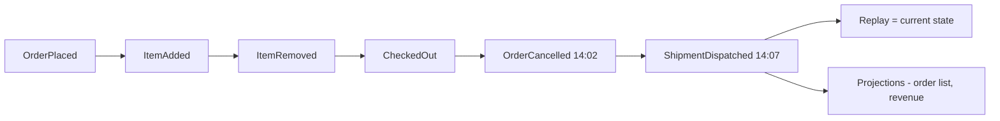

# Module 3 — Storing Data (Storage and Replication)

## Module Introduction
*Original lesson: [Module introduction on DesignGurus ↗](https://www.designgurus.io/course-play/system-design-patterns/doc/6a5346f301e8e02a37d09f39)*

**What this module is about.** Module 2 covered the *arrows*; this one covers the most important box: the database. API servers are *stateless* (they keep no lasting **state**, i.e. data remembered between requests), so you can add ten or lose three unnoticed. The database holds the system's **facts** — payments, ownership, the record of what happened — and you can't simply run a second independent one beside it, because two separate copies of the truth drift apart. So as a product grows, the database is usually the first part to hit its limit and the most dangerous to change.

**Analogy.** The database is the company's official ledger. Hiring clerks (app servers) is easy; letting each clerk write in whichever of two ledgers is nearer guarantees they soon disagree.

**The six patterns and when each applies**

| The situation | The pattern |
|---|---|
| Reads are too many for one machine, but every write still has to land in one place | Primary-Replica |
| There is more data, or more writes per second, than one machine can handle | Sharding |
| Adding a single extra machine should not make most of the data move | Consistent Hashing |
| A crash in the middle of a write must never lose or damage data | Write-Ahead Log |
| You need every change that ever happened, not just today's value | Event Sourcing |
| Reads and writes each need the data arranged in a different shape | CQRS |

**Two facts that organize the whole module**

1. **Reads and writes scale differently.** Scale reads by *copying* (put the data on several machines, point each reader at one). Copying does nothing for writes, since every copy must apply every write; scale writes by *dividing* (each machine owns one piece). "Copy for reads, split for writes" tells you when the first three patterns fit and answers much of any database design question.
2. **An append-only log sits underneath everything.** A file you only add to, never edit. The Write-Ahead Log uses it for crash recovery and replication; Event Sourcing makes it the app's data model; CQRS builds separate read and write models from it. Module 2 explained *why* services announce facts; this module explains *where they live*: an ordered log from which every other view is built.

**How the module is told.** The same online store starts with one database doing everything, as most companies do. Reads overload it (→ Primary-Replica); then writes and data size (→ Sharding); changing the shard count hurts (→ Consistent Hashing); a power cut tests durability (→ Write-Ahead Log); finally the order system is rebuilt on the log (→ Event Sourcing, CQRS). The capstone replays the journey at 100 million users. **Short on time?** Primary-Replica, Sharding and Consistent Hashing underpin nearly every "design X at scale" question.

**Four terms used throughout**
- **Read path vs. write path** — queries that *get* data vs. requests that *change* it; they need different scaling tools, carry different risks, and may end up on different databases.
- **Replication lag** — a copy receives changes from the original after a delay (milliseconds, sometimes more): the database form of **eventual consistency** (copies match *in the end*). Basics: [Module 0 — Replication](../00-system-design-fundamentals/README.md#replication).
- **Shard key** — the field that decides which machine owns a row; it decides how evenly work spreads, and a poor one causes the capstone's main failure.
- **Durability** — once the database says "saved," the data survives a crash, reboot or power cut. The write-ahead log keeps that promise.

**Before you start — three questions about a system you know** (the capstone asks them again):
- If your database server died now, how much data would you lose, how long to recover, and has anyone practiced it?
- What is your read/write split? (Measure, don't guess; it decides which patterns fit.)
- With twice the users tomorrow, what runs out first: write capacity, read capacity, or disk?

---

## Primary-Replica
*Original lesson: [Primary-Replica on DesignGurus ↗](https://www.designgurus.io/course-play/system-design-patterns/doc/6a534757d69c6e1df6958c69)*

**What it is.** One database machine, the **primary**, takes every write and streams its changes to one or more **replicas**, each holding a live copy and answering reads. If the primary dies, a replica can be *promoted* to replace it.

**Analogy.** Only the teacher (primary) writes on the main whiteboard; assistants (replicas) copy each change onto their boards; students read the nearest board; if the teacher is sick, the most up-to-date assistant takes over.

### The problem

The store has run for years on one PostgreSQL (open-source relational database) machine. Traffic: **8,000 reads/s** (product pages, search, order history) and **300 writes/s** (orders, carts), on a machine that handles **5,000 queries/s** total. Product pages take **4 seconds**, and checkout slows because reads and writes compete for CPU, memory and disk. **96%** of traffic is reads; that split *is* the problem.

Behind it hides a second one: this machine is the **only copy** of the data — one disk, one power supply, a **single point of failure** (one part whose failure stops everything). Last night's backup can't restore today's orders; a 4 PM failure loses the day. One pattern fixes both.

### Why the obvious fixes fail

- **"Buy a bigger machine."** Maybe a year's relief, but hardware tops out, high-end prices climb steeply, upgrades mean downtime, and there's still one copy.
- **"Put a cache in front."** Helps (Module 4), but a cache is a *performance layer*, not a trusted second copy: misses still hit the database, cached data goes stale, and cached pages can't rebuild the orders table.
- **"We copy the database nightly."** A backup isn't a replica: hours old, serves no traffic, takes hours to restore. It prevents total loss but protects neither today's data nor today's load.

You need extra copies that stay *current*, *serve traffic*, and are *ready to take over*.

### How it works

*Figure — Primary-Replica (course diagram)*

The application sends **all writes** to the primary and **reads** to Replicas 1 and 2; the primary pushes a **stream of changes** to each replica.

1. **Every write goes to the primary.** Two writers could change one row two ways and the copies would disagree; one writer, many readers rules that out *by design*.
2. **The primary writes each change to an ordered log and ships it to replicas** — the same log it uses to survive crashes ([Write-Ahead Log](#write-ahead-log)). *Replication means shipping the log.*
3. **Each replica replays changes in exactly the same order**, so its copy matches.
4. **Reads are spread across replicas** — the source of the extra capacity.
5. **Replication lag is expected and handled.** Usually milliseconds, seconds under heavy load. Its visible symptom is the **read-your-writes problem**: a user saves (to the primary), reloads (from a lagging replica), and their edit seems to vanish.
6. **Failover when the primary dies.** *Failover* is switching to a backup. Missing **heartbeats** (small regular "I'm alive" messages) reveal the failure; the most up-to-date replica is **promoted** (set to accept writes, with application traffic redirected to it).
7. **Fencing prevents split brain.** **Split brain** is when the old primary returns, unaware it was replaced, and keeps accepting writes, so two primaries diverge. Safe failover first **fences** the old primary (forcibly blocks its writes), then promotes.

### Walkthrough with numbers

- **Two replicas splitting reads:** ~**4,000 reads/s** each, within capacity. The primary handles 300 writes/s plus the few reads that must be fresh, dropping from **8,300 queries/s to a few hundred**. Product pages go **4 s → 80 ms**.
- **Measure the lag:** usually **10–50 ms**, unnoticed; during a bulk import it hits **8 seconds** and read-your-writes complaints start. Lag is *a number you monitor*, not a constant.
- **2 AM failover drill:** detection takes ~**15 s** of missed heartbeats, promotion ~**30 s**; for those **45 seconds** writes (checkout) fail while reads keep working.
- **Hidden cost of asynchronous replication:** the primary says "saved" *before* the change reaches a replica, so failover can lose the last **~200 ms** of confirmed writes (see the comparison).
- **Bonus:** backups and heavy analytics run at full speed on a replica, away from production.

### Async vs. sync replication (the comparison)

Every replicated setup must decide: *when does the primary tell the client "saved"?*

| | Asynchronous | Synchronous |
|---|---|---|
| Primary says "saved"... | Right away, and sends the change afterward | Only once a replica confirms it has the change |
| Write latency (time until "saved") | Fast (only local work) | Slower (one network round trip at minimum) |
| If the primary dies | The most recent confirmed writes might be lost | No confirmed write is lost |
| If a replica dies or slows | No one notices | Writes stall or fail, because the replica now sits on the critical path (the steps a write must wait for) |
| Fits | Most workloads: feeds, catalogs, profiles | Moving money, committing inventory |

- **Async is the usual default:** losing ~200 ms of writes in a rare failover usually costs less than sync's price (a round trip on every write, and stalls whenever a replica struggles).
- **Semi-synchronous** waits for exactly *one* replica: zero-loss failover for modest latency — what serious money-handling systems typically run.
- **Strong answers pick a mode per table or operation**, not one for everything.

### Trade-offs

**You gain:**
- Read capacity that grows with machines — the standard answer to a 96%-read workload.
- Survival: a promoted replica restores service in under a minute instead of a half-day restore.
- A safe place for backups, analytics and experiments.

**You pay:**
- **Lag and its oddities.** Replica reads are slightly stale, so the app must route reads *needing fresh data* to the primary and the rest to replicas.
- **Zero write scaling.** Every replica applies every write, so replicas add no write capacity (the primary even gains a follower to feed). Writes beyond one machine need *dividing* ([Sharding](#sharding)).
- **Untested failover is dangerous.** Split brain, async data loss and never-run promotion scripts each break recovery; an unpracticed failover plan doesn't exist.
- **More to run:** machines, lag dashboards, heartbeats, **runbooks** (step-by-step incident guides).

### When not to use it

- **Write-heavy workloads** (logging, **telemetry** — constant measurement streams from devices or servers — frequent updates): replicas multiply work, add no capacity. That's sharding's problem.
- **Small scale with good backups:** one well-sized machine, tested backups and an hour's acceptable recovery is a professional setup. Don't adopt distributed-systems problems early.
- **Every read must be fully fresh** (some trading and inventory cases): routing all reads to the primary cancels the benefit. Pay for sync replication or challenge the requirement.
- **As a promise writes never pause:** failover takes seconds to minutes.
- **Classic misuse:** adding read replicas for a *write* overload, which only adds primary work. Always ask "reads or writes?" first.

### Real-world examples

- **PostgreSQL streaming replication** and **MySQL replication** — the textbook form; most companies' first scaling step looks like the walkthrough.
- **MongoDB replica sets** — MongoDB is a document database (JSON-like records instead of rows); replicas hold an *election* and promote a new primary themselves, usually within seconds.
- **AWS RDS and Aurora** — the pattern as checkboxes: "add read replica" and "enable Multi-AZ" (AZ = availability zone, a separate datacenter in a region; keeps a synchronously replicated standby for failover). **Aurora** allows up to **15 replicas** sharing one storage layer.
- **For AI engineers:** **vector databases** (storing **embeddings** — number lists representing meaning — and finding the closest) use one writer and replicas for **similarity search**. A **feature store**'s online reads (input values for ML models) are exactly replica-friendly traffic. Run training and evaluation jobs on a replica so a 2-hour scan never slows production. Read-your-writes bites ML too: a prediction served from a lagging replica may use yesterday's feature value.

### In the interview

Prompts: "Your database is overloaded — what do you do?" (ask first: *"reads or writes?"*), "What happens when the database dies?", "A user can't see their new comment right away."

> **30-second answer:** One primary takes every write and streams its change log to replicas that serve reads, scaling reads horizontally for read-heavy workloads and giving failover: the most caught-up replica is promoted, with fencing so the old primary can't cause split brain. Two costs: replication lag, so reads that must be fresh (like a user's own write) go to the primary; and zero added write capacity, since every replica applies every write. Write bottlenecks need sharding, not more replicas.

**Likely follow-ups (with answers):**
- *"A user edits their profile and the edit isn't there after reload. Fix it."* — Read-your-writes. Cheapest first: (1) route that user's reads to the primary for ~10 s after a write; (2) record the log position of their latest write and read only from replicas past it; (3) show the change optimistically in the UI while storage catches up.
- *"How automatic should failover be?"* — Automatic detection and promotion (seconds count at 2 AM), but only with fencing in place; two primaries are a far worse day than one dead one. Whatever the mechanism, practice it deliberately.

**Mistake that fails candidates:** read replicas for a write bottleneck, or describing failover as instant and free with no mention of lag, the data-loss window or split brain.

### Self-check

- **Q1. What scales when you add replicas, what doesn't, and why?** → Read capacity scales (each replica serves reads). Write capacity doesn't: a write costs work once *per copy*, and the primary gains another follower. You also gain failover and a home for backups/analytics.
- **Q2. A platform stores social-feed posts and account balance transfers. Which replication mode for each?** → Feed posts: async (users feel latency on every post; loss only in rare failovers). Transfers: synchronous or at least semi-sync — a bank can't lose ~200 ms of confirmed transfers. Choose per table/operation.
- **Q3. After adding two replicas: "I updated my shipping address, refreshed, the old one was back; a minute later it was fine." Diagnose and give two fixes with costs.** → Read-your-writes from replication lag; it "fixed itself" when the replica caught up. Fix 1: route the user's reads to the primary for ~10 s after a write — costs **session state** (remembering per-user facts like "wrote 5 s ago" between requests) and loses the replica benefit for those reads. Fix 2: read only from replicas past the write's log position — extra data-layer plumbing, but reads stay on replicas. (Cosmetic cases: optimistic UI.) The *wrong* fix is sending every read to the primary.

### Related patterns

[Sharding](#sharding) (when *writes* outgrow one machine) · [Write-Ahead Log](#write-ahead-log) (the replicated stream *is* this log) · Load Balancing (spreads reads over replicas) · [Cache-Aside](../04-caching/README.md#cache-aside) (catches the hottest reads before any replica).

### TL;DR

- **Problem:** one database machine is a read bottleneck (reads usually ~95% of traffic) and the only copy — a single point of failure.
- **Mechanism:** one primary takes all writes and streams its change log to replicas, which serve reads and stand ready for promotion; fencing prevents split brain.
- **Costs:** lag and read-your-writes surprises, zero extra write capacity, failover that only counts if practiced.
- **Skip it when:** writes are the bottleneck (shard), one machine plus tested backups fits, or every read must be fully fresh.

---

## Sharding
*Original lesson: [Sharding on DesignGurus ↗](https://www.designgurus.io/course-play/system-design-patterns/doc/6a53480cd69c6e1df6959557)*

**What it is.** Sharding divides *the rows of one table* across many machines (**shards**). A rule on one field, the **shard key**, decides where each row goes. Each shard fully owns its piece — writes, reads and **indexes** (sorted lookup structures that make finding rows fast). No machine holds everything.

**Analogy.** A phone book too big for one volume splits into A–F, G–M, N–S, T–Z: everyone knows the rule, any name is one step away, and four printers update four volumes at once.

### The problem

Replicas fixed reads, but eighteen months later the *primary* struggles in a way replicas can't fix. Writes rose from **300 to 2,500/s** (orders, carts, inventory, reviews), and since every replica applies every write, the primary *and every replica* are overloaded; lag grows to **minutes**. A fourth replica would make it worse.

The data is also too big: the orders table is **4 TB**, its indexes no longer fit in memory (so lookups hit disk), backups run all night, a **schema migration** (table-structure change) is a weekend project, and you already rent the cloud's largest machine. Write volume and data volume are the same problem: *too much for one machine, however many copies.*

### Why the obvious fixes fail

- **"More replicas."** Copies help reads; this is a write problem, which copies worsen.
- **"An even bigger machine."** You have the biggest. Even if one existed: steep prices, downtime, and the same wall within a year.
- **"Archive old data."** Moving orders older than two years to **cold storage** (cheap, slow storage for rarely read data) is worth doing — maybe 4 TB → 1.5 TB — but buys quarters, not years; the *write rate* doesn't fall.
- **"Split by table"** (a **functional or vertical split**: orders, users, inventory on separate machines). Often a sensible first move, but orders alone holds most writes and bytes; eventually one table outgrows one machine.

These *move* load; you need to *divide* it.

### How it works

*Figure — Sharding (course diagram)*

Each request passes a **routing rule** (a hash of `customer_id`) that sends it to exactly one of four shards; Shard 1 holds a group of customers *together with their orders*.

Three decisions determine success:

1. **Pick the shard key — the most important decision in the module.** A good key:
   - **Appears in almost every query**, so each query hits one shard (shard by product and every "my orders" query searches all shards).
   - **Spreads load evenly**, so no shard is the busy one.
   - **Keeps related rows together:** with `customer_id`, a customer's orders, addresses and cart share a shard, so checkout never crosses machines.
2. **Pick the routing rule** (key → shard number).
   - **Hash sharding:** run the key through a **hash function** (turns any value into an evenly spread number) and take the remainder: `hash(customer_id) % 4`. Even spread; the default.
   - **Range sharding:** each shard owns a range (A–F, or a date range). Neighbors stay together, great for range queries, but sharding by date sends 100% of today's writes to one shard.
3. **Decide who routes:** the application, a **proxy** (a middleman forwarding each query to the right shard), or the database itself (MongoDB, Vitess, Citus). All work at scale if every caller applies the identical rule.

**The price.** Cross-shard questions get harder. "This customer's orders" hits one shard; "top 10 products today" must ask every shard and merge: **scatter-gather**. Cross-shard **joins** (combining rows from two tables on a shared field like `customer_id`) become application work, and a **transaction** spanning two shards (two customers on different shards exchanging money) can no longer be one **atomic** (all-or-nothing) database transaction; the **saga** pattern (later) exists for this. Sharding buys write capacity with query flexibility.

### Walkthrough with numbers

Four shards, routed by `hash(customer_id)`:
- **Writes:** 2,500/s ÷ 4 ≈ **625/s per shard**, with headroom. Each shard is its own primary-replica cluster: sharding doesn't replace replication; it multiplies it.
- **Data:** 4 TB ÷ 4 = **1 TB per shard**: indexes fit in memory, backups take hours, migrations become manageable.
- **Queries, easy to hard:** "customer 8412's orders" → hash, one shard, as fast as before. "Top sellers today" → scatter-gather over four shards and merge in the app: slower and clumsy, which is why heavy analytics usually moves to a separate event-fed system (see change data capture).
- **The problem waiting:** in two years you need 8 shards; `hash(id) % 4` → `% 8` changes the remainder (what `%`, **modulo**, keeps) for nearly every customer, so almost all data must move. Next lesson.

### Hash vs. range sharding (the comparison)

| | Hash sharding | Range sharding |
|---|---|---|
| How it routes | `hash(key) % N` | By range: A–F on one shard, G–M on another; Jan on one, Feb on another |
| Load spread | Excellent, and happens automatically | Only as good as the ranges you pick; time ranges send every new write to one shard |
| Range queries (dates, prefixes) | Bad: one range ends up spread over every shard | Excellent: neighboring values sit together |
| Hot key risk | A single huge key still overloads its shard | The same, and hot ranges too |
| Resharding | Painful with plain modulo (the next lesson fixes this) | You can split a busy range where it sits, which is gentler |

**Hash** by default: for transactional work, even spread beats range queries. **Range** when access really is by range (**time series** — timestamped measurements — leaderboards, alphabetical browsing), managing ranges so the current month doesn't become one overloaded shard.

### Trade-offs

**You gain:**
- Write capacity that grows with machines, which replication never gives.
- Data size that grows the same way; no table must fit one machine.
- A smaller **blast radius** (share of users one failure affects): shard 3 dying hits a quarter of customers, and its own replica failover fixes even that.

**You pay:**
- **Query flexibility:** single-shard queries stay fast; cross-shard ones become scatter-gather; cross-shard joins and transactions are yours.
- **Hot shard risk:** a **hot shard** gets far more load than the rest. Hashing spreads *keys*, not *load*: one huge key — a celebrity, or a giant **tenant** (one customer company on a shared product) — lands entirely on one shard, and more shards don't help.
- **Resharding pain:** changing shard count moves lots of live data; plain modulo makes it a disaster.
- **More to operate:** 4 shards × (primary + 2 replicas) = **12 databases**: twelve failovers, twelve backup schedules, and a routing layer everyone must understand.

### When not to use it

Sharding is a **last resort**, after cheaper options:
- **Vertical scaling still has room** (a bigger machine adds no new failure modes).
- **The real problem is reads** (replication, at ~a tenth of the complexity).
- **The data can shrink** (archiving or expiry can delay sharding by years).
- **A functional split suffices** (no single table outgrows a machine).
- **Queries don't match any split** (heavy cross-entity joins and transactions); rethink the data model first.

**Misuses:** *sharding for prestige* — four shards at a scale one Postgres handles, paying complexity for years before scale arrives, if ever. And the classic key mistake: **auto-incrementing ID with range routing** (IDs assigned 1, 2, 3…, so new rows always get the highest), sending every new row to the newest shard.

### Real-world examples

- **Instagram** sharded Postgres by user ID and embedded shard info in the IDs; a well-chosen key ran billions of photos on ordinary databases.
- **Slack** shards by workspace, a natural tenant key since nearly every query is "inside this workspace"; giant workspaces creating hot shards is the self-check scenario at huge scale.
- **Vitess** (from YouTube, now **open source** — public, free code) and **Citus** add sharding to MySQL and Postgres; **MongoDB** has it built in (choose a key; routing and rebalancing are handled).
- **DynamoDB and Cassandra** (Amazon's managed key-value database; an open-source wide-column database) are built around sharding: your table's *partition key* *is* the shard key, which is why their docs teach choosing it first.
- **For AI engineers:** feature stores shard by entity ID (user, item); training datasets shard by example ranges for parallel loading; a vector index beyond one machine is sharded with scatter-gather similarity queries (later vector-database sharding lesson).

### In the interview

Any "design Twitter / Instagram / Uber at scale" reaches here within minutes. The interviewer wants your **shard key, with reasons**, then the predictable follow-ups: the celebrity, resharding, the cross-shard transaction.

> **30-second answer:** When writes or data size outgrow one machine, I shard rows by a key that appears in almost every query, spreads load evenly, and keeps related rows together — customer ID for commerce, so checkout never crosses machines. Hash routing by default; each shard is its own primary-replica cluster. Accepted prices: cross-shard queries become scatter-gather, cross-shard transactions need application-level patterns, one hot key can still overload a shard, and resharding needs consistent hashing rather than modulo.

**Likely follow-ups (with answers):**
- *"You sharded by user ID. A celebrity with 40 million followers goes live."* — Their shard overloads while others idle (hashing spreads keys, not load). Escalating fixes: (1) cache the hot entity's reads; (2) give the few extreme keys dedicated shards; (3) split that entity's data further (e.g. reshard their follower list by follower ID). Naming the problem before the interviewer does counts most.
- *"Two users on different shards send each other money."* — First avoid it: a good key keeps most transactions on one shard. Otherwise it can't be one database transaction; it becomes a coordinated series of steps with failure handling — a saga. Seeing the key choice as the first line of defense marks a senior candidate.

**Mistake that fails candidates:** "we'll shard from day one" with no mention of cost, a key chosen without reasons, or no answer for changing the shard count.

### Self-check

- **Q1. What does sharding scale that replication can't, and what are the three properties of a good shard key?** → Write capacity and total data size: replication copies *everything* everywhere and every copy applies every write; sharding gives each machine its own slice. A good key appears in nearly every query, spreads load evenly, and keeps related rows together.
- **Q2. Multi-tenant SaaS (software-as-a-service sold by subscription; multi-tenant means many customer companies share one system; companies sign up, employees use it): shard by `company_id`, `user_id`, or the row's random ID?** → `company_id`: nearly every B2B (business-to-business) query is "inside this company," so it stays on one shard and a company's data stays together for export and deletion. Known risk: very unequal tenant sizes, so plan dedicated shards for giants. `user_id` turns company-wide queries ("all documents in this workspace") into scatter-gather. A random row ID spreads perfectly but no lookup knows where anything lives.
- **Q3. Hashed `user_id` across 8 shards; an influencer's live shopping event (40M followers) overloads shard 5 while the others sit at 15%. Diagnose and give three fixes.** → A hot key: keys are spread evenly, but one carries 40M users' load. (1) Cache storefront reads (nearly identical for all viewers; may suffice alone). (2) Dedicated shards for celebrity accounts. (3) Split the influencer's data by a second key such as follower ID. Bigger lesson: monitor per-shard load, because the business keeps creating unequal keys.

### Related patterns

[Primary-Replica](#primary-replica) (each shard is a replicated cluster) · [Consistent Hashing](#consistent-hashing) (changing shard count without moving almost everything) · Saga (what a cross-shard transaction becomes) · [Cache-Aside](../04-caching/README.md#cache-aside) (first defense against hot keys).

### TL;DR

- **Problem:** writes and data size outgrow one machine, and replication can't help (every copy applies every write; no copy is smaller).
- **Mechanism:** split rows across shards by a well-chosen key (in nearly every query, evenly spread, keeps related rows together); hash routing by default; each shard a primary-replica cluster.
- **Costs:** scatter-gather queries, app-handled cross-shard transactions, hot keys, resharding data movement, operations multiplied by shard count.
- **Skip it when:** a bigger server, more replicas, archiving or a functional split still works, or the workload is cross-everything joins and transactions. Last resort.

---

## Consistent Hashing
*Original lesson: [Consistent Hashing on DesignGurus ↗](https://www.designgurus.io/course-play/system-design-patterns/doc/6a5348ca01e8e02a37d0af1b)*

**What it is.** A routing rule for spreading keys over servers so that adding or removing one server moves only a small slice of data (~1/N) instead of nearly all. Servers and keys are hashed onto a circle; each key belongs to the first server clockwise.

**Analogy.** Houses (keys) on a circular road are covered by the next fire station (server) clockwise. A new station takes over only the houses between it and the previous station; all others keep theirs.

### The problem

Four shards routed by `hash(customer_id) % 4`, 625 writes/s each. Growth calls for a **fifth shard**: `% 4` → `% 5`. A key stays put only if `hash % 4 == hash % 5`, true for just **20%** of hashes. One extra shard leaves **80% of the data on the wrong machine**: ~**3.2 of 4 TB** must move.

That means copying terabytes over a weekend while orders keep arriving, writing to old and new locations, a tested rollback plan, a slow week — and again at shard six and seven. The `% N` rule is the problem: N is built into every key's address, so changing N breaks nearly every address. A better rule moves only what the new machine should own.

### Why the obvious fixes fail

- **"Migrate over a weekend."** 3.2 TB moving while 2,500 writes/s change the source needs double-writes and consistency checks, repeated at every resize; teams put it off and run too few overloaded shards for years.
- **"Only ever double: 4 → 8."** Each key stays or moves to one specific new shard, but **50%** still moves, and needing 25% more capacity means buying 100% more plus a **2 TB** migration.
- **"Keep a lookup table."** A **directory** ("customer 8412 lives on shard 3") is valid (compared below), but one row per key means a hundred million rows answering every query — the most availability-critical part of the system. Grouping keys into ranges lightens it.

### How it works

*Figure — Consistent Hashing (course diagram)*

Panel 1: servers A–D on the ring; each key hashes to a point and walks clockwise to a server. Panel 2: adding E between B and C takes part of C's slice; A, B and D keep every key, and only the dashed range transfers.

1. **The hash space is a circle:** 0 up to a large maximum, wrapping to 0.
2. **Hash every server name and every key onto it.**
3. **Each key belongs to the first server clockwise.** A sorted list of server positions finds it in microseconds.
4. **Adding a server moves one slice.** When E lands between B and C, only keys in E's new slice (all formerly C's) change owner; E copies them from C. With N servers, adding one moves ~**1/(N+1)**: **20%** for 4→5, ~**2%** for 50→51.
5. **Removing a server is the reverse:** the next server clockwise takes its slice and all its load. Two weaknesses: few servers with random placement give very uneven slices, and a failure dumps everything on one neighbor.
6. **Virtual nodes fix both.** Place each server at **100–200 points** (**virtual nodes, vnodes**). Each server owns many small scattered slices, so randomness evens out; a dead server's ~150 slices go to ~150 different neighbors. Stronger servers can get more vnodes, weighting by capacity.

**What it does *not* fix.** It handles **membership churn** (servers joining and leaving), not **hot keys** (one key with unusually heavy load). The celebrity still hashes to one point and one server, and still needs caching and special placement.

### Walkthrough with numbers

- **The resize again:** adding a fifth shard to 4 TB — modulo moves 3.2 TB from every shard; the ring moves ~**0.8 TB (20%)**, only from the new shard's neighbors, copied in the background over days while old owners serve until handoff.
- **The failure again:** without vnodes, shard 3 dying dumps all its load on shard 4, which may also fall — a **cascade**. With **150 vnodes** per server, every survivor takes a manageable ~25% increase.
- **Where it started — caches:** in a 50-node cache cluster ([Cache-Aside](../04-caching/README.md#cache-aside)), modulo routing remaps ~**98%** of keys whenever a node is added or removed, so ~98% of lookups miss and hit the database: a **miss storm**. A ring remaps **~2%**. Cache clients have used consistent hashing since the late 1990s because cache clusters resize constantly.

### The ring vs. the directory (the comparison)

Built properly, the lookup table becomes a **directory service** mapping *ranges* (not single keys) to servers, with clients caching answers — the ring's real rival.

| | Consistent hashing (ring) | Directory (range-to-server map) |
|---|---|---|
| Data moved on resize | About 1/N, with no manual work | Whatever you decide; completely flexible |
| Placement control | None: the hash decides | Complete: you pin, split and move ranges yourself |
| Hot range/tenant | Can't be treated as a special case | Split the hot range, move it, finished |
| Extra infrastructure | None: it's just math inside the client | A metadata service (a small service holding the "what lives where" map) that has to stay highly available |
| Range queries | Spread around | Natural: ranges stay together |
| Typical home | Caches, clusters that change size, peer-to-peer (machines that talk directly with no central server) | Databases that want operational control |

**The modern hybrid:** hash keys into many small fixed **buckets** and keep a small directory mapping buckets to servers. **Redis Cluster** does this with **16,384 "hash slots"**: the hash gives even spread (the ring's strength), and moving a slot is a one-row directory change (the directory's strength). It's the answer to "what comes after the ring?"

### Trade-offs

**You gain:**
- Minimal data movement on membership change (~1/N per server).
- Growth by exactly one machine instead of doubling.
- Failures spread thinly (with vnodes) instead of cascading.
- No central directory: every client with the server list computes the same answer.

**You pay:**
- **Virtual nodes are mandatory;** home-made versions often omit them (mature libraries enable them by default).
- **Slightly more complex routing:** a sorted lookup instead of one modulo — microseconds, but every client must implement it identically.
- **Still hashing:** range queries ("all orders from March") stay scattered.
- **Less movement is still movement:** caches shrug off misses, but storage handoffs need ordering: stream the slice → keep serving from the old owner → switch ownership → delete the old copy.

### When not to use it

- **Cluster size truly never changes** (a fixed 4-shard setup for five years can keep modulo; be honest about "never").
- **Range queries dominate:** range sharding with a directory; no hashing suits it.
- **You want manual placement:** "pin this giant tenant to its own shard" is clumsy on a ring, easy in a directory.
- **Tiny fixed systems:** two cache nodes don't need ring math.
- **Common misuse:** the ring for database shards but modulo for the cache layer — caches change membership *more* often, each change a potential miss storm, so they may need it first.

### Real-world examples

- **Akamai** — consistent hashing was invented there (Karger et al., **1997**) to route web requests over constantly changing cache fleets.
- **Amazon's Dynamo paper (2007)** made "ring plus virtual nodes" the signature technique of distributed databases; **Cassandra** and **Riak** adopted it directly and **DynamoDB** descends from it.
- **Memcached** (a simple in-memory cache server) **clients** have included it for two decades, because of the miss-storm math.
- **Redis Cluster** uses the hybrid: 16,384 hash slots mapped to nodes via a directory.
- **For AI engineers:** in LLM **inference** (running a trained model to produce answers), a conversation's **KV cache** (the model's saved intermediate results for earlier tokens) stays on the GPU that last served it; routing by conversation ID with consistent hashing preserves that as autoscaling changes worker count, moving only ~1/N of conversations per event. The same approach assigns embedding-space partitions to workers in a sharded vector index.

### In the interview

Entry points: "design a distributed cache," then "now add a node"; or you shard with modulo and are asked about 4→5. Be ready to derive the 80%.

> **30-second answer:** Modulo routing builds the server count into every key's address, so going 4→5 shards moves 80% of the data. Consistent hashing puts servers and keys on a ring; each key belongs to the next server clockwise, so a new server takes one slice (~1/N) and nothing else moves. Each server appears as 100+ virtual nodes, keeping slices even and spreading a dead server's load. It solves churn, not hot keys. For manual placement or range queries I'd use the hybrid — hash slots plus a small directory, as Redis Cluster does.

**Likely follow-ups (with answers):**
- *"Why virtual nodes?"* — Both reasons: one point per server gives very uneven slices, and a failure dumps its whole load on one neighbor. 100+ points even out slices and spread failure load.
- *"Does the ring fix your celebrity problem?"* — No, and saying so plainly earns points. One key still hashes to one server. The ring fixes *churn*; *skew* (unequal load per key) needs caching and special handling.

**Mistake that fails candidates:** modulo routing in any autoscaling design, or saying "consistent hashing" without explaining what moves when a node joins — the whole pattern answers that one question.

### Self-check

- **Q1. Going from N to N+1 servers, what fraction of keys move under modulo vs. consistent hashing, and why?** → Modulo: ~N/(N+1) (80% for 4→5), because the divisor is in every address. Ring: ~1/(N+1) (20% for 4→5), because only the new server's slice changes hands; every other key's "next server clockwise" is unchanged.
- **Q2. A teammate places each server at exactly one point "to keep it simple". What two problems arrive, and when?** → Uneven load (some slices several times larger), immediately; and at the first failure, a whole slice lands on one neighbor, which may fail too. Virtual nodes fix both.
- **Q3. The cache cluster autoscales up every evening; ten minutes later the database spikes and alerts, though nothing is failing. Connect them, fix it, and quantify for 20 nodes.** → The cache client routes by modulo, so each scale-up changes N and remaps most keys; the cluster misses on nearly everything and the misses hit the database together — a self-inflicted stampede visible only as database load. Fix: consistent hashing with vnodes in the cache client. At 20 nodes, adding one remaps ~1/21 ≈ **5%** instead of ~**95%**, a ~**19×** smaller spike. For caches, resizing is the normal case.

### Related patterns

[Sharding](#sharding) (the ring is its routing layer done properly) · [Cache-Aside](../04-caching/README.md#cache-aside) (where the pattern was born) · Load Balancing (sticky routing that survives autoscaling is this pattern in another job).

### TL;DR

- **Problem:** modulo builds the server count into every address, so one more shard moves ~80% of data and every resize is a painful migration.
- **Mechanism:** hash servers and keys onto a ring; each key goes to the next server clockwise; 100+ vnodes per server keep slices even and spread failures; a resize moves ~1/N.
- **Costs:** vnodes mandatory, identical routing code everywhere, scattered range queries, storage handoffs still need orchestration.
- **Skip it when:** cluster size truly never changes, range queries dominate (directory), or you need manual placement (slot-directory hybrid).

---

## Write-Ahead Log
*Original lesson: [Write-Ahead Log on DesignGurus ↗](https://www.designgurus.io/course-play/system-design-patterns/doc/6a53499012f9060ee9e54b9d)*

**What it is.** Before changing any real data file, the database appends one record describing the entire change to an append-only log, forces it onto the physical disk, and only then tells the client "saved." Tables and indexes are updated later in the background; after a crash, the database replays the log to rebuild them.

**Analogy.** A careful cook pins up every order ticket *before* cooking; after a mid-dish power cut, the tickets show exactly what was promised and what remains.

### The problem

Tuesday, 3:07 AM: a power failure takes out the **rack** (cabinet of stacked servers) holding shard 2. It reboots 90 seconds later into one of two bad mornings:

- **Bad morning A — corruption.** The database won't start: "data files corrupted." One `UPDATE` isn't one disk operation; changing an order's status touches the row *and* two indexes — three places on disk. Power died after the first write, so an index points at a row that says something else, and the database rightly trusts none of it.
- **Bad morning B — lost writes.** It starts, but the last two seconds are gone: **40 orders** customers were told were "saved" never happened, confirmed from memory before reaching disk.

The physics look unbeatable: a disk can lose power mid-write, even mid-**4 KB page** (a **torn write**), and data spans thousands of pages that can't all change in one atomic instant. Every serious database's answer: *first write down what you're about to do, in one safe place; then do it.*

### Why the obvious fixes fail

- **"Write everything to disk immediately, no memory buffering."** Very slow: one `UPDATE` hits three scattered places, and **random writes** (jumping around the disk) cost far more than one continuous stream — ~**100×** on spinning disks. It still doesn't prevent corruption, since power can fail between locations.
- **"Keep everything in memory, snapshot every few minutes."** Fast, but a crash loses *minutes*, and copying a changing dataset is its own hard problem. (Snapshots are half the real answer; see the comparison.)
- **"Buy batteries."** A **UPS** (battery backup) narrows the window but doesn't close it: kernel panics (OS core crashes), hardware faults, the wrong cable unplugged. A durability plan that needs nothing to go wrong isn't one.

The need: record one *logical* change (the whole `UPDATE`) as a single cheap, atomic disk operation. Scattered pages can't; a log can.

### How it works

*Figure — Write-Ahead Log (course diagram)*

The client sends "UPDATE order 7f3a: status = paid"; the database appends a log record, **fsync**s it, gets "on disk, guaranteed," and only then answers "saved." Tables and indexes are updated later; after any crash post-fsync, replay restores consistent data files.

1. **Append one record describing the whole change** (row plus both indexes) to the log's end. One continuous stream to one file is the *easiest* job a disk does. The record carries a **checksum** (a small number computed from its bytes that exposes damage).
2. **`fsync` the log.** Operating systems normally buffer writes and flush when convenient; `fsync` is the system call meaning "don't return until this is physically on disk." This makes the promise real.
3. **Acknowledge the client.** **The one rule everything depends on: never acknowledge before the log record is fsynced.** Everything confirmed is written down; anything not written down was never confirmed.
4. **Apply to tables and indexes later**, in background batches, off the **critical path** (work the client waits for).
5. **After a crash, replay the log on restart**, re-applying each change so the data files match every promise. Both bad mornings disappear. A torn record at the end (the **tail**) fails its checksum and is discarded — safe, since an unfinished fsync was never confirmed.
6. **Checkpoints keep replay short.** Periodically the database flushes pending changes to the data files and writes a **checkpoint** marker ("everything before this is applied"); recovery replays only what follows, and older log can be archived or deleted.

**The connection to replication.** The "stream of changes replayed in order" the primary ships to replicas *is* the write-ahead log: a replica is a machine doing continuous crash recovery from another machine's log. One mechanism, two jobs — durability and replication — and the next lesson pushes the log further still.

### Walkthrough with numbers

- **Write path timing:** appending an order's ~**100-byte** record and fsyncing takes ~**1 ms**; updating the row and two indexes in place while the client waits would take several times longer and still not be atomic. With a log, the fast path is the safe path.
- **Group commit multiplies throughput** (*throughput* = writes completed per second): **50 writes** arriving in the same millisecond are appended and fsynced *once* — 50 durable commits for one flush. That's how ordinary disks sustain thousands of durable writes per second.
- **The crash drill again:** since the last checkpoint (30 s ago) the log holds ~**75,000 records**, replayed in seconds. All 40 orders survive. The torn tail record fails its checksum and is dropped; its client never heard "saved," retried with an **idempotency key** (unique request ID), and was applied once.
- **The knob:** a 30 s checkpoint means fast recovery but frequent flushing; hourly means less overhead but minutes of replay (see the self-check).

### The log vs. the snapshot (the comparison)

Redis makes it visible: **RDB** (periodic snapshots) or **AOF** (an append-only log), your choice.

| | Snapshot (RDB-style) | Write-ahead log (AOF-style) |
|---|---|---|
| Cost per write | Nothing | One append to the log (plus whatever fsync policy you set) |
| Crash loses | Everything since the most recent snapshot (minutes) | At most the final moment not yet fsynced (~zero to seconds) |
| Recovery speed | Fast: load a single compact file | Slower: every change must be replayed, unless a recent snapshot gives you a starting point |
| Disk footprint | Small and compact | Keeps growing, unless history that's already absorbed can be thrown away |

Each is strong where the other is weak, so real systems **use both** via checkpointing: a snapshot plus the log since. Production Redis enables both; PostgreSQL does it with a **base backup + WAL archive**. "Snapshot or log?" → both.

### Trade-offs

**You gain:**
- A durability promise that holds: "acknowledged" always means "on disk."
- Fast writes anyway: one sequential append replaces many scattered updates.
- Replication nearly free: ship the log you already write.
- **Point-in-time recovery (PITR):** old logs plus regular snapshots restore the database to *any chosen moment* — standard for every serious operation.

**You pay:**
- **Everything is written twice** (log, then data files): **write amplification**, disk bandwidth spent on safety.
- **A latency floor per commit:** no faster than the disk confirms an fsync; group commit trades a little latency for a lot of throughput.
- **Log housekeeping:** checkpoints and retention need tuning, and stale dependencies — a dead replica still "subscribed," a stuck archive job — can block log deletion and silently fill the disk.
- **Recovery time is a deliberate setting:** the checkpoint interval caps restart time.

### When not to use it (really: when to turn it down)

Your database chose a WAL long ago; you choose when to *weaken* it:
- **Truly disposable data.** A pure cache refills from the source, so Memcached has no persistence and Redis lets you disable it. Correct, not careless.
- **Re-runnable bulk loads.** Reloading **500 million rows** from a file you still have? Relax durability during the load, then restore it. A normal, honest technique.
- **Know the polite phrasings.** `fsync = off` and "asynchronous commit" both mean "saved" may precede reality — fine for, say, a metrics store that can lose a second, but decide deliberately and document it rather than copying a blog's config.
- **Don't build your own.** Need a durable append-only log? Use a database or a message queue; **Kafka** is this pattern as a product. Almost everyone gets hand-written fsync handling wrong at least once.
- **Benchmark trap:** a storage engine "10× faster than Postgres" often has durability off; drop the persistence guarantee and any database speeds up.

### Real-world examples

- **PostgreSQL's WAL** — the reference: crash recovery, replication (streaming WAL to replicas) and point-in-time recovery (archived WAL + base backups) at once.
- **MySQL/InnoDB** keeps a *redo log* for exactly this; **SQLite's WAL mode** puts it on most phones.
- **Kafka** — a system that is *nothing but* the log, with consumers replaying; hence its recurring role in Module 2.
- **DynamoDB, Aurora, Spanner** — every cloud database has it at the base.
- **For AI engineers:** vector databases (**Qdrant, Milvus, Weaviate**) route ingestion through a WAL so confirmed embeddings are never lost. Long training runs use checkpoint-plus-log thinking: periodic model-state snapshots let a crash resume rather than restart. An agent can durably record an intended action *before* a side effect, so after a crash it can recover and reconcile — provided the action is also idempotent.

### In the interview

Directly: "How does a database survive a power cut without losing acknowledged writes?" Related: design a **key-value store** (a database mapping keys to values, like a giant dictionary), explain why sequential writes are fast, or describe what a restarted database does before accepting queries.

> **30-second answer:** Before touching any data structure, the database appends one record for the whole change to an append-only log, fsyncs it, and only then acknowledges; tables and indexes update later in the background. On restart it replays from the last checkpoint, discarding a torn tail record by checksum, so every acknowledged write survives. The append is sequential, so the safe path is the fast path, and group commit packs many commits per fsync. The same log gives replication (ship it) and point-in-time recovery (archive it with snapshots).

**Likely follow-ups (with answers):**
- *"Why is the log faster than just updating the data files?"* — One sequential append to one file vs. scattered page writes; disks, SSDs included, strongly prefer streams. And one record can cover a change spanning many pages, giving atomicity in-place writes physically can't.
- *"What bounds recovery time, and what if the crash tore the last record in half?"* — The checkpoint interval (only newer records replay). The torn tail fails its checksum and is discarded — safe because it can't have been fsynced, so its client never heard "saved." Tying it back to the acknowledgment rule completes the answer.

**Mistake that fails candidates:** "the database writes it to disk" with no step ordering, or quoting benchmarks with durability off.

### Self-check

- **Q1. Put these in order — apply to tables, fsync, acknowledge client, append to log — and state the rule that makes it safe.** → Append → fsync → acknowledge → apply to tables (later, background). Rule: never acknowledge before the record is fsynced; then no acknowledged promise can be lost, whenever the crash comes.
- **Q2. One team checkpoints every 15 s, another every 2 h. Describe their good and bad mornings.** → 15 s: constant cost (frequent flushing, more background I/O, slightly less spare throughput) but recovery in seconds. 2 h: little daily overhead, but up to two hours of replay — minutes to tens of minutes of downtime after the machine returns. Neither is wrong; choose from the **recovery-time objective** (how long a restart may take), not defaults.
- **Q3. A teammate says a new engine is "11× faster on writes" than Postgres; its config says `durability: relaxed`. Explain the 11× and make it fair.** → Most of the 11× is the durability promise handed back: it acknowledges before data is on disk, comparing memory speed with a disk promise ("saved means saved" vs. "probably"). For a fair test, set `synchronous_commit = off` in Postgres or make the new engine fsync every commit. Relaxed durability is fine if the workload can lose a second; the mistake is not knowing you chose it.

### Related patterns

[Primary-Replica](#primary-replica) (replication *is* shipping this log) · [Event Sourcing](#event-sourcing) (the log becomes the app's data model) · Change Data Capture (reads the WAL to emit change events) · [Message Queue](../02-moving-data/README.md#message-queue) (Kafka is this pattern as a product).

### TL;DR

- **Problem:** one logical write touches many scattered disk spots and power can fail between any two, so in-place writing can't deliver "saved means saved."
- **Mechanism:** append one checksummed record for the whole change, fsync, then acknowledge; apply later; after a crash replay from the last checkpoint; group commit shares one fsync across many writes.
- **Costs:** double writes, an fsync latency floor, log housekeeping, recovery time capped by checkpoint interval.
- **Skip/relax it when:** data is truly disposable (caches) or a redoable bulk load justifies it temporarily — always deliberately, never by config accident.

---

## Event Sourcing
*Original lesson: [Event Sourcing on DesignGurus ↗](https://www.designgurus.io/course-play/system-design-patterns/doc/6a534aa50f692c80bb59beaf)*

**What it is.** Instead of storing *current state* and overwriting it, store *what happened*: each change is appended as an **immutable** (never changed once written) event with business meaning (`OrderPlaced`, `ItemRemoved`, `OrderCancelled`). Current state is the result of replaying an entity's events from the start. The log doesn't record the truth; it *is* the truth.

**Analogy.** Your bank keeps transactions, and your balance is their running total; it can explain "why $412?" line by line forever, and fixes mistakes with correcting entries, never erasures. Accountants have worked this way for ~500 years.

### The problem

Three questions in one week the database can't answer:
- **Monday, a dispute.** A customer says they cancelled order 7f3a before it shipped and wants return postage refunded. Support sees `status = shipped`. Was it ever `cancelled`, maybe for minutes at 14:02 before the shipping job overwrote it? Each `UPDATE` replaced the last value; the history isn't hidden, it's **destroyed**.
- **Wednesday, a bug.** A pricing bug two weeks ago corrupted some totals and was fixed. Finance wants to know which of ~**90,000** orders were affected, but the wrong totals were overwritten, some fixed by hand, and the fix erased the evidence.
- **Friday, product.** "How often do customers add then remove an item before checkout?" Cart removals were never stored.

One root cause: the database keeps only the present, and `UPDATE` destroys the past. Beneath its tables the database *already* keeps an append-only log, but privately, for its own survival, and in **row-diffs** ("column X changed to Y"), not business terms. What if the application kept such a log in business language and treated it as the truth?

### Why the obvious fixes fail

- **"Add an audit table"** (**triggers** — database rules that run automatically on every change — or app code copying changes into `order_history`). Half works, but it's an afterthought copy: some code path forgets it, backfills skip it, and when it disagrees with the orders table, which is right? It's only as reliable as its sloppiest writer, and still records diffs ("status: shipped"), not intent ("customer clicked cancel").
- **"Add `updated_at`, `previous_status`… columns."** Clutters the schema and keeps one step of history; maybe answers Monday, never Wednesday or Friday.
- **"We have point-in-time backups."** True (WAL lesson), but restoring a two-week-old database to answer one question is slow, and a backup shows *that* a row changed, never *why*.

All three bolt history onto a source of truth that forgets. Event sourcing inverts that.

### How it works

*Order 7f3a's stream: replay reveals the cancel-then-ship race the old design overwrote.*

Order 7f3a as six events: placed ($49, item A, 13:41), item B added ($89), item A removed ($40), checked out ($40, 13:51), cancelled at 14:02, dispatched by UPS at 14:07. Replay gives "shipped but cancelled" — a conflict the old design silently overwrote, now in the open. The same stream feeds projections such as an order list and revenue totals.

1. **The event store:** an append-only home organized as **one stream per entity** (all of 7f3a's events, in order). Appending is the *only* write — the write-ahead log again, one level up, with business verbs instead of row-diffs.
2. **Current state = replay:** apply 7f3a's six events in order from nothing. For long streams, a **snapshot** every N events stores computed state so replay covers only the tail — the checkpoint idea, a third time.
3. **Projections handle queries.** "All orders over $100 this month" can't be asked of a log without replaying everything, so you keep **projections**: ordinary read-optimized tables (`current_orders`, daily revenue), each updated from the event stream — the same mechanism as EDA's local views. Projections are **derived, disposable, and rebuildable** from the log.
4. **Mistakes are corrected, never erased.** The pricing fix is a new `OrderTotalCorrected` event with a reason, not an `UPDATE`; error and correction stay visible forever, as finance and auditors want. Immutability is the feature.

### Walkthrough with numbers

The week's three questions, from the event store:
- **The dispute:** stream 7f3a shows `OrderCancelled` at **14:02** then `ShipmentDispatched` at **14:07**. The customer is right; the refund goes out in minutes. Bonus: a real **race condition** (two steps running without checking each other) — the shipping job doesn't check for cancellations. The evidence of the bug *is* the data.
- **The pricing bug:** scan two weeks of `CheckedOut` events for replayed totals matching the buggy formula — an exact affected list in one query — then append traceable `OrderTotalCorrected` events. Finance gets a spreadsheet and a complete record.
- **The product question:** count `ItemRemoved` events following an `ItemAdded` for the same item across all streams. Never tracked on purpose, answered after the fact: *history answers questions you haven't asked yet* — the pattern's most underrated strength.
- **The bill:** a typical stream is ~**12 events × 300 bytes ≈ 4 KB** vs. one **400-byte** row: ~**10–15× the storage**, real but small next to the benefits. Replaying one order takes microseconds, but **rebuilding a projection over 100 million orders takes hours** — the real limit, and why projections are maintained continuously rather than computed on demand.

### Event sourcing vs. change data capture (the comparison)

For history alone there's a cheaper option that leaves the app untouched: **change data capture (CDC)** reads the database's own WAL and publishes every row change as an event (full lesson later).

| | Event sourcing | CDC-based history |
|---|---|---|
| Source of truth | The event log | Your current tables (left as they are) |
| What is captured | What the business meant: `OrderCancelled`, by customer | Row diffs: status 'active' → 'cancelled' |
| Adoption cost | You rebuild the write path | You add a connector; the app doesn't change |
| Can it miss changes? | No, because events *are* the writes | No, because the WAL sees every change (audit tables can miss some) |
| Answers "why?" | Yes, since intent is stored | Partly: you see what changed and guess why |

**Routing rule:** CDC when you need *history*; event sourcing when the *events are the product*. CDC gives complete, unmissable change history for the cost of a connector — the mainstream choice for analytics, caches and search indexes. Event sourcing earns its cost only where the business meaning of every change must be stored: money, disputes, audits.

### Trade-offs

**You gain:**
- Complete, trustworthy history *by design*, not discipline; audit is the storage model.
- Debugging with full history: the state of anything at any moment and the steps that led there.
- After-the-fact analytics: new questions from old data.
- A natural fit with Module 2: the events to publish already exist, so the log doubles as the **outbox** (store of events waiting to be sent).

**You pay:**
- **Queries need projections:** the log answers "what happened to this order?" perfectly and "which orders exceed $100?" badly ([CQRS](#cqrs) addresses this).
- **Events — and their formats — live forever.** Code years from now may replay today's `OrderPlaced`, so event schemas need **versioning from day one**: additive changes only, plus "upcast-on-read" logic upgrading old formats as they're read.
- **Eventual consistency again:** projections trail the log; read-your-writes applies.
- **Model cost:** uniqueness rules ("an email registers once") are awkward across append-only streams; new teams start slowly; and deletion laws clash with an immutable log — answered by **crypto-shredding** (encrypt each person's personal fields with their own key, destroy the key to make the data unreadable everywhere).

### When not to use it

The course's clearest "when not": **the default answer is no.** Most applications manage current state (profiles, settings, content pages) where history doesn't matter; a plain table plus an audit log covers the occasional "who changed this?". Use event sourcing where the domain is a **ledger**:
- **Money** — balances, payments, wallets; the bank statement is the requirement, not an analogy.
- **Inventory and orders** — contested, audited, dispute-prone: the incident's world.
- **Compliance-audited data**, where a complete, provably untampered history is legally required.

Skip it for high-volume latest-value data (sensor readings where only the latest counts), CRUD admin tools (**CRUD** = create, read, update, delete), and teams whose unfamiliarity would cost more than the history is worth. Two misuses: **ideological event sourcing** (converting the whole company because payments loved it), and **CRUD disguised as events** — `OrderUpdated {field: status, new_value: shipped}` is row-diffs with event names; real events are business verbs (`OrderCancelled`, `PaymentCaptured`).

### Real-world examples

- **Banking and accounting** — ~500 years old; a double-entry ledger is a hand-kept event log.
- **Git** (standard code version control) — immutable commits are events, the working directory (files you see) is a projection, `git log` the audit trail.
- **Kafka-centric architectures** — the topic is the durable log and every database a projection: event sourcing at company scale.
- **EventStoreDB, Axon, Marten** — purpose-built event stores.
- **For AI engineers:** agents are event-sourced whether planned or not: a conversation is an append-only stream of messages, tool calls and results, and agent state is its replay. That's why you can re-run an **eval** (automated quality test of a model or agent) from history, debug by replaying a session, and audit what an agent did and why — so store traces as real event streams. Feature stores need it for **point-in-time correctness**: training "as of March 1st" means replaying feature history to that moment, possible only if history was kept as events.

### In the interview

Classic: "Design a banking ledger or digital wallet" — say transactions are the authority and balances derived. Others: "we need a complete audit history," "how would you find out what happened to one order?"

> **30-second answer:** For true ledgers — money, orders, inventory — I store events, not state: an append-only stream of business facts per entity (OrderPlaced, OrderCancelled), with current state from replay plus snapshots. Queries hit projections — disposable read tables rebuilt from events. Mistakes get compensating events, never edits, so the audit trail is the storage model. Costs I manage: eventually consistent projections, event schemas that only evolve additively, crypto-shredding for deletion. Only where history is the product; for plain history, CDC on a normal database is cheaper.

**Likely follow-ups (with answers):**
- *"An account has 2 million events — do you replay them all for the balance?"* — No: snapshots every N events, replaying only the tail (like database checkpoints). For hot accounts, a continuously maintained projection means no replay at request time.
- *"Legal says delete this user, but your log is immutable."* — Crypto-shredding: personal fields encrypted with a per-user key from day one; destroying the key makes every copy unreadable — log, snapshots, projections *and backups*. Immutable structure, erasable content. Mentioning backups unprompted signals seniority.

**Mistake that fails candidates:** event sourcing for everything, row-diff events with event names (`OrderUpdated`), or no projection plan ("replay on every request" fails at the first long-lived entity).

### Self-check

- **Q1. Where does truth live, how is current state obtained, and what happens when a past event was wrong?** → Truth is the append-only event log; everything else (tables, dashboards, caches) is a projection. State = replaying the entity's events, shortened by snapshots. A wrong event is never edited; a compensating event (e.g. `OrderTotalCorrected` with a reason) is appended, keeping mistake and fix visible.
- **Q2. A digital wallet, user profile settings, warehouse inventory, a marketing CMS — which two deserve event sourcing?** → Wallet and inventory: ledgers where "how did we reach this number?" is business-critical. Settings and the CMS are current-state domains: plain tables plus an audit log or CDC if "who changed this?" matters.
- **Q3. The revenue dashboard (a projection) disagrees with the event store's total. Which is right, what happened, what's the fix?** → The event store (the authority). The projection's consumer likely crashed and missed events, applied a redelivered event twice without **idempotency** (safe repeat handling), or has a bug. Fix the consumer, then rebuild the table by replaying the log — hours for a big store, but derived data can always be regenerated rather than staying corrupt.

### Related patterns

[Write-Ahead Log](#write-ahead-log) (the same technique one level down) · [Publish-Subscribe](../02-moving-data/README.md#publish-subscribe) (the log doubles as the outbox) · [CQRS](#cqrs) (events on the write side, different storage for reads) · Change Data Capture (cheaper for plain history).

### TL;DR

- **Problem:** `UPDATE` wipes history, so disputes can't be settled, bug impact can't be reconstructed, and future questions can't be answered.
- **Mechanism:** append immutable business events (one stream per entity) as the source of truth; state by replay (with snapshots); queries from rebuildable projections; mistakes fixed by compensating events.
- **Costs:** projections and lag, ~10–15× storage, additive-only schemas forever, crypto-shredding for deletion, awkward uniqueness, a learning curve.
- **Skip it when:** the domain is current-state CRUD (most). Default no; CDC or an audit log for plain history; event sourcing for ledgers — money, orders, inventory, compliance.

---

## CQRS
*Original lesson: [CQRS on DesignGurus ↗](https://www.designgurus.io/course-play/system-design-patterns/doc/6a534afead69318077d5683e)*

**What it is.** CQRS (Command Query Responsibility Segregation) splits one data model in two. **Commands** (writes, e.g. "place order 7f3a") go to a **write model** built for correctness: **normalized** (each fact stored once), validated, transactional. **Queries** (reads, e.g. "orders for customer 8412") go to one or more **read models**, each shaped for its question: pre-joined tables, search indexes, **aggregates** (pre-computed totals and counts). A change stream from the write side keeps every read model current.

**Analogy.** At a bank, one desk takes deposits and a separate system prints statements; each is fast because it has one job.

### The problem

One orders database serves every team, each wanting something different:
- **Checkout** writes orders and wants a normalized schema, strict validation and transactions.
- **The orders page** joins six tables (order, items, customer, addresses, shipments, payments) for one screen: **300 ms**.
- **Support** wants search by customer name and product — text search, which the database does badly.
- **Analytics** wants daily aggregates.

Each read problem was "fixed" with another **index** — really a re-sorted partial copy of the table, updated on *every* insert. Orders now has **14 indexes**, so each new order does **15 writes**; write latency crept from **5 ms to 40 ms**, and support's latest index made checkout a measured **15%** slower. Writes want a lean schema; reads want it pre-joined, duplicated and indexed sixteen ways; sharing **one model**, every improvement for one side hurts the other. Replicas fixed reads and writes that differed in *volume*; these differ in **shape**, and more copies of the same shape can't fix shape.

### Why the obvious fixes fail

- **"Add the index anyway."** Each speeds one query and slows every write, permanently; at 14, out of road.
- **"Denormalize the main table."** **Denormalizing** copies a fact into several places to avoid a join; flattening orders into one wide table speeds reads, but every write must keep duplicates in step — a customer renaming means updating a million rows or living with wrong data. Read model blended into write model, both worse.
- **"Read replicas."** Same schema, so the six-way join is 300 ms there too.
- **"Cache the hot queries."** Helps (Module 4), but the shape mismatch remains and you add invalidation. A workaround.

Fix: stop asking one model to do two jobs.

### How it works

*Figure — CQRS (course diagram)*

Commands (place order, cancel) enter a write model — normalized, 3 indexes, transactional. A **change stream** (events or CDC) feeds three read models: a flat pre-joined `orders-list` table for the orders page, Elasticsearch (a dedicated search engine) for support, and a daily-aggregates analytics store for dashboards.

1. **Commands and queries take separate routes.** Commands go to the write model (validated, committed); queries go to the right-shaped read model and **never touch the write model**.
2. **Read models are projections** — the derived, disposable, rebuildable copies of Event Sourcing (and EDA's local views). CQRS names the split; the machinery is familiar.
3. **Sync from the log, never with dual writes.** The first universal mistake: app code writes Postgres and *then* **Elasticsearch** — a **dual write**. Not one transaction, so a crash between them leaves the models disagreeing forever, unnoticed. Instead read one stream of truth: consume the write model's **domain events** (business facts like `OrderPlaced`), or tap the database's change log with **change data capture (CDC)**, which reads each committed change from the WAL. Projection updates must be **idempotent** (applying twice = applying once), making redeliveries harmless. With event sourcing, your projections already are CQRS: one writer, one log, many followers.
4. **CQRS is a spectrum.** The second universal mistake is assuming "two databases." Three levels:
   - **Level 1:** same database, separate code paths and query models for reads and writes. Cheap, often enough.
   - **Level 2:** read models as separate tables or replicas with a different shape (e.g. a flat orders-list table).
   - **Level 3:** separate systems, e.g. Elasticsearch for search and a **data warehouse** (analytics database) for reports.
   Move only as far as your measured shape conflict forces.

**CQRS and event sourcing are related, not the same.** Event sourcing without CQRS exists (a log with one state view); CQRS without event sourcing is everywhere (CDC-fed read models over a plain **relational** write model — ordinary SQL tables linked by keys). Either can be adopted alone.

### Walkthrough with numbers

- **The write model drops 11 of 14 indexes**, keeping the 3 needed for writing and validation: insert latency **40 ms → 8 ms**.
- **The orders page** reads a flat `orders_list` projection: the **300 ms** six-way join becomes an **8 ms** single-table read. The join happens once, at write time, in the projection updater.
- **Support search** uses Elasticsearch fed from the same stream (~**40 ms** full-text queries); **analytics** reads a warehouse fed the same way, off production.
- **The lag:** read models trail by ~**200 ms**, so a just-placed order "isn't there" on the orders page — read-your-writes for the third time (after replica lag and EDA view lag), with the same remedies: briefly route that read to the write side, or show the order optimistically.
- **New features:** six months later the mobile team's compact order summary is just another projection on the stream; the write side sees no change or risk, like adding a pub/sub subscriber.

### CQRS vs. read replicas (the comparison)

| | Read replicas | CQRS read models |
|---|---|---|
| Solves | How *many* reads | What *shape* reads need |
| The copy is | The same schema, identical byte for byte | Shaped around each query: flattened, indexed and pre-summed |
| A 300 ms six-way join becomes | Still 300 ms, just on another machine | 8 ms, because it was pre-joined at write time |
| Cost | Low: one checkbox on managed databases | A pipeline, projections, and managing lag |
| Lags the primary? | Yes | Yes; this trade-off never goes away |

**Diagnostic: would more copies of the same shape help?** Too many reads → replicas (cheaper, faster). Wrong-shaped reads (read-time joins, text search, aggregates) → reshape with CQRS. Real systems combine them: a CQRS read model, itself replicated for volume.

### Trade-offs

**You gain:**
- Each side tuned without hurting the other: lean writes, purpose-shaped reads.
- Per-model read scaling: each read model cached, replicated or sharded for its own load.
- New read needs met by adding projections, not risky core-schema edits.
- The right tool per question — full-text search in a search engine, aggregates in a warehouse — from one source of truth.

**You pay:**
- **Eventual consistency between sides;** read-your-writes must be handled. Non-negotiable; plan for it.
- **A pipeline to run:** change stream, consumers, lag metrics, alerts — the price of avoiding dual writes.
- **Duplicated data:** storage, plus the discipline that the write model is always the truth.
- **Complexity needing justification.** One of the industry's most over-used patterns — whole CRUD apps split because a talk sounded exciting. Worth it only for a measured shape conflict.

### When not to use it

1. **Most applications.** A moderate-scale CRUD app whose one schema serves both sides well enough needs indexes and maybe a replica, not two models and a pipeline. The incident's 14-index conflict was *measured*; wait for yours.
2. **Reads must always be instantly consistent:** the lag rules out the split, or you route so many reads to the write side that it achieves nothing.
3. **The team can't run the pipeline:** without lag monitoring, backfills and projection rebuilds, read models drift silently, and users trusting stale results is worse than correct-but-slow.
4. **Level 1 is enough:** often "CQRS done right" just means not letting the **ORM**'s single model (the library mapping tables to code objects) shape both paths, and writing focused query code.

**Misuses:** CQRS by default in every microservice template, and dual-write implementations — all the operating cost, none of the correctness.

### Real-world examples

- **Every large e-commerce (online shopping) product page** — normalized write side for catalog (product listings) and inventory; denormalized, pre-joined, heavily cached product-view read model; search index alongside.
- **Twitter timelines** — the famous extreme: tweets on the write side; each user's home timeline pre-built at tweet time (**fan-out**) so reading is fetching a list. The "tweets from everyone I follow" join runs once at write time, not billions of times at read time.
- **YouTube, LinkedIn, Uber** — view counts, profiles and trip histories read from purpose-shaped projections, not the transactional core.
- **For AI engineers:** a **feature store** is CQRS: a compute/write path builds features, a separate low-latency online path serves them, pipelines keep them in sync. Every **RAG** system (retrieval-augmented generation: the model answers using documents fetched for the question) is CQRS too: documents live in a source-of-truth store (write model), and the **vector index is a read model** shaped for "what's similar to this?", fed by the document change stream and rebuilt when the embedding model changes — Event Sourcing's projection-rebuild property.

### In the interview

Everyday: "this page joins six tables and it's slow — fix it." Famous: "design Twitter's timeline" (write-time precomputation is a CQRS read model, acronym or not). Also: "add full-text search over orders" (CQRS with an Elasticsearch projection).

> **30-second answer:** Writes want normalized, validated data; reads want data pre-joined and indexed per question; one model slows both. So commands go to a lean write model, and queries go to read models shaped per question — a flat orders table, a search index, an aggregates store — each synced from the write side's change stream (events or CDC), never dual writes from app code, which drift apart. Read models lag slightly, so a user's own just-written data reads from the write side or updates optimistically. It's a spectrum — separate query code, reshaped tables, separate systems — and I go only as far as the measured conflict requires.

**Likely follow-ups (with answers):**
- *"How exactly do the read models stay in sync?"* — From one authoritative change stream: the event log with event sourcing, otherwise CDC on the WAL. Raise the dual-write trap unprompted — app code writing two stores can crash in between, and log-based sync makes that impossible. Idempotent projection updates make redeliveries safe.
- *"A user places an order and their order list doesn't show it."* — Read-your-writes, third appearance: the list is a lagging projection. Route that user's list read to the write side for a few seconds, or show the order optimistically. The interviewer is scoring whether you see it as replica lag again, with the same remedies.

**Mistake that fails candidates:** separate stores synced by app dual writes, CQRS for a settings page, or claiming CQRS requires event sourcing.

### Self-check

- **Q1. What does the write model optimize for, what do read models optimize for, and what single rule governs sync?** → Write model: correctness (normalized, validated, transactional, minimal indexes). Each read model: one question's shape (pre-joined, aggregated, text-indexed). Rule: every read model is fed from **one authoritative change stream** (events or CDC), never app writes to several stores, which can partially fail and drift silently.
- **Q2. Team A: checkout and orders page are fine, but the new free-form order search is painfully slow. Team B: dashboards are fast but write latency tripled as indexes piled up. Prescribe a level for each.** → Team A: a one-feature shape problem (full-text search is poor in a relational store however many indexes) → **Level 3 for that path only**: a CDC-fed Elasticsearch projection, everything else unchanged. Team B: the incident's problem (read indexes slowing writes) → **Level 2**: move dashboard queries to a reshaped read table (or replica + projection) and drop the extra write-side indexes. Neither needs event sourcing or a rewrite; the spectrum lets you stop early.
- **Q3. After a deploy, some orders in Postgres are missing from search. The app writes to Postgres, then calls Elasticsearch, and some ES calls timed out during the deploy. Root flaw, immediate remediation, permanent fix?** → Root flaw: the **dual write** — two calls, no shared transaction, so a failure between them leaves permanent, invisible divergence. Immediately: backfill by comparing recent Postgres orders with the index and re-indexing the missing ones. Permanently: remove the second write and feed Elasticsearch from the change stream (CDC, or the outbox/event stream) with idempotent updates. Sync failures then become *lag* (visible, monitored, self-healing) instead of *loss* (silent, permanent). Read models follow the log, not the application.

### Related patterns

[Event Sourcing](#event-sourcing) (its projections are ready-made read models; its log the ideal change stream) · Change Data Capture (the mainstream route to CQRS over relational write models) · [Primary-Replica](#primary-replica) (read volume vs. CQRS's read shape; often stacked) · [Cache-Aside](../04-caching/README.md#cache-aside) (a cache is a small, short-lived read model).

### TL;DR

- **Problem:** one model serving both sides makes both worse: each read index slows every write, while reads still pay for joins and searches the write schema wasn't built for.
- **Mechanism:** commands to a lean, validated write model; queries to purpose-shaped read models, all fed from one change stream (events or CDC), never app dual writes.
- **Costs:** eventual consistency and read-your-writes handling, a sync pipeline, duplicated data, complexity only a measured shape conflict justifies.
- **Skip it when:** one model serves both well enough (most apps), reads must be instantly consistent, or the team can't run the pipeline. Go only as far along the spectrum as needed.

---

## Capstone - Scaling a Database to 100 Million Users
*Original lesson: [Capstone - Scaling a Database to 100 Million Users on DesignGurus ↗](https://www.designgurus.io/course-play/system-design-patterns/doc/6a534bcc7ac569adf75d7e16)*

**What this capstone is.** The promised story: **one database grown to 100 million users, one pattern at a time.** The first half is *scaling* (each stage a volume limit a pattern removes); the second is *quality* (limits of trust, history and shape). At each stage, name the pattern and its key decision before reading on. The order matters: real companies often hit exactly this sequence, and interviewers love "which limit comes next?". Each stage summarizes its lesson; follow the link for the full mechanics.

### The brief

*Figure — Scaling the DB: the brief (course diagram)*

A few app servers point at **one PostgreSQL machine** doing "everything, for everyone": a commerce startup with **50,000 users** and a few hundred queries per second. One machine handles orders, customers, inventory, search and dashboards; transactions are free and any query can join any table. It won't last.

### Stage 1 — Running out of read capacity (500,000 users)

**Incident.** 10× growth: **8,000 reads/s + 300 writes/s** against a **5,000 queries/s** machine; product pages take four seconds. The review also notes this machine is the *only copy*, with last night's backup as the whole disaster plan.

**Pause and decide:** 96% reads. Which pattern? Where may writes go? What problem do copies bring?

**Decision: [Primary-Replica](#primary-replica).** All writes to the primary; two replicas serve reads (~**4,000 reads/s each**). Chosen over a bigger machine or cache because it fixes read capacity *and* the single point of failure. Failover is **rehearsed**, not just configured: a practice promotion teaches the **fencing** procedure before a real 2 AM failure.

**New problem: replication lag** (an edited address reappears from a replica). **Fresh-data reads go to the primary**; the rest tolerate milliseconds of delay.

**What this sets up:** writes become the problem, and copies can't help.

### Stage 2 — Running out of write capacity (5 million users)

**Incident.** **2,500 writes/s** max out the primary and every replica; lag stretches to **minutes**; orders is **4 TB**, indexes don't fit in memory, backups run all night, no bigger machine exists.

**Pause and decide:** the data must be divided. Which pattern, and what is its most important decision?

**Decision: [Sharding](#sharding) on `customer_id`** across **4 shards**. The key wins on all three criteria (in almost every query, even spread, keeps a customer's orders, cart and addresses together so checkout never crosses machines). **Hash routing**; each shard a primary-replica cluster (**4 × 3 = 12 databases**). Accepted costs: "top products today" becomes **scatter-gather**; cross-shard transactions are *avoided by the key choice*; a viral influencer storefront (hashing spreads keys, not load) gets **a cache for that hot key's reads**.

**What this sets up:** routing is `hash(customer_id) % 4`, and that `% 4` will bite in two years.

### Stage 3 — Changing the shard count (20 million users)

**Incident.** Four shards must become five; `% 4` → `% 5` re-addresses ~**80% of all rows** (a key stays only when both remainders match, **one time in five**) — terabytes moving under 2,500 writes/s, repeated at every resize.

**Pause and decide:** what replaces modulo, and what share *should* a resize move?

**Decision: [Consistent Hashing](#consistent-hashing).** Shards and keys on a ring with ~**150 virtual nodes** per shard; shard five moves ~**1/5** of data, streamed in the background while old owners serve until handoff. **Bonus fix:** the cache layer's nightly autoscaling had been causing **miss storms** (bursts of misses hitting the database together) that nobody had linked to modulo routing.

**What this sets up:** volume is solved (shards for writes, replicas for reads, ring for growth); next come limits of **trust**.

### Stage 4 — Crash and corruption (a bad Tuesday)

**Incident — two scares in one quarter:**
1. *Power loss.* A rack loses power mid-write; shard 2 restarts. Did the **40 orders** confirmed in the last seconds survive? They did, but nobody can explain why.
2. *Bad deploy.* Corrupted totals are written to thousands of orders for **two hours** — committed and **replicated** (replicas faithfully copied the bad data). Restoring last night's backup would lose a day.

**Pause and decide:** one mechanism explains both survival and rescue. What is it, and what two abilities beyond crash safety does it give?

**Decision: understand (and use) the [Write-Ahead Log](#write-ahead-log).**
- *Why the 40 orders survived:* a log record is **fsynced** (forced to disk) *before* any confirmation; replay rebuilt every promise.
- *How the corruption is fixed:* **point-in-time recovery** — restore the latest base backup, replay archived WAL to **13:59** (a minute before the bad deploy), then re-apply legitimate orders from the corrupted window. Replicas copy bad writes; only history helps.
- *Operational follow-up:* checkpoint intervals set from recovery-time targets, WAL archiving verified, and durability settings (e.g. for benchmarks) decided in writing.

**What this sets up:** the database keeps perfect history for itself, in row-diffs, while support handles disputes with a present-only table.

### Stage 5 — History destroyed by UPDATE (60 million users)

**Incident.** "I cancelled before it shipped," but the table shows `status = shipped`; finance can't find which orders a two-week-old pricing bug hit (the fix overwrote the error); compliance wants a provable payment audit trail. One cause: **`UPDATE` destroys history.**

**Pause and decide:** why not an audit table? Which pattern, where, and where not?

**Decision: [Event Sourcing](#event-sourcing), applied selectively.** **Orders and payments** — the ledger-shaped domains — move to append-only event streams (`OrderPlaced`, `ItemRemoved`, `OrderCancelled`), state by replay with **snapshots**. The dispute is settled in minutes (`OrderCancelled` 14:02, then `ShipmentDispatched` 14:07 — the customer was right), exposing a race-condition bug. Corrections become **compensating events** with reasons. **Where not:** profiles, sessions and the catalog stay plain tables. **Why not an audit table:** a copy beside the truth drifts when code forgets it; here the log *is* the truth.

**What this sets up:** the orders write side is now events — great for history, useless for "all orders over $100" — so queries need projections, and the rest of the system has a related problem.

### Stage 6 — One model, two jobs (100 million users)

**Incident.** The orders page takes **300 ms** (six-table join); support wants full-text search; dashboards run heavy aggregates on production; the write path carries **14 indexes** (fifteen writes per insert), and support's newest index measurably slowed checkout.

**Pause and decide:** why won't replicas help? Which pattern, what feeds it, which trap to refuse?

**Decision: [CQRS](#cqrs).** Replicas copy the same shape (300 ms everywhere), so split the model: the write side keeps **3 indexes** and validation; reads move to purpose-shaped projections — flat `orders_list` (**300 ms → 8 ms**), Elasticsearch for search, a warehouse for analytics — all fed from **one change stream** (event streams where they exist, **CDC** on the WAL elsewhere). **Dual writes from app code are refused**: lag (visible, self-healing) beats loss (silent, permanent). Read-your-writes returns once more with the usual remedies, and the mobile team's order summary ships as one more projection.

### The final architecture

*Figure — Scaling the DB: final architecture (course diagram)*

App servers route through a **consistent-hash ring** (key `customer_id`, ~150 vnodes per shard) to Shards 1..N, each a primary with two replicas. Their **WAL** provides durability, replication and a PITR archive, and feeds the **change streams** (order/payment events + CDC) that fill three read models — `orders_list`, Elasticsearch, the warehouse — which serve all reads. The append-only log does four jobs here: durability, replication, point-in-time recovery, *and* feeding every read model. The introduction called the log the key idea; here it *is* the architecture.

### Debrief: the limits, in order

| Stage | The limit | Pattern | The decision that mattered |
|---|---|---|---|
| 1 | Too many reads for one machine | Primary-replica | Send reads that need fresh data to the primary; practice failover |
| 2 | Too many writes and too much data for one machine | Sharding | Shard key = customer_id, with reasons given |
| 3 | Changing how many shards there are | Consistent hashing | Ring + virtual nodes; a resize moves ~1/N |
| 4 | Crash and corruption | Write-ahead log | Understood fsync-before-ack; PITR undid the bad deploy |
| 5 | History wiped out by UPDATE | Event sourcing | Used only for ledger-shaped domains |
| 6 | One model doing two jobs | CQRS | Projections fed from the log; dual writes rejected |

- The "limit" column — **reads → writes → growth → trust → history → shape** — is the honest answer to "how does a database scale?". Each pattern answered a *measured* limit, never fashion.
- Stages 4–6 are the append-only log in three roles: the database's WAL, the application's event streams, the change streams feeding projections. Six patterns, one idea: **copies for reads, splits for writes, and a log underneath everything.**

### Extend it yourself (open questions to practice)

- **Multi-region:** users on two continents want low local latency, and regulators want EU data kept in the EU. Which patterns stretch across regions cleanly (the ring? replicas?), where does the primary live, and what happens to cross-region writes?
- **The hot tenant:** your largest enterprise customer is **8% of all traffic** on a ring keyed by `customer_id`. Design an alternative with this module's tools (e.g. a dedicated shard via a directory/slot override), and say what breaks first if you don't.
- **For AI engineers:** add semantic search over orders ("find orders like this complaint"). Design the vector index as a CQRS read model: what feeds it, what happens when you switch embedding models, and why does "projections are disposable and rebuildable" become the property you care about most?

**Interview one-liner**
> Scale a database in the order its limits show up: replicas for reads, sharding with a well-argued key for writes and size, consistent hashing for resizing, the WAL for durability and point-in-time recovery, event sourcing only for ledgers, and CQRS projections fed from the log once read and write shapes diverge.
