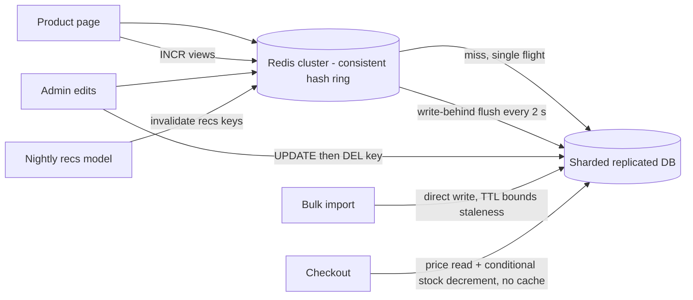

# Module 4 — Serving Data Fast (Caching)

## Module Introduction
*Original lesson: [Module introduction on DesignGurus ↗](https://www.designgurus.io/course-play/system-design-patterns/doc/6a534d50ba41b5b74695db9a)*

**What this module is about.** Module 3 ended by noting that *a cache is a small, short-lived read model*. Caches are among the most used — and misused — pieces of infrastructure, and among the most asked-about in interviews. A **cache** is a small, fast copy of data whose authoritative version lives in a slower system such as a database. (Basics: [Module 0 — Caching basics](../00-system-design-fundamentals/README.md#caching-basics).)

**Analogy.** Keeping the few books you use daily on your desk instead of walking to the library: quick, but if the library's copy is revised, yours is out of date unless someone tells you.

**The key metric: hit ratio.** A **hit** finds the data in the cache; a **miss** doesn't, so the request goes to the source. The **hit ratio** is the share of hits. With a 1 ms hit and a miss costing 1 ms *plus* a 100 ms database call, **99%** hits average ~**2 ms**; **50%** averages ~**51 ms** — and you're running an extra system ([the formula](../01-thinking-in-patterns/README.md#back-of-envelope-math)). So the question isn't "should I cache?" but **how does data get into the cache, and how does it stay correct?** Five patterns, five answers:

| The situation | The pattern |
|---|---|
| On a miss, the application fetches the data and saves a copy for next time | Cache-Aside |
| The same idea, except the cache does the fetching itself | Read-Through |
| Update the copy and the original together before confirming | Write-Through |
| Update the copy now and write the original later, in batches | Write-Behind |
| A popular entry expires, and only one request should fetch it again | Cache Stampede Prevention |

**Two facts that organize the module**
1. **A cache buys speed with some accuracy.** Any cached copy can disagree with its source; you decide how much staleness is tolerable and which mechanism keeps the copy correct — expiry timers, write-time updates, or deliberate deletion. (*"There are only two hard things in computer science: cache invalidation and naming things."* Invalidation is half this module.)
2. **Caches fail as crowds, not one request at a time.** One miss is one short query. Serious failures come when a hot key expires and ten thousand requests hit the database at once, or a cache cluster restarts empty at peak. The stampede lesson covers these — the difference between *using* a cache and *running* one reliably.

**How the module is told.** One product page atop Module 3's database runs through every lesson: Cache-Aside (the default) has the app fetch misses, Read-Through moves fetching into the cache, Write-Through and Write-Behind are the write-side pair (safety vs. speed), Stampede Prevention handles the returning flash sale, and the capstone picks a strategy per data type. **Short on time?** Cache-Aside and Stampede Prevention matter most; the write pair usually appears as a comparison question.

**Four terms used throughout**
- **Hit / miss / hit ratio** — above; know it for every cache you run.
- **TTL (time to live)** — a per-entry expiry timer ("trust this for 5 minutes"), the simplest, most common correctness tool.
- **Eviction** — a cache is deliberately smaller than the data, so when full it discards something, usually by **LRU (least recently used)**: drop what's gone untouched longest, assuming recent use predicts future use.
- **Invalidation** — actively removing or updating an entry when its source changes; more precise than a TTL, harder to get right.

**Before you start — three questions about a system you know:**
- What's your cache's hit ratio today? (If nobody knows, its value is a guess.)
- When source data changes, how does the cache learn: timer, update, delete, or not at all?
- At peak, what happens the instant your hottest key expires — who goes to the database, and how many?

---

## Cache-Aside
*Original lesson: [Cache-Aside on DesignGurus ↗](https://www.designgurus.io/course-play/system-design-patterns/doc/6a534dedba41b5b74695e334)*

**What it is.** The application checks the cache first. **Hit:** return the copy. **Miss:** read the database, save a copy with a TTL, return it, so the next reader is fast. **Write:** update the database, then *delete* the cached copy so the next reader fetches fresh data. The cache sits "to the side" and never talks to the database itself.

**Analogy.** A receptionist with sticky notes of common answers checks them first; if missing, calls the department, writes a fresh note ("throw away after 1 hour") and replies; when a department announces a change, rips up that note.

### The problem

Module 3's database works, but mostly repeats itself. Bestseller **item 8412** is read **4,000 times per minute**; its row hasn't changed in **three weeks**, yet each read recomputes the same **15 ms** answer. Catalog reads peak at **12,000/s**, over **99%** identical to the previous request's answer, on **eight** replica machines; **latency** (time per request) exceeds 15 ms when requests queue at peak, and every campaign triggers a capacity meeting. Keep the last answer in fast storage and serve it until the data changes.

### Why the obvious fixes fail

- **"More replicas."** They scale read volume, but cost grows as fast — full queries just to reproduce unchanged answers. The problem is *repetition*, not database capacity.
- **"A dictionary in each app server's memory."** Cheap and tempting, but with **40 app servers** you get 40 private copies: 40 cold misses per key, 40 copies going stale independently, and every **deploy** (rollout of new code, restarting servers) wiping them all and dumping full load on the database. Fine only for tiny, constantly used, staleness-immune data.
- **"Cache it forever."** Excellent hit ratio, but Friday's price change never appears. A cache with no way to stay correct gives *fast old data*.

You need one shared fast copy that fills on demand, plus a plan for keeping it correct.

### How it works

*Figure — Cache-Aside (course diagram)*

The figure's three phases: a miss (`GET product:8412` empty → `SELECT`, 15 ms → `SET` with a 1-hour TTL; `SELECT` reads rows in SQL, the relational query language, and `UPDATE` changes them), ~240,000 hits at 1 ms, and a write (`UPDATE product 8412`, then `DEL product:8412`).

The cache is deliberately simple. **Redis** and **Memcached** (in-memory key-value servers) just answer "here it is" or "not here"; every decision lives in application code — the pattern's flexibility and its maintenance cost.

1. **Read: check the cache;** on a hit, return.
2. **Read miss: fetch from the database.**
3. **Save a copy with a TTL, then return.** This is **lazy loading**: only requested data is cached. 8412 is cached *because* it's read 4,000 times a minute, while the **long tail** (many rarely read items) uses no memory, so the cache fills naturally with **hot data** (most-read data). Downsides: every item's first reader takes the slow path, and many simultaneous readers of the same missing item cause a stampede ([later lesson](#cache-stampede-prevention)).
4. **Write: update the database, then delete the key.** Don't update the copy in place: deleting is safe and lazy (the next reader fetches truth), while updating opens races where an older value overwrites a newer one (comparison below).
5. **TTL on everything, even with invalidation.** Delete-on-write works only if *every* code path remembers; eventually a bulk import, manual fix or rushed admin tool won't. The TTL caps how long such a mistake lasts. **Invalidation gives freshness; the TTL gives insurance.** Important data never relies on TTL alone; no data relies on invalidation alone.
6. **Eviction handles overflow:** LRU drops the least recently used item when full; an evicted key just becomes a harmless later miss.

### Walkthrough with numbers

Redis cache-aside, 1-hour TTL, delete on every write:
- **First read of 8412 misses:** 1 ms check + 15 ms database + 1 ms SET = **17 ms** — slightly *worse* than no cache, the honest cost of a miss.
- **Next ~240,000 reads that hour:** **1 ms** each. Catalog hit ratio settles at ~**99.2%**: average = 0.992 × 1 + 0.008 × 17 ≈ **1.1 ms** (from 15 ms).
- **Database read load:** **12,000/s → ~150/s** (the real misses); **six of eight replicas** are retired by quarter's end. RAM (fast working memory, where caches keep data) is cheap; database machines aren't.
- **A price change on 8412:** `UPDATE`, then `DEL`; the next reader refills. Staleness lasts **milliseconds**, versus up to an **hour** with TTL alone.
- **Forgotten-delete drill:** three months later a bulk import updates **2,000 products** without invalidating; they're stale for up to one TTL, then self-heal. Annoying, bounded, survivable — exactly the TTL's job.

### Delete vs. update on write (the comparison)

You changed a price in the database; what happens to the cached entry? A frequent interview question.

| | DEL the key | SET the new value |
|---|---|---|
| Next read | One extra miss (fetch again from the DB) | An immediate hit that is already fresh |
| Race safety | Safe: the true value is fetched after all writes have settled | Risky: two writes at once can SET in the wrong order and leave the older value cached until the TTL |
| Wasted work | None, if nobody reads it again | Stores values that might never be read |
| Complexity | One line that's hard to get wrong | You must serialize (force one-at-a-time) or version updates to stay correct |

**The race:** write A sets $45 and write B sets $40 almost simultaneously, and A commits *last*, so the truth is $45 — but the cache updates arrive reversed, B's `SET 40` after A's `SET 45`. Cache says $40, database $45, wrong for up to a full TTL. With `DEL`, the worst ordering is two deletes and the next reader fetches $45. One extra miss eliminates a whole class of wrong answers.

DEL has one rare race left: a slow reader that fetched the *old* value before the write can put it back right after the delete. The short TTL bounds that too — another reason to keep it.

### Trade-offs

**You gain:**
- Big read relief: ~**two orders of magnitude** (~100×) less database read load for one small service and a few GB of RAM.
- Felt latency: **15 ms → 1 ms** on the hottest pages.
- Full control: your code chooses per data type what to cache (rows, pages, computed results), how to key it, how long to trust it.
- Resilience: if Redis dies every read misses — slow but *correct*, since the database is still the truth (whether the database survives the sudden load is the stampede lesson's topic).

**You pay:**
- **Managed staleness:** between a change and its delete or expiry, readers see the old value — bounded, but chosen per data type.
- **The consistency chore:** every current *and future* write path must invalidate; one that forgets gives instant admin edits but stale bulk imports (self-check Q3).
- **Boilerplate:** check → fetch → set → return in every data-access function, so teams extract helpers — which the next lesson turns into a pattern.
- **Costlier misses:** cache check *plus* database. Fine at 99% hits; at **~60%** you add a hop and save little.
- **Cold starts and hot expiries** send crowds to the database (stampede lesson).

### When not to use it

- **Little repetition:** data read about once per write can't produce useful hits (per-user notifications, one-time tokens).
- **Zero staleness tolerance:** the last unit of stock at checkout, a trade's execution price. Read the source of truth (browsing beforehand can usually tolerate seconds).
- **The database's memory already has it:** small data sets often live in the database's **buffer cache**; a 15 ms query on in-memory data is probably missing an **index**. Fix the query first — a cache in front of a bad query still pays full cost on every miss.
- **Data that is state, not a copy:** sessions and carts need a durable primary home, or eviction makes carts vanish.
- **Common misuse:** caching everything by habit with a 24-hour TTL, no invalidation and no hit-ratio monitoring — stale and mediocre, with nobody measuring.

### Real-world examples

- **Redis and Memcached** — the industry standard; "**look-aside caching**" is another name for the pattern.
- **Facebook's memcache paper** — cache-aside at huge scale, including fixes for this module's races and surges.
- **Framework helpers** — Rails' `Rails.cache.fetch`, Django's cache API and Spring's `@Cacheable` (popular Ruby, Python and Java web frameworks) implement cache-aside for you.
- **Your own hardware** — the database buffer pool, the OS **page cache** (recently read disk blocks in RAM) and CPU **L1/L2/L3** caches (tiny, very fast on-processor memories) all check a fast copy, fetch from slower storage on a miss, and keep the result. One of computing's most common patterns.
- **For AI engineers:** exact-match caching suits embeddings of recurring strings (search queries, product titles), **moderation** decisions (harmful-content checks) and serving-time **feature vectors** (a model's input numbers; feature stores' online layers often use it); each cached embedding saves a paid API call. LLM answers are harder — users rarely repeat questions byte for byte — so a **semantic cache** (later) matches by meaning.

### In the interview

Slow product page or database buried in reads: cache-aside is usually your first move. The real conversation is where its correctness ends — consistency, TTL choice, behavior after a restart.

> **30-second answer:** The app checks Redis and serves hits in a millisecond; on a miss it reads the database and fills the cache with a TTL. On writes I update the database and *delete* the key rather than updating it, because concurrent updates can race and strand an older value, while a delete makes the next reader fetch truth. Every entry keeps a TTL as insurance against write paths that forget to invalidate, sized per data type — an hour for descriptions, minutes for prices, seconds or no cache for inventory. And I track hit ratio; below the high nineties the cache barely earns its keep.

**Likely follow-ups (with answers):**
- *"Why delete instead of updating the cache with the new value?"* — Near-simultaneous writes can reach the cache in a different order than they committed, stranding the older value until expiry. Deleting reduces the worst case to one extra miss; the one rare remaining race (a reader re-inserting an old value) is bounded by the TTL.
- *"What TTL would you pick?"* — No global value; it depends on each type's cost of staleness. Descriptions ~1 hour; prices minutes, with invalidation doing the real work; inventory seconds or uncached, with the purchase checking the database.

**Mistake that fails candidates:** updating the cache on write without knowing the race; caching without *both* a TTL and an invalidation plan; or caching a **900 ms** query instead of finding the missing index.

### Self-check

- **Q1. Walk the miss path and the write path in order, and say who does each step.** → Miss: the *application* checks the cache, queries the database, SETs with a TTL, returns. Write: the *application* updates the database, then deletes the key; the next reader takes the miss path. The cache never talks to the database — that's "aside."
- **Q2. Pick TTLs (and invalidation) for product descriptions, prices and live inventory, justified by the cost of being wrong.** → Descriptions: 1-hour TTL + invalidate on edit (staleness is cheap). Prices: invalidation as the main mechanism + 5-minute TTL backstop (wrong prices cost revenue and trust). Displayed inventory: 5–30 s TTL, no invalidation, but the purchase reads the database. Each TTL reflects the cost of being wrong.
- **Q3. Admin-panel edits show up immediately, but nightly bulk-import changes take "up to an hour, randomly". No errors. Diagnose, fix, and name what prevented worse.** → The admin panel deletes keys; the import writes the database without invalidating, so each stale copy lives until its own TTL ("random, up to an hour"). Fix: have the import delete affected keys (or bump a **version** in the keys); better, route all writes through one data-access layer so no future path can forget. The TTL kept 2,000 products from staying stale forever.

### Related patterns

[Read-Through](#read-through) (fetch-and-fill moved into the cache) · [Cache Stampede Prevention](#cache-stampede-prevention) (many misses on one hot key) · [Consistent Hashing](../03-storing-data/README.md#consistent-hashing) (spreads keys, prevents resize miss storms) · [CQRS](../03-storing-data/README.md#cqrs) (a cache is a small, short-lived read model).

### TL;DR

- **Problem:** the database answers the same unchanged questions thousands of times a minute, paying database cost for repetition.
- **Mechanism:** check the cache; on a miss read the DB and store with a TTL; on a write update the DB and delete the key; TTLs everywhere as insurance; LRU for overflow.
- **Costs:** bounded staleness, a permanent invalidation chore on every write path, boilerplate, double-cost misses, crowds on cold starts and hot expiries.
- **Skip it when:** data rarely repeats, staleness is intolerable (read the truth), or the slow query just needs an index.

---

## Read-Through
*Original lesson: [Read-Through on DesignGurus ↗](https://www.designgurus.io/course-play/system-design-patterns/doc/6a534f5b6a9123b6be1009e7)*

**What it is.** The application only calls `get(key)` on the cache. On a miss, the **cache itself** fetches from the database via a configured **loader** (a function that knows how to fetch, e.g. a product by key), saves a copy and returns it. Cache-aside with the fetching moved out of your code into the cache layer.

**Analogy.** Instead of every employee phoning the warehouse when the shelf is empty, one shelf-stocker fetches on request — and if twenty people ask at once, makes just *one* trip.

### The problem it solves

Cache-aside repeats check → fetch → set → return in every data-access function. Across many functions and services, some skip a step (the SET), some behave slightly differently, some use mismatched keys. And because each caller runs its own miss logic, callers can't coordinate: on a hot missing key, each goes to the database separately.

### How it works

*Figure — Read-Through (course diagram)*

Application code is **one line, every time**: `get(product:8412)`; on a miss the cache's loader runs the `SELECT` itself.

1. **The app calls `get(key)`**; no cache-checking or database logic in app code.
2. **Hit:** the cache returns the value.
3. **Miss:** the cache runs its loader — fetch, save with TTL, return. Same miss steps as cache-aside, different owner.
4. **Request coalescing comes free**, since the cache sees every reader. Under cache-aside, **5,000** simultaneous misses on one key are 5,000 database queries; a loading cache lets the *first* caller fetch while the other **4,999** wait briefly for the same answer — **one** query. This is the first defense against "caches fail as crowds," developed fully in the [stampede lesson](#cache-stampede-prevention).
5. **Writes aren't handled.** Changes still need delete-on-write plus TTLs, or pairing with write-through (next).

Where you meet it: loading-cache libraries like **Caffeine** and **Guava's `LoadingCache`** (Java), **ORM** second-level caches like **Hibernate**'s (an ORM, object-relational mapper, maps database tables to code objects), and managed front ends like **DynamoDB DAX**, a caching service that knows how to reach the table behind it.

### Read-through vs. cache-aside (the comparison)

| | Cache-Aside | Read-Through |
|---|---|---|
| Who fetches on a miss | Your application code | The cache layer, using its loader |
| Miss logic lives | Inside every data-access function | In one configured place |
| Concurrent misses on one key | N separate database queries | Can be merged into 1 (the main benefit) |
| Can cache computed, multi-source results | Yes, since the app can cache anything | Awkward, since a loader fetches one kind of thing by key |
| Cache infrastructure | Any simple cache works (Memcached) | Needs a smart cache: a library, an ORM layer, or a service |
| Consistency across teams/services | Every team rebuilds the procedure | One implementation, used the same way everywhere |

### Trade-offs

**You gain:**
- One miss-path implementation: no forgotten SETs, no forty variants.
- Request coalescing: simultaneous misses on a **hot key** (one many readers want at once) become one query.
- Cleaner code: data access states *what* (`get`), not *how*.

**You pay:**
- **Flexibility:** a loader fetches one object type by key; a dashboard or fragment from three sources doesn't fit (cache-aside can cache anything the app computes).
- **Smarter infrastructure:** the cache must run fetch logic with database access — an **in-process** library (running inside your application), an ORM or a caching service. Plain Memcached can't.
- **Coupling:** queries and access rules now live in the cache layer, so **schema** changes (database table-structure changes) can spill into it.
- **Writes are still yours:** same invalidation duties and TTL insurance as cache-aside.

### When not to use it

- **Computed and composite results:** the app knows how to combine sources; a per-key loader doesn't. Use cache-aside.
- **Your cache is meant to be a simple shared store:** a shared Memcached fleet has nowhere to run a loader, and adding that may cost more than the boilerplate saved.
- **One small codebase:** a well-built `fetch_with_cache()` helper gets most of the benefit.
- **Where it shines:** many services, teams and languages reading the same data, where separate implementations routinely produce forgotten SETs, mismatched TTLs and misaligned keys. One shared read-through layer prevents all of it by design.

### In the interview

Often asked directly: "What's the difference between cache-aside and read-through?" Explain *who owns what* and what follows, not just two diagrams.

> **30-second answer:** Same miss path, different owner. In cache-aside my app checks the cache and does fetch-and-fill itself — maximally flexible, but repeated everywhere, and someone forgets a step. In read-through the app talks only to the cache, which fetches through a configured loader: one implementation, and because it sees every reader, it can merge simultaneous misses on a hot key into one query. Trade-off: loaders fetch one thing by key, so computed results stay with cache-aside, and either way writes need their own invalidation plan.

**Likely follow-ups (with answers):**
- *"Which for a product catalog read by forty **microservices** (small, separately deployed services)?"* — Read-through as a shared caching service or layer: one loader, one TTL policy, uniform behavior and coalescing, instead of forty slightly different procedures.
- *"Does read-through fix the stale-after-bulk-import bug from cache-aside?"* — No; that failure is on the *write* path, and read-through controls only reads. It still needs invalidation or a write-side pattern.

**Mistake that fails candidates:** treating them as rivals with different results, or claiming read-through solves invalidation. Their successful read behavior is identical; only ownership and its consequences differ.

### Self-check

- **Q1. Who fetches after a miss in each pattern, and what new capability does centralizing it enable?** → Cache-aside: the application. Read-through: the loader in the cache layer. Centralizing enables coordination (merging simultaneous requests for one key into one query) and one uniform implementation.
- **Q2. Cache (a) product records read by 40 services in 6 languages, and (b) a per-seller dashboard computed from three databases. Which pattern for each?** → (a) Read-through as a shared layer: one loader, one policy, coalescing protecting the shared database. (b) Cache-aside: the app must combine three sources before caching the result with a TTL and invalidation.
- **Q3. A popular key expires at peak and 5,000 requests miss within 50 ms under plain cache-aside. Database load? With coalescing? What lesson does this lead to?** → Cache-aside: **5,000 identical queries**. Coalescing: **one**, with 4,999 brief waits — a spike becomes one normal query. Caches fail as crowds, which Cache Stampede Prevention handles at larger scale.

### Related patterns

[Cache-Aside](#cache-aside) (same behavior, different ownership; its TTL, delete-on-write and hit-ratio rules still hold) · [Write-Through](#write-through) (the write-side partner) · [Cache Stampede Prevention](#cache-stampede-prevention) (extends coalescing).

### TL;DR

- **Problem:** cache-aside's miss steps are repeated in every function and service, causing forgotten steps, inconsistency, and uncoordinated readers stampeding shared misses.
- **Mechanism:** the app only calls the cache; on a miss the cache fetches via a configured loader, saves and returns — one implementation that can merge simultaneous misses into one fetch.
- **Costs:** per-key loaders (computed results stay with cache-aside), a smart cache with database access, coupling, writes still needing invalidation.
- **Skip it when:** caching composite/computed results, your cache is a simple shared store, or a helper in one small codebase suffices.

---

## Write-Through
*Original lesson: [Write-Through on DesignGurus ↗](https://www.designgurus.io/course-play/system-design-patterns/doc/6a534fe0da90fe9bceb2be6f)*

**What it is.** Writes pass *through* the cache: the app sends a write to the cache layer, which writes the database **synchronously** (the caller waits), then updates its own copy; the caller hears "done" only after both are updated. For data written this way the cache is never stale, because it took part in the write.

**Analogy.** A secretary records your dictated change in the official register, then updates the front-desk reference card, and only then says "done."

### The problem it solves

Cache-aside and read-through rely on every write path remembering to delete keys (the forgotten-delete bug) and cost an extra miss exactly when a user reads back what they saved. Write-through makes upkeep **structural**: the cache *is* the write path, so it can't forget. Paired with read-through, the cache becomes the single entry point to the data rather than a copy maintained beside the app; both need the same smart infrastructure (a loading cache that can write, an ORM layer, or a DAX-like service).

### How it works

*Figure — Write-Through Cache (course diagram)*

1. **The app sends the write to the cache layer**, not the database.
2. **The cache writes the database first, synchronously.** The database is the truth, so it must succeed before the copy claims anything.
3. **Database write fails → cache stores nothing and returns the error.** The copy never shows a value the original lacks.
4. **Database write succeeds → cache updates its copy, then confirms.**
5. **Database succeeds but cache update fails → invalidate the entry and still report success.** The commit is safe; the next read misses and fetches truth — one slower, correct read.
6. **Fresh and warm:** unlike cache-aside's delete, write-through *keeps* the new value, so the read right after a user's edit hits.
7. **The guarantee has a boundary.** Only writes *through* the cache stay fresh; a direct database write from another service, a bulk import or a manual fix bypasses it and brings back the forgotten-delete problem. Either every writer uses the cache, or every entry keeps TTL insurance.

### Write-through vs. delete-on-write (the comparison)

| | Cache-aside + DEL | Write-Through |
|---|---|---|
| After a write, the cache is | Empty for that key (the next read fills it) | Already fresh |
| Read-after-write | One extra miss | An immediate hit |
| Write latency | Only the database write | Database write + cache update (a little slower) |
| Caches data nobody reads? | Never | Yes, since every write goes into the cache whether it's read or not |
| Requires | Any simple cache | A smart cache layer sitting in the write path |

### Trade-offs

**You gain:**
- **Structural freshness:** no invalidation chore or forgotten-DEL bugs for writes through the cache.
- **Read-after-write hits:** save-then-view (most user edits) is served from cache immediately.
- With read-through, **one coherent data layer** instead of a cache maintained alongside the code.

**You pay:**
- **Write latency:** two sequential updates before confirming; the extra millisecond or two matters on latency-critical paths.
- **Cache churn:** every written key enters the cache, including values nobody reads; in write-heavy workloads they push truly hot entries out of limited memory.
- **Boundary discipline:** writes that bypass the cache silently bring staleness back.
- **Smart infrastructure:** a basic key-value store can't run the sequence.

### When not to use it

- **Write-heavy, rarely read data** — logs, metrics, audit records, clicks. Caching every record gains nothing and evicts useful entries; write straight to storage.
- **Cache-bypassing writers are a fact of life** — if three other systems update the tables directly, the freshness promise is fiction; cache-aside + TTL states the real guarantee more honestly.
- **Latency-critical writes** that can't afford the extra synchronous step (write-behind may fit, after weighing its durability cost).
- **Common misuse:** layering write-through on top of old invalidation code and removing every TTL, so nobody knows which mechanism actually keeps data correct. Pick **one** main mechanism, document it, keep TTLs as insurance.

### Real-world examples

The course gives no separate list; implementations are the same smart-cache infrastructure as read-through: a **loading cache with a writer**, an **ORM layer**, or a **DAX-style** caching service in front of the database.

### In the interview

Usually within a cache-aside / write-through / write-behind comparison, or "users edit a profile and must immediately see the new value" — read-after-write is its biggest strength.

> **30-second answer:** Writes go through the cache, which updates the database synchronously, then its own copy, then confirms — so it's never stale for anything written through it, and the read after a user's edit hits a warm, fresh cache. Costs: writes pay for both updates, and every write lands in the cache whether read or not. The guarantee covers only writes through the cache, so bypassing writers still need TTL insurance. It pairs naturally with read-through, making the cache the single entry point to the data layer.

**Likely follow-ups (with answers):**
- *"The database write succeeds but the cache update fails. Now what?"* — Invalidate the entry and return success: the commit is safe and the next read fetches truth. One slower read beats a wrong copy.
- *"Why not always use write-through instead of cache-aside's delete?"* — It needs a smart cache in the write path, caches values that may never be read, and loses its guarantee whenever a writer bypasses it. Delete-on-write is one simple operation on basic infrastructure: stronger structure vs. simplicity and flexibility.

**Mistake that fails candidates:** claiming write-through removes the need for TTLs despite bypassing writers, or not knowing what happens when either update fails.

### Self-check

- **Q1. Describe the write sequence including both failure cases, and state exactly which writes get the freshness guarantee.** → App → cache → database updated synchronously → copy updated → confirm. DB fails: cache nothing, return the error. DB commits but cache update fails: invalidate and confirm; the next read fetches truth. Only writes through this whole sequence are guaranteed fresh.
- **Q2. Choose behavior for (a) users editing profiles they view right away, and (b) an activity log written on every click but almost never read.** → (a) Write-through (with read-through): structural freshness and a warm read-back. (b) Don't cache the write; unread records just waste memory. If recent logs become popular, cache-aside can add them on request.
- **Q3. Six months after adopting write-through and removing TTLs, customers see stale prices only for products changed by a new bulk-pricing tool. Diagnose and fix.** → The tool writes the database directly, bypassing the cache, so those copies are never refreshed, and with TTLs gone they stay stale until evicted. Fix: route the tool through the cache's write path *and* restore TTLs. Every correctness guarantee has a boundary, and forgotten writers live outside it.

### Related patterns

[Read-Through](#read-through) (the natural partner) · [Write-Behind](#write-behind) (same entry point, delayed database update: durability traded for speed) · [Cache-Aside](#cache-aside) (the simpler option for basic infrastructure and independent writers).

### TL;DR

- **Problem:** delete-on-write relies on every write path remembering, and costs a miss exactly when users read back what they saved.
- **Mechanism:** writes go through the cache — database synchronously first, then the copy, then confirmation; on partial failure, invalidate and stay correct.
- **Costs:** extra write latency, churn from unread writes, smart infrastructure in the write path, a guarantee ending at the cache's boundary.
- **Skip it when:** writes far exceed reads, cache-bypassing writers are unavoidable, or write latency is precious.

---

## Write-Behind
*Original lesson: [Write-Behind on DesignGurus ↗](https://www.designgurus.io/course-play/system-design-patterns/doc/6a53506b5a38214864ff9ce2)*

**What it is.** Writes land in the cache and the caller gets an **immediate acknowledgment**; the database finds out *later*, when a background **flusher** sweeps changed entries every few seconds and writes them in efficient batches, folding many small changes into a few big ones. Also called *write-back*.

**Analogy.** A shop's tally counter clicks for every customer; every couple of seconds someone sends head office one message, "+24,000". If the power fails between messages, the clicks since the last one are lost.

### The problem

Product wants "12,483 people viewed this today" on every page. Naively, `UPDATE products SET views = views + 1` per view: at peak the bestseller gets **12,000 views/s**, so **12,000 UPDATEs per second on one row**. A database guards a row being changed with a **lock**, so updates queue behind each other; latency passes **one second**, waiting connections eat capacity, and checkout slows because view counting hogs the database.

What's really required? Twelve thousand times a second the system durably records "+1" before confirming. Nobody needs each increment on disk immediately — the number changes constantly and a 2-second delay is invisible — yet each +1 pays for a lock, a write and a **WAL** (write-ahead log) entry. One summary fact every two seconds would do: "+24,000."

### Why the obvious fixes fail

- **"Write-through."** Fixes staleness, but still sends *every* write synchronously to the database: 12,000 row locks/s plus a cache update. This incident is about write *volume*.
- **"Sample every 10th view."** Fine for rough analytics, but an estimate: small counts come out wrong (7 might show as 0 or 10), unacceptable once badges, rankings or payouts depend on it.
- **"Queue the writes."** A queue with a batching worker is a valid Module 2 answer and the closest alternative, but the page must *show* the current count and a queue can't serve reads. Add a cache beside it and you've built most of this pattern (comparison below).

### How it works

*Figure — Write-Behind Cache (course diagram)*

1. **The write lands in the cache and is confirmed immediately.**
2. **Dirty tracking.** Entries with changes not yet in the database are **dirty**, and must **never be evicted** before flushing — eviction would delete confirmed data, not just free memory. Implementations **pin** dirty entries (mark them non-evictable) until clean.
3. **The flusher coalesces.** **Coalescing** merges many changes to one key into one database write: increments are summed (12,000 × "+1" → "+24,000" per flush); repeated field updates keep only the last (five product edits in two seconds → one write of the final state). Database work grows with **distinct keys changed**, not total write rate.
4. **Flush policy:** every N seconds *or* every N dirty entries, whichever first. Shorter intervals risk less data but batch less; longer is more efficient but riskier.
5. **Flush failures need a plan.** If the database is briefly down, the flusher keeps the dirty batch and retries; an entry failing repeatedly goes to **quarantine** (a side area like a [dead-letter queue](../05-reliability/README.md#dead-letter-queue)) so one bad record can't block every later flush.

**The cost, plainly — the most dangerous pattern in the module:**
- **"Acknowledged" no longer means "saved."** Until the next flush, confirmed changes live only in cache memory. The WAL promise (fsync — force to disk — *before* acknowledging) is deliberately given up for speed and lower database load; a cache node failure can lose a flush interval of dirty changes. Every use must complete, in writing: **"if we lose the last N seconds of these writes, then ___"**, with a truly acceptable answer.
- **The truth flips.** During the dirty interval the *cache* holds the current value and the *database* an older one. Anyone needing the live value must read the cache; reports or services reading the database see the past. For that stretch the cache is the authority, not a disposable copy.

### Walkthrough with numbers

The view counter with a **2-second** flush:
- **Write path:** `INCR views:8412` in Redis takes **under 1 ms** — no lock, no queue. The page reads the same key, so the count is always current; 12,000 in-memory increments/s is easy for Redis.
- **Database load:** one `UPDATE … + 24,000` every 2 s for the hot key: **12,000 writes/s → 0.5/s**, a **24,000×** reduction. Catalog-wide, each flush folds thousands of dirty keys into a handful of bulk statements, returning capacity to checkout.
- **Crash drill:** a node dies **1.8 s** after its last flush, losing ~**21,600** views. The loss sentence ("if we lose 2 seconds of view counts, the numbers are imperceptibly lower") was written and accepted *before* launch, so this is fine.
- **Shrinking the window if needed:** a **Redis replica** survives one node failure; Redis **AOF** (append-only file — essentially the cache's own write-ahead log) persists to disk; a shorter interval approaches write-through. Each buys durability with speed.
- **The proposal to reject in review:** this design for payment records. "If we lose the last 2 seconds of payments, then…" has no safe ending. Money keeps the WAL's promise.

### Write-behind vs. queue + batching worker (the comparison)

| | Write-Behind | Queue + batching worker |
|---|---|---|
| Ack comes from | Cache memory (fast, but volatile: lost if power or the process dies) | The broker, once it has persisted the message |
| Durability of acknowledged writes | Whatever is in the flush window is at risk | Durable in the broker: nothing confirmed is lost |
| Coalescing (+1 merging) | Happens naturally, in place | Can be done in the worker, but it's clumsier |
| Live reads of the current value | The cache serves them, which is the whole point | Not possible; readers see the database's lag |
| Machinery | Dirty tracking inside the cache | A topic, a consumer and offsets (each reader's saved position in the stream; the usual Module 2 kit) |

**Deciding question: does any reader need the hot, current value?** The product page shows the live count, so write-behind wins: the cache is both write buffer and read layer. For pure ingestion nobody reads immediately (analytics events, telemetry), use a queue and worker — the broker keeps every confirmed write. Adding a read cache to the queue, or a persistent log to the cache, pushes each design toward the other; choose by the main workload's built-in strengths.

### Trade-offs

**You gain:**
- Cache-speed write confirmations; row **contention** (many writers fighting over one row) vanishes at its source.
- Orders of magnitude fewer database writes via batching and coalescing; load grows with distinct keys, not write rate.
- Natural burst absorption: spikes accumulate as dirty entries and drain at the database's pace (the queue lesson's shape).

**You pay:**
- **The durability window:** acknowledged writes sit in memory until flushed and a crash loses them — the main cost, with its consequence written down per deployment.
- **Truth inversion:** direct database readers silently see older values during the dirty interval.
- **Real complexity:** dirty tracking, eviction pinning, retries, quarantine and per-key ordering — the module's heaviest machinery.
- **Harder debugging:** "the value at 14:02" has two answers (cache and database) to reconcile.

### When not to use it

- **Money, ledgers, payments, orders, compliance data:** any loss window rules it out regardless of **throughput** (operations per second). Individually important writes keep the WAL's promise.
- **Other systems read the database directly** and need current values: truth inversion breaks them *without any error*.
- **Writes that don't coalesce:** unique records (new orders, messages) batch but don't get a hot key's huge reduction; a durable queue batches them without risking confirmed data.
- **Modest volume:** a counter at **50 updates/s** doesn't justify dirty tracking and flushers.
- **Judgment calls:** carts → a durable store; inventory → buffer only the displayed badge; token metering → buffer dashboards, bill from a durable stream (see self-check Q2, the inventory follow-up, and the AI example).
- **Accidental adoption:** some cache products and ORMs expose write-behind as a switch; enabling it for speed without a documented loss window just postpones the decision until a failure makes it.

### Real-world examples

- **CPU write-back caches** — the name comes from hardware; processors have made this cache-vs-RAM trade for decades.
- **Social counters at scale** — views, likes and impressions buffered in caches and flushed as totals; a row lock per reaction would be absurd.
- **Rate limiters and leaderboards** — Redis counters serving live reads, persisted later.
- **EhCache, Hazelcast** (Java caching products) — built-in write-behind; the loss-window rule still applies despite the easy switch.
- **For AI engineers:** training metrics and telemetry fit well (losing ~2 s of **loss-curve** points — training error plotted over time — is fine), and online feature stores can buffer updates the same way. Token metering is counter-shaped but is billing: buffer dashboards aggressively, compute invoices from a durable, reconciled event stream. Dashboards can lose a moment; invoices can't.

### In the interview

Typical prompt: a like button or view counter at scale — diagnose **row contention** first, then propose this. Then: "what happens when a cache node dies?"

> **30-second answer:** Twelve thousand increments a second on one row is lock contention, so I buffer in the cache: increments land in Redis in under a millisecond, the page reads the same key so it's always current, and a background flusher merges them into one bulk update every couple of seconds, cutting database writes by orders of magnitude. The price: confirmed writes live in cache memory until the flush, so a crash loses that window — acceptable and documented for view counts, never for money — and during the window the cache is the truth, so direct database readers see the past. If nobody needed the live value, I'd use a durable queue with a batching worker.

**Likely follow-ups (with answers):**
- *"The cache node dies. What exactly is lost, and how would you shrink it?"* — Up to one flush interval of confirmed dirty changes. Shrink with a cache replica (survives one node), AOF persistence (with its own fsync policy), or a shorter interval — each trading performance for durability, moving toward write-through.
- *"Would you use this for inventory during the flash sale?"* — Separate display from decision: "only 3 left" can be seconds stale or buffered, but the decrement accepting a sale needs a durable, authoritative path.

**Mistake that fails candidates:** write-behind for payments or orders; ignoring dirty-entry eviction risk; or claiming Redis persistence removes all loss, when AOF's default fsync policy **`everysec`** still allows ~**one second** of loss.

### Self-check

- **Q1. Describe the full write path, define "dirty", and say exactly what the acknowledgment promises.** → The cache accepts and confirms immediately, marks the entry dirty (changed but not yet in the database) and pins it against eviction; the flusher periodically merges dirty changes, writes them, marks them clean. The ack promises only that the value is in cache memory and *should* reach the database — not that it's durably saved.
- **Q2. For view counts, cart contents, payment records and a "trending now" score: write-behind or not, and complete the loss sentence.** → View counts: yes, "…the numbers are imperceptibly lower." Trending score: yes — approximate, derived, recomputable. Carts: no, durable store; losing choices is visible harm and volume rarely warrants it. Payments: never; no loss window is acceptable. Fit depends on what losing the dirty window would cause.
- **Q3. A nightly analytics job reading the database reports view counts ~2% below the cache-backed dashboard, and counts dip slightly after every deploy. Explain and fix proportionately.** → The 2% gap is truth inversion working as designed (the database trails dirty counts): have analytics read post-flush data labeled "as of" a time, or accept and label the gap. Post-deploy dips come from restarting nodes dropping unflushed changes: **flush dirty entries on graceful shutdown** (a planned stop that finishes work before exiting), plus a replica if the rest matters. Persisting every write would be overkill — essentially rebuilding write-through.

### Related patterns

[Write-Through](#write-through) (the safe alternative) · [Message Queue](../02-moving-data/README.md#message-queue) (the durable alternative for unread write streams) · [Write-Ahead Log](../03-storing-data/README.md#write-ahead-log) (the promise write-behind weakens; AOF partly rebuilds it) · [Read-Through](#read-through) (with write-behind, the cache becomes the single entry point).

### TL;DR

- **Problem:** frequent writes to hot keys (counters, scores) turn rows into lock queues — thousands of individually unimportant facts per second, each paying for a durable write.
- **Mechanism:** writes land in the cache and are confirmed instantly; dirty entries are pinned and flushed in merged batches every few seconds, so load tracks distinct keys, not write rate.
- **Costs:** a durability window (acknowledged ≠ saved), truth inversion, the module's heaviest machinery.
- **Skip it when:** writes involve money or matter individually, others read the DB directly, writes don't coalesce, or volume is modest. Always finish "if we lose the last N seconds, then ___", and mean it.

---

## Cache Stampede Prevention
*Original lesson: [Cache Stampede Prevention on DesignGurus ↗](https://www.designgurus.io/course-play/system-design-patterns/doc/6a53511a6a9123b6be101c18)*

**What it is.** Techniques for when a popular ("hot") entry must be rebuilt, ensuring **exactly one request rebuilds it** while others wait briefly or get the slightly old copy. Without them, thousands of simultaneous misses hit the database: a **cache stampede** (or **dog-piling**).

**Analogy.** When the office coffee pot runs dry, one person brews; everyone else waits a minute or drinks the last lukewarm cup — not forty people brewing at once.

### The problem

In a flash sale the bestseller's page serves **12,000 requests/s** from cache at **99.9%** hits; the database sees **150 queries/s**. At **8:00:00 PM** the entry hits its **one-hour TTL** — routine. The next 50 milliseconds:

1. Rebuilding takes one ~**50 ms** query.
2. Every request in those 50 ms also misses: **12,000 × 0.05 = 600 simultaneous misses**.
3. Under plain cache-aside each runs its own miss path: **600 identical queries** on a database used to 150/s.
4. The burst slows the query to **500 ms**, *stretching* the miss window while traffic continues at 12,000/s: now **6,000** requests are missing.
5. The database's **connection pool** (its limited set of open connections) fills, queries queue, checkout (sharing the database) stops. By **8:00:03** one ordinary expiry has taken the site down.

Damage = **request rate × rebuild time**, and overload lengthens the rebuild, enlarging the crowd: a **feedback loop** — the module's second fact in action. A cache cluster restarting **empty** at peak runs this math on *every* key at once.

### Why the obvious fixes fail

- **"Longer TTLs."** A 6-hour TTL makes stampedes rarer, not smaller, and keeps data stale longer.
- **"Size the database for the burst."** Provisioning for 6,000 simultaneous queries is a huge permanent cost for a **50 ms** event a few times a day, and the burst grows with traffic.
- **"Never expire hot keys — refresh everything from a background job."** Works for the hottest keys, but recomputing the whole catalog wastes resources on millions of unread entries. **Refresh-ahead** pays only for the small set whose traffic justifies it.

Misses aren't the problem; **600 requests repeating the same work** is. The fix is coordination — read-through's **request coalescing** (many identical requests → one operation), fully developed.

### How it works

*Figure — Cache Stampede Prevention (course diagram)*

The figure shows the lock tool: request #1 takes `SETNX lock:bestseller` and rebuilds; requests #2..#600 wait ~20 ms and re-check. Database queries: **1**.

Three tools protect a single hot key; two protect the fleet. Production combines them.

**Tool 1 — The lock ("single flight").** One rebuilder per key at a time.
1. The first missing request takes a short per-key lock, atomically in Redis with `SETNX` ("set if not exists"), so only one caller wins.
2. It fetches from the database and fills the cache.
3. Others see the lock, wait briefly, and re-check the cache once the value is there.
Result: 600 misses → **1 query + 599 short waits**. The lock needs a **short TTL of its own**, since its holder might crash; a never-expiring lock is an outage by itself.

**Tool 2 — Serve stale, refresh behind.** If slightly old data is fine, nobody waits: keep entries a little past their *logical* expiry, serve the stale copy immediately, and let **one** lock-protected background refresh fetch the new value. Users get seconds-old data at full speed; the database gets one query. (A product page 50 ms stale looks identical to a fresh one.) HTTP standardizes this with the **`stale-while-revalidate`** **header** (a name-value metadata line on an HTTP request or response).

**Tool 3 — Probabilistic early refresh.** Keep the hottest keys from ever expiring: near the TTL, each request has a small random chance of refreshing early, rising as expiry nears. A key with thousands of readers almost always refreshes in time; a cold key just expires quietly. The randomness automatically aims refresh work at keys whose traffic justifies it.

**Fleet tool 1 — TTL jitter.** Mass expiry is a stampede spread over *many* keys: a deploy warms **10,000** entries within a minute, all TTL **3600**, so all expire together an hour later. Randomize, e.g. **3600 ± 10%**, to spread expirations over many minutes. That randomness is **jitter**.

**Fleet tool 2 — A cold-start plan.** An empty cluster at peak means 100% misses at full traffic. Before admitting traffic:
1. **Warm** (pre-load) the most popular keys from an **access log** (record of requested keys) or a snapshot (fewer immediate misses).
2. **Ramp traffic up slowly** (remaining load stays within database capacity).
3. Rely on **single flight** to cap database work at **one query per distinct key** — a measurable upper limit instead of an uncontrolled crowd.
Also route the cache cluster with [**consistent hashing**](../03-storing-data/README.md#consistent-hashing) so a normal resize doesn't cause mass misses.

### Walkthrough with numbers

8:00:00 PM again, with serve-stale + a per-key lock:
- The bestseller hits logical expiry; the next request finds it stale, takes the lock, starts the rebuild and serves the stale copy in **1 ms**, as do the other **599** requests in the 50 ms window. Nobody waits.
- **Database queries: 1** (not 600 spiraling to 6,000). **Page latency: flat 1 ms** (not seconds). **Staleness served: 50 ms**, unnoticeable.
- At **8:00:00.050** the fresh value arrives; the next hour runs like the last.
- **Cold-start drill:** a bad deploy restarts the cluster at **7:50 PM**. Warming restores the top **10,000** keys in ~**40 s**, the load balancer ramps traffic over **2 minutes**, and single flight caps work at one query per key. The database briefly peaks under **2,000 queries/s** — unpleasant, survivable, recovered within minutes, where the unplanned version snowballs into an outage.

### The three hot-key tools compared

| | Lock (single flight) | Serve stale + refresh | Probabilistic early refresh |
|---|---|---|---|
| During rebuild, others get | A few ms of waiting | The stale copy, right away | Nothing, because expiry rarely comes |
| Staleness served | None: everyone gets fresh data | One rebuild's worth | Practically none |
| Complexity | Lock TTLs and logic for waiters | Tracking the stale window | Probability math in the client |
| Wasted work | None | None | A few refreshes that happen early |
| Best for | Keys where staleness isn't allowed | The default for data that tolerates staleness | The very hottest keys at the largest scale |

Big systems often run **all five**: serve stale for tolerant data, lock every rebuild, refresh known hottest keys early, jitter all TTLs, and keep a written cold-start runbook. Each covers a different gap; none replaces another.

### Trade-offs

**You gain:**
- **Flat latency through expiries:** the **p99** (latency 99% of requests beat) stops spiking each TTL cycle.
- **Database load that tracks distinct keys needing rebuild**, never request rate; the crowd is capped at 1 by design.
- **Survivable cold starts and deploys** — the difference between a helpful cache and one your architecture depends on.

**You pay:**
- **Deliberate, bounded staleness:** serve-stale returns old data for one rebuild interval — negligible for many types, but a per-key decision.
- **Lock complexity and its own bugs:** expiry timers, crashed holders, waiter fallback. Use proven code (Go's **`singleflight`** package from the Go standard libraries; documented Redis lock recipes), not your own.
- **Waiting requests hold resources:** single flight *without* serve-stale makes requests wait a few ms, which matters at extreme concurrency.
- **Some wasted work:** early refresh sometimes refreshes entries that could have expired harmlessly, and the client gets more complex.
- **Justify with measurements:** simultaneous misses per key, database queries per rebuild, lock wait time, stale responses served — showing whether protections cut real load and which keys deserve early refresh.

### When not to use it

- **Cold and long-tail keys:** a key read once a minute can't have many simultaneous misses; measure first.
- **Low-traffic systems:** at **50 requests/s** the largest possible crowd is invisible to the database; **distributed locking** (a lock shared across servers, usually in Redis) at ~**100 req/s** guards against a crowd that never comes. (The opposite mistake — ignoring simultaneous expiry until a flash sale — is more common.)
- **Staleness truly not allowed:** no serve-stale; use the single-flight lock so callers wait briefly for fresh data, or don't cache the key (read critical values from the source, as in cache-aside).

### Real-world examples

- **Facebook's memcache "leases"** (the cache-aside paper): the first missing request gets a token permitting the rebuild while others wait — single flight at huge scale.
- **`stale-while-revalidate`** — standardized in **RFC 5861** (RFCs are numbered internet-standard documents); **CDNs** (content delivery networks: worldwide servers caching copies near users) and browsers use it to answer immediately while refreshing in the background.
- **Go's `singleflight` package** — single flight within one process as a small standard building block.
- **The XFetch paper**, "Optimal Probabilistic Cache Stampede Prevention" — the math behind probabilistic early refresh.
- **For AI engineers:** a stampede costs more when the rebuild is a **billable, multi-second LLM generation** instead of a 50 ms query; one popular expiring answer can trigger dozens of identical paid generations. Single flight for identical prompts is among the most valuable inference-stack protections, alongside the later semantic cache (which also catches *similar* requests). Inference cold starts likewise need **model weights** (the learned numbers making up a trained model) and caches warmed before traffic is admitted gradually.

### In the interview

After you propose caching, expect "What happens when your most popular key expires at peak?" Do the **concurrency** math (requests in flight at once) aloud, then show how coordinated rebuilds cap it.

> **30-second answer:** A hot key expiring under load stampedes: at 12,000 requests a second with a 50 ms rebuild, 600 requests miss together and send identical queries, and the slowdown feeds itself. I stack defenses: a lock on every rebuild so exactly one request does the work; serve-stale with one background refresh for tolerant keys so latency stays flat; probabilistic early refresh so the hottest keys never expire; TTL jitter so keys warmed together don't expire together; and a cold-start plan — warm top keys, ramp traffic, let single flight cap the database at one query per distinct key.

**Likely follow-ups (with answers):**
- *"The request holding the rebuild lock crashes. Now what?"* — The lock's short TTL releases it automatically; waiters serve stale or retry once. A non-expiring lock would make the protection itself the outage.
- *"Your whole cache cluster restarts empty at peak. Walk me through it."* — Avoid cold restarts where possible (replicas, consistent hashing). During recovery: warm popular keys from an access log, ramp traffic slowly, and use single flight so the database sees at most one query per distinct key — the key operational guarantee.

**Mistake that fails candidates:** "on expiry it just goes back to the database" with no thought for simultaneous misses; proposing client **retries** (they grow the crowd); or locking every key without a measured traffic threshold.

### Self-check

- **Q1. Do the incident's math: why can one key expiring at 12,000 req/s endanger the whole database, and what creates the feedback loop?** → The 50 ms rebuild means 12,000 × 0.05 = 600 identical queries; the burst slows the database and stretches the rebuild to 500 ms, making 6,000 simultaneous queries, slowing it further until shared connections run out. Damage = request rate × rebuild time, and overload lengthens rebuild time.
- **Q2. Pick a tool (or none) for a news site's headline block, a stock-price display, and a retailer's top-100 product pages.** → Headlines: serve stale while refreshing (seconds-old news is harmless, latency flat). Stock price: staleness makes it wrong — lock-guarded refresh with a short wait, if cached at all. Top 100 products: probabilistic (or scheduled) early refresh, so expiry almost never happens. The choice follows each key's traffic and staleness tolerance.
- **Q3. Every day at exactly 4:00 AM the database has a ten-minute load spike; the team deploys daily at 4:00 PM. No errors. Diagnose and fix with one line.** → The 4 PM deploy warms thousands of entries with the same **12-hour** TTL, so they all expire together at 4 AM and rebuild simultaneously. Fix: TTL jitter, `ttl = 43200 ± rand(10%)`, spreading expirations over ~an hour. Moving the deploy only moves the spike; jitter removes the synchronization.

### Related patterns

[Cache-Aside](#cache-aside) (whose simultaneous-miss problem this solves) · [Read-Through](#read-through) (its coalescing is single flight in miniature) · [Consistent Hashing](../03-storing-data/README.md#consistent-hashing) (no mass misses on resize) · [Graceful Degradation](../05-reliability/README.md#graceful-degradation) (serving stale is a reduced answer instead of failure).

### TL;DR

- **Problem:** a hot key expiring under load sends every simultaneous request to rebuild it (request rate × rebuild time identical queries) in a self-feeding spiral; a cold cache does this to every key at once.
- **Mechanism:** one rebuilder per key (lock / single flight); serve stale while refreshing; probabilistic early refresh for the hottest keys; jittered TTLs; warm cold caches and ramp traffic.
- **Costs:** deliberate bounded staleness, lock TTLs and waiter logic (use libraries), brief waits, some wasted early refreshes.
- **Skip it when:** keys are cold or traffic is low. Measure simultaneous misses before adding machinery.

---

## Capstone - Caching the Product Catalog
*Original lesson: [Capstone - Caching the Product Catalog on DesignGurus ↗](https://www.designgurus.io/course-play/system-design-patterns/doc/6a5351bf5a38214864ffa16b)*

**What this capstone is.** A product page *looks* like one resource, but behind its URL are **five kinds of data**, each with its own read/write pattern and cost of being wrong, so each gets its own caching decision; then a flash sale stress-tests them together. For each decision name the **pattern** and its **correctness mechanism** (TTL, invalidation, or both), and finish **"if this data is N seconds old, then ___."** Answering that per value is the whole module in one exercise.

### The brief

- **Traffic:** 12,000 requests/s at peak, **99%+ reads**.
- **Five kinds of data:** the **description** (name, images, specs), the **price**, live **inventory** ("only 3 left!"), the **view counter** ("12,483 viewed today"), and **"customers also bought"** (computed recommendations).
- **Existing infrastructure:** Module 3's sharded, replicated database; a Redis cluster routed by consistent hashing; and a merchandising **bulk-import tool** writing straight to the database (already behind two incidents in this course).

### Decision 1 — The description

**The data:** constantly read, edited every few weeks; staleness costs almost nothing.

**Decision: cache-aside, the default.** Check Redis, fetch misses, save with a **1-hour TTL**; an edit updates the database then **deletes** the key (not update — the concurrent-write race). **Why keep the TTL?** The bulk importer writes without invalidating; the TTL caps its staleness at an hour instead of forever.

*Staleness sentence:* "If the description is an hour old, a typo fix took an hour to appear." Acceptable.

### Decision 2 — The price

**The data:** read like the description, but a wrong price has financial, legal and trust costs.

**Decision: same pattern, stricter correctness.** Cache-aside still fits the *read profile*, but **invalidation on every write becomes the main freshness mechanism** (a price change deletes its key within milliseconds), and the backup TTL shrinks from 1 hour to **5 minutes**, so the bulk-pricing tool can leave a price wrong for five minutes at most. **Checkout reads the truth:** the price saved on an order comes from the database; only *displayed* prices may be briefly stale.

*The module's central principle:* **the read profile chooses the cache pattern; the cost of being wrong chooses the correctness rules.**

### Decision 3 — Live inventory

**The data:** "Only 3 left!" changes with every sale, possibly hundreds of times a second, shows on every view, and is close to money.

**Decision: split the reads; keep writes on the truth.**
- **The display badge** is a marketing number: **10-second TTL**, **no per-sale invalidation** (hundreds of invalidations per second would recreate the database load the cache removes, for no user benefit).
- **The checkout decision** reserving the last unit always runs a **conditional database decrement** (succeeds only if stock remains), never relying on the cache.

*Staleness sentences:* badge — "if 10 seconds old, a customer sometimes sees 'only 3 left' when it's 2; urgency marketing survives." Checkout — no staleness, so no cache. One number, two designs, because the reads have different consequences.

### Decision 4 — The view counter

**The data:** **12,000 increments/s** on the bestseller — exactly the Write-Behind incident, the one data type where *writes* are the problem.

**Decision: write-behind.** Each view is a Redis **`INCR`** (under 1 ms, no row locks) and the page reads the same key; every **2 seconds** the flusher merges a batch into one **`+24,000`**. The loss sentence is written: "if we lose the last 2 seconds of view counts, the numbers are imperceptibly lower." **Flush-on-shutdown** in the deploy process protects routine restarts. **Truth inversion** applies: database-reading analytics trail by ~2 s and must label results "as of" a time.

### Decision 5 — "Customers also bought"

**The data:** ~**400 ms** to compute, combining order history from several tables; refreshed by a **nightly model run**; yesterday's result is as good as this morning's.

**Decision: cache-aside, definitely *not* read-through** — the Read-Through lesson's limit: a loader fetches one object by key, but this strip needs app logic combining sources. The app builds it, caches it with a **12-hour TTL**, and **invalidates affected entries when the nightly model publishes**. Warning for the next stage: a 400 ms rebuild makes this key especially exposed to simultaneous misses.

### Decision 6 — The flash sale (every decision stress-tested)

**The event:** at 8 PM traffic **triples**, and every stampede-lesson failure appears: hot keys expiring under 12,000 req/s, co-warmed keys expiring together, and the cache cluster resizing mid-sale.

**Layered defenses, each matched to its failure:**
1. **Serve-stale by default** (hot-key expiry): descriptions, display prices and recommendations return stale values in 1 ms while one protected refresh runs; the 400 ms recommendation rebuild runs **once instead of 600 times**. (A display price is stale only for the rebuild, not its whole TTL; checkout still reads the database.)
2. **Single flight on every rebuild** (crowd cap): short-TTL locks; others get stale data or wait briefly; the database sees **at most one query per distinct expired key** — the limit that makes capacity planning possible.
3. **Early refresh for the top 100 products** (hottest keys): they almost always refresh *before* expiring, so the bestseller's 8 PM stampede never happens.
4. **Jitter on every TTL** (mass expiry): **±10%**, so values warmed by the **4 PM deploy** expire over several minutes, not all at 5.
5. **Consistent hashing for the Redis fleet** (cluster change): adding a node remaps ~**1/N** of keys instead of ~**95%**; no miss storm.
6. **A written cold-start runbook** (empty cache): warm popular keys, ramp traffic, single flight caps the database at one query per key — documented *before* it's needed.

**Result:** database reads stay **under 400 queries/s** despite tripled traffic, because caching was a set of separate correctness and load decisions, not one global habit.

### The final architecture

*Final architecture: each data type gets its own path, with checkout decisions always on the source of truth.*

| Data on the page | Staleness budget | Pattern + correctness | Stampede treatment |
|---|---|---|---|
| Description | ~1 hour | Cache-aside; DEL on edit + 1 h TTL (insurance against bypassing writers) | Serve-stale + single flight |
| Price (display) | Seconds | Cache-aside; DEL on write + 5 min TTL | Serve-stale (limited to the rebuild) + single flight |
| Price (on the order) | Zero | No cache; read the source | n/a |
| Inventory badge | ~10 seconds | Cache-aside; TTL only (writes happen too often to invalidate each one) | TTL jitter |
| Inventory decision | Zero | No cache; conditional write on the source | n/a |
| View counter | Live from cache | Write-behind; 2 s flush, loss sentence written down, flush-on-shutdown | n/a (it never expires; while dirty, it is the source) |
| Recommendations | Hours | Cache-aside (computed, so a loader can't build it); nightly invalidation | Early refresh (top 100) + single flight |

**How to read it:** go down the "staleness budget" column — every decision starts from how old the data may be, and the patterns enforce those budgets. **Hit ratio** is the financial reason to cache; **concurrent misses** are the reliability risk. Those three questions sum up the module.

### Extend it yourself (open questions to practice)

- **Multi-region:** two continents, a Redis cluster each; a price change in one region must stop being wrong in the other within seconds. Design cross-region invalidation: what's sent (deletes or values?), over what channel (hint: a Module 2 pub/sub-style channel), and what breaks when it lags (the other region serves stale prices)?
- **Personalized prices:** enterprise customers see negotiated prices, so keys become `price:{product}:{customer}` and the **key space** (number of possible distinct keys) jumps from **100K to 500 million**. What survives of the price design? Consider long-tail hit ratios (rarely read, rarely hit), memory budgets, and whether the price calculation's *inputs* are easier to cache than its result.
- **For AI engineers:** add semantic product search ("cozy reading chair") via an LLM-embedded vector query costing ~**200 ms** and real money per call. Exact-match caching misses constantly because nobody phrases a query the same way twice. Sketch a design, then compare with the semantic cache lesson (merging *similar* requests is its own pattern).

**Interview one-liner**
> Don't cache "the page". Cache each data type according to its staleness budget: cache-aside with TTL insurance for descriptions and recommendations, invalidation first for prices, a TTL-only badge plus an uncached purchase decision for inventory, write-behind for counters, and layered stampede protection so the database sees at most one query per expired key during the sale.
