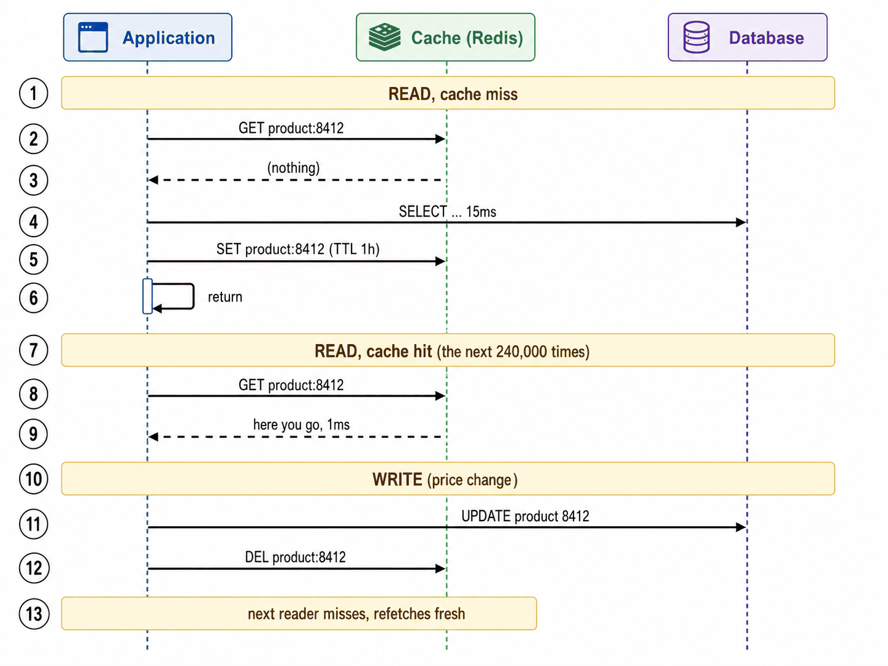
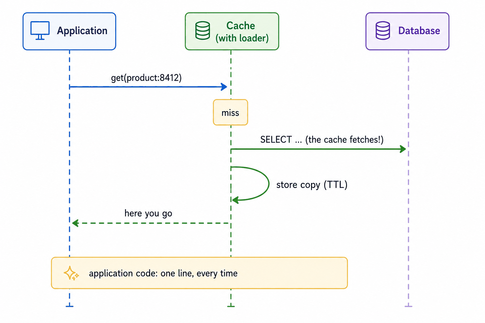
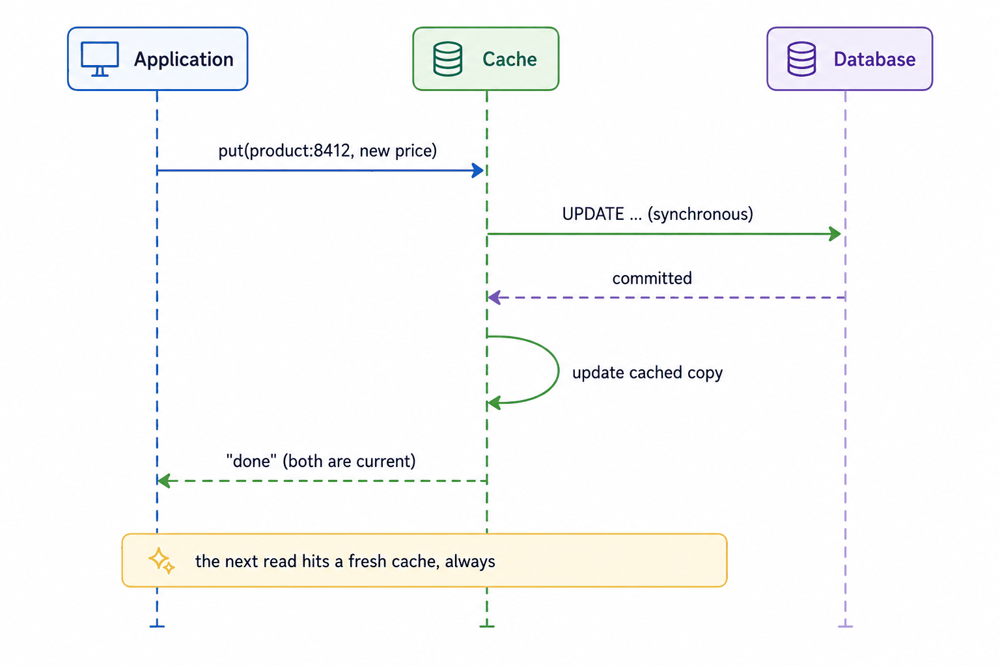
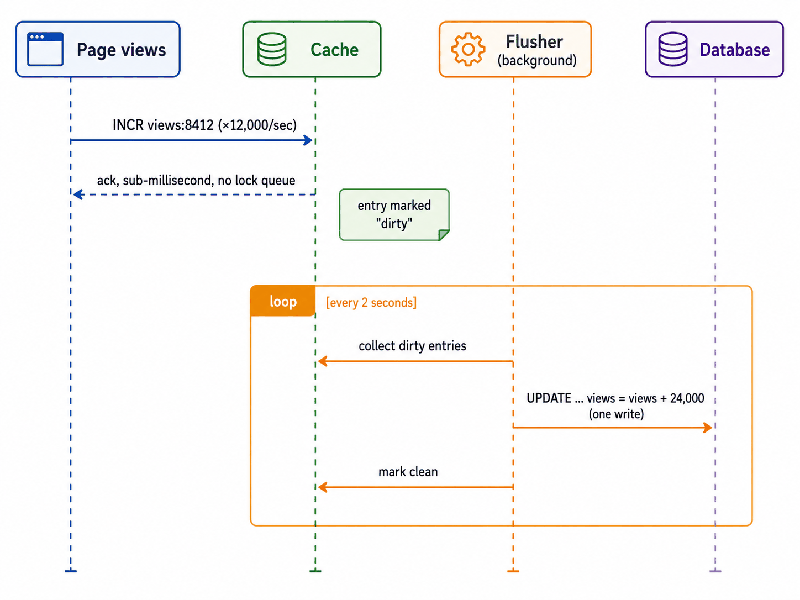
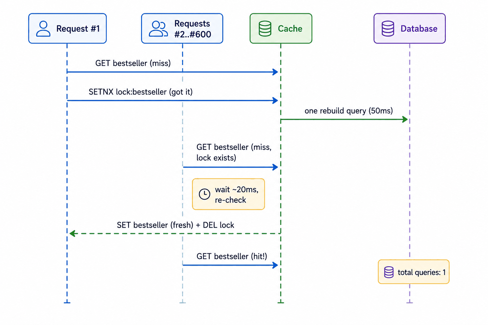
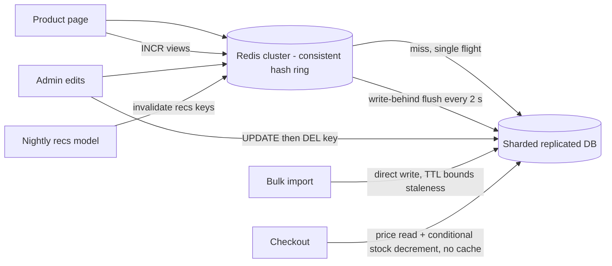

# Module 4 — Serving Data Fast (Caching)

## Module Introduction
*Original lesson: [Module introduction on DesignGurus ↗](https://www.designgurus.io/course-play/system-design-patterns/doc/6a534d50ba41b5b74695db9a)*

**What this module is about.** The storage module finished with one remark: *a cache is a small, short-lived read model*. This module builds on that remark. Caches are some of the most widely used pieces of infrastructure, and also some of the most misused. They also come up in system design interviews more often than almost any other storage technique. A **cache** is a small, fast copy of some data. The authoritative ("true") version of that data lives in a slower system, such as a database. (New to caches, databases and latency? The [System Design Fundamentals](../00-system-design-fundamentals/README.md) primer introduces them.)

**Analogy.** Using a cache is like keeping the few books you need every day on your desk, instead of walking to the library each time. It's quick. But if the library's copy gets revised, your desk copy is now out of date, unless someone tells you.

**The key metric: hit ratio.** A **hit** means the data you asked for was in the cache. A **miss** means it wasn't, so the whole request has to go to the source. The **hit ratio** is the share of lookups that are hits. The math is simple. Say a hit costs 1 ms, and a miss costs that 1 ms *plus* a 100 ms database call. At a **99%** hit ratio the average is about **2 ms**. At **50%** it's about **51 ms**, and on top of that you're now running an extra system. So the real question isn't "should I cache?". It's two linked questions: **how does data get into the cache, and how does it stay correct?** The five patterns give five different answers.

| The situation | The pattern |
|---|---|
| On a miss, the application fetches the data and saves a copy for next time | Cache-Aside |
| The same idea, except the cache does the fetching itself | Read-Through |
| Update the copy and the original together before confirming | Write-Through |
| Update the copy now and write the original later, in batches | Write-Behind |
| A popular entry expires, and only one request should fetch it again | Cache Stampede Prevention |

**Two facts that organize the module**
1. **A cache buys speed by giving up some accuracy.** Any cached copy can disagree with its source. You have to decide how much staleness you can live with, and which mechanism keeps the copy correct: expiry timers, updating at write time, or deleting on purpose. (Interviewers enjoy the old joke: *"There are only two hard things in computer science: cache invalidation and naming things."* Invalidation takes up half this module.)
2. **Caches fail as crowds, not one request at a time.** A single miss does no harm: it's one short database query. The serious failures happen when a popular key expires and ten thousand requests reach the database at the same moment, or when a cache cluster restarts empty in the middle of peak traffic. The stampede lesson covers these events. They mark the difference between *using* a cache and *running* one reliably.

**How the module is told.** Every lesson uses the same product page. It's read millions of times a day, and it sits on top of the database we scaled in Module 3. In Cache-Aside (the default and the longest lesson), the app fetches missing data. Read-Through moves that fetching into the cache. Write-Through and Write-Behind are the two write-side patterns (safety versus speed). Stampede Prevention deals with reliability when the flash sale comes back. The capstone chooses a strategy for each kind of data on the page and tests it under load. **Short on time?** For interviews, Cache-Aside and Cache Stampede Prevention matter most. The write pair usually shows up as a comparison question.

**Four terms used throughout**
- **Hit / miss / hit ratio** — defined above. You should know this number for every cache you run.
- **TTL (time to live)** — an expiry timer on each cached entry ("trust this copy for 5 minutes, then delete it"). It's the simplest and most common tool for keeping data correct.
- **Eviction** — a cache is kept smaller than the full data set on purpose. So when it fills up, it has to throw something away. The usual rule is **LRU (least recently used)**: remove the item nobody has touched for the longest time, on the assumption that recent use predicts future use.
- **Invalidation** — actively removing or updating a cached entry when its source changes. It's more precise than waiting for a TTL, but harder to get right (which is why the joke exists).

**Before you start — three questions about a system you know:**
- What is your cache's hit ratio today? (If no one knows, the cache's value is a guess.)
- When the underlying data changes, how does the cache learn about it: a timer, an update, a delete, or not at all?
- At peak traffic, what happens the instant your most popular key expires? Who goes to the database, and how many of them go?

---

## Cache-Aside
*Original lesson: [Cache-Aside on DesignGurus ↗](https://www.designgurus.io/course-play/system-design-patterns/doc/6a534dedba41b5b74695e334)*

**What it is.** The application looks in the cache first. On a **hit**, it returns the cached copy. On a **miss**, the application reads the database, saves a copy in the cache with an expiry timer (TTL), and returns it. That way the next reader gets the fast copy. On a **write**, the application updates the database and then *deletes* the cached copy, so the next reader pulls fresh data. The cache sits "to the side": it never talks to the database on its own.

**Analogy.** Picture a receptionist who keeps sticky notes with answers to common questions. When someone asks something, they check the notes first. If the answer isn't there, they call the right department, write the answer on a fresh sticky note (marked "throw away after 1 hour"), and reply. When a department announces a change, the receptionist rips up that sticky note.

### The problem

In Module 3 we scaled the database with replicas, shards and projections, and it works. But look at what all that machinery spends its day doing. **Item 8412** is this month's bestseller. It's read **4,000 times per minute**. Its row hasn't changed in **three weeks**, yet the database works out the same **15 ms** answer every single time. Across the whole catalog, reads peak at **12,000/s**, and well over **99%** of them return exactly what the request before got. The replica fleet (read-only copies of the database) keeps up, but it needs **eight** database machines that mostly repeat work. **Latency** (the time each request takes) climbs above 15 ms when requests queue up at peak. And every marketing campaign sets off another capacity meeting. The waste is paying database prices for answers that haven't changed. A better idea: keep the last answer in fast storage and serve it until the data changes.

### Why the obvious fixes fail

- **"More replicas."** They really do scale read volume, but the cost grows just as fast. You're running full database queries only to reproduce answers that haven't changed. The problem is *repetition*, not a shortage of database capacity.
- **"A dictionary in each app server's memory."** It's cheap and tempting. But with **40 app servers**, each one keeps its own private copy. That means 40 cold misses per key instead of one, 40 copies going stale on their own, and every **deploy** (rollout of a new code version, which restarts the servers) wiping all of them and dumping the full load back on the database. It only works for data that is tiny, used all the time, and unaffected by staleness.
- **"Cache it forever."** The hit ratio is excellent. But customers never see Friday's price change. A cache with no way to stay correct doesn't give you fast current data. It gives you *fast old data*.

What you need: one shared, fast copy that fills up when data is requested, plus a plan for keeping it correct.

### How it works

*Figure — Cache-Aside (course diagram)*

The figure above shows three phases as a numbered sequence between the Application, the Cache (Redis) and the Database. **(1–6) A read that misses:** `GET product:8412` comes back empty, the app runs a `SELECT` (15 ms; `SELECT` is the SQL command that reads rows, SQL being the query language of relational databases, and `UPDATE` is its command for changing rows), then does `SET product:8412` with a 1-hour TTL, and returns. **(7–9) A read that hits:** for the next ~240,000 reads, `GET` returns the value in 1 ms. **(10–13) A write:** a price change runs `UPDATE product 8412` on the database, then `DEL product:8412`. So the next reader misses and fetches fresh data.

The cache itself is kept simple on purpose. **Redis** and **Memcached** (both in-memory key-value servers) are the standard tools: a fast store that replies "here it is" or "not here". Every decision lives in the application code. That gives the pattern its flexibility, and also its maintenance cost.

1. **Read: look in the cache.** If it's a hit, return straight away.
2. **Read miss: get it from the database**, since the cache doesn't have it.
3. **Save a copy with a TTL, then return it.** This is called **lazy loading**: only data that someone actually asked for gets cached. Item 8412 ends up in the cache *because* it's read 4,000 times a minute. The **long tail** that nobody requests (the many items that are rarely read) uses no memory. So the cache naturally fills up with **hot data** (the data read most often). The downside: the first reader of any item takes the slow path. And when many readers ask for the same missing item at the same moment, you get the stampede problem (a later lesson).
4. **Write: update the database, then delete the cached key.** Don't update the cached copy in place. Deleting is safe and lazy, because the next reader fetches the true value. Updating the copy directly opens up races where an older value can overwrite a newer one (see the comparison below).
5. **Put a TTL on everything, even when you also invalidate.** Delete-on-write only keeps data correct if *every* code path remembers to delete. Sooner or later, a bulk import, a manual database fix or a rushed admin tool won't. The TTL caps how long that kind of mistake can last. **Invalidation gives you freshness; the TTL gives you insurance.** Important data should never depend on a TTL alone, and no data should depend on invalidation alone.
6. **Eviction deals with overflow.** When the cache is full, LRU removes the item used least recently. An evicted key just turns into a miss later, which is harmless by design.

### Walkthrough with numbers

Redis cache-aside on the product page, with a 1-hour TTL and a delete on every write:
- **The first read of 8412 is a miss:** 1 ms cache check + 15 ms database + 1 ms SET = **17 ms**. That's a little *worse* than having no cache. It's the honest cost: misses pay for the cache check as well.
- **The next ~240,000 reads that hour:** **1 ms** each. The catalog's hit ratio settles at about **99.2%**. So the average latency = 0.992 × 1 ms + 0.008 × 17 ms ≈ **1.1 ms** (down from 15 ms).
- **Read load on the database:** it drops from **12,000/s to about 150/s**, which are the real misses. **Six of the eight replicas** are shut down by the end of the quarter. RAM (fast working memory, where caches keep their data) is cheap; database machines are not.
- **A price change on 8412:** `UPDATE` the database, then `DEL product:8412`. The next reader misses and fills the cache again. The window of staleness is a few **milliseconds**. With a TTL alone, the old price could have stayed for up to a whole **hour**.
- **The forgotten-delete drill:** three months later, a bulk import updates **2,000 products** without invalidating. Those stale copies are served for up to one TTL, then fix themselves. That's annoying, but limited and survivable. It's exactly what the TTL is there for.

### Delete vs. update on write (the comparison)

You've changed a price in the database. What should happen to the cached entry? Interviewers ask this a lot.

| | DEL the key | SET the new value |
|---|---|---|
| Next read | One extra miss (fetch again from the DB) | An immediate hit that is already fresh |
| Race safety | Safe: the true value is fetched after all writes have settled | Risky: two writes at once can SET in the wrong order and leave the older value cached until the TTL |
| Wasted work | None, if nobody reads it again | Stores values that might never be read |
| Complexity | One line that's hard to get wrong | You must serialize (force one-at-a-time) or version updates to stay correct |

**The race, step by step:** write A sets the price to $45 and write B sets it to $40 at almost the same moment. Suppose A is the *last* to commit to the database, so the truth is $45 — but the two cache updates can arrive in the reverse order, so B's `SET 40` lands after A's `SET 45`. Now the cache says $40 and the database says $45, and it stays wrong for up to a full TTL. With `DEL`, the worst possible ordering is just two deletes, and the next reader fetches the true $45 from the database. A single extra miss wipes out a whole category of wrong answers.

DEL still has one uncommon race. A slow reader that fetched the *old* value before the write can put it back into the cache right after the delete. The short TTL limits that case as well, which is one more reason to keep it.

### Trade-offs

**You gain:**
- Big relief on reads: about **two orders of magnitude** (roughly 100×) less read load on the database, in exchange for one small service and a few GB of RAM.
- Latency that users can feel: **15 ms → 1 ms** on the hottest pages.
- Full control: your code chooses, for each data type, what to cache (rows, whole pages, computed results), how to key it, and how long to trust it.
- Resilience: if Redis dies, every read becomes a miss. That's slow but *correct*, because the database is still the truth. (Whether the database survives the sudden full load is the topic of the stampede lesson.)

**You pay:**
- **Staleness you have to manage.** Between a change and its delete or expiry, readers see the old value. It's limited, but it's a real property you choose for each data type.
- **The consistency chore.** Every write path you have now *and every future one* has to invalidate. If one forgets, you get admin-panel edits that show up instantly while bulk imports stay stale (see self-check Q3).
- **Boilerplate.** Every data-access function repeats check → fetch → set → return. So teams pull it into helpers, and the next lesson turns that helper into a pattern.
- **Misses cost more.** Each miss pays for the cache check *and* the database. That's fine at 99% hits. At **~60%**, you add a hop while saving very little work.
- **Cold starts and hot expiries.** A cache that restarts empty, or a popular key that expires at peak, sends crowds to the database (solved in the stampede lesson).

### When not to use it

- **Little repetition** — data that's read about once for each write can't produce useful hits (per-user notifications, one-time tokens).
- **No tolerance for staleness at all** — the last unit of stock at checkout, or the execution price of a trade. Read these from the source of truth. (Browsing beforehand can usually tolerate seconds.)
- **The database's own memory already has it** — small data sets often already live in the database's built-in **buffer cache**. If a query takes 15 ms against data that's in memory, it's probably missing an **index**. Fix the query first. (A cache in front of a bad query still pays the full cost on every miss.)
- **Data that is state, not a copy** — sessions and shopping carts need a durable primary home. If they live only in a cache that evicts, carts can disappear.
- **Common misuse:** caching everything out of habit with a 24-hour TTL, no invalidation and no hit-ratio monitoring. The result is stale data and mediocre performance, and nobody measures either.

### Real-world examples

- **Redis and Memcached** — the industry-standard tools. "**Look-aside caching**" is another name for this pattern.
- **Facebook's memcache paper** — cache-aside at huge scale, including fixes for the races and request surges covered in this module.
- **Framework helpers** — Rails' `Rails.cache.fetch`, Django's cache API and Spring's `@Cacheable` (Rails, Django and Spring are popular web frameworks for Ruby, Python and Java) all implement cache-aside, so you don't have to repeat the code.
- **Your own hardware** — the database buffer pool, the operating system's **page cache** (recently read disk blocks kept in RAM), and the CPU's **L1/L2/L3** caches (tiny, very fast memories built into the processor) all do the same thing. They check a fast copy, fetch from slower storage on a miss, and keep the result. It's one of the most common patterns in computing.
- **For AI engineers:** exact-match caching works well for embeddings of strings that come up again and again (search queries, product titles), for **moderation** decisions (checks for harmful content), and for **feature vectors** (the lists of input numbers a model receives) at serving time (the online layer of a feature store often uses it). Every cached embedding saves a paid API call. LLM answers are harder. Users rarely repeat a question byte for byte, so exact keys miss. A **semantic cache** (later in the course) matches by meaning instead.

### In the interview

When a product page is slow or a database is buried in reads, cache-aside is usually your first move. The real conversation is about where its correctness ends: how it stays consistent, which TTL to use, and what happens after a restart.

> **30-second answer:** With cache-aside, the app checks Redis first and serves hits in a millisecond. On a miss, it reads the database and fills the cache with a TTL. On writes, I update the database and *delete* the cached key instead of updating it. Concurrent updates can race and leave an older value stuck in the cache, while a delete makes the next reader fetch the truth. Every entry keeps a TTL as a safety net for any write path that forgets to invalidate. The TTL is sized per data type: an hour for descriptions, minutes for prices, seconds or no cache at all for inventory. And I track the hit ratio. Below ninety-something percent, the cache barely earns its keep.

**Likely follow-ups (with answers):**
- *"Why delete instead of updating the cache with the new value?"* — Two writes at almost the same time can reach the cache in a different order than they committed to the database. That leaves the older value stuck until it expires. Deleting shrinks the worst case to a single extra miss. The one rare race left, where a reader puts an old value back, is limited by the TTL.
- *"What TTL would you pick?"* — No single global value makes sense, because the cost of staleness depends on the data type. Descriptions: ~1 hour. Prices: minutes, with invalidation doing the real work. Inventory: seconds, or no cache at all, and the purchase itself checks the database.

**Mistake that fails candidates:** updating the cache on write without knowing about the race. Caching without *both* a TTL and an invalidation plan. Or putting a cache in front of a **900 ms** query instead of looking for the missing index.

### Self-check

- **Q1. Walk the miss path and the write path in order, and say who does each step.** → Miss: the *application* asks the cache, queries the database, SETs the result with a TTL, and returns it. Write: the *application* updates the database, then deletes the key. The next reader then follows the miss path. The cache never talks to the database, and that's what "aside" means.
- **Q2. Pick TTLs (and invalidation) for product descriptions, prices and live inventory, justified by the cost of being wrong.** → Descriptions: a 1-hour TTL + invalidation on edit (staleness costs little). Prices: invalidation as the main mechanism + a 5-minute TTL as a backstop (wrong prices cost revenue and trust). Displayed inventory: a 5–30 s TTL with no invalidation, but the actual purchase reads the database. Each TTL reflects what it costs when that data type is wrong.
- **Q3. Admin-panel edits show up immediately, but nightly bulk-import changes take "up to an hour, randomly". No errors. Diagnose, fix, and name what prevented worse.** → The admin panel deletes cache keys. The bulk import writes straight to the database and doesn't invalidate. So every stale copy lasts until its own TTL runs out, which is why it's "random, up to an hour". Fix: make the import delete every key it affects (or bump a **version** built into the keys). Even better, send all writes through one data-access layer, so no future path can forget. The TTL is what kept the 2,000 products from staying stale forever.

### Related patterns

- **Read-Through** — the same steps, but the fetch-and-fill moves out of the app and into the cache layer.
- **Cache Stampede Prevention** — protects against many requests missing the same popular key at once.
- **Consistent Hashing** — spreads keys over a cache cluster and prevents miss storms when the cluster changes size.
- **CQRS** — a cache is a small, short-lived read model, with the same questions about truth, derived copies and lag.

### TL;DR

- **Problem:** the database answers the same unchanged questions thousands of times a minute, paying database cost and latency for nothing but repetition.
- **Mechanism:** check the cache. On a miss, read the DB and store the result with a TTL. On a write, update the DB and delete the key. Use TTLs everywhere as insurance, and LRU for overflow.
- **Costs:** limited staleness, a permanent invalidation chore on every write path, boilerplate, misses that cost double, and crowd behavior on cold starts and hot expiries.
- **Skip it when:** data hardly repeats, staleness can't be tolerated (read the truth), or the slow query really just needs an index.

---

## Read-Through
*Original lesson: [Read-Through on DesignGurus ↗](https://www.designgurus.io/course-play/system-design-patterns/doc/6a534f5b6a9123b6be1009e7)*

**What it is.** The application only ever talks to the cache, by calling `get(key)`. On a miss, the **cache itself** gets the data from the database, saves a copy, and returns it. It does this through a configured **loader**: a function that knows how to fetch something, for example a product by its key. In short, it's cache-aside with the job of fetching moved out of your code and into the cache layer.

**Analogy.** With cache-aside, every employee phones the warehouse whenever the shelf is empty. With read-through, there's one shelf-stocker instead. You simply ask the shelf. If it's empty, the stocker goes and gets the item. And if twenty people ask at the same time, the stocker makes just *one* trip.

### The problem it solves

Cache-aside left every data-access function repeating the same check → fetch → set → return steps. Across many functions and services, some skip a step (for example the SET), some behave a little differently, and some use keys that don't match. Also, each caller runs its own miss logic, so callers can't coordinate with each other. When a popular key is missing, every caller goes to the database on its own.

### How it works

*Figure — Read-Through (course diagram)*

In the figure above, the application calls `get(product:8412)`. The cache (which has a loader) finds a **miss**, runs the `SELECT` by itself ("the cache fetches!"), saves a copy with a TTL, and replies "here you go". The note at the bottom makes the key point: the application code is **one line, every time**.

1. **The app calls `get(key)` on the cache.** There's no cache-checking or database logic in the application code.
2. **On a hit, the cache returns the value.**
3. **On a miss, the cache runs its loader.** It fetches from the database, saves the result with a TTL, and returns it. These are the same miss steps as cache-aside, just with a different owner.
4. **Request coalescing comes for free**, because the cache sees every reader. With cache-aside, **5,000** misses at the same moment on one key mean 5,000 copies of app logic, each querying the database. A loading cache lets the *first* caller do the fetch while the other **4,999** wait a moment for the same answer. Many simultaneous misses on one key → **one** database fetch. This is the first defense against the module's second fact (caches fail as crowds), which the stampede lesson develops fully.
5. **Writes aren't handled.** Read-through only deals with reads. So changes still need delete-on-write invalidation plus TTLs. The other option is to pair it with write-through (next lesson), which moves writes into the cache layer too.

Where you'll run into it: loading-cache libraries like **Caffeine** and **Guava's `LoadingCache`** (both Java libraries), **ORM** second-level caches like **Hibernate**'s (an ORM, object-relational mapper, is a library that maps database tables to objects in your code), and managed front ends like **DynamoDB DAX**, a caching service that knows how to reach the table behind it.

### Read-through vs. cache-aside (the comparison)

| | Cache-Aside | Read-Through |
|---|---|---|
| Who fetches on a miss | Your application code | The cache layer, using its loader |
| Miss logic lives | Inside every data-access function | In one configured place |
| Concurrent misses on one key | N separate database queries | Can be merged into 1 (the main benefit) |
| Can cache computed, multi-source results | Yes, since the app can cache anything | Awkward, since a loader fetches one kind of thing by key |
| Cache infrastructure | Any simple cache works (Memcached) | Needs a smart cache: a library, an ORM layer, or a service |
| Consistency across teams/services | Every team rebuilds the procedure | One implementation, used the same way everywhere |

### Trade-offs

**You gain:**
- A single implementation of the miss path. No forgotten SETs, and no forty slightly different versions.
- Request coalescing. Simultaneous misses on a **hot key** (one that many readers want at the same time) shrink to one database query.
- Cleaner application code. Data access shows what you want (`get`), not how it's done.

**You pay:**
- **Flexibility.** A loader fetches one kind of object by key. A dashboard or page fragment built from three sources doesn't fit, while cache-aside can cache anything the app computes.
- **Smarter infrastructure.** The cache layer has to run fetch logic with access to the database. That means an **in-process** library (one running inside your application's own program), an ORM or a caching service. Plain Memcached can't do it.
- **Coupling.** Queries and access rules now live in the cache layer too, so **schema** changes (changes to the database's table structure) can spill over into it.
- **Writes are still your job.** You have the same invalidation duties and TTL insurance as with cache-aside.

### When not to use it

- **Computed and composite results.** The app knows how to put several sources together; a per-key loader doesn't. Use cache-aside.
- **Your cache is meant to be a simple shared store.** A shared Memcached fleet has no place to run a loader. Adding that intelligence might cost more than the boilerplate it saves.
- **One small codebase.** A single service with a well-built `fetch_with_cache()` helper already gets most of the benefit.
- **Where it shines:** many services, teams and languages all reading the same data. At that scale, separate implementations regularly lead to forgotten SETs, TTLs that don't match, and keys that don't line up. One shared read-through layer prevents all of that by design.

### In the interview

It's often asked directly: "What's the difference between cache-aside and read-through?" A strong answer explains *who owns what* and what follows from that, not just two diagrams.

> **30-second answer:** It's the same miss path with a different owner. In cache-aside, my application checks the cache and does the fetch-and-fill itself. That's as flexible as it gets, but it's repeated everywhere, and someone always forgets a step. In read-through, the app only talks to the cache, and the cache fetches through a configured loader on a miss. There's one implementation. And because the cache sees every reader, it can merge simultaneous misses on a hot key into one database query, which is real protection when a popular key expires. The trade-off: loaders fetch one kind of thing by key, so computed results still call for cache-aside. And in both cases, writes need their own invalidation plan.

**Likely follow-ups (with answers):**
- *"Which for a product catalog read by forty **microservices** (small, separately deployed services)?"* — Read-through, as a shared caching service or layer. Every consumer gets one loader, one TTL policy, the same behavior and coalescing. The alternative is forty teams building forty slightly different procedures.
- *"Does read-through fix the stale-after-bulk-import bug from cache-aside?"* — No. That failure happened on the *write* path, and read-through only controls reads. It still needs careful invalidation or a pattern on the write side.

**Mistake that fails candidates:** treating the two as rivals that give different results, or claiming read-through solves invalidation. When they succeed, their read behavior is exactly the same. Only the ownership, and what follows from it, is different.

### Self-check

- **Q1. Who fetches after a miss in each pattern, and what new capability does centralizing it enable?** → In cache-aside, the application fetches. In read-through, the loader inside the cache layer does. Putting it in one place makes coordination possible (merging simultaneous requests for one key into one database query), and gives you one uniform implementation.
- **Q2. Cache (a) product records read by 40 services in 6 languages, and (b) a per-seller dashboard computed from three databases. Which pattern for each?** → (a) Read-through as a shared layer: one loader, one consistent policy, and coalescing that protects the shared database. (b) Cache-aside: the application has to combine three sources before saving the finished result with a TTL and invalidation rules.
- **Q3. A popular key expires at peak and 5,000 requests miss within 50 ms under plain cache-aside. Database load? With coalescing? What lesson does this lead to?** → Cache-aside sends **5,000 identical queries**. A loading cache that coalesces sends **one**, while 4,999 requests wait a moment for its result. A spike becomes one normal query. This shows that caches fail as crowds, which Cache Stampede Prevention handles at a larger scale.

### Related patterns

- **Cache-Aside** — the same behavior with the work handed out differently. Its rules about TTLs, delete-on-write and hit ratio all still hold.
- **Write-Through** — the matching pattern on the write side. It sends writes through the cache as well.
- **Cache Stampede Prevention** — extends request coalescing and adds other defenses against misses that happen together.

### TL;DR

- **Problem:** cache-aside's miss steps get repeated in every function and service. That leads to forgotten steps and inconsistent behavior, and readers who don't coordinate stampede the database on shared misses.
- **Mechanism:** the app only calls the cache. On a miss, the cache fetches through a configured loader, saves the result and returns it. That's one implementation, and it can merge simultaneous misses into one fetch.
- **Costs:** loaders fetch one thing by key (computed results stay with cache-aside), the cache needs intelligence and database access, there's coupling, and writes still need invalidation.
- **Skip it when:** you're caching composite/computed results, your cache is a simple shared store, or a helper in one small codebase already does the job.

---

## Write-Through
*Original lesson: [Write-Through on DesignGurus ↗](https://www.designgurus.io/course-play/system-design-patterns/doc/6a534fe0da90fe9bceb2be6f)*

**What it is.** Writes pass *through* the cache. The application sends a write to the cache layer. The cache layer writes to the database **synchronously** (the caller waits for it), then updates its own copy. The caller hears "done" only after both the original and the copy are updated. So for data written this way, the cache is never stale, because it was part of the write.

**Analogy.** Think of a secretary. When you dictate a change to the official register, they write it in the register first. Then they update the quick-reference card on the front desk. Only then do they say "done". Anyone who looks at the card afterward sees the new value.

### The problem it solves

Cache-aside and read-through make the *application* responsible for deleting keys after writes, with TTLs as insurance. That depends on every write path remembering the chore (the forgotten-delete type of bug). It also costs an extra miss at exactly the moment a user reads back what they just saved. Write-through makes cache upkeep **structural**. The cache *is* the write path, so it can't forget the update. It's the natural partner of read-through. With both, reads and writes all pass through the cache, which becomes the single way into the data rather than a copy kept up beside the application. Both need the same smart infrastructure: a loading cache that can also write, an ORM layer, or a service like DAX.

### How it works

*Figure — Write-Through Cache (course diagram)*

In the figure above, the application calls `put(product:8412, new price)` on the cache. The cache sends a **synchronous** `UPDATE` to the database and waits for "committed". Then it updates its cached copy, and only after that does it return "done" (both copies are current). The note at the bottom says the next read always hits a fresh cache.

1. **The app sends the write to the cache layer**, not to the database.
2. **The cache writes to the database first, synchronously.** The order matters. The database is the truth, so it must succeed before the copy claims anything.
3. **If the database write fails, the cache stores nothing and passes the error back.** The copy never shows a value the original doesn't have.
4. **If the database write succeeds, the cache updates its own copy, then confirms.**
5. **If the database write succeeds but the cache update fails, invalidate (delete) the entry and still report success.** The commit is safe. The next read just misses and fetches the true value. That's one slower read, and it's still correct.
6. **The cache stays fresh and warm.** Cache-aside deletes after a write. Write-through *keeps* the new value instead, so the read that usually comes right after a user's edit is an immediate hit.
7. **The guarantee has a limit.** The cache is fresh only for writes that go *through* it. A direct database write from another service, a bulk import or a manual fix skips the cache and brings back the forgotten-delete problem. So either every writer uses the cache, or every entry keeps TTL insurance.

### Write-through vs. delete-on-write (the comparison)

| | Cache-aside + DEL | Write-Through |
|---|---|---|
| After a write, the cache is | Empty for that key (the next read fills it) | Already fresh |
| Read-after-write | One extra miss | An immediate hit |
| Write latency | Only the database write | Database write + cache update (a little slower) |
| Caches data nobody reads? | Never | Yes, since every write goes into the cache whether it's read or not |
| Requires | Any simple cache | A smart cache layer sitting in the write path |

### Trade-offs

**You gain:**
- **Structural freshness.** There's no invalidation chore and no forgotten-DEL bugs for anything written through the cache.
- **Read-after-write that hits.** Save-then-view (most user edits) is served from the cache right away.
- Together with read-through, **one coherent data layer**, instead of a cache maintained alongside the code.

**You pay:**
- **Write latency.** Every write makes two updates, one after the other, before confirming. The extra millisecond or two matters on paths where latency is critical.
- **Cache churn.** Every key that gets written enters the cache, including values nobody will read. In a write-heavy workload, they can push truly hot entries out of limited memory.
- **Discipline at the boundary.** Writes that skip the cache quietly bring staleness back.
- **Smart infrastructure.** A basic key-value store can't run this sequence.

### When not to use it

- **Data that's written a lot and read rarely** — logs, metrics, audit records, click activity. Caching every record gains nothing and pushes out useful entries. Write these straight to storage.
- **Writers that bypass the cache are a fact of life** — if three other systems update the same tables directly, the freshness promise doesn't really exist. Cache-aside + TTL describes the real guarantee more honestly.
- **Writes where latency is critical** — some operations can't afford the extra synchronous step. (Write-behind might fit, but only after you weigh its durability cost.)
- **Common misuse:** adding write-through on top of the old invalidation code and then removing every TTL. Nobody can tell which mechanism actually keeps things correct. Pick **one** main mechanism, document it, and keep TTLs as insurance.

### Real-world examples

The course doesn't give a separate list for this lesson. The implementations are the same smart-cache infrastructure as for read-through: a **loading cache with a writer**, an **ORM layer**, or a **DAX-style** caching service sitting in front of the database.

### In the interview

It usually comes up when comparing cache-aside, write-through and write-behind. It also comes up with "users edit a profile and must immediately see the new value", because read-after-write is its biggest strength.

> **30-second answer:** With write-through, writes go through the cache. The cache updates the database synchronously, then its own copy, and only then confirms. So the cache is never stale for anything written through it, and the read-after-write that follows most user edits hits a warm, fresh cache. The costs: writes pay for both updates, and every write goes into the cache whether or not anyone reads it. The guarantee only covers writes that pass through the cache, so writers that bypass it still need TTL insurance. It fits naturally with read-through, which makes the cache the one entry point to the data layer.

**Likely follow-ups (with answers):**
- *"The database write succeeds but the cache update fails. Now what?"* — Invalidate the entry and return success. The database commit is safe, and the next read fetches the true value. You accept one slower read rather than serving a wrong copy.
- *"Why not always use write-through instead of cache-aside's delete?"* — It needs a smart cache in the write path, it stores values that may never be read, and it loses its guarantee whenever any writer goes around it. Delete-on-write is one simple operation on basic infrastructure. The choice is stronger structure versus more simplicity and flexibility.

**Mistake that fails candidates:** claiming write-through means you don't need TTLs even though writers that bypass it exist. Or being unable to say what happens when either of the two updates fails.

### Self-check

- **Q1. Describe the write sequence including both failure cases, and state exactly which writes get the freshness guarantee.** → App → cache → database updated synchronously → cached copy updated → confirm. If the DB fails: cache nothing and return the error. If the DB commits but the cache update fails: invalidate the entry and confirm, so the next read fetches the truth. Only writes that go through this whole sequence are guaranteed fresh.
- **Q2. Choose behavior for (a) users editing profiles they view right away, and (b) an activity log written on every click but almost never read.** → (a) Write-through (with read-through): structural freshness, and the read-back hits a warm cache. (b) Don't cache the write at all. A record nobody reads only wastes cache memory. If recent logs become popular later, cache-aside can add them when they're requested.
- **Q3. Six months after adopting write-through and removing TTLs, customers see stale prices only for products changed by a new bulk-pricing tool. Diagnose and fix.** → The tool writes to the database directly and skips the cache. So write-through never refreshes those copies. With the TTLs gone there's no backstop, so they stay stale until they're evicted. Fix: send the tool through the cache's write path *and* bring the TTLs back. Every correctness guarantee has a boundary, and forgotten writers live outside it.

### Related patterns

- **Read-Through** — the natural partner. Together they make the cache the single entry point for reads and writes.
- **Write-Behind** — the next lesson. Same entry point, but the database update is delayed, trading durability for speed.
- **Cache-Aside** — the simpler option (delete-on-write + TTLs) for basic infrastructure and for systems with independent writers.

### TL;DR

- **Problem:** delete-on-write relies on every write path remembering the chore, and it costs an extra miss right when users read back what they saved.
- **Mechanism:** writes go through the cache. The database is updated synchronously first, then the copy, then the confirmation. If only part of it fails, invalidate and stay correct.
- **Costs:** extra write latency, churn from writes nobody reads, smart infrastructure in the write path, and a guarantee that ends at the cache's boundary.
- **Skip it when:** data is written much more than it's read, writers that bypass the cache can't be avoided, or write latency is precious.

---

## Write-Behind
*Original lesson: [Write-Behind on DesignGurus ↗](https://www.designgurus.io/course-play/system-design-patterns/doc/6a53506b5a38214864ff9ce2)*

**What it is.** Writes land in the cache, and the caller gets an **immediate acknowledgment** (it's told "done"). The database finds out *later*. A background **flusher** sweeps up the changed entries every few seconds and writes them to the database in efficient batches, folding many small changes into a few big ones. Another name for it is *write-back*.

**Analogy.** Picture a tally counter in a shop that clicks up for every customer. Nobody phones head office on each click. Every couple of seconds, someone reads the counter and sends a single message: "+24,000". If the shop loses power between messages, the clicks since the last message are gone.

### The problem

The product team wants to show "12,483 people viewed this today" on every product page. The straightforward way is to run `UPDATE products SET views = views + 1` on every view. At peak, the bestseller gets **12,000 views/s**, so **12,000 UPDATEs per second hit one row**. A database guards a row that's being changed with a **lock**. So these updates line up in a queue, each one waiting for the one in front of it. Update latency goes past **one second**. Waiting connections use up capacity that important work needs. And checkout slows down, because counting views is hogging the database.

Now look at what's really required. 12,000 times a second, the system durably records a fact before confirming it, and the whole fact is "+1". Nobody needs each increment on permanent storage right away. The displayed number changes all the time anyway, and a 2-second delay is invisible. Still, each +1 pays for a lock, a write, and an entry in the **WAL** (write-ahead log). The database could get one summary fact every two seconds instead: "+24,000 for the last two seconds".

### Why the obvious fixes fail

- **"Write-through."** It keeps the cache fresh, but it still sends *every* write synchronously to the database. That's still 12,000 row locks per second, plus a cache update on top. Write-through fixes staleness. This incident is about write *volume*.
- **"Sample it: count every 10th view."** That's fine for rough analytics, but it's only an estimate. Small counts come out wrong (7 views might show as 0 or 10). And it stops being acceptable once badges, rankings or payouts depend on the number.
- **"Put the writes on a queue."** Put each view on a queue and have a worker batch the database updates. That's a valid Module 2 answer and the closest alternative. But the page has to *show* the current count, and a queue can't serve reads. Add a cache next to the queue, and you've built most of this pattern (see the comparison).

### How it works

*Figure — Write-Behind Cache (course diagram)*

In the figure above, page views send `INCR views:8412` to the cache 12,000 times per second. Each one gets an ack in under a millisecond, with no lock queue, and the entry is marked **"dirty"**. In a loop every 2 seconds, the background flusher gathers the dirty entries, sends one `UPDATE … views = views + 24,000` to the database, and marks the entry clean.

1. **The write lands in the cache and is confirmed right away.**
2. **Dirty tracking.** The cache keeps track of which entries have changes that haven't reached the database yet. These entries are **dirty**. A dirty entry must **never be evicted** before it's flushed. Evicting it wouldn't just free memory; it would delete data that was already confirmed. So implementations **pin** dirty entries (mark them as not allowed to be evicted) until they're clean.
3. **The flusher coalesces.** **Coalescing** = merging many changes to one key into a single database write. Counter increments get added up (12,000 × "+1" → one "+24,000" per flush). Repeated updates to a field keep only the last value (five edits to a product within two seconds → one write of the final state). Database work now grows with the number of **distinct keys changed**, not with the total write rate. That's a much better growth curve.
4. **Flush policy:** flush every N seconds *or* every N dirty entries, whichever happens first. A shorter interval puts less data at risk but batches less. A longer one is more efficient but puts more at risk.
5. **Flush failures need a plan.** If the database is down for a moment, the flusher holds on to the dirty batch and tries again. An entry that fails over and over goes into a **quarantine** (a side area, like a message queue's dead-letter queue), so one bad record can't block every flush after it.

**The cost, said plainly — this is the most dangerous pattern in the module:**
- **"Acknowledged" doesn't mean "saved" anymore.** Until the next flush, confirmed changes exist only in cache memory. The WAL lesson's promise (fsync — force to disk — *before* acknowledging) is given up on purpose, in exchange for speed and less database load. If a cache node fails, every dirty change from one flush interval can be lost. So every use of this pattern has to finish this sentence, in writing: **"if we lose the last N seconds of these writes, then ___"**. And the answer has to be truly acceptable.
- **The truth flips.** During the dirty interval, the *cache* has the current value and the *database* has an older one. Anyone who needs the live value must read the cache. Reports or services that read the database directly see the past. For that stretch, the cache is the authoritative source, not a disposable copy.

### Walkthrough with numbers

The view counter, rebuilt with a **2-second** flush:
- **Write path:** `INCR views:8412` in Redis completes in **under 1 ms**. There's no database lock and no queue. The page reads the same key, so it always shows the current count. 12,000 in-memory increments per second are easy work for Redis.
- **Database load:** the hot key now produces one `UPDATE … + 24,000` every 2 seconds. That's a drop from **12,000 writes/s to 0.5/s**, a **24,000×** reduction. Across the catalog, each flush folds thousands of dirty keys into a handful of bulk statements, which hands database capacity back to checkout.
- **Crash drill:** a cache node dies **1.8 s** after its last flush and loses about **21,600** views that weren't flushed. The loss sentence ("if we lose 2 seconds of view counts, the numbers are imperceptibly lower") was written and accepted *before* launch, so this is fine.
- **Making the window smaller, if you need to:** a **Redis replica** keeps the dirty data if one node fails. Redis **AOF** (append-only file, which is basically a write-ahead log owned by the cache) saves it to disk. A shorter flush interval moves you closer to write-through. Each option buys back durability by spending some speed.
- **The proposal to reject in review:** reusing this design for payment records. "If we lose the last 2 seconds of payments, then…" has no safe way to end. Money keeps the WAL's durability promise.

### Write-behind vs. queue + batching worker (the comparison)

| | Write-Behind | Queue + batching worker |
|---|---|---|
| Ack comes from | Cache memory (fast, but volatile: lost if power or the process dies) | The broker, once it has persisted the message |
| Durability of acknowledged writes | Whatever is in the flush window is at risk | Durable in the broker: nothing confirmed is lost |
| Coalescing (+1 merging) | Happens naturally, in place | Can be done in the worker, but it's clumsier |
| Live reads of the current value | The cache serves them, which is the whole point | Not possible; readers see the database's lag |
| Machinery | Dirty tracking inside the cache | A topic, a consumer and offsets (each reader's saved position in the stream; the usual Module 2 kit) |

**The question that decides it: does any reader need the hot, current value?** The product page shows the live count, so write-behind wins. The cache acts as both the write buffer and the read layer. For a pure ingestion stream that nobody reads right away (analytics events, telemetry), use a queue and a worker. The broker keeps every confirmed write, and nothing useful is lost. Adding a read cache to the queue, or a persistent log to the cache, pushes each design toward the other. Choose the one whose built-in strengths fit the main workload.

### Trade-offs

**You gain:**
- Write confirmations at cache speed. Row **contention** (many writers fighting over the same row) disappears at its source.
- Orders of magnitude fewer database writes, thanks to batching and coalescing. Load grows with distinct keys, not with the write rate.
- Natural absorption of bursts. Spikes pile up as dirty entries, and the flusher drains them at whatever pace the database can handle (the same shape as the queue lesson).

**You pay:**
- **The durability window.** Confirmed writes sit in memory until they're flushed, and a crash loses them. This is the main cost, and every deployment needs its consequence written down.
- **Truth inversion.** The cache is the authority during the dirty interval. Anyone reading the database directly quietly sees older values.
- **Real complexity.** Dirty tracking, eviction pinning, retries, quarantine and per-key ordering add up to the heaviest machinery in the module.
- **Harder debugging.** "What was the value at 14:02?" now has two answers (the cache and the database), and incident response has to reconcile them.

### When not to use it

- **Money, ledgers, payments, orders, anything related to compliance.** Any chance of a loss window rules it out, no matter the **throughput** (operations handled per second). Writes that matter one by one keep the WAL's promise.
- **Other systems read the database directly** and need current values. Truth inversion breaks them *without any error*, which makes it especially hard to spot.
- **Writes that don't coalesce.** Unique records (new orders, messages) can be batched, but they don't get the huge reduction a hot key gets. A durable queue can batch them without putting confirmed data at risk.
- **Modest volume.** A counter at **50 updates/s** doesn't justify dirty tracking and flushers. An ordinary database handles it fine.
- **Judgment calls:** shopping carts → a durable store (losing a user's choices is harm they can see). Inventory → the displayed badge can be buffered, but the decrement that accepts a sale must be durable. Token-usage metering → buffer the live dashboards, but bill from a durable, reconciled event stream.
- **Risk of adopting it by accident:** some cache products and ORMs offer write-behind as a simple switch. Turning it on for speed without a documented loss window only postpones the decision until a failure makes it for you.

### Real-world examples

- **CPU write-back caches** — the name comes from hardware. Processors have made this trade between cache and RAM for decades.
- **Social counters at scale** — views, likes and impressions are buffered in caches and flushed as totals. Locking a row for every reaction would be absurdly expensive.
- **Rate limiters and leaderboards** — Redis counters that serve live reads and reach permanent storage later.
- **EhCache, Hazelcast** (Java caching products) — offer write-behind as a built-in feature. The rule about documenting the loss window still applies, even though it's easy to turn on.
- **For AI engineers:** training metrics and telemetry fit well (buffer, batch, flush; losing ~2 s of **loss-curve** points (the training-error measurements plotted over time) is fine). Online feature stores can buffer updates the same way. Token metering needs care. It's shaped like a counter (which suits write-behind), but it's billing (money). So buffer dashboards aggressively, and compute invoices from a durable, reconciled event stream. Dashboards can lose a moment; invoices can't.

### In the interview

A typical prompt: a like button or view counter at large scale. Diagnose **row contention** first, then propose this. Another: the interviewer accepts write-behind, then asks "what happens when a cache node dies?"

> **30-second answer:** Twelve thousand increments per second on one row is a lock-contention problem, so I buffer in the cache. Increments land in Redis in under a millisecond. The page reads the same key, so it's always current. A background flusher merges them into one bulk update every couple of seconds, which cuts database writes by orders of magnitude. The price: confirmed writes live in cache memory until the flush, so a crash loses that window. That's acceptable, and documented, for view counts, but never for money. Also, during the window the cache is the truth, so anything reading the database directly sees the past. If nobody needed the live value, I'd use a durable queue with a batching worker instead.

**Likely follow-ups (with answers):**
- *"The cache node dies. What exactly is lost, and how would you shrink it?"* — Up to one flush interval of confirmed dirty changes. You can shrink it with a cache replica (survives one node failing), AOF persistence (which has its own fsync policy), or a shorter interval. Each one gives up some performance for durability and moves the design toward write-through.
- *"Would you use this for inventory during the flash sale?"* — Separate the display from the decision. "Only 3 left" can be seconds stale or buffered. But the decrement that accepts a sale matters financially and needs a durable, authoritative path.

**Mistake that fails candidates:** using write-behind for payments or orders. Ignoring the risk of evicting dirty entries. Or claiming that Redis persistence removes all loss, when AOF's default fsync policy **`everysec`** still allows about **one second** of loss.

### Self-check

- **Q1. Describe the full write path, define "dirty", and say exactly what the acknowledgment promises.** → The cache accepts the write and confirms it right away. It marks the entry dirty (changed, but not in the database yet) and pins it so it can't be evicted. Every so often, the flusher merges the dirty changes, writes them to the database and marks them clean. The ack only promises that the value is in cache memory and *should* reach the database later. It does not promise the value is durably saved.
- **Q2. For view counts, cart contents, payment records and a "trending now" score: write-behind or not, and complete the loss sentence.** → View counts: yes, "…the numbers are imperceptibly lower." Trending score: yes, since it's approximate, derived and can be recomputed. Cart contents: no, use a durable store. Losing user choices is visible harm, and the volume rarely calls for it. Payments: never, because no loss window is acceptable. Whether it fits depends on what losing the dirty window would cause.
- **Q3. A nightly analytics job reading the database reports view counts ~2% below the cache-backed dashboard, and counts dip slightly after every deploy. Explain and fix proportionately.** → The 2% gap is truth inversion doing what it was designed to do (the database trails the cache's dirty counts). Have analytics read post-flush data labeled "as of" a time, or accept the difference and label it. The dips after deploys happen because restarting cache nodes drop changes that weren't flushed. **Flush dirty entries on graceful shutdown** (a planned stop where the process finishes its work before exiting), and add a replica if the remaining gap matters. Persisting every write would be overkill for views and would basically rebuild write-through.

### Related patterns

- **Write-Through** — the safe alternative: update the database synchronously before confirming.
- **Message Queue** — the durable alternative for batching write streams that nobody needs to read live.
- **Write-Ahead Log** — the durability promise that write-behind weakens. It can partly rebuild that promise inside the cache using AOF.
- **Read-Through** — the read side of the smart cache layer. Combined with write-behind, the cache becomes the single entry point.

### TL;DR

- **Problem:** frequent writes to hot keys (counters, scores) turn database rows into lock queues. That's thousands of facts per second that don't matter one by one, each paying the full price of a durable write.
- **Mechanism:** writes land in the cache and are confirmed instantly. Dirty entries are pinned and flushed to the database in merged batches every few seconds, so load grows with distinct keys, not with the write rate.
- **Costs:** a durability window (acknowledged ≠ saved), truth inversion (direct DB readers see the past), and the heaviest machinery in the module.
- **Skip it when:** writes involve money or matter one by one, other systems read the DB directly, writes don't coalesce, or volume is modest. Always finish "if we lose the last N seconds, then ___", and mean it.

---

## Cache Stampede Prevention
*Original lesson: [Cache Stampede Prevention on DesignGurus ↗](https://www.designgurus.io/course-play/system-design-patterns/doc/6a53511a6a9123b6be101c18)*

**What it is.** This is a group of techniques for one situation: a popular ("hot") cache entry needs to be rebuilt. They make sure **exactly one request does the rebuilding**, while everyone else waits a moment or receives the slightly old copy. Without them, thousands of requests hit the database at the same time. That crowd of simultaneous misses is called a **cache stampede** (also known as **dog-piling**).

**Analogy.** When the office coffee pot runs dry, you don't want forty people each brewing a new pot at once. One person makes coffee. Everyone else waits a minute, or drinks the last lukewarm cup while the fresh pot brews.

### The problem

During a flash sale, the bestseller's page serves **12,000 requests/s** from the cache with a **99.9%** hit ratio. The database only sees **150 queries/s**. Everything is fine. At **8:00:00 PM**, that product's entry reaches its **one-hour TTL** and expires. This is routine; every key expires eventually. Now watch the next 50 milliseconds:

1. Rebuilding the value takes one database query of about **50 ms**.
2. Every request that arrives during those 50 ms misses as well: **12,000 × 0.05 = 600 simultaneous misses**.
3. With plain cache-aside, each of them runs its own miss path. That's **600 identical queries** against a database that's used to 150/s.
4. The burst slows the query from 50 ms to **500 ms**. That *stretches* the miss window, while traffic keeps coming at 12,000/s. Now **6,000** requests are missing.
5. The database's **connection pool** (its limited set of open connections) fills up. More queries queue behind it. Checkout, which shares the database, stops working. By **8:00:03** a single ordinary expiry has taken the site down.

The damage equals **request rate × rebuild time**. And overload makes the rebuild slower, which makes the crowd bigger. That's a **feedback loop**. It's the module's second fact in action: caches fail as crowds. A cache cluster that restarts **empty** at peak runs the same math on *every* key at the same time.

### Why the obvious fixes fail

- **"Longer TTLs."** A 6-hour TTL makes stampedes happen less often, but not smaller. And data stays stale for longer.
- **"Size the database for the burst."** Provisioning for 6,000 simultaneous queries is a huge permanent cost for a **50 ms** event that happens a few times a day. The burst also grows with traffic, so success keeps outgrowing whatever reserve you bought.
- **"Never expire hot keys — refresh everything from a background job."** That works for the hottest keys. But recomputing the whole catalog wastes resources on millions of entries nobody reads. **Refresh-ahead** only pays off for the small set of keys whose traffic justifies it.

Misses aren't the issue. The issue is **600 requests repeating the same work**. The fix is coordination. It's the **request coalescing** idea from read-through (many identical requests → one operation), fully developed here.

### How it works

*Figure — Cache Stampede Prevention (course diagram)*

The figure above shows the lock tool. Request #1 misses the bestseller and takes `SETNX lock:bestseller` ("got it"). The single rebuild query (50 ms) goes to the database. Requests #2..#600 also miss, but they see that the lock exists, wait ~20 ms and check again. Once the fresh value is SET and the lock is deleted, their next `GET` is a hit. Total database queries: **1**.

Three tools protect a single hot key. Two more protect the whole cache fleet. Real production systems combine them.

**Tool 1 — The lock ("single flight").** Only one request at a time may rebuild a given key.
1. The first request that misses grabs a short lock for that key. In Redis this is atomic using `SETNX` ("set if not exists"), so only one caller can win.
2. It fetches the value from the database and fills the cache.
3. The other requests see the lock, wait a moment, and check the cache again once the fresh value is there.
Result: 600 misses → **1 query + 599 short waits**. The lock needs a **short TTL of its own**, because the request holding it might crash. A lock that never expires turns into an outage by itself.

**Tool 2 — Serve stale, refresh behind.** If slightly old data is fine, nobody has to wait. Keep entries a little past their *logical* expiry. When an entry has expired, serve the stale copy right away and let **one** background refresh, protected by a lock, fetch the new value. Users get data a few seconds old at full speed, and the database gets one query. (A product page that's 50 ms stale looks exactly like a fresh one.) HTTP makes this standard with the **`stale-while-revalidate`** **header** (a name-value line of metadata sent with an HTTP request or response).

**Tool 3 — Probabilistic early refresh.** Stop the hottest keys from ever reaching expiry. As a key gets close to its TTL, each request has a small random chance of refreshing it early, and that chance grows as expiry gets nearer. A key with thousands of readers nearly always gets refreshed before it expires. A cold key with no readers just expires quietly, with no crowd. The randomness automatically points refresh work at the keys whose traffic makes it worth doing.

**Fleet tool 1 — TTL jitter.** Mass expiry is a stampede spread over *many different* keys. For example, a deploy warms **10,000** entries within a minute, all with TTL **3600**. So all of them expire together an hour later. Add a small random variation, such as **3600 ± 10%**, so the expirations spread out over many minutes. That randomness is called **jitter**.

**Fleet tool 2 — A cold-start plan.** An empty cluster at peak means a 100% miss ratio at full traffic. Before you let traffic in:
1. **Warm** (pre-load) the most popular keys from an **access log** (a record of which keys were requested) or a snapshot (fewer misses right away).
2. **Ramp traffic up slowly** (the load that's left stays within the database's capacity).
3. Count on **single flight** to limit database work to **one query per distinct key**. That gives operators a measurable upper limit instead of an uncontrolled crowd.
Also use **consistent hashing** for the cache cluster, so a normal resize doesn't turn into mass misses the way modulo routing does.

### Walkthrough with numbers

Back to 8:00:00 PM, now with serve-stale + a per-key lock turned on:
- The bestseller reaches its logical expiry. The next request finds it stale, takes the lock, starts the rebuild, and serves the stale copy in **1 ms**. The other **599** requests in that 50 ms window also get the stale copy in 1 ms. Nobody waits.
- **Database queries: 1** (instead of 600 spiraling up to 6,000). **Page latency: a flat 1 ms** (instead of jumping to seconds). **Staleness served: 50 ms** worth, which nobody can notice.
- At **8:00:00.050** the fresh value arrives, and the next hour goes just like the last one.
- **Cold-start drill:** a bad deploy restarts the cache cluster at **7:50 PM**. Warming brings back the top **10,000** keys in about **40 s**. The load balancer ramps traffic up over **2 minutes**, and single flight caps the work at one query per key. The database briefly peaks under **2,000 queries/s**. That's unpleasant but survivable, and it recovers within minutes. Without the plan, the same event could snowball into an outage.

### The three hot-key tools compared

| | Lock (single flight) | Serve stale + refresh | Probabilistic early refresh |
|---|---|---|---|
| During rebuild, others get | A few ms of waiting | The stale copy, right away | Nothing, because expiry rarely comes |
| Staleness served | None: everyone gets fresh data | One rebuild's worth | Practically none |
| Complexity | Lock TTLs and logic for waiters | Tracking the stale window | Probability math in the client |
| Wasted work | None | None | A few refreshes that happen early |
| Best for | Keys where staleness isn't allowed | The default for data that tolerates staleness | The very hottest keys at the largest scale |

Big systems often run **all five** together. They serve stale for ordinary tolerant data, guard every rebuild with a lock, refresh the known hottest keys early, jitter TTLs everywhere, and keep a written cold-start runbook. Each one covers a different gap, and none of them replaces the others.

### Trade-offs

**You gain:**
- **Flat latency through expiries.** The **p99** (the latency that 99% of requests beat) stops spiking every TTL cycle.
- **Database load that follows the number of distinct keys needing a rebuild**, never the request rate. The crowd is capped at 1 by design.
- **Cold starts and deploys you can survive.** That's the difference between a cache that helps and a cache your architecture depends on.

**You pay:**
- **Limited staleness, served on purpose.** Serve-stale returns old data for one rebuild interval. For many data types that's negligible, but it's a decision per key, not a universal default.
- **Lock complexity and its own class of bugs.** Expiry timers, handling a crashed lock holder, and fallback for waiters. Use proven code (Go's **`singleflight`**, from the Go programming language's libraries; documented Redis lock recipes) instead of writing your own.
- **Waiting requests tie up resources.** Single flight *without* stale serving makes requests wait a few ms, and that can matter at extreme concurrency.
- **A little wasted work.** Early refresh sometimes refreshes an entry that could have expired without harm, and the cache client gets more complex.
- **Justify it with measurements:** simultaneous misses per key, database queries per rebuild, time spent waiting on locks, and stale responses served. These show whether the protections cut real load and which keys deserve early refresh.

### When not to use it

- **Cold and long-tail keys.** A key read once a minute can't have many simultaneous misses, so locks and stale tracking add nothing. Measure simultaneous misses first.
- **Low-traffic systems.** At **50 requests/s**, the biggest possible crowd is too small for the database to notice. **Distributed locking** (a lock shared by many servers, usually kept in Redis) at ~**100 req/s** guards against a crowd that never shows up. (The opposite mistake is more common: nobody thinks about simultaneous expiry until a flash sale exposes it.)
- **Staleness truly not allowed.** Then serving stale data is out. Use the single-flight lock so callers wait briefly for fresh data, or don't cache that key at all. (The cache-aside advice to read critical values from the source still holds.)

### Real-world examples

- **Facebook's memcache "leases"** (from the same paper mentioned in cache-aside). The cache gives the first request that misses a token that allows it to rebuild, while the others wait. This is single flight at huge scale.
- **`stale-while-revalidate`** — made standard in **RFC 5861** (RFCs are the numbered documents that define internet standards). **CDNs** (content delivery networks: servers around the world that keep cached copies near users) and browsers use it to answer right away while refreshing in the background.
- **Go's `singleflight` package** — single flight within one process, offered as a small standard building block.
- **The XFetch paper**, "Optimal Probabilistic Cache Stampede Prevention" — the math behind probabilistic early refresh.
- **For AI engineers:** a stampede costs more when the rebuild is a **billable, multi-second LLM generation** rather than a 50 ms query. One popular answer that expires can set off dozens of identical paid generations. Single flight for identical prompts is one of the most valuable protections in an inference stack. It works alongside the later semantic cache (which also catches *similar* requests). Inference cold starts likewise need **model weights** (the learned numbers that make up a trained model) and caches warmed up before traffic is let in gradually.

### In the interview

Once you propose caching, expect this: "What happens when your most popular key expires at peak?" Work through the **concurrency** math (how many requests are in progress at the same moment) out loud, then explain how coordinated rebuilds put a ceiling on it.

> **30-second answer:** A hot key that expires under load causes a stampede. At 12,000 requests a second with a 50 ms rebuild, 600 requests miss together and send identical queries, and the slowdown feeds on itself. I stack several defenses. Every rebuild is guarded by a lock, so exactly one request does the work (single flight). Keys that tolerate staleness serve the stale copy while one background refresh runs, so latency stays flat. The hottest keys refresh probabilistically before expiry, so that moment never arrives. Across the fleet, TTL jitter keeps keys that were warmed together from expiring together. And there's a cold-start plan: warm the top keys, ramp traffic, and let single flight cap the database at one query per distinct key.

**Likely follow-ups (with answers):**
- *"The request holding the rebuild lock crashes. Now what?"* — The lock has a short TTL, so it's released automatically. Waiting requests serve stale data or retry once. A lock with no expiry would turn the protection itself into an outage.
- *"Your whole cache cluster restarts empty at peak. Walk me through it."* — First, avoid cold restarts where you can (replicas, consistent hashing). During recovery, warm the popular keys from an access log, ramp traffic up slowly, and use single flight so the database sees at most one query per distinct key. That limit is the key operational guarantee.

**Mistake that fails candidates:** saying "on expiry it just goes back to the database" and ignoring simultaneous misses. Suggesting client **retries** (they make the crowd bigger). Or locking every key without a measured traffic threshold.

### Self-check

- **Q1. Do the incident's math: why can one key expiring at 12,000 req/s endanger the whole database, and what creates the feedback loop?** → The rebuild takes 50 ms. During that time 12,000 × 0.05 = 600 requests miss and send identical queries. That burst slows the database and stretches the rebuild. At 500 ms there are 6,000 simultaneous queries, which slow things down even more until the shared connections run out. Damage = request rate × rebuild time, and overload makes the rebuild time itself longer.
- **Q2. Pick a tool (or none) for a news site's headline block, a stock-price display, and a retailer's top-100 product pages.** → Headlines: serve stale while refreshing. A few seconds of older news does no harm, and latency stays flat. Stock price: staleness makes the product wrong, so use a lock-guarded refresh with a short wait (if you cache it at all). Top 100 products: probabilistic (or scheduled) early refresh, since with their traffic, expiry should almost never happen. The choice depends on each key's traffic and how much staleness it can tolerate.
- **Q3. Every day at exactly 4:00 AM the database has a ten-minute load spike; the team deploys daily at 4:00 PM. No errors. Diagnose and fix with one line.** → The 4 PM deploy warms thousands of entries at once, all with the same **12-hour** TTL. So they all expire together 12 hours later, and the database rebuilds them at the same time. Fix: TTL jitter, `ttl = 43200 ± rand(10%)`, which spreads the expirations over about an hour. Moving the deploy time would only move the spike. Jitter removes the synchronization.

### Related patterns

- **Cache-Aside** — this lesson provides the protection for its problem of misses happening together.
- **Read-Through** — its request coalescing is single flight on a smaller scale (loading caches often offer it per process).
- **Consistent Hashing** — keeps cache-cluster resizes from causing mass misses and needless stampedes.
- **Graceful Degradation** — serving stale data belongs to a wider family of ideas: "give a reduced answer instead of failing".

### TL;DR

- **Problem:** a hot key that expires under load sends every simultaneous request to rebuild it (request rate × rebuild time identical queries), in a spiral that feeds itself. A cold cache runs that math on every key at once.
- **Mechanism:** one rebuilder per key (lock / single flight). Serve stale while refreshing in the background. Refresh the hottest keys probabilistically before expiry. Jitter TTLs. Warm cold caches and ramp traffic up.
- **Costs:** limited staleness served on purpose, lock TTLs and waiter logic (use libraries), waiters held for a moment, and some wasted early refreshes.
- **Skip it when:** keys are cold or traffic is low. Measure simultaneous misses before adding machinery.

---

## Capstone - Caching the Product Catalog
*Original lesson: [Capstone - Caching the Product Catalog on DesignGurus ↗](https://www.designgurus.io/course-play/system-design-patterns/doc/6a5351bf5a38214864ffa16b)*

**What this capstone is.** A product page *looks* like a single resource. But behind its URL sit **five different kinds of data**. Each has its own read/write pattern and its own cost of being wrong, so each needs its own caching decision. After that, a flash sale stress-tests all the choices together. For every decision, name both the **pattern** and its **correctness mechanism**. That mechanism is a TTL (a timer that expires an entry), invalidation (deleting the entry when its source changes), or both. Then finish the sentence **"if this data is N seconds old, then ___."** Answering that separately for each value is the entire module in one exercise.

### The brief

- **Traffic:** 12,000 requests/s at peak, **99%+ reads**.
- **Five kinds of data on the page:** the product **description** (name, images, specs), the **price**, live **inventory** ("only 3 left!"), the **view counter** ("12,483 viewed today"), and **"customers also bought"** (a strip of computed recommendations).
- **Existing infrastructure:** the sharded, replicated database from Module 3; a Redis cluster routed with consistent hashing; and a merchandising team with a **bulk-import tool** that writes straight to the database (it has already caused two incidents in this course, so keep it in mind).

### Decision 1 — The description

**The data:** read all the time, edited every few weeks. Stale values cost almost nothing (nobody can tell that a description is three minutes old).

**Decision: cache-aside, the default.** The app checks Redis, fetches misses from the database, and saves them with a **1-hour TTL**. An edit updates the database and then **deletes** the key. It doesn't update the copy, because of the concurrent-write race from the Cache-Aside lesson. **Why keep the TTL?** The type of bug to guard against is the bulk importer, which writes straight to the database without invalidating. The TTL limits its stale data to one hour instead of forever.

*Staleness sentence:* "If the description is an hour old, then a typo fix took an hour to appear." That's acceptable.

### Decision 2 — The price

**The data:** read the same way as the description. But a wrong price has financial, legal and trust costs.

**Decision: the same pattern, with stricter correctness.** Cache-aside still suits the *read profile*. But **invalidation on every write becomes the main way to stay fresh**: a price change deletes its key within milliseconds. The backup TTL shrinks from 1 hour to **5 minutes**, so the bulk-pricing tool can leave a price wrong for five minutes at most. **Checkout keeps a direct line to the truth:** the price saved on an order is read from the database. Only *displayed* prices can be briefly stale.

*The central principle of the module:* **the read profile chooses the cache pattern; the cost of being wrong chooses the correctness rules.**

### Decision 3 — Live inventory

**The data:** "Only 3 left!" changes with every sale, possibly hundreds of times a second. It shows on every page view, and it's close to money.

**Decision: split the reads, and keep the writes on the truth.**
- **The display badge** is treated as a marketing number. It's cached with a **10-second TTL** and **no invalidation per sale**. Why not invalidate? Hundreds of invalidations per second would bring back the very database load the cache removes, with no real benefit for users.
- **The checkout decision** that reserves the last unit always runs a **conditional database decrement** (it only succeeds if stock is left). This purchase path never relies on the cache.

*Staleness sentences:* for the badge, "if the count is 10 seconds old, a customer sometimes sees 'only 3 left' when it's 2; urgency marketing survives." For checkout, no staleness is acceptable, so there's no cache. It's one number with two designs, because the two reads have different consequences.

### Decision 4 — The view counter

**The data:** **12,000 increments/s** on the bestseller, which is exactly the Write-Behind incident. This is the one kind of data on the page where *writes* are the problem.

**Decision: write-behind.** Each view is a Redis **`INCR`** (under 1 ms, no row locks), and the page reads the same key. Every **2 seconds**, a background flusher merges the batch into one **`+24,000`** instead of 24,000 separate `+1`s. The loss sentence is written down: "if we lose the last 2 seconds of view counts, the numbers are imperceptibly lower." A **flush-on-shutdown** step in the deploy process keeps routine restarts from losing even that. **Truth inversion** applies. Redis holds the current value and the database trails by ~2 s, so analytics that read the database must label their results "as of" a time.

### Decision 5 — "Customers also bought"

**The data:** takes about **400 ms** to compute, by combining order history from several tables. It's refreshed by a **nightly model run**. Yesterday's result is just as good as this morning's (staleness doesn't hurt it).

**Decision: cache-aside, and definitely *not* read-through.** This is the limit from the Read-Through lesson. A read-through loader fetches one object by key, but this strip needs application logic to put several sources together. So the app builds it, caches it with a **12-hour TTL**, and **invalidates the affected entries when the nightly model publishes** new recommendations. Note the warning sign for the next stage: a 400 ms rebuild makes this key especially exposed to misses happening at the same time.

### Decision 6 — The flash sale (every decision stress-tested)

**The event:** at 8 PM, traffic **triples**. Every failure from the stampede lesson shows up. Hot keys expire under 12,000 req/s, keys that were warmed together expire together, and the cache cluster changes size in the middle of the sale.

**The layered defenses, each matched to the failure it prevents:**
1. **Serve-stale as the default policy** (hot-key expiry). Descriptions, display prices and recommendations return stale values in 1 ms while one protected refresh runs. The 400 ms recommendation rebuild runs **once instead of 600 times**. (A display price is stale only for the length of the rebuild, not its whole TTL, and checkout still reads the database.)
2. **Single flight on every rebuild** (the limit on the crowd). Each lock has a short TTL. Other requests get stale data or wait briefly. The database sees **at most one query per distinct expired key**, and that limit is what makes capacity planning possible.
3. **Early refresh for the top 100 products** (the hottest keys). Probabilistic early refresh means the busiest products almost always refresh *before* they expire. So the bestseller's 8 PM stampede never happens.
4. **Jitter on every TTL** (mass expiry). All TTLs vary by **±10%**. So the thousands of values warmed by the **4 PM deploy** expire over several minutes instead of all together at 5.
5. **Consistent hashing for the Redis fleet** (the cluster change). Adding one node remaps about **1/N** of keys instead of about **95%**, so there's no miss storm.
6. **A written cold-start runbook** (the empty-cache case): warm popular keys, ramp traffic up slowly, and let single flight cap the database at one query per key. It's documented *before* anyone needs it.

**Result:** the sale finishes with database reads **under 400 queries/s**, even though traffic tripled. That's because caching was handled as a set of separate correctness and load decisions, not as one global habit.

### The final architecture

*Final architecture: each data type gets its own path, with checkout decisions always on the source of truth.*

In the diagram above, the product page reads through the consistent-hash Redis cluster. The cluster falls through to the sharded database only on a miss, using single flight. View increments go to Redis and reach the database through the 2-second write-behind flush. Admin edits update the database and then delete the key. The bulk import writes to the database directly, so only TTLs limit its staleness. The nightly recommendations model invalidates the recs keys. And checkout reads the price and runs the conditional stock decrement directly on the database, never on the cache.

| Data on the page | Staleness budget | Pattern + correctness | Stampede treatment |
|---|---|---|---|
| Description | ~1 hour | Cache-aside; DEL on edit + 1 h TTL (insurance against bypassing writers) | Serve-stale + single flight |
| Price (display) | Seconds | Cache-aside; DEL on write + 5 min TTL | Serve-stale (limited to the rebuild) + single flight |
| Price (on the order) | Zero | No cache; read the source | n/a |
| Inventory badge | ~10 seconds | Cache-aside; TTL only (writes happen too often to invalidate each one) | TTL jitter |
| Inventory decision | Zero | No cache; conditional write on the source | n/a |
| View counter | Live from cache | Write-behind; 2 s flush, loss sentence written down, flush-on-shutdown | n/a (it never expires; while dirty, it is the source) |
| Recommendations | Hours | Cache-aside (computed, so a loader can't build it); nightly invalidation | Early refresh (top 100) + single flight |

**How to read it:** go down the "staleness budget" column. Every decision starts from the oldest the data is allowed to be. The patterns enforce those budgets. The **hit ratio** is the financial reason to cache. **Concurrent misses** are the reliability risk. Those three questions sum up the module.

### Extend it yourself (open questions to practice)

- **Multi-region:** the catalog now serves two continents, and each has its own Redis cluster. A price change made in one region has to stop being wrong in the other within seconds. Design cross-region invalidation. What gets sent (deletes or values?), over what channel (hint: a Module 2 pub/sub-style channel), and what goes wrong when that channel lags (the other region serves stale prices)?
- **Personalized prices:** enterprise customers see negotiated prices. So the key becomes `price:{product}:{customer}`, and the **key space** (the number of possible distinct keys) jumps from **100K to 500 million**. What's left of the price design? Think about hit ratios on long-tail keys (rarely read, so they rarely hit) and memory budgets. Also ask whether the *inputs* to the price calculation are easier to cache than the result.
- **For AI engineers:** add semantic product search ("cozy reading chair") using an LLM-embedded vector query that takes ~**200 ms** and costs real money each time. Exact-match caching misses all the time, because nobody words a query the same way twice. Sketch a design, then compare it with the semantic cache lesson (merging *similar* requests is a pattern of its own).

**Interview one-liner**
> Don't cache "the page". Cache each data type according to its staleness budget: cache-aside with TTL insurance for descriptions and recommendations, invalidation first for prices, a TTL-only badge plus an uncached purchase decision for inventory, write-behind for counters, and layered stampede protection so the database sees at most one query per expired key during the sale.
