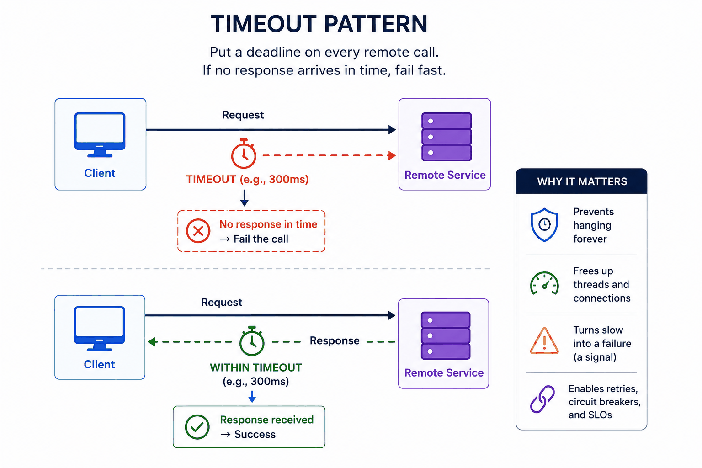
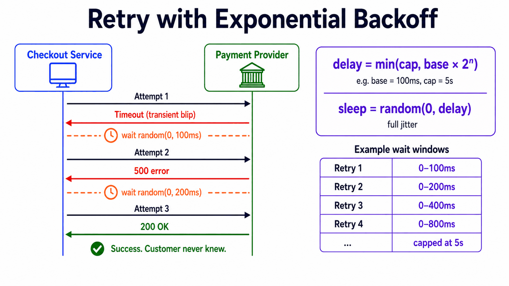
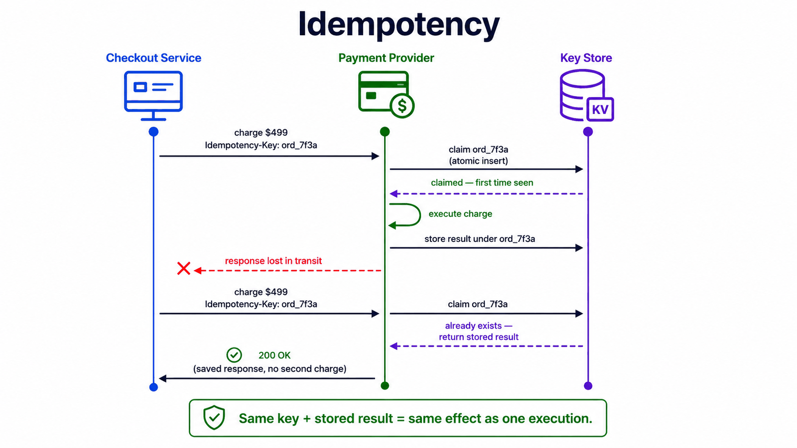
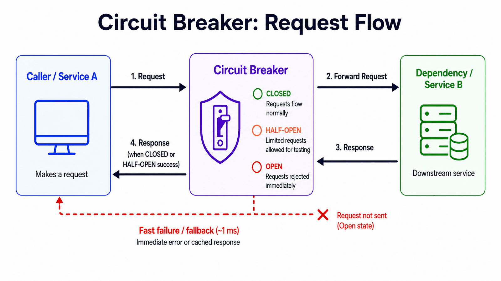
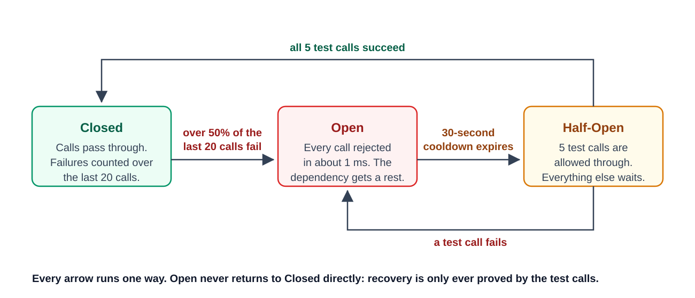
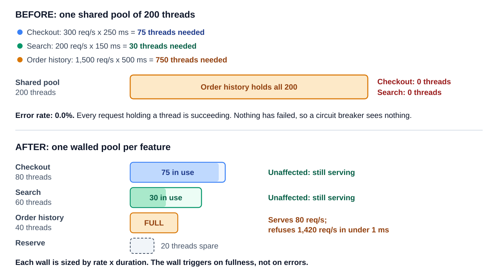
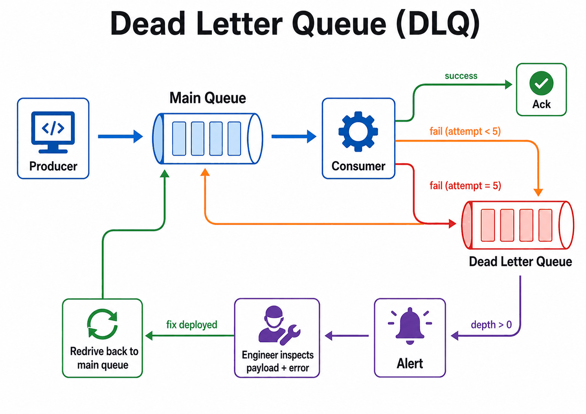
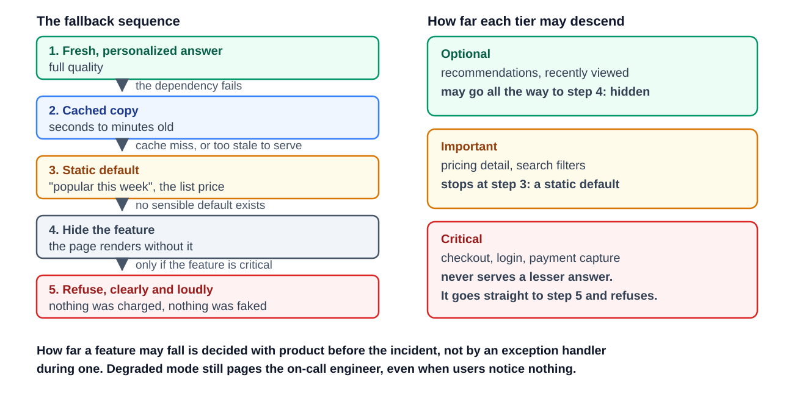
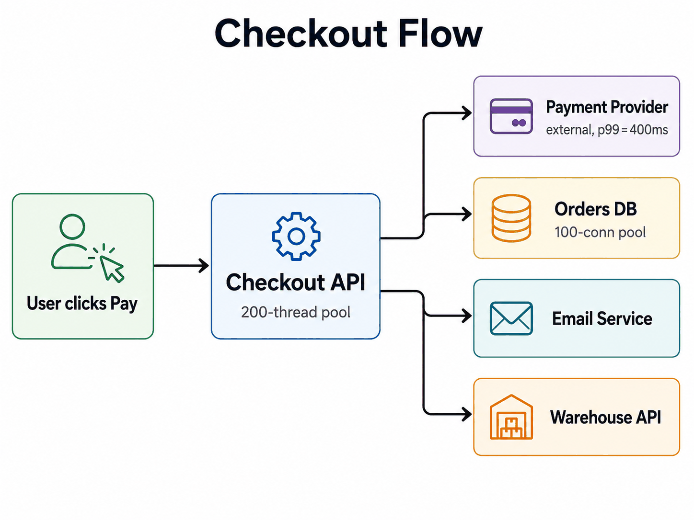
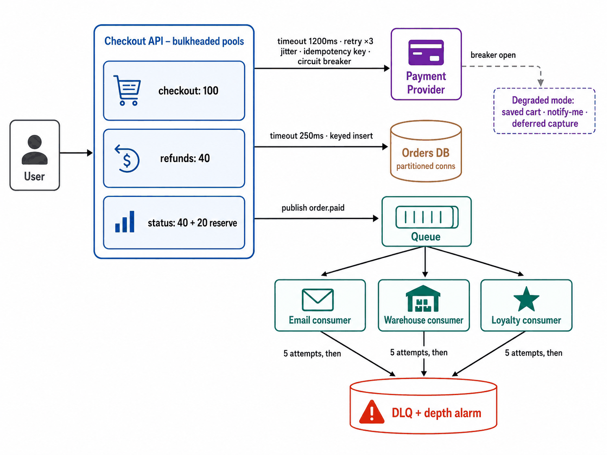

# Module 5 — Surviving Failure (Reliability)

## Module Introduction
*Original lesson: [Module introduction on DesignGurus ↗](https://www.designgurus.io/course-play/system-design-patterns/doc/6a50724c914a537a0045f5fe)*


**What this module is about.** On a whiteboard, an arrow from service A to service B looks innocent. In a live system, that single arrow can break in four different ways. B may never reply at all (we call this a *hang*). B may reply with an error. B may finish only part of the job. Or B may reply so late that nobody can use the answer. This module gives you seven well-known patterns. Each one lets you handle these outcomes deliberately, rather than finding out by accident.

**Why "rare" failures are not rare.** A failure rate can sound tiny and still hit you all day long once traffic is high. Picture a checkout that processes 100,000 orders a day, where 1 call in 200 fails. That works out to **500 failures every single day**. A reliable design plans for that real, measured number instead of wishing it away. This is also why interviewers keep coming back to failure. Each A-calls-B arrow you sketch carries a hidden question: "and what if B doesn't answer?"

**Pattern picker** — first name the failure you see, then choose the tool:

| What the failure looks like | Pattern |
|---|---|
| Silence; waiting callers keep stacking up | Timeout |
| Breaks right now, then works again a few seconds later | Retry with Backoff |
| You can't tell whether your payment actually went through | Idempotency |
| Stays broken for minutes, not just moments | Circuit Breaker |
| No errors anywhere, yet one workload is swallowing all the capacity | Bulkhead |
| A single bad message holds up every message behind it | Dead Letter Queue |
| All the mechanisms did their job, yet the user still landed on an error page | Graceful Degradation |

**Two kinds of pattern.** Six of the seven are **mechanisms**. Their job is to decide *when to stop*: stop waiting, stop retrying, stop calling, or stop redelivering. The seventh, Graceful Degradation, is a **policy**. Its job is to decide *what the user gets* while a part stays broken. You need both kinds. With mechanisms only, you just produce errors more quickly. With a policy only, nothing actually enforces it.

**Why the order matters.** Every lesson solves a problem that the lesson before it either causes or reveals. Timeouts make silent hangs show up as visible failures → retrying those failures might perform a write twice → idempotency makes repeated attempts harmless → yet it is useless when a **dependency** (another service or system that yours calls) stays down for minutes, so circuit breakers cut off the calls → bulkheads deal with floods of *successful* requests, which breakers cannot detect → queues need somewhere to put messages that will never succeed → and once all of that is in place, someone still has to choose what the user sees. The capstone then uses all seven fixes on seven incidents inside a single payment system. Short on time? Timeout, Retry, Idempotency, and Circuit Breaker are the "critical four". They build on each other in a fixed order, so study them as a group.

**Four terms used everywhere in this module**
- **Transient vs. sustained failure.** A *transient* failure goes away on its own within seconds, like a lost network **packet** (one small chunk of data travelling over the network). A *sustained* failure sticks around because the service truly is down or swamped. Retries fit transient failures. Circuit breakers fit sustained ones. Choose the wrong tool and you pile extra load onto an outage.
- **Fail open vs. fail closed.** Sometimes a check cannot run. *Failing open* means you let the operation go ahead anyway. *Failing closed* means you block it. Nice-to-have features are allowed to fail open. Security and money must always fail closed — if the login service is unavailable, it must never let everyone in.
- **At-least-once delivery.** Queues and retry loops guarantee that no work gets lost. The price is that the same item can show up more than once. That duplication is expected behavior, not a bug, so whatever code receives the items has to cope with repeats safely.
- **Little's law.** *Work in progress = arrival rate × time each item takes.* Suppose 300 requests/second arrive and each takes 2 seconds. Then 600 requests are in flight at the same moment. If every request ties up a thread (a unit of execution that a server uses to handle one request), you need 600 threads. Three of the lessons lean on this formula to predict the exact point where a server runs out of resources.

**Before you start** — think about a system you know and try to answer these. The capstone repeats them, and "I don't know" is a perfectly good place to begin:
1. Suppose something your service calls goes silent — no error, just nothing. How long does your service keep waiting, and who picked that number?
2. Suppose your service retries a payment or a write that failed. What prevents the retry from charging the customer twice?
3. Take your most important page. When its *least* important dependency goes down, what exactly shows up on the user's screen?

## Timeout
*Original lesson: [Timeout on DesignGurus ↗](https://www.designgurus.io/course-play/system-design-patterns/doc/6a4fe0a43592acf1ba4501f2)*


**What it is.** A timeout is a deadline you put on every network call. If the reply has not come back by the deadline, the caller gives up waiting. It marks the call as failed and releases anything it was holding for that request. *Analogy:* you phone a restaurant to reserve a table. If no one answers after ten rings, you hang up and call somewhere else. You don't sit there holding the phone all evening.

**The problem: waiting is not free.** Plenty of network clients have no real deadline until you give them one. Take Python's widely used `requests` library: by default it waits forever. Or take a raw TCP connection (TCP is the basic network connection that most protocols run on top of; the [System Design Fundamentals](../00-system-design-fundamentals/README.md) primer explains TCP, HTTP and other networking basics). If the machine on the other end has quietly died, that connection can stay open for minutes before the operating system finally gives up.

A waiting call is not idle. It holds a thread, a connection, and often a lock (a marker that keeps other work away from the same data). Let's run the numbers. A service handles 300 requests per second. Its dependency starts hanging for 30 seconds on every call. New requests keep arriving at 300 per second, and each one now sits for 30 seconds. To keep up, you would need 300 × 30 = **9,000 threads**. A normal service has only a few hundred. So the entire service freezes in roughly **one second**. Errors did not kill it. *Waiting* did.

Timeouts come first for a second reason too. A hung call is invisible. It raises no error, moves no metric, and sends no signal. A call that times out, on the other hand, is an *event*. The rest of this module can respond to that event: retries can try again, and circuit breakers can count it. Without timeouts, those later patterns have nothing to see.

The figure below has two halves. The top half is the failure case. The client starts a timer (for example, 300 ms) as it sends the request. The timer runs out before any response arrives, so the client deliberately fails the call. The bottom half is a normal call that comes back before the deadline. The side panel explains why this matters: nothing hangs forever, threads and connections get released, "slow" turns into a failure you can count, and that countable failure is the foundation for retries, circuit breakers and SLOs (service-level objectives — the **latency** (response time) and **availability** (share of time the service works) targets a team commits to).


*Figure — Timeout Pattern (course diagram)*

**How it works — three rules**

1. **Base the number on measurement, not copy-paste.** Across the industry, the most common timeout is whatever value somebody copied from elsewhere — usually 30 seconds. That value protects nothing, since no user is still waiting at second 29. Measure instead how the dependency performs while it is *healthy*. The usual yardstick is the **p99**: the latency that 99 out of 100 calls come in under. Say a service's healthy p99 is 120 ms. Then set its timeout around **2–3× that, roughly 300–400 ms**. This gives slow-but-normal calls enough room, yet still cuts off genuine hangs fast. Pick **one value per dependency**. A database that answers in 8 ms and a machine-learning model that needs 900 ms can't sensibly share a single number.
2. **Keep the connection timeout much tighter than the request timeout.** They answer two separate questions. The *connection timeout* asks "can I reach you at all?" An unreachable host reveals itself within milliseconds, so waiting longer buys you nothing. The *request timeout* asks "can you give me an answer?" That involves real work, and its duration can legitimately vary.
3. **Hand the leftover time down the chain (deadline propagation).** Imagine your API promises a reply within 2 seconds and makes three calls one after another. If every call gets a brand-new 2-second timeout, the worst case becomes 3 × 2 = **6 seconds** — three times what you promised. The fix is for each hop to inherit only the time that is *left*:
   - The **API gateway** (the front-door server that receives every outside request and passes it inward) begins with a budget of 2,000 ms.
   - The auth service (which checks who the user is) spends 100 ms → 1,900 ms remain.
   - The database spends 400 ms → 1,500 ms remain.
   - The search service's timeout = min(its own limit, 1,500 ms).

   gRPC (a widely used framework for remote calls) handles this for you: the caller's deadline rides along with the request, and each hop respects whatever is left. Plain HTTP mostly doesn't. Without propagation, services deep in the chain keep working on requests that have already failed further up, producing answers that no one will ever read.

**Trade-offs**
- *You gain:* a firm limit on the damage (a failing dependency can tie up your threads for the length of the timeout and no longer); failures that turn into signals, which feed retries, breakers, alerts and dashboards; and a predictable worst-case response time, which is the only thing that makes latency promises possible.
- *You pay:*
  - **False alarms.** Now and then the timer goes off on a call that was just about to succeed. For a *write*, this leaves genuine uncertainty: did it happen or not? That exact question is why the Idempotency lesson exists.
  - **Ongoing tuning.** Set it too long and it protects nothing. Set it too short and you create errors on ordinary slow days. Whenever a dependency's latency changes, go back and check its timeout.
  - **The work does not stop.** This one is easy to miss. A timeout ends *your waiting*, not *the server's working*. The database may still be crunching the query you walked away from. Under heavy load, that is the worst outcome: capacity burned on answers no one will read. Some systems pass the *cancellation* along (gRPC does); plain HTTP mostly does not.

**When not to use it.** Never go without timeouts. Every misuse is really about picking the wrong *value*:
- **Genuinely long jobs** (building reports, **transcoding** video, i.e. converting it to other formats or sizes, large LLM jobs, where an LLM is a large language model such as the one behind a chat assistant) should not be given a 10-minute timeout on a live call. Reshape them as asynchronous work instead: take the job, reply right away, and hand back the result later through a message queue, **polling** (the client asking "done yet?" every so often), or a webhook (a callback the server makes to you once it's finished).
- **A single global number** for all dependencies ends up being the right number for none of them.
- **Relying on library defaults.** Check every client you use. Defaults run anywhere from 30 seconds to infinity, and both ends are wrong.

**In the interview.** You'll rarely get a direct question about it. Yet each arrow in your diagram silently asks "how long do you wait if this hangs?" Strong candidates answer that before anyone asks. When the question does come up, it usually sounds like "what happens if this service just… doesn't respond?"

> **30-second answer:** I give every network call a deadline derived from the dependency's measured healthy p99 — usually 2–3× it — and I make connection timeouts much tighter than request timeouts. Timeouts convert silent hangs into failures I can count, and those counted failures are what my retries and circuit breakers react to. Along a chain of calls I pass the remaining budget downward, the way gRPC does, so inner calls never run longer than the request that kicked them off.

- *Follow-up: "How do you pick the number?"* — By measuring. Take the dependency's healthy p99, multiply by a small factor, set it separately for each dependency, and revisit it whenever that dependency's latency shifts. "30 seconds" with no reasoning behind it fails in both directions: it's useless during an incident and wasteful during recovery.
- *Follow-up: "The timeout fired, but the write actually went through — now what?"* — That uncertainty is genuine and you can't avoid it. The fix is to make the write safe to repeat, and that is the entire topic of Idempotency.
- *Mistake that fails candidates:* designing a system with several services and never mentioning what happens when a call hangs — or saying "30 seconds" without any reasoning. Either one suggests a person who has only watched systems on their good days.

**Self-check:**
- Q1: Why should connection timeouts be tighter than request timeouts, and where should the request timeout come from? → A host you can't reach shows itself within milliseconds, so extra waiting gains you nothing. The request timeout comes from the dependency's measured healthy p99 × 2–3, chosen per dependency.
- Q2: What does a timeout *not* stop, and why does that matter most during overload? → It doesn't stop the work on the server. Queries you abandoned keep consuming a struggling server's capacity, which makes the overload deeper. Where it's available, passing cancellation along (as gRPC does) fixes this.
- Q3: An API promises 2 s, makes three sequential calls each with a 2 s timeout, and users see 6-second errors. Why, and how do you fix it? → Every hop started with a fresh budget, so the worst case is 3 × 2 = 6 s. Switch to deadline budgeting: each call's timeout = min(its own limit, time remaining). Then the request always fails by the 2 s mark.

**Related patterns:** Retry (reacts to the failures that timeouts create); Circuit Breaker (treats timeouts as evidence — without them it can't notice hangs); Idempotency (settles the "did my write go through?" question that every expired timeout raises); Bulkhead (limits how many threads can be stuck waiting, even while still inside the timeout window).

**TL;DR**
- **Problem:** calls with no deadline can hang forever, quietly holding threads and connections until one slow dependency has eaten the entire caller.
- **Mechanism:** put a deadline on every call at 2–3× the dependency's healthy p99, use a tighter connection timeout, and pass the remaining budget down the call chain.
- **Costs:** occasional false failures (which cause write uncertainty), ongoing tuning, and abandoned work that keeps using the server unless cancellation is passed along.
- **Skip it when:** never — instead, move long work to async and swap copied values for measured ones.

## Retry with Exponential Backoff
*Original lesson: [Retry with Exponential Backoff on DesignGurus ↗](https://www.designgurus.io/course-play/system-design-patterns/doc/6a4ff5ac3c9b22d583068469)*


**What it is.** Some failures fix themselves. When a call fails for that kind of reason, you try again. But you wait a bit longer after each failure. You add randomness to each wait so that thousands of clients don't all retry in the same instant. You limit how many times you try. And you only retry errors that could actually come out differently next time. *Analogy:* when a phone line is busy, you don't hit redial every second forever. You wait a little, then a little longer, and at some point you give up. And if everyone in town redialed at exactly the same second, the line would stay jammed.

**The problem.** A checkout calls a payment provider. The provider is healthy, and both sides are coded correctly. Still, roughly 1 call in 200 fails. Networks drop packets, reset connections, and once in a while send a request to a bad server. Overall the provider is "up", yet single calls still fail. With 100,000 orders per day, that means **500 customers a day** typed in their card details and got an error — on a request that would most likely have worked 100 ms later. Brief failures that clear up on their own like this are called **transient** failures. If you treat each one as final, you throw away operations that a second try would have finished.

**Why the obvious fix fails.** The obvious fix is "just retry right away, up to 3 times." At scale, this goes wrong in two ways:
- **You show up at the worst possible moment.** Retrying immediately assumes the failure is already gone. But a provider that is overloaded is still overloaded a microsecond later. Take a service sending 20,000 requests/second. During a one-second failure, three immediate attempts can add up to **60,000 requests/second** landing on the provider exactly when it has the least room to spare. This traffic surge that you caused yourself is called a **retry storm**.
- **Everyone retries in the same instant.** Requests that failed at the same time will also retry at the same time if they follow a fixed schedule. That produces repeated, synchronized spikes. Such a synchronized crowd is called a **thundering herd**, and it can knock a service that is just recovering back down again.
- There is a third problem, which the next lesson covers: if the payment *succeeded* but its response got lost, a retry can charge the customer twice.

**How it works.** The figure below follows a single payment call. Attempt 1 times out. The client waits a random time between 0 and 100 ms. Attempt 2 gets a 500 error (an HTTP status code meaning "the server hit an internal error"). The client waits a random time between 0 and 200 ms. Attempt 3 succeeds, and the customer never noticed anything. The box on the right shows the formula and the wait windows, which double each time (0–100, 0–200, 0–400, 0–800 ms…, capped at 5 s).


*Figure — Retry with Exponential Backoff (course diagram)*

The formula ("full jitter"):
```
window = base × 2^attempt          (e.g. base 100 ms → 100, 200, 400 ms…)
wait   = random(0, min(cap, window))   (cap e.g. 5 s)
```
Every part of it has a single job:
1. **Base delay (~100 ms).** This gives the most frequent transient problems — lost packets, connection resets — a moment to clear before the next try.
2. **Doubling (the "exponential backoff").** Each extra failure is a hint that the problem is bigger than you assumed, so you back off more strongly. Doubling is the difference between a patient client and one that makes the outage worse.
3. **Randomness, called jitter — not optional.** Jitter scatters the thundering herd. Rather than a thousand clients retrying at the same instant, they spread out randomly across the window. Backoff *without* jitter merely moves the same synchronized wave to 100 ms later, then 200, then 400.
4. **Caps and budgets.** Set a longest allowed wait, so you never back off into minutes. Set a maximum number of attempts, too (3–5 for anything a user is waiting on). Ideally, add a **retry budget** as well: a rule for the whole service, like "retries may add at most 10% extra traffic." Once that budget is used up, stop retrying — by then the failures are obviously not transient.
5. **Only retry errors that can change.** This rule is just as important as the formula. Worth retrying: timeouts, connection failures, HTTP 500 (server error), 503 (service unavailable), and 429 (too many requests — follow its `Retry-After` header, which says how long to wait). Never retry: 400 (bad request), 401 (bad credentials), 404 (not found). Those will fail in exactly the same way every time.

**Walkthrough with numbers**
- *One request.* A payment call runs into a short 200 ms network problem. Attempt 1 fails, and the client waits ~60 ms (random within 100). Attempt 2 fails, and it waits ~150 ms (random within 200). Attempt 3 succeeds. Checkout took roughly **400 ms longer** than normal — but it finished, rather than showing an error. Now multiply that by the 500 customers a day who quietly succeed.
- *The whole fleet.* The provider struggles for one full second while receiving 20,000 requests/second. With immediate retries, ~20,000 failed requests each fire 3 attempts back-to-back straight into the outage. Then everything that piled up retries at the very instant the outage ends — about **3× normal load** pointed at the weakest moment. With backoff and jitter, the first round of retries spreads over 100 ms, the second over 200 ms, the third over 400 ms. The provider sees only **a small bump a few percent above normal**, and traffic eases back in. The rule for each request is identical, but the system behaves completely differently: synchronized spikes turn into smooth load.

**Trade-offs**
- *You gain:* transient failures vanish from user screens, dashboards, and support queues; services that are recovering receive smooth traffic rather than waves; and there are fewer manual re-runs of **batch jobs** (programs that process a large pile of work in one scheduled run) at 2 AM.
- *You pay:*
  - **Slower worst cases.** Each retry adds its wait to somebody's response time (≈400 ms in the example). Your slowest requests now contain your retry policy.
  - **Extra load when the failure is real.** If a dependency is completely down, every retry is wasted traffic. Backoff softens this. Only a circuit breaker or a retry budget truly stops it.
  - **Multiplication across layers.** Say the mobile app retries 3 times, the API gateway retries 3 times, and your service retries 3 times. A single tap can then turn into 3 × 3 × 3 = **27 requests** at the bottom of the stack. Choose one layer on purpose (two at most) to retry in — usually the one nearest the failure. Never retry "everywhere, just in case."
  - **Hidden chronic problems.** Quiet retries can make a dependency with a 5% failure rate look healthy, while secretly adding latency and load. Always record how many retries happen. A climbing retry rate is an early warning.
  - **One hard prerequisite.** Retrying a *write* is only safe when doing it twice causes no harm. That property is called idempotency. It doesn't come for free, and it's the next lesson. Until a write has it, don't retry that write.

**When not to use it**
- **Writes that aren't safe to repeat.** The risk of charging twice is real. Add an idempotency key first, and retries after that.
- **Errors that can't change** (validation, permission, not-found). Sort errors into kinds before you start looping.
- **When the user has already waited long enough.** Someone staring at a spinner is usually better off with a quick failure and a Retry button than with four silent attempts over 3 seconds. Paths where a person is waiting get small budgets (1–2 retries). Background jobs can afford generous ones.
- **When the failure is sustained.** An outage that lasts minutes is the circuit breaker's job.
- *Common misuse:* "retry 3 times" at every layer, even on 400s, with no jitter and no metrics — that extra traffic becomes painfully obvious during the next partial outage.

**Retry now vs. queue for later.** Retry is the optimistic tool and the circuit breaker is the pessimistic one. Real systems stack both (the next lessons compare them). A less obvious alternative is a message queue, since both answer the same question: "this call failed — now what?"

| Situation | Reach for |
|---|---|
| The caller needs the answer during this request (payment authorization, a user is waiting) | Synchronous retry with backoff |
| The caller needs the work to happen, but not the answer right now (send a receipt, sync the warehouse) | Put it on a queue; the consumer retries over minutes or hours |
| The retry has to survive a process crash or a long outage | Queue, with a dead letter queue as the final safety net |
| The entire retry window fits inside one request's timeout | Synchronous retry |

The question to ask out loud: *does anyone need this result right now?* If nobody does, the sturdiest retry is a durable one. On a queue, attempts can stretch over hours, survive restarts, and be kept safely once they run out.

**Real-world examples**
- **AWS SDKs** use exponential backoff with jitter out of the box. AWS's "Exponential Backoff and Jitter" blog post is the classic explanation, and it grew out of real thundering herds hitting DynamoDB (Amazon's managed key-value database).
- **gRPC and Envoy** (a popular network proxy) support retry budgets: retries are limited to a percentage of live traffic, so they can never take over the load.
- **Stripe** combines retries with idempotency keys on every endpoint that moves money — the combination that makes retrying a charge safe.
- **Kafka producers** (programs that write messages into Kafka, a widely used message log) automatically retry sends with backoff. Turn on idempotence and you get this pattern plus the next one, built into the client.
- **For AI engineers:** LLM APIs regularly shed load by returning 429 and "overloaded" errors, and the official Anthropic and OpenAI **SDKs** (ready-made client libraries for calling their APIs) include backoff-with-jitter by default. Good production habits: follow `Retry-After` exactly, keep a separate retry budget for each provider, and when one provider's budget runs out, switch to another model at your **LLM gateway** (a proxy your apps call instead of calling model providers directly) rather than retrying into a sustained outage.

**In the interview.** "What happens if this call fails?" is the follow-up you'll hear most often in system design interviews. The moment you answer "retry," the trap springs: "Could your retries make an outage worse?" Strong candidates raise retries without being asked and mention idempotency in the same breath.

> **30-second answer:** I retry failed calls using exponential backoff with jitter — about 100, then 200, then 400 ms, each one randomized so thousands of clients don't retry together and flatten a service that's recovering. I limit the number of attempts, and I only retry errors that can change, such as timeouts and 500s. Before any of that, I make the operation idempotent, so a retried write can't take effect twice. AWS SDKs do exactly this by default. And when failures are sustained instead of transient, I stop retrying and hand over to a circuit breaker.

- *Follow-up: "Why jitter? What breaks without it?"* — Without it, all the clients that failed together retry together. Backoff alone just books the thundering herd for 100, 200, 400 ms. Randomizing each wait spreads the clients out and turns the spikes into a smooth plateau.
- *Follow-up: "How do you stop retries from making an outage worse?"* — Three controls, from weakest to strongest: backoff spaces the attempts apart; a retry budget limits retries to a fraction of traffic; a circuit breaker drops retries to zero once the failure is clearly sustained. On top of that, a structural rule: retry at one layer, not at every layer.
- *Mistake that fails candidates:* "I'd just retry 3 times." No backoff, no jitter, no idempotency, no sorting of errors — you've just handed the interviewer four follow-ups you'll miss.

**Self-check:**
- Q1: Write the full-jitter formula and say what the cap protects you from. → `wait = random(0, min(cap, base × 2^attempt))`. The cap puts a ceiling on the worst-case wait, so a call that keeps failing can't back off into minutes, blowing through response budgets and holding resources. It also keeps timing predictable for capacity planning.
- Q2: App retries 3×, gateway 3×, backend 3× on DB calls; the DB has a 10-second brownout (slow but not fully down). What does it experience and where should retries live? → As many as 27 attempts for each tap — an overload you caused yourself, with every layer's queue stuffed with duplicate work. Retry in one layer, usually the one closest to the failure (the backend's DB call, with a budget). The outer layers fail fast and show the user a Retry button.
- Q3: A dependency recovers from a 30-second outage, collapses 100 ms later, recovers, collapses again, in perfect rhythm; your config is 3 attempts, fixed 100 ms delay, no jitter. → Your clients have become a thundering herd on a fixed timetable: the entire backlog arrives in one wave the instant the dependency recovers. Fix it with doubling delays, jitter, and a circuit breaker, so a sustained failure stops generating retry pressure. The other team is right — their service is fine.

**Related patterns:** Idempotency (what you need before retrying writes); Timeout (decides what "failed" means to begin with); Circuit Breaker (steps in once a failure turns out to be sustained); Dead Letter Queue (where a queue's used-up retries land rather than being thrown away); Rate Limiting (the other side of the conversation — well-behaved retriers respect 429 and `Retry-After`, and good limiters send them).

**TL;DR**
- **Problem:** network calls fail briefly all the time, and naive instant retries turn those failures into synchronized spikes aimed at a dependency that is already struggling.
- **Mechanism:** wait longer after each failure (100, 200, 400 ms…), randomize every wait, cap attempts and delays, retry only errors that can change, and stay within a service-wide retry budget.
- **Costs:** slower worst cases, extra load during real outages, 27× multiplication if layers are stacked carelessly, hidden chronic failures, and a hard requirement for idempotency on writes.
- **Skip it when:** the write isn't safe to repeat, the error can't change (400s), the user's patience is used up, or the failure is sustained.

## Idempotency
*Original lesson: [Idempotency on DesignGurus ↗](https://www.designgurus.io/course-play/system-design-patterns/doc/6a4ff91c702b283eecb7c2e9)*


**What it is.** We call an operation **idempotent** when running it many times has exactly the same effect as running it once. Some operations don't behave that way on their own — "charge this card" is one. For those, the client attaches a unique **idempotency key**. The server remembers every key it has handled, along with the result. When a repeat arrives, it gets the saved answer rather than being executed a second time. *Analogy:* think of an elevator call button. Pressing it five times does not bring five elevators. An idempotency key is how you give a card charge that same behavior.

**The problem.** Retries rescued 500 customers a day, but they brought a correctness risk with them. A customer clicks Pay on a **$499** course bundle. The provider charges the card, but the success response gets lost on its way back. After ~100 ms the retry policy sends an identical request. To the provider, it looks completely new — so it charges again. The customer sees **$998**.

The root cause is this: a timeout means "no response came back," *not* "the operation failed." Maybe the request never got there. Or maybe it finished and only the reply went missing. Repeating a read does no harm. Repeating an uncertain *write* can apply it twice. Duplicate writes come from three sources: retry policies, users double-clicking, and message queues with at-least-once delivery.

The numbers: ~500 uncertain timeouts a day. Suppose a third of those had in fact charged the card → **~165 double charges per day**. Every one of them costs a refund, support time, and roughly a **$15 chargeback fee** (a chargeback is when the customer's bank reverses a charge; it also puts a mark on your record with the payment processor). Call it **~$4,000 a day** — plus customers watching you bill them twice.

**Why the obvious fixes fail**
- **"Check before you write."** Before charging, ask "is there already a recent charge for this order?" The catch is the gap in time between the check and the write. Two retries running at once can both find nothing and both charge. This is a *race condition* — the result depends on timing you can't control — and bursts of retries make it far more frequent than tests would suggest.
- **"Don't retry writes."** That brings the 500 failed checkouts a day right back and gives up the reliability you gained.
- **"Detect duplicates by similarity."** Say you treat equal charges from the same user within 60 seconds as duplicates. That would block someone who legitimately buys two $499 gifts. And a real duplicate that shows up at 61 seconds would still get through.
- What all three share: they're missing information that *only the client has*. From the server's side, a retry and a genuinely new identical order look the same. Only the client knows whether two requests came from a single click of Pay, so the client has to send that identity along.

**How it works.** The figure below replays the $998 incident with idempotency switched on. The checkout service sends "charge $499, Idempotency-Key: ord_7f3a". The provider atomically claims the key in its key store ("first time seen"), runs the charge, and stores the result under that key. Then the response is lost. The retry carries the *same* key. This time the claim finds the key already exists, so the stored result is sent back. The customer gets 200 OK and no second charge. Same key + stored result = same effect as one execution.


*Figure — Idempotency (course diagram)*

1. **The client creates the key before the first attempt.** Use one key per *logical* operation. This order's payment gets `ord_7f3a`, and every retry sends that same key. Create it when the user clicks Pay and store it with the pending order. That way, even if the app crashes and reloads, the retry still carries the same key. A client that invents a new key on every retry only *looks* idempotent.
2. **Claiming the key is atomic.** *Atomic* means it happens in one step that can't be split, with no gap in the middle. The server inserts the key under a uniqueness rule: insert it if it's missing, fail if it's already there. The database guarantees that only one insert can win — and that's what really closes the check-then-write race. If two requests arrive at the same moment, exactly one claims the key and executes. The other receives the winner's result.
3. **Save the result, not just the key.** A caller that is retrying needs the original answer (charge ID, status), not an error. And if a duplicate shows up while the first attempt is still running, the server replies "in progress — wait" (or HTTP 409 Conflict) rather than running it again.
4. **Keys expire.** Stripe holds on to them for **24 hours**. The store only has to remember keys for longer than your longest realistic retry window. This expiry timer is called a **TTL (time to live)**.

**The cheaper option first: make the operation naturally idempotent.** "Set status to shipped" can run ten times and the status is still "shipped." "Increment login count" can't — ten runs give ten increments. So favor *set* semantics ("balance = 90") over *increment* semantics ("subtract 10"). Use **conditional writes** ("update only if version is still 6"). And use **upserts** (insert the row if it's missing, update it if it's there). Any operation built this way never needs a key store.

**Walkthrough with numbers** (100,000 orders/day, 1 in 200 payment calls times out, retries on)
- *Without idempotency:* ~500 uncertain outcomes/day → ~165 double charges → ~$4,000/day, plus damage to your reputation.
- *With keys:* the retry shows `ord_7f3a`, the store recognizes it in about **5 ms**, and the saved response goes back. Double charges: **zero** — not "rare," but zero by design.
- *Cost:* one key lookup for each write (~**1 ms**), plus storage for 100,000 keys/day × ~1 KB saved responses ≈ **100 MB** with a 24-hour TTL. A few megabytes and a millisecond to remove your scariest failure mode — the cheapest protection in the course.

**Trade-offs**
- *You gain:* retries, queue redeliveries and double-clicks become safe for writes, by design; **the effect of exactly-once on top of at-least-once delivery** (the only "exactly once" that truly exists — see below); and calmer incidents, since "did the retry double anything?" is no longer a question.
- *You pay:*
  - **A key store on your busiest write path.** It needs a uniqueness guarantee, result storage and expiry — modest infrastructure, but real.
  - **Client discipline.** Keys have to be made before attempt one and survive crashes. That's an agreement with every client team, and it needs testing.
  - **The in-progress case.** The same key can arrive while the first attempt is still running. So you need a small *state machine* (a set of states plus rules for moving between them): claimed → in progress → completed.
  - **The boundary problem** (the trickiest one). The key only protects what happens inside the claim-and-execute step. Side effects outside that step — the confirmation email, a webhook to the warehouse, a third-party call — can still happen twice. Each of them needs its own key (for example, key the email on the order ID).

**When not to use it**
- **Operations that are already naturally idempotent** — reads, deletes, sets of a full value. Key machinery there is pure overhead.
- **When you can redesign instead.** The best key is one you never had to use: choose "set balance to 90" or a conditional write over "subtract 10."
- **Streams where duplicates are acceptable** — for example, high-volume analytics events that get deduplicated later, or cases where a 0.5% duplicate rate changes no decision.
- **As business-level duplicate detection.** A key means "the same operation, retried." It does not mean "the user probably didn't intend to do this twice." A customer who deliberately places two identical orders is making two operations, with two keys. Blocking that is a product decision.
- *Common misuse:* adding a key store to every endpoint while leaving the operations themselves as unsafe increments and appends — more complexity, no more clarity.

**Idempotency vs. "exactly-once delivery."** Interviewers bring this up on purpose, since exactly-once *delivery* can't be done over an unreliable network. Any acknowledgment (the receiver saying "got it") might be lost. When that happens, the sender has to choose. It can resend and risk a duplicate (**at-least-once**), or not resend and risk losing the message (**at-most-once**). No third choice exists. What systems *can* reach is exactly-once **processing**: deliver at-least-once, and make the handler idempotent so duplicates only take effect once.

| You need | Build |
|---|---|
| No lost work | At-least-once delivery (retries, queues with acknowledgments) |
| No doubled effects | An idempotent consumer (keys, or natural idempotency) |
| "Exactly once" | Both of the rows above — there's no third ingredient |

Kafka's advertised "exactly-once semantics" is exactly this under the hood: producer IDs plus sequence numbers make the broker's (the Kafka server's) writes idempotent, combined with transactional consumers. In an interview, "I'd use exactly-once delivery" only names the problem. "At-least-once delivery plus an idempotent consumer" actually solves it.

**Real-world examples**
- **Stripe:** an `Idempotency-Key` header on every endpoint that moves money, with saved responses replayed for 24 hours. Their docs turned the term into standard industry vocabulary.
- **Kafka's idempotent producer:** tags each batch with a producer ID and a sequence number, so the broker can throw away duplicates — idempotency keys under a different name.
- **AWS SQS FIFO** removes duplicates based on a message ID within a **5-minute** window. **DynamoDB conditional writes** give you the atomic "claim" step without any extra infrastructure.
- **Webhook consumers:** providers openly admit they deliver webhooks at-least-once, so every handler deduplicates on the event ID.
- **For AI engineers:** an agent framework might retry a `send_email` or `create_ticket` tool call that timed out, or the agent loop might ask for it again. Every tool that changes something outside the system needs an idempotency key built from the tool-call ID. Writes that record usage for billing need the same protection, or retries will quietly overcharge customers.

**In the interview.** You'll rarely be asked to "define idempotency." It shows up as a follow-up instead. You say "retry" or draw a queue, and the interviewer asks "what if the payment succeeded but the response was lost?" or "your consumer crashes before acknowledging — what happens on redelivery?" Answer it before they ask, in the same sentence where you bring up retries.

> **30-second answer:** A timeout is uncertain — the write might have succeeded with only the response lost — so a blind retry can apply it twice. The client creates one unique key per logical operation and sends it with every retry. The server atomically claims that key, runs the operation once, saves the result, and replays that result for any duplicate. This is Stripe's Idempotency-Key model: an exactly-once effect built on at-least-once delivery, which is the only exactly-once there is.

- *Follow-up: "Two requests with the same key arrive at the same moment — walk me through it."* — The claim is an atomic insert-if-absent, so exactly one request wins and runs. The other sees that the key is already claimed, waits or is told "in progress," and then gets the saved result. If your answer involves a check followed by a write, the interviewer has just found your race.
- *Follow-up: "Why can't the server generate the key?"* — Only the client knows that two physical requests are really one logical operation. A key made by the server would be different for each request, which defeats the whole point. The client creates it before the first attempt and holds on to it across retries.
- *Mistake that fails candidates:* proposing "check if it exists, then write" as the defense, or claiming that a queue with exactly-once delivery will take care of it.

**Self-check:**
- Q1: Define idempotent; why must the client generate the key, and when? → N executions have the same effect as one. Only the client knows that two requests are a single intent. The key must exist before the first attempt and must survive crashes (store it with the pending order).
- Q2: With standard idempotency keys on checkout, what duplicates can still happen? → Side effects outside the claim-and-execute boundary (emails, webhooks, third-party calls); intentional business duplicates (two keys); a buggy client that makes a new key for every retry; and duplicates that arrive after the key's TTL has run out.
- Q3: After enabling retries, customers get duplicate welcome emails, yet orders have no duplicate rows and the key store correctly replays results. Diagnose. → The email is sent outside the idempotent boundary. Attempt one charged the card, sent the email, and then lost its response. The retry correctly replayed the result, but the email code ran a second time. Move the email inside the boundary or, better, key it on the order ID (or send it through a queue that deduplicates). Each side effect needs its own idempotency plan.

**Related patterns:** Retry (the reason this lesson exists); Message Queue (at-least-once delivery turns every consumer into a retry target); Webhooks (deduplicate on event ID); Saga (every step and every undo step of a workflow spanning several services must be idempotent, because the coordinator retries them); Exactly-Once Semantics (how Kafka assembles exactly-once processing from these parts).

**TL;DR**
- **Problem:** timeouts are uncertain, so retries, redeliveries and double-clicks can apply a write twice — double charges, duplicate orders.
- **Mechanism:** the client makes one key per logical operation and reuses it; the server atomically claims it, executes once, saves the result and replays it for duplicates. Favor operations that are naturally idempotent (set-style).
- **Costs:** a key store on the busy write path, client discipline about keys, an in-progress state, and side effects outside the boundary that need keys of their own.
- **Skip it when:** the operation is already safe to repeat, duplicates do no harm downstream, or the "duplicate" is really a question of business rules.

## Circuit Breaker
*Original lesson: [Circuit Breaker on DesignGurus ↗](https://www.designgurus.io/course-play/system-design-patterns/doc/6a4fcf72a310a275a13ff3ed)*


**What it is.** A circuit breaker sits around every call to a dependency and keeps a tally of recent failures. Once failures pass a threshold, it "trips." For a while after that, it rejects every call immediately and doesn't even try the dependency. When a cooldown ends, it lets a few test calls through to check whether the dependency has recovered. *Analogy:* the breaker panel in your home cuts the power on its own before an overloaded wire can catch fire. Nobody has to make a decision in the heat of the moment.

**The problem.** It's 2:15 PM on Black Friday. The checkout page calls a recommendations service to display "customers also bought." That widget is *optional* — no purchase depends on it. Then the recommendations database begins to fail. Queries that usually take 20 ms now take 30 seconds or never come back. And checkout goes down.

Why? Checkout has **200 threads** and receives **300 requests/second**, and each request now waits up to 30 s on recommendations. By Little's law, 300 × 30 = **9,000 threads** would be needed. Within about a second, all 200 available threads are stuck on the widget. Checkout already had short timeouts and retries. But even a 2-second timeout needs 300 × 2 = **600 threads** — three times the pool. On top of that, each failure's retries triple the number of calls hitting the dying database (a *retry storm*).

The deeper issue: both timeouts and retries assume *a later call might work*. During a sustained outage, that assumption does harm. The overloaded dependency needs **zero** new calls, and nothing we have so far can make that happen.

**Why the obvious fixes fail**
- **"Tighten the timeout more."** Dropping from 2 s to 500 ms cuts checkout's thread usage. But every request still reaches the failing database, which spends its remaining capacity on 300 hopeless queries/second. It shields the caller without helping the dependency recover.
- **"Retry harder."** Retries are meant for transient failures. This one is sustained, so extra retries only add load.
- **"Have someone flip a switch."** A flag such as `recommendations_enabled: false` lets **on-call** (the engineer whose turn it is to respond to alerts) stop the calls. The policy is correct, but it moves at human speed: the outage begins at 2:15:00, the alert fires at 2:19, and the flag gets flipped at 2:26 — that's **11 minutes** of broken checkout, when an automatic decision could take roughly a second.

**How it works.** The first figure shows where the breaker lives: between Service A (the caller) and Service B (the dependency). In the closed state (and during successful half-open tests), requests pass through and responses come back as usual. In the open state, the request is never sent at all. The caller gets a fast failure or a fallback (for example, a cached response) in about 1 ms.


*Figure — Circuit Breaker: request flow (course diagram)*

The breaker is a small **state machine** with three states. The second figure shows how it moves between them, with example numbers. Closed → Open when more than 50% of the last 20 calls fail. Open → Half-Open when a 30-second cooldown runs out. Half-Open → Closed if all 5 test calls succeed, or back to Open if any test fails. Notice that each arrow points one way only. Open never jumps directly back to Closed — recovery is only ever *proved* by test calls.


*Figure — Circuit Breaker: state transitions (course diagram)*

1. **Closed (normal).** Calls go through, and the breaker counts failures over a recent window — say, the last 20 calls. Failures include errors *and timeouts*. That's why the Timeout lesson had to come first: without deadlines, a hung call never counts as a failure, and the breaker can't see anything.
2. **Open (tripped).** The failure rate has passed the threshold (for example, more than half of the last 20). From now on, every call is rejected right away, in about a millisecond, without touching the dependency. Two good things happen together. Your threads stop getting used up. And the failing service finally gets what it needs most — a break from incoming traffic.
3. **Half-open (testing).** After a cooldown (for example, 30 s), a handful of trial calls are allowed through. If they succeed, the breaker closes and normal traffic starts again. If they fail, it opens again for another cooldown. This spots recovery automatically, without dumping full traffic onto a service that has only just come back.

One sentence to remember: *a breaker swaps slow, costly failures for fast, cheap ones, and gives the dependency space to recover.*

**Walkthrough with numbers** (config: window 20 calls, trip at 50%, 2 s timeout, 30 s cooldown, 5 half-open test calls)
- **2:15:00** — the recommendations DB begins failing; calls time out at 2 s.
- **2:15:01** — roughly 10 of the last 20 calls have failed, so the breaker trips. Damage so far: ten calls tied up threads for 2 s each.
- **2:15:01 onward** — all 300 req/s receive an instant "breaker open" in ~1 ms. Thread math: 300 × 0.001 s = **0.3 threads** busy on average, compared with the 9,000 the unprotected version needed. The page renders without the widget, and checkout carries on as normal.
- **2:15:31** — the cooldown ends and 5 test calls go through. The DB is still failing, all 5 fail, and the breaker opens again. The price of checking: five calls.
- **2:19:31** — a few cycles later the tests succeed. The breaker closes and recommendations come back on their own.
- Result: the dependency was broken for ~4 minutes, while checkout availability didn't change at all. You gave up an optional feature for a few minutes to protect everything around it.

**Trade-offs**
- *You gain:* failure isolation (one bad dependency can't swallow your threads, connections or memory); fast failure (a millisecond rather than the full timeout); automatic recovery, without a sudden burst of full traffic and without anyone flipping flags at 2 AM; and genuine relief for the dependency — the quickest way to help an overloaded service is to stop calling it.
- *You pay:*
  - **False trips.** A short blip can trip the breaker — for example a 5-second *garbage-collection pause* (the runtime freezing for a moment to reclaim memory) or a *database failover* (switching over to a standby copy). Good traffic then gets rejected for the entire cooldown. Tuning the threshold is ongoing work.
  - **More settings to manage.** Window size, threshold, cooldown, number of test calls. Poor values give you a breaker that *flaps* (flips open and closed over and over) or one that never trips.
  - **Each server decides on its own.** Breaker state usually lives per *instance* (per running copy of your service). With 50 instances, each one spends ~10 failed calls discovering the same outage. Sharing state through something like Redis solves that, but adds one more thing that can break. Most teams simply accept the per-instance cost.
  - **It only decides *whether* to call.** It has nothing to say about what the user sees. An open breaker without a fallback is just a quicker error page — that's the subject of the Graceful Degradation lesson.

**When not to use it**
- **Local calls inside the same process.** Breakers guard against remote things that can hang or fail for a long time. Wrapping an ordinary function call in one is cargo-culting.
- **Calls where failing fast is worse than waiting**, such as **capturing** a payment (actually taking the money from the card) or sending a legal notice. Those should wait, retry carefully, or go onto a queue.
- **Paths with very little traffic.** For a call made 4 times an hour, "half of the last 20 calls" covers days. The breaker either never trips or trips on random noise. A plain timeout is enough.
- **As a stand-in for capacity.** If a DB breaker opens every day at peak time, the database doesn't have enough capacity. Don't hide that.
- *Common misuse:* breakers on every call, with default settings, no fallbacks and no dashboards — healthy traffic gets rejected and nobody can tell why. Every breaker needs an **owner, a fallback, and an alert** for when it opens.

**Circuit breaker vs. retry** — they make opposite diagnoses, and interviewers love to make you pick one:

| Situation | Reach for |
|---|---|
| Transient failures: a dropped packet, one bad server, a brief failover | Retry with backoff |
| Sustained failures: the dependency is down or overloaded | Circuit breaker |
| Another try would probably succeed | Retry |
| Another try only piles load onto a struggling service | Circuit breaker |

In production you use them together. Put the **breaker outside the retries**, and have it count each request's *final* result after all retries are done. Retries soak up transient blips. The breaker cuts off their extra load when the failure keeps going. (A breaker with no retries rejects blips that would have recovered too quickly.) The Bulkhead, coming next, answers a different question. The breaker decides *whether to call at all* (avoidance). The bulkhead limits *how much capacity* a dependency can take up (containment). You can stack them.

**Real-world examples**
- **Netflix** created **Hystrix**, the library that made this pattern famous, after slow dependencies kept *cascading* (spreading failure from one service to the next) into complete streaming outages. Its successor, **Resilience4j**, is now the standard on the **JVM** (Java Virtual Machine, the runtime that runs Java and similar languages).
- **Envoy and Istio** (a *service mesh*: proxies that run next to every service) do circuit breaking under the name "outlier detection" — servers that keep failing get removed from the pool automatically, with no application code needed.
- **Polly** (.NET, Microsoft's programming platform) and **PyBreaker** (Python) implement the same three-state machine. **AWS SDKs** include adaptive versions for *throttling* (when a service caps how many calls it will accept).
- **For AI engineers:** model providers routinely rate-limit and slow down under load. Giving each provider its own breaker lets an LLM gateway switch to another model in milliseconds, rather than hanging on an endpoint that's failing.

**In the interview.** It's rarely asked about by name. Instead you'll hear "what happens to your service if this dependency goes down?", "how do you prevent cascading failures?", or "this search service you call — what if it hangs?" The signal they're looking for: do you understand that **a slow dependency is more dangerous than a dead one**?

> **30-second answer:** A circuit breaker wraps the call and tracks failures over a rolling window. Once they pass a threshold, it opens and rejects calls instantly, instead of letting them stack up waiting on timeouts. That protects my thread pool and takes pressure off the struggling service. After a cooldown it sends a few test calls, and it closes again once they succeed. Netflix built Hystrix for exactly this, after slow dependencies kept cascading into full outages.

- *Follow-up: "How do you pick the threshold and cooldown?"* — By measuring, the same as the timeout. The window needs enough traffic to be meaningful (20+ calls). The threshold should sit well above the dependency's normal error rate. The cooldown should roughly match how long that dependency usually takes to recover. After that, tune it from production data and alert every time the breaker opens.
- *Follow-up: "The breaker is open — what does the user see?"* — The breaker is only half of the pattern. The other half is a fallback — cached data, a default, or hiding the optional widget (Graceful Degradation).
- *Mistake that fails candidates:* suggesting retries for a failing dependency without any mechanism that ever *stops* the retrying.

**Self-check:**
- Q1: Name the three states and what causes each transition. → Closed (failures counted over a rolling window) → Open when the failure rate passes the threshold; Open (every call rejected instantly) → Half-open when the cooldown runs out; Half-open (a few test calls) → Closed if they succeed, → Open if they fail.
- Q2: Your team adds a breaker to primary-database calls with library defaults. What new failure modes did you introduce? → False trips (an ordinary 10 s failover could reject good queries for an entire cooldown, turning a blip into minutes of partial outage); defaults that flap on quiet endpoints; and, with no fallback, instant errors on your primary data — probably a case where waiting is better than failing fast. It needs tuned thresholds, a fallback (cached reads or read-only mode) and an alert.
- Q3: Worst-case latency spikes to exactly 10 s (your timeout) whenever optional search degrades; soon after the whole API errors. Explain and fix. → Every request holds a thread for the full 10 s. Requests/second × 10 s is more than the pool holds, so healthy endpoints starve behind the stuck threads — a cascading failure caused by running out of resources. Fix it with the whole module: a timeout just above search's healthy p99, a breaker so a sustained failure costs 1 ms, a bulkhead that caps search's threads, and rendering the page without search results.

**Related patterns:** Timeout (where the breaker's evidence comes from); Retry (handles transient failures on the inside; the breaker keeps them from turning into a storm); Graceful Degradation (what runs while the breaker is open); Bulkhead (limits how much is occupied while the breaker is still collecting evidence); Health Check Endpoint (a URL that a **load balancer**, the server spreading requests across copies of a service, polls to ask "are you healthy?"; the same idea at the machine level — removing failing servers from a pool).

**TL;DR**
- **Problem:** a slow or failing dependency eats your threads through waits as long as the timeout and pulls your healthy service into its outage; retries make it worse, and nothing can say "stop calling altogether."
- **Mechanism:** a three-state machine — count failures (closed), reject instantly after a threshold (open), and probe with a few test calls after a cooldown (half-open).
- **Costs:** threshold tuning, false trips on short blips, per-instance state, and you still owe the user a fallback.
- **Skip it when:** the call is local, traffic is too thin to give a signal, or failing fast costs more than waiting.

## Bulkhead
*Original lesson: [Bulkhead on DesignGurus ↗](https://www.designgurus.io/course-play/system-design-patterns/doc/6a50027e65a61eeda0fdf45d)*


**What it is.** A bulkhead divides a shared resource (threads, connections, machines) into separate pools with walls between them — one pool per feature, dependency, or **tenant** (one customer organization sharing the system with others). That way, when one pool fills up, it can't overflow and starve the rest. *Analogy:* a ship's hull is split into watertight compartments (bulkheads). A hole floods one compartment, not the entire ship. The total capacity stays the same. What changes is that no single workload can grab all of it.

**The problem.** A single API **deployment** (one running installation of a service, often many identical copies) serves checkout, search, and order history. All three share **200 threads** and **100 database connections**. (A *pool* is a fixed set of workers or connections that requests borrow for a short time.) Marketing sends out **2 million emails** with a link to the order-history page, and that page's traffic leaps from **50 to 1,500 requests/second**. Order history also runs the service's most expensive query, ~**500 ms** each.

By Little's law: 1,500 × 0.5 = **750 threads** wanted. There are only 200, and order history takes every one of them within about a fifth of a second. Checkout is left with zero threads and stops selling.

And yet *nothing fails*. Every order-history query succeeds. The database is up. The error rate is **0.0%**. Error dashboards stay green, and the circuit breaker stays closed (it counts failures, and there aren't any). The problem is **occupancy** — how much shared capacity a single workload is holding — not outcomes. The same shape appears whenever workloads share limited resources: one big tenant starving 500 others, a batch job holding every connection, or one expensive endpoint eating the whole service.

**Why the obvious fixes fail**
- **"Add more threads."** Raising the pool to 1,000 just moves the limit; it doesn't control who gets the threads. The next surge needs 1,200, and in the meantime 1,000 threads are fighting over the same 100 DB connections. Growing every resource for one temporary workload is costly, and it still isn't isolation.
- **"The circuit breaker will handle it."** It can't. These calls complete before their timeouts, so nothing counts as a failure and the breaker sees a 0% failure rate. This situation calls for a mechanism that watches occupancy, not outcomes.
- **"Rate-limit the users."** Rate limiting controls individual clients and is helpful at the edge. But here, thousands of legitimate users each send one request, so nobody goes over a per-user limit. What you need is a cap on the *feature's share* of the common pool.

**How it works.** The figure below puts the incident and the fix side by side. Before: a single shared 200-thread pool. Checkout needs 300 × 250 ms = 75 threads, search needs 200 × 150 ms = 30, and order history needs 1,500 × 500 ms = 750 — so order history holds all 200, checkout and search get 0, and the error rate is still 0.0%. After: walled pools. Checkout has 80 (75 in use, still serving). Search has 60 (30 in use). Order history has 40 (FULL: it serves 80 req/s and refuses 1,420 req/s in under 1 ms). And 20 are kept in reserve. Each wall is sized by rate × duration, and it kicks in on *fullness*, not on errors.


*Figure — Bulkhead (course diagram)*

You can put the walls up at three levels, each costing more than the last:
1. **Counters (semaphores).** A *semaphore* is a counter that allows at most N things at the same time: "at most 40 order-history requests may run at once." The 41st gets turned away immediately. This is the cheapest option, and it's the default in Resilience4j.
2. **Separate pools.** Each feature or dependency gets its own thread pool or connection pool. There's more overhead, but even a compartment that is completely stuck can't touch anyone else's threads. This was Hystrix's signature technique.
3. **Physical separation.** Different processes, **containers** (lightweight, isolated packages that run an app with its own slice of CPU and memory), or machines for each workload or customer tier. It's the heaviest option, and the only level that also isolates CPU, memory, and crashes.

The rule is the same at every level. A full compartment **rejects new requests quickly** (or queues them for a moment), and it can never borrow capacity from another compartment. A rejection means the wall is doing its job. What the rejected user gets is Graceful Degradation's job.

**Sizing each compartment:** run the incident's arithmetic backwards — *needed = rate × duration*, plus *headroom* (extra room for bursts). Checkout: 300 req/s × 0.25 s = 75 threads → give it **80**.

**Walkthrough with numbers** (checkout 80, search 60, order history 40, reserve 20)
- **The flood arrives.** Order history gets 1,500 req/s and fills its 40 threads. At 500 ms per query, those threads serve 40 / 0.5 = **80 req/s**. The other **1,420 req/s** get "busy right now, try again shortly" within ~1 ms.
- **Checkout, at the same moment.** It needs 75 threads and has its own 80. Latency and **conversion** (the share of visitors who complete a purchase) don't change — the marketing email never touches it.
- **The database is protected as well.** It sees at most 40 concurrent order-history queries instead of 200. A cap upstream also works as a ceiling downstream.
- **Total damage:** one feature degrades honestly under a load it was never sized for. The alternative was the whole product going down in a fifth of a second while every dashboard stayed green.
- The promise shifts from "the service survives only if *total* demand fits" to "**each feature survives if its own demand fits**" — several small promises you can keep, instead of one big fragile one.

**Trade-offs**
- *You gain:* protection even when *nothing is failing* (it's the only tool in this module that looks at occupancy instead of outcomes); a *blast radius* (how far a single failure can spread) that you choose ahead of time instead of discovering during an incident; honest capacity numbers for each feature (how full each pool is tells you who needs scaling); and a ceiling that protects downstream systems.
- *You pay:*
  - **Idle capacity you can't lend out.** Overnight, checkout's 80 threads might sit unused while order history is rejecting requests right next door. Walls block sharing in both directions, so every compartment needs its own spare room.
  - **Sizing goes out of date.** The mix of traffic drifts. An outdated split rejects requests in one full pool while capacity sits idle nearby — an outage you caused yourself that looks fine in the totals. Redo the numbers on a schedule.
  - **More to watch.** N pools means N fullness metrics, N rejection alerts, and N configs to review whenever latency changes. Alert on **per-compartment fullness** — error-rate alerts can't see this kind of failure at all.
  - **One more concept** that every on-call engineer has to keep in their head.

**When not to use it**
- **Services that do only one thing**, which are already isolated at their service boundary.
- **Tiny pools.** Splitting 20 threads into four pools of 5 means ordinary ups and downs cause rejections. Below a few dozen threads, isolation can cost more than it protects.
- **Uniform, elastic workloads.** If all the traffic has similar cost and priority, and the platform adds servers within seconds (*elastic*), a shared **autoscaled** pool (one that grows and shrinks automatically with load) may use capacity better. Bulkheads earn their keep when workloads differ in cost, importance, or how much you trust them.
- **As a stand-in for capacity.** If every compartment is almost full every day, you need more total capacity.
- *Common misuse:* a compartment for every endpoint and every client, each too small for normal variation — a hundred undersized pools give you rejections, not resilience.

**Bulkhead vs. circuit breaker**

| | Circuit Breaker | Bulkhead |
|---|---|---|
| Watches | Failures (errors, timeouts) | Occupancy (who is holding how much) |
| Triggers when | The dependency is failing | Something is hogging the capacity |
| Action | Stop calling completely; check again later | Limit the share; reject the overflow |
| Sees "everything succeeds, slowly, everywhere"? | No — there's nothing to count | Yes — fullness shows up |
| Sees "dependency is hard down"? | Yes — drops calls to zero quickly | Partly — limits the stuck threads |

Pick the breaker when the dependency is failing, and the bulkhead when sharing is the danger. In practice, stack them. The bulkhead limits how many threads can get stuck in a bad dependency while the breaker is still collecting evidence. Once the breaker trips, that compartment drains. Hystrix shipped the two together for exactly this reason. Where it meets rate limiting: rate limiting controls *outside clients by who they are*, at the front door. Bulkheads control *internal sharing by compartment*.

**Real-world examples**
- **Netflix Hystrix** made thread pools per dependency famous — a single hung dependency could trap only its own small pool. **Resilience4j** carries the pattern on, defaulting to the lighter counter approach.
- **Kubernetes** is bulkheads built into a platform: CPU/memory limits per *pod* (a unit of deployed containers), separate node pools for batch versus interactive work, and quotas for each team.
- **Envoy** enforces connection caps per upstream inside the mesh — bulkheads with no application code at all.
- **Database connection pools split by service** (through PgBouncer, a connection-pooling proxy for PostgreSQL, or per-deployment limits) keep one busy service from grabbing every PostgreSQL connection.
- **For AI engineers:** multi-tenant GPU serving is today's biggest *noisy-neighbor* problem (where one tenant's load hurts everyone on shared hardware) — a single customer's batch embedding job can starve every interactive chat. Put interactive and batch work in separate GPU pools (or give batch a limited number of quota slots). Give each pricing tier its own compartment, so free-tier load can't push out paying customers. And add concurrency caps per tenant at the LLM gateway. It's the same rate × duration arithmetic, just counted in GPU slots.

**In the interview.** It shows up as "one endpoint suddenly gets 100× traffic — what happens to the others?", "how do you handle a noisy neighbor in a multi-tenant system?", or "what does one slow feature do to a shared thread pool?"

> **30-second answer:** I split thread, connection, or node pools by feature or by tenant, and I size each one with rate × duration plus some spare capacity. A full compartment rejects only its own overflow. That protects important work even when the competing requests all *succeed* — something a circuit breaker can't detect, because it counts failures. Hystrix's thread pools per dependency are the best-known implementation.

- *Follow-up: "How do you size the compartments?"* — Rate × duration for each compartment, plus headroom for bursts. Then treat "one pool keeps rejecting while overall capacity sits idle" as the signal to re-split. Admitting that the split drifts out of date shows you've actually operated one.
- *Follow-up: "Bulkhead or circuit breaker here?"* — Diagnose it out loud. If the dependency is returning errors or timing out, use a breaker. If legitimate, successful load is taking over shared capacity, use a bulkhead. Production systems stack both.
- *Mistake that fails candidates:* prescribing a circuit breaker for a hogging problem, or treating green error dashboards as proof that important features are getting capacity.

**Self-check:**
- Q1: What does a bulkhead partition, what triggers it, and how does that differ from a breaker? → It divides shared capacity (threads, connections, memory, machines, GPU slots) into walled pools and reacts to *fullness*. A breaker reacts to evidence of *failure*. So bulkheads catch hogging that looks like success, which breakers can't see.
- Q2: Overnight, checkout's pool is 90% idle while order history rejects; a teammate wants to merge pools. What's the real choice? → Efficiency versus worst-case protection. Merging gets back the idle capacity but brings the original failure mode back too. The teammate is right only if the workloads are equal in importance and shape, capacity autoscales quickly, or the pool is too small to split. With revenue-critical checkout in the mix, idle threads are the price of protection.
- Q3: A multi-tenant **SaaS** (software-as-a-service: one hosted product shared by many paying customers) with 500 customers; one ships a buggy integration opening 2,000 concurrent requests; everyone slows down; error rate near zero. Diagnose and fix at two layers. → It's hogging that looks like success, starving 499 tenants. At the front: rate limits and concurrency caps per tenant, answering the excess with 429. On the inside: bulkhead the shared pools by tenant tier (or per tenant for the biggest ones), sized by rate × duration. And alert on per-compartment fullness, not only on errors.

**Related patterns:** Circuit Breaker (cuts off failing dependencies while the bulkhead limits the damage in the meantime — stack them); Timeout (limits how long each slot is held — bulkheads without timeouts fill up and stay full); Rate Limiting (limits clients by who they are, at the boundary); Graceful Degradation (decides what a rejected request turns into).

**TL;DR**
- **Problem:** shared pools let any single feature, tenant, or dependency legally take over everything, starving the rest while error rates stay at zero.
- **Mechanism:** divide capacity into walled pools per consumer (counters, separate pools, or physical separation), sized by rate × duration; a full compartment rejects its own overflow quickly.
- **Costs:** idle capacity that can't be lent out, sizing that goes stale, and more pools to monitor.
- **Skip it when:** the service does one thing, the pool is too small to split, or the workloads are uniform and autoscale elastically.

## Dead Letter Queue
*Original lesson: [Dead Letter Queue on DesignGurus ↗](https://www.designgurus.io/course-play/system-design-patterns/doc/6a506aaa914a537a0045982f)*


**What it is.** A **dead letter queue (DLQ)** is a separate queue that holds messages which keep failing. Once a message has failed processing a set number of times, the queue system pulls it out of the main line, together with notes about how it failed. The main line keeps flowing. Meanwhile the failed message is kept safe, so someone can inspect it, fix the cause, and replay it. *Analogy:* the postal service's "dead letter office" keeps undeliverable mail safe, rather than throwing it out or letting it jam the sorting line.

**Terms first.** A *message queue* stores messages from a *producer* until a *consumer* processes them. When the consumer finishes, it sends an *acknowledgment (ack)*, which tells the queue to delete the message. The *broker* is the queue system itself (SQS, RabbitMQ, Kafka). Under at-least-once delivery, any message that isn't acked gets delivered again.

**The problem.** Picture an order-fulfillment pipeline. Checkout publishes an event, and a consumer reserves inventory and notifies the warehouse. It handles **200 messages/second** and has run flawlessly for months. Then at **2:47 AM** a partner publishes an order whose shipping address is **null**. The consumer throws an **exception** (the error signal code raises when it can't continue) and doesn't ack, so the broker delivers it again — forever. This is not a transient failure. Malformed input fails *deterministically*: attempt 4,000 fails for the same reason as attempt 1. A message like this is called a **poison message**. Since processing is ordered, everything behind it waits. At 200 msg/s, that's **720,000 stuck orders per hour**. A single null field halted every shipment in the company.

A teammate's emergency fix — catch the exception, ack it, and move on — gets things flowing again but actually makes matters worse. The next malformed message simply gets deleted, leaving no record that can be replayed. The following weekend, **40 paid orders vanish**: they never ship, and there's no payload left to investigate. So a poison message forces an awful choice. Either block ordered processing forever, or quietly delete business data. The DLQ is the third option.

**Why the obvious fixes fail**
- **"Retry harder."** Backoff and jitter help with failures that might clear. A message that can't be parsed fails every single time, and each extra retry takes capacity away from healthy messages.
- **"Catch, log, and skip."** Better than deleting silently, but logs may be sampled, rotated, cut short, or not allowed to store full payloads. And you can't replay them through the pipeline once a fix is in. The order is still lost — you just have a record of losing it.
- **"Validate everything at the producer."** Worth doing, but it can't stop consumer bugs, valid-but-unusual edge cases, or rejections further downstream. Some messages will always fail during processing, and the design has to say where they go.

**How it works.** In the figure below, the producer writes to the main queue and the consumer processes each message. Success leads to an ack. A failure with attempts < 5 sends the message back to the main queue to be delivered again. On the 5th failure it goes to the dead letter queue. When the DLQ's depth is > 0 an alert fires. An engineer looks at the payload and the error. Once a fix is deployed, the message is redriven back to the main queue.


*Figure — Dead Letter Queue (course diagram)*

Four pieces make it work (only the first one is really code):
1. **A limit on delivery attempts, enforced by the broker.** The broker counts how many times each message has been delivered. At the limit (SQS calls it `maxReceiveCount`, usually **3–5**), the broker itself moves the message to the DLQ. This has to be the broker's job, not the consumer's. The failure you're handling may be the consumer crashing on this very message — and code that can't survive a payload can't be trusted to route it.
2. **The failure notes travel with the message:** source queue, exception, attempt count, and the first and last failure times. Without context, a DLQ entry is a puzzle. With context, it's a bug report.
3. **An alarm on the DLQ.** A DLQ that nobody watches only *postpones* deletion. DLQs have retention limits (**14 days on SQS**), and after that, messages are deleted automatically. Alert the moment an important DLQ stops being empty.
4. **A way back (redrive).** Once the fix ships, the messages are *redriven* — sent back to the main queue to be processed for real. Logging could never give you this. And since a redriven message counts as a redelivery, consumers must be idempotent.

The DLQ pulls apart two jobs that the emergency fix had jammed together. The queue has to keep healthy messages moving within milliseconds, while a person may need hours to make sense of strange input. The DLQ holds that input in the meantime.

**Walkthrough with numbers** (5 attempts with backoff, then dead-letter)
- **2:47:00** — the null-address event fails attempt 1; attempts 2–5 fail over about 30 seconds.
- **2:47:30** — the broker moves it to the DLQ, along with its exception and attempt history. The consumer moves on straight away.
- **Backlog math:** 30 s × 200 msg/s ≈ **6,000 messages** pile up behind it. They clear at normal speed in well under a minute — compared with 720,000 per hour with no end.
- **2:47:31** — the DLQ alarm fires. On-call reads the **payload** (the message's actual contents) and **stack trace** (the list of function calls active when the error happened) and spots the partner's null field. The fix (validation at the edge plus a consumer patch) ships in the morning.
- **9:15 AM** — one click redrives the message. The order ships a few hours late rather than never.
- **Total impact:** one order delayed, zero lost, and a 30-second slowdown instead of an all-night outage — all for the cost of one extra queue and one alarm.

**Trade-offs**
- *You gain:* the poison message no longer blocks processing and remains available; a proper structured, searchable record (payload, error, history), which logs can't give you; replay — fix the bug, redrive, and the missed work really happens; and DLQ depth, one of the most honest health signals a pipeline has.
- *You pay:*
  - **One more queue to own.** If nobody watches it, it turns immediate, visible loss into delayed, silent deletion.
  - **Broken ordering for the parked message.** Message 47 now runs after 48 through 6,000 — that's fine for independent events (orders, emails), but not for streams where order carries meaning.
  - **A judgment the counter can't make.** An attempt count can't tell bad input apart from a healthy message caught by a ten-minute downstream outage. A poorly chosen threshold can dump thousands of valid messages into the DLQ (see self-check Q2).
  - **Redrive tooling, plus a data-retention question:** payloads containing personal data (PII) now live in a second place.

**When not to use it**
- **Strictly ordered streams** — for example, per-customer sequences where event 48 must never run before 47 (account ledgers, state machines). Skipping a message corrupts the data. The right move is to **pause that stream** (stop the **partition**, the ordered slice of the queue that holds that key's messages), alert loudly, and **fix forward** (fix the code and resume without skipping anything). Other streams keep going. A DLQ in that situation becomes a data-corruption feature.
- **Throwaway data** — high-volume telemetry where losing one reading changes nothing. Drop it and count it.
- **Before retries are tuned.** Dead-lettering on the very first failure turns every transient blip into an engineering ticket. The DLQ is where messages go *after* the retries have run out.
- **As a route for business logic.** "Payment declined" is a normal, expected result, and it deserves its own flow. Save the DLQ for the unexpected, so that its alarm always means something is truly wrong.

**DLQ vs. retry-queue tiers.** Redelivering in place with backoff works when the gaps are short. But if a downstream dependency has outages lasting an hour, tying up a consumer slot for that hour is wasteful. Some systems (especially around Kafka) use **retry tiers** instead. A failed message goes to a `retry-5m` queue, whose consumer waits five minutes and then retries. If it fails again, it moves up to `retry-1h`. Only after that does it get dead-lettered.

| Situation | Reach for |
|---|---|
| Failures clear within seconds (transient, brief contention) | In-place redelivery with backoff, then DLQ |
| Failures need minutes to hours (downstream outages, rate limits) | Retry tiers, with the DLQ as the last stop |
| Deterministic failure (malformed payload, code bug) | Straight to the DLQ — waiting won't help |
| Ordering per key must be kept | Neither one can skip safely — pause the stream |

These aren't competing choices; they're steps in a single sequence: quick redelivery → spaced-out tiers → DLQ. Most systems need the first and the last. Add the middle step only when outage-length failures happen often.

**Real-world examples**
- **AWS SQS** (Amazon's managed queue service) brought the pattern into the mainstream: a redrive policy per queue, automatic moves done by the broker, and a redrive button in the console (AWS's web control panel).
- **RabbitMQ** generalizes it as *dead letter exchanges*. Combined with delays per queue, that's also how RabbitMQ builds retry tiers.
- **Kafka** has no DLQ built in. Its ecosystem (Kafka Connect, Spring Kafka) provides dead-letter topics, and the warning about strict ordering applies fully.
- **Google Cloud Pub/Sub** includes dead letter topics, with tracking of delivery attempts built in.
- **For AI engineers:** LLM pipelines generate poison messages all the time — invalid **JSON** (the common text format for structured data), documents that break embedding, moderation rejects — and each of them fails deterministically. During RAG ingestion (loading documents for retrieval-augmented generation), one corrupt PDF in a 100,000-document crawl should go to a DLQ for a person to review, while the other 99,999 get indexed. The DLQ also serves as the review queue.

**In the interview.** As soon as you draw a queue, expect: "what happens when a message can't be processed?" or "one malformed message is crashing your consumer — walk me through the next ten minutes." Recognizing the phrase *poison message* immediately marks you as someone who has operated a queue.

> **30-second answer:** Under at-least-once delivery, a malformed message gets delivered again forever and blocks everything behind it, while dropping it is silent data loss. So after a few failed attempts, the broker moves it to a dead letter queue together with its error details. The main line keeps flowing, nothing gets lost, and an alarm fires as soon as the DLQ is non-empty. Once we fix the bug, we redrive the messages. SQS's redrive policy is the standard example. The one rule to remember: a DLQ nobody watches is just data loss on a timer.

- *Follow-up: "What's your process for what lands in the DLQ?"* — Alarm at depth ≥ 1 for critical flows; inspect the payload and the exception; fix; redrive. Treat any steady flow into it as a defect, never as normal operation. And mention the retention limit — "parked" doesn't mean "safe forever."
- *Follow-up: "Your events are ordered per customer — does dead-lettering still work?"* — No. Skipping a message breaks the sequence. Pause the affected stream and fix forward. Only dead-letter where events are independent.
- *Mistake that fails candidates:* "I'd retry until it succeeds" (a deterministic failure never succeeds), or describing a fancy DLQ without saying who watches it.

**Self-check:**
- Q1: What moves a message to the DLQ, why must the broker do it, and what should travel with it? → The count of delivery attempts hitting its limit (say 5). The consumer might be the thing that's crashing, so it can't be trusted to do the routing. Carry the source queue, exception, attempt count, and first/last failure times.
- Q2: A downstream dependency is down for ten minutes; the queue is set to 5 attempts over 30 s, then DLQ. What happens and how do you fix it? → Every message that arrives during the outage uses up its attempts within 30 s and gets dead-lettered. Thousands of healthy messages flood the DLQ, hiding any real poison and forcing a bulk redrive. Fix: stretch the retry window past realistic outage lengths (retry tiers), and put a circuit breaker on the consumer's downstream call so consumption pauses during a hard outage.
- Q3: A payments DLQ set up eight months ago: 12,000 messages passed through, 300 remain, no incident was ever raised. What happened? → Nobody was watching it. The 14-day retention quietly deleted ~11,700 payment events, and an auditor found it instead of an alarm. What was missing: an alarm on DLQ depth/inflow, a named owner with an inspect-fix-redrive *runbook* (written steps), and a retention window long enough for the response process.

**Related patterns:** Message Queue (at-least-once delivery is what makes endless redelivery — and so DLQs — necessary); Retry (handles failures that pass; the attempt limit is where the two patterns meet); Idempotency (redrive is a redelivery — consumers must deduplicate); Circuit Breaker (placed on the consumer's downstream calls, it keeps ordinary outages from looking like thousands of poison messages).

**TL;DR**
- **Problem:** under at-least-once delivery, a poison message forces an awful choice — redeliver forever and block everything, or drop it and silently lose data.
- **Mechanism:** after N failed attempts, the broker moves the message, with its failure details, to a separate queue; an alarm fires when that queue isn't empty; messages are redriven once the fix is in.
- **Costs:** one more queue to own, broken ordering for parked messages, an attempt counter that can't tell poison from an outage, and the trap that an unwatched DLQ is just loss that happens later.
- **Skip it when:** ordering is strict (pause instead), the data is throwaway (drop it and count it), or the "failure" is a normal business outcome.

## Graceful Degradation
*Original lesson: [Graceful Degradation on DesignGurus ↗](https://www.designgurus.io/course-play/system-design-patterns/doc/6a506c110e21df19e8bf2756)*


**What it is.** Graceful degradation means that when part of a system fails, the system gives back a *lesser* answer rather than an error. Optional features vanish or show older data. Meanwhile, the few critical operations that must never be wrong refuse honestly. You get there by ranking every feature by how critical it is, and giving each one a sequence of fallbacks planned in advance. That way, failures cost you *quality* rather than *availability*. *Analogy:* when a restaurant's grill breaks, a good kitchen doesn't shut down. It takes the grilled dishes off the menu and keeps serving everything else. But it will never serve undercooked chicken just to fill an order.

**The problem.** A homepage makes **12 service calls** — catalog, cart badge, recommendations, reviews, pricing, promotions, recently viewed, and more. Each one is guarded by a timeout, controlled retries, and a circuit breaker. Recommendations goes down. Its breaker opens within a second and rejects calls instantly, exactly as intended. And yet the homepage still shows an error page. Why? The calling code has no handling for an "open breaker" result. So it throws an exception, and that exception kills the whole page **render** (the step that assembles the final page sent to the browser). The breaker did its job. The application just had no alternative answer ready.

The math makes it worse. Each dependency is **99.9%** available, but the page only renders if all twelve succeed: 0.999¹² ≈ **98.8%** page availability. That missing 1.2% comes to about **104 hours of homepage downtime a year**, mostly caused by optional widgets. The rule: *every dependency without a fallback turns into a required one*, and page availability becomes all of their availabilities multiplied together. The earlier patterns decide when to stop calling. None of them decides what the user gets after that.

**Why the obvious fixes fail**
- **"Make every dependency five-nines."** (*Five-nines* = 99.999% uptime.) Even twelve services at 99.99% still multiply down, and one bad deployment wrecks the estimate. Better targets don't change the "all twelve must succeed" structure.
- **"Wrap every call in try/catch and return null."** (*try/catch* is the code construct that intercepts an exception; *null* means "no value".) This treats the optional reviews widget and the essential shopping cart exactly the same, and tells the user nothing. Worse, it can hide critical failures — for example, a checkout that quietly skips reserving inventory and ends up with inconsistent data. It sidesteps the central decision of this pattern: which features are required?
- **"Cache everything."** A cache can be one step in a fallback sequence. But caches serve reads, not writes, and they need explicit *staleness limits* (how old an answer is allowed to be). A cache miss during an outage still needs some other response.
- What's really needed: engineering **and product** must rank each feature and pick its fallback *before* the incident happens.

**How it works — two parts, and the first isn't code**
1. **Criticality tiers, decided in a meeting with product.** Put every feature into one of three buckets. *Critical* — the page means nothing without it (catalog, checkout, login). *Important* — clearly worse without it (pricing detail, search filters). *Optional* — nobody would open a ticket about it (recommendations, recently viewed). That meeting *is* the pattern. The code only enforces what the meeting decided.
2. **A fallback sequence for each feature** — an ordered list of answers, each a step lower than the last. The figure below shows the standard ladder. (1) A fresh, personalized answer at full quality → if the dependency fails, (2) a cached copy that's seconds to minutes old → on a miss or if it's too stale, (3) a static default such as "popular this week" or the list price → if no sensible default exists, (4) hide the feature and render the page without it → and, only for critical features, (5) refuse clearly and loudly ("nothing was charged, nothing was faked"). The lower half of the figure shows how far each tier is allowed to fall. Optional features may go all the way down to "hidden." Important ones stop at a static default. Critical ones (checkout, login, payment capture) never serve a lesser answer — they go straight to refusing. How far a feature may drop is agreed with product *before* the incident, not decided by an exception handler during it.


*Figure — Graceful Degradation (course diagram)*

Examples: *recommendations* → a personalized list, otherwise a precomputed "popular this week" list, otherwise hide the row. *Pricing* → the live price, otherwise a cached price within a staleness limit the business signed off on, otherwise fail — because a wrong price isn't just cosmetic.

**Whole-system versions of the same idea**
- **Read-only mode:** people can browse, while writes are put on hold.
- **Queue-writes-for-later:** accept the action, place it durably on a message queue, and confirm by email once it's done.
- **Priority shedding:** under overload, drop optional traffic first so that critical traffic survives.

**Two operating rules that separate real implementations from decorative ones**
- **Alarm on the inside, degrade smoothly on the outside.** Degraded mode has to page the on-call engineer even when users see a perfectly acceptable page. Otherwise the root cause never gets fixed, and the "temporary" fallback quietly becomes permanent.
- **Fallbacks rot unless you exercise them.** An else-branch that never runs will be broken by the time you need it. Netflix runs **Chaos Monkey** (a tool that breaks things in production on purpose) to make fallbacks run for real. **Game days** (scheduled practice outages) are the gentler version.

**Walkthrough with numbers** (catalog critical, 99.95% available on its own; the other 11 fragments each get a ladder ending in "hide")
- **The recommendations outage, again.** The breaker opens, and the fallback serves the hourly "popular this week" list in ~**2 ms**. The page looks complete. Internally, a `degraded_mode` metric switches on and on-call sees it. Conversion drops a measured **~1%** instead of falling to zero.
- **Availability, rebuilt.** Now the page hard-fails only if catalog fails: 99.95% ≈ **4.4 hours/year** of downtime, down from **104**. None of the dependencies became more reliable — 11 of them simply lost the power to take the page down. Availability went from twelve numbers multiplied together to just one.
- **The write side.** During a 20-minute incident on the payments database, checkout switches to queue-writes mode. Orders are accepted, given idempotency keys, queued durably (so they survive a crash), and confirmed by email minutes later. Revenue keeps coming in through what used to be 20 minutes of zero sales.

**Trade-offs**
- *You gain:* whole-system availability stops depending on optional dependencies; incidents get gentler (quality drops gradually, which buys responders time); and you end up with an honest written map of what matters, which sharpens later decisions about capacity and spending.
- *You pay:*
  - **Fallback code is real code.** It has to be written, reviewed, and above all exercised — or it's a second bug hiding behind the first.
  - **Staleness with a name attached.** Cached prices and yesterday's inventory each need a business owner who has approved how wrong they're allowed to be.
  - **The masking hazard.** A fallback can hide a failure so well that nobody looks into it. The site could serve "popular this week" for a whole quarter unless degraded mode raises an internal alert.
  - **Many states to test.** N features × M fallback steps. Testing them takes deliberate *fault injection* (causing controlled failures and checking each response).

**When not to use it — things that must fail closed** (an honest, immediate "no," never a lesser answer)
- **Writes where correctness is critical:** capturing a payment, committing inventory, calculating a dosage, executing a trade. A wrong or half-done answer is strictly worse than a refusal. Queuing the request *without executing it* for later can be fine. Pretending it ran never is.
- **Authentication and authorization.** An auth outage never justifies "let them through" or "trust the old answer" — degraded security has a name, and it's a breach. Auth degrades in only one direction: refuse.
- **Compliance flows:** audit trails, consent checks, regulatory reports.
- **When stale costs more than down:** cached prices in a fast-moving market can lose more money than an honest maintenance page.
- *Common misuse:* degrading without any metric, alert, owner, or exit plan — the fallback quietly becomes permanent product behavior.

**Degradation vs. failover.** *Failover* means switching over to a standby copy of the failing dependency. Both approaches answer "the dependency is failing — now what?", but in opposite ways:

| | Failover | Graceful Degradation |
|---|---|---|
| The move | Swap out the dependency (replica, standby, another region) | Swap out the answer (cached, default, hidden) |
| Quality afterward | Full | Lower, on purpose |
| Cost paid in advance | Extra capacity sitting idle | Fallback code and product decisions |
| Fails when | The whole class is down (a bug in every replica, the provider itself) | No sensible lesser answer exists |

They're steps in one sequence. Fail over first (users never notice), then degrade once failover runs out (users barely notice). A primary-replica database promoting a follower is failover. This lesson adds the plan for the day when promotion isn't enough.

**Real-world examples**
- **Netflix:** when personalization fails, members see popular titles that aren't personalized instead of an error. Chaos Monkey deliberately triggers those fallbacks in production to check them.
- **Amazon** degrades recommendations, reviews, and even search, rather than let anything touch checkout. "Add to cart must always work" has shaped its architecture for two decades.
- **Cloudflare Always Online** serves cached copies of pages when their **origin servers** (the site's own servers, behind the CDN) are down — degradation sold as a product.
- **Facebook** has turned to read-only mode several times during major incidents.
- **For AI engineers:** an LLM gateway can fall back from the main model to a smaller or older one, then to a **semantic cache** (which matches cached answers by meaning rather than exact text), before finally saying "try again shortly." When a RAG system's retrieval is down, it can answer from the base model with a visible "sources unavailable" label. The label matters: quietly dropping the sources degrades *correctness*, which may belong in your fail-closed tier. Under GPU pressure, shed quality first (smaller **token** limits, where tokens are the word-pieces models read and write; trimmed **context**, the text sent to the model with each request) before you start dropping requests.

**In the interview.** The direct version: "Service X is down — what does the user see?", usually right after you mention a breaker or bulkhead. Most candidates stop at "fail fast" and never ask *into what?* The version that signals seniority: **"Which parts of your design are allowed to fail?"** A candidate with tiers has an answer. One without them discovers, live, that they accidentally made everything critical.

> **30-second answer:** Together with product, I rank features by how critical they are, then give each dependency a fallback sequence: fresh, otherwise cached, otherwise a static default, otherwise hide the feature. Only truly critical things are allowed to fail, and they fail loudly. The system gives up quality rather than availability — recommendations fall back to popular items while checkout stays untouchable, the way Netflix does it. Degraded mode raises an alarm internally even while things look smooth externally, and we exercise fallbacks with game days, because an else-branch that never runs is already broken. Auth and payment capture fail closed instead: a lesser answer there means a breach or a double charge.

- *Follow-up: "Who decides what's critical, and how?"* — Product and engineering together, before the incident. Features on the revenue path and features bound by correctness are critical. Enhancements get ladders. Say clearly that the meeting is the pattern, not the try/catch.
- *Follow-up: "How do you know your fallbacks still work?"* — Scheduled fault injection: game days, chaos tooling, or continually sending a small share of real traffic down the fallback paths. Plus a metric and an alert for each degraded state, so degradation is always tracked and has an exit.
- *Mistake that fails candidates:* a design in which every dependency is secretly critical — or the reverse, degrading something that must fail closed ("if auth is slow we can skip the check" has ended interviews).

**Self-check:**
- Q1: Name the fallback steps in order; who assigns criticality, and why not engineering alone? → Fresh → cached/stale → static default → hide → (critical only) an honest, loud failure. Product and engineering together, because criticality is a business judgment about revenue, trust, and legal weight. Engineering on its own tends to rank by how hard things are to build, or to make everything critical.
- Q2: Degradation works so well that a recommendations outage causes zero complaints and no visible revenue dip. Why is that dangerous and what keeps it safe? → It hides the failure, so the root cause can sit there for a quarter. Keep it safe with a degraded-mode metric that alerts internally, plus an owner and an exit plan for every degraded state.
- Q3: During an auth brownout a teammate proposes caching each user's last auth answer for an hour and letting known session cookies through if auth stays down — "like recommendations." Evaluate. → The two halves land on opposite sides of the fail-closed line. Briefly caching auth answers under a limit owned by security (including the "no"s) can be defended. Letting requests through while auth is down is failing open on a security boundary — a breach. The real mistake is treating auth like recommendations. For some features the worst case is "missing"; for others it's "wrong." Auth only ever degrades toward refusing.

**Related patterns:** Circuit Breaker (decides when to stop calling; the fallback is what runs while it's open); Bulkhead (rejected overflow lands on a fallback step rather than an error page); Cache-Aside (the stale-copy step, promoted from a performance trick to an availability mechanism); Message Queue (drives queue-writes-for-later).

**TL;DR**
- **Problem:** without fallbacks, every optional widget quietly becomes load-bearing, and availability becomes a dozen other teams' numbers multiplied together.
- **Mechanism:** rank features with product, plan a fallback sequence for each feature ahead of time (fresh, cached, default, hidden, fail), and alarm internally while degrading externally.
- **Costs:** fallbacks that rot unless exercised, staleness that someone has to own, a masking hazard, and many states to test.
- **Skip it when:** the operation must fail closed — payment capture, auth, compliance, or anywhere a lesser answer is worse than no answer.

## Capstone: Hardening a Payment Flow
*Original lesson: [Capstone: Hardening a Payment Flow on DesignGurus ↗](https://www.designgurus.io/course-play/system-design-patterns/doc/6a501948a12dfb1da789399d)*


**What this capstone is.** Seven patterns, one payment system, and seven incidents, in the order teams usually run into them. Each fix either causes or uncovers the next problem. That is the real lesson here: reliability patterns interact as a system, not as a checklist of separate items. At every stage, stop at the question and decide on the pattern and its key numbers yourself before you read on. That decision-making is exactly what interviews test.

**The brief.** You've just taken over checkout at a mid-size commerce company, one week before Black Friday. The figure below shows the starting design. The user clicks Pay. The Checkout API (a **200-thread pool**) then calls, synchronously, the Payment Provider (external, healthy **p99 = 400 ms**), the Orders DB (**100-connection pool**), the Email Service, and the Warehouse API. All four happen inside one call, in that order, while the user waits. Traffic: **100,000 orders/day**, peaking at **300 checkout requests/second** during promotions. The promise: answer within **2 seconds, 99.9% of the time**. Reliability tooling: none — every call uses its HTTP client's defaults.


*Figure — Payment flow: the brief (course diagram)*

### Stage 1 — The hang → Timeout
- **Incident.** Monday, 11:40 AM. One of the provider's servers receives a bad deploy and returns *nothing* — connections just sit open. Within **90 seconds**, all 200 checkout threads are tied up, health checks fail, and the load balancer takes your **instances** (running copies of your service) out of rotation. The provider's real error rate: **0.4%**. Your outage: **total**.
- **Pause and decide:** how did a 0.4% problem turn into a 100% outage? Which pattern, and what number?
- **Why it happened.** The HTTP client's default was to wait forever. At 300 req/s, every hung call holds a thread with no end in sight, so a 200-thread pool runs dry in under a second of hung traffic.
- **Decision.** Set deadlines based on measurement: a provider request timeout of **1,200 ms** (3× its 400 ms healthy p99) with a **200 ms** connection timeout; the database at **250 ms**; email and warehouse at **500 ms** each. *Why measured values rather than "30 s":* they cut off genuine hangs fast while still giving slow-but-normal calls room.
- **Budget check — the first design problem.** 1,200 + 250 + 500 + 500 = **2,450 ms**, which doesn't fit inside the 2 s promise. The honest conclusion: email and warehouse don't belong in the synchronous path at all (that turns into Stage 6). For now, cut them to **300 ms** each so everything fits.
- **What it creates.** Hangs turn into visible failures. About 1 in 200 payment calls now fails because of a transient problem that would have worked 100 ms later. You've swapped an invisible problem for a visible one — a good swap.

### Stage 2 — Transient failures → Retry with backoff
- **Incident.** ~**500 checkouts/day** fail because of dropped packets, a slow provider server, or short connection resets. Support tickets say: "I clicked Pay, got an error, tried again and it worked."
- **Pause and decide:** the failures are transient and random — which pattern, and which three configuration properties?
- **Decision.** Retry failed payment calls **up to 3 times**, with waits that double starting from ~**100 ms**, plus **jitter**. Only errors that can change are eligible: timeouts, connection failures, 5xx (any server-error status in the 500s), and 429 (following `Retry-After`). A declined card is an *answer*, not a failure, so it's never retried. Retries happen in **exactly one layer** — the Checkout API — so the app and the gateway can't add their own on top (which avoids 3 × 3 × 3 multiplication).
- **What it creates.** A timeout is uncertain. Three days after retries go live, finance forwards a chargeback: a customer was charged **$499 twice**.

### Stage 3 — The double charge → Idempotency
- **Incident.** Roughly a third of payment timeouts happen *after* the provider has already taken the money. Each of those, when retried, becomes a double charge — dozens a day, and each one costs a refund, support time, and a **$15** chargeback fee. The retries are working exactly as designed, and that *is* the problem.
- **Pause and decide:** the retry has no way to know whether attempt one landed. Who can know, and what has to travel with the request?
- **Decision.** The Checkout API creates **one idempotency key at the moment the user clicks Pay** — one per logical payment, stored with the pending order, so even a client that crashed and reloaded retries with the same key. Every attempt sends it. The provider atomically claims the key, charges once, saves the result, and replays it for any duplicates. So the retry after a lost response now gets the original confirmation. The same discipline applies to your own writes: the **order insert is keyed as well**, so work that gets redelivered can't create duplicate rows. *Why on the client side:* only the client knows two requests are the same intent.
- **What it creates.** For once, nothing bad — idempotency is the rare fix in this module that brings no new failure mode. But there's still one case the retry policy can't cope with.

### Stage 4 — The sustained outage → Circuit Breaker
- **Incident.** Black Friday, 2:15 PM. The provider slips into a sustained *brownout* (it's up, but too slow to be useful). Every call times out at 1,200 ms, and the retries faithfully fire, tripling traffic against a dependency that's already struggling. Each checkout thread spends about **4 seconds** slowly failing through a full retry sequence. Your API isn't down, but it isn't working either — and you've become part of the provider's problem.
- **Pause and decide:** retries assume the problem is transient, and this one is sustained. Which pattern, what are its three states, and what exactly should it count?
- **Decision.** Put a breaker around the provider call: a rolling window of **20 calls**, a **50%** failure threshold, a **30 s** cooldown, and **5 half-open test calls**. It counts **only final outcomes, after retries**, so the two mechanisms don't skew each other's signals (breaker on the outside, retries on the inside).
- **Result.** About **90 seconds** into the brownout, the breaker opens. Checkout rejects provider calls in **1 ms instead of 4 s**, payment-thread usage drops close to zero, and the provider receives no new traffic. About **10 minutes** later, successful test calls close it automatically.
- **What it creates.** Two questions you can't avoid. (1) While the breaker was open, users got an *instant* error rather than a slow one — but it's still an error (→ Stage 7). (2) The **postmortem** (the written review after an incident) notices that everything slowed down during the brownout, even order-status lookups that never touch the provider, because every feature shares the same thread and connection pools (→ Stage 5).

### Stage 5 — The success-shaped flood → Bulkhead
- **Incident.** Cyber Monday. Finance runs its end-of-day reconciliation batch against the refunds endpoint, which lives in the same service: **800 req/s at ~600 ms each**, and every one succeeds. Error rate **0.0%**. Breakers are correctly closed. Checkout is starving for threads. The arithmetic: 800 × 0.6 = **480 threads** wanted, but the service has **200** shared. Every dashboard looks healthy while sales drop.
- **Pause and decide:** nothing is failing anywhere, so Stages 1–4 can't see this. Which pattern, and what arithmetic sizes it?
- **Decision.** Split the pools by feature and priority. **Checkout 100** (300 req/s × 250 ms = 75 needed, plus headroom). **Refunds 40**, which limits reconciliation to about **65 req/s** — the batch now takes **3 hours instead of 1**, a trade-off *agreed with finance* rather than one they stumble on. **Order-status 40**, **reserve 20**. Apply the same split to the DB connections. When reconciliation fills its 40, its overflow waits, and checkout doesn't notice a thing. New alert: **per-compartment fullness**, since error-rate alerts can't see floods that look like success.
- **What it creates.** With heavy work capped, the pressure to move slow work out of the synchronous path can no longer be ignored. Email (300 ms) and warehouse (300 ms) still sit inside the user's 2 s, and they can still fail a checkout *after* the card has been charged.

### Stage 6 — The poison message → Dead Letter Queue
- **Change.** Work after payment moves to async. Once the charge succeeds and the order is committed, the API publishes an **`order.paid`** event. Consumers send the receipt, notify the warehouse, and award loyalty points. The synchronous path shrinks down to **charge + order insert** — fast, and a failing email can no longer kill an order that's been paid for.
- **Incident.** Three weeks later, a partner order comes in with a **null shipping address**. The warehouse consumer throws, and the queue redelivers it, forever. Every order behind it waits. Meanwhile checkout at the front keeps running, with no idea that fulfillment has stopped across the whole company.
- **Pause and decide:** the failure is deterministic. Redelivery can't fix it, and dropping it loses a paid order. Which pattern, and which *non-code* part makes it real?
- **Decision.** Every consumer queue gets a redrive policy: **5 delivery attempts with backoff**, after which the broker moves the message to a DLQ along with its exception and attempt history. The line unblocks in about **30 seconds** instead of never. The non-code part: **an alarm on the DLQ, sent to the owning team, with a runbook** (inspect, fix, redrive). Without that, the DLQ is data loss on a **14-day** retention timer. Consumers are idempotent using Stage 3's keys — for example, the receipt is keyed on the order ID — so redriven messages can't send twice or ship twice.
- **What it creates.** A changed business rule: an order can now be paid for but not yet reported to the warehouse for several minutes. Product and engineering have to accept that delay explicitly — and the final stage turns decisions like that into a system.

### Stage 7 — The question nobody answered → Graceful Degradation
- **Incident.** The provider goes down for **20 minutes**, and every mechanism works perfectly. Timeouts expire, retries stop, the breaker opens, bulkheads hold, and queues drain. Yet every click on Pay returns an instant error page, losing **$40,000** of purchase intent. The review asks what users *should* have seen — and it turns out nobody had ever decided.
- **Pause and decide:** this isn't a missing mechanism. What's missing, which parts of checkout are allowed to degrade, and which must fail closed?
- **Decision (made with product).** Payment capture is **fail-closed** — never fake a charge, and never assume it worked. But failing closed doesn't mean failing rudely, or failing everything:
  - **The rest of the site stays up.** Cart, browsing, and order history never touch the provider. Bulkheads plus fallbacks keep them running.
  - **The cart is protected.** The Pay button turns into a message: "Payments are briefly delayed; your cart is saved, and we'll email you when we're back." The cart's state is kept on the server, and one click signs the user up for the notification.
  - **Where the business accepts the risk, capture is postponed.** For trusted repeat customers below a spending threshold, checkout switches to **authorize-later**. (*Authorizing* asks the bank to approve and hold the amount now; the capture comes later.) The order is accepted, queued durably with its idempotency key, and captured once the breaker closes. It carries an explicit "payment processing" status, and an email goes out either way. Finance approved that risk budget *before* the incident — that meeting was the pattern.
  - **Alarm internally, degrade smoothly externally.** A degraded-mode metric pages on-call as soon as it starts, and the state has an owner and an exit plan.
- **Result.** In the next 20-minute outage, about **70% of would-be buyers convert within the hour**, thanks to saved carts and postponed capture.

**The final architecture.** The figure below brings it all together. The Checkout API is split into bulkheaded pools (checkout 100, refunds 40, status 40 + 20 reserve). The provider call is wrapped with a 1,200 ms timeout, ×3 jittered retries, an idempotency key and a circuit breaker, plus a dashed path to degraded mode (saved cart, notify-me, postponed capture) for when the breaker is open. The Orders DB has a 250 ms timeout, keyed inserts and partitioned connections. And an `order.paid` queue feeds the email, warehouse and loyalty consumers, each with 5 attempts and then a DLQ with a depth alarm.


*Figure — Payment flow: final architecture (course diagram)*

**Debrief: the chain, named**

| Stage | Symptom | Pattern | The number or decision that mattered |
|---|---|---|---|
| 1 | Hangs eat up every thread | Timeout | 3× healthy p99, budgeted along the chain |
| 2 | Transient failures kill real checkouts | Retry + backoff | Jitter; only retryable errors; one layer |
| 3 | Retries charge twice | Idempotency | Key made on the client, before attempt one |
| 4 | A sustained outage wastes threads on hopeless calls | Circuit breaker | Counts outcomes after retries; 30 s cooldown |
| 5 | Green dashboards, starving checkout | Bulkhead | Rate × duration per compartment; fullness alerts |
| 6 | A poison message halts fulfillment | Dead letter queue | The alarm and runbook, with an owner |
| 7 | Flawless machinery, error page anyway | Graceful degradation | Fail-closed capture; tiers signed off by product |

Read the Pattern column from top to bottom — that's your interview answer to "how do you make a payment system reliable?" And every row exists because the row above it shipped. Timeouts created visible failures → retries created duplicates → idempotency made retries safe → sustained failure beat retries, hence the breaker → the breaker couldn't see a flood that looked like success, hence the bulkhead → the bulkhead pushed slow work onto queues → queues brought the poison message, hence the DLQ → and once every mechanism worked, one human question was left: *what should the user see?* Take that question into every design you do. Don't stop at "what happens when it fails?" Ask **"what happens instead?"**

**Interview one-liner:** Timeouts make hangs visible, jittered retries soak up blips, idempotency keys make those retries safe, a breaker stops storms caused by sustained failure, bulkheads contain floods that look like success, async work gets a DLQ that someone watches, and a degradation policy agreed with product decides what users see — with payment capture failing closed.

**Extend it yourself**
- **Multi-provider:** add a second payment provider. When should the breaker trigger a switch of provider, and what does idempotency mean across two providers that don't share a key store?
- **The webhook side:** the provider confirms captures through webhooks, delivered at-least-once and out of order. Harden that inbound path using this module's patterns.
- **For AI engineers:** swap the provider for an LLM API inside an agent-powered checkout assistant. Which stage changes the most? Hint: Stage 7's fallback sequence gains a semantic cache, and Stage 4's breaker can switch models at the LLM gateway.
