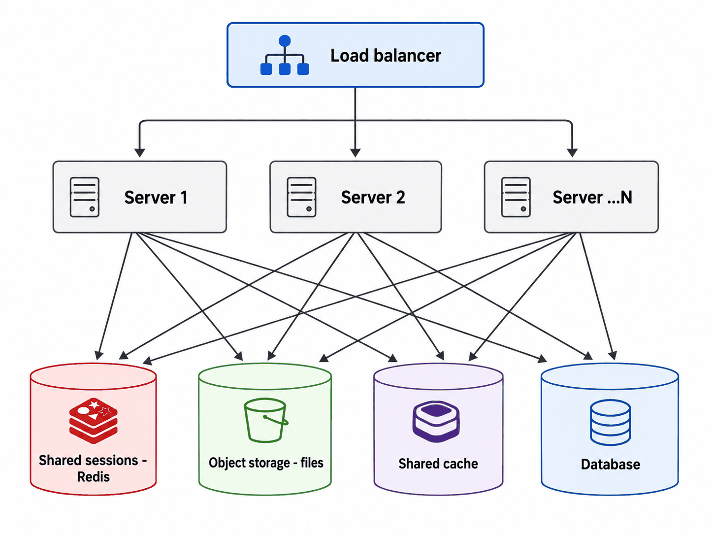
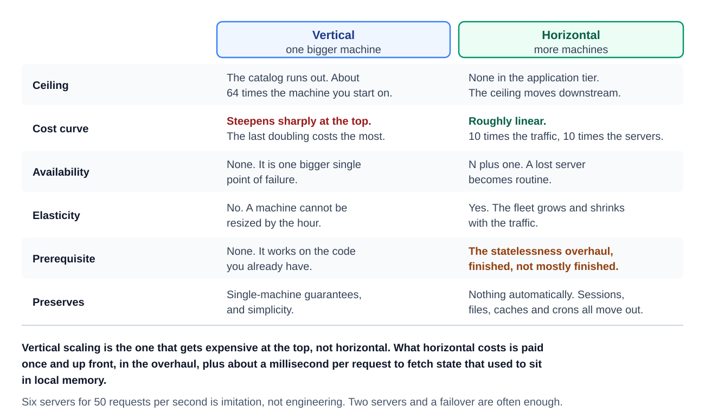
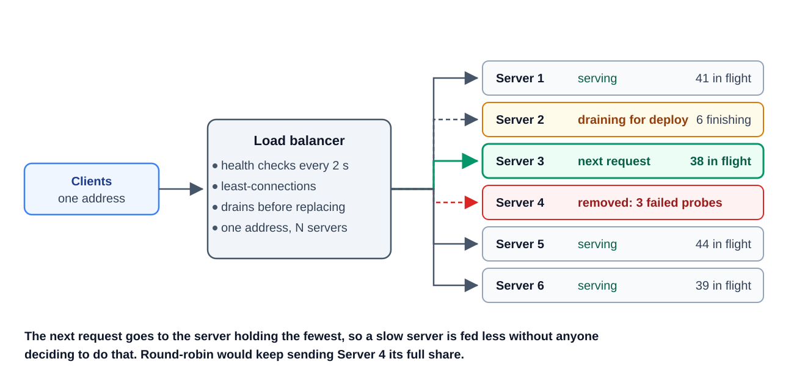
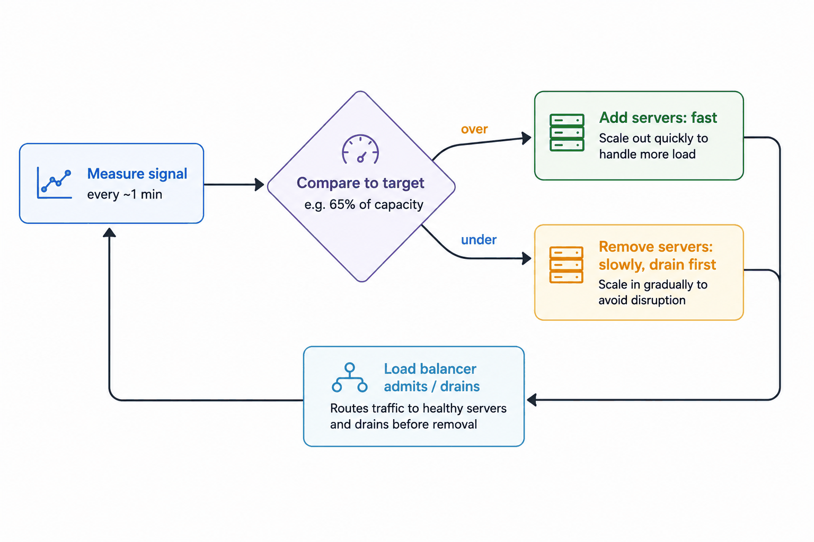
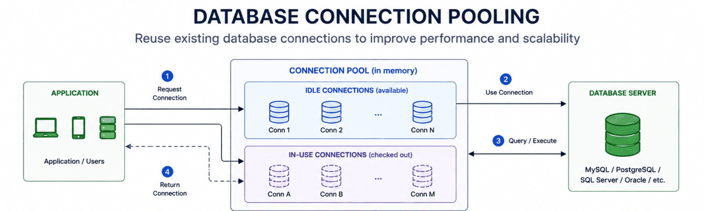
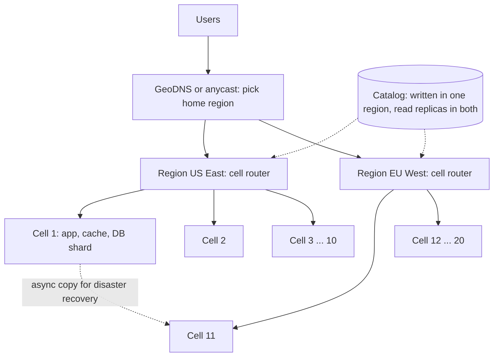
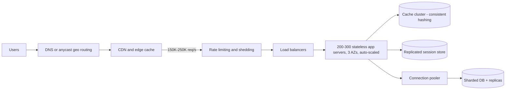

# Module 6 — Growing Under Load (Scaling)

*Original lesson: [Module introduction on DesignGurus ↗](https://www.designgurus.io/course-play/system-design-patterns/doc/6a535491ba41b5b746961f67)*


**What this module is about.** Earlier modules scaled the database (storage) and lifted read traffic off it (caching). This module scales everything that sits above the data. That means the application servers, the way traffic gets shared among them, how many of them run at 4 AM compared with peak time, and how to keep a bigger fleet from crushing the database behind it. It finishes the answer to the course's fifth question — *how does it grow?* — and presents scaling as everyday engineering, not a heroic event. In practice it comes down to four decisions. Choose a direction to grow in. Make servers interchangeable, so that extra capacity really helps. Spread requests across that capacity. And protect the systems that sit behind the application tier.

**Pattern picker**

| The situation | The pattern |
|---|---|
| The machine isn't big enough | Vertical Scaling |
| No single machine could ever be big enough | Horizontal Scaling |
| Traffic has to be steered across many servers | Load Balancing |
| Demand rises and falls hour by hour | Auto-Scaling |
| Opening each database connection is costly | Connection Pooling |
| One region, one bad deploy or one noisy customer can take everyone down | Multi-Region and Cell-Based Architecture *(added lesson)* |

**Two facts that organize the module**
1. **Horizontal scaling has a prerequisite, and that prerequisite is what this module is really about.** Extra servers only help if *any* server can handle *any* request. So no server is allowed to remember anything about a client between requests — no sessions kept in local memory, no files saved to local disk. This property is called **statelessness**. You have to work for it, because every value that needs to last must be given a shared home (a database, a cache, object storage). Engineers sum up the result as **"cattle, not pets"**: servers are numbered, identical, and replaceable, rather than individually named and cared for. A lot of what people call "scaling work" is really the job of pulling state out of application servers.
2. **Scaling one tier multiplies the load on the next one.** Double the application servers and you may double their database connections, their queries, and their downstream traffic. So capacity work has to *follow the bottleneck* — the one part that's currently limiting **throughput** (how much work the system completes per second, e.g. requests per second). And once you widen it, something else becomes the limit. The Connection Pooling lesson exists because this multiplication is easy to overlook: the database's connection limit is often the very first thing a fast-growing app tier breaks.

**How to read it.** Vertical Scaling (the simple bigger-machine option: no new ways to fail, but a hard ceiling) → Horizontal Scaling (the central lesson: the statelessness changes you need before more servers can help) → Load Balancing (making many servers look like one address) → Auto-Scaling (changing the number of servers as demand changes, including wrong metrics, flapping, and startup delay) → Connection Pooling (how app growth multiplies DB connections until Postgres — PostgreSQL, a popular open-source relational database — turns clients away) → **Multi-Region and Cell-Based Architecture** (an added lesson, not in the original course: surviving the loss of a whole **region** (one geographic location of a cloud provider's datacenters), and splitting each region into independent cells so a bad deploy or a noisy customer hurts only a slice of users — plus a short map of cloud building blocks) → the capstone (the closing, end-to-end worked example), which follows one service from 100 to 1,000,000 requests/second and, at every stage, names what to scale *and what to leave alone*. Short on time? Read Horizontal Scaling and Load Balancing first. "How would you scale this?" is the interview question you can count on hearing, and those two lessons are the heart of the answer.

**Four terms used throughout** (new to load balancers, caches, latency or DNS? The [System Design Fundamentals](../00-system-design-fundamentals/README.md) primer covers the basics this module builds on.)
- **Stateless vs. stateful.** A *stateless* server keeps nothing from one request to the next. Everything it needs either comes with the request or lives in shared storage. A *stateful* server holds something that makes that particular machine important (a session, an open socket, a local file). Stateless tiers grow by adding identical servers. Stateful ones need the harder storage patterns.
- **Bottleneck.** The one component that's currently limiting throughput. Scaling anything else adds no capacity, so measure to find it before you change anything.
- **Elasticity.** Capacity that tracks demand in *both* directions. Growing under load protects users. Shrinking when traffic drops saves money.
- **Headroom.** The gap between normal load and total capacity. It soaks up surprises while auto-scaling catches up. The course's arithmetic rule plans peak traffic at **3–5× the average**. Headroom covers the time between a spike beginning and new servers being ready.

**Before you start** — think about a system you run:
1. Could *any* of your app servers handle *any* request? Or does something make one server special (a session, a file, an in-memory cache with no fallback)?
2. If you doubled your app servers this afternoon, what would break first further downstream?
3. What's your ratio of peak to average traffic — and who pays for the gap at 4 AM: idle servers, or an auto-scaler?

## Vertical Scaling
*Original lesson: [Vertical Scaling on DesignGurus ↗](https://www.designgurus.io/course-play/system-design-patterns/doc/6a5354d95a38214864ffde9c)*


**What it is.** Vertical scaling ("scaling up") means giving the machine more muscle — more CPU cores, more memory, faster disks — while leaving the architecture exactly as it is. *Analogy:* when your kitchen can't keep up, the first thing you buy is a bigger stove, not a second restaurant.

**Why it matters (the problem it solves).** This is the least fashionable pattern in the course, and it deserves more respect than it gets. Teams often leap straight to fleets of servers and **microservices** (an app split into many small, separately deployed services that call each other over the network), when one bigger machine would have done the job for years. The real problem vertical scaling solves is "the machine is too small." The industry habit of skipping this simple fix burns years on distributed complexity that nobody needed yet.

**How it works, and why it's valuable**
1. **It brings no new ways to fail.** No other scaling pattern can say this. There's no statelessness work, no load balancer (a component that spreads incoming requests across several servers), no keeping caches consistent across machines, no distributed coordination. Transactions (groups of database changes that succeed or fail as one unit), joins (queries that combine rows from several tables), and in-memory state carry on working exactly as they did. Every hard problem in the next four lessons begins the moment a *second* machine shows up, and vertical scaling puts all of them off until you really need to face them.
2. **There's more room to grow than people think.** Cloud instances run from about **2 cores / 8 GB RAM** (a core is one independent processor inside the CPU; RAM is the machine's fast working memory) all the way up to **128+ cores and several terabytes of RAM** — roughly **64× capacity** from a single configuration setting. Plenty of successful products spend their entire life inside that range. *Stack Overflow* is the famous example: it answered a huge share of the internet's programming questions from a handful of large machines, while much of the industry was recommending fleets of hundreds of nodes.

**Its two hard limits**
- **There is a biggest machine.** Every provider's catalog runs out eventually, and the price per unit of capacity usually rises steeply near the top. Software can also stop benefiting before the hardware runs out. A database held back by *lock contention* (queries waiting their turn to update the same rows) gains almost nothing from core #96. And single-threaded code can't use extra cores at all.
- **It is still one machine.** Doubling the CPU gives you no redundancy. Putting more work on one host actually *raises* the damage when that host fails (a bigger *blast radius*). The machine is still a *single point of failure* (SPOF — one component whose failure takes everything down). And resizing it usually needs a maintenance window (planned downtime).

**Combining directions.** The practical skill is knowing when to switch direction and how to blend the two. Real fleets tune both the size and the count — for example, 24 small vs. 12 medium vs. 6 large servers. And after a database is sharded (split across machines), every shard still needs its own decision about vertical size.

**Trade-offs**

| You gain | You pay |
|---|---|
| More capacity with no change to the architecture — often done in an afternoon, with a maintenance window as the entire cost | A ceiling, a steep price curve leading up to it, and shrinking software gains near the top |
| Single-machine guarantees (transactions, consistency, locality) that distributed designs spend entire modules winning back | No gain in availability (the share of time the system is up and answering): one bigger machine means one bigger outage; redundancy needs at least two of something |
| Time — really, a year to do the statelessness work properly instead of in a panic | No elasticity: you can't resize every hour, so the big box sits idle and expensive at 4 AM |
| | Downtime to resize, and long waits to get hardware at the top of the catalog |

**When not to use it**
- **When availability is what you actually need.** Two medium machines still have half their capacity after one fails. One large machine has none left.
- **When load is spiky.** If the daily peak is 5× the average, a machine sized for the peak sits roughly **80% idle** for most of the day. Lots of smaller elastic units fit better.
- **When you're already close to the top of the catalog.** Paying the highest unit price for the last 2× only postpones a wall you can already see. Spend that money on moving to horizontal scaling.
- **When the software can't use the hardware** (single-threaded code, lock contention). Profile before you buy.
- *The more common misuse is the reverse:* sharding the database and running a fleet at **50 requests/second** because big companies blog about doing it. The arithmetic says that scale doesn't need it yet.

**In the interview.** It's rarely asked about by name, but interviewers watch whether you think of it before jumping to distributed options. When a service is overloaded: measure the bottleneck, and check whether a bigger instance buys enough time. If it does, use that time to strip state out of the app, so horizontal scaling is ready before the big box reaches its ceiling.

> **30-second answer:** Vertical scaling is the bigger machine: more cores and RAM, no change to the architecture, and no new ways to fail — transactions and single-machine simplicity keep working. Cloud catalogs offer about 64× of capacity through that one setting, and it's often the right first step. Its limits: there's a biggest machine, and the price curve gets steep before you reach it. It also does nothing for availability or elasticity — it's still one machine, now with a bigger blast radius. So I scale up to buy time, and I use that time to make the service stateless, so scaling out is ready when it's needed.

- *Follow-up: "Why not just keep buying bigger forever?"* — Three kinds of limits. Physical (the catalog ends). Economic (unit prices climb near the top while software gets less out of each extra core). And architectural (one machine can't give you redundancy or hour-by-hour elasticity).
- *Follow-up: "One big machine or three small ones, same total capacity?"* — For a stateless service, three small ones: a single failure costs a third of capacity rather than all of it. Pick one large machine when the workload depends on single-machine guarantees or memory locality, like a primary database. Equal capacity doesn't mean equal availability, or equal effort managing state.
- *Mistake that fails candidates:* proposing distributed infrastructure for a problem one machine can handle — or proposing a bigger machine after an *availability* incident. More resources don't stop a host from dying.

**Self-check:**
- Q1: What does vertical scaling preserve that horizontal designs must rebuild, and what are its two hard limits? → Single-machine transactions, strong consistency, joins, locality, simple in-memory state, and freedom from distributed coordination. Limits: the hardware is finite, with prices rising and software benefit falling at the top; and it's still one machine — no redundancy, no elasticity, and downtime to resize.
- Q2: A primary DB runs at 80% CPU growing ~5%/month; half the team wants to shard now. What do you do? → First scale up one or two instance sizes. That gives 2–4× headroom within a week, which lasts years at 5%/month, rather than rushing into the course's most expensive storage pattern. Use that time well: choose a shard key, fix queries that won't survive partitioning, and set a trigger for migrating, such as sustained 70% CPU on the largest reasonable instance (sharding as a last resort).
- Q3: A payments service runs on one large instance at 30% utilization; its host died last month (40 min downtime), and leadership wants an even bigger instance. Evaluate. → Wrong fix. 30% utilization shows capacity was fine; the outage happened because there was only one machine. A bigger box keeps the same failure mode and costs more. What it needs is 2+ stateless instances behind a load balancer (after working through the statelessness checklist), plus a primary-replica failover plan for the parts that hold state. Vertical scaling fixes too little capacity; this was too few *machines*.

**Related patterns:** Horizontal Scaling (what comes next, and a complement — scale up to buy the time needed to make scaling out possible); Sharding (each shard still needs a decision about vertical size); Primary-Replica (the answer when the incident was about availability, not capacity); Auto-Scaling (capacity that tracks demand — something vertical scaling can't offer).

**TL;DR**
- **Problem:** the machine is too small — and the habit of skipping the simple fix wastes years on distributed complexity.
- **Mechanism:** buy a bigger machine: ~64× of room on one setting, zero change to the architecture, and single-machine guarantees still in place.
- **Costs:** a real ceiling with a steep price curve, zero redundancy (a bigger SPOF), no elasticity, and downtime to resize.
- **Skip it when:** availability is what you need, load is spiky, or you're already near the top of the catalog.

## Horizontal Scaling
*Original lesson: [Horizontal Scaling on DesignGurus ↗](https://www.designgurus.io/course-play/system-design-patterns/doc/6a5355737d8046c63edc7f6e)*


**What it is.** Horizontal scaling ("scaling out") means running many identical copies of your application server and adding more copies as load grows. It only works when every server is **stateless** — it remembers nothing between requests — so that any server can handle any request and the servers are interchangeable. *Analogy:* a supermarket opens more checkout lanes at rush hour. That only helps because any cashier can serve any customer. If your groceries were locked in lane 3's back room, opening lane 7 wouldn't do you any good.

**The problem.** For years the store has run its app tier on a single server that keeps getting bigger. It finally runs into the limits from the last lesson: the next size up costs too much, and a host failure recently stopped checkout for **40 minutes**. The long-overdue fix: run **two servers** behind a simple traffic splitter that sends half the requests to each. It goes live on Tuesday morning. By the afternoon, three strange bugs have shown up:
- **Users get logged out at random.** Alice logs in, and her *session* (the record saying she's logged in) is kept in server A's memory. Her next request lands on server B, which has never heard of her. So the site forgets who she is on every other request.
- **Uploaded images return 404 (HTTP "not found") half the time.** Product photos were saved to the local disk of whichever server happened to receive the upload. Requests handled by the other server can't find them.
- **The UI keeps flipping back and forth.** Each server caches *feature flags* (switches that turn features on or off) and refreshes them on its own timetable. So after a flag changes, the page layout depends on which server answers.

Two servers aren't hard in themselves. What the failure shows is that the code is full of hidden assumptions that there is exactly *one* machine — one process holding sessions, one disk holding files, one process running the nightly job. Horizontal scaling means hunting down every one of those assumptions.

**Why the obvious fixes fail**
- **"Sticky sessions."** The splitter uses a cookie (a small piece of data the browser stores and sends back with every request) or an IP address (the numeric network address of a machine) to keep sending each user to the same server. The logouts stop right away, and it works fine as a *migration bridge*. But if server A dies, everyone pinned to it is logged out. Heavy users can overload a single server. Deploys have to wait for pinned users to leave. And it does nothing about the local images or the flag caches.
- **"Synchronize state between servers."** Getting A and B to copy sessions and caches to each other builds an accidental distributed database inside the app tier. That re-creates the hardest consistency problems from the storage module. Session clustering and multicast sync (one network message delivered to many servers at once) used to be common, but shared stores give clearer, more reliable ownership.
- **"Deploy carefully and hope."** Random session loss comes from the architecture, not from how you release. Being careful can't fix it.
- All three try to manage *disagreement between servers that hold state*. The pattern gets rid of the cause instead: app servers must not own any lasting state.

**How it works.** The figure below shows the target architecture. A load balancer sits in front of Server 1, Server 2, … Server N, and every server talks to the same shared back-ends — shared sessions in Redis (a fast in-memory key-value store, often used as a shared cache), object storage (a service such as S3 that stores whole files and serves them over HTTP) for files, a shared cache, and the database. No server holds anything that the others don't have.


*Figure — Horizontal Scaling (course diagram)*

**Step 1 — the statelessness checklist.** Track down every value an app server holds on to, and move it to a shared home:

| State hiding in the server | Where it moves | Why |
|---|---|---|
| Sessions ("who is logged in") | A shared store (Redis), or into the request itself as a signed token the browser carries | Then any server can recognize the user |
| Uploaded files | Object storage (S3 and similar) — never local disk | Every server can read every file |
| In-process caches | A shared cache (Module 4), or a local one with a short TTL (time-to-live: how long an entry may be kept) where brief disagreement does no harm | Servers stop disagreeing about data |
| Scheduled jobs ("the nightly report") | A job queue or a *distributed lock* (a lock that all servers honor) | Otherwise every server runs the cron (scheduled job) — N times |
| Counters, rate limits, locks | A shared store | A counter on one server only sees 1/N of what's really happening |

**Step 2 — collect the three payoffs.**
1. **Capacity becomes a matter of addition.** Each server takes a slice of the traffic. More capacity just means more servers, with the load balancer (next lesson) spreading the requests.
2. **Availability becomes simple arithmetic.** Run **N+1**: enough servers for the peak, plus one spare. Then any single failure only uses up the spare, instead of causing an outage.
3. **Deploys stop being big events.** A *rolling deploy* swaps servers out one at a time, with no downtime and no special treatment for any machine.

**Step 3 — expect the load to multiply.** Each server you add brings more downstream connections and requests. Databases, caches, and other services now carry the combined load of N servers. Connection Pooling and the storage module take care of that.

**Walkthrough with numbers**
- **Sizing.** One server comfortably handles **800 req/s**, and the peak is **4,000 req/s** → 5 servers needed → run **6** (N+1). The peak estimate already includes headroom for traffic; the sixth server is headroom for *failure*.
- **The cost of keeping state elsewhere.** Every request now fetches its session from Redis, which adds about **1 ms** — the measurable price of letting any server serve any user.
- **A server dies at peak.** Health checks (automatic probes asking each server "are you OK?") take it out of the load balancer within seconds, and the remaining 5 carry all 4,000 req/s. Requests that were in flight on the dead host fail once, and their retries land on healthy servers. That's safe because writes are idempotent (doing them again has the same effect as doing them once).
- **Growth.** Traffic grows 10× over two years → about **50 servers**, with the same architecture and cost that grows almost in a straight line. New capacity is something you buy, not something you redesign.
- **The multiplied load shows up right on time.** 50 servers × 20 DB connections each = **1,000 connections**, and the database starts turning clients away. Scaling the app worked — and pushed the bottleneck downstream. Connection Pooling deals with that.

**Horizontal vs. vertical.** The figure below compares them row by row. Vertical's ceiling is the end of the catalog (~64× the starting machine), while horizontal has none in the app tier (the ceiling moves downstream). Vertical's cost curve gets sharply steeper at the top, while horizontal's is roughly linear (10× traffic, 10× servers). Vertical adds no availability, while horizontal gives you N+1. Only horizontal is elastic. Vertical needs nothing in advance, while horizontal needs the statelessness overhaul *finished*, not mostly finished. Vertical keeps single-machine guarantees, while horizontal keeps nothing automatically. The figure's footnotes: horizontal's cost is paid once up front (the overhaul) plus ~1 ms per request, and six servers for 50 req/s is imitation, not engineering — two servers and a failover are often enough.


*Figure — Vertical vs. Horizontal Scaling (course diagram)*

| | Vertical (bigger machine) | Horizontal (more machines) |
|---|---|---|
| Ceiling | The catalog runs out (~64× of room) | None in the app tier; it moves downstream |
| Cost curve | Gets sharply steeper at the top | Roughly linear |
| Availability | None — one bigger SPOF | N+1 — losing a server is routine |
| Elasticity | No — can't resize every hour | Yes — the fleet grows and shrinks |
| Prerequisite | None — works on any code | The statelessness overhaul |
| Preserves | Single-machine guarantees, simplicity | Nothing automatically — everything shared is explicit |

They work together rather than compete. Scale up to buy time, use that time to remove state, and scale out when the measurements justify it. And keep tuning both size and count (6 large vs. 24 small is a tuning choice, not a principle).

**Trade-offs**
- *You gain:* capacity by addition, with no ceiling in the app tier (it moves downstream); availability through redundancy (a machine dying becomes routine); elasticity as an option (fleets can grow and shrink — two lessons from now); and quiet rolling deploys with zero downtime.
- *You pay:*
  - **The statelessness overhaul.** Code changes and testing for sessions, files, caches, scheduled work, and counters — all paid *before* the first extra server works correctly. This is the main cost.
  - **A cost on every request.** About 1 ms to fetch external state for each request.
  - **Shared stores take on the criticality.** Moving sessions out of forty servers into one Redis makes that Redis a possible single point of failure, so it needs replication and care. State gets *relocated*, not eliminated.
  - **Coordination problems.** Work that naturally ran once on one machine (crons, global counters) now needs explicit coordination.
  - **Multiplied downstream load**, every time.

**When not to use it**
- **Workloads that hold state by nature.** A database's whole job *is* owning state, so it can't scale by adding memoryless copies (use the storage patterns instead). WebSocket gateways (servers that keep a two-way connection open with each client) hold live connections and need a two-tier design (local sockets + global routing). Adding stateless copies is for compute.
- **Small scale.** Two servers with failover may be enough. Even so, working through the checklist early is smart, because hidden assumptions are cheapest to remove before they spread.
- **When the bottleneck is downstream.** More app servers can't help a system held back by its database; they just pile more connections and queries onto it. Measure first.
- **Microsecond latency budgets** (latency = the time one request takes, start to finish) that can't afford a hop to external state may deliberately keep state in the process.
- *The classic failure:* a migration left half-done — one forgotten cron, local counter, or in-memory rate limiter that quietly runs N times or sees only 1/N of what's really happening.

**Real-world examples**
- **The Twelve-Factor App** (a manifesto from Heroku, a cloud hosting platform): factor VI, "execute the app as stateless processes," is this whole pattern in one line.
- **Kubernetes ReplicaSets and AWS Auto Scaling Groups** (Kubernetes is the standard open-source system for running containers on a cluster of machines; AWS is Amazon's cloud) turn horizontal scaling into a configuration setting: `replicas: 50` assumes that every *pod* (a deployed unit) is interchangeable.
- **Every modern web tier** looks like this. The interesting decisions are about where the sessions, files and other state ended up.
- **For AI engineers:** inference services (servers that run a trained model to answer requests) run identical copies of a model behind a load balancer, with two twists. First, each copy may need to load tens of GB of model *weights* before it can serve — minutes of startup, which changes how auto-scaling works. Second, a conversation's *KV cache* (the model's working memory of earlier tokens — a token is a word or word-piece the model reads and writes) works best if it stays on the same copy, so requests aren't fully interchangeable. *Consistent-hash* routing (a hashing scheme that maps each key to a server and moves few keys when servers change) by session keeps a conversation on the copy that holds its cache. Batch embeddings (numeric vectors that represent text meaning) and evaluations fit the simple pattern: independent workers running in parallel.

**In the interview.** "How would you scale this?" is one of the most common questions. After you say "add servers," expect "what stops you from doing that today?" List every form of state that lives on a server, rather than assuming that deploying more copies creates capacity.

> **30-second answer:** Horizontal scaling means identical, stateless servers behind a load balancer, so any request can land on any server. The real work is the statelessness checklist: sessions go to Redis or signed tokens, files go to object storage, caches become shared, crons sit behind a lock or queue, and counters live in a shared store — because state makes a server special, and special servers can't be swapped out freely. After that, capacity is addition, availability is N+1, and deploys are rolling. I call out two costs up front: shared stores take on the criticality (the session Redis needs replication), and every server I add multiplies database load, which connection pooling and the cache tier soak up.

- *Follow-up: "A server dies mid-request — what do users see?"* — Health checks pull it out within seconds. Its in-flight requests fail once, and retries safely reach healthy servers because writes are idempotent. N+1 sizing lets the rest carry the full load.
- *Follow-up: "You doubled the fleet and latency got worse. Why?"* — The app tier wasn't the bottleneck. More servers multiplied DB connections, queries and lock contention. Follow the constraint and fix the data path (storage, caching, a connection pooler).
- *Mistake that fails candidates:* saying "add servers" without checking for state, presenting sticky sessions as the permanent design, or scaling a tier that wasn't what limited throughput.

**Self-check:**
- Q1: List the five kinds of state commonly left in app servers and where each goes. → Sessions → Redis or signed client tokens; uploaded files → object storage; in-process caches → a shared cache (or a short local TTL where brief disagreement is fine); scheduled jobs → a queue or distributed lock so only one worker runs each one; counters/rate limits/locks → a shared store, since each server only sees 1/N.
- Q2: Make the case for and against sticky sessions; when should they be removed? → For: a quick bridge needing little code that stops random logouts while shared session storage gets built — and genuinely needed for connections that really hold state (WebSocket gateways). Against: a dead server drops the users pinned to it, heavy users throw load out of balance, deploys drain slowly, and new servers start out empty. Remove them as soon as sessions live in shared storage or tokens — before more code starts relying on the pinning.
- Q3: A team grows from 6 to 30 servers; the DB refuses connections at peak and customers get the nightly summary email several times. Fix both. → 5× the servers multiplied each server's DB connections past the DB's limit: add a connection pooler and shrink each server's pool. The email cron still runs locally on every server: move it to a queue with a single consumer, or behind a distributed lock, and make it idempotent, keyed on customer + date. Statelessness means finishing *every* item on the checklist.

**Related patterns:** Vertical Scaling (buys time for this migration and stays available as a sizing option); Load Balancing (makes N servers look like one endpoint); Auto-Scaling (a stateless fleet can grow and shrink with demand); Connection Pooling (keeps the combined DB connections of N servers under control); Idempotency (makes retries safe after a server dies).

**TL;DR**
- **Problem:** one machine has a ceiling and is a SPOF — but naively adding a second one exposes every hidden one-machine assumption (sessions, files, caches, crons, counters).
- **Mechanism:** the statelessness checklist moves all server memory to shared homes; after that, identical servers behind a balancer give capacity by addition, availability by N+1, and rolling deploys.
- **Costs:** the overhaul, ~1 ms per request for external state, shared stores that take on the criticality, new coordination problems, and multiplied downstream load.
- **Skip it when:** the workload's state *is* its job (databases, socket gateways), the scale is small, or the bottleneck is downstream.

## Load Balancing
*Original lesson: [Load Balancing on DesignGurus ↗](https://www.designgurus.io/course-play/system-design-patterns/doc/6a535689ba41b5b7469622dc)*


**What it is.** A load balancer is a dedicated layer that stands at the front door of a server fleet. It gives clients **one stable address** that covers many servers, even as those servers change. It checks which servers are alive (**health checks**). It spreads requests using an algorithm that reflects the real load. And it **drains** servers (lets their current work finish) before they get replaced. *Analogy:* a restaurant host at the door who knows which tables are free, which waiter is swamped, and which section is closing for cleaning. Diners just come in through the one front door.

**The problem.** The stateless fleet now has six identical servers sitting behind Tuesday's simple splitter. The splitter uses **round-robin**: request 1 goes to server 1, request 2 to server 2, and so on around the list. That looks fine until **2:14 AM**, when a runaway log fills up server 4's disk. The server doesn't crash. It just gets slower and slower, taking **20 seconds** per request before failing. The splitter knows nothing about health, so it keeps sending **one-sixth** of all traffic there. For **11 minutes**, users see failures or long waits, until an engineer notices and pulls the server out by hand.

Two weeks later, a deploy exposes a second gap. The splitter can't stop sending new work to a server while letting its current requests finish. So replacing server 2 kills **several hundred in-flight requests**. Every deploy causes a small, predictable spike in errors.

The underlying flaw: the splitter treats servers as interchangeable *and permanent*. Statelessness made them interchangeable. But real servers still slow down, die, get deployed, and get replaced — and whatever sits in front of them has to notice within seconds.

**Why the obvious fixes fail**
- **"DNS round-robin."** List all six IP addresses under one domain name and let DNS (the Domain Name System, which turns names like `shop.com` into IP addresses) rotate through them. The trouble is that clients and resolvers (the DNS servers that look names up on their behalf) cache answers for minutes or hours. So after server 4 is removed, clients that still hold its address keep using it. DNS publishes addresses; it doesn't steer individual requests. That means it can't measure health or take back a choice that's been cached.
- **"Let clients pick a server."** Hand clients the list of servers and let them choose. Internal service meshes (an infrastructure layer of small proxies that handles calls between a company's own services) legitimately do a more capable version of this. But public browsers and apps would need health checks, retries, and list management — and you can't reliably update those.
- **"A runbook: on-call removes bad servers."** That *is* the 11-minute response. Like the manual kill switch in the Circuit Breaker lesson (a circuit breaker stops calling a failing dependency for a while), it's the right decision made at human speed. This pattern makes it at machine speed.

**How it works — four jobs.** The figure below catches a load balancer in the middle of its work. Clients see one address. It health-checks every 2 s, routes by least-connections, and drains before replacing. Server 1 (41 in flight), Server 3 (38), Server 5 (44) and Server 6 (39) are serving. Server 2 is *draining* for a deploy (6 requests finishing). Server 4 was *removed* after 3 failed probes. The next request goes to Server 3, which has the fewest requests in flight. So a slow server automatically gets fed less, whereas round-robin would keep giving Server 4 its full share.


*Figure — Load Balancing (course diagram)*

1. **Health checks — how failure gets noticed.** *Active* checks call each server's health endpoint (a special URL that reports whether the server is fine) every few seconds (the Operations module designs that endpoint). Several failures in a row remove a server; several successes in a row bring it back. *Passive* checks watch real traffic and can react to a sudden jump in errors between probes. Together, they shrink the 11-minute manual response to about **6 seconds**.
2. **The algorithm — how traffic gets spread.**
   - *Round-robin* works when all requests and all servers are alike.
   - *Least-connections* sends each new request to the server with the fewest requests currently being worked on. It's the better general default. A struggling server builds up in-flight requests, and so it automatically gets less new work — which directly fixes what happened at 2:14 AM.
   - *Weighted* algorithms handle servers of different sizes.
   - *Hash-based* routing (consistent hashing, "the ring") sends the same user to the same server when *affinity* matters — warm per-user caches, long-lived connections.
3. **Draining — the deploy story.** Before a server gets replaced, the balancer stops handing it new requests and lets the current ones finish (seconds for ordinary API calls; streams held open get a notice before being disconnected). The replacement is let in only after it passes health checks. The error spike during deploys goes away.
4. **One address — and what it makes possible.** Clients use a single stable endpoint, while the fleet behind it changes size and membership (which is exactly what makes auto-scaling possible). The balancer often *terminates TLS* — it handles the encryption for each connection (TLS is the encryption layer behind `https://`). **L4** balancers route by IP address and port (a number that picks which program on a machine gets the traffic) — at the connection level. **L7** balancers read HTTP (the request/response protocol of the web) paths, headers, and cookies (at the request level), which allows routing by path and retries that understand the request. Public entry points usually use L7; internal tiers may prefer the simpler L4.

**Who balances the balancer?** It sits on the path of every request, so it can't be allowed to be a single point of failure. Standard setups run a **redundant pair sharing a floating IP** — an address that moves on its own to the surviving machine if one dies. At internet scale, **anycast** lets many balancers announce the same IP, and the network sends each client to a nearby one. That ends the "who balances that?" chain after one level.

**Walkthrough with numbers**
- **2:14 AM, replayed.** Server 4's disk fills up. Active probes fail at 0, 2 and 4 seconds, and it's removed at ~6 s (passive error monitoring may react even sooner). One-sixth of traffic sees a short blip, and the system recovers with no human involved.
- **The GC pause.** Server 5 hits a long garbage-collection pause (the runtime freezing to reclaim memory). It's slow, not failed. Round-robin would keep feeding it an equal share. Least-connections sees its in-flight count rise from **40 to 300** and sends new work elsewhere until it recovers.
- **The deploy.** Six servers are replaced one at a time: drain each for ~**30 s**, start the replacement, and let it in once probes pass. The SSE (server-sent events — long-lived streaming connections) fleet uses longer drains plus *jittered reconnects* (every client waits a slightly different random time before reconnecting, so they don't all stampede at once). Either way, zero deploy errors.
- **The math check.** The balancer adds **well under 1 ms** per request and easily handles the full **4,000 req/s**. Its value isn't speed. It's replacing slow human detection.

**Trade-offs**
- *You gain:* failure handling at machine speed (seconds, rather than minutes waiting for a paged human); distribution that matches reality (least-connections corrects itself for slow servers and uneven requests); zero-downtime deploys through draining; and one stable address that hides all the churn in the fleet — which is what makes auto-scaling possible.
- *You pay:*
  - **A critical hop on everything.** The added latency is under a millisecond, but *all* traffic depends on this tier. Its availability therefore matters more than any single server's — hence redundant pairs or bigger distributed deployments.
  - **Health checks can be wrong in both directions.** A *shallow* check (is the process running?) might pass a server that can't reach its database — it looks healthy but can't do any work. A *deep* check that tests a shared dependency is even more dangerous. If that dependency blips, *every* server reports unhealthy, and the balancer removes the entire fleet. The rule: a health check answers "should *this server* receive traffic?", not "is the whole architecture OK?"
  - **Settings with big consequences.** Probe intervals, failure thresholds, drain times, algorithms: small settings that can cause large outages.
  - **L7 costs.** Inspecting every request is more work than routing connections. At very large scale, the balancer tier needs horizontal capacity of its own.

**When not to use it**
- **One server.** A balancer in front of a single instance adds latency and configuration with no redundancy. (A proxy might still handle TLS or routing — a separate role covered in the API & Edge module.)
- **Internal service-to-service traffic inside a mesh.** Sidecar proxies (small proxies running beside each service) balance on the client side using rich health data — the same jobs, spread out instead of centralized.
- **Geographic routing.** Sending European users to an EU region happens at the DNS/anycast layer, *before* any regional balancer. It complements the balancer; it doesn't replace it.
- *Common misuse:* buying a load-balancer product and leaving round-robin defaults, shallow checks, and no drain integration — the original splitter's failures, with extra infrastructure on top. The pattern is four active jobs, not a box you purchase.

**Round-robin vs. least-connections**

| | Round-robin | Least-connections |
|---|---|---|
| Assumes | All requests and servers are alike | Nothing — it measures |
| A slow/failing server gets | Its full equal share (the 2:14 AM failure) | Less and less, automatically, as its backlog grows |
| Mixed light/heavy requests | Lucky servers sit idle, unlucky ones get overloaded | Corrects itself |
| Long-lived connections (SSE, sockets) | Bad — it balances when connections *start*, not the load | The right default — it counts what's actually being held |
| Cost | Trivial | Trivial (one counter per server) |

Least-connections is the practical default because it measures rather than assumes. Round-robin still suits short, uniform requests, and DNS (which can't see active work). Hash-based routing is the third option when cache locality or session affinity matters. In one line: *round-robin assumes traffic is uniform; least-connections measures it.*

**Real-world examples**
- **nginx and HAProxy:** long-established software balancers, with L4 and L7 modes and all of the algorithms above.
- **AWS maps the types onto products:** **ALB** is L7 (it reads paths, headers, and WebSocket upgrades); **NLB** is L4, built for millions of connections with microsecond overhead. Other clouds offer similar pairs.
- **Envoy:** places a small L7 proxy next to every service (a service mesh), giving every caller balancing that understands requests, plus local health data.
- **Anycast at the edge:** Cloudflare and other CDNs (content delivery networks: servers spread around the world that serve content from close to users) announce one IP around the world, and internet routing does the first layer of balancing to the closest entry point.
- **For AI engineers:** counting connections gives a false picture of inference load — two LLM (large language model) requests can differ by **100×** (10 tokens vs. 2,000). A GPU (graphics processor — the chip that runs AI models) running three long generations can be busier than one running ten short ones. So inference routers balance on **queue depth and outstanding tokens** per replica. They also use consistent-hash routing by conversation ID, so later turns of a conversation reach the replica holding its KV cache. It's still "measure the work" — just measured by how big the work is, not how many requests there are.

**In the interview.** Everyone draws a load balancer. Interviewers check whether you can explain it: how it chooses a server, how it spots failure, how it handles deploys, and whether it's a single point of failure itself.

> **30-second answer:** The balancer does four jobs. Health checks — active probes plus watching real errors — remove a failing server within seconds. Distribution uses least-connections, which corrects itself for slow servers, where round-robin would keep feeding them. It drains servers during deploys so in-flight work can finish. And it offers one stable address for a fleet that keeps changing, usually terminating TLS at L7. It runs as a redundant pair with a floating IP, or with anycast at bigger scale. I keep health checks deliberately shallow: a deep check on a shared dependency can pull the entire fleet when that dependency blips. Each server reports only its own health, and it handles dependency failures by degrading, not by dying.

- *Follow-up: "What exactly should the health check test?"* — The process, the listening port, and the critical *local* resources that decide whether this server can take traffic. Not every downstream dependency — a single brief shared failure would throw out every healthy server. Handle dependency failures inside the service, with breakers and degraded responses.
- *Follow-up: "Who balances the balancer?"* — A redundant pair sharing a floating address that fails over in seconds. At larger scale, anycast, so that many balancers share one advertised address. Naming the mechanism completes the answer.
- *Mistake that fails candidates:* accepting round-robin without thinking about slow servers, restarting machines without draining, or acting as if the balancer can't fail.

**Self-check:**
- Q1: List the four jobs and the two opposite ways a health check can be wrong. → Health checking, distribution that's aware of load, draining before replacement, and one stable endpoint (often with L7 TLS termination). A shallow check can keep a server that responds but can't do any useful work. A deep check can throw out healthy servers when a shared dependency fails — removing the whole fleet over a problem outside it.
- Q2: Pick an algorithm for (a) a uniform internal API under 10 ms, (b) a public API with wildly varying request cost, (c) an SSE fleet holding 50k streams per server. → (a) Round-robin — its assumptions hold. (b) Least-connections — it steers away from servers that are piling up expensive requests. (c) Least-connections when placing streams (the held connections *are* the load), plus long drains and randomized reconnect delays.
- Q3: At 3:07 AM the whole site goes down; all six servers have low CPU and no errors; the balancer marks every server unhealthy at once, then restores them all two minutes later. → The health endpoint tests a shared dependency (Redis or the DB). A two-minute blip failed all six probes, and the balancer dutifully removed a healthy fleet. Restrict the check to the process, the port, and local conditions, and handle shared-dependency failures inside the app with breakers, fallbacks, and reduced responses.

**Related patterns:** Horizontal Scaling (statelessness is what lets the balancer send any request anywhere); Auto-Scaling (adds and removes servers behind this stable entry point); Consistent Hashing (affinity routing for warm caches, conversations, sockets); Health Check Endpoint (designs what the probe hits); Graceful Degradation (servers return reduced answers during dependency failures instead of dropping out of rotation).

**TL;DR**
- **Problem:** a simple splitter treats servers as interchangeable and permanent — it feeds failing machines their full share for minutes at human speed, and kills in-flight work on every deploy.
- **Mechanism:** a front-door layer with four jobs — active + passive health checks, least-connections distribution, draining, and one stable (L4 or L7, TLS-terminating) address — made redundant itself with pairs or anycast.
- **Costs:** a critical hop on all traffic, health checks that can mislead in both directions (especially the deep-check trap that removes the fleet), and settings where small values cause big outages.
- **Skip it when:** there's only one server, the traffic stays inside a mesh (sidecars balance it), or the decision is geographic (DNS/anycast).

## Auto-Scaling
*Original lesson: [Auto-Scaling on DesignGurus ↗](https://www.designgurus.io/course-play/system-design-patterns/doc/6a53576202c0851f57eac974)*


**What it is.** Auto-scaling is a **control loop**. It keeps measuring a load signal, compares it with a target, and adds or removes servers to close the gap. The load balancer lets the new servers in and drains the ones that are leaving. The fleet size stops being a one-off guess and becomes an answer that's corrected all the time. *Analogy:* a thermostat. It measures the temperature, compares it with the setting, and switches the heating on or off — instead of someone guessing in January how much heat the whole year will need.

**The problem.** The stateless fleet runs **8 servers**, sized for an evening peak of **4,000 req/s**. Two incidents in a single month show what's wrong with a fixed size:
- **The 4 AM bill.** Average traffic is about **900 req/s**, and evenings climb to 4–5× that (in line with the course's peak rule). So five or six of the eight servers sit idle for most hours, at full price. Finance works out that roughly **60% of the app tier's spend pays for idle time**.
- **The Tuesday the TV mentioned you.** A morning TV segment features one of the products, and traffic leaps from 900 to **12,000 req/s in twenty minutes** — three times the planned peak. All eight servers max out. An engineer has to wake up, figure out what's wrong, provision instances, and wait for them to boot. Much of the spike is over before the new capacity makes any difference.

Fixed sizing is wrong in both directions — too much at 4 AM, too little during a surprise — because it's an estimate made at design time of something that changes every hour.

**Why the obvious fixes fail**
- **"Size for the worst case ever."** Running 24 servers all the time would have handled the TV spike, but it triples the 4 AM bill. And a growing business produces bigger surprises, so you'd be paying every day for a once-a-year event and still be exposed.
- **"On-call scales by hand."** Noticing, diagnosing, acting and booting used up most of a 20-minute spike. It's even worse the other way round: nobody gets up at 4 AM to *remove* idle servers. People are slow going up and absent going down.
- **"Schedule it: more servers at 6 PM, fewer at midnight."** Handy for known evenings, weekends and big sales (it'll be part of the final design). But a calendar can't see a TV segment coming, or an evening that turns out quiet.

**How it works.** The figure below shows the loop. Measure the signal every ~1 minute → compare it with a target (for example, 65% of capacity) → if it's over, **add servers fast**; if it's under, **remove servers slowly, draining them first** → the load balancer lets new servers in and drains the ones leaving → measure again.


*Figure — Auto-Scaling (course diagram)*

Each part of the loop is a deliberate choice:
1. **Pick the signal — this is *the* design decision.** The *signal* is the number that stands in for current load. CPU utilization works for *compute-bound* services (ones limited by processing). It misleads you for *IO-bound* services, whose requests spend most of their time waiting on disks, networks, or databases. There, hundreds of blocked threads can make users suffer while CPU sits at **15%**, and a scaler driven by CPU does nothing. Better choices: **requests per instance** compared with each server's tested capacity, or **latency** (for example, p95 — the time within which 95% of requests finish) compared with the service target. For queue workers, use **backlog age** — how long the oldest unprocessed job has been waiting. If the oldest job has waited **90 seconds**, you clearly have too few workers.
2. **Set the target with headroom on purpose — about 60–70%, not 90%.** The unused slice is headroom. It protects you while traffic keeps climbing and the new servers aren't ready yet.
3. **Respect the reaction lag — it's physics.** Metrics usually get averaged over ~1 minute before a rise is even noticed. Then the instance boots, the app starts, and its cache warms up. Total: **3–7 minutes with no new capacity** after a spike begins. Headroom covers that stretch. A fleet that's already at 90% is overloaded before help arrives.
4. **Scale up fast, scale down slowly.** Add several servers at once, since an unneeded addition costs little. Remove them one at a time, and only after a *cooldown* (a waiting period after any scaling action) and a load-balancer drain. Removing too aggressively can instantly trigger another addition. That's **flapping**: adding and removing servers over and over, rebuilding caches and DB connections each time. The cure is asymmetry plus **hysteresis**: separate thresholds for scaling up and for scaling down, together with cooldowns.
5. **Set both a minimum and a maximum.** **Min = N+1**, so cost-cutting never takes away your failure headroom. **Max = measured downstream capacity**, not some arbitrary big number. A scaler with no cap can keep adding connections and queries until it flattens the database. The max works as a **bulkhead** (a hard limit that stops one part's trouble from flooding another, named after a ship's watertight walls) that protects downstream systems. Traffic beyond it has to be deliberately shed (rejected on purpose so the rest can be served), queued, or rate-limited (capped at a set number of requests per client per second) at the edge.
6. **Combine the triggers.** *Scheduled* scaling for known cycles (start before the 6 PM ramp — zero reaction lag). *Reactive* scaling for surprises. *Predictive* scaling (a forecast based on history) for large fleets or slow boots. Use the calendar for what you know and measurements for what you don't.

**Walkthrough with numbers** (each server handles 800 req/s; a 65% target treats ~**520** as effective capacity; min 3, max 20)
- **4 AM, 900 req/s:** 900 / 520 ≈ 2 servers, raised to the N+1 floor → **3 servers**. The five idle evening servers — and their bill — are gone.
- **6 PM, scheduled:** the calendar adds capacity ahead of the ramp, so **8 servers** are ready when 4,000 req/s shows up. Reaction lag: zero, because nothing had to react.
- **TV Tuesday, replayed (900 → 12,000 in 20 min):** headroom soaks up the first ~**90 seconds**. The reactive loop adds servers in waves (~60 s to notice, ~3 min to boot). By minute six the fleet is at **16** and rising, and then it caps at **20**. That cap was chosen because the database (with its replicas and cache) is known to cope with 20 servers' worth of traffic and no more. Overflow beyond that gets shed at the edge. Bad minutes: about **four**. Human actions: **zero**.
- **The bill:** the average fleet size over a day drops from a fixed 8 to about **4.2** — roughly **half the compute spend**, with the same evenings and better Tuesdays. Scaling up protected users. Scaling down paid for the project.

**Trade-offs**
- *You gain:* a bill that tracks demand; surprises absorbed at machine speed (limited only by boot time and your max); self-healing for free (the loop replaces crashed instances to keep the minimum); and sleep for on-call — the 2 AM capacity page mostly goes away.
- *You pay:*
  - **Reaction lag, always.** 3–7 minutes, however good the policy. Scheduling and headroom soften it, but they can't remove boot time. Spikes shorter than the lag need traffic controls at the front.
  - **Disasters from the wrong signal.** A CPU-based scaler can miss an IO-bound incident. A policy based on memory might keep adding servers to hide a memory leak (a bug where a program keeps grabbing memory and never releases it) instead of getting it fixed. Choosing a signal is a diagnosis, and automating the wrong diagnosis makes it bigger.
  - **Flapping and churn.** Up/down thresholds set close together, with no cooldowns, cause nonstop fleet changes. Each unnecessary replacement brings cold caches and a burst of new connections.
  - **An automated flood downstream.** Every scale-up adds downstream traffic without any human reviewing it. The max, connection pooling (next lesson), and caching have to protect the database from its own scaler.
  - **Policies are code that runs overnight.** They need review, metrics you can watch, and load tests that actually trigger them — otherwise production traffic is their first real test.

**When not to use it**
- **Flat, predictable traffic.** An internal service at a steady 200 req/s may just need a fixed N+1 fleet. A control loop you don't need is one more way to fail.
- **Tiers that hold state.** Databases and socket gateways aren't interchangeable compute. Adding DB capacity takes the storage module's careful changes, not a fast loop (managed DB auto-scaling does something similar internally, slowly and within explicit limits).
- **When downstream can't take it.** If the database is already the bottleneck, automatically adding app servers makes the overload worse. Fix the bottleneck first — that rule holds whether a person or a loop is adding the capacity.
- **Boot times longer than the spike.** A server that takes 15 minutes to start can't respond to a 10-minute event. Workloads like AI serving need scheduled or predictive capacity and warm pools.
- *Common misuse:* using auto-scaling instead of actually measuring capacity — no known throughput per instance, no max, CPU only. It seems fine until an unusual day comes along. Then diagnosis gets harder, because the fleet keeps changing size in the middle of the incident.

**Reactive vs. scheduled vs. predictive**

| | Reactive | Scheduled | Predictive |
|---|---|---|---|
| Trigger | The signal, right now | The calendar | A model's forecast |
| Known daily cycle | Late by the lag, every single time | Perfect — capacity arrives before the load | Well |
| The TV moment | Yes — limited by lag + headroom | No — it isn't on the calendar | Only if it looks like history |
| Complexity | Moderate | Trivial | High — a model you have to trust |
| Failure mode | Wrong signal, flapping | Wrong guess, quiet drift | Wrong with confidence |

Stack them instead of picking one: schedule what you know, react to what's happening, and add prediction once boot delay or fleet size makes forecasting worthwhile.

**Real-world examples**
- **AWS Auto Scaling Groups** with *target tracking* implement the whole loop: a signal, a target, a min and a max.
- **Kubernetes HPA** (Horizontal Pod Autoscaler) runs the loop on pods with custom signals. A separate **cluster autoscaler** adds or removes the machines those pods run on — two loops stacked on top of each other.
- **Queue-driven workers:** SQS (Amazon's managed message queue) queue depth can drive AWS Lambda (Amazon's serverless functions: code that runs on demand without servers you manage) concurrency — the backlog is the signal, startup is close to zero, and there are zero workers when things are idle.
- **Netflix Scryer** is a predictive scaler that forecasts demand and provisions ahead of time, because reaction lag is extremely costly at Netflix's scale.
- **For AI engineers:** GPU auto-scaling is the same pattern with tougher constraints. The signal should be queue depth and outstanding tokens, not CPU. Startup is expensive — pulling a container (a packaged app plus everything it needs to run) and loading tens of GB of weights takes minutes — so purely reactive scaling fails. You need warm pools, predictive changes, and a realistic decision about scaling to zero (idle GPUs are expensive, but cold starts make users wait directly). The max may be a **provider quota** rather than a budget choice, so shedding and queueing at the front are a must.

**In the interview.** A common setup: predictable evening peaks, plus the occasional 10× marketing event. Schedule the known cycle, react to surprises, keep headroom to cover boot time, and work out the max from downstream limits. After you say "it auto-scales," expect "on what signal?"

> **30-second answer:** Auto-scaling is a control loop: measure a signal, keep it near a ~65% target, add servers fast and remove them slowly through the load balancer's drain. The signal is the real decision — CPU for compute-bound work; requests per instance or latency for IO-bound work, where CPU misleads you because threads are just waiting; backlog age for queue workers. I keep headroom because reaction lag is 3–7 minutes of physics. I schedule the known cycles so capacity arrives before the 6 PM ramp. I set the min at N+1 and the max at what the database can survive — an uncapped scaler is an automated stampede — and beyond the max, the front of the system sheds load.

- *Follow-up: "Your API is IO-bound — what do you scale on, and what if you'd chosen CPU?"* — Requests per instance against tested capacity, or p95 latency (the time within which 95% of requests finish). With CPU, a slow database leaves blocked threads piling up at ~15% CPU, so the scaler does nothing while users suffer.
- *Follow-up: "Flash sale: the scaler hits max and the site is still slow. Walk me through it."* — Find the active bottleneck before you touch the cap. If the database is saturated, the max is doing its job, and more app servers can't help. Improve caching, replicas, and pooling, and reject or delay excess work at the edge. Only raise the max after you've measured more downstream capacity.
- *Mistake that fails candidates:* CPU for every workload, no max ("it scales infinitely"), ignoring reaction lag and headroom, or treating a database like an interchangeable stateless tier.

**Self-check:**
- Q1: Name the parts of the loop and why scale-up and scale-down follow different policies. → Measure regularly, compare with a ~65% target, add/remove servers, let the balancer admit/drain them, and measure again. Scale up fast because a temporary surplus is cheap compared with an outage. Scale down slowly, with cooldowns and one removal at a time, because aggressive cuts cause instant re-adds — flapping, cold caches, bursts of connections.
- Q2: Pick a signal for (a) an IO-bound web API, (b) a queue-consuming image processor, (c) a GPU inference fleet. → (a) Requests per instance or p95 latency — users can suffer while CPU is low. (b) Backlog age — the oldest waiting job shows directly whether the workers are keeping up. (c) Queue depth or outstanding tokens per replica — the load is generation work, not CPU; plus warm/predictive capacity to cover startup that takes minutes.
- Q3: Policy: min 3, max 30, CPU target 65%, scale-down threshold 60%, no cooldown. The fleet bounces between 6 and 9 all evening, then *shrinks* during a database slowdown. Explain and fix. → The up and down thresholds are only 5 points apart, with no cooldown, so normal noise keeps undoing the last action. Widen them (for example, up at 70%, down at 40%), add cooldowns, and remove one server at a time. During the DB slowdown, threads were waiting instead of burning CPU, so the signal read "spare capacity" and the fleet shrank. Switch to requests per instance or latency.

**Related patterns:** Horizontal Scaling (only interchangeable stateless servers can be added and removed automatically); Load Balancing (health checks let new servers in, draining takes old ones out); Connection Pooling (keeps the surge of connections from each scale-up in check); Message Queue (backlog age is the clearest scaling signal in the course); Bulkhead (the fleet max is a deliberate boundary that protects downstream).

**TL;DR**
- **Problem:** fixed fleets are wrong both ways — paying for idle servers at 4 AM, and swamped when the TV mentions you — because size is a design-time guess about something that changes hourly.
- **Mechanism:** a control loop that keeps a load signal near ~65%, adding fast and removing slowly through draining; scheduled for known cycles, reactive for surprises; min N+1, max from downstream capacity.
- **Costs:** 3–7 min of reaction lag (headroom bridges it), disasters from the wrong signal (CPU misleads for IO-bound work), flapping without hysteresis/cooldowns, and an automated flood downstream that only your max holds back.
- **Skip it when:** traffic is flat, the tier holds state, downstream is already the bottleneck, or boot time dwarfs the spikes (schedule, predict, pre-warm).

## Database Connection Pooling
*Original lesson: [Database Connection Pooling on DesignGurus ↗](https://www.designgurus.io/course-play/system-design-patterns/doc/6a5357e3da90fe9bceb2d85d)*


**What it is.** Opening a database connection is expensive. Running a query over a connection that's already open is cheap. Connection pooling opens a small number of connections once, keeps them alive, and lets requests *borrow* a connection for a query and *give it back* afterwards. At fleet scale, a shared **pooler** sits in front of the database, so that the connections from many servers get funneled into a small number of real ones. *Analogy:* a company car pool. Instead of every employee buying a car for a ten-minute errand (slow and wasteful), a few cars sit in the lot. Each errand borrows one and brings it back.

**The problem — part 1: setup cost.** A new database connection needs a TCP handshake (the back-and-forth that opens a reliable network connection), TLS negotiation (setting up the encryption), and authentication — about **20–50 ms** before the first query can even begin. The database also sets aside real resources for each connection: Postgres runs a dedicated *process* (with its own memory) for every one. Spending 20–50 ms of setup on a **5 ms** query — ten times the actual work — makes no sense.

**The problem — part 2: multiplication.** Most frameworks already handle part 1 with a pool on the app side. The less obvious problem shows up as the fleet grows. A sensible 20-connection pool on each of 50 servers = **1,000 connections**, all aimed at a database built for a few hundred (Postgres's default limit is around **100**), and every extra process eats memory and scheduling time. Then, when the auto-scaler adds five servers during a spike, those servers immediately ask for another 100 connections. The app tier gains capacity while the unchanged database starts turning clients away. (This is the module intro's "scaling one tier multiplies load on the next" fact, in its most common form.)

**How it works.** The figure below shows the basic app-side pool in four steps. (1) The application asks the in-memory pool for a connection; the pool holds a set of *idle* (available) connections. (2) It uses one, and that connection moves into the *in-use* (checked-out) set. (3) The query runs against the database server (MySQL, PostgreSQL, SQL Server, Oracle…). (4) The connection goes back into the idle set, ready for the next request. Nothing gets opened or closed for each query.


*Figure — Database Connection Pooling (course diagram)*

1. **Layer 1 — an app-side pool on each server.** At startup, each server opens perhaps **10–20** connections and keeps them warm. Each query borrows one and returns it within microseconds. So the 20–50 ms handshake is paid once per connection *lifetime*, not once per query.
2. **Layer 2 — a shared pooler in the middle.** A proxy such as **PgBouncer** (or the managed **AWS RDS Proxy**) sits between the fleet and the database. It accepts, say, 1,000 cheap *client* connections from the servers and **multiplexes** them (shares a few real connections among many clients, taking turns) over about **50 real database connections**. It lends a real connection to whichever client is running a transaction right now, and takes it back when the transaction ends.

   ```
   Without pooler:  50 app servers × 20 conns ──► 1,000 conns ──► DB (overloaded)
   With pooler:     50 app servers × 20 conns ──► PgBouncer ──► ~50 conns ──► DB (calm)
                    (cheap client connections)   (multiplexes)   (sized to cores)
   ```
3. **Why so few real connections are enough (Little's law).** Active connections = query rate × query duration. At **400 queries/second** averaging **5 ms**: 400 × 0.005 = **2** connections actually busy at any instant. The fleet can hold a thousand *logical* connections while only about two are doing anything.
4. **Keep pools small — small pools beat big ones.** A database can only run roughly one query per CPU core at a time. Connections beyond that limit on parallel work add no processors. Their queries just wait, while adding context switches (the CPU juggling between processes) and lock contention. So throughput peaks at a modest pool size and can actually *fall* beyond it. HikariCP's (a popular Java pool) well-known guidance: about **cores × 2** — tens of connections, not thousands. If that feels too few, fix slow queries or add a cache or read replicas (read-only copies of the database that take query load), rather than adding connections.
5. **Read the transaction-mode fine print.** Aggressive poolers multiplex *per transaction*, so a client owns a real connection only for the length of one transaction. Features that assume a private, lasting session — **session variables, temporary tables, some prepared-statement setups** (settings, scratch tables and pre-parsed queries that live only as long as one connection) — can break. Check the pooler's compatibility notes before you migrate.

**Trade-offs**
- *You gain:* the 20–50 ms handshake paid once per connection lifetime instead of on every query; a database that sees tens of warm connections instead of a flood the size of the fleet (scale-ups stop turning into connection storms); and a **built-in bulkhead** — the pool limits how many queries your service can send at once, which gives you *backpressure* (push-back that slows callers down when downstream is full) by design.
- *You pay:*
  - **Pool exhaustion — a new way to be down.** If every connection stays borrowed — because slow queries hang on to them, or code *leaks* them (borrows without returning) — new requests have to wait for the pool. The queue has moved out of the database and into the app or the proxy. Guardrails: a **borrow timeout** (fail fast rather than hang forever), alerts on **pool utilization and wait time**, and **leak detection**.
  - **Housekeeping.** The pool has to spot and replace dead connections, using *validation queries* (a cheap test query) and a *maximum connection lifetime*. A shared pooler is yet another critical service, so keep it simple and redundant.
  - **The transaction-mode limits** described above.

**When not to use it** — pooling is nearly universal; the real questions are *where* it runs and *how big* it is:
- **Serverless functions** (for example, AWS Lambda — the provider starts and stops short-lived instances of your code per request) can't keep reliable local pools — each instance lives only briefly, and thousands may start at the same moment. Put the pool in a shared proxy outside the functions. **RDS Proxy** exists precisely to absorb Lambda-style bursts of connections.
- **Small scripts and one-off jobs** that open one connection and then finish get nothing out of a pool.
- **Not a valid exception:** "the pool keeps running out, so make it 500." That just moves the queue into the database, where connections past the parallel-work limit *lower* throughput through contention.
- A related sizing habit: use **separate pools for the primary (writes) and replicas (reads)**, so report traffic can't eat up checkout's connections.

**In the interview.** It usually shows up as a diagnosis question: "the app tier grew from 10 to 50 servers and now the database refuses connections — why?" Or as "how big should the pool be?", which tests whether you grab for a huge number.

> **30-second answer:** Each connection costs a 20–50 ms handshake and real memory on the database, so every server keeps a warm pool and borrows a connection per query. The trap is multiplication — 50 servers × 20 connections is 1,000 — so at fleet scale a pooler like PgBouncer multiplexes those down to tens of real connections. That's safe because rate × query duration shows only a handful are in use at any instant. Pools should be small, close to the database's core count. Connections beyond the parallel-work limit just queue inside the database and add contention. I alert on pool wait time, because exhaustion is an outage mode of its own.

- *Follow-up: "Why does a bigger pool make it slower?"* — The database runs about one query per core. Extra connections don't add processors, so their queries wait while piling on context switches and lock contention. Throughput peaks at a modest pool size and can drop beyond it.
- *Follow-up: "Where should the pool live when auto-scaling is on?"* — At both levels. A local pool on each server for reuse, plus a shared proxy in front of the database that caps the *total* no matter how many servers the auto-scaler spins up. The app tier can change size while the DB's connection count stays fixed.
- *Mistake that fails candidates:* raising the database's connection limit to 5,000 as though connections were capacity (each one costs process memory and adds contention), or leaving out a borrow timeout, which turns slow queries into hung threads across the entire fleet.

**Self-check:**
- Q1: Why is opening a DB connection expensive, and which two pooling layers does a scaled fleet need? → TCP + TLS + authentication ≈ 20–50 ms, plus a dedicated DB process and its memory. Layer 1: a local pool on each app server for reuse. Layer 2: a shared proxy (PgBouncer) that multiplexes all the logical connections onto a set of real ones sized to the cores, so sensible per-server settings can't multiply into an unsafe total.
- Q2: 400 queries/s at 5 ms average; a teammate wants a pool of 200 "for safety." What's the real need and the cost of 200? → 400 × 0.005 = **2** active; a pool of 10–20 leaves lots of room for bursts. A pool of 200 wastes DB processes and memory even when idle, and under load it lets 200 queries fight over a few dozen cores — moving the queue into the DB and lowering throughput. Safer: a small pool, a short borrow timeout, and wait time that's monitored.
- Q3: After a deploy, p99 latency (the time within which 99% of requests finish) jumps; requests log "pool borrow timeout" while the database is nearly idle; rolling back fixes it. Diagnose and name two guardrails. → A connection **leak**. Some code path (an early return or an exception) borrows a connection without releasing it — for example, the release is missing from a `finally` block — so the pool empties while the DB sits idle. Guardrails: leak detection that reports connections held past a threshold, along with the borrower's stack trace; and alerts on pool utilization and wait time before exhaustion hits (the existing borrow timeout already keeps threads from hanging forever).

**Related patterns:** Horizontal Scaling (N sensible pools still multiply into too many connections); Auto-Scaling (each new server is a burst of connections unless a shared proxy caps the total); Bulkhead (a pool is bounded concurrency and backpressure toward the database); Primary-Replica (separate read and write pools, so reports can't starve checkout).

**TL;DR**
- **Problem:** each connection costs a 20–50 ms handshake and a process's worth of DB memory, and per-server pools multiply into a flood the size of the fleet (50 × 20 = 1,000) that auto-scaling grows on its own.
- **Mechanism:** warm app-side pools for reuse, plus a shared pooler (PgBouncer / RDS Proxy) multiplexing the fleet onto a set of real connections sized to the cores — backed by rate × duration, which shows that only a handful are ever busy.
- **Costs:** pool exhaustion as a new outage mode (borrow timeouts, wait-time alerts, leak detection), connection housekeeping, and transaction-mode limits on session features.
- **Skip it when:** practically never — decide where it goes (a shared proxy for serverless and big fleets) and how big it is (small, near the DB's cores; never "500 for safety").

## Multi-Region and Cell-Based Architecture
*Added lesson (not part of the DesignGurus course). Written from primary sources listed under "Sources" at the end of the lesson.*


**What it is.** Two ways of cutting one big system into pieces that fail separately. **Multi-region** runs the system in two or more geographic **regions** (a region is a cloud location such as "US East" or "EU West", made of several **availability zones**, or AZs — separate datacenters a few kilometres apart). **Cell-based architecture** splits the fleet *inside* each region into **cells**: complete, independent copies of the whole stack (app servers, cache, database shard, queues), each serving a fixed slice of the customers. A thin **cell router** in front sends each customer to their cell. *Analogy:* a ship's hull is divided into watertight compartments. A hole floods one compartment, not the ship (cells). And a shipping company that owns ships in two oceans keeps trading when a storm closes one of them (regions).

**The problem.** The module capstone (right after this lesson) grows the store to about a million requests per second in **one region, three AZs**. Three AZs protect against a datacenter fire. They do not protect against the next three incidents, all of which happen within a year:
- **The regional dependency.** A provider problem in the region's shared control systems (identity, DNS, the load-balancer API — an API is the interface programs use to ask a service to do something) breaks all three AZs at once: **4 hours** down.
- **The global config push.** A malformed rate-limit rule reaches every server in **90 seconds**, as designed, and checkout fails for **100% of customers**. Three AZs did nothing — the fault came from *inside*.
- **The poison tenant.** One business customer's export script saturates the shared order database; **20 million** other customers get slow pages for an hour.
- And Sydney customers wait **~200 ms per round trip** to the US region on every write.

What connects them: the **blast radius** (the share of users one failure can hurt) of every one of these faults was *the whole company*, because everything was one shared system.

**Why the obvious fixes fail**
- **"Add a fourth AZ."** AZs protect against one building failing. All AZs of a region still share the regional control plane (the management systems that create, configure and route resources, as opposed to the data plane that serves user traffic) and, above all, *your* code and config.
- **"Back up to another region."** Necessary, but restoring 50 TB onto an untested stack takes **a day or more** — recovery from losing the region forever, not from a 4-hour outage.
- **"Every region active, one globally consistent database."** Every commit (the moment a write becomes permanent) would wait **~75 ms** (US East ↔ EU West) to **~200 ms** (US ↔ Sydney) for another continent — the cost of linearizability (every reader sees the latest write, as if there were one copy of the data) from [DDIA Chapter 9](../../../ddia/chapters/09-consistency-and-consensus/README.md#the-cost-of-linearizability). Right for a few datasets, far too high for all.
- **"Test config changes better."** Worth doing, but some faults appear only under production traffic. What's missing is a way to let a bad change hurt *5%* of customers before it hurts *100%*.

**How it works — failure domains first.** A **failure domain** is the set of things that fail together. List them from small to large, and note what protects against each:

| Failure domain | Typical cause | What contains it |
|---|---|---|
| Process / host | Crash, disk full, GC pause | Horizontal Scaling + Load Balancing (N+1) |
| Availability zone | Power, cooling, network in one building | Spreading every tier across 3 AZs |
| Region | Regional control plane, large network event | **A second (and third) region** |
| Your own change | Bad deploy, bad config, schema (table layout) mistake | **Cells**, plus deploying one cell at a time |
| One noisy customer | Pathological workload | **Cells** (or shuffle sharding, below) |

The two lower rows are the new ones. Regions answer "what if a whole location goes away?" Cells answer "what if *we* break something, or one customer does?"

**Step 1 — pick a multi-region strategy by RPO and RTO.** **RPO** (recovery point objective) is how much recent data you can afford to lose; **RTO** (recovery time objective) is how long you can afford to be down. (The SQL book's [High availability section](../../../sql/chapters/15-scaling-databases/README.md#1510-high-availability-replication-plus-failover) defines both.) The cloud providers describe four standard strategies, from cheapest to strongest:

| Strategy | What runs in the second region | RPO | RTO | Extra cost |
|---|---|---|---|---|
| Backup and restore | Only backups | Hours (last backup) | Hours to a day | Lowest |
| Pilot light | Data replicated continuously; servers off or minimal | Seconds to minutes | Tens of minutes (start and scale the servers) | Low |
| Warm standby | A small, working copy of everything, taking no users | Seconds | Minutes (scale up, shift traffic) | Medium |
| Active-active (multi-site) | Full stack, serving users all the time | Seconds, or zero for synchronously replicated data | Near zero (traffic simply moves) | Highest |

Choose per system, not per company: the checkout path may need active-active while internal reporting is fine with backup and restore.

**Step 2 — decide where each dataset lives.** Servers are easy to copy between regions; data is not. Sort every dataset into one of three kinds:
1. **Home-region data** — each customer's orders, cart and profile live in one **home region** (nearest, or the one the law requires: EU data stays in the EU). All their writes go there; it is copied asynchronously (in the background, without the write waiting for it) elsewhere only for disaster recovery (DR — getting a system back after a major loss). Writes stay local *and* conflict-free, because each record has exactly one region that may change it. Most data should be this kind.
2. **Read-mostly shared data** — the product catalog, prices, feature flags. One region writes; every region holds a read-only copy that lags by a second or so. This is [leader-follower replication](../../../ddia/chapters/05-replication/README.md#leaders-and-followers) across continents.
3. **Truly global, strongly consistent data** — unique usernames, the last unit of a limited item, balances spendable from anywhere. Give each such dataset *one* global home region, or use a cross-region consensus database (Spanner, CockroachDB — databases whose replicas vote so that a majority agrees on every write) and pay a cross-region round trip per write. Keep this category small. If two regions must both accept writes to the same record, you are in [multi-leader replication](../../../ddia/chapters/05-replication/README.md#multi-leader-replication) and need a conflict rule (last-write-wins, where the newest timestamp wins; CRDTs, data types designed to merge concurrent edits automatically; or the [Vector Clocks](../07-consistency/README.md#vector-clocks) lesson's siblings).

**Step 3 — route users to a region.** Above the regional load balancer sits **GeoDNS** (the DNS answer depends on where the user is) or **anycast** (many sites announce one IP; the internet routes each user to the nearest). A **global health check** removes a failed region. DNS answers are cached, so DNS failover takes about *TTL + detection* (e.g. 60 s + 30 s); anycast reroutes without waiting for caches.

**Step 4 — cells inside each region.** A cell is the whole stack, sized to a fixed maximum, serving a fixed set of customers:
- **Fixed size, grown by count.** Pick a cell's maximum (say 1 million customers or 10,000 req/s), load-test it once, and grow by adding cells — never past the tested size. "Cattle, not pets", one level up.
- **The partition key.** Customers are assigned to cells by a key that every request carries (customer ID, tenant ID, account ID). The router looks the key up in a **mapping table**, not a `hash % N` formula, so a customer can be moved to a new cell without reshuffling everyone (the modulo trap from [Consistent Hashing](../03-storing-data/README.md#consistent-hashing)).
- **A router as dumb as possible.** It is the one shared component: a cached lookup and a forward, no business logic, and *fail-static* (keep routing with the last known table if the mapping store is down).
- **Deploy in waves.** Code and config go to **one cell first** (a canary *cell*), then a few, then the rest, with a bake time (a waiting period to watch metrics before going further) and automatic checks between waves — the [Canary Deployment](../09-operating-in-production/README.md#canary-deployment) idea applied to whole stacks. The global config push from the problem becomes a one-cell incident.
- **No cross-cell calls on the request path** — otherwise a failure in cell 3 hurts cell 7's customers. What must be global (sign-in, billing) is a separate, small, carefully built global service.

**Shuffle sharding — cells for shared workers.** Sometimes giving every customer a whole private cell is too expensive. **Shuffle sharding** gives each customer a small, random *combination* of shared workers instead. With 8 workers and 2 per customer there are 8 × 7 / 2 = **28** possible pairs. A poison customer takes down its own 2 workers; another customer is fully cut off only if it drew *exactly the same pair* — a 1 in 28 (≈ 3.6%) chance — and one sharing a single worker still gets answers from its other one (clients retry). Route 53 (Amazon's DNS service) uses the idea at scale: 2,048 virtual name servers, 4 per customer domain, about **730 billion** possible combinations, assigned so that no two domains share more than two name servers.

*Two regions, cells inside each, customers routed by home region and then by cell*

GeoDNS/anycast picks the home region, its router picks the cell, and cells never call each other. Dotted lines are background replication: each cell's data to a partner cell for DR, and the catalog to both regions.

**Walkthrough with numbers.** The store: **20 million customers**; about **200,000 req/s** reach the app tier at peak (the CDN absorbs the rest — the capstone's Stage 4 numbers).
- **Cells.** A cell is load-tested at **10,000 req/s** and **1 million customers**. 200,000 / 10,000 = **20 cells**, 10 per region. The poison-tenant hour now slows **1 cell = 5%** of customers instead of all of them — and that tenant can be moved to a cell of its own.
- **Config push, replayed.** The rule goes to one cell first. Its error rate jumps within a minute, the pipeline halts and rolls back automatically. Impact: **5% of customers for ~5 minutes**, instead of 100% until someone notices.
- **Static stability.** If US East is lost, EU West must carry all 200,000 req/s *with capacity already running* — scaling up mid-disaster bets on scaling APIs that may be part of the outage. So each of two regions is sized for the full peak and runs at **~50%**: **2.0×** peak paid. With **three** regions, any two must carry the peak, so each needs 100,000 req/s of capacity and runs at ~67%: total **1.5×** peak. A third region is often *cheaper* than a second.
- **Latency.** Sydney customers get a home region in Asia-Pacific: writes drop from **~200 ms** to **~10 ms** round trips. Only the small "truly global" category still crosses oceans.
- **Recovery targets.** ~**1 s** replication lag → RPO ≈ 1 s (unless synchronously replicated). Failover ≈ detection (~30 s) + DNS TTL (60 s) + replica promotion (~1 min) → **RTO of a few minutes**.

**Trade-offs**
- *You gain:* survival of whole-region loss; a bounded blast radius for your own mistakes (1/N per wave) and for noisy customers; lower latency for far-away users; growth by copying a tested unit.
- *You pay:* **money** (static stability = 1.5–2× compute, plus billed cross-region transfer); **data complexity** (every dataset needs a home, a replication mode and a conflict story; global uniqueness and counters get hard); **operational weight** (N databases to migrate, N dashboards, wave-aware deploys); **a new shared failure domain** in the router and global services, which must stay tiny and fail-static; and **drills** — failover that has never been tested does not work.

**When not to use it**
- **Small scale or low stakes:** one region, three AZs, good backups and a tested restore beat a multi-region design that roughly doubles cost.
- **No clean partition key:** a social graph where everyone interacts with everyone doesn't fit neat cells (partition what you can; keep the rest global).
- **Active-active by default:** many systems need only pilot light or warm standby — decide from RPO/RTO.
- *Common misuse:* a "second region" that depends on the first — a shared global database, config store or sign-in service. The first regional outage takes both down.

**Real-world examples**
- **AWS** recommends cell-based architecture to limit blast radius, and describes shuffle sharding in Route 53 (the 2,048 name-server example above).
- **Slack** moved to a cellular design in which each availability zone is a cell that can be drained of traffic in minutes, after partial-AZ network failures caused incidents.
- **Netflix** runs active-active across several AWS regions and practises evacuating a region.
- **Google Spanner** productises the "truly global" option: Paxos (a classic consensus algorithm) replication across regions plus tightly bounded clocks (TrueTime), paying the round trip on writes.
- **For AI engineers:** GPU capacity differs by region, so inference fleets go multi-region for *capacity* as much as failure; prompts and documents may have data-residency rules (laws saying which country the data must be stored in), and model rollouts should go cell by cell.

**Cloud building blocks (a short map).** The same building blocks exist on every major cloud under different names:

| Need | AWS | Azure | Google Cloud |
|---|---|---|---|
| Virtual machines | EC2 | Virtual Machines | Compute Engine |
| Managed Kubernetes | EKS | AKS | GKE |
| Functions (serverless) | Lambda | Azure Functions | Cloud Run functions |
| Object storage | S3 | Blob Storage | Cloud Storage |
| Managed relational DB | RDS, Aurora | Azure SQL Database | Cloud SQL, Spanner |
| Key-value / document DB | DynamoDB | Cosmos DB | Firestore, Bigtable |
| Queue / stream | SQS, Kinesis | Service Bus, Event Hubs | Pub/Sub |
| CDN / global entry | CloudFront | Front Door | Cloud CDN |
| DNS | Route 53 | Azure DNS | Cloud DNS |

- **How serverless functions run.** AWS Lambda runs each instance inside a **Firecracker microVM** — a minimal virtual machine that boots in a fraction of a second and isolates tenants more strongly than a container. A **cold start** (no warm instance available) means creating or restoring a microVM, starting the runtime and running your initialisation code: ~100 ms to several seconds, worst for large JVM (Java Virtual Machine, the runtime that runs Java programs) apps. Remedies: small packages, less start-up work, provisioned concurrency (pre-warmed instances), or snapshot restore (Lambda SnapStart).
- **Cost levers, biggest first:** delete idle resources; right-size to measured use; scale down at night; commit baseline usage for a discount (savings plans, committed-use discounts); put interruptible batch work on **spot** capacity (much cheaper, reclaimable at short notice); tier cold data with lifecycle rules; and watch **data transfer** — cross-AZ, cross-region and internet egress (data sent out of a cloud network) are billed and surprise new multi-region teams.

**In the interview.** "How would you make this survive a region outage?" and "how do you limit the blast radius of a bad deploy?" are the two prompts. Expect follow-ups on data: "what happens to writes during failover?"

> **30-second answer:** Three AZs survive a datacenter, not a regional control-plane failure or our own bad config. For regions I'd pick the strategy from RPO/RTO and give each dataset a home: customer data in one home region, copied asynchronously for DR; read-mostly data replicated one-way; only a small truly-global set pays for cross-region consensus. Regions are statically stable — each can absorb a failed one without scaling. Inside each region, cells: fixed-size full stacks, each serving a slice of customers behind a tiny fail-static router, deployed one cell at a time, so a bad change or noisy customer hurts at most one cell.

- *Follow-up: "A region dies mid-write — what is lost?"* — With async replication, the writes in the lag window (~1 s) are lost or delayed until the region returns; say so, and replicate synchronously only where that is unacceptable (payments).
- *Follow-up: "Why not grow cells as you grow?"* — A cell's value is its *tested* size; past it, it's an untested system with a bigger blast radius. Add cells.
- *Mistake that fails candidates:* drawing two regions but one shared global database, config store or login service; or claiming active-active without saying how write conflicts are avoided.

**Self-check:**
- Q1: Failure domains from process to "your own change", and what contains each? → Host: N+1 behind a load balancer. AZ: every tier over three AZs. Region: a second/third region, strategy by RPO/RTO. Your own change and noisy customers: cells deployed in waves (or shuffle sharding).
- Q2: Two regions or three for 300,000 req/s peak with static stability? → Two: each carries 300k → 600k (2×). Three: any two carry 300k → 150k each → 450k (1.5×). Three is cheaper, at the cost of one more region to operate.
- Q3: "We're active-active": both regions serve traffic, but all writes go to a primary in region A, and sign-in lives only in A. Evaluate. → Active-active for reads only: losing A stops all writes and sign-ins everywhere. Fix: home-region writes per customer (or tested automatic promotion in B), sign-in in each region, and regular drills that evacuate A.

**Related patterns:** Horizontal Scaling (cells are "cattle, not pets" one level up); Load Balancing (DNS and anycast move above the regional balancer); Consistent Hashing (why the router uses a mapping table, not `% N`); [Bulkhead](../05-reliability/README.md#bulkhead) (a cell is a bulkhead around a whole stack); [Quorum](../07-consistency/README.md#quorum) (majorities for the few globally consistent datasets); [Canary Deployment](../09-operating-in-production/README.md#canary-deployment) (deploying one cell at a time).

**TL;DR**
- **Problem:** three AZs don't survive a regional failure, and nothing in a single shared system contains your own bad change or one noisy customer — every blast radius is 100%.
- **Mechanism:** regions (strategy chosen by RPO/RTO; data sorted into home-region, read-mostly and truly global; statically stable capacity) plus cells inside each region (fixed-size full stacks, a tiny fail-static router keyed by customer, deploys in waves; shuffle sharding for shared workers).
- **Costs:** 1.5–2× capacity, cross-region data and conflict design, N stacks to operate, a router and global services that must stay tiny, and failover that only works if drilled.
- **Skip it when:** the scale or stakes are small (one region, three AZs, tested backups), or the data has no clean partition key.

**Sources:** AWS Well-Architected Framework, *Reliability Pillar* and the whitepaper *Disaster Recovery of Workloads on AWS* (the four DR strategies); AWS whitepaper *Reducing the Scope of Impact with Cell-Based Architecture* (2023); C. MacCárthaigh, "Workload isolation using shuffle-sharding", *Amazon Builders' Library*; B. Weiss and M. Furr, "Static stability using Availability Zones", *Amazon Builders' Library*; Slack Engineering, "Slack's Migration to a Cellular Architecture" (2023); Netflix Tech Blog, "Active-Active for Multi-Regional Resiliency" (2013); J. Corbett et al., "Spanner: Google's Globally-Distributed Database", OSDI 2012; A. Agache et al., "Firecracker: Lightweight Virtualization for Serverless Applications", NSDI 2020; Kleppmann, *DDIA* ch. 5 and 9 ([Replication](../../../ddia/chapters/05-replication/README.md), [Consistency and Consensus](../../../ddia/chapters/09-consistency-and-consensus/README.md)).

## Capstone - From 100 to 1,000,000 Requests per Second
*Original lesson: [Capstone - From 100 to 1,000,000 Requests per Second on DesignGurus ↗](https://www.designgurus.io/course-play/system-design-patterns/doc/6a5358aee5978b0a41c90565)*


**What this capstone is.** All five patterns in this module share one habit: **capacity follows the bottleneck**. This capstone grows a single service across four orders of magnitude (four factors of 10) (100 → 1,000,000 requests/second) and asks the same three questions at every stage:
1. **What is limiting throughput right now?**
2. **What is the cheapest tool that moves that limit?**
3. **What should stay unchanged?**

At each "pause and decide," name the constraint *before* you choose a pattern. Interviewers run exactly this exercise — "now traffic is 10× — what breaks next?" Strong answers track the moving bottleneck, rather than drawing the full planet-scale architecture on day one.

**The brief.** The store's public API (browsing, search, product details) starts out simple:
- **One modest 4-core server** that runs the app, keeps sessions in memory and files on local disk, and runs a cron job at midnight.
- **100 requests/second** on average, and one database primary (the main database copy that accepts writes; the storage module's patterns haven't been applied yet).
- The business grows about **3× a year**, and marketing has big plans.

### Stage 1 — 100 → 1,000 req/s: the single point of failure
- **Incident.** As peaks reach several hundred req/s, the server goes past **70% CPU**. Moving up **two instance sizes** solves capacity in an afternoon — the right move (Vertical Scaling). Eight months later, close to 1,000 req/s, that bigger host dies at lunchtime: **40 minutes of total outage**. Capacity isn't the problem anymore. The problem is that there's only *one* server.
- **Pause and decide:** the postmortem (the written review after an incident) says "single point of failure." What's the fix, and what hidden work does it uncover?
- **Decision: at least 2 servers behind a load balancer with health checks — plus the statelessness checklist.** Adding the second server immediately brings local state to the surface. Users lose their in-memory sessions, images go missing across local disks, and the midnight job runs twice. So: sessions → Redis, files → object storage, and the cron → behind a distributed lock. Sticky sessions serve as a **two-week migration bridge** and are removed once shared state is working.
- **Why this instead of an even bigger box:** a bigger box keeps the same failure mode. The real win isn't "two processes running." It's that *any* server can take *any* request, so losing one lowers capacity rather than wiping out sessions or stopping the service. That property makes every later change to the fleet routine.
- **Not scaled:** the database — it's mostly idle. At ~800 req/s per server, two servers (1,600 req/s together) cover the 1,000 req/s peak. Be precise about what that buys: it removes the single point of failure, but it is not strict N+1 — if one server dies, the survivor's 800 req/s is below the 1,000 req/s peak, so peak traffic would degrade. Strict N+1 here would be 3 servers (2 for peak + 1 spare).

### Stage 2 — 1,000 → 10,000 req/s: the fleet, and the first downstream flood
- **Incident.** Growth pushes both servers past 80% at every peak. Because they're stateless, adding a third server and then a fifth is routine. But at **~10 servers** the next limit shows up downstream: **database read latency doubles at peak**, because growing the app tier also multiplied the queries about fivefold.
- **Pause and decide:** the app tier is healthy, and the database is drowning in reads. Which earlier modules own this problem, and what app-tier discipline goes along with them?
- **Decision.** The fleet grows up: **13 servers (12 for peak + 1 spare)** (check the math: 12 × 800 = 9,600 req/s, enough for a peak just under 10,000; a full 10,000 req/s peak would need 13 + 1 spare) behind **least-connections**, with rolling deploys and drain hooks. The read pressure gets routed cleverly instead of being dumped on the DB. **Cache-aside** (the app checks the cache first and, on a miss, reads the database and fills the cache) reaches a **>98% hit ratio** (share of reads answered from the cache) on product reads, cutting database reads by about **40×**, and **read replicas** handle the misses that remain. Also audit the app-side pools: 13 servers × 20 connections = **260 connections**, which is already close to a common database limit.
- **Why this instead of a bigger database:** reads that never reach the DB are cheaper than a bigger DB answering them, and the caching and storage modules already have the tools.
- **Not scaled:** no auto-scaler yet. Traffic is predictable enough for a fixed N+1 fleet, and the team's attention is better spent on cache correctness than on a control loop that comes too early.

### Stage 3 — 10,000 → 100,000 req/s: the fleet becomes elastic
- **Incident.** The fleet of **~65 servers** sized for peak sits **below 30% utilization 18 hours a day** (a big 4 AM bill). Then a successful campaign brings **3× normal peak within 20 minutes**, which swamps the fixed fleet. The size is wrong in both directions — the Auto-Scaling incident all over again.
- **Pause and decide:** design the loop — signal, target, min, max. Where does the max come from, and what does each scale-up do downstream?
- **Decision: auto-scaling, with the homework done.**
  - **Signal:** requests per instance against measured capacity for the IO-bound API (CPU gives a false picture of blocked IO work); **backlog age** for async workers.
  - **Scheduled + reactive:** add capacity ahead of the known 6 PM ramp; a reactive **65%** target for surprises; scale up fast and down slowly, with cooldowns to stop flapping.
  - **Min 8, max 120:** the max comes from the measured capacity of the database, cache and replicas — a **bulkhead** that protects them, not a hopeful guess.
  - **The pooler:** up to 120 servers × 20 connections = **2,400 clients** hitting the database. Put **PgBouncer** in front to multiplex them onto about **60 real connections**. Rate × duration shows that only a few are ever active at once, so scale-ups stop causing connection storms.
- **Not scaled — avoided instead:** move images and JavaScript to a **CDN** (covered in the API & Edge module). About **one-third of requests** never reach the app tier at all anymore. Getting rid of traffic beats serving it more efficiently.

### Stage 4 — 100,000 → 1,000,000 req/s: putting it all together
- **No single incident** — earlier stages have already removed or contained the ways things fail. The useful question now is how a nominal million requests per second actually spreads across the architecture.
- **Pause and decide:** what share of requests do you think ever reaches an app server, and which tier is the hard one now?
- **The honest anatomy of a million:**
  - **Most requests never get to your servers.** CDNs and edge caches serve static and public cacheable content, and the cache tier soaks up most of the remaining reads. Perhaps **150,000–250,000 req/s** make it to the application fleet. Avoiding a request is cheaper than serving it.
  - **The app fleet is big and boring:** **200–300 stateless servers across three availability zones** (separate data-center locations), auto-scaled, drained, and rolled. Boring is the *outcome* of every pattern in this module.
  - **The hard tiers are the ones that hold state,** and each has its own specialized design: a **sharded** database (storage module), a cache cluster using **consistent hashing** ("the ring"), and a **replicated session store**. State now lives in systems built specifically to own it.
  - **The front door gets a module of its own.** At this scale, rate limiting, shedding beyond the fleet max, and geographic routing become first-class concerns — which is where the next module starts.

In the diagram below, follow a request from left to right. Users are routed by geography (DNS or anycast) to a CDN/edge cache, which absorbs most of the traffic. The remaining 150K–250K req/s go through rate limiting and shedding, then load balancers, into the stateless app fleet. The app servers talk to the tiers that hold state — the consistent-hash cache cluster, the replicated session store, and (through the connection pooler) the sharded database with replicas.

*Architecture at 1M req/s: most traffic is absorbed before the app fleet; state lives in specialized tiers.*


**Debrief: the bottleneck's journey**

| Stage | The bottleneck was | The move | Where it went next |
|---|---|---|---|
| 100 → 1K | One machine's capacity, then the fact that there was only one | Bigger machine, then 2+ servers + statelessness + LB | Into growing the fleet |
| 1K → 10K | App capacity (routine), then database reads | Fleet + N+1; cache + replicas | Toward connections and cost |
| 10K → 100K | Cost at 4 AM, surprises at 7 PM, connections all the time | Auto-scaling (signal, max-as-bulkhead) + pooler + CDN | Toward the tiers that hold state |
| 100K → 1M | The tiers that hold state, and the front of the system | Work from earlier modules + the next module's patterns | Where it always ends up: the data |

**Takeaways**
- Look at the last column. Every stage *moves* the bottleneck instead of getting rid of it, each time putting the limiting work in the tier with the best tools for it. Scaling means applying the **cheapest pattern that's enough for the current constraint**, while leaving unrelated tiers alone.
- **Order matters.** Using a later-stage pattern too early (an auto-scaler at 1K req/s, sharding at 100 req/s) adds cost and complexity without moving the current limit. Putting off an earlier pattern you need (statelessness, pooling) makes the next 10× unsafe.
- Many of the answers come from other modules — caches, replicas, shards, idempotent retries — which is why scaling questions test the whole course.
- **Beyond a million:** the next bottleneck is no longer throughput but *blast radius* — one region, one deploy or one tenant can still hurt everyone. Regions and cells (the added lesson before this capstone) cap that: each region is statically stable, and each cell is a tested, fixed-size copy of the stack that fails alone.

**Interview one-liner:** Scale by following the bottleneck: a bigger box, then stateless N+1 behind a load balancer; then a cache and replicas for database reads; then auto-scaling capped by downstream capacity, plus a connection pooler and a CDN; and at a million req/s most traffic never reaches the app tier — the hard problems are the tiers that hold state and the front door.

**Extend it yourself**
- **Multi-region (active-active, two regions):** which tiers replicate cleanly? The stateless fleet, trivially. Which become truly hard? The database (the Consistency module). Where does balancing move to? Up to DNS/anycast, above your regional balancers. (The [Multi-Region and Cell-Based Architecture](#multi-region-and-cell-based-architecture) lesson works this through: home regions for data, static stability, and cells deployed one at a time.)
- **The stateful edge:** add **500,000 concurrent WebSocket users**. Which assumptions still hold — any-request-anywhere, drain-in-30-seconds, least-connections — and which need the WebSocket lesson's two-tier redesign?
- **For AI engineers:** scale an inference endpoint from **10 to 10,000 req/s**. The "servers" cost ~**100×** more and take minutes to boot, the cloud may refuse to sell you more (quotas), and the work per request varies by ~**100×**. Which stages carry over directly, and which have to be rethought, starting with the scaling signal?
