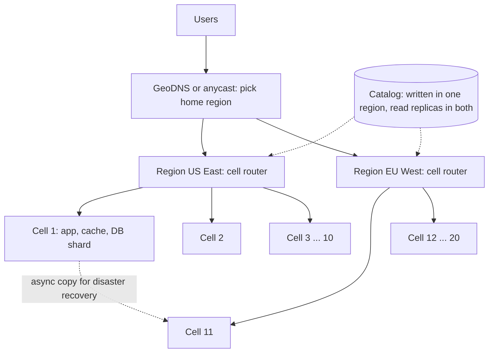
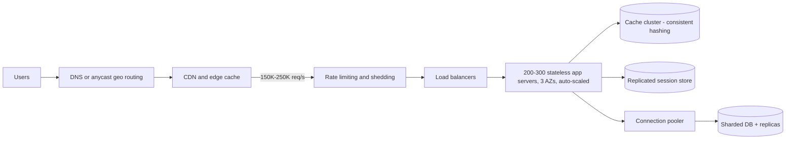

# Module 6 — Growing Under Load (Scaling)

*Original lesson: [Module introduction on DesignGurus ↗](https://www.designgurus.io/course-play/system-design-patterns/doc/6a535491ba41b5b746961f67)*


**What this module is about.** Earlier modules scaled storage and lifted reads off it (caching). This module scales everything above the data: the application servers, how traffic is shared among them, how many run at 4 AM versus peak, and how to keep a bigger fleet from crushing the database. It finishes the course's fifth question — *how does it grow?* — as four decisions: choose a direction to grow, make servers interchangeable, spread requests across them, and protect what sits behind the app tier.

**Pattern picker**

| The situation | The pattern |
|---|---|
| The machine isn't big enough | Vertical Scaling |
| No single machine could ever be big enough | Horizontal Scaling |
| Traffic has to be steered across many servers | Load Balancing |
| Demand rises and falls hour by hour | Auto-Scaling |
| Opening each database connection is costly | Connection Pooling |
| One region, one bad deploy or one noisy customer can take everyone down | Multi-Region and Cell-Based Architecture *(added lesson)* |

**Two facts that organize the module**
1. **Horizontal scaling has a prerequisite — statelessness — and that is what this module is really about.** Extra servers help only if *any* server can handle *any* request, so no server may remember a client between requests (no sessions in local memory, no files on local disk). Every lasting value needs a shared home (database, cache, object storage). The result is **"cattle, not pets"**: numbered, identical, replaceable servers. Much "scaling work" is pulling state out of app servers.
2. **Scaling one tier multiplies load on the next.** Double the app servers and you may double their DB connections, queries and downstream traffic. So capacity work *follows the bottleneck* — the part currently limiting **throughput** (work completed per second) — and widening it moves the limit elsewhere. The database's connection limit is often the first thing a fast-growing app tier breaks (hence Connection Pooling).

**How to read it.** Vertical Scaling (no new failure modes, hard ceiling) → Horizontal Scaling (the central lesson: the statelessness changes) → Load Balancing (many servers, one address) → Auto-Scaling (server count tracking demand: signals, flapping, startup delay) → Connection Pooling (how app growth multiplies DB connections until Postgres turns clients away) → **Multi-Region and Cell-Based Architecture** (added lesson: surviving loss of a **region**, and cells so a bad deploy or noisy customer hurts only a slice; plus a cloud building-block map) → the capstone, one service from 100 to 1,000,000 req/s, naming at each stage what to scale *and what to leave alone*. Short on time? Read Horizontal Scaling and Load Balancing — "How would you scale this?" is the question you will hear.

**Four terms used throughout** (basics such as load balancers, DNS, TLS and latency are in [Module 0](../00-system-design-fundamentals/README.md); see its [Vertical and horizontal scaling](../00-system-design-fundamentals/README.md#vertical-and-horizontal-scaling), [Elasticity](../00-system-design-fundamentals/README.md#elasticity) and [Stateless and stateful services](../00-system-design-fundamentals/README.md#stateless-and-stateful-services))
- **Stateless vs. stateful.** A *stateless* server keeps nothing between requests — everything comes with the request or lives in shared storage. A *stateful* server holds something that makes that machine important (a session, an open socket, a local file). Stateless tiers grow by adding identical servers; stateful ones need the storage patterns.
- **Bottleneck.** The one component currently limiting throughput. Scaling anything else adds nothing, so measure first.
- **Elasticity.** Capacity tracking demand in *both* directions: growing protects users, shrinking saves money.
- **Headroom.** The gap between normal load and capacity; it absorbs surprises while auto-scaling catches up. The course plans peak at **3–5× the average**.

**Before you start** — think about a system you run:
1. Could *any* app server handle *any* request, or is one special (a session, a file, an in-memory cache with no fallback)?
2. If you doubled your app servers this afternoon, what breaks first downstream?
3. What's your peak-to-average ratio — and who pays for the gap at 4 AM: idle servers, or an auto-scaler?

## Vertical Scaling
*Original lesson: [Vertical Scaling on DesignGurus ↗](https://www.designgurus.io/course-play/system-design-patterns/doc/6a5354d95a38214864ffde9c)*


**What it is.** "Scaling up": more CPU cores, RAM and faster disks for the same machine, with the architecture unchanged. *Analogy:* when the kitchen can't keep up, you first buy a bigger stove, not a second restaurant.

**Why it matters.** It is the least fashionable pattern and deserves more respect. Teams leap to fleets and **microservices** (an app split into many small, separately deployed services calling each other over the network) when one bigger machine would have lasted years. The problem it solves is "the machine is too small"; skipping this fix burns years on distributed complexity nobody needed yet.

**How it works, and why it's valuable**
1. **No new ways to fail** — unique among scaling patterns. No statelessness work, no load balancer, no cross-machine cache consistency, no distributed coordination; transactions, joins and in-memory state keep working. Every hard problem in the next four lessons starts when a *second* machine appears.
2. **More room than people think.** Cloud instances run from about **2 cores / 8 GB RAM** to **128+ cores and several TB of RAM** — roughly **64× capacity** from one setting. *Stack Overflow* famously served a huge share of the internet's programming questions from a handful of large machines while the industry recommended hundreds of nodes.

**Its two hard limits**
- **There is a biggest machine.** Catalogs end, and price per unit of capacity rises steeply near the top. Software may stop benefiting first: a database held back by *lock contention* (queries waiting to update the same rows) gains almost nothing from core #96, and single-threaded code can't use extra cores.
- **It is still one machine.** No redundancy; more work on one host *raises* the damage when it fails (a bigger *blast radius*). It remains a *single point of failure* (SPOF), and resizing usually needs a maintenance window.

**Combining directions.** Real fleets tune size *and* count (24 small vs. 12 medium vs. 6 large), and after sharding every shard still needs its own vertical-size decision.

**Trade-offs**

| You gain | You pay |
|---|---|
| Capacity with no architecture change — often an afternoon plus a maintenance window | A ceiling, a steep price curve toward it, shrinking software gains near the top |
| Single-machine guarantees (transactions, consistency, locality) that distributed designs spend modules winning back | No availability gain: one bigger machine is one bigger outage; redundancy needs at least two |
| Time — a year to do the statelessness work properly rather than in a panic | No elasticity: the big box sits idle and expensive at 4 AM |
| | Downtime to resize; long waits for top-of-catalog hardware |

**When not to use it**
- **Availability is the need.** Two medium machines keep half their capacity after one fails; one large machine keeps none.
- **Spiky load.** With peak 5× average, a peak-sized machine sits roughly **80% idle** most of the day.
- **Already near the top of the catalog.** The highest unit price for the last 2× only postpones a visible wall; spend it moving to horizontal.
- **Software can't use the hardware** (single-threaded, lock contention). Profile before you buy.
- *The more common misuse is the reverse:* sharding and running a fleet at **50 requests/second** because big companies blog about it.

**In the interview.** Rarely asked by name, but interviewers watch whether you consider it before going distributed: measure the bottleneck, check whether a bigger instance buys enough time, and use that time to strip state from the app so horizontal scaling is ready before the ceiling.

> **30-second answer:** The bigger machine: more cores and RAM, no architecture change, no new failure modes — transactions and single-machine simplicity keep working, with about 64× of room in one setting. Limits: a biggest machine with a steep price curve before it, and no help for availability or elasticity — still one machine, now with a bigger blast radius. I scale up to buy time and use it to make the service stateless.

- *Follow-up: "Why not keep buying bigger forever?"* — Physical limits (the catalog ends), economic (unit prices climb while each extra core helps less), architectural (no redundancy or hour-by-hour elasticity).
- *Follow-up: "One big machine or three small ones, same capacity?"* — For a stateless service, three: one failure costs a third, not everything. One large machine when the workload needs single-machine guarantees or memory locality, like a primary database. Equal capacity ≠ equal availability.
- *Mistake that fails candidates:* distributed infrastructure for a one-machine problem — or a bigger machine after an *availability* incident.

**Self-check:**
- Q1: What does vertical scaling preserve that horizontal designs must rebuild, and what are its two hard limits? → Transactions, strong consistency, joins, locality, simple in-memory state, no distributed coordination. Limits: finite hardware (rising prices, falling software benefit at the top); still one machine (no redundancy, no elasticity, downtime to resize).
- Q2: A primary DB runs at 80% CPU growing ~5%/month; half the team wants to shard now. → Scale up one or two sizes first: 2–4× headroom within a week, lasting years at 5%/month. Use the time to choose a shard key, fix queries that won't survive partitioning, and set a migration trigger (e.g., sustained 70% CPU on the largest reasonable instance) — sharding as a last resort.
- Q3: A payments service on one large instance at 30% utilization lost its host last month (40 min down); leadership wants a bigger instance. → Wrong fix: capacity was fine, there was only one machine. Use 2+ stateless instances behind a load balancer (after the statelessness checklist) and a primary-replica failover plan for stateful parts. Vertical scaling fixes too little capacity; this was too few *machines*.

**Related patterns:** Horizontal Scaling (scale up to buy the time to scale out); Sharding (each shard still needs a vertical size); Primary-Replica (the answer to availability incidents); Auto-Scaling (elasticity vertical can't offer).

**TL;DR**
- **Problem:** the machine is too small — and skipping the simple fix wastes years on distributed complexity.
- **Mechanism:** a bigger machine: ~64× of room, zero architecture change, single-machine guarantees intact.
- **Costs:** a ceiling with a steep price curve, zero redundancy (a bigger SPOF), no elasticity, downtime to resize.
- **Skip it when:** availability is the need, load is spiky, or you're near the top of the catalog.

## Horizontal Scaling
*Original lesson: [Horizontal Scaling on DesignGurus ↗](https://www.designgurus.io/course-play/system-design-patterns/doc/6a5355737d8046c63edc7f6e)*


**What it is.** "Scaling out": many identical copies of the app server, adding copies as load grows. It works only when every server is **stateless**, so any server can handle any request. *Analogy:* more checkout lanes help at rush hour only because any cashier can serve any customer — not if your groceries are locked in lane 3's back room.

**The problem.** The store's single, ever-bigger server hits the last lesson's limits: the next size costs too much, and a host failure stopped checkout for **40 minutes**. The fix — **two servers** behind a simple splitter sending half the requests to each — goes live Tuesday morning. By afternoon:
- **Random logouts.** Alice's *session* lives in server A's memory; her next request lands on B, which has never heard of her.
- **Uploaded images 404 half the time.** Photos were saved to the local disk of whichever server received the upload.
- **The UI flips back and forth.** Each server caches *feature flags* and refreshes them on its own schedule.

Two servers aren't hard; the code is full of hidden assumptions of exactly *one* machine — one process holding sessions, one disk holding files, one process running the nightly job. Horizontal scaling means hunting down every one.

**Why the obvious fixes fail**
- **"Sticky sessions."** The splitter uses a cookie or IP address to keep each user on one server. Logouts stop, and it's fine as a *migration bridge*. But if A dies its pinned users are logged out, heavy users overload one server, deploys wait for pinned users to leave, and it does nothing for local images or flag caches.
- **"Synchronize state between servers."** Copying sessions and caches between A and B builds an accidental distributed database in the app tier, re-creating the storage module's hardest consistency problems. Session clustering and multicast sync were once common; shared stores give clearer ownership.
- **"Deploy carefully and hope."** Random session loss is architectural; careful releases can't fix it.
- All three manage *disagreement between stateful servers*. The pattern removes the cause: app servers own no lasting state.

**How it works.** A load balancer fronts Server 1…N, and every server uses the same shared back-ends — sessions in Redis, files in object storage (e.g., S3), a shared cache, the database. No server holds anything the others lack.


*Figure — Horizontal Scaling (course diagram)*

**Step 1 — the statelessness checklist.** Move every value an app server holds to a shared home:

| State hiding in the server | Where it moves | Why |
|---|---|---|
| Sessions ("who is logged in") | A shared store (Redis), or a signed token the browser carries | Any server recognizes the user |
| Uploaded files | Object storage (S3 and similar) — never local disk | Every server reads every file |
| In-process caches | A shared cache (Module 4), or a local one with a short TTL where brief disagreement is harmless | Servers stop disagreeing |
| Scheduled jobs ("the nightly report") | A job queue or a *distributed lock* (a lock all servers honor) | Otherwise every server runs the cron — N times |
| Counters, rate limits, locks | A shared store | A per-server counter sees only 1/N of reality |

**Step 2 — collect the three payoffs.**
1. **Capacity by addition** — more servers, with the load balancer spreading requests.
2. **Availability by arithmetic** — run **N+1** (enough for peak plus one spare), so a single failure uses the spare instead of causing an outage.
3. **Uneventful deploys** — a *rolling deploy* swaps servers one at a time with no downtime.

**Step 3 — expect the load to multiply.** Each server adds downstream connections and requests; databases and caches now carry N servers' load (Connection Pooling and the storage module handle it).

**Walkthrough with numbers**
- **Sizing.** One server handles **800 req/s**; peak is **4,000 req/s** → 5 needed → run **6** (N+1). The peak estimate already includes traffic headroom; the sixth server is headroom for *failure*.
- **Cost of external state.** Fetching the session from Redis adds about **1 ms** per request — the price of any-server-serves-any-user.
- **A server dies at peak.** Health checks remove it within seconds; the other 5 carry 4,000 req/s. In-flight requests fail once and their retries land on healthy servers — safe because writes are idempotent.
- **Growth.** 10× traffic over two years → about **50 servers**, same architecture, near-linear cost. Capacity is bought, not redesigned.
- **The multiplication arrives.** 50 servers × 20 DB connections = **1,000 connections**, and the database starts refusing clients — the bottleneck moved downstream (→ Connection Pooling).

**Horizontal vs. vertical**


*Figure — Vertical vs. Horizontal Scaling (course diagram)*

| | Vertical (bigger machine) | Horizontal (more machines) |
|---|---|---|
| Ceiling | The catalog runs out (~64× of room) | None in the app tier; it moves downstream |
| Cost curve | Sharply steeper at the top | Roughly linear (10× traffic, 10× servers) |
| Availability | None — one bigger SPOF | N+1 — losing a server is routine |
| Elasticity | No — can't resize hourly | Yes — the fleet grows and shrinks |
| Prerequisite | None — works on any code | The statelessness overhaul, *finished* (not mostly) |
| Preserves | Single-machine guarantees, simplicity | Nothing automatically — everything shared is explicit |

Horizontal's cost is the up-front overhaul plus ~1 ms per request; six servers for 50 req/s is imitation, not engineering — two servers and a failover often suffice. The two work together: scale up to buy time, remove state, scale out when measurements justify it, and keep tuning size and count (6 large vs. 24 small is a tuning choice, not a principle).

**Trade-offs**
- *You gain:* capacity by addition (the ceiling moves downstream); availability through redundancy; elasticity as an option; zero-downtime rolling deploys.
- *You pay:*
  - **The statelessness overhaul** — code and testing for sessions, files, caches, scheduled work and counters, paid *before* the first extra server works correctly. The main cost.
  - **~1 ms per request** to fetch external state.
  - **Shared stores take on the criticality.** One Redis holding forty servers' sessions is a possible SPOF needing replication. State is *relocated*, not eliminated.
  - **Coordination problems** — work that ran once on one machine (crons, global counters) needs explicit coordination.
  - **Multiplied downstream load**, every time.

**When not to use it**
- **Workloads stateful by nature.** A database's job *is* owning state (use storage patterns). WebSocket gateways hold live connections and need a two-tier design (local sockets + global routing). Stateless copies are for compute.
- **Small scale.** Two servers with failover may suffice — though doing the checklist early is cheapest.
- **Bottleneck downstream.** More app servers just pile connections and queries onto a struggling database. Measure first.
- **Microsecond latency budgets** that can't afford a hop to external state may deliberately keep state in-process.
- *The classic failure:* a half-done migration — one forgotten cron, local counter or in-memory rate limiter that runs N times or sees 1/N of reality.

**Real-world examples**
- **The Twelve-Factor App** (Heroku's manifesto): factor VI, "execute the app as stateless processes," is this pattern in one line.
- **Kubernetes ReplicaSets and AWS Auto Scaling Groups** make it a setting: `replicas: 50` assumes every *pod* (deployed unit) is interchangeable.
- **Every modern web tier** looks like this; the interesting decisions are where sessions, files and other state ended up.
- **For AI engineers:** inference services run identical model copies behind a load balancer, with two twists. Each copy may load tens of GB of *weights* before serving (minutes of startup, which changes auto-scaling). And a conversation's *KV cache* (the model's working memory of earlier tokens) works best on the same copy, so requests aren't fully interchangeable — *consistent-hash* routing by session keeps a conversation on its cache. Batch embeddings and evaluations fit the simple pattern: independent parallel workers.

**In the interview.** After "add servers," expect "what stops you from doing that today?" List every form of server-local state instead of assuming more copies means more capacity.

> **30-second answer:** Identical, stateless servers behind a load balancer, so any request can land anywhere. The real work is the checklist: sessions to Redis or signed tokens, files to object storage, shared caches, crons behind a lock or queue, counters in a shared store — state makes a server special, and special servers can't be swapped. Then capacity is addition, availability is N+1, deploys are rolling. Two costs up front: shared stores take on the criticality (the session Redis needs replication), and each server multiplies database load, which pooling and caching absorb.

- *Follow-up: "A server dies mid-request — what do users see?"* — Health checks pull it within seconds; in-flight requests fail once and idempotent retries reach healthy servers; N+1 sizing carries the full load.
- *Follow-up: "You doubled the fleet and latency got worse. Why?"* — The app tier wasn't the bottleneck; more servers multiplied DB connections, queries and lock contention. Fix the data path (storage, caching, a pooler).
- *Mistake that fails candidates:* "add servers" without checking for state, sticky sessions as the permanent design, or scaling a tier that wasn't the limit.

**Self-check:**
- Q1: The five kinds of state commonly left in app servers and where each goes? → Sessions → Redis or signed tokens; files → object storage; in-process caches → shared cache (or short local TTL); scheduled jobs → queue or distributed lock; counters/rate limits/locks → shared store.
- Q2: For and against sticky sessions; when to remove them? → For: a cheap bridge that stops random logouts while shared sessions are built, and genuinely needed for stateful connections (WebSocket gateways). Against: a dead server drops its pinned users, heavy users unbalance load, deploys drain slowly, new servers start empty. Remove them once sessions live in shared storage or tokens — before more code relies on pinning.
- Q3: 6 → 30 servers; the DB refuses connections at peak and customers get the nightly summary email several times. → 5× servers multiplied DB connections past the limit: add a pooler and shrink per-server pools. The email cron runs on every server: move it to a single-consumer queue or behind a distributed lock, idempotent on customer + date. Statelessness means finishing *every* checklist item.

**Related patterns:** Vertical Scaling (buys time; stays a sizing option); Load Balancing; Auto-Scaling; Connection Pooling (caps N servers' DB connections); Idempotency (safe retries after a server dies).

**TL;DR**
- **Problem:** one machine has a ceiling and is a SPOF — but adding a second exposes every hidden one-machine assumption (sessions, files, caches, crons, counters).
- **Mechanism:** the statelessness checklist moves server memory to shared homes; identical servers behind a balancer then give capacity by addition, N+1 availability, rolling deploys.
- **Costs:** the overhaul, ~1 ms per request, shared stores that become critical, new coordination problems, multiplied downstream load.
- **Skip it when:** the state *is* the job (databases, socket gateways), the scale is small, or the bottleneck is downstream.

## Load Balancing
*Original lesson: [Load Balancing on DesignGurus ↗](https://www.designgurus.io/course-play/system-design-patterns/doc/6a535689ba41b5b7469622dc)*


**What it is.** A dedicated front-door layer that gives clients **one stable address** for a changing fleet, checks which servers are alive (**health checks**), spreads requests with an algorithm that reflects real load, and **drains** servers (lets current work finish) before replacing them. *Analogy:* a restaurant host who knows which tables are free, which waiter is swamped and which section is closing. Basics (L4/L7, algorithms) are in [Module 0 — Load balancers](../00-system-design-fundamentals/README.md#load-balancers); this lesson is the pattern.

**The problem.** Six stateless servers sit behind Tuesday's **round-robin** splitter (request 1 → server 1, request 2 → server 2, …). At **2:14 AM** a runaway log fills server 4's disk. It doesn't crash — it slows to **20 seconds** per request before failing. The health-blind splitter keeps sending it **one-sixth** of traffic for **11 minutes**, until an engineer pulls it by hand. Two weeks later, replacing server 2 in a deploy kills **several hundred in-flight requests** because the splitter can't stop new work while letting current work finish — a predictable error spike every deploy. The flaw: the splitter treats servers as interchangeable *and permanent*, but real servers slow down, die and get replaced, and the front must notice within seconds.

**Why the obvious fixes fail**
- **"DNS round-robin."** Clients and resolvers cache answers for minutes or hours, so a removed server's address keeps being used. DNS publishes addresses; it can't steer individual requests, measure health, or revoke a cached choice.
- **"Let clients pick a server."** Service meshes legitimately do a capable version internally, but public browsers and apps would need health checks, retries and list management you can't reliably update.
- **"A runbook: on-call removes bad servers."** That *is* the 11-minute response — the right decision at human speed (like the Circuit Breaker lesson's manual kill switch). This pattern makes it at machine speed.

**How it works — four jobs.** The figure shows a balancer mid-work: one address for clients, health checks every 2 s, least-connections routing, drain before replace. Servers 1, 3, 5, 6 serve (41, 38, 44, 39 in flight); server 2 is *draining* for a deploy (6 finishing); server 4 was *removed* after 3 failed probes; the next request goes to server 3 (fewest in flight).


*Figure — Load Balancing (course diagram)*

1. **Health checks — noticing failure.** *Active* checks call each server's health endpoint every few seconds (the Operations module designs it); several consecutive failures remove a server, several successes restore it. *Passive* checks watch real traffic and react to error jumps between probes. Together: the 11-minute manual response becomes about **6 seconds**.
2. **The algorithm — spreading traffic.**
   - *Round-robin* — fine when requests and servers are alike.
   - *Least-connections* — the server with the fewest in-flight requests gets the next one. The better default: a struggling server accumulates in-flight work and automatically gets less (fixing 2:14 AM).
   - *Weighted* — servers of different sizes.
   - *Hash-based* (consistent hashing, "the ring") — same user to same server when *affinity* matters (warm per-user caches, long-lived connections).
3. **Draining — the deploy story.** Stop new requests to the leaving server, let current ones finish (seconds for API calls; held-open streams get a notice before disconnect), admit the replacement only after it passes health checks. The deploy error spike disappears.
4. **One address.** A stable endpoint while the fleet changes size and membership (what makes auto-scaling possible). The balancer often *terminates TLS*. **L4** balancers route by IP and port (connection level); **L7** read HTTP paths, headers and cookies (request level), enabling path routing and request-aware retries. Public entry points usually use L7; internal tiers may prefer simpler L4.

**Who balances the balancer?** It's on every request's path, so it can't be a SPOF: a **redundant pair sharing a floating IP** (the address moves to the survivor), or at internet scale **anycast** — many balancers announce one IP and the network sends each client to a nearby one. That ends the chain after one level.

**Walkthrough with numbers**
- **2:14 AM, replayed.** Probes fail at 0, 2 and 4 s; server 4 is removed at ~6 s (passive monitoring may be faster). One-sixth of traffic sees a short blip; no human involved.
- **The GC pause.** Server 5 freezes in garbage collection — slow, not failed. Round-robin keeps feeding it; least-connections sees in-flight rise from **40 to 300** and routes elsewhere until it recovers.
- **The deploy.** Six servers replaced one at a time: drain ~**30 s**, start the replacement, admit on passing probes. The SSE (long-lived streaming) fleet uses longer drains plus *jittered reconnects* (random per-client delays so clients don't stampede back). Zero deploy errors.
- **The math check.** The balancer adds **well under 1 ms** and handles **4,000 req/s** easily. Its value is replacing slow human detection, not speed.

**Trade-offs**
- *You gain:* machine-speed failure handling; distribution matching reality (least-connections self-corrects for slow servers and uneven requests); zero-downtime deploys via draining; one stable address hiding fleet churn.
- *You pay:*
  - **A critical hop on everything.** Sub-millisecond, but *all* traffic depends on it, so its availability matters more than any server's — hence pairs or distributed deployments.
  - **Health checks wrong in both directions.** A *shallow* check (process running?) may pass a server that can't reach its database. A *deep* check on a shared dependency is worse: when that dependency blips, *every* server reports unhealthy and the balancer removes the whole fleet. Rule: a health check answers "should *this server* receive traffic?", not "is the architecture OK?"
  - **Small settings, big consequences** — probe intervals, thresholds, drain times, algorithms.
  - **L7 costs** — inspecting every request is more work; at very large scale the balancer tier needs its own horizontal capacity.

**When not to use it**
- **One server** — latency and config with no redundancy (a proxy may still do TLS or routing; see the API & Edge module).
- **Service-to-service traffic inside a mesh** — sidecar proxies balance client-side with rich health data: the same jobs, decentralized.
- **Geographic routing** — happens at DNS/anycast *before* any regional balancer; a complement, not a replacement.
- *Common misuse:* a balancer product left on round-robin defaults, shallow checks and no drain integration — the old splitter's failures plus infrastructure. The pattern is four active jobs, not a box.

**Round-robin vs. least-connections**

| | Round-robin | Least-connections |
|---|---|---|
| Assumes | All requests and servers are alike | Nothing — it measures |
| A slow/failing server gets | Its full equal share (the 2:14 AM failure) | Less and less as its backlog grows |
| Mixed light/heavy requests | Some servers idle, others overloaded | Corrects itself |
| Long-lived connections (SSE, sockets) | Bad — balances connection *starts*, not load | The right default — counts what's held |
| Cost | Trivial | Trivial (one counter per server) |

Round-robin still suits short, uniform requests and DNS (which can't see active work); hash-based routing is the third option for cache locality or affinity. In one line: *round-robin assumes traffic is uniform; least-connections measures it.*

**Real-world examples**
- **nginx and HAProxy:** long-established software balancers with L4/L7 modes and all the algorithms above.
- **AWS:** **ALB** is L7 (paths, headers, WebSocket upgrades); **NLB** is L4, for millions of connections with microsecond overhead. Other clouds have similar pairs.
- **Envoy:** a small L7 proxy next to every service (a service mesh), giving every caller request-aware balancing and local health data.
- **Anycast at the edge:** Cloudflare and other CDNs announce one IP worldwide; internet routing does the first layer of balancing.
- **For AI engineers:** connection counts misread inference load — two LLM requests can differ **100×** (10 vs. 2,000 tokens), so a GPU with three long generations can be busier than one with ten short ones. Inference routers balance on **queue depth and outstanding tokens** per replica, plus consistent-hash routing by conversation ID to reach the replica holding its KV cache. Still "measure the work," by size rather than count.

**In the interview.** Everyone draws a load balancer; interviewers check whether you can explain how it chooses, detects failure, handles deploys, and whether it's a SPOF itself.

> **30-second answer:** Four jobs: health checks (active probes plus real errors) remove a failing server in seconds; least-connections distribution self-corrects for slow servers where round-robin keeps feeding them; draining lets in-flight work finish during deploys; one stable address for a changing fleet, usually terminating TLS at L7. It runs as a redundant pair with a floating IP, or anycast at scale. Health checks stay deliberately shallow — a deep check on a shared dependency can pull the whole fleet — so each server reports only its own health and degrades rather than dies on dependency failures.

- *Follow-up: "What should the health check test?"* — The process, the listening port and critical *local* resources. Not every downstream dependency; handle those in-service with breakers and degraded responses.
- *Follow-up: "Who balances the balancer?"* — A redundant pair on a floating address failing over in seconds; at larger scale, anycast.
- *Mistake that fails candidates:* round-robin without thinking about slow servers, restarts without draining, or a balancer that "can't fail."

**Self-check:**
- Q1: The four jobs and the two ways a health check can be wrong? → Health checking, load-aware distribution, draining, one stable endpoint (often L7 TLS termination). Shallow: keeps a server that responds but can't work. Deep: removes healthy servers when a shared dependency fails — the whole fleet over an outside problem.
- Q2: Algorithm for (a) a uniform internal API under 10 ms, (b) a public API with wildly varying request cost, (c) an SSE fleet holding 50k streams per server? → (a) Round-robin. (b) Least-connections, steering away from servers piling up expensive requests. (c) Least-connections when placing streams (held connections *are* the load), plus long drains and randomized reconnect delays.
- Q3: At 3:07 AM the site goes down; all six servers show low CPU and no errors; the balancer marks all unhealthy at once and restores them two minutes later. → The health endpoint tests a shared dependency (Redis or the DB); a two-minute blip failed every probe. Restrict the check to process, port and local conditions; handle shared-dependency failures in-app with breakers, fallbacks, reduced responses.

**Related patterns:** Horizontal Scaling (statelessness lets any request go anywhere); Auto-Scaling (adds/removes servers behind this entry point); Consistent Hashing (affinity routing); Health Check Endpoint (what the probe hits); Graceful Degradation (reduced answers instead of dropping out of rotation).

**TL;DR**
- **Problem:** a simple splitter treats servers as interchangeable and permanent — feeding a failing machine its full share for minutes, killing in-flight work every deploy.
- **Mechanism:** four jobs — active + passive health checks, least-connections, draining, one stable (L4/L7, TLS-terminating) address — itself made redundant with pairs or anycast.
- **Costs:** a critical hop on all traffic, health checks that mislead both ways (the deep-check trap removes the fleet), small settings with big consequences.
- **Skip it when:** one server, traffic inside a mesh (sidecars balance it), or the decision is geographic (DNS/anycast).

## Auto-Scaling
*Original lesson: [Auto-Scaling on DesignGurus ↗](https://www.designgurus.io/course-play/system-design-patterns/doc/6a53576202c0851f57eac974)*


**What it is.** A **control loop**: measure a load signal, compare it with a target, add or remove servers to close the gap, with the load balancer admitting new servers and draining leaving ones. Fleet size becomes a continuously corrected answer instead of a one-off guess. *Analogy:* a thermostat, not a January guess at the whole year's heating.

**The problem.** A fixed fleet of **8 servers** is sized for a **4,000 req/s** evening peak. One month, two incidents:
- **The 4 AM bill.** Average traffic is about **900 req/s** (evenings 4–5× that), so five or six servers idle most hours at full price — roughly **60% of the app tier's spend pays for idle time**.
- **The Tuesday the TV mentioned you.** Traffic leaps from 900 to **12,000 req/s in twenty minutes** — 3× the planned peak. All eight max out; by the time an engineer wakes, diagnoses, provisions and boots, much of the spike is over.

Fixed sizing is a design-time estimate of something that changes hourly, so it's wrong both ways.

**Why the obvious fixes fail**
- **"Size for the worst case."** 24 servers always on handles the TV spike but triples the 4 AM bill — and a growing business makes bigger surprises.
- **"On-call scales by hand."** Notice-diagnose-act-boot ate most of a 20-minute spike, and nobody gets up at 4 AM to *remove* servers. People are slow going up and absent going down.
- **"Schedule it."** More at 6 PM, fewer at midnight is useful (it'll be part of the design) but can't see a TV segment or a quiet evening coming.

**How it works.** Measure every ~1 minute → compare with a target (e.g., 65%) → over: **add fast**; under: **remove slowly, draining first** → measure again.


*Figure — Auto-Scaling (course diagram)*

1. **Pick the signal — *the* design decision.** CPU works for *compute-bound* services. It misleads for *IO-bound* ones (requests mostly waiting on disks, networks, databases): hundreds of blocked threads hurt users at **15%** CPU and a CPU scaler does nothing. Better: **requests per instance** against tested capacity, or **latency** (e.g., p95 — the time within which 95% of requests finish; see [percentiles](../00-system-design-fundamentals/README.md#percentiles-tail-latency-and-why-averages-lie)) against target. For queue workers, **backlog age** — if the oldest job has waited **90 seconds**, you have too few workers.
2. **Target with deliberate headroom — about 60–70%, not 90%.** The unused slice covers climbing traffic until new servers are ready.
3. **Respect reaction lag — it's physics.** ~1 minute of metric averaging, then boot, app start, cache warm-up: **3–7 minutes with no new capacity** after a spike starts. Headroom covers it; a fleet at 90% is overloaded before help arrives.
4. **Scale up fast, down slowly.** Add several at once (an unneeded addition is cheap); remove one at a time after a *cooldown* (wait after any action) and a drain. Aggressive removal triggers instant re-adds — **flapping**, rebuilding caches and DB connections each time. The cure: asymmetry plus **hysteresis** (separate up and down thresholds) and cooldowns.
5. **Set a minimum and a maximum.** **Min = N+1**, so cost-cutting never removes failure headroom. **Max = measured downstream capacity**, not an arbitrary big number — an uncapped scaler adds connections and queries until it flattens the database. The max is a **bulkhead** (a hard limit stopping one part's trouble flooding another) protecting downstream; traffic beyond it is deliberately shed, queued or rate-limited at the edge.
6. **Combine triggers.** *Scheduled* for known cycles (start before the 6 PM ramp — zero lag), *reactive* for surprises, *predictive* (forecast from history) for large fleets or slow boots. Calendar for what you know, measurement for what you don't.

**Walkthrough with numbers** (800 req/s per server; a 65% target → ~**520** effective; min 3, max 20)
- **4 AM, 900 req/s:** 900 / 520 ≈ 2, raised to the N+1 floor → **3 servers**.
- **6 PM, scheduled:** **8 servers** ready when 4,000 req/s arrives; zero reaction lag.
- **TV Tuesday, replayed (900 → 12,000 in 20 min):** headroom absorbs the first ~**90 seconds**; the reactive loop adds waves (~60 s to notice, ~3 min to boot); **16** servers by minute six, capped at **20** — the database (with replicas and cache) is known to cope with 20 servers' traffic and no more. Overflow is shed at the edge. Bad minutes: about **four**. Human actions: **zero**.
- **The bill:** average fleet drops from a fixed 8 to about **4.2** — roughly **half the compute spend**. Scaling up protected users; scaling down paid for the project.

**Trade-offs**
- *You gain:* a bill tracking demand; surprises absorbed at machine speed (limited by boot time and max); free self-healing (the loop replaces crashed instances to keep the minimum); far fewer 2 AM capacity pages.
- *You pay:*
  - **Reaction lag, always** — 3–7 minutes; scheduling and headroom soften it but can't remove boot time. Spikes shorter than the lag need traffic controls at the front.
  - **Wrong-signal disasters.** CPU misses IO-bound incidents; a memory-based policy may keep adding servers to hide a memory leak. Choosing a signal is a diagnosis; automating the wrong one amplifies it.
  - **Flapping and churn** — close thresholds, no cooldowns: nonstop changes, cold caches, connection bursts.
  - **An automated flood downstream** — every scale-up adds unreviewed downstream traffic; the max, pooling and caching must protect the database from its own scaler.
  - **Policies are code running overnight** — they need review, observable metrics and load tests that actually trigger them.

**When not to use it**
- **Flat, predictable traffic** (an internal service at a steady 200 req/s): a fixed N+1 fleet; an unneeded loop is one more failure mode.
- **Stateful tiers.** Databases and socket gateways aren't interchangeable compute; DB capacity needs careful storage changes (managed DB auto-scaling does this slowly, within explicit limits).
- **Downstream can't take it.** If the DB is the bottleneck, auto-adding app servers worsens the overload.
- **Boot times longer than the spike.** A 15-minute boot can't answer a 10-minute event; AI serving needs scheduled/predictive capacity and warm pools.
- *Common misuse:* auto-scaling instead of measuring capacity — unknown per-instance throughput, no max, CPU only. Fine until an unusual day, when the fleet changing size mid-incident also hampers diagnosis.

**Reactive vs. scheduled vs. predictive**

| | Reactive | Scheduled | Predictive |
|---|---|---|---|
| Trigger | The signal, right now | The calendar | A model's forecast |
| Known daily cycle | Late by the lag, every time | Perfect — capacity before load | Well |
| The TV moment | Yes — limited by lag + headroom | No — not on the calendar | Only if it resembles history |
| Complexity | Moderate | Trivial | High — a model you must trust |
| Failure mode | Wrong signal, flapping | Wrong guess, quiet drift | Wrong with confidence |

Stack them: schedule the known, react to the actual, add prediction when boot delay or fleet size justifies it.

**Real-world examples**
- **AWS Auto Scaling Groups** with *target tracking*: signal, target, min, max — the whole loop.
- **Kubernetes HPA** (Horizontal Pod Autoscaler) scales pods on custom signals; a separate **cluster autoscaler** adds/removes the machines under them — two stacked loops.
- **Queue-driven workers:** SQS queue depth drives AWS Lambda concurrency — backlog as signal, near-zero startup, zero workers when idle.
- **Netflix Scryer:** a predictive scaler provisioning ahead of forecast demand, because reaction lag is very costly at Netflix scale.
- **For AI engineers:** the signal is queue depth and outstanding tokens, not CPU. Pulling a container and loading tens of GB of weights takes minutes, so purely reactive scaling fails: use warm pools, predictive changes and a realistic scale-to-zero decision (idle GPUs are expensive; cold starts make users wait). The max may be a **provider quota**, so front-end shedding and queueing are a must.

**In the interview.** Typical setup: predictable evening peaks plus occasional 10× marketing events. Schedule the cycle, react to surprises, keep headroom for boot time, derive the max from downstream limits. After "it auto-scales," expect "on what signal?"

> **30-second answer:** A control loop keeping a signal near ~65%: add fast, remove slowly through the balancer's drain. The signal is the real decision — CPU for compute-bound work; requests per instance or latency for IO-bound work, where blocked threads make CPU misleading; backlog age for queue workers. Headroom covers 3–7 minutes of reaction lag; schedules put capacity ahead of the 6 PM ramp. Min is N+1, max is what the database survives — an uncapped scaler is an automated stampede — and beyond the max the front sheds load.

- *Follow-up: "IO-bound API — what signal, and what if you'd chosen CPU?"* — Requests per instance against tested capacity, or p95 latency. With CPU, a slow database piles up blocked threads at ~15% CPU and the scaler does nothing while users suffer.
- *Follow-up: "Flash sale: the scaler hits max and the site is still slow."* — Find the active bottleneck before touching the cap. If the database is saturated the max is doing its job; improve caching, replicas and pooling, reject or delay excess at the edge, and raise the max only after measuring more downstream capacity.
- *Mistake that fails candidates:* CPU for everything, no max, ignoring lag and headroom, or treating a database as an interchangeable stateless tier.

**Self-check:**
- Q1: Parts of the loop, and why different up/down policies? → Measure, compare with ~65%, add/remove, balancer admits/drains, repeat. Up fast because surplus is cheap versus an outage; down slowly (cooldowns, one at a time) because aggressive cuts cause flapping, cold caches and connection bursts.
- Q2: Signal for (a) an IO-bound web API, (b) a queue-consuming image processor, (c) a GPU inference fleet? → (a) Requests per instance or p95 latency. (b) Backlog age. (c) Queue depth or outstanding tokens per replica, plus warm/predictive capacity for multi-minute startup.
- Q3: Min 3, max 30, CPU target 65%, scale-down at 60%, no cooldown; the fleet bounces between 6 and 9 all evening, then *shrinks* during a database slowdown. → Thresholds 5 points apart with no cooldown: noise keeps undoing the last action. Widen (e.g., up at 70%, down at 40%), add cooldowns, remove one at a time. During the DB slowdown threads waited instead of burning CPU, so the signal read "spare capacity" — switch to requests per instance or latency.

**Related patterns:** Horizontal Scaling (only stateless servers can be added/removed automatically); Load Balancing (admit and drain); Connection Pooling (absorbs each scale-up's connection surge); Message Queue (backlog age, the clearest signal); Bulkhead (the fleet max).

**TL;DR**
- **Problem:** fixed fleets pay for idle servers at 4 AM and drown when the TV mentions you.
- **Mechanism:** a control loop keeping a signal near ~65%, add fast / remove slowly with draining; scheduled for known cycles, reactive for surprises; min N+1, max from downstream capacity.
- **Costs:** 3–7 min reaction lag (headroom bridges it), wrong-signal disasters (CPU misleads for IO-bound work), flapping without hysteresis/cooldowns, an automated downstream flood only the max holds back.
- **Skip it when:** traffic is flat, the tier is stateful, downstream is already the bottleneck, or boot time dwarfs the spikes (schedule, predict, pre-warm).

## Database Connection Pooling
*Original lesson: [Database Connection Pooling on DesignGurus ↗](https://www.designgurus.io/course-play/system-design-patterns/doc/6a5357e3da90fe9bceb2d85d)*


**What it is.** Opening a DB connection is expensive; querying over an open one is cheap. A pool opens a few connections once, keeps them alive, and lets requests *borrow* one per query and *return* it. At fleet scale a shared **pooler** in front of the database funnels many servers' connections into a few real ones. *Analogy:* a company car pool instead of everyone buying a car for a ten-minute errand. (Basics: [Module 0 — Connection pooling, ORMs and N+1 queries](../00-system-design-fundamentals/README.md#connection-pooling-orms-and-n1-queries).)

**The problem — part 1: setup cost.** A new connection needs a TCP handshake, TLS negotiation and authentication — about **20–50 ms** before the first query — and the database reserves real resources per connection (Postgres runs a dedicated *process* with its own memory for each). That's ten times the work of a **5 ms** query.

**The problem — part 2: multiplication.** Frameworks usually solve part 1 with an app-side pool. The less obvious problem appears as the fleet grows: a sensible 20-connection pool × 50 servers = **1,000 connections** against a database built for a few hundred (Postgres's default limit is around **100**), each process eating memory and scheduling time. When the auto-scaler adds five servers in a spike, they immediately request another 100. The app tier gains capacity while the unchanged database turns clients away — "scaling one tier multiplies load on the next" in its most common form.

**How it works.** The figure shows the app-side pool: (1) the app asks the in-memory pool for a connection from the *idle* set; (2) it moves to the *in-use* set; (3) the query runs on the database server (MySQL, PostgreSQL, SQL Server, Oracle…); (4) the connection returns to the idle set. Nothing is opened or closed per query.


*Figure — Database Connection Pooling (course diagram)*

1. **Layer 1 — an app-side pool per server.** Each server opens perhaps **10–20** connections at startup; queries borrow and return within microseconds, so the 20–50 ms handshake is paid once per connection *lifetime*.
2. **Layer 2 — a shared pooler.** A proxy such as **PgBouncer** (or managed **AWS RDS Proxy**) accepts, say, 1,000 cheap *client* connections and **multiplexes** them (many clients taking turns on few real connections) over about **50 real database connections**, lending one to whichever client is in a transaction now.

   ```
   Without pooler:  50 app servers × 20 conns ──► 1,000 conns ──► DB (overloaded)
   With pooler:     50 app servers × 20 conns ──► PgBouncer ──► ~50 conns ──► DB (calm)
                    (cheap client connections)   (multiplexes)   (sized to cores)
   ```
3. **Why so few suffice (Little's law — [Module 0](../00-system-design-fundamentals/README.md#littles-law)).** Active connections = query rate × query duration: **400 queries/s** × **5 ms** = **2** busy at any instant. A thousand *logical* connections, about two doing anything.
4. **Small pools beat big ones.** A database runs roughly one query per CPU core at a time; connections beyond that add no processors — their queries wait while adding context switches and lock contention, so throughput peaks at a modest size and can *fall* beyond it. HikariCP's (a popular Java pool) guidance: about **cores × 2** — tens, not thousands. If that feels too few, fix slow queries or add a cache or read replicas, not connections.
5. **Transaction-mode fine print.** Aggressive poolers multiplex *per transaction*, so features assuming a private, lasting session — **session variables, temporary tables, some prepared-statement setups** — can break. Check compatibility notes before migrating.

**Trade-offs**
- *You gain:* the handshake paid once per lifetime; a database seeing tens of warm connections instead of a fleet-sized flood (scale-ups stop being connection storms); a **built-in bulkhead** — the pool caps concurrent queries, giving *backpressure* (push-back that slows callers when downstream is full) by design.
- *You pay:*
  - **Pool exhaustion — a new way to be down.** If connections stay borrowed (slow queries, or code that *leaks* them — borrows without returning), requests queue for the pool; the queue moved from the database into the app or proxy. Guardrails: a **borrow timeout** (fail fast), alerts on **pool utilization and wait time**, **leak detection**.
  - **Housekeeping** — detect and replace dead connections with *validation queries* and a *maximum connection lifetime*; a shared pooler is another critical service, so keep it simple and redundant.
  - **The transaction-mode limits** above.

**When not to use it** — pooling is nearly universal; the questions are *where* and *how big*:
- **Serverless functions** (e.g., AWS Lambda) can't keep reliable local pools — instances are short-lived and thousands may start at once. Pool in a shared proxy outside them; **RDS Proxy** exists to absorb Lambda-style bursts.
- **Small scripts and one-off jobs** with one connection gain nothing.
- **Not a valid exception:** "the pool keeps running out, so make it 500." That moves the queue into the database, where contention *lowers* throughput.
- Related habit: **separate pools for the primary (writes) and replicas (reads)**, so report traffic can't eat checkout's connections.

**In the interview.** Usually a diagnosis: "the app tier grew from 10 to 50 servers and the database refuses connections — why?" Or "how big should the pool be?", testing whether you reach for a huge number.

> **30-second answer:** Each connection costs a 20–50 ms handshake and real DB memory, so servers keep warm pools. The trap is multiplication — 50 servers × 20 is 1,000 — so at fleet scale a pooler like PgBouncer multiplexes down to tens of real connections, safe because rate × duration shows only a handful are busy. Pools should be small, near the database's core count; extra connections just queue inside the DB and add contention. I alert on pool wait time, because exhaustion is its own outage mode.

- *Follow-up: "Why does a bigger pool make it slower?"* — About one query per core; extra connections add context switches and lock contention, not processors.
- *Follow-up: "Where should the pool live with auto-scaling?"* — Both levels: local pools for reuse, plus a shared proxy capping the *total* however many servers the scaler adds.
- *Mistake that fails candidates:* raising the DB limit to 5,000 as if connections were capacity, or no borrow timeout (slow queries become hung threads fleet-wide).

**Self-check:**
- Q1: Why is opening a connection expensive, and which two layers does a scaled fleet need? → TCP + TLS + auth ≈ 20–50 ms plus a dedicated DB process and memory. Layer 1: a local pool per server. Layer 2: a shared proxy (PgBouncer) multiplexing onto core-sized real connections, so sane per-server settings can't multiply into an unsafe total.
- Q2: 400 queries/s at 5 ms; a teammate wants a pool of 200 "for safety." → 400 × 0.005 = **2** active; 10–20 leaves ample burst room. 200 wastes DB processes and memory when idle and, under load, lets 200 queries fight over a few dozen cores. Safer: small pool, short borrow timeout, monitored wait time.
- Q3: After a deploy, p99 latency jumps; requests log "pool borrow timeout" while the DB is nearly idle; rollback fixes it. → A connection **leak**: some path (early return or exception — e.g., release missing from a `finally` block) never returns its connection. Guardrails: leak detection reporting connections held past a threshold with the borrower's stack trace; alerts on pool utilization and wait time before exhaustion.

**Related patterns:** Horizontal Scaling (N sane pools still multiply); Auto-Scaling (each new server is a connection burst unless a proxy caps the total); Bulkhead (bounded concurrency and backpressure); Primary-Replica (separate read/write pools).

**TL;DR**
- **Problem:** each connection costs a 20–50 ms handshake and a process's worth of DB memory, and per-server pools multiply into a fleet-sized flood (50 × 20 = 1,000) that auto-scaling grows by itself.
- **Mechanism:** warm app-side pools plus a shared pooler (PgBouncer / RDS Proxy) multiplexing onto core-sized real connections — rate × duration shows only a handful are busy.
- **Costs:** pool exhaustion (borrow timeouts, wait-time alerts, leak detection), housekeeping, transaction-mode limits.
- **Skip it when:** practically never — decide where (a shared proxy for serverless and big fleets) and how big (small, near the cores; never "500 for safety").

## Multi-Region and Cell-Based Architecture
*Added lesson (not part of the DesignGurus course). Written from primary sources listed under "Sources" at the end of the lesson.*


**What it is.** Two ways to cut one system into pieces that fail separately. **Multi-region** runs it in two or more geographic **regions** (a cloud location such as "US East", made of several **availability zones** — AZs, separate datacenters a few kilometres apart). **Cell-based architecture** splits each region's fleet into **cells**: complete, independent copies of the stack (app servers, cache, DB shard, queues), each serving a fixed slice of customers, with a thin **cell router** sending each customer to their cell. *Analogy:* watertight compartments (cells) and a shipping company with ships in two oceans (regions).

**The problem.** The capstone grows the store to ~1M req/s in **one region, three AZs** — which survives a datacenter fire but not these, all within a year:
- **The regional dependency.** A provider problem in the region's shared control systems (identity, DNS, the load-balancer API) breaks all three AZs: **4 hours** down.
- **The global config push.** A malformed rate-limit rule reaches every server in **90 seconds**, as designed; checkout fails for **100% of customers**. The fault came from *inside*.
- **The poison tenant.** One business customer's export script saturates the shared order DB; **20 million** others get slow pages for an hour.
- Sydney customers wait **~200 ms per round trip** to the US region on every write.

Every fault's **blast radius** (share of users one failure can hurt) was the whole company, because everything was one shared system.

**Why the obvious fixes fail**
- **"Add a fourth AZ."** AZs share the regional control plane (the systems that create, configure and route resources, versus the data plane serving user traffic) — and *your* code and config.
- **"Back up to another region."** Necessary, but restoring 50 TB onto an untested stack takes **a day or more** — recovery from losing a region forever, not a 4-hour outage.
- **"Every region active, one globally consistent database."** Every commit would wait **~75 ms** (US East ↔ EU West) to **~200 ms** (US ↔ Sydney) — the cost of linearizability (every reader sees the latest write, as if one copy existed) from [DDIA Chapter 9](../../../ddia/chapters/09-consistency-and-consensus/README.md#the-cost-of-linearizability). Right for a few datasets, far too costly for all.
- **"Test config changes better."** Some faults appear only under production traffic. What's missing is a way to hurt *5%* of customers before *100%*.

**How it works — failure domains first.** A **failure domain** is the set of things that fail together:

| Failure domain | Typical cause | What contains it |
|---|---|---|
| Process / host | Crash, disk full, GC pause | Horizontal Scaling + Load Balancing (N+1) |
| Availability zone | Power, cooling, network in one building | Every tier spread across 3 AZs |
| Region | Regional control plane, large network event | **A second (and third) region** |
| Your own change | Bad deploy, bad config, schema mistake | **Cells**, deployed one cell at a time |
| One noisy customer | Pathological workload | **Cells** (or shuffle sharding, below) |

Regions answer "what if a location goes away?"; cells answer "what if *we* break something, or one customer does?"

**Step 1 — pick a multi-region strategy by RPO and RTO.** **RPO** (recovery point objective): how much recent data you can lose. **RTO** (recovery time objective): how long you can be down. (Defined in the SQL book's [High availability section](../../../sql/chapters/15-scaling-databases/README.md#1510-high-availability-replication-plus-failover).) The cloud providers' four strategies, cheapest to strongest:

| Strategy | What runs in the second region | RPO | RTO | Extra cost |
|---|---|---|---|---|
| Backup and restore | Only backups | Hours (last backup) | Hours to a day | Lowest |
| Pilot light | Data replicated continuously; servers off or minimal | Seconds to minutes | Tens of minutes (start and scale servers) | Low |
| Warm standby | A small working copy of everything, taking no users | Seconds | Minutes (scale up, shift traffic) | Medium |
| Active-active (multi-site) | Full stack serving users all the time | Seconds, or zero for synchronously replicated data | Near zero (traffic moves) | Highest |

Choose per system, not per company: checkout may need active-active while internal reporting is fine with backup and restore.

**Step 2 — decide where each dataset lives.** Servers copy easily between regions; data doesn't. Three kinds:
1. **Home-region data** — each customer's orders, cart and profile live in one **home region** (nearest, or where law requires: EU data stays in the EU). Writes go there and are copied asynchronously elsewhere only for disaster recovery (DR). Local *and* conflict-free, since each record has one region allowed to change it. Most data should be this kind.
2. **Read-mostly shared data** — catalog, prices, feature flags. One region writes; every region holds a read-only copy lagging a second or so — [leader-follower replication](../../../ddia/chapters/05-replication/README.md#leaders-and-followers) across continents.
3. **Truly global, strongly consistent data** — unique usernames, the last unit of a limited item, balances spendable anywhere. One global home region, or a cross-region consensus database (Spanner, CockroachDB — replicas vote so a majority agrees on every write) paying a cross-region round trip per write. Keep it small. If two regions both accept writes to one record, you're in [multi-leader replication](../../../ddia/chapters/05-replication/README.md#multi-leader-replication) and need a conflict rule (last-write-wins; CRDTs, data types that merge concurrent edits automatically; or the [Vector Clocks](../07-consistency/README.md#vector-clocks) lesson's siblings).

**Step 3 — route users to a region.** Above the regional load balancer: **GeoDNS** (answer depends on user location) or **anycast**, plus a **global health check** that removes a failed region. DNS failover takes about *TTL + detection* (e.g., 60 s + 30 s); anycast reroutes without waiting for caches.

**Step 4 — cells inside each region.** A cell is the whole stack at a fixed maximum size, serving a fixed set of customers:
- **Fixed size, grown by count.** Pick a maximum (say 1 million customers or 10,000 req/s), load-test it once, grow by adding cells — "cattle, not pets" one level up.
- **The partition key.** Every request carries a key (customer, tenant or account ID); the router looks it up in a **mapping table**, not `hash % N`, so one customer can move without reshuffling everyone (the modulo trap from [Consistent Hashing](../03-storing-data/README.md#consistent-hashing)).
- **A router as dumb as possible.** The one shared component: a cached lookup and a forward, no business logic, *fail-static* (keeps routing with the last known table if the mapping store is down).
- **Deploy in waves.** Code and config go to **one cell first** (a canary *cell*), then a few, then the rest, with bake time (watching metrics before continuing) and automatic checks between waves — [Canary Deployment](../09-operating-in-production/README.md#canary-deployment) for whole stacks. The global config push becomes a one-cell incident.
- **No cross-cell calls on the request path**, or cell 3's failure hurts cell 7's customers. What must be global (sign-in, billing) is a separate, small, carefully built global service.

**Shuffle sharding — cells for shared workers.** When a private cell per customer is too expensive, give each customer a small random *combination* of shared workers. With 8 workers and 2 per customer there are 8 × 7 / 2 = **28** pairs. A poison customer takes down its own 2; another customer is fully cut off only if it drew *exactly the same pair* — 1 in 28 (≈ 3.6%) — and one sharing a single worker still gets answers from the other (clients retry). Route 53 (Amazon's DNS) does this at scale: 2,048 virtual name servers, 4 per customer domain, about **730 billion** combinations, assigned so no two domains share more than two name servers.

*Two regions, cells inside each, customers routed by home region and then by cell*

Cells never call each other; dotted lines are background replication (each cell to a DR partner, the catalog to both regions).

**Walkthrough with numbers.** **20 million customers**; about **200,000 req/s** reach the app tier at peak (the CDN absorbs the rest — the capstone's Stage 4).
- **Cells.** Tested at **10,000 req/s** and **1 million customers**: 200,000 / 10,000 = **20 cells**, 10 per region. The poison tenant now slows **1 cell = 5%** of customers — and can be moved to a cell of its own.
- **Config push, replayed.** One cell first; its error rate jumps within a minute; the pipeline halts and rolls back automatically. Impact: **5% of customers for ~5 minutes**.
- **Static stability.** If US East is lost, EU West must carry all 200,000 req/s *with capacity already running* — scaling mid-disaster bets on scaling APIs that may be part of the outage. Two regions each sized for full peak run at **~50%**: **2.0×** peak paid. With **three**, any two carry peak, so each needs 100,000 req/s and runs at ~67%: **1.5×**. A third region is often *cheaper* than a second.
- **Latency.** Sydney gets an Asia-Pacific home region: writes drop from **~200 ms** to **~10 ms**. Only the small truly-global category still crosses oceans.
- **Recovery targets.** ~**1 s** replication lag → RPO ≈ 1 s (unless synchronous). Failover ≈ detection (~30 s) + DNS TTL (60 s) + replica promotion (~1 min) → **RTO of a few minutes**.

**Trade-offs**
- *You gain:* survival of region loss; a bounded blast radius for your mistakes (1/N per wave) and noisy customers; lower latency for distant users; growth by copying a tested unit.
- *You pay:* **money** (static stability = 1.5–2× compute, plus billed cross-region transfer); **data complexity** (every dataset needs a home, replication mode and conflict story; global uniqueness and counters get hard); **operational weight** (N databases to migrate, N dashboards, wave-aware deploys); **a new shared failure domain** in the router and global services, which must stay tiny and fail-static; and **drills** — untested failover doesn't work.

**When not to use it**
- **Small scale or low stakes:** one region, three AZs and a tested restore beat a design that roughly doubles cost.
- **No clean partition key:** a social graph where everyone interacts with everyone (partition what you can; keep the rest global).
- **Active-active by default:** many systems need only pilot light or warm standby — decide from RPO/RTO.
- *Common misuse:* a "second region" depending on the first (a shared global database, config store or sign-in service).

**Real-world examples**
- **AWS** recommends cell-based architecture to limit blast radius and describes Route 53's shuffle sharding.
- **Slack** moved to a cellular design where each AZ is a cell that can be drained in minutes, after partial-AZ network failures caused incidents.
- **Netflix** runs active-active across several AWS regions and practises evacuating a region.
- **Google Spanner** productises the truly-global option: Paxos (a classic consensus algorithm) across regions plus tightly bounded clocks (TrueTime), paying the round trip on writes.
- **For AI engineers:** GPU capacity differs by region, so inference goes multi-region for *capacity* as much as failure; prompts and documents may have data-residency rules (laws on which country stores the data); roll models out cell by cell.

**Cloud building blocks (a short map).**

| Need | AWS | Azure | Google Cloud |
|---|---|---|---|
| Virtual machines | EC2 | Virtual Machines | Compute Engine |
| Managed Kubernetes | EKS | AKS | GKE |
| Functions (serverless) | Lambda | Azure Functions | Cloud Run functions |
| Object storage | S3 | Blob Storage | Cloud Storage |
| Managed relational DB | RDS, Aurora | Azure SQL Database | Cloud SQL, Spanner |
| Key-value / document DB | DynamoDB | Cosmos DB | Firestore, Bigtable |
| Queue / stream | SQS, Kinesis | Service Bus, Event Hubs | Pub/Sub |
| CDN / global entry | CloudFront | Front Door | Cloud CDN |
| DNS | Route 53 | Azure DNS | Cloud DNS |

- **How serverless functions run.** AWS Lambda runs each instance in a **Firecracker microVM** — a minimal VM booting in a fraction of a second, isolating tenants more strongly than a container. A **cold start** (no warm instance) creates or restores a microVM, starts the runtime and runs your init code: ~100 ms to several seconds, worst for large JVM apps. Remedies: small packages, less start-up work, provisioned concurrency (pre-warmed instances), snapshot restore (Lambda SnapStart).
- **Cost levers, biggest first:** delete idle resources; right-size to measured use; scale down at night; commit baseline usage for a discount (savings plans, committed-use discounts); run interruptible batch work on **spot** capacity (much cheaper, reclaimable at short notice); tier cold data with lifecycle rules; watch **data transfer** — cross-AZ, cross-region and internet egress are billed and surprise new multi-region teams.

**In the interview.** "How would you survive a region outage?" and "how do you limit the blast radius of a bad deploy?" — with follow-ups like "what happens to writes during failover?"

> **30-second answer:** Three AZs survive a datacenter, not a regional control-plane failure or our own bad config. I pick each region strategy from RPO/RTO and give each dataset a home: customer data in a home region copied async for DR; read-mostly data replicated one-way; only a small truly-global set pays for cross-region consensus. Regions are statically stable — each absorbs a failed one without scaling. Inside each region, fixed-size cells behind a tiny fail-static router, deployed one cell at a time, so a bad change or noisy customer hurts at most one cell.

- *Follow-up: "A region dies mid-write — what is lost?"* — With async replication, writes in the lag window (~1 s) are lost or delayed until the region returns; replicate synchronously only where that's unacceptable (payments).
- *Follow-up: "Why not grow cells as you grow?"* — A cell's value is its *tested* size; past it, it's an untested system with a bigger blast radius. Add cells.
- *Mistake that fails candidates:* two regions sharing one global database, config store or login service; or "active-active" without saying how write conflicts are avoided.

**Self-check:**
- Q1: Failure domains from process to "your own change", and what contains each? → Host: N+1 behind a balancer. AZ: every tier across three AZs. Region: a second/third region chosen by RPO/RTO. Your own change and noisy customers: cells deployed in waves (or shuffle sharding).
- Q2: Two regions or three for a 300,000 req/s peak with static stability? → Two: each carries 300k → 600k (2×). Three: any two carry 300k → 150k each → 450k (1.5×). Three is cheaper, at the cost of one more region to operate.
- Q3: "We're active-active": both regions serve traffic, but all writes go to a primary in region A, and sign-in lives only in A. → Active-active for reads only: losing A stops all writes and sign-ins. Fix: per-customer home-region writes (or tested automatic promotion in B), sign-in in each region, regular drills evacuating A.

**Related patterns:** Horizontal Scaling (cells are cattle one level up); Load Balancing (DNS/anycast above the regional balancer); Consistent Hashing (why a mapping table, not `% N`); [Bulkhead](../05-reliability/README.md#bulkhead) (a cell bulkheads a whole stack); [Quorum](../07-consistency/README.md#quorum) (majorities for globally consistent data); [Canary Deployment](../09-operating-in-production/README.md#canary-deployment) (one cell at a time).

**TL;DR**
- **Problem:** three AZs don't survive a regional failure, and a single shared system can't contain your own bad change or one noisy customer — every blast radius is 100%.
- **Mechanism:** regions (strategy by RPO/RTO; data as home-region, read-mostly or truly global; statically stable capacity) plus cells (fixed-size stacks, tiny fail-static router keyed by customer, deploys in waves; shuffle sharding for shared workers).
- **Costs:** 1.5–2× capacity, cross-region data and conflict design, N stacks to operate, a router and global services that must stay tiny, failover that works only if drilled.
- **Skip it when:** scale or stakes are small (one region, three AZs, tested backups), or the data has no clean partition key.

**Sources:** AWS Well-Architected Framework, *Reliability Pillar* and the whitepaper *Disaster Recovery of Workloads on AWS* (the four DR strategies); AWS whitepaper *Reducing the Scope of Impact with Cell-Based Architecture* (2023); C. MacCárthaigh, "Workload isolation using shuffle-sharding", *Amazon Builders' Library*; B. Weiss and M. Furr, "Static stability using Availability Zones", *Amazon Builders' Library*; Slack Engineering, "Slack's Migration to a Cellular Architecture" (2023); Netflix Tech Blog, "Active-Active for Multi-Regional Resiliency" (2013); J. Corbett et al., "Spanner: Google's Globally-Distributed Database", OSDI 2012; A. Agache et al., "Firecracker: Lightweight Virtualization for Serverless Applications", NSDI 2020; Kleppmann, *DDIA* ch. 5 and 9 ([Replication](../../../ddia/chapters/05-replication/README.md), [Consistency and Consensus](../../../ddia/chapters/09-consistency-and-consensus/README.md)).

## Capstone - From 100 to 1,000,000 Requests per Second
*Original lesson: [Capstone - From 100 to 1,000,000 Requests per Second on DesignGurus ↗](https://www.designgurus.io/course-play/system-design-patterns/doc/6a5358aee5978b0a41c90565)*


**What this capstone is.** Every pattern here shares one habit: **capacity follows the bottleneck**. One service grows across four orders of magnitude (100 → 1,000,000 req/s), asking at every stage:
1. **What is limiting throughput right now?**
2. **What is the cheapest tool that moves that limit?**
3. **What should stay unchanged?**

At each "pause and decide," name the constraint *before* choosing a pattern. Interviewers run exactly this ("now traffic is 10× — what breaks next?"); strong answers track the moving bottleneck rather than drawing planet-scale architecture on day one.

**The brief.** The store's public API (browsing, search, product details):
- **One modest 4-core server** running the app, with sessions in memory, files on local disk and a midnight cron job.
- **100 requests/second** on average; one database primary (storage patterns not yet applied).
- Business grows about **3× a year**; marketing has big plans.

### Stage 1 — 100 → 1,000 req/s: the single point of failure
- **Incident.** Peaks of several hundred req/s push the server past **70% CPU**; moving up **two instance sizes** fixes it in an afternoon — correctly (Vertical Scaling). Eight months later, near 1,000 req/s, that host dies at lunchtime: **40 minutes of total outage**. The problem is now that there's only *one* server.
- **Pause and decide:** the postmortem says "single point of failure." What's the fix, and what hidden work does it uncover?
- **Decision: at least 2 servers behind a load balancer with health checks — plus the statelessness checklist.** The second server surfaces local state at once (lost in-memory sessions, images split across disks, the midnight job running twice): sessions → Redis, files → object storage, cron → behind a distributed lock. Sticky sessions serve as a **two-week migration bridge**, removed once shared state works.
- **Why not an even bigger box:** same failure mode. The win is that *any* server takes *any* request, so losing one lowers capacity instead of wiping sessions or stopping service — making every later fleet change routine.
- **Not scaled:** the database — mostly idle. At ~800 req/s per server, two (1,600 req/s) cover the 1,000 req/s peak. Precisely: this removes the SPOF but isn't strict N+1 — if one dies, the survivor's 800 req/s is below peak, so peak degrades. Strict N+1 would be 3 servers (2 for peak + 1 spare).

### Stage 2 — 1,000 → 10,000 req/s: the fleet, and the first downstream flood
- **Incident.** Both servers pass 80% at every peak; adding a third, then a fifth, is routine because they're stateless. At **~10 servers** the limit appears downstream: **database read latency doubles at peak**, since the bigger app tier multiplied queries about fivefold.
- **Pause and decide:** the app tier is healthy and the DB is drowning in reads. Which earlier modules own this, and what app-tier discipline goes with them?
- **Decision.** **13 servers (12 for peak + 1 spare)** (12 × 800 = 9,600 req/s covers a peak just under 10,000; a full 10,000 req/s peak would need 13 + 1 spare) behind **least-connections**, with rolling deploys and drain hooks. **Cache-aside** (check the cache; on a miss read the DB and fill the cache) reaches a **>98% hit ratio** on product reads, cutting DB reads about **40×**; **read replicas** take the remaining misses. Audit app-side pools: 13 × 20 = **260 connections**, already near a common database limit.
- **Why not a bigger database:** reads that never reach the DB are cheaper than a bigger DB answering them.
- **Not scaled:** no auto-scaler yet — traffic is predictable enough for fixed N+1, and attention is better spent on cache correctness.

### Stage 3 — 10,000 → 100,000 req/s: the fleet becomes elastic
- **Incident.** **~65 servers** sized for peak sit **below 30% utilization 18 hours a day**; then a campaign brings **3× normal peak within 20 minutes** and swamps the fixed fleet — wrong both ways, the Auto-Scaling incident again.
- **Pause and decide:** design the loop — signal, target, min, max. Where does the max come from, and what does each scale-up do downstream?
- **Decision: auto-scaling, with the homework done.**
  - **Signal:** requests per instance against measured capacity for the IO-bound API; **backlog age** for async workers.
  - **Scheduled + reactive:** capacity ahead of the 6 PM ramp; a reactive **65%** target; up fast, down slowly, cooldowns against flapping.
  - **Min 8, max 120:** the max from measured database, cache and replica capacity — a **bulkhead**, not a hopeful guess.
  - **The pooler:** up to 120 × 20 = **2,400 clients**; **PgBouncer** multiplexes them onto about **60 real connections**, so scale-ups stop causing connection storms.
- **Not scaled — avoided instead:** images and JavaScript move to a **CDN** (API & Edge module); about **one-third of requests** never reach the app tier. Removing traffic beats serving it efficiently.

### Stage 4 — 100,000 → 1,000,000 req/s: putting it all together
- **No single incident** — earlier stages removed or contained the failure modes. The question is how a nominal million req/s spreads across the architecture.
- **Pause and decide:** what share ever reaches an app server, and which tier is hard now?
- **The honest anatomy of a million:**
  - **Most requests never reach your servers.** CDNs and edge caches serve static and public cacheable content; the cache tier absorbs most remaining reads. Perhaps **150,000–250,000 req/s** reach the app fleet.
  - **The app fleet is big and boring:** **200–300 stateless servers across three availability zones**, auto-scaled, drained, rolled. Boring is the *outcome* of this module's patterns.
  - **The hard tiers hold state**, each with a specialized design: a **sharded** database, a cache cluster using **consistent hashing**, a **replicated session store**.
  - **The front door gets a module of its own:** rate limiting, shedding beyond the fleet max and geographic routing become first-class — where the next module starts.

*Architecture at 1M req/s: most traffic is absorbed before the app fleet; state lives in specialized tiers.*


**Debrief: the bottleneck's journey**

| Stage | The bottleneck was | The move | Where it went next |
|---|---|---|---|
| 100 → 1K | One machine's capacity, then the fact that there was only one | Bigger machine, then 2+ servers + statelessness + LB | Into growing the fleet |
| 1K → 10K | App capacity (routine), then database reads | Fleet + N+1; cache + replicas | Toward connections and cost |
| 10K → 100K | Cost at 4 AM, surprises at 7 PM, connections all the time | Auto-scaling (signal, max-as-bulkhead) + pooler + CDN | Toward the tiers that hold state |
| 100K → 1M | The tiers that hold state, and the front of the system | Work from earlier modules + the next module's patterns | Where it always ends up: the data |

**Takeaways**
- Every stage *moves* the bottleneck into the tier with the best tools for it. Scaling = the **cheapest pattern that's enough for the current constraint**, leaving unrelated tiers alone.
- **Order matters.** A later-stage pattern too early (an auto-scaler at 1K req/s, sharding at 100 req/s) adds cost without moving the current limit; deferring a needed earlier one (statelessness, pooling) makes the next 10× unsafe.
- Many answers come from other modules — caches, replicas, shards, idempotent retries — which is why scaling questions test the whole course.
- **Beyond a million:** the next bottleneck is *blast radius* — one region, deploy or tenant can still hurt everyone. Regions and cells (the previous lesson) cap it.

**Interview one-liner:** Follow the bottleneck: a bigger box, then stateless N+1 behind a load balancer; then cache and replicas for DB reads; then auto-scaling capped by downstream capacity, plus a pooler and a CDN; at a million req/s most traffic never reaches the app tier — the hard problems are the stateful tiers and the front door.

**Extend it yourself**
- **Multi-region (active-active, two regions):** which tiers replicate cleanly (the stateless fleet), which become hard (the database — the Consistency module), and where does balancing move (up to DNS/anycast)? (Worked through in [Multi-Region and Cell-Based Architecture](#multi-region-and-cell-based-architecture).)
- **The stateful edge:** add **500,000 concurrent WebSocket users**. Which assumptions still hold — any-request-anywhere, drain-in-30-seconds, least-connections — and which need the WebSocket lesson's two-tier redesign?
- **For AI engineers:** scale an inference endpoint from **10 to 10,000 req/s**. "Servers" cost ~**100×** more and take minutes to boot, the cloud may refuse more (quotas), and work per request varies ~**100×**. Which stages carry over, and which must be rethought, starting with the scaling signal?
