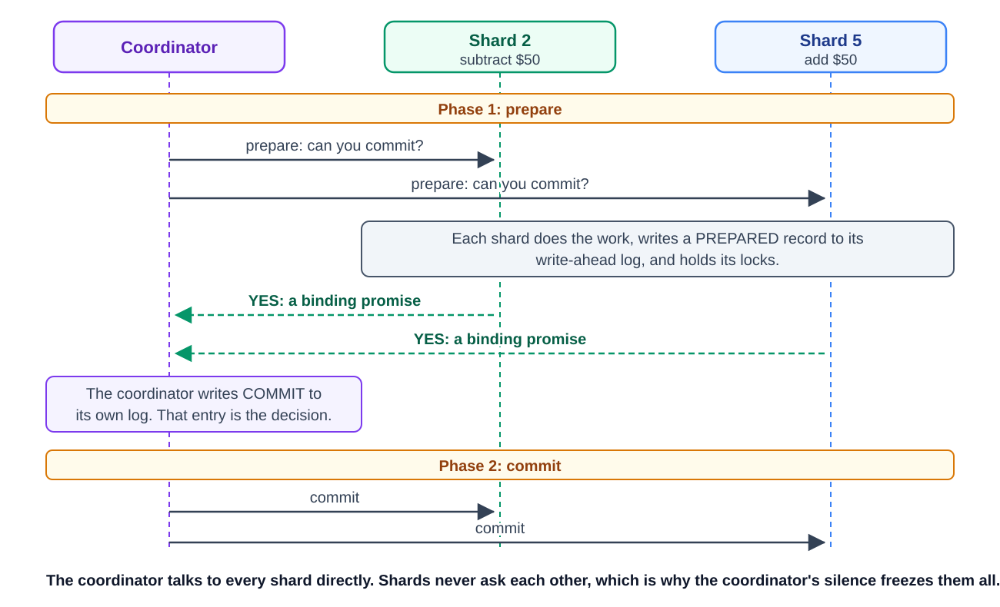
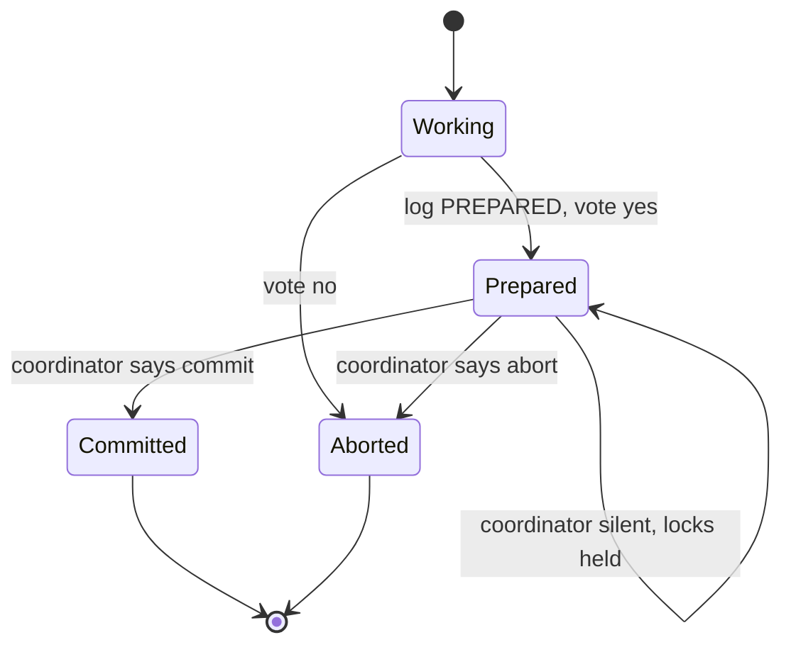
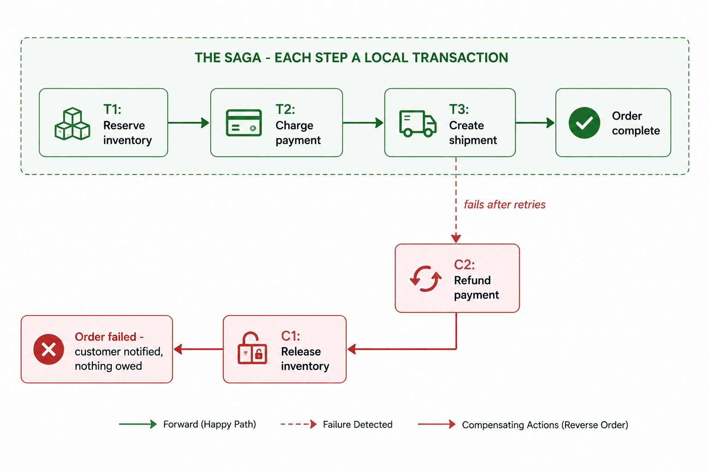
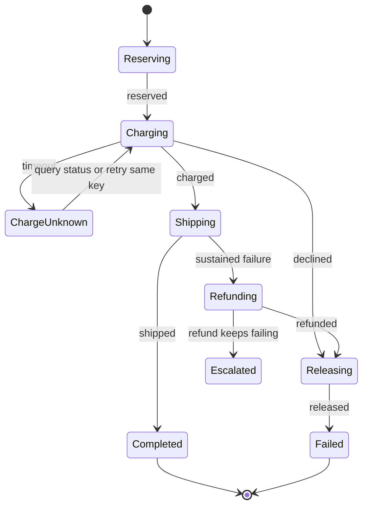
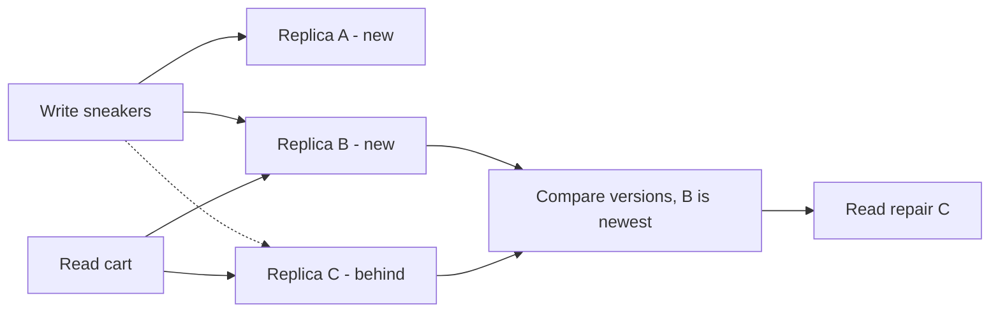
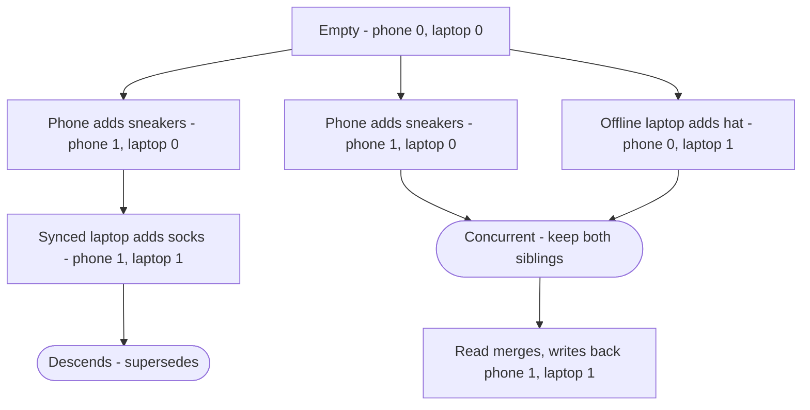
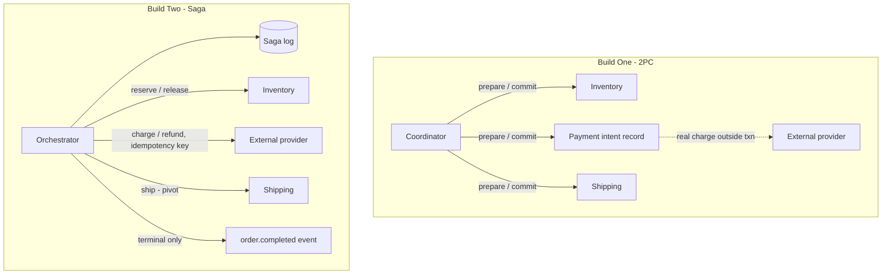
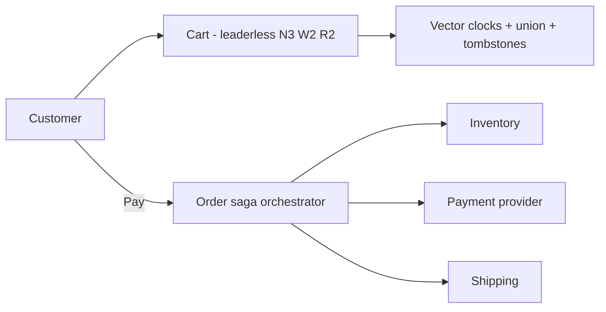

# Module 7 — Keeping Data Consistent (Distributed Consistency)

## Module Introduction
*Original lesson: [Module introduction on DesignGurus ↗](https://www.designgurus.io/course-play/system-design-patterns/doc/6a53590aba41b5b746965576)*


**What this module is about.** Picture one database handling "move $50 from checking to savings." Either both halves happen, or neither does. That all-or-nothing promise has a name: **atomicity**. A single database gets it almost for free from its **write-ahead log (WAL)**. The WAL is a file where the database first writes down, durably, what it plans to do. Only then does it do it. If it crashes halfway, it reads the log and either finishes or reverses the work. Now split the data across several machines (shards) or several services. No one WAL sees both halves anymore. Say one change lands on shard 2 and its partner change lands on shard 5. Nothing ties them together on its own. This module shows how to get all-or-nothing back across machines. It also shows what each approach costs you in speed, availability, or complexity.

**Analogy.** Think of a single database as one bank teller with one ledger. Moving money between your two accounts takes a single pen stroke. A distributed system is more like two separate banks. Each must update its own ledger for the same transfer. Somebody has to coordinate them, and every coordination method comes with a price.

Only four patterns live here, so it is the smallest module. It is also the toughest material.

### The four patterns

| The situation | The pattern |
|---|---|
| Several parties must either all commit or all back out | Two-Phase Commit (2PC) |
| A workflow has many steps, and any one of them might fail midway | Saga |
| Several copies of the same data need to agree, with no single leader | Quorum |
| We need to know who saw which update, and in what order | Vector Clocks |

### Two facts that organize the module

**Fact 1 — when the network splits, you have to pick a side.** A **network partition** happens when groups of machines keep running but lose contact with each other. At that moment a system has two options. Option (a): stop serving requests until the link comes back. Data stays **consistent**, but you lose **availability**. Option (b): keep serving on both sides and sort out the differences afterwards. You stay available, but the data is briefly inconsistent. This unavoidable choice is known as the **CAP trade-off** (Consistency, Availability, Partition tolerance). Smarter engineering cannot make it go away. It comes from how networks physically behave — much like how availability shrinks as you chain components together. Each pattern here makes its own choice. Interviewers also like to ask about CAP directly.

**Fact 2 — the cheapest distributed transaction is one you never need.** Coordinating many machines is costly. So reach for cheaper tools first:
- **Shard-key discipline** (covered in the sharding lesson): choose the shard key so that a single customer's checkout sits on a single shard. Then a normal local transaction still does the job.
- **Idempotent operations** and **commutative operations** shrink what truly needs agreement. Idempotent means repeating it is safe: running it twice has the same effect as running it once. Commutative means the order doesn't matter: any order gives the same result.

In most systems, only a few flows truly need distributed-transaction machinery. Typical examples are moving money between different owners, or promising stock across services. Save the heavy machinery for those.

### How to read the module

The store's order workflow now touches three services: inventory, payment, and shipping. We need all-or-nothing behavior across all of them again.
- **Two-Phase Commit** relies on a coordinator that gathers a unanimous "yes". The catch: every participant is stuck waiting until the coordinator announces its decision.
- **Saga** is the usual answer between services. You run the steps in order. If a later step fails, you run "undo" steps (called compensations) for the earlier ones that already finished. It reuses the pub/sub ideas from earlier.
- **Quorum** deals with several leaderless replicas of the same data. You pick how many replicas must confirm a write (W) and how many a read must ask (R). Choose them so that **W + R > N**. Then any read and any write always have at least one replica in common.
- **Vector Clocks** keep track of which updates were aware of which other updates. That lets a leaderless system tell edits made at the same time apart from edits made one after another.
- The **capstone** builds order fulfillment two ways — with 2PC and with a saga — and compares how each one breaks.

> Short on time? Start with **Saga** and **Quorum**. Sagas answer "how do services do transactions?" Quorums answer "how do replicas agree?" Together they cover most interview questions on this topic.

### Four terms used throughout

- **Atomicity** — all-or-nothing. A set of changes happens entirely or not at all. One machine gets this for free from its WAL. Across machines it is costly to build.
- **Partition** — a network split. Both sides are still alive, but they can't reach each other. Partitions *will* happen, and they are what forces Fact 1's choice.
- **Strong vs. eventual consistency** — with *strong* consistency, every read returns the latest write, just as if only one machine existed. With *eventual* consistency, the copies do become identical eventually, but a read may see slightly old data for a moment. You saw this earlier as **replication lag** — the gap between a write reaching the primary and showing up on a replica — and as stale views.
- **Compensation** — an "undo" carried out as a *brand-new* action: cancel the booking, refund the charge, release the hold. It differs from a rollback because nothing gets erased. Businesses have corrected mistakes this way on paper for hundreds of years. Sagas are built from this idea.

### Before you start — questions to ask about your own system

1. Do you have an operation that writes to two databases (or two services) and just trusts that both writes succeed? What does your data look like on the day one of them fails?
2. When you read from a replicated store, how many copies back up the answer you got? Do you *know* this, or are you hoping?
3. Two users change the same record in the same second. Which change survives? Does the other user ever learn their change was lost?

---

## Two-Phase Commit
*Original lesson: [Two-Phase Commit on DesignGurus ↗](https://www.designgurus.io/course-play/system-design-patterns/doc/6a53599a465a68690701b210)*


**What it is.** Two-Phase Commit (2PC) is a protocol that gives true all-or-nothing behavior to one operation spread over several machines. There are two roles. The **coordinator** runs the show. Each **participant** is one of the databases involved. First, the coordinator asks every participant, "Can you commit this?" Each answer is a binding yes or no. Only when every answer is yes does the coordinator tell everyone to commit. In short, no one commits until all of them are able to.

**Analogy.** Think of a wedding. The officiant asks each partner, "Do you?" Only after both answer "I do" are they declared married. After saying "I do", a partner can't just leave on their own; they have to wait for the officiant's announcement. And if the officiant faints right then, both partners are left standing at the altar.

### The problem: $50 that vanished

The store now lets customers send gift-card balances to each other. Customer A's data sits on shard 2 and A sends $50 to customer B, whose data sits on shard 5. So a single logical operation touches two databases, and no one transaction spans both.

Version one simply performs two writes, one after the other: take $50 off on shard 2, then add $50 on shard 5. Thousands of transfers go through fine. Then, at **2:37 AM**, the application server crashes. The subtraction had already committed. The addition had not been sent yet. No retry happens, because the process that knew "shard 5 still needs its addition" no longer exists. No error gets logged either. The nightly reconciliation job later notices $50 is missing. (Had the writes run in the reverse order, the very same crash would have *invented* $50 from nothing.) Both shards behaved perfectly on their own. The problem is that the *operation as a whole* was never atomic. All-or-nothing across machines doesn't come for free; you have to build it.

### Why the obvious fixes fail

- **"Write A, then B, and keep retrying B until it works."** Idempotency keys help here. An idempotency key is a unique ID per operation, so a repeated request is applied just once. That makes retries safe. Still, two holes are left. First, if shard 5 is down for an hour, users see money missing for that whole hour. Second, if the application itself dies between the two writes, the retry loop in its memory dies too. The plan to finish the job has to be saved durably, outside the process. (The saga lesson builds directly on this idea.)
- **"Do both writes in parallel."** Either write can still fail by itself. So you don't get rid of the half-done state; you now have two possible half-done states instead of one. Being faster is not the same as being atomic.
- **"Let the nightly reconciliation fix it."** Reconciliation only *spots* a mismatch, and only after users may have seen it. It doesn't *stop* the mismatch. That works if the business can live with hours of inconsistency. It doesn't work for operations where a half-done state must never be seen.

### How it works

Look at the course figure below. The coordinator speaks straight to Shard 2 (subtract $50) and to Shard 5 (add $50). The two shards never speak to each other. That is precisely why a silent coordinator can freeze both of them.


*Figure — Two-Phase Commit (course diagram)*

1. **Phase 1 — Prepare.** The coordinator asks each participant, "Can you commit this — yes or no?" Before answering, each participant does *all* of the work. It writes a durable **PREPARED** entry into its own write-ahead log. It **keeps its row locks**. Only then does it vote. *Why:* because the work is done and logged first, the participant can still carry out a "commit" even after crashing and restarting.
2. **A yes vote is a binding promise.** It means: "The work is done and safely on disk. I can commit even if I crash. I'll keep my locks until you tell me the result."
3. **The coordinator writes down its decision.** If every vote is yes, it logs COMMIT in its own log. If any vote is no, or any participant stays silent, it logs ABORT. *Why:* that one log entry *is* the transaction's final outcome. Recovery can always look it up.
4. **Phase 2 — Commit or abort.** The coordinator sends the decision to everyone. Each participant commits (or aborts) and then lets go of its locks.

**Ordering rules that make recovery safe.** Two rules matter. A participant must log PREPARED *before* it votes yes. The coordinator must log its decision *before* it announces it. Thanks to these rules, recovery never has to guess. A participant that restarts reads its own log, then asks the coordinator for the decision. It does not re-run any business logic.

**The in-doubt state (the pattern's big risk).** Once a participant votes yes, it is **in doubt**. It can't commit by itself, since another participant may have voted no. It can't abort by itself either, since the coordinator may have already chosen commit. So all it can do is wait, still holding its locks.

**This is why a silent coordinator freezes everyone.** Suppose the coordinator crashes right after collecting the yes votes. Every participant is now in doubt with its locks held. Any other transaction that needs those rows is blocked until the coordinator comes back. 2PC achieves atomicity by placing the decision in one spot. In exchange, it takes on that one spot's weakness.

The state diagram below traces one participant's life. Once it reaches `Prepared`, only the coordinator can move it on. If the coordinator says nothing, the participant keeps looping in `Prepared` with its locks still held.

*Participant states: after voting yes, only the coordinator can move it*


### Walkthrough with numbers (the $50 transfer under 2PC)

- **Cost when all goes well.** You pay for two network round trips (one for prepare, one for commit). You also pay for a durable disk write at every participant and at the coordinator. That disk write is an **fsync**, which forces data onto disk before moving on. Altogether the transfer takes about **4x** as long as one write on a local shard. You'll notice it, but it's often acceptable.
- **The hidden cost: time spent holding locks.** Each shard keeps the gift-card row locks from prepare all the way to commit. That stretches lock time from roughly **1 ms to 10–20 ms**. Recall the rule *rate x duration = concurrency*. If locks are held **10x longer**, you get roughly **10x more collisions** on busy rows. So 2PC slows down its neighbours, not only itself.
- **Failure drill.** The coordinator crashes **5 ms** after both shards vote yes. Both shards stay in doubt with locks held. Eventually a replacement coordinator replays the log and sends commit — **40 seconds** later. During those 40 s, any transaction that touches either customer's rows waits or fails.
- **Replicating the coordinator** makes recovery faster, because the decision survives the loss of one machine. It does *not* get rid of prepare-time locks, the extra round trips, or the need for every participant to be online. It eases the single worst failure, but the protocol's basic cost stays the same.
- **Availability math.** The coordinator and both shards all have to be up at once. If each of the three is up **99.9%** of the time, the combination is up only about **99.7%**. Every extra participant pushes that number lower.

### Trade-offs

**You gain:**
- **True atomicity across machines.** The "vanished $50" kind of bug simply can't happen by design, so no reconciliation is needed.
- **Strong consistency.** Nobody ever catches the half-done moment where money has left A but not yet reached B.
- **It looks normal to application code.** With driver support it feels like an everyday transaction. The **XA standard** is a common interface for 2PC, and Java's **JTA** is built on top of it.

**You pay:**
- **Blocking — its trademark cost.** In-doubt participants keep their locks even while the coordinator might be unreachable. For *making progress*, the coordinator is a single point of failure, since no participant can finish by itself. Prepared transactions that get stuck are a genuine emergency for database administrators.
- **Latency and throughput.** Two round trips, several fsyncs, and longer lock holds all add delay and create contention on popular rows.
- **Availability shrinks as you multiply.** No one can commit unless every participant is up.
- **It can't cross trust boundaries.** A **trust boundary** is the line between your systems and another company's. No outside company will allow your coordinator to hold locks in its database. So 2PC stays inside your own walls.

### When not to use it

- **Between microservices.** When locks are held across service boundaries, every participant's speed and uptime become tied to the slowest one. A checkout might take seconds or even minutes — much too long to keep locks. The coordinator also turns into a bottleneck, both technically and between teams. Sagas were made to solve exactly this.
- **Hot rows, operations across companies, or flows where "fixed by morning" reconciliation is good enough.** In these cases, 2PC's atomicity costs more than the inconsistency it would prevent.

**Where it *does* fit:** operations that are short, internal, rare, and high-value — and most of all, **inside distributed databases**. Google Spanner runs 2PC between groups of shards. But in Spanner, each participant and the coordinator is not one machine. Each is a **quorum-replicated group**, meaning a majority of its copies must agree. A majority can keep working when individual machines die, and that removes most of the risk of a blocked coordinator. So 2PC isn't obsolete, and it isn't for everything either. Its best home is inside a database whose participants are replicated.

**Operational safeguards (even there):** set strict deadlines on transactions. Make the age of prepared transactions visible. Alert *before* held locks start slowing unrelated work. Build recovery tools that display the coordinator's decision and each participant's state. This matters because people guessing during recovery can cause the very inconsistency 2PC is meant to prevent.

### 2PC vs. Saga (preview)

| | Two-Phase Commit | Saga |
|---|---|---|
| Atomicity | Genuine: all-or-nothing, guaranteed by locks | Imitated: each step commits separately; if something fails, compensations undo earlier steps |
| Intermediate states | Hidden from everyone | Visible — the outside world can see "payment taken, shipping pending" |
| Blocking | Yes — in-doubt participants keep their locks | No — every step is an ordinary local transaction |
| Coordinator dies | Participants are frozen | The workflow picks up again from its durable log |
| Fits | Short, internal, rare work (or work inside a database) | Business workflows that span services |

The whole contrast in one line: **2PC hides the in-between state by holding locks; a saga lets that state show and manages it.** All the other differences come from that one choice.

### Real-world examples

- **XA standard and Java's JTA** — 2PC plumbing for committing databases and message brokers together. Banks and airlines still run on these systems.
- **PostgreSQL `PREPARE TRANSACTION`** (finished with `COMMIT PREPARED` or `ROLLBACK PREPARED`) — lets you play the participant role directly. The PostgreSQL docs warn you not to use it casually. A prepared transaction that gets abandoned keeps its locks forever, until an operator steps in.
- **Google Spanner** — runs 2PC across shard groups whose participants are replicated with **Paxos**. (Paxos is a consensus protocol that lets several copies settle on one value.) Replication soaks up single-machine failures, but you pay for the consensus overhead.
- **Kafka transactions** — a protocol shaped like 2PC for atomic consume-process-produce work. One broker plays the coordinator.
- **For data engineers:** writing exactly-once into external systems often relies on this pattern. **Flink** transactional sinks treat a checkpoint as the "prepare" step, where every operator durably records that it's ready. Finishing the checkpoint acts as the "commit" into Kafka or a database.

### In the interview

You may be asked, "How can two services update their databases atomically?" Walk through the full reasoning: 2PC gives real atomicity; it blocks when things fail; today it mostly lives inside distributed databases; and service workflows use sagas instead. Answering "use 2PC everywhere" or "2PC is dead" both show you don't know its real limits.

> **30-second answer:** "Two-phase commit delivers genuine atomicity across machines. A coordinator gathers binding yes votes. To vote yes, each participant does the work, logs it durably, and keeps its locks. Then the coordinator tells all of them to commit. The downside is blocking. A participant that voted yes can't commit or abort by itself. So if the coordinator dies at a bad moment, everyone freezes with locks held. On top of that you get two round trips, and availability that drops with every participant. That's why I use sagas between microservices — local transactions plus compensating undo steps. And I respect where 2PC lives today: inside distributed databases like Spanner. There, every party is quorum-replicated, so no single crash can block the protocol."

**Likely follow-ups (with answers):**
- *"The coordinator crashes just after both participants vote yes — walk me through it."* Both participants are in doubt. They are bound to obey the decision but can't make it themselves. They hold their locks until the coordinator recovers and replays its log. If the tooling is weak, a person may need to resolve the prepared transactions manually. The word to use is **blocking**.
- *"Why is 2PC fine inside Spanner but wrong between your services?"* Inside the database, participants are replicated groups, transactions last milliseconds, there is one trust boundary, and one operations team runs it all. Between microservices, participants are usually single machines, business workflows last several seconds, and separate teams own each piece. Every weakness of 2PC shows up at full force, and none of the protections apply.

**Mistake that fails candidates:** suggesting 2PC for a checkout that runs for several minutes; never covering what happens when the coordinator fails; or calling 2PC obsolete without realizing databases still use it internally.

### Self-check

- **Q1: Name the two phases, state precisely what a yes vote promises, and explain how that promise leads to blocking.** → First comes prepare: participants do the work, write PREPARED durably, keep their locks, and vote. Then comes commit/abort: if every vote is yes, everyone commits; otherwise, everyone aborts. A yes means "I can commit even after a crash, and I'll keep my state and locks until you decide." The participant can't commit alone, because someone might have voted no. It can't abort alone, because commit might already be decided. So if the coordinator goes silent, the participant is blocked with no end in sight.
- **Q2: Would you use 2PC for (a) the gift-card transfer — two shards, same cluster, ~50 ms — and (b) checkout across inventory, payment, and shipping services, 2–30 s?** → (a) It's defensible: internal, rare, one trust domain, and short. But first ask whether both balances could sit on one shard (Fact 2). (b) Use a saga. Holding locks across services for seconds or minutes would destroy throughput and chain three teams' availability together.
- **Q3: You get paged at 3 AM. Queries on the orders table have been hanging for four minutes. The DBA finds several transactions, hours old, sitting in `PREPARED` and holding locks. What happened, what do you do now, and what should the postmortem ask?** → Those participants voted yes, but the coordinator never sent its decision. Maybe it crashed, lost its log, or failed between the two phases. PostgreSQL keeps their locks until someone tracks down the coordinator's decision and runs `COMMIT PREPARED` or `ROLLBACK PREPARED`. If no decision survived, the business must choose by hand. For the postmortem, ask: does this flow truly need 2PC? And if it does, why was the coordinator not replicated? The fix is either a saga or a replicated coordinator.

### Related patterns

- **Write-Ahead Log** — holds the PREPARED records and the coordinator's decision. The promise can only be as durable as this log.
- **Saga** — the replacement for workflows between services (next lesson).
- **Sharding** — the reason 2PC became necessary. Choosing a good shard key is still the cheapest way to avoid it.
- **Quorum** — how modern systems make participants and coordinators survive crashes (the Spanner approach).

### TL;DR

| | |
|---|---|
| Problem | When one logical operation spans two machines, there's a gap where a crash can leave it half-committed (money disappears or doubles). All-or-nothing across machines has to be built; you can't just assume it. |
| Mechanism | Prepare: each participant does the work, logs that it's ready, keeps its locks, and votes — a binding promise. Commit: if every vote is yes, all commit; otherwise, all abort. The coordinator's log stores the final decision. |
| Costs | Blocking (in-doubt participants freeze with locks if the coordinator goes quiet), two round trips plus fsyncs, contention from long-held locks, and availability that drops with each participant. |
| Skip it when | You're between microservices, across companies, on hot rows, or running long flows (those belong to sagas). Where it truly fits: short internal transactions, and inside quorum-replicated databases. |

---

## Saga
*Original lesson: [Saga on DesignGurus ↗](https://www.designgurus.io/course-play/system-design-patterns/doc/6a535a5a8326c06ae6c5b434)*


**What it is.** A saga breaks a workflow that spans several services into a chain of plain **local transactions**. Each one commits right away inside its own service. No locks are held across services. Before each step, the saga writes its progress to a durable log. If a later step fails, the saga runs **compensations** in reverse order. A compensation is a new action that cancels out the business effect of a step that already finished.

**Analogy.** Think about booking a trip. First the flight, then the hotel, then a rental car — each from a different company. If the hotel booking falls apart, you can't "turn back time". Instead, you *cancel the flight*. The companies' cancellation policies play the role of compensations. (The word "saga" comes from a database paper about long-running transactions, and travel booking is where the idea started.)

### The problem: 340 orders stuck in limbo

Checkout now involves three services. It reserves inventory, then charges the card via an **external payment provider**, then creates a shipment. The code makes these three calls in order, and most orders go through.

Then a bad deploy knocks the shipping service offline for **20 busy minutes**. Reservations still succeed. Charges still succeed. Only the third call fails. The catch block writes an error to the log and does nothing more. The outcome: **340 orders** where the customer paid, stock was reserved, and nothing shipped. Each service did its own part correctly, so none of them saw a problem. Support found out from angry customer emails. Then **three engineers spent a weekend** working from a spreadsheet, refunding charges and releasing reservations by hand.

2PC was already off the table. An external provider won't hold locks for twenty seconds, never mind twenty minutes. This workflow crosses a trust boundary, takes real time to run, and can fail after earlier steps have already committed. It needs two things: (1) a durable record of how far each order has gotten, and (2) a clear plan for reversing steps that already finished. Locks can't safely give you either one.

### Why the obvious fixes fail

- **"Put the undo logic in the catch block."** That's an improvement, but still unsafe. If the app crashes in the middle of checkout or in the middle of undoing, the plan held in memory is lost and nothing picks it up again. The undo calls can also fail or time out. A catch block has no durable retries and no way to escalate. Recovery has to outlive the process that began the work.
- **"Just use two-phase commit."** Locks would be held across three services for anywhere from seconds to hours. And the external payment provider can't take part at all.
- **"Combine everything into one service and one database."** If every step *can* share a single transaction, this is the cheapest fix in the whole module (Fact 2). But payment is external. Inventory and shipping may also be split for good organizational reasons. Some workflows simply can't be made local.

### How it works

The course figure below shows the full picture. Across the top runs the forward (happy) path: T1 Reserve inventory → T2 Charge payment → T3 Create shipment → Order complete. Each of these is a local transaction. When T3 still fails after retries (the dashed red arrow), compensations run in *reverse* order: first C2 Refund payment, then C1 Release inventory. The flow ends at "Order failed — customer notified, nothing owed".


*Figure — Saga (course diagram)*

1. **Break the workflow into local transactions.** Reserve, charge, and ship each commit at once inside their own service. *Why:* no service sits holding locks while it waits for another. Hot rows stay free, and a slow service can't freeze the rest.
2. **Record your intent durably before every step — this is the saga log.** Before doing anything, save a note like "order 7f3a: T1 done, starting T2". It's the WAL's "write it down before you do it" rule, applied to a whole workflow. The **orchestrator** is the process that drives the workflow. It may crash; if so, another instance reads the log and carries on from the saved state. Progress is never kept only in memory. A good log records: the saga ID, the current state, which steps are done, how many attempts were made, idempotency keys, deadlines, and which action is allowed next.
3. **Make each state change conditional.** Before triggering the next external effect, take a lease or do a **compare-and-set** update. Compare-and-set means "write only if the state is still what I expect". *Why:* if two orchestrators are both recovering, they must never both move the same order forward.
4. **If failure persists, compensate in reverse order.** Undo the most recent finished step first (the refund), then the earlier ones (the release). *Why:* undoing in reverse puts the world back in the opposite order from how it was changed.
5. **Make every step and every compensation idempotent.** The orchestrator retries whenever something times out, so any request may show up more than once. Each step gets its own stable **idempotency key**. Also, "refund order 7f3a" must be safe to run twice. If it isn't, the saga will create duplicates.
6. **Hand off what can't be fixed automatically.** Suppose a refund has been failing for ten minutes. It stays recorded as a durable *pending obligation*, and the saga is not marked done. After a limited number of retries, the orchestrator creates a task for a human. The task includes the order, the provider's references, the attempts so far, and the safe next steps. The unresolved state stays visible the whole time.

**Compensations are a business undo, not a rollback.** A local transaction that has committed can't be wiped out. So each step gets a new, visible opposite action: refund, release, or cancel. This resembles the corrective entries used in event sourcing. It has three consequences:
- Compensations are *new actions that others can see*, not erasures.
- **Business owners have to define them**, since not every effect can be perfectly reversed. You can't un-send a confirmation email. Its "compensation" is a follow-up message that apologizes and explains.
- Some effects can't be compensated at all. Once a package has physically shipped, you need **forward recovery** instead — such as a return label or a support case. That point where there's no going back is called the **pivot**. Place pivot steps *last*, and recover forward from anything after them.

**Who drives it: orchestration.** Workflows whose steps are ordered and high-stakes need an **orchestrator**. It's an explicit **state machine**: a definition of the possible states and the allowed moves between them. It owns the saga log. Ask it "where is order 7f3a?" and one query answers. (The other option, **choreography**, is compared further down.)

**The honest price: no isolation.** **Isolation** means other code can't see a transaction's half-finished state. 2PC hides "charged, not shipped". A saga reveals it in the gap between T2 and T3. Other services can read that state and act on it. So the product team must *define* these in-between states deliberately. An order status of "processing" is real workflow state, not filler text. Some systems also use **semantic locks**. For example, a field like `order_status=PROCESSING` signals to other workflows that this order has temporary limits — e.g., it can't be cancelled and shipped at the same time. Normal reads still work, and no database lock is held across services.

The state diagram below shows the orchestrator's point of view. Look at the `ChargeUnknown` state. It covers a timeout where you can't tell whether the card was charged; you settle it by checking the status or retrying with the same key. Also notice that a refund that keeps failing moves to `Escalated` instead of quietly ending.

*Orchestrator persists state before every step so a crash resumes instead of stranding*


### Walkthrough with numbers (reserve 50 ms, charge 200 ms, ship 100 ms)

- **Happy path.** The whole thing takes roughly **400 ms**, and no locks are held between steps. Every service commits a local transaction that lasts about a millisecond, so busy inventory rows stay open.
- **Replaying the shipping outage.** T3 fails. The orchestrator retries, waiting longer each time (exponential backoff), for around **30 seconds**. Shipping is still down, so this is a *sustained* failure, not a passing blip. Compensation starts in reverse: refund first, then release, and both are idempotent. In about **90 seconds**, the customer learns the order failed and the charge was reversed. No orders stuck in limbo and no spreadsheet.
- **Crash drill.** The orchestrator dies just after T2 commits. A different instance reads "T2 done, T3 not started" from the log and goes ahead and creates the shipment. Even a crash *in the middle of* T2 can't charge the customer twice. The retry reuses the same idempotency key, and the provider hands back the original result.
- **Ambiguity drill.** T2 times out. Did the provider charge the card? There's no way to know yet. Don't guess, and don't refund a charge that might not exist. Instead, **check the charge status, or retry with the same key**. Write "outcome unknown" into the saga log *before* you start checking. Then, if the orchestrator dies during the check, its replacement repeats the *status check* (with the same identifiers) rather than starting a fresh charge. A recorded "we don't know" is better than an assumption nobody wrote down.

### Trade-offs

**You gain:**
- **Workflows across services and across companies with no distributed locks** — every step is a quick local transaction.
- **Progress that survives crashes** — thanks to the saga log, a workflow *picks up where it left off* instead of starting over.
- **Long-running flows cost nothing extra** — a saga can wait for hours (say, for a fraud review) without locking anything.
- **Failure handling that's designed in** — compensations run on their own, at machine speed, with retries and escalation.

**You pay:**
- **No isolation.** In-between states are visible, and others can act on them. These *anomalies* are how sagas typically go wrong, so product must spell out every state.
- **Compensation code.** Every step needs an undo that's tested and idempotent. Some need a business decision, not just a technical reverse.
- **Workflow machinery.** You have to run an orchestrator that keeps durable state (or live with choreography's poor visibility).
- **Eventual consistency.** Orders really are "in progress" for a while. That affects reads, reports, and what users expect.

**Running it:** build dashboards that show workflows by state, age, last error, and next retry. Alert on any workflow stuck in one state for longer than its **SLO** (service-level objective). Total throughput can look fine while a handful of valuable orders sit stuck.

### When not to use it

- **When a single database transaction would work.** Always check Fact 2. A saga inside one database is just extra complexity for nothing.
- **When in-between states must never be seen.** Some financial flows can't let "charged but not shipped" be visible at all. A saga can't hide it. That's 2PC's single real advantage (or a hint that the design needs rethinking).
- **Simple two-step internal flows.** A retry queue plus idempotency already handles the ways it can fail. Not every pair of writes needs a state machine.
- **When nobody will run the machinery.** A workflow engine that no one watches is just the 340-order incident with more config files.

**Common misuses:** wrapping simple create/read/update/delete operations in a saga. Also, **incomplete compensations**: for example, a refund that forgets to take back loyalty points, or a release that forgets to reset a flash-sale counter. Those don't truly restore the business state. Engineering and the business owners should sign off on the complete reversal together.

### Orchestration vs. choreography

With **orchestration**, a single coordinator chooses the next step. With **choreography**, every service responds to events that other services publish, and nobody is in charge.

| | Orchestration | Choreography |
|---|---|---|
| Who decides the next step | One coordinator that runs a state machine | Every service, responding to events |
| "Where is order 7f3a?" | A single query to the orchestrator | A hunt through the logs of N services |
| The saga log | Explicit, in one place, and resumable | Spread across services, if it exists at all |
| Adding a step | Change the workflow definition | Add new subscriptions — which create hidden new coupling |
| Failure handling | The coordinator retries, compensates, and escalates | Every service has to build its own part |
| Fits | Workflows where order and stakes matter | Independent reactions such as analytics or notifications |

**Rule:** orchestrate the workflow itself; use events only for independent reactions. The order saga is run by an orchestrator. Its final `order.completed` fact is then published over pub/sub to analytics, email, and anyone else interested. If you choreograph reserve → charge → ship → compensate purely through events, control gets spread so thin that nobody can say what state an order is in.

### Real-world examples

- **Travel industry** — where it began: flight, hotel, and car are booked one after another, and cancellation policies act as compensations.
- **Temporal** (and **Cadence**, which came before it) — turn the saga log into **durable execution** infrastructure, so workflow code automatically resumes after a crash. **AWS Step Functions** provides a managed state machine.
- **Every serious order or payment system** — the "processing" status you see there is an intentional saga in-between state.
- **For AI engineers:** an agent whose tools have side effects *is* a saga. Say it books a meeting, emails the attendees, and updates a CRM. If a later tool call fails, you need a designed way to reverse the earlier ones. A durable workflow engine lets an interrupted agent pick up again instead of charging or messaging twice. Idempotency keys on tool calls, plus compensations, are what separate a production agent from a demo.

### In the interview

A checkout spanning inventory, payment, and shipping is a test of saga thinking. Point out that one local transaction can't cover the whole workflow anymore. Rule out 2PC (it blocks, and the external provider can't join). Then lay out the steps, the durable state, the compensations, idempotency, and orchestration.

> **30-second answer:** "I'd make checkout a saga: reserve, charge, ship. Each is a local transaction, with no locks across services. Before every step, progress goes into a durable saga log, so if the orchestrator crashes it resumes rather than leaving orders stranded. If a step still fails after retries, compensations run in reverse — refund, then release. Each one is idempotent, because everything here gets retried. In-between states like 'charged, not shipped' are visible on purpose, so product defines them and every reader handles them. Steps that can't be reversed, like physically shipping, go last. Failures after that pivot recover forward, for example with a return label. I orchestrate the workflow and use events only for reactions like analytics and email. 'Where is this order?' has to be a single query."

**Likely follow-ups (with answers):**
- *"The payment call timed out and you don't know if it charged. Do you compensate?"* No. Find out what actually happened first. Either retry with the **same idempotency key** (the provider sends back the original result) or check the charge status. Only continue or compensate once you know the true state.
- *"What if the refund itself fails?"* Compensations need to be just as reliable as forward steps. Retry the idempotent refund with backoff. If it keeps failing, send it to a **dead-letter** escalation queue that alerts a person and gives them the full context.

**Mistake that fails candidates:** suggesting 2PC; saying "compensations" without explaining what they are; or storing orchestration state only in process memory. Each of these brings back a failure this lesson solves.

### Self-check

- **Q1: In one sentence, say what a saga trades away compared with 2PC. Then name the two mechanisms that take the place of locks and reliance on a coordinator.** → A saga gives up isolation (in-between states can be seen) so that it avoids 2PC's locks and blocking. The two replacements are a **durable saga log**, so workflows resume after a crash, and **designed, idempotent compensations**, which reverse finished effects when a later step fails.
- **Q2: Design compensations for these steps: reserve inventory, charge card, send confirmation email, hand the package to the courier. Which one has no true compensation?** → Release; refund; an approved follow-up email that explains (not perfect — so send the confirmation *late*). Handing off to the courier is the **pivot** and can't be reversed, so recover forward (return label, support case, redelivery). Put the steps you can compensate first and the irreversible ones last.
- **Q3: A customer receives "Thanks for your purchase!", yet the order was refunded 90 s later because shipping failed. The email service insists it did nothing wrong. Diagnose it, and give two fixes of different depth.** → This is a no-isolation anomaly. The email service correctly responded to the in-between "payment succeeded" state, before the saga compensated. Shallow fix: only send confirmations from the final `order.completed` state. Deeper fix: every consumer treats in-between states as provisional, and any outward action based on them must have its own compensation. Only tell customers things the saga can no longer undo.

### Related patterns

- **Idempotency** — needed on every step and every compensation, because the orchestrator's retries make duplicates a normal event.
- **Two-Phase Commit** — the contrast that defines sagas: locking and hiding versus showing and compensating.
- **Message Queue** — steps are often sent through queues, so the saga picks up Module 2's delivery rules.
- **Publish-Subscribe** — for reactions: final events are broadcast to everyone who just wants to be informed.
- **Dead Letter Queue** — where compensations that keep failing get escalated to people, along with context.

### TL;DR

| | |
|---|---|
| Problem | Workflows across services can't use locks (so 2PC is out). A failure in the middle leaves half-finished business state — customers charged but nothing shipped — that someone cleans up by spreadsheet. |
| Mechanism | Local transactions, with progress written durably before each step. A failure triggers designed, idempotent compensations in reverse. Irreversible steps (the pivot) go last and recover forward. An orchestrator owns the state machine. Events are broadcast only from final states. |
| Costs | No isolation (in-between states and anomalies are visible), a designed and tested undo for every step, workflow machinery to run, and eventual consistency while a saga is in progress. |
| Skip it when | One DB transaction is enough, visible in-between states are unacceptable (the one case where 2PC wins), or the flow is too simple to need a state machine. |

---

## Quorum
*Original lesson: [Quorum on DesignGurus ↗](https://www.designgurus.io/course-play/system-design-patterns/doc/6a535b0403e068b88b9e5e7c)*


**What it is.** Quorum is the way a **leaderless** replicated store keeps its reads reliable. "Leaderless" means there are several copies of the data, any copy can take reads and writes, and there's no single primary. Suppose there are **N** replicas. A write counts as done once **W** replicas confirm it. A read asks **R** replicas. Pick numbers so that **W + R > N**. Then every group you read from must overlap every group you wrote to. So at least one replica you ask holds the newest completed write.

**Analogy.** Three friends each keep a copy of a shared shopping list. Every time you add an item, you tell at least two of them. Every time you check the list, you ask at least two. Since 2 + 2 is bigger than 3, at least one friend you ask is someone you told. That means you'll always hear about your latest addition.

### The problem: the flickering cart

The last two lessons dealt with *different services doing different jobs*. This lesson, and the next one, deal with *copies of the same data* agreeing on the current value.

The cart ran on a primary-replica setup. Its weak spot was **failover**: when the primary dies, a replica gets promoted to be the new primary. For the cart, failover took about **30 seconds**, and no customer could add items during that time. Plenty of datasets can live with a 30-second pause on writes. Carts can't, because they feed straight into revenue. The business wants the cart to keep accepting writes through the failure of any single machine.

So the team moves to a **leaderless** store: **3 replicas**, no primary, and any replica can take reads and writes. With no leader, there's never a promotion.

Version one writes to a single replica and reads from a single replica. A customer adds sneakers through replica A. Then they reload the page. The read lands on replica C, which hasn't received the update yet. The sneakers **disappear**. On a later read that reaches A, they **reappear**. All the replicas are healthy; the copies just disagree for a moment. Writing anywhere got rid of failover, but it also got rid of predictable reads.

### Why the obvious fixes fail

- **"Write to all three, read from any one."** Now every read sees every finished write. But a single slow or dead replica now holds up *every write*. That brings back the exact availability problem you left the leader to avoid.
- **"Write to one, read from all three, and pick the newest."** This flips the problem. Every read now relies on every replica. One slow answer delays the read, and one dead replica makes it fail.
- **"Always send each user to the same replica" (sticky routing).** Alice always goes to A. That works until A fails, or her device connects through a different entry point. Then her cart vanishes — during precisely the failure you were planning for. A pinned replica is really just a leader with weaker promises.

All three ideas need *every* replica, either on the read side or on the write side. What you really need is much less: a guaranteed **overlap** between the replicas that took a write and the replicas a later read asks.

### How it works

With N = 3, W = 2, R = 2 (W + R = 4 > 3):

```
WRITE "sneakers" ──► A ✓   B ✓   C (behind)
READ the cart    ──►       B ✓   C ✓
                           ▲
            B is in both groups — it must be, because 2 + 2 > 3.
            The read compares versions; B's is newer, sneakers stay.
```

Two groups of 2 picked from only 3 replicas add up to 4 "seats". With just 3 replicas to fill them, at least one replica has to sit in both groups. The guarantee is nothing more than counting. The flowchart below shows the same idea, including how the stale replica C gets fixed by read repair.

*N=3, W=2, R=2: the read and write groups must share a replica*


Supporting mechanisms:

1. **Versions break ties.** The R answers might not match, because one replica missed the latest write. Each value carries a version, and the reader chooses the newest *by version*. It never just takes the quickest reply, since speed tells you nothing about freshness. Simple systems can use timestamps; the next lesson explains why distributed systems often need richer versions. The coordinator also sends the chosen version details back to the client. That way, the client's next write can state which history it saw. Without this, the system couldn't tell "replace what I just read" apart from an unrelated edit happening at the same time.
2. **Reads fix the cluster (read repair).** When a read sees that C returned an old value, it immediately writes the newer value back to C.
3. **Anti-entropy handles everything else.** A background process keeps comparing replicas and syncing them. It fixes keys that are rarely read, which read repair would never reach. Watch three things: how far versions have drifted apart, the repair backlog, and the oldest difference not yet repaired. Requests can keep succeeding while one replica quietly stops catching up.
4. **W and R are settings, chosen per operation.** W=3/R=1: slow writes but instant, fresh reads (good for configuration that is read far more than written). W=1/R=3 is the opposite. W=1/R=1 is fast but gives **no overlap guarantee**, so reads can fall behind (eventual consistency). That's fine for like counts. It's also exactly what caused the cart bug when it was picked by mistake.
5. **Tolerating stragglers (a bonus you don't see at first).** With W=2 of 3, the coordinator moves on after the two quickest replies. So the slowest replica (the **straggler**) doesn't decide your **p99** latency — the time within which 99% of requests complete.

**Three qualifications on the guarantee:**
- **Sloppy quorums and hinted handoff.** Some Dynamo-style systems act differently during a partition. If the intended replicas can't be reached, temporary stand-in nodes are allowed to accept writes. Later, **hinted handoff** hands that data back to the proper replicas. This boosts availability. But while stand-ins are in use, read and write groups may not overlap. So reads can miss writes even when W + R > N.
- **Partial writes.** A coordinator might collect fewer than W acknowledgements and report a failure — even though one replica actually saved the value. A later read or retry might then see it anyway. So writes still need stable IDs or merge behavior, even when the response said "failed".
- **Quorum promises visibility, not ordering.** Two devices might update the same cart at the same moment. Each could reach W=2 through a *different* pair of replicas. That leaves two "newest" versions, called **siblings**. Vector clocks (next lesson) can tell whether writes were concurrent or sequential. If you need a single, ordered winner, you need **consensus** protocols such as **Raft** or **Paxos**. They add stricter rules on top of simple majority counting.

### Walkthrough with numbers (N=3, W=2, R=2)

- **Write.** Send "add sneakers" to all three replicas. Report success after **2** acknowledgements — roughly **5 ms**, even if C is slow.
- **Read.** Ask all three, use the first **2** answers, compare versions, and return the newest. Every pair you read overlaps every pair you wrote, so one answer includes the sneakers. Read repair then fixes C.
- **Failure drill (the reason for all this).** Replica B dies. A and C can still meet W=2 and R=2. **Zero failover, zero pause, zero promotion.** Traffic keeps flowing while B's replacement catches up through anti-entropy.
- **The honest cost — amplification.** Every logical read or write now takes 2–3 network calls instead of 1. A service handling **100,000 logical reads/s** might produce **200,000–300,000 replica requests**, before counting repair, anti-entropy, and retries. Size your capacity for replica traffic, not client traffic. Also, simultaneous edits can split versions, so you must have conflict resolution.

### Trade-offs

**You gain:**
- **No leader and no failover** — reads and writes carry on through the loss of one replica without pausing, so the revenue-critical cart stays writable.
- **Consistency you can tune per operation** — W and R let you trade speed against visibility. One cluster can serve carts, telemetry, and configuration, each with its own guarantees.
- **Tolerance of stragglers** — the slowest replica no longer sets p99.

**You pay:**
- **Writes at the same moment conflict** — quorum doesn't put simultaneous updates in order, so you need version tracking and a way to resolve conflicts. (A leader avoids this by handling writes one at a time.)
- **Amplification** — R or W network calls for each operation, plus background repair traffic that doesn't appear in client request counts.
- **Edge cases where the guarantee weakens** — sloppy quorums and partial writes can return old data even when W + R > N. Learn exactly what your store promises.
- **Only one key at a time** — quorum settles the value of a single key. It won't make a stock decrement and a card charge atomic together (that's a job for 2PC or sagas). This shapes how you model data. Values that need a single consistency decision may need to live under one key — as long as that key stays small and doesn't turn into a hot partition.

**Client guarantees also need thought.** A user can still read stale data right after their own write, if the next request uses a weaker level. Sessions that need **read-your-writes** should carry along the version they saw and reject any older response. Make consistency levels part of the API design and service ownership, not something buried in database defaults. For example, a checkout read might need quorum, while a recommendation counter on the same cluster reads just one replica. Track strict and sloppy responses separately. An overall success rate hides the requests that quietly got weaker guarantees during a partition.

### When not to use it

- **You need exactly one winner** — unique usernames, choosing a leader, "sell the last item exactly once". These need ordered consensus (Raft/Paxos) or a single leader. Quorum makes sure the winner is *seen*; it doesn't make sure there's only one.
- **Transactions across several keys** — wrong tool. Look at 2PC and sagas.
- **Mostly-read data that can survive a failover** — primary-replica is simpler, and a 30-second failover is fine for a product catalog. The cart's need to always accept writes was a specific reason; don't apply it everywhere.
- **Small systems** — three replicas and quorum math for a service running at **50 requests/s** is complexity no one needs.

**Common failure:** choosing a Dynamo-style store "for scale" without looking at its W/R defaults, then discovering its real guarantees through flickering data in production. W and R should be deliberate product decisions.

### Leaderless quorum vs. primary-replica

| | Primary-Replica (leader) | Leaderless Quorum |
|---|---|---|
| Write conflicts | Can't happen — all writes pass through one leader | Can happen — you need versioning plus resolution |
| Failover | Real: a pause of seconds on writes, plus promotion and fencing | None: a single replica dying goes unnoticed |
| Consistency story | Easy to reason about (apart from read-your-writes) | Adjustable, subtle, and full of fine print |
| Latency profile | Your p99 is the leader's p99 | Tolerates stragglers (waits only for the fastest W) |
| Complexity lives in | The failover machinery | The version and conflict machinery |
| Fits | Most data: catalogs, orders, accounts | Keys that must always accept writes: carts, sessions, presence |

A leader gives you simpler behavior but pauses during failover. Leaderless stays available but shows you the conflicts. Mature systems make this choice dataset by dataset.

### Real-world examples

- **Amazon's Dynamo paper** — introduced this pattern for a shopping cart that had to accept writes even during failures. It also defined sloppy quorums and hinted handoff.
- **Cassandra** — its per-query consistency levels `ONE`, `QUORUM`, and `ALL` turn W and R into API parameters.
- **DynamoDB and Riak** — both descend from Dynamo.
- **etcd and ZooKeeper** — rely on *consensus* instead (Raft and the Paxos family). That's why Kubernetes can trust their ordered control-plane data.
- **For data engineers:** feature stores and time-series systems built on Cassandra face these operational decisions. They use `QUORUM` reads where stale features could change how a model behaves, and `ONE` for high-volume telemetry where throughput counts more. The choice can differ from query to query.

### In the interview

A classic question is: "With three replicas, how many write acknowledgements and read responses guarantee you see the newest write?" Follow-up questions dig into W=1/R=1 or simultaneous writes. Show that you understand both what quorum promises and what it doesn't.

> **30-second answer:** "With N replicas, I confirm writes at W and read from R, keeping W + R > N. That way every read group overlaps every write group, so someone I ask has the newest version, and versioning picks it out. N=3, W=2, R=2 is the standard setup. It survives any one replica dying with zero failover — which is the whole point of going leaderless. The catch: quorum promises visibility, not ordering. Two simultaneous writes can each reach W=2 and split the value. So you need version machinery — vector clocks or last-write-wins. Sloppy quorums give up the overlap guarantee to stay available during partitions. And for problems where exactly one winner is required, you need consensus like Raft, not quorum reads."

**Likely follow-ups (with answers):**
- *"What happens with W=2, R=1 on N=3?"* W + R = 3, which is *not bigger* than 3. So a read can land on the one replica the write skipped and return old data. You get faster reads but only eventual consistency. That's acceptable only when you choose it on purpose for data that can handle it.
- *"Is W=2/R=2 strong consistency, then?"* It guarantees you'll see *completed* writes, thanks to overlap. But simultaneous writes can split, sloppy quorums weaken overlap during partitions, and partial writes cause edge cases. Call it "overlap visibility plus conflict resolution", not full strong consistency.

**Mistake that fails candidates:** treating quorum as if it were a transaction across payment and inventory; forgetting the overlap inequality; or running on storage defaults without knowing what they are.

### Self-check

- **Q1: Give the formula and, in one sentence, why it works.** → W + R > N. Because the total is larger than the number of replicas, every successful write group and every read group must share at least one replica, and that replica holds the newest completed write.
- **Q2: One cluster holds three datasets — (a) feature flags, read all the time and written weekly; (b) the cart, which must accept writes no matter what; (c) raw clickstream, with heavy writes that are batch-read later. Choose W and R.** → (a) W=3/R=1. Writes are rare, so they can afford to wait for every replica, and the constant reads need only one reply and still stay current. (b) W=2/R=2 — overlap holds even through one failure. (c) W=1, and let the batch reader choose R. A few late events cost less than slower writes. Set these per dataset or per query.
- **Q3: The flickering cart is back — but only during last week's partition between datacenters, and only for some users. Settings are N=3/W=2/R=2, and the docs mention "hinted handoff." Explain it and lay out the real choice.** → During the partition, some coordinators couldn't reach the intended replicas B and C. So a **sloppy quorum** counted stand-in nodes toward W=2 and kept hints to hand off later. Those stand-ins weren't part of the normal read groups, so reads through A+B or A+C missed writes that had succeeded. The real choice is between a **strict quorum** (reject writes when the true replicas can't reach W — consistent, but unavailable) and a **sloppy quorum** (keep accepting writes, but temporarily miss data). For a cart, availability plus later reconciliation may well be right. But it has to be a deliberate CAP decision. Vector clocks then reconcile the versions.

### Related patterns

- **Primary-Replica** — the leader-based alternative: simpler behavior but with failover pauses. Most systems use both, chosen per dataset.
- **Vector Clocks** — the version machinery that tells split concurrent writes apart from sequential ones (next lesson).
- **Consistent Hashing** — chooses *which* N replicas store each key (the ring from the storage module).
- **Two-Phase Commit** — what databases put on top of quorum-replicated groups to get transactions across shards (the Spanner stack).

### TL;DR

| | |
|---|---|
| Problem | Leaderless replicas always accept writes but can fall behind each other. Read a random one and the cart flickers. Requiring every replica on either side brings back the fragility you left the leader to escape. |
| Mechanism | N replicas. Writes are confirmed at W and reads ask R, with W + R > N so the groups must overlap. Versions pick the newest value. Read repair and anti-entropy fix lagging replicas. W/R are tuned per dataset. |
| Costs | Amplified reads and writes; simultaneous writes that split and need version machinery; fine-print edge cases (sloppy quorums, partial writes); and it covers a single key only — it is not a transaction. |
| Skip it when | You need a single ordered winner (consensus or a leader), atomic changes across keys (2PC/saga), or you have a simple mostly-read dataset where a failover pause is fine. |

---

## Vector Clocks
*Original lesson: [Vector Clocks on DesignGurus ↗](https://www.designgurus.io/course-play/system-design-patterns/doc/6a535b62e5978b0a41c91d98)*


**What it is.** A vector clock is a small version label attached to each key. It's a table with **one counter for each writer**. Every time a writer writes, it increases its own counter. Compare two labels and you can tell one of two things. Either one version *knew about* the other (so it replaces it), or the two were written **concurrently** — meaning neither saw the other. That's a real conflict. Both versions should be kept and merged, not quietly discarded.

**Analogy.** Think of Git. Branches are edits made concurrently, and the commit graph records who built on whose work. When Git reports a "merge conflict", it's saying "neither branch comes from the other — you choose." A vector clock is the same idea, squeezed down to one number per writer instead of a full commit history.

### The problem: which "newest" version wins?

The quorum lesson finished with two devices updating one cart at the same moment. Each write reached W=2 through a different pair of replicas. That left two "newest" versions and no clear winner.

"Just take the later timestamp" sounds simple, but it breaks in two ways:
1. **Clocks don't agree.** Machine clocks normally differ by milliseconds. When **NTP** (Network Time Protocol, the service that keeps clocks in sync) breaks, they can differ by seconds. Timestamps are never fully trustworthy.
2. **"Which came later?" is the wrong question.** Say Alice's phone writes {sneakers}. Three seconds later her *synced* laptop writes {sneakers, socks}. The laptop saw the phone's write and built on it, so it correctly replaces it. Now picture a different case: an *offline* laptop writes {hat} without ever seeing the sneakers. These are two separate, real changes. Whichever you pick, you lose the other one — regardless of which timestamp is later.

The question that actually matters is **causality**: did one write know about the other? That's precisely what vector clocks record.

### Why the obvious fix fails

- **"Just keep the clocks very tightly in sync."** Even perfect clocks answer the wrong question. Two writes 5 ms apart can still be concurrent if neither one saw the other. "The later one wins" would still throw away a valid change. (Google Spanner's precise clocks help *order transactions inside a consensus system that has a leader* — which is a different problem.)

### How it works

Here there are two writers, the phone and the laptop:

```
cart starts empty                          {phone:0, laptop:0}
phone adds sneakers                        {phone:1, laptop:0}
laptop (synced, saw sneakers) adds socks   {phone:1, laptop:1}
  compare {1,1} vs {1,0}: >= in every slot → DESCENDS: supersedes. One story.

...or instead, from the empty cart:
phone adds sneakers                        {phone:1, laptop:0}
laptop (offline!) adds hat                 {phone:0, laptop:1}
  compare: each is ahead in one slot → CONCURRENT: a true conflict.
  Keep BOTH as siblings; resolve at the next read.
```

1. **On every write, the writer bumps its own counter.** *Why:* the counter tracks "how many of my writes are included in this version".
2. **Compare two versions one slot at a time.** If version A is ≥ version B in *every* slot, A **descends** from B. That means A knew everything B knew, so A cleanly replaces B.
3. **If each version leads in some slot, they're concurrent.** Neither one saw the other. The store keeps **both** as **siblings** rather than choosing one.
4. **Vector clocks spot conflicts; they don't settle them.** On the next read, the application merges the siblings using one of three approaches:
   - **Merge by meaning** — for carts, take the union: {sneakers} ∪ {hat}. This was Amazon Dynamo's original approach (it has a well-known trap — see self-check Q3).
   - **CRDTs (conflict-free replicated data types)** — counters, sets, and documents built so that concurrent edits combine on their own. This is the technology behind Figma-style collaboration.
   - **Ask the user** — show both versions, like a git merge conflict.
5. **Write back one merged version whose clock descends from every sibling.** Take the larger value in each slot — like a git merge commit. *Why:* if the merged version kept only one sibling's clock, another replica would see it as concurrent again, and the conflict would start all over.

The diagram below draws both histories starting from the empty cart. On the left, the laptop saw the phone's write, so its version descends and replaces it. On the right, the two writes are concurrent. They become siblings, and a read merges them into `{phone 1, laptop 1}`.

*Sequential vs. concurrent histories from an empty cart*


**Tombstones.** Union merging makes deletes risky. Say the phone removes the sneakers, but an offline laptop's concurrent version still has them. The union brings the sneakers right back. The fix is to store deletions as **tombstones**: explicit records such as "sneakers: removed, version X". Tombstones take part in the merge and override the earlier "present" state. Clean them up after a while. A deletion is a *fact*, not just missing data.

### Trade-offs

**You gain:**
- **Nothing lost silently** — concurrent writes stay around as siblings until a clear merge policy deals with them.
- **Immunity to clock skew** — causality is tracked with counters, not wall-clock time, so clock drift can't choose the wrong winner.
- **Precise language** — "descended" versus "concurrent" makes leaderless updates something you can actually reason about.

**You pay:**
- **You have to resolve the conflict** — every data type needs a merge policy that someone owns and tests.
- **Space and growth** — one counter per writer per key can grow large when there are many clients. Real systems usually key the counters by **replica/server**, not by end-user device, to keep the vectors small.
- **Pruning is risky** — deleting a retired writer's entry is only safe if you can prove it won't come back (an old replica, an offline client, a backup, or a delayed message). If it does, you've wiped out causal history, and a known descendant turns into a fake conflict.
- **Mental effort** — applications have to compare versions, deal with siblings, and maintain merge code, instead of just accepting whatever value the database chose.

### When not to use it

- **Anywhere there's a leader.** Primary-replica systems already send every write through one leader in order, so causality comes free. Vector clocks would be answering a question that never comes up. This pattern belongs in the leaderless world.
- **When losing a concurrent write truly doesn't matter.** Think presence indicators, metric samples, or "last seen" fields — short-lived data where "roughly the newest" is enough. Here, **last-write-wins (LWW)** — the later timestamp overwrites the other — is a valid, *intentional* choice. The mistake is using LWW by default and only finding the data loss during an incident.
- **When a CRDT fits.** If the data type can carry its own merge rules (a counter, a set, a shared document), build the resolution into the type rather than handling siblings by hand.

### Vector clocks vs. last-write-wins

| | Last-write-wins (timestamps) | Vector clocks |
|---|---|---|
| Concurrent writes | One is quietly thrown away | Both are kept as siblings |
| Clock skew | Picks the winner (incorrectly) | Doesn't matter |
| Application burden | None — that's why people like it | A merge policy for each data type |
| Honest description | A data-loss policy you sign up for | A conflict-detection service you have to maintain |

**Cassandra** chooses LWW by default, on purpose, for simplicity. **Dynamo** and **Riak** keep siblings using vector clocks. LWW quietly throws a conflict away; vector clocks bring it to the application's attention. Decide based on how much it costs to lose a real write.

### In the interview

This typically comes after a quorum design: "Two clients update the same key at once — who wins?" Answering with timestamps ignores clock skew, concurrency, and the question of who owns the merge.

> **30-second answer:** "Timestamps can't tell 'B overwrote A on purpose' from 'B never saw A'. And clock skew makes 'later' unreliable anyway. Vector clocks track causality instead: one counter per writer, bumped on every write. Any two versions either descend one from the other, so one cleanly replaces the other, or they're concurrent. In that case both are kept as siblings and the application merges them — union for carts, CRDTs where the type can merge itself, or show it like a git conflict. Vector clocks detect conflicts; they don't resolve them. And last-write-wins is a data-loss policy — fine only when you pick it on purpose."

**Likely follow-ups (with answers):**
- *"Why not just keep the clocks tightly synchronized?"* Perfect clocks still answer the wrong question. Writes 5 ms apart can be concurrent if neither saw the other, so the later timestamp still throws away a valid change. Spanner's precise clocks serve a consensus system with a leader — a different need.
- *"Who resolves the siblings, and when?"* The next reader gets all the siblings. It applies that data type's merge policy and writes back a single combined version whose clock descends from all of them. That folds the branches together, like a git merge commit.

**Mistake that fails candidates:** answering with timestamps and never mentioning causality or skew; or saying vector clocks *pick* a winner, when they only detect concurrency.

### Self-check

- **Q1: Compare {phone:2, laptop:1} with (a) {phone:1, laptop:1}, (b) {phone:2, laptop:2}, (c) {phone:1, laptop:2}.** → (a) {2,1} ≥ {1,1} in every slot, so ours descends and replaces it. (b) {2,2} ≥ {2,1}, so the other one replaces ours. (c) Each leads in one slot, so they're concurrent siblings that need merging.
- **Q2: Would you pick LWW, vector clocks, or a CRDT for (a) "user last active at", (b) the shopping cart, (c) the text of a shared document?** → (a) LWW. The goal is rough recency, and losing one concurrent sample costs nothing. (b) Vector clocks + union + tombstones. Losing an added item matters. (c) A CRDT. The data type itself has to combine complicated concurrent edits automatically.
- **Q3: A Dynamo-style cart uses union merge. A customer removes sneakers on her phone, then adds a hat on her offline laptop. After syncing, the sneakers are back. Why, and how do you fix the merge?** → Union treats "missing" as "never there". Meanwhile the laptop's concurrent version still includes the sneakers, so the union puts them back. The deletion left no trace. Fix: store deletions as **tombstones** ("sneakers: removed, version X"). They take part in the merge and override the earlier "present" state, and they get cleaned up later. A deletion is a fact, not missing data.

### Related patterns

- **Quorum** — produces the siblings. Vector clocks are its version machinery, and together they make leaderless stores hang together.
- **Event Sourcing** — treats causality as first-class history. An event stream is a fully ordered relative of the same idea.
- **Bidirectional Streaming** — the CRDTs used in collaborative editing merge by design: vector-clock thinking baked into data types.

### TL;DR

| | |
|---|---|
| Problem | In a leaderless store, concurrent writes split a key's value. Timestamps "fix" the split by quietly dropping a real write — often the wrong one, because of clock skew. |
| Mechanism | One counter per writer, bumped on each write. Versions compare as "descends" (replaces) or "concurrent" (keep both as siblings). Reads merge siblings by policy (union, CRDT, ask the user) and write back a version that descends from all of them. |
| Costs | It only detects (merging is up to you), per-writer storage with risky pruning, and real mental overhead compared with "the database picks." |
| Skip it when | A leader already orders the writes, the data is short-lived enough for intentional LWW, or a CRDT can handle the merge. |

---

## Capstone - Order Fulfillment, Built Twice
*Original lesson: [Capstone - Order Fulfillment, Built Twice on DesignGurus ↗](https://www.designgurus.io/course-play/system-design-patterns/doc/6a535bcce5978b0a41c92aac)*


**What this capstone does.** We build the same order-fulfillment system two times. First with two-phase commit, then with a saga. We hit each version with the same three failures and compare the damage. The point is not to crown the "better" pattern. The point is to ask **which way of failing the business can live with**. Whenever you reach a "pause and decide" point, predict the damage before you read further.

**Analogy.** Picture two ways to handle a relay runner who stumbles. In the first, *every* runner freezes in place until the referee rules (2PC — it fails by freezing). In the second, the race keeps going; the crowd sees the stumble, but a rehearsed recovery plan kicks in (saga — it fails by showing).

### The brief

- **Three steps:** reserve inventory → charge payment (**external provider**) → create shipment. The business rule: a customer must never be *charged while nothing ships*, and never *shipped without being charged*.
- **Load:** **200 orders/s**, with spikes during popular releases. A single **SKU** (stock-keeping unit — one product code) shows up in **30%** of active checkouts. This is the **hot SKU**.
- **Latency:** checkout must confirm in roughly **2 s**. Fulfillment is allowed to trail by minutes.
- **The cart:** brought over from the quorum lesson. It sits on a leaderless store because it has to accept writes no matter what fails.

### Build One: Two-Phase Commit — fails by freezing

**Design.** One coordinator, with inventory, payment, and shipping as participants in prepare/commit.

**A flaw that shows up before anything even breaks: the payment provider has no prepare phase.** An outside company won't hand control of its state to your coordinator (2PC doesn't cross trust boundaries). You could add an internal **payment-intent record** to stand in as a participant. But the *actual* charge still happens outside the transaction:
- If you commit the intent and then the provider's charge fails, your system reports success even though no money moved.
- If you charge first and then the internal commit fails, money moved but nothing recorded it.

This workaround quietly swaps one explicit distributed workflow for an *undocumented* one. That hidden workflow still needs durable retries and compensation — in other words, it's a hidden saga.

**Drill 1 — the coordinator crashes after gathering yes votes.** *Pause: inventory voted yes on the hot SKU. What can it do, and what happens to everyone else who wants that SKU?*
1. Inventory is in doubt. It made a promise, so it can't commit or abort without the coordinator.
2. It keeps locks on the hot-SKU rows until the coordinator comes back roughly **40 s** later.
3. For those 40 s, the **30%** of checkouts that include the hot SKU queue behind those locks or time out.
4. A single failed coordinator turns one small transaction into a wide slowdown in revenue.

**Drill 2 — shipping is slow, not down.** During its deploy, shipping's p99 rises from **100 ms to 4 s**. *Pause: who feels this, and how?*
1. Every transaction includes shipping, so every one of them waits for shipping's prepare reply.
2. All that time, the inventory and payment-intent locks stay held for as long as shipping's p99.
3. Apply rate x duration: **200 orders/s x 4 s = 800 transactions' worth of locks** in flight at once, many of them on the same popular rows.
4. The speed of one participant now decides the contention in all three services.

**Drill 3 — a normal Tuesday (nothing is broken).**
1. Every order still pays for two round trips and several fsyncs.
2. Hot-SKU locks last tens of milliseconds rather than ~1 ms. That forces requests into single file, right when release-day demand peaks.
3. At 200 orders/s, a small rise in lock time multiplies the number of requests fighting over the hot row → queueing → longer locks → even more queueing.
4. Capacity can collapse before any service is officially "down".

**Verdict: 2PC fails by freezing.** It keeps partial state hidden by *halting progress* whenever things are uncertain. Unrelated checkouts that happen to share a row feel the stall.

### Build Two: Saga — fails by showing

**Design, and the reason behind each choice:**
- **Orchestrator + durable saga log** — a crash leads to resuming, not stranded orders.
- **Order: reserve → charge → ship** — steps that can be compensated go first; the **pivot** (shipping, which can't be undone) goes last.
- **Compensations: release inventory, refund payment** — signed off by the business.
- **Every step and every compensation is idempotent** — so retrying is safe.
- **Confirmation email sent only at a final state** — customers hear only about things that can't be reversed.
- **Each service runs short local transactions** — no distributed locks.

The saga log has now become **consistency-critical infrastructure**. Each state change has to be durable *before* its external effect begins. Competing orchestrators need conditional updates so that only one of them moves an order forward. Operators need to search by state, age, and last failure so they can find workflows that keep retrying without making progress.

**Drill 1 — the orchestrator crashes after the charge succeeds.** *Pause: this is the same moment as 2PC's Drill 1 — money committed, coordinator dead. What's frozen?*
1. Nothing is locked.
2. The log reads "order 7f3a: reserved, charged, shipping not started". Another orchestrator picks up at shipping.
3. The stable payment idempotency key stops a second charge after an unclear crash.
4. Inventory holds a *committed reservation*, not an open lock. Other orders can keep buying the remaining stock.
What would have been a sitewide slowdown is now just a workflow record that can be resumed.

**Drill 2 — shipping goes down for 20 minutes with 340 orders mid-saga.** *Pause: trace what happens to them and what the customer sees.*
1. Each order's shipping step fails. The orchestrator retries with backoff for ~**30 s** to tell a brief hiccup from a real outage.
2. It's a sustained outage, so it runs the idempotent **refund**, then the **release**, followed by an approved "we couldn't complete your order" email.
3. Roughly **90 s** per order, and no spreadsheet.
4. The cost: 340 temporary charges that customers could see, and 340 refunds in the ledger. But the damage is bounded and handled automatically. (2PC would have *turned away* new orders, because every participant must be up, and frozen the in-flight ones with their locks held.)
5. Customer communication gets better as well. "Processing" is shown once the order is safely recorded in the workflow. "Completed" appears only after shipping. If compensation begins, the state machine provides an exact explanation, so support doesn't have to piece it together from three services' logs.

**Drill 3 — the anomaly cost (nothing is down).** *Pause: what's quietly off on the analytics dashboard, and who else is acting on it?*
1. In-between states are visible. A revenue dashboard that counts "charged" orders includes some that will be refunded minutes later. So it reads a bit higher than the final finance ledger.
2. A marketing system that sent purchase confirmations from the same provisional state would cause errors that customers see.
3. The rule: messages to the outside world come from final states, unless they have their own compensation. Every consumer must know which states are provisional.

**Verdict: sagas fail by showing.** They reveal in-between truth (refunds, provisional states), but they handle it on purpose instead of hiding it behind locks.

The diagram below puts the two builds side by side. In Build One, the coordinator drives three participants, but the real charge to the external provider (dotted line) happens *outside* the transaction. In Build Two, the orchestrator writes to the saga log, uses idempotency keys with the provider, places shipping last as the pivot, and emits `order.completed` only at the final state.

*Two builds of the same checkout*


### The comparison

| Failure injected | 2PC damage | Saga damage |
|---|---|---|
| Coordinator/orchestrator crash | In-doubt participants frozen with their locks; the hot SKU slows down for as long as recovery takes | The workflow resumes from the log; nothing is held and no one waits |
| One service slow | Everyone's locks are held for the slowest p99; a storm of contention | Only that step retries; other orders aren't affected; steps still take milliseconds |
| One service down 20 min | New orders turned away (every participant is required); in-flight ones frozen | Orders finish and then compensate: 340 visible, automatic refunds |
| Nothing failing at all | Locks force hot rows into single file; 2 round trips + fsyncs for every order | Full speed — plus provisional states that every consumer has to handle |
| The half-state ("charged, not shipped") | Nobody ever sees it — 2PC's one clean win | Visible for seconds to minutes: designed, labeled, and compensated |

That last row is the heart of the trade-off. **2PC fails by freezing; sagas fail by showing — pick the failure the business can live with.** Customer-facing workflows that span services usually pick sagas.

The **gift-card transfer** from the 2PC lesson is still a fair use of 2PC. It involves two internal shards, takes ~50 ms, stays inside one trust domain, and must never show a partial state. In Spanner-class databases, every participant is quorum-replicated, so one crash can't block the protocol. Use 2PC for short internal database work, and sagas for workflows across services.

### Postscript: the cart's own consistency

A single checkout actually contains **two separate consistency problems**:
1. **Agreement between replicas for one key (the cart).** The cart runs leaderless with N=3, W=2, R=2. During a release, a phone and a laptop may update the same cart at the same time through different replica pairs. Vector clocks notice that neither version descends from the other. The read returns siblings and merges them with a union. Tombstones keep an intentional sneaker deletion from being undone. The customer just sees one correct cart.
2. **A workflow across services for one order (fulfillment).** Once the customer taps Pay, the saga's per-order log and its compensations take over.

Good design begins by working out *which* consistency problem each failure belongs to. The diagram below shows that split.

*Where each consistency pattern applies*


### Extend it yourself

- **Checkout across multiple regions.** Now the orchestrator, its log, and the three services span two regions. Which parts are easy to replicate? Where should the saga log live? It's the new consistency-critical state, so what W and R does it need? What happens to a saga that's mid-flight when the regions are partitioned? (This is Fact 1 applied to the machinery itself.)
- **The provider's webhook.** The payment provider confirms charges later, through **webhooks** (HTTP callbacks). They arrive at-least-once and possibly out of order. Connect that incoming path to the saga. Which step turns into "wait for external confirmation"? What's the timeout rule? How do duplicate confirmations interact with the saga log?
- **For AI engineers.** Swap checkout for an agent doing a three-step job — book a venue, email the attendees, update the CRM — on a durable-execution engine. Design the compensations, choose where the pivot goes, and decide which tool calls are allowed to run before the workflow hits a state it can't undo.

### Interview summary

> If you build checkout with 2PC, it can't even include the external payment provider. On top of that, a coordinator crash or one slow participant freezes the hot-SKU locks for everybody. If you build it as a saga, crashes resume from the log, and outages turn into automatic refunds that customers can see. 2PC fails by freezing; sagas fail by showing. For customer workflows across services, showing is the failure the business can live with.
