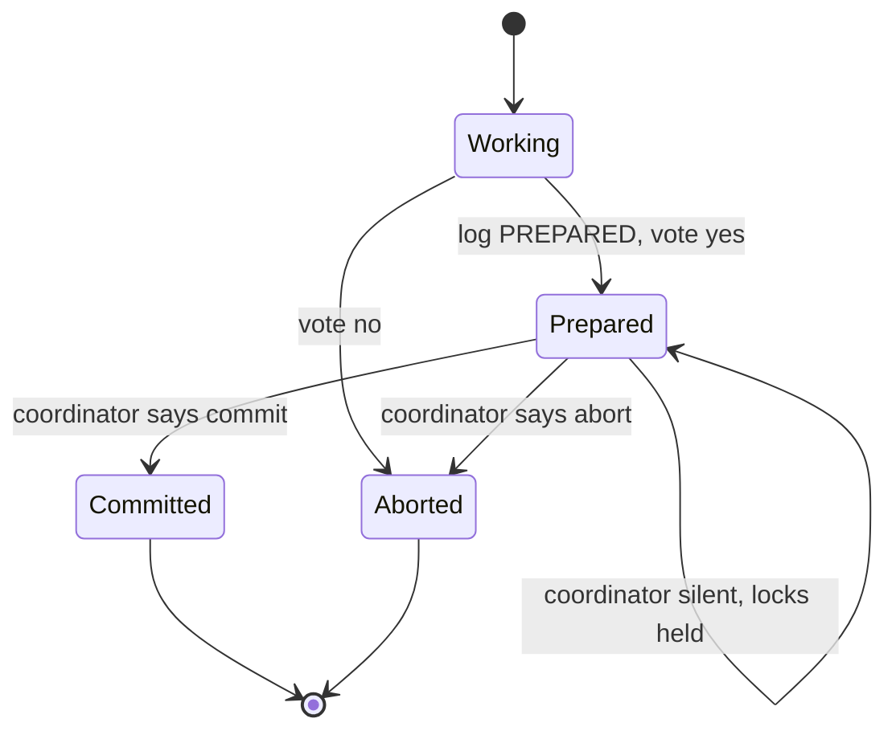
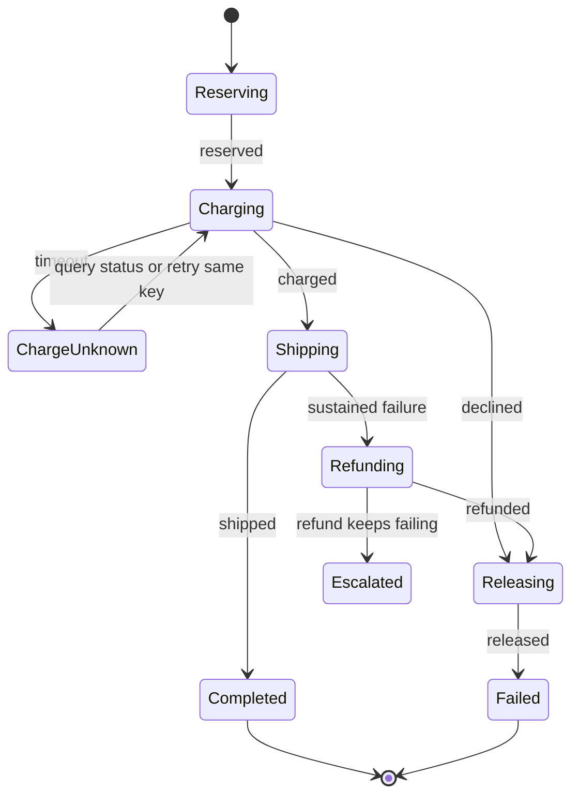
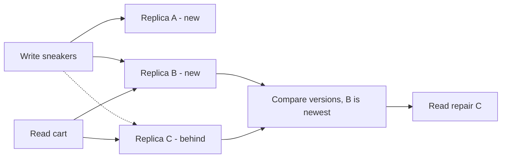
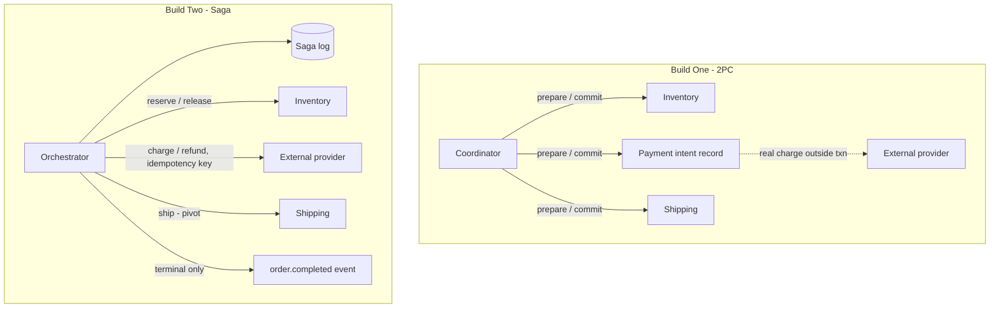
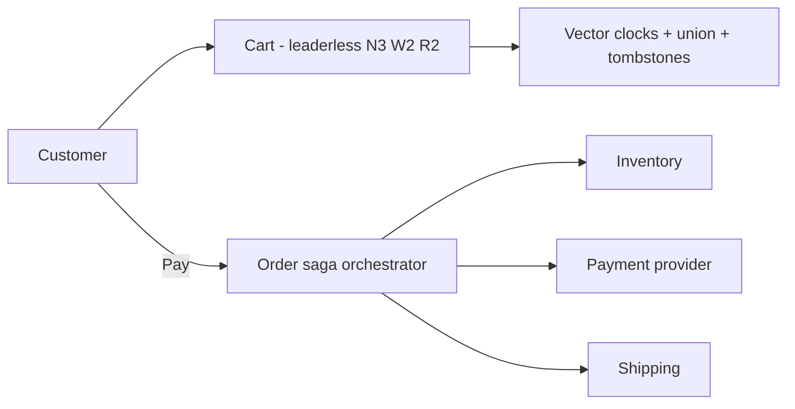

# Module 7 — Keeping Data Consistent (Distributed Consistency)

## Module Introduction
*Original lesson: [Module introduction on DesignGurus ↗](https://www.designgurus.io/course-play/system-design-patterns/doc/6a53590aba41b5b746965576)*


**What this module is about.** One database moving "$50 from checking to savings" does both halves or neither — **atomicity** — almost for free via its **write-ahead log (WAL)**: it durably records what it intends to do before doing it, and after a crash it reads the log to finish or reverse the work. Split the data across shards or services (each owning its database) and no single WAL sees both halves; a change on shard 2 and its partner on shard 5 are tied together by nothing. This module rebuilds all-or-nothing across machines and shows what each approach costs in speed, availability or complexity. (Basics: [Module 0 — Transactions and ACID](../00-system-design-fundamentals/README.md#transactions-and-acid), [Durability: WAL, fsync…](../00-system-design-fundamentals/README.md#durability-wal-fsync-backups-and-recovery), [Distributed transactions](../00-system-design-fundamentals/README.md#distributed-transactions-two-phase-commit-and-sagas).)

**Analogy.** One database is one bank teller with one ledger; a distributed system is two banks, each updating its own ledger for the same transfer. Someone must coordinate them, and every method has a price.

Only four patterns — the smallest module, and the toughest material.

### The four patterns

| The situation | The pattern |
|---|---|
| Several parties must either all commit (make changes permanent) or all back out | Two-Phase Commit (2PC) |
| A workflow has many steps, and any one might fail midway | Saga |
| Several copies of the same data must agree, with no single leader (main copy taking all writes) | Quorum |
| We need to know who saw which update, and in what order | Vector Clocks |

### Two facts that organize the module

**Fact 1 — when the network splits, you have to pick a side.** During a **network partition** (groups of machines running but unable to reach each other) a system either (a) stops serving until the link returns — **consistent** but not **available** — or (b) keeps serving on both sides and reconciles later — available but briefly inconsistent. This is the **CAP trade-off** (Consistency, Availability, Partition tolerance; see [Module 0 — CAP theorem and PACELC](../00-system-design-fundamentals/README.md#cap-theorem-and-pacelc)). No engineering removes it; it comes from how networks behave. Each pattern here makes its own choice, and interviewers ask about CAP directly.

**Fact 2 — the cheapest distributed transaction is one you never need.** (A *distributed transaction* is one all-or-nothing change spanning machines or services.) Try cheaper tools first:
- **Shard-key discipline** (sharding lesson): choose the shard key so one customer's checkout lives on one shard, and a normal local transaction still works.
- **Idempotent operations** (repeating has the same effect as once) and **commutative operations** (any order gives the same result) shrink what truly needs agreement.

Few flows truly need distributed-transaction machinery — typically moving money between owners or promising stock across services.

### How to read the module

The store's order workflow now touches inventory, payment and shipping, and needs all-or-nothing again.
- **Two-Phase Commit** — a coordinator gathers a unanimous "yes"; every participant waits on its decision.
- **Saga** — the usual answer between services: run steps in order and, on failure, run "undo" steps (compensations) for finished ones. Reuses pub/sub ideas.
- **Quorum** — leaderless replicas: choose write confirmations (W) and read fan-out (R) so **W + R > N**, guaranteeing overlap.
- **Vector Clocks** — track which updates knew about which, separating concurrent edits from sequential ones.
- The **capstone** builds order fulfillment with 2PC and with a saga, and compares how each breaks.

> Short on time? Start with **Saga** ("how do services do transactions?") and **Quorum** ("how do replicas agree?") — together most of the interview questions here.

### Four terms used throughout

- **Atomicity** — all-or-nothing; free on one machine via the WAL, costly across machines.
- **Partition** — a network split; both sides alive but unreachable to each other. Partitions *will* happen, forcing Fact 1's choice.
- **Strong vs. eventual consistency** — *strong*: every read returns the latest write, as if one machine existed. *Eventual*: copies converge, but a read may briefly see old data (the **replication lag** and stale views seen earlier). See [Module 0 — Consistency models](../00-system-design-fundamentals/README.md#consistency-models).
- **Compensation** — an "undo" performed as a *new* action (cancel, refund, release). Unlike a rollback, nothing is erased — how businesses have corrected mistakes on paper for centuries. Sagas are built from it.

### Before you start — questions to ask about your own system

1. Do you write to two databases (or services) and trust both writes succeed? What does your data look like the day one fails?
2. When reading a replicated store, how many copies back the answer? Do you *know*?
3. Two users change the same record in the same second. Which change survives — and does the loser ever learn?

---

## Two-Phase Commit
*Original lesson: [Two-Phase Commit on DesignGurus ↗](https://www.designgurus.io/course-play/system-design-patterns/doc/6a53599a465a68690701b210)*


**What it is.** Two-Phase Commit (2PC) gives true all-or-nothing to one operation spread over several machines. The **coordinator** asks each **participant** (a database involved), "Can you commit this?"; each answers a binding yes or no; only if all say yes does it tell everyone to commit. No one commits until all can.

**Analogy.** A wedding: both partners say "I do" before the officiant declares them married; after "I do" neither can leave on their own — and if the officiant faints, both are stuck at the altar.

### The problem: $50 that vanished

Customers can now send gift-card balances: A (shard 2) sends $50 to B (shard 5) — one logical operation, two databases, no spanning transaction. Version one does two sequential writes: subtract on shard 2, add on shard 5. Thousands succeed. At **2:37 AM** the application server crashes after the subtraction committed and before the addition was sent. No retry (the process that knew shard 5 needed its addition is gone), no error logged; the nightly reconciliation job later finds $50 missing. (Reverse the order and the same crash *invents* $50.) Each shard behaved perfectly; the *operation as a whole* was never atomic.

### Why the obvious fixes fail

- **"Write A, then B, and retry B until it works."** Idempotency keys (a unique ID per operation, so repeats apply once) make retries safe, but two holes remain: if shard 5 is down an hour, money is missing for an hour; and if the app dies between writes, its in-memory retry loop dies too. The plan to finish must be durable outside the process (the saga lesson builds on this).
- **"Do both writes in parallel."** Either can still fail alone — now two possible half-done states. Faster isn't atomic.
- **"Let the nightly reconciliation fix it."** Reconciliation *spots* mismatches after users may have seen them; it doesn't *prevent* them. Fine only if hours of inconsistency are acceptable.

### How it works

The coordinator talks directly to Shard 2 (subtract $50) and Shard 5 (add $50); the shards never talk to each other — which is why a silent coordinator freezes both.


*Figure — Two-Phase Commit (course diagram)*

1. **Phase 1 — Prepare.** Each participant does *all* the work, writes a durable **PREPARED** entry to its own WAL, **keeps its row locks** (blocking other transactions from changing — sometimes reading — those rows), then votes. *Why:* with work done and logged, it can still commit after a crash and restart.
2. **A yes vote is a binding promise:** "The work is on disk; I can commit even if I crash; I'll hold my locks until you tell me the result."
3. **The coordinator logs its decision** — COMMIT if all voted yes; ABORT if any voted no or stayed silent. That log entry *is* the transaction's outcome, so recovery can always look it up.
4. **Phase 2 — Commit or abort.** The coordinator sends the decision; each participant applies it and releases its locks.

**Ordering rules that make recovery safe.** A participant logs PREPARED *before* voting yes; the coordinator logs its decision *before* announcing it. A restarting participant reads its log and asks the coordinator for the decision — it never re-runs business logic.

**The in-doubt state (the pattern's big risk).** After voting yes a participant is **in doubt**: it can't commit alone (another may have voted no) or abort alone (commit may already be decided). It waits, holding locks. If the coordinator crashes right after collecting yes votes, every participant is in doubt and every other transaction needing those rows blocks until it returns. 2PC gets atomicity by centralizing the decision — and inherits that spot's weakness.

*Participant states: after voting yes, only the coordinator can move it*


### Walkthrough with numbers (the $50 transfer under 2PC)

- **Cost when all goes well.** Two network round trips (prepare, commit) plus a durable disk write (**fsync** — forcing data to disk before moving on) at every participant and the coordinator: about **4x** a single local-shard write. Noticeable, often acceptable.
- **The hidden cost: lock time.** Row locks span prepare to commit, stretching from roughly **1 ms to 10–20 ms**. By *rate x duration = concurrency*, locks held **10x longer** mean roughly **10x more collisions** on busy rows — 2PC slows its neighbours too.
- **Failure drill.** The coordinator crashes **5 ms** after both votes. Both shards stay in doubt with locks held until a replacement coordinator replays the log and sends commit **40 seconds** later; meanwhile any transaction touching either customer's rows waits or fails.
- **Replicating the coordinator** makes recovery faster (the decision survives one machine) but doesn't remove prepare-time locks, extra round trips, or the need for every participant to be online.
- **Availability math.** Coordinator and both shards must all be up: three components at **99.9%** each give about **99.7%**, lower with every participant.

### Trade-offs

**You gain:**
- **True atomicity across machines** — the "vanished $50" bug can't happen; no reconciliation needed.
- **Strong consistency** — nobody sees money that left A but hasn't reached B.
- **Looks normal to app code** — with driver support it feels like an ordinary transaction. The **XA standard** is a common 2PC interface; Java's **JTA** builds on it.

**You pay:**
- **Blocking — its trademark cost.** In-doubt participants keep locks while the coordinator may be unreachable; for *progress*, the coordinator is a SPOF. Stuck prepared transactions are a real DBA emergency.
- **Latency and throughput** — two round trips, several fsyncs, longer lock holds, contention on popular rows.
- **Availability shrinks as you multiply** — no commit unless every participant is up.
- **It can't cross trust boundaries.** No outside company (beyond your **trust boundary**) lets your coordinator hold locks in its database.

### When not to use it

- **Between microservices.** Cross-service locks tie every participant's speed and uptime to the slowest; a checkout can take seconds or minutes — far too long to hold locks — and the coordinator becomes a technical and organizational bottleneck. Sagas exist for this.
- **Hot rows (rows taking a large share of traffic), cross-company operations, or flows where "fixed by morning" reconciliation is good enough** — atomicity costs more than the inconsistency it prevents.

**Where it *does* fit:** short, internal, rare, high-value operations — above all **inside distributed databases**. Google Spanner runs 2PC between shard groups where each participant and the coordinator is a **quorum-replicated group** (a majority of copies must agree), so individual machine deaths don't block it. 2PC isn't obsolete, and isn't for everything.

**Operational safeguards (even there):** strict transaction deadlines; visible prepared-transaction age; alerts *before* held locks slow unrelated work; recovery tools showing the coordinator's decision and each participant's state — human guessing during recovery causes the very inconsistency 2PC prevents.

### 2PC vs. Saga (preview)

| | Two-Phase Commit | Saga |
|---|---|---|
| Atomicity | Genuine: all-or-nothing, guaranteed by locks | Imitated: each step commits separately; compensations undo earlier steps on failure |
| Intermediate states | Hidden from everyone | Visible — "payment taken, shipping pending" |
| Blocking | Yes — in-doubt participants keep locks | No — every step is an ordinary local transaction |
| Coordinator dies | Participants are frozen | The workflow resumes from its durable log |
| Fits | Short, internal, rare work (or inside a database) | Business workflows spanning services |

In one line: **2PC hides the in-between state by holding locks; a saga lets that state show and manages it.**

### Real-world examples

- **XA standard and Java's JTA** — 2PC plumbing for committing databases and message brokers together; banks and airlines still run on them.
- **PostgreSQL `PREPARE TRANSACTION`** (finished by `COMMIT PREPARED` or `ROLLBACK PREPARED`) — the participant role directly. The docs warn against casual use: an abandoned prepared transaction holds its locks until an operator intervenes.
- **Google Spanner** — 2PC across shard groups replicated with **Paxos** (a consensus protocol letting copies settle on one value); replication absorbs machine failures at the cost of consensus overhead.
- **Kafka transactions** — a 2PC-shaped protocol for atomic consume-process-produce, with one broker as coordinator.
- **For data engineers:** exactly-once writes (each record's effect lands once) into external systems often use this pattern. **Flink** transactional sinks treat a checkpoint (saved snapshot of job progress) as "prepare" — every operator durably records readiness — and completing it as "commit" into Kafka or a database.

### In the interview

"How can two services update their databases atomically?" Walk the full reasoning: 2PC gives real atomicity, blocks on failure, lives mostly inside distributed databases today; service workflows use sagas. "2PC everywhere" and "2PC is dead" both show you don't know its limits.

> **30-second answer:** "2PC gives genuine atomicity across machines: a coordinator gathers binding yes votes — each participant does the work, logs it durably and keeps its locks — then tells all to commit. The downside is blocking: a participant that voted yes can't commit or abort alone, so a coordinator dying at the wrong moment freezes everyone with locks held. Add two round trips and availability that drops per participant. So I use sagas between microservices, and respect where 2PC lives today: inside databases like Spanner, where every party is quorum-replicated so no single crash blocks it."

**Likely follow-ups (with answers):**
- *"The coordinator crashes just after both vote yes — walk me through it."* Both are in doubt: bound to obey a decision they can't make. They hold locks until the coordinator recovers and replays its log; with weak tooling a human resolves the prepared transactions. The word is **blocking**.
- *"Why is 2PC fine inside Spanner but wrong between your services?"* Inside: replicated-group participants, millisecond transactions, one trust boundary, one ops team. Between microservices: single-machine participants, multi-second workflows, separate teams — every weakness at full force, no protections.

**Mistake that fails candidates:** 2PC for a multi-minute checkout; ignoring coordinator failure; calling 2PC obsolete without knowing databases use it internally.

### Self-check

- **Q1: Name the two phases, state what a yes vote promises, and how that leads to blocking.** → Prepare (do the work, log PREPARED durably, keep locks, vote), then commit/abort (all yes → commit, else abort). Yes means "I can commit even after a crash and will hold state and locks until you decide." It can't commit alone (someone may have voted no) or abort alone (commit may be decided), so a silent coordinator blocks it indefinitely.
- **Q2: 2PC for (a) the gift-card transfer — two shards, same cluster, ~50 ms — and (b) checkout across inventory, payment and shipping services, 2–30 s?** → (a) Defensible: internal, rare, one trust domain, short — but first ask whether both balances could share a shard (Fact 2). (b) A saga: seconds-to-minutes of cross-service locks would destroy throughput and chain three teams' availability.
- **Q3: 3 AM page: queries on orders hang for four minutes; the DBA finds hours-old transactions in `PREPARED` holding locks.** → Participants voted yes; the coordinator never delivered a decision (crashed, lost its log, or failed between phases). PostgreSQL holds the locks until someone finds the decision and runs `COMMIT PREPARED` or `ROLLBACK PREPARED`; if no decision survived, the business decides by hand. Postmortem: does this flow truly need 2PC, and if so why wasn't the coordinator replicated? Fix: a saga or a replicated coordinator.

### Related patterns

- **Write-Ahead Log** — holds PREPARED records and the decision; the promise is only as durable as this log.
- **Saga** — the replacement for cross-service workflows.
- **Sharding** — why 2PC became necessary; a good shard key is still the cheapest way to avoid it.
- **Quorum** — how modern systems make participants and coordinators survive crashes (Spanner).

### TL;DR

| | |
|---|---|
| Problem | One logical operation over two machines has a gap where a crash leaves it half-committed (money disappears or doubles). Cross-machine all-or-nothing must be built. |
| Mechanism | Prepare: each participant does the work, logs readiness, keeps locks, votes (a binding promise). Commit: all yes → all commit, else all abort. The coordinator's log holds the decision. |
| Costs | Blocking (in-doubt participants freeze with locks if the coordinator goes quiet), two round trips plus fsyncs, lock contention, availability dropping per participant. |
| Skip it when | Between microservices, across companies, on hot rows, or for long flows (sagas). Fits short internal transactions and quorum-replicated databases. |

---

## Saga
*Original lesson: [Saga on DesignGurus ↗](https://www.designgurus.io/course-play/system-design-patterns/doc/6a535a5a8326c06ae6c5b434)*


**What it is.** A saga breaks a cross-service workflow into a chain of **local transactions**, each committing immediately in its own service with no cross-service locks. Progress is written to a durable log before each step; if a later step fails, **compensations** — new actions cancelling a finished step's business effect — run in reverse order.

**Analogy.** Booking flight, hotel, then car from different companies: if the hotel falls through you can't turn back time; you *cancel the flight*. Cancellation policies are compensations. (The name comes from a database paper on long-running transactions; travel booking is where the idea started.)

### The problem: 340 orders stuck in limbo

Checkout calls three services in order: reserve inventory, charge the card via an **external payment provider**, create a shipment. A bad deploy takes shipping offline for **20 busy minutes**. Reservations and charges still succeed; the third call fails, and the catch block just logs an error. Result: **340 orders** paid and reserved but not shipped. Each service did its part, so none noticed; support learned from angry emails, and **three engineers spent a weekend** refunding and releasing by hand from a spreadsheet.

2PC was already out: an external provider won't hold locks for twenty seconds, let alone twenty minutes. The workflow crosses a trust boundary, takes real time, and can fail after earlier steps committed. It needs (1) a durable record of each order's progress and (2) a plan for reversing finished steps — neither of which locks can safely provide.

### Why the obvious fixes fail

- **"Put the undo logic in the catch block."** Better, still unsafe: a crash mid-checkout or mid-undo loses the in-memory plan, and undo calls can fail or time out with no durable retries or escalation. Recovery must outlive the process that started the work.
- **"Just use two-phase commit."** Locks across three services for seconds to hours — and the external provider can't participate.
- **"One service, one database."** If every step *can* share a transaction, this is the module's cheapest fix (Fact 2). But payment is external, and inventory and shipping may be separate for good reasons.

### How it works

The forward path is T1 Reserve → T2 Charge → T3 Ship → Order complete, each a local transaction. When T3 still fails after retries, compensations run in *reverse*: C2 Refund, then C1 Release, ending at "Order failed — customer notified, nothing owed".


*Figure — Saga (course diagram)*

1. **Break the workflow into local transactions.** *Why:* no service holds locks waiting for another; hot rows stay free and a slow service can't freeze the rest.
2. **Record intent durably before every step — the saga log.** E.g., "order 7f3a: T1 done, starting T2" — the WAL rule applied to a workflow. The **orchestrator** (the process driving the workflow) may crash; another instance reads the log and continues. Record: saga ID, current state, completed steps, attempt counts, idempotency keys, deadlines, and the next allowed action.
3. **Make each state change conditional** — a lease (a lock that expires automatically) or a **compare-and-set** update ("write only if the state is still what I expect"), so two recovering orchestrators never both advance the same order.
4. **On persistent failure, compensate in reverse** — refund first, then release — undoing changes in the opposite order they were made.
5. **Make every step and compensation idempotent.** Timeouts trigger retries, so any request may arrive twice; each step has a stable **idempotency key**, and "refund order 7f3a" must be safe twice.
6. **Hand off what can't be fixed automatically.** A refund failing for ten minutes stays a durable *pending obligation* (the saga isn't done). After bounded retries the orchestrator opens a human task with the order, provider references, attempts and safe next steps; the unresolved state stays visible.

**Compensations are a business undo, not a rollback.** A committed transaction can't be erased, so each step gets a visible opposite action (refund, release, cancel) — like event sourcing's corrective entries (storing every change as an append-only event). Consequences:
- Compensations are *new, visible actions*, not erasures.
- **Business owners must define them** — not everything reverses perfectly: you can't un-send a confirmation email; its "compensation" is an apologetic follow-up.
- Some effects can't be compensated: a physically shipped package needs **forward recovery** (return label, support case). That point of no return is the **pivot**; place pivot steps *last* and recover forward after them.

**Who drives it: orchestration.** Ordered, high-stakes workflows need an **orchestrator** — an explicit **state machine** (possible states and allowed moves) owning the saga log, so "where is order 7f3a?" is one query. (**Choreography** is compared below.)

**The honest price: no isolation.** **Isolation** hides a transaction's half-finished state. 2PC hides "charged, not shipped"; a saga exposes it between T2 and T3, and others can read and act on it. Product must *define* in-between states deliberately — "processing" is real workflow state. Some systems add **semantic locks**: a field like `order_status=PROCESSING` tells other workflows the order has temporary limits (e.g., it can't be cancelled and shipped at once), without any cross-service database lock.

In the diagram, `ChargeUnknown` covers a timeout where you can't tell whether the card was charged (resolved by a status check or retry with the same key); a persistently failing refund goes to `Escalated` instead of quietly ending.

*Orchestrator persists state before every step so a crash resumes instead of stranding*


### Walkthrough with numbers (reserve 50 ms, charge 200 ms, ship 100 ms)

- **Happy path.** About **400 ms** total, no locks between steps; each local transaction lasts about a millisecond, so hot inventory rows stay open.
- **Shipping outage, replayed.** T3 fails; the orchestrator retries with exponential backoff for about **30 seconds**. Still down → *sustained*, not a blip → refund, then release, both idempotent. Within about **90 seconds** the customer learns the order failed and the charge was reversed. No limbo, no spreadsheet.
- **Crash drill.** The orchestrator dies just after T2 commits; another instance reads "T2 done, T3 not started" and creates the shipment. Even a crash *during* T2 can't double-charge: the retry reuses the idempotency key and the provider returns the original result.
- **Ambiguity drill.** T2 times out — charged or not? Don't guess and don't refund a charge that may not exist: **check the charge status, or retry with the same key**. Log "outcome unknown" *before* checking, so a replacement orchestrator repeats the *status check* (same identifiers) instead of starting a fresh charge.

### Trade-offs

**You gain:**
- **Cross-service and cross-company workflows with no distributed locks.**
- **Crash-surviving progress** — workflows *resume* from the saga log.
- **Long-running flows for free** — a saga can wait hours (e.g., fraud review) without locking anything.
- **Designed-in failure handling** — automatic compensations with retries and escalation.

**You pay:**
- **No isolation** — visible in-between states and the *anomalies* others cause by acting on them; product must define every state.
- **Compensation code** — a tested, idempotent undo per step, some needing business decisions.
- **Workflow machinery** — an orchestrator with durable state (or choreography's poor visibility).
- **Eventual consistency** — orders really are "in progress" for a while, affecting reads, reports and expectations.

**Running it:** dashboards of workflows by state, age, last error and next retry; alert on any workflow stuck in a state longer than its **SLO** (service-level objective). Total throughput can look fine while a few valuable orders are stuck.

### When not to use it

- **A single database transaction would work** (Fact 2).
- **In-between states must never be seen** — some financial flows can't show "charged but not shipped"; that's 2PC's one real advantage (or a sign to rethink the design).
- **Simple two-step internal flows** — a retry queue plus idempotency suffices.
- **Nobody will run the machinery** — an unwatched workflow engine is the 340-order incident with more config.

**Common misuses:** sagas around simple CRUD operations; **incomplete compensations** — a refund that forgets loyalty points, a release that forgets a flash-sale counter. Engineering and business owners should sign off on the full reversal together.

### Orchestration vs. choreography

**Orchestration**: one coordinator chooses the next step. **Choreography**: each service reacts to events others publish; nobody is in charge.

| | Orchestration | Choreography |
|---|---|---|
| Who decides the next step | One coordinator running a state machine | Every service, reacting to events |
| "Where is order 7f3a?" | One query to the orchestrator | A hunt through N services' logs |
| The saga log | Explicit, central, resumable | Spread across services, if it exists |
| Adding a step | Change the workflow definition | New subscriptions — hidden new coupling |
| Failure handling | Coordinator retries, compensates, escalates | Every service builds its own part |
| Fits | Workflows where order and stakes matter | Independent reactions (analytics, notifications) |

**Rule:** orchestrate the workflow; use events only for independent reactions. The order saga is orchestrated, and its final `order.completed` fact goes out via pub/sub to analytics, email and others. Choreographing reserve → charge → ship → compensate purely through events spreads control so thin nobody can say what state an order is in.

### Real-world examples

- **Travel industry** — the origin: flight, hotel, car booked in sequence, with cancellation policies as compensations.
- **Temporal** (and its predecessor **Cadence**) — turn the saga log into **durable execution** infrastructure: workflow code resumes automatically after a crash. **AWS Step Functions** provides a managed state machine.
- **Every serious order or payment system** — "processing" is an intentional saga in-between state.
- **For AI engineers:** an agent whose tools have side effects *is* a saga (book a meeting, email attendees, update a CRM). If a later call fails you need designed reversals; a durable workflow engine lets an interrupted agent resume instead of charging or messaging twice. Idempotency keys on tool calls plus compensations separate a production agent from a demo.

### In the interview

Checkout across inventory, payment and shipping tests saga thinking: note that one local transaction can't cover it, rule out 2PC (blocking; the external provider can't join), then lay out steps, durable state, compensations, idempotency and orchestration.

> **30-second answer:** "Checkout is a saga: reserve, charge, ship — each a local transaction, no cross-service locks. Progress goes to a durable saga log before every step, so a crashed orchestrator resumes. If a step still fails after retries, idempotent compensations run in reverse — refund, then release. In-between states like 'charged, not shipped' are visible on purpose, so product defines them and every reader handles them. Irreversible steps like shipping go last; failures after that pivot recover forward, e.g., with a return label. I orchestrate the workflow and use events only for reactions like analytics and email; 'where is this order?' is a single query."

**Likely follow-ups (with answers):**
- *"The payment call timed out — do you compensate?"* No. First learn the truth: retry with the **same idempotency key** (the provider returns the original result) or check charge status; then continue or compensate.
- *"What if the refund itself fails?"* Compensations must be as reliable as forward steps: retry the idempotent refund with backoff; if it keeps failing, escalate via a **dead-letter** queue (a side queue parking repeatedly failing messages) that alerts a person with full context.

**Mistake that fails candidates:** suggesting 2PC; saying "compensations" without explaining them; keeping orchestration state only in memory.

### Self-check

- **Q1: In one sentence, what does a saga trade away versus 2PC, and which two mechanisms replace locks and coordinator reliance?** → It gives up isolation (visible in-between states) to avoid locks and blocking; replaced by a **durable saga log** (resume after crash) and **designed, idempotent compensations** (reverse finished effects).
- **Q2: Compensations for reserve inventory, charge card, send confirmation email, hand the package to the courier — which has none?** → Release; refund; an approved explanatory follow-up email (imperfect — so send the confirmation *late*). Courier handoff is the **pivot**: recover forward (return label, support case, redelivery). Compensable steps first, irreversible last.
- **Q3: A customer gets "Thanks for your purchase!" but the order is refunded 90 s later because shipping failed; the email service says it did nothing wrong.** → A no-isolation anomaly: it correctly reacted to the in-between "payment succeeded" state. Shallow fix: confirm only from the final `order.completed` state. Deeper: every consumer treats in-between states as provisional, and outward actions based on them need their own compensation. Tell customers only what the saga can no longer undo.

### Related patterns

- **Idempotency** — on every step and compensation; retries make duplicates normal.
- **Two-Phase Commit** — the defining contrast: locking and hiding versus showing and compensating.
- **Message Queue** — steps often travel through queues, inheriting Module 2's delivery rules.
- **Publish-Subscribe** — broadcasting final events to interested parties.
- **Dead Letter Queue** — escalating persistently failing compensations to people, with context.

### TL;DR

| | |
|---|---|
| Problem | Cross-service workflows can't use locks (2PC is out); a mid-flow failure leaves half-finished business state — charged, not shipped — cleaned up by spreadsheet. |
| Mechanism | Local transactions with progress logged durably before each step; idempotent compensations in reverse on failure; irreversible steps (the pivot) last, recovering forward; an orchestrator owns the state machine; events broadcast only from final states. |
| Costs | No isolation (visible in-between states and anomalies), a tested undo per step, workflow machinery, eventual consistency while in progress. |
| Skip it when | One DB transaction suffices, visible in-between states are unacceptable (2PC's one win), or the flow is too simple for a state machine. |

---

## Quorum
*Original lesson: [Quorum on DesignGurus ↗](https://www.designgurus.io/course-play/system-design-patterns/doc/6a535b0403e068b88b9e5e7c)*


**What it is.** How a **leaderless** replicated store (any copy takes reads and writes; no primary) keeps reads reliable. With **N** replicas, a write is done when **W** confirm it and a read asks **R**. With **W + R > N**, every read group overlaps every write group, so at least one replica asked holds the newest completed write. (Basics: [Module 0 — Quorums](../00-system-design-fundamentals/README.md#quorums).)

**Analogy.** Three friends keep copies of a shopping list. Tell at least two about each addition; ask at least two when checking. Since 2 + 2 > 3, one you ask is one you told.

### The problem: the flickering cart

The previous lessons were *different services doing different jobs*; this one and the next are *copies of the same data* agreeing on a value.

The cart ran primary-replica, and **failover** (promoting a replica when the primary dies) took about **30 seconds** during which nobody could add items. Many datasets tolerate that; the cart feeds revenue directly, so the business wants writes through any single machine failure. The team moves to a **leaderless** store: **3 replicas**, no primary, so no promotion ever.

Version one writes to one replica and reads from one. A customer adds sneakers via replica A, reloads, and the read hits replica C, which hasn't got the update: the sneakers **disappear**, then **reappear** on a later read via A. All replicas are healthy; they just briefly disagree. Writing anywhere removed failover but also predictable reads.

### Why the obvious fixes fail

- **"Write to all three, read from any one."** Reads see every finished write, but one slow or dead replica now holds up *every write* — the availability problem you left the leader to avoid.
- **"Write to one, read all three, pick the newest."** The mirror image: every read depends on every replica.
- **"Always send each user to the same replica" (sticky routing).** Works until that replica fails or the device uses another entry point — then the cart vanishes during exactly the failure you planned for. A pinned replica is a leader with weaker promises.

All three need *every* replica on one side. What's needed is far less: guaranteed **overlap** between the replicas that took a write and those a later read asks.

### How it works

With N = 3, W = 2, R = 2 (W + R = 4 > 3):

```
WRITE "sneakers" ──► A ✓   B ✓   C (behind)
READ the cart    ──►       B ✓   C ✓
                           ▲
            B is in both groups — it must be, because 2 + 2 > 3.
            The read compares versions; B's is newer, sneakers stay.
```

Two groups of 2 from 3 replicas need 4 "seats", so at least one replica sits in both — the guarantee is just counting.

*N=3, W=2, R=2: the read and write groups must share a replica*


Supporting mechanisms:

1. **Versions break ties.** The R answers may differ; each value carries a version and the reader picks the newest *by version*, never the fastest reply (speed says nothing about freshness). Timestamps work for simple systems; the next lesson shows why richer versions are often needed. The coordinator returns the chosen version to the client so its next write can state which history it saw — otherwise "replace what I just read" is indistinguishable from an unrelated concurrent edit.
2. **Read repair.** When a read sees C returned an old value, it writes the newer value back to C.
3. **Anti-entropy handles the rest.** A background process compares and syncs replicas, fixing rarely-read keys that read repair never reaches. Monitor version drift, repair backlog and the oldest unrepaired difference — requests can keep succeeding while one replica quietly stops catching up.
4. **W and R are per-operation settings.** W=3/R=1: slow writes, instant fresh reads (read-heavy configuration). W=1/R=3: the opposite. W=1/R=1: fast with **no overlap guarantee** (eventual consistency) — fine for like counts, and exactly the cart bug when chosen by accident.
5. **Tolerating stragglers.** With W=2 of 3 the coordinator proceeds after the two fastest replies, so the slowest replica (the **straggler**) doesn't set your **p99** latency (the time within which 99% of requests finish).

**Three qualifications on the guarantee:**
- **Sloppy quorums and hinted handoff.** Some Dynamo-style systems (modeled on Amazon's Dynamo, e.g., Cassandra and Riak) let temporary stand-in nodes accept writes when intended replicas are unreachable during a partition; **hinted handoff** later returns the data to the proper replicas. More availability, but read and write groups may not overlap meanwhile — reads can miss writes even with W + R > N.
- **Partial writes.** A coordinator may get fewer than W acks and report failure though one replica saved the value; a later read or retry may still see it. Writes need stable IDs or merge behavior even after "failed".
- **Quorum promises visibility, not ordering.** Two devices updating one cart at once can each reach W=2 via *different* pairs, leaving two "newest" versions — **siblings**. Vector clocks (next lesson) tell concurrent from sequential; a single ordered winner needs **consensus** (**Raft**, **Paxos**), which adds stricter rules on top of majority counting.

### Walkthrough with numbers (N=3, W=2, R=2)

- **Write.** Send "add sneakers" to all three; succeed after **2** acks — about **5 ms**, even if C is slow.
- **Read.** Ask all three, use the first **2**, compare versions, return the newest; overlap guarantees one has the sneakers. Read repair fixes C.
- **Failure drill (the point).** Replica B dies; A and C still meet W=2 and R=2. **Zero failover, zero pause, zero promotion**; B's replacement catches up via anti-entropy.
- **The honest cost — amplification.** Each logical operation takes 2–3 network calls: **100,000 logical reads/s** may mean **200,000–300,000 replica requests**, before repair, anti-entropy and retries. Size for replica traffic, not client traffic. Concurrent edits can split versions, so conflict resolution is mandatory.

### Trade-offs

**You gain:**
- **No leader, no failover** — reads and writes continue through one replica's loss; the revenue-critical cart stays writable.
- **Per-operation tunable consistency** — one cluster can serve carts, telemetry (automatically collected metrics and events) and configuration, each with its own W/R.
- **Straggler tolerance** — the slowest replica no longer sets p99.

**You pay:**
- **Concurrent writes conflict** — quorum doesn't order them, so you need version tracking and resolution (a leader avoids this by serializing writes).
- **Amplification** — R or W calls per operation plus background repair traffic invisible in client counts.
- **Weakened-guarantee edge cases** — sloppy quorums and partial writes can return old data despite W + R > N; know what your store promises.
- **One key at a time** — quorum settles a single key's value; it won't make a stock decrement and a card charge atomic (2PC or sagas). Values needing one consistency decision may need to share a key — if it stays small and doesn't become a hot partition (a key or shard taking a disproportionate share of traffic).

**Client guarantees also need thought.** A user can read stale data right after their own write if the next request uses a weaker level. Sessions needing **read-your-writes** should carry the version they saw and reject older responses. Make consistency levels part of API design and service ownership, not buried database defaults — e.g., a checkout read at quorum while a recommendation counter on the same cluster reads one replica. Track strict and sloppy responses separately; an overall success rate hides requests that quietly got weaker guarantees during a partition.

### When not to use it

- **Exactly one winner needed** — unique usernames, leader election, "sell the last item exactly once": use consensus (Raft/Paxos) or a single leader. Quorum ensures the winner is *seen*, not that there's only one.
- **Multi-key transactions** — 2PC or sagas.
- **Mostly-read data that tolerates failover** — primary-replica is simpler; a 30-second failover is fine for a product catalog. The cart's always-writable need was specific.
- **Small systems** — quorum math for a **50 requests/s** service is needless complexity.

**Common failure:** choosing a Dynamo-style store "for scale" without checking its W/R defaults, then learning the real guarantees from flickering production data. W and R should be deliberate product decisions.

### Leaderless quorum vs. primary-replica

| | Primary-Replica (leader) | Leaderless Quorum |
|---|---|---|
| Write conflicts | Can't happen — all writes go through one leader | Can happen — needs versioning plus resolution |
| Failover | Real: seconds of write pause, plus promotion and fencing (blocking the old leader from writing) | None: one replica dying goes unnoticed |
| Consistency story | Easy to reason about (apart from read-your-writes) | Adjustable, subtle, full of fine print |
| Latency profile | Your p99 is the leader's p99 | Tolerates stragglers (waits for the fastest W) |
| Complexity lives in | The failover machinery | The version and conflict machinery |
| Fits | Most data: catalogs, orders, accounts | Keys that must always accept writes: carts, sessions, presence (online/offline status) |

A leader is simpler but pauses on failover; leaderless stays available but exposes conflicts. Mature systems choose per dataset.

### Real-world examples

- **Amazon's Dynamo paper** — introduced the pattern for an always-writable shopping cart, and defined sloppy quorums and hinted handoff.
- **Cassandra** (open-source, Dynamo-inspired wide-column database) — per-query consistency levels `ONE`, `QUORUM`, `ALL` make W and R API parameters.
- **DynamoDB and Riak** — Dynamo descendants.
- **etcd and ZooKeeper** (small, highly reliable configuration/coordination stores) — use *consensus* (Raft and the Paxos family), which is why Kubernetes trusts their ordered control-plane data.
- **For data engineers:** feature stores (serving ML model inputs) and time-series systems on Cassandra use `QUORUM` reads where stale features could change model behavior and `ONE` for high-volume telemetry — chosen per query.

### In the interview

Classic: "With three replicas, how many write acks and read responses guarantee you see the newest write?" Follow-ups probe W=1/R=1 or concurrent writes; show what quorum does and doesn't promise.

> **30-second answer:** "With N replicas I confirm writes at W and read R, keeping W + R > N, so every read group overlaps every write group and versioning picks out the newest. N=3, W=2, R=2 is standard and survives any one replica dying with zero failover — the point of going leaderless. But quorum promises visibility, not ordering: two concurrent writes can each reach W=2 and split, so you need vector clocks or last-write-wins. Sloppy quorums trade the overlap guarantee for availability during partitions, and exactly-one-winner problems need consensus like Raft."

**Likely follow-ups (with answers):**
- *"W=2, R=1 on N=3?"* W + R = 3, *not* > 3: a read can hit the replica the write skipped. Faster reads, eventual consistency — acceptable only when chosen on purpose.
- *"Is W=2/R=2 strong consistency, then?"* It guarantees seeing *completed* writes, but concurrent writes can split, sloppy quorums weaken overlap, and partial writes cause edge cases. Call it "overlap visibility plus conflict resolution."

**Mistake that fails candidates:** treating quorum as a payment-plus-inventory transaction; forgetting the inequality; running on unexamined storage defaults.

### Self-check

- **Q1: The formula and why it works, in one sentence.** → W + R > N: since the total exceeds the replica count, every write group and read group share a replica holding the newest completed write.
- **Q2: One cluster, three datasets — (a) feature flags, read constantly, written weekly; (b) the cart, always writable; (c) raw clickstream (every click and page view), write-heavy, batch-read later. Choose W and R.** → (a) W=3/R=1: rare writes can wait for all; constant reads need one reply and stay current. (b) W=2/R=2: overlap holds through one failure. (c) W=1, let the batch reader choose R; a few late events cost less than slower writes. Set per dataset or query.
- **Q3: The flickering cart returns — only during last week's inter-datacenter partition, only for some users. N=3/W=2/R=2; the docs mention "hinted handoff."** → Coordinators that couldn't reach intended replicas B and C used a **sloppy quorum**, counting stand-ins toward W=2 with hints for later; reads via A+B or A+C missed those writes. The real choice: **strict quorum** (reject writes without W true replicas — consistent, unavailable) vs. **sloppy quorum** (keep accepting writes, temporarily miss data). For a cart, availability plus later reconciliation may be right — as a deliberate CAP decision, with vector clocks reconciling versions.

### Related patterns

- **Primary-Replica** — the leader-based alternative; most systems use both, per dataset.
- **Vector Clocks** — the version machinery separating split concurrent writes from sequential ones.
- **Consistent Hashing** — chooses *which* N replicas store each key.
- **Two-Phase Commit** — what databases layer over quorum-replicated groups for cross-shard transactions (Spanner).

### TL;DR

| | |
|---|---|
| Problem | Leaderless replicas always accept writes but lag each other; reading a random one makes the cart flicker, and requiring every replica on one side brings back the fragility you left the leader to escape. |
| Mechanism | N replicas; writes confirmed at W, reads ask R, W + R > N forces overlap; versions pick the newest; read repair and anti-entropy fix laggards; W/R tuned per dataset. |
| Costs | Amplified operations; concurrent writes that split and need version machinery; fine-print edge cases (sloppy quorums, partial writes); single-key only — not a transaction. |
| Skip it when | You need one ordered winner (consensus or a leader), atomic multi-key changes (2PC/saga), or a simple mostly-read dataset where a failover pause is fine. |

---

## Vector Clocks
*Original lesson: [Vector Clocks on DesignGurus ↗](https://www.designgurus.io/course-play/system-design-patterns/doc/6a535b62e5978b0a41c91d98)*


**What it is.** A small version label on each key: **one counter per writer**, which each writer increments when it writes. Comparing two labels shows either that one version *knew about* the other (and replaces it) or that they were written **concurrently** — neither saw the other, a real conflict to keep and merge, not silently discard. (Basics: [Module 0 — Clocks and ordering](../00-system-design-fundamentals/README.md#clocks-and-ordering).)

**Analogy.** Git: branches are concurrent edits, the commit graph records who built on whose work, and a "merge conflict" means neither branch descends from the other. A vector clock is that idea squeezed to one number per writer.

### The problem: which "newest" version wins?

Quorum ended with two devices updating one cart at once, each reaching W=2 via a different pair — two "newest" versions, no clear winner. "Take the later timestamp" breaks two ways:
1. **Clocks don't agree.** Machine clocks differ by milliseconds normally and by seconds when **NTP** (Network Time Protocol, which syncs clocks) breaks.
2. **"Which came later?" is the wrong question.** Alice's phone writes {sneakers}; three seconds later her *synced* laptop writes {sneakers, socks} — it saw and built on the phone's write, so it correctly replaces it. But an *offline* laptop writing {hat} never saw the sneakers: two independent real changes, and picking either loses the other regardless of timestamps.

The real question is **causality** — did one write know about the other? That is what vector clocks record.

### Why the obvious fix fails

- **"Keep the clocks tightly in sync."** Even perfect clocks answer the wrong question: writes 5 ms apart are concurrent if neither saw the other, and "later wins" discards a valid change. (Spanner's precise clocks order transactions *inside a leader-based consensus system* — a different problem.)

### How it works

Two writers, phone and laptop:

```
cart starts empty                          {phone:0, laptop:0}
phone adds sneakers                        {phone:1, laptop:0}
laptop (synced, saw sneakers) adds socks   {phone:1, laptop:1}
  compare {1,1} vs {1,0}: >= in every slot → DESCENDS: supersedes. One story.

...or instead, from the empty cart:
phone adds sneakers                        {phone:1, laptop:0}
laptop (offline!) adds hat                 {phone:0, laptop:1}
  compare: each is ahead in one slot → CONCURRENT: a true conflict.
  Keep BOTH as siblings; resolve at the next read.
```

1. **Each write bumps the writer's own counter** — counting "how many of my writes this version includes."
2. **Compare slot by slot.** If A ≥ B in *every* slot, A **descends** from B (knew everything B knew) and replaces it.
3. **If each leads somewhere, they're concurrent.** The store keeps **both** as **siblings**.
4. **Vector clocks detect conflicts; they don't settle them.** On the next read the application merges siblings by:
   - **Merge by meaning** — for carts, the union {sneakers} ∪ {hat} (Amazon Dynamo's original approach; it has a trap — see self-check Q3).
   - **CRDTs (conflict-free replicated data types)** — counters, sets and documents whose concurrent edits combine automatically; the technology behind Figma-style live collaboration.
   - **Ask the user** — show both, like a git merge conflict.
5. **Write back one merged version whose clock descends from every sibling** — the per-slot maximum, like a git merge commit. Otherwise another replica would see it as concurrent again and the conflict would restart.

*Sequential vs. concurrent histories from an empty cart*


**Tombstones.** Union merging makes deletes risky: if the phone removes sneakers while an offline laptop's concurrent version still has them, the union restores them. Store deletions as **tombstones** — explicit records like "sneakers: removed, version X" — that take part in the merge and override the earlier "present" state; garbage-collect them later. A deletion is a *fact*, not missing data.

### Trade-offs

**You gain:**
- **Nothing lost silently** — concurrent writes survive as siblings until a merge policy handles them.
- **Immunity to clock skew** (the gap between machines' clocks) — causality uses counters, not wall time.
- **Precise language** — "descended" vs. "concurrent" makes leaderless updates reasonable.

**You pay:**
- **You must resolve conflicts** — every data type needs an owned, tested merge policy.
- **Space and growth** — a counter per writer per key grows with many clients; real systems usually key counters by **replica/server**, not end-user device.
- **Pruning is risky** — dropping a retired writer's entry is safe only if it provably won't return (old replica, offline client, backup, delayed message); otherwise causal history is lost and a true descendant looks like a fake conflict.
- **Mental effort** — apps compare versions, handle siblings and maintain merge code instead of accepting whatever the database chose.

### When not to use it

- **Anywhere there's a leader** — writes already flow through one leader in order, so causality is free. This pattern belongs to the leaderless world.
- **When losing a concurrent write truly doesn't matter** — presence indicators, metric samples, "last seen" fields. **Last-write-wins (LWW)** — the later timestamp overwrites — is a valid *intentional* choice; the mistake is defaulting to it and discovering the data loss in an incident.
- **When a CRDT fits** — build the resolution into the type instead of handling siblings by hand.

### Vector clocks vs. last-write-wins

| | Last-write-wins (timestamps) | Vector clocks |
|---|---|---|
| Concurrent writes | One is quietly thrown away | Both kept as siblings |
| Clock skew | Picks the winner (incorrectly) | Doesn't matter |
| Application burden | None — why people like it | A merge policy per data type |
| Honest description | A data-loss policy you sign up for | A conflict-detection service you maintain |

**Cassandra** uses LWW by default, deliberately, for simplicity; **Dynamo** and **Riak** keep siblings with vector clocks. Decide by the cost of losing a real write.

### In the interview

Usually after a quorum design: "Two clients update the same key at once — who wins?" Timestamps alone ignore skew, concurrency and merge ownership.

> **30-second answer:** "Timestamps can't tell 'B overwrote A on purpose' from 'B never saw A', and skew makes 'later' unreliable. Vector clocks track causality: one counter per writer, bumped per write. Two versions either descend — one cleanly replaces the other — or are concurrent, kept as siblings for the application to merge: union for carts, CRDTs where the type merges itself, or a git-style conflict. They detect, not resolve. And last-write-wins is a data-loss policy — fine only when chosen on purpose."

**Likely follow-ups (with answers):**
- *"Why not just synchronize clocks tightly?"* Perfect clocks still answer the wrong question: writes 5 ms apart can be concurrent. Spanner's clocks serve a leader-based consensus system.
- *"Who resolves siblings, and when?"* The next reader receives them all, applies the type's merge policy, and writes back one version whose clock descends from all — like a git merge commit.

**Mistake that fails candidates:** answering with timestamps and never mentioning causality or skew; saying vector clocks *pick* a winner.

### Self-check

- **Q1: Compare {phone:2, laptop:1} with (a) {phone:1, laptop:1}, (b) {phone:2, laptop:2}, (c) {phone:1, laptop:2}.** → (a) {2,1} ≥ {1,1} in every slot: ours descends and replaces it. (b) {2,2} ≥ {2,1}: theirs replaces ours. (c) Each leads in one slot: concurrent siblings needing a merge.
- **Q2: LWW, vector clocks or a CRDT for (a) "user last active at", (b) the shopping cart, (c) a shared document's text?** → (a) LWW — rough recency; losing a sample costs nothing. (b) Vector clocks + union + tombstones — a lost added item matters. (c) A CRDT — the type must combine complex concurrent edits automatically.
- **Q3: A Dynamo-style cart uses union merge. The customer removes sneakers on her phone, then adds a hat on her offline laptop. After syncing, the sneakers are back. Why, and the fix?** → Union treats "missing" as "never there", and the laptop's concurrent version still has sneakers; the deletion left no trace. Store deletions as **tombstones** ("sneakers: removed, version X") that participate in the merge, override "present", and are cleaned up later.

### Related patterns

- **Quorum** — produces the siblings; vector clocks are its version machinery.
- **Event Sourcing** — causality as first-class history; an event stream is a fully ordered relative.
- **Bidirectional Streaming** — collaborative-editing CRDTs merge by design: vector-clock thinking in data types.

### TL;DR

| | |
|---|---|
| Problem | In a leaderless store, concurrent writes split a key; timestamps "fix" it by silently dropping a real write — often the wrong one, due to skew. |
| Mechanism | One counter per writer, bumped per write; versions compare as "descends" (replace) or "concurrent" (keep siblings); reads merge by policy (union, CRDT, ask the user) and write back a version descending from all. |
| Costs | Detection only (merging is yours), per-writer storage with risky pruning, real mental overhead vs. "the database picks." |
| Skip it when | A leader orders writes, data is short-lived enough for intentional LWW, or a CRDT handles the merge. |

---

## Capstone - Order Fulfillment, Built Twice
*Original lesson: [Capstone - Order Fulfillment, Built Twice on DesignGurus ↗](https://www.designgurus.io/course-play/system-design-patterns/doc/6a535bcce5978b0a41c92aac)*


**What this capstone does.** Build the same order-fulfillment system with two-phase commit, then with a saga; hit both with the same three failures and compare the damage. The question isn't which pattern is "better" but **which way of failing the business can live with**. At each "pause and decide," predict the damage before reading on.

**Analogy.** A relay runner stumbles. Either *every* runner freezes until the referee rules (2PC — fails by freezing), or the race continues, the crowd sees the stumble, and a rehearsed recovery plan runs (saga — fails by showing).

### The brief

- **Three steps:** reserve inventory → charge payment (**external provider**) → create shipment. Rule: never *charged while nothing ships*, never *shipped without being charged*.
- **Load:** **200 orders/s**, spiking on popular releases; one **SKU** (stock-keeping unit — a product code) appears in **30%** of active checkouts — the **hot SKU**.
- **Latency:** checkout confirms in about **2 s**; fulfillment may trail by minutes.
- **The cart:** from the quorum lesson, on a leaderless store because it must always accept writes.

### Build One: Two-Phase Commit — fails by freezing

**Design.** One coordinator; inventory, payment and shipping as prepare/commit participants.

**A flaw before anything breaks: the payment provider has no prepare phase** (2PC doesn't cross trust boundaries). An internal **payment-intent record** can stand in as participant, but the *actual* charge happens outside the transaction:
- Commit the intent, then the charge fails → success reported, no money moved.
- Charge first, then the internal commit fails → money moved, nothing recorded.

The workaround swaps an explicit distributed workflow for an *undocumented* one that still needs durable retries and compensation — a hidden saga.

**Drill 1 — the coordinator crashes after gathering yes votes.** *Pause: inventory voted yes on the hot SKU. What can it do, and what happens to everyone else wanting that SKU?*
1. Inventory is in doubt — it can't commit or abort without the coordinator.
2. It holds hot-SKU row locks until the coordinator returns about **40 s** later.
3. For those 40 s, the **30%** of checkouts including the hot SKU queue behind the locks or time out.
4. One failed coordinator turns a small transaction into a broad revenue slowdown.

**Drill 2 — shipping is slow, not down.** During its deploy, shipping's p99 rises from **100 ms to 4 s**. *Pause: who feels it?*
1. Every transaction waits for shipping's prepare reply.
2. Inventory and payment-intent locks are held for shipping's p99.
3. Rate x duration: **200 orders/s x 4 s = 800 transactions' worth of locks** in flight, many on the same popular rows.
4. One participant's speed sets contention in all three services.

**Drill 3 — a normal Tuesday (nothing broken).**
1. Every order pays two round trips and several fsyncs.
2. Hot-SKU locks last tens of milliseconds instead of ~1 ms, forcing single file exactly at release-day peak.
3. At 200 orders/s, slightly longer locks multiply contention → queueing → longer locks → more queueing.
4. Capacity can collapse before any service is officially "down".

**Verdict: 2PC fails by freezing** — it hides partial state by *halting progress* under uncertainty, and unrelated checkouts sharing a row feel the stall.

### Build Two: Saga — fails by showing

**Design, and the reason behind each choice:**
- **Orchestrator + durable saga log** — crashes resume, not strand.
- **Order: reserve → charge → ship** — compensable steps first; the **pivot** (irreversible shipping) last.
- **Compensations: release inventory, refund payment** — business-approved.
- **Every step and compensation idempotent** — retries are safe.
- **Confirmation email only at a final state** — customers hear only irreversible facts.
- **Short local transactions per service** — no distributed locks.

The saga log is now **consistency-critical infrastructure**: each state change durable *before* its external effect; conditional updates so only one orchestrator advances an order; search by state, age and last failure to find workflows retrying without progress.

**Drill 1 — the orchestrator crashes after the charge succeeds.** *Pause: same moment as 2PC's Drill 1 — money committed, coordinator dead. What's frozen?*
1. Nothing is locked.
2. The log reads "order 7f3a: reserved, charged, shipping not started"; another orchestrator resumes at shipping.
3. The stable payment idempotency key prevents a second charge after an ambiguous crash.
4. Inventory holds a *committed reservation*, not an open lock; other orders keep buying remaining stock.
A would-be sitewide slowdown becomes a resumable workflow record.

**Drill 2 — shipping down 20 minutes with 340 orders mid-saga.** *Pause: trace them and what the customer sees.*
1. Shipping fails; the orchestrator retries with backoff for ~**30 s** to separate a hiccup from an outage.
2. Sustained → idempotent **refund**, then **release**, then an approved "we couldn't complete your order" email.
3. About **90 s** per order; no spreadsheet.
4. Cost: 340 visible temporary charges and 340 ledger refunds — bounded and automatic. (2PC would have *rejected* new orders, since every participant must be up, and frozen in-flight ones with locks held.)
5. Communication improves: "Processing" once safely recorded, "Completed" only after shipping; if compensation starts, the state machine explains exactly what happened, so support needn't reconstruct it from three services' logs.

**Drill 3 — the anomaly cost (nothing down).** *Pause: what's quietly off on the analytics dashboard, and who else acts on it?*
1. A revenue dashboard counting "charged" orders includes some refunded minutes later, so it reads slightly above the final finance ledger.
2. A marketing system confirming purchases from the same provisional state would cause customer-visible errors.
3. Rule: outward messages come from final states unless they have their own compensation; every consumer knows which states are provisional.

**Verdict: sagas fail by showing** — they reveal in-between truth (refunds, provisional states) and handle it deliberately instead of hiding it behind locks.

In Build One the real charge (dotted line) happens *outside* the transaction; in Build Two the orchestrator writes the saga log, uses idempotency keys with the provider, ships last as the pivot, and emits `order.completed` only at the final state.

*Two builds of the same checkout*


### The comparison

| Failure injected | 2PC damage | Saga damage |
|---|---|---|
| Coordinator/orchestrator crash | In-doubt participants frozen with locks; hot SKU slows for the whole recovery | Workflow resumes from the log; nothing held, nobody waits |
| One service slow | Everyone's locks held for the slowest p99; a contention storm | Only that step retries; other orders unaffected; steps still take milliseconds |
| One service down 20 min | New orders rejected (every participant required); in-flight ones frozen | Orders compensate: 340 visible, automatic refunds |
| Nothing failing at all | Locks force hot rows into single file; 2 round trips + fsyncs per order | Full speed — plus provisional states every consumer must handle |
| The half-state ("charged, not shipped") | Nobody ever sees it — 2PC's one clean win | Visible for seconds to minutes: designed, labeled, compensated |

**2PC fails by freezing; sagas fail by showing — pick the failure the business can live with.** Customer-facing cross-service workflows usually pick sagas.

The **gift-card transfer** remains a fair 2PC use: two internal shards, ~50 ms, one trust domain, no partial state allowed. In Spanner-class databases every participant is quorum-replicated, so one crash can't block. 2PC for short internal database work; sagas for cross-service workflows.

### Postscript: the cart's own consistency

One checkout contains **two separate consistency problems**:
1. **Replica agreement for one key (the cart).** Leaderless N=3, W=2, R=2. A phone and laptop may update the cart concurrently via different replica pairs; vector clocks see neither descends, the read merges siblings by union, and tombstones keep an intentional sneaker deletion from being undone. The customer sees one correct cart.
2. **A cross-service workflow for one order (fulfillment).** Once the customer taps Pay, the saga's per-order log and compensations take over.

Good design starts by assigning each failure to *its* consistency problem.

*Where each consistency pattern applies*


### Extend it yourself

- **Checkout across multiple regions.** The orchestrator, its log and three services span two regions. What replicates easily? Where should the saga log — the new consistency-critical state — live, and with what W and R? What happens to a mid-flight saga when the regions partition? (Fact 1 applied to the machinery itself.)
- **The provider's webhook.** The provider confirms charges later via **webhooks** (HTTP callbacks), delivered at-least-once (every message arrives, some more than once) and possibly out of order. Connect that path to the saga: which step becomes "wait for external confirmation"? What timeout rule? How do duplicate confirmations interact with the saga log?
- **For AI engineers.** An agent on a durable-execution engine books a venue, emails attendees and updates the CRM. Design the compensations, place the pivot, and decide which tool calls may run before the workflow reaches an irreversible state.

### Interview summary

> Built with 2PC, checkout can't even include the external payment provider, and a coordinator crash or one slow participant freezes hot-SKU locks for everyone. Built as a saga, crashes resume from the log and outages become automatic, visible refunds. 2PC fails by freezing; sagas fail by showing. For customer workflows across services, showing is the failure the business can live with.
