# Module 8 — The Entry Point (API and Edge)

## Module Introduction
*Original lesson: [Module introduction on DesignGurus ↗](https://www.designgurus.io/course-play/system-design-patterns/doc/6a535c5d8326c06ae6c5c707)*


**What this module is about.** The scaling capstone ended at the **system boundary**, where clients — browsers, phones, partner systems — first reach your system. This module decides there which requests are let in, which are turned away, and which can be answered without bothering an application server. Most patterns accept, control and shape incoming traffic; the last ones apply the same ideas to calls *between* your own services.

**Analogy.** An office building's security desk, reception, turnstiles and signs — plus an assistant per office inside: all "stand between caller and called," in different spots with different rules.

### The nine patterns

| The situation | The pattern |
|---|---|
| No one outside should talk to internal servers directly | Reverse Proxy |
| Popular content should sit close to the people reading it | CDN |
| A single entrance that authenticates (checks who the caller is), routes, and enforces policy | API Gateway |
| Different clients need the API shaped differently | Backend for Frontend |
| Fair use, enforced right at the entrance | Rate Limiting |
| Pick up a listing exactly where you stopped | Cursor Pagination |
| Change the API without breaking clients that already use it | API Versioning |
| Every service gets the same helper for shared chores | Sidecar |
| All those helpers, configured from one central place | Service Mesh |
| Every service must answer "may this user do this to this object?" the same way | Authorization Service *(added lesson)* |

### Two facts that organize the module

**Fact 1 — nearly everything here is one building block playing different roles.** The **primitive** (basic building block) is the **proxy**: a server that receives requests and passes them on. In front of your servers it's a **reverse proxy**; add health checks and traffic spreading and it's a **load balancer**; add API policies (who may call, how often) and it's an **API gateway**; copy it with a cache into 200 cities and it's a **CDN**; put a small one next to every service and wire them together and you get a **sidecar**, then a **service mesh**. (Basics: [Module 0 — Proxies and API gateways](../00-system-design-fundamentals/README.md#proxies-and-api-gateways), [CDNs and anycast](../00-system-design-fundamentals/README.md#cdns-and-anycast).)

*One primitive, many roles*
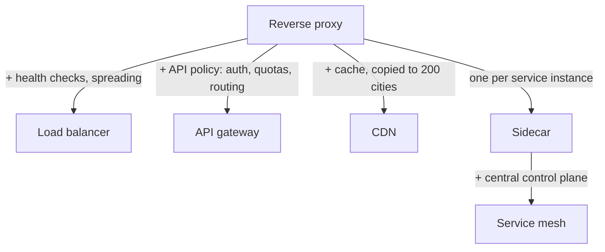

**Fact 2 — the edge is where you're cheapest and strongest.** The cheapest request never reaches the app tier: rejecting bad logins or excess usage at the edge costs no service capacity, and serving cached pages or static files (identical for every user — images, scripts, stylesheets) skips app work entirely. The edge is also the *single* place every request passes, so authentication, rate limits and version policies are applied once there instead of rebuilt, slightly differently, in every service.

### North-south vs. east-west traffic

- **North-south** traffic crosses the system boundary (outside clients, browsers, partners) — governed by gateways, CDNs, rate limiters and version policies.
- **East-west** traffic flows *between* internal services (checkout → inventory → pricing) and needs service-to-service trust, retries and tracing (recording one request's path and timing across hops) — supplied by sidecars and meshes.

Both use the proxy primitive but trust different things; that split divides the module and comes up often in interviews.

### How to read the module

Outside-in: **Reverse Proxy** (defines the primitive) → **CDN** → **API Gateway** → **BFF** → three gateway policies (**Rate Limiting**, **Cursor Pagination**, **API Versioning**) → east-west **Sidecar** and **Service Mesh** → **Authorization Service** (added lesson: the gateway authenticates, but whether *this user* may touch *this object* belongs to a shared decision service — roles, attributes and Zanzibar-style relationship graphs, Zanzibar being Google's permission system) → the **capstone**, a public API layer for web and mobile.

> Short on time? Read **API Gateway**, **Rate Limiting** and **CDN** first — every "design X" interview draws this boundary, and follow-ups dig into those three.

### Terms used throughout

- **Edge vs. origin** — the *edge* is near the client, where traffic enters; the *origin* holds the authoritative servers and data. Answer from the edge when you can.
- **Forward vs. reverse proxy** — a *forward* proxy acts for clients and hides *who is asking* (e.g., a corporate web filter); a *reverse* proxy acts for servers and hides *who is answering*. Everything here grows from the reverse kind.
- **Policy enforcement point** — one place applying a rule instead of N copies; authentication, usage limits and quotas usually live here.

### Before you start — questions about your own system

1. How many places in your code check authentication? (Usually surprisingly many — that number is the case for a gateway.)
2. What share of requests could be served without reaching your servers — and are they?
3. When your API's response shape changes, what happens to the year-old mobile app you can't force-update?

---

## Reverse Proxy
*Original lesson: [Reverse Proxy on DesignGurus ↗](https://www.designgurus.io/course-play/system-design-patterns/doc/6a535cbce5978b0a41c934b7)*


**What it is.** A server in front of your application servers: every request lands on it first, it handles the "boundary chores," then forwards to an app server. Clients never talk to app servers directly.

**Analogy.** A restaurant host: guests never enter the kitchen; the host greets them, handles slow or chatty ones, hands out menus (static content) and passes orders in — so the kitchen can cook, and even rearrange, unseen.

### The problem it solves

An internet-facing app server must do jobs it's bad at:
- Handle **TLS certificates** (TLS is the encryption behind HTTPS; the certificate proves identity).
- Serve images and JavaScript alongside business logic.
- Expose its address and internal layout (**topology**).
- Least obvious: **cope with slow clients** — a phone dribbling one request over **4 seconds** holds an app thread the whole time.

App servers excel at fast, predictable internal traffic; a reverse proxy absorbs the slow, hostile, messy internet and hands work inward in a tidy burst.

### How it works — the six jobs

Clients reach the proxy — the one public entry point — which routes and load-balances across App Server 1–3, keeps them hidden, and returns responses.

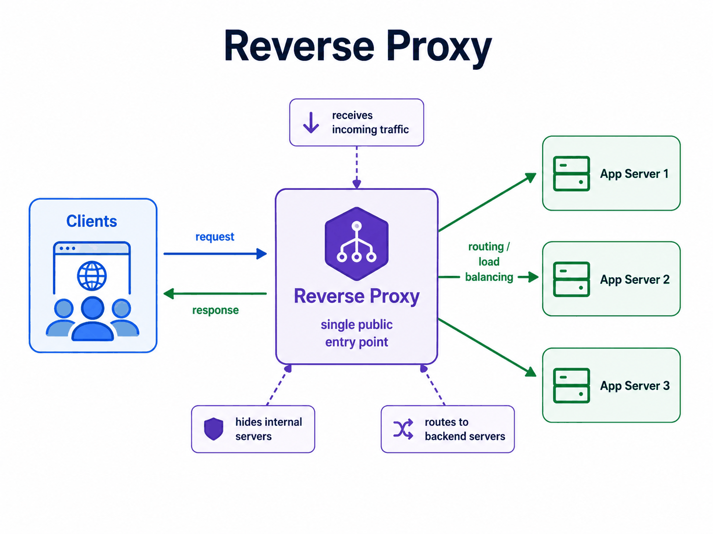
*Figure — Reverse Proxy (course diagram)*

1. **Terminates TLS.** Certificates, renewals and protocol settings live in one layer — one place to configure and patch.
2. **Buffers slow clients.** An **event-loop proxy** juggles many connections on one thread (the async I/O model from the SSE lesson), holding thousands of idle connections for a few KB each. It waits until a slow upload is *completely* received, then sends one fast request inward. App threads are costly; a slow phone shouldn't tie one up.
3. **Serves static files itself.** Images, JavaScript and CSS never reach app code.
4. **Reuses connections.** **Keep-alive** lets one client connection carry many requests; **connection pooling** keeps warm connections to the backends. Handshakes are paid once.
5. **Hides the topology.** One public address; internal servers can be renumbered, swapped or added freely.
6. **Serves as the enforcement point.** Every request passes here — the natural home for authentication, limits and the other policies in this module.

**The family.** + health checks and spreading → load balancer (Module 6); + auth, quotas, routing → API gateway; cached copies in 200 cities → CDN; a small proxy per service → sidecar; connected → mesh. One primitive, five names.

### Walkthrough with numbers (buffering)

- **300 requests/s**, each taking **3 s** to arrive from slow clients. Unbuffered, app threads wait for the whole transfer: 300 x 3 = **900 threads**.
- Buffered, the app gets complete requests processed in **50 ms**: 300 x 0.05 = **15 threads** — about **98%** of the pool freed.
- Rule: *threads in use = request rate x how long each request holds a thread* ([Little's law](../00-system-design-fundamentals/README.md#littles-law)). Buffering shrinks "how long" from transfer time to processing time.

### Trade-offs

**You gain:** the internet's messiness (slow clients, TLS, static files, junk requests) absorbed before business logic; one address, one certificate location, one enforcement point, with a freely changing fleet behind; low cost — a modern proxy forwards in **well under 1 ms** and handles enormous connection counts on modest hardware.

**You pay:**
- **An extra hop** — sub-millisecond, plus one more system to patch and watch. Everything depends on it, so it must be **redundant** across failure domains (groups that fail together, e.g., a rack or datacenter): paired instances, or **anycast** (one IP advertised from several places; the network picks a nearby working one).
- **A trust boundary to configure correctly.** The app now sees the *proxy's* IP, so the proxy writes the real client address into **`X-Forwarded-For`** — a header clients can also send and forge. Rules: the proxy **overwrites** any client-sent value (never appends), and the app trusts the header **only** from its own proxy's address.
- **A false sense of safety** — a proxy isn't a security control; it's where you *put* controls.

### When not to use it

Almost everyone uses one; the question is whether you need *another* layer:
- **Your platform already provides one** — a cloud load balancer or hosted front end; nginx behind it adds delay and another header-trust boundary with no separate owner or purpose.
- **Small, purely internal services on a trusted network** — until they need encryption, retries or **observability** (logs, metrics, traces); then the sidecar brings the primitive east-west.
- **Don't stack proxies thoughtlessly.** CDN + cloud LB + nginx + app = four sets of timeouts, body-size limits and header-trust rules to check per incident; a rejected **12 MB** upload may mean digging through all four.

### In the interview

Usually a box you're expected to draw, not a question. Expect "why not expose the app servers directly?" or an `X-Forwarded-For` bug scenario.

> **30-second answer:** "A reverse proxy fronts the fleet: it terminates TLS, buffers slow clients so a 4-second mobile upload doesn't hold an app thread, serves static files, pools connections and hides the topology behind one address. It's the primitive under half of system design — add health checks and spreading for a load balancer, API policy for a gateway, geography plus cache for a CDN. The config detail I always check: the app trusts client-address headers only from the proxy, and the proxy overwrites whatever outsiders send — otherwise rate limits and audit logs run on forgeable data."

**Likely follow-ups (with answers):**
- *"What does buffering really save?"* Busy threads drop from rate x *transfer* time to rate x *processing* time; the proxy holds slow sockets cheaply on its event loop.
- *"Forward vs. reverse?"* See Terms above (and self-check Q1).

**Mistake that fails candidates:** trusting `X-Forwarded-For` without checking its source; not knowing why the app sees the proxy's IP; stacking proxies without clear jobs.

### Self-check

- **Q1: Forward vs. reverse in one sentence, then the reverse proxy's four main jobs.** → Forward acts for clients, hiding who's asking; reverse acts for servers, hiding who's answering. Jobs: TLS termination, buffering slow clients, serving static files, reusing connections — plus the strategic job of single enforcement point.
- **Q2: Phones upload 200 photos/s, ~2 MB each, ~3 s per upload. App threads busy with and without buffering (0.1 s processing)?** → Without: 200 x 3 = **600**. With: 200 x 0.1 = **20**. A **30x** reduction.
- **Q3: After launch the rate limiter says 99% of traffic comes from one client and blocks it, taking the site down; the audit log blames `10.0.0.5` — the proxy — for a suspicious admin action.** → Both used the proxy's address instead of a trusted client address: every user looked like `10.0.0.5`. Fix: the proxy sets `X-Forwarded-For` from the real connection source, overwriting incoming values; the app trusts it only from approved proxy addresses; everything using client identity (limits, logs, geo rules, bans) reads that same verified value.

### Related patterns

- **Load Balancing** — health checks and distribution on the primitive.
- **API Gateway** — API authentication, quotas, routing.
- **CDN** — cached proxies across geography.
- **Sidecar** — a small reverse proxy per service instance, east-west.

### TL;DR

| | |
|---|---|
| Problem | Directly exposed app servers take on the internet's problems: TLS in app code, threads stuck on slow clients, visible topology, scattered policy. |
| Mechanism | A front server terminates TLS, buffers slow clients, serves static files, pools backend connections and forwards complete requests: one address outside, an invisible fleet inside, one enforcement point between. |
| Costs | A sub-millisecond hop, one more component that must be redundant, and header-trust discipline (client address set by exactly one party, trusted from exactly one source). |
| Skip it when | Your platform already provides one (don't stack), or the service is small and internal — until the sidecar brings the primitive east-west. |

---

## CDN
*Original lesson: [CDN on DesignGurus ↗](https://www.designgurus.io/course-play/system-design-patterns/doc/6a535d677d8046c63edc98da)*


**What it is.** A **Content Delivery Network (CDN)** copies the reverse proxy into 200+ cities, each copy with a cache. Each user reaches the nearest **edge** location, which answers from cache and, only on a miss, fetches from your **origin** — once per edge, not once per user.

**Analogy.** Instead of every Australian reader mailing a library in Virginia, the publisher stocks popular books at a Sydney branch, which orders from Virginia only for titles it lacks.

### The problem: six-second pages in Sydney

The store opens in Australia. Sydney sees **6-second** page loads; Virginia sees **400 ms**. The origin is healthy — **20 ms** replies, no errors. The time goes to *distance*:
- One Sydney↔Virginia **round trip** is around **200 ms**.
- The **TLS handshake** needs **2–3 round trips**: **400–600 ms** before any content.
- The page then loads **60** images, scripts and styles, whose dependencies add more round trips even with connection reuse and parallel fetches.

More Virginia servers can't speed up light; the content must already be near the reader.

### Why the obvious fixes fail

- **"Optimize the backend."** The origin's 20 ms is ~**3%** of the delay; ~97% is geography. Split server time from network time first.
- **"Open a datacenter in Sydney."** A full region fixes distance eventually, but means running the whole stack there and replicating the database across regions — the consistency module's hardest trade-offs, just to move identical images and JavaScript.
- **"Use HTTP/2 and buy more bandwidth."** **Multiplexing** (several requests over one connection at once) reduces connections and improves parallelism; bandwidth moves more bytes at once. Neither removes the round-trip wait before bytes start arriving.

Most slow content is identical, popular and static: a **distribution** problem, not a computation problem.

### How it works

The Sydney user reaches the Sydney edge in 15 ms (a London user their edge in 12 ms). On a miss, an edge asks the **origin shield** — a single mid-tier cache — which fetches from the Virginia origin **once** and caches it.

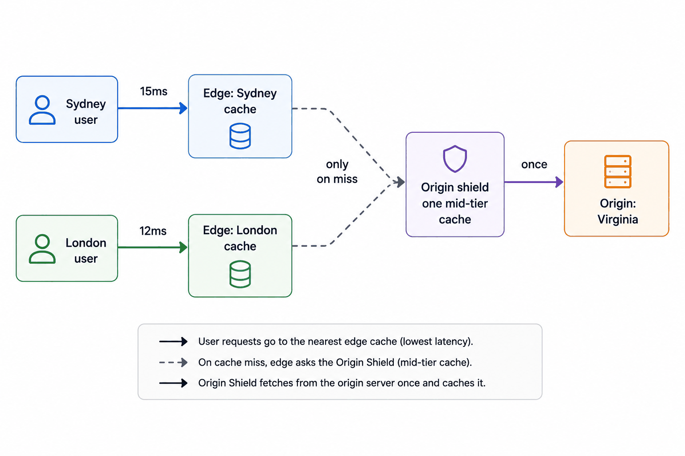
*Figure — Users reach the nearest edge cache; only a miss travels to the origin (course diagram)*

1. **Route each user to the nearest edge** via DNS or **anycast**. Handshake and cached bytes are ~15 ms away instead of ~200.
2. **The rules travel in a header.** **`Cache-Control`** tells 200+ edges what to store and for how long:
   - `max-age` — lifetime in seconds; browsers obey it too.
   - `s-maxage` — lifetime in **shared caches** (CDNs) only.
   - `stale-while-revalidate` — serve the old copy while one background refresh runs.
   - `stale-if-error` — serve the old copy while the origin fails.
   Module 4's rules all apply: **hit ratio** (share answered from cache), **TTL** (validity period — your staleness budget), simultaneous misses.
3. **Beat invalidation by never invalidating — fingerprinted URLs.** **Invalidation** (removing stale copies) takes seconds to minutes across 200 cities. Instead the build tool puts a content hash in the filename (`app.3f9a2c.js`) and marks it cacheable forever with `immutable`; changed content gets a *new* URL, so a stale response can never live at the new address.
4. **Get the cache key right.** The **cache key** is the URL plus declared headers. Cookies are the classic trap: varying on every cookie makes every request unique (hit ratio → zero); caching a `Set-Cookie` response (often a login session) serves private content to others.
5. **Add an origin shield.** Without one, a popular file missing at 200 edges triggers 200 origin requests — a global **cache stampede**. The shield **coalesces** identical misses into one origin fetch.
6. **Use the edge for more than caching.** TLS ends nearby, so a 3-round-trip handshake costs **45 ms** instead of ~600 ms. Warm **edge-to-origin connections** reuse handshakes, speeding even *uncacheable* dynamic requests. The provider's huge network absorbs **DDoS** floods. `stale-if-error` gives **graceful degradation** during origin outages (e.g., Cloudflare "Always Online").

### Walkthrough with numbers (Sydney, edge 15 ms away)

- **First byte.** TLS: 3 x 15 ms = **45 ms** instead of ~**600 ms**, for cacheable *and* dynamic requests.
- **The 60 assets.** With warm caches ~**95%** come from the edge in about **20 ms** each, mostly in parallel: the page loads in roughly **1.2 s** instead of 6 s. Dynamic content still crosses the ocean, but the site stops feeling broken.
- **Origin load.** **70%+** of requests stop at the edge (the scaling capstone's "most traffic shouldn't reach app servers"). **CDN egress** (bytes the CDN sends) is usually cheaper per GB than origin traffic.
- **Flash-sale drill.** A hero image goes from **cold** (in no cache) to globally popular in a minute: ~**200** edges miss at once, the shield makes **one** origin fetch, and the edges serve the next **10 million** requests.
- **Deploy drill.** New JavaScript ships as `app.8c1d4e.js`; fresh HTML (short `s-maxage`) points to it. No purge, no cross-city coordination; the old file sits unused until evicted.

### Trade-offs

**You gain:** latency that works with physics (content and handshakes near users); origin load down **70–95%** for content-heavy sites, plus cheaper bandwidth; DDoS absorption and `stale-if-error` availability during origin outages.

**You pay:**
- **Staleness across 200 cities.** Purges propagate, not instantly; fingerprinting fixes assets, but HTML and API responses need explicit TTL budgets.
- **Header rules are security.** One loose header can put private content in a shared cache; review cache directives like auth code.
- **Harder debugging** — which edge, hit or miss, stored when? Check `cf-cache-status` and `x-cache` first.
- **Per-GB fees and a third party on the critical path** — very large sites use several CDNs.

### When not to use it

- **Purely internal apps** — two offices don't need 200 cities.
- **Single-region products with a nearby origin** — weaker latency case (DDoS protection and offload may still justify it).
- **Every response unique** (heavily personalized APIs) — shared caching doesn't help, though edge TLS and warm connections do; API-only products sometimes use CDN *acceleration* without caching bodies.
- **Hiding a slow dynamic origin** — the edge can't erase a **2-second** server render. Fix the query (Module 4's rule).

**Dangerous misuse: caching private data.** An API response with `Set-Cookie`, or an account page missing `private`, can be handed by a shared cache to another user. The CDN obeyed the headers; the headers were wrong.

### Fingerprinted URLs vs. purging

| | Fingerprinted URLs (`app.3f9a2c.js`) | Purge ("delete /banner.jpg everywhere") |
|---|---|---|
| Propagation | Instant — a new URL, nothing to invalidate | Seconds to minutes depending on provider; you must trust it |
| Can stale content exist? | Not by design | Yes, while the purge spreads |
| Cache lifetime | Forever + immutable — best hit ratio | Whatever TTL you dared set |
| Works for | Anything linked from elsewhere (assets referenced from HTML) | The linking documents, and emergencies |
| Cost | Build-tool setup (standard in bundlers) | An API call — plus trust |

**Standard setup:** fingerprint referenced assets and cache them forever; give the referencing HTML a short `s-maxage` plus `stale-while-revalidate`; purge only for emergencies and legal takedowns.

### Real-world examples

- **Akamai, Cloudflare, Fastly, CloudFront** — the pattern as an industry; Cloudflare alone carries a large share of web traffic.
- **Netflix Open Connect** — cache servers *inside* ISPs; for video-heavy traffic, skipping the ocean beats speeding it up.
- **RFC 5861** — standardizes `stale-while-revalidate` and `stale-if-error` (Module 4's stale serving and Module 5's fallbacks as HTTP headers).
- **Edge compute** — Cloudflare Workers and Lambda@Edge run small pieces of your code (auth, redirects, experiment selection) on CDN servers near users.
- **For AI engineers:** model weights are huge static files delivered via CDNs, and GPU inference **cold starts** pull them through the same network. Token streams are per-request and uncacheable but still gain from edge TLS and warm origin connections, cutting **time to first token** for distant users.

### In the interview

Classic prompt: "Users in Australia see slow pages, but the Virginia servers look healthy." Spot distance before blaming capacity, then cover invalidation and personalization.

> **30-second answer:** "It's distance: 200 ms per round trip, three of them for TLS, and no origin tuning fixes that. I'd put a CDN in front: fingerprinted assets cached forever, HTML on a short shared-cache TTL with stale-while-revalidate, TLS ending at the edge so the handshake runs over 15 ms, an origin shield merging global misses, warm edge-to-origin connections for dynamic requests. And I review Cache-Control like auth code, because one wrong header serves private data from a shared cache. Seventy-plus percent of requests never cross the ocean; the rest cross once, warm."

**Likely follow-ups (with answers):**
- *"Marketing needs the banner changed now, but assets are cached forever."* The new image gets a new fingerprinted URL; only the referencing HTML updates (short TTL or one emergency purge) — why the policy has two layers.
- *"Can API responses go on the CDN?"* Same-for-everyone responses yes (`s-maxage`, correct cache key); personalized bodies never in a shared cache, though they gain edge TLS and warm connections.

**Mistake that fails candidates:** tuning backend code for geographic delay; relying only on purges; caching a personalized API without defining its cache key.

### Self-check

- **Q1: Why can't origin tuning fix Sydney, and which two latency costs does the edge remove?** → ~200 ms of travel per round trip, not 20 ms of compute; TLS needs 2–3 trips, then dependent asset fetches. The edge removes the **content journey** (cached bytes 15 ms away) and the **handshake journey** (~600 ms → 45 ms).
- **Q2: Header policies for (a) a product image, (b) product-page HTML, (c) cart JSON.** → (a) Fingerprinted URL with `Cache-Control: public, max-age=31536000, immutable`. (b) `s-maxage=60, stale-while-revalidate=300` — one minute in shared caches, stale during refresh. (c) `Cache-Control: private, no-store`.
- **Q3: After a deploy touching only caching headers, users see other customers' account dashboards.** → Personalized responses became shared-cacheable (added `public`/`s-maxage` or removed `private`/`no-store`; caching a `Set-Cookie` response does the same), so the CDN stored one user's dashboard under a shared URL. Now: purge affected entries and restore `private, no-store` on authenticated responses. Prevention: treat cache directives as security-sensitive — `private, no-store` by default on authenticated routes, automated checks, auth-level review for anything loosening them.

### Related patterns

- **Reverse Proxy** — spread across cities, plus caching.
- **Cache-Aside** — browser → CDN → app cache → database, each layer handling the previous one's misses.
- **Cache Stampede Prevention** — the shield merges global misses; `stale-while-revalidate` standardizes stale serving.
- **Graceful Degradation** — `stale-if-error` as a cached fallback.

### TL;DR

| | |
|---|---|
| Problem | Distance — ~200 ms per ocean round trip, tripled by TLS and compounded by asset fetches — makes healthy origins feel broken far away; backend tuning can't touch travel time. |
| Mechanism | The reverse proxy in 200 cities with caches: fingerprinted assets forever, short-TTL HTML with stale-while-revalidate, TLS at the edge, an origin shield merging misses, warm connections for the uncacheable. |
| Costs | Global staleness management, security-relevant headers, harder debugging, per-GB fees, a third party on the critical path. |
| Skip it when | Apps are internal, users are in one region, or every response is unique — and never to hide a slow dynamic origin. |

---

## API Gateway
*Original lesson: [API Gateway on DesignGurus ↗](https://www.designgurus.io/course-play/system-design-patterns/doc/6a535e46e5978b0a41c94515)*


**What it is.** The one entrance for all **north-south** traffic. It routes each request by path to the right service, enforces shared rules once — authentication, rate limits, TLS, validation — and passes the verified identity inward. Nothing reaches a service unchecked, and no client needs to know your internal layout.

**Analogy.** A hotel front desk: check in once, show ID once, get a key card that room service and the gym trust. Guests don't need to know who works where. But the desk doesn't cook or run the spa — each department does its own work.

### The problem: eleven front doors

The store runs **11 services** (catalog, search, checkout, orders, accounts, reviews, …), and web, iOS and Android call each directly:
- **Authentication is built 11 times.** Every service checks tokens (signed strings issued at login proving who the client is) with whatever library version it last shipped. An audit finds **3 implementations in 2 languages**; reviews' is **14 months old** and ignores **token revocation** (cancelling a token before expiry). After a stolen account's tokens were revoked, they could *still post reviews* — a security incident.
- **The mobile app hardcodes 9 hostnames** (like `orders.shop.com`) — each a promise to clients and an attack surface, unchangeable without an app-store release.
- **Internal refactors break customers.** Splitting orders in two breaks partner integrations; the internal **topology** has become public API.
- **Rate limits, log formats and TLS settings** differ slightly across all 11; none is reliably "the standard".

Root cause: **cross-cutting policy** (rules for every request) is built per service, changing at 11 deploy speeds in 3 languages. It *will* drift. Discipline can't fix structure — a single shared entrance can.

### Why the obvious fixes fail

- **"Use a shared auth library."** Consistent only if all 11 adopt and keep upgrading — reviews fell 14 months behind precisely because upgrading was optional. Several languages need parallel versions, and hostnames and topology stay exposed.
- **"Put nginx in front for routing."** One address and hidden topology, but authentication still lives in 11 places.
- **"Put it in the engineering standards doc."** A document can't overrule independent release schedules; drift follows structure.

The reverse proxy must become a real **enforcement point**.

### How it works — five responsibilities

Web, Mobile and Partners all enter through one API Gateway (authN · rate limits · routing · TLS · validation · request IDs), which routes `/catalog/*` (with verified identity), `/orders/*` and `/reviews/*`; other services stay invisible.

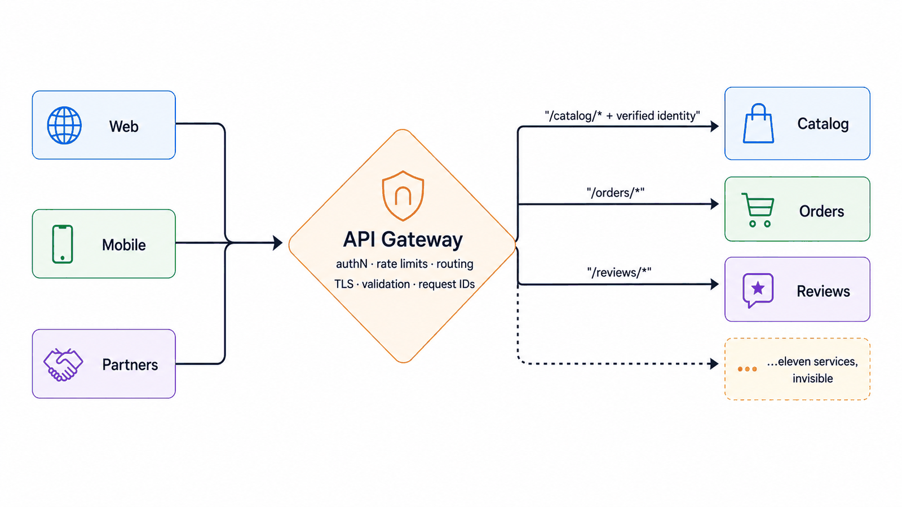
*Figure — API Gateway (course diagram)*

1. **Routing — topology private again.** Paths map to services (`/orders/*` → orders) behind one hostname; splitting orders into order + fulfillment is an invisible routing change.
2. **Authentication, once.** The gateway checks the token's signature (a cryptographic seal proving issuer and integrity), expiry and revocation, then passes verified identity inward as **signed headers or trusted claims** (facts in a token such as user ID and roles). Services never parse raw external tokens; one revocation fix protects all, in one deploy.
3. **AuthN at the gateway, AuthZ in the services.** **Authentication (AuthN)** — "who are you?" — applies everywhere. **Authorization (AuthZ)** — "may you do *this*?" (edit this review) — is domain logic, kept with each service's rules (see [Authorization Service](#authorization-service)).
4. **The policy set.** Rate limits and quotas, request-size limits, **schema validation** (request has the expected shape), TLS — applied uniformly at the one layer seeing every external request.
5. **The root of observability.** It generates the **request ID** that distributed tracing is built around, so every later **span** (a timed step in a trace) links to the request's arrival, and writes one uniform audit record per external request.

**The rule that keeps it stable: policy yes, product no.** Everything passes through it, so teams want response transformations, multi-service orchestration, discount checks… each pushing it toward a hidden monolith needing one team's sign-off per feature and risking *all* incoming traffic on every deploy. Older architectures called this central integration layer an **ESB (enterprise service bus)**, and it was painful. **Test:** can you state the rule without domain words? If not, it belongs in a service. A thin, rarely changed gateway is a stable one.

**North-south only.** Internal (**east-west**) calls must never exit through the gateway and come back in — added latency and needless coupling. Internal traffic has the sidecar and mesh.

### Walkthrough with numbers (one gateway for 11 services)

- **Auth:** one implementation checks each token in about **1 ms** with cached signing keys; the revocation fix ships in **1 deploy instead of 11**.
- **Mobile app:** **1** hostname instead of 9; internal address changes need no app-store release.
- **Refactor drill:** orders splits into order + fulfillment via two routes; clients notice nothing.
- **The bill:** **1–2 ms** per request, and one component whose failure hits all incoming traffic — so it runs redundantly with load-balancer machinery (health checks, paired instances, anycast at scale) and stays thin so it's rarely deployed.
- **Audit:** one consistent record per external request (identity, route, request ID), independent of 11 services agreeing on a log format.

### Trade-offs

**You gain:** policy in one place (working revocation, limits, validation — drift impossible by design); a private topology; one observability root (request IDs, consistent logs, every trace's first span); simpler clients (one hostname, one auth flow, one error vocabulary).

**You pay:**
- **A deliberate SPOF** — softened by redundancy and thinness (fewer changes = fewer outages).
- **An extra hop on everything** — 1–2 ms per external request, plus capacity for 100% of incoming traffic.
- **An organizational bottleneck risk** — if one central team approves every route, everyone slows. Use routing-as-code, team-owned config and automated review so routine changes are self-service.
- **A permanent disguised-monolith risk** — the urge to add domain logic never ends; keep enforcing the boundary.

### When not to use it

- **A single service** — a monolith already has one entrance; a reverse proxy covers boundary work.
- **East-west traffic** — latency, gateway capacity and false dependencies; that's the mesh's job.
- **Very small scale** — two services and one client may not justify it; the case begins when a *second* independent auth implementation appears.

**Watch out for the ESB coming back.** Transformations, orchestration and business rules each seem reasonable and together form a distributed monolith centered on the gateway. If product features routinely need gateway changes, the boundary has broken. Client-specific shaping belongs in a BFF (next lesson).

### API Gateway vs. Service Mesh

| | API Gateway | Service Mesh |
|---|---|---|
| Direction | North-south: outside world → your services | East-west: your services → one another |
| Identity question | "Which user or client is this?" (tokens, API keys — secret strings identifying a calling program) | "Which service is this?" (mutual TLS, workload identity) |
| Policy flavor | Auth, quotas, versioning — product-facing rules | Retries, timeouts, mutual TLS, traffic splits — infrastructure rules |
| Topology | One (redundant) entrance | A sidecar per service — hundreds of small entrances |
| Failure blast radius | All incoming traffic | One service at a time |

They complement each other; using either in the wrong direction causes exposure or needless detours.

### Real-world examples

- **Kong, Apigee, AWS API Gateway** — open-source, commercial and managed versions.
- **Netflix Zuul** — a well-known large-scale gateway whose history shows product logic piling up until BFFs were needed to pull client shaping back out.
- **Envoy-based gateways (Emissary, Gloo)** — the same proxy code at the edge and inside meshes; role depends on placement and config.
- **For AI engineers:** an **LLM gateway** is this pattern aimed at model providers: authentication becomes API-key custody, rate limits become token budgets, path routing becomes model selection — plus usage metering (who used how much, for billing), provider fallback and semantic caching (reusing answers to equivalent questions).

### In the interview

After drawing microservices, expect "how do outside clients reach them?", then probes on responsibilities, availability and avoiding a central monolith.

> **30-second answer:** "All north-south traffic enters one gateway: path routing keeps topology private; cross-cutting rules run once — token validation with revocation, rate limits, size caps, TLS; verified identity flows inward. The gateway authenticates, services authorize. It stays thin — policy yes, product no — or it becomes a monolith with an approval queue. It runs redundantly, creates the request ID, and east-west calls never detour through it."

**Likely follow-ups (with answers):**
- *"Isn't it a single point of failure?"* Deliberately shared, run like the load balancer (redundant instances, health checks, anycast at scale) and kept thin so it rarely changes.
- *"What goes in the gateway vs. the services?"* The no-domain-words test: "reject expired tokens," "100 requests per minute" → gateway; "only the author can edit a review," fraud rules → services.

**Mistake that fails candidates:** business logic in the gateway; ignoring logic creep; routing internal calls through it; claiming it can't fail without explaining redundancy.

### Self-check

- **Q1: The gateway's five responsibilities, and the AuthN/AuthZ split in one sentence.** → Routing that keeps topology private; authentication with trusted identity passed inward; shared limits, validation and TLS; the observability root; a simpler client contract. The gateway works out *who* the caller is (AuthN); services decide *whether that identity may perform a domain action* (AuthZ).
- **Q2: Gateway or service? (a) token signature validation (b) "may this user edit this document?" (c) per-API-key quotas (d) computing an order total (e) rejecting requests over 10 MB (f) applying a loyalty discount.** → Gateway: (a), (c), (e) — no domain words. Services: (b), (d), (f) — product concepts stay with their domain.
- **Q3: Two years in, nearly every feature needs a gateway-team change; daily deploys everyone dreads; a trace shows checkout's call to inventory leaving the datacenter and coming back.** → (1) ESB creep: move business rules back to services and client shaping to BFFs, ban domain vocabulary in gateway review, make routine routing team-owned and self-service. (2) East-west traffic through the north-south gateway: route internal calls directly or via the mesh. Both treat the entrance as the system's center.

### Related patterns

- **Reverse Proxy** — the primitive the gateway adds API policy to.
- **Rate Limiting** — a core gateway policy.
- **BFF** — takes client-specific shaping out of the gateway.
- **Service Mesh** — the east-west counterpart on the same primitive.
- **Load Balancing** — health checks and redundancy so one logical entrance isn't one machine.

### TL;DR

| | |
|---|---|
| Problem | Eleven services, eleven entrances: auth built eleven times (one without revocation), topology as public API, policy drift built into the structure. |
| Mechanism | One north-south entrance: routes by path, authenticates once and passes verified identity inward, enforces limits/validation/TLS, creates the request ID. Thin: policy yes, product no; AuthN at the entrance, AuthZ in services. |
| Costs | An intentional SPOF (redundant and thin), 1–2 ms per request, an organizational bottleneck unless config is self-serve, a perpetual temptation to add logic. |
| Skip it when | One service (a reverse proxy suffices), east-west traffic (the mesh), or the "gateway" is becoming an ESB. |

---

## Backend for Frontend
*Original lesson: [Backend for Frontend on DesignGurus ↗](https://www.designgurus.io/course-play/system-design-patterns/doc/6a536291f81842c7fdd461f3)*


**What it is.** A **Backend for Frontend (BFF)** is a thin backend for *one* client experience — web, mobile or TV — owned by that client's team. Behind the gateway, it calls the needed domain services in parallel and returns exactly what that client's screens show. Services stay the same; each client gets its own API shape.

**Analogy.** A personal shopper who knows your size and taste visits six shops quickly and brings back one bag of only what you'll wear — without setting prices or store policy.

### The problem: one API fits every client equally badly

A year after the gateway, the mobile team struggles:
- The **product screen needs data from 6 services** — **6 cellular round trips of ~300 ms** each.
- Each response carries **40 fields**; the phone shows **6** — wasted bytes, battery and parsing.
- Every screen change waits on a backend team's ticket.

One client-agnostic API can't suit a rich web page, a constrained phone *and* a bare TV screen. The gateway can't help: client-specific shaping is **product behavior**, and the gateway's rule is "policy yes, product no." The BFF gives shaping its own home.

### How it works — four rules

Mobile and web each make **1 call** through the gateway's policy layer. The Mobile BFF (mobile team) fans out **6 parallel calls, ~5 ms each** to Catalog, Reviews, Pricing, Inventory, Recs and Shipping; the Web BFF (web team) gathers what the web UI needs.

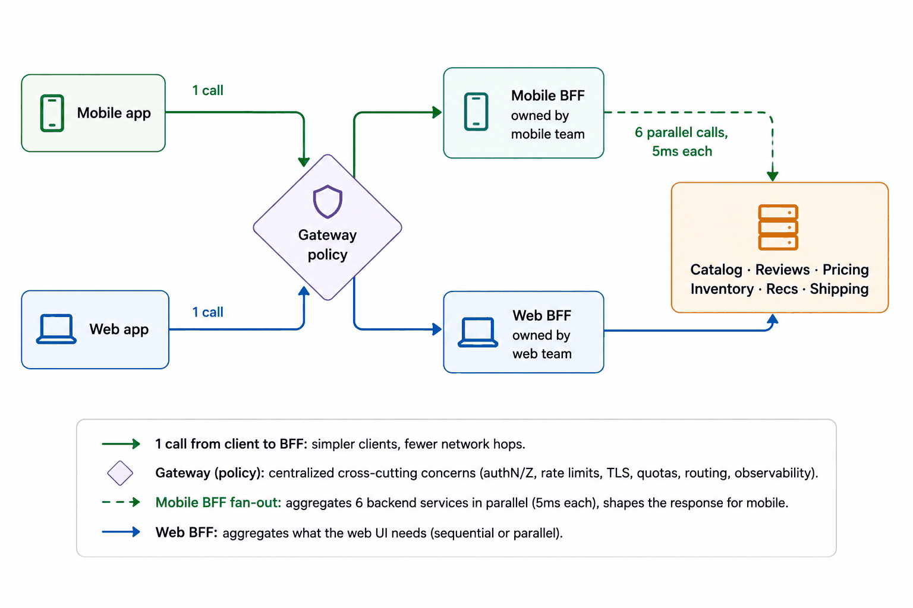
*Figure — Backend for Frontend (course diagram)*

1. **A BFF gathers and shapes — nothing else.** It **fans out** (parallel calls over fast datacenter links) and returns exactly one screen's fields. Pricing, permissions, totals and other domain rules stay in services; a BFF computing discounts is a chunk of monolith hiding in the presentation layer.
2. **The client team owns it** — changing it on the client's release schedule with no backend ticket. This ownership shift is the real point.
3. **One BFF per experience, not per screen.** Web, mobile and TV may each get one; **iOS and Android usually share one mobile BFF** until they truly diverge. A **partner API** sits in a similar spot but is different: a stable, documented, versioned public product.
4. **BFFs never call one another.** Client → gateway → BFF → domain services, one direction only; BFF-to-BFF calls create an accidental service layer of hidden dependencies.

### Walkthrough with numbers (the mobile product screen)

- **Before:** 6 cellular round trips at ~300 ms (mostly sequential), returning a general-purpose ~**45 KB**.
- **After:** **1** cellular round trip, saving at least **1.8 s**; inside the datacenter, **6 parallel calls of ~5 ms** finish gathering in about **20 ms**; the response is **6 KB** of on-screen data.
- **Latency model:** move the *chatty* exchanges onto the fast network and cross the slow one once.

### Trade-offs

**You gain:** per-client latency and payload (chatty gathering on fast links); team independence (no backend ticket queue); a permanently thin gateway.

**You pay:**
- **N more deployables** — each BFF needs a build pipeline, monitoring and an on-call owner.
- **Intentional duplication** — web and mobile BFFs assemble data differently because their screens differ; a shared "BFF framework" to erase it can bring back the coupling you escaped.
- **Leak risk** — BFFs sit near features, so domain rules drift in; two BFFs applying a rule differently make the product inconsistent.

### When not to use it

- **One client experience** — a web-only product's API already serves its presentation; another backend adds latency and ops for nothing.
- **Small teams** — three engineers can't usefully own four backends; independence pays only with separate owning teams.
- **When flexibility belongs on the client** — see GraphQL below.

### BFF vs. GraphQL

Both fix **over-fetching** (unused fields) and **under-fetching** (several calls per screen). **GraphQL** lets the *client* query exactly the shape it wants.

| | BFF | GraphQL |
|---|---|---|
| Who shapes the response | The client's server team, per experience | The client's query, per request |
| Flexibility | Fixed shapes — changes need a BFF deploy | Whatever the schema (typed description of available data) permits, no deploy |
| Server-side complexity | N thin services | One graph, with resolver (per-field fetch function) efficiency to manage (the **N+1 query** problem — one query per item instead of one batch), query cost limits, caching complexity |
| HTTP caching | Easy (fixed endpoints) | Harder (queries usually sent as POST, which caches skip) |

They can be mixed (a BFF per experience built *with* GraphQL). Rule of thumb: BFFs for a few stable experiences; GraphQL when many clients' data needs change faster than you can deploy — budgeting server-side defenses against expensive queries.

### In the interview

Typical prompt: a slow mobile screen makes six calls with big payloads — fix it without touching web. Or: you've drawn a gateway; where does mobile-specific shaping go?

> **30-second answer:** "Each client experience gets a backend-for-frontend: a thin aggregation layer behind the gateway, owned by that client's team. Mobile's six-call screen becomes one call; the BFF fans out to six services in parallel over datacenter links and returns exactly the screen's fields, crossing the slow network once instead of six times. Rules: aggregate and shape but no domain logic, no BFF-to-BFF calls, iOS and Android share one until they really diverge. GraphQL is the alternative when data needs change faster than BFF deploys — the same problem solved client-side, at a server-side cost."

**Likely follow-ups (with answers):**
- *"Can the BFF handle checkout? It already talks to every service."* It can gather reads and *start* the operation, but checkout is a write with money and inventory rules, so a **domain-owned saga** (multi-step workflow with an undo per step) coordinates it; the BFF may kick it off and format its status.
- *"One BFF or two for iOS and Android?"* One, usually the same mobile experience; split only when a real difference (a platform-only feature, a tablet redesign) justifies another deployable and owner.

**Mistake that fails candidates:** business logic in a BFF; BFFs calling each other; a backend per screen with no sustainable ownership.

### Self-check

- **Q1: Gateway, BFF and services all sit between client and data. Each layer's one-line job and owner?** → Gateway (platform team): shared auth, limits, routing. BFF (each client team): gathering and shaping. Services (domain teams): authorization, business rules, writes, authoritative data. Policy at the entrance, presentation in the middle, domain truth in services.
- **Q2: Web, iOS, Android, TV and partner integrations — how many BFFs, and what's different about partners?** → Three BFFs (web; one shared mobile; TV) plus a **public API product** for partners, BFF-shaped but stable, documented and versioned because partners can't update in lockstep with you.
- **Q3: A customer sees different order totals on phone and laptop; the mobile BFF applies a loyalty discount locally to save time, the web BFF doesn't.** → A domain rule leaked into presentation. Move loyalty discounts into the pricing or orders service and have both BFFs show the authoritative total. *If two BFFs could disagree about a value, it was never presentation logic.*

### Related patterns

- **API Gateway** — BFFs sit behind it and keep shaping out of it.
- **Request-Response** — parallelize over fast internal links; cross the slow client network once.
- **Graceful Degradation** — a BFF can render a partial screen when a dependency is down.

### TL;DR

| | |
|---|---|
| Problem | One uniform API fits every client equally badly: mobile pays six cellular round trips and 45 KB of unused data per screen, and every client change queues behind a backend team. |
| Mechanism | A thin backend per client experience, client-team-owned, behind the gateway, fanning out in parallel over fast links and returning one shaped response. No domain logic, no BFF-to-BFF calls, one per experience. |
| Costs | N deployables with real operational weight, intentional duplication, ongoing risk of business rules leaking into presentation. |
| Skip it when | One client experience, teams too small to own the layers, or GraphQL's flexibility fits better (server cost budgeted). |

---

## Rate Limiting
*Original lesson: [Rate Limiting on DesignGurus ↗](https://www.designgurus.io/course-play/system-design-patterns/doc/6a5362dc9bf81a86ec3a0222)*


**What it is.** Count requests **per identity** at the entrance; when an identity exceeds its budget, refuse immediately with a machine-readable "slow down" — HTTP **429 Too Many Requests**, a `Retry-After` header and remaining-budget headers. Fairness becomes arithmetic. (Basics: [Module 0 — Rate limiting and throttling](../00-system-design-fundamentals/README.md#rate-limiting-and-throttling).)

**Analogy.** A turnstile with a personal pass that refills over time; when it's empty the gate shows "try again in 30 seconds" instead of letting you clog the line. (The course diagram calls the gateway a "turnstile".)

### The problem: one partner's bug takes everyone down

The public API serves the mobile apps and several hundred partners. One partner ships a bug that retries in a loop **without backoff** (waiting longer between retries): **40 requests/s to 4,000** — 100x normal. Every request is authenticated and well-formed, so the gateway passes them all; shared services overload and one customer's bug becomes everyone's outage.

The logs also show a **scraper** pulling the catalog through search and a **credential-stuffing** bot trying leaked username/password pairs at login. One gap: **the entrance checks *who* you are, but nobody counts *how often*.** Bulkheads contain damage by resource inside; at the boundary callers have identities and tiers, so fairness is enforced there.

### Why the obvious fixes fail

- **"Block the partner's IP."** They're a paying customer whose broken endpoint should be *slowed*, not cut off. Bots hop across thousands of addresses, and **NAT (network address translation)** puts many users behind one IP — blocking a university can lock out **5,000** students.
- **"Scale up and soak it up."** Servers for someone else's endless retry loop turn their bug into your bill, and an autoscaler happily automates the waste.
- **"Email the partner."** Their fix may take days; your outage continues. As the circuit-breaker lesson put it, when minutes count the human decision must become automatic.

### How it works — four decisions

Every request hits the **gateway turnstile** first. With budget left it takes a token atomically (all-or-nothing, no request slipping in halfway) and forwards; with an empty bucket it refuses at the door with **429 + Retry-After in ~0.1 ms**. Gateway instances share counters in **Redis** via atomic check-and-decrement.

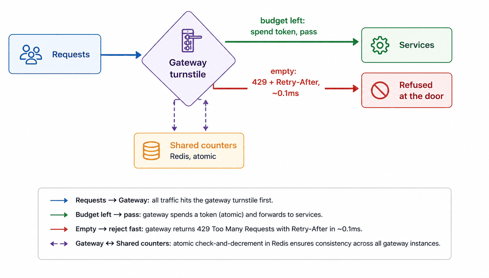
*Figure — Rate Limiting (course diagram)*

**Decision 1 — a refusal is a contract.** Return `429` with `Retry-After: 30` and budget headers like `X-RateLimit-Remaining`. Well-behaved SDKs (ready-made client libraries) — the polite client from the retry lesson — back off automatically, so a 4,000/s loop shrinks within seconds.

**Decision 2 — the algorithm.**
- **Fixed window** ("100 per minute; reset at :00"). Very simple, but has a **boundary burst**: 100 at 11:59:59 + 100 at 12:00:01 = **200 in 2 seconds**, all allowed. Rough protection only.
- **Sliding window** (count the last 60 s continuously). No boundary burst, more bookkeeping; the practical **sliding-window counter** approximates it by blending two adjacent fixed-window counts.
- **Token bucket — the default.** Each identity's bucket holds at most **b** tokens and refills at **r** per second; each request takes one; empty → 429. **r** is the sustainable rate, **b** the forgiven burst. Default because an ordinary page load fires ~**10** requests at once — honest bursts pass while the long-term average stays capped.

**Decision 3 — the key: what are you counting per?** A trusted **API key or account** as primary identity; IP only as a *generous* backstop for anonymous callers (NAT can make one IP thousands of people). Refinements: **tiers** (e.g., free 10/min, paid 1,000/min) and **cost weighting** (an expensive search costs 10 tokens, a health check 1).

**Decision 4 — where counters live.** N gateway instances each enforcing 100/s give a true limit of N x 100. Options:
- **Shared Redis** with atomic `INCR` + `EXPIRE` (increment, auto-expire): about **0.5 ms** per request, exact.
- **Local buckets synced periodically:** faster, approximate. A **tenant** (one customer in a shared system) briefly getting 110 instead of 100 is fine for *protection*; *billing* needs exact counts.

### Walkthrough with numbers (Tuesday's incident, replayed: r=100/s, b=200 for the partner tier)

1. **The buggy partner** sends 4,000/s: the first ~**200** use the burst, then **100/s** pass and **3,900/s** get a 429 in about **0.1 ms** each, never reaching an app service. Versus ~**50 ms** of real work, refusing is ~**500x** cheaper.
2. **Nobody else notices.** Every partner and mobile group has its own bucket — the bulkhead idea applied by *identity* at the boundary.
3. **The partner's SDK** honors `Retry-After` and slows itself; the 100/s refill keeps its normal traffic working, and their engineers get an incident graph instead of a shared outage.
4. **Login has its own rule:** **5 attempts per minute per account** plus an IP backstop; credential stuffing drops from thousands of attempts to a few dozen.
5. **Search costs 10 tokens**, so a scraper drains its budget **10x** faster.
6. **Operations watches patterns, not totals.** Accepted vs. rejected by identity, endpoint and tier separates a broken integration from a global capacity problem or a too-small burst setting. Alert on *sustained shifts* in a tenant's 429 rate, not single 429s — a working limiter refuses by design.

### Trade-offs

**You gain:** structural fairness (no identity starves others); flipped abuse economics (~0.1 ms per attack request instead of full work); computable worst-case capacity (per-tenant ceilings plus the autoscaler max); monetization (tiers become the pricing page).

**You pay:**
- **Real bursts refused** if **b** is too small — "random" failures on normal page loads. Measure client bursts before choosing b.
- **A counter hop per request** (~0.5 ms for Redis) or approximate local counting — choose exactness vs. latency deliberately.
- **Shared-IP false positives** whenever IP is the main key.
- **Many knobs** — endpoint costs, tiers, refill rates and bursts need owners and monitoring.
- **Risky config changes** — a mistaken global cut denies *every* client as fast as the intended rule blocks one abuser; ship limit changes through reviewed, staged, quickly reversible releases.

### When not to use it

- **As a substitute for capacity.** If ordinary valid traffic exceeds the limit, users pay for your under-provisioning; limits should catch *outliers*.
- **Internal east-west overload, mostly** — use **backpressure** (slowing the sender) and bulkheads; meshes *can* rate-limit internally, but with different identities and goals.
- **Small private APIs with three known callers** — talking to them may beat running limiter infrastructure.

**Common misuse:** a bare 429 with no `Retry-After`, budget headers or documentation — a well-meaning client can't adapt and may retry *harder*, turning protection into another burst.

### The algorithms compared

| | Fixed window | Sliding window (counter) | Token bucket |
|---|---|---|---|
| Boundary burst flaw | Yes — 2x at window edges | No | No |
| Allows natural bursts | Only by accident | Not really — smooth by design | Yes, via b (the feature) |
| Memory per key | One counter | Two counters | Token count + timestamp |
| Complexity | Trivial | Low | Low |
| Reach for it when | Rough protection, simplicity first | Smoothness matters (near billing) | By default — matches real traffic |

**Three ways to turn work away:** **rate limiting** = ongoing fairness per *identity*, at the entrance; **bulkhead** = ongoing containment per *resource*, inside; **load shedding** = a global *emergency* drop of low-priority work regardless of sender. Large systems use all three.

### Real-world examples

- **Stripe and GitHub** — published limits, documented tiers, full header sets (`X-RateLimit-*`, `Retry-After`) so SDKs behave predictably.
- **Cloudflare** — enforces limits at edge locations before abusive traffic heads to your origin.
- **Redis atomic counters** (`INCR` + `EXPIRE`) — the usual shared-state implementation; **Envoy and nginx** ship limiter modules.
- **For AI engineers:** LLM APIs limit **tokens per minute**, not requests, because one call can cost 100x another — cost-based limiting. An internal LLM gateway enforces per-tenant token budgets and model quotas, and is itself a polite client handling providers' 429s (Module 5 covered receiving `Retry-After`; this lesson covers sending it).

### In the interview

"Design a rate limiter" is often a standalone question (algorithms, keys, distributed counters); inside a broader design it keeps one client from consuming shared capacity. Expect the fixed-window boundary question.

> **30-second answer:** "A token bucket per API key at the gateway — r the sustained budget, b the forgiven burst — with plan tiers and cost weights. Refusals are a contract: 429, Retry-After, remaining-budget headers, so good SDKs back off. Counters in Redis with atomic increments, exact enough for protection. IP limits only as a generous anonymous backstop, since NAT makes one IP thousands of people. Refusing costs 0.1 ms versus 50 to serve — the cheapest capacity I own."

**Likely follow-ups (with answers):**
- *"What's wrong with fixed windows?"* The boundary burst (200 in two seconds under "100/min"); sliding windows remove it, token buckets also model legitimate bursts.
- *"20 gateway instances — where does the count live?"* Shared Redis (exact, sub-ms hop) or synced local buckets (faster, approximate — fine for protection, not billing).

**Mistake that fails candidates:** banning customers instead of slowing them; IP as the main key for authenticated traffic; silent 429s without `Retry-After`; hiding missing capacity behind tight limits.

### Self-check

- **Q1: In a token bucket, what do r and b control, and which normal behavior depends on b?** → r is the sustainable average; b is how far a short burst may exceed it. Normal users burst (page loads fire many requests; mobile apps sync on wake); without b the limiter makes normal behavior look broken.
- **Q2: Keys and limits for (a) public catalog search, (b) login, (c) a partner's nightly bulk export, (d) free vs. paid tiers on one endpoint.** → (a) Per-API-key bucket with a high search token cost, so scraping drains quickly. (b) Strict per-account limit (e.g., 5/min) — credential stuffing targets accounts — plus a generous anonymous IP backstop. (c) A separate documented schedule or bulk endpoint so batch work doesn't fight interactive traffic. (d) r and b by plan, with the upgrade path in the 429 response.
- **Q3: At a university launch thousands of students get 429s within an hour; traffic is modest and services healthy.** → The campus shares one NAT IP and IP was the main key, so thousands counted as one identity — the limiter caused the outage. Key authenticated requests by account or API key; keep IP as a generous anonymous backstop. Rule: **key on the identity the policy is meant to limit** — an IP is a network location, not a person.

### Related patterns

- **API Gateway** — where the policy is enforced.
- **Retry with Exponential Backoff** — the client side honoring `Retry-After`.
- **Bulkhead** — internal resource containment vs. identity limits at the entrance.
- **Auto-Scaling** — known tenant ceilings make maximum capacity computable.
- **Graceful Degradation** — under global pressure, load shedding can prioritize paid or critical work.

### TL;DR

| | |
|---|---|
| Problem | The entrance checks identity, not frequency: one partner's 4,000/s loop, a scraper or a bot, and everyone shares the outage. Blocking IPs bans campuses; scaling up buys servers for a malfunction. |
| Mechanism | Per-identity token buckets at the gateway (r = sustained rate, b = forgiven burst), weighted by endpoint cost, tiered by plan, counted in shared atomic storage. Refusal takes ~0.1 ms and is a contract: 429, Retry-After, budget headers. |
| Costs | Too-small bursts punish honest clients, a counter hop (or imprecision), NAT false positives when IP is the key, many knobs needing owners and 429 dashboards. |
| Skip it when | It would ration your own under-provisioning, the problem is internal east-west overload (backpressure/bulkheads), or three known consumers could just talk. |

---

## Cursor-Based Pagination
*Original lesson: [Cursor-Based Pagination on DesignGurus ↗](https://www.designgurus.io/course-play/system-design-patterns/doc/6a5363aa1ecebe8563b1f005)*


**What it is.** Instead of asking for "page 2", the client says **where it stopped**. A **cursor** is an opaque bookmark (clients can't see inside or depend on its format) — e.g., "everything after order 8412" — returned with each page. Tied to a *row*, not a *count*, it stays fast at any depth and doesn't skip or repeat items when the list changes.

**Analogy.** A bookmark vs. "page 212": insert pages at the front and "page 212" shows different text; the bookmark stays where you stopped.

### The problem: offset pagination fails two ways

**Offset pagination** requests a numbered page and makes the database skip rows: `?page=2` → `OFFSET 20 LIMIT 20`.

1. **Drift.** A user reads page 1 of the mobile order feed; three new orders arrive at the top, shifting every row down three, so page 2 starts with three already-seen items — **duplicates**. Deletions do the reverse and **skip** unseen rows. Page numbers are positions in a moving list.
2. **Deep-page cost.** A partner exports with `?page=5000`: `OFFSET 100000` can't jump to row 100,000 — it scans and discards 100,000 rows. Work grows linearly: page 1 **2 ms**, page 5,000 **800 ms**.

### How it works

```
Offset:  SELECT ... ORDER BY created_at DESC, id DESC
         OFFSET 100000 LIMIT 20                 -- scan & discard 100,020 rows

Cursor:  SELECT ... WHERE (created_at, id) < (:cursor_ts, :cursor_id)
         ORDER BY created_at DESC, id DESC LIMIT 20
                                                -- index seek: reads exactly 20 rows
```

1. **Return a cursor with every page** — `next_cursor`, an opaque token, usually the last row's sort values encoded in **base64**. It records "where I stopped" as values, not a count.
2. **Seek from the cursor via an index** — `WHERE (created_at, id) < (cursor values)` lets the database jump straight there through an index, in the same time at any depth; nothing is scanned and discarded.
3. **Progress is tied to a row** — rows inserted before it can't move it, so there's no drift.

*Offset scans and discards; cursor seeks*
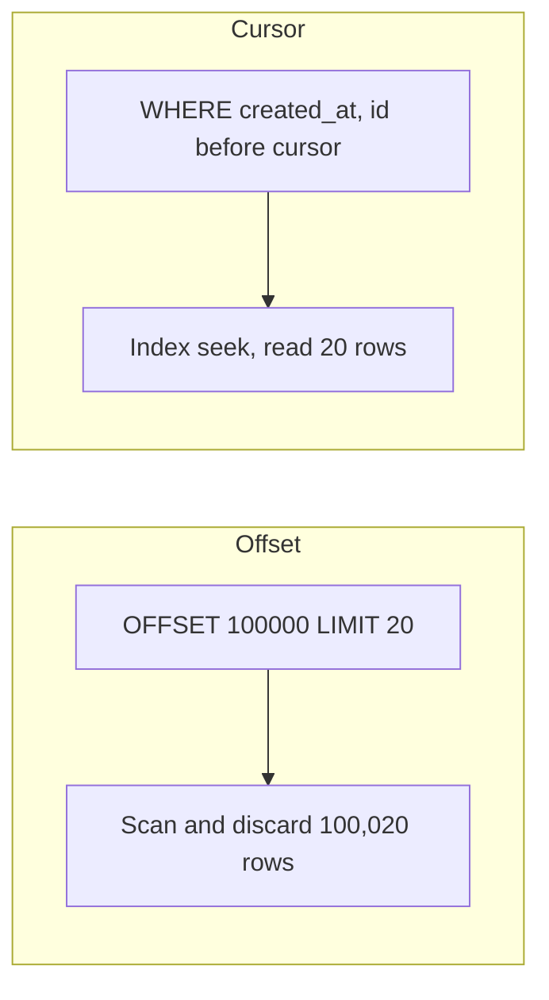

**Three correctness rules:**
- **A tiebreaker column is mandatory.** Sorting by `created_at` alone breaks when bulk imports or busy seconds create identical timestamps — "after T" repeats or skips other rows at T. Use `(created_at, id)` and store both in the cursor.
- **Opaque means opaque.** Encode it and document it only as "a token"; if clients parse or build cursors, your internal sort key becomes a permanent public contract (a versioning problem).
- **A stable, indexed sort.** The order must be deterministic and index-backed, or the database still scans despite cursor syntax.

### Trade-offs

**You gain:**
- **Constant cost at any depth** — page 5,000 costs what page 1 does.
- **No drift** — a correctness requirement for infinite scroll.
- **Replica-friendly** — cheap index seeks suit **read replicas**.

**You pay:**
- **No random access** — next/previous, no "jump to page 47" (though you can jump *by value*, e.g., "start from last Tuesday").
- **Awkward totals** — "page 3 of 812" needs a separate, possibly expensive `COUNT(*)`; big products use infinite scroll or approximate counts.
- **Cursor lifecycle** — changing the sort breaks existing tokens; every supported sort order needs its own indexed cursor design.

### When not to use it

- **Small, shallow UIs where people jump between pages** — a **200-row** admin table with "page 4" works fine with offsets.
- **When the product truly needs numbered pages** over a small dataset — offsets with an explicit **depth cap** (even large search engines cap paging depth).

**Common misuse:** giving partners offset APIs, which they turn into deep exports that lock you into linear database work forever.

### Offset vs. cursor

| | Offset (`?page=47`) | Cursor (`?after=eyJ0cy...`) |
|---|---|---|
| Cost at depth | Linear — scan and throw away | Constant — index seek |
| List changes while scrolling | Duplicates and skips | Unaffected — tied to a row |
| Random page jumps | Yes — its single advantage | No — next/prev only (plus seek by value) |
| "Page 3 of 812" | Natural | Awkward (separate count) |
| Fits | Small, shallow admin UIs with page jumps | Feeds, APIs, exports, infinite scroll — the default |

### Real-world examples

The standard for feeds, public and partner APIs, exports, bank transaction histories and infinite scroll (the course uses these as use cases rather than naming products).

### In the interview

Infinite-scroll questions test whether you spot drift; "a partner's export times out on page 5,000" tests deep-page cost. Name both failures first.

> **30-second answer:** "Offsets break two ways at scale: OFFSET N makes the database discard N rows, so deep pages slow linearly, and page numbers are positions in a moving list, so inserts during scrolling cause duplicates and skips. Cursors fix both: the response carries an opaque token with the last row's sort values, and the next request seeks with WHERE (created_at, id) < cursor over an index — constant time, tied to a row. Details: a unique tiebreaker because timestamps collide, opaque tokens so the sort key isn't a public contract, and no jump-to-page-47 — which feeds never needed."

**Likely follow-ups (with answers):**
- *"Why isn't `created_at` enough?"* Tied timestamps (see the tiebreaker rule); `(created_at, id)` makes every position unique.
- *"The client wants to start from last week."* Seek by value — build the starting cursor from the date; only count-based jumps go away.

**Mistake that fails candidates:** offsets for a large feed or partner API; timestamp-only cursors; publishing a cursor format clients start parsing.

### Self-check

- **Q1: The two offset failures and the one change fixing both.** → **Drift** (inserts/deletes shift rows across pages → duplicates and skips) and **deep-page cost** (OFFSET N scans and discards N rows). A cursor tied to the last row's sort values allows an index seek to a position earlier inserts can't disturb.
- **Q2: Pagination for (a) a bank transaction-history API, (b) a 200-row internal config table, (c) a constantly updated social feed?** → (a) Cursor — a permanent, growing list where correctness matters. (b) Offset — small, with real page navigation. (c) Cursor — constant writes would cause visible drift.
- **Q3: A partner's nightly cursor export misses ~2% of orders, clustered in busy seconds; the cursor holds only `created_at`.** → Timestamp collisions: "strictly after this timestamp" never reaches the other rows sharing it (busy-second clustering is the tell). Query `WHERE (created_at, id) > (:ts, :id)` and put both values in the cursor. Because the token was opaque, its format changes without breaking partners; they rerun the export to recover the missing rows.

### Related patterns

- **API Gateway** — the pagination contract documented and applied uniformly at the entrance.
- **API Versioning** — opaque tokens let the internal sort key change without a public format change.
- **Primary-Replica** — cheap indexed cursor reads suit replicas.

### TL;DR

| | |
|---|---|
| Problem | Offsets scan and discard rows to reach deep pages (linearly slower) and point at positions in a moving list (duplicates and skips). |
| Mechanism | An opaque token with the last row's sort values; the next page is an index seek, `WHERE (sort_key, tiebreaker) < cursor` — constant cost, tied to a row. |
| Costs | No jump-to-page-N (seek by value instead), awkward totals, a cursor lifecycle tied to a stable, indexed, unique sort key. |
| Skip it when | Small, shallow UIs with page jumps — offsets with a depth cap are fine. |

---

## API Versioning
*Original lesson: [API Versioning on DesignGurus ↗](https://www.designgurus.io/course-play/system-design-patterns/doc/6a53641cf5fad4cc63413b82)*


**What it is.** Changing a published API without breaking its clients, by three rules: **make additive changes whenever you can; when you can't, create an explicit, coarse-grained version; retire old versions through a managed lifecycle.**

**Analogy.** A city renaming a street puts the new sign beside the old one, announces a date, mails letters, posts "old name ending soon" detours — and only then removes the old sign.

### The problem: a rename that broke 200 partners

A team renames `order.state` to `order.status` because "state" confused people. Within an hour **200 partner integrations** can't parse responses, and an **18-month-old mobile build** — used by **one-third** of users who can't be forced to update — shows empty order screens.

**Once published, an API can't be taken back.** Clients you can't see, update or schedule build on every field you release and keep running your old decisions on their own schedules (the pub/sub lesson's public-schema rule; the BFF lesson's "partner APIs are products").

### Why the obvious responses fail

- **"Never change anything."** Every early mistake — the confusing `state` — becomes permanent.
- **"Announce a migration deadline."** Assumes you control partners' engineering schedules and users' installed versions. You don't.
- **"Break it and say sorry."** Burns the platform trust integrations depend on; Twitter's v1→v2 move showed the ecosystem cost.

### How it works — three rules

**Rule 1 — additive first: most changes need no version.**
- Add fields, endpoints and optional parameters with safe defaults; **never remove, rename or retype** existing ones.
- Clients are **tolerant readers**, ignoring unknown fields.
- Additive servers plus tolerant clients make most changes invisible (pub/sub's additive-only rule applied to REST).
- The honest cost is clutter: `status` beside `state`, both documented, one preferred, until a major version cleans up.

**Rule 2 — for unavoidable breaks, version explicitly and coarsely.**
- The rename ships in `/v2/`; `/v1/` keeps the old shape.
- Version the **whole API or resource**, never single endpoints — `/orders/v3` calling `/items/v5` creates an unmanageable test matrix.
- The gateway routes `/v1` through a thin **adapter** translating old requests and responses onto today's internals: **one backend, two interfaces, no forked implementation.**

*One backend, two interfaces*
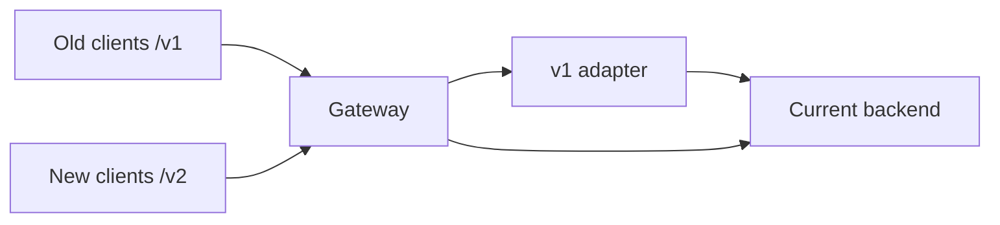

Where the version goes:

| | URL path (`/v2/orders`) | Header (`Accept: ...v2+json`) |
|---|---|---|
| Visibility | In every log, link and curl command | Hidden — cleaner in theory, harder to debug |
| Caching/routing | Easy (different URLs) | Needs header-aware caches and routes |
| Adoption reality | The practical default | Favored by a minority of REST purists |

Path is the practical default, but **consistency matters more than placement**.

**Rule 3 — versions retire on a lifecycle, or they live forever.** Each live version multiplies testing, docs, security and support. To retire one:
1. Announce a deadline with a **specific date**.
2. Send machine-readable **`Deprecation`** and **`Sunset`** headers (Sunset carries the removal date).
3. Track usage **per client and per version** on a dashboard.
4. Reach out directly to remaining users.
5. Schedule **brownouts** — announced, temporary outages of the old version (e.g., **15 minutes of HTTP 410 Gone**) that flush out integrations whose owners ignore email.
6. Remove it on the published date.
Keep **no more than two live versions**: current and retiring.

*Version lifecycle*
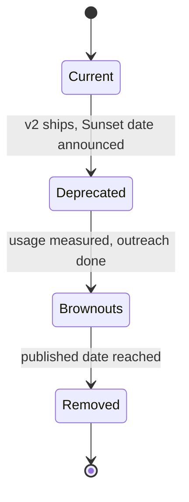

### Worked classification (additive vs. breaking)

- Add `order.estimated_delivery` → **additive** (tolerant readers ignore it).
- Rename `state` → `status` → **breaking**; safe path: add `status` beside `state`, remove `state` only in a major version.
- Make an optional request field required → **breaking** (previously valid requests fail).
- Add an endpoint → **additive** (old clients never call it).
- Change `amount` from integer cents to a decimal string → **breaking** (type and meaning change under the same name).

### Trade-offs

**You gain:**
- Change without breaking the ecosystem — the rename ships, old apps work, trust accumulates.
- Fixable mistakes — design errors get a planned exit.
- Machine-readable retirement — Sunset headers and brownouts drive migrations without endless meetings.

**You pay:**
- **Maintaining N versions** — the two-version limit is a budget.
- **Adapter decay** — translation code quietly rots.
- **Additive clutter** — duplicate fields between major versions.
- **Sunsetting is organizational work** — dashboards, partner communication, brownout scheduling.

### When not to use it

- **Internal APIs with coordinated deploys** — update caller and service together, with **contract tests** (automated checks that both sides honor the shared interface).
- **Pre-launch and beta surfaces** — label instability (e.g., `/beta/`); long-term promises start at **GA** (general availability).
- **Event schemas** — same law, different transport: schema registries, additive rules, versioned topics.

**Common misuse:** creating `/v3` because editing `/v2` feels risky while `/v1` is never retired — three permanent, half-maintained versions slowing every change.

### Real-world examples

- **Twitter's v1→v2** migration — the cautionary tale of breaking changes eroding ecosystem trust.
- Sunset/Deprecation headers, 410 Gone brownouts and gateway adapters are the industry-standard retirement toolkit the course describes.

### In the interview

Direct: "How do you change an API without breaking a mobile app you can't update?" Tougher: "How do you remove v1 two years after v2?" — testing whether your design includes retirement.

> **30-second answer:** "Additive first: new fields and endpoints, never renames or removals, tolerant-reader clients — most changes need no version. For a truly breaking change, a coarse /v2 at the gateway, routed through a thin adapter onto current internals — never a forked backend or per-endpoint versions. And versions retire on a lifecycle or live forever: Sunset and Deprecation headers, a per-client usage dashboard, outreach, scheduled brownouts — fifteen announced minutes of failures that wake integrations that don't read email — then removal. At most two live versions, because each extra one multiplies tests, docs and support."

**Likely follow-ups (with answers):**
- *"URL or header?"* Path, practically (see the table); consistency matters more.
- *"How do you know v1 can really go?"* Per-client, per-version traffic data; headers, outreach and brownouts to move or surface the rest; call the last few; remove on data, not hope.

**Mistake that fails candidates:** "we'll be careful" instead of a compatibility mechanism; per-endpoint versions; versions with no dated retirement.

### Self-check

- **Q1: Additive or breaking? (a) add `order.estimated_delivery` (b) rename `state`→`status` (c) require a previously optional request field (d) add an endpoint (e) change `amount` from integer cents to a decimal string.** → (a) additive; (b) breaking — add `status` first, remove `state` in a major version; (c) breaking; (d) additive; (e) breaking.
- **Q2: Versioning policy for an internal service API, a public partner API and the mobile BFF — and why different?** → Internal: coordinated deploys + contract tests, no public versioning. Partner: coarse versions, Sunset headers, measured usage, brownouts — partners run their own schedules. Mobile BFF: quick additive changes by the client team, major versions tied to a **minimum-supported app build**, because installed builds are uncontrollable consumers. Less deploy control → stronger compatibility process.
- **Q3: `/v1` was deprecated three years ago, still takes 30% of traffic, and nobody knows who uses it. Retirement steps in order, and the original mistake?** → Instrument per-client usage (unknown → named list) → `Deprecation` and `Sunset` headers with a real date → contact consumers, largest first → announced, repeating, escalating 15-minute 410 brownouts to surface dormant integrations → call the final few → remove on the published date. The mistake: "deprecated" with no measurement or sunset date, which made it permanent.

### Related patterns

- **API Gateway** — home of version routes and adapters.
- **BFF** — a partner-facing BFF is a public API product under these rules.
- **Publish-Subscribe** — event schemas follow the same permanent-contract rule.
- **Cursor Pagination** — opaque cursors expose less structure, needing fewer versions.

### TL;DR

| | |
|---|---|
| Problem | Published APIs serve clients you can't see, update or schedule; one well-meant rename breaks 200 partners and every old mobile build at once. |
| Mechanism | Additive-first (add, never rename/remove/retype; tolerant readers); coarse explicit versions via gateway adapters for unavoidable breaks; lifecycle retirement (Sunset headers, usage dashboards, outreach, brownouts, removal) — at most two live versions. |
| Costs | N versions to maintain, rotting adapters, additive clutter, organizational sunset work. |
| Skip it when | You control both sides (coordinated deploys + contract tests), the surface is labeled beta, or it's an event schema (pub/sub's playbook). |

---

## Sidecar
*Original lesson: [Sidecar on DesignGurus ↗](https://www.designgurus.io/course-play/system-design-patterns/doc/6a5364939bf81a86ec3a0846)*


**What it is.** A small helper process running **next to every service instance** on the same machine. The service talks to it in plain text over **localhost**; the sidecar does the outward networking work — TLS, retries, timeouts, metrics, tracing — so the service does only its own job. (Basics: [Module 0 — Service discovery, sidecars and service mesh](../00-system-design-fundamentals/README.md#service-discovery-sidecars-and-service-mesh).)

**Analogy.** A personal assistant beside each executive: the executive says "call inventory"; the assistant dials, does security checks, retries busy lines and logs the call — identically for every executive, whatever language they speak.

### The problem: east-west traffic has hundreds of entrances

The module turns to **east-west traffic**, which needs the same consistent handling as public requests:
- **Mutual TLS (mTLS)** — encryption where *both* sides prove identity (normal TLS proves only the server's).
- Timeouts, retries, standard metrics and **trace-header propagation** (passing the trace ID along so tracing links calls).

Doing this with libraries across **11 services in 3 languages** yields 11 retry behaviors — the gateway lesson's policy drift, east-west. A gateway can't help: it centralizes public policy because external traffic shares one entrance, while internal calls rightly go directly between hundreds of instances.

### Why the obvious fixes fail

- **"Use a shared library."** One version per language, upgrades waiting on 11 deploy schedules — bound to drift.
- **"Use one central internal proxy."** One policy place, but every internal call gets an extra hop and a SPOF — and the gateway's own rules forbid east-west detours.

The sidecar inverts placement: **if you can't bring all traffic to one proxy, bring a proxy to every instance.**

### How it works

A Go Checkout instance and a Python Inventory instance each talk plain text over localhost to their own sidecar ("same binary"). The only off-machine hop is sidecar-to-sidecar mTLS, where timeouts, retries, circuit breaking, metrics and traces happen. Fleet math in the figure: 11 services x 40 instances = 440 sidecars, ~50 MB each, ~22 GB of memory for networking.

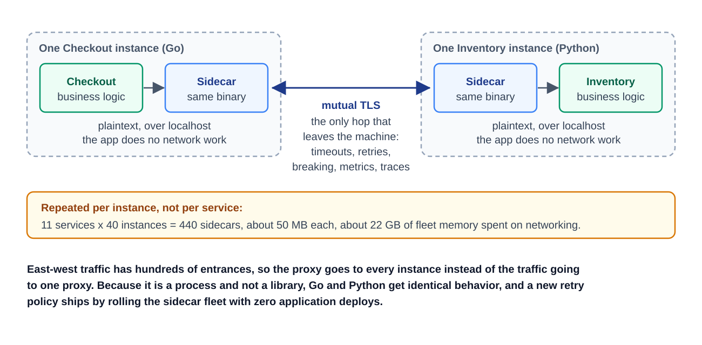
*Figure — Sidecar Pattern (course diagram)*

1. **One helper process per service instance.** The app sends plain requests to localhost; the sidecar adds TLS, timeouts, retries and telemetry on the network side. Networking logic lives outside the app.
2. **Language-agnostic by design.** A separate process, not a linked library, so Python, Go and Java run the identical binary — no parallel implementations.
3. **Policy upgrades at infrastructure speed.** A new retry policy, timeout or certificate reaches every service by rolling the sidecar fleet — **zero application deploys**. Networking gets its own lifecycle.
4. **Smaller application code.** Timeout, retry and **circuit breaker** mechanics (reliability module) move into infrastructure; services keep only *domain* decisions, like which reduced response to return when a dependency fails.
5. **The wider family.** "Sidecar" means any co-located helper — log collectors, secret fetchers (loading passwords and keys from a secure store), config reloaders — but *proxy* sidecars became the most influential, standardizing service networking. A proxy sidecar is the reverse-proxy primitive, once per instance.
6. **A building block, not the system.** Hundreds of proxies still need certificates, routes and policies from somewhere; the service mesh (next lesson) supplies that. The sidecar does the work; the mesh decides and distributes its configuration.

**Roll it out gradually.** Start with a non-critical service; measure memory and latency and verify startup/shutdown ordering; expand group by group, separating proxy bugs from app bugs before the fleet depends on it.

### Walkthrough with numbers

- **Memory:** ~**50 MB** plus a little CPU per sidecar looks cheap until multiplied: **11 services x 40 instances = 440 sidecars ≈ 22 GB**. Always multiply per-instance costs by fleet size.
- **Latency:** ~**0.5 ms** per sidecar, two per internal call (sender outbound, receiver inbound) ≈ **1 ms** per call; measured p99 may rise ~**2 ms** with TLS. Fine for most services, not microsecond budgets.
- **Lifecycle bug:** if the app is ready before its sidecar, its first outgoing calls fail after every deploy. Fix: a **readiness gate** / "hold application until proxy started". On shutdown, stop the app first and keep the sidecar to finish in-flight requests.
- **Crash blast radius:** a crashed sidecar takes only its instance off the network; it fails health checks, leaves load-balancer rotation and restarts — versus a central proxy taking everything down.

### Trade-offs

**You gain:** identical networking in every language, upgraded fleet-wide without app deploys; mTLS everywhere in one rollout with no code changes; slimmer services.

**You pay:**
- **Per-instance cost times everything** (the 22 GB).
- **Per-hop latency** (~1 ms per call).
- **A new lifecycle** — startup order, independent sidecar crashes, **version skew** (mixed sidecar versions mid-upgrade).
- **One more debugging suspect** — every network incident must separate app from proxy behavior.

### When not to use it

- **Small single-language fleets** — five Go services and one team can keep one good library and skip 50 MB per instance.
- **Microsecond latency budgets** (e.g., trading) — two extra process hops may be too much.
- **Serverless** — no long-running instance to sit beside; the platform must provide equivalent controls.
- **No platform team** — hundreds of injected processes, upgrades and failure modes need an owner. Newer **sidecar-less** options do the same jobs without a process per pod (Kubernetes' smallest deployable unit), using **eBPF** (programs running inside the OS kernel) or **ambient**, node-level (one per machine) proxies. The jobs remain even when the separate process goes.

**Common misuse:** sidecars for ten services because big companies use them — one team, two languages, little drift: all the cost, none of the organizational-scale benefit. Revisit as teams and languages grow.

### Sidecar vs. shared library

| | Shared library | Sidecar |
|---|---|---|
| Multi-language coverage | One implementation per language, drifting | One binary, identical everywhere |
| Upgrade path | Waits on N teams' deploys | Fleet-wide in minutes, no app deploys |
| Latency | Zero — in-process | ~1 ms per call (two hops) |
| Memory | Shared with the app | ~50 MB x every instance |
| Fits | One language, few services, tight budgets | Many languages, many services, drift problems |

The deciding factor is organizational: libraries fail when many languages and teams must keep behavior matched on different schedules. Below that point a library is lighter, faster and good enough.

### Real-world examples

The course names family members rather than products: proxy sidecars are the Envoy-style proxies meshes use (next lesson); log collectors, secret fetchers and config reloaders are non-proxy sidecars; eBPF and ambient node-level modes are sidecar-less alternatives.

### In the interview

Usually the first half of a mesh question, or "how do you roll out mTLS across 11 services in 3 languages without touching every codebase?"

> **30-second answer:** "A proxy process beside every instance: the app speaks plain text over localhost; the sidecar does mTLS, timeouts, retries, metrics and trace propagation. As a process, it behaves identically in every language and upgrades fleet-wide with no app deploys. Costs I size first: ~50 MB and ~0.5 ms per instance, two hops per call, times the fleet, plus startup ordering and crashes. Coordinating hundreds of them is the mesh's control plane."

**Likely follow-ups (with answers):**
- *"Why not a shared library?"* See the comparison table: drift across languages and team schedules vs. fleet-wide upgrades in minutes; below that tipping point the library wins.
- *"What if the sidecar crashes?"* Only that instance fails health checks and leaves rotation until restart.

**Mistake that fails candidates:** equating one sidecar with a full mesh; listing benefits without multiplying costs across the fleet.

### Self-check

- **Q1: What moves from app code into a sidecar, and which two abilities does a separate process have that a library lacks?** → mTLS certificates and handshakes, timeouts, retries with backoff, circuit-breaking mechanics, metrics, trace propagation. A process is **language-agnostic** and **upgraded independently** of app deploys.
- **Q2: Fleet A: 5 Go services, one team. Fleet B: 30 services, 4 languages, 9 teams. Library or sidecar?** → A: library — no implementation or deploy drift, so sidecars add memory, latency and lifecycle complexity for nothing. B: sidecars — four implementations across nine release schedules would drift. The factor is how many independent language x team combinations must stay consistent.
- **Q3: After adopting sidecars, internal p99 rises ~2 ms and some pods fail their first requests after every deploy. Which is a cost and which a defect?** → The p99 rise is the **documented cost** of two sidecars plus TLS — budget it. The first-request failures are a **defect**: a startup race; gate app readiness on the sidecar (readiness gates / hold-until-proxy-started), and on shutdown stop the app first and let the sidecar drain.

### Related patterns

- **Reverse Proxy** — the primitive at its smallest useful size, one per instance.
- **Service Mesh** — the control plane configuring hundreds of sidecars.
- **API Gateway** — the north-south counterpart: one shared entrance vs. many local proxies.
- **Timeout / Retry** — reliability mechanics moved out of each codebase.

### TL;DR

| | |
|---|---|
| Problem | East-west traffic needs mTLS, retries, timeouts and tracing but has hundreds of entrances and no choke point, so per-language libraries drift at each team's pace. |
| Mechanism | A proxy process beside every instance, reached over localhost; apps speak plain text locally, sidecars network identically in every language, upgraded fleet-wide with no app deploys. |
| Costs | ~50 MB and ~1 ms per call times the fleet, startup/shutdown ordering, crashes of their own, one more debugging suspect. |
| Skip it when | Small single-language fleets (library wins), microsecond budgets, serverless, or no owner for hundreds of new processes. |

---

## Service Mesh
*Original lesson: [Service Mesh on DesignGurus ↗](https://www.designgurus.io/course-play/system-design-patterns/doc/6a536539f81842c7fdd47b08)*


**What it is.** A central brain for a fleet of sidecars, in two **planes**. The **data plane** is the sidecars, carrying and policing traffic on every hop. The **control plane** is a central coordinator that tracks what's running, computes each sidecar's configuration (routes, certificates, policies) and keeps pushing updates over long-lived streams.

**Analogy.** Air traffic control: planes (sidecars) fly and follow the rules; the tower carries no passengers but knows where every plane is, issues clearances and changes instructions live. If the tower's radio goes quiet, planes keep flying on their last clearance — they just can't get new ones.

### The problem: 440 sidecars, no shared brain

The rollout worked — **440 proxies**, consistent networking. Six months later, coordination hurts:
- **Certificates.** Every sidecar's mTLS certificate expires. Rotating **440 certificates every 90 days** by hand never ends; miss one quarter and at **2 AM** checkout can't call inventory — `certificate expired`. An outage from routine upkeep.
- **Policy drift, relocated.** An engineer tweaks retries during an incident and never reverts; another team keeps an old timeout. Eleven drifting libraries became **440 drifting config files**.
- **Routing keeps changing.** Deploys and autoscaling change instance IPs every few seconds; static files can't keep up.
- **Security's question has no answer.** "Only checkout and refunds may call payments" can't be expressed; network reachability *is* the permission.

Sidecars standardized *how* traffic moves, not the *knowledge* they need: which workloads exist, who may talk to whom, routes, policies, certificates.

### Why the obvious fixes fail

- **"Template the files in CI."** Templates handle static settings, but pipelines take minutes while IPs change in seconds. Routing is live state needing continuous delivery.
- **"Use DNS for discovery."** Answers are cached for their **TTL**, so callers hit removed instances for minutes (the load-balancer lesson's caching problem, east-west). DNS gives location only — no health, identity certificates or authorization policy.
- **"Write a cert-rotation runbook."** 440 certificates every 90 days, perfectly, forever; one slip is an overnight outage. Routine decisions need machine-speed automation.

### How it works

The control plane (top) watches the registry, issues and rotates certificates and holds policy, pushing config and certificates over long-lived **xDS** streams to the sidecars beside Checkout, Inventory and Payments (x 440), which talk mTLS to each other. If the control plane goes silent, sidecars keep serving with their last config — changes freeze, traffic doesn't.

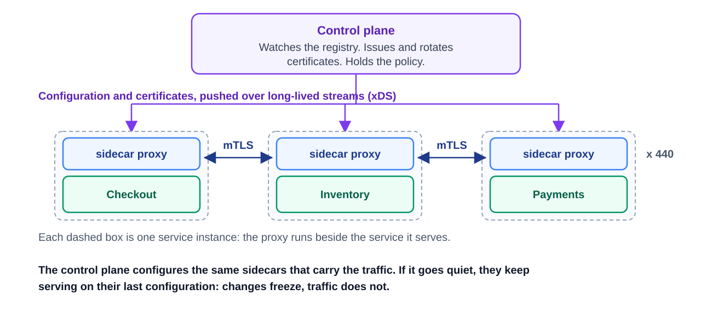
*Figure — Service mesh: data plane and control plane (course diagram)*

1. **Certificates take care of themselves.** The control plane is a **certificate authority (CA)** issuing each workload a cryptographic **workload identity** (e.g., "checkout, in prod") via **short-lived, automatically rotated certificates** (e.g., hourly). Expired-cert outages become very unlikely, and services trust *identity*, not *network location* — the foundation of **zero-trust networking**, where being inside the network earns no automatic trust.
2. **Routing at platform speed.** The control plane watches the orchestrator's live registry (e.g., the **Kubernetes API server**) and **streams** new routes to affected sidecars within seconds using **Envoy's xDS** — long-lived, typed configuration streams (resolving the forward reference from the bidirectional-streaming lesson).
3. **Declarative, central policy.** **Declarative** means describing the desired result, not the steps. Retry budgets, timeouts and circuit breaking (often called **outlier detection**) become versioned config objects, global or per service, continuously fed to sidecars.
4. **Authorization has a home.** One policy object — "only checkout and refunds may call payments" — is enforced by the *receiving* payments sidecar against the caller's cryptographic identity, logging every allow and deny. Service-to-service access control becomes explicit and auditable.
5. **Observability for free.** Every proxy sees every request and reports uniform rates, errors, latency and trace spans per service pair with no app instrumentation; the **dependency graph** becomes visible.
6. **Traffic control as configuration.** A small config block sends **5%** of inventory calls to inventory-v2 (a **canary**), **mirrors** real traffic to a test service, or **injects faults** in planned drills — no code changes.
7. **The data plane fails static.** If the control plane is down, sidecars keep their last config: existing traffic flows, but routes, certificates and policies stop updating. The control plane is still not optional — new instances (deploys, autoscaling) may get no routes or identity, and existing certificates keep counting toward expiry. Stable short-term, losing the ability to change; set control-plane recovery targets inside that window.

### Walkthrough with numbers (the four incident problems, under a mesh)

- **Certs:** identities rotate **hourly** across all 440 proxies automatically — a risky chore becomes background automation, with zero-trust identity on top.
- **Canary:** one policy sends **5%** to inventory-v2, reversible **within seconds**; previously every caller needed a code change or special balancer (the next module depends on this).
- **Security request:** one authorization policy at the receiving sidecar, logging allowed and denied calls by workload identity.
- **Dependency map:** instant traffic, error and **p99** dashboards for every service pair, often revealing undocumented call paths.
- **The bill:** the sidecar lesson's ~**22 GB** and ~**1 ms** per call, plus a distributed control plane that must be **HA** (highly available). A platform team runs it as an internal product — safe defaults, migration help, documentation, an exception process — so app teams understand the policies affecting them without knowing every proxy setting.

### Trade-offs

**You gain:** zero-trust mTLS with automatically rotated workload identity (often justifying the project alone); fleet-wide observability without instrumentation; traffic control by settings (canaries, mirroring, fault injection); central policy that can't drift.

**You pay:**
- **A distributed system to manage your distributed system** — HA, careful upgrades, specialist owners; a platform-team product, not a config switch.
- **All inherited sidecar costs** — memory, CPU, latency, lifecycle complexity.
- **More debugging layers** — app code, sidecar *and* central policy are suspects.
- **A global blast radius** — one bad global policy reaches the whole fleet as fast as config spreads.
- **Config sprawl** — authorization, routing and reliability objects multiply until policy governance is a discipline of its own.

**Failure example — the global retry rule.** A mesh-wide "retry every failed request 3x" is added for reliability; finance then reports **duplicate orders**, because failed order `POST`s (not **idempotent**) ran several times. The mesh didn't create the unsafe write but spread a bad policy everywhere instantly. Guardrails: policy as code (review, staged rollout, canary on one service first); retries skip non-idempotent methods by default; retrying writes requires audited **idempotency keys**.

### When not to use it

- **Fewer than a few dozen services** — 8 services in one language: a library plus a gateway is better.
- **No platform team** — an unowned mesh is hundreds of identical proxies nobody can explain, arguably worse than local drift.
- **Latency-critical paths** — central config doesn't remove per-hop delay.
- **As the public front door** — meshes govern east-west; external traffic still uses an API gateway.

**Typical misuse:** a mesh because big companies blog about it, when you have two services and one slow query. **Adoption bar (all four):** a multi-language fleet, several dozen services, an explicit zero-trust requirement, and a staffed platform team. Start with **one measurable goal** (usually workload identity or consistent observability) and judge by certificate reliability, policy rollout time, proxy resource use and incident response — is coordination work shrinking, or just moving?

### The adoption steps

| Step | What it is | What it buys | Right when |
|---|---|---|---|
| 1. Shared libraries | A reliability kit inside the code | No infrastructure; in-process speed | One language, few services, one team |
| 2. Ad-hoc sidecars | Proxies beside instances, configured by hand | Same mechanics everywhere, across languages | Several languages, drift starting, config still manageable by hand |
| 3. Full mesh | Sidecars + control plane | Identity, policy, observability and traffic settings — shared knowledge made uniform | Dozens of services, a zero-trust requirement, a staffed platform team |

Move up when coordinating the current step becomes the bottleneck: libraries break across languages and team schedules; hand-configured sidecars break when certificates and policies multiply. Sidecar-less meshes (eBPF, ambient node-level) keep the control-plane duties while changing the underlying build.

### Real-world examples

- **Istio** — Envoy proxies plus a full-featured control plane, with sizable operating cost. **Linkerd** — deliberately fewer settings, simpler to run.
- **Envoy's xDS** — the streamed-config protocol underneath; the same proxy serves as gateway, sidecar or load balancer.
- **Istio ambient and Cilium (eBPF)** — sidecar-less, keeping the control plane while cutting per-pod proxy cost.
- **For AI engineers:** model canaries (5% of inference to model-v2 while measuring quality), **mirroring** real questions to a candidate model without user impact, and workload identity limiting who can call expensive GPU services.

### In the interview

Direct prompt: "fifty services in four languages need consistent mTLS, retries and canary routing." Follow-ups: control-plane failure, difference from the gateway, whether your scale justifies a mesh.

> **30-second answer:** "Data plane: the sidecars moving traffic. Control plane: watches the platform, issues hourly-rotated workload-identity certificates, and pushes routing and policy over Envoy's xDS. You get zero-trust mTLS without app changes, fleet-wide telemetry, and canaries and mirroring as settings. The data plane fails static — a control-plane outage freezes changes, not traffic. Bar: dozens of services, several languages, a zero-trust requirement and a platform team; below that, gateway plus libraries."

**Likely follow-ups (with answers):**
- *"The control plane goes down at peak — what breaks?"* Fail-static (step 7): current traffic stays up; new workloads get no routes or certificates, so a long outage blocks deploys and autoscaling.
- *"Why not run all of this through the API gateway?"* The gateway is one north-south entrance applying *user* identity and product quotas; a mesh distributes east-west *workload* identity, retries and authorization across hundreds of service relationships. Routing internal calls through the gateway re-centralizes traffic sidecars keep local.

**Mistake that fails candidates:** a mesh for five services; misunderstanding fail-static; treating the public gateway and internal mesh as interchangeable.

### Self-check

- **Q1: The two planes, their jobs, and fail-static precisely.** → **Data plane**: sidecars carrying traffic and enforcing mTLS, timeouts, retries and policy per hop. **Control plane**: watches the workload registry, issues identities, streams computed config. **Fail static**: with the control plane unreachable, sidecars keep their last config — traffic continues, configuration changes stop.
- **Q2: Fleet A: 8 services, one language, no compliance need. Fleet B: 60 services, 5 languages, zero-trust requirement, 6-person platform team. Where on the ladder, and what would move A up?** → A: step 1 (libraries); it moves up if more languages, several dozen services or a security mandate make coordination the bottleneck. B: step 3 — multi-language drift, scale, zero-trust need and an owning team.
- **Q3: A global mesh rule retries every failed request 3x; finance reports duplicate orders. Reconstruct, assign responsibility, design guardrails.** → Non-idempotent order `POST`s were retried, so one purchase ran several times. The unsafe write pre-existed; the mesh *extended the reach* of a wrong policy. Process: review, staged rollout, canary on one service first. Technical: retries skip non-idempotent methods by default; write retries require audited idempotency keys. Central policy fixes drift fast — and spreads mistakes just as fast.

### Related patterns

- **Sidecar** — the data plane this pattern configures.
- **API Gateway** — the north-south counterpart.
- **Circuit Breaker** — outlier detection applies breaker behavior via central policy.
- **Distributed Tracing** — proxy-produced spans are its raw material.
- **Bidirectional Streaming** — xDS delivers config over long-lived machine-to-machine streams.

### TL;DR

| | |
|---|---|
| Problem | Hundreds of sidecars gave uniform mechanics but not uniform knowledge: certificates expiring on human schedules, per-pod config drift, routing lagging autoscaling, and nowhere to write "who may call payments". |
| Mechanism | Control plane + data plane: the coordinator watches the registry, issues hourly-rotated workload identities, holds declarative policy and streams each sidecar's config over xDS; sidecars enforce it per hop and fail static. |
| Costs | A distributed system to manage your distributed system (platform-team owned), inherited sidecar costs, harder debugging, a global blast radius for bad policy (govern it like code). |
| Skip it when | Fewer than a few dozen services, one language, no zero-trust mandate, or no owning team — all four are needed to clear the bar. |

---

## Authorization Service
*Added lesson (not part of the DesignGurus course). Written from primary sources listed under "Sources" at the end of the lesson.*


**What it is.** **Authentication** (AuthN) answers *who is calling?*; **authorization** (AuthZ) answers *may this caller do this action on this particular thing?* An authorization service moves the second question out of every service's private code into one shared system. Services still *ask* at the moment of access ("may user 42 view invoice 8812?"), but the rules and relationship data live in one place, are evaluated identically everywhere, and are logged. The best-known design is Google's **Zanzibar**, which stores permissions as a graph of relationships. (Basics: [Module 0 — Authentication and authorization](../00-system-design-fundamentals/README.md#authentication-and-authorization).)

**Analogy.** Hotel key cards: the desk checks your passport once (authentication); every door asks the central system "may card 7731 open room 512 now?" (authorization). Cancel a card and every door knows.

### The problem: thirty services, thirty permission systems

The store's new **seller portal** has 200,000 seller organisations, 2 million staff accounts, teams inside each seller, and 500 million orders and invoices. Each of ~30 services wrote its own checks, usually a SQL join in the request handler. One quarter's findings:
- **The data leak.** `GET /invoices/8812` checked only that the caller was *logged in*; a seller edited the URL and read a competitor's invoices — **broken object-level authorization** (BOLA), number one on the OWASP API Security Top 10.
- **The half-removed employee.** Removed from the "finance" team, he lost payout reports, but search (caching membership for a day) kept showing him invoice titles.
- **The slow "what can I see?"** Nested folders and teams mean recursive queries per request: **2 seconds** for large sellers.
- **The unanswerable audit.** "Who can read our payout data, and why?" — spread across thirty codebases.

The gateway authenticated (the capstone's Stage 2) and deliberately knew nothing of invoices or teams, so object decisions fell to thirty drifting implementations.

### Why the obvious fixes fail

- **"Put roles in the JWT."** A JWT (JSON Web Token, a signed token carrying claims about the user) can carry coarse roles ("seller-admin") but not "can view these 40,000 invoices", and a revoked permission lives until the token expires (see the Spring book's [token revocation section](../../../spring/chapters/11-spring-security-2-tokens-and-oauth2/README.md#1111-refresh-tokens-lifetimes-revocation-and-logout)).
- **"Let the API gateway decide."** It would need to know what an invoice is, who owns it and how folders nest — exactly what a thin gateway must not know. It remains the place for coarse checks: authenticated, token scope (which APIs a token may call), rate limits.
- **"A shared permissions library" / "copy the roles table everywhere."** Consistent *logic*, but each service reads its own copy of the *data*, going stale at thirty speeds — the half-removed employee recurs, and a rule change means thirty redeploys.

### How it works

**1. Split enforcement from decision.** In NIST and XACML (a standard access-control policy language) vocabulary:
- The **policy enforcement point (PEP)** is code at the moment of access — handler, gateway filter, sidecar — that builds the question, asks, and obeys.
- The **policy decision point (PDP)** is the authorization service, holding rules and facts and answering `allow` or `deny` (plus a reason for the logs).

Services keep enforcement (only they know `/invoices/8812` means invoice 8812); the decision moves to one place.

**2. Pick a permission model — usually more than one.**

| Model | Question it answers | Example rule | Breaks down when |
|---|---|---|---|
| **ACL** (access-control list) | Who is on this object's list? | invoice 8812: {alice: read} | Millions of objects each need their own list; nobody can review them |
| **RBAC** (role-based) | Does the user have a role that grants this permission? | "finance-viewer" may read invoices | Roles must be *per organisation, per team, per project* → **role explosion** (thousands of roles) |
| **ABAC** (attribute-based) | Do attributes of user, resource and context satisfy a policy? | allow if `user.org == invoice.org` and `user.mfa == true` and time is 08:00–20:00 | Answering "who can see X?" means evaluating the policy against every user |
| **ReBAC** (relationship-based) | Is there a path of relationships from the user to the object? | user → member of team → viewer of folder → parent of invoice | Pure attribute rules (time of day, IP range) don't fit a graph |

Real systems combine them: **RBAC** for coarse staff roles ("support agent"), **ReBAC** for ownership and sharing (organisations, teams, folders), **ABAC conditions** on top (require MFA — multi-factor authentication — for payouts; block unusual countries). The Spring book shows the in-process RBAC end: [authorizing requests with roles and authorities](../../../spring/chapters/10-spring-security-1-fundamentals/README.md#106-authorizing-requests-roles-authorities-401-vs-403) and [method security](../../../spring/chapters/10-spring-security-1-fundamentals/README.md#107-method-security).

**3. Zanzibar-style relationship tuples.** Every permission fact is a **relation tuple** `object#relation@subject`, where the subject is a user or a *set* of users described by another tuple:

```
org:acme#member@user:ravi
team:acme-finance#member@user:li
folder:acme-payouts#viewer@team:acme-finance#member   (every member of the team)
invoice:8812#parent@folder:acme-payouts
```

A per-type **schema** says how relations combine — e.g., an invoice's *viewer* is its direct viewer, *or* its editor, *or* a viewer of its parent folder. The PDP answers:
- **Check** — "is `user:li` a `viewer` of `invoice:8812`?" Walk the graph: invoice → parent folder → folder viewers include acme-finance's members → li is a member → **allow**. Three hops.
- **Expand** — the full tree of who views this folder, and why — the audit answer.
- **Read / Write** tuples — the product writes a tuple when someone joins a team or a folder is shared, and deletes it on removal: one place records "li left the finance team".
- **List objects** ("which invoices can li see?") — the expensive reverse question, answered with precomputed indexes (Zanzibar's *Leopard* index flattens deeply nested group membership) or search filtering (step 5).

*One check, walked through the relationship graph*
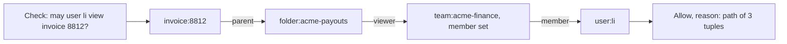
The path itself is the audit reason.

**4. Consistency: the "new enemy" problem.** Stale authorization data can be a security bug. The Zanzibar paper's example, translated: a seller removes Bob from finance at 10:00:00 and uploads a payout report to the finance folder at 10:00:05; a check against a replica 10 seconds behind lets Bob — the *new enemy* — read content created *after* his removal. Fix: a **consistency token** (a *zookie*) saved with the content encodes "permission data as of now", and checks on that content must use a snapshot at least that fresh. Old content can use cached, slightly stale snapshots; new content always sees the removal. Open-source systems offer the same per-request choice ("fully consistent" vs. "at least as fresh as this token").

**5. Make it fast enough for every request.**
- **Cache decisions and sub-results** ("li is a member of acme-finance" serves thousands of checks), with short lifetimes or tied to consistency tokens.
- **Batch** — one bulk check per 50-invoice page.
- **Filter lists at the source.** *Pre-filter*: index each document with the principals (users, groups, services) allowed to read it, updated from tuple changes — needed when most results would be dropped. *Post-filter*: fetch a page, bulk-check, fetch more — fine for small pages.
- **A local decision point** for pure policy rules: an ABAC engine such as Open Policy Agent (OPA) as a sidecar, answering in microseconds with no network hop.

**6. Decide failure behaviour per action.** Most requests **fail closed** (deny) when the service is unreachable — a leak is worse than an error; a few low-risk reads may **fail open** from cache briefly. Write it down per endpoint, like the choices in [Graceful Degradation](../05-reliability/README.md#graceful-degradation).

**7. Log every decision** — question, answer, policy version and reason (the tuple path) — so "who could read our payout data, and why?" is a query.

**Where each check lives, end to end**

| Layer | Checks | Why there |
|---|---|---|
| API Gateway | Is the token valid? Does its scope allow this API? | Cheap, once per request, no domain knowledge |
| Service mesh (east-west) | May the *checkout service* call *payments*? | Workload identity, not user identity (the Service Mesh lesson) |
| Service handler + authorization service | May *this user* do *this action* on *this object*? | Only the service knows which object; only the PDP knows the relationships |

### Walkthrough with numbers (the seller portal)

- **Check volume.** 16,000 req/s reach the gateway (the capstone's figure); about a quarter hit the portal, each making ~3 object checks → **~12,000 checks/s**. An 80% decision-cache hit rate leaves **~2,400 checks/s** — a handful of instances.
- **Latency budget.** Most checks are 2–4 graph hops; with membership sub-results cached, well under **10 ms at p99** against a 200 ms page budget. List pages use one bulk check.
- **Tuple storage.** Memberships and shares: ~2M staff × ~10 tuples = **20M tuples**. A `parent` tuple for all 500M invoices is ~**50 GB** at ~100 bytes each — feasible, but a second copy of ownership data to sync (by [Change Data Capture](../10-batch-and-streaming/README.md#change-data-capture) from the orders database). Alternative: pass the invoice's folder in the check as a **contextual fact** and store tuples only for things users actually share. Choose per object type.
- **Incidents, replayed.** Removal deletes one tuple; the later report carries a consistency token, and search's pre-filter updates within seconds. `GET /invoices/8812` now calls `check(user, "view", invoice:8812)`, so an edited URL gets **403**; a shared test suite asserts another organisation's user is denied on every object endpoint.

### Trade-offs

**You gain:** one source of truth (removals everywhere, rules change without thirty redeploys); auditability (decisions logged with reasons); expressive nested sharing without recursive SQL; explicit freshness via consistency tokens.

**You pay:**
- **A critical dependency on nearly every request** — high availability, caching, deliberate fail-closed.
- **Data duplication** — tuples mirror domain facts; dual-writes drift, so sync via CDC or the outbox pattern (event saved in the same transaction, published afterwards).
- **"What can I see?" stays hard** — list filtering needs extra indexes.
- **A policy language to test** — wrong schemas grant access silently; test "must deny" cases like code.

### When not to use it

- **A monolith or a handful of services with a few roles** — framework RBAC plus ownership conditions in queries (`WHERE org_id = :callerOrg`) suffices.
- **As a feature-flag or entitlement system** — "is premium on for this plan?" is product configuration (the Feature Flags lesson's *permission flag*).
- **As a substitute for authentication** — the PDP trusts the identity it's given; token verification stays at the gateway and service boundary.

**Typical misuse:** a Zanzibar clone for five roles — or thirty services growing their own permission tables until an audit or BOLA report forces change.

### Real-world examples

- **Google Zanzibar** — permissions for Drive, YouTube, Calendar, Cloud and more; the 2019 paper reports over two trillion ACL tuples, millions of checks per second, and over three years p95 under 10 ms and availability above 99.999%.
- **Open-source Zanzibar-style systems:** SpiceDB (AuthZed), OpenFGA (a CNCF project started at Auth0/Okta), Ory Keto. **Airbnb's Himeji** is an in-house relative.
- **ABAC policy engines:** Open Policy Agent (OPA) with Rego, often as a sidecar; AWS's **Cedar** language and Amazon Verified Permissions.
- **For AI engineers:** a RAG system must filter retrieved passages by the *asking user's* permissions before they reach the prompt, or the model summarises documents the user may not open ([RAG Pipeline](../11-ai-era-systems/README.md#rag-pipeline)). Agents calling tools for a user should be checked as *that user*, not with the agent's broad service credentials.

### In the interview

Prompts: "design sharing for a Google-Drive-like product", "how do 30 microservices enforce permissions consistently?", or in any multi-tenant design, "how do you stop one tenant reading another's data?"

> **30-second answer:** "I separate enforcement from decision. The gateway authenticates and checks coarse token scopes; each service enforces at the object — `check(user, action, object)` — against a central authorization service. RBAC for staff roles, relationship-based rules for ownership and sharing — Zanzibar-style tuples like `folder#viewer@team#member`, so a check is a short graph walk — and attribute conditions like MFA on top. Removals delete one tuple and take effect everywhere; consistency tokens stop a removed user seeing content created after removal. It's on the hot path, so I cache membership sub-results, bulk-check list pages, pre-filter search, fail closed, and log every decision with its reason."

**Likely follow-ups (with answers):**
- *"How do you show only permitted documents in search?"* — Pre-filter: index each document with its permitted principals, updated from tuple changes, and query "readable by any of my principals." Post-filtering with bulk checks works only when few results are removed.
- *"The authorization service is down?"* — Fail closed for writes and sensitive reads; short-lived cached decisions for low-risk reads only if the product explicitly accepted that. It's tier-0 (the most critical class, everything depends on it): replicated, cached, at least as available as its callers.

**Mistake that fails candidates:** checking only "is logged in" (BOLA); per-object permissions in JWTs; a domain-aware gateway; ignoring revocation delay.

### Self-check

- **Q1: Define PEP and PDP and where each lives.** → PEP: the handler (or gateway filter, for coarse checks) touching the object and obeying the answer — local, since only the service knows the object. PDP: the central authorization service with rules and relationships — central for consistency and audit.
- **Q2: Organisations, nested teams, folders shared with teams — RBAC, ABAC or ReBAC?** → ReBAC for sharing (paths from user through teams and folders), RBAC for a few staff roles, ABAC conditions for context such as MFA. Pure RBAC means a role per organisation per folder (role explosion); pure ABAC can't answer "who can see this folder?" without evaluating every user.
- **Q3: After Bob's removal from a team, he opens a document uploaded 5 seconds later, because checks read a replica 10 seconds behind.** → The "new enemy" problem. Store a consistency token with each content version and evaluate checks at a snapshot at least that fresh; older content may still use cached snapshots.

### Related patterns

- **API Gateway** — authentication and coarse scopes; object decisions stay behind it.
- **Service Mesh** — authorizes *service-to-service* calls by workload identity; this lesson authorizes *users* on objects.
- **Sidecar** — a local policy engine (OPA) as sidecar decision point.
- **Change Data Capture** — keeps tuples in sync with domain databases.
- **Feature Flags** — gate features for cohorts; never a substitute for authorization.

### TL;DR

| | |
|---|---|
| Problem | Every service wrote its own permission checks: object-level holes (BOLA), removals not reaching every service, slow recursive sharing queries, no answer to "who can see X?" |
| Mechanism | Services enforce `check(user, action, object)`; a central decision service holds RBAC roles, ReBAC tuples (Zanzibar-style `object#relation@subject`, checked by short graph walks) and ABAC conditions; consistency tokens for freshness; caches, bulk checks and search pre-filters for speed; every decision logged. |
| Costs | A critical dependency on nearly every request (replicate, cache, fail closed), tuples to sync with domain data, list filtering needing extra indexes, a policy language to test. |
| Skip it when | A few services with a few roles — framework RBAC plus ownership conditions in queries is enough. |

**Sources:** R. Pang et al., "Zanzibar: Google's Consistent, Global Authorization System", USENIX ATC 2019; D. Ferraiolo, R. Sandhu et al., "Proposed NIST Standard for Role-Based Access Control", *ACM TISSEC* 2001; NIST SP 800-162, *Guide to Attribute Based Access Control (ABAC) Definition and Considerations* (2014); OASIS XACML 3.0 (PEP/PDP terms); OWASP API Security Top 10 (2023), API1 "Broken Object Level Authorization"; Open Policy Agent documentation; J. Cutler et al., "Cedar: A New Language for Expressive, Fast, Safe, and Analyzable Authorization", OOPSLA 2024; OpenFGA and SpiceDB documentation; A. Yao et al., "Himeji: A Scalable Centralized System for Authorization at Airbnb", Airbnb Tech Blog (2021).

---

## Capstone - The Entry Point, Assembled
*Original lesson: [Capstone - The Entry Point, Assembled on DesignGurus ↗](https://www.designgurus.io/course-play/system-design-patterns/doc/6a5366449bf81a86ec3a0f63)*


**What this capstone does.** Designs the full public API layer for web, mobile, TV and 200 partners by tracing **one request from a customer's phone in Sydney** inward, layer by layer, deciding which responsibilities belong where. At each "pause and decide," commit to an answer before reading on.

**Two rules come with you the whole way:**
1. **Every layer is the same proxy primitive playing a different role.**
2. **Handle each request at the earliest layer that can.** The cheapest request goes no deeper.

**Analogy.** An airport: most questions answered at the entrance kiosk (CDN); one security checkpoint that checks ID but not your destination (gateway); differently shaped lounges (BFFs); a turnstile limiting one badge's passes per minute (rate limits); badge readers between staff rooms (sidecars/mesh).

### The brief

- **Clients:** web, iOS and Android, a TV app, **200 partner integrations** (schedules you can't control).
- **Traffic:** **40,000 requests/s** at peak, global; about **60%** static or publicly cacheable.
- **Backend:** about **30 services in 3 languages** on the scaled fleet from earlier modules, reliability machinery inside.
- **Standing requirements:** partners must **never break**; **no tenant** may starve others; **east-west encryption** is on the security roadmap.

### Stage 1 — The visitor's city (Edge / CDN)

*Pause and decide: 60% of traffic is static or publicly cacheable, and Sydney is 200 ms from the origin. What stops at the edge, what's only sped up there, and what must never be cached there?*

- **Stops at the edge.** Fingerprinted static assets cached forever; identical-for-everyone API responses like catalog browsing at `s-maxage=60, stale-while-revalidate`. Same-for-everyone bytes never cross the ocean.
- **Sped up at the edge.** TLS terminates over Sydney's **15 ms** path instead of the **200 ms** ocean route; dynamic requests cross on warm connections. Better than a Sydney datacenter: fixes handshakes and most static content without replicating the database.
- **Never cached.** Authenticated responses get `private, no-store` via **reviewed** configuration — a private-data mistake would reach strangers worldwide.

**Result:** of **40,000 req/s**, around **24,000** stop here, using no application capacity.

### Stage 2 — The one entrance (Gateway)

*Pause and decide: 30 services and four client types. What does the entrance check, what does it refuse to know, and where does its reliability come from?*

The remaining **16,000 req/s** reach one origin hostname.
- **A redundant API gateway** — reliability from load-balancer machinery (12 instances behind the load balancer, with health checks), as befits a deliberate single dependency.
- **Checked once:** **AuthN** (including token revocation), trusted identity passed inward, rate limiting, request checks (size caps, validation), TLS, path routing (private topology), and the trace **request ID**.
- **Refuses to know:** discounts, order calculations, client-specific shaping. Services handle **AuthZ**, enforced against a shared [Authorization Service](#authorization-service); shaping goes to BFFs. Thin = rarely changed = stable.

### Stage 3 — One entrance, four shapes (BFF)

*Pause and decide: the mobile product screen needs six services, TV shows much less, and partners value stability over speed of change. How many BFFs, who owns each, and which "BFF" isn't really one?*

- **Three BFFs + one API product:** a **web BFF**, one **shared mobile BFF** (iOS + Android) and a **TV BFF**, each client-team-owned, fanning out in parallel (mobile: six calls x ~5 ms, one ocean crossing) and returning screen-shaped responses with **no business rules** — any number two BFFs could disagree on belongs in a domain service.
- **Partners get a public API product**, not a BFF: **versioned, documented and stable** for consumers you can't update, because partners can't track your release speed.

### Stage 4 — The rate limits

*Pause and decide: Tuesday's partner bug fires 4,000 authenticated, valid retries per second. Which keys, algorithm and tiers — and where do counters live across 12 gateway instances?*

- **Token buckets keyed by API key or account**, not IP (one IP may be a campus); **b** sized for normal page-load bursts.
- **Tiers:** free, paid, partner, with documented rates, plus **cost weighting** — search costs **10x** a health check.
- **The refusal contract:** 429 + `Retry-After` + remaining-budget headers, so partner SDKs back off themselves.
- **Shared counters:** Redis atomic increments across all **12** instances — local limits would allow 12x the budget.
- **Login** gets a per-account limit, since **credential stuffing** targets accounts.

**Failure walk — the 4,000 req/s partner bug:** the burst is used up, 100/s continue, and **3,900/s are refused in ~0.1 ms each** — about **1/500th** of serving them. Every other tenant is unaffected.

### Stage 5 — The contracts that outlive you (Pagination and Versioning)

*Pause and decide: partners run full exports, and old mobile builds stay installed for two years. Which pagination, where do versions live, and — the senior question — what retirement plan is written down when a version is announced?*

- **Pagination:** opaque cursors over composite **`(created_at, id)`** positions across the public API — partners may reach page **5,000**, where offsets mean growing database work plus drift; opacity lets the sort key change later.
- **Versioning:** additive changes and tolerant readers by default; unavoidable breaks become one coarse **`/v2`** via a **gateway adapter** onto one backend. Every version is *born with* its retirement plan: `Sunset` headers, per-client usage reports, a brownout plan. **Two live versions at most.**
- **Mobile BFF middle ground:** quick additive changes, major versions tied to the **oldest supported app build**.

### Stage 6 — The turn inward (Sidecar / Mesh)

*Pause and decide: 30 services, 3 languages, a security mandate — and a two-person platform team. Which ladder step, honestly?*

- Languages, services and security need justify a mesh, but **two engineers can't safely run a control plane every team depends on**.
- **Decision: step 2 now** — sidecars providing mTLS, uniform timeouts and retries via one language-agnostic binary with **templated static config**; **step 3 (mesh control plane) later**, once a platform team is staffed. Adoption thresholds include organizational ownership; the mesh lesson's incident shows hand-configured sidecars will eventually need central coordination — so plan the hiring now.
- The gateway stays the only public entrance; **east-west traffic never detours through it**.

### The final architecture

All six stages in one figure: 40,000 req/s → 24,000/s stop at the CDN → 16,000/s through the 12-instance gateway → BFFs and the Partner API product → ~30 services with sidecars (mesh control plane pending); the buggy partner's 3,900/s refused at the entrance.

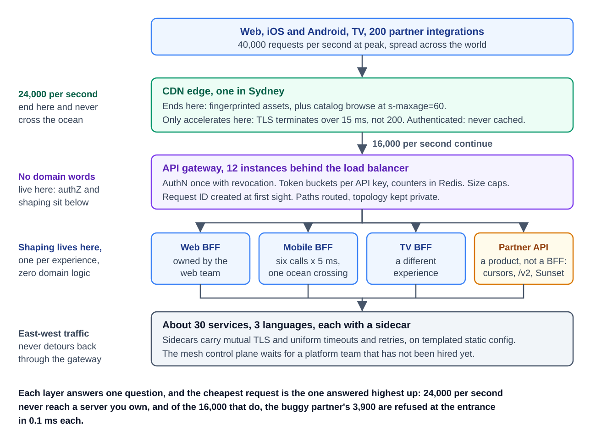
*Figure — The entry point, assembled (course diagram)*

### Debrief — one question per layer

| Layer | The question it answers | The decision that mattered |
|---|---|---|
| CDN | What never has to arrive at all? | 60% stops at the edge; `private, no-store` reviewed like auth code |
| Gateway | What gets checked exactly once? | AuthN with revocation; no domain words at all; thin = stable |
| BFF | Who shapes responses, for each experience? | Three BFFs + one API product, owned by client teams |
| Rate limits | Who gets counted, and how? | Token buckets per real identity; refusal as a contract |
| Pagination/versioning | What outlasts your intentions? | Cursors with tiebreakers; versions created with retirement dates |
| Sidecar/mesh | What does the inside need right now? | Step 2 now, honestly; step 3 with a hiring plan |
| Authorization *(added lesson)* | May *this* user touch *this* object? | Services enforce at the object; one shared decision service holds roles and relationships |

Each request stops at the earliest capable layer: **served from the edge cache, turned away by the rate limiter, checked at the gateway, tailored by a BFF, or authenticated service-to-service.** The only deliberate deferral is the full mesh — adoption thresholds include *organizational ownership*. Every layer has a clear owner, a measurable benefit, and a boundary keeping it from absorbing other layers' jobs.

### Extend it yourself

- **The partner brownout.** A year after `/v2`, `/v1` still carries **30%** of partner traffic. Design the retirement campaign: dashboards, outreach tiers, brownout schedule, and what the `Retry-After` on a brownout **410** should say.
- **An entry point in multiple regions.** Add a second region. Which layers replicate easily (the CDN already; the gateway mostly)? Where do rate-limit counters live — **global fairness vs. regional latency**? Which BFF assumptions break?
- **For AI engineers.** Add an AI assistant endpoint: streaming responses use **SSE**, so check how each layer buffers; add **token-based** rate limits beside request-based ones; place the internal **LLM gateway** as a second entrance — behind the BFFs or beside the services? Why?

### Interview summary

> The public API layer is one proxy primitive in six roles, with each request stopping at the earliest layer that can handle it. The CDN answers ~60% at the edge; the thin gateway authenticates once and rate-limits per identity with a 429 contract; client-team BFFs shape responses; cursors and additive versioning with sunset dates keep partner contracts safe; sidecars secure east-west traffic now, with a full mesh deferred until a platform team can own it. Behind it all, each service enforces object-level permissions against one shared authorization service, so "logged in" is never mistaken for "allowed".
