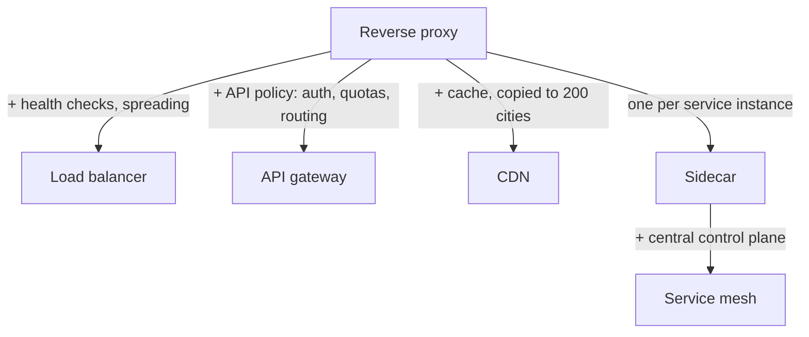
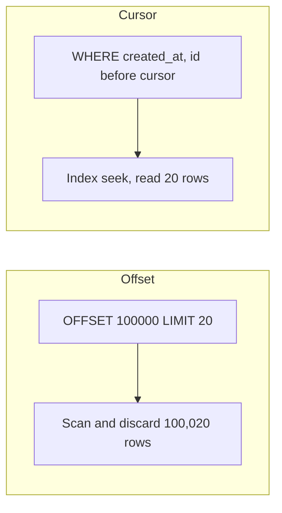
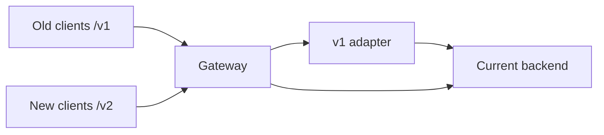
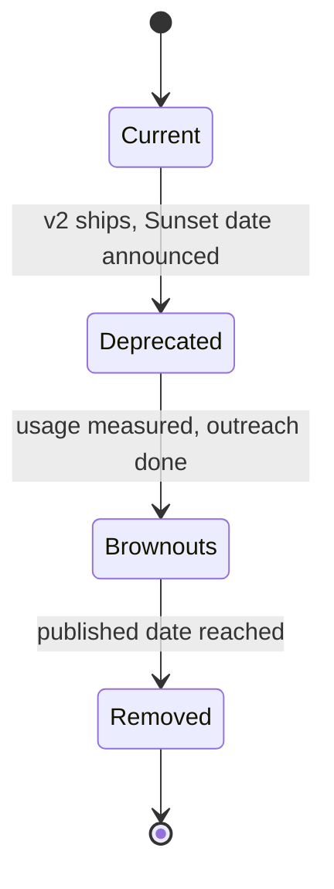
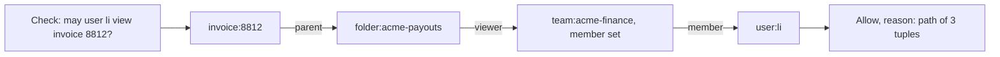

# Module 8 — The Entry Point (API and Edge)

## Module Introduction
*Original lesson: [Module introduction on DesignGurus ↗](https://www.designgurus.io/course-play/system-design-patterns/doc/6a535c5d8326c06ae6c5c707)*


**What this module is about.** The scaling capstone ended at the **system boundary**. That's the spot where clients — browsers, phones, partner systems — first make contact with your system. This module lives right at that boundary. It decides three things: which requests are let in, which are turned away, and which can be answered without ever bothering an application server. Nine patterns deal with accepting, controlling, and shaping incoming traffic. The final two take the same ideas and apply them to calls *between* your own services.

**Analogy.** Picture a big office building. The lobby has a single front door with a security desk that checks your ID once. There's a reception desk that answers common questions without phoning anyone upstairs. Turnstiles stop anyone who tries to come in too often. Signs point visitors to the right floor. Further inside, every office has its own assistant who handles phone manners for the person they work for. All of these do the same basic job — "stand between the caller and the person being called" — just in different spots, with different rules.

### The nine patterns

| The situation | The pattern |
|---|---|
| No one outside should talk to internal servers directly | Reverse Proxy |
| Popular content should sit close to the people reading it | CDN |
| A single entrance that authenticates (checks who the caller is), routes, and enforces policy | API Gateway |
| Different clients need the API shaped differently | Backend for Frontend |
| Fair use, enforced right at the entrance | Rate Limiting |
| Pick up a listing exactly where you stopped | Cursor Pagination |
| Change the API without breaking clients that already use it | API Versioning |
| Every service gets the same helper for shared chores | Sidecar |
| All those helpers, configured from one central place | Service Mesh |
| Every service must answer "may this user do this to this object?" the same way | Authorization Service *(added lesson)* |

### Two facts that organize the module

**Fact 1 — nearly everything here is one building block playing different roles.** A **primitive** means a basic building block. Here, that block is the **proxy**: a server that takes in requests and passes them on somewhere else. Place it in front of your servers and it's a **reverse proxy**. Give it health checks (regular "are you alive?" probes of each server) and have it spread traffic, and it's a **load balancer**. Give it API policies (who may call, and how often) and it's an **API gateway**. Copy it, with a cache (a store of recent answers that can be reused without redoing the work), into 200 cities and it's a **CDN**. (New to proxies, caches or CDNs? See the [System Design Fundamentals](../00-system-design-fundamentals/README.md) primer.) Put a small one next to every service and wire them together, and you get a **sidecar**, then a **service mesh**. The diagram below shows this family tree.

*One primitive, many roles*


**Fact 2 — the edge is where you're cheapest and strongest.** The cheapest request is the one that never gets to your application tier. Turning away bad logins or too much usage at the edge uses up no service capacity. Serving cached pages or static files (files that are identical for every user, such as images, scripts and stylesheets) from there skips application work completely. The edge is also the *single* place every request passes through. So rules like authentication, rate limits, and version policies can be applied once there, instead of being rebuilt (each a little differently) in every service.

### North-south vs. east-west traffic

- **North-south** traffic crosses the system boundary: outside clients, browsers, and partners calling in. It's controlled by gateways, CDNs, rate limiters, and version policies.
- **East-west** traffic flows *between* your internal services — for example, checkout calling inventory and then pricing. It needs services to trust each other, plus retries and tracing (recording the path and timing of one request as it hops between services). Sidecars and meshes supply those.

Both rely on the proxy primitive, but they trust different things. That difference splits the module into two halves, and it comes up a lot in interviews.

### How to read the module

Begin with **Reverse Proxy**. It's short, and it defines the primitive. Next, move inward from the edge. **CDN** answers lots of requests before they cross an ocean. **API Gateway** applies public policy. **BFF** deals with clients that want responses shaped differently. After that come three key gateway policies: **Rate Limiting**, **Cursor Pagination**, and **API Versioning**. Then switch to east-west traffic. **Sidecar** gives every service the same helper, and **Service Mesh** configures and links those helpers. **Authorization Service** is an added lesson (not in the original course): the gateway authenticates, but deciding whether *this user* may touch *this object* belongs to a shared decision service — roles, attributes and Zanzibar-style relationship graphs (Zanzibar is Google's internal permission system). The **capstone** pulls it all together into a public API layer for web and mobile.

> Short on time? Read **API Gateway**, **Rate Limiting**, and **CDN** first. Every "design X" interview draws this boundary, and those three are what the follow-up questions dig into.

### Terms used throughout

- **Edge vs. origin** — the *edge* is the spot near the client where traffic enters your system. The *origin* is where the authoritative servers and data live. Answer from the edge whenever you can; go to the origin only when you have to.
- **Forward vs. reverse proxy** — a *forward* proxy acts on behalf of clients and hides *who is asking* (for example, a corporate web filter). A *reverse* proxy acts on behalf of servers and hides *who is answering*. Everything in this module grows out of the reverse kind.
- **North-south / east-west** — traffic crossing the outer boundary vs. traffic between services (described above).
- **Policy enforcement point** — a single place that applies a rule, instead of N separate copies of it. Authentication, usage limits, and quotas usually live here.

### Before you start — questions about your own system

1. How many separate places in your code check authentication? (Most teams are surprised by how many there are. That number is the case for a gateway.)
2. What share of requests could be served without ever reaching your servers — and are they actually served that way today?
3. When your API's response shape changes, what happens to the year-old mobile app that you can't force people to update?

---

## Reverse Proxy
*Original lesson: [Reverse Proxy on DesignGurus ↗](https://www.designgurus.io/course-play/system-design-patterns/doc/6a535cbce5978b0a41c934b7)*


**What it is.** A reverse proxy is a server placed in front of your real application servers. Every client request lands on the proxy first. The proxy takes care of the "boundary chores" and then passes the request along to an app server. Clients never speak to your application servers directly.

**Analogy.** Think of the host at the front of a restaurant. Guests never wander into the kitchen. The host greets them, handles the slow or talkative ones, hands out menus (the static content), and passes finished orders on to the kitchen. The kitchen can then cook without being interrupted. It can even rearrange its stations, and guests never notice.

### The problem it solves

When an application server faces the internet directly, it must do lots of jobs it isn't good at:
- Handle **TLS certificates**. (TLS is the encryption behind HTTPS. The certificate proves the server is who it says it is.)
- Serve images and JavaScript on top of running business logic.
- Reveal its own address and internal layout (its **topology**) to everyone.
- The least obvious one: **cope with slow clients**. A phone might dribble in one request over **4 seconds**. The app keeps a thread open that whole time, just waiting for bytes.

App servers shine at quick, predictable internal traffic. A reverse proxy soaks up the slow, hostile, messy public internet first. Then it hands the work to the app in a tidy, controlled burst.

### How it works — the six jobs

In the course figure below, clients send their requests to the reverse proxy, which is the one public entry point. The proxy routes and load-balances them across App Server 1–3, keeps those internal servers hidden, and sends back the responses.


*Figure — Reverse Proxy (course diagram)*

1. **Terminates TLS.** It takes care of the HTTPS handshake and the encryption. Certificates, renewals, and protocol settings then live in one layer rather than in every app. *Why:* there's just one place to configure and patch.
2. **Buffers slow clients.** An **event-loop proxy** uses one thread (a single sequence of execution inside a program) to juggle many connections — the async I/O model (waiting on many network operations without blocking a thread for each) from the SSE (server-sent events, a long-lived server-to-browser stream) lesson. It can hold thousands of idle connections for a few kilobytes each. It waits until a slow upload is *completely* received, then sends a single fast request inward. *Why:* app threads are costly, and waiting on a slow phone shouldn't tie one up.
3. **Serves static files itself.** Images, JavaScript, and CSS (the stylesheet language that controls how pages look) never reach app code.
4. **Reuses connections.** **Keep-alive** lets a single client connection carry many requests. **Connection pooling** keeps ready-to-use connections open to the backends (the servers behind the proxy that do the real work). *Why:* you pay the handshake cost once, not on every request.
5. **Hides the topology.** Clients only see one public address. Behind it, internal servers can be renumbered, swapped, or added whenever you like.
6. **Serves as the enforcement point.** Every request passes through this one layer. That makes it the obvious home for authentication, limits, and the other policies later in this module.

**Forward vs. reverse.** It's the same mechanism, facing the other way. A forward proxy works for clients and hides who is asking (like a corporate web filter). A reverse proxy works for servers and hides who is answering.

**The family.** Add health checks and traffic spreading → load balancer (Module 6). Add auth, quotas, and routing → API gateway. Put cached copies in 200 cities → CDN. Place a small proxy next to every service → sidecar; connect them → mesh. One primitive, five names.

### Walkthrough with numbers (buffering)

- Suppose **300 requests/s** come in, and each takes **3 s** to fully arrive from slow clients. With no buffering, app threads stay busy during the entire transfer: 300 x 3 = **900 threads** just waiting for bytes.
- With buffering, the app only receives complete requests, and each takes **50 ms** to process: 300 x 0.05 = **15 threads**. That frees up about **98%** of the thread pool.
- The rule: *threads in use = request rate x how long each request holds a thread*. Buffering cuts "how long" down from transfer time to processing time.

### Trade-offs

**You gain:**
- The internet's messiness (slow clients, TLS, static files, junk requests) gets absorbed before your business logic ever sees it.
- One address, one place for certificates, and one policy enforcement point. The fleet behind it can change freely.
- It's cheap. A modern proxy forwards a request in **well under 1 ms** and handles enormous numbers of connections on modest hardware.

**You pay:**
- **An extra hop.** It adds a real delay, though under a millisecond, plus one more system to patch and watch. Since every request depends on it, it has to be **redundant** across failure domains (groups of machines that can fail together, such as one rack or one datacenter). That means paired instances, or **anycast** — one IP address advertised from several places, so the network picks a nearby one that works.
- **A trust boundary you have to set up correctly.** The app now sees the *proxy's* IP address instead of the client's. So the proxy writes the real client address into the **`X-Forwarded-For`** header (a header is a named key-value line sent along with an HTTP request or response). But clients can send that header themselves and lie in it. The rules: the proxy must **overwrite** any value the client sent (never append to it). And the app must trust the header **only** when the request came from its own proxy's address.
- **A false sense of safety.** A proxy on its own isn't a security control. It's just the place where you'll *put* your controls.

### When not to use it

Almost everyone uses one, so the real question is whether you need *another* proxy layer:
- **Your platform already gives you one.** A cloud load balancer or hosted front end may already handle these jobs. Adding nginx (a widely used open-source web server and reverse proxy) behind it adds delay and one more header-trust boundary, with no separate owner or purpose.
- **Small, purely internal services on a trusted network** might not need one. That holds until they need encryption, retries, or **observability** (logs, metrics, traces). At that point, the sidecar brings this primitive to east-west traffic.
- **Don't stack proxies without thinking.** CDN + cloud load balancer + nginx + app means four sets of timeouts, body-size limits, and header-trust rules to check in every incident. When a **12 MB** upload is rejected, you might have to dig through all four.

### In the interview

This is normally a box everyone assumes you'll draw first, not a question on its own. Expect "why not expose the app servers directly?" or a scenario involving an `X-Forwarded-For` bug.

> **30-second answer:** "A reverse proxy sits in front of the fleet. It terminates TLS and buffers slow clients, so a 4-second mobile upload doesn't tie up an app thread. It serves static files, pools connections, and hides the topology behind a single address. It's the primitive underneath half of system design. Add health checks and traffic spreading, and you have a load balancer. A gateway is this plus API policy. A CDN is this spread out geographically with a cache. The config detail I always check: the app trusts client-address headers only when they come from the proxy, and the proxy overwrites whatever outsiders send. Otherwise rate limits and audit logs run on data anyone can fake."

**Likely follow-ups (with answers):**
- *"What does buffering really save?"* With no proxy, busy app threads = request rate x the slow *transfer* time. With buffering, it's rate x the app's *processing* time. That's because the proxy holds the slow sockets cheaply on its event loop and forwards only finished requests.
- *"Forward vs. reverse?"* Forward acts for clients and hides who is asking. Reverse acts for servers and hides who is answering.

**Mistake that fails candidates:** trusting `X-Forwarded-For` without checking where the request came from; not knowing why the app sees the proxy's IP; or stacking proxies without giving each one a clear job.

### Self-check

- **Q1: Explain forward vs. reverse in one sentence, then list the reverse proxy's four main jobs.** → Forward acts for clients and hides who's asking; reverse acts for servers and hides who's answering. Its main jobs are TLS termination, buffering slow clients, serving static files, and reusing connections. On top of that is its strategic job: being the single enforcement point.
- **Q2: Phones upload 200 photos/s, ~2 MB each, taking ~3 s to upload. How many app threads are busy with and without buffering (0.1 s processing)?** → Without: 200 x 3 = **600** threads waiting for bytes. With: 200 x 0.1 = **20** threads. That's a **30x** reduction.
- **Q3: After launch, the rate limiter reports that 99% of traffic comes from one client and blocks it, taking the site down. The audit log also blames `10.0.0.5` — the proxy's address — for a suspicious admin action. Diagnose it and give the header rules.** → Both systems used the proxy's address instead of a trusted client address. The limiter saw every user as `10.0.0.5` and blocked all of them, and the audit log pinned the action on the proxy. Fix: the proxy fills in `X-Forwarded-For` from the real connection source and overwrites any value that came in. The app trusts it only from approved proxy addresses. And everything that uses client identity — limits, logs, geo rules, bans — reads the same verified value.

### Related patterns

- **Load Balancing** — adds health checks and traffic distribution on top of the primitive.
- **API Gateway** — adds API authentication, quotas, and routing.
- **CDN** — spreads cached proxies across geography.
- **Sidecar** — a small reverse proxy for each service instance, for east-west traffic.

### TL;DR

| | |
|---|---|
| Problem | App servers exposed directly take on all the internet's problems: TLS inside app code, threads stuck on slow clients, topology visible to all, and policy scattered everywhere. |
| Mechanism | A front server receives every request. It terminates TLS, buffers slow clients, serves static files, pools backend connections, and forwards complete requests. Outside, there's one address; inside, an invisible fleet; and one enforcement point in between. |
| Costs | A hop of under a millisecond, one more component that has to be redundant, and header-trust discipline (the client address is set by exactly one party and trusted from exactly one source). |
| Skip it when | Your platform already provides one (don't stack them), or the service is small and internal — until the sidecar brings the primitive east-west. |

---

## CDN
*Original lesson: [CDN on DesignGurus ↗](https://www.designgurus.io/course-play/system-design-patterns/doc/6a535d677d8046c63edc98da)*


**What it is.** A **Content Delivery Network (CDN)** takes the reverse-proxy primitive, copies it into 200+ cities, and gives every copy a cache. Each user is sent to the closest copy, called an **edge** location. The edge answers from its local cache. Only on a miss does it fetch from your **origin** (the authoritative servers) — and that happens once per edge, not once per user.

**Analogy.** Imagine every reader in Australia had to mail a request to one library in Virginia. Instead, the publisher sends copies of popular books to a local branch in Sydney. Readers borrow them locally. The branch only orders from Virginia when it doesn't have a title yet.

### The problem: six-second pages in Sydney

The store opens in Australia. Customers in Sydney see **6-second** page loads, while the same pages open in **400 ms** at the Virginia office. The origin is perfectly healthy. It replies in **20 ms**, with no errors and no capacity problems. The time is going into *distance*:
- A single Sydney↔Virginia **round trip** takes around **200 ms**.
- The **TLS handshake** (setting up HTTPS encryption) needs **2–3 round trips**. That's **400–600 ms** before any content shows up.
- Then the page loads **60** images, scripts, and styles. Their dependencies pile on more round trips, even with connection reuse and parallel fetching.

Adding servers in Virginia can't speed up light. Even an origin that answered instantly would leave Sydney waiting 200 ms per round trip. The content has to be close to the reader already.

### Why the obvious fixes fail

- **"Optimize the backend."** The origin adds 20 ms. The trip across the world adds 200 ms, several times over. Speeding up the smallest ~**3%** of the delay can't fix the ~97% that comes from geography. Always split server time from network time first.
- **"Open a datacenter in Sydney."** A full region would fix distance eventually. But you'd have to run the entire stack there and replicate the database between regions. You'd take on the consistency module's hardest trade-offs just to move identical images and JavaScript closer.
- **"Use HTTP/2 and buy more bandwidth."** (HTTP/2 is a newer version of the web protocol; bandwidth is how many bytes per second a link can carry.) **Multiplexing** (sending several requests over one connection at the same time) cuts the number of connections and improves parallel loading. More bandwidth moves more bytes at once. Neither one removes the round-trip wait before those bytes begin to arrive.

Most of the slow content is identical, popular, and static for every Sydney user. So this is a **distribution** problem, not a computation problem.

### How it works

The course figure below shows the Sydney user reaching the Sydney edge cache in 15 ms (and a London user reaching their London edge in 12 ms). Only when there's a miss does an edge ask the **origin shield** — a single mid-tier cache. The shield fetches from the Virginia origin **once** and caches the result.


*Figure — Users reach the nearest edge cache; only a miss travels to the origin (course diagram)*

1. **Send each user to the closest edge.** This is done through DNS or **anycast** (one IP address advertised from many places, where internet routing picks the nearest one). *Why:* the handshake and the cached bytes are now ~15 ms away, not ~200.
2. **The rules travel in a header.** The **`Cache-Control`** header tells 200+ edges what they're allowed to store and for how long:
   - `max-age` — how many seconds the copy lives; browsers follow it too.
   - `s-maxage` — how long it lives in **shared caches** (CDNs) only.
   - `stale-while-revalidate` — keep serving the old copy while one refresh runs in the background.
   - `stale-if-error` — serve the old copy if the origin is failing.
   Every caching rule from Module 4 still holds. That includes **hit ratio** (the share of requests answered from cache), **TTL** (time to live — how long an entry counts as valid, which is your staleness budget), and misses that arrive all at once.
3. **Beat invalidation by never invalidating — use fingerprinted URLs.** **Invalidation** means removing a stale cached copy, and across 200 cities it takes seconds to minutes. So instead, the build tool (the program that packages source code for release) puts a hash of the content (a short fingerprint computed from the bytes, which changes whenever they change) into the filename, such as `app.3f9a2c.js`, and marks it as cacheable forever with `immutable`. When the content changes, it gets a *new* URL. That way, a stale response can never live at the new address.
4. **Get the cache key right.** The **cache key** is how an edge looks up a stored response. It's the URL plus whatever headers you declare. Cookies are the classic trap. If you vary on every cookie, every user's request becomes unique (hit ratio → zero). If you accidentally cache a `Set-Cookie` response (one that tells the browser to store a cookie, often a login session), it's even worse: private content gets served to other people.
5. **Add an origin shield.** Without one, a popular file missing at 200 edges at once triggers 200 origin requests. That's a **cache stampede** on a global scale. The shield **coalesces** (merges) those identical misses into a single fetch from the origin.
6. **Use the edge for more than caching.** TLS ends at the nearby edge, so a 3-round-trip handshake runs over 15 ms instead of across the ocean — ~600 ms drops to **45 ms**. Long-lived, already-warm **edge-to-origin connections** reuse finished handshakes, which speeds up even *uncacheable* dynamic requests. The provider's enormous network soaks up **DDoS** attacks (floods of malicious traffic meant to overwhelm a site). And `stale-if-error` gives you **graceful degradation**: during an origin outage, users get older content instead of an error. (Providers expose this as options like Cloudflare "Always Online".)

### Walkthrough with numbers (Sydney, edge 15 ms away)

- **First byte.** TLS takes 3 x 15 ms = **45 ms** instead of ~**600 ms**. That's true for cacheable *and* dynamic requests.
- **The 60 assets.** Once caches are warm, ~**95%** are served from the edge in about **20 ms** each, mostly in parallel. The page loads in roughly **1.2 s** rather than 6 s. Dynamic content still makes the ocean trip, but the site no longer feels broken.
- **Load on the origin.** **70%+** of requests stop at the edge and never cross the ocean (the scaling capstone's rule that "most traffic shouldn't reach app servers"). Origin bandwidth falls. **CDN egress** (the bytes the CDN sends out) is usually cheaper per GB than origin traffic.
- **Flash-sale drill.** A hero image goes from **cold** (not in any cache) to popular worldwide in one minute. ~**200** edges miss at the same time. The shield turns that into **one** fetch from the origin. The edges then serve the next **10 million** requests.
- **Deploy drill.** New JavaScript is shipped as `app.8c1d4e.js`, and newly served HTML (with a short `s-maxage`) points to the new name. There's no purge and no coordination across cities. The old file just sits unused until it's evicted.

### Trade-offs

**You gain:**
- Latency that works with physics — content close to readers, handshakes close to users.
- A huge drop in origin load (**70–95%** for content-heavy sites) and cheaper bandwidth.
- DDoS absorption, plus `stale-if-error` keeping you available during origin outages.

**You pay:**
- **Staleness spread over 200 cities.** A purge doesn't happen instantly; it spreads. Fingerprinting removes staleness for assets, but HTML and API responses still need explicit TTL budgets.
- **The header rules affect security.** One overly loose header can land private content in a shared cache. Review cache directives as carefully as you review authentication code.
- **Debugging gets harder.** Which edge answered? Was it a hit or a miss? When was it stored? Look at headers like `cf-cache-status` and `x-cache` first.
- **You pay per GB, and a third party sits on your critical path.** Very large sites use several CDNs so they don't depend on just one provider.

### When not to use it

- **Purely internal apps** — staff in two offices don't need copies in 200 cities.
- **Products used in one region with an origin nearby** — the latency argument gets weaker (though DDoS protection and offload might still make it worthwhile).
- **Every response is unique** (heavily personalized APIs) — shared caching doesn't help. Edge TLS and warm connections still do, though, so API-only products sometimes use CDN *acceleration* without caching response bodies.
- **As a cover-up for a slow dynamic origin** — the edge can't erase a **2-second** server render. Fix the query first (Module 4's rule).

**Dangerous misuse: caching private data.** Suppose an API response includes `Set-Cookie`, or an account page is missing `private`. A shared cache may then hand one user's response to someone else. The CDN did exactly what the headers said — the headers were just wrong.

### Fingerprinted URLs vs. purging

| | Fingerprinted URLs (`app.3f9a2c.js`) | Purge ("delete /banner.jpg everywhere") |
|---|---|---|
| Propagation | Instant — it's a new URL, so nothing needs invalidating | Seconds to minutes, depending on the provider, and you have to trust it |
| Can stale content exist? | Not possible by design | Yes, while the purge spreads |
| Cache lifetime | Forever + immutable — the best possible hit ratio | Whatever TTL you were brave enough to set |
| Works for | Anything that something else links to (assets referenced from HTML) | The documents doing the linking, and emergencies |
| Cost | Build-tool setup (standard in bundlers — tools that combine code files for the browser) | An API call — plus trust |

**Standard setup:** fingerprint the assets that get referenced and cache them forever. Give the HTML that references them a short TTL using `s-maxage` plus `stale-while-revalidate`. Save purges for emergencies and legal takedowns.

### Real-world examples

- **Akamai, Cloudflare, Fastly, CloudFront** — the pattern turned into an industry. Cloudflare alone carries a large share of web traffic.
- **Netflix Open Connect** — puts cache servers *inside* internet service providers. Video makes up a huge share of traffic, so skipping the ocean crossing entirely beats making it faster.
- **RFC 5861** (RFCs are the numbered documents that define internet standards) — the standard for `stale-while-revalidate` and `stale-if-error` (Module 4's stale serving and Module 5's fallbacks, written as HTTP headers).
- **Edge compute** (running small pieces of your own code on CDN servers) — Cloudflare Workers and Lambda@Edge run authentication, redirects, and experiment selection close to users.
- **For AI engineers:** model weights are enormous static files, so model hubs deliver them through CDNs. GPU inference **cold starts** (starting a model server from scratch) also pull weights through the same edge network. Token streams (the model's output arriving word-piece by word-piece) are unique to each request and can't be cached. They still benefit from edge TLS and warm origin connections, which cuts **time to first token** (how long until the first piece of the answer appears) for far-away users.

### In the interview

A classic prompt: "Users in Australia see slow pages, but the Virginia servers look healthy." Spot distance before blaming capacity. Then explain how you'd handle invalidation and personalization.

> **30-second answer:** "This is a distance problem. Each round trip is 200 ms, and a TLS handshake costs three of them. No origin tuning fixes that. I'd put a CDN in front. Fingerprinted static assets get cached forever at the edge. HTML gets a short shared-cache TTL with stale-while-revalidate. TLS ends at the edge, so the handshake runs over 15 ms instead of an ocean. An origin shield merges global misses into one fetch. Dynamic requests travel over warm edge-to-origin connections. And I'd review Cache-Control like auth code, because one wrong header serves private data from a shared cache. Seventy-plus percent of requests never cross the ocean, and the rest cross once, on a warm connection."

**Likely follow-ups (with answers):**
- *"Marketing needs the homepage banner changed right now, but your assets are cached forever."* The new image has a new fingerprinted URL, so it never clashes with the old cached entry. Only the HTML that references it has to update — through its short TTL, or with one emergency purge. That's precisely why the policy has two layers.
- *"Can API responses go on the CDN?"* Public responses that are the same for every user: yes, using `s-maxage` and a correct cache key. Personalized bodies: never in a shared cache. They do still gain from edge TLS and warm connections across the ocean. Cache based on what makes a response unique.

**Mistake that fails candidates:** tuning backend code to fix a delay caused by geography; relying only on purges for invalidation; or caching a personalized API without defining its cache key.

### Self-check

- **Q1: Why can't tuning the origin fix Sydney, and which two latency costs does the edge remove?** → The delay is ~200 ms of travel per round trip, not 20 ms of computing. TLS alone needs 2–3 trips, and then come the dependent asset fetches. The edge removes the **content journey** (cached bytes are 15 ms away) and the **handshake journey** (TLS goes from ~600 ms → 45 ms).
- **Q2: Give header policies for (a) a product image, (b) product-page HTML, (c) cart JSON.** → (a) A fingerprinted URL with `Cache-Control: public, max-age=31536000, immutable`. It's kept forever and only replaced by a new URL. (b) `s-maxage=60, stale-while-revalidate=300`. Shared caches keep it for one minute and serve the stale copy during a refresh. (c) `Cache-Control: private, no-store`. No shared cache should ever hold personal data.
- **Q3: After a deploy that only touched caching headers, users start seeing other customers' account dashboards. What's the mechanism, the repair, and the prevention?** → The deploy made personalized responses cacheable in shared caches. It either added `public`/`s-maxage` or removed `private`/`no-store` (caching a `Set-Cookie` response has the same effect). The CDN saved one user's dashboard under a shared URL and served it to others. Right now: purge every affected entry and put `private, no-store` back on authenticated responses. For prevention, treat cache directives as security-sensitive. Make `private, no-store` the default for authenticated routes, add automated checks, and require an auth-level review for anything that loosens them.

### Related patterns

- **Reverse Proxy** — the CDN spreads this primitive across cities and adds caching.
- **Cache-Aside** — browser → CDN → app cache → database form a chain, where each layer handles the misses from the one before.
- **Cache Stampede Prevention** — the origin shield merges misses from across the globe; `stale-while-revalidate` makes stale serving a standard.
- **Graceful Degradation** — `stale-if-error` is a cached fallback while the origin is failing.

### TL;DR

| | |
|---|---|
| Problem | Distance — ~200 ms per ocean round trip, tripled by TLS and piled up by asset fetches — makes healthy origins feel broken to far-away users. No backend tuning touches travel time. |
| Mechanism | The reverse proxy, placed in 200 cities with caches: fingerprinted assets cached forever, short-TTL HTML with stale-while-revalidate, TLS at the edge, an origin shield merging misses, and warm connections for what can't be cached. |
| Costs | Managing staleness worldwide, header rules with security consequences, harder debugging, per-GB fees, and a third party on the critical path. |
| Skip it when | Apps are internal, users are in one region, or every response is unique — and never use it to hide a slow dynamic origin. |

---

## API Gateway
*Original lesson: [API Gateway on DesignGurus ↗](https://www.designgurus.io/course-play/system-design-patterns/doc/6a535e46e5978b0a41c94515)*


**What it is.** An API gateway is the one entrance for all **north-south** traffic (from the outside world into your services). It looks at each request's path and routes it to the right service. It enforces shared rules a single time — authentication, rate limits, TLS, validation. Then it passes the verified identity inward. No request reaches a service without being checked in, and no client has to know how your internals are laid out.

**Analogy.** Think of a hotel front desk. Every guest checks in once, shows ID once, and receives a key card. From then on, room service and the gym trust the key card rather than checking passports again. Guests don't need to know which staff member works where; they just ask the desk. But the desk doesn't cook meals or run the spa. It checks people in, and each department does its own work.

### The problem: eleven front doors

The store runs **11 services** (catalog, search, checkout, orders, accounts, reviews, …). Web, iOS, and Android clients call each one directly. Having eleven public entrances turns out to be costly:
- **Authentication is built 11 times.** Every service checks tokens (signed strings a client sends to prove who it is, issued at login) using whatever library version it last shipped. An audit turns up **3 implementations in 2 languages**. The reviews service's version is **14 months old** and ignores **token revocation** (cancelling a token before it would naturally expire). When a stolen account had all its tokens revoked, those tokens could *still post reviews*. That's a security incident, not an everyday bug.
- **The mobile app hardcodes 9 hostnames** (server names like `orders.shop.com`). Each public address is now a promise to clients, and a surface attackers can target. None of them can change without releasing a new app through the app store.
- **Internal refactors (restructuring code or services without changing what they do) break customers.** Splitting the orders service in two makes sense, but it breaks partner integrations. The internal **topology** (how the services are arranged) has turned into part of the public API.
- **Rate limits, log formats, and TLS settings** vary a little across all 11. None of them is reliably "the standard".

The shared root cause: **cross-cutting policy** (rules that apply to every request) is built separately by each service. It changes at 11 different deploy speeds, in 3 languages. It *will* drift apart. Better discipline can't fix something built into the structure — but a single shared entrance can.

### Why the obvious fixes fail

- **"Use a shared auth library."** It's only consistent if all 11 services adopt it and keep upgrading. The reviews service fell 14 months behind precisely because upgrading was optional. Several languages need several parallel versions of the library. And the hostnames and topology are still exposed.
- **"Just put nginx in front for routing."** A plain reverse proxy gives you one address and hides the topology. But simple forwarding still leaves authentication in 11 places.
- **"Put it in the engineering standards doc."** A document can't overrule independent release schedules. Drift follows structure, not good intentions.

The reverse proxy has to turn into a real **enforcement point**, where the shared rules actually run.

### How it works — five responsibilities

The course figure below shows Web, Mobile, and Partners all coming in through a single API Gateway (authN · rate limits · routing · TLS · validation · request IDs). The gateway routes `/catalog/*` (with verified identity), `/orders/*`, and `/reviews/*` to their services. The other services stay invisible to clients.


*Figure — API Gateway (course diagram)*

1. **Routing — the topology is private again.** Paths are mapped to services (`/orders/*` → orders), and clients keep using a single hostname. Splitting orders into order + fulfillment becomes just a routing change that nobody outside notices.
2. **Authentication, done once.** At the boundary, the gateway checks the token's signature (a cryptographic seal proving who issued it and that it wasn't altered), expiry, and revocation. Then it passes the verified identity inward as **signed headers or trusted claims** (claims are the facts inside a token, such as user ID and roles). Services never have to parse raw external tokens. *Why:* one revocation fix now protects every service, in a single deploy.
3. **AuthN at the gateway, AuthZ in the services.** **Authentication (AuthN)** answers "who are you?" — a fact that applies everywhere. **Authorization (AuthZ)** answers "are you allowed to do *this* particular thing?" (e.g., edit this review) — which is domain logic. Keep AuthN at the entrance, and keep AuthZ with each service's business rules.
4. **The policy set.** Rate limits and quotas, request-size limits, **schema validation** (checking that a request has the expected shape), and TLS. They're applied the same way at the one layer that sees every external request.
5. **The root of observability.** The gateway generates the **request ID** that distributed tracing (following one request across every service it touches) is built around. Every later **span** (a timed step in a trace) then links back to the moment the request first arrived. It also writes one uniform audit record for each external request.

**The rule that keeps it stable: policy yes, product no.** Since everything passes through it, teams will want to add response transformations, multi-service orchestration, discount checks… Every one of these pushes the gateway toward a hidden monolith (one big application that everything depends on and every team must change together). That monolith would need one team's sign-off for every feature, and would put *all* incoming traffic at risk on every deploy. Older architectures called this central integration layer an **ESB (enterprise service bus)**, and it was painful. **Test:** can you describe the rule without using any domain words? If not, it belongs in a service. A thin gateway that rarely changes is a stable gateway.

**North-south only.** Internal calls between services (**east-west**) must never leave the network through the gateway and come back in. That adds latency and a coupling that shouldn't exist. Internal traffic has its own tools (sidecar, mesh).

### Walkthrough with numbers (one gateway for 11 services)

- **Auth:** a single implementation checks each token in about **1 ms**, using cached signing keys. The revocation fix goes out in **1 deploy instead of 11**.
- **Mobile app:** keeps **1** hostname instead of 9 — changing internal addresses no longer requires an app-store release.
- **Refactor drill:** orders is split into order + fulfillment through two gateway routes. Clients notice nothing.
- **The bill:** the gateway adds **1–2 ms** to each request. It also becomes one component whose failure hits all incoming traffic. So it's run redundantly, using load-balancer machinery (health checks, paired instances, anycast at scale). It's also kept thin, so it's rarely deployed.
- **Audit:** there's one consistent audit record per external request — which identity came in, through which route, with which request ID. It no longer relies on 11 services agreeing on a log format.

### Trade-offs

**You gain:**
- **Policy enforced in one place** — auth with revocation that works, limits, and validation. Drift becomes impossible by design.
- **A private topology** — the internal architecture can change without breaking clients.
- **One root for observability** — request IDs, consistent logs, and the first span of every trace.
- **Simpler clients** — one hostname, one auth flow, and one set of error messages.

**You pay:**
- **A single point of failure, on purpose** — softened by redundancy and by keeping it thin (fewer changes = fewer outages).
- **An extra hop on everything** — 1–2 ms per external request, plus capacity for 100% of incoming traffic.
- **A risk of becoming an organizational bottleneck** — if one central team must approve every route, everyone slows down. Use routing-as-code, config files owned by each team, and automated review so everyday changes are self-service.
- **The risk of a disguised monolith, forever** — the urge to add domain logic never goes away. Keep enforcing the boundary.

### When not to use it

- **A single service.** A monolith already has one entrance, and a reverse proxy handles the boundary work.
- **East-west traffic.** Sending internal calls through the north-south gateway adds latency, eats gateway capacity, and creates dependencies that shouldn't exist. That's the mesh's job.
- **Very small scale.** Two services and one client may not be worth it yet. That said, the moment a *second* independent auth implementation appears is where the argument for a gateway begins.

**Watch out for the ESB coming back.** Transformations, orchestration, and business rules may each seem reasonable alone. Together they add up to a distributed monolith with the gateway at its center. If product features regularly need gateway changes, the boundary has already broken down. Shaping for specific clients belongs in a BFF (next lesson).

### API Gateway vs. Service Mesh

| | API Gateway | Service Mesh |
|---|---|---|
| Direction | North-south: the outside world → your services | East-west: your services → one another |
| Identity question | "Which user or client is this?" (tokens, API keys — secret strings that identify a calling program) | "Which service is this?" (mutual TLS, workload identity) |
| Policy flavor | Auth, quotas, versioning — rules that face the product | Retries, timeouts, mutual TLS, traffic splits — infrastructure rules |
| Topology | One (redundant) entrance | A sidecar for each service — hundreds of small entrances |
| Failure blast radius | All incoming traffic | One service at a time |

They work together. The gateway checks external users at a single entrance, and the mesh manages internal communication. Using either one in the wrong direction leads to exposure or needless detours.

### Real-world examples

- **Kong, Apigee, AWS API Gateway** — the open-source, commercial, and managed versions of the pattern.
- **Netflix Zuul** — a well-known large-scale gateway. Its history shows how gateways pile up product logic until BFFs are needed to pull client-specific shaping back out.
- **Envoy-based gateways (Emissary, Gloo)** — the same proxy code runs at the public edge and inside meshes. One codebase plays different roles depending on where it's placed and how it's configured.
- **For AI engineers:** an **LLM gateway** is this pattern pointed at model providers. Authentication becomes safekeeping of API keys, rate limits become token budgets, and path routing becomes model selection. On top of that come usage metering (recording who used how much, for billing), fallback between providers, and semantic caching (reusing an answer for a question that means the same thing, even if worded differently).

### In the interview

Once you've drawn microservices, expect "how do outside clients reach them?" Follow-ups then probe what the gateway is responsible for, how it stays available, and how you avoid a central monolith.

> **30-second answer:** "All north-south traffic comes in through an API gateway. It routes by path, so the internal topology stays private. It enforces the cross-cutting rules once — token validation with revocation, rate limits, size caps, TLS. And it passes a verified identity inward, so services never parse raw tokens. The line I hold is: the gateway authenticates, and services authorize. Identity is cross-cutting; permissions are domain logic. It stays thin — policy yes, product no — because a gateway full of business logic turns into a monolith with an approval queue. It runs redundantly like any entrance, and it creates the trace's request ID. Internal calls never take a detour through it; east-west belongs to the mesh."

**Likely follow-ups (with answers):**
- *"Isn't it a single point of failure?"* It's a dependency everyone shares *on purpose*, so run it the way you run the load balancer: redundant instances, health checks, and anycast at scale. Staying thin is the second layer of protection. Fewer changes mean fewer chances to break every client at once.
- *"What goes in the gateway, and what goes in the services?"* Ask if the rule can be stated without domain words. "Reject expired tokens" and "100 requests per minute" → gateway. "Only the review's author can edit it" or fraud rules → services. It's the same line as AuthN vs. AuthZ.

**Mistake that fails candidates:** putting business logic in the gateway; ignoring the slow creep of logic into it; sending internal calls through it; or claiming it can't fail without explaining the redundancy.

### Self-check

- **Q1: Name the gateway's five responsibilities, and state the AuthN/AuthZ split in one sentence.** → Routing that keeps topology private; authentication with trusted identity passed inward; shared limits, validation, and TLS; the root of observability; and a simpler contract for clients. The gateway works out *who the caller is* (AuthN). Services decide *whether that identity may carry out a domain action* (AuthZ).
- **Q2: Gateway or service? (a) token signature validation (b) "may this user edit this document?" (c) per-API-key quotas (d) computing an order total (e) rejecting requests over 10 MB (f) applying a loyalty discount.** → Gateway: (a), (c), (e). Identity, quotas, and request hygiene need no domain words. Services: (b), (d), (f). Document ownership, order totals, and loyalty are product ideas. Any rule that contains domain nouns stays with its domain.
- **Q3: Two years in, almost every feature needs a change from the gateway team. Deploys happen daily and everyone dreads them. A trace also shows checkout's call to inventory leaving the datacenter and coming back in. Diagnose and repair.** → (1) ESB creep. The gateway has soaked up domain behavior, which forces constant product changes and a central approval queue. Move business rules back into services and client-specific shaping into BFFs. Add a review rule that bans domain vocabulary. Make routine routing self-service and owned by teams. (2) Checkout is pushing east-west traffic through the north-south gateway, which adds edge latency and shared load. Route internal calls directly or through the mesh. Both problems come from treating the entrance as the center of the system.

### Related patterns

- **Reverse Proxy** — the gateway adds API policy to this primitive.
- **Rate Limiting** — one of the gateway's most important policies.
- **BFF** — takes client-specific response shaping out of the shared gateway.
- **Service Mesh** — the east-west counterpart, built on the same primitive.
- **Load Balancing** — its health checks and redundancy make sure one logical entrance isn't just one machine.

### TL;DR

| | |
|---|---|
| Problem | Eleven services with eleven entrances: auth built eleven times across eleven versions (one with no revocation), topology acting as public API, and policy drift baked into the structure. |
| Mechanism | A single north-south entrance. It routes by path, authenticates once and passes verified identity inward, enforces limits/validation/TLS, and creates the trace's request ID. It stays thin: policy yes, product no; AuthN at the entrance, AuthZ in services. |
| Costs | An intentional SPOF (keep it redundant and thin), 1–2 ms on every request, an organizational bottleneck unless config is self-serve, and a never-ending temptation to add logic. |
| Skip it when | There's one service (a reverse proxy is enough), the traffic is east-west (use the mesh), or the "gateway" is turning into an ESB. |

---

## Backend for Frontend
*Original lesson: [Backend for Frontend on DesignGurus ↗](https://www.designgurus.io/course-play/system-design-patterns/doc/6a536291f81842c7fdd461f3)*


**What it is.** A **Backend for Frontend (BFF)** is a thin backend made for *one* client experience — web, mobile, or TV — and owned by that client's team. It sits behind the gateway. It calls the domain services it needs, in parallel, and hands back exactly the data that client's screens display. The services underneath stay the same; each client just gets its own API shape.

**Analogy.** Think of a personal shopper. You could drive to six shops yourself (six slow trips). Instead, your shopper — who knows your size and taste exactly — visits them all quickly and brings back one bag holding only what you'll actually wear. The shopper doesn't set prices or make store policy. They only gather and tailor.

### The problem: one API fits every client equally badly

The gateway gives every client one consistent way in. But a year later, the mobile team is having a hard time:
- The mobile **product screen needs data from 6 services**. That means **6 cellular round trips (request out, reply back, over the phone network) of ~300 ms** each.
- Each response sends back **40 fields**, but the phone displays only **6**. That wastes bytes, battery, and parsing time.
- Every change to a screen has to wait on a ticket to a backend team.

One API that belongs to no particular client can't suit a detailed web page, a bandwidth-hungry phone, *and* a bare-bones TV screen all at once. The gateway can't solve this either. Shaping responses for a specific client is **product behavior**, and the gateway's rule is "policy yes, product no". The BFF gives that shaping its own home, and the gateway stays thin.

### How it works — four rules

In the course figure below, the mobile app and the web app each make **1 call** through the gateway's policy layer. The Mobile BFF (owned by the mobile team) fans out **6 parallel calls, ~5 ms each** to Catalog, Reviews, Pricing, Inventory, Recs, and Shipping. The Web BFF (owned by the web team) gathers what the web UI needs.


*Figure — Backend for Frontend (course diagram)*

1. **A BFF gathers and shapes data — and does nothing else.** It **fans out**, meaning it calls several services in parallel, over fast datacenter links. Then it returns exactly the fields one screen needs. Pricing, permissions, order totals, and other domain rules stay in the services. *Why:* a BFF that works out discounts turns into a chunk of monolith hiding in the presentation layer (the part of a system that formats data for display).
2. **The client team owns it.** The mobile team changes its own BFF on the mobile release schedule, with no backend ticket. *Why:* this change in ownership is the real point of the pattern.
3. **One BFF per experience, not per screen.** Web, mobile, and TV are different experiences, so each may get its own. **iOS and Android usually share a single mobile BFF** until their behavior truly splits. A **partner API** sits in a similar place in the diagram but is a different thing: a stable, documented, versioned public product.
4. **BFFs never call one another.** Requests travel in one direction: client → gateway → BFF → domain services. *Why:* calls from one BFF to another create an accidental service layer full of hidden dependencies.

### Walkthrough with numbers (the mobile product screen)

- **Before:** 6 cellular round trips at ~300 ms (mostly one after another), bringing back a general-purpose payload of ~**45 KB**.
- **After:** **1** cellular round trip to the BFF, which saves at least **1.8 s** of network delay. Inside the datacenter, the BFF makes **6 parallel calls of ~5 ms** and finishes gathering in about **20 ms**. It returns a **6 KB** payload with only what's shown on screen.
- **Why it works (the latency model):** move the *chatty* back-and-forth onto the fast network, and cross the slow network just once.

### Trade-offs

**You gain:**
- **Latency and payload tuned for each client** — the chatty gathering happens over fast datacenter links.
- **Team independence** — client teams ship API changes at their own pace, and the ticket bottleneck goes away.
- **A gateway that stays thin for good** — response shaping has a home that isn't the entrance.

**You pay:**
- **N more things to deploy** — every BFF needs its own build pipeline (the automated steps that test and ship code), monitoring, and on-call owner (the engineer paged when it breaks).
- **Intentional duplication** — the web and mobile BFFs may put product data together differently, because their screens differ. Trying to erase all duplication with a shared "BFF framework" can bring back the very coupling you got away from.
- **A leak risk** — BFFs sit close to features, so domain rules tend to drift into them. If two BFFs apply the same rule differently, the product behaves inconsistently.

### When not to use it

- **Only one client experience.** A web-only product's API already serves its one presentation. Adding another backend adds latency and operations work for nothing.
- **Small teams.** Three engineers can't usefully own four separate backends. The independence benefit only appears when separate teams own them.
- **When flexibility belongs on the client** — see GraphQL below.

### BFF vs. GraphQL

Both solve **over-fetching** (receiving fields you don't use) and **under-fetching** (needing several calls to draw one screen). **GraphQL** lets the *client* write a query that describes exactly the shape it wants.

| | BFF | GraphQL |
|---|---|---|
| Who shapes the response | The client's server team, per experience | The client's query, per request |
| Flexibility | Fixed shapes — any change needs a BFF deploy | Whatever the schema (the typed description of all available data) permits, no deploy needed |
| Server-side complexity | N thin services | One graph, with resolver (the function that fetches one field) efficiency to manage (the **N+1 query** problem — one query per item instead of one batched query), query cost limits, and caching complexity |
| HTTP caching | Easy (fixed endpoints) | Harder (queries are usually sent as POST, the HTTP method for sending data, which caches skip) |

You can also mix them — some teams build each BFF *using* GraphQL (one graph per experience). A rule of thumb: use BFFs when you have a few stable client experiences. Use GraphQL when many clients' data needs change faster than you can deploy — and budget for GraphQL's server-side defenses against expensive queries.

### In the interview

A typical prompt: a slow mobile screen makes six calls and gets big payloads — fix it without touching web. Or: you've already drawn a gateway; where does mobile-specific shaping go?

> **30-second answer:** "Every client experience gets a backend-for-frontend. It's a thin aggregation layer behind the gateway, owned by that client's team. Mobile's six-call screen turns into one call. The BFF fans out to the six services in parallel over datacenter links and returns exactly the fields the screen shows — crossing the slow network once instead of six times. The rules: BFFs aggregate and shape but contain no domain logic; they never call each other; and iOS and Android share one until they really diverge. GraphQL is the alternative when data needs change faster than BFF deploys — the same problem, fixed on the client side, with a cost on the server side."

**Likely follow-ups (with answers):**
- *"Can the BFF handle checkout? It already talks to every service."* It can gather reads and *kick off* the operation. But checkout is a write with rules about money and inventory, so a **domain-owned saga** (a multi-step workflow with an undo step for each action) has to coordinate it. The BFF may start the saga and format its status for display, but it doesn't own the business transaction.
- *"One BFF or two for iOS and Android?"* Start with one — they're usually the same mobile experience. Split only when a real difference (a feature only one has, a tablet redesign) justifies another deployable and another owner.

**Mistake that fails candidates:** putting business logic in a BFF; letting BFFs call each other; or making one backend per screen with no ownership model that can last.

### Self-check

- **Q1: The gateway, BFF, and services now all sit between client and data. Give each layer's one-line job and its owner.** → Gateway (platform team): shared authentication, limits, and routing. BFF (each client team): gathering data and shaping responses. Services (domain teams): authorization, business rules, writes, and the authoritative data. Policy at the entrance, presentation in the middle, domain truth in the services.
- **Q2: You have web, iOS, Android, TV, and partner integrations. How many BFFs, and what's different about partners?** → Three BFFs plus one API product. The BFFs are: web; one shared mobile BFF for iOS + Android (until they diverge); and TV (very different screens). Partners get a **public API product** shaped like a BFF. It must stay stable, documented, and versioned, because partners can't update in lockstep with your releases.
- **Q3: A customer sees different order totals on their phone and laptop. The mobile BFF applies a loyalty discount locally to save time; the web BFF doesn't. What failed, what's the fix, and what's the rule?** → A domain rule leaked into a presentation layer, so the same order is calculated differently on each device. Move loyalty discounts into the pricing or orders service, and have both BFFs show the authoritative total. The rule: BFFs gather and shape; anything about discounts, totals, or permissions stays in a service. *If two BFFs could disagree about a value, it was never presentation logic.*

### Related patterns

- **API Gateway** — BFFs sit behind it and keep response shaping out of it.
- **Request-Response** — the latency lesson: run calls in parallel over fast internal links, and cross the slow client network once.
- **Graceful Degradation** — a BFF can build a partial screen when one of the services it relies on is down.

### TL;DR

| | |
|---|---|
| Problem | One uniform API fits every client equally badly. Mobile pays for six cellular round trips and 45 KB of unused data per screen, and every client change waits in line behind a backend team. |
| Mechanism | A thin backend for each client experience, owned by the client team and placed behind the gateway. It fans out in parallel over fast links and returns one shaped response per screen. No domain logic, no BFF-to-BFF calls, and one per experience rather than per screen. |
| Costs | N deployables with real operational weight, intentional duplication, and an ongoing risk of business rules leaking into presentation. |
| Skip it when | There's only one client experience, teams are too small to own the layers, or GraphQL's flexibility fits better (with its server cost budgeted). |

---

## Rate Limiting
*Original lesson: [Rate Limiting on DesignGurus ↗](https://www.designgurus.io/course-play/system-design-patterns/doc/6a5362dc9bf81a86ec3a0222)*


**What it is.** Rate limiting counts requests **per identity** at the entrance. When an identity goes over its budget, further requests are refused right away with a polite "slow down" that machines can read. That means HTTP **429 Too Many Requests**, a `Retry-After` header, and headers showing how much budget is left. It turns fairness into simple arithmetic.

**Analogy.** Picture a turnstile with a personal pass. Everyone gets a certain number of rides per hour, and the pass refills over time. When yours runs out, the gate politely shows "try again in 30 seconds" instead of letting you clog the line. The course diagram even calls the gateway a "turnstile".

### The problem: one partner's bug takes everyone down

The public API serves the mobile apps plus several hundred partner integrations. One partner ships a bug that makes it retry in a loop **without backoff**. (Backoff means waiting a bit longer between each retry.) Their traffic jumps from **40 requests/s to 4,000** — 100x their normal level. Each request has valid credentials and is properly formed, so the gateway authenticates every one. Shared services get overloaded. One customer's bug turns into an outage for every partner and every mobile user.

The logs also reveal two quieter abusers. One is a **scraper** pulling the whole catalog through search. The other is a **credential-stuffing** bot hitting login — it tries huge numbers of leaked username/password pairs. Accidental, greedy, and hostile callers all slip through the same structural gap: **the entrance checks *who* you are, but nobody counts *how often* you come in.** The bulkhead lesson (separate resource pools so one overload can't sink everything) kept damage contained inside the system, by resource. At the public boundary, though, callers have identities and pricing tiers. So fairness has to be enforced there, before the work gets in.

### Why the obvious fixes fail

- **"Block the partner's IP."** The partner is still a paying customer. Their broken endpoint should be *slowed down*, not cut off completely. Bots also hop across thousands of addresses anyway. Worse, **NAT (network address translation)** places many users behind one public IP. Blocking a university's address can lock out **5,000** innocent students.
- **"Scale up and soak it up."** Buying servers to handle someone else's endless retry loop turns their bug into your bill. An autoscaler (a control loop that adds or removes servers as load changes) will gladly automate that waste for you. Capacity should serve real demand, not a malfunction with no limit.
- **"Email the partner."** Their fix might take days and depends on their deploy schedule, while your outage keeps going. As the circuit-breaker lesson put it: when minutes count, the right human decision has to become an automatic one.

### How it works — four decisions

In the course figure below, every request reaches the **gateway turnstile** first. If there's budget left, it uses up a token (an atomic operation — one that happens completely or not at all, with no other request slipping in halfway) and forwards the request to the services. If the bucket is empty, it refuses at the door with **429 + Retry-After in ~0.1 ms**. The gateway instances share their counters in **Redis** (a fast in-memory key-value store) using an atomic check-and-decrement, so all the instances agree.


*Figure — Rate Limiting (course diagram)*

**Decision 1 — a refusal is a contract, not just a "no".** Send back `429` with `Retry-After: 30`, along with budget headers such as `X-RateLimit-Remaining`. *Why:* well-behaved SDKs (software development kits: ready-made client libraries for calling an API), like the polite client from the retry lesson, read these and back off on their own. A 4,000/s loop then shrinks itself within seconds.

**Decision 2 — the algorithm.**
- **Fixed window** ("100 per minute; the counter resets at :00"). Very simple, but it suffers a **boundary burst**. 100 requests at 11:59:59 plus 100 at 12:00:01 = **200 in 2 seconds**, and all are allowed. It's only good enough for rough protection.
- **Sliding window** (keep counting the last 60 seconds continuously). There's no boundary burst, but there's more bookkeeping. The practical **sliding-window counter** approximates it by blending two neighboring fixed-window counts.
- **Token bucket — the default.** Every identity has a bucket that holds at most **b** tokens and refills at **r** tokens per second. Each request uses one token, and an empty bucket means 429. **r** is the rate you can keep up forever; **b** is the burst you're willing to forgive. *Why it's the default:* an ordinary page load fires ~**10** requests at once. The token bucket lets those honest bursts through while still capping the long-term average.

**Decision 3 — the key: what exactly are you counting per?** Use a trusted **API key or account** as the main identity. Use IP only as a *generous* backstop for anonymous callers, since NAT can make one IP stand for thousands of people. Two refinements: **tiers** (e.g., free 10/min, paid 1,000/min) and **cost weighting** (an expensive search uses 10 tokens; a health check uses 1).

**Decision 4 — where the counters live.** A gateway normally runs N instances. If each one enforces 100/s by itself, the true limit becomes N x 100. Your options:
- **Shared Redis**, with an atomic `INCR` + `EXPIRE` (Redis commands to add one to a counter and make it vanish after a set time): about **0.5 ms** per request, and exact.
- **Local buckets that sync now and then:** faster, but approximate. A **tenant** (one customer in a shared system) briefly getting 110 instead of 100 is fine for *protection*. *Billing*, however, needs exact counts.

### Walkthrough with numbers (Tuesday's incident, replayed: r=100/s, b=200 for the partner tier)

1. **The buggy partner** sends 4,000/s. The first ~**200** requests use up the burst allowance. After that, **100/s** get through and **3,900/s** receive a 429 in about **0.1 ms** each. None of them reach an app service. Compared with ~**50 ms** of real work, refusing is ~**500x** cheaper.
2. **Nobody else notices anything.** Every partner and every mobile group has its own bucket, so one tenant can't drain another's. It's the bulkhead idea, applied by *identity* at the boundary.
3. **The partner's SDK** respects `Retry-After` and slows itself down. The 100/s refill keeps its normal traffic working. Later, their engineers get an incident graph instead of a shared outage.
4. **Login has a rule of its own:** **5 attempts per minute per account**, plus an IP backstop. Credential stuffing falls from thousands of attempts to a few dozen.
5. **Search costs 10 tokens**, so a catalog scraper burns through its budget **10x** faster than cheap callers do.
6. **Operations watches the pattern, not just the total.** Dashboards show accepted vs. rejected requests by identity, endpoint, and tier. That helps tell one broken integration apart from a global capacity problem, or from a burst setting that's too small. Alert on *lasting changes* in each tenant's 429 rate — not on single 429s, since a working limiter refuses some traffic by design.

### Trade-offs

**You gain:**
- **Fairness built into the structure** — no identity can starve the others, guaranteed by arithmetic rather than hope.
- **Abuse economics flipped around** — attacks and bugs cost ~0.1 ms each instead of full service work.
- **Sensible capacity planning** — known ceilings per tenant combine with the autoscaler's maximum, so you can finally work out the worst case.
- **A way to make money** — tiers turn the rate limiter into your pricing page.

**You pay:**
- **Real bursts get refused** if **b** is too small. Users see "random" failures during normal page loads. Measure actual client bursts before you choose b.
- **A counter hop on every request** (~0.5 ms for Redis) — or you accept approximate local counting. Pick between exactness and latency on purpose.
- **False positives from shared IPs** whenever IP is the main key.
- **Lots of knobs to tune** — endpoint costs, tiers, refill rates, and burst sizes all need owners and monitoring.
- **Risky config changes** — a mistaken global cut can deny *every* client just as fast as the intended rule blocks one abuser. So roll out limit changes through reviewed, staged releases that can be rolled back quickly.

### When not to use it

- **As a replacement for capacity.** If ordinary, valid traffic goes over the limit, your users are paying for your under-provisioning. Limits should rein in *outliers*, not the typical workload.
- **Internal east-west overload, mostly.** Overload between services usually calls for **backpressure** (slowing down the sender) and bulkheads. Meshes *can* rate-limit internally, but their identities and goals aren't the same as customer fairness.
- **Small private APIs with three known callers** — just talking to them may be simpler than running limiter infrastructure.

**Common misuse:** sending a bare 429 with no `Retry-After`, no budget headers, and no documentation. A well-meaning client can't adjust, and may retry *harder*, which turns your protection into yet another burst.

### The algorithms compared

| | Fixed window | Sliding window (counter) | Token bucket |
|---|---|---|---|
| Boundary burst flaw | Yes — 2x at the edges of a window | No | No |
| Allows natural bursts | Only by accident | Not really — it's smooth by design | Yes, by setting b (that's the feature) |
| Memory per key | One counter | Two counters | Token count + timestamp |
| Complexity | Trivial | Low | Low |
| Reach for it when | Rough protection is enough and simplicity matters most | Smoothness matters (close to billing) | By default — it matches real traffic |

**Three ways to turn work away:** **rate limiting** = ongoing fairness per *identity*, at the entrance. **Bulkhead** = ongoing containment per *resource*, inside the system. **Load shedding** = a global *emergency* drop of low-priority work, no matter who sent it. Large systems use all three, each in its own place.

### Real-world examples

- **Stripe and GitHub** — publish their limits, document their tiers, and use a full set of headers (`X-RateLimit-*`, `Retry-After`), so SDKs behave predictably.
- **Cloudflare** — applies limits at edge locations before abusive traffic ever heads toward your origin.
- **Redis atomic counters** (`INCR` + `EXPIRE`) — the usual shared-state implementation. **Envoy and nginx** come with limiter modules.
- **For AI engineers:** LLM APIs limit **tokens per minute**, not requests, because one call can cost 100x more than another — that's cost-based limiting. An internal LLM gateway enforces per-tenant token budgets and model quotas. It also acts as a polite client, handling the provider's 429s through the retry protocol. (Module 5 covered receiving `Retry-After`; this lesson covers sending it.)

### In the interview

"Design a rate limiter" is often asked as a question by itself (algorithms, keys, distributed counters). Inside a broader API design, it's what keeps one client from using up shared capacity. Expect to be asked about the fixed-window boundary.

> **30-second answer:** "At the gateway, I'd use a token bucket per API key. The refill rate r is the sustained budget, and the bucket size b forgives natural bursts. I'd add tiers per plan, and cost weights so expensive endpoints use more tokens. Refusals are a contract — a 429 with Retry-After and remaining-budget headers — so well-behaved SDKs back off automatically. Counters live in Redis with atomic increments. That's exact enough for protection; I'd only pay for more precision if the limits drove billing. Per-IP limits are only a generous backstop for anonymous traffic, because NAT can make one IP five thousand people. Refusing costs a tenth of a millisecond, versus fifty to serve. The rate limiter is the cheapest capacity I own."

**Likely follow-ups (with answers):**
- *"What's wrong with fixed windows?"* The boundary burst. Under a "100 per minute" rule, 100 calls at 11:59:59 and 100 more at 12:00:01 add up to 200 in two seconds. Sliding windows get rid of the boundary; token buckets also model legitimate bursts.
- *"Your gateway runs 20 instances — where does the count live?"* Shared Redis counters give exact enforcement for the price of one sub-millisecond hop. Local buckets that sync periodically are faster but approximate. Protection can live with briefly allowing 110 against a limit of 100; billing can't live with that kind of error.

**Mistake that fails candidates:** banning customers instead of slowing them down; using IP as the main identity for authenticated traffic; sending silent 429s without `Retry-After`; or hiding a lack of capacity behind tight limits.

### Self-check

- **Q1: In a token bucket, what do r and b control, and which normal behavior depends on b?** → r is the average rate that can be kept up forever. b is how far above that a short burst may go. Normal users do burst — page loads fire many requests at once, and mobile apps sync after waking up. Without b, the limiter makes normal behavior look broken.
- **Q2: Choose keys and limits for (a) public catalog search, (b) login, (c) a partner's nightly bulk export, (d) free vs. paid tiers on one endpoint.** → (a) A bucket per API key, with a high token cost for search, so scraping drains the budget quickly. (b) A strict per-account limit (e.g., 5/min), since credential stuffing targets accounts, plus a generous anonymous IP backstop. (c) A separate, documented schedule or bulk endpoint, so real batch work doesn't fight with interactive traffic. (d) r and b set by plan, with the upgrade path explained in the 429 response.
- **Q3: At a university launch, thousands of students install the app, and all of them get 429s within an hour. Overall traffic is modest and the services are healthy. Diagnose it, fix it, and state the rule.** → The whole campus shares one NAT IP, and IP was the main key. So thousands of people were counted as a single identity — the limiter itself caused the outage. Key authenticated requests by account or API key, and keep IP only as a generous anonymous backstop. The rule: **key on the identity the policy is actually meant to limit.** An IP is a network location, not a person.

### Related patterns

- **API Gateway** — the shared place where this policy is enforced.
- **Retry with Exponential Backoff** — the client side that respects `Retry-After`.
- **Bulkhead** — contains internal resources, while rate limits restrict identities at the entrance.
- **Auto-Scaling** — known tenant ceilings make it possible to calculate the most capacity you'll need.
- **Graceful Degradation** — when the whole system is under pressure, load shedding can give priority to paid or critical work.

### TL;DR

| | |
|---|---|
| Problem | The entrance checks identity but not frequency. One buggy partner's 4,000/s loop, a scraper, or a bot — and everyone shares the outage. Blocking IPs bans whole campuses; scaling up buys servers for a malfunction. |
| Mechanism | Token buckets per trusted identity at the gateway (r = sustained rate, b = forgiven burst), weighted by endpoint cost, tiered by plan, and counted in shared atomic storage. Refusal takes ~0.1 ms and comes with a contract: 429, Retry-After, and budget headers. |
| Costs | Bursts set too small punish honest clients, a counter hop (or imprecision), NAT false positives when IP is the key, and many knobs that need owners and 429 dashboards. |
| Skip it when | It would just ration your own under-provisioning, the problem is internal east-west overload (use backpressure/bulkheads), or three known consumers could simply talk to each other. |

---

## Cursor-Based Pagination
*Original lesson: [Cursor-Based Pagination on DesignGurus ↗](https://www.designgurus.io/course-play/system-design-patterns/doc/6a5363aa1ecebe8563b1f005)*


**What it is.** Rather than asking the API for "page 2", the client tells it **where it stopped**. A **cursor** is an opaque (the client can't see inside or rely on its format) bookmark — something like "everything after order 8412" — that comes back with each page. It's tied to a *row*, not a *count*. So it stays fast no matter how deep you go, and it doesn't skip or repeat items when the list changes.

**Analogy.** Compare a bookmark with "page 212". If someone adds new pages at the front of your book, "page 212" now shows different text. Your bookmark, though, stays exactly where you stopped reading.

### The problem: offset pagination fails two ways

**Offset pagination** requests a numbered page and makes the database skip over a number of rows: `?page=2` → `OFFSET 20 LIMIT 20` (SQL for "skip 20 rows, then return 20").

1. **Drift.** A user reads page 1 of the mobile order feed. Then three new orders show up at the top, which shoves every row down by three. Page 2 now begins with three items the user has already seen — **duplicates**. Deletions do the reverse and **skip** rows the user never saw. Page numbers are positions in a list that keeps shifting.
2. **The cost of deep pages.** A partner exports the catalog using `?page=5000`. `OFFSET 100000` can't leap straight to row 100,000 — instead, the database has to scan and throw away 100,000 rows first. The work grows in a straight line with depth: page 1 takes **2 ms**, while page 5,000 takes **800 ms**. The further the export goes, the slower it gets.

### How it works

```
Offset:  SELECT ... ORDER BY created_at DESC, id DESC
         OFFSET 100000 LIMIT 20                 -- scan & discard 100,020 rows

Cursor:  SELECT ... WHERE (created_at, id) < (:cursor_ts, :cursor_id)
         ORDER BY created_at DESC, id DESC LIMIT 20
                                                -- index seek: reads exactly 20 rows
```

1. **Send a cursor back with every page.** The response contains `next_cursor`, an opaque token. It's usually the last row's sort values, encoded in **base64** (a way of turning data into text). *Why:* it records "where I stopped" as values rather than as a count.
2. **Use an index to jump from the cursor.** The next request uses `WHERE (created_at, id) < (cursor values)`. That lets the database jump directly to that spot through an index (a sorted lookup structure, like a book's index, that finds rows without reading the whole table), taking the same time at any depth. *Why:* no rows get scanned and thrown away.
3. **Tie progress to a row.** New rows added before that row can't move it, so there's no drift.

The diagram below compares the two. Offset scans and throws away 100,020 rows. The cursor does an index seek and reads just 20.

*Offset scans and discards; cursor seeks*


**Three correctness rules:**
- **You must have a tiebreaker column.** Sorting by `created_at` alone breaks when bulk imports or busy seconds create identical timestamps. "After timestamp T" then repeats or skips the other rows that share T. Add a unique tiebreaker — `(created_at, id)` — and store both values in the cursor.
- **Opaque really means opaque.** Encode the cursor and document it only as "a token". If clients start reading or building it themselves, your internal sort key turns into a permanent public contract (which is a versioning problem).
- **A stable sort backed by an index.** The order must always come out the same way and must be supported by an index. If not, the database still scans, even though you're using cursor syntax.

### Trade-offs

**You gain:**
- **The same cost at any depth** — page 5,000 costs as much as page 1.
- **No drift** — no duplicates or skips while the list changes. For infinite scroll, this is a correctness requirement.
- **Works well with replicas** — cheap index-seek reads are a good fit for **read replicas** (read-only copies of the database).

**You pay:**
- **No random access.** You get next and previous, but not "jump to page 47". You can still jump *by value*, though (e.g., "start from last Tuesday").
- **Totals are awkward.** "Page 3 of 812" needs a separate `COUNT(*)`, which can be expensive. Big products often use infinite scroll or approximate counts instead.
- **Cursor lifecycle.** Changing the sort breaks existing tokens, and every sort order you support needs its own indexed cursor design.

### When not to use it

- **Small, shallow UIs where people jump between pages** — a **200-row** admin table where users click "page 4" works fine with offsets. Drift and depth are too small to matter.
- **When the product really needs numbered pages** over a small dataset — use offsets, with an explicit **depth cap** (even large search engines cap how deep you can page).

**Common misuse:** giving partners offset APIs. They later build deep exports that lock you into linear database work forever.

### Offset vs. cursor

| | Offset (`?page=47`) | Cursor (`?after=eyJ0cy...`) |
|---|---|---|
| Cost at depth | Linear — scan and throw away | Constant — index seek |
| List changes while scrolling | Duplicates and skips | Unaffected — tied to a row |
| Random page jumps | Yes — its single advantage | No — next/prev only (plus seeking by value) |
| "Page 3 of 812" | Comes naturally | Awkward (needs a separate count) |
| Fits | Small, shallow admin UIs where users jump between pages | Feeds, APIs, exports, infinite scroll — the default |

### Real-world examples

Cursor pagination is the standard choice for feeds, public and partner APIs, exports, bank transaction histories, and infinite scroll. (The course uses these as its use cases rather than naming specific products.)

### In the interview

Questions about infinite scroll check whether you spot drift. "A partner's export times out on page 5,000" checks whether you know the cost of deep pages. Name both failures first.

> **30-second answer:** "Offset pagination breaks in two ways at scale. OFFSET N forces the database to count off and throw away N rows, so deep pages get slower in a straight line. And page numbers are positions in a moving list, so inserts during scrolling cause duplicates and skips. Cursors fix both. The response carries an opaque token holding the last row's sort values. The next request seeks with WHERE (created_at, id) < cursor over an index — constant time at any depth, and tied to a row the moving list can't shift. Three details matter: a unique tiebreaker, because timestamps collide; opaque tokens, so my sort key doesn't become a public contract; and accepting that there's no jump-to-page-47 — which feeds never needed anyway."

**Likely follow-ups (with answers):**
- *"Why isn't `created_at` enough by itself?"* Two rows can have the same timestamp. So seeking strictly after T can repeat or skip the other rows tied at T. The composite `(created_at, id)` gives every row its own unique position.
- *"The client wants to start from last week, not from the top."* That's a seek by value: build the starting cursor from the date. Only page jumps *based on counts* go away.

**Mistake that fails candidates:** using offsets for a large feed or partner API; building cursors from timestamps only, with no tiebreaker; or publishing a cursor format that clients start picking apart.

### Self-check

- **Q1: Name the two ways offsets fail and the one change that fixes both.** → **Drift** (inserts and deletes move rows across page boundaries → duplicates and skips) and **deep-page cost** (OFFSET N scans and discards N rows → linear work). A cursor ties progress to the last row's sort values. That allows an index seek to a position that earlier inserts can't disturb.
- **Q2: Which pagination for (a) a bank transaction-history API, (b) a 200-row internal config table, (c) a social feed that's updated constantly?** → (a) Cursor — partners walk through a permanent, growing list where correctness matters. (b) Offset — 200 rows and real page navigation don't justify anything more. (c) Cursor — the constant writes would cause visible offset drift.
- **Q3: A partner's nightly cursor export misses ~2% of orders, bunched up in busy seconds. The cursor holds only `created_at`. Diagnose it, and fix both the query and the token.** → Identical timestamps collide, and "strictly after this timestamp" can never reach the other rows that share it. The bunching in busy seconds is the giveaway. Query with the composite tuple, `WHERE (created_at, id) > (:ts, :id)`, and put both values in the cursor. Since the token was opaque, its format can change without breaking partners. They just rerun the export to pick up the missing rows.

### Related patterns

- **API Gateway** — the public pagination contract can be documented and applied the same way everywhere, at the entrance.
- **API Versioning** — opaque tokens let the internal sort key change without a change to the public format.
- **Primary-Replica** — cheap indexed cursor reads are a good match for read replicas.

### TL;DR

| | |
|---|---|
| Problem | Offset pagination scans and throws away rows to reach deep pages (getting linearly slower), and it points at positions in a moving list (causing duplicates and skips while scrolling). |
| Mechanism | An opaque token holding the last row's sort values. The next page is an index seek, `WHERE (sort_key, tiebreaker) < cursor` — the same cost at any depth, tied to a row that inserts can't move. |
| Costs | No jump-to-page-N (seeking by value takes its place), awkward totals, and a cursor lifecycle tied to a stable, indexed, unique sort key. |
| Skip it when | You have small, shallow UIs where users jump between pages — offsets with a depth cap are fine there. |

---

## API Versioning
*Original lesson: [API Versioning on DesignGurus ↗](https://www.designgurus.io/course-play/system-design-patterns/doc/6a53641cf5fad4cc63413b82)*


**What it is.** API versioning is the practice of changing a published API without breaking the clients that rely on it. It follows three rules. **Make additive changes whenever you can.** **When you can't, create an explicit, coarse-grained version.** **Retire old versions through a managed lifecycle.**

**Analogy.** Think of a city renaming a street. It can't just swap the sign overnight, because every map, GPS unit, and delivery driver still uses the old name. So the city puts the new name up next to the old one. It announces a date and mails out letters. Now and then it puts up "old name ending soon" detour signs. Only after all that does it take the old sign down.

### The problem: a rename that broke 200 partners

A team renames `order.state` to `order.status`, because "state" confused people. Within an hour, **200 partner integrations** report that they can't parse responses. On top of that, an **18-month-old mobile build** shows empty order screens. That build is still used by **one-third** of users, and they can't be forced to update.

**Once an API is published, you can't take it back.** Clients you can't see, can't update, and can't schedule have built on every field you ever released. Each of them keeps running your old design decisions on its own release schedule. (It's the same idea as the pub/sub lesson's rule about public schemas and the BFF lesson's "partner APIs are products".)

### Why the obvious responses fail

- **"Never change anything."** Every early mistake becomes permanent. The confusing `state` name sticks around forever.
- **"Announce a migration deadline."** This assumes you control partners' engineering schedules and which app version users have installed. You don't.
- **"Break it and say sorry."** This burns the platform trust that integrations rely on. Twitter's v1→v2 move showed what that costs an ecosystem.

### How it works — three rules

**Rule 1 — additive first: most changes need no version at all.**
- Add fields, endpoints, and optional parameters that have safe defaults. **Never remove, rename, or change the type** of anything that already exists.
- Clients should be **tolerant readers**, meaning they ignore fields they don't recognize.
- *Why:* additive servers plus tolerant clients make most changes invisible to existing integrations. (It's pub/sub's additive-only rule, applied to REST — the common style of HTTP APIs built around URLs for resources and verbs like GET and POST.)
- The honest cost is clutter. `status` sits next to `state`, both documented, with one marked as preferred, until the next major version allows a cleanup.

**Rule 2 — when a breaking change can't be avoided, version explicitly and coarsely.**
- The rename goes out in `/v2/`, while `/v1/` keeps returning the old shape.
- Version the **whole API or resource**, never single endpoints. Mixes like `/orders/v3` calling `/items/v5` create a testing matrix no one can manage.
- The gateway sends `/v1` through a thin **adapter** that translates old requests and responses onto today's internals. That gives you **one backend, two interfaces, and no forked implementation.** The diagram below shows old `/v1` clients passing through the v1 adapter, while new `/v2` clients go straight to the same current backend.

*One backend, two interfaces*


Where the version goes:

| | URL path (`/v2/orders`) | Header (`Accept: ...v2+json`) |
|---|---|---|
| Visibility | Shows up in every log, link, and curl (command-line HTTP tool) command | Hidden — cleaner in theory, harder to debug |
| Caching/routing | Easy (the URLs are different) | Needs caches and routes that understand headers |
| Adoption reality | The practical default | Favored by a minority of REST purists |

Putting the version in the path is the practical default. But **staying consistent matters more than where the version goes**.

**Rule 3 — versions retire on a lifecycle, or they live forever.** Each live version multiplies testing, documentation, security work, and support. The steps to retire one:
1. Announce a deadline with a **specific date**.
2. Send machine-readable **`Deprecation`** and **`Sunset`** headers (the Sunset header carries the removal date).
3. Track usage **per client and per version** on a dashboard.
4. Reach out directly to whoever is still using it.
5. Schedule **brownouts**. These are announced, temporary outages of the old version (e.g., **15 minutes of HTTP 410 Gone**). They flush out integrations whose owners ignore email.
6. Remove it on the published date.
Keep **no more than two live versions**: the current one and the one being retired. The state diagram below shows this lifecycle.

*Version lifecycle*


### Worked classification (additive vs. breaking)

- Add `order.estimated_delivery` → **additive** (tolerant readers just ignore it).
- Rename `state` → `status` → **breaking** (the old name goes away). The safe way: add `status` next to `state`, and remove `state` only in a major version.
- Make a request field that used to be optional required → **breaking** (requests that used to be valid now fail).
- Add an endpoint → **additive** (old clients never call it).
- Change `amount` from integer cents to a decimal string → **breaking** (the type and meaning change under the same name).

### Trade-offs

**You gain:**
- Change without breaking the ecosystem — the rename ships, old apps keep working, and trust builds up over time.
- Mistakes you can fix — design errors get a planned way out instead of living forever.
- Retirement that machines can read — Sunset headers and brownouts push migrations along without endless meetings.

**You pay:**
- **Maintaining N versions** — each live version multiplies tests, docs, security, and support. The two-version limit is a budget.
- **Adapter decay** — translation code is real code, and it quietly rots.
- **Additive clutter** — duplicate fields pile up between major versions.
- **Sunsetting is organizational work** — dashboards, partner communication, and brownout scheduling reach beyond engineering.

### When not to use it

- **Internal APIs with coordinated deploys** — when you own both the caller and the service, update them together and use **contract tests**. (These are automated tests that check both sides stick to the shared interface.)
- **Pre-launch and beta surfaces** — label instability clearly (e.g., `/beta/`) and keep the freedom to change. Long-term promises start at **GA** (general availability).
- **Event schemas** — same law, different transport. Use pub/sub's schema registries (central stores of message formats), additive rules, and versioned topics (named channels that messages are published to).

**Common misuse:** creating `/v3` because editing `/v2` feels risky, while `/v1` never gets retired. You end up with three permanent, half-maintained versions that slow down every change.

### Real-world examples

- **Twitter's v1→v2** migration — the warning story of breaking changes eating up ecosystem trust.
- The techniques themselves (Sunset/Deprecation headers, brownouts with 410 Gone, gateway adapters) are the industry-standard retirement toolkit the course describes.

### In the interview

A direct question: "How do you change an API without breaking a mobile app you can't update?" A tougher follow-up: "How do you remove v1 two years after v2?" That one checks whether your design includes retiring versions, not just creating them.

> **30-second answer:** "I go additive first: new fields and endpoints, never renames or removals, and clients act as tolerant readers. That handles most changes without a version bump. When a breaking change is truly needed, I version coarsely: /v2 at the gateway, routed through a thin adapter onto the current internals. Never a forked backend, and never a jumble of per-endpoint versions. And versions retire on a lifecycle, or they live forever. That means Sunset and Deprecation headers, a per-client usage dashboard, direct outreach, then scheduled brownouts — fifteen announced minutes of failures that wake up integrations that don't read email — and then removal. At most two live versions, because each extra one multiplies tests, docs, and support."

**Likely follow-ups (with answers):**
- *"Version in the URL or in a header?"* In the path, for practical reasons: it shows up in links and logs, and it's easy to cache and route. Headers are cleaner in REST theory but harder to debug. Being consistent matters more than which one you pick.
- *"How do you know v1 can really be removed?"* Measure traffic per client and per version instead of guessing. Use machine-readable headers, direct outreach, and brownouts to move the remaining consumers or bring them to light. Call the last few directly. Then remove it based on what the data shows, not on hope.

**Mistake that fails candidates:** promising "we'll be careful" instead of offering a real compatibility mechanism; versioning endpoints separately; or creating versions with no dated process for retiring them.

### Self-check

- **Q1: Additive or breaking? (a) add `order.estimated_delivery` (b) rename `state`→`status` (c) require a previously optional request field (d) add an endpoint (e) change `amount` from integer cents to a decimal string.** → (a) additive. (b) breaking — first add `status` next to `state`, then remove `state` in a major version. (c) breaking — old requests become invalid. (d) additive. (e) breaking — the type and meaning change under an existing name.
- **Q2: What versioning policy fits an internal service API, a public partner API, and the mobile BFF — and why are they different?** → Internal: coordinated deploys plus contract tests, with no public versioning. Partner: coarse versions, Sunset headers, measured usage, and brownouts, because partners run on their own schedules. Mobile BFF: quick additive changes by the client team, with major versions tied to a **minimum-supported app build**, because old installed builds are consumers you can't control. The less control you have over deploys, the stronger the compatibility process has to be.
- **Q3: `/v1` was deprecated three years ago, still gets 30% of traffic, and nobody knows who's using it. List the retirement steps in order, and name the original mistake.** → Instrument usage per client (turning the unknown into a named list) → add `Deprecation` and `Sunset` headers with a real date → contact consumers, biggest first → schedule announced 15-minute 410 brownouts, repeating and escalating them so dormant integrations show up → call the final few → remove it on the published date. The original mistake was declaring "deprecated" with no measurement and no sunset date. That turned "deprecated" into "permanent".

### Related patterns

- **API Gateway** — where version routes and compatibility adapters live.
- **BFF** — a BFF facing partners is a public API product, governed by these lifecycle rules.
- **Publish-Subscribe** — event schemas follow the same permanent-contract rule, using registries and additive changes.
- **Cursor Pagination** — opaque cursors reveal less of your internal structure, so they need fewer version changes.

### TL;DR

| | |
|---|---|
| Problem | Published APIs are used by clients you can't see, update, or schedule. A well-intended rename breaks 200 partners and every old mobile build all at once. |
| Mechanism | Additive-first changes (add, but never rename/remove/retype; tolerant readers). Coarse, explicit versions through gateway adapters when a break can't be avoided. Lifecycle retirement (Sunset headers, usage dashboards, outreach, brownouts, removal) — two live versions at most. |
| Costs | Maintaining N versions, adapters that rot, additive clutter, and sunset work that's organizational. |
| Skip it when | You control both sides (coordinated deploys + contract tests), the surface is labeled beta, or it's an event schema (use pub/sub's playbook). |

---

## Sidecar
*Original lesson: [Sidecar on DesignGurus ↗](https://www.designgurus.io/course-play/system-design-patterns/doc/6a5364939bf81a86ec3a0846)*


**What it is.** A sidecar is a small helper process that runs **next to every service instance**, on the same machine. The service talks to it in plain text over **localhost** (the machine's own internal loopback network). The sidecar handles the networking work toward the outside world — TLS, retries, timeouts, metrics, and tracing. That leaves the service to do only its own job.

**Analogy.** Picture a motorcycle sidecar. Or picture a personal assistant seated beside each executive. The executive just says "call inventory". The assistant takes care of dialing, security checks, retrying busy lines, and logging the call. Every assistant does it the same way for every executive, no matter what language the executive speaks.

### The problem: east-west traffic has hundreds of entrances

The module now switches to **east-west traffic** — direct calls between internal services. These calls need the same consistent handling as public requests:
- **Mutual TLS (mTLS)** — encrypted connections where *both* sides prove who they are. (Normal TLS only proves the server's identity.)
- Timeouts, retries, standard metrics, and **trace-header propagation** — passing the trace ID along so distributed tracing can link the calls together.

Doing all this with application libraries across **11 services in 3 languages** gives you 11 versions of retry behavior. It's the policy drift from the gateway lesson, now showing up east-west. A gateway can't help here. It centralizes public policy because all external traffic passes through one entrance. Internal calls, rightly, go straight between hundreds of instances.

### Why the obvious fixes fail

- **"Use a shared library."** You need a separate version for each language. Upgrades have to wait on 11 independent deploy schedules. The copies are bound to drift apart.
- **"Use one central internal proxy."** That gives one place for policy. But it forces every internal call through an extra hop and a single point of failure. And the gateway's own rules forbid east-west detours like that.

The sidecar turns the placement around: **if you can't bring all the traffic to one proxy, bring a proxy to every instance.**

### How it works

In the course figure below, a Go Checkout instance and a Python Inventory instance each run their business logic. Each one talks in plain text over localhost to its own sidecar ("same binary" — the identical compiled program). The only hop that leaves the machine is sidecar-to-sidecar mutual TLS. That's where timeouts, retries, circuit breaking, metrics, and traces happen. The note at the bottom works out the fleet math: 11 services x 40 instances = 440 sidecars, ~50 MB each, so ~22 GB of memory goes to networking.


*Figure — Sidecar Pattern (course diagram)*

1. **Run one helper process next to each service instance.** The app sends plain requests to localhost. The sidecar adds TLS, timeouts, retries, and telemetry (automatically collected metrics, logs and traces) on the network side. *Why:* the networking logic lives outside the app.
2. **It works with any language by design.** The sidecar is a separate process, not a library linked into the app. So Python, Go, and Java services all run the exact same binary. There are no parallel implementations to keep in step.
3. **Policy upgrades move at infrastructure speed.** A new retry policy, timeout, or TLS certificate reaches every service just by rolling out the sidecar fleet — with **zero application deploys**. Networking gets its own lifecycle, instead of waiting on 11 release schedules.
4. **Application code gets smaller.** The mechanics of timeouts, retries, and **circuit breakers** (from the reliability module) move into infrastructure. Services keep only the *domain* decisions — for example, which reduced response to send back when a dependency fails.
5. **The wider family.** "Sidecar" means any helper that runs alongside a service — log collectors, secret fetchers (helpers that load passwords and keys from a secure store), config reloaders. But *proxy* sidecars became the most influential kind, because they standardized how services talk over the network. A proxy sidecar is the reverse-proxy primitive, deployed once per instance.
6. **A sidecar is a building block, not the whole system.** Hundreds of proxies still need certificates, routes, and policies from somewhere. The service mesh (next lesson) supplies that coordination. The sidecar does the work; the mesh decides its configuration and hands it out.

**Roll it out bit by bit.** Start with one service that isn't critical. Measure memory and latency, and check that startup and shutdown happen in the right order. Then expand one group at a time. That way you separate proxy bugs from application bugs before the whole fleet relies on it.

### Walkthrough with numbers

- **Memory:** ~**50 MB** plus a bit of CPU per sidecar seems cheap — until you multiply it out. **11 services x 40 instances = 440 sidecars ≈ 22 GB**. Always multiply per-instance costs by the size of the fleet.
- **Latency:** each sidecar adds ~**0.5 ms**, and every internal call goes through two of them (the sender's outbound one and the receiver's inbound one). That's ≈ **1 ms** per call. Measured p99 might go up ~**2 ms** once TLS is included. That's fine for most services, but not for microsecond budgets.
- **Lifecycle bug:** if the app is ready before its sidecar, its first outgoing calls fail after every deploy. The fix is a **readiness gate** / "hold application until proxy started", so the app waits for the sidecar. On shutdown, stop the app first and keep the sidecar running so it can finish in-flight requests.
- **Crash blast radius:** if one sidecar crashes, only that instance loses networking. It fails its health checks, is taken out of load-balancer rotation, and restarts. Just one instance is affected — compared with a central proxy that would take everything down.

### Trade-offs

**You gain:**
- The same networking behavior in every language and framework, upgraded across the fleet without app deploys.
- mTLS everywhere in a single rollout — service-to-service encryption without changing any codebase.
- Slimmer services — shared mechanics move out of the application layer.

**You pay:**
- **A per-instance cost multiplied by everything** (the 22 GB above).
- **Latency on each hop** (~1 ms per call).
- **A new lifecycle to get right** — startup order, sidecars crashing on their own, and **version skew** (different sidecar versions across the fleet partway through an upgrade).
- **One more suspect when debugging** — in every network incident, you have to tell app behavior apart from proxy behavior.

### When not to use it

- **Small fleets using one language.** Five Go services owned by a single team can use one well-kept library and skip paying 50 MB per instance.
- **Latency budgets measured in microseconds** (e.g., trading) — two extra process hops may be too much.
- **Serverless** — there's no long-running instance for a sidecar to sit next to, so the platform has to provide equivalent controls.
- **No platform team** — hundreds of injected processes, upgrades, and new ways to fail all need an owner. Newer **sidecar-less** options do the same jobs without a process per pod (a pod is Kubernetes' smallest deployable unit: one or more containers run together). They use **eBPF** (programs that run inside the operating-system kernel) or **ambient**, node-level (one per machine) proxies. The jobs still exist even when the separate process goes away.

**Common misuse:** adopting sidecars for ten services just because big companies do — even though there's one team, two languages, and little drift. You pay all the cost and get none of the benefit that comes with organizational scale. Revisit the choice as the number of teams and languages changes.

### Sidecar vs. shared library

| | Shared library | Sidecar |
|---|---|---|
| Multi-language coverage | One implementation for each language, drifting apart | One binary, the same everywhere |
| Upgrade path | Has to wait on N teams' deploy schedules | Across the fleet in minutes, with no app deploys |
| Latency | Zero — runs in-process | ~1 ms per call (two hops) |
| Memory | Shared with the app | ~50 MB x every instance |
| Fits | One language, few services, tight budgets | Many languages, many services, drift problems |

The deciding factor is organizational. Libraries fall apart when many languages and teams must keep behavior matched on different schedules. Below that point, a library is lighter, faster, and good enough.

### Real-world examples

Here the course names members of the family rather than products. Proxy sidecars are the Envoy-style proxies that meshes use (covered next). Log collectors, secret fetchers, and config reloaders are non-proxy sidecars. eBPF and ambient node-level modes are the sidecar-less alternatives.

### In the interview

Sidecars usually come up as the first half of a service-mesh question. Or as: "How do you roll out mTLS across 11 services in 3 languages without touching every codebase?"

> **30-second answer:** "A sidecar is a proxy process that runs next to every service instance. The app talks plain text over localhost, and the sidecar handles mutual TLS, timeouts, retries, metrics, and trace propagation. Since it's a process rather than a library, every language gets exactly the same behavior. Policy changes roll out by upgrading the sidecar fleet — no app deploys and no drift. The costs I'd size first: roughly 50 MB and half a millisecond per instance, two hops per call, multiplied across the fleet. Startup ordering and sidecar crashes are real failure modes too. And a sidecar by itself is just the building block. Coordinating hundreds of them is the control plane's job — that's the service mesh."

**Likely follow-ups (with answers):**
- *"Why not just use a shared library?"* Several languages need several implementations, and separate team schedules cause version drift. A TLS or security change can reach every sidecar in minutes rather than waiting for app releases. Below that organizational tipping point, though, a library is still better.
- *"What happens when the sidecar crashes?"* That instance loses network communication. It fails health checks, and the load balancer pulls it from rotation until it restarts. Only one instance is affected — unlike a central proxy failure, which disrupts every service.

**Mistake that fails candidates:** treating one sidecar and a full service mesh as the same thing; or listing benefits without multiplying resource costs across the fleet.

### Self-check

- **Q1: What moves out of app code into a sidecar, and which two abilities does a separate process have that a library doesn't?** → mTLS certificates and handshakes, timeouts, retries with backoff, circuit-breaking mechanics, metrics, and trace-header propagation. A process is **language-agnostic** (one binary for every stack) and can be **upgraded independently** of app deploys.
- **Q2: Fleet A has 5 Go services and one team. Fleet B has 30 services, 4 languages, and 9 teams. Library or sidecar?** → A: a shared library. One language and one team mean no implementation drift and no deploy drift, so sidecars would add memory, latency, and lifecycle complexity for nothing. B: sidecars. Four implementations across nine release schedules would drift apart. The deciding factor is how many independent language x team combinations have to stay consistent.
- **Q3: After adopting sidecars, internal p99 rises ~2 ms, and some pods fail their first requests after every deploy before recovering. Explain both. Which is a cost and which is a defect?** → The p99 increase is the **documented cost** of passing through two sidecars plus TLS — include it in capacity estimates. The first-request failures are a **defect**: a startup race where the app becomes ready before its proxy. Make app readiness wait on the sidecar (readiness gates / hold-until-proxy-started). On shutdown, stop the app first and let the sidecar drain.

### Related patterns

- **Reverse Proxy** — the sidecar is this primitive at its smallest useful size, one per instance.
- **Service Mesh** — adds a control plane to configure hundreds of sidecars (next lesson).
- **API Gateway** — the north-south counterpart: one shared entrance rather than many local proxies.
- **Timeout / Retry** — the reliability mechanics that move out of each codebase and into the helper.

### TL;DR

| | |
|---|---|
| Problem | East-west traffic needs mTLS, retries, timeouts, and tracing. But it has hundreds of entrances and no single choke point, so libraries written per language drift apart at each team's deploy pace. |
| Mechanism | A proxy process next to every instance, reached over localhost. Apps speak plain text locally; sidecars do the networking the same way in every language, upgraded fleet-wide with no app deploys. |
| Costs | ~50 MB and ~1 ms per call, multiplied across the fleet; startup/shutdown ordering; crashes of their own; and one more suspect when debugging. |
| Skip it when | Small fleets in one language (the library wins), microsecond budgets, serverless, or no one can own hundreds of new processes. |

---

## Service Mesh
*Original lesson: [Service Mesh on DesignGurus ↗](https://www.designgurus.io/course-play/system-design-patterns/doc/6a536539f81842c7fdd47b08)*


**What it is.** A service mesh gives a fleet of sidecars a central brain. It's divided into two **planes**. The **data plane** is the sidecars themselves: they carry and police the traffic on every hop. The **control plane** is a central coordinator. It keeps track of what's running, works out each sidecar's configuration (routes, certificates, policies), and keeps pushing updates to them over long-lived streams.

**Analogy.** Think of air traffic control. The planes (sidecars) do the actual flying and follow the rules on every flight. The control tower (control plane) carries no passengers. But it knows where every plane is, gives out clearances and routes, and changes instructions in real time. If the tower's radio goes silent for a moment, planes keep flying on their last clearance. They just can't get new ones.

### The problem: 440 sidecars, no shared brain

The sidecar rollout was a success: **440 proxies** next to 440 instances, all with consistent networking. Six months on, the trouble is keeping their configuration coordinated:
- **Certificates.** mTLS means every sidecar holds a certificate, and certificates expire. Rotating **440 certificates every 90 days** by hand is a chore that never ends. Miss one quarter, and at **2 AM** checkout can't call inventory — `certificate expired`. That's an outage caused by routine upkeep.
- **Policy drift, just moved somewhere else.** One engineer adjusts a service's retries during an incident and never undoes it. Another team is still on an old timeout. Eleven drifting libraries have turned into **440 drifting config files**.
- **Routing keeps changing.** Deploys and autoscaling change instance IP addresses every few seconds, and static files can't keep up.
- **Security's question has no answer.** There's no way to say "Only checkout and refunds may call payments". Right now, being reachable on the network *is* the permission.

Sidecars standardized *how* traffic moves. They didn't standardize the *knowledge* they need: which workloads exist, who is allowed to talk to whom, routes, policies, and certificates.

### Why the obvious fixes fail

- **"Use config management — template the files in CI."** (CI, continuous integration, is the automated system that builds and tests every code change.) Templates handle static settings. But deploy pipelines take minutes, while IP addresses change in seconds. Routing is live state, and it needs to be delivered continuously.
- **"Use DNS for discovery."** DNS answers are cached for their **TTL**, so callers might keep hitting removed instances for minutes. (It's the load-balancer lesson's caching problem, now east-west.) DNS also only tells you location. It carries no health info, no identity certificates, and no authorization policy.
- **"Write a cert-rotation runbook."** (A runbook is a written step-by-step procedure for operators.) 440 certificates every 90 days has to be done perfectly, forever. One slip means an overnight outage. Routine decisions like this need automation that runs at machine speed.

### How it works

In the course figure below, the control plane sits at the top. It watches the registry, issues and rotates certificates, and holds the policy. It pushes configuration and certificates down over long-lived **xDS** streams to the sidecar proxies next to Checkout, Inventory, and Payments (x 440). Those proxies talk to each other over mTLS. If the control plane goes silent, the sidecars keep serving with their last configuration — changes freeze, but traffic doesn't.


*Figure — Service mesh: data plane and control plane (course diagram)*

1. **Certificates take care of themselves.** The control plane acts as a **certificate authority (CA)** — the trusted issuer of identity certificates. It hands every workload a cryptographic **workload identity** (e.g., "checkout, in prod"), using **short-lived certificates that rotate automatically** (e.g., hourly). *Why:* outages from expired certificates become very unlikely by design. Also, services now trust each other based on *identity*, not *network location*. That's the foundation of **zero-trust networking**, where being inside the network doesn't earn you any automatic trust.
2. **Routing at platform speed.** The control plane watches the orchestrator's (the system that schedules containers onto machines) live registry (e.g., the **Kubernetes API server**). When a deploy changes IPs, it **streams** new routes to the affected sidecars within seconds. It uses **Envoy's xDS** protocol, which provides long-lived, typed streams for machine configuration. (This resolves the forward reference from the bidirectional-streaming lesson.)
3. **Policy becomes declarative and central.** **Declarative** means you describe the result you want, not the steps to get there. Retry budgets, timeouts, and circuit breaking (which many meshes call **outlier detection**) become versioned config objects. They can apply globally or to one service. Sidecars no longer keep their own local settings; the control plane keeps feeding them.
4. **Authorization finally has somewhere to be written.** A single policy object — "only checkout and refunds may call payments" — is enforced by the *receiving* payments sidecar. It checks the caller's cryptographic identity and logs every allow and deny. Access control between internal services becomes explicit and auditable.
5. **Observability comes free.** Every proxy sees every request. So it reports uniform rates, errors, latency, and trace spans for each pair of services — this baseline needs no app instrumentation. The **dependency graph** becomes visible right away.
6. **Traffic control is just configuration.** A small block of config can send **5%** of inventory calls to inventory-v2 (a **canary** — a small real-world test of a new version). It can **mirror** real traffic to a test service, or **inject faults** during planned drills. None of this needs code changes.
7. **The data plane fails static.** If the control plane goes down, sidecars carry on with their last configuration. Existing traffic keeps flowing, but new routes, certificates, and policies stop being updated. *Still*, the control plane isn't optional. New instances (from deploys or autoscaling) may get no routes or identity. Existing certificates also keep counting down toward expiry. The system stays stable in the short term while slowly losing its ability to change. So set control-plane recovery targets that fit inside that window.

### Walkthrough with numbers (the four incident problems, under a mesh)

- **Certs:** identities rotate **hourly** across all 440 proxies, automatically. A risky manual chore turns into background automation, and you get zero-trust identity on top.
- **Canary:** one policy sends **5%** of traffic to inventory-v2 and can be undone **within seconds**. Before, every caller needed a code change or a special balancer. (The next module, on operations, depends on this.)
- **Security request:** one authorization policy at the receiving sidecar, logging every allowed and denied call by workload identity.
- **Dependency map:** dashboards instantly show traffic, errors, and **p99** (the latency that 99% of requests beat) for every pair of services. They often uncover call paths nobody documented.
- **The bill:** you still pay the sidecar lesson's ~**22 GB** of fleet memory and ~**1 ms** per call. On top of that, you have a distributed control plane that must be **HA** (highly available — still usable when parts of it fail). A platform team has to run it as an internal product. That means safe defaults, migration help, documentation, and a way to request exceptions. App teams then don't need to know every proxy setting, but they do understand the policies that affect them.

### Trade-offs

**You gain:**
- **Zero-trust mTLS with workload identity, rotated automatically** — this security upgrade alone usually justifies the whole project.
- **Observability across the fleet without instrumentation** — the dependency graph, out in the open.
- **Traffic control through settings** — canaries, mirroring, and fault injection with no code changes.
- **Central policy that can't drift** — the incident's problems fixed at the layer where they ended up.

**You pay:**
- **A distributed system to manage your distributed system** — it needs high availability, careful upgrades, and specialist owners. A mesh is a product run by a platform team, not a config switch.
- **All the sidecar costs you inherit** — memory, CPU, latency, and lifecycle complexity.
- **More layers to dig through when debugging** — app code, the sidecar, *and* central policy are all suspects.
- **A global blast radius** — one bad global policy reaches the entire fleet as fast as config spreads.
- **Config sprawl** — authorization, routing, and reliability objects multiply until governing policy becomes a discipline of its own.

**Failure example — the global retry rule.** Someone adds a mesh-wide rule, "retry every failed request 3x", hoping to boost reliability. Then finance reports **duplicate orders**. Failed order `POST`s (which are not **idempotent** — repeating them causes extra effects) were retried and ran several times. The mesh didn't create the unsafe write. But it spread a bad policy everywhere instantly. Guardrails: treat policy like code (review it, roll it out in stages, and canary it on one service first). By default, retries should skip non-idempotent methods. Turning on retries for writes should require audited **idempotency keys**.

### When not to use it

- **Fewer than a few dozen services** — with 8 services in one language, a library plus a gateway is the better choice.
- **No platform team** — a mesh nobody owns means hundreds of identical proxies no one can explain. That's arguably worse than local drift.
- **Latency-critical paths** — central config doesn't take away the delay on each hop.
- **As the public front door** — meshes govern east-west traffic. External traffic still goes through an API gateway.

**Typical misuse:** adopting a mesh because big companies publish success stories, when you really have two services and one slow query. **The bar for adopting one (you need all four):** a fleet spanning several languages, several dozen services, an explicit zero-trust requirement, and a staffed platform team. Start with **one measurable goal** (usually workload identity or consistent observability). Judge success by certificate reliability, how long policy rollouts take, how much the proxies consume, and incident response. That tells you whether coordination work is actually shrinking or just moving elsewhere.

### The adoption steps

| Step | What it is | What it buys | Right when |
|---|---|---|---|
| 1. Shared libraries | A reliability kit inside the code | No infrastructure; in-process speed | One language, few services, one team |
| 2. Ad-hoc sidecars | Proxies next to instances, configured by hand | The same mechanics everywhere, across languages | Several languages, drift starting, config still manageable by hand |
| 3. Full mesh | Sidecars + control plane | Identity, policy, observability, and traffic settings — shared knowledge made uniform | Dozens of services, a zero-trust requirement, a staffed platform team |

Move up a step once coordinating the current step becomes the bottleneck. Libraries break down across languages and team schedules. Hand-configured sidecars break down once there are too many certificates and policies. Sidecar-less meshes (eBPF, ambient node-level modes) keep the same control-plane duties while changing how it's built underneath.

### Real-world examples

- **Istio** — Envoy proxies plus a full-featured control plane, with a sizable cost to operate. **Linkerd** — intentionally has fewer settings and is simpler to run.
- **Envoy's xDS** — the streamed-config protocol underneath. The same proxy can serve as gateway, sidecar, or load balancer (one primitive, several placements).
- **Istio ambient and Cilium (eBPF)** — sidecar-less approaches that keep the control plane while cutting the cost of a proxy per pod.
- **For AI engineers:** model canaries (send 5% of inference requests to model-v2 while measuring quality), **mirroring** real production questions to a candidate model without affecting users, and workload identity to limit who can call expensive GPU services.

### In the interview

A direct prompt: "fifty services in four languages need consistent mTLS, retries, and canary routing." Follow-ups check control-plane failure, how it differs from the gateway, and whether your scale justifies a mesh.

> **30-second answer:** "A service mesh is split into a data plane and a control plane. The data plane is the sidecars that move traffic. The control plane watches the platform, issues workload-identity certificates and rotates them hourly, and pushes routing and policy to every sidecar over long-lived streams — Envoy's xDS. What you get: zero-trust mTLS without touching app code, metrics and traces across the whole fleet for free, and traffic control as configuration — canaries and mirroring are just settings. The property I'd mention first: the data plane fails static, so a control-plane outage freezes changes, not traffic. And the honest bar for adoption: dozens of services in several languages, a real zero-trust requirement, and a platform team to own it. Below that, a gateway plus libraries is the better engineering choice."

**Likely follow-ups (with answers):**
- *"The control plane goes down at peak — what breaks?"* Existing sidecars keep routing on their last known config, so current traffic stays up. New workloads can't get routes or certificates, so a long outage blocks deploys and autoscaling. Changes freeze; established traffic keeps going.
- *"Why not run all of this through the API gateway?"* The gateway is a single north-south entrance that applies *user* identity and product quotas. A mesh spreads east-west *workload* identity, retries, and authorization across hundreds of service-to-service relationships. Pushing internal calls through the gateway would re-centralize traffic that the sidecars intentionally keep local.

**Mistake that fails candidates:** recommending a mesh for five services; misunderstanding fail-static; or treating the public gateway and the internal mesh as if they were interchangeable.

### Self-check

- **Q1: Name the two planes and their jobs, and define fail-static precisely.** → The **data plane** is the sidecars that carry traffic and enforce mTLS, timeouts, retries, and policy on every hop. The **control plane** watches the workload registry, hands out identities, and streams the computed config to the proxies. **Fail static** means: if the control plane can't be reached, sidecars keep working with their last configuration. Traffic continues; configuration changes stop.
- **Q2: Fleet A has 8 services, one language, and no compliance need. Fleet B has 60 services, 5 languages, a zero-trust requirement, and a 6-person platform team. Where does each sit on the ladder, and what would move A up?** → A: step 1 (shared libraries). One language removes implementation drift, and nothing justifies mesh identity. It would move up if more languages, several dozen services, or a security mandate made coordination the bottleneck. B: step 3 (full mesh) — it has multi-language drift, scale, a zero-trust need, and a team to own it.
- **Q3: A global mesh rule retries every failed request 3x, and finance reports duplicate orders. Reconstruct what happened, assign responsibility, and design guardrails.** → Failed order `POST`s with no idempotency were retried, so a single purchase ran several times. The unsafe write was already there; the mesh *extended the reach* of a wrong policy. Process guardrails: policy changes go through review and staged rollout, and are canaried on one service first. Technical guardrails: default retries skip non-idempotent methods, and retrying writes requires audited idempotency keys. Central policy fixes drift quickly — and spreads mistakes just as quickly.

### Related patterns

- **Sidecar** — supplies the data plane that this pattern configures.
- **API Gateway** — the north-south counterpart.
- **Circuit Breaker** — mesh outlier detection applies breaker behavior through central policy.
- **Distributed Tracing** — spans produced by the proxies are its raw material.
- **Bidirectional Streaming** — xDS uses long-lived machine-to-machine streams to deliver configuration.

### TL;DR

| | |
|---|---|
| Problem | Hundreds of sidecars gave uniform mechanics but not uniform knowledge. Certificates expire on human schedules, configs drift pod by pod, routing can't keep up with autoscaling, and "who may call payments" has nowhere to be written down. |
| Mechanism | Control plane + data plane. The coordinator watches the registry, issues workload identities rotated hourly, holds declarative policy, and streams each sidecar's config over xDS. Sidecars enforce it on every hop and fail static if the control plane goes quiet. |
| Costs | A distributed system to manage your distributed system (owned by a platform team), the inherited sidecar costs, harder debugging, and a global blast radius for bad policy (so govern policy like code). |
| Skip it when | You have fewer than a few dozen services, one language, no zero-trust mandate, or no team to own it — you need all four to clear the bar. |

---

## Authorization Service
*Added lesson (not part of the DesignGurus course). Written from primary sources listed under "Sources" at the end of the lesson.*


**What it is.** **Authentication** (AuthN) answers *who is calling?* **Authorization** (AuthZ) answers *may this caller do this action on this particular thing?* An authorization service moves the second question out of every service's private code into one shared system. Each service still *asks* at the moment of access ("may user 42 view invoice 8812?"), but the rules and the relationship data they depend on live in one place, are evaluated the same way everywhere, and are logged. The best-known design is Google's **Zanzibar**, which stores permissions as a graph of relationships.

**Analogy.** A hotel key-card system. The front desk checks your passport once (authentication); every door reader then asks the central system "may card 7731 open room 512 now?" (authorization). The rules — guests open their own room, housekeeping opens floor 5 until 4 PM — live in one system, not 400 separately programmed locks. Cancel a card at the desk and every door knows.

### The problem: thirty services, thirty permission systems

The store has opened a **seller portal**: 200,000 seller organisations, 2 million staff accounts, teams inside each seller, and 500 million orders and invoices. Each of ~30 services wrote its own checks, usually a SQL join (a query combining rows from several tables) in the handler (the function that processes one kind of request). Four findings from one quarter:
- **The data leak.** `GET /invoices/8812` checked that the caller was *logged in*, not that the invoice belonged to the caller's organisation. A curious seller changed the number in the URL and read a competitor's invoices. This is the most common API vulnerability there is — **broken object-level authorization** (BOLA), number one on the OWASP API Security Top 10 (OWASP is a non-profit that publishes widely used lists of common security flaws).
- **The half-removed employee.** A seller removed a fired employee from their "finance" team. The payout service stopped showing him reports. The search service, which cached team membership for a day, kept showing him invoice titles.
- **The slow "what can I see?"** Sharing works through folders inside folders and teams inside teams. The documents page runs recursive queries per request and takes **2 seconds** for large sellers.
- **The unanswerable audit.** A large customer asks, "list everyone who can read our payout data, and why." No system can answer, because the answer is spread across thirty codebases.

The gateway authenticated every request (the capstone's Stage 2), and deliberately refused to know about invoices or teams. So object-level decisions fell to each service — and thirty separate implementations drifted apart.

### Why the obvious fixes fail

- **"Put roles in the JWT."** (A JWT, JSON Web Token, is a signed token that carries claims about the user.) A token can carry coarse roles ("seller-admin"), but not "can view these 40,000 invoices". Tokens also stay valid until they expire, so a revoked permission lives on for the token's lifetime (the Spring book's [token revocation section](../../../spring/chapters/11-spring-security-2-tokens-and-oauth2/README.md#1111-refresh-tokens-lifetimes-revocation-and-logout) covers this trade-off).
- **"Let the API gateway decide."** The gateway would need to know what an invoice is, who owns it and how folders nest — exactly the domain knowledge a thin gateway must not have. It stays the place for coarse checks: authenticated, token scope (the list of APIs a token is allowed to call), rate limits.
- **"A shared permissions library" / "copy the roles table everywhere."** The *logic* becomes consistent, but each service reads its own copy of the *data*, going stale at thirty different speeds — the half-removed employee still happens, and a rule change means thirty redeploys.

### How it works

**1. Split enforcement from decision.** Two roles, named in the NIST (the US standards institute) and XACML (a standard language for access-control policies) vocabulary:
- The **policy enforcement point (PEP)** is the code at the moment of access — a handler, a gateway filter, a sidecar. It builds the question, asks, and obeys the answer.
- The **policy decision point (PDP)** is the authorization service. It holds the rules and the facts, and answers `allow` or `deny` (plus a reason, for the logs).

Services keep enforcement (only they know that `/invoices/8812` means "invoice 8812"); the decision moves to one place.

**2. Pick a permission model — usually more than one.**

| Model | Question it answers | Example rule | Breaks down when |
|---|---|---|---|
| **ACL** (access-control list) | Who is on this object's list? | invoice 8812: {alice: read} | Millions of objects each need their own list; nobody can review them |
| **RBAC** (role-based) | Does the user have a role that grants this permission? | "finance-viewer" may read invoices | Roles must be *per organisation, per team, per project* → **role explosion** (thousands of roles) |
| **ABAC** (attribute-based) | Do attributes of user, resource and context satisfy a policy? | allow if `user.org == invoice.org` and `user.mfa == true` and time is 08:00–20:00 | Answering "who can see X?" means evaluating the policy against every user |
| **ReBAC** (relationship-based) | Is there a path of relationships from the user to the object? | user → member of team → viewer of folder → parent of invoice | Pure attribute rules (time of day, IP range) don't fit a graph |

Real systems combine them: **RBAC** for coarse staff roles ("support agent"), **ReBAC** for ownership and sharing (organisations, teams, folders), and **ABAC conditions** on top (require MFA — multi-factor authentication, such as a password plus a phone code — for payouts, block access from unusual countries). The Spring book shows the in-process RBAC end of this spectrum: [authorizing requests with roles and authorities](../../../spring/chapters/10-spring-security-1-fundamentals/README.md#106-authorizing-requests-roles-authorities-401-vs-403) and [method security](../../../spring/chapters/10-spring-security-1-fundamentals/README.md#107-method-security).

**3. Zanzibar-style relationship tuples.** Zanzibar stores every permission fact as a **relation tuple**: `object#relation@subject`. The subject can be a user, or a *set* of users described by another tuple:

```
org:acme#member@user:ravi
team:acme-finance#member@user:li
folder:acme-payouts#viewer@team:acme-finance#member   (every member of the team)
invoice:8812#parent@folder:acme-payouts
```

A per-type **schema** says how relations combine. For example: an invoice's *viewer* is anyone who is its direct viewer, *or* its editor (editors can view), *or* a viewer of its parent folder. The PDP then answers:
- **Check** — "is `user:li` a `viewer` of `invoice:8812`?" It walks the graph: invoice → parent folder → the folder's viewers include team acme-finance's members → li is a member → **allow**. Three hops.
- **Expand** — "show the full tree of who is a viewer of this folder, and why" — the audit answer.
- **Read / Write** tuples — the product writes a tuple when a user is added to a team or a folder is shared, and deletes it on removal. There is exactly one place where "li left the finance team" is recorded.
- **List objects** ("which invoices can li see?") — the reverse question. It is the expensive one; systems answer it with precomputed indexes (Zanzibar's *Leopard* index flattens deeply nested group membership) or by filtering search results (step 5).

*One check, walked through the relationship graph*

The check starts at the invoice and follows stored tuples: its parent folder grants *viewer* to the finance team's members, and li is a member, so the answer is allow — with the path itself as the audit reason.

**4. Consistency: the "new enemy" problem.** Authorization data changes, and a stale answer can be a security bug. The Zanzibar paper's example, translated: a seller removes Bob from the finance team at 10:00:00, then at 10:00:05 uploads a payout report to the finance folder. If the check reads a replica 10 seconds behind, Bob — the *new enemy* — reads content created *after* his removal. Zanzibar's fix is a **consistency token** (a *zookie*): saved with the content, it encodes "the permission data as of now", and checks on that content must use a snapshot at least that fresh. Old content can use cached, slightly stale snapshots; new content is guaranteed to see the removal. Open-source systems offer the same per-request choice ("fully consistent" vs "at least as fresh as this token").

**5. Make it fast enough to sit on every request.** Authorization is on the critical path of nearly every call, so:
- **Cache decisions and sub-results** close to the caller — "li is a member of acme-finance" is reused by thousands of checks. Keep cache lifetimes short, or tie them to consistency tokens.
- **Batch** — a page listing 50 invoices sends one bulk check, not 50 network calls.
- **Filter lists at the source.** *Pre-filter* (index each document with the principals — users, groups or services that can hold permissions — allowed to read it, updated from tuple changes) or *post-filter* (fetch a page, bulk-check, fetch more if items were dropped). Post-filtering suits small pages; pre-filtering is needed when most results would be dropped.
- **Run a local decision point** for pure policy rules: an ABAC engine such as Open Policy Agent (OPA) can run as a sidecar, with policies pushed to it, and answer in microseconds without a network hop.

**6. Decide failure behaviour per action.** If the authorization service is unreachable, most requests should **fail closed** (deny) — a leak is worse than an error. A few low-risk reads may **fail open** from cache for a short time. Write this down per endpoint, like the fail-open/fail-closed choices in [Graceful Degradation](../05-reliability/README.md#graceful-degradation).

**7. Log every decision.** Record the question, the answer, the policy version and the reason (the tuple path). That turns "who could read our payout data, and why?" into a query.

**Where each check lives, end to end**

| Layer | Checks | Why there |
|---|---|---|
| API Gateway | Is the token valid? Does its scope allow this API? | Cheap, once per request, no domain knowledge |
| Service mesh (east-west) | May the *checkout service* call *payments*? | Workload identity, not user identity (the Service Mesh lesson) |
| Service handler + authorization service | May *this user* do *this action* on *this object*? | Only the service knows which object; only the PDP knows the relationships |

### Walkthrough with numbers (the seller portal)

- **Check volume.** 16,000 req/s reach the gateway (the capstone's figure); about a quarter hit the seller portal, and each portal request makes ~3 object checks → **~12,000 checks/s**. A decision cache with an 80% hit rate leaves **~2,400 checks/s** for the authorization service — a handful of instances.
- **Latency budget.** Most checks are 2–4 graph hops. With membership sub-results cached, a check is well under **10 ms at p99** — small next to a 200 ms page budget. List pages use one bulk check per page.
- **Tuple storage.** Memberships and shares: ~2M staff × ~10 tuples = **20M tuples**. Should all 500M invoices get a `parent` tuple? That's ~**50 GB** at ~100 bytes each — feasible, but a second copy of ownership data to keep in sync (by [Change Data Capture](../10-batch-and-streaming/README.md#change-data-capture) — streaming every database change out to other systems — from the orders database). The alternative is to pass the invoice's folder in the check request as a **contextual fact** and store tuples only for things users actually share. Choose per object type.
- **The half-removed employee, replayed.** Removal deletes one tuple. The payout report saved after the removal carries a consistency token, so no service can show it to him. Search's pre-filter index updates from the tuple change within seconds.
- **The data leak, replayed.** `GET /invoices/8812` now calls `check(user, "view", invoice:8812)`. Changing the URL gets a **403** (HTTP "forbidden"). A shared test suite asserts, for every object endpoint, that a user from another organisation is denied.

### Trade-offs

**You gain:**
- **One source of truth** for permissions — removals take effect everywhere, and rules change without redeploying thirty services.
- **Auditability** — every decision logged with its reason; "who can see X" becomes a query.
- **Expressive sharing** — nested teams, folders and organisations without hand-written recursive SQL.
- **Explicit freshness** — consistency tokens make the "removed but still sees new content" case impossible by design.

**You pay:**
- **A new critical dependency on nearly every request.** It needs high availability, caching and a deliberate fail-closed policy.
- **Data duplication.** Relationship tuples mirror facts that also live in domain databases, and the two must be kept in sync (dual-writes — the app writing to two stores separately — drift; CDC or the outbox pattern, which saves the event in the same database transaction and publishes it afterwards, is safer).
- **"What can I see?" remains hard.** Checks are cheap; list filtering needs extra indexes.
- **A policy language to learn and test.** Wrong schemas grant access silently — test policies like code, including "must deny" cases.

### When not to use it

- **A monolith or a handful of services with a few roles.** Framework-level RBAC plus ownership checks in queries (`WHERE org_id = :callerOrg`) is simpler and entirely adequate.
- **As a feature-flag or entitlement system.** "Is the premium feature on for this plan?" is product configuration (the Feature Flags lesson's *permission flag*), not per-object authorization.
- **As a substitute for authentication.** The PDP trusts the identity it is given; verifying tokens stays at the gateway and service boundary.

**Typical misuse:** building a Zanzibar clone for five roles — or the opposite, thirty services each growing their own permission tables until an audit or a BOLA report forces the change.

### Real-world examples

- **Google Zanzibar** — one system for the permissions of Drive, YouTube, Calendar, Cloud and more. The 2019 paper reports more than two trillion stored ACL tuples, millions of checks per second, and — over three years of production — 95th-percentile latency under 10 ms and availability above 99.999%.
- **Open-source Zanzibar-style systems:** SpiceDB (AuthZed), OpenFGA (a CNCF — Cloud Native Computing Foundation — project started at Auth0/Okta), Ory Keto. **Airbnb's Himeji** is an in-house system in the same family.
- **Policy engines for ABAC:** Open Policy Agent (OPA) with its Rego language, often run as a sidecar; AWS's **Cedar** language and the Amazon Verified Permissions service.
- **For AI engineers:** a RAG (retrieval-augmented generation: fetch relevant documents, then have the model answer using them) system must filter retrieved passages by the *asking user's* permissions before they reach the prompt — otherwise the model summarises documents the user may not open ([RAG Pipeline](../11-ai-era-systems/README.md#rag-pipeline)). Agents that call tools on a user's behalf should be checked as *that user*, not with the agent's own broad service credentials.

### In the interview

Prompts: "design the sharing model for a Google-Drive-like product", "how do 30 microservices enforce permissions consistently?", or a follow-up inside any multi-tenant (many customers sharing one system) design: "how do you stop one tenant reading another's data?"

> **30-second answer:** "I separate enforcement from decision. The gateway authenticates and checks coarse token scopes; each service enforces at the object — `check(user, action, object)` — against a central authorization service. For the model I'd use RBAC for staff roles, relationship-based rules for ownership and sharing — Zanzibar-style tuples like `folder#viewer@team#member`, so a check is a short graph walk — and attribute conditions like MFA on top. Removals delete one tuple, so they take effect everywhere; consistency tokens stop a removed user from seeing content created after the removal. It's on the hot path, so I cache membership sub-results, bulk-check list pages, pre-filter search, fail closed, and log every decision with its reason for audit."

**Likely follow-ups (with answers):**
- *"How do you show a user only the documents they may see in search?"* — Pre-filter: index each document with the principals allowed to read it, updated from tuple changes, and add "readable by any of my principals" to the query. Post-filter with bulk checks only works when few results are removed.
- *"The authorization service is down — what happens?"* — Fail closed for writes and sensitive reads; short-lived cached decisions for low-risk reads only if the product explicitly accepted that. It is tier-0 (the most critical class of service, which everything else depends on): replicated and cached, with availability at least that of its callers.

**Mistake that fails candidates:** checking only "is logged in" (BOLA); putting per-object permissions in JWTs; making the gateway understand the domain; ignoring revocation delay.

### Self-check

- **Q1: Define PEP and PDP and where each lives.** → The PEP is where the request touches the object (service handler, or a gateway filter for coarse checks) and obeys the answer; the PDP is the authorization service holding rules and relationships. Enforcement stays local because only the service knows the object; the decision is central so it is consistent and auditable.
- **Q2: A product has organisations, nested teams and folders shared with teams. RBAC, ABAC or ReBAC?** → ReBAC for the sharing (paths from user through teams and folders to objects), RBAC for a few staff roles, ABAC conditions for context rules such as MFA. Pure RBAC would need a role per organisation per folder — role explosion; pure ABAC can't answer "who can see this folder?" without evaluating every user.
- **Q3: After removing Bob from a team, he opens a document uploaded 5 seconds later, because checks read a replica 10 seconds behind. Name the problem and the fix.** → The "new enemy" problem: stale permission data applied to newer content. Fix: store a consistency token with each content version and evaluate checks on that content at a snapshot at least that fresh; older content can still use cached snapshots.

### Related patterns

- **API Gateway** — authenticates and checks coarse scopes; object-level decisions stay behind it.
- **Service Mesh** — authorizes *service-to-service* calls by workload identity; this lesson authorizes *users* on objects.
- **Sidecar** — a local policy engine (OPA) can run as a sidecar decision point.
- **Change Data Capture** — keeps relationship tuples in sync with domain databases.
- **Feature Flags** — gate features for cohorts; never a substitute for authorization.

### TL;DR

| | |
|---|---|
| Problem | Every service wrote its own permission checks: object-level holes (BOLA), removals that don't reach every service, slow recursive sharing queries, and no answer to "who can see X?" |
| Mechanism | Services enforce `check(user, action, object)`; a central decision service holds RBAC roles, ReBAC relationship tuples (Zanzibar-style `object#relation@subject`, checked by a short graph walk) and ABAC conditions; consistency tokens for freshness; caches, bulk checks and search pre-filters for speed; every decision logged. |
| Costs | A critical dependency on nearly every request (replicate, cache, fail closed), tuples to keep in sync with domain data, list filtering needing extra indexes, and a policy language to test. |
| Skip it when | A few services with a few roles — framework RBAC plus ownership conditions in queries is enough. |

**Sources:** R. Pang et al., "Zanzibar: Google's Consistent, Global Authorization System", USENIX ATC 2019; D. Ferraiolo, R. Sandhu et al., "Proposed NIST Standard for Role-Based Access Control", *ACM TISSEC* 2001; NIST SP 800-162, *Guide to Attribute Based Access Control (ABAC) Definition and Considerations* (2014); OASIS XACML 3.0 (PEP/PDP terms); OWASP API Security Top 10 (2023), API1 "Broken Object Level Authorization"; Open Policy Agent documentation; J. Cutler et al., "Cedar: A New Language for Expressive, Fast, Safe, and Analyzable Authorization", OOPSLA 2024; OpenFGA and SpiceDB documentation; A. Yao et al., "Himeji: A Scalable Centralized System for Authorization at Airbnb", Airbnb Tech Blog (2021).

---

## Capstone - The Entry Point, Assembled
*Original lesson: [Capstone - The Entry Point, Assembled on DesignGurus ↗](https://www.designgurus.io/course-play/system-design-patterns/doc/6a5366449bf81a86ec3a0f63)*


**What this capstone does.** It designs the full public API layer for web, mobile, TV, and 200 partner integrations. It does this by tracing **one request from a customer's phone in Sydney** inward, layer by layer, until it reaches the service that answers it. At each layer, it decides which responsibilities belong there and why. Whenever you hit a "pause and decide" point, settle on your answer before reading further.

**Two rules come with you the whole way:**
1. **Every layer is the same proxy primitive playing a different role.**
2. **Handle each request at the earliest layer that can handle it.** The cheapest request is the one that never goes any deeper.

**Analogy.** Picture a well-run airport. Most questions get answered at the information kiosk by the entrance (the CDN). Everyone goes through a single security checkpoint (the gateway) that checks ID but doesn't care where you're flying. Frequent flyers and economy passengers get differently shaped service in their own lounges (BFFs). A turnstile limits how many times one badge can pass through per minute (rate limits). And behind the scenes, staff areas have their own badge readers between rooms (sidecars/mesh).

### The brief

- **Clients:** web, iOS and Android, a TV app, and **200 partner integrations** (the kind whose schedules you can't control).
- **Traffic:** **40,000 requests/s** at peak, spread across the globe. About **60%** is static or can be cached publicly.
- **Backend:** about **30 services in 3 languages**, running on the scaled fleet from earlier modules, with the reliability machinery inside.
- **Standing requirements:** partners must **never break** (versioning creates promises you can't take back). **No tenant** (a customer sharing the system) may starve the others (rate limiting for fairness). **East-west encryption** is on the security roadmap.

### Stage 1 — The visitor's city (Edge / CDN)

*Pause and decide: 60% of traffic is static or publicly cacheable, and Sydney is 200 ms from the origin. What stops at the edge, what only gets sped up there, and what must never be cached there?*

A CDN edge in Sydney deals with three categories:
- **Stops at the edge.** Fingerprint every static asset (put a content hash in the filename) and cache it forever. API responses that are identical for everyone, such as catalog browsing, use `s-maxage=60, stale-while-revalidate`. *Why:* bytes that are the same for everyone should never cross the ocean.
- **Sped up at the edge.** TLS terminates over Sydney's **15 ms** path rather than the **200 ms** ocean route. Dynamic requests still cross the ocean, but on connections that are already warm. *Why this beats a Sydney datacenter:* it fixes the handshake and the bulk of static content without replicating the database.
- **Never cached.** Authenticated responses use `private, no-store`, set through **reviewed** configuration. *Why:* the CDN follows headers on every edge, so a mistake with private data would reach strangers all over the world.

**Result:** out of **40,000 req/s**, around **24,000** stop at this first layer and never use any application capacity.

### Stage 2 — The one entrance (Gateway)

*Pause and decide: 30 services and four client types. What does the entrance check, what does it refuse to know about, and where does its reliability come from?*

The remaining **16,000 req/s** arrive at a single origin hostname.
- **A redundant API gateway** — it gets its reliability from load-balancer machinery (12 instances behind the load balancer, with health checks). *Why:* it's a deliberate single dependency, so it has to be redundant.
- **What it checks, once:** **AuthN** (who's calling, including token revocation). It passes trusted identity inward. It applies rate limiting, request checks (size caps, validation), TLS, and path routing (so topology stays private). And it creates the trace **request ID**.
- **What it refuses to know about:** discounts, order calculations, and shaping responses for clients. Services handle **AuthZ** (is this identity allowed to do this domain action?) — enforced in each service against a shared [Authorization Service](#authorization-service), and shaping goes to the BFFs. *Why:* thin = rarely changed = stable, which matters for a component every request depends on.

### Stage 3 — One entrance, four shapes (BFF)

*Pause and decide: the mobile product screen needs six services, TV shows much less, and partners care more about stability than quick change. How many BFFs, who owns each one, and which "BFF" isn't really a BFF?*

- **Three BFFs + one API product:** a **web BFF**, one **shared mobile BFF** for iOS + Android, and a **TV BFF**, each owned by its client team. Each fans out in parallel over datacenter links (mobile: six calls x ~5 ms, and one ocean crossing) and returns a response shaped for the screen, with **no business rules**. Any number that two BFFs might disagree on belongs in a domain service.
- **Partners get a public API product**, not a BFF. It sits in a similar spot on the diagram, but it must be **versioned, documented, and stable** for consumers you can't update. *Why not a partner BFF owned by a client team:* partners can't keep up with your release speed.

### Stage 4 — The rate limits

*Pause and decide: Tuesday's partner bug fires 4,000 authenticated, valid retries per second. Which keys, which algorithm, which tiers — and where do the counters live, given 12 gateway instances?*

- **Token buckets keyed by API key or account**, not by IP (one IP might be an entire campus). **b** is sized to let normal page-load bursts through.
- **Tiers:** free, paid, and partner, each with documented rates. Plus **cost weighting** — a search costs **10x** a health check.
- **The refusal contract:** 429 + `Retry-After` + remaining-budget headers, so partner SDKs back off on their own.
- **Shared counters:** Redis atomic increments across all **12** gateway instances. *Why:* limits kept locally would allow 12x the budget.
- **Login** gets its own per-account limit, since **credential stuffing** goes after accounts, not endpoints.

**Failure walk — the 4,000 req/s partner bug:** the burst allowance gets used up, 100/s keep going, and **3,900/s are refused in ~0.1 ms each** — roughly **1/500th** of what it would cost to serve them. Every other tenant is unaffected.

### Stage 5 — The contracts that outlive you (Pagination and Versioning)

*Pause and decide: partners run full exports, and old mobile builds stay installed for two years. Which pagination style, where do versions live, and — the senior-level question — what retirement plan is written down at the moment a version is announced?*

- **Pagination:** opaque cursor tokens over composite **`(created_at, id)`** positions, across the entire public API. *Why not offsets:* partners may get as far as page **5,000**, where offsets mean ever-growing database work plus drift. **Opaque** means callers can't read or build the token, so the sort key can change later.
- **Versioning:** additive changes and tolerant readers by default. Breaks that can't be avoided become one coarse **`/v2`**, routed through a **gateway adapter** onto a single backend. Every version is *born with* its retirement plan: `Sunset` headers, per-client usage reports, and a brownout plan. **Two live versions at most.**
- **The middle ground for the mobile BFF:** quick additive changes, with major versions tied to the **oldest supported app build**.

### Stage 6 — The turn inward (Sidecar / Mesh)

*Pause and decide: 30 services, 3 languages, a security mandate — and a platform team of two people. Which step of the adoption ladder, being honest?*

- The fleet has enough languages, services, and security need to justify a mesh. But **two engineers can't safely run a control plane that every team relies on**.
- **Decision: step 2 now** — sidecars that provide mutual TLS, uniform timeouts, and retries through one binary that works with any language, using **templated static config**. **Step 3 (the mesh control plane) comes later**, once a platform team is staffed. *Why not a mesh right away:* adoption thresholds include organizational ownership. The mesh lesson's incident shows that hand-configured sidecars will eventually need central coordination — so plan the hiring now.
- The gateway stays the only public entrance, and **east-west traffic never takes a detour through it**.

### The final architecture

The course figure below puts every stage together. Clients (web, iOS/Android, TV, 200 partners) send 40,000 req/s to the Sydney CDN edge, where 24,000/s stop. The other 16,000/s go on to the 12-instance API gateway (AuthN with revocation, token buckets per API key with Redis counters, size caps, request IDs, private topology, "no domain words"). Below that are the Web, Mobile, and TV BFFs (shaping, one per experience, zero domain logic) and the Partner API (a product: cursors, /v2, Sunset). At the bottom sit ~30 services in 3 languages, each with a sidecar handling mTLS, timeouts, and retries from templated config, while the mesh control plane waits for a platform team. The buggy partner's 3,900/s are turned away at the entrance, 0.1 ms each.


*Figure — The entry point, assembled (course diagram)*

### Debrief — one question per layer

| Layer | The question it answers | The decision that mattered |
|---|---|---|
| CDN | What never has to arrive at all? | 60% stops at the edge; `private, no-store` reviewed like auth code |
| Gateway | What gets checked exactly once? | AuthN with revocation; no domain words at all; thin = stable |
| BFF | Who shapes responses, for each experience? | Three BFFs + one API product, owned by client teams |
| Rate limits | Who gets counted, and how? | Token buckets per real identity; refusal as a contract |
| Pagination/versioning | What outlasts your intentions? | Cursors with tiebreakers; versions created with retirement dates |
| Sidecar/mesh | What does the inside need right now? | Step 2 now, honestly; step 3 with a hiring plan |
| Authorization *(added lesson)* | May *this* user touch *this* object? | Services enforce at the object; one shared decision service holds roles and relationships |

The middle column shows the same proxy primitive answering six different questions. Together they make up one boundary, where each request stops at the earliest layer able to deal with it: **served from the edge cache, turned away by the rate limiter, checked at the gateway, tailored by a BFF, or authenticated service-to-service.**

The only thing deliberately put off is the full mesh. That's because adoption thresholds include *organizational ownership*, not just technical scale. Good design chooses infrastructure that the team you actually have can run safely. Every layer that gets added has a clear owner, a benefit you can measure, and a boundary that keeps it from swallowing other layers' jobs.

### Extend it yourself

- **The partner brownout.** A year after `/v2`, `/v1` still carries **30%** of partner traffic. Design the full retirement campaign: dashboards, outreach tiers, the brownout schedule, and what the `Retry-After` on a brownout **410** should say.
- **An entry point in multiple regions.** Add a second region. Which layers replicate easily (the CDN already does; the gateway mostly does)? Where do rate-limit counters live now? It's **global fairness vs. regional latency** — choose one and defend it. Which BFF assumptions stop holding?
- **For AI engineers.** Add an AI assistant endpoint. Streaming responses use **SSE** (server-sent events), so check which layers they pass through and how each one buffers. Add **token-based** rate limits next to the request-based ones. Place the internal **LLM gateway** as a second entrance — behind the BFFs or beside the services? Explain why.

### Interview summary

> The public API layer is one proxy primitive playing six roles, and each request stops at the earliest layer that can deal with it. The CDN answers ~60% at the edge. The thin gateway authenticates once and rate-limits per identity with a 429 contract. BFFs owned by client teams shape the responses. Cursors, plus additive versioning with sunset dates, keep partner contracts safe. And sidecars secure east-west traffic today, with a full mesh put off until a platform team is in place to own it. Behind all of it, each service enforces object-level permissions against one shared authorization service, so "logged in" is never mistaken for "allowed".
