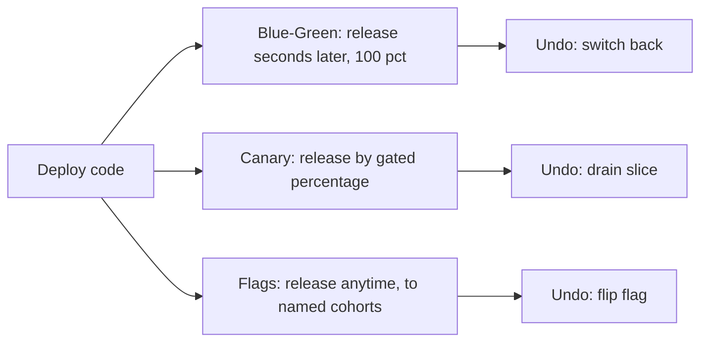
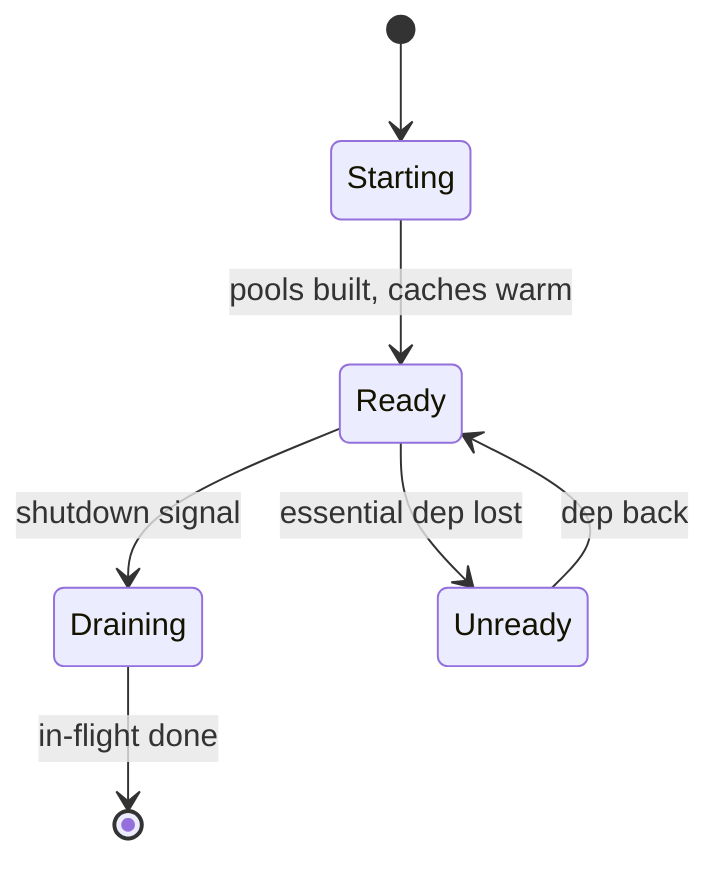
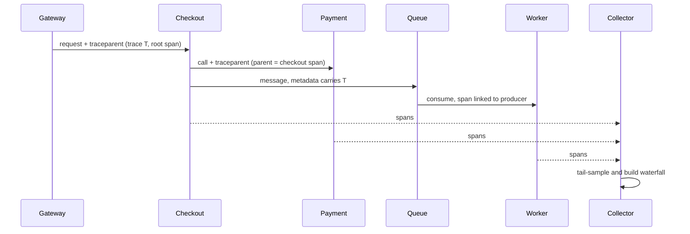
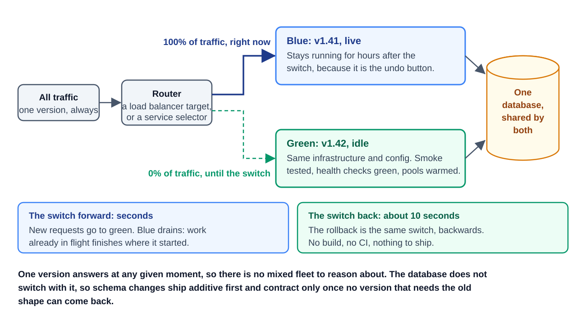
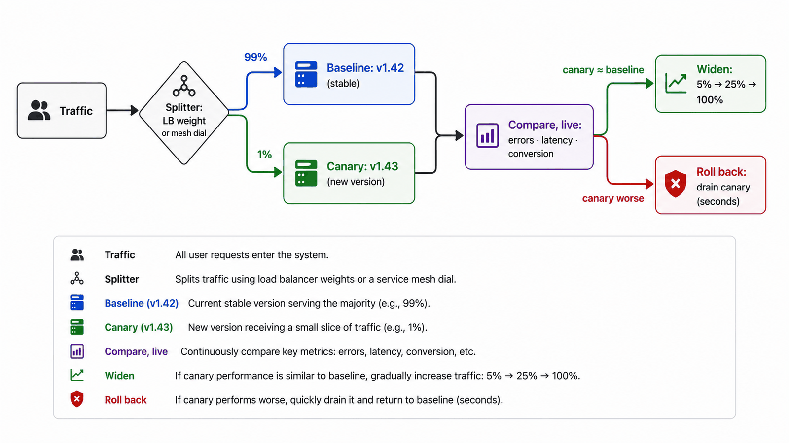
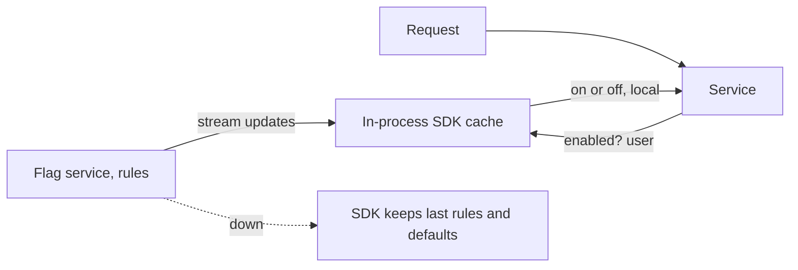
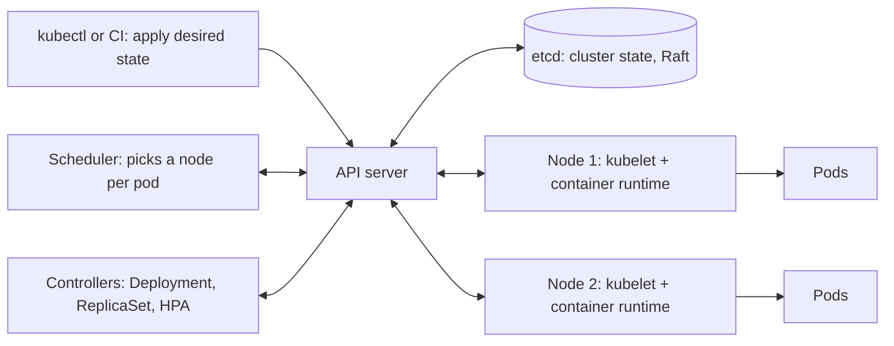
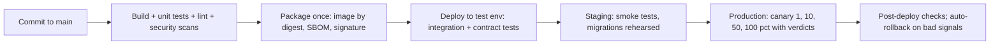
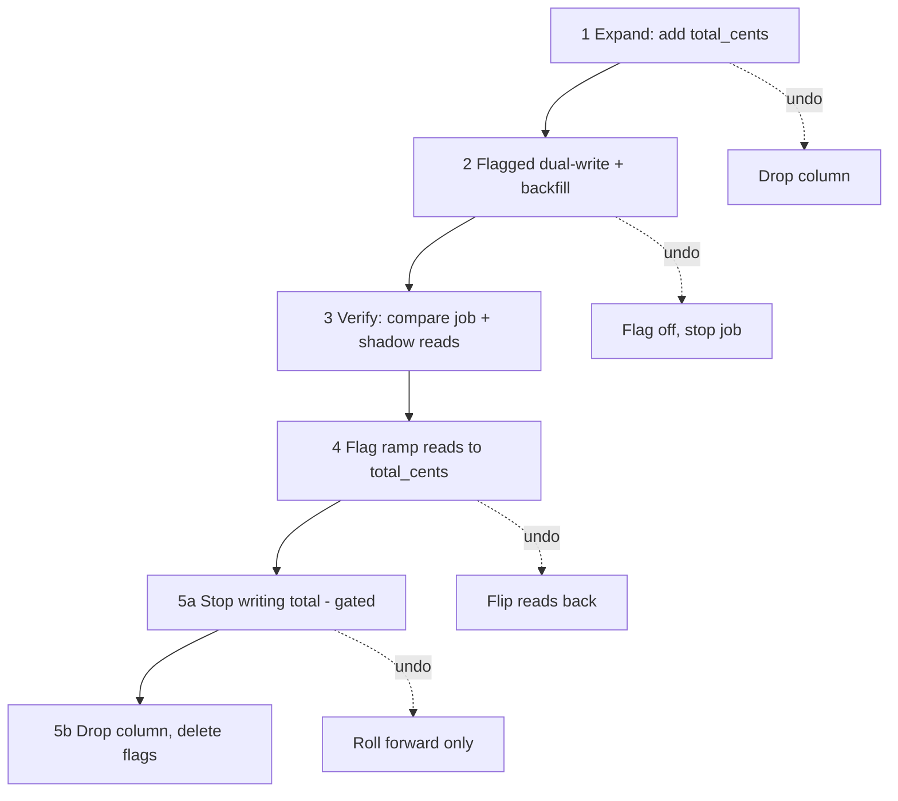

# Module 9 — Operating in Production (Observability and Delivery)

## Module Introduction
*Original lesson: [Module introduction on DesignGurus ↗](https://www.designgurus.io/course-play/system-design-patterns/doc/6a53675b9bf81a86ec3a1943)*


**What this module is about.** Hardware failures, traffic spikes and attackers cause some outages. But most production outages come from somewhere closer to home: *changes we make ourselves*. A deploy, a config tweak or a database migration touches a system that was healthy a minute ago, and suddenly it isn't. The reliability module earlier covered failures that arrive from the outside world. Here the focus shifts inward. You will learn to ship your own changes safely, and to *watch* production closely while each change goes out.

**Analogy.** Picture a hospital operating room. The surgery is the deploy. Before the surgeon touches anything, the patient is wired to monitors — that is observation. A skilled surgeon also knows how to pause or reverse any step the moment a monitor turns red — that is rollback. This module hands you the monitors first, then teaches the careful surgery.

**The five patterns (plus two added lessons) and the job each does**

| The situation | The pattern |
|---|---|
| Is this one server fit to take traffic at this moment? | Health Check |
| A single slow request passed through thirty services — which one ate the time? | Distributed Tracing |
| Replace the old version with the new one in a single move, and keep an instant way back | Blue-Green Deployment |
| Make the new version earn trust on a small slice of real traffic before everyone gets it | Canary Deployment |
| Put the code in production "dark" (there, but switched off), then turn the feature on later — step by step, and with an off switch | Feature Flags |
| Package every service the same way and keep a fleet of them running in the declared state | Containers and Kubernetes *(added lesson)* |
| Get every change from commit to production through one automated, trusted path, with the right rollout strategy | CI/CD Pipelines and Deployment Strategies *(added lesson)* |

Two of these patterns **observe**. They answer "is this server okay?" and "where did this request spend its time?". The other three **change** production, but without betting every user on each deploy. We cover observation first for a simple reason. Every safe delivery technique relies on spotting failure fast and accurately. "Roll back if the metrics look bad" means nothing if you can't see the metrics.

**Two facts that organize the module**

1. **Deploying and releasing are two separate events.** To *deploy* is to put new code on servers. To *release* is to let users experience what that code does. The traditional approach fuses the two: code lands, and instantly every user has it. The three delivery patterns pry them apart, each by a different amount:
   - Blue-green gets the new code ready in an idle environment, then releases it a few seconds later by moving traffic over.
   - Canary takes code that is already deployed and releases it to a small percentage of users.
   - Feature flags split the two events fully. You might deploy on Tuesday, release to a beta group the following week, and turn it off again in an instant.
   So for any change, the design question is: *how far apart should deploy and release be for this particular change?*

2. **Rolling back should be an everyday move, not a big project.** If a change is hurting production, you need to reverse it *right now*. The patterns differ in how cheap that reversal is. Blue-green moves traffic back in seconds. Canary drains the new version in seconds. A flag turns the behavior off instantly. Compare that with the slow path: building a code revert and pushing it through CI (continuous integration — the automated pipeline that builds and tests code). That can keep the outage going for tens of minutes. The rule, then: **every delivery design needs an undo design built in.** The capstone shows this in practice, keeping a safe way back open at every stage of a live migration.

*Delivery patterns placed on the deploy-to-release separation spectrum*

The diagram shows all three patterns sharing one starting step, "deploy code". They differ only in *when, and for whom,* the release happens. Each branch also finishes with its own cheap undo.

**Four terms used throughout**
- **Deploy vs. release** — putting code on servers vs. letting users feel it (Fact 1). No distinction in this module matters more.
- **Exposure scope (blast radius)** — the number of users a bad change can hurt before operators manage to stop it. A naive release hits 100%. Blue-green also hits 100%, but you can undo it fast. A canary hits about 1%. A flag can shrink it to a single named team.
- **Roll back vs. roll forward** — to *roll back* is to reverse the change. To *roll forward* is to push a fix on top of it. When rolling back is an option, it is usually the quicker one. The capstone shows how to reshape a migration so that rollback stays available even where the naive plan would rule it out.
- **Golden signals** — the four numbers to keep your eyes on during any change: **traffic** rate, **error** rate, **latency** (how long each request takes) and **saturation** (how close resources are to full). A canary's verdict comes from these numbers — the very reason observation is taught before change.

**How to read the module.** Health Check extends the endpoints from the load-balancer lesson. It contrasts shallow and deep checks and includes a case where one dependency failure knocked out a whole fleet. Distributed Tracing tracks a single request as it crosses services; every later "watch the canary" step leans on that per-request evidence. The delivery lessons then move from the simplest reversal to the most flexible one: Blue-Green (two environments and one switch) → Canary (widen exposure as measurements come back good) → Feature Flags (split deploy from release entirely, and meet "flag debt"). Two added lessons (not in the original course) then zoom out to the platform these patterns run on: **Containers and Kubernetes** (images, pods, Services, probes, rolling updates and the control loops that keep a fleet in its declared state) and **CI/CD Pipelines and Deployment Strategies** (build once and promote, infrastructure as code, GitOps, and a side-by-side table of recreate, rolling, blue-green, canary and shadow rollouts). Finally, the capstone uses every one of them in a zero-downtime database migration.

> Short on time? Start with **Canary Deployment** — interviewers dig into it more than any other delivery pattern. Health Check is brief, so don't skip it.

**Before you start — three questions about a system you know**
- Think of your most recent bad deploy. How long until someone *noticed*, and how long until it was *undone*? This module is about shrinking exactly those two numbers.
- When a request is slow, can you tell which service used up the time? Or do you grep thirty log files and make a guess?
- Could your newest feature be switched off this minute, with no deploy? And who would be able to do it?

---

## Health Check Endpoint
*Original lesson: [Health Check Endpoint on DesignGurus ↗](https://www.designgurus.io/course-play/system-design-patterns/doc/6a5367889bf81a86ec3a1dad)*


**What it is.** A health check is a very small HTTP endpoint that lives on each server instance. It exists to answer a single question: *"should this instance be getting traffic at this moment?"* Three callers hit it every couple of seconds and act on what it says: the load balancer, the container orchestrator (Kubernetes, for example) and the auto-scaler. Each call is cheap and they never stop. Yet the answer matters a lot, because the callers can only respond in drastic ways. They either stop sending traffic to the instance, or they kill it and start it again.

**Analogy.** Imagine a manager asking a shop assistant two quite different questions. First: "Are you conscious?" A "no" means calling an ambulance — the equivalent of a restart. Second: "Can you serve customers this minute?" A "no" here is often harmless. Maybe the till is still being set up, or the counter is closing. The fix is just to point customers to the next counter for a bit. Confuse the two questions and you end up calling an ambulance whenever the till is slow.

### The problem: naive health checks lie in both directions

The load-balancer lesson showed two mistakes that pull in opposite directions:
- A **shallow** check asks only whether the process answers ("I'm alive, HTTP 200"). The check can stay green even when the instance can't reach any of the databases or services it needs to do real work. The load balancer then keeps routing users to a server that can't help them.
- A **deep** check also probes dependencies — for instance, it pings the database. That fixes the first mistake but introduces a worse one. Suppose the *shared* database has a short hiccup. **Every** instance fails its check at the same instant, and the load balancer pulls *the whole fleet* out of service. What was a partial slowdown turns into a full outage.

The way out is to ask a better question. Not "is the entire architecture healthy?", but "should *this particular instance* get traffic?" Modern platforms go further and break that into two separate questions, each with its own consequence.

### How it works: two verdicts, two consequences

1. **Liveness — "am I broken at a basic level?"** A failed liveness check makes the platform **restart** the process. That means liveness must cover *only* problems a restart can really cure: the process has stopped responding, it is deadlocked (threads waiting on one another forever), or it is stuck internally for good. **Dependencies never go in this check.** There are two reasons. A restart of your app can't fix a broken database. And when a shared dependency goes down, *every* instance fails liveness, so the platform keeps restarting processes that were actually fine — a *restart storm*.

2. **Readiness — "should traffic come to me right now?"** A failed readiness check makes the platform **de-route** the instance for a while, meaning it stops sending requests there. This is a mild action and easy to reverse. An instance can be in perfect health and still honestly be *not ready*: during startup, while filling its caches, while setting up its connection pools (database connections opened ahead of time and reused), or while draining before it shuts down. De-routing can be undone; a restart wipes things out. So each check has to fit the consequence it sets off.

3. **Lifecycle honesty.** At each stage of its life, the instance should report the truth:
   - At **startup**, readiness begins as false.
   - The instance sets up its pools and warms its caches. Only after that does it flip readiness to true, so no user lands on a cold, sluggish instance.
   - At **shutdown**, readiness goes to false first. The instance keeps working on requests already in progress while the load balancer steers traffic away. Only then does it exit.
   During a rolling deploy, this ordering stops each new instance from being slow for its first ~30 seconds of serving.

*Instance lifecycle as seen by readiness*

This state diagram follows readiness across an instance's life. The instance reaches Ready only once warm-up is done. It may drop to Unready for a while if a dependency it truly cannot live without goes missing. And it always passes through Draining on its way out.

### Three rules that keep health checks safe

- **Check yourself, not the architecture.** Handle dependency failures *inside* the service. Use circuit breakers (they stop calls to a dependency that is failing) and fallbacks, so the service can keep reporting "ready" while running in a reduced mode. There is one exception. Some services are completely pointless without one dependency — a pure database proxy is the classic case. There, readiness *may* include that dependency. The team just has to accept, with eyes open, that when it fails every instance gets de-routed.
- **Cost almost nothing.** Run the numbers. 30 services × 40 instances, each probed every 2 seconds, gives **600 checks per second** — without end. Put a database query in each probe and you have 600 useless queries per second. It gets worse: a slow probe can *time out*, making healthy capacity look failed. You have built an outage yourself. Aim for an in-memory check that finishes in roughly **1 ms**.
- **Tell the truth at every lifecycle stage.** This is step 3 from above: not ready until warmed up, and not ready while draining.

### Routing checks vs. monitoring checks

Routing checks run per instance, run very often and must be cheap. **Monitoring checks** are something else. They exercise the whole system using **synthetic transactions** — scripted pretend requests, like a test checkout — along with deeper probes of dependencies. They run from a central place, less frequently, and their output is *alerts for people*, never routing decisions. Keep them on separate endpoints, since the consequences are different. Merging the two is precisely how deep dependency tests creep into routing and restart logic for the whole fleet.

**Handle every probe condition like a policy that gets reviewed.** When someone adds a new dependency, it's tempting to tack "one more network call" onto readiness. Don't do it casually. For each condition, write out three things: the condition itself → what action fires when it fails → how that action helps the system recover. If neither a restart nor de-routing can fix the problem, the condition has no place in that probe.

**Response format.** All the platform needs is pass or fail. Extra diagnostic fields that name the failing local condition are fine. But never put secrets or sensitive config in them, and don't do costly work just to produce them.

### Liveness vs. readiness (comparison)

| | Liveness | Readiness |
|---|---|---|
| Question | Am I broken at a basic level? | Should traffic come to me right now? |
| Consequence | Restart (drastic) | De-route (mild, reversible) |
| May include dependencies? | Never | Only the essential ones, picked on purpose |
| Can honestly say "no" while healthy? | No | Yes — while warming up or draining |
| What goes wrong if designed badly | Restart storms whenever a dependency fails | The whole fleet removed whenever a shared dependency fails |

### Trade-offs

**You gain:**
- Failing instances get pulled out at machine speed — load balancers react within seconds.
- Deploys happen in a safe order: readiness lets in only warmed-up instances and drains each one before it is terminated.
- Self-healing: auto-scaling platforms swap out any instance that fails liveness.

**You pay:**
- **A mistake here hits the whole fleet.** The code is only ~10 lines, but an error spreads everywhere. Dependencies in liveness → restart loops. Dependencies in readiness → the entire fleet pulled out. Slow probes → timeouts that invent failures.
- **Probe load.** Each probe is tiny, but it never stops and it runs on every instance. As the number of services grows, this needs discipline.
- **False confidence.** A green probe only shows the instance answered one narrow question. It does not show a customer can actually finish a checkout. That system-level proof comes from central monitoring.

### When not to use it (or how to scope it)

Any service that receives routed traffic needs health checks. Just keep what they check narrow:
- **Don't use a single endpoint for routing, restarting and alerting.** Three different consequences call for three different designs.
- **Don't make readiness depend on optional dependencies.** If the recommendations service is down, the page should simply hide that widget (degrade) — not knock your whole fleet offline.
- **Batch workers and queue consumers** receive no routed traffic. For them, "health" means liveness plus **backlog age** (the age of the oldest message not yet processed). The queue's own metrics serve as the readiness signal.

### In the interview

Expect this after almost any load-balancer or Kubernetes design: "what does your health endpoint check?" The interviewer is listening for the liveness/readiness split, and for whether you see the danger of putting a shared dependency in either one.

> **30-second answer:** "Two endpoints, each giving its own verdict. Liveness asks: am I broken in a way a restart would fix? That means the process responds and isn't deadlocked. It never includes dependencies — restarting me won't repair the database, and a shared outage would turn into a restart storm. Readiness asks: should I be getting traffic right now? It's false while warming up and while draining, true the rest of the time. Dependencies stay out of it unless the service is genuinely useless without one, because serving in a degraded way is better than being pulled out. Both checks are cheap. Probes hit the whole fleet every two seconds, so a DB query in the check means hundreds of wasted queries a second — and one timeout could create an outage. Deep system checks do exist, but as central monitoring that feeds alerts. They never drive routing."

**Likely follow-ups (with answers):**
- *"How does an instance avoid serving while still cold after startup?"* — Readiness stays false while it fills its connection pools and warms its caches. It turns true only once the instance can serve at full speed. Shutdown runs in reverse: go unready, let in-flight requests finish while the load balancer drains traffic away, then exit.
- *"Your database-proxy service has no degraded mode to fall back to. Should readiness include the DB or not?"* — Include it, on purpose, since the proxy literally can't work without the database. Accept that a DB failure will de-route every instance, and make sure the *callers* degrade gracefully. The rule comes from the consequence, not from a blanket "never include dependencies".

**Mistake that fails candidates:** putting dependencies in liveness, using one endpoint for both routing and alerting, or suggesting "ping the database" without explaining how it knocks out the whole fleet at once.

**Self-check:**
- **Q1.** Name the two questions and their consequences. Why are dependencies forbidden in one and rationed in the other? → Liveness ("am I broken?") leads to a restart. No dependencies, because restarting me can't repair some other system. Readiness ("should I get traffic?") leads to de-routing. Include only the dependencies without which the service can't do anything useful. When an optional dependency fails, the service should degrade, not lose capacity.
- **Q2.** A service relies on a database (essential), Redis as a cache (on a miss it falls back to the DB) and a recommendations service (an optional widget). Where does each check go? → Liveness: just an in-memory check of the process. Readiness: the database plus the warm-up/draining state. Redis: in neither (a cache miss still works through the DB). Recommendations: in neither (just hide the widget). A synthetic checkout test: in central monitoring.
- **Q3.** At 3:07 AM the database goes through a 90-second **failover** (a replica gets promoted to be the new primary). Every instance of six services restarts, some more than once. The outage lasts 20 minutes rather than 90 seconds. Why? → Liveness included a DB call. So every instance appeared "broken" and got restarted. Each restart threw away in-flight work and came back cold. The instances then failed the same check again. And every restart rebuilt its connection pools, pounding the database while it was trying to recover. Fix: liveness checks only the process. The DB goes in readiness only if it is truly essential; otherwise circuit breakers handle degradation. Deployment review blocks any liveness condition that a restart can't fix.

**Related patterns:**
- **Load Balancing** — the biggest user of health checks; readiness drives both removal and draining.
- **Graceful Degradation** — the right home for dependency problems: degrade and stay ready, instead of failing the probe and disappearing.
- **Sidecar** — startup order: the app reports not-ready until its sidecar proxy is ready, and the sidecar is the last thing to drain.
- **Auto-Scaling** — failed liveness leads to the instance being replaced; this endpoint powers the fleet's self-healing.

**TL;DR**
- **Problem:** the routing and restart machinery wants a verdict for each instance roughly every ~2 s. A naive endpoint misleads in both directions — shallow stays green while the instance is useless; deep turns the whole fleet red when a shared dependency blips.
- **Mechanism:** two endpoints. Liveness covers only brokenness a restart can fix, and never dependencies. Readiness covers whether the instance deserves traffic: false while warming up or draining, and including only truly essential dependencies. Both run in ~1 ms. Deep checks belong to central monitoring.
- **Costs:** a tiny piece of code whose mistakes hit the whole fleet (restart storms, everyone removed at once, failures created by timeouts), plus probe load that never ends.
- **Skip it when:** never — but don't let one endpoint handle routing, restarts and alerting together, and let queue workers report backlog age instead.

---
## Distributed Tracing
*Original lesson: [Distributed Tracing on DesignGurus ↗](https://www.designgurus.io/course-play/system-design-patterns/doc/6a5367b5f5fad4cc634162de)*


**What it is.** Distributed tracing captures the whole trip one request takes as it moves from service to service. Where the request enters the system, it gets stamped with a **trace ID**. Then every service and database call it touches writes down a timed record, called a **span**. Each span carries the trace ID and notes which call triggered it. A collector gathers the spans and rebuilds them into a single timeline, known as a **waterfall**. Looking at it, you can see precisely where the request's time went.

**Analogy.** Think of a parcel with a tracking number. Every depot scans it on arrival and departure, recording the time and the previous stop. One depot's log alone says little — just "the parcel spent 5 minutes here". The tracking page joins all those scans into one story. Right away you spot that the parcel sat in a single sorting centre for three days.

### The problem: the time hides *between* the logs

Support says checkout is "slow sometimes". The **p99** — the latency that only the slowest 1% of requests go beyond — sits at **4.2 seconds**. The budget is **800 ms**. And it only hits some requests, at times nobody can predict. One checkout request passes through **12 services through 40+ calls**: the gateway, the **BFF** (backend-for-frontend, a layer built to serve the mobile app), checkout, inventory, payment, fraud, pricing and others.

Twelve engineers each dig through one of the twelve services' logs at the same time. Every service reports "I was fast". Checkout logged just 8 ms of its own work. Payment seemed responsive. Every log is *correct*, yet none of them answers the question. That's because **the 4.2 seconds wasn't spent inside a single service; it was spent between the records**, along one specific sequence of calls that no individual log captures.

Next, three engineers put in two days aligning timestamps from different logging systems. The trouble is that those timestamps come from machines whose clocks disagree by milliseconds. (The vector-clocks lesson covers why physical timestamps can't reliably put events from different machines in order.) The team forms a theory and ships a fix — and p99 stays exactly where it was. The underlying issue: logs answer *"what did this component do?"*. The real question was *"which path did this request take, and where did its time go?"* Nothing had recorded that.

### Why the obvious fixes fail

- **"Add more logging."** You end up with more records, but they still aren't *linked* to one another. The volume rises; the ability to connect them does not. What was missing was relationships, not more detail.
- **"Put a correlation ID in every log line."** (The gateway makes an ID and passes it on, and each service logs it.) This helps partly. Searching for the ID pulls up every log line for that request. But the lines still have no **parent/child relationships** (which call triggered which one). Their timings are hard to line up because the clocks are skewed. And nothing draws the path for you. You've gathered the records, but they're in no particular order.
- **"Send synthetic test requests."** Scripted test traffic can only recreate conditions you already know how to set off. This incident is hard exactly because no one knows what sets it off.

What we need is a record that carries one identifier through every service, notes when the request arrives and leaves, and lets a system piece the full path back together.

### How it works

1. **The entry point creates a trace ID.** The first component the request reaches (the API gateway) generates a unique trace ID. This is why the gateway lesson gave the gateway the job of creating request IDs. It is the first to see every external request, so it naturally becomes the *root* of every trace tree.
2. **Each operation records a span.** A span is a single timed operation: handling the request, making an outbound call, or running a database query. It holds a name, a start time and an end time, its **parent span** (the operation that triggered it), and attributes like URL, status and error. Spans nest inside one another to form a parent/child tree. Draw that tree along a timeline and you have the waterfall.
3. **Context propagation carries the IDs forward.** The trace ID and the current span ID ride along with the request. On synchronous HTTP calls they go in a standard header (W3C **`traceparent`**). On asynchronous work they go in **queue message metadata**. The consumer's span *links* back to the producer's span, and the time between them shows how long the message sat in the queue. **If even one service fails to pass the header on, every span after it becomes an orphan** — it has no parent, so it drops out of the trace.
4. **Spans are sent to a collector**, which puts each trace back together as a waterfall you can view and search.

Here is a trace of the slow checkout (indentation shows parent/child):

```
Trace 7f3a...  (checkout, 4,214 ms total)
├── gateway                    2 ms
├── mobile BFF                 11 ms
│   ├── checkout svc           4,190 ms   ← there
│   │   ├── inventory          12 ms
│   │   ├── payment svc        4,110 ms   ← in here
│   │   │   ├── fraud check    1,210 ms  (timeout)
│   │   │   ├── fraud check    1,240 ms  (retry 1)
│   │   │   ├── fraud check    1,190 ms  (retry 2)   ← found it
│   │   │   └── charge         180 ms
│   │   └── pricing            9 ms
```

*Context propagation through sync and async hops*

This sequence diagram shows the trace context travelling two ways: on an HTTP call (checkout → payment) and across a queue hop (checkout → queue → worker). Every service reports its spans to the collector. The collector picks which traces to keep and assembles the waterfall.

**Instrumentation — the three ways spans get created, from least to most effort:**
- **Service-mesh sidecars** (proxies that run beside each service) capture every hop between services on their own. You get this visibility without changing the application at all.
- **Auto-instrumentation libraries**, such as **OpenTelemetry**, wrap the HTTP clients, database drivers and queue clients inside each process.
- **Manual domain spans** cover steps no library can guess — "apply discount rules", for example. Add these only where the same investigations keep coming back. The two automatic layers already provide a helpful skeleton, and that alone cracks many latency puzzles.

**Sampling — keeping everything isn't possible.** 40,000 requests/s × ~40 spans per request = **1.6 million spans per second**. Saving all of that isn't practical, so you keep only some:
- **Head sampling** makes the call when a request *begins* (say, keep 1%). It is cheap and easy. But it decides before the outcome is known, so there's a **99% chance of discarding** the slow or failing trace you actually care about.
- **Tail sampling** makes the call *once the request is done*. It can hold on to every error, every request that missed its latency objective, and a small random baseline. You keep exactly the traces you need. The price: the sampling system has to **buffer every trace** until it can decide. That is real infrastructure, and interviewers like to discuss it.
- What teams usually do: tail rules for errors and outliers, plus a head-sampled baseline of ordinary traffic.

### Walkthrough with numbers: the same incident, with tracing

- **Minute 1:** an engineer filters on `duration > 4s` and gets dozens of traces straight away. Tail sampling kept them because they are latency outliers.
- **Minute 2:** opening one reveals the waterfall above. Inside payment's 4,110 ms span sit **three sequential fraud-check spans of ~1.2 s each**: one call that timed out, then two retries. The retry logic did just what it was configured to do. What changed is that fraud's p99 climbed past payment's timeout. So each affected checkout spends timeout × 3 attempts ≈ **3.9 s** before it succeeds.
- **Minute 4:** root cause located. Fraud's slower latency is the real problem; payment's timeout/retry settings shape how that problem shows up. The earlier wrong theory had burned six engineer-days. Tracing compresses **days of reconstruction into minutes of reading**.
- **Bonus:** combining many traces yields a live **dependency map** — which services call which, how often and how fast. Teams often find call paths nobody had documented this way.
- **The bill:** keeping errors + outliers + a 0.1% baseline means storing about **2,000 spans/s**, which is manageable. But the buffering tier that tail decisions require is genuine infrastructure and belongs in capacity planning.

### The three pillars of observability

| | Metrics | Traces | Logs |
|---|---|---|---|
| Question | "How much, how fast — overall?" | "Which path did this request take?" | "What exactly happened at this spot?" |
| Shape | Numbers over time; cheap enough to keep forever | Trees of timed spans; sampled | Text events; very high volume |
| Alerting | *The* layer that alerts (golden signals) | Seldom alerts; explains the alerts | Sometimes (on error patterns) |
| Cost | Small | Medium, kept in check by sampling | The largest |

These aren't rivals; you use them in order. **Metrics ring the alarm** (p99 is over its objective). **Traces localize it** (fraud-check retries inside payment). **Logs explain it** (the exception and its parameters). Debug from left to right. Include the trace ID in log lines, so you can hop from a waterfall directly to the matching logs. Teams without traces jump straight from an overall alarm to searching every log — which is the incident this lesson opened with.

### Trade-offs

**You gain:**
- Evidence about a single request across any number of services — something separate logs simply can't express, by their nature.
- Quicker latency diagnosis. Retry storms, lock contention and **N+1 queries** (one query per item, rather than one query for all the items) show up as visible sequences in the waterfall.
- Knowing which service really caused an error across service boundaries — which component actually returned the 500.
- A live dependency map, as a free side effect.

**You pay:**
- **Propagation discipline, with no end date.** Every service, client library and queue consumer has to pass the context on. A single missing header orphans everything after it. So your traces are only as good as the *weakest* client's behavior.
- **Sampling infrastructure** — the tail-sampling buffer and the layer that makes the decisions, plus ongoing tweaking of what counts as "interesting".
- **Instrumentation work** beyond the automatic skeleton, added only where puzzles keep recurring.
- **Privacy exposure.** Spans can hold URLs, parameters and any attributes at all. So **PII scrubbing** (stripping out personal data) must happen inside the collection pipeline — the same rule as in the event-driven-architecture lesson.

### When not to use it

- **A monolith.** A profiler does a much better job of explaining time spent inside one process. Tracing earns its keep when latency is scattered *between* processes.
- **Three services and a queue.** Structured logs with correlation IDs might be all you need. Tracing becomes more valuable the more hops there are.
- **In place of logs.** Spans give you the skeleton (timing and structure). Logs give you the story (the details).
- Two frequent misuses: storing 100% of traces forever (costs blow up as traffic grows), and hand-instrumenting every internal function from day one (effort wasted on code that never puzzled anyone).

### Real-world examples

- **Google's Dapper paper** — brought distributed tracing to planet-sized scale using heavy sampling. Most of today's ideas trace back to it.
- **OpenTelemetry** — vendor-neutral instrumentation, `traceparent` propagation and exporting. It is *the* standard to mention in interviews.
- **Jaeger, Zipkin, Grafana Tempo** — store and show traces. **Honeycomb, Datadog** — all-in-one observability platforms.
- **Service meshes** — generate the service-level trace skeleton without any extra work (the observability benefit from the mesh lesson, fed into a trace backend).
- **For AI engineers:** observing an agent *is* tracing. One agent run is a trace. Every model call, tool call and retrieval is a span, with attributes like token count, cost and model version. A waterfall could reveal that a 40-second, $0.30 run made three model calls one after another that could have been merged — or it could point straight at the tool call that failed. LLM tracing tools such as **LangSmith** are descendants of Dapper. And context has to be passed through an LLM gateway just as it is through HTTP headers.

### In the interview

A common prompt: "a slow request passes through thirty services — how do you find where the delay is?" "Search the logs" won't satisfy the interviewer. Follow-up questions dig into the cost of sampling and propagation across async hops.

> **30-second answer:** "Distributed tracing. The gateway mints a trace ID, and every operation records a span that is timed, linked to its parent and tagged. The context travels in headers across every hop, queue messages included, so async work stays part of the picture. Any slow request can be drawn as a waterfall, and you see where the time hid within minutes; retry storms and lock waits become visible. There are two design choices. First, sampling: tail-based, keeping errors and latency outliers plus a small baseline, because head sampling throws out the interesting 1% before it knows it's interesting. Second, propagation discipline, because a single service dropping the header orphans everything after it. The mesh gives me the service-level skeleton for free, and OpenTelemetry adds in-process detail where the mysteries keep coming back."

**Likely follow-ups (with answers):**
- *"Head or tail sampling, and why?"* — Tail for errors and latency outliers, since you can't know the outcome until the request is finished. Add a head-sampled baseline for normal traffic. Tail sampling means buffering every trace until a decision is made, which is extra infrastructure. Using head sampling alone tends to throw away exactly the rare p99 examples you need.
- *"How does a trace make it across a queue hop?"* — Store the trace context in the message metadata. The consumer starts a span that is *linked* to the producer's span. The time gap between them is the queue wait, so backlog delay shows up in the same waterfall as the synchronous work. Queues that don't propagate context are where traces break most often.

**Mistake that fails candidates:** suggesting more logs, keeping 100% of traces without any cost model, or letting propagation die at the first queue.

**Self-check:**
- **Q1.** Define a trace, a span and context propagation. Where does the trace ID get created, and why there? → A trace is the full path of one request, identified by a trace ID. A span is a single timed operation with a start and end, a parent and attributes. Propagation carries the trace and span IDs across every HTTP call and queue message so that new spans attach to the correct trace. The gateway creates the ID because it is the first component to see every external request, making it the natural root.
- **Q2.** Team A cares about cost and has ordinary traffic. Team B has rare p99 spikes that are gone before anyone can look. Design sampling for each. → Team A: a modest head sample (1%, say) plus always keeping errors — the cost stays predictable. Team B: tail sampling that keeps every error and every trace over the latency limit plus a small baseline, and accepts the buffer cost on purpose, because rare and unpredictable outliers are precisely what head sampling loses.
- **Q3.** Since Tuesday, every checkout trace stops at payment. The fraud and charge spans are gone, even though those calls clearly still happen. → Payment has stopped forwarding `traceparent`. Most likely a dependency update swapped in a different HTTP client or framework, so fraud's spans are now orphans. The fix is to apply OpenTelemetry auto-instrumentation to the new client. Protect against this whole category of bug with **trace-completeness monitoring** (alert when the orphan-span rate rises or expected child spans go missing) and with propagation tests in the service template.

**Related patterns:**
- **API Gateway** — mints the trace ID and the root span.
- **Service Mesh** — its sidecars supply the free service-level skeleton.
- **Message Queue** — message metadata carries the context, so async work and queue delay remain in the waterfall.
- **Retry with Exponential Backoff** — tracing makes retry storms visible (exactly what the walkthrough uncovered).
- **Canary Deployment** — canary verdicts rely on this telemetry.

**TL;DR**
- **Problem:** when a slow request crosses many services, its time hides between the logs of each service. Every service claims "I was fast", and piecing timestamps together takes days and ends in a guess.
- **Mechanism:** the gateway creates the trace ID; every operation records a timed span with a parent; context travels in headers and queue metadata; a collector rebuilds the waterfalls; tail sampling picks errors and outliers out of the 1.6M spans/s stream.
- **Costs:** propagation discipline forever, sampling infrastructure, instrumentation beyond the mesh skeleton, and PII scrubbing.
- **Skip it when:** there's a single process (use a profiler), about 3 services (correlation IDs may be enough), or you hoped it would replace logs.

---

## Blue-Green Deployment
*Original lesson: [Blue-Green Deployment on DesignGurus ↗](https://www.designgurus.io/course-play/system-design-patterns/doc/6a53682c7a313d4e87bebde6)*


**What it is.** You keep two production environments that are exact copies of each other. **Blue** is live and handling users. **Green** sits idle. The new version goes onto green. You test it there, on genuine production infrastructure, while no users touch it. Then you flip the router, and within seconds all traffic is on green. To roll back, you make the same flip in the other direction.

**Analogy.** Picture a theatre that has two matching stages. The audience is watching stage Blue. Meanwhile, the crew builds and rehearses the next scene in full on stage Green. When Green is ready, the seats swivel to face it. If anything goes wrong, swivel them back — Blue's set is still up.

### The problems it solves

- **Rollback is slow.** Rolling back in place means rebuilding the old version and redeploying it through CI, artifact storage and rollout. Even when engineers know exactly what to do, the system may limp along for **15–25 minutes**. Rollback ends up being one more deployment.
- **The verification gap.** Staging is not production: its data, config, integrations and load all differ. With no second *production* environment, a release gets its first full test only once users are already on it.

### How it works

1. **Deploy to green** while blue handles everyone. Green *is* production: same infrastructure, same config, same database. **Infrastructure-as-code** (describing environments in version-controlled files) keeps the two the same. That matters, because quiet **environment drift** would break the whole idea.
2. **Check green before any user reaches it.** Run **smoke tests** (fast checks that the basics work) against the real infrastructure. Wait for health/readiness to turn green. Warm up the caches and connection pools. This is deploy and release split apart by just a few seconds: the code is completely deployed, yet no user has been released onto it.
3. **Switch.** The router starts sending new traffic to green. You do this by changing the load balancer's target, or in Kubernetes by flipping a service's selector. Blue **drains**, meaning requests already underway finish on the environment where they began. User sessions carry over because they're kept in a shared store rather than on the servers (the earlier statelessness lessons set this up).
4. **Keep blue on standby** for an undo window, usually a few hours. Switching back *is* the rollback. It takes about **10 seconds**, with no CI and no build. Once everyone is confident, blue turns into the green for the next release.


*Figure — Blue-Green Deployment (course diagram)*

In this figure, the router sends 100% of traffic to blue (v1.41, live) and 0% to green (v1.42, smoke-tested and warmed up) until the switch happens. After the switch, blue stays running for hours, because it *is* the undo button. Look at the one database in the middle that both sides share. It is the single component that does not switch.

### The database does not blue-green

The two versions talk to the **same database**. For the whole rollback window, the old code and the new code both have to read and write the shared schema and data without breaking anything. That's why schema changes follow **expand-contract**:
- **Expand:** add the new structures in a way that doesn't break anything, write data in both the old and new forms, and make sure either version can read safely.
- **Contract:** delete the old structure only when *no* version that relies on it could ever return — that is, once the rollback window has closed.

This is the "additive first" rule from the API-versioning lesson, applied to data. Blue-green swaps application environments that hold no state. *State* needs its own compatibility discipline. The entire capstone is about this.

### Blue-green vs. rolling deploy

A **rolling deploy** swaps out instances where they stand, a handful at a time.

| | Rolling (replace in place) | Blue-Green |
|---|---|---|
| Extra capacity | About 1 instance's worth | 2× for the duration of the window |
| Rollback | Redeploy: minutes | Switch back: seconds |
| Version mixing | v1 and v2 both serve for the whole rollout | Never — the switch is atomic |
| Blast radius at cutover | Grows gradually, instance by instance | 100% at the moment of the switch |
| Fits | A cheap default; versions that are compatible with each other | When you need instant undo; changes that can't cope with mixed versions |

Rolling deploys are cheap and every orchestrator supports them, which makes them a reasonable default. Blue-green justifies paying for double capacity when reversal speed matters or when the two versions can't run side by side. Both decide who gets the new code by *where the infrastructure is*; the flags lesson will decide it by *who the user is*.

### Trade-offs

**You gain:**
- **Rollback in seconds.** It's a routing change rather than a build, so reversing becomes an everyday move.
- **Checking the whole environment** before a single user touches the release.
- **No fleet running mixed versions.** Exactly one version serves at a time. (With a rolling deploy, v1.41 and v1.42 responses are interleaved, so the two must be able to live side by side safely.)

**You pay:**
- **2× capacity** while the release window lasts. In the cloud, you can spin up green for a few hours and then delete it. On-premises, you may need hardware that sits idle all the time. Compare that against the cost of the outages it prevents.
- **All-or-nothing exposure.** The switch moves **100% of users at once**. If a bug slipped past verification, everyone hits it right away. (Canary solves this.)
- **Schema discipline as an ongoing cost.** Every migration has to remain expand-contract compatible, or the rollback button stops working.
- **Draining is tricky.** Long-lived connections (server-sent events, websockets) keep blue busy until they close or move over.

### When not to use it

- **When you need to validate step by step.** Blue-green checks the environment, not the variety of user behavior. A bug that only 3% of users trigger still reaches 100% once you switch — use a canary for that.
- **When 2× costs serious money.** Very large fleets often favor canaries, which reuse the capacity they already have. On-prem teams might keep blue-green for risky releases only.
- **When state is the main concern.** In a database-heavy system, swapping a thin app layer doesn't buy much, since the migration is where the real risk lives.
- **Common misuse:** flawless blue-green on the app servers, paired with a destructive schema rename or a dropped column. The router can send traffic back to blue, but blue can't read the altered data — so the "rollback" makes things worse.

### In the interview

The prompt: "zero-downtime deployment with instant rollback". Be ready for a follow-up on the shared database — that is what determines whether your rollback really works.

> **30-second answer:** "Two identical environments. I deploy to the idle one and verify it against real infrastructure with zero users on it — gated on health and warmed up. Then I switch the load balancer. All traffic moves within seconds, and rollback is just switching back, so undo becomes a reflex instead of a 20-minute redeploy. Blue drains its in-flight requests and stays ready through the undo window. The database is what doesn't switch. Both versions share it, so schema changes follow expand-contract: additive first, write both forms, and contract only once rollback can no longer need the old shape. Skip that and the rollback button doesn't work. The honest limits: 2× capacity during the window, and the switch exposes 100% of users at once — gradual exposure is the canary's job."

**Likely follow-ups (with answers):**
- *"Walk me through the database during one blue-green cycle."* — Expand with an additive migration that works for both versions. Deploy and switch to green. Keep things compatible for the whole observation/rollback window. Contract only once blue can never come back. The rollback window and the schema-compatibility window have to last exactly as long as each other.
- *"What happens to sessions and in-flight requests at the switch?"* — Blue drains the requests it already has while green picks up the new ones. Sessions live in a shared store (thanks to the statelessness work), so nobody gets logged out.

**Mistake that fails candidates:** forgetting about the database, saying rollback is safe after green has written a format blue can't read, or picking blue-green when what's needed is gradual validation of behavior.

**Self-check:**
- **Q1.** What switches, what drains, what never switches, and what keeps it safe? → The router target switches (the stateless environments trade roles). Blue drains its in-flight requests while green takes the new ones. The shared database never switches; expand-contract protects it (additive changes, compatibility with both versions, and removal only after the rollback window).
- **Q2.** Team A runs in the cloud and deploys twice a day. Team B is on-prem at 60% utilization. What does blue-green cost each of them? → Team A spins up green for a few hours per release and then deletes it — a small cost next to even one avoided 20-minute outage. Team B would need hardware sitting idle permanently. So B might save blue-green for high-risk releases and use rolling deploys or feature flags for the rest, accepting a different kind of release risk.
- **Q3.** Green (v1.42) goes live at 14:00. At 14:30 you switch back to blue, and blue begins failing to read recent orders. → v1.42's migration renamed, removed or changed the type of a column, or it wrote data in an incompatible format. Blue can't read green's data, so the rollback itself caused an outage. Immediate fix: repair v1.42 and **roll forward** (blue is no longer compatible), then examine the data written 14:00–14:30. Prevention: expand-contract, with the contract phase held back until the rollback window has closed.

**Related patterns:**
- **Load Balancing** — the switch is a routing change, and draining is how it's carried out.
- **Health Check** — readiness tells you when green is genuinely warm.
- **Canary Deployment** — the gradual upgrade that avoids exposing 100% at once.
- **API Versioning** — expand-contract is its additive-first rule, applied to schemas.

**TL;DR**
- **Problem:** with in-place deploys, rollback becomes a ~20-minute redeploy, and the new version first meets real infrastructure only after users are on it.
- **Mechanism:** two identical environments. Deploy to the idle one and verify it; flip the router within seconds; drain the old one; keep it ready through the undo window; protect the shared DB with expand-contract.
- **Costs:** 2× capacity (all the time, if on-prem), 100% exposure at the switch, tricky draining, and schema discipline forever.
- **Skip it when:** you need gradual validation across varied traffic, 2× is serious money at your scale, or the risk sits in the data layer.

---
## Canary Deployment
*Original lesson: [Canary Deployment on DesignGurus ↗](https://www.designgurus.io/course-play/system-design-patterns/doc/6a5377c1f5fad4cc6341da82)*


**What it is.** Start by releasing the new version to a small group of real users — 1%, for example — and compare its vital signs with the old version's *as they happen*. If the new version looks just as healthy, grow the group in steps (5%, 25%, 100%). A measured verdict must approve every step. If it looks worse, drain it within seconds. Only that small group was ever exposed.

**Analogy.** The name comes straight from coal mines. Miners took a canary underground because the bird reacted to bad air before people did. Having the bird wasn't the point; *watching* it was. In the same way, a canary release is worthless without observation and an automatic response.

### The problem: "it runs" is not "it behaves"

Version 1.43 runs through the complete blue-green process. Green passes health checks, production smoke tests and warm-up, and traffic switches at 14:00. Every environmental check is green.

At 14:08, support reports that checkout is failing for users with **a saved payment method *and* a non-US locale** — **3% of traffic**. No test covered that pairing. Tests that had just one of the two conditions all passed. Because the switch moved everyone at once, every affected user hit the bug right away, and thousands of checkouts failed before the rollback.

The takeaway: green proved the version could *run*. It didn't prove the version *behaves* properly for real users. Production is full of combinations — payment state, locale, account age, device, usage — and they multiply faster than any test library can keep up. **Real user traffic is the only complete test suite that exists.** The goal is to use it without exposing everyone before a verdict is in.

### Why the obvious fixes fail

- **"Improve the staging data."** That helps. But staging is always a partial copy of user behavior that keeps changing. It can't recreate every long-lived account state, device, payment-provider response and dependency condition all at once. Better data lowers the risks you know about; it can't prove there are no unknown interactions.
- **"Mirror (shadow) production traffic to green first."** Shadowing sends copies of live requests to the new version and discards whatever it answers. That's fine for read-only paths. It's unsafe for writes with side effects, like payments: replaying a charge might bill a customer twice, and blocking it skips the exact path you wanted to test. Thrown-away responses also produce no business outcomes (conversion, complaints). v1.43 broke in a write flow, which this technique can't reach.
- **"Deploy at 3 AM."** You get fewer failures per minute. But the same users hit the bug in the end, the team is exhausted, and light traffic gives *weaker* evidence — so regressions that affect a percentage of requests are spotted later. Picking a quiet time doesn't replace limiting exposure and measuring.

### How it works

1. **The split.** Load-balancer weights, or a service mesh's traffic policy, route a controlled percentage (say 1%) to the new version. (Routing by cohort with feature flags is a close alternative.)
2. **Sticky slicing.** Every user stays on *one* version for their entire workflow. Bouncing between v1.42 and v1.43 on each request could break a multi-step checkout and muddy the comparison. Hashing the **user ID** onto a hash ring (as in consistent hashing) produces a stable 1% cohort. When the canary grows, new users are added and earlier ones don't move. Stable assignment also lets an engineer work out which version served a session someone reported.
3. **Compare against the baseline, not a fixed threshold.** The question isn't "is the canary's error rate under X?". It's "is the canary *worse than the baseline at this moment*?" The remaining 99% — the **concurrent baseline** — sees the same traffic, the same dependency conditions and the same cache state at the same instant. Yesterday's figures or fixed thresholds, by contrast, confuse normal daily swings with regressions. **Netflix Kayenta** runs this canary-vs-baseline analysis automatically over many metrics.
4. **Compare the right things.** Golden signals (errors, latency, saturation, traffic) **plus business metrics** (conversion, add-to-cart rate) **plus traces**. A broken button might raise no errors and add no latency, yet stop people buying. Comparing traces can expose a new 200 ms span even while overall p99 still looks healthy. A gate can only be as good as the telemetry behind it. With no conversion metric, a release that is technically fine but commercially broken sails straight through.
5. **Gates and rollback run automatically.** A timed analysis moves each stage forward (1 → 5 → 25 → 100%) once its evidence window is over — or rejects it. No person stares at dashboards (people lose focus and don't apply statistics consistently). A failing score **drains the canary automatically in seconds**.
6. **Respect the statistics of small groups.** At 40,000 req/s, a 1% canary receives **400 req/s**. A bug affecting 0.1% of requests creates roughly **24 bad events per minute** — you'll catch it fast. Something affecting 0.01% of users could take hours, or need a bigger group. **Detection time depends on cohort size × effect frequency.** So work out how many events you expect *before* you pick percentages and windows. If you don't, a "clean" gate might only mean you had too few samples.
7. **The database rule still holds, and always will.** Canary and baseline share a single schema, so expand-contract is required. And unlike blue-green's atomic switch, the two versions **coexist during every rollout**. Old and new code must both read and write the same in-between data safely. Compatibility across mixed versions becomes a permanent trait of your delivery system.


*Figure — Canary Deployment (course diagram)*

In this figure, traffic flows into a splitter (an LB weight or a mesh dial). The splitter sends 99% to the stable baseline (v1.42) and 1% to the canary (v1.43). Both sides feed a live comparison of errors, latency and conversion. If the canary ≈ baseline, the rollout grows 5% → 25% → 100%. If the canary is worse, it's drained within seconds.

### Walkthrough with numbers

- **v1.43 run again, this time as a canary.** 14:00: a stable 1% cohort receives v1.43. 14:06: the automated analysis notices a **2.1%** error rate on the canary against **0.3%** on the baseline, and drains it. Roughly 1% of users were affected for six minutes, and idempotent clients (safe to retry without side effects) retried their failed checkouts without harm. Once fixed, a fresh canary begins at 15:30 and clears 1%, 5%, 25% and 100%.
- **A subtler rescue, two weeks on.** v1.44 shows no change in errors or latency. But in the canary cohort, checkout **conversion drops 8%**. A CSS bug had hidden the payment button on small screens, and it raised no exceptions at all. The gate on the business metric caught it and drained the canary. That's why technical metrics by themselves don't tell the whole story.
- **The bill.** A rollout now stretches over **hours** of observation windows, rather than a blue-green switch that takes seconds. What those hours buy is evidence — worth it for risky changes.

### Canary vs. blue-green

| | Blue-Green | Canary |
|---|---|---|
| Exposure | 100% at the switch | 1% → 5% → 25% → 100%, each step gated |
| Verifies | The environment (it runs, connects and serves) | How it behaves across the variety of real traffic |
| Rollback | Switch back: seconds | Drain the slice: seconds, with fewer people hurt |
| Version mixing | Not allowed (atomic) | Required (the mix *is* how it works) |
| Capacity | 2× for the window | About 1% extra |
| Speed | Seconds | Hours |

Experienced teams use both together. They build a green environment, then move traffic onto it through a canary ladder rather than in one atomic cut. That gives them environmental verification *and* evidence about behavior. **A/B testing** relies on similar routing but asks something else. A canary asks "does this release work?". An A/B test asks "which product option does better?", over a longer experiment.

### Trade-offs

**You gain:**
- **Blast radius becomes a dial you set.** A bad release hits only the current percentage, for minutes — not everyone, for as long as a rollback takes.
- **Verification by the only complete test suite** — varied real traffic, with explicit verdicts.
- **Confidence that builds on itself.** Once teams trust canaries, they ship smaller deploys more often, and those are easier to diagnose and reverse.

**You pay:**
- **Time.** Each rollout takes hours (in an emergency, skipping the ladder can be justified).
- **Ongoing mixed-version compatibility.** Schemas, APIs and messages must work with the old and new versions at all times.
- **Discipline in statistics and telemetry.** Weak baselines, missing business metrics or unstable cohorts end up approving bad releases or blocking good ones.
- **Harder diagnosis.** Two versions run deliberately, so every metric, log and trace needs a label saying which version served it. Otherwise the canary's regression gets lost inside the far larger baseline totals.
- **Infrastructure.** Splitting traffic, keeping users sticky and running automated analysis require tools like a service mesh, **Argo Rollouts** or **Flagger**.

### When not to use it

- **Low traffic.** 1% of 300 req/s is **3 req/s** — barely any signal. Go with blue-green, solid tests, or flags aimed at hand-picked users.
- **Versions that can't run side by side.** Use blue-green's atomic switch rather than creating a mix that isn't allowed.
- **Emergencies.** If production is already down, get it back up first; canary the *next* release.
- **Bugs that are too rare, or limited to one cohort,** for the slice's statistics to see (see self-check Q3). A canary is one layer of protection, not a guarantee.
- **"Canary theater":** a cron job bumps the percentage in steps, with no automated analysis and no rollback. It resembles a canary but never produces a verdict — it's only a staged rollout.

### Real-world examples

- **Netflix Kayenta** (used with Spinnaker) — scores the concurrent canary against the baseline across whole sets of metrics, automatically.
- **Argo Rollouts and Flagger** — provide Kubernetes rollout stages, analysis runs and automatic rollback, while the mesh handles the traffic split.
- **Google's percent rollouts** — the same idea at huge scale.
- **For AI engineers:** a *model* canary routes 1% of live requests to the new model and compares it with the current model over the same period. It looks at answer-quality evals, negative user feedback, refusal rate, cost per request and per-token latency. Routing through a mesh or LLM gateway does the split; automated evals deliver the verdict.

### In the interview

Any question about a "risky release" expects a canary at the heart of the answer. Follow-ups dig into the gate metrics, the concurrent baseline, sticky routing and statistical limits.

> **30-second answer:** "I release to a sticky 1% cohort, hashed by user, so no one changes version halfway through a flow. I compare the canary with the concurrent baseline, never with yesterday — errors, latency and business metrics such as conversion, since the worst bugs don't throw errors. Automated analysis gates every step, 1-5-25-100, and a failing score drains the canary within seconds, so the blast radius is just the current percentage. It adds a permanent requirement: the two versions coexist during every rollout, so schemas and APIs have to stay compatible with the mix — expand-contract, always. And the limit: small slices can't statistically see very rare effects, so canaries sit alongside flags and tests; they don't replace them."

**Likely follow-ups (with answers):**
- *"Why compare with the baseline instead of a threshold?"* — Error and latency numbers rise and fall with the time of day and the mix of traffic. The concurrent 99% is living through the same conditions right now. Historical values and fixed thresholds aren't.
- *"How long do you stay at 1%?"* — Until the size of effect you care about would have shown up, given that cohort's request volume. That's minutes for big failures at high traffic, and hours (or a bigger slice) for subtle regressions. Detection time grows with cohort size × effect frequency.

**Mistake that fails candidates:** comparing with historical data, watching dashboards by hand, routing that isn't sticky, or running a canary on versions that can't coexist.

**Self-check:**
- **Q1.** Describe the split, the stickiness, what the verdict is measured against, and what happens when a gate fails. → LB or mesh weights send 1%. Hashing the user ID keeps cohort membership stable. Golden signals, business metrics and trace shapes are compared with the concurrent baseline. A failed gate drains the canary automatically, so only the current slice was ever exposed.
- **Q2.** What can a canary catch that blue-green, by design, can't — and the other way round? → A canary catches behavior bugs that only real traffic reveals (locale combinations, conversion drops). Blue-green gives an atomic switch with exactly one version serving, which you need when versions can't coexist. Pairing a green environment with staged traffic gets you both.
- **Q3.** v1.45 clears every gate all the way to 100%. Two days later, screen-reader users (~0.4% of traffic) can't check out. Why wasn't it caught, and what would catch it? → Inside a 1% canary they make up 0.4% × 1% = **0.004%** of traffic — far too few sessions. The failure raises no server error, and it shifts overall conversion by less than normal noise. To catch it: accessibility tests in CI (deterministic), a flag-targeted beta that includes that cohort on purpose, and conversion monitoring broken out for users of assistive technology.

**Related patterns:**
- **Blue-Green Deployment** — the environmental half; combine them as "stand up green, then shift traffic canary-style".
- **Feature Flags** — exposure decided by *picking* a cohort rather than by statistics; finer control within a release.
- **Service Mesh** — turns the traffic split into a one-line config.
- **Distributed Tracing** — supplies raw material for the verdict ("observe before changing").
- **Consistent Hashing** — cohort stickiness relies on the same ring.

**TL;DR**
- **Problem:** environment checks show a version runs, not that it behaves. Real traffic is the only complete test suite, and blue-green runs that suite on 100% of users at once.
- **Mechanism:** a sticky, hashed 1% cohort; verdicts from a live canary-vs-baseline comparison of golden signals and business metrics; automated 1-5-25-100 gates that drain on failure; permanent compatibility across mixed versions.
- **Costs:** hours for each rollout, expand-contract forever, rigor in statistics and telemetry, and rare cohorts too small for the slice to detect.
- **Skip it when:** traffic is too low, the versions can't coexist, or it's an emergency — and never put on canary theater.

---

## Feature Flags
*Original lesson: [Feature Flags on DesignGurus ↗](https://www.designgurus.io/course-play/system-design-patterns/doc/6a537b9bf5fad4cc6341f4b8)*


**What it is.** A feature flag is a switch in the running code — `if flags.enabled("wishlist-sharing", user)` — and you can change its on/off rules *without a deploy*. The code goes out "dark" (it's there, but switched off). Later you **release** it by editing the rule: all at once, bit by bit by percentage, or only for groups of users you pick. To **kill** it, you flip it back. That takes seconds and touches only that one feature.

**Analogy.** A new wing is wired up while a building is being constructed, but its light switches are left off. On opening day, someone flips them on — for staff first, then for everyone. If a circuit sparks, you cut power to that wing alone, and the rest of the building stays lit.

### The problem: deployment is doing release's job

Three teams share a single deployment pipeline, and marketing has already promised a launch date:
- **Timing.** A new *wishlist-sharing* feature has to go live **Tuesday 9:00 AM** on the web and on both mobile apps; the press release and influencer posts are already scheduled. The feature is risky, so it should go through a canary — but canaries widen over hours. Also, app-store review takes days, so the mobile code has to ship early. There's no way deploy time and release time can be *the same* moment.
- **Integration.** The checkout refactor and the search fixes travel on the same **release trains** (scheduled deployments that bundle every team's changes). Half-built wishlist code can't be merged, because users would see it. So it sits on a **six-week feature branch** while main changes every day. Merging it at the end takes **two days** of resolving conflicts.
- **Reversal.** At **11 AM Tuesday**, at peak traffic, wishlist swamps the database with an **N+1 query** (a separate query per item, rather than one query for all of them). The canary's low volume never surfaced it. The only way to turn it off is a rollback — and that would also strip out the checkout refactor and search fixes that shipped after it. **Killing one feature kills three.**

What ties these together: timing, audience and reversal all hinge on which binary is running. Fact 1 says they can be pulled apart; flags finish that job.

### Why the obvious fixes fail

- **"Keep half-finished work on branches."** Branches that live a long time drift away from main and produce enormous, painful merges (like the six-week branch above). **Trunk-based development** — everyone merges into main every day — prevents that. But then unfinished code lands in production, so it has to be deployed dark.
- **"Just deploy at 9 AM on Tuesday."** That turns deploys back into coordinated events (the opposite of what this module aims for). It also can't work across platforms: the iOS build went into app-store review the Thursday before, so no single deploy time can make web and the app stores go live together.
- **"Roll back to kill the feature."** A rollback undoes the entire release train, not only the broken feature. What's needed is an off switch for each *feature*, not for each *binary*.

### How it works

1. **Evaluate locally and cheaply.** Flag checks live on **hot paths** (code that runs on every request). So the **SDK** — the flag library built into each service — checks *cached* rules inside the process in microseconds, with no network call per check. Rule changes **stream** out to instances over long-lived connections, much like the way a service mesh pushes out config (xDS).
2. **Fail static.** Settle ahead of time what happens if the flag service goes down. Instances carry on using the **last known rules**, and every flag has a **safe default**. Users notice nothing; operators just can't edit rules until the service is back. An outage of the flag service must never turn features off or bring the site down.
3. **Targeting gives each release a clearly defined audience.** Rules look at user attributes, so a release can move: employees → opted-in beta → 1% → 10% → 100%. A **cohort** is a named group of users. Targeting by name lets you include rare groups on purpose — like the screen-reader users who got lost inside the canary's 1% statistical sample. The split of duties: a canary asks "*is the binary safe?*"; flags ask "*who should get this feature, and when?*"
4. **Be clear about which type of flag you're making — each one needs its own lifecycle:**

| Type | Purpose | Lifecycle |
|---|---|---|
| Release flag | Ship dark, ramp up, launch | Temporary (weeks); has to be removed once at 100% |
| Ops kill-switch | Switch off costly or risky behavior when the system is under stress | Permanent, documented and tested on a regular schedule |
| Experiment flag | A/B test: which variant wins? | Lasts for the experiment's statistical window, then gets removed |
| Permission flag | Entitlements: plan tiers, enterprise features | Permanent — really product configuration rather than a flag |

5. **Flag debt is the largest danger.** Each release flag that gets forgotten leaves behind a dead `else` branch that no one tests or owns. **Knight Capital** is the cautionary tale the whole industry cites. A deployment reused an old flag name. The dead code path tied to that name still existed on **one server that missed the rollout**. That revived code traded out of control and lost **$460 million in 45 minutes**. How to prevent it: give every release flag an **owner and expiry date** when it's created. Plan cleanup as real, scheduled work — hitting 100% doesn't finish a flag; *deleting the `if`* does. And **never reuse a flag name**.
6. **The limit:** flags switch **code paths, not data shapes**. Schema changes still require expand-contract. Putting a flag in front of a destructive migration doesn't make that migration reversible.

*Flag evaluation architecture with fail-static*

In this diagram, the service asks its *local* SDK cache whether a flag is on for the current user. The flag service's only job is streaming rule updates into that cache. The dotted path shows fail-static: if the flag service goes down, the SDK holds on to the last rules and defaults, and requests carry on untouched.

### Walkthrough with numbers: wishlist with flags

- **Weeks before launch:** small pieces of work merge into main every day, hidden behind the dark `wishlist-sharing` flag. This spreads the integration effort thin. Mobile builds clear app-store review with the feature switched off inside them.
- **Wednesday:** the flag is turned on for **500 employees**.
- **Thursday:** the flag is turned on for the opted-in beta, and the accessibility cohort is included on purpose. Now a screen-reader bug affects dozens of beta users rather than triggering thousands of support tickets.
- **Tuesday 9:00:** exposure climbs to 100% over **ten minutes** on web, iOS and Android at the same time. It's a rule change, not a deploy — every binary has carried the code for weeks.
- **11:04 AM:** the N+1 bug strikes at peak, and database load rises. An operator flips the kill-switch within **30 seconds**. Wishlist vanishes, checkout and search keep running, and the DB recovers. The fix is deployed Wednesday and ramped up again Thursday, and the flag is deleted the following sprint.
- **Side by side:** without flags — a cross-platform 9 AM deploy that can't actually happen, an 11 AM rollback that pulls three features, and a six-week merge. With flags — three rule updates and one deleted `if`.

### Trade-offs

**You gain:**
- **Deploy and release completely separated.** Marketing decides the exact timing, named cohorts decide the audience, and a single rule change reaches every platform.
- **A kill switch for each feature.** What you have to reverse shrinks from an entire release train to one feature.
- **Trunk-based development.** Half-finished work keeps integrating continuously while it stays dark.
- **The most precise control in progressive delivery**, working alongside canaries rather than replacing them.

**You pay:**
- **Flag debt.** Dead branches pile up and edge you toward another Knight Capital. The defense: owners, expiry dates, and "done" meaning deleted.
- **State combinations.** N flags produce **2^N** possible code paths. Keep N small. Test the combinations that are really live in production, plus each flag's default.
- **A new critical dependency.** Local evaluation and fail-static soften the impact, but a *bad rule* still spreads everywhere at the speed of config. Treat rule changes with the same rigor as deployments (the mesh lesson's warning about centralized control).
- **Runtime indirection.** Each check adds a branch (flags on hot paths must take microseconds). And to know which code handled a request, you now need to know its flag state. Record the evaluated flags as trace attributes.

### The progressive delivery stack

**Progressive delivery** means releasing in measured stages and observing each stage before moving on. The three delivery patterns work together rather than competing:

| Layer | Question it answers | Mechanism | Undo |
|---|---|---|---|
| Blue-Green | Is the environment healthy? | Switch from one environment to the other | Switch back: seconds |
| Canary | Is the binary safe with real traffic? | A statistical slice with measured verdicts | Drain: seconds |
| Flags | Should *this user* see *this feature* right now? | Rules at runtime, named cohorts | Flip: instant |

Mature pipelines use all three. They create green, move traffic onto it through a canary ladder, then switch on the features inside it, each on its own timetable. The one-line way to tell them apart: **canaries select traffic statistically; flags select people by name**. That's why flags can include a rare cohort that a statistical sample would overlook.

### When not to use it

- **Not for every change.** Flagging trivial changes "just to be safe" builds debt without adding real protection — canaries already handle those. Save flags for features that need their own release control.
- **Not as authorization.** Putting an admin panel behind a flag only affects whether it's *visible*. **AuthZ** (authorization) is what controls *access*. A flag SDK is not a permission system.
- **Not for long-running business logic branches.** Permanent switches for plan tiers or regional rules are product configuration. Model and name them as such (the "permission" category); the cleanup rules for release flags don't suit them.
- **Not wrapped around schema changes.** Expand-contract is what governs data.
- **The classic misuse: the flag nobody deleted.** Imagine 10,000 flags, three years old, whose owners have left and whose defaults nobody knows. Reading the code no longer tells anyone what production really does. Runtime control is both the benefit *and* the cost, so keep the number of flags small.

### Real-world examples

- **LaunchDarkly, Unleash, OpenFeature** — streamed rules, local evaluation and targeting. OpenFeature is a newer vendor-neutral standard for flags (what OpenTelemetry is for tracing).
- **Facebook's Gatekeeper** — ran dark launches and widened them cohort by cohort to billions of users, before commercial flag products existed.
- **GitHub ships dark** — a feature can sit in production for months, visible only to staff, before customers get it.
- **Knight Capital** — the $460M lesson in flag hygiene: a reused name + dead code left in place + a deployment that didn't finish, all within 45 minutes.
- **For AI engineers:** flags are turning into the operating controls of LLM products. Prompt versions change through config with no deploy. New models go to named cohorts first, then get canary verdicts. Ops kill-switches handle fallbacks when a provider fails, turn off costly features like AI summaries at peak, and limit agent tools to approved cohorts (internal ones, say). Module 5's graceful-degradation sequence says *what* to shed; flags hand on-call engineers the switches to shed it.

### In the interview

The prompt could be "launch at a precise time on web and mobile", "pull one bad feature without rolling back the others", or "merge unfinished work continuously". Flags solve all three. Follow-ups dig into flag debt and what happens when the flag service goes down.

> **30-second answer:** "Feature flags split deploy from release entirely. Code ships dark with every release, trunk-based, so the pain of integrating is spread thin. Releasing is a runtime rule change — instant for marketing's 9 AM, gradual by percentage, or aimed at named cohorts like employees and beta users, which catches what canary statistics miss. Killing is a flip: one feature, thirty seconds, and nothing else rolled back. Three disciplines keep it safe. Local cached evaluation with fail-static defaults, so the flag service can't take the site down. A clear taxonomy: release flags are temporary and deleted after launch, kill-switches are permanent and tested. And an owner plus expiry date on every flag, because dead flags are how Knight Capital lost $460 million in 45 minutes."

**Likely follow-ups (with answers):**
- *"The flag service goes down — what does your app do?"* — Nothing users can see. SDKs evaluate rules cached locally, and each flag has a declared default (fail static, the same property the mesh has). Operators just can't change rules for a while. Never make a network call on each evaluation — a flag service on the hot path would make outages bigger.
- *"How do you keep flags from piling up forever?"* — A lifecycle policy. Require an owner and expiry at creation. Make deletion part of the definition of done. Send automatic reminders for expired flags. Use **lint rules** (automated code checks) that block reusing names. Schedule cleanups. And monitor the total number of flags and how old they are — a growing heap of old release flags means growing debt.

**Mistake that fails candidates:** using flags for authorization, making a network call per evaluation, having no plan for deletion, or claiming a flag makes a destructive schema migration safe.

**Self-check:**
- **Q1.** What are the four flag types, how long does each live, and which practice prevents the Knight Capital kind of failure? → Release (temporary; delete once at 100%), ops kill-switch (permanent, documented, tested regularly), experiment (lasts for the statistical window), permission (permanent product config). Prevention: deletion is the definition of done — remove the `if` and its dead branch — along with a ban on reusing flag names.
- **Q2.** Place the three delivery patterns on the deploy/release split and show how they fit together. → Blue-green splits them by seconds ("is the environment healthy?"; the switch is the release). Canary splits them by percentage ("is the binary safe with real traffic?"). Flags split them fully — in time, audience and platform ("should this user get it now?"). The pipeline: create green → canary traffic onto it to verify the binary → features inside stay dark until rules release them to cohorts, each on its own schedule.
- **Q3.** A new discount engine uses the flag `new-pricing`. That name was last used two years ago by a dead experiment whose `else` branch was never fully cleaned out. The deploy lands on 19 of 20 servers (one fails without any warning), and then the flag is turned on. → 19 servers run the new engine. The single stale server runs the old code, where `new-pricing=on` wakes up the two-year-old, half-deleted experiment. The load balancer sends ~5% of pricing requests to that server → prices that are intermittent, inconsistent and possibly expensive — exactly Knight Capital's recipe. Rules: (1) never reuse flag names (a registry remembers retired ones); (2) dead branches die along with their flags (delete the code, don't just archive the flag); (3) flips wait for the deploy to converge (block or warn while instances report different versions). Flags are code paths steered by config, so they need code review *and* config governance.

**Related patterns:**
- **Canary Deployment** — canaries for binaries, flags for features: statistical safety plus named audiences.
- **Graceful Degradation** — ops kill-switches are the manual levers for Module 5's degradation sequence.
- **Circuit Breaker** — the automatic twin of a kill-switch. Breakers respond to measurements; switches respond to people. Production needs both.

**TL;DR**
- **Problem:** deploys end up doing release's work — launch timing is chained to release trains, half-done work lives on drifting branches, and killing one feature means rolling back everybody's.
- **Mechanism:** runtime switches checked locally against streamed, cached rules with fail-static defaults. Deploy dark; release by flip, percentage or named cohort; kill any one feature in seconds. Kept in order by a four-type taxonomy and "done means deleted".
- **Costs:** flag debt (Knight Capital), 2^N state combinations, a config surface whose mistakes reach everyone, and code that no longer fully tells you what production does.
- **Skip it when:** the change carries no release risk (a canary is enough), the "flag" is really auth or product configuration, or the risk lives in the data layer (expand-contract).

---
## Containers and Kubernetes
*Added lesson (not part of the DesignGurus course). Written from primary sources listed under "Sources" at the end of the lesson.*


**What it is.** A **container** is an ordinary process that the Linux kernel isolates and limits: it sees its own filesystem, network and process list, and it may use only the CPU and memory it was given. It starts from an **image** — a packaged, read-only filesystem with the app and everything it needs. **Kubernetes** is a system that runs containers across a fleet of machines and keeps them in the state you declared: "20 copies of checkout, version 4.2, each with 1 CPU and 1 GiB, reachable as `checkout`". When reality drifts (a machine dies, a process crashes), Kubernetes notices and corrects it.

**Analogy.** Shipping containers: a standard box lets any crane, ship or truck move any cargo without knowing what is inside. Kubernetes is the port authority — you file a manifest, and its cranes keep making the port match it.

### The problem: 30 services, 440 hand-kept servers

The store runs ~30 services as **440 instances on 440 virtual machines**. A month of operations shows the cost:
- **"It works on my machine."** A service passed every test on build servers with one version of a TLS library and crashed in production, which had another. Every VM is a slightly different snowflake built by scripts over years.
- **Waste.** Each instance got its own VM "for isolation". Average CPU use across the fleet: **15%**. Most of the compute bill pays for idle machines.
- **Slow change.** Baking a new VM image for a deploy takes **40 minutes**; starting a VM takes minutes more. Every team wrote its own deploy script.
- **3 AM restarts.** When a process dies, a human gets paged to restart it — or it stays dead until someone notices.

The underlying issue: the unit of deployment is a *machine*, set up by imperative scripts. The unit should be the *application*, described once and placed wherever there is room.

### Why the obvious fixes fail

- **"Better configuration-management scripts"** (Ansible, Chef, Puppet) reduce drift, but dependencies are still installed *onto* a machine instead of travelling *with* the app.
- **"Several services per VM"** — without isolation they fight over library versions and ports, and one memory leak takes its neighbours down (**noisy neighbour**).
- **"Smaller VMs"** — still a whole OS per instance, still minutes to boot.

### How it works

**Part 1 — what a container really is.** Three Linux features, no magic:
1. **Namespaces — what the process can see.** A PID namespace gives it its own process list (it thinks it is process 1); a network namespace, its own network interfaces and ports; a mount namespace, its own filesystem view; others isolate hostname, users and inter-process communication.
2. **Control groups (cgroups) — what it may use.** Limits and accounting for CPU time, memory and I/O. Exceed the memory limit and the kernel kills the process (**OOMKilled**); exceed the CPU limit and it is **throttled** (paused until the next scheduling period).
3. **Layered images.** An image is a stack of read-only layers (base OS files, then the runtime, then libraries, then your app), plus metadata such as the start command. A running container adds a thin writable layer on top (**copy-on-write**). Layers are shared and cached: 20 services on the same Java base image store that layer once per machine. Images follow the **OCI** (Open Container Initiative) format, so any compliant runtime (containerd, CRI-O) can run them.

Because containers share the host's kernel, they start in well under a second and cost little memory beyond the app itself — much lighter than a VM, which boots its own kernel. The price: a kernel bug is shared, so isolation is weaker than a VM's (which is why serverless platforms run tenants inside microVMs; see the Scaling module's multi-region lesson).

**Image practices that matter:**
- **Multi-stage builds** — compile in a large "builder" image, copy only the result into a small runtime image. Fewer packages mean a smaller attack surface and faster pulls.
- **Order layers for the cache** — dependencies first, source code last, so a code change rebuilds only the top layer.
- **Build once, deploy by digest** — the **digest** is the image's content hash. Tags like `latest` can be moved; a digest can't, so the image tested is the image deployed.
- **No secrets in images** (anyone who pulls the image can read every layer), run as a **non-root** user, one main process per container, logs to standard output.
- The Spring book shows the Java side — layered jars and building images with buildpacks — in [Faster startup and container images](../../../spring/chapters/15-observability-and-production/README.md#1511-faster-startup-extracted-jars-cds-aot-cache-native-images).

**Part 2 — Kubernetes: desired state and control loops.** You never tell Kubernetes "start a container on host 12". You submit a **desired state**, and **controllers** — control loops like the Auto-Scaling lesson's — repeatedly compare it with the actual state and act to close the gap.

*Kubernetes control plane and nodes*

Everything goes through the **API server**, which stores the cluster's state in **etcd** (a small key-value store kept consistent with the Raft consensus algorithm). The **scheduler** assigns each new pod to a node with enough free resources. **Controllers** watch for differences between desired and actual state. On each node, the **kubelet** starts and stops containers through the container runtime and reports back.

**The objects you use every day:**

| Object | What it is | Why it exists |
|---|---|---|
| **Pod** | One or more containers scheduled together, sharing a network address and volumes | The unit of scheduling; usually one app container, sometimes plus helpers |
| **Deployment** | "Keep N identical pods of this template running; roll out changes gradually" | Stateless services — the horizontal-scaling fleet |
| **Service** | A stable name and virtual IP in front of the pods matching a label | Pods come and go with new IPs; callers use the Service name (built-in discovery) |
| **Ingress / Gateway API** | HTTP routing from outside the cluster to Services | The cluster's L7 front door (behind your edge and API gateway) |
| **ConfigMap / Secret** | Configuration and credentials injected as files or environment variables | Same image in every environment; config varies |
| **StatefulSet** | Pods with stable names and their own persistent volumes | Databases, brokers — things that are not interchangeable |
| **DaemonSet** | One pod on every node | Log shippers, monitoring agents |
| **Job / CronJob** | Run to completion, once or on a schedule | Batch work, the nightly report |
| **HorizontalPodAutoscaler** | Changes a Deployment's replica count from a metric | The Auto-Scaling control loop, built in |

Service types in one line: **ClusterIP** (reachable only inside the cluster — the default), **NodePort** (a port opened on every node), **LoadBalancer** (asks the cloud for an external load balancer), and **headless** (no virtual IP; DNS returns each pod, used by StatefulSets). The Spring book explains why a Kubernetes Service usually replaces a separate discovery server: [Service discovery on Kubernetes](../../../spring/chapters/16-spring-cloud-and-microservices/README.md#164-service-discovery-eureka-consul-kubernetes).

**Part 3 — the settings that decide whether it works in production.**
- **Requests and limits.** A **request** is what the scheduler reserves for the container ("needs 0.5 CPU, 1 GiB"); a **limit** is the ceiling the kernel enforces. Memory limit exceeded → OOMKilled. CPU limit reached → throttled, which shows up as mysterious latency spikes. Many teams set memory limits equal to requests and leave CPU unlimited, or generous.
- **Probes.** **Readiness** decides whether the pod receives traffic; **liveness** decides whether it gets restarted; **startup** gives slow starters time before liveness begins. These are the [Health Check Endpoint](#health-check-endpoint) lesson's two verdicts, and the same rule applies: a liveness probe must never depend on a shared downstream, or one database blip restarts the whole fleet. Spring Boot's mapping is in [Kubernetes probes](../../../spring/chapters/15-observability-and-production/README.md#153-health-health-groups-and-kubernetes-probes).
- **Graceful shutdown.** On a rollout or scale-down, Kubernetes sends **SIGTERM**, removes the pod from the Service's endpoints, and waits up to `terminationGracePeriodSeconds` (default 30 s) before killing it. The endpoint removal and SIGTERM happen at nearly the same time, so an app should keep serving for a few seconds after SIGTERM (a short `preStop` sleep) and then drain in-flight work — the load balancer's *draining*, done per pod. See [Graceful shutdown in Kubernetes](../../../spring/chapters/15-observability-and-production/README.md#159-graceful-shutdown).
- **Rolling updates.** A Deployment replaces pods in waves controlled by **maxSurge** (how many extra pods may exist during the rollout) and **maxUnavailable** (how many may be missing). A new pod counts only once its readiness probe passes, so a broken version stalls the rollout instead of replacing everything. (Blue-green and canary on Kubernetes are covered in the next lesson.)
- **PodDisruptionBudget** — "never take more than 2 of my 20 pods down at once for maintenance", respected when nodes are drained for upgrades.
- **Spread across failure domains** — topology spread constraints place replicas across nodes and availability zones, so one zone loss removes a third of the pods, not all of them.

**Part 4 — design patterns for containers.** Because a pod can hold several containers that share a network address and disk, some helper jobs become separate, reusable containers:
- **Sidecar** — a helper beside the app (proxy, log shipper, certificate refresher); the [Sidecar](../08-api-and-edge/README.md#sidecar) lesson in the API module is this pattern.
- **Ambassador** — a local proxy that represents a remote service to the app (the app talks to `localhost`; the ambassador handles sharding, retries or TLS).
- **Adapter** — converts the app's output to a standard form (for example exposing its custom metrics in the format the monitoring system expects).
- **Init container** — runs to completion *before* the app starts (wait for a dependency, fetch config, run a check).
- Across pods: **leader election** (only one replica runs the scheduled job — the horizontal-scaling checklist's distributed lock), **work queue** (a Job's pods pull tasks), and **scatter-gather**.

### Walkthrough with numbers: the 440 instances, containerised

- **Packing.** Each instance needs about **0.5 CPU and 1 GiB** at normal load. 440 × 0.5 = **220 CPUs**. A 16-CPU node has about 14 allocatable after system reservations → 220 / 14 ≈ **16 nodes**. Add room for a 25% rollout surge and one zone's worth of failure (N+1 at the zone level) → **~24 nodes** instead of 440 VMs. Utilisation rises from ~15% to ~60%.
- **Deploy time.** Image build with cached layers: **~3 minutes** (only the app layer changes). A rolling update of 20 replicas with maxSurge 5 and maxUnavailable 0 runs in 4 waves; each wave waits for readiness (~30 s) → **~2–3 minutes** to finish, with no capacity loss.
- **The 3 AM crash.** The kubelet restarts a crashed container within seconds. If a whole node dies, it is marked not-ready after ~40–50 s, and by default its pods are evicted and rescheduled once a **5-minute** toleration expires (tunable per pod — shorten it for stateless services). Nobody is paged unless restarts keep repeating (**CrashLoopBackOff** alerts).
- **The OOM trap.** A Java service with a 1 GiB memory limit is OOMKilled every few hours. Heap was set to 1 GiB, but the JVM also needs memory outside the heap (threads, metaspace, buffers). Fix: set the heap as a percentage of the container limit (for example `-XX:MaxRAMPercentage=75`) — modern JVMs read cgroup limits — and alert on restarts.

### Trade-offs

**You gain:**
- **Identical artifacts from laptop to production** — the image carries its dependencies.
- **Density** — bin-packing many containers onto fewer machines (here ~440 VMs → ~24 nodes).
- **Self-healing and declarative operations** — restarts, rescheduling, rollouts and scaling handled by control loops, not scripts.
- **One platform vocabulary** for 30 teams: the same Deployment, Service, probe and rollout everywhere.

**You pay:**
- **A complex platform to run.** Upgrades every few months, networking plugins, certificates, etcd backups. Managed offerings (EKS, GKE, AKS) remove some of it, not all of it.
- **Many new ways to be wrong:** missing requests (overpacked nodes), tight CPU limits (throttling), deep liveness probes (restart storms), missing PodDisruptionBudgets (maintenance outages).
- **Weaker isolation than VMs** — the kernel is shared; untrusted multi-tenant code needs sandboxing (gVisor, microVMs) or separate nodes.
- **Stateful workloads are harder.** Databases on Kubernetes need StatefulSets, persistent volumes and usually an **operator** (a controller that encodes a DBA's procedures). Many teams keep databases on managed services instead.

### When not to use it

- **A few services and a small team.** A managed container service (AWS ECS or Fargate, Google Cloud Run, Azure Container Apps), a platform-as-a-service, or serverless functions give most of the benefit without running a cluster.
- **"Kubernetes because everyone uses it."** Cloud-native anti-patterns include lifting old, stateful "pet" servers into containers unchanged (same fragility, more layers), a microservice per function so every request crosses ten network hops (a *distributed monolith*), and a cluster to serve a static site.
- **Workloads that need the whole machine** — very large databases or latency-critical systems tuned to specific hardware — often run better on dedicated VMs.

### Real-world examples

- **Google Borg** ran nearly all of Google's work in containers for a decade before Kubernetes; Kubernetes was designed by some of the same engineers and applies Borg's lessons (labels, pods, declarative state), per "Borg, Omega, and Kubernetes" (2016).
- **Managed Kubernetes**: Amazon EKS, Google GKE, Azure AKS; the runtime underneath is usually **containerd**.
- **The Twelve-Factor App** — factors such as config in the environment, logs as event streams, and disposable processes are the habits that make an app container-friendly.
- **For AI engineers:** GPU nodes are scheduled as an extended resource (`nvidia.com/gpu: 1`), model weights are too large to bake into images comfortably (pull them from object storage or a cache volume at start), and slow model loading makes the **startup probe** and warm pools essential — the [GPU Auto-Scaling](../11-ai-era-systems/README.md#gpu-auto-scaling) lesson's boot-time problem, on Kubernetes.

### In the interview

Prompts: "how would you deploy these services?", "what happens when a pod dies?", "explain requests vs limits", "why is my pod being OOMKilled?" Interviewers want the model (desired state and control loops), not a list of YAML fields.

> **30-second answer:** "A container is a process isolated with namespaces and limited with cgroups, started from a layered, immutable image — so the artifact we test is the artifact we run. Kubernetes keeps a declared state true: a Deployment keeps N pods of an image running and rolls changes out in waves gated by readiness; a Service gives them a stable name; the HPA adjusts N; controllers reschedule pods when nodes die. The production details I'd call out are requests and limits — memory over limit is OOMKilled, CPU over limit is throttled — readiness vs liveness probes with liveness kept shallow, graceful SIGTERM handling with a short pre-stop delay, and spreading replicas across zones. For a handful of services I'd consider a managed container service before running a cluster."

**Likely follow-ups (with answers):**
- *"Container vs VM?"* — A VM runs its own kernel (strong isolation, slow boot, GBs of overhead); a container shares the host kernel (sub-second start, little overhead, weaker isolation). MicroVMs (Firecracker) sit in between.
- *"A pod restarts every few minutes with no error in the app log. What do you check?"* — `kubectl describe pod` for the last state: OOMKilled (raise the limit or cap the heap), liveness probe failures (probe too strict, or checking a dependency), or exit codes from a crash on start (CrashLoopBackOff).

**Mistake that fails candidates:** treating Kubernetes as a deploy script rather than a reconciliation system; liveness probes that call the database; no resource requests; saying containers are "lightweight VMs" without mentioning the shared kernel.

**Self-check:**
- **Q1.** Which kernel features make a container, and what does each do? → Namespaces (what the process sees: its own PIDs, network, mounts, hostname, users), cgroups (what it may use: CPU, memory, I/O, with OOM kills and throttling), and a layered copy-on-write image as its filesystem.
- **Q2.** A Deployment has 20 replicas, maxSurge 5, maxUnavailable 0, and the new version's readiness probe never passes. What happens? → Kubernetes starts 5 new pods; none become ready, so no old pods are removed and the rollout stalls with all 20 old pods still serving. The rollout reports it isn't progressing; roll back or fix. Readiness-gated rollouts turn a bad version into a stuck deploy, not an outage.
- **Q3.** After a database blip, all 60 checkout pods restart at once and the site is down for 4 minutes. Explain. → The liveness probe checked the database, so every pod failed it and restarted together, cold. Liveness tests only the process; dependency status belongs in readiness (or degraded responses).

**Related patterns:**
- **Health Check Endpoint** — readiness and liveness probes are its two verdicts.
- **Auto-Scaling** — the HPA and cluster autoscaler are the control loop, applied to pods and nodes.
- **Sidecar / Service Mesh** — pod-level helper containers, and the mesh that configures them.
- **Blue-Green and Canary Deployment** — built from Deployments, Services and traffic weights (next lesson).

**TL;DR**
- **Problem:** machines as the unit of deployment — snowflake servers, 15% utilisation, 40-minute image bakes and humans restarting crashed processes.
- **Mechanism:** containers (namespaces + cgroups + layered immutable images) as the artifact; Kubernetes control loops keep declared state true — Deployments, Services, probes, rolling updates, autoscaling, rescheduling.
- **Costs:** a platform to operate, new misconfiguration traps (limits, probes, disruption budgets), shared-kernel isolation, and harder stateful workloads.
- **Skip it when:** a handful of services fits a managed container service or serverless, or the workload needs a whole tuned machine.

**Sources:** Linux man pages `namespaces(7)` and `cgroups(7)`; Open Container Initiative image and runtime specifications; Kubernetes documentation (concepts: Pods, Deployments, Services, probes, resource management, disruptions); A. Verma et al., "Large-scale cluster management at Google with Borg", EuroSys 2015; B. Burns, B. Grant, D. Oppenheimer, E. Brewer, J. Wilkes, "Borg, Omega, and Kubernetes", *ACM Queue* 2016; B. Burns and D. Oppenheimer, "Design Patterns for Container-based Distributed Systems", HotCloud 2016; Docker documentation, "Building best practices"; A. Wiggins, *The Twelve-Factor App*.

---

## CI/CD Pipelines and Deployment Strategies
*Added lesson (not part of the DesignGurus course). Written from primary sources listed under "Sources" at the end of the lesson.*


**What it is.** **Continuous integration (CI)** means every engineer merges small changes into the main branch at least daily, and every merge is automatically built and tested. **Continuous delivery (CD)** means every change that passes the pipeline *could* go to production at the push of a button; **continuous deployment** goes one step further and sends it there automatically. The **pipeline** is the automated path from a commit to production, written as code. A **deployment strategy** is how the new version replaces the old one on the servers — recreate, rolling, blue-green, canary or shadow. This lesson ties the module's delivery patterns into one path.

**Analogy.** A car factory's assembly line. Each station does one check (frame, paint, brakes), a car that fails a station never reaches the next, and every car is built the same way. Nobody hand-builds a car for the showroom. The final road test happens on a quiet road before the car joins traffic — that's the canary.

### The problem: the monthly release

The store's platform team of 40 engineers ships once a month:
- **Big batches.** Each release carries **~400 commits**. When it breaks, finding the guilty change means bisecting 400 commits under incident pressure.
- **Merge week.** Long-lived branches take **two days** to merge before each release; bugs appear in the merge itself.
- **Different builds per environment.** Staging and production each build their own binary from the same tag, with slightly different dependency versions resolved on different days. "It passed in staging" proves little.
- **Hand-made infrastructure.** Load balancers and databases were created by clicking in the cloud console. Nobody can say what production's configuration is, and staging doesn't match it.
- **Slow fixes.** A one-line hotfix takes **6 hours**: manual approvals, a manual QA pass and a manual deploy runbook.

Each safeguard (more QA, fewer releases) made batches *bigger*, and bigger batches made each release riskier.

### Why the obvious fixes fail

- **"Release less often to be safer."** Fewer releases mean more changes per release, harder diagnosis and longer rollbacks. Risk grows with batch size.
- **"More manual QA."** It slows every change and still misses what only real traffic reveals. Manual checks don't scale with 120 merges a day.
- **"A code freeze before big events."** Useful for a few days around Black Friday, but as a habit it just moves the batch problem to after the freeze.

### How it works

**1. The pipeline — build once, promote the same artifact.**

*A pipeline from commit to production, one artifact all the way*

- **Commit stage (minutes):** compile, unit tests, linters, static security analysis, dependency vulnerability scans. Keep it **under ~10 minutes** so engineers wait for it instead of context-switching.
- **Package once:** the output is an immutable artifact — a container image identified by its **digest** — plus a **software bill of materials** (SBOM, the list of every component inside) and a signature. Every later stage deploys *this exact artifact*. Environments differ only in configuration (Twelve-Factor's "build, release, run" separation).
- **Test environments:** integration tests against real dependencies, and **contract tests** that check each service still honours the API its consumers expect (see the Spring book's [contract testing section](../../../spring/chapters/16-spring-cloud-and-microservices/README.md#1610-contract-testing)).
- **Production rollout:** a progressive strategy (below) with automatic verdicts from the golden signals, then post-deploy checks. A failed verdict triggers rollback without a human.
- **Test pyramid:** many fast unit tests, fewer integration tests, very few slow end-to-end tests. **Flaky tests** (tests that sometimes fail on unchanged code) are quarantined and fixed — a pipeline people learn to ignore protects nothing.

**2. Choose the deployment strategy per change.**

| Strategy | How the new version replaces the old | Downtime | Rollback | Extra capacity | Users exposed to a bad version |
|---|---|---|---|---|---|
| **Recreate** | Stop all old, start all new | Yes | Redeploy old (minutes) | None | 100% |
| **Rolling** | Replace instances in waves (Kubernetes default) | No | Roll back in waves (minutes) | A small surge | Grows wave by wave |
| **Blue-green** | Start a full new environment, switch traffic at once | No | Switch back (seconds) | 2× during the switch | 100%, briefly |
| **Canary** | Send a small slice of traffic to the new version, widen on good verdicts | No | Drain the slice (seconds) | Small | 1–10% until trusted |
| **Shadow (mirroring)** | Copy real requests to the new version; discard its answers | No | Nothing to undo | Up to 2× | 0% — users only see the old version |
| **Feature flag** | Code deployed dark; behaviour released by rule | No | Flip (instant) | None | Any chosen cohort |

**A/B testing** is sometimes listed here, but it answers a product question ("which variant converts better?") rather than a safety question; it is usually run with experiment flags. Details of three rows live in this module: [Blue-Green Deployment](#blue-green-deployment), [Canary Deployment](#canary-deployment) and [Feature Flags](#feature-flags). On Kubernetes, rolling is built in; blue-green is two Deployments with a Service switched between them; canary uses replica ratios or weighted routing in an ingress, gateway or mesh, and tools such as Argo Rollouts or Flagger automate the verdicts.

Every strategy has the same hidden requirement: **old and new versions must work with the same database and message formats at the same time**, because during any rollout both are running. Schema changes therefore follow expand-contract, as the capstone below shows. Shadow traffic must not cause side effects — a mirrored "place order" must never charge a card, so writes are stubbed or sent to a sandbox.

**3. Infrastructure as code (IaC).** Servers, networks, load balancers and databases are described in files kept in version control, reviewed like code and applied by the pipeline.
- **Terraform** (and similar tools) is *declarative*: you describe the resources you want, `plan` shows the difference from what exists, and `apply` makes the changes. It records what it manages in a **state file**, which must be stored remotely with locking so two runs can't collide.
- **Drift** — someone changed production by hand — shows up as an unexpected diff in the next plan.
- Reviewing the *plan* in the pull request means reviewers see "this will delete a database", not just a code diff.

**4. GitOps — the cluster pulls its desired state.** GitOps applies the Kubernetes control-loop idea to deployment itself. The desired state of each environment (which image digest, which config) lives in a Git repository. An agent inside the cluster (Argo CD, Flux) continuously compares the cluster with Git and fixes any difference. Deploying is a reviewed commit that changes a digest; rolling back is reverting that commit. The CI system never needs credentials to production — the cluster pulls instead of being pushed to, which removes a powerful secret from the pipeline.

**5. Secrets in pipelines.** Avoid long-lived cloud keys stored in the CI system. Modern CI can prove its identity to the cloud with short-lived **OIDC** tokens (the cloud trusts "this workflow in this repository on this branch"), and apps read secrets from a secrets manager at runtime (see [Storing keys and secrets](../../../spring/chapters/11-spring-security-2-tokens-and-oauth2/README.md#1113-storing-keys-and-secrets)).

**6. Measure delivery with the four DORA metrics.** The *Accelerate* research (Forsgren, Humble and Kim) found four measures that separate strong delivery teams from weak ones: **deployment frequency**, **lead time for changes** (commit to production), **change failure rate** (share of deploys causing a failure) and **time to restore service**. The key finding is that speed and stability rise *together*: small, frequent changes are easier to test, diagnose and undo.

**Vocabulary interviewers mix in (one line each)**
- **DevOps** — a culture: the team that builds a service also runs it, with shared tooling and automation. **SRE** (Site Reliability Engineering) — Google's practice of running operations as software engineering, with reliability targets (SLOs) and error budgets deciding how fast to ship. **Platform engineering** — a team that builds the internal "paved road" (pipelines, clusters, templates) other teams use as a self-service product.
- **Monorepo vs polyrepo** — one repository for many services (atomic cross-service changes, one toolchain, needs build tooling that only rebuilds what changed) versus a repository per service (clear ownership and independent pipelines, but cross-service changes need coordinated releases).
- **How Git stores history** — every file version (blob), directory (tree) and commit is stored under the hash of its content; a branch is just a movable pointer to a commit. **Merge** joins two histories with a merge commit and keeps them as they happened; **rebase** replays your commits on top of the target, giving a straight history but rewriting commit IDs — so never rebase commits others have already pulled.

### Walkthrough with numbers: the monthly release, replaced

- **Flow.** 40 engineers merge ~**120 small changes a day** to main. Each merge runs an **8-minute** commit stage and a **12-minute** integration stage.
- **Production.** Changes deploy in small batches (often 1–3 changes per deploy). The canary runs at 1% → 10% → 50% → 100% with a **10-minute bake** at each step and automatic verdicts → **~45 minutes** from merge to full traffic, with no human in the loop for routine changes.
- **Hotfix.** The same path, with the bake times shortened: **~25 minutes** instead of 6 hours — because the path is always exercised, it is trusted.
- **A bad change.** It fails its canary verdict at 1%: about **1% of requests for ~10 minutes**, rolled back automatically, and the culprit is one of ~2 commits, not one of 400.
- **Infrastructure.** The console-made load balancers are imported into Terraform; the first `plan` reveals **17 differences** between staging and production, which is exactly the drift that made "passed in staging" meaningless.

### Trade-offs

**You gain:**
- **Small batches** — each deploy is easy to understand, test and undo; failures point at a few commits.
- **One trusted path** for features, fixes and infrastructure alike — the emergency path is the everyday path.
- **Environments that match**, because they come from the same artifact and the same code.
- **Speed and stability together**, as the DORA research shows.

**You pay:**
- **Investment in automation** — test suites, pipelines and rollout tooling are real software to build and maintain.
- **Discipline** — trunk-based development, backward-compatible changes, expand-contract migrations and flag hygiene, on every change.
- **Pipeline security** — the pipeline can change production, so it is a prime attack target: protect its credentials, pin and verify dependencies, sign artifacts.
- **Flaky tests and slow stages** erode trust; they need owners and budgets.

### When not to use it

- **Continuous *deployment* where releases can't be undone quickly** — mobile apps (store review, users on old versions), firmware, and some regulated systems use continuous *delivery* (always releasable, human-approved release) plus flags.
- **Shadow traffic for writes with real side effects** unless they are stubbed.
- **Canary for tiny traffic** — at a few requests per minute a 1% slice gives no statistical verdict; use blue-green with smoke tests, or flags for named cohorts.

### Real-world examples

- **Amazon** reported (Velocity 2011) that in May 2011 the mean time between production deployments on a weekday was 11.6 seconds — many small, automated, independent deployments rather than one big release.
- **Google's SRE book** describes release engineering with hermetic builds (the same inputs always give the same output) and progressive rollouts.
- **Netflix's Spinnaker** (open source) with **Kayenta** automated canary analysis (built with Google) compares canary and baseline metrics statistically and decides automatically.
- **Pipelines:** GitHub Actions, GitLab CI, Jenkins; **GitOps:** Argo CD and Flux; **IaC:** Terraform/OpenTofu, Pulumi, AWS CloudFormation.
- **For AI engineers:** a model or prompt change goes through the same pipeline with an extra gate — an offline **evaluation suite** (golden questions, LLM-judge scores) must pass before the canary, and the canary's verdict includes quality and cost metrics, not only errors and latency.

### In the interview

Prompts: "walk me through how code gets to production", "how would you deploy this with zero downtime?", "how do you roll back a bad release?", or "compare blue-green and canary".

> **30-second answer:** "Trunk-based development with CI on every merge: a commit stage under ten minutes, then one immutable, signed image built once and promoted unchanged through test, staging and production — only configuration differs. Infrastructure is Terraform, reviewed as plans in pull requests, and environments are reconciled GitOps-style so the cluster pulls its desired state. In production I'd use a canary with automatic verdicts on golden signals and auto-rollback, blue-green where I need an instant full switch, and feature flags to separate release from deploy. Every rollout assumes old and new versions run together, so schema changes are expand-contract. I'd track the four DORA metrics to see whether it's working."

**Likely follow-ups (with answers):**
- *"Why build once instead of per environment?"* — So the thing you tested is bit-for-bit the thing you run. Rebuilding can pull different dependency versions or compiler output; environment differences belong in configuration, not the binary.
- *"Rollback isn't possible because the new version already wrote data in a new format. What went wrong?"* — The change wasn't backward compatible. Old and new must read each other's data during any rollout: expand first (both formats readable), deploy, and contract only once the old version is gone — the capstone's sequence.

**Mistake that fails candidates:** rebuilding per environment; `latest` tags in production; a strategy with no rollback story; ignoring database compatibility during rollouts; "we test in staging" as the only safety net.

**Self-check:**
- **Q1.** Continuous integration, continuous delivery, continuous deployment — define each. → CI: merge small changes to main at least daily, each automatically built and tested. Continuous delivery: every passing change is releasable, and release is a button. Continuous deployment: every passing change goes to production automatically.
- **Q2.** Pick a strategy: (a) a payment service with high traffic, (b) an internal tool with 20 requests an hour, (c) a new search ranking you want to compare against the old one without affecting users. → (a) Canary with automatic verdicts (plus flags for risky features). (b) Blue-green or rolling with smoke tests — a 1% canary would see almost no traffic. (c) Shadow traffic: mirror real queries to the new ranker and compare offline, then canary or A/B test.
- **Q3.** Two engineers ran `terraform apply` at the same time and a load balancer was deleted. What protection was missing, and how does GitOps change who can deploy? → Remote state with locking (one apply at a time) and applies run only by the pipeline from reviewed plans. With GitOps, the cluster's agent applies what's in Git, so the path to production is a reviewed commit rather than someone's credentials.

**Related patterns:**
- **Blue-Green, Canary, Feature Flags** — the strategies this pipeline chooses between.
- **Health Check Endpoint** — readiness gates every wave of a rollout.
- **Distributed Tracing** — the evidence behind a canary verdict when something is slow.
- **The capstone (next)** — expand-contract keeps rollback possible when data changes.

**TL;DR**
- **Problem:** monthly releases of ~400 commits, per-environment builds, hand-made infrastructure and 6-hour hotfixes — each safeguard made batches bigger and riskier.
- **Mechanism:** trunk-based CI; one immutable signed artifact promoted through environments; infrastructure as code and GitOps reconciliation; a deployment strategy per change (rolling, blue-green, canary, shadow, flags) with automatic verdicts and rollback; DORA metrics to measure it.
- **Costs:** automation to build and maintain, backward-compatibility discipline on every change, a pipeline that must be secured, and flaky tests to police.
- **Skip it when:** continuous *deployment* can't be undone quickly (mobile, firmware, some regulated systems) — use continuous delivery plus flags instead.

**Sources:** J. Humble and D. Farley, *Continuous Delivery* (2010); N. Forsgren, J. Humble, G. Kim, *Accelerate* (2018) and the DORA *State of DevOps* reports; B. Beyer et al. (eds.), *Site Reliability Engineering*, O'Reilly 2016, ch. 8 "Release Engineering"; J. Jenkins, "Velocity Culture", O'Reilly Velocity 2011 (Amazon's deployment rate); Netflix Tech Blog and Google Cloud Blog, "Introducing Kayenta" (2018); HashiCorp Terraform documentation (plan/apply, state and locking); OpenGitOps principles (CNCF); Kubernetes documentation (Deployment strategies); *The Twelve-Factor App* (build, release, run); *Pro Git* (S. Chacon, B. Straub), ch. 10 "Git Internals".

---

## Capstone - The Zero-Downtime Migration
*Original lesson: [Capstone - The Zero-Downtime Migration on DesignGurus ↗](https://www.designgurus.io/course-play/system-design-patterns/doc/6a537c41f5fad4cc634201d9)*


**What this capstone is.** A step-by-step look at changing the way a busy production database stores money — with zero downtime and a safe way back at every stage. Migrations are frequently riskier than feature releases. They alter *stored data*, and a router can't just switch stored data back. This exercise puts the module's two rules to work: keep deploy apart from release, and keep rollback an everyday move at every stage. Where a stage at first seems impossible to roll back, you redesign that stage.

**Analogy.** Think of relocating a busy restaurant's kitchen to a different room without ever stopping dinner service. First you build the new kitchen, and nobody cooks in it yet. Next you prepare every dish in both kitchens and taste them side by side. Then you slowly start serving from the new one. Only weeks later, once you're sure, do you tear out the old kitchen.

Each time you stop to make a decision, ask one question: **what is the undo button right now, and what does pressing it cost?**

### The brief

- An audit discovers the orders table keeps money in `total FLOAT` (floating point — binary fractions that can't hold cents exactly). Rounding drift has pushed totals away from the payment provider's records. Finance wants **`total_cents` as an integer**.
- The table receives **400 writes/second**, nonstop, and there's **no maintenance window**.
- Every service that reads orders has to keep working. There are **12 consumers**, among them **CQRS projections** (read-side copies of the data shaped for queries) and reporting systems.
- This is money, so the new format needs **proof** before anything relies on it. Every stage has to stay reversible until that proof is in hand.
- The blue-green warning holds the whole way through: **the database does not blue-green**. The entire project is expand-contract, done with care.

### Stage 1 — Expand: the change that changes nothing

*Decision:* add `total_cents BIGINT NULL`. It's nullable, nothing writes to it and nothing reads it. The application behaves exactly as before — being invisible is what makes this the expand phase. **Undo:** drop the column. It costs nothing, because no code refers to it.

*Why give it the full delivery process anyway?* Even this "trivial" migration goes through a canary and is watched on readiness and golden signals. An `ALTER TABLE` can take **locks** you didn't expect, or run past a migration tool's timeout. Schema changes that look harmless still cause 3 AM incidents. The acceptance test: signals stay healthy and no user notices anything.

### Stage 2 — Dual-write, behind a flag, plus a backfill

*Decision 1 — the dual-write code ships dark and a flag releases it.* New code that writes both `total` and `total_cents` for every order goes out switched off. A canary checks the *binary*. Then a separate flag change switches the *behavior* on. Why a flag instead of deploying it already on? Dual-writing could add latency, clash with a database trigger, or expose an N+1 problem that only shows up at peak. With a flag, undoing it is a **30-second** flip rather than a full rollback. Users don't see this change, so no cohort ramp is needed — the goal is simply independent control.

*Decision 2 — backfill 200 million historical rows* using `total_cents = round(total × 100)`. What makes it safe to run, and to run again, comes from the Module 5 reliability patterns:
- **Idempotent** (safe to repeat): every write sets a value that is always the same for the same row, so a failed batch can just run again without damaging data.
- **Rate-limited as a bulkhead**: the job is slowed down and kept separate, so production requests always come first when both want the database.
- **Checkpointed**: lasting progress markers (the write-ahead-log habit) let it pick up from where it stopped.

**Undo:** switch the flag off and halt the job. No data is lost, because the old `total` column is still the source of truth.

### Stage 3 — Verify: the stage everyone skips

At this point both columns are filled in, and the code *could* begin reading `total_cents` tomorrow. It doesn't. First you need proof across 200 million rows plus 400 writes/s:
- **A comparison job** keeps counting rows where `total_cents ≠ round(total × 100)`. It turns up **several thousand** mismatches. They came from an old code path that never did the dual-write (legacy paths often linger unnoticed). Engineers fix that path and backfill its rows again. Then they wait until the mismatch count reaches **zero and stays there for days**.
- **Shadow reads**: a read path behind its own flag works out the value from *both* columns but hands back the old one. It logs each mismatch along with its **trace ID**, so every discrepancy can be looked into. Production traffic turns into a test that never stops — the canary idea, applied to data.

**Undo:** nothing to undo, since users see no change. This stage creates the *evidence* the next stage depends on. Skip it, and a money migration rests on an assumption nobody tested.

### Stage 4 — Switch reads with a flag ramp and verdicts

*Decision:* shift reads from `total` to `total_cents` using a flag ramp — internal users → 1% → 10% → 100% — with canary-style verdicts. Compare flagged users with baseline users on golden signals **plus business metrics** like disputes over order totals, odd refund patterns and checkout conversion. (Customers may complain about a one-cent difference before any error rate budges.)

*Why is rollback instant and safe here, when blue-green's rollback went so badly?* Because dual-writing is still running, **both columns stay current**. Pointing reads back at `total` sends them to a source that's been kept up to date the whole time. In the blue-green failure, the old version couldn't read data written after the switch. Here, neither format ever falls behind. So the rollback window can stay open for as long as verification needs. **Undo:** flip the flag — seconds.

### Stage 5 — Contract: the one-way door, entered deliberately

By now reads have used `total_cents` for weeks. What remains is two sub-steps, spaced weeks apart:

- **5a. Stop writing `total`** (flip the write flag to cents-only). From here on, `total` goes stale, and rolling reads back is no longer safe. So three **gates** have to pass first. The mismatch count has been zero **for weeks**. Every consumer is confirmed as migrated (the dependency map from the tracing lesson helps find any forgotten report still reading `total`). And there is written **sign-off from finance**. After this point, recovery is **roll forward only** (you fix things with a new change). Losing reversibility is the very reason the gates and the waiting period exist.
- **5b. Drop the column** after one more safe interval and one last safeguard: a documented **backup snapshot** of the old schema. Then clean up the flags — delete both migration flags and their dead branches. **Dropping the column doesn't finish the migration; deleting the temporary two-column code does.**

The step you can't reverse comes last, backed by all the evidence gathered, and only by a conscious decision. It's the saga lesson's **pivot** (the point of no return), applied to operations.

*Expand-contract migration pipeline with undo at each stage*

This flowchart lists the five stages from top to bottom. Each dotted arrow leads to that stage's undo button. Notice how undoing gets costlier the further down you go, until 5a is left with only "roll forward".

### Debrief: the undo column

| Stage | The change | The undo button | Its cost |
|---|---|---|---|
| 1. Expand | Add a nullable column | Drop it | Free |
| 2. Dual-write + backfill | Write to both, backfill old rows | Flag off, stop the job | Free |
| 3. Verify | Comparison job, shadow reads | n/a — nothing changes | — |
| 4. Switch reads | Flag ramp with canary verdicts | Flip back (safe because dual-write kept running) | Seconds |
| 5a. Stop old writes | Cents only from now on | Roll forward only — which is why the gates exist | — |
| 5b. Drop + cleanup | Column and flags removed | Backup snapshot (for disasters only) | — |

Scan the undo column from top to bottom and you're watching Fact 2 at work: free, free, not needed, seconds — and then, on purpose, gone, but only after gates and approval. **Sequencing the undo options is the migration design.** Cheap reversals come first; the one-way door comes last, backed by evidence. Every pattern in this module plays a part. Canaries check binaries. Flags release behavior. Health checks gate deploys. Traces tie mismatches back to requests. Expand-contract governs the schema. And underneath, the pipeline builds each image once and promotes it unchanged, while Kubernetes' readiness-gated rolling updates carry every stage's deploy. Add Module 5's reliability patterns, and a high-risk change becomes routine and predictable (the same aim as the scaling capstone).

### Interview one-liner

Move state over in stages. Expand with a column nobody uses yet. Turn on a flagged dual-write, plus a backfill that is idempotent, throttled and checkpointed. Verify using a comparison job and shadow reads. Ramp the reads with a flag and canary verdicts. Then contract in two gated steps. Each stage keeps a cheap undo, right up to the last, deliberate one-way door.

### Extend it yourself (practice questions)
- **Queue-format version:** run the same process for a breaking change to a message format that five teams consume. The matching steps are publishing both formats at once, shadow-consuming the new format, and contracting later. Work out what a **schema registry** ought to reject.
- **Multi-region:** with primary-replica replication across regions, backfill traffic can raise **replication lag** (how long it takes a primary's write to show up on a replica). Design the comparison job so that stale replicas don't set off false mismatch alerts.
- **For AI engineers:** migrate prompt-v1 → prompt-v2 or model A → model B. Here, "dual-write" means running both and comparing their outputs. The comparison job runs **LLM-judge evals** on sampled pairs. Define the flag ramp, and the evidence you'd need before the contract step retires prompt-v1 for good.
